# Document Control

## Document Information

| Attribute | Value |
|:----------------|:-------------------------------------------------|
| Document title | TCS Corporate Website — Project Handover |
| Document type | Official production handover artifact |
| Version | 2.0 |
| Date | 14 October 2026 |
| Status | Draft for review [To be confirmed: approval — owner: Product Owner] |
| Solution | Adobe Experience Manager (AEM) as a Cloud Service, Universal Editor authoring, Edge Delivery Services delivery (xwalk) |
| Code repository | GitHub `sradha-tcs/tcs-corp`, branch `main` |
| AEM program / environment | p220207 / e2271469 (author `author-p220207-e2271469.adobeaemcloud.com`) |
| Edge Delivery site | org `sradha-tcs`, site `tcs-corp` |
| Source of truth | The code on `main` as of 13 October 2026 (after pull request #62) and the published preview on that date; version 1.1 adds the Cards and Card analysis of 14 October 2026 (pull request #64, no code change); version 2.0 (14 October 2026) reflects the code on `main` after pull request #68 and the screenshots generated on that date |
| Classification | Internal — project and support teams [To be confirmed: classification — owner: Information Security] |

## Revision History

| Version | Date | Author | Change |
|:---------|:-----------|:-----------|:------------------------------------------------------------|
| 0.1 | 11 October 2026 | Delivery team | First handover guides (author, developer and admin guides) |
| 1.0 | 13 October 2026 | Delivery team | Complete enterprise handover: architecture, every component and variation, field specifications, metadata, taxonomy, sheets, operations, AMS runbook, findings register |
| 1.1 | 14 October 2026 | Delivery team | Cards and Card analysis (`docs/proposals/cards-card-refactoring.md`): Cards blocks made before the redesign have no block model and changed appearance; chapter 6.15 (variation 45, Issues 6 and 11, known limitations), findings F-34, F-41, F-42, open item O-20, reference documents |
| 1.2 | 14 October 2026 | Delivery team | Screenshots: 598 renderings of every component and variation (desktop, tablet, mobile; sample content on the preview), 31 annotated previews in editor mode and 32 dialog references generated from the component models embedded as figures; 403 placeholders remain for Universal Editor steps, AEM consoles and shots that need live video or third-party players (15.9) |
| 1.3 | 14 October 2026 | Delivery team | Every rendering screenshot (596) rebuilt from an authoring spec and followed by an **Authoring steps** table (Step, Where, Field, Value) that reproduces it in Universal Editor; every editor-step and console placeholder (405) replaced by its steps table; findings F-43 to F-48 from the spec work |
| 1.4 | 14 October 2026 | Delivery team | Findings F-43 to F-48 fixed in the code: List Item cells read in model order (with a unit test against the model), the Video poster read from its grouped cell, the Conversation Canvas voice button and the Teaser Lotto animation named by their collapsed alt texts, the 404 "Go back" button added after the content is loaded (placeholder `goBack`), an inverse hover / focus style for secondary buttons on Dark, Navy and Brand cards; chapters 4.5.3, 6.28, 10.2, 13.7 and Part 16 updated |
| 2.0 | 14 October 2026 | Delivery team | Complete enterprise handover package for the client brief: every screenshot (596) recaptured with callout letters on the fields and followed by its authoring block (Screenshot Details; Field Entry Table with Callout, Field Name, Example Value, Mandatory, Business Purpose, What Author Should Enter, Validation Rules; Expected Page Output; Business Rules; Common Authoring Mistakes; Troubleshooting); a step-by-step walkthrough for every variation with a screenshot (461); per component Business Problem Solved, Supported Taxonomy, Target Personalization Output, Common Authoring Mistakes, Author Quick Reference Guide and Component Execution Example; new chapters 2.10 Architecture Component Considerations, 2.11 Data Flow Architecture, 6.0 Component Inventory, 8.4 Metadata Field Usage Matrix; an escalation process for every Part 13 issue; new Part 17 Operations Guide and Part 18 New Joiner Training Guide; corrections and findings F-49 to F-60 |

## Review and Approval

| Role | Name | Responsibility | Signature / Date |
|:------------|:-------------|:-----------------------|:-----------|
| Product Owner | [To be confirmed] | Business scope, content model, open items | [Pending] |
| Solution Architect | [To be confirmed] | Architecture, integrations | [Pending] |
| Technical Lead | [To be confirmed] | Code, components, deployment | [Pending] |
| Content Lead | [To be confirmed] | Authoring guide, governance | [Pending] |
| QA Lead | [To be confirmed] | Validation processes | [Pending] |
| AMS / Support Lead | [To be confirmed] | Runbook, escalation, monitoring | [Pending] |

## About This Document

This document is the official handover of the TCS Corporate Website. It describes the solution as
it is implemented — its architecture, site and content structure, every authorable component and
each of its variations, the metadata, taxonomy and data sheets, the analytics data layer, the
release process and the operational and support procedures — so that a team member with no prior
project knowledge can author, maintain, troubleshoot and enhance the site.

It serves as the project handover document, technical architecture document, solution design
document, authoring guide, training workbook, AMS handover guide, support runbook, operations
guide, new joiner onboarding guide and component specification guide. Every screenshot is
followed by the exact values to enter (with callout letters on the screenshot), the expected
output, the business rules, the common mistakes and a troubleshooting case; every variation has
a step-by-step walkthrough from opening the page to publishing.

All statements were verified against the code on `main` and the published preview on
13 October 2026 (version 2.0: the code after pull request #68, 14 October 2026). Where a business fact (a name, an SLA, a production domain) wasn't available,
the text says `[To be confirmed: … — owner: …]`; Part 16 collects these open items.

## Audience Guide

| Audience | Start with | Then read |
|:-----------------|:---------------------|:------------------------------------------------------|
| Business teams and Product Owners | Part 1 Project Overview | Part 2.1–2.2 architecture overview, Part 6 component purposes (section 1 of each chapter), Part 16 open items |
| New joiners (any role) | Part 18 New Joiner Training Guide | The learning path of your role (18.1), the hands-on exercises (18.10) and the knowledge validation checklist (18.11) |
| Content authors (beginners) | Part 5 Authoring Fundamentals | Per component you use: the variation screenshots with their Field Entry Tables (section 3), the walkthroughs (section 5), the Author Quick Reference Guide and the Component Execution Example (last sections); Part 15.5 cheat sheets |
| Content managers | Part 4 Content Architecture | Parts 7 Taxonomy, 8 Metadata, 9 Data Sheets, 10 Error Pages |
| Site administrators | Part 3 Site Structure | Parts 9, 10, 12 Publishing & Release, 14 Runbook |
| Developers | Part 2 Solution Architecture | Part 6 sections 8–11 of each component, Parts 11 Analytics, 12, 15.4 Content Modeling Standards |
| Architects | Part 2 (with 2.10 component considerations and 2.11 data flows) | Parts 3, 4, 6.0 Component Inventory, 11, 16 |
| QA teams | Part 5.7 validation process | Section 5 Validation Process and section 11 Business Rules of each component, Part 13 |
| Release teams | Part 12 | Part 17.5 Release Activities, Part 14.7 health checks |
| AMS, operations and support | Part 14 Operational Runbook & AMS Handover | Part 17 Operations Guide, Part 13 Global Troubleshooting (with the escalation process of each issue), sections 13–14 and Common Authoring Mistakes of each component, Part 16 |

## Conventions Used

| Convention | Meaning |
|:--------------------------|:------------------------------------------------------------|
| **Enforced** | A rule the dialog (model validation) or the code applies; content that breaks it is rejected, corrected or not shown |
| **Recommended** | Editorial guidance (lengths, image sizes, wording); not checked by the system |
| `[To be confirmed: … — owner: …]` | A fact not available at handover; listed in Part 16 |
| **Not implemented (as of this handover)** | A capability that doesn't exist in the code today |
| `> **Note:**`, `> **Important:**`, `> **Tip:**`, `> **Warning:**` | Call-outs |
| Screenshot authoring blocks | Each screenshot shows a component with sample content (captured on 14 October 2026 from the preview, at the width named in its description) and is followed by **Screenshot Details**, the **Field Entry Table** (the values to enter, in dialog order, with Mandatory, Business Purpose, What Author Should Enter and Validation Rules from the chapter's field specification), **Expected Page Output**, **Business Rules**, **Common Authoring Mistakes** and **Troubleshooting**. Fields not listed keep their default values |
| Callouts | Red letters on a screenshot mark the rendered output of the field with the same letter in its Field Entry Table; a letter in brackets, such as (H), has no marker because the field has no visible output of its own (alt text, a setting, a label, a link target). Annotated previews (`*-authoring-view`) use the letters of the chapter's Annotations list |
| Walkthroughs | Section 5 of each component ends with a walkthrough per variation: Action and Expected Result for every step from opening the page to publishing |
| **Steps — …** | An editor or console step (Universal Editor, AEM consoles, live media) given as a steps table instead of a screenshot (Where, Field / control, Value / action) |
| Breakpoints | Mobile < 600px, tablet 600–1199px, desktop ≥ 1200px (some layouts and the header switch at 900px; each chapter states where) |
| Paths | AEM paths (`/content/tcs-corp/us/en/…`) and published paths (`/en/…`); Part 3.2 maps them |

## Executive Summary

The TCS Corporate Website runs on Adobe Experience Manager as a Cloud Service with Universal Editor
for authoring and Edge Delivery Services for delivery. Content is authored in AEM and published to
Edge Delivery; the code (vanilla JavaScript and CSS, no build step) lives in GitHub and is deployed
by AEM Code Sync on every merge to `main`.

| Area | State at handover |
|:---------------|:------------------------------------------------------------|
| Sites | 13 locale sites (`/en`, `/de-de`, `/fr-fr`, `/fr-ca`, `/es-es`, `/pt-pt`, `/nl-nl`, `/sv-se`, `/da-dk`, `/no-no`, `/zh-cn`, `/ja-jp`, `/ko-kr`), each with references, error pages, block library, placeholders, metadata, taxonomy, redirects and data sheets |
| Templates | Home, Article, Blog, Press Release (Page Type), plus pages without a template |
| Components | 31 documented components: 4 page-level (Header, Footer, Fragment, Page Header), 5 page structure and default content (Section, Text, Title, Image, Button) and 22 content blocks (Part 6, inventory in 15.8) |
| Authoring | Universal Editor with component models for every block; an Additional tab (Anchor ID, Hide block, padding, margin) on every block but header and footer; UI text from placeholders |
| Dynamic content | List and Filter List read the query index; Page Header, Teaser and cards read page metadata; Footer reads the Social Links sheet; tags are labelled from the taxonomy |
| Accessibility | Built to WCAG 2.1 AA (keyboard, focus, names, headings, reduced motion, pause controls); open contrast points in Part 16 |
| Performance | Three-phase loading (eager, lazy, delayed); PageSpeed check on every pull request |
| Analytics | Adobe Client Data Layer for every page and block (state and events) — ready for Adobe Tags and the Web SDK, which aren't installed yet |
| Integrations | Not implemented yet: tag manager (Analytics, CJA, Target, Journey Optimizer), form back end (Salesforce / Marketo / API), search service, production domain and CDN |
| Operations | Runbooks, troubleshooting and AMS handover in Parts 13–14; open items and findings in Part 16 |

> **Important:** Part 16 lists findings from the code review done for this handover (for example,
> the contact form confirms a submission although no back end receives it). Review them before
> go-live.

# Part 1 — Project Overview

## 1.1 Project Name and Summary

| Attribute | Value |
|:-------------|:--------------------------------------------------|
| Project name | TCS Corporate Website |
| Code name | `tcs-corp` |
| Document version | 1.0 |
| Document date | 13 October 2026 |
| Platform | Adobe Experience Manager (AEM) as a Cloud Service with Edge Delivery Services |
| Authoring | Universal Editor (AEM authoring for Edge Delivery Services, also called "xwalk") |
| Content source | AEM as a Cloud Service author `https://author-p220207-e2271469.adobeaemcloud.com` (program p220207, environment e2271469) |
| Delivery bridge | `bin/franklin.delivery/sradha-tcs/tcs-corp/main` (configured in `fstab.yaml`) |
| Code repository | GitHub `sradha-tcs/tcs-corp`, default branch `main` |
| Boilerplate | `adobe-rnd/aem-boilerplate-xwalk` |
| Edge Delivery org / site | `sradha-tcs` / `tcs-corp` |
| Technology | Vanilla JavaScript (ES modules), CSS3, semantic HTML5; no framework, no transpiling, no build step |
| Sites | 13 locale sites under `/content/tcs-corp/{country}/{language}`, published at language-only paths (`/en`, `/de-de`, …) |
| Production domain | [To be confirmed: production domain and CDN — owner: Site Administrator] |

**Summary.** The TCS Corporate Website is the multi-locale corporate web presence of TCS, delivered on Adobe Edge Delivery Services. Content is authored in AEM as a Cloud Service with the Universal Editor, a visual, in-context editor, and published to Edge Delivery Services, which renders pages from the authored HTML and the code in the GitHub repository. Pages are decorated in the browser by a small set of vanilla JavaScript and CSS modules: 26 block folders (two of them, Gen Carousel and Tabs, also provide section types), four default-content components (Text, Title, Image, Button), four page templates (Home, Article, Blog, Press Release) and a shared library of decorators (code that builds UI) and utils (helpers that build no UI).

The site is structured as 13 locale sites (United States English plus 12 European and Asia-Pacific locales). Each locale site owns its pages and its own navigation, footer, error pages, UI text (placeholders), bulk metadata, taxonomy, redirects and data sheets (authors, locations, partners, social links, media contacts). The code resolves the locale of every page from its path and loads the matching locale resources, so one code base serves all locales.

Every page and block pushes its state and user interactions to the Adobe Client Data Layer (`window.adobeDataLayer`) in the AEM Core Components schema. The data layer is ready for Adobe Tags with the Adobe Experience Platform Web SDK; no tag manager is loaded yet.

## 1.2 Business Objectives

The objectives below are derived from the delivered implementation. Business KPIs and target values are not recorded in the repository.

| # | Objective | How the implementation supports it |
|:------|:----------------------|:------------------------------------------------------------|
| BO-1 | One corporate web platform for all markets | 13 locale sites served by one code base; locale-aware navigation, footer, error pages, UI text, taxonomy and data (`utils/site.js`) |
| BO-2 | Fast, search-friendly pages | Edge Delivery Services rendering with three-phase loading (eager / lazy / delayed), image optimisation, self-hosted variable font, Lighthouse / PageSpeed target of 100 |
| BO-3 | Autonomous, efficient content authoring | Universal Editor with component models for every block, an **Additional** tab (anchor, hide, spacing) on every block except header and footer, Site Global Templates authors copy, block libraries per locale |
| BO-4 | Consistent brand experience | TCS.com Design System (Figma) variations implemented as blocks; design tokens in `styles/styles.css` (spacing, colour, radii, border widths, type scale) |
| BO-5 | Content discovery | List, Filter List, Cards and Conversation Canvas blocks over the query index (`/query-index.json`) and taxonomy |
| BO-6 | Measurable digital experience | Adobe Client Data Layer for every page and block (page, component state; `cmp:click`, `cmp:show`, `cmp:hide`, `cmp:media`, `cmp:search`, `cmp:submit`, `cmp:change`) |
| BO-7 | Inclusive experience | WCAG 2.1 AA target: semantic markup, ARIA on interactive controls, keyboard support, reduced-motion handling, screen-reader announcements |
| BO-8 | Low operational overhead | Serverless delivery (no application servers for the public site), Git-based code deployment through AEM Code Sync, no build pipeline |
| BO-9 | Business KPIs | [To be confirmed: business KPIs (traffic, engagement, lead targets) — owner: Business Owner] |

## 1.3 Program Goals

| # | Goal | Status (as of this handover) |
|:------|:---------------------------------------|:------------------------------------------------------------|
| PG-1 | Launch the corporate site on Edge Delivery Services with Universal Editor authoring | Implemented on preview / live hosts (`*.aem.page` / `*.aem.live`); production domain [To be confirmed: production domain and CDN — owner: Site Administrator] |
| PG-2 | Provide a block library that covers the TCS.com Design System page patterns | Implemented (see 1.6.1); Interactive Dashboard is a placeholder only |
| PG-3 | Set up 13 locale sites with their own references, error pages, sheets and data | Implemented in code and in `paths.json`; content population per locale [To be confirmed: content status per locale — owner: Content Lead] |
| PG-4 | Page templates for recurring page types | Implemented: Home, Article, Blog, Press Release (`templates/`) |
| PG-5 | Analytics readiness | Data layer implemented; Adobe Tags / Web SDK / Analytics / CJA / Target / Journey Optimizer not implemented |
| PG-6 | Accessibility (WCAG 2.1 AA) | Implemented in the blocks and decorators; formal third-party audit [To be confirmed: accessibility audit — owner: QA Lead] |
| PG-7 | Performance (Lighthouse / PageSpeed 100) | Architecture follows "Keeping it 100"; PageSpeed results per release [To be confirmed: PageSpeed baseline — owner: Development Lead] |
| PG-8 | Handover to the run organisation (AMS) | This document |

## 1.4 Key Stakeholders

| Role | Responsibility | Name |
|:---------------------|:------------------------------------------|:------------------------------------|
| Executive Sponsor | Funding, strategic direction, final sign-off | [To be confirmed: name — owner: Program Management] |
| Business Owner / Product Owner | Business requirements, prioritisation, acceptance | [To be confirmed: name — owner: Program Management] |
| Program / Project Manager | Plan, scope, risks, reporting | [To be confirmed: name — owner: Program Management] |
| Digital Marketing Lead | Campaigns, analytics requirements, personalisation roadmap | [To be confirmed: name — owner: Business Owner] |
| Content Lead / Managing Editor | Content strategy, authoring standards, publishing approvals | [To be confirmed: name — owner: Business Owner] |
| Locale Content Owners (13) | Content, translations, placeholders and data sheets of each locale | [To be confirmed: name per locale — owner: Content Lead] |
| Taxonomy Owner | Tag namespaces, taxonomy page per locale | [To be confirmed: name — owner: Content Lead] |
| SEO Lead | Metadata, sitemap, redirects, canonical strategy | [To be confirmed: name — owner: Digital Marketing Lead] |
| Solution Architect | Architecture, integrations, technical decisions | [To be confirmed: name — owner: Program Management] |
| Development Lead | Code base, reviews, releases | [To be confirmed: name — owner: Solution Architect] |
| Front-end Developers | Blocks, templates, decorators, utils | [To be confirmed: names — owner: Development Lead] |
| QA / Accessibility Lead | Functional, accessibility and performance testing | [To be confirmed: name — owner: Program Management] |
| AEM Platform Administrator | AEM author environment, users and groups (Adobe Admin Console / IMS), Cloud Manager | [To be confirmed: name — owner: IT Operations] |
| Edge Delivery Site Administrator | Site configuration (Configuration Service), paths, metadata source, admin API, cache purges | [To be confirmed: name — owner: IT Operations] |
| CDN / Network Owner | Production domain, DNS, CDN rules, redirects, error responses | [To be confirmed: name — owner: IT Operations] |
| Security Officer | Security review, CSP, data protection | [To be confirmed: name — owner: IT Security] |
| Privacy / Legal | Consent, cookie policy, form data processing | [To be confirmed: name — owner: Legal] |
| AMS (Application Management Services) Lead | Run support, incident management | [To be confirmed: name — owner: IT Operations] |
| Adobe Customer Success / Support contact | Adobe product support, escalations | [To be confirmed: name — owner: AEM Platform Administrator] |

## 1.5 Business Benefits

| Benefit | Description | Source in the implementation |
|:----------------------|:------------------------------------------------------------|:---------------------------------------------|
| Performance and SEO | Pages are pre-rendered by Edge Delivery Services and served from its CDN; only the code needed for the visible blocks is loaded; the first section is rendered before anything else (LCP). Fast pages improve search ranking and conversion | `scripts/scripts.js` (`loadEager`, `loadLazy`, `loadDelayed`), `scripts/aem.js` |
| Faster time to market | Authors build pages from ready blocks in the Universal Editor and publish without developer involvement; new code is deployed by merging to `main` (AEM Code Sync), without a build or deployment window | Component models (`blocks/*/_*.json`, `models/*.json`), GitHub workflow |
| Lower cost of ownership | No application server for delivery; no front-end framework or build chain to maintain; one code base for 13 locales | Repository structure, `utils/site.js` |
| Global consistency with local autonomy | Shared design and blocks; each locale owns its navigation, footer, 404 page, UI text, taxonomy, metadata, redirects and data sheets | `utils/site.js`, `utils/placeholders.js`, `utils/inherited-metadata.js` |
| Data-driven optimisation (once tags are deployed) | Every block and interaction is described in the Adobe Client Data Layer, so Adobe Tags rules and the Web SDK can be configured without block changes | `decorators/data-layer-decorator.js`, `utils/analytics.js` |
| Inclusive reach | WCAG 2.1 AA practices built into shared decorators reduce legal risk and widen the audience | `decorators/a11y-decorator.js`, `decorators/link-decorator.js`, block code |
| Reuse | Templates add structure (Page Header, About the author, Media contacts) from metadata and sheets, so authors don't repeat it | `templates/`, `decorators/template-decorator.js` |

## 1.6 Scope

### 1.6.1 In Scope (implemented)

**Locale sites.** 13 locale sites under `/content/tcs-corp`, each published at a language-only path: `us/en` → `/en`, `de/de-de` → `/de-de`, `fr/fr-fr` → `/fr-fr`, `ca/fr-ca` → `/fr-ca`, `es/es-es` → `/es-es`, `pt/pt-pt` → `/pt-pt`, `nl/nl-nl` → `/nl-nl`, `se/sv-se` → `/sv-se`, `dk/da-dk` → `/da-dk`, `no/no-no` → `/no-no`, `cn/zh-cn` → `/zh-cn`, `jp/ja-jp` → `/ja-jp`, `kr/ko-kr` → `/ko-kr` (see Part 3).

**Blocks inventory.** The component palette of the Universal Editor (`component-definition.json`) and the block folders (`blocks/`):

| Component | Kind | Purpose | Status |
|:--------------|:---------|:-------------------------------------------------------|:----------------|
| Text, Title, Image, Button | Default content | Rich text, headings with Title Type, images with alt text, links styled as buttons (Views, Type, Icon, Alignment) | Implemented |
| Section | Section | Container with Style (Highlight), Width Type (Full / Fixed), Rounded edge, Background Image, Image alt text, Anchor name | Implemented |
| Gen Carousel | Section type | A section whose content (Hero, Teaser) becomes carousel slides; Navigation and Autoplay interval | Implemented |
| Tabs Container | Section type | A section whose Tab items and following components become tabs | Implemented |
| Accordion (+ Accordion Item) | Block | Collapsible items built on `<details>` | Implemented |
| Anchor List | Block | Chapter navigation to sections by Anchor name, optional sticky | Implemented |
| Cards (+ Card) | Block | Manually authored cards in the List presentation | Implemented |
| Columns | Block | Multi-column layout of default content | Implemented |
| Conversation Canvas (+ Button) | Block | Search / conversation entry point with menu, speech input and buttons; dispatches `conversation-canvas:search` | Implemented (no search service connected) |
| Embed | Block | YouTube, Vimeo and X (Twitter) embeds | Implemented |
| Filter List | Block | Content discovery over the query index with filter pills, advanced filter, featured cards | Implemented |
| Footer | Block | Page footer (footer page fragment and Social Links) and the authored footer bar | Implemented |
| Form Variations (+ field items) | Block | Forms with text, select, textarea, consent checkbox, contact card output and submit; client-side validation | Implemented (no submit back end) |
| Fragment | Block | Includes another page's content | Implemented |
| Header | Block (auto) | Navigation from the Navigation page with dropdowns and mobile menu | Implemented |
| Hero | Block | Hero with image or Lottie animation, eyebrow, title, description, CTA list | Implemented |
| Interactive Dashboard | Block | Placeholder: renders nothing on the site; labelled placeholder in the editor | Not implemented (placeholder) |
| List (+ List Item) | Block | AEM Core List equivalent: child pages, fixed list or tagged pages from the query index | Implemented |
| Modal | Block | Opens a fragment in a dialog; links to `/modals/` paths open as modals | Implemented |
| Page Header | Block | Page title area from page metadata (layouts, author, dates, tags, listen / share / download) | Implemented |
| Quote | Block | Quote card overlapping a portrait image | Implemented |
| Separator | Block | AEM Core Separator equivalent (`<hr>` with variants) | Implemented |
| Tab | Item block | Marks the start of a tab in a Tabs Container section | Implemented |
| Table (+ rows) | Block | Data tables (2–5 columns) with header options and scroll region | Implemented |
| Table List (+ Header, Item) | Block | Industries / solutions / products lists | Implemented |
| Tabs (+ Tab) | Block | Tabs whose panels show fragments | Implemented |
| Teaser | Block | Image and text layouts (several Figma patterns) | Implemented |
| Testimonial | Block | Testimonial with author and stats | Implemented |
| Video | Block | AEM Assets video, YouTube or Vimeo with playback options | Implemented |

**Templates.** Home, Article, Blog, Press Release (`templates/{name}/`), selected by the Page Type page property or the metadata sheet's `page-type` column; template pages live in `/content/tcs-corp/site-global-templates` (author only).

**Data layer.** Adobe Client Data Layer for page, components and interactions (`decorators/data-layer-decorator.js`, `utils/analytics.js`).

**Accessibility.** WCAG 2.1 AA practices in all blocks and shared decorators.

**Universal Editor authoring.** Component definitions, models and filters (`component-definition.json`, `component-models.json`, `component-filters.json`, generated from `blocks/*/_*.json` and `models/_*.json` by `npm run build:json`); editor live updates (`scripts/editor-support.js`); editor-only hints and placeholders in blocks.

**Site data.** Placeholders, metadata, taxonomy, redirects and data sheets per locale; the query index (`helix-query.yaml`) and sitemap (`helix-sitemap.yaml`); path mapping (`paths.json`).

**SEO.** Bulk metadata SEO / social columns mapped to standard head tags (`decorators/seo-decorator.js`); `<html lang>` per locale or `language` metadata; sitemap from the query index.

### 1.6.2 Out of Scope / Not Implemented (as of this handover)

| Item | Status | Evidence | Note |
|:-------------------------|:------------------|:------------------------------------------------------|:-----------------------------------------|
| Tag manager (Adobe Tags / Launch) | Not implemented | `scripts/delayed.js` contains only a comment; no Tags embed code anywhere | Integration-ready: the embed code goes into `scripts/delayed.js` (delayed phase) |
| Adobe Experience Platform Web SDK | Not implemented | No `alloy` / Web SDK code | Deployed through Adobe Tags |
| Adobe Analytics / Customer Journey Analytics | Not implemented | No report suite or data stream configuration | Data layer is ready |
| Adobe Target | Not implemented | No Target library; the Teaser has a Personalization flag that only adds a `personalization` class and `data-personalization="true"` | Integration-ready markers only |
| Adobe Journey Optimizer | Not implemented | — | — |
| Form back end (Salesforce, Marketo, API) | Not implemented | Form Variations dispatches a `form-variations:submit` DOM event and shows the success message; no data is sent | [To be confirmed: form back end — owner: Solution Architect] |
| Search service | Not implemented | Conversation Canvas dispatches `conversation-canvas:search`; no listener in the code base | [To be confirmed: search service — owner: Solution Architect] |
| Production CDN and domain | Not configured | `helix-sitemap.yaml` origin is `https://main--tcs-corp--sradha-tcs.aem.live` | [To be confirmed: production domain and CDN — owner: Site Administrator] |
| Per-locale redirects applied at the edge | Not implemented | Edge Delivery applies only a root `/redirects.json`; locale sheets are read only by the List block | Needs CDN rules or another mechanism |
| Root `/` → `/en/` redirect | Not implemented in code | The site root is outside all locales and isn't published | Needs a root `/redirects.json` entry or CDN rule |
| 403 / 500 / maintenance pages served by the platform | Not implemented | Edge Delivery serves only `404.html` | Authored 403 / 500 pages exist per locale for a CDN to use |
| hreflang alternates | Not implemented | No `hreflang` in code or sitemap configuration | Recommended for multi-locale SEO |
| Interactive Dashboard | Placeholder | `blocks/interactive-dashboard/interactive-dashboard.js` renders nothing | Dialog and logic to be added |
| Authentication / gated content | Not implemented | Public site, no login | — |
| Consent management (cookie banner) | Not implemented | No consent code | Required before tags / marketing cookies [To be confirmed: consent platform — owner: Privacy / Legal] |
| Language switcher | Not implemented as a dedicated component | Locales are reached by path; a navigation link list can be authored in the nav page | [To be confirmed: language selector requirement — owner: Business Owner] |

## 1.7 Non-Functional Requirements

### 1.7.1 Performance

| Requirement | Implementation | Type |
|:------------------------------------|:------------------------------------------------------------|:-----------------------|
| Lighthouse / PageSpeed Insights score of 100 (mobile and desktop) on feature preview URLs before merge | Project publishing process (developer guidelines in the repository), step "PageSpeed Insights check" | Recommended (process); not enforced by CI (CI runs lint only) |
| Largest Contentful Paint from the first section | `loadEager` decorates `main` and loads only the first section (`loadSection(main.querySelector('.section'), waitForFirstImage)`); the first image is set to `loading="eager"` | Enforced by code |
| Three-phase loading | Eager (head decoration, template, first section), Lazy (header, remaining sections, footer, `lazy-styles.css`, fonts), Delayed (after 3 seconds: late block tracking and `scripts/delayed.js`) | Enforced by code |
| Fonts don't block LCP | `fonts.css` (self-hosted Inter variable font, `font-display: swap`) loads in the eager phase only on viewports ≥ 900px or when already cached in the session (`sessionStorage` flag `fonts-loaded`), otherwise in the lazy phase; an `inter-fallback` font face reduces layout shift | Enforced by code |
| Per-block code splitting | Each block's JS and CSS are loaded only when the block is on the page (`loadBlock` in `scripts/aem.js`) | Enforced by code |
| Image optimisation | Authored images are delivered as optimised `/media_…` resources with responsive `<picture>` sources (`createOptimizedPicture`, `decorators/responsive-image-decorator.js`); section backgrounds use 2000px (≥ 600px) and 750px widths | Enforced by code |
| No third-party scripts on load | No external script in `head.html`; X (Twitter) widgets script loads only when an X embed is rendered; Lottie player is vendored (`scripts/lib/lottie`) and loaded when an animation is near the viewport | Enforced by code |
| Shared data loaded once | Query index, placeholders, taxonomy, redirects, data sheets are fetched once per page view (in-memory promise cache); inherited metadata cached per browser session | Enforced by code |
| Real-user monitoring | `sampleRUM` (Edge Delivery Operational Telemetry) in `scripts/aem.js`; `404.html` sends a `404` checkpoint with the referrer | Enforced by code |

### 1.7.2 Accessibility

| Requirement | Implementation |
|:-----------------|:------------------------------------------------------------|
| WCAG 2.1 AA conformance (target) | Semantic HTML (`nav`, `main`, `header`, `footer`, `details`, `dialog`, `hr`, tables with headers); buttons with `aria-expanded` / `aria-controls`; accessible names from placeholders |
| Keyboard operability | Header dropdowns and mobile menu close on Escape with focus returned; focus leaving the nav closes it; carousels, tabs and scrollers support keyboard; scrollable tables are focusable labelled regions |
| New-window links announced | `announceNewTab` adds visually hidden text or extends the `aria-label` (WCAG 3.2.5); `rel="noopener noreferrer"` set |
| Motion | `prefers-reduced-motion` respected (animations, autoplay, smooth scrolling); Lottie animations have a pause / play control (WCAG 2.2.2) |
| Images | Alt text fields on images; empty alt marks decorative images; section background alt text field |
| Language | `<html lang>` from the locale (or `language` metadata); content from another locale (e.g. `/en` 404 fallback) is marked with its `lang` |
| Forced colours / print | `forced-colors: active` and `print` media queries present in the CSS |
| Heading hierarchy | Title Type fields on blocks; authors are responsible for a logical order (Recommended) |

### 1.7.3 SEO

| Requirement | Implementation |
|:-----------------|:------------------------------------------------------------|
| Server-rendered content | Edge Delivery Services serves the full authored HTML; blocks decorate it in the browser |
| Title, description, keywords | Page properties Title, Description, Keywords; bulk metadata `meta-title`, `meta-description`, `meta-keywords` mapped by `decorators/seo-decorator.js` (in the browser) |
| Open Graph / Twitter | `og-*`, `twitter-*` columns mapped to standard tags, with fallbacks (og-* → meta-*, twitter-* → og-*) |
| Canonical | `canonical-url` → `<link rel="canonical">` and `og:url` |
| Robots | `robots` metadata (standard, works server side) |
| Sitemap | `helix-sitemap.yaml`: `/sitemap.xml` from `/query-index.json`, `lastmod` YYYY-MM-DD, origin currently the `.aem.live` host |
| Index hygiene | `helix-query.yaml` excludes references, error pages, data, nav / footer, block libraries, templates, fragments and modals |
| Multi-locale | Language-only paths; `<html lang>` per locale; hreflang not implemented |

> **Note:** The SEO decorator runs in the browser. Search engines that execute JavaScript see the mapped tags; the HTML delivered by Edge Delivery Services carries the raw columns as `<meta name="meta-title">` etc. The page's own Title and Description page properties are rendered server side.

### 1.7.4 Security

| Requirement | Implementation |
|:-----------------|:------------------------------------------------------------|
| Content Security Policy | `head.html` and `404.html`: `script-src 'nonce-aem' 'strict-dynamic' 'unsafe-inline' http: https:; base-uri 'self'; object-src 'none';` with `move-to-http-header="true"` (Edge Delivery Services sends it as an HTTP header and replaces the `aem` nonce per response) |
| No secrets in client code | No API keys, tokens or credentials in the repository; everything is public client-side code |
| Safe links | `isSafeUrl` (`utils/card-list-config.js`) rejects `javascript:`, `data:` and other non-http(s) schemes in List and Cards links |
| Fragments same-origin only | `loadFragment` accepts only paths starting with `/` (not `//`) |
| Editor updates sanitised | Universal Editor patches are sanitised with DOMPurify 3.2.4 before re-rendering (`scripts/editor-support.js`) |
| Form data never in analytics | `cmp:submit` events carry field names only, never values |
| Author access | Adobe IMS through the Adobe Admin Console; AEM permissions |
| Served files | `.hlxignore` excludes dot files, `*.md`, `package*.json`, `test/*`, `docs/*`, `_*` (model partials), `LICENSE`, `karma.config.js` from the code bus |

### 1.7.5 Browser Support

| Item | Value |
|:-------------|:------------------------------------------------------------|
| Supported browsers | Current evergreen browsers (Chrome, Edge, Firefox, Safari, including mobile Safari and Chrome on Android) |
| Rationale | The CSS uses media query range syntax (`width >= 600px`), `:has()`, custom properties, grid; the JS uses ES modules and modern DOM APIs. Internet Explorer is not supported |
| Formal support matrix | [To be confirmed: browser and device support matrix — owner: QA Lead] |

### 1.7.6 Responsiveness

| Breakpoint | Range | Notes |
|:------------|:--------------------|:-----------------------------|
| Mobile | < 600px | Mobile-first base styles |
| Tablet | 600px – 1199px | `@media (width >= 600px)`; some type tokens step up at 900px |
| Desktop | ≥ 1200px | `@media (width >= 1200px)` |
| Header | switches to the desktop navigation at 900px | `blocks/header/header.js` `matchMedia('(min-width: 900px)')` |
| Units | rem (1rem = 16px); only breakpoints in px | Code style rule |

### 1.7.7 Localisation

| Requirement | Implementation |
|:-------------|:------------------------------------------------------------|
| 13 locales | `LOCALES` in `utils/site.js`; `paths.json` generated from it (`npm run build:paths`) |
| UI text | `/{locale}/placeholders.json` with English fallbacks in code (`utils/placeholders.js`); keys match regardless of case and separators |
| Tag labels | `/{locale}/taxonomy.json`, the locale's language sheet when translated, else labels derived from tag IDs |
| Locale resources | Navigation, footer, 404 page, metadata, redirects, data sheets per locale |
| Typography | Inter variable font covers Latin (the `unicode-range` of `fonts.css`); Chinese, Japanese and Korean text falls back to the system sans-serif font |
| Dates | `utils/dates.js` formats (DD-MM-YYYY, MM-DD-YYYY, MMM d, yyyy, DD/MM/YY, DD MMM YY) |

### 1.7.8 Maintainability

| Requirement | Implementation |
|:--------------|:------------------------------------------------------------|
| Code style | Airbnb ESLint, Stylelint standard, xwalk model lint rules (`eslint-plugin-xwalk`); `npm run lint` |
| CI | GitHub Actions `Build` workflow runs `npm ci` and `npm run lint` on every push |
| Pre-commit | Husky pre-commit hook rebuilds `component-*.json` when a `_*.json` model partial is staged |
| Unit tests | `npm test` (Node test runner): `test/list`, `test/cards`, `test/separator` |
| Shared code | One purpose per file in `decorators/` and `utils/`, each with a README; utils never import decorators |
| Dependencies | No runtime npm dependencies; dev dependencies kept up to date by Renovate (`.renovaterc.json`, dev dependencies auto-merged, ESLint pinned to v8) |
| Core library | `scripts/aem.js` must never be modified (boilerplate rule) |

## 1.8 Assumptions

1. AEM as a Cloud Service (author `p220207-e2271469`) remains the single content source; no other mount points are added to `fstab.yaml`.
2. The Edge Delivery site configuration (Configuration Service) for `sradha-tcs/tcs-corp` holds the `public.json` paths mapping matching the repository `paths.json`; AEM uses the configuration, not the repository file. [To be confirmed: configuration in sync — owner: Site Administrator]
3. The bulk metadata of the 13 locales is applied only after all 13 sheets are listed in the site configuration's `metadata.source`. [To be confirmed: metadata.source configured — owner: Site Administrator]
4. Each locale has, at least, `references/nav`, `references/footer` and `error-pages/404` published; otherwise the header stays empty, the footer shows only Social Links, and the 404 page falls back to `/en`.
5. Authors use the Universal Editor; documents (Google Drive / SharePoint) are not a content source.
6. The site is public; no personal data is stored by the site itself.
7. A production domain and CDN (Adobe-managed or customer-managed) will be configured before go-live. [To be confirmed: production domain and CDN — owner: Site Administrator]
8. Analytics, personalisation and form processing will be added after this handover using the data layer and DOM events provided.
9. Translations are managed in AEM (e.g. language copies or a translation integration). [To be confirmed: translation process — owner: Content Lead]
10. Users run current evergreen browsers.

## 1.9 Dependencies

| Dependency | Type | Used for | Impact if unavailable |
|:-----------------------------|:-----------|:---------------------------|:--------------------------------------|
| AEM as a Cloud Service author (p220207 / e2271469) | Adobe service | Authoring, preview / publish of content to Edge Delivery | No content changes can be made or published; the live site keeps serving the last published content |
| Universal Editor | Adobe service | Visual authoring | Authors can't edit pages |
| Edge Delivery Services (code, content and media bus; admin API) | Adobe service | Rendering and delivery | Site unavailable on `aem.page` / `aem.live` |
| AEM Code Sync (GitHub App) | Adobe service | Synchronising code from GitHub | Code changes not deployed |
| GitHub `sradha-tcs/tcs-corp` | SaaS | Code repository, pull requests, CI | No code changes |
| Adobe IMS / Admin Console | Adobe service | Author identity and access | Authors can't sign in |
| AEM Assets (`/content/dam/tcs-corp/`) | Adobe service | Images, videos, PDFs | Assets can't be picked; published assets keep working |
| YouTube, Vimeo, X (Twitter) | Third party | Embeds and videos, only where authored | Those embeds don't render |
| Browser Web Speech API | Browser | Conversation Canvas speech input, only where supported | The microphone button is not functional; typing works |
| Production CDN / DNS | Customer or Adobe | Production domain | [To be confirmed: production domain and CDN — owner: Site Administrator] |
| Adobe Tags, Web SDK, Analytics, CJA, Target, AJO | Adobe services | Future analytics and personalisation | Not implemented; no current impact |
| Node.js (20 or newer; CI uses 24) and npm | Tooling | Lint, tests, JSON build, paths generation | Developer tooling only |
| AEM CLI (`@adobe/aem-cli`) | Tooling | Local development server | Developer tooling only |

## 1.10 Success Criteria

| # | Criterion | Measure | Target |
|:-------|:----------------|:-------------------------------------|:------------------------------------------|
| SC-1 | All 13 locale sites published | Home, nav, footer, 404 published per locale | 13 / 13 [To be confirmed: launch scope per locale — owner: Content Lead] |
| SC-2 | Performance | PageSpeed Insights (mobile) on key templates | 100 (project standard); [To be confirmed: accepted minimum — owner: Development Lead] |
| SC-3 | Core Web Vitals (field) | LCP, INP, CLS from Operational Telemetry / CrUX | "Good" thresholds [To be confirmed: targets — owner: Development Lead] |
| SC-4 | Accessibility | Automated and manual WCAG 2.1 AA checks | No AA violations [To be confirmed: audit — owner: QA Lead] |
| SC-5 | Lint and tests | `npm run lint`, `npm test` | Pass on `main` |
| SC-6 | Authoring autonomy | Authors create and publish pages from templates without developer help | [To be confirmed: authoring acceptance — owner: Content Lead] |
| SC-7 | Analytics readiness | Data layer entries present for page, every block and interactions | Verified in the browser console (`window.adobeDataLayer`) |
| SC-8 | SEO | Sitemap generated; no indexed references / error pages; metadata applied | Verified on preview |
| SC-9 | Business KPIs | Traffic, engagement, leads | [To be confirmed: KPIs and targets — owner: Business Owner] |
| SC-10 | Operational readiness | AMS runbooks accepted; escalation contacts named | [To be confirmed: AMS acceptance — owner: AMS Lead] |

## 1.11 Contact and Ownership Matrix

R = Responsible, A = Accountable, C = Consulted, I = Informed.

| Area | Content Lead | Locale Content Owners | Taxonomy Owner | SEO Lead | Development Lead | Site Administrator | AEM Platform Admin | CDN Owner | Digital Marketing / Analytics | AMS |
|:--------------------------------|:---------|:---------|:----------|:------|:-------------|:---------------|:----------|:-------|:-----------|:-----|
| Page content and publishing | A | R | I | C | I | I | I | I | I | C |
| Navigation and footer pages (references) | A | R | I | C | C | I | I | I | I | C |
| Error pages (404 / 403 / 500) | A | R | I | C | C | C | I | C | I | C |
| Taxonomy (tags, translations) | C | C | A/R | C | C | I | C | I | C | I |
| Bulk metadata sheets | C | R | I | A | C | C | I | I | C | I |
| Placeholders sheets (UI text) | A | R | I | I | C | I | I | I | I | I |
| Data sheets (authors, locations, partners, social links, media contacts) | A | R | I | I | C | I | I | I | I | I |
| Redirects sheets | C | R | I | A | C | C | I | R | I | C |
| Code (blocks, templates, decorators, utils) | C | I | I | C | A/R | I | I | I | C | C |
| Component models (Universal Editor dialogs) | C | I | I | I | A/R | I | I | I | I | I |
| Site configuration (paths, metadata source, admin API) | I | I | I | C | C | A/R | C | C | I | C |
| AEM environment (users, groups, Cloud Manager) | I | I | I | I | C | C | A/R | I | I | C |
| CDN, DNS, production domain, edge redirects | I | I | I | C | C | C | C | A/R | I | C |
| Analytics and tags (future) | I | I | I | C | C | C | I | I | A/R | I |
| Run support (AMS) | I | I | I | I | C | C | C | C | I | A/R |

| Area | Named owner | Contact |
|:----------------|:-----------------------------------|:------------------------------------|
| Content | [To be confirmed: name — owner: Business Owner] | [To be confirmed: contact — owner: Business Owner] |
| Taxonomy | [To be confirmed: name — owner: Content Lead] | [To be confirmed: contact — owner: Content Lead] |
| Metadata and SEO | [To be confirmed: name — owner: Digital Marketing Lead] | [To be confirmed: contact — owner: Digital Marketing Lead] |
| Sheets (placeholders, data, redirects) | [To be confirmed: name — owner: Content Lead] | [To be confirmed: contact — owner: Content Lead] |
| Code | [To be confirmed: name — owner: Solution Architect] | [To be confirmed: contact — owner: Solution Architect] |
| Configuration (Edge Delivery site) | [To be confirmed: name — owner: IT Operations] | [To be confirmed: contact — owner: IT Operations] |
| AEM environment | [To be confirmed: name — owner: IT Operations] | [To be confirmed: contact — owner: IT Operations] |
| CDN | [To be confirmed: name — owner: IT Operations] | [To be confirmed: contact — owner: IT Operations] |
| Analytics | [To be confirmed: name — owner: Digital Marketing Lead] | [To be confirmed: contact — owner: Digital Marketing Lead] |
| AMS | [To be confirmed: name — owner: IT Operations] | [To be confirmed: contact — owner: IT Operations] |

# Part 2 — Solution Architecture

## 2.1 High-Level Architecture

The solution separates three concerns: **authoring** in AEM as a Cloud Service with the Universal Editor, **code** in GitHub synchronised by AEM Code Sync, and **delivery** by Edge Delivery Services, which combines the published content with the code and serves it through its CDN. The browser decorates the delivered HTML with the project's JavaScript and CSS.

```text
 AUTHORING                                    CODE
 +-------------------------+                  +----------------------------------+
 | Content author          |                  | Developer                        |
 | (Adobe IMS sign-in)     |                  | feature branch -> pull request   |
 +-----------+-------------+                  +----------------+-----------------+
             |                                                 |
             v                                                 v
 +-------------------------+                  +----------------------------------+
 | Universal Editor        |                  | GitHub sradha-tcs/tcs-corp       |
 | (component models,      |                  | blocks/ templates/ decorators/   |
 |  filters, definitions)  |                  | utils/ scripts/ styles/ ...      |
 +-----------+-------------+                  +----------------+-----------------+
             | edits (JCR)                                     | push / merge
             v                                                 v
 +-------------------------+                  +----------------------------------+
 | AEM as a Cloud Service  |                  | AEM Code Sync (GitHub App)       |
 | author p220207-e2271469 |                  +----------------+-----------------+
 | /content/tcs-corp       |                                   |
 | /content/dam/tcs-corp   |                                   |
 +-----------+-------------+                                   |
             | Publish / Preview (xwalk delivery bridge:       |
             | bin/franklin.delivery/sradha-tcs/tcs-corp/main) |
             v                                                 v
 +--------------------------------------------------------------------------------+
 | EDGE DELIVERY SERVICES  (org sradha-tcs, site tcs-corp)                        |
 |  content bus (pages, sheets)   media bus (/media_ images)   code bus (GitHub)  |
 |  configuration: paths (public.json), metadata.source, query index, sitemap     |
 |  preview: *.aem.page                live: *.aem.live                           |
 +----------------------------------------+---------------------------------------+
                                          |
                                          v
 +--------------------------------------------------------------------------------+
 | CDN  (Edge Delivery CDN today; production CDN / domain: to be confirmed)       |
 +----------------------------------------+---------------------------------------+
                                          |
                                          v
 +--------------------------------------------------------------------------------+
 | BROWSER  head.html -> aem.js + scripts.js -> blocks, templates, decorators     |
 |  window.adobeDataLayer (Adobe Client Data Layer, Core Components schema)       |
 +----------------------------------------+---------------------------------------+
                                          | (future, delayed.js)
                                          v
 +--------------------------------------------------------------------------------+
 | Adobe Tags + Web SDK -> Adobe Experience Platform -> Analytics / CJA / Target  |
 | / Journey Optimizer                        (integration-ready, not implemented)|
 +--------------------------------------------------------------------------------+
```

**Key characteristics**

- Content is stored in AEM (JCR) and authored with the Universal Editor. On preview / publish, AEM renders the page as Edge Delivery markup through the xwalk delivery bridge configured in `fstab.yaml` (`https://author-p220207-e2271469.adobeaemcloud.com/bin/franklin.delivery/sradha-tcs/tcs-corp/main`, type `markup`, suffix `.html`).
- AEM paths are mapped to published paths by `paths.json` (applied through the site configuration's `public.json` → `paths`): `/content/tcs-corp/de/de-de/...` is published at `/de-de/...`.
- Edge Delivery Services stores pages and sheets on the **content bus**, images on the **media bus** (served as `/media_<hash>` URLs), and code from GitHub on the **code bus**.
- The browser receives server-rendered HTML with `head.html` injected; `scripts/scripts.js` decorates sections and blocks and loads each block's JS / CSS on demand.
- The data layer is populated in the browser; a tag manager (Adobe Tags) is not loaded yet.

## 2.2 Solution Context Diagram

```text
                          +-------------------------------+
   Content authors ------>|  AEM as a Cloud Service       |<------ AEM Platform Admin
   (13 locale teams)      |  author + Universal Editor    |        (Admin Console, IMS)
                          +---------------+---------------+
                                          | preview / publish
                                          v
  Developers ---> GitHub ---> Code Sync -> +--------------------------------+
                                           |  TCS Corporate Website         |
  Site Admin ---> Admin API / Config ----->|  (Edge Delivery Services site  |
                                           |   sradha-tcs / tcs-corp)       |
                                           +---+-----------+------------+---+
                                               |           |            |
                         YouTube / Vimeo /     |           |            | sitemap.xml,
                         X widgets (embeds) <--+           |            | query-index.json
                                                           v            v
                                                  Site visitors     Search engines
                                                  (browsers)        (crawlers)
                                                           |
                               (future) Adobe Tags / Web SDK / AEP / Analytics / CJA /
                               Target / Journey Optimizer; form back end; search service
```

| Actor / System | Interaction with the site |
|:---------------|:------------------------------------------------------------|
| Content authors | Create, edit, preview and publish pages and sheets in AEM with the Universal Editor; use AEM Sidekick on preview / live pages |
| Developers | Change code in GitHub through pull requests; preview changes on feature-branch hosts |
| Site Administrator | Configures the Edge Delivery site (paths, metadata source, access), uses the admin API for preview / publish / cache operations |
| AEM Platform Administrator | Manages the AEM environment, users and groups, Cloud Manager |
| Site visitors | Browse the 13 locale sites |
| Search engines | Crawl pages and `/sitemap.xml` |
| Third-party media | YouTube (including `youtube-nocookie.com`), Vimeo players and the X widgets script, loaded only for authored embeds / videos |
| Future systems | Adobe Tags, Web SDK, AEP, Analytics, CJA, Target, Journey Optimizer, form back end, search service (not implemented) |

## 2.3 Component Architecture

### 2.3.1 Code Layers

```text
 +---------------------------------------------------------------------------+
 | head.html          CSP, viewport, aem.js, scripts.js, styles.css           |
 +---------------------------------------------------------------------------+
 | scripts/aem.js     Edge Delivery core library (NEVER modified): sections, |
 |                    blocks, loadBlock, loadCSS, loadScript, RUM, metadata   |
 +---------------------------------------------------------------------------+
 | scripts/scripts.js page lifecycle: loadEager / loadLazy / loadDelayed,     |
 |                    decorateMain, section options, templates, 404 loading   |
 +---------------------------------------------------------------------------+
 | templates/{name}/  home, article, blog, press-release (structure + CSS)    |
 +---------------------------------------------------------------------------+
 | blocks/{name}/     26 blocks: {name}.js, {name}.css, _{name}.json (models) |
 +---------------------------------------------------------------------------+
 | decorators/        shared UI builders (buttons, links, images, data layer, |
 |                    SEO, block options, card list, media, ...)              |
 +---------------------------------------------------------------------------+
 | utils/             no-UI helpers (site/locale, metadata, placeholders,     |
 |                    taxonomy, data sheets, query index, redirects, ...)     |
 +---------------------------------------------------------------------------+
 | styles/            styles.css (tokens, global, LCP), lazy-styles.css,      |
 |                    fonts.css, card-list.css                                |
 +---------------------------------------------------------------------------+
 | scripts/editor-support.js (+ editor-support-rte.js, dompurify.min.js)     |
 |                    Universal Editor live updates (editor context only)    |
 +---------------------------------------------------------------------------+
```

Layering rules (from `decorators/README.md` and `utils/README.md`): blocks and templates import decorators and utils; **decorators may import utils; utils never import decorators**; each file has one purpose. `scripts/aem.js` is the boilerplate core library and must not be changed.

### 2.3.2 Page Lifecycle (`scripts/scripts.js`)

`loadPage()` runs `loadEager(document)`, then `loadLazy(document)`, then `loadDelayed()`.

```text
 loadEager                         loadLazy                         loadDelayed (+3 s)
 ---------                         --------                         ------------------
 decorateHead (SEO, <html lang>)   autolinkModals (/modals/ links)  trackBlocks(document)
 trackInteractions (data layer)    loadHeader (nav fragment)        import('./delayed.js')
 decorateTemplateAndTheme          loadSections (all sections)        (empty today: place
 decoratePageType (body class)     trackBlocks(main)                   for Adobe Tags)
 404: loadErrorPage(main)          404: addErrorBackButton (Go back)
                                   scroll to #hash element
   else: loadTemplate(main)        loadFooter (footer fragment)
 decorateMain(main)                lazy-styles.css
 body.appear                       loadFonts()
 loadSection(first, waitForFirstImage)
 fonts.css if >= 900px or cached
```

**Eager phase (`loadEager`)**

1. `decorateHead()` (`decorators/seo-decorator.js`): sets `<html lang>` (`language` metadata if it is a valid language tag, else the locale's `lang`), maps `meta-title`, `meta-description`, `meta-keywords`, `og-*`, `twitter-*`, `canonical-url` to standard head tags.
2. `trackInteractions()` (`decorators/data-layer-decorator.js`): pushes the page entry to `window.adobeDataLayer` and adds capture-phase listeners for click, toggle, close, play / pause / ended, submit and change.
3. `decorateTemplateAndTheme()` (aem.js) adds the `template` / `theme` metadata as body classes; `decoratePageType()` adds the Page Type (`page-type` metadata) as a body class.
4. On the 404 page (`window.isErrorPage`), `loadErrorPage(main)` replaces the built-in content with the authored 404 page (Part 10). Otherwise `loadTemplate(main)` loads `templates/{name}/{name}.js` and `.css` when the Page Type is one of `home`, `article`, `blog`, `press-release` (`TEMPLATES`), and calls its default export with `main` before decoration. A template failure is logged (`failed to load template {name}`) and the page continues.
5. `decorateMain(main)`: `decorateIcons` → `buildAutoBlocks` (empty placeholder) → `decorateSectionsWithOptions` (sections plus the section options Style, Width Type, Rounded edge, Background Image, Image alt text, Anchor name; then Gen Carousel and Tabs Container sections are wrapped in synthetic `gen-carousel` / `tabs` blocks) → `decorateBlocks` → `applyBlockOptions` (Additional tab: `anchor-…` class becomes a unique id) → `decorateButtons` (authored links become buttons).
6. `body.appear` is added; the first section is loaded and the first image is awaited (`waitForFirstImage` sets it to `loading="eager"`) — this is the LCP.
7. Fonts: `fonts.css` is loaded now only if the viewport is ≥ 900px or the session already loaded it.

**Lazy phase (`loadLazy`)**

1. `autolinkModals(doc)`: a document click listener opens links whose path contains `/modals/` with the Modal block (`openModal`), unless another handler already prevented the default.
2. `loadHeader()`: builds and loads the `header` block (Navigation page as a fragment, see 3.5).
3. `loadSections(main)`: loads all remaining sections in order (each block's JS and CSS); after the first section, RUM enhancement runs.
4. `trackBlocks(main)`: pushes the component state of every loaded block to the data layer.
5. On 404 pages, `addErrorBackButton(main)`: adds "Go back" (placeholder `goBack`) when the visitor came from a page of the site (10.2.4).
6. Scrolls to the element of the URL hash, if any.
7. `loadFooter()`: builds and loads the `footer` block.
8. Loads `styles/lazy-styles.css` and `fonts.css`.

**Delayed phase (`loadDelayed`)**

After 3 seconds: `trackBlocks(document)` (header, footer and late blocks such as modals) and `import('./delayed.js')`. `scripts/delayed.js` is empty (`// add delayed functionality here`); this is where the Adobe Tags embed code belongs.

### 2.3.3 Block Loading (`scripts/aem.js`)

- `decorateBlock(block)` marks the element as a block (`.block`, `data-block-name`, `data-block-status="initialized"`) and wraps cell content.
- `loadBlock(block)` sets `data-block-status="loading"`, loads `/blocks/{name}/{name}.css` and imports `/blocks/{name}/{name}.js` in parallel, calls its default export, then sets `data-block-status="loaded"`. A failure in the module is caught and logged (`failed to load module for {name}`); the block is still marked loaded so the page continues.
- `loadSection()` loads the blocks of a section one after another and then shows the section (sections are hidden until loaded).

### 2.3.4 Templates

| Page Type | Template code | Adds |
|:---------------|:----------------------|:------------------------------------------------------------|
| `home` | `templates/home/` | Layout styles only |
| `article` | `templates/article/` | A Page Header (unless authored, `ensurePageHeader`); "About the author" from the Authors sheet (`author-id`), loaded without blocking (`appendLoadedSection`) |
| `blog` | `templates/blog/` | The article structure and styles |
| `press-release` | `templates/press-release/` | A Page Header (unless authored); "Media contacts" from the Media Contacts sheet filtered by the page's `region` (else all) |

Template pages authors copy live in `/content/tcs-corp/site-global-templates/` (excluded from publishing in `paths.json`).

### 2.3.5 Decorators and Utils

| Layer | Modules (selection) | Responsibility |
|:------------|:------------------------------------------------------------|:------------------------------------|
| Decorators | `button-decorator.js`, `icon-button-decorator.js`, `content-buttons-decorator.js`, `link-decorator.js`, `heading-decorator.js`, `content-decorator.js`, `image-decorator.js`, `responsive-image-decorator.js`, `scroller-decorator.js`, `card-list-decorator.js`, `masonry-decorator.js`, `date-decorator.js`, `tag-decorator.js`, `media-decorator.js`, `animation-decorator.js`, `article-meta-decorator.js`, `stats-decorator.js`, `seo-decorator.js`, `social-links-decorator.js`, `template-decorator.js`, `author-bio-decorator.js`, `contact-list-decorator.js`, `a11y-decorator.js`, `block-options-decorator.js`, `data-layer-decorator.js` | Create or decorate elements consistently in every block |
| Utils | `site.js`, `inherited-metadata.js`, `metadata.js`, `placeholders.js`, `taxonomy.js`, `data.js`, `properties.js`, `multifield.js`, `links.js`, `buttons.js`, `dates.js`, `query-index.js`, `redirects.js`, `analytics.js`, `cells.js`, `card-list-config.js`, `tags.js`, `urls.js`, `ids.js`, `environment.js`, `viewport.js`, `media.js`, `lottie.js` | Read authored values, site data and context without building UI |

### 2.3.6 Universal Editor Support (`scripts/editor-support.js`)

- Loaded only in the Universal Editor context (it isn't referenced by `head.html`).
- Listens on `main` for `aue:content-patch`, `aue:content-update`, `aue:content-add`, `aue:content-move`, `aue:content-remove`, `aue:content-copy`.
- For each change it loads `scripts/dompurify.min.js`, sanitises the returned HTML (`DOMPurify.sanitize(content, { USE_PROFILES: { html: true } })`), and re-decorates only the changed part: the whole `main` (`decorateMain`, `loadSections`), a block (`decorateButtons`, `decorateIcons`, `decorateBlock`, `applyBlockOptions`, `decorateRichtext`, `loadBlock`), a section (`decorateSectionsWithOptions`, `decorateBlocks`, `applyBlockOptions`, `loadSections`) or default content.
- If the change can't be applied in place, the page is reloaded.
- `editor-support-rte.js` groups rich-text instrumentation (`data-richtext-*`) and is re-run through a `MutationObserver`.
- Blocks detect the editor with `isEditing()` (`html.adobe-ue-edit`) to show editor-only hints (empty List / Cards / Filter List messages, Tabs hints, Separator warnings, Interactive Dashboard placeholder) and to stop animations, autoplay and sticky behaviour while editing; Hide block keeps hidden blocks visible in the editor.

### 2.3.7 Component Model Files

| File | Content | Generated from |
|:----------------------|:------------------------------------------------------------|:-----------------------------|
| `component-definition.json` | Component palette: groups Default Content, Sections, Blocks | `models/_component-definition.json` + `blocks/*/_*.json` (`npm run build:json`) |
| `component-models.json` | Dialog fields per model | `models/_component-models.json` + partials |
| `component-filters.json` | Allowed children: `main` (section, gen-carousel, tabs), `section` (27 components), item filters (accordion, cards, columns, form-variations, list, table, tabs, …) | `models/_component-filters.json` + partials |
| `models/_page.json` | Page properties (Title, Description, Keywords, Page Type, Navigation, Footer, 404 Page) | — |
| `models/_section.json` | Section properties | — |
| `xwalk.json` | `public.xwalk.multi-field.enabled: true` (composite multifields) | — |

## 2.4 Application Landscape

| System | Category | Role in this solution | Status |
|:----------------------|:-----------------|:--------------------------------------|:---------------------------|
| AEM as a Cloud Service (author p220207-e2271469) | Content management | Content repository, authoring, publishing to Edge Delivery | Implemented |
| Universal Editor | Authoring UI | Visual in-context editing with the project's component models | Implemented |
| Edge Delivery Services | Delivery | Rendering, content / media / code bus, preview and live hosts, query index, sitemap | Implemented |
| xwalk delivery bridge (`bin/franklin.delivery`) | Integration | Renders AEM pages as Edge Delivery markup | Implemented |
| AEM Assets (`/content/dam/tcs-corp/`) | DAM | Images, videos, PDFs picked in the Universal Editor | Implemented |
| GitHub (`sradha-tcs/tcs-corp`) | Source control / CI | Code, pull requests, lint workflow | Implemented |
| AEM Code Sync | Deployment | Pushes code changes to the code bus per branch | Implemented |
| AEM Sidekick | Authoring tool | Preview / publish / edit actions on site pages (`tools/sidekick/config.json`) | Implemented |
| Adobe IMS / Admin Console | Identity | Author authentication and product access | Implemented (platform) |
| Edge Delivery CDN | CDN | Serves `*.aem.page` / `*.aem.live` | Implemented (platform) |
| Production CDN / domain | CDN | Production hostname, edge redirects, error responses | [To be confirmed: production domain and CDN — owner: Site Administrator] |
| Adobe Client Data Layer | Analytics data | `window.adobeDataLayer` page, component and event entries | Implemented |
| Adobe Tags + Web SDK | Tag management / collection | Would read the data layer and send XDM to AEP | Integration-ready, not implemented |
| Adobe Analytics / CJA | Analytics | Reporting | Not implemented |
| Adobe Target | Personalisation | A/B tests and personalisation | Not implemented (Teaser personalisation marker only) |
| Adobe Journey Optimizer | Journeys | Messaging, journeys, offers | Not implemented |
| Salesforce / Marketo / API | Lead management | Form submissions | Not implemented (`form-variations:submit` event) |
| Search service | Search | Site search / conversational search | Not implemented (`conversation-canvas:search` event) |
| YouTube / Vimeo / X | Third-party media | Embeds and videos | Implemented (per authored component) |
| Operational Telemetry (RUM) | Monitoring | Sampled real-user data from `sampleRUM` | Implemented (platform) |

## 2.5 Deployment Architecture

### 2.5.1 Code Deployment

```text
 developer laptop                GitHub                         Edge Delivery Services
 ----------------                ------                         ----------------------
 aem up (localhost:3000)
 npm run lint / npm test
 git push feature/x  ----------> branch feature/x --(Code Sync)--> feature-x--tcs-corp--
                                  | Build workflow (npm ci,          sradha-tcs.aem.page
                                  |  npm run lint)
                                  | pull request + review
                                  v
                                 main  ----------(Code Sync)-----> main--tcs-corp--
                                                                   sradha-tcs.aem.page / .live
```

1. Developers work on a feature branch; the AEM CLI dev server (`aem up`) serves local code with previewed content.
2. A push triggers AEM Code Sync, which updates the code bus for that branch: `https://{branch}--tcs-corp--sradha-tcs.aem.page/`.
3. The GitHub `Build` workflow (`.github/workflows/main.yaml`) runs `npm ci` and `npm run lint` on every push.
4. A pull request (template `.github/pull_request_template.md`) includes before / after test URLs; a reviewer merges to `main`.
5. Code Sync updates `main`; preview and live hosts serve the new code immediately (code isn't versioned per content publish).
6. Rollback: revert the commit on `main` (a new commit); Code Sync deploys the revert.

> **Note:** There is no build step: the files in the repository are the files served. `.hlxignore` keeps dot files, Markdown, `package*.json`, `test/*`, `docs/*`, `_*` model partials, `LICENSE` and `karma.config.js` off the code bus.

### 2.5.2 Content Deployment

1. Authors edit pages in the Universal Editor on the AEM author.
2. **Preview** (Universal Editor or AEM Sites console / AEM Sidekick) sends the page through the delivery bridge to the content bus preview partition → `*.aem.page`.
3. **Publish** sends it to the live partition → `*.aem.live` (and the production CDN once configured).
4. Images are moved to the media bus and served as `/media_<hash>.<ext>` URLs; AEM Assets that are linked (videos, PDFs) are published at their DAM path (`/content/dam/tcs-corp/` is in `paths.json` includes).
5. Sheets (placeholders, metadata, redirects, data) are published as JSON (`.json` appended to the mapped path); the taxonomy page is mapped explicitly to `/{locale}/taxonomy.json`.

### 2.5.3 Configuration Files

| File | Purpose | Key content |
|:---------------------------|:-----------------------------------|:------------------------------------------------------------|
| `fstab.yaml` | Content source mount point | `/` → AEM author delivery bridge, type `markup`, suffix `.html` |
| `paths.json` | AEM path → published path mappings, includes, excludes (generated by `npm run build:paths` from `LOCALES`) | 143 mappings (13 locale folders, 13 locale Home pages, 13 × 8 sheets, 13 taxonomy pages); 14 includes (13 locale pages + `/content/dam/tcs-corp/`); 28 excludes (26 block-library entries + `site-global-templates` and its children) |
| `helix-query.yaml` | Query index definition | Index `pages`, target `/query-index.json`, includes `/**`, excludes `/**.json`, `/*/references/**`, `/*/error-pages/**`, `/*/data/**`, `/*/nav`, `/*/footer`, `/*/block-library(/**)`, `/site-global-templates/**`, `/**/fragments/**`, `/**/modals/**`; properties for all metadata columns |
| `helix-sitemap.yaml` | Sitemap | `default`: origin `https://main--tcs-corp--sradha-tcs.aem.live`, source `/query-index.json`, destination `/sitemap.xml`, `lastmod: YYYY-MM-DD` |
| `component-definition.json`, `component-models.json`, `component-filters.json` | Universal Editor palette, dialogs and filters | Generated by `npm run build:json` (also by the pre-commit hook) |
| `head.html` | Global head | CSP, viewport, `aem.js`, `scripts.js`, `styles.css` |
| `404.html` | Not-found page | Built-in content and the authored 404 loader (Part 10) |
| `xwalk.json` | xwalk feature flags | Multi-field enabled |
| `tools/sidekick/config.json` | AEM Sidekick project config | `editUrlLabel: "AEM Editor"`, `editUrlPattern: "{{contentSourceUrl}}{{pathname}}?cmd=open"`; project label still "AEM XWalk Boilerplate" |
| `.hlxignore` | Files not served | See note above |
| `.well-known/adobe/cloud-manager-challenge` | Cloud Manager domain / ownership challenge file | Present in the repository |

> **Important:** AEM reads the path mappings from the site configuration (`public.json` → `paths`), not from the repository `paths.json`. After `npm run build:paths`, the Site Administrator must apply the same mappings to the configuration.

## 2.6 Environment Topology

| Environment | URL | Content | Code | Purpose |
|:-----------------|:-----------------------------------------|:-------------------------|:---------------|:--------------------------|
| Local development | `http://localhost:3000` (`aem up`) | Previewed content (same as preview) or `drafts/` with `--html-folder drafts` | Local working copy (uncommitted) | Development and testing |
| Feature preview | `https://{branch}--tcs-corp--sradha-tcs.aem.page/` | Previewed content | Feature branch | Pull-request validation, PageSpeed checks |
| Preview (main) | `https://main--tcs-corp--sradha-tcs.aem.page/` | Previewed content | `main` | Author review before publishing |
| Live (main) | `https://main--tcs-corp--sradha-tcs.aem.live/` | Published content | `main` | Published site until the production domain exists |
| Production | [To be confirmed: production domain and CDN — owner: Site Administrator] | Published content | `main` | Public website |
| AEM author | `https://author-p220207-e2271469.adobeaemcloud.com` | Source content (JCR) | — | Authoring in Universal Editor |
| AEM publish | [To be confirmed: AEM publish tier usage — owner: AEM Platform Admin] | — | — | Not used for page delivery (Edge Delivery serves pages) |
| Other AEM environments (dev / stage) | [To be confirmed: other Cloud Manager environments — owner: AEM Platform Admin] | — | — | — |

```text
            localhost:3000 ---------------------+
                                                | reads previewed content
  AEM author --preview--> content bus (preview) +--> {branch}--tcs-corp--sradha-tcs.aem.page
             --publish--> content bus (live) ------> main--tcs-corp--sradha-tcs.aem.live
                                                     -> production CDN (to be confirmed)
  GitHub ----Code Sync--> code bus (per branch) ---> all of the above
```

## 2.7 Security Architecture

### 2.7.1 Content Security Policy

`head.html` (all pages) and `404.html` declare the policy below (the `content` value is a single line in the files; it's wrapped here for readability):

```html
<meta
  http-equiv="Content-Security-Policy"
  content="script-src 'nonce-aem' 'strict-dynamic' 'unsafe-inline' http: https:;
    base-uri 'self'; object-src 'none';"
  move-to-http-header="true"
>
```

| Directive | Effect |
|:----------------------|:------------------------------------------------------------|
| `script-src 'nonce-aem' 'strict-dynamic'` | Only scripts carrying the nonce (the `<script nonce="aem">` tags of `head.html` / `404.html`) and the scripts they load (modules, `loadScript`) run; `'unsafe-inline' http: https:` are fallbacks for old browsers and ignored where `strict-dynamic` is supported |
| `base-uri 'self'` | Prevents `<base>` injection |
| `object-src 'none'` | Blocks plugins (`<object>`, `<embed>`) |
| `move-to-http-header="true"` | Edge Delivery Services sends the policy as an HTTP response header |
| Not restricted | `style-src`, `img-src`, `frame-src`, `connect-src` aren't set (embeds from YouTube, Vimeo and X work without changes) |

> **Note:** When Adobe Tags is added, its embed must be loaded by the project code (`scripts/delayed.js`) so `strict-dynamic` trusts it; inline scripts injected by tag rules need a review against the policy.

### 2.7.2 Client-Side Security Measures

| Measure | Where | Detail |
|:----------------|:---------------------------------|:------------------------------------------------------------|
| No secrets in code | Whole repository | Everything is public client-side code; no API keys or tokens |
| DOMPurify (3.2.4) | `scripts/dompurify.min.js`, used only by `scripts/editor-support.js` | Sanitises Universal Editor update HTML before it's parsed and re-rendered; not loaded on the public site |
| Same-origin fragments | `blocks/fragment/fragment.js` `loadFragment` | Only paths that start with `/` and not `//` are fetched (`{path}.plain.html`); used by header, footer, modal, tabs, footer canvas |
| Error page content | `scripts/scripts.js` `loadPageContent` | Fetches same-origin `.plain.html` paths built from locale paths or the resolved 404 Page property |
| Safe URL checks | `utils/card-list-config.js` `isSafeUrl` (List, Cards) | Allows `http:`, `https:`, `mailto:`, `tel:` and relative paths; rejects `javascript:`, `data:` and other schemes |
| Embeds built from the DOM | `decorators/media-decorator.js`, `utils/media.js` | iframes created with DOM APIs; YouTube privacy-enhanced host (`youtube-nocookie.com`) available; Vimeo URLs encoded |
| New window links | `decorators/link-decorator.js` `setLinkTarget` | `target="_blank"` with `rel="noopener noreferrer"` |
| Form data | `decorators/data-layer-decorator.js` | `cmp:submit` events contain field names only, never values; no submission endpoint exists |
| Analytics never breaks pages | `utils/analytics.js` | `pushToDataLayer` is wrapped in `try / catch` |
| innerHTML | `fragment.js`, `scripts.js` | Only for same-origin Edge Delivery `.plain.html` responses (trusted content bus) |

### 2.7.3 Platform Security

| Area | Implementation |
|:----------------|:------------------------------------------------------------|
| Author authentication | Adobe IMS (Adobe Admin Console product profiles); AEM permissions on `/content/tcs-corp` and `/content/dam/tcs-corp` |
| Public site | No login, no gated content, no cookies set by project code (the `fonts-loaded` and `tcs-inherited-metadata` values are `sessionStorage`) |
| Edge Delivery admin | Admin API operations (preview, publish, cache, configuration) require authorised users [To be confirmed: admin roles in the site configuration — owner: Site Administrator] |
| Preview protection | [To be confirmed: whether preview / live hosts are access-restricted — owner: Site Administrator] |
| Served files | `.hlxignore` keeps non-runtime files off the code bus |
| Dependency hygiene | No runtime npm dependencies; Renovate updates dev dependencies |
| Unpublished areas | Block libraries and Site Global Templates are excluded in `paths.json` |

## 2.8 Integration Architecture

| # | Integration | Direction | Mechanism | Status |
|:----|:-------------------------|:--------------|:--------------------------------------|:-----------------------------|
| 1 | AEM author → Edge Delivery Services | Outbound from AEM | xwalk delivery bridge (`fstab.yaml`), preview / publish | Implemented |
| 2 | GitHub → Edge Delivery Services | Outbound from GitHub | AEM Code Sync GitHub App | Implemented |
| 3 | AEM Assets → pages | Internal | Asset picker in Universal Editor; media bus `/media_` URLs; DAM path includes | Implemented |
| 4 | Query index | Internal | `helix-query.yaml` → `/query-index.json`; read by `utils/query-index.js` (pages of 500, cached per page) | Implemented |
| 5 | Sitemap | Outbound to crawlers | `helix-sitemap.yaml` → `/sitemap.xml` | Implemented (origin to be replaced by the production domain) |
| 6 | Locale sheets (placeholders, metadata, taxonomy, redirects, data) | Internal | Published sheets read by utils | Implemented |
| 7 | Adobe Client Data Layer | Browser | `window.adobeDataLayer` array (Core Components schema) | Implemented (the ACDL library itself is provided by the future Tags extension) |
| 8 | Adobe Tags (Launch) | Browser → Adobe | Embed in `scripts/delayed.js` | Integration-ready, not implemented |
| 9 | Adobe Experience Platform Web SDK | Browser → AEP Edge Network | Through Adobe Tags | Integration-ready, not implemented |
| 10 | Adobe Analytics | AEP → Analytics | Data stream | Not implemented |
| 11 | Customer Journey Analytics | AEP → CJA | Connection / data view | Not implemented |
| 12 | Adobe Target | Browser ↔ Target | Web SDK personalisation; Teaser personalisation marker | Not implemented |
| 13 | Adobe Journey Optimizer | AEP ↔ AJO | Web SDK / AEP profile | Not implemented |
| 14 | Form back end (Salesforce / Marketo / API) | Browser → back end | Listener on `form-variations:submit` | Not implemented |
| 15 | Search service | Browser → search API | Listener on `conversation-canvas:search` | Not implemented |
| 16 | YouTube / Vimeo / X | Browser → third party | iframes, X widgets script | Implemented |
| 17 | Web Speech API | Browser | `SpeechRecognition` in Conversation Canvas | Implemented (browser support dependent) |
| 18 | Operational Telemetry | Browser → Adobe | `sampleRUM` | Implemented (platform) |
| 19 | Production CDN | CDN ↔ Edge Delivery | Origin `*.aem.live`, push invalidation | [To be confirmed: production domain and CDN — owner: Site Administrator] |
| 20 | Authentication for visitors | — | — | Not implemented (public site) |

**Integration hooks provided by the code**

```js
// Form Variations: a valid submit (no network request is made)
document.addEventListener('form-variations:submit', (e) => {
  const { data } = e.detail; // field values of the form
});

// Conversation Canvas: the search query
document.addEventListener('conversation-canvas:search', (e) => {
  const { query } = e.detail;
});

// Data layer: page, components and events (Core Components schema)
window.adobeDataLayer = window.adobeDataLayer || [];
```

> **Warning:** The Form Variations block shows its success message (`formSuccess`, default "Thank you, your details were sent.") after a valid submit even though no data is sent anywhere. Connect a back end before forms are used in production.

## 2.9 System Catalogue

### 2.9.1 AEM Author

**Purpose:** The AEM as a Cloud Service author environment (`https://author-p220207-e2271469.adobeaemcloud.com`, program p220207, environment e2271469) is the system of record for all content of the TCS Corporate Website: pages under `/content/tcs-corp`, assets under `/content/dam/tcs-corp`, sheets, taxonomy and data.

**Responsibilities:**

- Store pages, sections and blocks as JCR content using the xwalk (`core/franklin/components/...`) resource types.
- Host the 13 locale sites (`/content/tcs-corp/{country}/{language}`) with their `references/`, `error-pages/`, `block-library/`, `data/` folders and the placeholders, metadata, taxonomy and redirects sheets; host `site-global-templates/`.
- Provide page properties (Title, Description, Keywords, Page Type, Navigation, Footer, 404 Page — `models/_page.json`).
- Trigger preview and publish to Edge Delivery Services; manage workflows, versions and permissions.

**Dependencies:** Adobe IMS (sign-in), Universal Editor, the component models served from the code repository (`component-*.json`), Edge Delivery Services (target of preview / publish), AEM Assets.

**Data Flow:** Author edits in Universal Editor → JCR → on preview / publish AEM renders the page through `bin/franklin.delivery/sradha-tcs/tcs-corp/main` as Edge Delivery markup → content bus (preview or live). The AEM path is mapped to the published path by the site configuration's `paths` (same as `paths.json`).

**Failure Handling:** If the author is unavailable, the live site is unaffected (Edge Delivery serves the last published content); authors can't edit or publish until it's restored. Failed publications show in the AEM publish status / Universal Editor; re-publish after the cause is fixed. Escalate platform outages to Adobe Support through the AEM Platform Administrator.

**Security Considerations:** Access through Adobe IMS and Admin Console product profiles; AEM groups control who may edit and publish per locale [To be confirmed: group and permission model per locale — owner: AEM Platform Admin]. Block libraries and site-global-templates must stay excluded from publishing (`paths.json` excludes).

**Performance Considerations:** Authoring performance depends on AEM; it doesn't affect site performance. Large pages with many blocks re-render more slowly in the Universal Editor.

**Implementation Status:** Implemented (content source in `fstab.yaml`).

### 2.9.2 Universal Editor

**Purpose:** The visual, in-context editor in which authors build pages from the project's components.

**Responsibilities:**

- Show the component palette (`component-definition.json`: Default Content, Sections, Blocks), dialogs (`component-models.json`) and allowed children (`component-filters.json`).
- Render the page with the project code; apply edits live through `scripts/editor-support.js`.
- Provide asset picking (AEM Assets) and content picking (`aem-content` fields such as Navigation, Footer, 404 Page, links).

**Dependencies:** AEM author, Adobe IMS, the project code (served from the code bus), `component-*.json`.

**Data Flow:** Author changes a field → Universal Editor writes to AEM → dispatches `aue:content-*` events → `editor-support.js` fetches no extra data; it sanitises the returned HTML with DOMPurify and re-decorates the changed main, section, block or default content; otherwise reloads the page.

**Failure Handling:** If a change can't be applied in place (`applyChanges` returns false), the page reloads. Blocks show editor hints instead of empty output (List, Cards, Filter List, Tabs, Separator, Interactive Dashboard). Hidden blocks (Additional tab → Hide block) stay visible in the editor. Query-index-based blocks show "The pages show on the published page (from the query index)" because the index isn't available in the editor.

**Security Considerations:** Editor update HTML is sanitised (DOMPurify `USE_PROFILES: { html: true }`). Access requires IMS sign-in and AEM permissions.

**Performance Considerations:** Animations, autoplay and sticky behaviour are disabled while editing (`isEditing()`), which keeps the editor responsive.

**Implementation Status:** Implemented.

### 2.9.3 Edge Delivery Services

**Purpose:** Adobe's delivery platform that renders and serves the website from published content and GitHub code.

**Responsibilities:**

- Content bus (pages and sheets), media bus (optimised images at `/media_…`), code bus (repository files).
- Hosts: preview `*.aem.page`, live `*.aem.live`, per branch.
- Inject `head.html`, apply metadata (page properties, bulk metadata sheets listed in `metadata.source`), serve `404.html` for missing pages, build the query index and sitemap.
- Admin API for preview, publish, cache purge, index, configuration.

**Dependencies:** AEM author (content), GitHub and AEM Code Sync (code), the site configuration (Configuration Service).

**Data Flow:** Preview / publish → content bus; Code Sync → code bus; request → CDN → HTML with `head.html` → browser loads `/scripts`, `/styles`, `/blocks` from the code bus and `.json` sheets, `.plain.html` fragments and `/query-index.json` from the content bus.

**Failure Handling:** Missing pages return HTTP 404 with `404.html` (authored 404 loading, Part 10). Missing sheets or fragments return 404 to the code, which falls back gracefully (English placeholders, empty lists, empty header). Platform incidents: check Adobe status and escalate to Adobe Support.

**Security Considerations:** CSP moved to the HTTP header; `.hlxignore` hides non-runtime files; admin operations require authorised users; no server-side code runs for the project.

**Performance Considerations:** Pages served from CDN cache; push invalidation on publish; per-block code loading; image optimisation; Operational Telemetry (RUM) sampling.

**Implementation Status:** Implemented (org `sradha-tcs`, site `tcs-corp`).

### 2.9.4 xwalk (Franklin) Content Delivery Bridge

**Purpose:** The AEM-side renderer (`/bin/franklin.delivery/sradha-tcs/tcs-corp/main`) that converts AEM pages built with the `core/franklin/components/*` resource types into Edge Delivery markup (sections, blocks as `div` tables, metadata in the head).

**Responsibilities:**

- Render sections (`core/franklin/components/section/v1/section`), blocks (`.../block/v1/block`), block items (`.../block/v1/block/item`) and default content.
- Render block fields as rows (or key-value rows), `classes_*` fields as block classes (Additional tab), section properties as `data-*` attributes or section metadata, page properties as `<meta>` tags.
- Apply the path mapping so links and references use published paths.

**Dependencies:** AEM author, component models (field names drive the markup), `paths.json` / site configuration `paths`.

**Data Flow:** AEM page (JCR) → delivery bridge → HTML (`.html` suffix per `fstab.yaml`) → Edge Delivery content bus.

**Failure Handling:** If a field is missing, the cell is left out; blocks handle missing cells (e.g. `utils/cells.js` `matchCells` maps cells to model fields when AEM leaves out unset fields). Markup errors appear as undecorated blocks; re-publish after fixing the content or model.

**Security Considerations:** Runs inside AEM with AEM permissions; only published content leaves AEM.

**Performance Considerations:** Rendering happens at publish time, not at request time.

**Implementation Status:** Implemented.

### 2.9.5 Adobe Data Collection (Tags) and Web SDK

**Purpose:** Adobe Tags (formerly Launch) would load tracking and marketing tools and map the Adobe Client Data Layer to XDM for the Adobe Experience Platform Web SDK.

**Responsibilities (target state):**

- Load the Adobe Client Data Layer extension and Web SDK extension.
- Rules on data layer events: `cmp:click` (with `xdm:linkURL`, `xdm:linkType` other / exit / download, `position`, `breakpoint`), `cmp:show` / `cmp:hide`, `cmp:media`, `cmp:search` (`xdm:searchTerm`), `cmp:submit` (field names only), `cmp:change`; page and component state.
- Send events to the AEP Edge Network data stream.

**Dependencies:** `window.adobeDataLayer` (implemented), a Tags property and data stream [To be confirmed: Tags property and data stream — owner: Digital Marketing Lead], consent management [To be confirmed: consent platform — owner: Privacy / Legal].

**Data Flow:** Page code pushes entries to `window.adobeDataLayer` (`trackPage` once per page, `trackBlocks` after sections load and again after 3 seconds, interaction events on capture listeners) → (future) Tags reads the data layer → Web SDK → AEP Edge Network.

**Failure Handling:** `pushToDataLayer` never throws; analytics can't break rendering or links. A failing Tags library would not affect the page because it would load in the delayed phase.

**Security Considerations:** The Tags embed must be loaded by project code in `scripts/delayed.js` so that the CSP (`strict-dynamic`) trusts it; review custom code in Tags rules against the CSP; no personal data is in the data layer (form values are never pushed).

**Performance Considerations:** Load in the delayed phase (3 seconds after lazy loading) to protect LCP and the PageSpeed score.

**Implementation Status:** Integration-ready, not implemented (`scripts/delayed.js` is empty; no Tags embed).

### 2.9.6 Adobe Analytics

**Purpose:** Web analytics reporting (traffic, content performance, link and media tracking).

**Responsibilities (target state):** Receive Web SDK events (through a data stream with Adobe Analytics enabled), map XDM to report suite variables.

**Dependencies:** Adobe Tags and Web SDK, data stream, report suite [To be confirmed: report suite — owner: Digital Marketing Lead].

**Data Flow:** Data layer → Tags → Web SDK → AEP Edge Network → Adobe Analytics.

**Failure Handling:** Not applicable until implemented; the site works without it.

**Security Considerations:** Consent before collection; no form values or personal data in the data layer.

**Performance Considerations:** Collection must run in the delayed phase.

**Implementation Status:** Not implemented.

### 2.9.7 Customer Journey Analytics

**Purpose:** Cross-channel analysis on Adobe Experience Platform datasets.

**Responsibilities (target state):** Report on web events collected through the Web SDK into AEP datasets (connection, data view).

**Dependencies:** Web SDK, AEP schema / dataset, CJA connection [To be confirmed: CJA licence and connection — owner: Digital Marketing Lead].

**Data Flow:** Data layer → Tags → Web SDK → AEP dataset → CJA.

**Failure Handling:** Not applicable until implemented.

**Security Considerations:** Data governance labels in AEP; consent.

**Performance Considerations:** No site impact beyond the Web SDK.

**Implementation Status:** Not implemented.

### 2.9.8 Adobe Target

**Purpose:** A/B testing and personalisation of page content.

**Responsibilities (target state):** Deliver offers through the Web SDK; swap or modify block content.

**Dependencies:** Web SDK with Target enabled in the data stream; markers in content. The Teaser block's personalisation option (`isOn(props.personalization)`) adds the `personalization` class and `data-personalization="true"` with no visible change, as a hook for a future personalisation script. The Conversation Canvas exports `setConversationCanvasFilters(block, tags)` so a script (e.g. a personalisation service) can supply its filter tags.

**Data Flow:** (future) Web SDK request → Target decisions → DOM changes on marked blocks.

**Failure Handling:** Not applicable until implemented; any future implementation must avoid flicker and fall back to the authored content.

**Security Considerations:** Consent; offer content must respect the CSP.

**Performance Considerations:** Personalising above-the-fold content conflicts with the eager LCP phase; a pre-hiding strategy would need a performance review.

**Implementation Status:** Not implemented (markers only).

### 2.9.9 Adobe Journey Optimizer

**Purpose:** Journeys, messaging and web / in-app offers based on AEP profiles.

**Responsibilities (target state):** Web channel experiences and code-based experiences delivered through the Web SDK.

**Dependencies:** AEP, Web SDK, profile and consent.

**Data Flow:** (future) Web SDK → AEP Edge → AJO decisions.

**Failure Handling:** Not applicable until implemented.

**Security Considerations:** Profile data governance, consent.

**Performance Considerations:** Same as Target.

**Implementation Status:** Not implemented.

### 2.9.10 DAM / AEM Assets

**Purpose:** Digital asset management for images, videos and documents (`/content/dam/tcs-corp/`).

**Responsibilities:**

- Asset picking in the Universal Editor (`reference` fields: images, section Background Image, Poster Image, author images).
- Images published to the Edge Delivery media bus and delivered as optimised `/media_<hash>` URLs with responsive `<picture>` (`createOptimizedPicture`, `decorators/responsive-image-decorator.js`).
- Videos and PDFs linked from pages are published at their DAM path (`/content/dam/tcs-corp/` is in `paths.json` includes).
- Lottie animations (Hero / Teaser "Lotto" image type) as `.json` links.

**Dependencies:** AEM author, Edge Delivery media bus.

**Data Flow:** Asset in DAM → referenced by a page → on publish the image is copied to the media bus (content-addressed) → page HTML references `/media_…`; documents / videos are served from their published DAM path.

**Failure Handling:** An unpublished or missing asset shows as a broken image; `waitForFirstImage` resolves on image errors so LCP isn't blocked. Re-publish the page after fixing the asset.

**Security Considerations:** Only assets referenced by published pages (or below the included DAM folder) are delivered; access to DAM controlled by AEM permissions.

**Performance Considerations:** Upload images at sufficient resolution; Edge Delivery generates widths (e.g. section backgrounds 2000px ≥ 600px, 750px below). Assets committed to Git (icons, fonts) must be optimised.

**Implementation Status:** Implemented.

### 2.9.11 Salesforce

**Purpose:** CRM for leads and contacts (potential form destination).

**Responsibilities (target state):** Receive Form Variations submissions (Web-to-Lead or an API).

**Dependencies:** A listener on `form-variations:submit`, a server-side proxy or service, consent text.

**Data Flow:** (future) Form → `form-variations:submit` (`detail.data`) → proxy / API → Salesforce.

**Failure Handling:** Not implemented; today the form shows its success message without sending data.

**Security Considerations:** Never put Salesforce credentials in client code; use a server-side endpoint; spam protection; data protection review.

**Performance Considerations:** Load any form integration script only on pages with forms.

**Implementation Status:** Not implemented. [To be confirmed: form back end — owner: Solution Architect]

### 2.9.12 Marketo

**Purpose:** Marketing automation (potential form and campaign destination).

**Responsibilities (target state):** Receive form submissions, track campaign membership.

**Dependencies:** A listener on `form-variations:submit`; Marketo Forms API or server-side integration; the `campaign-id` metadata column exists in the query index and metadata for campaign attribution.

**Data Flow:** (future) Form → event → integration → Marketo.

**Failure Handling:** Not implemented.

**Security Considerations:** No client-side secrets; consent.

**Performance Considerations:** Marketo Munchkin or Forms 2.0 scripts must load in the delayed phase or on demand.

**Implementation Status:** Not implemented. [To be confirmed: marketing automation platform — owner: Digital Marketing Lead]

### 2.9.13 APIs

**Purpose:** Data interfaces used by the site.

**Responsibilities:**

| API | Provider | Used by | Notes |
|:-------------------------------|:----------------|:-------------------------------------|:--------------------------|
| `/query-index.json?offset=&limit=500` | Edge Delivery | List, Filter List, Conversation Canvas (`utils/query-index.js`) | Paged, cached per page view, filtered to the current locale root |
| `/{locale}/placeholders.json` | Edge Delivery sheet | All blocks with UI text | English fallbacks |
| `/{locale}/taxonomy.json` | Edge Delivery (taxonomy page) | Teaser, Page Header, Filter List, Conversation Canvas | Language sheet, else default |
| `/{locale}/metadata.json` | Edge Delivery sheet | Applied by the platform (when in `metadata.source`) | Not fetched by code |
| `/{locale}/redirects.json` | Edge Delivery sheet | List (`utils/redirects.js`) | Not applied by the platform |
| `/{locale}/data/{authors,locations,partners,social-links,media-contacts}.json` | Edge Delivery sheets | Page Header, Filter List, footer, templates (`utils/data.js`) | Missing sheets give empty lists |
| `{path}.plain.html` | Edge Delivery | Fragments (header, footer, modal, tabs, footer canvas), authored 404 | Same-origin only |
| Edge Delivery Admin API | Adobe | Site Administrator (preview, publish, cache, config) | Authenticated |

**Dependencies:** Edge Delivery Services.

**Data Flow:** Browser `fetch` to same-origin JSON / HTML resources; no third-party APIs are called by project code (except the X widgets script for X embeds).

**Failure Handling:** Every util catches failures: placeholders → English fallbacks; taxonomy → labels from tag IDs; data sheets, redirects, query index → empty lists; fragments → `null` (the caller keeps or empties its content).

**Security Considerations:** Public JSON; don't put confidential data in sheets.

**Performance Considerations:** Each resource is loaded once per page view; the query index is paged (500 rows per request).

**Implementation Status:** Implemented (site-internal); no external business APIs.

### 2.9.14 CDN

**Purpose:** Cache and serve the site close to users; host the production domain.

**Responsibilities:**

- Today: the Edge Delivery CDN serves `*.aem.page` and `*.aem.live` with push invalidation on preview / publish.
- Target: a production CDN (Adobe-managed or customer-managed BYO CDN) for the production domain, with edge redirects (including `/` → `/en/` and the per-locale redirects sheets), 403 / 500 / maintenance error responses using the authored error pages, and push invalidation.

**Dependencies:** Edge Delivery origin, DNS, TLS certificates, site configuration `cdn.prod.host` [To be confirmed: production domain and CDN — owner: Site Administrator].

**Data Flow:** Browser → CDN → (cache miss) Edge Delivery origin `main--tcs-corp--sradha-tcs.aem.live`.

**Failure Handling:** CDN errors (5xx) can serve the locale's authored `error-pages/500` page; maintenance via a CDN rule (Part 10). [To be confirmed: CDN error configuration — owner: CDN Owner]

**Security Considerations:** TLS, WAF / DDoS protection [To be confirmed — owner: CDN Owner]; preserve the CSP header from the origin.

**Performance Considerations:** Respect origin cache headers; configure push invalidation so publishes appear immediately.

**Implementation Status:** Edge Delivery CDN implemented; production CDN not configured.

### 2.9.15 Search Services

**Purpose:** Full-text or conversational site search.

**Responsibilities (current):** Content discovery uses the query index: List (child pages, fixed list, tagged pages), Filter List (filters over metadata), Conversation Canvas menu (pages below its Menu root path).

**Responsibilities (target state):** A search service listening on `conversation-canvas:search` (`detail.query`) and rendering results; the data layer already emits `cmp:search` with `xdm:searchTerm`.

**Dependencies:** Query index (implemented); a search service [To be confirmed: search service — owner: Solution Architect].

**Data Flow:** (current) `/query-index.json` → blocks. (future) Conversation Canvas → event → search service → results.

**Failure Handling:** Without a listener the search form does nothing visible after submit; an empty query is ignored.

**Security Considerations:** Search queries may contain personal data; don't send them to analytics beyond `xdm:searchTerm` without review.

**Performance Considerations:** The query index is downloaded fully per page view where used; very large indexes increase transfer size.

**Implementation Status:** Query-index discovery implemented; search service not implemented.

### 2.9.16 Authentication Services

**Purpose:** Identity for authors and administrators.

**Responsibilities:** Adobe IMS authenticates AEM author, Universal Editor, AEM Sidekick and admin API users; Adobe Admin Console assigns product profiles. Visitors aren't authenticated.

**Dependencies:** Adobe IMS, the organisation's identity provider (federated) [To be confirmed: SSO / federated ID — owner: AEM Platform Admin].

**Data Flow:** User → IMS → token for AEM / Universal Editor / Sidekick / admin API.

**Failure Handling:** IMS outage prevents authoring; the live site isn't affected.

**Security Considerations:** Least-privilege product profiles and AEM groups; offboarding process; no tokens in the repository.

**Performance Considerations:** None for the public site.

**Implementation Status:** Implemented (platform) for authors; not applicable for visitors (public site).

### 2.9.17 GitHub and AEM Code Sync

**Purpose:** Source control, review and deployment of the code.

**Responsibilities:**

- Repository `sradha-tcs/tcs-corp` (default branch `main`), pull requests with test URLs (`.github/pull_request_template.md`).
- GitHub Actions `Build` (`npm ci`, `npm run lint`) on every push.
- AEM Code Sync GitHub App: syncs every branch to the code bus (`{branch}--tcs-corp--sradha-tcs`).
- Renovate for dev dependency updates; Husky pre-commit rebuilds `component-*.json`.

**Dependencies:** GitHub, AEM Code Sync app installed on the repository.

**Data Flow:** Commit → push → Code Sync → code bus → served immediately on that branch's hosts.

**Failure Handling:** If Code Sync fails, the branch host serves the previous code; re-push or check the app installation. Bad deployments are rolled back by reverting on `main`.

**Security Considerations:** Branch protection on `main` and required reviews [To be confirmed: branch protection settings — owner: Development Lead]; never commit secrets; everything in the repository not in `.hlxignore` is public.

**Performance Considerations:** No build step; changes are live within seconds.

**Implementation Status:** Implemented.

### 2.9.18 AEM Sidekick

**Purpose:** Browser extension for authors to preview, publish and open the editor from site pages.

**Responsibilities:** Configured by `tools/sidekick/config.json`: edit button "AEM Editor" opening `{{contentSourceUrl}}{{pathname}}?cmd=open` (the page in AEM); preview / publish / unpublish actions according to the user's permissions.

**Dependencies:** Edge Delivery admin API, IMS sign-in, the site configuration.

**Data Flow:** Sidekick on `*.aem.page` / `*.aem.live` → admin API → content bus / AEM editor.

**Failure Handling:** If actions fail, authors use the Universal Editor or AEM Sites console to publish.

**Security Considerations:** Actions require the corresponding admin role.

**Performance Considerations:** None for visitors.

**Implementation Status:** Implemented. The configuration still uses the boilerplate project label ("AEM XWalk Boilerplate") — a cosmetic change recommended.

## 2.10 Architecture Component Considerations

Section 2.9 catalogues the systems of the solution. This chapter looks at the same solution
component by component from an operations and design point of view: what each component is for in
this project, what it is responsible for, what it depends on, how data passes through it, how it
fails and recovers, and its security, scalability and performance considerations. The flows
themselves are drawn in 2.11; the procedures are in Part 12 (publishing and release), Part 13
(troubleshooting), Part 14 (runbook) and Part 17 (operations).

| # | Component | Implementation status (as of this handover) | Operational owner |
|:-------|:--------------------------------------------|:--------------------------------------------|:------------------------|
| 2.10.1 | AEM as a Cloud Service author and Universal Editor | Implemented | AEM Platform Administrator, Content Lead |
| 2.10.2 | xwalk content delivery (`bin/franklin.delivery`, `paths.json`) | Implemented | Site Administrator, Development |
| 2.10.3 | Edge Delivery content bus, preview and live | Implemented (org `sradha-tcs`, site `tcs-corp`) | Site Administrator |
| 2.10.4 | CDN | Edge Delivery CDN implemented; production CDN not configured | Site Administrator, CDN Owner |
| 2.10.5 | GitHub repository and AEM Code Sync | Implemented | Technical Lead |
| 2.10.6 | Browser runtime (`head.html`, `aem.js`, `scripts.js`, blocks, decorators, utils, styles) | Implemented | Development |
| 2.10.7 | Query index (`helix-query.yaml`) and sitemap (`helix-sitemap.yaml`) | Implemented; live index out of date (F-10) | Site Administrator, Development |
| 2.10.8 | Sheets: placeholders, metadata, taxonomy, redirects and data sheets | Implemented; partly published (F-09, F-11) | Content Lead |
| 2.10.9 | Adobe Client Data Layer and the planned Adobe Tags / Web SDK | Data layer implemented; Tags and Web SDK not implemented | Analytics Lead, Development |
| 2.10.10 | Form submission | Not implemented beyond the `form-variations:submit` event | Product Owner, Development |
| 2.10.11 | Third-party embeds and media (YouTube, Vimeo, X, Lottie) | Implemented | Development |
| 2.10.12 | AEM Assets and images | Implemented | Content Lead |
| 2.10.13 | Admin API and site configuration | Implemented (platform); configuration partly confirmed (O-04) | Site Administrator |
| 2.10.14 | Operational Telemetry (RUM) | Implemented (platform, `sampleRUM`) | Site Administrator, AMS Lead |

### 2.10.1 AEM as a Cloud Service Author and Universal Editor

**Purpose:** The AEM as a Cloud Service author `https://author-p220207-e2271469.adobeaemcloud.com`
(program `p220207`, environment `e2271469`) is the system of record for all content: the 13 locale
sites under `/content/tcs-corp/{country}/{language}`, `site-global-templates`, the per-locale sheets
and taxonomy pages, and the assets under `/content/dam/tcs-corp/`. The Universal Editor is the only
authoring interface for pages; it renders each page with the code of `main` (the `fstab.yaml` mount
ends in `/main`).

**Responsibilities:**

- Store pages, sections, blocks and block items as JCR content with the xwalk
  `core/franklin/components/*` resource types; the section filter (`models/_section.json`, aggregated
  in `component-filters.json`) allows 27 components, container filters allow their items (accordion,
  cards, columns, form-variations, list, table, tabs, …).
- Provide the page properties of `models/_page.json` (Title, Description, Keywords, Page Type,
  Navigation, Footer, 404 Page) and the standard Tags property (`cq:tags`).
- Host the AEM spreadsheets of every locale (`placeholders`, `metadata`, `redirects`,
  `data/authors`, `data/locations`, `data/partners`, `data/social-links`, `data/media-contacts`) and
  the `taxonomy` page; host each locale's `block-library/` (author only).
- Show the component palette, dialogs and filters from `component-definition.json`,
  `component-models.json` and `component-filters.json` of `main`; apply edits in place through
  `scripts/editor-support.js` (2.3.6).
- Start preview and publication (Universal Editor Publish, Sites console Quick Publish and Manage
  Publication, scheduled publication), keep page versions and run publication workflows (12.1).

**Dependencies:** Adobe IMS and Admin Console product profiles (sign-in); the code bus of `main`
(component JSON files, `editor-support.js`, blocks); the xwalk delivery bridge (2.10.2); AEM Assets
(2.10.12); Cloud Manager for environment status and logs (14.3.2).

**Data Flow:** The author changes a field → the Universal Editor writes it to the JCR → it
dispatches an `aue:content-*` event → `editor-support.js` sanitises the returned HTML with DOMPurify
and re-decorates the changed main, section, block or default content (or reloads the page). In the
editor the page URL is the AEM path (`/content/tcs-corp/de/de-de/insights.html`):
`utils/site.js` `getLocale` resolves the locale from it, `getParentPages` builds AEM `.html` URLs for
the Navigation / Footer inheritance, while sheets (`localeSheetPath`, for example
`/de-de/placeholders.json`) and `/query-index.json` are requested at their published paths on the
author host, where they may not resolve (14.9 #18). On publication the page leaves AEM through the
delivery bridge (2.11.1).

**Failure Handling:**

- Author unavailable: the live site keeps serving the last published content; freeze publishing and
  raise an Adobe case through the AEM Platform Administrator (14.6).
- An edit that can't be applied in place reloads the page (13.29); stale or missing dialog fields
  mean the aggregated model files are not on `main` or the editor was not reloaded (13.5).
- In the editor, English placeholder fallbacks, tag labels derived from IDs and empty page lists are
  expected (13.10, 14.9 #18); blocks show editor hints instead of empty output (List, Cards, Filter
  List, Tabs, Separator, Interactive Dashboard).
- Failed or stuck publications: Sites console publication status and Tools → Workflow → Instances;
  republish after the cause is fixed; AEM logs from Cloud Manager (14.3.2).

**Security Considerations:**

- Access through IMS and Admin Console product profiles; AEM groups control editing and publishing per
  locale [To be confirmed: group and permission model per locale — owner: AEM Platform Admin].
- The block libraries and `site-global-templates` are excluded from publishing in `paths.json`;
  content stored there is never public, and content pages must not be moved there.
- Hide block hides with CSS only; the content is still in the published HTML (13.18): never use it
  for confidential content.
- Editor update HTML is sanitised (DOMPurify 3.2.4, `USE_PROFILES: { html: true }`).
- The page code, including the data layer, also runs in the editor; a future Tags embed must not load
  there (11.7.2).
- Leavers are removed in the monthly access review (14.7.3 #8).

**Scalability Considerations:** All 13 locales share one author environment and one set of
component models; a new locale follows 14.8.1 and needs no new components. Author-tier capacity is
managed by Adobe as part of AEM as a Cloud Service [To be confirmed: number of concurrent authors per
locale — owner: Content Lead]. Each locale keeps its own block library, sheets and references, so
the content operations effort grows with every locale (13 placeholder, taxonomy and data sheets to
keep in step, 14.7.3).

**Performance Considerations:** Authoring performance does not affect the public site. Pages with
many blocks re-render more slowly; container sections (Gen Carousel, Tabs Container) and dependent
blocks re-render as a whole (13.29). `isEditing()` stops animations, autoplay and sticky behaviour
while editing, and blocks that read the query index don't fetch it in the editor, which keeps the
editor responsive.

### 2.10.2 xwalk Content Delivery (franklin.delivery and paths.json)

**Purpose:** The xwalk delivery bridge renders AEM pages as Edge Delivery markup when they are
previewed or published. `fstab.yaml` mounts `/` to
`https://author-p220207-e2271469.adobeaemcloud.com/bin/franklin.delivery/sradha-tcs/tcs-corp/main`
(type `markup`, suffix `.html`); the path mapping of the site configuration (`public.json` →
`paths`, identical to the repository `paths.json`) decides at which published path each AEM page,
sheet and asset appears.

**Responsibilities:**

- Render sections, blocks, block items and default content as `div` tables; block fields as rows or
  key-value rows; `classes_*` fields (Additional tab) as block classes; section properties as `data-*`
  attributes; page properties as `<meta>` tags.
- Map paths with the 143 mappings generated by `npm run build:paths`
  (`tools/paths/generate-paths.mjs` from `utils/site.js` `LOCALES`): 13 locale folders
  (`/content/tcs-corp/de/de-de/:/de-de/`), then 13 locale Home pages
  (`/content/tcs-corp/de/de-de:/de-de/`, published as `/de-de/index`), then 13 × 8 sheets
  (`…/data/authors:/de-de/data/authors`, `.json` appended) and 13 taxonomy pages
  (`…/taxonomy:/de-de/taxonomy.json`).
- Publish only the 14 includes (the 13 locale pages and everything below them, and
  `/content/dam/tcs-corp/`) and never the 28 excludes (26 block-library entries,
  `site-global-templates` and its children).
- Rewrite links and references to published paths.

**Dependencies:** AEM author availability; the component models (field names and order drive the
markup); the site configuration `paths`; `LOCALES` in `utils/site.js`.

**Data Flow:** JCR page → delivery bridge (`.html`) → content bus preview or live partition
(2.11.1). Positional blocks read their cells in model order, so the model order is part of the
contract: F-43 (List Item cells) was fixed in 1.4 and `test/list` now checks the order against
`_list.json`. Grouped and collapsed fields arrive as one cell (F-44 to F-46).

**Failure Handling:**

- `public.json` paths different from `paths.json`, or `paths.json` not regenerated after a `LOCALES`
  change: pages at wrong paths or 404, a locale Home page 404 (13.4); recover by re-applying the
  generated file and republishing (12.6.3).
- A page under an excluded path is never published (by design).
- Fields never set may be left out of item rows (O-18); blocks must tolerate missing cells
  (`utils/cells.js` `matchCells`); an unexpected structure appears as an undecorated block or
  `failed to load module for …` (13.3).
- If the author is down, no new publication is possible; the live site is unaffected.

**Security Considerations:** The bridge runs inside AEM with AEM permissions and only included
paths leave AEM. `paths.json` is generated, never edited by hand, and must be applied unchanged to
`public.json` (12.5). `fstab.yaml` is changed only when the AEM environment changes; pointing it
elsewhere would publish another environment's content.

**Scalability Considerations:** A new locale adds 11 mappings (folder, Home page, 8 sheets,
taxonomy), one include and two excludes; a new data sheet type means a change to `SHEETS` in
`tools/paths/generate-paths.mjs` and 13 new mappings. Publishing a locale with all children
(Manage Publication) is processed asynchronously; allow several minutes before concluding that a
page is missing (12.1.4).

**Performance Considerations:** Rendering happens at publication time, not at request time; the
bridge adds no latency for visitors. Large bulk publications delay the moment pages, index rows and
sitemap entries appear.

### 2.10.3 Edge Delivery Content Bus, Preview and Live

**Purpose:** Edge Delivery Services stores the published content and serves the site: the content
bus (pages and sheets) with a preview and a live partition, the media bus (`/media_<hash>` images)
and the code bus (2.10.5). Hosts: `https://{branch}--tcs-corp--sradha-tcs.aem.page/` (preview) and
`https://main--tcs-corp--sradha-tcs.aem.live/` (live, the production origin until a production
domain exists).

**Responsibilities:**

- Serve every page with `head.html` injected, the CSP moved to an HTTP header, and the page and bulk
  metadata as `<meta>` tags (bulk metadata only from the sheets listed in `metadata.source`).
- Serve `.plain.html` for fragments, nav, footer and error pages, `.json` for sheets and
  `/query-index.json`, and `404.html` with HTTP 404 for every missing path.
- Purge its CDN cache for the path on every preview and publication; update the query index row and
  the sitemap on publication (12.1.7).
- Apply a root `/redirects.json` only; the per-locale redirect sheets are published but not applied
  (13.12).

**Dependencies:** The delivery bridge (content), AEM Code Sync (code), the configuration service
(paths, `metadata.source`, CDN, access; 2.10.13), the Adobe platform.

**Data Flow:** Preview → preview partition → `*.aem.page`; publish → live partition →
`*.aem.live` (CDN purge, index row, sitemap). A request returns the HTML; the browser then loads
`/scripts`, `/styles` and `/blocks` from the code bus and the sheets, fragments and the index from
the content bus, all same-origin (2.11.2). For one branch, preview and live run the same code;
code is not versioned per publication.

**Failure Handling:**

- Missing page: `404.html` with HTTP 404 and the authored 404 lookup (2.11.3, Part 10).
- Missing sheet or fragment: 404 to the code, which falls back (English placeholders, ID-derived tag
  labels, empty lists, empty header).
- Stale content: Admin API status, republish, cache purge (13.2).
- Urgent takedown: unpublish in AEM, else `DELETE https://admin.hlx.page/live/sradha-tcs/tcs-corp/main/{path}`
  (14.6).
- Platform incident: Adobe status page, Adobe Support case with program `p220207`, environment
  `e2271469`, org / site `sradha-tcs/tcs-corp`, paths and UTC timestamps (14.5).

**Security Considerations:** Everything published is public, including every sheet's JSON (Authors
and Media Contacts include names, e-mail addresses and phone numbers by design). Unpublished and
excluded content is not exposed. `.hlxignore` keeps non-runtime repository files off the code bus.
No server-side project code runs. Access protection of the preview and live hosts isn't confirmed
[To be confirmed: whether preview / live hosts are access-restricted — owner: Site Administrator].

**Scalability Considerations:** One site serves all 13 locales by path; one query index and one
sitemap cover all of them (2.10.7). Platform capacity is managed by Adobe. Admin API bulk operations
(`/*` paths) act on all locales at once and must be agreed and logged (12.1.9).

**Performance Considerations:** Pages are served from the CDN cache with push invalidation; each
block loads its own JS and CSS on demand; images on the media bus are optimised. The preview host is
the place to check PageSpeed before publishing; the live host is the production origin.

### 2.10.4 CDN

**Purpose:** Cache and serve the site close to visitors and, later, host the production domain.
Today the Edge Delivery CDN serves `*.aem.page` and `*.aem.live`; the production CDN and domain are
not configured [To be confirmed: production domain and CDN — owner: Site Administrator].

**Responsibilities:**

- Today: cache and push invalidation for the Edge Delivery hosts (automatic).
- Target: the production host (`cdn.prod.host` in the site configuration); push invalidation from
  Edge Delivery; redirects (`/` → `/en/` and the rows of the 13 `/{locale}/redirects.json` sheets,
  13.12); 403, 500 and maintenance responses from the authored `error-pages/403` and `error-pages/500`
  (Part 10; the maintenance page is not implemented, 16.4); TLS and WAF.

**Dependencies:** The live origin `main--tcs-corp--sradha-tcs.aem.live`; DNS and TLS certificates;
the site configuration; `helix-sitemap.yaml` `origin` (to be changed with the domain, 13.25); the
Cloud Manager domain challenge file `.well-known/adobe/cloud-manager-challenge` in the repository.

**Data Flow:** Browser → CDN → cache hit, or the origin on a miss; a publication triggers push
invalidation of the path (once configured for the production CDN).

**Failure Handling:**

- No root redirect: `/` returns 404 (F-36, 13.28) — a go-live blocker.
- Old URLs return 404 until the per-locale redirect sheets are applied by a CDN mechanism (13.12).
- Stale pages after a confirmed publication on a CDN without push invalidation: purge on the CDN
  (13.2).
- CDN 5xx: the locale's authored `error-pages/500` page [To be confirmed: CDN error configuration —
  owner: CDN Owner].

**Security Considerations:** TLS, WAF and DDoS protection [To be confirmed — owner: CDN Owner]; the
CDN must pass the origin's CSP response header unchanged; production `robots.txt` and the indexing
of the `*.aem.page` / `*.aem.live` hosts are not configured [To be confirmed: production robots.txt,
CDN and access settings — owner: Site Administrator].

**Scalability Considerations:** The CDN absorbs visitor traffic; all 13 locales share the domain
by path, so a single CDN configuration (rules, certificates) serves every locale. Redirect volume
grows with the 13 redirect sheets; a CDN rule set that reads them must be refreshed when the sheets
are published.

**Performance Considerations:** Respect the origin's cache headers and configure push invalidation
so publications appear immediately; keep redirects at the edge (not in page code) so they cost no
page load.

### 2.10.5 GitHub Repository and AEM Code Sync

**Purpose:** `https://github.com/sradha-tcs/tcs-corp` (default branch `main`, based on
`adobe-rnd/aem-boilerplate-xwalk`) is the source of truth for all code and repository
configuration; the AEM Code Sync GitHub app deploys every push of every branch to the code bus.

**Responsibilities:**

- Hold blocks, templates, decorators, utils, scripts, styles, models, `helix-query.yaml`,
  `helix-sitemap.yaml`, `head.html`, `404.html`, `fstab.yaml`, `paths.json`, `xwalk.json`,
  `tools/sidekick/config.json` and `.hlxignore`.
- Run the `Build` workflow (`.github/workflows/main.yaml`: `npm ci`, `npm run lint`) on every push;
  the Husky pre-commit hook rebuilds `component-*.json` when a model partial is staged; Renovate
  opens dependency PRs; the aem-psi-check runs PageSpeed on PR URLs (12.2.4).
- Serve each branch at `https://{branch}--tcs-corp--sradha-tcs.aem.page/` (slashes become hyphens).

**Dependencies:** GitHub organisation and repository access; the Code Sync app installation;
Node.js 20 or newer locally (the workflow installs Node 24); development dependencies only (ESLint 8
with Airbnb base and `eslint-plugin-xwalk`, Stylelint, Husky, `merge-json-cli`, `npm-run-all`).

**Data Flow:** Commit → push → Code Sync → code bus of the branch → served immediately; merge to
`main` → `main--tcs-corp--sradha-tcs.aem.page` / `.aem.live` and, after a reload, the Universal
Editor (2.11.8).

**Failure Handling:**

- Code Sync check missing on a commit: re-trigger (`POST https://admin.hlx.page/code/sradha-tcs/tcs-corp/main/{path}`
  or an empty commit, 13.22).
- Build check red: `npm run lint` / `npm run lint:fix` (13.15).
- Faulty merge: revert in GitHub (12.6.1); never force-push `main`.
- Unit tests are not run in CI (F-37): reviewers confirm `npm test` was run.
- Partials changed without `npm run build:json`: dialogs outdated (13.5).
- Repository access lost: the code bus keeps serving the last sync (14.6).

**Security Considerations:** Every repository file not in `.hlxignore` is public on the code bus
(including `tools/`, `component-*.json`, the YAML files and `fstab.yaml`); never commit secrets.
Branch protection on `main` and required reviews are not confirmed [To be confirmed: branch
protection rules on `main` — owner: Repository Administrator]. Renovate auto-merges devDependency
updates labelled `ignore-psi-check` when tests pass; review other dependency PRs weekly (14.7.2).

**Scalability Considerations:** Trunk-based development with short-lived `feature/tcs-<topic>`
branches; the branch name is part of the host name, so keep it short and lower case. There are no
release tags and `package.json` keeps the boilerplate version (F-37); tag releases so rollbacks can
target a known state (12.3).

**Performance Considerations:** There is no build step; a push is live on its branch host within
seconds to a few minutes, and Code Sync purges the CDN for changed code files. The aem-psi-check and
a manual PageSpeed run on the feature preview protect the target score of 100.

### 2.10.6 Browser Runtime

**Purpose:** The code that turns the delivered HTML into the finished page in the visitor's
browser: `head.html` (CSP, viewport, `scripts/aem.js`, `scripts/scripts.js`, `styles/styles.css`),
the Edge Delivery core library `scripts/aem.js` (never modified), the page lifecycle in
`scripts/scripts.js`, 4 templates, 26 blocks, the shared `decorators/` and `utils/`, and `styles/`
(`styles.css`, `lazy-styles.css`, `fonts.css`, `card-list.css`).

**Responsibilities:**

- Eager / lazy / delayed loading (2.3.2): SEO head mapping and `<html lang>`, page-type body class and
  template, section options, block decoration, Additional tab options, buttons, first section and
  LCP image; then header, remaining sections, footer, lazy styles and fonts; after 3 seconds the
  delayed tracking and `scripts/delayed.js`.
- Resolve the locale (`utils/site.js`) and load site data once per page (2.10.8); the Navigation,
  Footer and 404 Page inheritance (`utils/inherited-metadata.js`).
- The 404 page (`404.html` → `loadErrorPage`, 2.11.3) and the modal auto-linking of `/modals/` links.
- The data layer (2.10.9); in the Universal Editor only, `scripts/editor-support.js`.

**Dependencies:** The code bus (same origin), the content bus JSON and `.plain.html` resources,
`sessionStorage` (`fonts-loaded`, `tcs-inherited-metadata`), the vendored Lottie player
(`/scripts/lib/lottie/lottie_light.min.js`) and, in the editor, `scripts/dompurify.min.js`. There
are no runtime npm dependencies.

**Data Flow:** The HTML arrives with the content and metadata; `scripts.js` decorates it and
requests code and data as described in 2.11.2; nothing is sent to a server except RUM samples
(2.10.14) and third-party players the author embedded (2.10.11).

**Failure Handling:**

- A block whose module fails to load or whose `decorate()` throws logs `failed to load module for
  {name}` and is still marked loaded, so the page continues (13.3).
- A failing template logs `failed to load template {name}` and the page renders without it (13.26).
- Every util catches network and parse errors (English placeholders, ID-derived tags, empty lists,
  `null` fragments); analytics pushes are wrapped in `try / catch`; storage errors are ignored.
- `waitForFirstImage` resolves on image errors, so a broken LCP image doesn't block the page.

**Security Considerations:** CSP `script-src 'nonce-aem' 'strict-dynamic'`: only the nonce scripts
of `head.html` / `404.html` and the scripts they load run (13.23); fragments and error pages are
fetched only from same-origin paths starting with `/`; `innerHTML` is used only for those responses;
`isSafeUrl` rejects `javascript:` and `data:` links in List and Cards; new-window links get
`rel="noopener noreferrer"`; no cookies are set by project code (2.7.2).

**Scalability Considerations:** Per-block code splitting means a page loads only the blocks it uses,
so adding blocks doesn't grow other pages. Shared decorators and utils are used by many blocks: a
change to one affects every user listed in `decorators/README.md` / `utils/README.md` and needs a
wider regression check (block libraries of the affected locales). The layering rule (decorators may
import utils, utils never import decorators) keeps the dependency graph acyclic as the code grows.

**Performance Considerations:** Only the first section and its first image are loaded before LCP;
`fonts.css` loads eagerly only at 900 px and wider or when the session flag is set; header and
footer are lazy; analytics and future tags are delayed by 3 seconds. Targets: PageSpeed 100
(AGENTS.md) and, from RUM, LCP ≤ 2.5 s, CLS ≤ 0.1, INP ≤ 200 ms at the 75th percentile (14.2).
Blocks that build content from fetched data (List, Filter List, Page Header with the Authors sheet)
change height after loading; avoid them as the first block (13.16).

### 2.10.7 Query Index and Sitemap

**Purpose:** `helix-query.yaml` defines one index, `pages`, published as `/query-index.json` for
all 13 locales; it is the data source of every automatic page list. `helix-sitemap.yaml` builds
`/sitemap.xml` from it.

**Responsibilities:**

- Index `/**` except `/**.json`, `/*/references/**`, `/*/error-pages/**`, `/*/data/**`, `/*/nav`,
  `/*/footer`, `/*/block-library(/**)`, `/site-global-templates/**`, `/**/fragments/**` and
  `/**/modals/**`.
- Extract 34 properties from the server-delivered head: `lastModified`, `robots`, `title`
  (`og:title`), `description`, `image` (`og:image` path), `tags` (`article:tag`, multi-value) and 28
  metadata columns (`metaTitle` … `hideInNav`, 8.1.8).
- Serve List (child pages, tagged pages), Filter List and the Conversation Canvas menu through
  `utils/query-index.js` `getPages()`: pages of 500 rows (`?offset=…&limit=500`), loaded once per
  page view and filtered to the current locale root.
- Build the sitemap (`default`: origin `https://main--tcs-corp--sradha-tcs.aem.live`, `lastmod:
  YYYY-MM-DD`); pages with `robots` `noindex` are left out.

**Dependencies:** Published pages (live partition); page and bulk metadata in the server head
(values set by JavaScript, such as the SEO decorator's, are not indexed); `metadata.source` for
bulk columns (13.17); the tag publishing format (F-07: `cq-tags` versus `article:tag`).

**Data Flow:** Publication → row added or updated; unpublication → row removed; a change to
`helix-query.yaml` affects rows only after republication or an Admin API index operation; the
browser reads the index (2.11.4).

**Failure Handling:**

- The live index doesn't match `helix-query.yaml` (F-10): card, eyebrow, category, hide-in-nav,
  author and feature columns have no effect until the site is re-indexed.
- A page missing from lists: 13.9; an index request failure gives an empty list (List "There are no
  items to show.", Filter List "No resources found.").
- In the editor the index isn't available: hints instead of cards (13.10).
- Wrong sitemap host: 13.25.

**Security Considerations:** `/query-index.json` is public and lists every indexed page with its
metadata columns (including `persona`, `campaign-id`, `region`); don't put internal-only values in
metadata. `noindex` pages are left out of the sitemap but stay in the index and in the List and
Filter List (no code checks `robots`).

**Scalability Considerations:** One index for all 13 locales: every page view with a List, Filter
List or Conversation Canvas downloads all rows of all locales in pages of 500 and keeps only its own
locale, so transfer size and request count grow with the total number of published pages (the Filter
List downloads the whole index, F-30). One sitemap without hreflang serves all locales (14.9 #13).
Per-locale indexes and sitemaps are a recommended extension, not implemented.

**Performance Considerations:** The index is fetched once per page view and shared by all blocks
on the page. Avoid index-based blocks in the first section (LCP, 13.16). The sitemap is regenerated
automatically when the index changes.

### 2.10.8 Sheets: Placeholders, Metadata, Taxonomy, Redirects and Data

**Purpose:** Per-locale site data authored as AEM spreadsheets (and the taxonomy page) and published
as JSON at the locale's path, so that UI text, tag labels, bulk metadata, redirects and shared data
are authorable and translatable without code.

**Responsibilities:**

| Sheet (below `/content/tcs-corp/{country}/{language}/`) | Published at (example) | Read by | Fallback when missing |
|:----------------------------|:------------------------------|:----------------------------------------|:--------------------------------|
| `placeholders` (Key, Text, Description, Category) | `/de-de/placeholders.json` | `utils/placeholders.js` (92 keys) | English text passed in code |
| `metadata` (`url` + 39 columns) | `/de-de/metadata.json` | Edge Delivery, only when listed in `metadata.source` | No bulk metadata |
| `taxonomy` (tag, title; a sheet per language) | `/de-de/taxonomy.json` | `utils/taxonomy.js` `resolveTags` | Label derived from the tag ID |
| `redirects` (Source, Destination) | `/de-de/redirects.json` | `utils/redirects.js` (List card links only) | Links not rewritten |
| `data/authors` | `/de-de/data/authors.json` | `utils/data.js` (Page Header, article template, List, Filter List) | No author lockup |
| `data/locations`, `data/partners` | `/de-de/data/locations.json`, `…/partners.json` | Loaders only, no block (F-40) | — |
| `data/social-links` | `/de-de/data/social-links.json` | Footer | No social icons |
| `data/media-contacts` | `/de-de/data/media-contacts.json` | Press-release template | No Media contacts |

**Dependencies:** The `paths.json` sheet and taxonomy mappings; publication of each sheet; the site
configuration `metadata.source` (bulk metadata); the AEM tag namespace (`tcs-corp:`) for taxonomy
rows.

**Data Flow:** AEM spreadsheet → publish → JSON on the content bus → loaded once per page view by
the util (in-memory promise) → blocks (2.11.5). A multi-sheet taxonomy uses the sheet named after
the locale's ISO 639-1 language, else the default sheet.

**Failure Handling:** All loaders turn errors and 404s into their fallback; nothing breaks the page.
Known state: only the English taxonomy is published (F-09); `/en/metadata.json` has 29 of the 39
columns and no rows, other locales' metadata sheets are not published (F-11). Diagnosis: 13.13
(placeholders), 13.14 (taxonomy), 13.17 (metadata), 13.12 (redirects), 13.26 / 13.27 (data sheets).
Recovery: restore the sheet version in AEM and publish (12.6.2).

**Security Considerations:** All sheet JSON is public. Authors and Media Contacts expose names,
e-mail addresses and phone numbers of the people listed [To be confirmed: consent of the listed
persons to publication — owner: Privacy / Legal]; never put confidential data in a sheet. Redirect
destinations are used as link targets without further checks, so only site paths or trusted URLs
belong there.

**Scalability Considerations:** 13 locales × 9 resources = 117 published sheet resources. Every new
placeholder key or tag must be added to all 13 locales (12.4.1 #8 and #9; monthly completeness
checks 14.7.3 #5 and #6). A new data sheet type needs a `paths.json` change (2.10.2).

**Performance Considerations:** Each sheet is requested at most once per page view and shared by
all blocks; sheets are small JSON files served from the CDN. There is no session cache, so a
published change appears on the next page view.

### 2.10.9 Adobe Client Data Layer and Planned Adobe Tags / Web SDK

**Purpose:** Provide measurement data for Adobe Tags and the Adobe Experience Platform Web SDK
without block-specific analytics code: `window.adobeDataLayer` in the AEM Core Components schema
(Part 11). Tags, the Web SDK, Adobe Analytics, Customer Journey Analytics, Adobe Target and Adobe
Journey Optimizer are not implemented (as of this handover).

**Responsibilities:**

- `decorators/data-layer-decorator.js`: `trackPage()` (one page entry: `@type`, `dc:title`,
  `xdm:language`, `xdm:template`, `xdm:tags`, `repo:path`), `trackBlocks()` (one component entry per
  block: `@type` `tcs-corp/components/{block}`, `parentId`, `dc:title`), `trackInteractions()`
  (capture listeners for `cmp:click`, `cmp:show`, `cmp:hide`, `cmp:media`, `cmp:search`,
  `cmp:submit`, `cmp:change`).
- Block refinements through `data-cmp-id`, `data-cmp-interaction`, `data-cmp-value`,
  `data-cmp-position` and `data-analytics` (`off` / `custom`); custom state of List, Cards and
  Separator; `cmp:show` pushes of Tabs, Gen Carousel and Modal (11.5, 11.6).
- Target state: the Tags embed in `scripts/delayed.js`, the ACDL and Web SDK extensions, XDM mapping
  and rules (11.7).

**Dependencies:** `utils/analytics.js`, `utils/metadata.js` (`getPageMetadata`, `getPageLanguage`,
`getPageTags`), `utils/viewport.js` (`breakpoint`); for the target state a Tags property, datastreams
and a consent platform [To be confirmed: Adobe Tags property, Web SDK datastreams, consent platform —
owner: Analytics Lead].

**Data Flow:** Eager phase → page entry; while blocks decorate → List / Cards / Separator state;
after `loadSections(main)` → component entries; after 3 seconds → header, footer and late blocks,
then `delayed.js`; interactions → `cmp:*` events (2.11.6). Nothing leaves the browser today.

**Failure Handling:** Every push is wrapped in `try / catch`, so analytics never breaks rendering
or links. Missing entries: 13.20. A future failing Tags library would not affect the page because
it loads in the delayed phase.

**Security Considerations:** No form values and no personal data in the state; labels truncated to
100 characters. Residual risks before data is sent (11.9): free-text search terms, `mailto:` /
`tel:` link URLs (F-05), query parameters in link URLs; consent must be implemented first. The Tags
embed must be loaded by project code so `strict-dynamic` trusts it, and not in the Universal Editor.

**Scalability Considerations:** Tracking is generic: new blocks are tracked without code (11.5.1).
Component ids `{block}-{n}` change when blocks are added or reordered; reports that must stay
comparable need stable Anchor IDs or Component IDs. Additional page dimensions (author, content type,
region, persona, campaign) need a change to `trackPage()` (8.1.10).

**Performance Considerations:** Entries are plain array pushes with no network cost; the Tags embed
belongs in the delayed phase (3 seconds) to protect LCP. Visits shorter than about 3 seconds would
send no page view; loading Tags in the lazy phase instead needs a Core Web Vitals review (11.7.2).

### 2.10.10 Form Submission

**Purpose:** Collect visitor enquiries with the Form Variations block (6.29). There is no submission
back end (as of this handover); the integration target (Salesforce, Marketo or an API) is open
[To be confirmed: form back end — owner: Product Owner].

**Responsibilities:**

- Implemented: build the fields from the block items, validate them in the browser (`checkValidity`,
  errors next to the field linked with `aria-describedby`), and on a valid submit dispatch the
  bubbling DOM event `form-variations:submit` with `{ detail: { data } }`, reset the form and show
  the `formSuccess` placeholder ("Thank you, your details were sent.").
- Data layer: `cmp:submit` with the field names only, pushed in the capture phase before validation
  (F-02).
- Target: a listener that sends `detail.data` to a server-side endpoint.

**Dependencies:** `blocks/form-variations/form-variations.js`, `utils/placeholders.js` (labels and
messages); for the target state a server-side proxy or service, spam protection, privacy notices and
consent text (O-08).

**Data Flow:** Visitor input → validation → `form-variations:submit` → (no listener) → success
message; no network request is made (2.11.7).

**Failure Handling:** Visitors are told their details were sent although nothing is received (F-01,
P1, 13.21). Until an integration exists, don't publish lead forms, or change `formSuccess` in the
locale's placeholders sheet so it promises nothing.

**Security Considerations:** Never put CRM or marketing credentials in client code; any endpoint
must be server-side with spam protection and a data protection review. Field values are never pushed
to the data layer (11.9).

**Scalability Considerations:** One event contract serves every form on every locale; a single
listener (for example in `scripts/delayed.js` or a dedicated module) can route by block or field set.
Locale-specific privacy rules apply per jurisdiction (11.7.6).

**Performance Considerations:** Any integration script must load only on pages with a form, or in
the delayed phase (2.9.12).

### 2.10.11 Third-Party Embeds and Media (YouTube, Vimeo, X, Lottie)

**Purpose:** Show authored third-party players and animations: the Embed block (YouTube, Vimeo, X /
Twitter, other frameable URLs), the Video block (AEM Assets files, YouTube, Vimeo), and Lottie
animations in the Hero and Teaser ("Lotto" image type).

**Responsibilities:**

- Build players with DOM APIs (`decorators/media-decorator.js`, `utils/media.js`): YouTube
  (`youtube-nocookie.com` available, the Video block's privacy-enhanced mode), Vimeo
  (`player.vimeo.com/video/{id}`), X (`https://platform.twitter.com/widgets.js` through `loadScript`).
- Load the embed after the Play click when a placeholder image is set, otherwise when it comes near
  the viewport (`onVisible`).
- Load the vendored Lottie player once per page (`utils/lottie.js`) and add a pause / play button
  (`decorators/animation-decorator.js`, WCAG 2.2.2); respect reduced motion.

**Dependencies:** The providers' availability and framing policies; the visitor's consent and ad
blockers; `/scripts/lib/lottie/lottie_light.min.js`; the `.json` animation files.

**Data Flow:** Authored URL → player iframe or widget script in the browser → provider. Native
`<video>` / `<audio>` events become `cmp:media`; iframe players are not tracked except the Embed
Play click (`cmp:click`, `interaction` `play`).

**Failure Handling:** An unsupported or non-frameable URL shows an empty frame (13.24); a failing
Lottie logs `failed to play the Lottie animation` (13.30); with reduced motion videos are
click-to-play and animations paused by design. Known defects: YouTube autoplay uses `muted=1` instead
of `mute=1`, the Embed uses no privacy-enhanced domain and Vimeo accepts only `vimeo.com/{id}` URLs
(F-26).

**Security Considerations:** Third-party players set their own cookies and receive the visitor's IP
address; approved embed domains and consent are open (O-16). `frame-src` is not restricted by the
CSP, so any frameable URL can be embedded by an author; the X widgets script runs with the page's
privileges (allowed by `strict-dynamic` because project code loads it).

**Scalability Considerations:** Every new provider needs code in `utils/media.js` /
`decorators/media-decorator.js`; other URLs are framed as they are.

**Performance Considerations:** Deferred loading (Play click or near-viewport) keeps third-party
code out of LCP; Lottie files are not optimised by the platform, so their size must be controlled
with the design team (13.8).

### 2.10.12 AEM Assets and Images

**Purpose:** Images, videos, documents and Lottie files under `/content/dam/tcs-corp/`, picked in
the Universal Editor and delivered by Edge Delivery.

**Responsibilities:**

- Images referenced by pages are copied to the media bus on publication and served as optimised
  `/media_<hash>` URLs; `createOptimizedPicture` and `decorators/responsive-image-decorator.js`
  `buildImage` build responsive `<picture>` elements (WebP and width variants, for example section
  backgrounds 2000 px at 600 px and wider, 750 px below).
- Videos and PDFs are published at their DAM path (`/content/dam/tcs-corp/` is in `paths.json`
  includes).
- Image paths in metadata columns (`featured-image`, `thumbnail-image`, `card-image`, `og-image`) are
  read by the Page Header, List, Filter List and the SEO decorator.

**Dependencies:** AEM author and Assets, the media bus, the asset picker of the Universal Editor;
publication of referenced assets (Publish dialog reference list).

**Data Flow:** Asset → referenced by a page or a metadata column → publication → media bus or DAM
path → the page HTML or index row references it → `<picture>` in the browser.

**Failure Handling:** An unpublished asset shows a broken image; `waitForFirstImage` resolves on
errors so LCP isn't blocked. Images typed as external URLs or non-`/media_` paths are used as they
are, without optimisation (13.8); a featured image that isn't same-origin site media is lazy-loaded
(F-14).

**Security Considerations:** Only assets referenced by published pages or below the included DAM
folder are delivered; DAM access is controlled by AEM permissions. Everything below
`/content/dam/tcs-corp/` that is published becomes public; keep internal documents elsewhere.

**Scalability Considerations:** Media bus resources are content-addressed, so the same image used on
many pages and locales is stored and cached once.

**Performance Considerations:** Upload images at sufficient resolution and let the platform create
the widths; set the LCP image in the first block (Hero, Page Header Landing `featured-image` with high
fetch priority); images committed to Git (`icons/`, `fonts/`) must be optimised before committing.

### 2.10.13 Admin API and Site Configuration

**Purpose:** The Edge Delivery Admin API (`https://admin.hlx.page`) and the configuration service
for org `sradha-tcs`, site `tcs-corp`: the operations behind publishing and the settings that live
outside the repository.

**Responsibilities:**

- Path operations on `https://admin.hlx.page/{status,preview,live,index,cache,code,sitemap}/sradha-tcs/tcs-corp/main/{path}`
  and the audit log `GET /log/sradha-tcs/tcs-corp/main` (12.1.9).
- Site configuration: `public.json` → `paths` (same content as `paths.json`), `metadata.json`
  `source` (the 13 `/{locale}/metadata.json` sheets), CDN (`cdn.prod.host`), access and admin roles,
  `robots.txt` (12.5).

**Dependencies:** Authenticated users or API keys with roles in the site configuration (no
credentials in the repository or this document) [To be confirmed: admin roles in the site
configuration — owner: Site Administrator]; IMS for AEM Sidekick users.

**Data Flow:** Site Administrator or Sidekick → Admin API → content bus, index, CDN or configuration;
AEM publication uses the same operations behind the delivery bridge.

**Failure Handling:**

- Configuration and repository out of step: wrong paths (13.4) or no bulk metadata (13.17); recover
  by re-applying the previous configuration (12.6.3), so keep a copy of the JSON before every change.
- Admin API errors for correct content are a platform issue for Adobe Support (14.5).
- A configuration backup process isn't defined [To be confirmed: backup of the site configuration
  before changes — owner: Site Administrator].

**Security Considerations:** Operations act immediately on the public site; bulk operations need
the site owner's agreement and a change record (12.1.9). Review the Admin API log weekly for
unexpected publishers (14.7.2 #6) and the roles monthly (14.7.3 #8).

**Scalability Considerations:** One configuration serves all locales; a new locale changes
`paths` and `metadata.source` (14.8.1). Path operations accept wildcards for bulk work.

**Performance Considerations:** Cache and index operations are asynchronous; allow minutes before
verifying. Avoid site-wide cache purges during peak traffic, as every page is then fetched from the
origin again.

### 2.10.14 Operational Telemetry (RUM)

**Purpose:** Real-user monitoring of performance and errors through the Edge Delivery operational
telemetry built into `scripts/aem.js` (`sampleRUM`).

**Responsibilities:** Sample about 1 in 100 page views (weight 100; `?rum=on` forces sampling) and
send checkpoints to `https://ot.aem.live`; load the RUM enhancer for sampled views; `404.html` sends a
`404` checkpoint with the referrer; JavaScript errors and unhandled rejections are sent as `error`
checkpoints. A CSP violation is sent (as an `error` with source `csp`) only when it blocks the RUM
enhancer itself; other CSP violations are visible in the browser console only (13.23).

**Dependencies:** The collector `ot.aem.live`; the RUM explorer / dashboard and its domain key
[To be confirmed: RUM domain key and dashboard access — owner: Site Administrator].

**Data Flow:** Sampled page view → checkpoints (Core Web Vitals, 404, errors) → collector →
dashboard reviewed daily and weekly (Part 17).

**Failure Handling:** If the collector is unavailable, no telemetry is collected; the page is not
affected. A CSP block of the enhancer is reported by `aem.js` and doesn't break the page. Because
other CSP violations don't reach RUM, a script blocked by the policy (13.23) is found only in the
console or by the post-release checks (12.4.3).

**Security Considerations:** RUM data is sampled and anonymous (no cookies set by project code);
the referrer of 404 checkpoints can contain query parameters of the previous page.

**Scalability Considerations:** Sampling keeps the volume proportional to traffic; low-traffic
locales produce few samples, so their trends need longer periods.

**Performance Considerations:** Sampled checkpoints are small beacons; the enhancer loads only for
sampled views.

## 2.11 Data Flow Architecture

This chapter traces every flow of data through the solution: from authoring to delivery, through a
page view, the inherited Navigation / Footer / 404 Page values, the page lists, the site data
sheets, the data layer, forms and code deployment. Each flow has a text diagram, the numbered steps
as implemented in this repository, and its failure points with the chapter that handles them. The
components named here are described in 2.9 and 2.10.

Conventions: `{locale}` is the published locale code (`en`, `de-de`, `fr-fr`, `fr-ca`, `es-es`,
`pt-pt`, `nl-nl`, `sv-se`, `da-dk`, `no-no`, `zh-cn`, `ja-jp`, `ko-kr`); `{host}` is
`main--tcs-corp--sradha-tcs.aem.page` (preview) or `main--tcs-corp--sradha-tcs.aem.live` (live, the
production origin until a production domain is configured); admin calls go to
`https://admin.hlx.page/{operation}/sradha-tcs/tcs-corp/main/{path}`.

### 2.11.1 Authoring, Preview, Publish and Delivery

```text
 AEM author (p220207-e2271469)            Edge Delivery Services              Visitor
 -----------------------------            ----------------------              -------
 [1] Universal Editor edit
     -> JCR /content/tcs-corp/de/de-de/x
 [2] Publish (UE / Sites console /
     Manage Publication / scheduled)
          |
          v
 [3] bin/franklin.delivery/sradha-tcs/
     tcs-corp/main (fstab.yaml)
     renders x.html as EDS markup
          |  path mapping (public.json paths
          |  = paths.json): /content/tcs-corp/de/de-de/x -> /de-de/x
          v
                                   [4] content bus  preview | live
                                       media bus    /media_<hash>
                                   [5] live only: CDN purge,
                                       query-index row, sitemap
                                                  |
                                                  v
                                   [6] CDN (EDS today; production
                                       CDN to be confirmed)  -------------> [7] browser:
                                                                                HTML + head.html
```

1. The author edits the page in the Universal Editor (edits save automatically: state Draft).
2. The author publishes: Universal Editor Publish (destination Live, or Preview where the dialog
   offers it), Sites console Quick Publish, Manage Publication (Now or Later, with children), or a
   scheduled publication (12.1.3, 12.1.4). Referenced items (fragments, nav, footer, assets) are
   listed in the dialog and must stay selected if they changed.
3. AEM renders the page through the delivery bridge (`fstab.yaml`: `.html` suffix, type `markup`)
   and maps its path with the site configuration's `paths` (143 mappings, 14 includes, 28
   excludes). Excluded paths (`block-library`, `site-global-templates`) are never published.
4. The page lands in the preview or the live partition; images are copied to the media bus,
   linked DAM videos and PDFs are published at their DAM path; sheets become JSON (12.1.6).
5. On live: the CDN cache for the path is purged, the query index row is updated (or removed on
   unpublish) and the sitemap is regenerated (12.1.7).
6. The CDN serves the page (Edge Delivery CDN today; the production CDN with push invalidation once
   configured).
7. The browser receives the HTML with `head.html` injected, the CSP as an HTTP header and the page
   metadata as `<meta>` tags, and runs the page view (2.11.2).

| Step | Failure point | Symptom | Detection | Recovery |
|:------|:-------------------------------------|:------------------------------|:--------------------------------|:------------------------|
| 1 | Author or IMS unavailable | No editing; live unaffected | Cloud Manager, Adobe status | Freeze publishing, Adobe case (14.6) |
| 2 | Published to preview only; reference not selected | Live old, or header / fragment old | Admin API `status`; Sites console publication status | Republish with references (13.2) |
| 2 | Scheduled or bulk publication still running | Pages appear minutes later | Tools → Workflow → Instances | Wait; check again (12.1.4) |
| 3 | `public.json` paths differ from `paths.json`; page under an excluded path | Page at a wrong path, or 404 | Compare configuration and repository; `npm run build:paths` diff | Re-apply generated paths, republish (13.4) |
| 3 | Content in an unexpected structure (missing or merged cells) | Undecorated block, `failed to load module for …` | `.plain.html` against the model | Fix content or code (13.3) |
| 4 | Asset not published | Broken image | Network 404 on the asset | Publish the asset (2.10.12) |
| 5 | Index not updated (configuration changed, F-10) | Page missing from lists | `/query-index.json` | Admin API `index` (13.9) |
| 6 | Production CDN without push invalidation | Some visitors see old content | `curl -I` on CDN and origin | Purge the CDN (13.2) |
| 7 | Browser cache; inherited values cached in `sessionStorage` | One user sees old content | Private window | New session (13.2) |

### 2.11.2 Page View (Eager, Lazy, Delayed)

```text
 time ->
 EAGER (until LCP)                LAZY                              DELAYED (+3 s)
 -----------------                ----                              --------------
 GET /{locale}/page               header.js/.css                    trackBlocks(document)
   (404 -> 404.html)              parents' HTML (if no own nav)     /scripts/delayed.js
 aem.js, scripts.js, styles.css   /{locale}/references/nav          (empty: Tags later)
 decorators + utils (imports)       .plain.html
 [template js/css]                remaining sections:
 first section blocks js/css        blocks js/css, sheets,
   + their data (sheets, index)     fragments, images (lazy)
 first image (LCP)                footer.js/.css, footer.plain.html,
 [fonts.css if >= 900 px or         data/social-links.json
  session flag]                   lazy-styles.css, fonts.css
                                                                    RUM beacons (sampled)
```

**Requests of a page view, in order.** All are same-origin unless marked.

| # | Phase | Request | Made by | Notes |
|:----|:---------|:----------------------------------------------|:-----------------------------|:------------------------------|
| 1 | Eager | `GET /{locale}/{path}` (HTML) | Browser | HTTP 404 serves `404.html` (2.11.3) |
| 2 | Eager | `/scripts/aem.js`, `/scripts/scripts.js` (modules with `nonce="aem"`), `/styles/styles.css` | `head.html` | CSP `strict-dynamic` trusts what they load |
| 3 | Eager | `/decorators/*.js`, `/utils/*.js` imported by `scripts.js` (SEO, data layer, block options, buttons, images, site) | ES module imports | Cached by the browser across pages |
| 4 | Eager | `/templates/{name}/{name}.js` and `.css` | `loadTemplate` | Only for Page Type `home`, `article`, `blog`, `press-release` |
| 5 | Eager | `/blocks/{name}/{name}.js` and `.css` for the blocks of the first section | `loadSection` → `loadBlock` | One request pair per block type |
| 6 | Eager | Data of first-section blocks: `/{locale}/placeholders.json`, `/{locale}/taxonomy.json`, `/{locale}/data/authors.json`, `/query-index.json?offset=0&limit=500` (…) | utils | Each at most once per page view |
| 7 | Eager | First image `/media_<hash>.<ext>?width=…&format=webply…` | `waitForFirstImage` (set to eager) | The LCP element |
| 8 | Eager | `/styles/fonts.css` and the font files | `loadFonts` | Only at ≥ 900 px or when `fonts-loaded` is set in `sessionStorage` |
| 9 | Lazy | `/blocks/header/header.js` and `.css`; parent pages' HTML (only without an own `nav`); `/{locale}/references/nav.plain.html` (or the configured Navigation page) | `loadHeader` (not awaited) | 2.11.3 |
| 10 | Lazy | Blocks, fragments (`{path}.plain.html`), sheets and lazy images of the remaining sections | `loadSections(main)` | Sections are shown when their blocks are loaded |
| 11 | Lazy | Template data appended without blocking: Authors (article / blog), Media Contacts (press release) | `appendLoadedSection` | `/{locale}/data/authors.json`, `/{locale}/data/media-contacts.json` |
| 12 | Lazy | `/blocks/footer/footer.js` and `.css`; `/{locale}/references/footer.plain.html` (or the configured Footer page); `/{locale}/data/social-links.json`; footer canvas fragment | `loadFooter` | Inherited values come from the cache filled by the header |
| 13 | Lazy | `/styles/lazy-styles.css`, `/styles/fonts.css` | `loadLazy` | |
| 14 | Delayed | `/scripts/delayed.js` | `loadDelayed` after 3 s | Empty today; the Tags embed belongs here (11.7.2) |
| 15 | Any | `https://ot.aem.live/…` beacons, RUM enhancer (third party, Adobe) | `sampleRUM` | About 1 in 100 views (2.10.14) |
| 16 | On demand | YouTube / Vimeo iframes, `https://platform.twitter.com/widgets.js`, `/scripts/lib/lottie/lottie_light.min.js` (third party except Lottie) | Embed, Video, Hero, Teaser | Near the viewport or on Play (2.10.11) |
| 17 | On demand | `/blocks/modal/modal.js` and the modal page `.plain.html` | `autolinkModals` | Links whose path contains `/modals/` |

**Steps**

1. Eager: `decorateHead()` maps the SEO columns and sets `<html lang>`; `trackInteractions()` pushes
   the page entry and starts the listeners; `decorateTemplateAndTheme()` and `decoratePageType()` add
   body classes; on the 404 page `loadErrorPage(main)` runs, otherwise `loadTemplate(main)`;
   `decorateMain(main)` (icons, sections and section options, Gen Carousel / Tabs containers,
   blocks, Additional tab options, buttons); `body.appear`; the first section is loaded and its first
   image awaited (LCP).
2. Lazy: modal auto-linking; the header (not awaited); all remaining sections in order;
   `trackBlocks(main)`; on 404 pages the Go back button; scroll to the URL hash; the footer; lazy
   styles and fonts.
3. Delayed: after 3 seconds `trackBlocks(document)` (header, footer, modals) and `delayed.js`.

| Step | Failure point | Symptom | Detection | Recovery |
|:------|:-------------------------------------|:------------------------------|:--------------------------------|:------------------------|
| Eager 4 | Template JS / CSS fails | No Page Header / author / contacts; `failed to load template …` | Console | 13.26 |
| Eager 5 | Block JS 404, syntax error or `decorate()` throws | Raw rows; `failed to load module for …` | Console, Network | 13.3 |
| Eager 6 | Index-based block in the first section | Slow LCP, layout shift | PageSpeed, RUM | Move the block (13.16) |
| Eager 7 | LCP image external or not on the media bus | Unoptimised image, slow LCP | Network (Img) | Use AEM Assets (13.8) |
| Eager 8 | Fonts late on mobile | Fallback font, small shift | PageSpeed | Accepted by design (13.16) |
| Lazy 9 / 12 | Nav or footer page not published, wrong inherited value | Empty or wrong header / footer | `.plain.html` 404; `<meta name="nav">` | 13.6 |
| Lazy 10 | Fragment not published or not same-origin | Empty Fragment / Tab / Modal | Network | 13.31 |
| Any | A script added outside project code | `Refused to load the script …` | Console | 13.23 |
| Delayed | Tags not loaded | No analytics | `scripts/delayed.js` | 13.20 |

### 2.11.3 Header, Footer and 404 Inheritance

```text
 page /de-de/insights/blogs/x                    (published host; AEM .html URLs in the editor)
   |
   |  getInheritedMetadata('nav' | 'footer')      getInheritedMetadata('error-page') on 404.html
   v
 [1] own <meta name="nav|footer|error-page">  -- set --> use it
   | empty
   v
 [2] parents in parallel, nearest first:
     /de-de/insights/blogs  /de-de/insights  /de-de/
     (fetch HTML, read the 3 metas; cache in sessionStorage 'tcs-inherited-metadata')
   | first parent with a value --> use it
   | none
   v
 [3] default: resolvePagePath('', 'references/nav')    -> /de-de/references/nav
             resolvePagePath('', 'references/footer') -> /de-de/references/footer
   v
 [4] loadFragment(path) -> {path}.plain.html -> decorateMain + loadSections -> header / footer

 404 only:  [3'] try in order, first that loads wins:
            configured error-page -> /de-de/error-pages/404 -> /en/error-pages/404
            -> built-in 404.html content ("Page Not Found", "Go home")
            content from another locale: main[lang] = that locale's lang
            then: Go back (placeholder goBack) if the referrer is same-origin
```

1. The header and footer blocks call `getInheritedMetadata('nav')` / `('footer')`; on the 404 page
   `loadErrorPage` calls `getInheritedMetadata('error-page')`.
2. If the page has its own value (page property or the metadata sheet's `nav` / `footer` /
   `error-page` column), it is used.
3. Otherwise `utils/site.js` `getParentPages()` lists the parent pages up to the locale Home page
   (for a missing page, starting at its nearest parent). Their published HTML is fetched in parallel,
   once per page view and URL, and the three metas are cached for the browser session.
4. `resolvePagePath(value, fallback)` turns the value (AEM path, published path or a path relative to
   the locale root such as `references/nav-careers`) into the path to fetch: the published path on
   the site, the AEM path in the editor; empty values give the locale default.
5. `loadFragment(path)` fetches `{path}.plain.html` (same-origin paths only), decorates it and
   renders the header (desktop dropdowns at ≥ 900 px) or the footer (with the Social Links sheet).
6. On the 404 page the candidate pages are tried in order with `{path}.plain.html`; the first that
   returns 200 replaces the built-in content (`main.error-authored`); then the Go back button is added
   after the sections are loaded when the visitor came from a page of the site.

| Step | Failure point | Symptom | Detection | Recovery |
|:------|:-------------------------------------|:------------------------------|:--------------------------------|:------------------------|
| 2 | A parent sets a special Navigation that children inherit unintentionally | Wrong header in a section | Walk the parents' `<meta name="nav">` | Move the value to the right page (13.6) |
| 3 | Parent value changed | Old header until a new session | `sessionStorage` `tcs-inherited-metadata` | New session (F-35, 14.9 #14) |
| 4 | Value points to another locale | Foreign-language header / footer | Page source | Use a locale-relative value (13.6) |
| 5 | `references/nav` or `references/footer` not published (new locale) | Empty header or footer | `.plain.html` 404 | Publish them (14.8.1) |
| 6 | `error-pages/404` not published in the locale | English 404 or built-in 404 | `main[lang]`, `main.error-authored` | Publish the locale's 404 (13.7) |
| 6 | Built-in 404 texts | "Page Not Found", "Go home" in English | — | Author the 404 pages (F-20) |

### 2.11.4 List and Filter List from the Query Index, and Redirects

```text
 publish page  -->  head metas  -->  helix-query.yaml  -->  /query-index.json (all 13 locales)
                                                              |
         utils/query-index.js getPages(): ?offset=0&limit=500, 500, ... (once per page view)
         keep rows below the current locale root (/de-de/...)
                                                              |
             +------------------------------------------------+-----------------------+
             v                                                                        v
 LIST (blocks/list)                                         FILTER LIST (blocks/filter-list)
 source: child pages | tagged pages | fixed list            placeholders + index + taxonomy
 + /{locale}/redirects.json (utils/redirects.js)            + data/authors.json
 isListable: skip hide-in-nav = yes                         candidates: Root path, Page types,
 card links -> resolveRedirect (max 5 hops)                 Content types (or Manual list)
 tags -> taxonomy labels                                    hero / featured / cards, pills,
 empty: message | hide | fallback to fixed                  advanced filters, sort, load more
             |                                                                        |
             v                                                                        v
        cards + data layer (custom state)                         cards + cmp:change / cmp:click
```

1. Publishing a page writes its row: path, `lastModified`, `robots`, `title`, `description`,
   `image`, `tags` and 28 metadata columns from the server-delivered head (8.1.8).
2. A List (sources other than a pure fixed list of external links), a Filter List or a Conversation
   Canvas calls `getPages()`: the index is read in pages of 500 rows until `total` is reached, kept
   in memory for the page view and filtered to the current locale root.
3. List: child pages (Parent page, Child depth) or tagged pages (tags, any / all, Search root,
   descendants) from the rows, or a fixed list (List Items, internal paths enriched from the index);
   pages with `hide-in-nav` yes are skipped; internal card links are resolved through
   `/{locale}/redirects.json` (up to 5 hops, loops stopped); tag IDs become taxonomy labels; with no
   cards the block shows its message, hides itself or falls back to the fixed list.
4. Filter List: placeholders, index, taxonomy and Authors are loaded together; candidates are the
   pages below Root path of the selected Page types and Content types (or the Manual list); hero and
   featured cards follow `featured` / `priority`; pills and advanced filters are built from the tags
   used by the candidates.
5. The redirect sheets are not applied to requests by the platform: an old URL returns 404 unless a
   CDN rule redirects it (13.12); the List only avoids linking to redirected pages.

| Step | Failure point | Symptom | Detection | Recovery |
|:------|:-------------------------------------|:------------------------------|:--------------------------------|:------------------------|
| 1 | Page not live, excluded path, JS-only metadata | Page missing | `/query-index.json` | Publish; move; use server metadata (13.9) |
| 1 | Live index older than `helix-query.yaml` (F-10) | Card overrides, hide-in-nav, featured ignored | Index columns | Re-index (Admin API `index`) |
| 1 | Tags published as `cq-tags` (F-07) | No tags in lists and filters | `tags` column empty | Align code or publishing |
| 2 | Index not available (Universal Editor) | Editor hint instead of cards | Message text | Expected (13.10) |
| 2 | Index request fails | "There are no items to show." / "No resources found." | Network | Check the host (13.11) |
| 3 | Settings exclude the pages (depth, root, tag match, Maximum items) | Pages missing | `?debug=list` | Fix settings (13.11) |
| 4 | Page types / Content types don't match the metadata values | Empty Filter List | Index `pageType`, `contentType` | Align values (F-12, 13.11) |
| 4 | Filter List ignores `hide-in-nav` and redirects (F-30) | Pages listed that the List hides | Compare | Known limitation |
| 5 | No redirect mechanism | Old URLs and `/` return 404 | `curl -I` | CDN rules (13.12, 13.28) |

### 2.11.5 Placeholders, Taxonomy and Data Sheets

```text
 AEM spreadsheet /content/tcs-corp/de/de-de/placeholders --publish--> /de-de/placeholders.json
                 .../taxonomy (tag, title; sheet "de")   --publish--> /de-de/taxonomy.json
                 .../data/authors, ... media-contacts    --publish--> /de-de/data/*.json
                                                                           |
 block -> getPlaceholders() / resolveTags() / getAuthor() ...              |
       -> localeSheetPath(name) = getLocale().root + '/' + name + '.json'  |
       -> fetch once per page view (shared promise) <----------------------+
       -> rows (sheetRows: data[], or multi-sheet: language sheet, else default)
       -> value, or the fallback: English text | label from the tag ID | empty list
```

1. A block asks for site data: `t('loadMore', 'Load more')` (placeholders), `resolveTags(ids)`
   (taxonomy), `getAuthor(id)`, `getSocialLinks()`, `getMediaContacts()` (data sheets).
2. The util builds the sheet URL from the current locale's published root (`/de-de/…`), also in the
   Universal Editor, where the request goes to the author host.
3. The first call fetches the JSON; later calls on the same page reuse the promise.
4. Rows are read: placeholders by `Key` / `Text` (keys compared without case or separators),
   taxonomy by `tag` / `title` from the sheet named after the ISO 639-1 language (for example `de`),
   else the default sheet; data sheets by their columns (9.5–9.9).
5. Missing sheets, rows or keys give the fallback; the page never fails.

| Step | Failure point | Symptom | Detection | Recovery |
|:------|:-------------------------------------|:------------------------------|:--------------------------------|:------------------------|
| Publish | Sheet edited but not published | Old or English text | `/{locale}/placeholders.json` | Publish the sheet (12.1.6) |
| 2 | Mapping missing in `paths.json` / `public.json` | Sheet 404 | Network | Regenerate paths (13.4, 13.14) |
| 2 | In the editor, sheet not reachable on the author host | English fallbacks, ID labels in the editor | Validate on preview | Expected (14.9 #18) |
| 4 | Columns not named `Key` / `Text`; key differs | English text | Sheet JSON | Fix the row (13.13) |
| 4 | Language sheet missing; only English taxonomy published (F-09) | Untranslated or ID-derived tag labels | `:names` of the JSON | Publish the taxonomy (13.14) |
| 4 | Author ID not in the Authors sheet | No author lockup / "About the author" | Authors JSON | Add the author (13.27) |
| 4 | Region not in Media Contacts | All contacts shown | Media Contacts JSON | Align region values (8.2.27) |

### 2.11.6 Analytics Data Layer

```text
 loadEager   trackInteractions() --> { page: { 'page-<hash>': {...} } }      (first entry)
             capture listeners on document: click, toggle, close, play, pause,
             ended, submit, change
 decorate    List / Cards / Separator (Analytics on) --> custom component state
 loadLazy    trackBlocks(main) --> { component: { '<id>': { @type, parentId, dc:title } } }
 +3 s        trackBlocks(document) --> header, footer, modals
             import delayed.js --> (future) Adobe Tags embed
 interaction --> { event: 'cmp:click' | 'cmp:show' | 'cmp:hide' | 'cmp:media' |
                   'cmp:search' | 'cmp:submit' | 'cmp:change', eventInfo: { path, ... } }
                                      |
                       window.adobeDataLayer (plain array today)
                                      |  (future, 11.7)
                                      v
     ACDL extension -> Tags rules -> Web SDK sendEvent (XDM) -> AEP Edge Network (datastream)
     -> Adobe Analytics / CJA / Target / Journey Optimizer          [consent first, 11.7.6]
```

1. The eager phase pushes the page entry (`dc:title`, `xdm:language`, `xdm:template`, `xdm:tags`,
   `repo:path`) and registers the listeners.
2. List, Cards and Separator push their own state while they decorate (`data-analytics="custom"`).
3. After the main sections load, every other block gets a component entry; 3 seconds later the
   header, footer and late blocks follow.
4. Interactions push `cmp:*` events whose `eventInfo.path` is `component.{id}` (the nearest
   `data-cmp-id`, else the block, else the page id).
5. Today the array stays in the browser. Target state: the Tags ACDL extension processes the array
   (earlier entries included), rules map events to Web SDK `sendEvent` calls, and the datastream
   forwards them to the Adobe applications, after consent.

| Step | Failure point | Symptom | Detection | Recovery |
|:------|:-------------------------------------|:------------------------------|:--------------------------------|:------------------------|
| 1–4 | A push throws | Nothing visible (caught) | Console | None needed |
| 3 | Block inside `data-analytics` or Analytics off | No state, no events | `data-analytics` attribute | Turn Analytics on (13.20) |
| 3 | Unstable `{block}-{n}` ids | Report series break after edits | Compare ids | Set Anchor / Component IDs (11.3.2) |
| 4 | `cmp:submit` before validation (F-02); empty `cmp:search` (F-03) | Over-counting | Event log | Tags rule conditions; code fix |
| 4 | Card clicks without `position` (F-04) | Empty position reports | Event log | Code fix |
| 4 | `mailto:` / `tel:` URLs pushed (F-05) | Personal data in analytics | Event log | Mask in Tags (11.9) |
| 5 | No Tags embed (F-06) | No data collected | `scripts/delayed.js` | Implement 11.7 |
| 5 | Tags loaded in the editor or without consent | Author traffic or non-consented data | Debugger | Loader conditions, consent (11.7) |

### 2.11.7 Forms

```text
 visitor fills Form Variations form
        |
        | submit (capture listener, data-layer-decorator.js)
        +--> cmp:submit { path, dc:title: 'form-variations', fields: [names] }   (every attempt)
        v
 form-variations.js submit handler: preventDefault
        |
   validate(form) -- invalid --> errors next to fields (aria-describedby); stop
        | valid
        v
 dispatch 'form-variations:submit' { detail: { data } } -- no listener today --> (nothing sent)
 form.reset(); status = t('formSuccess', 'Thank you, your details were sent.')
        :
        :  target state [To be confirmed: form back end — owner: Product Owner]
        v
 listener -> server-side endpoint (spam protection, consent) -> Salesforce / Marketo / API
```

1. The visitor submits; the capture-phase data layer listener pushes `cmp:submit` with the field
   names only.
2. The block's submit handler prevents the browser submission and validates; invalid fields get an
   error message linked with `aria-describedby` and the submission stops.
3. A valid submission dispatches `form-variations:submit` with the field values in `detail.data`,
   resets the form and shows the `formSuccess` placeholder.
4. No network request is made (as of this handover); a future listener would send `detail.data` to
   a server-side endpoint.

| Step | Failure point | Symptom | Detection | Recovery |
|:------|:-------------------------------------|:------------------------------|:--------------------------------|:------------------------|
| 1 | Event pushed for invalid attempts (F-02) | Over-counted submissions | Data layer | Code fix (11.4.6) |
| 3 | No back end (F-01) | Visitor told "sent", data lost | Network: no request | Don't publish lead forms; integrate (13.21) |
| 3 | Success text promises delivery | Misleading message | Placeholders sheet | Change `formSuccess` per locale |
| 4 | Future endpoint called from the browser with credentials | Credential exposure | Code review | Server-side endpoint only (2.10.10) |

### 2.11.8 Code Deployment

```text
 developer                 GitHub sradha-tcs/tcs-corp          Edge Delivery / AEM author
 ---------                 --------------------------          --------------------------
 feature/tcs-<topic>
 npm install (husky)
 aem up (localhost:3000)
 npm run build:json / build:paths (if models / LOCALES changed)
 npm run lint, npm test
 git push  ------------->  Build (npm ci, npm run lint)
                           AEM Code Sync  ------------------->  feature-tcs-<topic>--tcs-corp--
                                                                sradha-tcs.aem.page
                           PR (preview link), aem-psi-check
                           review + merge to main
                           AEM Code Sync  ------------------->  main--tcs-corp--sradha-tcs
                                                                .aem.page and .aem.live
                                                                (CDN purged for code files)
                                                                Universal Editor (after reload)
 config change (paths, metadata.source) ---- Admin API ---->    site configuration (12.5)
```

1. Branch from `main` (`feature/tcs-<topic>`), `npm install` (installs the Husky hook), develop
   against preview content with `aem up`.
2. Rebuild `component-*.json` (`npm run build:json`, also by the pre-commit hook) and `paths.json`
   (`npm run build:paths`) when partials or `LOCALES` change; run `npm run lint` and `npm test`.
3. Push: the `Build` workflow lints; Code Sync deploys the branch to its preview host.
4. Open a PR with the feature preview link (mandatory), let aem-psi-check and review pass, merge.
5. Code Sync deploys `main`; preview and live serve the new code immediately; authors reload the
   Universal Editor for new models.
6. Configuration that lives outside the repository (paths, metadata sources, CDN) is applied by the
   Site Administrator through the Admin API in the same release (12.4.2 #2); content that needs the
   new code is published after it (code first, then content).

| Step | Failure point | Symptom | Detection | Recovery |
|:------|:-------------------------------------|:------------------------------|:--------------------------------|:------------------------|
| 2 | `build:json` skipped (`--no-verify`, no hook) | Dialog fields missing | `npm run build:json` diff | Rebuild, merge (13.5) |
| 2 | `npm test` not run (not in CI, F-37) | List / Cards / Separator regressions | Review checklist | Run before PR |
| 3 | Lint failure | Red Build check | Actions log | `npm run lint:fix` (13.15) |
| 3 / 5 | Code Sync didn't run | Old code on the host | Code Sync check; request the file | Admin API `code`, empty commit (13.22) |
| 4 | PR without a valid preview URL; performance regression | aem-psi-check fails | PR checks | Fix URL or regression (13.15, 13.16) |
| 5 | Defect reaches `main` | Broken blocks on every page | Post-release checks (12.4.3) | Revert the merge (12.6.1) |
| 6 | `paths.json` merged without updating `public.json` | Locale pages at wrong paths | 13.4 diagnosis | Apply the generated paths |
| 6 | Content published before the code | New fields ignored, blocks undecorated | Feature check on live | Publish after Code Sync (12.4.2) |

# Part 3 — Site Structure

## 3.1 Site Hierarchy

The AEM content tree `/content/tcs-corp` holds 13 locale sites and the Site Global Templates. Every locale site has the same layout; `us/en` is shown in full.

```text
/content/tcs-corp/                      site root (not published; "/" needs a redirect to /en/)
├── us/                                 country folder
│   └── en/                             locale page = Home of /en (published at /en/)
│       ├── …                           content pages (published below /en/)
│       ├── references/                 fragments and reference pages
│       │   ├── nav                     header (Navigation page)
│       │   ├── footer                  footer page (Footer block)
│       │   └── …                       other fragments, e.g. alternative nav / footer pages
│       ├── error-pages/
│       │   ├── 404                     used by 404.html
│       │   ├── 403                     for the CDN (not used by code)
│       │   └── 500                     for the CDN (not used by code)
│       ├── block-library/              a page per block with every variation (not published)
│       ├── placeholders                sheet: Key, Text, Description, Category
│       ├── metadata                    sheet: bulk metadata (URL patterns /en/**)
│       ├── taxonomy                    taxonomy page (tag, title; a sheet per language)
│       ├── redirects                   sheet: source, destination
│       └── data/
│           ├── authors                 sheet
│           ├── locations               sheet
│           ├── partners                sheet
│           ├── social-links            sheet
│           └── media-contacts          sheet
├── de/de-de/  fr/fr-fr/  ca/fr-ca/  es/es-es/  pt/pt-pt/  nl/nl-nl/
├── se/sv-se/  dk/da-dk/  no/no-no/  cn/zh-cn/  jp/ja-jp/  kr/ko-kr/
│                                       12 more locale sites, same layout
└── site-global-templates/              template pages authors copy (not published):
                                        home, press release, blog, article, ...

/content/dam/tcs-corp/                  AEM Assets (images, videos, PDFs); published with pages
```

Published structure (example for German):

```text
/de-de/                         Home (AEM /content/tcs-corp/de/de-de, published as /de-de/index)
/de-de/{page path}              content pages
/de-de/references/nav           header fragment     (.plain.html loaded by the header)
/de-de/references/footer        footer fragment     (.plain.html loaded by the footer)
/de-de/error-pages/404          authored 404 content (.plain.html loaded by 404.html)
/de-de/placeholders.json        UI text
/de-de/metadata.json            bulk metadata (applied when listed in metadata.source)
/de-de/taxonomy.json            tag labels
/de-de/redirects.json           redirects (read by the List block only)
/de-de/data/authors.json        and locations, partners, social-links, media-contacts
/query-index.json               one index for all locales (blocks filter by /de-de/)
/sitemap.xml                    one sitemap for all locales
```

## 3.2 Locale Structure

### 3.2.1 Locale Table

The locales are defined once in `utils/site.js` (`LOCALES`); the first entry (`en`) is the default locale (`DEFAULT_LOCALE`).

| # | AEM path | Published path | lang (`<html lang>`) | Country | Region (descriptive) |
|:----|:----------------------|:-----------|:---------|:-------------|:---------------|
| 1 | `/content/tcs-corp/us/en` | `/en` | en-US | United States | North America |
| 2 | `/content/tcs-corp/de/de-de` | `/de-de` | de-DE | Germany | Europe |
| 3 | `/content/tcs-corp/fr/fr-fr` | `/fr-fr` | fr-FR | France | Europe |
| 4 | `/content/tcs-corp/ca/fr-ca` | `/fr-ca` | fr-CA | Canada (French) | North America |
| 5 | `/content/tcs-corp/es/es-es` | `/es-es` | es-ES | Spain | Europe |
| 6 | `/content/tcs-corp/pt/pt-pt` | `/pt-pt` | pt-PT | Portugal | Europe |
| 7 | `/content/tcs-corp/nl/nl-nl` | `/nl-nl` | nl-NL | Netherlands | Europe |
| 8 | `/content/tcs-corp/se/sv-se` | `/sv-se` | sv-SE | Sweden | Europe |
| 9 | `/content/tcs-corp/dk/da-dk` | `/da-dk` | da-DK | Denmark | Europe |
| 10 | `/content/tcs-corp/no/no-no` | `/no-no` | no-NO | Norway | Europe |
| 11 | `/content/tcs-corp/cn/zh-cn` | `/zh-cn` | zh-CN | China | Asia Pacific |
| 12 | `/content/tcs-corp/jp/ja-jp` | `/ja-jp` | ja-JP | Japan | Asia Pacific |
| 13 | `/content/tcs-corp/kr/ko-kr` | `/ko-kr` | ko-KR | South Korea | Asia Pacific |

> **Note:** The "Region" column is descriptive only; the code doesn't group locales by region. The `region` metadata column (pages) and the `region` column of the Authors and Media Contacts sheets are separate, authored values (e.g. the Press Release template shows the media contacts of the page's `region`).

### 3.2.2 How the Locale Is Resolved (`getLocale`)

`getLocale(pathname = window.location.pathname)` in `utils/site.js`:

1. Detects an AEM content path: the pattern `^/content/(?!dam/)[^/]+` (e.g. `/content/tcs-corp`), present when the page is opened in the Universal Editor on the AEM author.
2. **Editing (AEM path):** strips `/content/tcs-corp` and matches the remainder against each locale's AEM folders `/{country}/{code}` (e.g. `/de/de-de`).
3. **Site (published path):** matches the path against each locale's published root `/{code}` (e.g. `/de-de`). Matching is case-insensitive and requires the full folder (`/de-de` or `/de-de/…`, not `/de-dex`).
4. **No match** (e.g. `/`, `/site-global-templates/…`, drafts): the default locale `en`.
5. Returns `{ country, code, lang, language, root, aemRoot, contentRoot }`, e.g. for `/de-de/about`: `code: 'de-de'`, `lang: 'de-DE'`, `language: 'de'`, `root: '/de-de'`, `aemRoot: '/de/de-de'`, `contentRoot: ''`.

Related helpers:

| Function | Purpose | Example |
|:----------------------|:-------------------------------------------|:-----------------------------------------------|
| `localePagePath(path)` | A page of the current locale | `references/nav` → `/de-de/references/nav` (editing: `/content/tcs-corp/de/de-de/references/nav`) |
| `resolvePagePath(value, fallback)` | A configured page (AEM path, published path or path relative to the locale root), else the fallback in the current locale | `/content/tcs-corp/de/de-de/references/nav-careers` → `/de-de/references/nav-careers` on the site |
| `localeSheetPath(name)` | A sheet URL of the current locale | `placeholders` → `/de-de/placeholders.json` |
| `toPublishedPath(path)` | AEM path → published path | `/content/tcs-corp/de/de-de/about` → `/de-de/about` |
| `toAemPath(path, root)` | Published path → AEM path | `/de-de/about` → `/content/tcs-corp/de/de-de/about` |
| `getParentPages(path)` | Parent pages up to the locale Home, nearest first | `/de-de/insights/blogs/x` → `/de-de/insights/blogs`, `/de-de/insights`, `/de-de/` |
| `sheetRows(json, sheet)` | Rows of a (multi-)sheet JSON | Taxonomy language sheet |

The language used for `<html lang>` is the page's `language` metadata when it is a valid language tag (`getPageLanguage` in `utils/metadata.js`), otherwise the locale's `lang`.

### 3.2.3 Adding or Changing a Locale

1. Add the locale to `LOCALES` in `utils/site.js` (`{ country, code, lang }`), e.g. `{ country: 'it', code: 'it-it', lang: 'it-IT' }`.
2. Run `npm run build:paths` (`tools/paths/generate-paths.mjs`). It regenerates `paths.json`: the locale folder mapping, the Home page mapping, the 8 sheet mappings (`placeholders`, `metadata`, `redirects`, `data/authors`, `data/locations`, `data/partners`, `data/social-links`, `data/media-contacts`), the taxonomy mapping (`…/taxonomy:/{code}/taxonomy.json`), the include and the block-library excludes.
3. Commit `utils/site.js` and `paths.json` together; run `npm run lint`.
4. Site Administrator: apply the new mappings to the site configuration (`public.json` → `paths`) and add `/{code}/metadata.json` to `metadata.source`.
5. AEM: create `/content/tcs-corp/{country}/{code}` with `references/nav`, `references/footer`, `error-pages/404` (and 403 / 500), `placeholders`, `metadata`, `taxonomy`, `redirects`, `data/*`, `block-library/`; publish the references, error pages and sheets.
6. If the new language needs a non-Latin script, check typography (the Inter font covers Latin only).
7. Verify on preview: header, footer, 404, placeholders and `<html lang>`.

> **Important:** `paths.json` is generated — never edit it by hand. A locale missing from `LOCALES` is treated as the default `en` locale (its sheets, nav and footer won't be found).

## 3.3 Page Model

### 3.3.1 Page Properties (`models/_page.json`, model `page-metadata`)

| Field | Name | Type | Inherited by child pages | Description |
|:-------------|:-----------------|:-------------------------------|:-----------|:------------------------------------------------------------|
| Title | `jcr:title` | text | No | Page title (`<title>`, `og:title`, used by Page Header and cards) |
| Description | `jcr:description` | text | No | Meta description, card description fallback |
| Keywords | `keywords` | text, multi | No | Meta keywords |
| Page Type | `page-type` | select: Default (empty), Home (`home`), Article (`article`), Blog (`blog`), Press Release (`press-release`) | No | Selects the Site Global Template code and body class; overrides the metadata sheet's `page-type` column |
| Navigation | `nav` | aem-content | Yes | The header page; empty → nearest parent's Navigation (or the metadata sheet's `nav` column), else `references/nav` |
| Footer | `footer` | aem-content | Yes | The footer page; empty → nearest parent's Footer (or `footer` column), else `references/footer` |
| 404 Page | `error-page` | aem-content | Yes | The page shown when a page below this one isn't found; empty → nearest parent's 404 Page (or `error-page` column), else the locale's `error-pages/404` |

All other page-level values (SEO, social, card, author, dates, region, featured, …) are columns of the locale's bulk metadata sheet (columns: `url`, `page-type`, `meta-title`, `meta-description`, `meta-keywords`, `author-id`, `publish-date`, `modified-date`, `reading-time`, `og-title`, `og-description`, `og-image`, `og-type`, `twitter-card`, `twitter-title`, `twitter-description`, `twitter-image`, `canonical-url`, `robots`, `region`, `country`, `language`, `persona`, `thumbnail-image`, `featured-image`, `campaign-id`, `content-type`, `featured`, `priority`, `listen-link`, `author`, `card-title`, `card-description`, `card-image`, `card-image-alt`, `image-alt`, `eyebrow`, `category`, `hide-in-nav` (the inherited `nav`, `footer` and `error-page` values can also be set as columns)). Each column is published as `<meta name="{column}">`.

### 3.3.2 Sections (`models/_section.json`)

| Field | Name | Type | Effect |
|:------------|:--------------------|:----------------|:-------------------------------------------------|
| Section Name | `name` | text | Label in the Content Tree only |
| Style | `style` | multiselect: Highlight | Section class `highlight` |
| Width Type | `sectionWidth` | select: Full Width (default), Fixed Width | `fixed-width` class for Fixed Width |
| Rounded edge | `roundedEdge` | boolean | `rounded` class |
| Background Image | `backgroundImage` | reference | `.section-background` wrapper with an optimised image (2000px ≥ 600px, 750px below), `has-background` class |
| Image alt text | `backgroundImageAlt` | text | Alt of the background image; empty = decorative |
| Anchor name | `anchorName` | text | Section `id` (normalised with `toClassName`, leading `#` removed; not set if the id is already used) — target of Anchor List links |

Section types available at the top level of `main` (filter `main`): **Section**, **Gen Carousel** (style `gen-carousel-section`; Navigation, Autoplay interval; allowed children Hero, Teaser) and **Tabs Container** (style `tabs-section`; ID, Width Type, Label, Style, Alignment, Orientation; children Tab, Columns, Title, Text, Image, Button). `scripts.js` wraps the content of Gen Carousel and Tabs Container sections in synthetic `gen-carousel` / `tabs` blocks.

### 3.3.3 Blocks

A section (filter `section`) accepts 27 components: Text, Image, Button, Title, Page Header, Hero, Teaser, Quote, Testimonial, Anchor List, Accordion, Tabs, Table, Table List, List, Separator, Embed, Video, Modal, Form Variations, Filter List, Interactive Dashboard, Conversation Canvas, Cards, Columns, Fragment, Footer. Every block except header and footer has an **Additional** tab: Anchor ID (`anchor-…`), Hide block, Padding left / right / top / bottom and Margin left / right / top / bottom from the spacing tokens (applied by `decorators/block-options-decorator.js` and `styles/styles.css`).

### 3.3.4 Default Content

| Component | Model fields |
|:-----------|:----------------------|
| Text | Rich text |
| Title | Title, Title Type |
| Image | Image (reference), Alt Text |
| Button | Link, Text, Title, Views, Type, Icon, Alignment |

Authored links in default content become buttons (`decorators/content-buttons-decorator.js`).

### 3.3.5 Markup the Code Receives

```html
<main>
  <div>                                   <!-- section -->
    <h1>Page title</h1>                   <!-- default content -->
    <p>Intro text</p>
    <div class="teaser anchor-overview pt-200">   <!-- block with Additional classes -->
      <div><div>title</div><div><h2>Our services</h2></div></div>
    </div>
    <div class="section-metadata">        <!-- section options (document style) -->
      <div><div>style</div><div>highlight</div></div>
    </div>
  </div>
</main>
```

## 3.4 Folder Structure

### 3.4.1 Repository Folders

| Path | Purpose | Notes |
|:-------------------|:------------------------------------------------------------|:----------------------|
| `blocks/{name}/` | Block code: `{name}.js`, `{name}.css`, `_{name}.json` (definitions, models, filters); some have `README.md`, data modules (`list-data.js`, `cards-data.js`, `separator-config.js`) | 26 blocks |
| `templates/{name}/` | Page Type code (`home`, `article`, `blog`, `press-release`) | See `templates/README.md` |
| `decorators/` | Shared UI builders | See `decorators/README.md` |
| `utils/` | Shared helpers without UI | See `utils/README.md` |
| `scripts/` | `aem.js` (core, never modified), `scripts.js`, `delayed.js`, `editor-support.js`, `editor-support-rte.js`, `dompurify.min.js`, `lib/lottie/` (vendored Lottie light player) | — |
| `styles/` | `styles.css` (tokens, global, LCP), `lazy-styles.css`, `fonts.css`, `card-list.css` (shared by List and Cards) | — |
| `models/` | `_page.json`, `_section.json`, `_text.json`, `_title.json`, `_image.json`, `_button.json`, `_card-list.json` and the aggregation entry points `_component-*.json` | — |
| `fonts/` | `inter-variable.woff2` | Self-hosted |
| `icons/` | SVG icons (arrows, chevrons, close, download, social, filter, headphones, menu, mic, pause, play, search, share) | Used with `:icon:` syntax / code |
| `tools/paths/` | `generate-paths.mjs` | `npm run build:paths` |
| `tools/sidekick/` | `config.json` | AEM Sidekick |
| `test/` | Node unit tests (`list`, `cards`, `separator`) | `npm test`; not served |
| `docs/` | Documentation | Not served (`.hlxignore`) |
| `.github/` | `workflows/main.yaml` (lint), `cleanup-on-create.yaml` (boilerplate), PR template | — |
| `.husky/` | Pre-commit hook (rebuild component JSON) | — |
| Root files | `head.html`, `404.html`, `fstab.yaml`, `paths.json`, `helix-query.yaml`, `helix-sitemap.yaml`, `component-*.json`, `xwalk.json`, `.hlxignore`, `package.json`, `README.md`, `favicon.ico` | — |

### 3.4.2 AEM Folders

| AEM path | Published | Purpose | Indexed |
|:---------------------------|:----------------------|:-------------------|:------------|
| `/content/tcs-corp/{country}/{code}` | `/{code}/` | Locale Home and content pages | Yes |
| `…/references/` | `/{code}/references/` | Nav, footer and other fragments | No (excluded) |
| `…/error-pages/` | `/{code}/error-pages/` | 404 / 403 / 500 | No (excluded) |
| `…/block-library/` | Not published | Block test pages | No |
| `…/data/` | `/{code}/data/*.json` | Data sheets | No |
| `…/placeholders`, `metadata`, `redirects` | `/{code}/*.json` | Sheets | No (`/**.json` excluded) |
| `…/taxonomy` | `/{code}/taxonomy.json` | Taxonomy | No |
| Fragment folders `…/fragments/`, modal folders `…/modals/` (if used) | Published | Content included in pages / opened as modals | No (excluded) |
| `/content/tcs-corp/site-global-templates` | Not published | Template pages | No |
| `/content/dam/tcs-corp/` | At their DAM path | Assets | No |

## 3.5 Navigation Model

### 3.5.1 Header

The header is not authored on each page; `scripts/aem.js` `loadHeader` creates a `header` block in `<header>` during the lazy phase.

**Which Navigation page is used** (`blocks/header/header.js`):

```text
 page's own Navigation (page property `nav`, or the metadata sheet's `nav` column)
   └─ else the nearest parent page's Navigation, up to the locale Home page
        └─ else the locale's references/nav  (e.g. /de-de/references/nav)
```

- `getInheritedMetadata('nav')` (`utils/inherited-metadata.js`) loads the published HTML of all parent pages in parallel (`getParentPages`), reads `<meta name="nav">`, and takes the nearest non-empty value. Values are cached per URL in `sessionStorage` (`tcs-inherited-metadata`) for the browser session — a changed parent property shows in a new session.
- `resolvePagePath(value, 'references/nav')` accepts AEM paths, published paths or paths relative to the locale root (e.g. `references/nav-careers`).
- The page is loaded as a fragment (`loadFragment` → `{path}.plain.html`, decorated like a page).

**Navigation page structure** (authored in `references/nav`): three sections, in order:

| Section | Class | Content |
|:---------|:--------------|:-------------------------------------|
| 1 | `nav-brand` | Logo / brand link (its button decoration is removed, a plain link) |
| 2 | `nav-sections` | A bulleted list of links; a list item with a nested list becomes a dropdown |
| 3 | `nav-tools` | Tools (e.g. links, icons) |

**Dropdowns.** Each top-level item with a sub-list gets a toggle `<button class="nav-drop-toggle">` with `aria-controls` (sub-list id `nav-submenu-…`) and `aria-expanded`. A plain label becomes the button; a linked label keeps its link and gets a separate toggle button labelled "Show {label} menu" (placeholder `showSubmenu`). On desktop, opening one dropdown closes the others; the sub-list opens as a 12.5rem panel below the item.

**Mobile menu (< 900px).** A hamburger button (`aria-controls="nav-sections"`, label "Open navigation" / "Close navigation" from placeholders `openNavigation` / `closeNavigation`) opens the sections full height; the sub-lists are expanded in the menu; page scrolling is locked (`body` `overflow-y: hidden`) while open. The header wrapper is fixed on mobile and relative on desktop; the nav height is `--nav-height` (4rem).

**Keyboard and focus.** Escape closes the open dropdown (desktop) or the menu (mobile) and returns focus to its button; focus leaving the nav closes the dropdowns / the menu. Crossing the 900px breakpoint resets the state.

**Accessibility name.** `<nav id="nav" aria-label="Main navigation">` (placeholder `mainNavigation`).

**Failure.** No Navigation page published (e.g. a new locale): the header stays empty.

### 3.5.2 Footer

`loadFooter` creates a `footer` block in `<footer>`:

```text
 page's own Footer (page property `footer`, or the metadata sheet's `footer` column)
   └─ else the nearest parent page's Footer, up to the locale Home page
        └─ else the locale's references/footer
```

- The footer page is loaded as a fragment together with the locale's Social Links sheet (`/{locale}/data/social-links.json`, in `sort-order`), rendered as an icon list (`footer-social`, labels "Follow us on {platform}", placeholder `followUsOn`).
- On the footer page, the authored **Footer** block (model `_footer.json`) renders: the Conversation Canvas Page (a page with the Conversation Canvas block, loaded as a fragment), the Copyright Text (rich text; `{year}` becomes the current year) and the Link List (Link Title, Link Path, Link Type Default / Open in new window) as `<nav class="footer-links" aria-label="Footer links">`.
- Missing footer page: only the Social Links (if any) are shown.

### 3.5.3 In-Page Navigation

- **Anchor List** links jump to sections by Anchor name (section property) or any element id; optional sticky.
- **Additional tab Anchor ID** (`anchor-…`) gives blocks unique ids for `#` links; on load, the URL hash scrolls to its element after the sections are loaded.
- **Modal links**: links to a path containing `/modals/` open as a modal dialog.

### 3.5.4 Alternative Navigation per Area

Because Navigation and Footer are inherited, a site area (e.g. Careers) can use its own header and footer by setting the property once on the area's top page, for example Navigation = `/content/tcs-corp/us/en/references/nav-careers`. All pages below inherit it unless they set their own.

## 3.6 Content Organization Strategy

| Principle | Implementation | Type |
|:-----------------------|:----------------------------------------------------------|:-------------------------|
| One locale tree per market | `/content/tcs-corp/{country}/{code}`; every locale owns its pages, references, error pages, sheets and data | Enforced (code resolves resources per locale) |
| Locale resources in fixed locations | `references/nav`, `references/footer`, `error-pages/404`, `placeholders`, `metadata`, `taxonomy`, `redirects`, `data/*` | Enforced (default paths in code and `paths.json`) |
| Hierarchy drives inheritance | Navigation, Footer and 404 Page are inherited from parent pages up to Home | Enforced |
| Hierarchy drives discovery | List "child pages" and Filter List Root path use the published path hierarchy from the query index | Enforced |
| Page types for recurring layouts | Page Type property or `page-type` metadata column (e.g. `/en/newsroom/**` → `press-release`) | Enforced |
| Metadata at scale | Bulk metadata sheet per locale with URL patterns starting with the locale (`/de-de/**`) | Recommended (applies only when listed in `metadata.source`) |
| Tags from taxonomy | Tags resolved to labels from the locale's taxonomy | Enforced (fallback to ID-derived labels) |
| Hidden from listings | `hide-in-nav = yes` excludes a page from List results | Enforced |
| Templates as starting points | Authors copy pages from `site-global-templates` | Recommended |
| Fragments and modals in their own folders | `references/`, `fragments/`, `modals/` are excluded from the query index | Enforced (by path) |
| Block libraries for validation | `block-library/` per locale shows every block variation in the locale's language | Recommended; excluded from publishing |
| Short, lowercase, hyphenated URLs | Page names become URLs | Recommended |

## 3.7 Error Page Strategy

Summary (details in Part 10):

| Error | Served by | Content |
|:-------------|:--------------------|:------------------------------------------------------------|
| 404 Not Found | Edge Delivery Services (`404.html`) | The inherited **404 Page** property of the nearest parent, else `/{locale}/error-pages/404`, else `/en/error-pages/404`, else the built-in "404 / Page Not Found / Go home" |
| 403 Forbidden | Not served by Edge Delivery | Authored `error-pages/403` for a CDN to serve [To be confirmed: CDN — owner: CDN Owner] |
| 500 Server Error | Not served by Edge Delivery | Authored `error-pages/500` for a CDN to serve |
| Maintenance | Not implemented | Recommended: CDN rule (Part 10.5) |

## 3.8 Redirect Strategy

### 3.8.1 Current State

| Mechanism | Status | Detail |
|:----------------------------|:------------------------|:-----------------------------------------------|
| Per-locale redirects sheets `/{locale}/redirects.json` (Source, Destination) | Authored and published per locale; **not applied by the platform** | Edge Delivery Services applies only a root `/redirects.json`; there's no setting for more sheets |
| Root `/redirects.json` | Not present | The site root `/content/tcs-corp` is outside the locales and isn't published |
| `/` → `/en/` | Not implemented | Needs a root redirect or a CDN rule |
| CDN redirect rules | Not configured | [To be confirmed: production domain and CDN — owner: Site Administrator] |
| List block | Implemented | Links to pages that redirect point to the final target |

### 3.8.2 List Block Redirect Resolution (`utils/redirects.js`)

- `loadRedirects()` loads the current locale's sheet once per page (`localeSheetPath('redirects')`), accepting `Source` / `source` and `Destination` / `destination` columns. Rows are kept only when the source starts with `/` and a destination exists.
- `normalizeRedirectPath()` compares paths without query, hash, `.html` and trailing slash (except `/`).
- `resolveRedirect(map, href)` follows internal redirects up to **5 hops**, stops on loops and at external destinations; non-internal hrefs are returned unchanged.
- Used only by the List block (`blocks/list`); other links (navigation, default content) aren't rewritten.

### 3.8.3 Recommended Target State

1. Configure the production CDN with redirect rules generated from the 13 `/{locale}/redirects.json` sheets (sources must start with the locale, e.g. `/de-de/old` → `/de-de/new`), returning HTTP 301.
2. Add `/` → `/en/` (or a language-negotiating rule) at the CDN; alternatively, publish a root `/redirects.json` with the root redirect and global redirects.
3. Keep the sheets as the single source authors maintain; define a sync process (manual export or automation) [To be confirmed: redirect sync mechanism — owner: CDN Owner].
4. Avoid chains: point sources to final destinations (the List block follows at most 5 hops).
5. Test redirects on preview with the List block and at the CDN after each change.

# Part 4 — Content Architecture

This part describes how the content of the TCS Corporate Website is organised: the Site Global Templates and the code behind them, the page and content types, the metadata and taxonomy models, the placeholders (user interface text), the reference pages (navigation, footer, fragments), the data sheets, the shared content and the localization strategy across the 13 locale sites.

Every statement in this part was verified against the repository (`sradha-tcs/tcs-corp`, branch `main`) and, where noted, against the published preview (`https://main--tcs-corp--sradha-tcs.aem.page/`) on 13 October 2026.

```text
/content/tcs-corp/                         AEM as a Cloud Service (author)
|
+-- us/en/  (Home page = the locale page itself, published at /en/)
|   +-- ...content pages...                 -> /en/...
|   +-- references/  nav, footer, fragments  -> /en/references/...
|   +-- error-pages/ 404, 403, 500           -> /en/error-pages/...
|   +-- block-library/                      (not published)
|   +-- placeholders  (sheet)               -> /en/placeholders.json
|   +-- metadata      (sheet)               -> /en/metadata.json
|   +-- taxonomy      (taxonomy page)       -> /en/taxonomy.json
|   +-- redirects     (sheet)               -> /en/redirects.json
|   +-- data/ authors, locations, partners, social-links, media-contacts
|                                            -> /en/data/{name}.json
+-- de/de-de/ ... kr/ko-kr/  (12 more locale sites, same layout)
+-- site-global-templates/  home, article, blog, press-release  (not published)
```

## 4.1 Templates

A **template** in this project has two halves:

1. **A template page** under `/content/tcs-corp/site-global-templates/` (Site Global Templates) that authors copy to create a new page of that kind. The page name is the Page Type (`home`, `article`, `blog`, `press-release`). The template pages are excluded from publishing in `paths.json` (`/content/tcs-corp/site-global-templates` and `/content/tcs-corp/site-global-templates/**`) and from the query index (`/site-global-templates/**` in `helix-query.yaml`, as a safeguard).
2. **Template code** in `templates/{name}/{name}.js` and `templates/{name}/{name}.css`, which runs on every page whose Page Type is that name and can add structure to the page before it is decorated.

**How the Page Type selects the template (enforced by code, `scripts/scripts.js`):**

```text
loadEager()
  decorateHead()            SEO / social metadata, <html lang>
  decorateTemplateAndTheme() body classes from "template" and "theme" metadata (aem.js)
  decoratePageType()        body class from the "page-type" metadata (e.g. body.article)
  loadTemplate(main)        name = page-type, else "template" metadata (class-name form)
                            if name is in TEMPLATES = [home, article, blog, press-release]:
                              import templates/{name}/{name}.js
                              + loadCSS templates/{name}/{name}.css   (in parallel)
                              await template.default(main)      (before main is decorated)
                            on error: console.error("failed to load template {name}", error)
  decorateMain(main)        sections, blocks, buttons, block options
  loadSection(first)        LCP
```

- The **Page Type** value comes from the **Page Type** page property (`page-type`, a select in `models/_page.json` with the options Default (empty), Home, Article, Blog, Press Release) or, when the page property is empty, from the `page-type` column of the locale's bulk metadata sheet (for example a row `/en/newsroom/**` with `page-type` = `press-release`). Page-level values win over the sheet.
- The value is converted to a class name (lower case, hyphenated). `decoratePageType()` adds it as a body class (only from `page-type`); `loadTemplate()` also accepts the standard `template` metadata as a fallback.
- Only values listed in `TEMPLATES` load template code. Any other value (for example `landing`, `listing`, `report`, set through the metadata sheet) only becomes a body class and is still available to blocks (the Page Header uses `landing` and `listing`; the Filter List filters on page types).
- The template JavaScript and CSS are loaded **eagerly** (before the first section is shown), in parallel. Templates keep the LCP content authored and load data sheet content without blocking (see `appendLoadedSection` below).
- Templates run in the Universal Editor too, because the editor renders the same page code. Content that a template adds is generated, not authored: it has no editor instrumentation and cannot be selected or edited in the Universal Editor.

**Shared template building blocks (`decorators/template-decorator.js`):**

| Function | What it does | Used by |
|:-----------------------|:------------------------------------------------------------|:----------------------------|
| `ensurePageHeader(main)` | If the page has no authored Page Header block (`.page-header`), it inserts an empty Page Header block as the first section. The Page Header block then builds its content from the page metadata (title, description, tags, content type, publish date, reading time, author, featured image, listen link). | Article, Blog, Press Release |
| `appendLoadedSection(main, className, build)` | Appends a new last section containing an `<aside class="{className}">`, then fills it when `build()` resolves (for example after a data sheet is loaded). If `build()` returns nothing or fails, the section is removed. The page is never delayed. | Article, Blog (author bio); Press Release (media contacts) |

> **Note:** A page without a Page Type (Default) loads no template code. This is the "Default (no template)" case described in 4.1.5.

### 4.1.1 Home Template

**Purpose:** The layout of a locale's Home page (the locale page itself, for example `/content/tcs-corp/us/en`, published at `/en/`). The Home page is composed entirely of authored blocks (for example Hero, Gen Carousel sections, Teasers); the template adds no generated content.

**Ownership:** Template page `site-global-templates/home`: [To be confirmed: content owner of the Home template page — owner: Digital marketing / web content lead]. Template code `templates/home/`: development team.

**Usage:**

- Page Type value: `home` (Page Type page property option "Home").
- `templates/home/home.js` exports an empty `decorate(main)` (no generated structure).
- `templates/home/home.css` removes the top margin of the first section and the top padding of its content (`body.home main > .section:first-of-type { margin-block-start: 0; }` and `... > div { padding-block-start: 0; }`), so the first section (usually a Hero or a Gen Carousel) meets the header without a gap.
- To create a locale Home page: the locale page itself is the Home page; set its Page Type to **Home** and build it like `site-global-templates/home` (copy the blocks from the template page).

**Dependencies:** `scripts/scripts.js` (`TEMPLATES`, `loadTemplate`, `decoratePageType`); the blocks the authors place on the page. No data sheets, no placeholders.

**Governance:**

- Enforced: the template CSS only applies when the body has the `home` class (Page Type = `home`).
- Recommended: only the locale Home pages use the Home Page Type; other landing pages use Default (or the `landing` page type via the metadata sheet, for the Page Header Landing layout).
- Changes to `templates/home/` follow the development process (feature branch, pull request, review).

**Best Practices:**

- Make the first section the LCP element (a Hero image or the first Gen Carousel slide) and keep it authored.
- Do not add a Page Header block to the Home page unless the design calls for it; the Home template does not add one.
- Keep the Home page's **Navigation**, **Footer** and **404 Page** properties set to the locale defaults (the published preview of `/en/` sets `nav` = `/en/references/nav`, `footer` = `/en/references/footer`, `error-page` = `/en/error-pages/404`); every page of the locale inherits them.

![Desktop rendering — The Home page at 1440 px: the dark blue Hero directly under the header with the eyebrow Enterprise AI, the H1 Building on belief, the description and the buttons Talk to our experts (primary) and Explore our services (secondary); then Our services with three image cards Consulting, Cloud and Security; then a light grey Highlight section with the H2 Industries we serve, its text and the secondary Explore industries button. (Sample content on the preview; callout letters as in the Field Entry Table; file screenshots/template-home-desktop-view.jpg)](screenshots/template-home-desktop-view.jpg){width=64%}

**Screenshot Details — Desktop rendering**

| Item | Detail |
|:-----------|:----------------------------------------------|
| Screenshot Name | `screenshots/template-home-desktop-view.jpg` |
| Screenshot Purpose | Desktop rendering |
| Screen Description | The Home page at 1440 px: the dark blue Hero directly under the header with the eyebrow Enterprise AI, the H1 Building on belief, the description and the buttons Talk to our experts (primary) and Explore our services (secondary); then Our services with three image cards Consulting, Cloud and Security; then a light grey Highlight section with the H2 Industries we serve, its text and the secondary Explore industries button. |
| Business Context | The /en/ Home page is the locale page us/en itself; its Page Type Home loads templates/home so the opening Hero meets the header, and its Navigation, Footer and 404 Page values are inherited by every /en page. |
| Author Objective | Set Page Type to Home on the locale page, author a dark Hero, a three-card Our services row and a Highlight section with a button, and set the locale's nav, footer and 404 references. |

**Field Entry Table** — enter these values in Universal Editor, in this order:

| Callout | Field Name | Example Value | Mandatory | Business Purpose | What Author Should Enter | Validation Rules |
|:--|:----------|:----------|:------|:----------|:----------|:----------|
| (A) | Page Type (Page properties) | Home | No | The Site Global Template of the page (layout and template code). Overrides the page-type column of the metadata sheet. | The Site Global Template of the page (layout and template code). Overrides the page-type column of the metadata sheet. | None |
| — | Component (Section › Add (+)) | Hero | Yes | Adds the Hero to the page | Select the section in the content tree, choose Add (+) and pick Hero | Only components the section allows (section filter) |
| B | Hero Image Path (Hero › Image) | Select the asset wide.svg (/en/media/wide.svg) | No (Recommended) | The background image or animation | Landscape image, or Lottie `.json` for Lotto | None |
| C | Eyebrow (Hero › Content) | Enterprise AI | No | Short context line above the title | Max. about 40 characters (Recommended); only shown with a title | None |
| D | Title (Hero › Content) | Building on belief | No (Recommended) | The headline of the hero and page | About 60 characters or less (Recommended) | None |
| E | Description (Hero › Content) | Our AI-led services help enterprises grow with confidence. | No | Supporting text below the title | 1–2 short paragraphs, about 200 characters (Recommended) | None |
| F | CTA Title (Hero › Links › CTA List › Item 1) | Talk to our experts | No (Recommended) | Visible text of the CTA | Verb first, 2–4 words, about 25 characters (Recommended) | None |
| G | CTA Link (Hero › Links › CTA List › Item 1) | Select the page or enter /en/contact | Yes in practice (an item without a link is not rendered) | Target page or URL | AEM page, external URL or `#anchor-…` | None in the model; items without a link are dropped by the code |
| (H) | CTA view (Hero › Links › CTA List › Item 1) | Primary | No | Text link, primary or secondary button | One Primary per hero | Options: Default, Primary, Secondary |
| I | CTA Title (Hero › Links › CTA List › Item 2) | Explore our services | No (Recommended) | Visible text of the CTA | Verb first, 2–4 words, about 25 characters (Recommended) | None |
| J | CTA Link (Hero › Links › CTA List › Item 2) | Select the page or enter /en/services | Yes in practice (an item without a link is not rendered) | Target page or URL | AEM page, external URL or `#anchor-…` | None in the model; items without a link are dropped by the code |
| (K) | CTA view (Hero › Links › CTA List › Item 2) | Secondary | No | Text link, primary or secondary button | One Primary per hero | Options: Default, Primary, Secondary |
| (L) | BG Color (Hero › Style) | Dark blue | No | Overlay and text colours | Dark options for white text | Options: Default, Light no overlay, Dark blue, Dark blue (subtle), Black |
| — | Component (Section › Add (+)) | Cards | Yes | Adds the Cards to the page | Select the section in the content tree, choose Add (+) and pick Cards | Only components the section allows (section filter) |
| M | Title (Cards › Content) | Our services | No | Heading of the block | Short, descriptive; up to 60 characters (Recommended) | None |
| N | Description (Cards › Content) | Capabilities that help enterprises grow, transform and compete. | No | Intro text under the title | One or two sentences | None |
| (O) | Desktop columns (Cards › Layout) | 3 | No | Grid columns on desktop | 2–4 typical | Enforced 1–6 (model and code, rounded); grid only |
| — | Item (Content tree › Cards › Add (+)) | Card | Yes | Adds a Card to the Cards | Select the Cards in the content tree, choose Add (+) and pick Card | Only the item types the Cards allows |
| P | Image (Card 1 › Content) | Select the asset photo-1.svg (/en/media/photo-1.svg) | No | Card image (also image-background panels and the feature) | From AEM Assets; landscape for 16:9 | None |
| Q | Eyebrow (Card 1 › Content) | Consulting | No | Label above the title | 1–3 words | None |
| R | Title (Card 1 › Content) | Business and technology consulting | No | Card heading; statistic number | Up to 60 characters (Recommended); stat: the number | None |
| S | Description (Card 1 › Content) | Strategy, design and change management for transformation. | No | Card text | 1–3 sentences; lists and links allowed | None |
| T | Link (Card 1 › Link) | Select the page or enter /en/services/consulting | No | Card destination | A page or `https://…` | Unsafe schemes (`javascript:`, `data:`) drop the card |
| — | Item (Content tree › Cards › Add (+)) | Card | Yes | Adds a Card to the Cards | Select the Cards in the content tree, choose Add (+) and pick Card | Only the item types the Cards allows |
| U | Image (Card 2 › Content) | Select the asset photo-2.svg (/en/media/photo-2.svg) | No | Card image (also image-background panels and the feature) | From AEM Assets; landscape for 16:9 | None |
| V | Eyebrow (Card 2 › Content) | Cloud | No | Label above the title | 1–3 words | None |
| W | Title (Card 2 › Content) | Cloud migration and operations | No | Card heading; statistic number | Up to 60 characters (Recommended); stat: the number | None |
| X | Description (Card 2 › Content) | Move, modernise and run workloads on any cloud. | No | Card text | 1–3 sentences; lists and links allowed | None |
| Y | Link (Card 2 › Link) | Select the page or enter /en/services/cloud | No | Card destination | A page or `https://…` | Unsafe schemes (`javascript:`, `data:`) drop the card |
| — | Item (Content tree › Cards › Add (+)) | Card | Yes | Adds a Card to the Cards | Select the Cards in the content tree, choose Add (+) and pick Card | Only the item types the Cards allows |
| Z | Image (Card 3 › Content) | Select the asset photo-3.svg (/en/media/photo-3.svg) | No | Card image (also image-background panels and the feature) | From AEM Assets; landscape for 16:9 | None |
| AA | Eyebrow (Card 3 › Content) | Security | No | Label above the title | 1–3 words | None |
| AB | Title (Card 3 › Content) | Cyber defence and resilience | No | Card heading; statistic number | Up to 60 characters (Recommended); stat: the number | None |
| AC | Description (Card 3 › Content) | Protect identities, data and operations. | No | Card text | 1–3 sentences; lists and links allowed | None |
| AD | Link (Card 3 › Link) | Select the page or enter /en/services/cybersecurity | No | Card destination | A page or `https://…` | Unsafe schemes (`javascript:`, `data:`) drop the card |
| (AE) | Style (Section properties) | Highlight | No | Background style of the band | Choose Highlight for a grey band | Enforced: options list (Highlight) |
| — | Component (Section › Add (+)) | Title | Yes | Adds the Title to the page | Select the section in the content tree, choose Add (+) and pick Title | Only components the section allows (section filter) |
| AF | Title (Title) | Industries we serve | Recommended (an empty Title renders an empty heading or nothing) | The heading text | Short, descriptive, sentence case | None in the model |
| (AG) | Title Type (Title) | h2 | Recommended | Heading level h1–h6 | Follow the page outline | Enforced: h1, h2, h3, h4, h5, h6 |
| — | Component (Section › Add (+)) | Text | Yes | Adds the Text to the page | Select the section in the content tree, choose Add (+) and pick Text | Only components the section allows (section filter) |
| AH | Text (Text) | We bring deep domain knowledge to banking, retail, manufacturing and more. | No | Card text | 1–3 sentences; lists and links allowed | None |
| — | Component (Section › Add (+)) | Button | Yes | Adds the Button to the page | Select the section in the content tree, choose Add (+) and pick Button | Only components the section allows (section filter) |
| AI | Link (Button) | Select the page or enter /en/industries | Yes (Enforced by code: items without a link are skipped) | Destination | AEM page or external URL | Items without a link are dropped |
| AJ | Text (Button) | Explore industries | Yes (Recommended) | Visible link text | Short, descriptive | None |
| (AK) | Type (Button) | Secondary | No | Emphasis of Button / Icon views | One primary per section | Enforced: Primary, Secondary, Tertiary |
| (AL) | Navigation (Page properties) | /content/tcs-corp/us/en/references/nav | No | — | — | None |
| (AM) | Footer (Page properties) | /content/tcs-corp/us/en/references/footer | No | — | — | None |
| (AN) | 404 Page (Page properties) | /content/tcs-corp/us/en/error-pages/404 | No | — | — | None |

All other fields keep their default values. Each callout letter marks the field's output on the screenshot. Callouts in brackets, such as (A), have no marker: the field has no visible output of its own on this screenshot (alt text, a setting, an analytics or accessibility label, a link target or collapsed content).

**Expected Page Output**

- **Visual output:** At 1440 px the dark blue Hero (Enterprise AI, the H1 Building on belief, the description, Talk to our experts and Explore our services) sits directly under the header; below it Our services with three image cards; then a light grey Highlight section with the H2 Industries we serve, its text and the Explore industries button.
- **Rendering behaviour:** The body gets the class home; home.css removes the top margin of the first section and the top padding of its content, so the Hero touches the header. home.js adds nothing; the template CSS loads eagerly in parallel with the template script, before the first section (LCP) is shown.
- **Publishing behaviour:** Publish sends the locale page to aem.page or aem.live, where it is served as /en/. references/nav, references/footer and error-pages/404 are separate pages and must be published themselves; the Home page only points to them.

**Business Rules**

- Page Type Home is meant for the locale page itself (us/en, published as /en/); other landing pages stay Default.
- The Home template adds no Page Header and no generated content: every block on the page is authored.
- The gap removal applies only to the first section and only while the body has the class home.
- Navigation, Footer and 404 Page set here are inherited by every /en page that doesn't set its own value.
- Keep the Hero in the first section so wide.svg is the LCP image.

**Common Authoring Mistakes**

| Error | Root Cause | Resolution |
|:----------|:----------|:----------|
| A white gap shows between the header and the Hero | Page Type was left on Default, so templates/home/home.css isn't loaded | Set Page Type to Home in Page properties, save and publish |
| A second H1 title area appears above the Hero | A Page Header block was added to the Home page | Remove the Page Header block; the Home template doesn't need one |
| Every /en page shows a campaign footer | The Footer property of the Home page points to references/footer-campaign | Set Footer back to /content/tcs-corp/us/en/references/footer and publish the Home page |

**Troubleshooting**

- **Symptoms:** The dark blue Hero starts below a white band instead of touching the header.
- **Cause:** The published Home page has no page-type home, so the body lacks the class home and templates/home/home.css isn't requested.
- **Resolution:** Open Page properties of /content/tcs-corp/us/en, choose Page Type Home, save and publish the page.
- **Verification Steps:** Reload /en/ in a private window; the browser developer tools show body class home, a 200 for templates/home/home.css and no gap above the Hero.

### 4.1.2 Article Template

**Purpose:** Thought-leadership and insight articles. The template guarantees a consistent article header and an "About the author" box without the author having to build them.

**Ownership:** Template page `site-global-templates/article`: [To be confirmed: content owner — owner: Editorial / content strategy lead]. Template code `templates/article/`: development team. Author data: the locale's Authors data sheet (see 9.5).

**Usage:**

- Page Type value: `article` (Page Type option "Article").
- `templates/article/article.js`:
  1. `ensurePageHeader(main)`: adds a Page Header block as the first section unless one is authored. With Page Type `article` and no Layout chosen, the Page Header uses the **Article** layout (meta row with tags and content type, published date, reading time, listen / download / share actions; title and author; description and CTAs).
  2. Reads `author-id` from the page metadata (`getPageMetadata().authorId`). If there is none, it stops.
  3. Otherwise appends a section `<aside class="template-author">` and fills it, without blocking the page, with `buildAuthorBio()` (`decorators/author-bio-decorator.js`) from the Authors sheet entry (`getAuthor(authorId)`, case-insensitive ID match).
- The author bio card shows: the author image (round, 6rem), the heading "About the author" (placeholder `aboutTheAuthor`), the name, the designation and region ("designation, region"), the bio text, and a "View LinkedIn profile" link (placeholder `viewLinkedinProfile`) when the sheet has a LinkedIn URL. If the author is not found, or the entry has no name, the section is removed.
- `templates/article/article.css` styles the bio card (`main .template-author .author-bio`): a bordered, rounded card; from 600 px the image and the text sit side by side (`grid-template-columns: auto 1fr`).

**Dependencies:** `decorators/template-decorator.js`, `decorators/author-bio-decorator.js`, `utils/data.js` (`getAuthor`), `utils/metadata.js` (`getPageMetadata`), `utils/placeholders.js`; the Page Header block; the locale's `data/authors` sheet; page metadata `author-id`, `publish-date`, `reading-time`, `content-type`, tags, `listen-link`.

**Governance:**

- Enforced: the author box only appears when `author-id` is set and matches a row (with a `name`) of the locale's Authors sheet.
- Enforced: an authored Page Header block always wins over the generated one.
- Recommended: set `author-id`, `publish-date` and `reading-time` for every article (bulk metadata sheet row covering the article path, or page-level metadata).
- Recommended: copy new articles from `site-global-templates/article` so the Page Type is already set.

**Best Practices:**

- Keep author IDs stable and lower case with hyphens (for example `jane-doe`); the template matches them case-insensitively, but the List and Filter List blocks match them exactly.
- Maintain each author in every locale's Authors sheet where they publish (sheets are per locale).
- Use a square author image (it is cropped to a circle with `object-fit: cover`).

![Desktop rendering — The article The agentic bank at 1440 px: the generated Article-layout Page Header with the labels Banking, Europe and Article, Published 04/09/26, 8 min read, the listen, download and share icons, the H1, Anita Rao’s author lockup and the description; the body with two H2s and photo-1.svg; at the end the About the author card with her photo, Head of Banking Research, Europe, her bio and View LinkedIn profile. (Sample content on the preview; callout letters as in the Field Entry Table; file screenshots/template-article-desktop-view.jpg)](screenshots/template-article-desktop-view.jpg){width=97%}

**Screenshot Details — Desktop rendering**

| Item | Detail |
|:-----------|:----------------------------------------------|
| Screenshot Name | `screenshots/template-article-desktop-view.jpg` |
| Screenshot Purpose | Desktop rendering |
| Screen Description | The article The agentic bank at 1440 px: the generated Article-layout Page Header with the labels Banking, Europe and Article, Published 04/09/26, 8 min read, the listen, download and share icons, the H1, Anita Rao’s author lockup and the description; the body with two H2s and photo-1.svg; at the end the About the author card with her photo, Head of Banking Research, Europe, her bio and View LinkedIn profile. |
| Business Context | Insight articles such as The agentic bank must open with a consistent Article header and end with an About the author box, without the author building either by hand. |
| Author Objective | Set Page Type to Article, give the page its metadata row (tags, content-type, author-id arao, publish-date, reading-time, listen-link) and an Authors sheet row, then author the body. |

**Field Entry Table** — enter these values in Universal Editor, in this order:

| Callout | Field Name | Example Value | Mandatory | Business Purpose | What Author Should Enter | Validation Rules |
|:--|:----------|:----------|:------|:----------|:----------|:----------|
| (A) | Page Type (Page properties) | Article | No | The Site Global Template of the page (layout and template code). Overrides the page-type column of the metadata sheet. | The Site Global Template of the page (layout and template code). Overrides the page-type column of the metadata sheet. | None |
| (B) | tags (Metadata sheet (row of this page)) | tcs-corp:industry/banking, tcs-corp:region/europe | No | Topic tags | 1–3 tags (Recommended) | AEM tag picker |
| C | content-type (Metadata sheet (row of this page)) | Article | No | Eyebrow / collection | One short term | None |
| (D) | author-id (Metadata sheet (row of this page)) | arao | No | Authors sheet lookup | An ID of `data/authors` | Case-insensitive match |
| (E) | publish-date (Metadata sheet (row of this page)) | 2026-09-04 | No | Published date (Article) | YYYY-MM-DD | Non-ISO text shown as is |
| (F) | reading-time (Metadata sheet (row of this page)) | 8 | No | Reading time (Article) | Minutes as a number | Digits → "{n} min read"; other text as is |
| (G) | listen-link (Metadata sheet (row of this page)) | /en/insights/media/the-agentic-bank.mp3 | No | Listen action (Article) | Audio URL | None |
| — | Component (Section › Add (+)) | Text | Yes | Adds the Text to the page | Select the section in the content tree, choose Add (+) and pick Text | Only components the section allows (section filter) |
| H | Text (Text) | Retail banks have automated individual tasks for decades. The next step is different: systems that plan, decide and act across a whole customer journey, with people setting the goals and the guardrails. | No | Card text | 1–3 sentences; lists and links allowed | None |
| — | Component (Section › Add (+)) | Title | Yes | Adds the Title to the page | Select the section in the content tree, choose Add (+) and pick Title | Only components the section allows (section filter) |
| I | Title (Title) | From automation to autonomy | Recommended (an empty Title renders an empty heading or nothing) | The heading text | Short, descriptive, sentence case | None in the model |
| (J) | Title Type (Title) | h2 | Recommended | Heading level h1–h6 | Follow the page outline | Enforced: h1, h2, h3, h4, h5, h6 |
| — | Component (Section › Add (+)) | Text | Yes | Adds the Text to the page | Select the section in the content tree, choose Add (+) and pick Text | Only components the section allows (section filter) |
| K | Text (Text) | Agentic operations combine process knowledge, data and AI models that can call the bank’s own services. Early adopters start with well-bounded journeys such as card disputes and mortgage document checks. | No | Card text | 1–3 sentences; lists and links allowed | None |
| — | Component (Section › Add (+)) | Image | Yes | Adds the Image to the page | Select the section in the content tree, choose Add (+) and pick Image | Only components the section allows (section filter) |
| L | Image (Image) | Select the asset photo-1.svg (/en/media/photo-1.svg) | Recommended (without an image the component renders nothing) | The image to show | High-quality original from `/content/dam/tcs-corp/` | None in the model |
| M | Alt Text (Image) | Abstract illustration of connected banking services | Recommended for informative images | Text alternative | Describe content and purpose; empty if decorative | None in the model |
| — | Component (Section › Add (+)) | Title | Yes | Adds the Title to the page | Select the section in the content tree, choose Add (+) and pick Title | Only components the section allows (section filter) |
| N | Title (Title) | What it means for operating models | Recommended (an empty Title renders an empty heading or nothing) | The heading text | Short, descriptive, sentence case | None in the model |
| (O) | Title Type (Title) | h2 | Recommended | Heading level h1–h6 | Follow the page outline | Enforced: h1, h2, h3, h4, h5, h6 |
| — | Component (Section › Add (+)) | Text | Yes | Adds the Text to the page | Select the section in the content tree, choose Add (+) and pick Text | Only components the section allows (section filter) |
| P | Text (Text) | Teams move from processing cases to supervising outcomes. Controls, audit trails and clear escalation paths become part of the product, not an afterthought. | No | Card text | 1–3 sentences; lists and links allowed | None |
| Q | Title (Page properties) | The agentic bank | No | — | — | None |
| R | Description (Page properties) | How autonomous operations are reshaping retail banking, and what it takes to get there. | No | — | — | None |
| — | Row 1 (Authors sheet /content/tcs-corp/us/en/data/authors) | author-id = arao; name = Anita Rao; designation = Head of Banking Research; bio = Anita leads research on financial services.; image = /en/media/person-1.svg; linkedin = https://www.linkedin.com/in/example-anita; region = Europe | — | Check on the preview (not stored in the content) | author-id = arao; name = Anita Rao; designation = Head of Banking Research; bio = Anita leads research on financial services.; image = /en/media/person-1.svg; linkedin = https://www.linkedin.com/in/example-anita; region = Europe | — |

All other fields keep their default values. Each callout letter marks the field's output on the screenshot. Callouts in brackets, such as (A), have no marker: the field has no visible output of its own on this screenshot (alt text, a setting, an analytics or accessibility label, a link target or collapsed content).

**Expected Page Output**

- **Visual output:** At 1440 px a generated Page Header in the Article layout: the tag labels and Article, Published 04/09/26, 8 min read and the listen, download and share icons, the H1 The agentic bank, Anita Rao's author lockup and the description; then the body; at the end a bordered About the author card with her round photo, name, Head of Banking Research, Europe, bio and View LinkedIn profile.
- **Rendering behaviour:** templates/article inserts an empty Page Header as the first section (none is authored) and the Page Header fills it from metadata; the author card is appended as an aside.template-author once the Authors sheet loads, without delaying the page. From 600 px the card shows image and text side by side.
- **Publishing behaviour:** Publish sends the article to aem.page or aem.live. The metadata sheet and data/authors are separate publish steps; sheet values apply only once the locale's metadata.json is listed in the site configuration's metadata.source. The article appears in List and Filter List after the query index is updated.

**Business Rules**

- The About the author card appears only when author-id matches an Authors sheet row (case-insensitive) that has a name.
- An authored Page Header block wins over the generated one; with no Layout chosen the Article layout is used.
- A numeric reading-time such as 8 becomes 8 min read (placeholder minRead); other text is shown as typed.
- publish-date must be YYYY-MM-DD; it is shown as Published DD/MM/YY.
- The listen icon appears only because listen-link is set; download and share are always added.

**Common Authoring Mistakes**

| Error | Root Cause | Resolution |
|:----------|:----------|:----------|
| No About the author card at the end | author-id arao is missing from the published /en/data/authors sheet | Add the arao row with a name to the Authors sheet and publish the sheet |
| The Page Header has no date, reading time or tags | The metadata sheet row doesn't match the article path or the sheet isn't in metadata.source | Correct the URL pattern, publish the sheet and ask the site administrator to list it in metadata.source |
| Two title areas at the top of the article | A Page Header block was authored with its own content and the template header is expected too | Keep only one Page Header; the authored one replaces the generated one |

**Troubleshooting**

- **Symptoms:** The article ends after the last paragraph; the About the author card is missing.
- **Cause:** getAuthor('arao') finds no row: the Authors sheet row is missing, has no name, or the sheet wasn't published.
- **Resolution:** Add or fix the arao row (author-id, name, designation, region, bio, image, linkedin) in /content/tcs-corp/us/en/data/authors and publish the sheet.
- **Verification Steps:** Open /en/data/authors.json and find arao; reload the article and check the aside.template-author card shows Anita Rao.

### 4.1.3 Blog Template

**Purpose:** Blog posts. They share the article structure (Page Header and "About the author") and styles, but keep a separate Page Type so they can be filtered, indexed and styled separately.

**Ownership:** Template page `site-global-templates/blog`: [To be confirmed: content owner — owner: Editorial / blog lead]. Template code `templates/blog/`: development team.

**Usage:**

- Page Type value: `blog` (Page Type option "Blog").
- `templates/blog/blog.js` calls the Article template's `decorate(main)`: the same generated Page Header and "About the author" section.
- `templates/blog/blog.css` imports `../article/article.css` (identical styles today). Blog-specific styles can be added to `blog.css`, scoped to `body.blog` or to the content the template adds.
- With no Layout chosen, the generated Page Header uses the Article layout (the page type `blog` is not a landing page type).

**Dependencies:** As the Article template (4.1.2), plus `templates/article/article.js` and `templates/article/article.css`.

**Governance:**

- Enforced: the body class `blog` and the query index `pageType` value `blog` distinguish blog posts from articles (List and Filter List can select them by page type).
- Recommended: use the Blog Page Type only for blog posts; use `content-type` for the editorial label shown on cards and in the Page Header.

**Best Practices:** As for articles. Set `author-id`, `publish-date`, `reading-time` and tags for every post.

![Desktop rendering — The blog post Personalisation in retail at 1440 px: the generated Article-layout Page Header with Retail, Artificial intelligence and Blog, Published 28/06/26, 5 min read and the download and share icons (no listen icon), the H1 and Marcus Khan’s lockup; the body with the H2 Start with the moments that matter; the About the author card with Principal Cloud Architect, Americas and no LinkedIn link; the developer tools show body class blog. (Sample content on the preview; callout letters as in the Field Entry Table; file screenshots/template-blog-desktop-view.jpg)](screenshots/template-blog-desktop-view.jpg){width=100%}

**Screenshot Details — Desktop rendering**

| Item | Detail |
|:-----------|:----------------------------------------------|
| Screenshot Name | `screenshots/template-blog-desktop-view.jpg` |
| Screenshot Purpose | Desktop rendering |
| Screen Description | The blog post Personalisation in retail at 1440 px: the generated Article-layout Page Header with Retail, Artificial intelligence and Blog, Published 28/06/26, 5 min read and the download and share icons (no listen icon), the H1 and Marcus Khan’s lockup; the body with the H2 Start with the moments that matter; the About the author card with Principal Cloud Architect, Americas and no LinkedIn link; the developer tools show body class blog. |
| Business Context | Blog posts such as Personalisation in retail share the article header and author box but need their own Page Type so lists, filters and styles can tell them apart. |
| Author Objective | Set Page Type to Blog, fill the page's metadata row (tags, content-type Blog, author-id mkhan, publish-date, reading-time) and the Authors sheet row, then author the body. |

**Field Entry Table** — enter these values in Universal Editor, in this order:

| Callout | Field Name | Example Value | Mandatory | Business Purpose | What Author Should Enter | Validation Rules |
|:--|:----------|:----------|:------|:----------|:----------|:----------|
| (A) | Page Type (Page properties) | Blog | No | The Site Global Template of the page (layout and template code). Overrides the page-type column of the metadata sheet. | The Site Global Template of the page (layout and template code). Overrides the page-type column of the metadata sheet. | None |
| (B) | tags (Metadata sheet (row of this page)) | tcs-corp:industry/retail, tcs-corp:topic/ai | No | Topic tags | 1–3 tags (Recommended) | AEM tag picker |
| C | content-type (Metadata sheet (row of this page)) | Blog | No | Eyebrow / collection | One short term | None |
| (D) | author-id (Metadata sheet (row of this page)) | mkhan | No | Authors sheet lookup | An ID of `data/authors` | Case-insensitive match |
| (E) | publish-date (Metadata sheet (row of this page)) | 2026-06-28 | No | Published date (Article) | YYYY-MM-DD | Non-ISO text shown as is |
| (F) | reading-time (Metadata sheet (row of this page)) | 5 | No | Reading time (Article) | Minutes as a number | Digits → "{n} min read"; other text as is |
| — | Component (Section › Add (+)) | Text | Yes | Adds the Text to the page | Select the section in the content tree, choose Add (+) and pick Text | Only components the section allows (section filter) |
| G | Text (Text) | Shoppers expect relevant offers, but they also expect retailers to respect their data. The best programmes earn the right to personalise one interaction at a time. | No | Card text | 1–3 sentences; lists and links allowed | None |
| — | Component (Section › Add (+)) | Title | Yes | Adds the Title to the page | Select the section in the content tree, choose Add (+) and pick Title | Only components the section allows (section filter) |
| H | Title (Title) | Start with the moments that matter | Recommended (an empty Title renders an empty heading or nothing) | The heading text | Short, descriptive, sentence case | None in the model |
| (I) | Title Type (Title) | h2 | Recommended | Heading level h1–h6 | Follow the page outline | Enforced: h1, h2, h3, h4, h5, h6 |
| — | Component (Section › Add (+)) | Text | Yes | Adds the Text to the page | Select the section in the content tree, choose Add (+) and pick Text | Only components the section allows (section filter) |
| J | Text (Text) | Pick a small number of journeys, such as product discovery or delivery updates, and measure the effect of each change before scaling it. | No | Card text | 1–3 sentences; lists and links allowed | None |
| K | Title (Page properties) | Personalisation in retail | No | — | — | None |
| L | Description (Page properties) | Turning customer data into relevant experiences without losing trust. | No | — | — | None |
| — | Row 1 (Authors sheet /content/tcs-corp/us/en/data/authors) | author-id = mkhan; name = Marcus Khan; designation = Principal Cloud Architect; bio = Marcus advises on cloud operating models.; image = /en/media/person-2.svg; linkedin = (empty); region = Americas | — | Check on the preview (not stored in the content) | author-id = mkhan; name = Marcus Khan; designation = Principal Cloud Architect; bio = Marcus advises on cloud operating models.; image = /en/media/person-2.svg; linkedin = (empty); region = Americas | — |
| (M) | body class (Browser developer tools › Elements) | blog (from the Page Type) | No | — | — | None |

All other fields keep their default values. Each callout letter marks the field's output on the screenshot. Callouts in brackets, such as (A), have no marker: the field has no visible output of its own on this screenshot (alt text, a setting, an analytics or accessibility label, a link target or collapsed content).

**Expected Page Output**

- **Visual output:** At 1440 px the generated Article-layout Page Header with the tag labels and Blog, Published 28/06/26, 5 min read, download and share icons (no listen icon), the H1 Personalisation in retail and Marcus Khan's lockup; at the end the About the author card with Principal Cloud Architect, Americas and no LinkedIn link; the developer tools show body class blog.
- **Rendering behaviour:** templates/blog/blog.js runs the Article template and blog.css imports article.css, so header and card look like an article. The page type blog isn't a landing page type, so the Page Header uses the Article layout.
- **Publishing behaviour:** Publish sends the post to aem.page or aem.live; the metadata sheet and data/authors are published separately, and sheet values apply only once metadata.source lists the locale's sheet. List and Filter List show the post with pageType blog after the query index is updated.

**Business Rules**

- The body class and the index pageType are blog, not article, so lists and filters can select blog posts only.
- The LinkedIn link is left out because the mkhan row has an empty linkedin cell.
- No listen icon appears because the page has no listen-link.
- Designation and region are joined as Principal Cloud Architect, Americas; an empty cell is skipped.
- content-type Blog is the label shown in the header and on cards, independent of the Page Type.

**Common Authoring Mistakes**

| Error | Root Cause | Resolution |
|:----------|:----------|:----------|
| The post is listed among articles in a Filter List | Page Type was set to Article when copying an article page | Set Page Type to Blog and publish; the index then holds pageType blog |
| The About the author card shows an empty LinkedIn label | A space or placeholder text was typed into the linkedin cell | Leave the linkedin cell empty when the author has no profile |
| The header shows 5 Min. instead of 5 min read | reading-time was typed as text (5 Min.), which is shown as typed | Enter only the number 5; the minRead placeholder adds the text |

**Troubleshooting**

- **Symptoms:** The blog post looks like an article but a Filter List set to Blog doesn't show it.
- **Cause:** The page-type isn't blog in the published page or in the query index (Page Type left on Article, or the index not yet updated).
- **Resolution:** Set Page Type to Blog, publish the page and wait for the query index update.
- **Verification Steps:** The developer tools show body class blog and /query-index.json lists the path with pageType blog.

### 4.1.4 Press Release Template

**Purpose:** Newsroom press releases with a consistent header and the media contacts at the end of every release.

**Ownership:** Template page `site-global-templates/press-release`: [To be confirmed: content owner — owner: Corporate communications / newsroom lead]. Template code `templates/press-release/`: development team. Media contacts: the locale's Media Contacts data sheet (see 9.9).

**Usage:**

- Page Type value: `press-release` (Page Type option "Press Release"). A metadata sheet row such as `/en/newsroom/**` with `page-type` = `press-release` gives every page in the newsroom folder this template.
- `templates/press-release/press-release.js`:
  1. `ensurePageHeader(main)`: a Page Header from the page metadata (title, publish date, tags, ...) unless one is authored. With no Layout chosen, the Article layout is used.
  2. `appendLoadedSection(main, 'template-media-contacts', ...)`: loads the Media Contacts sheet (`getMediaContacts()`) and the placeholders in parallel; keeps the contacts whose `region` matches the page's `region` metadata (case-insensitive, `inRegion`); if no contact matches (or the page has no region), **all** contacts are shown; builds the list with `buildContactList()` (`decorators/contact-list-decorator.js`) under the heading "Media contacts" (placeholder `mediaContacts`).
  3. If the sheet has no contacts, the section is removed.
- Each contact shows the name, "designation, region", the email as a `mailto:` link and the phone as a `tel:` link (non-digit characters except `+` are removed from the `tel:` URL; the visible text stays as authored).
- `templates/press-release/press-release.css`: a top border above the list; contacts in one column on mobile, two columns from 600 px, three columns from 900 px.

**Dependencies:** `decorators/template-decorator.js`, `decorators/contact-list-decorator.js`, `utils/data.js` (`getMediaContacts`, `inRegion`), `utils/metadata.js`, `utils/placeholders.js`; the Page Header block; the locale's `data/media-contacts` sheet; page metadata `region`, `publish-date`, tags.

**Governance:**

- Enforced: contact selection by region (exact, case-insensitive match of the `region` values) with the fall back to all contacts.
- Recommended: use the same region vocabulary in the metadata sheet (`region` column) and in the Media Contacts sheet (for example `Americas`, `Europe`, `Asia Pacific`, `Middle East Africa`, matching the `tcs-corp:region/*` tag titles).
- Recommended: corporate communications reviews the Media Contacts sheet at least quarterly ([To be confirmed: review cadence — owner: Corporate communications]).

**Best Practices:**

- Set `publish-date` (YYYY-MM-DD) on every release; the Page Header shows it as "Published DD/MM/YY".
- Do not type the media contacts into the release body; maintain them in the sheet so every release stays current.

![Desktop rendering — The press release at 1440 px: the generated Page Header with the label Cloud services and Press Release, Published 08/10/26, download and share, the H1 TCS launches a cloud modernisation programme for European clients and the description; the release text with the H3 About TCS; then a top border, the heading Media contacts and three columns: Sample Contact B (Europe), C (Americas) and D (Asia Pacific) with email and phone links. (Sample content on the preview; callout letters as in the Field Entry Table; file screenshots/template-press-release-desktop-view.jpg)](screenshots/template-press-release-desktop-view.jpg){width=100%}

**Screenshot Details — Desktop rendering**

| Item | Detail |
|:-----------|:----------------------------------------------|
| Screenshot Name | `screenshots/template-press-release-desktop-view.jpg` |
| Screenshot Purpose | Desktop rendering |
| Screen Description | The press release at 1440 px: the generated Page Header with the label Cloud services and Press Release, Published 08/10/26, download and share, the H1 TCS launches a cloud modernisation programme for European clients and the description; the release text with the H3 About TCS; then a top border, the heading Media contacts and three columns: Sample Contact B (Europe), C (Americas) and D (Asia Pacific) with email and phone links. |
| Business Context | Newsroom releases need the same header and an up-to-date Media contacts list on every release, maintained once in the locale's Media Contacts sheet. |
| Author Objective | Set Page Type to Press Release, fill the metadata row (tags, content-type, publish-date, empty region), author the release text and keep three contacts in the Media Contacts sheet. |

**Field Entry Table** — enter these values in Universal Editor, in this order:

| Callout | Field Name | Example Value | Mandatory | Business Purpose | What Author Should Enter | Validation Rules |
|:--|:----------|:----------|:------|:----------|:----------|:----------|
| (A) | Page Type (Page properties) | Press Release | No | The Site Global Template of the page (layout and template code). Overrides the page-type column of the metadata sheet. | The Site Global Template of the page (layout and template code). Overrides the page-type column of the metadata sheet. | None |
| (B) | tags (Metadata sheet (row of this page)) | tcs-corp:service/cloud | No | Topic tags | 1–3 tags (Recommended) | AEM tag picker |
| C | content-type (Metadata sheet (row of this page)) | Press Release | No | Eyebrow / collection | One short term | None |
| (D) | publish-date (Metadata sheet (row of this page)) | 2026-10-08 | No | Published date (Article) | YYYY-MM-DD | Non-ISO text shown as is |
| — | Component (Section › Add (+)) | Text | Yes | Adds the Text to the page | Select the section in the content tree, choose Add (+) and pick Text | Only components the section allows (section filter) |
| E | Text (Text) | **Mumbai, 8 October 2026** – Tata Consultancy Services today announced a cloud modernisation programme for clients in Europe. The programme combines assessment tools, industry blueprints and a partner network to move critical workloads with less risk. | No | Card text | 1–3 sentences; lists and links allowed | None |
| — | Component (Section › Add (+)) | Text | Yes | Adds the Text to the page | Select the section in the content tree, choose Add (+) and pick Text | Only components the section allows (section filter) |
| F | Text (Text) | “Clients want to modernise without disrupting their business,” said a TCS spokesperson. “This programme gives them a proven path.” | No | Card text | 1–3 sentences; lists and links allowed | None |
| — | Component (Section › Add (+)) | Title | Yes | Adds the Title to the page | Select the section in the content tree, choose Add (+) and pick Title | Only components the section allows (section filter) |
| G | Title (Title) | About TCS | Recommended (an empty Title renders an empty heading or nothing) | The heading text | Short, descriptive, sentence case | None in the model |
| (H) | Title Type (Title) | h3 | Recommended | Heading level h1–h6 | Follow the page outline | Enforced: h1, h2, h3, h4, h5, h6 |
| — | Component (Section › Add (+)) | Text | Yes | Adds the Text to the page | Select the section in the content tree, choose Add (+) and pick Text | Only components the section allows (section filter) |
| I | Text (Text) | Tata Consultancy Services is an IT services, consulting and business solutions organisation. | No | Card text | 1–3 sentences; lists and links allowed | None |
| J | Title (Page properties) | TCS launches a cloud modernisation programme for European clients | No | — | — | None |
| K | Description (Page properties) | The programme brings together cloud engineers, industry experts and partners to help clients modernise faster. | No | — | — | None |
| (L) | region (Metadata sheet (row of this page)) | Leave empty (all media contacts are shown) | No | — | — | None |
| (M) | Row 1 (Media Contacts sheet /content/tcs-corp/us/en/data/media-contacts) | id = media-europe-1; name = Sample Contact B; designation = Media Relations Manager; email = media.europe@example.com; phone = +44 20 7946 0000; region = Europe | No | — | — | None |
| (N) | Row 2 (Media Contacts sheet /content/tcs-corp/us/en/data/media-contacts) | id = media-americas-1; name = Sample Contact C; designation = Media Relations Lead; email = media.americas@example.com; phone = +1 555 0123; region = Americas | No | — | — | None |
| (O) | Row 3 (Media Contacts sheet /content/tcs-corp/us/en/data/media-contacts) | id = media-apac-1; name = Sample Contact D; designation = Media Relations Lead; email = media.apac@example.com; phone = +61 2 5550 0000; region = Asia Pacific | No | — | — | None |

All other fields keep their default values. Each callout letter marks the field's output on the screenshot. Callouts in brackets, such as (A), have no marker: the field has no visible output of its own on this screenshot (alt text, a setting, an analytics or accessibility label, a link target or collapsed content).

**Expected Page Output**

- **Visual output:** At 1440 px the generated Page Header with the tag label and Press Release, Published 08/10/26, download and share, the H1 TCS launches a cloud modernisation programme for European clients and the description; then the release text with the H3 About TCS; at the end a top border, the heading Media contacts and three columns: Sample Contact B, C and D with designation, region, email and phone links.
- **Rendering behaviour:** templates/press-release inserts the Page Header and appends aside.template-media-contacts once the sheet and placeholders load. Contacts sit in one column on mobile, two from 600 px and three from 900 px; tel: links keep only digits and +.
- **Publishing behaviour:** Publish sends the release to aem.page or aem.live; data/media-contacts and the metadata sheet are separate publish steps, and a contact change shows on every release without republishing them.

**Business Rules**

- With region empty no contact matches, so all three contacts are shown.
- A region value keeps only the contacts with the same region (case-insensitive); if none match, all are shown.
- If the sheet has no contacts the Media contacts section is removed.
- The phone +44 20 7946 0000 is shown as typed and dialled as tel:+442079460000.
- Don't type contacts into the release body; they come from the sheet.

**Common Authoring Mistakes**

| Error | Root Cause | Resolution |
|:----------|:----------|:----------|
| Only the Europe contact appears | region was set to Europe in the page's metadata row | Leave region empty to show all contacts, or keep it to show the regional one only |
| The Media contacts section is missing | data/media-contacts wasn't published for /en | Publish the Media Contacts sheet and reload the release |
| The date shows as an unformatted value or not at all | publish-date was entered as 8 October 2026 | Enter 2026-10-08 in the publish-date column |

**Troubleshooting**

- **Symptoms:** The release ends after About TCS; no Media contacts heading appears.
- **Cause:** getMediaContacts() returns no rows: /en/data/media-contacts.json isn't published or its rows lack the expected columns.
- **Resolution:** Check the three rows (id, name, designation, email, phone, region) in /content/tcs-corp/us/en/data/media-contacts and publish the sheet.
- **Verification Steps:** Open /en/data/media-contacts.json, then reload the release and check three contact columns at 1440 px.

### 4.1.5 Default (no template)

**Purpose:** Every page whose Page Type is empty ("Default") or a value without template code: corporate pages, service and industry pages, landing pages, listing pages, legal pages.

**Ownership:** The page owner of each section of the site ([To be confirmed: section owners — owner: Web content lead]).

**Usage:**

- No template JavaScript or CSS is loaded; the page consists only of what is authored.
- If the Page Type (page property or `page-type` sheet column) holds another value, it still becomes a body class and an index column (`pageType`), and blocks can use it: the Page Header defaults to the **Landing** layout for `landing` and `listing`, and to the **Article** layout otherwise; the Filter List can restrict its results to page types (`article`, `blog`, `report`, `case-study`, `news`, `event`).
- A Page Header is not added automatically; add the Page Header block where the design needs it.

**Dependencies:** `scripts/scripts.js` only.

**Governance:**

- Enforced: values outside `TEMPLATES` never load code (no error).
- Recommended: values used in the `page-type` column follow a controlled list (see 4.2) so listings and filters stay consistent.

**Best Practices:** Create Default pages with **Create > Page** in the locale folder; add a Page Header block as the first block when the page needs a title area.

> **Tip:** To add a new template (for example `case-study`), follow `templates/README.md`: create the template page under Site Global Templates (page name = Page Type), add `templates/case-study/case-study.js` and `.css`, add the name to `TEMPLATES` in `scripts/scripts.js` and as an option of Page Type in `models/_page.json`, then run `npm run build:json`. This is a development task.

## 4.2 Content Types

The implementation distinguishes two classification fields. Both are page metadata (page property or bulk metadata sheet column) and both are indexed in `/query-index.json`.

| Field | Metadata name | Index column | Purpose | Where it is set |
|:---------|:--------------|:-------------|:--------------------------------------------------|:---------------------------------------------------------|
| Page Type | `page-type` | `pageType` | The template (layout and template code) and a structural class of page | Page Type page property (Default, Home, Article, Blog, Press Release); or the `page-type` sheet column (any value) |
| Content Type | `content-type` | `contentType` | The editorial label of a page (Report, Article, Case Study, ...), shown on cards and in the Page Header | `content-type` column of the bulk metadata sheet (there is no page property for it) |

### 4.2.1 Page Types

| Value | Source | Template code | Effect in code |
|:---------------|:----------------|:----------------------|:------------------------------------|
| (empty) | Page Type "Default" | None | No template; Page Header (if authored) uses the Article layout by default |
| `home` | Page Type "Home" | `templates/home` | First section meets the header |
| `article` | Page Type "Article" | `templates/article` | Generated Page Header, "About the author" |
| `blog` | Page Type "Blog" | `templates/blog` | As article |
| `press-release` | Page Type "Press Release" | `templates/press-release` | Generated Page Header, "Media contacts" |
| `landing` | Metadata sheet only | None | Page Header defaults to the Landing layout (with the featured image) |
| `listing` | Metadata sheet only | None | Page Header defaults to the Landing layout |
| `report`, `case-study`, `news`, `event` | Metadata sheet only | None | Selectable in the Filter List **Page types** filter |

> **Note:** The Filter List's Page types option list contains `article`, `blog`, `report`, `case-study`, `news` and `event`; `press-release` is not an option there (a Filter List can select press releases by Content type or by Root path instead).

### 4.2.2 Content Types

**Values offered by the code (Filter List "Content types" option list, `blocks/filter-list/_filter-list.json`):** Article (`article`), Blog (`blog`), Report (`report`), Case Study (`case-study`), News (`news`), Event (`event`), Whitepaper (`whitepaper`), Podcast (`podcast`), Video (`video`).

**Content-type tags in the taxonomy (published `/en/taxonomy.json`, verified 13 October 2026):** `tcs-corp:content-type/article` (Article), `.../blog` (Blog), `.../case-study` (Case Study), `.../press-release` (Press Release), `.../whitepaper` (Whitepaper), `.../research` (Research), `.../webinar` (Webinar), `.../event` (Event).

**How the code uses `content-type`:**

| Component | Behaviour | Rule |
|:-----------------|:------------------------------------------------------------|:-------------------------------|
| Page Header | Landing and Secondary layouts: the content type is the eyebrow above the title (else the tags). Article layout: the content type is shown next to the tags in the meta row (`page-header-collection`). Display layout: tags only. | Displayed as authored (text) |
| List (query index source) and Cards | The card's content type label: next to the date on image cards; the kicker on report cards. With Card style **Mixed**, a card whose content type contains "report" (case-insensitive, `/report/i`) becomes a **report card**; cards without an image become panels; others image cards. | `kindOf()` in `utils/card-list-config.js` |
| Filter List | **Content types** filter: a page is kept when `toClassName(content-type)` is one of the selected values (for example `Case Study` matches `case-study`). The card eyebrow comes from the **Eyebrow source** column (default `content-type`). With Card style **Mixed**, a page whose eyebrow text contains "report" is shown as a report card with a "Download" action. | `candidatesOf()`, `isReport()` in `blocks/filter-list/filter-list.js` |
| Query index | Indexed as `contentType` | `helix-query.yaml` |

**Governance:**

- Enforced: the Filter List matches content types by class name; any spelling that converts to the same class name matches (`Case Study`, `case-study`, `CASE STUDY`).
- Enforced: the word "Report" anywhere in the content type (List / Cards) or eyebrow (Filter List) triggers report cards in Mixed style.
- Recommended: use the display form (Title Case, as in the option names: `Article`, `Report`, `Case Study`, `Whitepaper`, ...) in the `content-type` column, because the value is shown to visitors as written.
- Recommended: keep the content-type values, the Filter List options and the `tcs-corp:content-type/*` tags aligned. Today they differ (the taxonomy has Press Release, Research and Webinar; the Filter List has Report, News, Podcast and Video). [To be confirmed: the master list of content types — owner: Content strategy lead].

> **Important:** Content type is a **metadata value**, not a tag. Tagging a page with `tcs-corp:content-type/article` does not set its `content-type` metadata; the Filter List "Content types" filter and the Mixed card style read the metadata.

## 4.3 Metadata Model

Page metadata has two sources, and both end up as `<meta>` tags in the published page's `<head>`, which the code then reads with `getMetadata()` (`scripts/aem.js`) and `getPageMetadata()` (`utils/metadata.js`).

```text
 AEM page properties (Universal Editor / Sites console)      Bulk metadata sheet (per locale)
 Title, Description, Keywords, Page Type,                   /{locale}/metadata.json
 Navigation, Footer, 404 Page  (+ AEM page Tags)            url pattern + 39 columns
                 \                                            /
                  \   Edge Delivery publishing merges them   /  (page values win)
                   v                                         v
            <head>  <title>, <meta name="description">, <meta property="og:title">,
                    <meta name="page-type">, <meta name="author-id">, <meta name="nav">, ...
                    <meta property="article:tag"> (one per tag)
                                      |
             +------------------------+-----------------------------+
             v                        v                             v
   seo-decorator.js          utils/metadata.js              helix-query.yaml
   (title, description,       getPageMetadata(),             /query-index.json
   og:*, twitter:*,           getPageTags(),                 (List, Filter List,
   canonical, <html lang>)    getPageLanguage()              sitemap)
```

### 4.3.1 Page properties

The page model (`models/_page.json`, model `page-metadata`) has exactly these fields:

| Field | Name | Type | Published as | Inherited by child pages |
|:-------------|:-----------------|:--------------------|:---------------------|:----------------------|
| Title | `jcr:title` | text | `<title>`, `og:title`, `twitter:title` | No |
| Description | `jcr:description` | text | `description`, `og:description` | No |
| Keywords | `keywords` | text, multi-value | `keywords` | No |
| Page Type | `page-type` | select: Default, Home, Article, Blog, Press Release | `<meta name="page-type">` | No |
| Navigation | `nav` | AEM content reference | `<meta name="nav">` | Yes (by code, `utils/inherited-metadata.js`) |
| Footer | `footer` | AEM content reference | `<meta name="footer">` | Yes (by code) |
| 404 Page | `error-page` | AEM content reference | `<meta name="error-page">` | Yes (by code) |

Page tags are not part of the page model; the code reads tags from `<meta property="article:tag">` (one per tag, as AEM publishes the page Tags) and, as a fallback, from a comma-separated `tags` metadata value (for example a `tags` column of the bulk metadata sheet). [To be confirmed: verify on a published, tagged page that the AEM page Tags are published as `article:tag` — owner: development team].

Everything else that is page-level (author, dates, SEO and social overrides, card overrides, featured flags, region) is a **column of the bulk metadata sheet**. Page-specific values that are not metadata (CTAs, author image overrides, share / download switches) are block fields.

### 4.3.2 Bulk metadata sheet

- One sheet per locale, at `/content/tcs-corp/{country}/{language}/metadata`, published at `/{locale}/metadata.json` (mapped in `paths.json`).
- Each row has a `url` pattern (glob, for example `/en/newsroom/**`) and values for any of the columns. Every column is published on the matching pages as `<meta name="{column}">`.
- The platform applies the sheets **only when all 13 are listed in the site configuration's `metadata.source`** (Configuration Service, `POST https://admin.hlx.page/config/sradha-tcs/sites/tcs-corp/metadata.json`). Until then no bulk metadata applies, English included. [To be confirmed: whether `metadata.source` has been configured — owner: site administrator]
- Each locale's URL patterns must start with that locale's published path (`/de-de/**` in the German sheet); rows for other locales have no effect.
- Page-level values (page properties) take precedence over sheet values.

### 4.3.3 How metadata reaches the head (SEO decorator)

`decorators/seo-decorator.js` (`decorateHead()`, first step of the eager phase) maps the SEO and social columns to the standard tags in the browser:

| Sheet column | Head element | Fallback |
|:---------------------|:------------------------|:----------------------|
| `meta-title` | `<title>` | the page Title |
| `meta-description` | `<meta name="description">` | the page Description |
| `meta-keywords` | `<meta name="keywords">` | the page Keywords |
| `og-title` | `og:title` | `meta-title` |
| `og-description` | `og:description` | `meta-description` |
| `og-image` | `og:image` (absolute URL) | none (platform default image) |
| `og-type` | `og:type` | none |
| `twitter-card` | `twitter:card` | none (platform default `summary_large_image`) |
| `twitter-title` | `twitter:title` | `og-title`, then `meta-title` |
| `twitter-description` | `twitter:description` | `og-description`, then `meta-description` |
| `twitter-image` | `twitter:image` (absolute URL) | `og-image` |
| `canonical-url` | `<link rel="canonical">` and `og:url` | the platform canonical |
| `language` | `<html lang>` | the locale's language tag (see 4.9) |
| `robots` | `<meta name="robots">` (standard name, applied server side) | none |

> **Important:** The SEO decorator runs in the browser. Search engines that render JavaScript see the overrides; crawlers and link-preview bots that read the raw HTML see the platform values (page Title and Description). `robots` is a standard name and works server side.

### 4.3.4 Inheritance

Edge Delivery publishes each page with its own metadata only. The code adds AEM-style inheritance for three properties (`utils/inherited-metadata.js`, `INHERITED_METADATA = ['nav', 'footer', 'error-page']`):

1. The page's own value (page property, or the `nav` / `footer` / `error-page` column of the metadata sheet).
2. Else the value of the nearest parent page, up to the locale's Home page (`getParentPages()` in `utils/site.js`; the parent pages' published HTML heads are loaded in parallel and read).
3. Else the locale default: `references/nav`, `references/footer`, `error-pages/404`.

Parent values are cached in `sessionStorage` (key `tcs-inherited-metadata`) for the browser session: a changed parent property shows in a new session. On a 404 page the lookup starts at the missing page's nearest existing parent.

All other metadata is **not inherited**; use URL patterns in the bulk metadata sheet (`/en/insights/**`) to apply values to a whole folder.

### 4.3.5 Typed access in code

`getPageMetadata()` returns the values blocks use: `title` and `description` (as authored, read before the SEO decorator changes them), `image` (`featured-image`, else `og:image`), `pageType` (`page-type`, else `template`), `contentType`, `category`, `tags`, `authorId`, `author`, `publishDate` (`publish-date`, else `publication-date`), `modifiedDate`, `readingTime`, `listenLink`, `thumbnailImage`, `featuredImage`, `region`, `country` (else the locale's country), `language` (see 4.9), `persona`, `campaignId`, `featured` (true for yes / true / 1 / on / y) and `priority` (a number or null).

> **Note:** The complete field-by-field specification of every page property and every metadata column (type, allowed values, consumers, SEO impact) is in **Part 8**. The sheet itself (columns, examples, authoring) is documented in **9.2**.

## 4.4 Taxonomy Model

- **Tags** are AEM tags in the `tcs-corp:` namespace (tag IDs `namespace:path`, for example `tcs-corp:region/europe`). The published English taxonomy (verified 13 October 2026) holds the roots `tcs-corp:content-type`, `tcs-corp:industry` and `tcs-corp:region` with 12 child tags.
- **Taxonomy page per locale**: `/content/tcs-corp/{country}/{language}/taxonomy`, published as `/{locale}/taxonomy.json` (each mapped explicitly with `.json` in `paths.json`). Its rows have the columns `tag` (the tag ID) and `title` (the label).
- **Translated titles**: when the tags have translated titles, the taxonomy JSON is a multi-sheet; the code uses the sheet named after the locale's ISO 639-1 language (`de`, `fr`, `ja`, ...), else the `default` sheet, else the first sheet (`sheetRows(json, getLocale().language)`).
- **Resolution** (`utils/taxonomy.js`): `loadTaxonomy()` loads the locale's taxonomy once per page into a map of tag ID to title; `resolveTags(values)` turns each value into `{ id, label }`: the taxonomy title when the ID is listed; else, for an ID-like value (contains `:` or `/`), a label derived from the last segment (`parseTag`: `tcs-corp:industry/banking-financial` becomes "Banking financial"); else the value as authored. A missing taxonomy gives an empty map, so labels fall back to derived names.
- **Consumers**: Page Header (page tags), Teaser (its Tags field), List and Cards (card tags), Filter List (filter pills, advanced filter categories and card tags; labels never show raw IDs), Conversation Canvas (suggestion pills from the page tags).
- **Page tags** come from `<meta property="article:tag">` (or a `tags` metadata value) through `getPageTags()`, and are indexed in the query index column `tags`.

> **Note:** The tag structure, the governance of tag creation and translation, and the per-component use of tags are documented in **Part 7**. The taxonomy sheet is documented in **9.3**.

## 4.5 Placeholders

**Placeholders** are the user-interface texts that the code shows or announces: button labels, accessible names, counters, empty-state and validation messages. They are authored per locale in a spreadsheet, so every text can be translated without a code change. The code never hard-codes user-facing strings without a placeholder key; every key has an English fallback in the code.

### 4.5.1 The placeholders sheet

| Item | Value |
|:-----------|:------------------------------------------------------------|
| AEM path | `/content/tcs-corp/{country}/{language}/placeholders` (for example `/content/tcs-corp/de/de-de/placeholders`) |
| Published path | `/{locale}/placeholders.json` (for example `/en/placeholders.json`, `/de-de/placeholders.json`) |
| Columns | `Key`, `Text`, `Description`, `Category` |
| Read by code | `Key` and `Text` (lower-case `key` / `text` headers are accepted too) |
| For authors only | `Description` (where the text appears), `Category` (grouping, for example CTA, Navigation, Forms) |
| Current state | `/en/placeholders.json` is published with one row (`read-more` / "Read More" / "CTA label" / "CTA"); the other 12 locales return 404 (verified 13 October 2026) |

### 4.5.2 How `utils/placeholders.js` works

- **Loading:** `loadPlaceholders()` fetches `localeSheetPath('placeholders')`, which is the current locale's `/{locale}/placeholders.json` (from the AEM path in the Universal Editor, from the published path on the site; pages outside a locale use `/en/`). The request is made **once per page view**; the promise is kept in a module variable and shared by every block. There is no `sessionStorage` cache; the browser and the Edge Delivery CDN cache the JSON like any published resource.
- **Key matching:** keys are compared without case and without separators (`normalizeKey`: lower case, every character other than `a-z` and `0-9` removed). The code uses camelCase keys (`pauseSlides`), and the sheet may write them in any form: `pauseSlides`, `pause-slides`, `Pause Slides` and `PAUSE_SLIDES` all match. The published English row `read-more` therefore already overrides the code key `readMore`.
- **Lookup:** `getPlaceholders()` resolves to a function `t(key, fallback, values)`. It returns the sheet's Text for the key; if the key is missing, or its Text is empty, it returns the **English fallback** passed by the code.
- **Variables:** `fillPlaceholder(text, values)` replaces `{name}` tokens with the values passed by the code (for example `t('slideOf', '{n} of {total}', { n: 2, total: 5 })` gives "2 of 5"). A token the code does not pass stays visible as written. Translations must keep the tokens (the order may change: "{total} 中 {n}").
- **Failure handling:** if the sheet is not published (404), not valid JSON, or the request fails, the lookup map is empty and every text uses its English fallback. No error is shown.
- **Early rendering:** some components (Header, Conversation Canvas, Form Variations, Table List, the Lottie animation toggle) start with a fallback-only lookup and switch to the sheet once it has loaded; the animation toggle updates its label when the placeholders arrive.

```js
import { getPlaceholders } from '../../utils/placeholders.js';

const t = await getPlaceholders();
button.setAttribute('aria-label', t('nextSlide', 'Next slide'));
label.textContent = t('slideOf', '{n} of {total}', { n: 1, total: 4 });
```

### 4.5.3 Complete list of placeholder keys

The table lists **every** placeholder key used in `blocks/`, `decorators/`, `scripts/`, `templates/` and `utils/` (92 keys, extracted from the code on 13 October 2026; `goBack` added in version 1.4). "Shown as" tells translators where the text appears: **Visible** (on the page), **Accessible name** (`aria-label`, read by screen readers, not visible), **Status** (announced live region text), **Editor only** (shown to authors in the Universal Editor, never to visitors).

| Key | English fallback | Variables | Component | Shown as |
|:---------------------|:-------------------------|:----------------|:---------------------|:----------------------------------------|
| `aboutTheAuthor` | About the author | none | Article and Blog templates (author bio) | Visible heading |
| `advancedFilters` | Advanced filters | none | Filter List | Visible panel heading and accessible name of the filter button |
| `all` | All | none | Filter List | Visible "All" filter pill |
| `back` | Back | none | Conversation Canvas | Accessible name of the menu Back button |
| `carousel` | Carousel | none | Gen Carousel | Accessible name of the carousel region (when not authored) |
| `carouselRole` | carousel | none | Gen Carousel | Screen reader role description (`aria-roledescription`) |
| `cards` | Cards | none | Cards | Accessible name of the scrolling card region (when the block has no heading) |
| `cardsEditorHint` | Add a Card to the block and give it a title, a description or an image. | none | Cards | Editor only (empty block) |
| `clearAll` | Clear all | none | Filter List | Visible button in the advanced filter panel |
| `close` | Close | none | Modal | Accessible name of the close button |
| `closeNavigation` | Close navigation | none | Header | Accessible name of the mobile menu button when open |
| `contentFrom` | Content from {source} | {source} (host name) | Embed | `title` of the embed iframe |
| `dialog` | Dialog | none | Modal | Accessible name of a dialog without a heading |
| `download` | Download | none | Filter List; List and Cards (card list) | Visible call to action of report cards |
| `downloadThisPage` | Download this page | none | Page Header; Teaser (article meta) | Accessible name of the download (print) icon button |
| `explore` | Explore | none | Filter List; Table List; List and Cards (card list) | Visible call to action of panel cards and Table List item buttons |
| `exploreItem` | Explore {title} | {title} | Table List | Accessible name of an item's arrow link |
| `fieldEmail` | Enter a valid email address. | none | Form Variations | Visible validation message |
| `fieldFormat` | Enter a valid value. | none | Form Variations | Visible validation message |
| `fieldRequired` | This field is required. | none | Form Variations | Visible validation message |
| `fieldTooLong` | This text is too long. | none | Form Variations | Visible validation message |
| `filterListEditor` | The results show on the published page, from the pages' metadata. | none | Filter List | Editor only (empty state) |
| `filters` | Filters | none | Filter List | Visible toolbar label (when no Filters label is authored) and accessible name of the pill group |
| `followUsOn` | Follow us on {platform} | {platform} (Social Links platform) | Footer | Accessible name of each social icon link |
| `footerLinks` | Footer links | none | Footer | Accessible name of the footer link navigation |
| `goBack` | Go back | none | 404 page | Visible "Go back" button (when the visitor came from a page of the site) |
| `formSuccess` | Thank you, your details were sent. | none | Form Variations | Status message after a valid submit |
| `itemLinkLabel` | {text}: {title} | {text}, {title} | Table List | Accessible name of an item button ("Explore: Item title") |
| `linkCopied` | Link copied to clipboard | none | Page Header; Teaser (article meta) | Status message after Share copies the link |
| `list` | List | none | List and Cards (card list) | Accessible name of the scrolling card region (no heading, no list label) |
| `listEditorHint` | Set up the list in its properties: {problems}. | {problems} (configuration warnings) | List | Editor only (misconfigured list) |
| `listEditorPages` | The pages show on the published page (from the query index). | none | List | Editor only (query index not available in the editor) |
| `listEmpty` | There are no items to show. | none | List; Cards | Visible empty message (when no Empty message is authored) |
| `listenToThisPage` | Listen to this page | none | Page Header; Teaser (article meta) | Visible text / accessible name of the Listen link |
| `listNext` | Next items | none | List and Cards (card list) | Accessible name of the next arrow (horizontal scroll) |
| `listPrevious` | Previous items | none | List and Cards (card list) | Accessible name of the previous arrow (horizontal scroll) |
| `loadMore` | Load more | none | Filter List | Visible button |
| `mainNavigation` | Main navigation | none | Header | Accessible name of the header `<nav>` |
| `mediaContacts` | Media contacts | none | Press Release template | Visible heading |
| `menu` | Menu | none | Conversation Canvas | Accessible name of the menu toggle and menu |
| `minRead` | {n} min read | {n} (minutes) | Page Header; Teaser (article meta) | Visible reading time (numeric reading-time only) |
| `minutesShort` | {n}m | {n} (minutes) | Filter List; List and Cards (card list) | Visible reading time on cards (numeric reading-time only) |
| `nextSlide` | Next slide | none | Gen Carousel | Accessible name of the next button |
| `noPagesFound` | No pages found | none | Conversation Canvas | Visible empty menu message |
| `noResources` | No resources found. | none | Filter List | Visible empty-state title |
| `noResourcesHint` | Try selecting another filter. | none | Filter List | Visible empty-state hint |
| `onThisPage` | On this page | none | Anchor List | Accessible name of the anchor navigation |
| `open` | Open | none | Modal | Visible button text of a Modal link without its own text |
| `openNavigation` | Open navigation | none | Header | Accessible name of the mobile menu button when closed |
| `opensInNewTab` | (opens in a new tab) | none | Page Header (author LinkedIn link); List and Cards (card links) | Hidden text / accessible name suffix of links opening a new tab |
| `pauseAnimation` | Pause animation | none | Hero; Teaser (Lottie animation toggle) | Accessible name and title of the toggle |
| `pauseSlides` | Pause slides | none | Gen Carousel | Accessible name of the auto-play toggle while playing |
| `pauseVideo` | Pause video | none | Video | Accessible name of the play / pause button (video file playing) |
| `play` | Play | none | Embed | Accessible name of the play button of a click-to-load embed |
| `playAnimation` | Play animation | none | Hero; Teaser (Lottie animation toggle) | Accessible name and title of the toggle while paused |
| `playSlides` | Play slides | none | Gen Carousel | Accessible name of the auto-play toggle while paused |
| `playVideo` | Play video | none | Video | Accessible name of the play button (untitled video) |
| `playVideoTitle` | Play video: {title} | {title} (video title) | Video | Accessible name of the play button (titled video) |
| `previousSlide` | Previous slide | none | Gen Carousel | Accessible name of the previous button |
| `published` | Published | none | Page Header | Visible label before the publish date |
| `readMore` | Read more | none | Filter List | Visible call to action of featured-style cards |
| `readTheTranscript` | Read the transcript | none | Video | Visible transcript link text (when no text is authored) |
| `requiredNote` | * Required fields | none | Form Variations | Visible note above the form |
| `resetFilters` | Reset filters | none | Filter List | Visible button |
| `resultCount` | {n} results | {n} | Filter List | Visible / status result count (more than one) |
| `resultCountOne` | 1 result | none | Filter List | Visible / status result count (exactly one) |
| `searchByVoice` | Search by voice | none | Conversation Canvas | Accessible name of the microphone button (when no alt text is authored) |
| `searchPlaceholder` | Ask us a question | none | Conversation Canvas | Visible search field placeholder (when none is authored) |
| `selectAnOption` | Select an option | none | Form Variations | Visible first option of dropdowns |
| `selectedCount` | {n} selected | {n} | Filter List | Accessible name suffix of the advanced filter button |
| `send` | Send | none | Form Variations | Visible submit button text (when no label is authored) |
| `separatorHidden` | Separator hidden on all devices | none | Separator | Editor only |
| `separatorInvisible` | Semantic separator without a line: screen readers announce a break nobody sees | none | Separator | Editor only |
| `shareThisPage` | Share this page | none | Page Header; Teaser (article meta) | Accessible name of the share icon button |
| `showingCount` | Showing {n} of {total} | {n}, {total} | Filter List | Visible status under the results |
| `showSlide` | Show slide {n} of {total} | {n}, {total} | Gen Carousel | Accessible name of each dot |
| `showSubmenu` | Show {label} menu | {label} (nav item text) | Header | Accessible name of a submenu toggle |
| `shownWhenValue` | Shown when a dropdown value is "{value}" | {value} | Form Variations | Editor only (conditional field note) |
| `siteNavigation` | Site | none | Conversation Canvas | Accessible name of the site menu navigation |
| `slideOf` | {n} of {total} | {n}, {total} | Gen Carousel | Accessible name of each slide |
| `slideRole` | slide | none | Gen Carousel | Screen reader role description of each slide |
| `stopVideo` | Stop video | none | Video | Accessible name of the play / stop button (embedded video playing) |
| `submit` | Submit | none | Conversation Canvas | Accessible name of the search submit button (when no label is authored) |
| `suggestions` | Suggestions | none | Conversation Canvas | Accessible name of the suggestion pill list |
| `table` | Table | none | Table | Accessible name of a scrollable table region without a heading |
| `tabNumber` | Tab {n} | {n} | Tabs | Visible tab label of a tab without a title |
| `tabs` | Tabs | none | Tabs | Accessible name of the tab list (when no Accessibility label is authored) |
| `tabsBlockEmpty` | Add a Tab, then choose the Fragment it shows in the Tab properties. | none | Tabs (block) | Editor only |
| `tabsEmpty` | Add a Tab, then the components of the tab after it. | none | Tabs (section) | Editor only |
| `video` | Video | none | Video | Default video title (when none is authored) |
| `viewAll` | View all | none | Table List | Visible View all button text (when no text is authored) |
| `viewLinkedinProfile` | View LinkedIn profile | none | Article and Blog templates (author bio) | Visible link text |

> **Note:** Texts that are **not** placeholders (as of this handover): the built-in content of `404.html` ("Page not found", "Go home"), shown only when no authored 404 page can be loaded; the English month abbreviations of the date formats with "mmm" (`utils/dates.js`, see 4.9.7); and the Filter List card action accessible names, which combine a placeholder with the page title ("Download: {title}"). Keys in the JSDoc example of `utils/placeholders.js` (`nextSlide`, `slideOf`) are the Gen Carousel keys listed above.

### 4.5.4 Governance and best practices

- **Ownership:** [To be confirmed: owner of the placeholders sheets — owner: Localization / content operations lead]. Each locale's translator or content manager owns that locale's sheet.
- **Enforced:** the code falls back to English for every missing key, so an incomplete sheet never breaks a page; it only shows English text.
- **Recommended:** create the full key list (the table above) in the English sheet first, with a Description and a Category per key, then copy the sheet to every locale and translate the Text column.
- **Recommended:** keep `{variables}` exactly as written (same name, braces included).
- **Recommended:** write keys in camelCase as in the code; any casing works, but one convention avoids duplicates (`read-more` and `readMore` are the same key; if both exist, the later row wins).
- **Recommended:** publish the sheet after every change (preview, then live) and check `/{locale}/placeholders.json`.

## 4.6 References

The **references** folder of each locale (`/content/tcs-corp/{country}/{language}/references/`, published at `/{locale}/references/`) holds the pages that are not content pages but are included in other pages: the header navigation, the footer, alternative headers and footers, the Conversation Canvas page of the footer, modal pages and fragments. The query index excludes `/*/references/**`, so these pages never appear in listings or the sitemap.

| Page | AEM path (us/en) | Published | Required | Used by |
|:----------------------|:----------------------------|:------------------------|:----------|:-----------------------------------------------------|
| `nav` | `/content/tcs-corp/us/en/references/nav` | `/en/references/nav` | Yes | Header block (default navigation of the locale) |
| `footer` | `/content/tcs-corp/us/en/references/footer` | `/en/references/footer` | Yes | Footer block (default footer of the locale) |
| `nav-{name}` | for example `references/nav-careers` | `/en/references/nav-careers` | Optional | Header, when selected in a page's Navigation property (or the `nav` sheet column) |
| `footer-{name}` | for example `references/footer-campaign` | `/en/references/footer-campaign` | Optional | Footer, when selected in a page's Footer property (or the `footer` sheet column) |
| `footer-conversation-canvas` | `references/footer-conversation-canvas` | `/en/references/footer-conversation-canvas` | Optional | The authored Footer block's Conversation Canvas Page (a page with a Conversation Canvas block) |
| `modals/{name}` | for example `references/modals/contact-us` | `/en/references/modals/contact-us` | Optional | Any link to a path containing `/modals/` opens as a modal (`autolinkModals` in `scripts.js`); the Modal block |
| Fragments | for example `references/cta-banner` | `/en/references/cta-banner` | Optional | Fragment block; Tabs (block mode) Fragment field |

### 4.6.1 How the header and footer page is resolved

```text
Header (blocks/header)                         Footer (blocks/footer, page footer role)
value = getInheritedMetadata('nav')            value = getInheritedMetadata('footer')
  1. this page's Navigation / nav column         1. this page's Footer / footer column
  2. nearest parent page's value up to Home      2. nearest parent page's value up to Home
  3. ''                                          3. ''
path = resolvePagePath(value,                   path = resolvePagePath(value,
         'references/nav')                               'references/footer')
loadFragment(path)  ->  {path}.plain.html        loadFragment(path) + Social Links sheet
no page: header left empty                       no page: footer shows only the social links
```

`resolvePagePath(value, fallback)` (`utils/site.js`) accepts three forms of value and returns the path to fetch in the current context (the AEM path in the Universal Editor, the published path on the site):

| Value form | Example | Result on the site |
|:--------------|:----------------------|:-------------------------------|
| Empty | (none) | `/{locale}/references/nav` (the fallback in the current locale) |
| AEM path | `/content/tcs-corp/de/de-de/references/nav-jobs` | `/de-de/references/nav-jobs` |
| Published path | `/de-de/references/nav-jobs` | `/de-de/references/nav-jobs` |
| Relative to the locale root | `references/nav-jobs` | `/{current locale}/references/nav-jobs` |

The 404 page uses the same mechanism with `error-page` and the fallback `error-pages/404`, then `/en/error-pages/404`, then the built-in content (`loadErrorPage` in `scripts.js`); content from another locale is marked with its `lang`.

### 4.6.2 Authoring references

1. In the AEM Sites console open the locale's `references` folder (create it as an empty folder page if it does not exist).
2. Create the page (**Create > Page**) with the exact page name (`nav`, `footer`, `nav-careers`, ...). The page name is the URL; the title is free.
3. Open it in the Universal Editor and author it:
   - **nav:** three sections in this order: brand (logo link), sections (navigation lists; nested lists become submenus), tools. The Header adds the classes `nav-brand`, `nav-sections`, `nav-tools` by position.
   - **footer:** the content shown in the footer, typically a Footer block (Conversation Canvas Page, Copyright Text with `{year}`, Link List). The social icons are added from the locale's Social Links sheet.
   - **fragments:** any sections and blocks.
4. Publish the reference page (preview, then live). An unpublished `nav` leaves the header empty.
5. To use an alternative nav or footer for a section of the site, set the **Navigation** or **Footer** page property on the top page of that section. All pages below inherit it unless they set their own.

**Steps — References folder in AEM:** The AEM Sites console column view of `/content/tcs-corp/us/en/references` listing `nav`, `footer`, `footer-conversation-canvas` and a `modals` folder.

| Step | Where | Field / control | Value / action |
|:--|:----------|:----------|:--------------------|
| 1 | AEM Sites console | View | Column view |
| 2 | AEM Sites console | Navigate | TCS Corp › us › en › references |
| 3 | references | Pages | nav, footer, footer-conversation-canvas and the folder modals |
| 4 | AEM Sites console toolbar | Create › Page | For a new reference page, with the exact page name (e.g. nav-careers) |

**Steps — Inherited Navigation, Footer and 404 Page properties:** The Universal Editor page properties panel of a section top page (for example /en/careers) with the Navigation field set to `references/nav-careers` and the Footer and 404 Page fields empty.

| Step | Where | Field / control | Value / action |
|:--|:----------|:----------|:--------------------|
| 1 | Universal Editor | Open | /content/tcs-corp/us/en/careers |
| 2 | Universal Editor › Properties (page) | Navigation | references/nav-careers |
| 3 | Universal Editor › Properties (page) | Footer | Leave empty (inherited) |
| 4 | Universal Editor › Properties (page) | 404 Page | Leave empty (inherited) |

> **Warning:** Parent values are cached for the browser session. After changing a Navigation or Footer property, test in a new private window.

## 4.7 Data Sheets

Each locale has a `data/` folder (`/content/tcs-corp/{country}/{language}/data/`, published at `/{locale}/data/`) with five spreadsheets: `authors`, `locations`, `partners`, `social-links` and `media-contacts`. They are read by `utils/data.js` (`loadDataSheet(name)`, once per page and sheet), which trims every value, converts the rows to objects with camelCase properties and returns an empty list for a sheet that is missing or fails to load.

| Sheet | Read by | Status |
|:----------------|:------------------------------------------------|:---------------------|
| `authors` | Page Header (author lockup), Article / Blog templates (About the author), List (feature card author), Filter List (hero / featured card author) | In use |
| `social-links` | Footer (social icons) | In use |
| `media-contacts` | Press Release template (Media contacts) | In use |
| `locations` | `getLocations()` only | No component reads it yet (as of this handover) |
| `partners` | `getPartners()` only | No component reads it yet (as of this handover) |

The query index excludes `/*/data/**`. All five sheets are published for `/en/` with their column headers and no rows (verified 13 October 2026); the other locales return 404.

> **Note:** Columns, types, examples, business rules and authoring steps for each data sheet are in **Part 9** (9.5 to 9.9).

## 4.8 Shared Content

| Mechanism | Where | What is shared | How it is included | Notes |
|:---------------|:----------------------|:---------------------------------|:---------------------------|:------------------------------------------------------------|
| Fragment block | Any page | A reference page (usually under `references/`) | Fragment block, **Reference** field (AEM content reference) | `blocks/fragment/fragment.js` loads `{path}.plain.html`, decorates its sections and blocks and replaces the block with them. The path must start with `/`. Media paths are rebased to the fragment. |
| Header / Footer | Every page | `references/nav`, `references/footer` (or the inherited alternatives) | Automatic (4.6) | One nav and one footer per locale by default |
| Footer Conversation Canvas | Footer | A page with a Conversation Canvas block | Footer block, Conversation Canvas Page field | Loaded as a fragment above the footer bar |
| Tabs (block mode) | Tabs block | A fragment per tab | Tab item Fragment field | Each tab panel shows its fragment |
| Modals | Any link | Pages under a `/modals/` path | A link to the page (or the Modal block) | Opens in a dialog |
| Data sheets | Templates and blocks | Authors, social links, media contacts | Automatic | Per locale (4.7) |
| Placeholders | All components | UI text | Automatic | Per locale (4.5) |
| Block library | `/{locale}/block-library/` (author only) | One page per block with every variation, in the locale's language | Not included in pages | Excluded from publishing (`paths.json` excludes each locale's `block-library` and `block-library/**`) and from the index. Used to validate blocks and as an authoring reference. |
| Site Global Templates | `/content/tcs-corp/site-global-templates/` | Starter pages (home, article, blog, press-release) | Copied by authors (copy / paste in the Sites console) | Not published. Changing a template page does not change pages already copied from it. |

**Governance:**

- Enforced: a Fragment whose page is not published (or whose path does not start with `/`) renders nothing; the block stays empty.
- Recommended: keep all shared fragments under the locale's `references/` so they are excluded from the index and the sitemap. Fragments elsewhere are indexed unless they sit in a `fragments/` or `modals/` folder (`/**/fragments/**` and `/**/modals/**` are excluded).
- Recommended: name fragments by purpose (`cta-contact-sales`, `legal-disclaimer-financials`), and list them with their owners. [To be confirmed: fragment inventory and owners — owner: Web content lead]
- Recommended: before deleting or renaming a fragment, use the AEM **References** panel to find the pages that include it.
- Changes to a fragment are visible on every including page after the fragment is published; the including pages need no republish.

**Steps — Selecting a fragment:** The Universal Editor properties panel of a Fragment block with the Reference field open on the content picker at `/content/tcs-corp/us/en/references/`.

| Step | Where | Field / control | Value / action |
|:--|:----------|:----------|:--------------------|
| 1 | Section › Add (+) | Component | Fragment |
| 2 | Fragment › Content | Reference | Open the content picker |
| 3 | Content picker | Navigate | /content/tcs-corp/us/en/references/ |
| 4 | Content picker | Select | The fragment page, e.g. cta-banner, and confirm |

## 4.9 Localization Strategy

### 4.9.1 Locales

The 13 locale sites are defined once in code, in `LOCALES` (`utils/site.js`), and `paths.json` is generated from that list (`npm run build:paths`, `tools/paths/generate-paths.mjs`).

| AEM folder | Published root | Language tag (`<html lang>`) | ISO 639-1 language (taxonomy sheet) | Country |
|:----------|:-----------|:-----------|:-----------|:---------|
| `us/en` | `/en` | en-US | en | us |
| `de/de-de` | `/de-de` | de-DE | de | de |
| `fr/fr-fr` | `/fr-fr` | fr-FR | fr | fr |
| `ca/fr-ca` | `/fr-ca` | fr-CA | fr | ca |
| `es/es-es` | `/es-es` | es-ES | es | es |
| `pt/pt-pt` | `/pt-pt` | pt-PT | pt | pt |
| `nl/nl-nl` | `/nl-nl` | nl-NL | nl | nl |
| `se/sv-se` | `/sv-se` | sv-SE | sv | se |
| `dk/da-dk` | `/da-dk` | da-DK | da | dk |
| `no/no-no` | `/no-no` | no-NO | no | no |
| `cn/zh-cn` | `/zh-cn` | zh-CN | zh | cn |
| `jp/ja-jp` | `/ja-jp` | ja-JP | ja | jp |
| `kr/ko-kr` | `/ko-kr` | ko-KR | ko | kr |

- **Locale detection** (`getLocale()`): in the Universal Editor from the AEM path (`/content/tcs-corp/de/de-de/...`), on the site from the published path (`/de-de/...`). Pages outside a locale (Site Global Templates, drafts) use the default locale `en` (en-US).
- **Default locale:** the first entry, `us/en` (`DEFAULT_LOCALE`). It is the final fallback for the 404 page.
- **Root path:** nothing is published at `/`; a redirect `/` to `/en/` is needed and is not applied automatically (see 9.4). [To be confirmed: CDN redirect for `/` and language selection — owner: site administrator]

### 4.9.2 Page language (`<html lang>`)

`decorateHead()` (`decorators/seo-decorator.js`) sets `document.documentElement.lang = getPageLanguage()`:

1. The page's `language` metadata, when it is a valid language code (pattern `^[a-z]{2,3}(-[a-z0-9]{2,8})*$`, case-insensitive; for example `en`, `en-GB`).
2. Otherwise the language tag of the locale site (`de-DE` for `/de-de/...`).

The same value is sent to the data layer (`xdm:language`). On the 404 page, content loaded from another locale (the `/en/` fallback) gets that locale's `lang` on `<main>`. Sorting in the List (alphabetical) and the Filter List uses `Intl.Collator` with the page language.

### 4.9.3 Placeholders per locale

Each locale has its own `placeholders` sheet (4.5). A locale without a published sheet, or a key missing from it, shows the English fallback from the code. There is no fallback from a locale's sheet to the English sheet: a missing key in `/de-de/placeholders.json` shows the **code's** English text, not the text of `/en/placeholders.json`.

### 4.9.4 Taxonomy per language

Each locale publishes its own taxonomy page (`/{locale}/taxonomy.json`). When tag titles are translated, the code reads the sheet named after the locale's ISO 639-1 language (for example `de`), else `default`, else the first sheet. `fr-fr` and `fr-ca` both read the `fr` sheet, and `zh-cn` reads `zh`. Tags missing from the taxonomy show a label derived from the tag ID (English words from the ID).

### 4.9.5 Metadata per locale

Each locale has its own bulk metadata sheet (`/{locale}/metadata.json`) with URL patterns starting with its root. All 13 must be listed in the site configuration's `metadata.source`. Values are not shared between locales: SEO titles, descriptions, social images, author IDs and dates are set per locale.

### 4.9.6 Translating content

| Topic | Implemented in code | Process (outside the code) |
|:--------------------|:---------------------------------------------------|:------------------------------------------------------------|
| Locale structure | 13 locale sites, locale detection, per-locale nav / footer / 404 / sheets / taxonomy / data | Each locale is a separate AEM page tree; locales share no content |
| Creating a new locale's content | Not implemented (no automation) | Copy `us/en` (or a closer language) in the Sites console and translate it; or use AEM's translation features (language copies, translation projects with a translation connector) ([To be confirmed: whether AEM translation projects / a translation vendor connector are configured — owner: AEM administrator]) |
| Keeping locales in sync (live copy / MSM) | Not implemented | [To be confirmed: whether MSM live copies or translation projects are used — owner: Localization lead] |
| Language navigation / language selector | Not implemented (no language switcher block or code) | Can be authored as links in each locale's nav |
| `hreflang` alternates | Not implemented (no code adds `<link rel="alternate" hreflang>`; `helix-sitemap.yaml` defines one default sitemap without language alternates) | [To be confirmed: hreflang strategy — owner: SEO lead] |
| Adding a locale | `LOCALES` + `npm run build:paths` (developer); see `utils/site.js` | Create the AEM folders, sheets and references; configure `metadata.source`; publish |
| UI text | Placeholders per locale | Translate the Text column of each sheet |
| Tag labels | Taxonomy per locale and language sheet | Translate tag titles in AEM Tagging, republish the taxonomy |
| Data sheets | Per locale | Maintain each locale's authors, social links and media contacts |

### 4.9.7 Date formats

Dates are authored as `YYYY-MM-DD` (optionally with a time) and formatted from their calendar date as written, without time-zone conversion (`utils/dates.js` `formatDate`, `decorators/date-decorator.js` `buildTime`, which outputs `<time datetime="YYYY-MM-DD">`). Values that are not dates are shown as written.

| Format value | Output for 2026-09-04 | Used by |
|:------------|:------------|:--------------------------------|
| `dd-mm-yyyy` | 04-09-2026 | Teaser default; option in List, Cards |
| `mm-dd-yyyy` | 09-04-2026 | Option in Teaser, List, Cards |
| `mmm-d-yyyy` | Sep 4, 2026 | Option in Teaser, List, Cards |
| `dd/mm/yy` | 04/09/26 | Page Header (fixed, after "Published"); option in Teaser, List, Cards |
| `dd-mmm-yy` | 04 Sep 26 | List and Cards default; Filter List (fixed) |

> **Important:** The month abbreviations (Jan to Dec) are English in every locale; they are not placeholders and are not localised with `Intl.DateTimeFormat` (as of this handover). For non-English locales, prefer the numeric formats (`dd-mm-yyyy`, `dd/mm/yy`) where the block offers a choice. The Page Header and Filter List formats are fixed in code.

# Part 5 — Authoring Fundamentals

This part explains how content authors work on the TCS Corporate Website day to day: how to get access, how the Universal Editor is laid out, how pages, sections and blocks are created, how images are handled, the **Additional** tab that every block shares, and how content is previewed, published, validated and rolled back. It applies to all 13 locale sites (`/content/tcs-corp/{country}/{language}`, published at `/en`, `/de-de`, `/fr-fr`, `/fr-ca`, `/es-es`, `/pt-pt`, `/nl-nl`, `/sv-se`, `/da-dk`, `/no-no`, `/zh-cn`, `/ja-jp`, `/ko-kr`). Block-by-block instructions are in Part 6 (Component Library).

> **Note:** In the Universal Editor, blocks are called **components**. This document uses "block" for a component from the **Blocks** group (Hero, Teaser, List, ...) and "default content" for the four simple components Text, Title, Image and Button.

## 5.1 Getting access

### 5.1.1 Systems an author uses

| System | Purpose | Address |
|:-----------------------|:---------------------------------------|:--------------------------------------------|
| Adobe IMS (Adobe ID / enterprise ID) | Single sign-on for every Adobe system below | https://experience.adobe.com (sign-in page) |
| Adobe Admin Console | Where an administrator grants access (product profiles) | https://adminconsole.adobe.com (administrators only) |
| AEM as a Cloud Service author (Sites console) | Browse the content tree, create, copy, move, publish and unpublish pages, page versions | https://author-p220207-e2271469.adobeaemcloud.com/ui#/aem/sites.html/content/tcs-corp |
| Universal Editor | Visual editing of a page (canvas, content tree, properties panel) | Opened from the Sites console with **Edit**; URL pattern in 5.1.3 |
| AEM Assets | Images and documents used on pages | `/content/dam/tcs-corp/` on the author environment |
| Preview site (Edge Delivery Services) | Check content before it goes live | https://main--tcs-corp--sradha-tcs.aem.page/en/ (and `/de-de/`, ...) |
| Live site (Edge Delivery Services) | The public site | https://main--tcs-corp--sradha-tcs.aem.live/en/ (and `/de-de/`, ...) |
| Production domain | The final public domain | [To be confirmed: production domain and CDN — owner: site administrator] |
| AEM Sidekick (browser extension) | Preview / publish status and switching between preview and live from the site | Chrome Web Store, "AEM Sidekick" |

The author environment is program **p220207**, environment **e2271469**. Content is delivered to Edge Delivery Services through `bin/franklin.delivery/sradha-tcs/tcs-corp/main` (the mount point in `fstab.yaml`); authors never call this URL directly.

### 5.1.2 Requesting access

**Step 1 — Request an Adobe account**

**Action:** Ask your AEM administrator for access to the AEM as a Cloud Service author environment `author-p220207-e2271469`. The administrator adds you in the Adobe Admin Console to the product profile of that environment (typically the "AEM Users" profile of the author instance) and to the AEM user group for your locale.

**Expected Result:** You receive an Adobe invitation e-mail and can sign in at https://experience.adobe.com.

**Step 2 — Get the right permissions in AEM**

**Action:** Ask the administrator to add you to the group that matches your role: edit rights for your locale folder (for example `/content/tcs-corp/us/en` or `/content/tcs-corp/de/de-de`), publish (replicate) rights or an approval workflow, and read/write access to `/content/dam/tcs-corp/`. Content managers also need edit rights on the locale's sheets (`placeholders`, `metadata`, `taxonomy`, `redirects`, `data/*`) and the `references/` pages.

**Expected Result:** The locale folder shows in the Sites console and the **Edit**, **Create** and **Publish** actions are available.

> **Note:** The group names and the approval workflow are not part of the code repository. [To be confirmed: AEM user groups, permissions per locale and publish approval workflow — owner: AEM administrator]

**Step 3 — Install AEM Sidekick (optional, recommended)**

**Action:** Install the AEM Sidekick extension in Chrome (or Edge) and add the project `sradha-tcs/tcs-corp`. The repository's Sidekick configuration (`tools/sidekick/config.json`) labels the edit link **AEM Editor**; it opens the AEM source of the page you are viewing.

**Expected Result:** On a `*.aem.page` or `*.aem.live` page the Sidekick toolbar shows the page status and lets you switch between Preview and Live.

### 5.1.3 Universal Editor URL pattern

The Universal Editor is normally opened from the Sites console (select the page, then **Edit**). The editor address has this form:

```text
https://experience.adobe.com/#/@{ims-org}/aem/editor/canvas/
  author-p220207-e2271469.adobeaemcloud.com/content/tcs-corp/{country}/{language}/{page}.html
```

Example for the English home page: `.../canvas/author-p220207-e2271469.adobeaemcloud.com/content/tcs-corp/us/en.html`.

> **Note:** `{ims-org}` is the technical name of the Adobe organisation. [To be confirmed: IMS organisation name used in the Universal Editor URL — owner: AEM administrator]

> **Tip:** Bookmark the Universal Editor URL of the pages you edit most. The editor keeps you signed in through Adobe IMS.

### 5.1.4 Access troubleshooting

| Symptom | Likely cause | Resolution |
|:---------------------------|:--------------------------------|:---------------------------------|
| "You don't have access" after sign-in | Not in the AEM product profile | Ask the administrator to add you in the Admin Console |
| The locale folder is missing in the Sites console | No read permission on `/content/tcs-corp/{country}/{language}` | Ask for the locale group |
| **Publish** is greyed out | No replicate permission | Ask for publish rights or use the approval workflow |
| The canvas stays blank in the Universal Editor | Browser blocks third-party cookies or the session expired | Allow cookies for `adobe.com` and `adobeaemcloud.com`, sign in again |
| Images cannot be picked | No read access to `/content/dam/tcs-corp/` | Ask for Assets access |

## 5.2 Universal Editor tour

The Universal Editor shows the real page (rendered by the project code) and lets you select and edit each part of it. Everything you see on the canvas is the same code that runs on the preview and live site, so what you see is very close to what visitors see.

**Steps — Universal Editor overview:** The Universal Editor with a TCS page open: the top toolbar (location, device size, Preview toggle, Publish), the page canvas in the middle, and the right rail with the Properties panel and the Content tree. Label each area A to E.

| Step | Where | Field / control | Value / action |
|:--|:----------|:----------|:--------------------|
| 1 | AEM Sites console | Navigation | Open TCS Corp › us › en › about |
| 2 | AEM Sites console | Select | Select the page (check box of its card or row) |
| 3 | AEM Sites console toolbar | Edit | Select Edit: the page opens in the Universal Editor |
| 4 | Universal Editor header bar | Area A | Toolbar: location field, device size, Preview toggle, Publish |
| 5 | Universal Editor canvas | Area B | The page as rendered by the site code |
| 6 | Universal Editor right rail | Area C | Properties panel (select a component on the canvas to fill it) |
| 7 | Universal Editor right rail | Area D | Content tree (open it with the Content tree icon) |
| 8 | Universal Editor canvas | Area E | Component actions Add (+), Duplicate, Delete of the selected item |

### 5.2.1 The main areas

| Area | What it is | What you do there |
|:---------------|:----------------------------------------|:------------------------------------------------------------|
| Header bar | Adobe Experience Cloud header and the editor toolbar | Open another page (location field), switch device size (desktop / tablet / mobile emulation), switch **Preview** mode on and off, open the **Publish** dialog |
| Canvas | The page as rendered by the site code | Click a component to select it; double-click text to edit it inline (Text and Title) |
| Properties panel (right rail) | The fields of the selected component, grouped in tabs | Fill in the fields; changes are saved automatically |
| Content tree (right rail) | The page structure: sections, the components in each section and their items | Select, add, reorder (drag), duplicate and delete components |
| Component actions | Add (+), Duplicate, Delete buttons shown for the selected item | Insert a component from the picker; copy or remove the selected one |

**Steps — Content tree:** The Content tree of a page expanded to show Main, two Sections, default content (Title, Text, Button) and a Cards block with three Card items; the Add (+), Duplicate and Delete actions are visible for the selected section.

| Step | Where | Field / control | Value / action |
|:--|:----------|:----------|:--------------------|
| 1 | Universal Editor right rail | Content tree | Open the Content tree |
| 2 | Universal Editor › Content tree | Main | Expand Main: two Sections |
| 3 | Universal Editor › Content tree | Section 1 | Expand: Title, Text, Button (default content) |
| 4 | Universal Editor › Content tree | Section 2 | Expand: Cards, then expand Cards: Card, Card, Card |
| 5 | Universal Editor › Content tree | Section 2 | Select the section: Add (+), Duplicate and Delete appear |

### 5.2.2 Page structure in the content tree

```text
Main (page)                         allowed: Section, Gen Carousel, Tabs Container
 +-- Section                        allowed: Text, Image, Button, Title and the blocks
 |    +-- Title / Text / Image / Button        (default content)
 |    +-- Hero, Teaser, Cards, List, ...       (blocks)
 |         +-- Card, List Item, ...            (block items, only inside their block)
 +-- Gen Carousel (a carousel section)      allowed: Hero, Teaser
 +-- Tabs Container (a tabs section)        allowed: Tab, Columns, Title, Text, Image, Button
```

What may be added where is defined by the **filters** (see 5.4.3). The **Add (+)** picker only lists the components the selected container allows.

### 5.2.3 Adding, duplicating, deleting and moving

| Task | How |
|:-----------|:------------------------------------------------------------|
| Add a component | Select the section (or container block) in the content tree, select **Add (+)**, choose the component |
| Add a section | Select **Main** (the page) in the content tree, select **Add (+)**, choose **Section** (or **Gen Carousel** / **Tabs Container**) |
| Duplicate | Select the component, select **Duplicate**; the copy appears after the original with the same field values |
| Delete | Select the component, select **Delete**, confirm |
| Move | Drag the component in the content tree to its new position (inside the same or another allowed container) |
| Edit text | Double-click a Text or Title on the canvas and type; formatting toolbar for rich text |
| Edit fields | Select the component; use the Properties panel |

> **Note:** After each change the editor sends the update to AEM and the project code re-renders only the changed part (`scripts/editor-support.js`: it re-decorates the changed block, section or default content). If a change cannot be applied in place, the whole canvas reloads; this is expected.

**Steps — Component picker:** The Add (+) picker opened on a Section, showing the groups Default Content (Text, Title, Image, Button) and Blocks (Accordion, Anchor List, Cards, ...).

| Step | Where | Field / control | Value / action |
|:--|:----------|:----------|:--------------------|
| 1 | Universal Editor › Content tree | Section | Select the section |
| 2 | Universal Editor › Content tree | Add (+) | Select Add (+) |
| 3 | Component picker | Default Content | Shows Text, Title, Image, Button |
| 4 | Component picker | Blocks | Shows Accordion, Anchor List, Cards, ... (the section filter) |

### 5.2.4 Edit mode and Preview mode

The Universal Editor has two modes. The code detects the mode from a class on the page's `html` element: `adobe-ue-edit` in edit mode, `adobe-ue-preview` in preview mode (`utils/environment.js` `isEditing()`; `isInEditor()` is true in both modes because the editor instrumentation `data-aue-resource` is present).

| Behaviour | Edit mode (`html.adobe-ue-edit`) | Preview mode, preview and live site |
|:--------------------|:-------------------------------------------|:--------------------------|
| Clicking a link | Selects the component | Follows the link |
| Blocks with **Hide block** on | Shown faded (opacity 0.45) with a dashed outline, so you can still select them | Not displayed (`display: none`, its wrapper too) |
| Gen Carousel | Autoplay does not run; slides are not made inert | Autoplay runs (Auto modes); off-screen slides are inert |
| Hero and Table List entrance motion | Not applied (content always visible) | Applied when the option is set |
| Separator hidden on all breakpoints | Shown as a placeholder in edit mode | Not displayed |
| Interactive Dashboard (empty) | An editor placeholder is shown | Nothing |
| Tabs Container | Tab item markers visible in panels | Normal tabs |
| List, Cards, Filter List | Editor hints when the block is not set up (for example "Set up the list in its properties: ...") | Empty-state message or nothing |
| Form Variations | "Shown when a dropdown value is ..." notes on conditional fields | Fields shown or hidden by the condition |

**Steps — Hidden block in edit mode:** A Teaser with Hide block switched on, shown faded with a dashed grey outline in edit mode, next to the same page in Preview mode where the teaser is absent.

| Step | Where | Field / control | Value / action |
|:--|:----------|:----------|:--------------------|
| 1 | Universal Editor › Content tree | Teaser | Select the Teaser |
| 2 | Teaser › Additional | Hide block | On |
| 3 | Universal Editor canvas | Edit mode | The Teaser is shown faded (opacity 0.45) with a dashed grey outline |
| 4 | Universal Editor toolbar | Preview | Switch Preview on: the Teaser is not displayed |

**Steps — Preview mode toggle:** The Preview toggle in the editor toolbar switched on; the canvas behaves like the website (links are clickable, hidden blocks are gone).

| Step | Where | Field / control | Value / action |
|:--|:----------|:----------|:--------------------|
| 1 | Universal Editor toolbar | Preview | Switch Preview on |
| 2 | Universal Editor canvas | Link | Select a link: it is followed (not selected) |
| 3 | Universal Editor canvas | Hidden blocks | Blocks with Hide block on are not displayed |

### 5.2.5 Device sizes

Use the device switch in the toolbar to check the page at the project breakpoints: mobile (below 600 px), tablet (600 to 1199 px) and desktop (1200 px and above). Some text sizes step at 900 px, and the header switches to the desktop navigation at 900 px.

## 5.3 Creating a page

### 5.3.1 Where pages live

| Location | Contents | Published |
|:-----------------------------|:-----------------------------------------|:--------------------|
| `/content/tcs-corp/{country}/{language}` (for example `us/en`) | The locale's Home page (the locale page itself) and all content pages below it | Yes, at `/{language}/` (for example `/en/`) |
| `{locale}/references/` | Navigation (`nav`), `footer` and other fragments | Yes (used by other pages) |
| `{locale}/error-pages/` | `404` (used by the site), `403` and `500` (for the CDN) | Yes |
| `{locale}/block-library/` | Pages with every block variation, in the locale's language | No (author only) |
| `/content/tcs-corp/site-global-templates/` | Template pages to copy: home, article, blog, press release | No (author only) |

### 5.3.2 Creating a page from a Site Global Template

**Step 1 — Copy the template page**

**Action:** In the Sites console open **TCS Corp > site-global-templates**, select the template page you need (home, article, blog or press-release) and select **Copy**.

**Expected Result:** The page is on the clipboard.

**Step 2 — Paste it into your locale**

**Action:** Open the target folder in your locale (for example `TCS Corp > us > en > newsroom`) and select **Paste**. Then select the copy and **Rename** / **Move** it: set the page title and the page name. The name becomes the URL, for example `newsroom/q3-results` in `us/en` is published as `/en/newsroom/q3-results`.

**Expected Result:** The new page appears in the folder with the template's Page Type already set.

**Step 3 — Open it in the Universal Editor**

**Action:** Select the page and select **Edit**.

**Expected Result:** The page opens in the Universal Editor with the template's sections and components.

**Step 4 — Set the page properties**

**Action:** Open the page properties (Sites console: select the page, **Properties**; in the Universal Editor the same page-level fields are shown when the page is selected [To be confirmed: page-properties entry point in the installed Universal Editor version]). Fill in the fields listed in 5.3.4.

**Expected Result:** Title and Description are filled in; Page Type matches the template.

**Step 5 — Add the page's metadata sheet values**

**Action:** If the page needs values that are not page properties (for example `author-id`, `publish-date`, `reading-time`, `region`, `content-type`, `featured-image`, card values or SEO / social columns), make sure a row of the locale's bulk metadata sheet (`{locale}/metadata`) covers the page URL, and publish the sheet.

**Expected Result:** The values show on the page once the sheet is published (and, for the bulk metadata sheets, once the administrator has listed them in the site configuration; see the note in 5.3.4).

**Step 6 — Edit the content, then preview and publish**

**Action:** Edit the sections and components (5.4), then follow 5.7.

**Expected Result:** The page is available on `.aem.page` and, after publishing to live, on `.aem.live`.

**Steps — Copying a Site Global Template:** The Sites console showing `site-global-templates` with the press-release page selected and the Copy action highlighted.

| Step | Where | Field / control | Value / action |
|:--|:----------|:----------|:--------------------|
| 1 | AEM Sites console | Navigation | Open TCS Corp › site-global-templates |
| 2 | AEM Sites console | Select | Select the press-release page |
| 3 | AEM Sites console toolbar | Copy | Select Copy |

For other pages (no matching template) use **Create > Page** in the locale folder. [To be confirmed: AEM page template offered by Create > Page — owner: AEM administrator]

### 5.3.3 Page Types and templates

The **Page Type** selects the site global template code (`scripts/scripts.js` `TEMPLATES` = `home`, `article`, `blog`, `press-release`; code in `templates/{name}/`). The value is also added to `<body>` as a class.

| Page Type option | Value | What the template code adds |
|:----------|:---------------|:------------------------------------------------------------|
| Default | (empty) | Nothing; the page shows exactly what is authored |
| Home | `home` | Layout styles only (the first section meets the header) |
| Article | `article` | A Page Header built from the page metadata (unless one is authored) and "About the author" from the Authors data sheet (`author-id`) |
| Blog | `blog` | The article structure and styles |
| Press Release | `press-release` | A Page Header (unless authored) and "Media contacts" from the Media Contacts data sheet (matching the page's `region`, else all) |

Order of precedence: the **Page Type** page property, else the `page-type` column of the locale's metadata sheet, else the standard `template` metadata. A value that is not one of the four names loads no template code but is still added as a body class.

### 5.3.4 Page properties (models/_page.json)

| Field Name | Field Type | Mandatory | Default | Purpose | Notes |
|:-------------------|:-------------|:--------------|:----------|:----------------------------------------|:-------------------------------------------------------|
| Title (`jcr:title`) | Text | Recommended (no model validation) | (empty) | Browser title, SEO title, social title, Page Header heading, card title fallback | Keep it unique per page |
| Description (`jcr:description`) | Text | Recommended (no model validation) | (empty) | Meta description and Page Header description | Recommended 120–160 characters |
| Keywords (`keywords`) | Text, multi-value | No | (empty) | Meta keywords | One keyword per value |
| Page Type (`page-type`) | Select | No | Default (empty) | Site Global Template: Default, Home, Article, Blog, Press Release | Overrides the sheet's `page-type` |
| Navigation (`nav`) | AEM content picker | No | (empty) | Header page of this page and, unless they set their own, its child pages | Empty: nearest parent page's value (or the sheet's `nav`), else `{locale}/references/nav` |
| Footer (`footer`) | AEM content picker | No | (empty) | Footer page of this page and its child pages | Empty: nearest parent page's value (or the sheet's `footer`), else `{locale}/references/footer` |
| 404 Page (`error-page`) | AEM content picker | No | (empty) | The "page not found" page for missing pages below this one | Empty: nearest parent's 404 Page (or the sheet's `error-page`), else `{locale}/error-pages/404`, else `/en/error-pages/404`, else the built-in text |

> **Important:** Navigation, Footer and 404 Page are **inherited**: leave them empty on ordinary pages. Set them on the top page of a sub-site (for example `/en/careers`) to change them for every page below it. Inherited values are cached for the browser session, so check changes in a new private window.

> **Note:** All other page-level values (author, dates, reading time, region, images, card values, SEO and social values) come from the locale's **bulk metadata sheet** (`{locale}/metadata`, published as `/en/metadata.json`, `/de-de/metadata.json`, ...). The platform applies these sheets only after the administrator lists all 13 in the site configuration (`metadata.source`). [To be confirmed: bulk metadata sheets listed in the site configuration — owner: site administrator]

## 5.4 Working with sections and blocks

### 5.4.1 Sections

A **section** is a horizontal band of the page. It contains default content (Text, Title, Image, Button) and blocks. Each section is rendered as `main > div.section`, and its content as one wrapper per block or run of default content (`div.default-content-wrapper`, `div.{block}-wrapper`). Spacing between sections, the content width and the side padding come from the layout tokens in `styles/styles.css` (see 6.5).

To add a section: select **Main** in the content tree, select **Add (+)** and choose **Section**. Then select the section and fill in its properties.

### 5.4.2 Section properties (models/_section.json)

| Field | Type | Options / default | Effect |
|:------------|:--------------|:--------------|:------------------------------------------------------------|
| Section Name | Text | (empty) | Label of the section in the content tree only; not shown on the site |
| Style | Multi-select | Highlight | Adds the class `highlight`: light grey background (`--color-bg-secondary`), no outer margin, vertical padding of one section spacing |
| Width Type | Select | Full Width (default), Fixed Width | Fixed Width limits the section box (and its background) to the content width (90rem) and centres it; Full Width caps the content at the page width (120rem) |
| Rounded edge | Boolean | off | Adds `rounded`: corners with radius 1rem (`--radius-l`), content clipped |
| Background Image | AEM Assets reference | (empty) | An image behind the section content, scaled to cover the section |
| Image alt text | Text | (empty) | Alt text of the background image; empty marks it as decorative (`alt=""`) |
| Anchor name | Text | (empty) | The section's `id` (for Anchor List links and `#links`), normalised to lower case with hyphens |

Full details, including the rules for anchors and backgrounds, are in chapter 6.5.

### 5.4.3 What each container allows (filters)

The filters are defined in `models/_component-filters.json` (page level), `models/_section.json` (sections) and each block's `_{block}.json`; the aggregated result is `component-filters.json`.

| Container | Allowed components |
|:--------------|:------------------------------------------------------------|
| Main (the page) | Section; Gen Carousel; Tabs Container |
| Section | Text; Image; Button; Title; Page Header; Hero; Teaser; Quote; Testimonial; Anchor List; Accordion; Tabs; Table; Table List; List; Separator; Embed; Video; Modal; Form Variations; Filter List; Interactive Dashboard; Conversation Canvas; Cards; Columns; Fragment; Footer |
| Gen Carousel (section) | Hero; Teaser |
| Tabs Container (section) | Tab; Columns; Title; Text; Image; Button |
| Accordion | Accordion Item |
| Cards | Card |
| Columns | Column (each Column allows Text, Image, Button, Title) |
| Conversation Canvas | Conversation Canvas Button |
| Form Variations | Text Input Field; Dropdown / Select Field; Textarea Field; Consent Checkbox Field; Contact Card Output; Submit Button |
| List | List Item |
| Table List | Table List Item |
| Table | Row (the 2-, 3-, 4- and 5-column variants have their own Row items) |
| Tabs (block) | Tab |
| Video | (nothing) |

> **Note:** **Tab** (the Tabs Container item) is not available inside an ordinary section, and Gen Carousel and Tabs Container can only be added at page level. The **Footer** block is allowed in sections so the footer reference page (`{locale}/references/footer`) can be authored.

### 5.4.4 Default content

| Component | Model | Fields | Chapter |
|:-----------|:----------------------|:----------------------|:---------|
| Text | `models/_text.json` (no model fields; rich text) | The rich text itself | 6.6 |
| Title | `models/_title.json` | Title; Title Type (h1–h6) | 6.7 |
| Image | `models/_image.json` | Image; Alt Text | 6.8 |
| Button | `models/_button.json` | Link; Text; Title; Views; Type; Icon; Alignment | 6.9 |

### 5.4.5 Working with blocks

1. Select the section in the content tree and select **Add (+)**.
2. Choose the block from the **Blocks** group.
3. Fill in its tabs in the Properties panel (most blocks have several tabs and always an **Additional** tab last; see 5.6).
4. For blocks with items (Cards, List, Accordion, Tabs, Table, Form Variations, ...) select the block and use **Add (+)** to add items.
5. Check the block at the three device sizes and in Preview mode.

> **Tip:** Each locale has a `block-library/` folder with pages showing every block variation in that language. Open them on author to see what each option looks like before using it.

## 5.5 Images and assets

### 5.5.1 Where images come from

Images are stored in **AEM Assets** under `/content/dam/tcs-corp/`. Image fields in the Universal Editor (component type `reference`: the Image component, the section Background Image, the image fields of blocks) open the **Assets picker**. You can also drag an asset from the Assets panel onto an image field.

**Step 1 — Upload**

**Action:** In AEM Assets open `/content/dam/tcs-corp/` (use the folder agreed for your locale or campaign), select **Create > Files** and upload the original image.

**Expected Result:** The asset is listed with a thumbnail.

**Step 2 — Pick the image**

**Action:** In the Universal Editor select the component, select the image field and choose the asset in the picker.

**Expected Result:** The image appears on the canvas.

**Step 3 — Write the alt text**

**Action:** Fill in the component's alt text field (Alt Text, Image alt text, ...) describing what the image shows and why it matters on the page. Leave it empty only for purely decorative images.

**Expected Result:** The rendered `` carries the alt text (or `alt=""` for decorative images).

**Steps — Assets picker:** The Assets picker opened from the Image field of an Image component, browsing `/content/dam/tcs-corp/` with one image selected.

| Step | Where | Field / control | Value / action |
|:--|:----------|:----------|:--------------------|
| 1 | Universal Editor › Content tree | Image | Select the Image component |
| 2 | Image › Properties | Image | Select the field: the Assets picker opens |
| 3 | Assets picker | Folder | Open /content/dam/tcs-corp/ |
| 4 | Assets picker | Asset | Select one image, then Select |

### 5.5.2 Image optimisation

When a page is published, Edge Delivery Services copies each referenced image into the site's media store (URLs of the form `./media_{hash}.{ext}`) and serves it in several widths and formats. Images placed in content arrive as responsive `<picture>` elements built by Edge Delivery Services. Where the code builds an image from a URL itself, it uses `createOptimizedPicture` (`scripts/aem.js`, through `decorators/responsive-image-decorator.js`) for site media (`/media_` URLs), for example section backgrounds (2000 px wide from 600 px viewport width, 750 px below); other URLs are used as they are, lazily loaded. The first image of the first section is loaded eagerly (it is usually the Largest Contentful Paint element); all other images are loaded lazily.

| Do | Don't |
|:---------------------------------------------------------|:-------------------------------------------------|
| Upload high-quality originals (JPEG for photos, PNG for graphics with transparency, SVG for icons where the field allows it) | Upload pre-shrunk thumbnails; they look blurred on large screens |
| Use descriptive file names (`tcs-cloud-team-mumbai.jpg`) | Use camera file names (`IMG_0042.jpg`) |
| Use images of at least 2000 px width for full-width backgrounds and heroes | Use images with text baked in (not translatable, not accessible) |
| Check the crop at all three device sizes (backgrounds use `object-fit: cover`) | Rely on a specific crop of a cover image; edges are cut off on narrow screens |
| Publish (or let **Manage Publication** include) the referenced assets | Reference assets you have no right to use [To be confirmed: image licensing rules — owner: brand team] |

> **Note:** For social sharing images (`og-image` in the metadata sheet) use at least 1200 × 630 px.

### 5.5.3 Alt text rules

| Image type | Alt text |
|:----------------------------|:-----------------------------------|
| Informative (shows something the text does not say) | Describe it briefly, for example "TCS engineers reviewing a cloud dashboard" |
| Functional (inside a link or button) | Describe the destination, not the picture |
| Decorative (adds nothing; backgrounds, mood images) | Leave empty; the code then sets `alt=""` |
| Contains text | Repeat the text in the alt text |

Recommended length: up to about 125 characters (not enforced by the models).

## 5.6 The Additional tab

Every block dialog has an **Additional** tab as its last tab, with the same ten fields. The tab is present in the models of: Accordion, Anchor List, Cards, Columns, Conversation Canvas, Embed, Filter List, Form Variations, Fragment, Gen Carousel, Hero, Interactive Dashboard, List, Modal, Page Header, Quote, Separator, Tab, Table, Table List, Tabs (block), Tabs Container, Teaser, Testimonial and Video (25 models).

It is **not** present on: the header and footer, block items (Accordion Item, Card, List Item, Tab items, Table rows, Table List items, form fields), the section, and default content (Text, Title, Image, Button).

The fields are "classes" fields (`classes_*`): AEM delivers their values as CSS classes of the block, never as content rows. `decorators/block-options-decorator.js` turns the Anchor ID class into the block's `id`; the other options are pure CSS in `styles/styles.css`.

**Steps — The Additional tab:** The Properties panel of a Teaser with the Additional tab open, showing Anchor ID, Hide block and the eight padding and margin selects.

| Step | Where | Field / control | Value / action |
|:--|:----------|:----------|:--------------------|
| 1 | Universal Editor › Content tree | Teaser | Select the Teaser |
| 2 | Teaser › Properties | Tabs | Open the Additional tab (last tab) |
| 3 | Teaser › Additional | Fields | Anchor ID, Hide block, Padding left / right / top / bottom, Margin left / right / top / bottom |

### 5.6.1 Field table

| Field Name | Field Type | Mandatory | Multi Value | Default Value | Business Purpose | Author Guidance | Validation Rules | Example Value |
|:--------------------------|:---------|:-----------|:-------|:------------|:--------------------------------|:------------------------------|:-------------------------------------------|:---------------------|
| Anchor ID (`classes_anchor`) | Text | No | No | (empty) | Gives the block an `id` so links can jump to it (`#anchor-...`) | Start with `anchor-`; lower-case letters, digits and hyphens; unique on the page | Enforced: regular expression `^anchor-[a-z0-9][a-z0-9-]*$`, message "Start with anchor-, then lower-case letters, digits and hyphens." | `anchor-our-services` |
| Hide block (`classes_hideblock`) | Boolean | No | No | false | Temporarily hides the whole block on the site without deleting it | Use for content that is prepared but not yet released, or temporarily withdrawn | None | true |
| Padding left (`classes_paddingleft`) | Select | No | No | Default (empty) | Extra inner space on the left of the block | Use only when the design asks for it | Enforced: one of the options | `pl-600` (1.5rem) |
| Padding right (`classes_paddingright`) | Select | No | No | Default (empty) | Extra inner space on the right | As above | Enforced: one of the options | `pr-600` |
| Padding top (`classes_paddingtop`) | Select | No | No | Default (empty) | Extra inner space above the content | As above | Enforced: one of the options | `pt-1200` (3rem) |
| Padding bottom (`classes_paddingbottom`) | Select | No | No | Default (empty) | Extra inner space below the content | As above | Enforced: one of the options | `pb-1200` |
| Margin left (`classes_marginleft`) | Select | No | No | Default (empty) | Outer space on the left of the block | As above | Enforced: one of the options | `ml-0` |
| Margin right (`classes_marginright`) | Select | No | No | Default (empty) | Outer space on the right | As above | Enforced: one of the options | `mr-0` |
| Margin top (`classes_margintop`) | Select | No | No | Default (empty) | Outer space above the block | Use to separate a block from the previous one | Enforced: one of the options | `mt-800` (2rem) |
| Margin bottom (`classes_marginbottom`) | Select | No | No | Default (empty) | Outer space below the block | As above | Enforced: one of the options | `mb-0` |

### 5.6.2 Spacing options and their values

Each padding and margin select offers the same 15 options. The option label shows the size; the stored value is a class `{prefix}-{token}` with the prefixes `pl`, `pr`, `pt`, `pb` (padding left, right, top, bottom) and `ml`, `mr`, `mt`, `mb` (margin).

| Option label | Class suffix | Token | Size (rem) | Size (px at 16 px root) |
|:--------------|:--------|:--------------|:-------|:--------|
| Default | (none) | the block's own CSS | — | — |
| 0 (none) | `-0` | `--space-0` | 0 | 0 |
| 0.25rem (space-100) | `-100` | `--space-100` | 0.25 | 4 |
| 0.5rem (space-200) | `-200` | `--space-200` | 0.5 | 8 |
| 0.75rem (space-300) | `-300` | `--space-300` | 0.75 | 12 |
| 1rem (space-400) | `-400` | `--space-400` | 1 | 16 |
| 1.25rem (space-500) | `-500` | `--space-500` | 1.25 | 20 |
| 1.5rem (space-600) | `-600` | `--space-600` | 1.5 | 24 |
| 2rem (space-800) | `-800` | `--space-800` | 2 | 32 |
| 2.5rem (space-1000) | `-1000` | `--space-1000` | 2.5 | 40 |
| 3rem (space-1200) | `-1200` | `--space-1200` | 3 | 48 |
| 4rem (space-1600) | `-1600` | `--space-1600` | 4 | 64 |
| 5rem (space-2000) | `-2000` | `--space-2000` | 5 | 80 |
| 6rem (space-2400) | `-2400` | `--space-2400` | 6 | 96 |
| 7.5rem (space-3000) | `-3000` | `--space-3000` | 7.5 | 120 |

The rules are written as `main .section .block.pl-600 { padding-left: var(--space-600); }` (and so on for every prefix and token). The `main .section` part makes them stronger than a block's own spacing rules, so the authored value wins. The values are the same at every breakpoint; there are no per-device spacing options. The larger tokens `--space-4000` to `--space-6000` exist in `styles/styles.css` but are not offered.

### 5.6.3 Anchor ID rules

1. **Format (Enforced by the model):** the value must match `^anchor-[a-z0-9][a-z0-9-]*$`: it starts with `anchor-`, the next character is a lower-case letter or digit, then lower-case letters, digits and hyphens only. `anchor-our-services` and `anchor-2026-results` are valid; `Anchor-Services`, `our-services`, `anchor-` and `anchor-our services` are rejected with "Start with anchor-, then lower-case letters, digits and hyphens.".
2. **Becomes the id:** `applyBlockOptions()` finds the class matching the same pattern and sets it as the block element's `id`, once per block. Link to it with `#anchor-our-services` (same page) or `/en/page#anchor-our-services`.
3. **Uniqueness (Enforced by code):** if another element on the page already has that id (another block, a section's Anchor name, a heading id generated from the heading text, a tab id), the block gets the first free suffix: `anchor-our-services-2`, then `-3`, and so on (`utils/ids.js` `availableId`). Links to the plain id then go to the first element. **Recommended:** use each Anchor ID once per page.
4. **Own ids win:** a block that already has an id is not changed. List, Cards and Separator have their own **Component ID** field, which they use as their id; set the Anchor ID only when no Component ID is set.
5. **Scrolling:** after the page has loaded, the site scrolls to the element named in the URL hash (`scripts/scripts.js` `loadLazy`).
6. **Analytics:** the id is also the block's component id in the data layer (Part 11), so changing an Anchor ID changes the analytics id of the block.
7. **Section anchors are different:** a section's **Anchor name** (section properties) has no `anchor-` prefix rule; it is normalised to lower case with hyphens and is skipped (not suffixed) if the id is already taken.

### 5.6.4 Hide block behaviour

| Where | What happens |
|:----------------|:------------------------------------------------------------|
| Live and preview site | The block and its wrapper are not displayed (`html:not(.adobe-ue-edit) main .block.hideblock` and `main .section > div:has(> .block.hideblock)` get `display: none`) |
| Universal Editor, Preview mode | Not displayed (same rule: the page has no `adobe-ue-edit` class) |
| Universal Editor, Edit mode | Shown faded (opacity 0.45) with a 0.125rem dashed outline (`--color-border-secondary`) 0.25rem outside the block, so it can be selected and switched back on |
| Page source | The block's content is still in the delivered HTML and its JavaScript still runs; search engines can read the text |
| Data layer | The block is still listed in the data layer component state (Part 11) |
| Section | The section stays; if every block in it is hidden, the empty section's spacing remains |

> **Warning:** Hide block is not a security or embargo mechanism. Confidential content (unreleased results, names) must not be published at all, hidden or not.

> **Note:** For the two section-based containers (Gen Carousel and Tabs Container) the Additional values are stored on the section. The code that applies them reads block classes only, so their effect on these two containers could not be verified from the code. [To be confirmed: Additional tab on Gen Carousel and Tabs Container — owner: development team]

### 5.6.5 Padding and margin guidance

- **Recommended:** leave all eight selects on **Default**. Every block already follows the design system spacing, and sections already add spacing between each other (2.5rem on mobile, 5rem from 900 px, 7.5rem from 1200 px).
- Use **Margin top / bottom** to tighten or loosen the gap between two blocks in the same section.
- Use **Padding** when a block with a coloured background needs more inner space.
- Avoid large left / right values on mobile: the same value applies at every breakpoint and narrows the content.
- Margins of neighbouring blocks are added to the default layout; check the page at all three device sizes.

## 5.7 Preview, publish, validation and rollback

### 5.7.1 Environments

| Environment | Address | Who sees it | How content gets there |
|:--------------|:---------------------------------------|:---------------------|:--------------------------|
| Author | `author-p220207-e2271469.adobeaemcloud.com` | Signed-in authors | Saved automatically while editing |
| Preview | `https://main--tcs-corp--sradha-tcs.aem.page/{language}/...` | Anyone with the link (not indexed by search engines) | Publish to **Preview** |
| Live | `https://main--tcs-corp--sradha-tcs.aem.live/{language}/...` | Public | Publish to **Live** (Publish) |
| Production domain | [To be confirmed: production domain and CDN — owner: site administrator] | Public | Served from Live through the CDN |
| Feature preview (developers) | `https://{branch}--tcs-corp--sradha-tcs.aem.page/` | Developers and testers | Code from a Git branch, content from Preview |

```text
 Author (Universal Editor) --Publish to Preview--> Preview  (*.aem.page)
         |                                            |
         +-----------------Publish (Live)-----------> Live     (*.aem.live) --> CDN / domain
```

### 5.7.2 Publishing from the Universal Editor

**Step 1 — Save and check**

**Action:** Finish editing; check the page in Preview mode and at the three device sizes.

**Expected Result:** No editor hints ("Set up the list ...") are visible; hidden blocks are absent in Preview mode.

**Step 2 — Open the Publish dialog**

**Action:** Select **Publish** in the editor toolbar.

**Expected Result:** The dialog lists the page and the references it uses (assets, fragments) and offers the destination(s) configured for this project (Preview and / or Live). [To be confirmed: publish destinations enabled in the Universal Editor for this program — owner: AEM administrator]

**Steps — Universal Editor publish dialog:** The Publish dialog with the page and its referenced assets listed, and the destination choice Preview / Live.

| Step | Where | Field / control | Value / action |
|:--|:----------|:----------|:--------------------|
| 1 | Universal Editor toolbar | Publish | Select Publish |
| 2 | Publish dialog | Items | The page and its referenced assets are listed and selected |
| 3 | Publish dialog | Destination | Preview / Live |

**Step 3 — Publish to Preview and verify**

**Action:** Choose **Preview**, publish, then open `https://main--tcs-corp--sradha-tcs.aem.page/{language}/{path}`.

**Expected Result:** The page shows the new content on `.aem.page`.

**Step 4 — Publish to Live and verify**

**Action:** When approved, publish again with destination **Live** (or use **Quick Publish** / **Manage Publication** in the Sites console). Open `https://main--tcs-corp--sradha-tcs.aem.live/{language}/{path}`.

**Expected Result:** The page is updated on `.aem.live`, normally within one to two minutes.

### 5.7.3 Publishing from the Sites console

| Action | Use |
|:--------------------|:--------------------------------------------|
| Quick Publish | Publish the selected page(s) and their references now |
| Manage Publication | Publish or unpublish several pages, include child pages and referenced assets, or schedule a later date |
| Unpublish (Manage Publication > Unpublish) | Remove the page from the live site |

### 5.7.4 What must be published separately

Changes to these items only take effect when the item itself is published: navigation and footer pages (`references/`), fragments, error pages, the locale's sheets (`placeholders`, `metadata`, `taxonomy`, `redirects`) and data sheets (`data/authors`, `locations`, `partners`, `social-links`, `media-contacts`), and images in AEM Assets. Listings (List, Filter List) read the query index (`/query-index.json`), which is updated when a page is published; republish a page if its card values in the metadata sheet changed.

### 5.7.5 Using AEM Sidekick

On a `.aem.page` or `.aem.live` page, open the Sidekick to see whether the page is previewed and published and when, to switch between **Preview** and **Live**, and to open the page in AEM (**AEM Editor**). Content is authored in AEM, so publish from AEM (Universal Editor or Sites console) rather than from the Sidekick. [To be confirmed: whether authors may use Sidekick preview / publish buttons in this project — owner: site administrator]

**Steps — AEM Sidekick on the preview site:** The Sidekick toolbar on a `.aem.page` page showing the Preview / Live switch and the last preview and publish times.

| Step | Where | Field / control | Value / action |
|:--|:----------|:----------|:--------------------|
| 1 | Browser | Address | Open https://main--tcs-corp--sradha-tcs.aem.page/en/about |
| 2 | Browser toolbar | AEM Sidekick | Select the Sidekick extension icon |
| 3 | Sidekick | Environment | Open the Preview / Live switch |
| 4 | Sidekick | Status | Point at the environment: last preview and publish times are shown |

### 5.7.6 Caching

Edge Delivery Services purges its CDN cache for a page when it is published, so the new version is normally visible within a minute or two. If you still see the old version:

1. Hard-refresh the browser (Ctrl+Shift+R / Cmd+Shift+R) or open a private window.
2. Check that you published to **Live**, not only to **Preview**.
3. Check that the referenced item (fragment, sheet, image) was published too.
4. For inherited Navigation / Footer / 404 Page, use a new browser session (the values are cached per session).
5. If a production CDN is in front of `.aem.live`, its cache may add delay. [To be confirmed: production CDN cache and purge configuration — owner: site administrator]

### 5.7.7 Validation checklist (every page)

- [ ] Title and Description set in page properties; Page Type correct.
- [ ] One `h1` on the page (from the Page Header, a Hero with H1 or a Title with h1), headings in order.
- [ ] Every informative image has alt text; decorative images have none.
- [ ] Links work and point to published pages (`/en/...`, not `/content/tcs-corp/...`).
- [ ] No block is unintentionally hidden (check edit mode for faded blocks).
- [ ] Anchor links jump to the right block or section.
- [ ] The page looks right on mobile, tablet and desktop.
- [ ] Translated UI labels appear (locale placeholders sheet published).
- [ ] The preview URL (`.aem.page`) shows the change before you publish to Live.

### 5.7.8 Unpublishing a page

1. If the URL has been public, add a redirect from the old URL to a replacement in the locale's `redirects` sheet and publish it. **Note:** the per-locale redirects sheets are not applied by Edge Delivery on their own; another mechanism (for example CDN rules) must read them. [To be confirmed: redirect mechanism — owner: site administrator]
2. In the Sites console select the page, **Manage Publication > Unpublish** (or Quick Unpublish).
3. Check that the live URL now shows the locale's 404 page.
4. Delete the page on author only after it is unpublished.

### 5.7.9 Rolling back to an earlier version

AEM keeps versions of a page (created on publish and when you create one manually).

**Step 1 — Open the timeline**

**Action:** In the Sites console select the page, open the **Timeline** rail and filter on **Versions**.

**Expected Result:** The list of versions with date and author.

**Step 2 — Restore**

**Action:** Select the version and choose **Revert to this Version** (or use **Create > Restore > Restore Version** on the parent to restore a deleted child page).

**Expected Result:** The author page content returns to that version (the current state is kept as a new version).

**Step 3 — Republish**

**Action:** Open the page in the Universal Editor, check it, then publish to Preview and Live.

**Expected Result:** The live site shows the restored content.

**Steps — Restoring a page version:** The Sites console Timeline rail of a page with the Versions filter, one version selected and the Revert to this Version action visible.

| Step | Where | Field / control | Value / action |
|:--|:----------|:----------|:--------------------|
| 1 | AEM Sites console | Select | Select the page |
| 2 | AEM Sites console rail | Timeline | Open the Timeline rail |
| 3 | Timeline | Filter | Versions |
| 4 | Timeline | Version | Select a version |
| 5 | Timeline | Revert to this Version | Select Revert to this Version |

> **Note:** Sheets, fragments and navigation pages are rolled back the same way, then republished. Code changes are rolled back by the development team (Git revert), not by authors.

## 5.8 Authoring do's and don'ts

| Do | Don't |
|:-----------------------------------------------------|:-------------------------------------------|
| Start a templated page by copying it from Site Global Templates | Build article, blog or press-release pages from scratch |
| Use one `h1` per page and keep heading levels in order (h2, then h3) | Pick a heading level for its size |
| Fill in alt text for every informative image | Put text inside images |
| Keep standalone links in their own paragraph to make them buttons; use the Button component for explicit control | Put several links in one paragraph and expect buttons |
| Use the locale's own references, sheets and data | Link to another locale's fragments or sheets |
| Use Anchor IDs with the `anchor-` prefix, once per page | Rename an Anchor ID that campaigns or analytics already use without telling the analytics team |
| Leave padding and margin on Default unless the design asks otherwise | Use spacing options to fix layout problems at one breakpoint only |
| Use Hide block for short-term withdrawals | Use Hide block to hide confidential content |
| Preview first, then publish to Live | Publish to Live without checking the preview |
| Publish sheets, fragments and assets after changing them | Expect a changed sheet to apply without publishing it |
| Add a redirect before unpublishing or moving a public page | Delete public pages without a redirect |
| Use the locale's block library pages to try options | Experiment on live pages |
| Keep UI labels in the locale's placeholders sheet | Type button labels or UI text into code-driven fields that come from placeholders |
| Keep personal data (names, e-mail addresses, phone numbers of individuals) out of free-text fields used for analytics labels | Put personal data in Anchor IDs, Component IDs or analytics labels |

# Part 6 — Component Library

This part documents every component authors can use on the TCS Corporate Website. Each chapter covers one component and follows the same fourteen-section template, so readers can find the same information in the same place for every component: 1 Component Purpose, 2 Visual Overview, 3 Component Variations, 4 Authoring Experience, 5 Authoring Guide, 6 Authorable Field Specification, 7 Field Annotation Mapping, 8 Component Specification, 9 Input Model, 10 Output Model, 11 Business Rules, 12 Author Best Practices, 13 Troubleshooting Guide and 14 Support Runbook. Field names, options, defaults and validation rules are taken from the component models (`blocks/{name}/_{name}.json`, `models/*.json`, aggregated in `component-models.json`); behaviour is taken from the component code. Rules are marked **Enforced** when the model or the code validates them and **Recommended** when they are editorial guidance. Chapters 6.5 to 6.9 cover the section container and the four default-content components (Text, Title, Image and Button), which have no Additional tab; the other blocks are documented in their own chapters. The complete inventory of components, items, models and filters is in the appendix.

## 6.0 Component Inventory

This chapter is the entry point to Part 6. It lists every component implemented on the TCS
Corporate Website with its Universal Editor title, its type, the chapter that documents it, the
number of variations documented there, its key fields, the site data it reads and its status
(6.0.1); it maps the component names used in the client's handover brief to the components of
this implementation (6.0.2); and it lists the item components that exist only inside a parent
(6.0.3). The appendix inventory (15.8) adds the model names and presentation modes; this chapter
and 15.8 agree on the variation counts.

**Sources.** Universal Editor titles and types are taken from `component-definition.json`
(groups Default Content, Sections and Blocks) and the filters from `component-filters.json`, both
generated by `npm run build:json` from `blocks/*/_*.json` and `models/_*.json`. Key fields are the
dialog labels of `component-models.json`. "Variations documented" counts the `Variation`
sub-headings of each chapter of Part 6 (484 in total). Data sources are checked in the block code
(`utils/query-index.js`, `utils/data.js`, `utils/taxonomy.js`, `utils/placeholders.js`,
`utils/metadata.js`, `utils/redirects.js`).

**Type values.** **Block**: a component from the Blocks group, placed in a section. **Block
(auto)**: created by the page loader, not by authors. **Default content**: Text, Title, Image,
Button. **Section**: a page-level container (Main allows Section, Gen Carousel and Tabs
Container). **Item**: a component that can only be added inside its parent (6.0.3).

### 6.0.1 Implemented Components

| No. | Component | Universal Editor title | Type | Chapter | Variations documented | Key fields | Data sources (metadata, query index, sheets) | Status |
|:----|:--------------|:--------------|:--------------|:------|:------|:------------------------------------|:------------------------------------|:--------------|
| 1 | Header | None (no model, no dialog; created by `loadHeader` in `scripts/aem.js`) | Block (auto) | 6.1 | 8 | No fields: authors edit the Navigation page (sections brand, sections, tools) | Navigation page (inherited `nav` metadata, else `/{locale}/references/nav`); placeholders | Implemented |
| 2 | Footer | Footer | Block (auto page footer) and block (authored footer bar on the footer page) | 6.2 | 7 | Conversation Canvas Page; Copyright Text (`{year}`); Link List (Link Title, Link Path, Link Type) | Footer page (inherited `footer`, else `/{locale}/references/footer`); `/{locale}/data/social-links.json`; Conversation Canvas page; placeholders | Implemented (no Additional tab) |
| 3 | Fragment | Fragment | Block | 6.3 | 5 | Reference | The referenced page (`{path}.plain.html`) | Implemented |
| 4 | Page Header | Page Header | Block | 6.4 | 13 | Layout (Default, Landing, Secondary, Article, Display); CTA List (CTA Title, CTA Link, CTA Link Type, CTA Link Style) | Page metadata (Title, Description, tags, `page-type`, `content-type`, `publish-date`, `reading-time`, `author-id`, `author`, `featured-image`, `listen-link`); `/{locale}/data/authors.json`; taxonomy; placeholders | Implemented |
| 5 | Section | Section | Section | 6.5 | 6 | Section Name; Style (Highlight); Width Type; Rounded edge; Background Image; Image alt text; Anchor name | AEM Assets (background image) | Implemented |
| 6 | Text | Text | Default content | 6.6 | 7 | Rich text | None | Implemented |
| 7 | Title | Title | Default content | 6.7 | 6 | Title; Title Type (h1 to h6) | None | Implemented |
| 8 | Image | Image | Default content | 6.8 | 2 | Image; Alt Text | AEM Assets | Implemented |
| 9 | Button | Button | Default content | 6.9 | 7 | Link; Text; Title; Views (Button, Icon, Link); Type (Primary, Secondary, Tertiary); Icon; Alignment | None | Implemented |
| 10 | Hero | Hero | Block | 6.10 | 29 | Hero Image type (Default, Lotto); Hero Image Path; Hero Image alt text; Hero View; Eyebrow; Title; Title heading level; Description; CTA List; Motion Type; Vertical / Horizontal / Text Alignment; BG Color | AEM Assets; Lottie JSON; placeholders (animation toggle) | Implemented |
| 11 | Teaser | Teaser | Block | 6.11 | 66 | Layout (Image & Text, Text split, Background image, Card); Eyebrow; Title; Title Type; Description; Date; Tags; author fields; Image type; Image; Image position; BG Color; Links (single, Primary / Secondary CTA, Multiple links); Stats; Personalization | Taxonomy (Tags labels); placeholders (article meta, animation toggle); AEM Assets | Implemented |
| 12 | Quote | Quote | Block | 6.12 | 5 | Eyebrow; Title; Title Type; Quote; Quote Author; Image; Image Alt Text; Image Position (Desktop / Mobile); BG Color | AEM Assets | Implemented |
| 13 | Testimonial | Testimonial | Block | 6.13 | 9 | Eyebrow; Title; Description; Author; Author Image; Designation & Location; BG Color; Show / Hide switches; Stats (Stats Title, Stats Value) | AEM Assets | Implemented |
| 14 | Columns | Columns | Block (container) | 6.14 | 4 | Columns; Rows (not read by the code, F-23); Column cells with Text, Image, Button, Title | None | Implemented |
| 15 | Cards | Cards | Block (container) | 6.15 | 46 | Title; Heading type; Description; CTA link / text / style; Card style; Card colour; Image ratio; First card as feature; Show switches; Date format; per-breakpoint Layout (display, columns, gap, items visible, controls); Card items | Taxonomy (Card Tags labels); placeholders | Implemented (pre-redesign instances: F-34, F-41, F-42) |
| 16 | List | List | Block (container) | 6.16 | 69 | List source (Child pages, Fixed list, Tagged pages); Parent page; Search root; Tags; Match; Order by; Sort order; Maximum items; the Cards and Layout settings of Cards; List Items | `/query-index.json` (Child pages, Tagged pages); page metadata columns (`card-title`, `card-description`, `card-image`, `eyebrow`, `category`, `content-type`, `publish-date`, `reading-time`, `author-id`, `hide-in-nav`); `/{locale}/redirects.json`; `/{locale}/data/authors.json`; taxonomy; placeholders | Implemented (index columns: F-10) |
| 17 | Filter List | Filter List | Block | 6.17 | 25 | Title; Default layout; Cards per page; Datasource (Query Index, Manual List); Root path; Page types; Content types; Sort by; Primary filter category / tags; Show All filter; Allow multi select; Advanced filter categories; Filter logic; Card style; featured and hero card rules; Mapping (image, eyebrow, title, description, tag, URL, author sources) | `/query-index.json` (or the Manual List pages); metadata columns `featured-image`, `thumbnail-image`, `content-type`, `featured`, `priority`, `publish-date`, `reading-time`, `author`, `author-id`, `page-type`; taxonomy; `/{locale}/data/authors.json`; placeholders | Implemented (F-30) |
| 18 | Table List | Table List | Block (container) | 6.18 | 17 | Variation (Industries, Solutions, Products); Heading; Heading Type; Maximum items; Call to action (Text, Link, Style); Numbers; Item link; Button text; Motion Type; Table List Items | Placeholders | Implemented |
| 19 | Anchor List | Anchor List | Block | 6.19 | 2 | Links (Link Title, Anchor Name); Sticky | Section Anchor names and element ids of the page; placeholders | Implemented |
| 20 | Accordion | Accordion | Block (container) | 6.20 | 1 | Accordion Items (Summary, Text); the block itself has only the Additional tab | None | Implemented |
| 21 | Tabs | Tabs Container (section) and Tabs (block) | Section and block (container) | 6.21 | 12 | Section: Component, ID, Width Type, Label, Style (Underline, Boxed, Pills), Alignment, Orientation; block: ID, Label, Style, Alignment, Orientation and Tab items with a Fragment | Fragment pages (block mode); placeholders | Implemented |
| 22 | Tab | Tab | Item (marker inside a Tabs Container section; listed in the Blocks group) | 6.22 | 3 | Title; ID; Active tab | None | Implemented |
| 23 | Modal | Modal | Block | 6.23 | 3 | Modal Content; Button Text (links to `/modals/` pages open as modals without the block) | The fragment page; placeholders | Implemented |
| 24 | Gen Carousel | Gen Carousel | Section | 6.24 | 6 | Style; Navigation (Manual, Auto, Manual and Auto); Autoplay interval (seconds); slides are Hero or Teaser blocks | Placeholders | Implemented |
| 25 | Table | Table | Block (container) | 6.25 | 12 | Options (Striped, Bordered, No Header, First Column Header); Columns (1 to 5); Rows | Placeholders | Implemented |
| 26 | Separator | Separator | Block | 6.26 | 43 | Component ID; Accessibility mode; Separator variant; Theme; Line style / thickness / colour / opacity; Separator width; Alignment; decorations; per-breakpoint settings; spacing | Placeholders (editor hints) | Implemented |
| 27 | Embed | Embed | Block | 6.27 | 5 | Placeholder Image; Placeholder Image Alt Text; URI | YouTube, Vimeo, X (third-party players); placeholders | Implemented (F-26) |
| 28 | Video | Video | Block | 6.28 | 33 | Video; Title; Caption; Transcript; Poster Image; Playback (Play button, Autoplay, Background); Muted; Loop; controls; Start / End At; Play in a Pop-up; Captions; Aspect Ratio; Size; Alignment; Privacy-enhanced Mode | AEM Assets; YouTube; Vimeo; WebVTT captions; placeholders | Implemented (F-27) |
| 29 | Form Variations | Form Variations | Block (container) | 6.29 | 13 | Form Title / Heading; Form Description; Theme (Default, Dark); field items (6.0.3) | Placeholders; no submit endpoint (`form-variations:submit` event only) | Implemented, no back end (F-01) |
| 30 | Conversation Canvas | Conversation Canvas | Block (container) | 6.30 | 18 | Canvas Style (Default, Primary sticky, Secondary); Icon; Eyebrow; Title; Title Type; Text; Menu (Menu root path, Menu depth); Search bar (water mark, audio icon, button style, hover text); Conversation Canvas Buttons | `/query-index.json` (menu, sticky site navigation); page tags (suggestion pills); taxonomy; placeholders; no search service (`conversation-canvas:search` event only) | Implemented, no search service |
| 31 | Interactive Dashboard | Interactive Dashboard | Block | 6.31 | 2 | None (Additional tab only) | None | Placeholder: renders nothing on the site |

**Totals.** 31 components in 31 chapters: 4 page-level components (Header, Footer, Fragment,
Page Header), 5 page-structure and default-content components (Section, Text, Title, Image,
Button) and 22 content blocks. Two chapters cover two Universal Editor entries each: Tabs (Tabs
Container section and Tabs block) and Footer (page footer and authored footer bar). The 26 block
folders in `blocks/` include `header` (no model) and `tab`; the definitions also contain 18 item
components (6.0.3) without chapters of their own.

> **Note:** Two different Universal Editor entries are titled **Tab** (the Tabs Container marker,
> model `tab`, chapter 6.22, and the item of the Tabs block, model `tabs-item`, 6.21) and five are
> titled **Row** (`table-row`, `table-col-2` to `table-col-5`). The picker only offers the one the
> selected container allows, so authors are not offered both at once.

### 6.0.2 Handover Brief Components Mapped to This Implementation

The client's handover brief names generic components (in the AEM Core Components vocabulary). The
table maps each name to what is implemented, with the chapter to read.

| Requested component | Implemented as | Chapter | Notes |
|:--------------------|:--------------------------------|:-----------|:------------------------------------------------------------|
| Hero | **Hero** block | 6.10 | Full-width banner with image or Lottie (Hero Image type Lotto), eyebrow, title (H1 or H2), description, CTA List, motion, nine positions and BG Color. Use the **Page Header** (6.4) for the title area of secondary pages built from metadata, and the Teaser Background image layout (6.11) for in-page banners; Hero and Teaser are also the slides of a Gen Carousel (6.24) |
| Cards | **Cards** block | 6.15 | Manually authored cards (image, panel, report, statistic, mixed, rows of links) in a grid or horizontal scroller per breakpoint; same presentation and settings as the List (shared `models/_card-list.json`, `decorators/card-list-decorator.js`, `styles/card-list.css`) |
| Card | **Card** item of the Cards block | 6.15 | Fields Image, Image alt text, Eyebrow, Title, Description, Label, Tags, Date, Content type, Reading time, Link, Link text, Call to action label, Open in a new tab, Card style, Card colour, Analytics label, Accessibility label; only inside Cards. A List Item (6.16) is the equivalent inside a List |
| List | **List** block | 6.16 | AEM Core List equivalent: Child pages, Fixed list (List Items) or Tagged pages from `/query-index.json`; cards from page metadata; pages with `hide-in-nav = yes` are left out; links follow the locale's `redirects.json` (up to 5 hops). Content Fragment lists: not supported by decision (16.4) |
| Filter List | **Filter List** block | 6.17 | Content discovery over the query index (or a manual list) below a Root path, with Page types, Content types, Sort by, filter pills (curated tags or a tag category), the Advanced filter (tags below taxonomy roots), featured and hero cards and Load more. Filtering runs in the browser; there is no server-side search |
| Carousel | **Gen Carousel** section | 6.24 | A page-level section whose Hero and Teaser blocks become slides; Navigation Manual, Auto or Manual and Auto; Autoplay interval; pause / play, dots, swipe and keyboard. Card carousels are the List / Cards **Horizontal scroll** display with Previous / next buttons (6.15, 6.16) |
| Accordion | **Accordion** block with **Accordion Item** items | 6.20 | Native `<details>` / `<summary>`; one variation (collapsible items); open and close push `cmp:show` / `cmp:hide` |
| Tabs | **Tabs Container** section with **Tab** markers, or the **Tabs** block with Tab items showing fragments | 6.21, 6.22 | Both modes render the same tabs: Style Underline, Boxed or Pills; Alignment Left, Center, Full width; Orientation Horizontal or Vertical; Active tab; tab selection pushes `cmp:show` |
| Header | **Header** block (automatic) | 6.1 | Created on every page by `loadHeader`; content from the Navigation page; dropdowns on desktop (from 900 px), hamburger menu below 900 px; no search, language switcher, login or mega menu (Not implemented (as of this handover)) |
| Footer | **Footer** block (automatic page footer and authored footer bar) | 6.2 | The footer page (`references/footer` or the inherited Footer property) plus the Social Links sheet; the authored Footer block adds the Conversation Canvas page, the copyright (`{year}`) and the Link List |
| Navigation | **Header** with the Navigation reference page (`/{locale}/references/nav`) | 6.1, 3.5, 4.6 | Navigation is content, not a component: three sections (brand, sections, tools) of the nav page; nested lists become dropdowns. Alternative navigation per site area through the inherited **Navigation** page property (for example `references/nav-careers`). In-page navigation is the **Anchor List** (6.19); the Conversation Canvas Primary style adds a site navigation of pills built from the query index (6.30) |
| Breadcrumb | Not implemented (as of this handover) | — | No breadcrumb block, decorator or template code exists (no match for "breadcrumb" in `blocks/`, `decorators/`, `utils/`, `scripts/`, `templates/`, `models/`). How it could be added: see the note below this table [To be confirmed: breadcrumb requirement and design — owner: Product Owner] |
| Separator | **Separator** block | 6.26 | AEM Core Separator equivalent: one `<hr>`, 10 variants (default, subtle, strong, inset, full-width, dotted, dashed, gradient, branded, custom-design), themes, per-breakpoint settings, decorative or semantic mode |
| Related Content | **List** with List source **Tagged pages** (or Child pages), or a curated **Cards** block | 6.16, 6.15 | Tagged pages lists the pages below a Search root that carry the List's Tags (Match Any or All, child tags included), with Maximum items. The List doesn't read the current page's tags: the related tags are set on each List. For hand-picked related items use a Fixed list or Cards; for a browsable hub use the Filter List (6.17) |
| Search Components | **Conversation Canvas** search bar and menu; **Filter List** filters | 6.30, 6.17 | The Conversation Canvas has a search field with voice input and a submit button, but submitting only dispatches `conversation-canvas:search` (and pushes `cmp:search`): no search service or results page is connected (Not implemented (as of this handover), O-09). The Filter List pills and Advanced filter narrow listed pages in the browser. The header has no search box |
| Error Page Components | `404.html` with `loadErrorPage` (`scripts/scripts.js`), the authored locale 404 page and the inherited **404 Page** page property | Part 10, 13.7 | No dedicated component: the 404 page (`/{locale}/error-pages/404`) is authored with ordinary components (Title, Text, Button, List or Cards). Fallbacks: the nearest parent's 404 Page, then the locale's 404, then `/en/error-pages/404` (marked `lang`), then the built-in English content; a "Go back" button (placeholder `goBack`) and a RUM `404` checkpoint are added. 403 / 500 pages are authored for a CDN; the maintenance page is Not implemented (as of this handover) |
| All custom components | The 31 components of 6.0.1 | 6.1–6.31 | Built for this project from the TCS.com Design System: Page Header, Hero, Teaser, Quote, Testimonial, Cards, List, Filter List, Table List, Anchor List, Tabs and Tab, Gen Carousel, Separator, Form Variations, Conversation Canvas, Interactive Dashboard (placeholder). Based on the Block Collection or the boilerplate and adapted: Accordion, Columns, Embed, Fragment, Modal, Table, Video, Header and Footer (page loading by `loadHeader` / `loadFooter`). Every block except Header and Footer has the Additional tab (5.6) and is in the data layer (Part 11) |

**How a breadcrumb could be added.** This is a design proposal, not an implemented feature; it
follows AGENTS.md (shared code in `decorators/` and `utils/`, rem units, placeholders, data
layer attributes):

1. Get the trail with `getParentPages()` (`utils/site.js`): the parent paths up to the locale Home,
   nearest first (for `/de-de/insights/blogs/x`: `/de-de/insights/blogs`, `/de-de/insights`,
   `/de-de/`); reverse it and add the current page.
2. Get the labels from the query index (`getPages()` in `utils/query-index.js`, loaded once per
   page view and already filtered to the locale) using the `title` column, and leave out pages
   with `hideInNav` = yes. A parent that isn't published (no index row) is skipped. The Home label
   comes from a new placeholder key (for example `home`), because the Home title is usually the
   site name.
3. Render `<nav aria-label="…">` (placeholder, for example `breadcrumb`) with an `<ol>`; the last
   item is the current page with `aria-current="page"` and no link; links carry `data-cmp-*`
   attributes so `decorators/data-layer-decorator.js` reports clicks.
4. Either as a block (`blocks/breadcrumb/`, with `_breadcrumb.json` including the Additional tab,
   added to the `section` filter, then `npm run build:json`), or automatically on templated pages
   (for example in `ensurePageHeader` in `decorators/template-decorator.js`), or as an option of
   the Page Header. Optionally add `BreadcrumbList` structured data in the head.
5. Add placeholders keys to all 13 sheets (4.5.3), document the component in a new 6.x chapter and
   update `decorators/README.md` / `utils/README.md`.

### 6.0.3 Item Components and Their Parents

Items are listed in the Universal Editor picker only when their parent is selected (filters in
`component-filters.json`). They have no Additional tab and no chapter of their own; their fields
are in the parent's Authorable Field Specification.

| Item (Universal Editor title) | Model | Parent (filter) | Key fields | Documented in |
|:------------------------------|:----------------|:--------------------------|:----------------------------------------------|:------|
| Accordion Item | `accordion-item` | Accordion (`accordion`) | Summary; Text | 6.20 |
| Card | `card` | Cards (`cards`) | Image; Image alt text; Eyebrow; Title; Description; Label; Tags; Date; Content type; Reading time; Link; Link text; Call to action label; Open in a new tab; Card style; Card colour; Analytics label; Accessibility label | 6.15 |
| List Item | `list-item` | List (`list`; used when List source is Fixed list) | Page or link; Link text; Open in a new tab; Title; Description; Image; Image alt text; Eyebrow; Tags (overrides the page tags); Label; Call to action label; Card style; Card colour; Analytics label; Accessibility label | 6.16 |
| Tab (marker) | `tab` | Tabs Container section (`tabs`, with Columns, Title, Text, Image, Button) | Title; ID; Active tab | 6.22 |
| Tab (fragment tab) | `tabs-item` | Tabs block (`tabs-block`) | Title; ID; Active tab; Fragment | 6.21 |
| Table List Item | `table-list-card` | Table List (`table-list`) | Number; Title; Trademark; Description; Link; Button text | 6.18 |
| Table List Header (legacy) | `table-list-header` | None: in the definitions but not in the `table-list` filter, so it can't be added; existing instances are still read | Two fields (legacy heading row) | 6.18 (F-31) |
| Row | `table-row` | Table with Columns = 1 Column (`table`) | One cell (rich text) | 6.25 |
| Row | `table-col-2` to `table-col-5` | Table with Columns = 2 to 5 Columns (`table-2-columns` to `table-5-columns`) | Two to five cells | 6.25 |
| Column | None (no definition; created from the Columns block's columns and rows) | Columns (`columns`); each column (`column` filter) allows Text, Image, Button, Title | The default content placed in it | 6.14 |
| Text Input Field | `field-text` | Form Variations (`form-variations`) | Field Name / ID; Field Label; Input Type (Text, Email, Tel); Mandatory Field (*); Show only if dropdown value equals | 6.29 |
| Dropdown / Select Field | `field-select` | Form Variations | Dropdown Name / ID; Dropdown Label; Mandatory Field (*); Options; Show only if dropdown value equals | 6.29 |
| Textarea Field | `field-textarea` | Form Variations | Field Name / ID; Field Label; Max Character Limit (default 1500); Mandatory Field (*); Show only if dropdown value equals | 6.29 |
| Consent Checkbox Field | `field-checkbox` | Form Variations | Checkbox Name / ID; Consent Text / Disclaimer; Mandatory Field (*); Show only if dropdown value equals | 6.29 |
| Contact Card Output | `contact-card` | Form Variations | Show when dropdown value equals; Contact Name; Emails; Phones | 6.29 |
| Submit Button | `field-submit` | Form Variations | Button Label (default Send); Show only if dropdown value equals | 6.29 |
| Conversation Canvas Button | `button` (the Button model) | Conversation Canvas (`conversation-canvas`) | Link; Text; Title; Views; Type; Icon; Alignment | 6.30 |
| Hero, Teaser (as slides) | `hero`, `teaser` | Gen Carousel section (`gen-carousel`) | Their own fields: each slide is a full Hero or Teaser | 6.24, 6.10, 6.11 |

> **Note:** Hero and Teaser are blocks, not items: they are listed here because the Gen Carousel
> accepts only them. The Video block has an empty filter (`video`): nothing can be added inside it.

## 6.1 Header Block

The Header block is the site header and main navigation of every page. It isn't added to pages by authors: the page loader (`scripts/aem.js` `loadHeader`, called from `scripts/scripts.js` `loadLazy`) creates it inside the page's `<header>` element. The block loads a **navigation page** (the "nav" reference page) as a fragment and turns its three sections into the brand (logo), the navigation sections (with dropdowns) and the tools area. Authors change the header by editing the nav page, not by editing a block.

Source files: `blocks/header/header.js`, `blocks/header/header.css`. The Header has **no** `_header.json` model: it has no dialog, no properties panel and no Additional tab.

### 6.1.1 Component Purpose

**Business Objective.** Give every page of every locale site a consistent, accessible, responsive main navigation with the TCS brand, the top-level sections of the site and a tools area, maintained centrally by authors without code changes.

**Business Use Cases.**

- Global navigation of a locale site (`/en`, `/de-de`, …) from the locale's `references/nav` page.
- A different navigation for one area of the site (for example a Careers area using `references/nav-careers`), set once on the area's top page and inherited by all pages below it.
- Campaign or microsite pages with a reduced navigation (a dedicated nav page chosen in the page's Navigation property or the metadata sheet's `nav` column).
- Access to second-level pages through dropdowns (desktop) or an expanded menu (mobile and tablet).

**When To Use.** Always: the header is loaded on every page automatically. Authors decide only which nav page a page uses and what the nav page contains.

**When Not To Use.**

- Don't add the Header as a block on a page; it isn't in the component palette and isn't meant to be authored inside content.
- Don't use the nav page for page-specific content (promotions, banners). Use a Fragment, Teaser or Hero on the page instead.
- Don't build mega menus with more than two levels: only the first level gets dropdown behaviour (see Business Rules).

**Dependencies.**

| Type | Dependency | Use |
|:--------------|:------------------------------------------------------------|:--------------------------------------------------|
| Code | `blocks/fragment/fragment.js` `loadFragment` | Loads `{navPath}.plain.html` and decorates it like a page |
| Code | `utils/inherited-metadata.js` `getInheritedMetadata('nav')` | The page's Navigation, else the nearest parent page's, up to the locale Home page |
| Code | `utils/site.js` `resolvePagePath` | Turns the configured value (AEM path, published path or locale-relative path) into the path to fetch; default `references/nav` of the locale |
| Code | `decorators/button-decorator.js` `removeButtonDecoration` | Keeps the brand (logo) link a plain link |
| Code | `utils/ids.js` `createIdFactory` | Unique ids for the dropdown sub-lists (`nav-submenu-…`) |
| Code | `utils/placeholders.js` `getPlaceholders`, `fillPlaceholder` | Translated accessible names |
| Content | Nav page per locale: `/content/tcs-corp/{country}/{language}/references/nav` (published `/{locale}/references/nav`) | The header content |
| Content | Optional alternative nav pages, e.g. `references/nav-careers` | Area-specific navigation |
| Page property | **Navigation** (`nav`) in Page Properties (`models/_page.json`) | Chooses the nav page; inherited by child pages |
| Sheet | Bulk metadata sheet column `nav` (`/{locale}/metadata.json`) | Alternative way to choose the nav page by URL pattern |
| Placeholders | `mainNavigation` ("Main navigation"); `openNavigation` ("Open navigation"); `closeNavigation` ("Close navigation"); `showSubmenu` ("Show {label} menu") | Accessible names of the nav and its controls |
| Styles | `styles/styles.css`: `--nav-height` (4rem), `--background-color`, `--light-color`, `--body-font-size-s`, `--heading-font-size-s`; `header { height: var(--nav-height) }`; the header is hidden until its `data-block-status` is `loaded` | Layout and loading state |

**Related Components.** Footer (loaded the same way from `references/footer`); Fragment (the loading mechanism); Conversation Canvas (its menu can also list site pages); Page Header (the first block below the header on content pages); 404 handling in `scripts.js` (uses the same inheritance for the 404 Page property).

**Applicable Templates.** All pages and all templates (home, article, blog, press-release and pages without a Page Type), including the 404 page.

**Supported Content Types.** All content types; the header doesn't read page content type metadata.

**Business Problem Solved**

Every page of 13 locale sites needs the same brand, main navigation and call to action, maintained by authors without code changes. The Header loads one nav page per locale (or per area, such as nav-careers) in the browser, so one published edit updates the header of every page that uses it, with keyboard-accessible dropdowns on desktop and a full-screen menu below 900 px.

**Supported Taxonomy**

None: the Header has no tag field, reads no page tags and doesn’t use the taxonomy. Its only page input is the inherited nav metadata (Navigation page property or the metadata sheet nav column).

### 6.1.2 Visual Overview

{width=100%}

**Screenshot Details — Desktop rendering**

| Item | Detail |
|:-----------|:----------------------------------------------|
| Screenshot Name | `screenshots/header-desktop-view.jpg` |
| Screenshot Purpose | Desktop rendering |
| Screen Description | The header at 1440 px in one 4rem row: TCS at the left, Services, Industries, Insights and About us, then Investors and the Contact us primary button at the right. Services is open: its chevron points up and a light grey 12.5rem panel with a pointer triangle lists Consulting, Cloud, Cybersecurity and AI and data. |
| Business Context | Every /en page shows the same header, built in the browser from /en/references/nav: the TCS brand, four top-level sections and the tools; this is its desktop form with the Services dropdown open. |
| Author Objective | Author the brand, sections and tools of references/nav, leave Navigation empty on the content page and open Services at 1440 px. |

**Field Entry Table** — enter these values in Universal Editor, in this order:

| Callout | Field Name | Example Value | Mandatory | Business Purpose | What Author Should Enter | Validation Rules |
|:--|:----------|:----------|:------|:----------|:----------|:----------|
| A | Text (Nav page /content/tcs-corp/us/en/references/nav › Section 1 (brand)) | Paragraph with the link "TCS" → /en/ | No | — | — | None |
| — | Text, bulleted list item 1 (Nav page /content/tcs-corp/us/en/references/nav › Section 2 (sections)) | "Services" as plain text, with the indented items Consulting → /en/services/consulting, Cloud → /en/services/cloud, Cybersecurity → /en/services/cybersecurity, AI and data → /en/services/ai | — | Check on the preview (not stored in the content) | "Services" as plain text, with the indented items Consulting → /en/services/consulting, Cloud → /en/services/cloud, Cybersecurity → /en/services/cybersecurity, AI and data → /en/services/ai | — |
| — | Text, bulleted list item 2 (Nav page /content/tcs-corp/us/en/references/nav › Section 2 (sections)) | "Industries" as a bold link → /en/industries, with the indented items Banking → /en/industries/banking, Retail → /en/industries/retail, Manufacturing → /en/industries/manufacturing | — | Check on the preview (not stored in the content) | "Industries" as a bold link → /en/industries, with the indented items Banking → /en/industries/banking, Retail → /en/industries/retail, Manufacturing → /en/industries/manufacturing | — |
| B | Text, bulleted list item 3 (Nav page /content/tcs-corp/us/en/references/nav › Section 2 (sections)) | "Insights" as a link → /en/insights (no indented items) | No | — | — | None |
| C | Text, bulleted list item 4 (Nav page /content/tcs-corp/us/en/references/nav › Section 2 (sections)) | "About us" as a link → /en/about (no indented items) | No | — | — | None |
| D | Text (Nav page /content/tcs-corp/us/en/references/nav › Section 3 (tools)) | Paragraph with only the link "Investors" → /en/investors | No | — | — | None |
| E | Button (Nav page /content/tcs-corp/us/en/references/nav › Section 3 (tools)) | Text "Contact us", Link /en/contact, Type Primary | No | — | — | None |
| (F) | Navigation (Content page › Page properties) | Leave empty (inherits the locale default references/nav) | No | — | — | None |
| — | Action (Preview) | Select Services to open its dropdown | — | Check on the preview (not stored in the content) | Select Services to open its dropdown | — |

All other fields keep their default values. Each callout letter marks the field's output on the screenshot. Callouts in brackets, such as (F), have no marker: the field has no visible output of its own on this screenshot (alt text, a setting, an analytics or accessibility label, a link target or collapsed content).

**Expected Page Output**

- **Visual output:** At 1440 px one row: TCS at the left, Services, Industries, Insights and About us, then Investors and the Contact us primary button at the right; below Services a light grey 12.5rem panel with a small pointer triangle lists Consulting, Cloud, Cybersecurity and AI and data.
- **Rendering behaviour:** From 900 px the nav is a flex row up to 79rem wide and 4rem high, labels don’t wrap and Services and Industries carry a chevron that points up when open. The header is built in the lazy phase after the first section and scrolls away with the page.
- **Publishing behaviour:** Publish sends the content page to aem.page or aem.live; references/nav is a separate page and must be published itself. The header loads the nav page in the browser, so a published nav change shows on every /en page without republishing them.

**Business Rules**

- Only the first three sections of the nav page become brand, sections and tools, in that order.
- A first-level item with indented items becomes a dropdown; Insights and About us stay plain links.
- Only one dropdown is open at a time; selecting another closes Services.
- There is no hover opening: dropdowns open on click, Enter or Space.
- The TCS link in the brand section is kept a plain link, never a button.

**Common Authoring Mistakes**

| Error | Root Cause | Resolution |
|:----------|:----------|:----------|
| Services shows no chevron and no dropdown | Consulting, Cloud, Cybersecurity and AI and data were typed as first-level items instead of indented | Select the four items and use Increase indent below Services |
| The header is an empty 4rem band | references/nav was edited but never published | Publish the nav page to Preview and Live |
| Contact us appears in the middle of the row | The button was added to the sections section instead of the third section | Move the Button into Section 3 (tools) |

**Troubleshooting**

- **Symptoms:** A white 4rem band at the top of /en pages, with no TCS link, sections or tools.
- **Cause:** The request for /en/references/nav.plain.html returns 404 because the nav page isn’t published to the environment viewed.
- **Resolution:** Publish /content/tcs-corp/us/en/references/nav to Preview and Live.
- **Verification Steps:** In a private window the Network tab shows a 200 for the nav .plain.html and the header shows TCS, the four sections and the tools.

**Desktop (>= 1200px, and the same from 900px).** The navigation is a single horizontal row (flexbox, `justify-content: space-between`, 2rem gap) centred in the page with a maximum width of 79rem and 2rem padding left and right; the row height is `--nav-height` (4rem). The brand is on the left (an image is 8rem wide; text is shown at `--heading-font-size-s`, bold). The sections are a horizontal list (1.5rem gap, no wrapping: `white-space: nowrap`), first level medium weight (500), at `--body-font-size-s` (1rem from 900px). A section with a sub-list shows a small chevron drawn with borders to the right of its label; the chevron points down when closed and up when open. An open dropdown is an absolutely positioned panel 12.5rem wide, starting 150% of the item height below the label and 1.5rem to the left of it, with 1rem padding, the `--light-color` background (`--color-bg-secondary`) and a 0.5rem triangle pointing at the label; its items have 0.5rem vertical padding and regular weight (400). The hamburger button is hidden. The header scrolls away with the page (`.nav-wrapper` is `position: relative` from 900px).

{width=61%}

**Screenshot Details — Tablet rendering**

| Item | Detail |
|:-----------|:----------------------------------------------|
| Screenshot Name | `screenshots/header-tablet-view.jpg` |
| Screenshot Purpose | Tablet rendering |
| Screen Description | The header at 768 px with the menu closed, in one 4rem row: the three-bar menu button at the left, TCS next to it and Investors with the Contact us button at the right; the four sections are hidden. |
| Business Context | Tablet visitors at 768 px get the compact header: the desktop row starts only at 900 px, so the same nav page is shown as the mobile menu. |
| Author Objective | Use the standard references/nav and check the closed menu state at 768 px. |

**Field Entry Table** — enter these values in Universal Editor, in this order:

| Callout | Field Name | Example Value | Mandatory | Business Purpose | What Author Should Enter | Validation Rules |
|:--|:----------|:----------|:------|:----------|:----------|:----------|
| A | Text (Nav page /content/tcs-corp/us/en/references/nav › Section 1 (brand)) | Paragraph with the link "TCS" → /en/ | No | — | — | None |
| — | Text, bulleted list item 1 (Nav page /content/tcs-corp/us/en/references/nav › Section 2 (sections)) | "Services" as plain text, with the indented items Consulting → /en/services/consulting, Cloud → /en/services/cloud, Cybersecurity → /en/services/cybersecurity, AI and data → /en/services/ai | — | Check on the preview (not stored in the content) | "Services" as plain text, with the indented items Consulting → /en/services/consulting, Cloud → /en/services/cloud, Cybersecurity → /en/services/cybersecurity, AI and data → /en/services/ai | — |
| — | Text, bulleted list item 2 (Nav page /content/tcs-corp/us/en/references/nav › Section 2 (sections)) | "Industries" as a bold link → /en/industries, with the indented items Banking → /en/industries/banking, Retail → /en/industries/retail, Manufacturing → /en/industries/manufacturing | — | Check on the preview (not stored in the content) | "Industries" as a bold link → /en/industries, with the indented items Banking → /en/industries/banking, Retail → /en/industries/retail, Manufacturing → /en/industries/manufacturing | — |
| B | Text, bulleted list item 3 (Nav page /content/tcs-corp/us/en/references/nav › Section 2 (sections)) | "Insights" as a link → /en/insights (no indented items) | No | — | — | None |
| (C) | Text, bulleted list item 4 (Nav page /content/tcs-corp/us/en/references/nav › Section 2 (sections)) | "About us" as a link → /en/about (no indented items) | No | — | — | None |
| D | Text (Nav page /content/tcs-corp/us/en/references/nav › Section 3 (tools)) | Paragraph with only the link "Investors" → /en/investors | No | — | — | None |
| E | Button (Nav page /content/tcs-corp/us/en/references/nav › Section 3 (tools)) | Text "Contact us", Link /en/contact, Type Primary | No | — | — | None |
| (F) | Navigation (Content page › Page properties) | Leave empty (inherits the locale default references/nav) | No | — | — | None |
| — | Screen width (Preview) | 768 px (tablet), menu closed | — | Check on the preview (not stored in the content) | 768 px (tablet), menu closed | — |

All other fields keep their default values. Each callout letter marks the field's output on the screenshot. Callouts in brackets, such as (C), have no marker: the field has no visible output of its own on this screenshot (alt text, a setting, an analytics or accessibility label, a link target or collapsed content).

**Expected Page Output**

- **Visual output:** At 768 px one 4rem row: the hamburger icon (three bars) at the left, TCS next to it and Investors with the Contact us button at the right; the four sections are hidden.
- **Rendering behaviour:** Below 900 px the nav is a grid with the areas hamburger, brand and tools; .nav-wrapper is fixed at the top (z-index 2) and the header element reserves 4rem so the page doesn’t shift. Between 900 and 1199 px the desktop row is shown instead.
- **Publishing behaviour:** Publish sends the content page to aem.page or aem.live; references/nav is published separately and serves every breakpoint, there is no separate tablet authoring.

**Business Rules**

- Below 900 px the sections stay hidden until the menu button is selected.
- The menu button is named Open navigation (placeholder openNavigation) while the menu is closed.
- The tools stay visible in the top row at the right.
- Keep 1–3 tools of 1–3 words so they fit next to the brand at 768 px.

**Common Authoring Mistakes**

| Error | Root Cause | Resolution |
|:----------|:----------|:----------|
| The tools overlap TCS at 768 px | Four or more tools or long labels were authored in Section 3 | Keep 1–3 short tools such as Investors and Contact us |
| Testers report the desktop row is missing on a tablet | The header switches to the row only from 900 px by design | Check tablets below 900 px in the closed menu state |
| The menu button is announced in English on /de-de | openNavigation isn’t in the de-de placeholders sheet | Add the key with its translation and publish the sheet |

**Troubleshooting**

- **Symptoms:** At 768 px the hamburger shows but selecting it opens an empty menu.
- **Cause:** The bulleted list isn’t in the nav page’s second section (for example brand and list share Section 1), so there is no .nav-sections content.
- **Resolution:** Put the TCS link alone in Section 1 and the list in Section 2, then publish the nav page.
- **Verification Steps:** At 768 px the open menu lists Services, Industries, Insights and About us.

**Tablet (600–899px).** Same as mobile: the header uses the mobile menu below 900px (the desktop navigation starts at 900px, not at the 1200px desktop breakpoint of the rest of the site). Between 900px and 1199px the desktop navigation is shown.

{width=72%}

**Screenshot Details — Mobile rendering**

| Item | Detail |
|:-----------|:----------------------------------------------|
| Screenshot Name | `screenshots/header-mobile-view.jpg` |
| Screenshot Purpose | Mobile rendering |
| Screen Description | Two 390 px frames side by side. Menu closed: the menu button, TCS and the tools in one 4rem row. Menu open: the X icon and TCS, then Services with Consulting, Cloud, Cybersecurity and AI and data, Industries with Banking, Retail and Manufacturing, Insights and About us stacked, and Investors and Contact us at the bottom. |
| Business Context | On phones the header must stay reachable while scrolling and open a full-screen menu with the same sections as desktop. |
| Author Objective | Use the standard references/nav and compare the closed and the open menu at 390 px. |

**Field Entry Table** — enter these values in Universal Editor, in this order:

| Callout | Field Name | Example Value | Mandatory | Business Purpose | What Author Should Enter | Validation Rules |
|:--|:----------|:----------|:------|:----------|:----------|:----------|
| (A) | Text (Nav page /content/tcs-corp/us/en/references/nav › Section 1 (brand)) | Paragraph with the link "TCS" → /en/ | No | — | — | None |
| — | Text, bulleted list item 1 (Nav page /content/tcs-corp/us/en/references/nav › Section 2 (sections)) | "Services" as plain text, with the indented items Consulting → /en/services/consulting, Cloud → /en/services/cloud, Cybersecurity → /en/services/cybersecurity, AI and data → /en/services/ai | — | Check on the preview (not stored in the content) | "Services" as plain text, with the indented items Consulting → /en/services/consulting, Cloud → /en/services/cloud, Cybersecurity → /en/services/cybersecurity, AI and data → /en/services/ai | — |
| — | Text, bulleted list item 2 (Nav page /content/tcs-corp/us/en/references/nav › Section 2 (sections)) | "Industries" as a bold link → /en/industries, with the indented items Banking → /en/industries/banking, Retail → /en/industries/retail, Manufacturing → /en/industries/manufacturing | — | Check on the preview (not stored in the content) | "Industries" as a bold link → /en/industries, with the indented items Banking → /en/industries/banking, Retail → /en/industries/retail, Manufacturing → /en/industries/manufacturing | — |
| (B) | Text, bulleted list item 3 (Nav page /content/tcs-corp/us/en/references/nav › Section 2 (sections)) | "Insights" as a link → /en/insights (no indented items) | No | — | — | None |
| (C) | Text, bulleted list item 4 (Nav page /content/tcs-corp/us/en/references/nav › Section 2 (sections)) | "About us" as a link → /en/about (no indented items) | No | — | — | None |
| (D) | Text (Nav page /content/tcs-corp/us/en/references/nav › Section 3 (tools)) | Paragraph with only the link "Investors" → /en/investors | No | — | — | None |
| (E) | Button (Nav page /content/tcs-corp/us/en/references/nav › Section 3 (tools)) | Text "Contact us", Link /en/contact, Type Primary | No | — | — | None |
| (F) | Navigation (Content page › Page properties) | Leave empty (inherits the locale default references/nav) | No | — | — | None |
| — | Screen width (Preview) | 390 px (mobile) | — | Check on the preview (not stored in the content) | 390 px (mobile) | — |
| — | Action (Preview) | Right: select the menu button to open the menu | — | Check on the preview (not stored in the content) | Right: select the menu button to open the menu | — |

All other fields keep their default values. Callouts in brackets, such as (A), have no marker: the field has no visible output of its own on this screenshot (alt text, a setting, an analytics or accessibility label, a link target or collapsed content).

**Expected Page Output**

- **Visual output:** Two 390 px views: closed, the hamburger, TCS and the tools in one 4rem row; open, an X icon, TCS, then Services, Industries, Insights and About us stacked with their sub-links visible and Investors and Contact us at the bottom.
- **Rendering behaviour:** Open, the nav uses the areas hamburger brand, sections and tools, is at least 100dvh high, scrolls internally and locks page scrolling (body overflow-y hidden). The button switches to Close navigation and aria-expanded true; all dropdowns are marked expanded.
- **Publishing behaviour:** Publish sends the content page to aem.page or aem.live; references/nav is a separate page and must be published itself; the mobile menu needs no extra content.

**Business Rules**

- Opening the menu marks every dropdown expanded; sub-lists are always visible in the open menu.
- Escape closes the menu and returns focus to the menu button.
- Focus leaving the nav closes the menu.
- Crossing 900 px resets the menu for the new mode.

**Common Authoring Mistakes**

| Error | Root Cause | Resolution |
|:----------|:----------|:----------|
| The page behind can’t be scrolled after closing | The menu was left in a broken state by a script error | Press Escape or the menu button, reload and report persistent cases to development |
| Second-level items appear as first-level items | The items weren’t indented in the nav list | Indent them under their section label |
| The open menu is very long | Too many second-level items were authored | Keep about 8 items per section and 4–7 sections |

**Troubleshooting**

- **Symptoms:** After closing the menu on a phone the page doesn’t scroll.
- **Cause:** body overflow-y hidden stayed set because the menu state change was interrupted, for example by a console error.
- **Resolution:** Press the menu button or Escape, reload the page; report the device and browser to development if it persists.
- **Verification Steps:** With the menu closed document.body.style.overflowY is empty and the page scrolls.

**Mobile (< 600px) and tablet (< 900px).** The navigation is a CSS grid with the areas `hamburger brand tools` in one 4rem row and 1.5rem padding (maximum width 78rem). The `.nav-wrapper` is `position: fixed` at the top (z-index 2), so the header stays visible while the page scrolls; the `<header>` element reserves its 4rem height. The hamburger icon (three 1.25rem bars, 0.125rem thick) is drawn in CSS. When the menu is open, the nav switches to the areas `hamburger brand` / `sections` / `tools`, takes at least the full viewport height (`100dvh`), scrolls internally (`overflow-y: auto`), the page behind it doesn't scroll (`body` `overflow-y: hidden`), the icon turns into an "X" (two rotated 1.5rem bars), the sections are listed vertically with all sub-lists visible, and the tools move to the bottom row.

### 6.1.3 Component Variations

The header has no style options. Its variations are the nav page it shows, the breakpoint mode and the way each navigation section is authored.

#### Variation 1 — Default Locale Navigation

**Variation Name:** Default locale navigation (`references/nav`).

**Business Purpose:** One standard navigation per locale site, used by every page that doesn't choose another one.

**Visual Example:**

{width=100%}

**Screenshot Details — Default navigation of the /en locale**

| Item | Detail |
|:-----------|:----------------------------------------------|
| Screenshot Name | `screenshots/header-default-locale-navigation.jpg` |
| Screenshot Purpose | Default navigation of the /en locale |
| Screen Description | An /en content page at 1440 px with the header from /en/references/nav, all dropdowns closed: TCS, Services and Industries with chevrons, Insights, About us, Investors and the Contact us primary button, above the start of the page content. |
| Business Context | Most pages never choose a navigation: they show their locale’s standard references/nav, so one page per locale controls the header of the whole site. |
| Author Objective | Keep the content in /en/references/nav and leave Navigation empty on the page and its parents. |

**Field Entry Table** — enter these values in Universal Editor, in this order:

| Callout | Field Name | Example Value | Mandatory | Business Purpose | What Author Should Enter | Validation Rules |
|:--|:----------|:----------|:------|:----------|:----------|:----------|
| A | Text (Nav page /content/tcs-corp/us/en/references/nav › Section 1 (brand)) | Paragraph with the link "TCS" → /en/ | No | — | — | None |
| — | Text, bulleted list item 1 (Nav page /content/tcs-corp/us/en/references/nav › Section 2 (sections)) | "Services" as plain text, with the indented items Consulting → /en/services/consulting, Cloud → /en/services/cloud, Cybersecurity → /en/services/cybersecurity, AI and data → /en/services/ai | — | Check on the preview (not stored in the content) | "Services" as plain text, with the indented items Consulting → /en/services/consulting, Cloud → /en/services/cloud, Cybersecurity → /en/services/cybersecurity, AI and data → /en/services/ai | — |
| — | Text, bulleted list item 2 (Nav page /content/tcs-corp/us/en/references/nav › Section 2 (sections)) | "Industries" as a bold link → /en/industries, with the indented items Banking → /en/industries/banking, Retail → /en/industries/retail, Manufacturing → /en/industries/manufacturing | — | Check on the preview (not stored in the content) | "Industries" as a bold link → /en/industries, with the indented items Banking → /en/industries/banking, Retail → /en/industries/retail, Manufacturing → /en/industries/manufacturing | — |
| B | Text, bulleted list item 3 (Nav page /content/tcs-corp/us/en/references/nav › Section 2 (sections)) | "Insights" as a link → /en/insights (no indented items) | No | — | — | None |
| C | Text, bulleted list item 4 (Nav page /content/tcs-corp/us/en/references/nav › Section 2 (sections)) | "About us" as a link → /en/about (no indented items) | No | — | — | None |
| D | Text (Nav page /content/tcs-corp/us/en/references/nav › Section 3 (tools)) | Paragraph with only the link "Investors" → /en/investors | No | — | — | None |
| E | Button (Nav page /content/tcs-corp/us/en/references/nav › Section 3 (tools)) | Text "Contact us", Link /en/contact, Type Primary | No | — | — | None |
| (F) | Navigation (Content page › Page properties) | Leave empty (inherits the locale default references/nav) | No | — | — | None |

All other fields keep their default values. Each callout letter marks the field's output on the screenshot. Callouts in brackets, such as (F), have no marker: the field has no visible output of its own on this screenshot (alt text, a setting, an analytics or accessibility label, a link target or collapsed content).

**Expected Page Output**

- **Visual output:** An /en content page with the header from /en/references/nav: TCS, Services, Industries, Insights, About us, Investors and the Contact us button.
- **Rendering behaviour:** With no Navigation value on the page or a parent, resolvePagePath falls back to references/nav of the locale: /en/references/nav on aem.page / aem.live, /content/tcs-corp/us/en/references/nav in Universal Editor.
- **Publishing behaviour:** Publish sends the content page to aem.page or aem.live; the nav page is published on its own and its changes reach all /en pages without republishing them.

**Business Rules**

- Used when neither the page nor a parent up to the Home page has a Navigation value or a metadata sheet nav value.
- Each locale uses its own nav page: /de-de pages read /de-de/references/nav.
- Pages outside a locale (drafts, templates) use the /en nav page.
- If the nav page is missing or unpublished the header stays empty, without an error.

**Common Authoring Mistakes**

| Error | Root Cause | Resolution |
|:----------|:----------|:----------|
| An /en page shows the Careers navigation | A parent page has Navigation set to references/nav-careers | Clear Navigation on that parent if the page shouldn’t inherit it |
| A new locale shows an empty header | references/nav wasn’t created or published for the locale | Create the nav page with three sections and publish it before go-live |
| German pages show English labels | The de-de nav page was copied from /en and not translated | Translate the labels and links to /de-de paths |

**Troubleshooting**

- **Symptoms:** A page in the /en tree shows a different navigation from the rest of the site.
- **Cause:** The page or a parent has a Navigation value (page property or metadata sheet nav column) that it inherits.
- **Resolution:** Find the value in the page’s meta nav and its parents’; clear it or move the page, then publish.
- **Verification Steps:** In a new private window the page shows the /en/references/nav header.

**Use Cases:** All locale pages; the Home page of each locale; error pages.

**Authoring Guidelines:** Leave the **Navigation** page property empty on the pages (and their parents) and don't set a `nav` value in the metadata sheet. Maintain the content in `/content/tcs-corp/{country}/{language}/references/nav`.

**Business Rules:** Used when the page and none of its parent pages (up to the locale Home page) has a Navigation value. Each locale has its own nav page: `/de-de/...` pages use `/de-de/references/nav`. Pages outside a locale (drafts, templates) use the `/en` locale.

**Rendering Rules:** `resolvePagePath('', 'references/nav')` returns `/{locale}/references/nav` on the published site and `/content/tcs-corp/{country}/{language}/references/nav` when editing in Universal Editor. If the nav page doesn't exist or isn't published, the header stays empty (4rem high, no content).

**Responsive Behaviour:** Desktop and from 900px: horizontal navigation with dropdowns. Tablet below 900px and mobile: hamburger menu.

**SEO Impact:** Navigation links are rendered in the browser (the header is built by JavaScript after the main content), so search engines that render JavaScript see them; the nav page itself is excluded from the query index (`/*/references/**`) and sitemap.

**Accessibility Compliance:** `<nav aria-label="Main navigation">` landmark; buttons with `aria-expanded` / `aria-controls`; Escape and focus handling (see 6.1.8).

#### Variation 2 — Alternate Navigation Page

**Variation Name:** Alternate navigation (for example `references/nav-careers`).

**Business Purpose:** A different header for an area of the site (Careers, Investors, a campaign) without changing the global navigation.

**Visual Example:**

{width=100%}

**Screenshot Details — Area-specific navigation**

| Item | Detail |
|:-----------|:----------------------------------------------|
| Screenshot Name | `screenshots/header-alternate-navigation.jpg` |
| Screenshot Purpose | Area-specific navigation |
| Screen Description | Two 1440 px headers one above the other (not side by side). Top, a page of /en: TCS, Services, Industries, Insights, About us, Investors, Contact us. Bottom, /en/careers/jobs inheriting nav-careers: TCS Careers, Find jobs with a chevron, Life at TCS, Locations, tcs.com and the Apply now primary button. |
| Business Context | The Careers area needs its own header (job categories and Apply now) while the rest of /en keeps the global navigation; it is set once on /en/careers and inherited below it. |
| Author Objective | Create references/nav-careers with three sections, set it as Navigation on /en/careers and leave Navigation empty on its child pages. |

**Field Entry Table** — enter these values in Universal Editor, in this order:

| Callout | Field Name | Example Value | Mandatory | Business Purpose | What Author Should Enter | Validation Rules |
|:--|:----------|:----------|:------|:----------|:----------|:----------|
| (A) | Text (Nav page /content/tcs-corp/us/en/references/nav-careers › Section 1 (brand)) | Paragraph with the link "TCS Careers" → /en/careers | No | — | — | None |
| — | Text, bulleted list item 1 (Nav page /content/tcs-corp/us/en/references/nav-careers › Section 2 (sections)) | "Find jobs" as plain text, with the indented items Experienced professionals → /en/careers/experienced, Graduates → /en/careers/graduates, Internships → /en/careers/internships | — | Check on the preview (not stored in the content) | "Find jobs" as plain text, with the indented items Experienced professionals → /en/careers/experienced, Graduates → /en/careers/graduates, Internships → /en/careers/internships | — |
| (B) | Text, bulleted list item 2 (Nav page /content/tcs-corp/us/en/references/nav-careers › Section 2 (sections)) | "Life at TCS" as a link → /en/careers/life (no indented items) | No | — | — | None |
| (C) | Text, bulleted list item 3 (Nav page /content/tcs-corp/us/en/references/nav-careers › Section 2 (sections)) | "Locations" as a link → /en/careers/locations (no indented items) | No | — | — | None |
| (D) | Text (Nav page /content/tcs-corp/us/en/references/nav-careers › Section 3 (tools)) | Paragraph with only the link "tcs.com" → /en/ | No | — | — | None |
| (E) | Button (Nav page /content/tcs-corp/us/en/references/nav-careers › Section 3 (tools)) | Text "Apply now", Link /en/careers/jobs, Type Primary | No | — | — | None |
| (F) | Navigation (Careers top page /content/tcs-corp/us/en/careers › Page properties) | /content/tcs-corp/us/en/references/nav-careers | No | — | — | None |
| (G) | Navigation (Child page /content/tcs-corp/us/en/careers/jobs › Page properties) | Leave empty (inherited from /en/careers) | No | — | — | None |
| (H) | Navigation (Other /en pages › Page properties) | Leave empty (references/nav, shown at the top) | No | — | — | None |

All other fields keep their default values. Callouts in brackets, such as (A), have no marker: the field has no visible output of its own on this screenshot (alt text, a setting, an analytics or accessibility label, a link target or collapsed content).

**Expected Page Output**

- **Visual output:** Side by side: a page below /en/careers with TCS Careers, Find jobs (with a chevron), Life at TCS, Locations, tcs.com and Apply now; and an ordinary /en page with the default TCS navigation.
- **Rendering behaviour:** The jobs page has no Navigation, so getInheritedMetadata loads the parent heads in parallel and finds nav-careers on /en/careers; the value is cached in sessionStorage tcs-inherited-metadata for the browser session.
- **Publishing behaviour:** Publish nav-careers, /en/careers and its child pages; child pages read the value from the parent’s published head. Publish the nav page before or with the pages that reference it, otherwise their header is empty.

**Business Rules**

- The page’s own Navigation wins; else the nearest parent’s up to the Home page; else references/nav.
- Accepted values: an AEM path, a published path or a locale-relative path such as references/nav-careers.
- .html and .plain.html endings are removed from the value.
- Inherited values are cached per browser session; test changes in a new private window.
- Keep the brand, sections, tools order in nav-careers.

**Common Authoring Mistakes**

| Error | Root Cause | Resolution |
|:----------|:----------|:----------|
| Pages below /en/careers still show the global nav | /en/careers was saved but not published, so its head has no nav value | Publish /en/careers and test in a new session |
| The Careers pages show an empty header | nav-careers was referenced but not published | Publish /content/tcs-corp/us/en/references/nav-careers |
| The whole site shows the Careers nav | Navigation was set on the Home page instead of /en/careers | Clear Navigation on the Home page and set it on /en/careers |

**Troubleshooting**

- **Symptoms:** /en/careers/jobs shows the default TCS header although /en/careers has Navigation set.
- **Cause:** The tester’s browser session still holds the cached inherited value, or /en/careers isn’t published with its nav meta.
- **Resolution:** Publish /en/careers, then open the jobs page in a new private window.
- **Verification Steps:** The source of /en/careers shows meta nav with nav-careers and the jobs page shows TCS Careers and Apply now.

**Use Cases:** Section-specific navigation; microsites; landing pages with a reduced navigation.

**Authoring Guidelines:**

1. Create the nav page in the locale's `references/` folder (for example `references/nav-careers`), with the same three-section structure as `references/nav`.
2. Open the top page of the area (for example `/content/tcs-corp/us/en/careers`), open **Page Properties** and select the nav page in **Navigation**.
3. Publish the nav page and the top page.

Alternatively, add a row to the locale's metadata sheet with the URL pattern (for example `/en/careers/**`) and the `nav` column set to the nav page.

**Business Rules:** The value is inherited: the page's own Navigation (page property or metadata sheet `nav` column), else the nearest parent page's, up to the locale's Home page, else `references/nav`. Accepted values: an AEM path (`/content/tcs-corp/us/en/references/nav-careers`), a published path (`/en/references/nav-careers`) or a path relative to the locale root (`references/nav-careers`). A value with `.html` or `.plain.html` is accepted (the extension is removed).

**Rendering Rules:** Parent pages are looked up by loading their published HTML head in parallel (`getInheritedMetadata`), and the found values are cached in `sessionStorage` (key `tcs-inherited-metadata`) for the browser session.

**Responsive Behaviour:** As Variation 1.

**SEO Impact:** As Variation 1. Keep the brand link and main sections consistent so users and crawlers find the global pages.

**Accessibility Compliance:** As Variation 1. Keep the same order (brand, sections, tools) so users of assistive technology find the same structure in every area.

#### Variation 3 — Desktop Dropdown Navigation

**Variation Name:** Desktop dropdown navigation (viewport 900px and wider).

**Business Purpose:** Compact horizontal navigation for large screens, revealing second-level pages on demand.

**Visual Example:**

{width=100%}

**Screenshot Details — An open dropdown**

| Item | Detail |
|:-----------|:----------------------------------------------|
| Screenshot Name | `screenshots/header-desktop-dropdown.jpg` |
| Screenshot Purpose | An open dropdown |
| Screen Description | The header at 1440 px with Services open: its chevron points up, and the light grey 12.5rem panel with the pointer triangle lists Consulting, Cloud, Cybersecurity and AI and data in regular weight, with Cloud underlined under the mouse pointer. |
| Business Context | Second-level pages such as Cloud must be reachable from every page without a mega menu: on desktop they open in a dropdown under their section. |
| Author Objective | Indent the service links under Services in references/nav and open the dropdown at 1440 px. |

**Field Entry Table** — enter these values in Universal Editor, in this order:

| Callout | Field Name | Example Value | Mandatory | Business Purpose | What Author Should Enter | Validation Rules |
|:--|:----------|:----------|:------|:----------|:----------|:----------|
| A | Text (Nav page /content/tcs-corp/us/en/references/nav › Section 1 (brand)) | Paragraph with the link "TCS" → /en/ | No | — | — | None |
| — | Text, bulleted list item 1 (Nav page /content/tcs-corp/us/en/references/nav › Section 2 (sections)) | "Services" as plain text, with the indented items Consulting → /en/services/consulting, Cloud → /en/services/cloud, Cybersecurity → /en/services/cybersecurity, AI and data → /en/services/ai | — | Check on the preview (not stored in the content) | "Services" as plain text, with the indented items Consulting → /en/services/consulting, Cloud → /en/services/cloud, Cybersecurity → /en/services/cybersecurity, AI and data → /en/services/ai | — |
| — | Text, bulleted list item 2 (Nav page /content/tcs-corp/us/en/references/nav › Section 2 (sections)) | "Industries" as a bold link → /en/industries, with the indented items Banking → /en/industries/banking, Retail → /en/industries/retail, Manufacturing → /en/industries/manufacturing | — | Check on the preview (not stored in the content) | "Industries" as a bold link → /en/industries, with the indented items Banking → /en/industries/banking, Retail → /en/industries/retail, Manufacturing → /en/industries/manufacturing | — |
| B | Text, bulleted list item 3 (Nav page /content/tcs-corp/us/en/references/nav › Section 2 (sections)) | "Insights" as a link → /en/insights (no indented items) | No | — | — | None |
| C | Text, bulleted list item 4 (Nav page /content/tcs-corp/us/en/references/nav › Section 2 (sections)) | "About us" as a link → /en/about (no indented items) | No | — | — | None |
| D | Text (Nav page /content/tcs-corp/us/en/references/nav › Section 3 (tools)) | Paragraph with only the link "Investors" → /en/investors | No | — | — | None |
| E | Button (Nav page /content/tcs-corp/us/en/references/nav › Section 3 (tools)) | Text "Contact us", Link /en/contact, Type Primary | No | — | — | None |
| (F) | Navigation (Content page › Page properties) | Leave empty (inherits the locale default references/nav) | No | — | — | None |
| — | Action (Preview) | Select Services, then point at Cloud | — | Check on the preview (not stored in the content) | Select Services, then point at Cloud | — |

All other fields keep their default values. Each callout letter marks the field's output on the screenshot. Callouts in brackets, such as (F), have no marker: the field has no visible output of its own on this screenshot (alt text, a setting, an analytics or accessibility label, a link target or collapsed content).

**Expected Page Output**

- **Visual output:** The Services chevron points up; below the label the light grey 12.5rem panel with its pointer triangle lists Consulting, Cloud, Cybersecurity and AI and data in regular weight, Cloud underlined under the pointer.
- **Rendering behaviour:** The Services li gets nav-drop and data-expanded true; its button has aria-expanded true and aria-controls nav-submenu-services. The panel is absolutely positioned 150 % of the item height below the label with 1rem padding; the sub-list is display none while closed.
- **Publishing behaviour:** Publish sends the content page to aem.page or aem.live; the dropdown content lives in references/nav, which is published separately.

**Business Rules**

- Only one dropdown is open; opening Industries closes Services.
- Selecting Services again, Escape or focus leaving the nav closes the dropdown.
- Escape returns focus to the Services button.
- Pointing at a label doesn’t open its dropdown.
- Only two levels: deeper lists aren’t styled as nested dropdowns.

**Common Authoring Mistakes**

| Error | Root Cause | Resolution |
|:----------|:----------|:----------|
| The dropdown doesn’t open on mouse over | There is no hover behaviour by design | Select the label (click, Enter or Space) |
| A third level shows as a long unstyled list | A list was indented under Cloud | Keep only two levels; give deeper pages their own landing page |
| The dropdown stays open after clicking the page in Safari | Closing relies on focus leaving the nav and Safari doesn’t focus buttons on click | Close with Services or Escape; an outside-click handler is a development task |

**Troubleshooting**

- **Symptoms:** Selecting Services on desktop does nothing.
- **Cause:** The sub-items aren’t a nested list of the Services item, so the item gets no nav-drop class or toggle button.
- **Resolution:** In Section 2 of references/nav indent Consulting to AI and data under Services and publish the nav page.
- **Verification Steps:** The rendered li has class nav-drop and a button.nav-drop-toggle; selecting it opens the panel.

**Use Cases:** All desktop and large-tablet visits.

**Authoring Guidelines:** On the nav page, in the second section, write the top-level items as a bulleted list; indent the second-level items below an item to create its dropdown.

**Business Rules:** Only one dropdown is open at a time: opening a dropdown closes the others. A dropdown closes when its toggle is selected again, when Escape is pressed (focus returns to its toggle) or when focus leaves the navigation. There is no hover behaviour: dropdowns open on click / Enter / Space only.

**Rendering Rules:** Each first-level `li` with a nested `ul` gets the class `nav-drop`, `data-expanded="false|true"` and a `<button class="nav-drop-toggle" aria-expanded aria-controls="nav-submenu-…">`. The sub-list is `display: none` until the item's `data-expanded` is `true`.

**Responsive Behaviour:** Desktop and 900–1199px: dropdown behaviour. Below 900px the same markup is shown as the mobile menu (Variation 4). Resizing across 900px resets the state (`matchMedia` change listener calls `toggleMenu`).

**SEO Impact:** Second-level links are in the DOM (hidden with `display: none` until opened), so they are discoverable after rendering.

**Accessibility Compliance:** Toggle buttons expose `aria-expanded` and `aria-controls`; the chevron is decorative CSS; Escape returns focus to the toggle (WCAG 2.1.1, 2.4.3, 4.1.2).

#### Variation 4 — Mobile and Tablet Menu

**Variation Name:** Mobile / tablet hamburger menu (viewport below 900px).

**Business Purpose:** A touch-friendly full-screen menu on small screens.

**Visual Example:**

{width=38%}

**Screenshot Details — Open mobile menu**

| Item | Detail |
|:-----------|:----------------------------------------------|
| Screenshot Name | `screenshots/header-mobile-menu.jpg` |
| Screenshot Purpose | Open mobile menu |
| Screen Description | The header at 390 px with the menu open over the full height: the X icon and TCS on top, then Services with Consulting, Cloud, Cybersecurity and AI and data, Industries with Banking, Retail and Manufacturing, Insights and About us stacked, and Investors and Contact us at the bottom. |
| Business Context | Phone visitors need all sections and second-level pages in one touch-friendly menu, maintained from the same nav page as desktop. |
| Author Objective | Use the standard references/nav and open the menu with the menu button at 390 px. |

**Field Entry Table** — enter these values in Universal Editor, in this order:

| Callout | Field Name | Example Value | Mandatory | Business Purpose | What Author Should Enter | Validation Rules |
|:--|:----------|:----------|:------|:----------|:----------|:----------|
| A | Text (Nav page /content/tcs-corp/us/en/references/nav › Section 1 (brand)) | Paragraph with the link "TCS" → /en/ | No | — | — | None |
| — | Text, bulleted list item 1 (Nav page /content/tcs-corp/us/en/references/nav › Section 2 (sections)) | "Services" as plain text, with the indented items Consulting → /en/services/consulting, Cloud → /en/services/cloud, Cybersecurity → /en/services/cybersecurity, AI and data → /en/services/ai | — | Check on the preview (not stored in the content) | "Services" as plain text, with the indented items Consulting → /en/services/consulting, Cloud → /en/services/cloud, Cybersecurity → /en/services/cybersecurity, AI and data → /en/services/ai | — |
| — | Text, bulleted list item 2 (Nav page /content/tcs-corp/us/en/references/nav › Section 2 (sections)) | "Industries" as a bold link → /en/industries, with the indented items Banking → /en/industries/banking, Retail → /en/industries/retail, Manufacturing → /en/industries/manufacturing | — | Check on the preview (not stored in the content) | "Industries" as a bold link → /en/industries, with the indented items Banking → /en/industries/banking, Retail → /en/industries/retail, Manufacturing → /en/industries/manufacturing | — |
| B | Text, bulleted list item 3 (Nav page /content/tcs-corp/us/en/references/nav › Section 2 (sections)) | "Insights" as a link → /en/insights (no indented items) | No | — | — | None |
| C | Text, bulleted list item 4 (Nav page /content/tcs-corp/us/en/references/nav › Section 2 (sections)) | "About us" as a link → /en/about (no indented items) | No | — | — | None |
| D | Text (Nav page /content/tcs-corp/us/en/references/nav › Section 3 (tools)) | Paragraph with only the link "Investors" → /en/investors | No | — | — | None |
| E | Button (Nav page /content/tcs-corp/us/en/references/nav › Section 3 (tools)) | Text "Contact us", Link /en/contact, Type Primary | No | — | — | None |
| (F) | Navigation (Content page › Page properties) | Leave empty (inherits the locale default references/nav) | No | — | — | None |
| — | Screen width (Preview) | 390 px (mobile) | — | Check on the preview (not stored in the content) | 390 px (mobile) | — |
| — | Action (Preview) | Select the menu button | — | Check on the preview (not stored in the content) | Select the menu button | — |

All other fields keep their default values. Each callout letter marks the field's output on the screenshot. Callouts in brackets, such as (F), have no marker: the field has no visible output of its own on this screenshot (alt text, a setting, an analytics or accessibility label, a link target or collapsed content).

**Expected Page Output**

- **Visual output:** At 390 px the X icon and TCS on top, then Services with Consulting, Cloud, Cybersecurity and AI and data, Industries with Banking, Retail and Manufacturing, Insights and About us stacked, and Investors and Contact us at the bottom.
- **Rendering behaviour:** nav data-expanded true shows .nav-sections; the menu is at least 100dvh high and scrolls internally while the page behind is locked. The menu button reads Close navigation with aria-expanded true; sub-lists stay visible even if a toggle is selected (Known Limitation).
- **Publishing behaviour:** Publish sends the content page to aem.page or aem.live; the menu comes from references/nav, published separately.

**Business Rules**

- The menu button opens and closes the whole menu.
- Opening the menu marks all dropdowns expanded.
- Escape closes the menu and focuses the menu button.
- Section toggles change aria-expanded on mobile but don’t hide their sub-lists (F-13, open).
- The hamburger is hidden from 900 px.

**Common Authoring Mistakes**

| Error | Root Cause | Resolution |
|:----------|:----------|:----------|
| Services collapses on desktop but not on the phone | Mobile toggles don’t hide sub-lists (known limitation) | Expect sub-lists always visible in the mobile menu |
| Labels wrap onto two lines | Long labels were authored | Keep labels to 1–3 words |
| The menu is announced as Open navigation after opening | closeNavigation is missing from the locale placeholders sheet | Add closeNavigation and publish the placeholders sheet |

**Troubleshooting**

- **Symptoms:** In the open menu at 390 px Consulting, Cloud, Cybersecurity and AI and data appear as separate first-level items after Services, at the same indent.
- **Cause:** The service links were typed as first-level list items, so Services has no nested list and isn’t a dropdown.
- **Resolution:** In Section 2 of references/nav select the four items, use Increase indent under Services and publish the nav page.
- **Verification Steps:** The open menu shows the four links indented under Services and the desktop row shows a chevron on Services.

**Use Cases:** Phones and tablets in portrait and landscape below 900px.

**Authoring Guidelines:** Same nav page as desktop; no separate authoring. Keep labels short so they fit on narrow screens.

**Business Rules:** The menu button (`.nav-hamburger button`) opens and closes the menu. When the menu opens, every dropdown is marked expanded. Escape closes the menu and focuses the menu button; focus leaving the navigation closes the menu.

**Rendering Rules:** `nav[data-expanded="true"]` shows `.nav-sections`; `body.style.overflowY = 'hidden'` while open. The button's `aria-expanded` and `aria-label` switch between "Open navigation" and "Close navigation".

**Responsive Behaviour:** Mobile and tablet only (the hamburger is hidden from 900px). Sub-lists are always visible inside the open menu; on mobile the dropdown toggles change `aria-expanded` but the CSS doesn't hide collapsed sub-lists (see Known Limitations).

**SEO Impact:** None beyond Variation 1.

**Accessibility Compliance:** Menu button with `aria-controls="nav-sections"`, `aria-expanded` and a translated `aria-label`; the icon is `aria-hidden`.

#### Variation 5 — Unlinked Section Label

**Variation Name:** Section label without a link (label is the dropdown button).

**Business Purpose:** A top-level grouping (for example "Services") that has no landing page of its own and only opens its sub-pages.

**Visual Example:**

{width=100%}

**Screenshot Details — Section label rendered as a button**

| Item | Detail |
|:-----------|:----------------------------------------------|
| Screenshot Name | `screenshots/header-unlinked-section-label.jpg` |
| Screenshot Purpose | Section label rendered as a button |
| Screen Description | The header at 1440 px after Tab to Services and Enter: the Services button shows the keyboard focus ring and its chevron points up, and its dropdown lists Consulting, Cloud, Cybersecurity and AI and data. |
| Business Context | Services is a grouping without a landing page of its own; its label only opens the dropdown with the four service pages. |
| Author Objective | Type Services as plain text with indented links and open its dropdown with the keyboard. |

**Field Entry Table** — enter these values in Universal Editor, in this order:

| Callout | Field Name | Example Value | Mandatory | Business Purpose | What Author Should Enter | Validation Rules |
|:--|:----------|:----------|:------|:----------|:----------|:----------|
| A | Text (Nav page /content/tcs-corp/us/en/references/nav › Section 1 (brand)) | Paragraph with the link "TCS" → /en/ | No | — | — | None |
| — | Text, bulleted list item 1 (Nav page /content/tcs-corp/us/en/references/nav › Section 2 (sections)) | "Services" as plain text, with the indented items Consulting → /en/services/consulting, Cloud → /en/services/cloud, Cybersecurity → /en/services/cybersecurity, AI and data → /en/services/ai | — | Check on the preview (not stored in the content) | "Services" as plain text, with the indented items Consulting → /en/services/consulting, Cloud → /en/services/cloud, Cybersecurity → /en/services/cybersecurity, AI and data → /en/services/ai | — |
| — | Text, bulleted list item 2 (Nav page /content/tcs-corp/us/en/references/nav › Section 2 (sections)) | "Industries" as a bold link → /en/industries, with the indented items Banking → /en/industries/banking, Retail → /en/industries/retail, Manufacturing → /en/industries/manufacturing | — | Check on the preview (not stored in the content) | "Industries" as a bold link → /en/industries, with the indented items Banking → /en/industries/banking, Retail → /en/industries/retail, Manufacturing → /en/industries/manufacturing | — |
| B | Text, bulleted list item 3 (Nav page /content/tcs-corp/us/en/references/nav › Section 2 (sections)) | "Insights" as a link → /en/insights (no indented items) | No | — | — | None |
| C | Text, bulleted list item 4 (Nav page /content/tcs-corp/us/en/references/nav › Section 2 (sections)) | "About us" as a link → /en/about (no indented items) | No | — | — | None |
| D | Text (Nav page /content/tcs-corp/us/en/references/nav › Section 3 (tools)) | Paragraph with only the link "Investors" → /en/investors | No | — | — | None |
| E | Button (Nav page /content/tcs-corp/us/en/references/nav › Section 3 (tools)) | Text "Contact us", Link /en/contact, Type Primary | No | — | — | None |
| (F) | Navigation (Content page › Page properties) | Leave empty (inherits the locale default references/nav) | No | — | — | None |
| — | Action (Preview) | Press Tab until Services is focused, then press Enter | — | Check on the preview (not stored in the content) | Press Tab until Services is focused, then press Enter | — |

All other fields keep their default values. Each callout letter marks the field's output on the screenshot. Callouts in brackets, such as (F), have no marker: the field has no visible output of its own on this screenshot (alt text, a setting, an analytics or accessibility label, a link target or collapsed content).

**Expected Page Output**

- **Visual output:** The Services label with its chevron shows the keyboard focus ring; its dropdown with Consulting, Cloud, Cybersecurity and AI and data is open below it.
- **Rendering behaviour:** The plain text Services is replaced by button type button class nav-drop-toggle with the text Services; the text is its accessible name. Enter or Space toggles data-expanded and aria-expanded.
- **Publishing behaviour:** Publish sends the content page to aem.page or aem.live; the label is part of references/nav, which is published separately.

**Business Rules**

- A plain text label becomes the dropdown button; it isn’t a link.
- The button has no separate aria-label; Services is its accessible name.
- If the item has no label at all, an empty button is inserted.
- Give a group a landing page (linked label) only if it must be reachable as a page.

**Common Authoring Mistakes**

| Error | Root Cause | Resolution |
|:----------|:----------|:----------|
| Services opens nothing and isn’t a button | The indented items are missing under Services | Indent the service links under Services |
| Services is styled like a link but goes nowhere | A link with an empty or # target was added to the label | Remove the link so the label becomes the toggle button |
| Keyboard users can’t reach the dropdown items | The dropdown was closed by tabbing away before Enter | Tab to Services, press Enter, then Tab into the items |

**Troubleshooting**

- **Symptoms:** Tabbing reaches Services but Enter doesn’t open the dropdown.
- **Cause:** Services was authored inside a link or the sub-list isn’t nested, so no nav-drop-toggle button was created.
- **Resolution:** Make Services plain text and indent its four items, then publish references/nav.
- **Verification Steps:** Services renders as button.nav-drop-toggle and Enter sets aria-expanded true.

**Use Cases:** Grouping labels such as "What we do", "Industries", "Insights".

**Authoring Guidelines:** In the nav page's list, type the first-level item as plain text (no link) and indent its sub-items below it.

**Business Rules:** The label text becomes the button text; the button has no separate `aria-label` (its text is its accessible name).

**Rendering Rules:** The label node (the first element or non-empty text of the `li`) is replaced by `<button type="button" class="nav-drop-toggle">Services</button>`. If the item has no label at all, an empty button is inserted at the start of the item.

**Responsive Behaviour:** Desktop: the button opens the dropdown. Mobile: shown as a heading-like label above its always-visible sub-list.

**SEO Impact:** The label isn't a link; give important groups a landing page (Variation 6) if they need to rank.

**Accessibility Compliance:** Native `<button>` (keyboard operable with Enter and Space), `aria-expanded`, `aria-controls`.

#### Variation 6 — Linked Section Label

**Variation Name:** Section label with a link (label keeps its link, a separate toggle button is added).

**Business Purpose:** A top-level section that has its own landing page and sub-pages.

**Visual Example:**

{width=100%}

**Screenshot Details — Linked label with dropdown toggle**

| Item | Detail |
|:-----------|:----------------------------------------------|
| Screenshot Name | `screenshots/header-linked-section-label.jpg` |
| Screenshot Purpose | Linked label with dropdown toggle |
| Screen Description | The header at 1440 px after Tab from the bold Industries link to its toggle and Enter: Industries stays a link with its chevron pointing up and the dropdown lists Banking, Retail and Manufacturing; no focus ring is visible because the toggle button is 0 × 0 (F-13). |
| Business Context | Industries has an overview page and sub-pages; the label must stay a link to /en/industries while a separate toggle opens the dropdown. |
| Author Objective | Author Industries as a bold link with indented items and open its dropdown by keyboard from the toggle after the link. |

**Field Entry Table** — enter these values in Universal Editor, in this order:

| Callout | Field Name | Example Value | Mandatory | Business Purpose | What Author Should Enter | Validation Rules |
|:--|:----------|:----------|:------|:----------|:----------|:----------|
| A | Text (Nav page /content/tcs-corp/us/en/references/nav › Section 1 (brand)) | Paragraph with the link "TCS" → /en/ | No | — | — | None |
| — | Text, bulleted list item 1 (Nav page /content/tcs-corp/us/en/references/nav › Section 2 (sections)) | "Services" as plain text, with the indented items Consulting → /en/services/consulting, Cloud → /en/services/cloud, Cybersecurity → /en/services/cybersecurity, AI and data → /en/services/ai | — | Check on the preview (not stored in the content) | "Services" as plain text, with the indented items Consulting → /en/services/consulting, Cloud → /en/services/cloud, Cybersecurity → /en/services/cybersecurity, AI and data → /en/services/ai | — |
| — | Text, bulleted list item 2 (Nav page /content/tcs-corp/us/en/references/nav › Section 2 (sections)) | "Industries" as a bold link → /en/industries, with the indented items Banking → /en/industries/banking, Retail → /en/industries/retail, Manufacturing → /en/industries/manufacturing | — | Check on the preview (not stored in the content) | "Industries" as a bold link → /en/industries, with the indented items Banking → /en/industries/banking, Retail → /en/industries/retail, Manufacturing → /en/industries/manufacturing | — |
| B | Text, bulleted list item 3 (Nav page /content/tcs-corp/us/en/references/nav › Section 2 (sections)) | "Insights" as a link → /en/insights (no indented items) | No | — | — | None |
| C | Text, bulleted list item 4 (Nav page /content/tcs-corp/us/en/references/nav › Section 2 (sections)) | "About us" as a link → /en/about (no indented items) | No | — | — | None |
| D | Text (Nav page /content/tcs-corp/us/en/references/nav › Section 3 (tools)) | Paragraph with only the link "Investors" → /en/investors | No | — | — | None |
| E | Button (Nav page /content/tcs-corp/us/en/references/nav › Section 3 (tools)) | Text "Contact us", Link /en/contact, Type Primary | No | — | — | None |
| (F) | Navigation (Content page › Page properties) | Leave empty (inherits the locale default references/nav) | No | — | — | None |
| — | Action (Preview) | Press Tab from the Industries link to its toggle button, then press Enter | — | Check on the preview (not stored in the content) | Press Tab from the Industries link to its toggle button, then press Enter | — |

All other fields keep their default values. Each callout letter marks the field's output on the screenshot. Callouts in brackets, such as (F), have no marker: the field has no visible output of its own on this screenshot (alt text, a setting, an analytics or accessibility label, a link target or collapsed content).

**Expected Page Output**

- **Visual output:** Industries shown as a link with its chevron; the keyboard focus is on the toggle button after the link (no visible ring because the toggle has no size) and the Banking, Retail and Manufacturing dropdown is open.
- **Rendering behaviour:** The bold link is kept and button.nav-drop-toggle with aria-label Show Industries menu is inserted after it; the button is 0 × 0 and the chevron is drawn on the list item, so mouse and touch users can’t open the dropdown on desktop (F-13, open).
- **Publishing behaviour:** Publish sends the content page to aem.page or aem.live; the label is authored in references/nav, which is published separately.

**Business Rules**

- The link is kept only when it is inside an element such as bold formatting or a paragraph.
- A link that is the item’s direct first child is replaced by a text button and loses its target.
- The toggle is named Show Industries menu (placeholder showSubmenu).
- Until F-13 is fixed, prefer unlinked labels with an Overview sub-item for dropdowns that mouse users need.

**Common Authoring Mistakes**

| Error | Root Cause | Resolution |
|:----------|:----------|:----------|
| Industries no longer links to /en/industries | The link was the list item’s direct child, not wrapped in bold | Make the link bold and publish references/nav |
| Clicking the Industries chevron does nothing | The toggle for linked labels has no visible size | Use an unlinked label with an Overview item or open it with the keyboard |
| No focus ring on the toggle | The zero-size toggle has no visible area (WCAG 2.4.7 gap) | Report to development; prefer unlinked labels until fixed |

**Troubleshooting**

- **Symptoms:** After an edit Industries is a button that only opens the dropdown and no longer leads to /en/industries.
- **Cause:** The bold formatting was removed, so the link became the list item’s direct child and decorateDrop replaced it (Business Rule 9).
- **Resolution:** Re-apply bold to the Industries link (or add an Overview sub-item) and publish references/nav.
- **Verification Steps:** The rendered li.nav-drop has an a href /en/industries before button.nav-drop-toggle.

**Use Cases:** Sections such as "Industries" with an overview page.

**Authoring Guidelines:** In the nav page's list, make the first-level label a link to the section page and indent its sub-items below it. The link must be inside an element (for example a paragraph or bold formatting) of the list item to be kept (see Business Rules).

**Business Rules:** The link is kept and a toggle button is added right after the label element, with the accessible name "Show {label} menu" (placeholder `showSubmenu`). The code checks for a link **inside** the label element (`label.querySelector('a[href]')`): when the list item's first child is the link itself (`<li><a href>…</a><ul>…`), the link isn't detected, so it is replaced by a text toggle button and the section page link is lost. Verify the rendered header after editing a linked label.

**Rendering Rules:** `<p><a href="/en/industries">Industries</a></p><button class="nav-drop-toggle" aria-label="Show Industries menu" aria-expanded="false" aria-controls="nav-submenu-industries"></button><ul id="nav-submenu-industries">…`. The toggle button has no visible content and no size of its own in the CSS (measured 0 × 0 px in a browser check); the chevron is drawn on the list item (`.nav-drop::after`), not on the button.

**Responsive Behaviour:** Desktop: the link navigates; the dropdown can be opened by keyboard (Tab to the toggle, Enter). Because the toggle has no visible area, mouse and touch users can't open this dropdown on desktop (see Known Limitations). Mobile: the link and the always-visible sub-list are shown.

**SEO Impact:** The section landing page is linked from every page (good for internal linking).

**Accessibility Compliance:** Separate link and button, each with an accessible name. The zero-size toggle has no visible focus indicator area; this is a gap for WCAG 2.4.7 (Focus Visible) on desktop and must be fixed in code before relying on linked labels with dropdowns.

#### Variation 7 — Simple Section Link (No Dropdown)

**Variation Name:** First-level link without a sub-list.

**Business Purpose:** Direct links to key pages ("Contact", "Careers").

**Visual Example:**

{width=100%}

**Screenshot Details — Plain first-level link**

| Item | Detail |
|:-----------|:----------------------------------------------|
| Screenshot Name | `screenshots/header-simple-section-link.jpg` |
| Screenshot Purpose | Plain first-level link |
| Screen Description | The header at 1440 px with the pointer on Insights: Insights is underlined and has no chevron, like About us, while Services and Industries carry closed chevrons; no dropdown is open. |
| Business Context | Insights and About us are single destinations without sub-pages, so they are plain links in the row next to the dropdown sections. |
| Author Objective | Add Insights and About us as linked first-level items without indented items and point at Insights. |

**Field Entry Table** — enter these values in Universal Editor, in this order:

| Callout | Field Name | Example Value | Mandatory | Business Purpose | What Author Should Enter | Validation Rules |
|:--|:----------|:----------|:------|:----------|:----------|:----------|
| A | Text (Nav page /content/tcs-corp/us/en/references/nav › Section 1 (brand)) | Paragraph with the link "TCS" → /en/ | No | — | — | None |
| — | Text, bulleted list item 1 (Nav page /content/tcs-corp/us/en/references/nav › Section 2 (sections)) | "Services" as plain text, with the indented items Consulting → /en/services/consulting, Cloud → /en/services/cloud, Cybersecurity → /en/services/cybersecurity, AI and data → /en/services/ai | — | Check on the preview (not stored in the content) | "Services" as plain text, with the indented items Consulting → /en/services/consulting, Cloud → /en/services/cloud, Cybersecurity → /en/services/cybersecurity, AI and data → /en/services/ai | — |
| — | Text, bulleted list item 2 (Nav page /content/tcs-corp/us/en/references/nav › Section 2 (sections)) | "Industries" as a bold link → /en/industries, with the indented items Banking → /en/industries/banking, Retail → /en/industries/retail, Manufacturing → /en/industries/manufacturing | — | Check on the preview (not stored in the content) | "Industries" as a bold link → /en/industries, with the indented items Banking → /en/industries/banking, Retail → /en/industries/retail, Manufacturing → /en/industries/manufacturing | — |
| B | Text, bulleted list item 3 (Nav page /content/tcs-corp/us/en/references/nav › Section 2 (sections)) | "Insights" as a link → /en/insights (no indented items) | No | — | — | None |
| C | Text, bulleted list item 4 (Nav page /content/tcs-corp/us/en/references/nav › Section 2 (sections)) | "About us" as a link → /en/about (no indented items) | No | — | — | None |
| D | Text (Nav page /content/tcs-corp/us/en/references/nav › Section 3 (tools)) | Paragraph with only the link "Investors" → /en/investors | No | — | — | None |
| E | Button (Nav page /content/tcs-corp/us/en/references/nav › Section 3 (tools)) | Text "Contact us", Link /en/contact, Type Primary | No | — | — | None |
| (F) | Navigation (Content page › Page properties) | Leave empty (inherits the locale default references/nav) | No | — | — | None |
| — | Action (Preview) | Point at Insights | — | Check on the preview (not stored in the content) | Point at Insights | — |

All other fields keep their default values. Each callout letter marks the field's output on the screenshot. Callouts in brackets, such as (F), have no marker: the field has no visible output of its own on this screenshot (alt text, a setting, an analytics or accessibility label, a link target or collapsed content).

**Expected Page Output**

- **Visual output:** At 1440 px Services and Industries carry chevrons; Insights and About us have none, and Insights is underlined under the pointer.
- **Rendering behaviour:** Items without a nested list aren’t decorated: no nav-drop class, no button, no data-expanded; they render as the authored li with an a in the text colour.
- **Publishing behaviour:** Publish sends the content page to aem.page or aem.live; Insights and About us live in references/nav, published separately.

**Business Rules**

- An item without indented items stays a plain link with no chevron.
- The link text is the accessible name; avoid vague text.
- Labels don’t wrap on desktop; keep them to 1–3 words.
- Mobile shows each plain link on one line of the open menu.

**Common Authoring Mistakes**

| Error | Root Cause | Resolution |
|:----------|:----------|:----------|
| Insights shows a chevron but no dropdown items | An empty indented item was left under Insights | Delete the empty nested item |
| Insights isn’t clickable | The label was typed as plain text without a link | Add the link /en/insights with the link tool |
| Insights links to the author instance | An author URL was pasted instead of a site path | Select the page with the picker or enter /en/insights |

**Troubleshooting**

- **Symptoms:** Insights shows as a dropdown toggle with an empty panel.
- **Cause:** The list item contains an empty nested list left by the rich text editor, so it was decorated as a dropdown.
- **Resolution:** Remove the empty indented item under Insights in Section 2 and publish references/nav.
- **Verification Steps:** The rendered Insights li has no nav-drop class and links to /en/insights.

**Use Cases:** Single destination pages.

**Authoring Guidelines:** Add a first-level list item with a link and no indented sub-items.

**Business Rules:** Items without a nested list aren't decorated (no button, no `data-expanded`).

**Rendering Rules:** Rendered as the authored `<li><a>`; links inherit the text colour (`color: currentcolor`).

**Responsive Behaviour:** Desktop: inline in the row. Mobile: one line in the open menu.

**SEO Impact:** Standard internal link.

**Accessibility Compliance:** Standard link; the link text is its accessible name.

#### Variation 8 — Tools Area

**Variation Name:** Tools area (third section of the nav page).

**Business Purpose:** Utility links or buttons such as "Contact us", a language link or a search link.

**Visual Example:**

{width=100%}

**Screenshot Details — Tools on the right of the header**

| Item | Detail |
|:-----------|:----------------------------------------------|
| Screenshot Name | `screenshots/header-tools-area.jpg` |
| Screenshot Purpose | Tools on the right of the header |
| Screen Description | Two frames one above the other. Top, 1440 px: the full row with Investors as a link and the Contact us primary button at the right end. Bottom, 390 px with the menu closed: the menu button, TCS and the same two tools at the right of the 4rem row. |
| Business Context | The primary call to action Contact us and the Investors utility link must be visible on every page at every width. |
| Author Objective | Add the Investors link and the Contact us primary button to Section 3 of references/nav and compare 1440 px and 390 px. |

**Field Entry Table** — enter these values in Universal Editor, in this order:

| Callout | Field Name | Example Value | Mandatory | Business Purpose | What Author Should Enter | Validation Rules |
|:--|:----------|:----------|:------|:----------|:----------|:----------|
| (A) | Text (Nav page /content/tcs-corp/us/en/references/nav › Section 1 (brand)) | Paragraph with the link "TCS" → /en/ | No | — | — | None |
| — | Text, bulleted list item 1 (Nav page /content/tcs-corp/us/en/references/nav › Section 2 (sections)) | "Services" as plain text, with the indented items Consulting → /en/services/consulting, Cloud → /en/services/cloud, Cybersecurity → /en/services/cybersecurity, AI and data → /en/services/ai | — | Check on the preview (not stored in the content) | "Services" as plain text, with the indented items Consulting → /en/services/consulting, Cloud → /en/services/cloud, Cybersecurity → /en/services/cybersecurity, AI and data → /en/services/ai | — |
| — | Text, bulleted list item 2 (Nav page /content/tcs-corp/us/en/references/nav › Section 2 (sections)) | "Industries" as a bold link → /en/industries, with the indented items Banking → /en/industries/banking, Retail → /en/industries/retail, Manufacturing → /en/industries/manufacturing | — | Check on the preview (not stored in the content) | "Industries" as a bold link → /en/industries, with the indented items Banking → /en/industries/banking, Retail → /en/industries/retail, Manufacturing → /en/industries/manufacturing | — |
| (B) | Text, bulleted list item 3 (Nav page /content/tcs-corp/us/en/references/nav › Section 2 (sections)) | "Insights" as a link → /en/insights (no indented items) | No | — | — | None |
| (C) | Text, bulleted list item 4 (Nav page /content/tcs-corp/us/en/references/nav › Section 2 (sections)) | "About us" as a link → /en/about (no indented items) | No | — | — | None |
| (D) | Text (Nav page /content/tcs-corp/us/en/references/nav › Section 3 (tools)) | Paragraph with only the link "Investors" → /en/investors | No | — | — | None |
| (E) | Button (Nav page /content/tcs-corp/us/en/references/nav › Section 3 (tools)) | Text "Contact us", Link /en/contact, Type Primary | No | — | — | None |
| (F) | Navigation (Content page › Page properties) | Leave empty (inherits the locale default references/nav) | No | — | — | None |
| — | Screen width (Preview) | 1440 px (top) and 390 px with the menu closed (bottom) | — | Check on the preview (not stored in the content) | 1440 px (top) and 390 px with the menu closed (bottom) | — |

All other fields keep their default values. Callouts in brackets, such as (A), have no marker: the field has no visible output of its own on this screenshot (alt text, a setting, an analytics or accessibility label, a link target or collapsed content).

**Expected Page Output**

- **Visual output:** Top, 1440 px: Investors as a link and the Contact us primary button at the right end of the row. Bottom, 390 px with the menu closed: hamburger, TCS and the same two tools in the top row at the right.
- **Rendering behaviour:** The third section gets nav-tools and the grid area tools; there are no other tools styles. The standalone Investors link becomes a link button and the Button component keeps its Primary type (content buttons decorator); in the open mobile menu the tools move to the bottom row.
- **Publishing behaviour:** Publish sends the content page to aem.page or aem.live; the tools are part of references/nav, which is published separately.

**Business Rules**

- Only the third section is the tools area; a fourth section is appended without a role.
- There is no built-in search, language switcher or login (Not implemented as of this handover).
- Keep one primary action and 1–3 items in total.
- A bold or italic standalone link gives a primary or secondary button; a plain one a link button.

**Common Authoring Mistakes**

| Error | Root Cause | Resolution |
|:----------|:----------|:----------|
| Contact us shows as a plain link | The link was typed in a Text component without formatting or Type | Use a Button component with Type Primary, or make the link bold |
| A fourth group appears unstyled after the tools | A fourth section was added to the nav page | Keep three sections; move the content into Section 3 |
| The tools crowd the brand on phones | Too many or long tool labels | Keep 1–3 short items |

**Troubleshooting**

- **Symptoms:** The Contact us button appears in the middle of the desktop row instead of at the right.
- **Cause:** The nav page’s sections are in the wrong order, so the tools content isn’t the third section.
- **Resolution:** In the Content tree order the sections brand, sections, tools and publish references/nav.
- **Verification Steps:** The third nav child has class nav-tools and Contact us sits at the right end at 1440 px.

**Use Cases:** Primary call to action, secondary utility links.

**Authoring Guidelines:** Add a third section to the nav page with Text or Button components. A standalone link in a paragraph becomes a link button; bold or italic formatting (or the Button component's options) gives a primary / secondary button (`decorators/content-buttons-decorator.js`).

**Business Rules:** Only the first three sections of the nav page are used as brand, sections and tools; a fourth section is appended to the nav without a role class or specific styling. There is no built-in search, language switcher or login in the tools area (Not implemented as of this handover).

**Rendering Rules:** The section gets `nav-tools` and the grid area `tools`; there are no other tools-specific styles.

**Responsive Behaviour:** Desktop: at the right end of the row. Mobile closed: in the top row at the right. Mobile open: in the bottom row of the menu.

**SEO Impact:** Standard links.

**Accessibility Compliance:** Buttons and links keep their accessible names from the authored text; icon-only buttons get an `aria-label` from the button decorator.

### 6.1.4 Authoring Experience

{width=100%}

**Screenshot Details — Universal Editor canvas of the nav page**

| Item | Detail |
|:-----------|:----------------------------------------------|
| Screenshot Name | `screenshots/header-authoring-view.jpg` |
| Screenshot Purpose | Universal Editor canvas of the nav page |
| Screen Description | references/nav opened directly in editor mode at 1440 px, rendered as an ordinary page under its own header: A the section with the TCS link, B the bulleted list, C Services with its four indented links, D one second-level link, E the section with Investors and the Contact us button. |
| Business Context | Authors change the header by editing the nav page, not a block; this view shows references/nav opened directly in Universal Editor with its three sections. |
| Author Objective | Name and fill the three sections of references/nav (Brand, Sections, Tools) with Text and Button components. |

**Field Entry Table** — enter these values in Universal Editor, in this order:

| Callout | Field Name | Example Value | Mandatory | Business Purpose | What Author Should Enter | Validation Rules |
|:--|:----------|:----------|:------|:----------|:----------|:----------|
| — | Section Name (Section properties) | Brand | No | Label in the content tree | Short, descriptive name of the band's topic | None |
| — | Component (Section › Add (+)) | Text | Yes | Adds the Text to the page | Select the section in the content tree, choose Add (+) and pick Text | Only components the section allows (section filter) |
| — | Text (Text) | TCS (link /en/) | No | Card text | 1–3 sentences; lists and links allowed | None |
| — | Section Name (Section properties) | Sections | No | Label in the content tree | Short, descriptive name of the band's topic | None |
| — | Component (Section › Add (+)) | Text | Yes | Adds the Text to the page | Select the section in the content tree, choose Add (+) and pick Text | Only components the section allows (section filter) |
| — | Text (Text) | • Services• Consulting (link /en/services/consulting) • Cloud (link /en/services/cloud) • Cybersecurity (link /en/services/cybersecurity) • AI and data (link /en/services/ai) • **Industries (link /en/industries)**• Banking (link /en/industries/banking) • Retail (link /en/industries/retail) • Manufacturing (link /en/industries/manufacturing) • Insights (link /en/insights) • About us (link /en/about) | No | Card text | 1–3 sentences; lists and links allowed | None |
| — | Section Name (Section properties) | Tools | No | Label in the content tree | Short, descriptive name of the band's topic | None |
| — | Component (Section › Add (+)) | Text | Yes | Adds the Text to the page | Select the section in the content tree, choose Add (+) and pick Text | Only components the section allows (section filter) |
| — | Text (Text) | Investors (link /en/investors) | No | Card text | 1–3 sentences; lists and links allowed | None |
| — | Component (Section › Add (+)) | Button | Yes | Adds the Button to the page | Select the section in the content tree, choose Add (+) and pick Button | Only components the section allows (section filter) |
| — | Link (Button) | Select the page or enter /en/contact | Yes (Enforced by code: items without a link are skipped) | Destination | AEM page or external URL | Items without a link are dropped |
| — | Text (Button) | Contact us | Yes (Recommended) | Visible link text | Short, descriptive | None |
| — | Page (Universal Editor) | /content/tcs-corp/us/en/references/nav (the page opened directly) | No | — | — | None |

All other fields keep their default values. The letters on this annotated preview follow the chapter's Annotations list.

**Expected Page Output**

- **Visual output:** The nav page rendered as an ordinary page with markers A to E: A the brand section with TCS, B the bulleted list, C Services with its indented items, D a second-level link, E the tools section with Investors and Contact us.
- **Rendering behaviour:** Opened directly, the nav page renders as sections and default content, not as a header; its own header is loaded from the nav page. Section Name only labels the sections in the Content tree; the header uses the section order.
- **Publishing behaviour:** Publish the nav page from the Universal Editor toolbar to Preview, check a content page on aem.page, then publish it to Live; content pages don’t need republishing.

**Business Rules**

- The header reads the sections by position: first brand, second sections, third tools.
- Section Name and section Style aren’t used by the header code.
- The list must be in the second section’s default content to become the navigation.
- Check the result on a content page, not on the nav page itself.

**Common Authoring Mistakes**

| Error | Root Cause | Resolution |
|:----------|:----------|:----------|
| The nav page looks like a normal page in the editor | Opened directly, it isn’t rendered as a header by design | Check the header on a content page on aem.page |
| Renaming sections changed nothing in the header | Section Name only labels the Content tree | Reorder sections with drag in the Content tree instead |
| The header lost its tools | The Tools section was deleted or merged into Sections | Recreate Section 3 with the Investors link and the Contact us button |

**Troubleshooting**

- **Symptoms:** After saving the nav page the content pages still show the old header.
- **Cause:** The nav page was saved in Universal Editor but not published to Preview or Live.
- **Resolution:** Publish references/nav from the Universal Editor toolbar to Preview, check, then to Live.
- **Verification Steps:** https://admin.hlx.page/status/sradha-tcs/tcs-corp/main/en/references/nav shows the new preview and live dates and the header updates.

**Annotations:**

- A = Section 1 (brand): the logo image or the brand link (Image, Text or Button component).
- B = Section 2 (sections): the Text component with the bulleted list of first-level items.
- C = A first-level item with indented second-level items (becomes a dropdown).
- D = A second-level item (a link in the dropdown).
- E = Section 3 (tools): Text or Button components with utility links or buttons.

> **Note:** When the nav page is opened directly in Universal Editor, it is rendered as an ordinary page (sections and default content), not as a header; the header of that page is itself loaded from the nav page. Check the result on a content page.

{width=100%}

**Properties panel description.** The Header block itself has no properties panel. The fields involved are:

- **Page Properties > Navigation** (`nav`, AEM content picker): chooses the nav page for this page and, unless they set their own, its child pages.
- **Text component** (rich text) on the nav page: the list of sections; formatting, links and list indentation are edited in the rich text editor.
- **Image component** (Image, Image alt text) on the nav page: the logo.
- **Button component** (Link, Link Text, Link Title, Button View, Link Type, Button Icon, Button Alignment) on the nav page: buttons in the tools area; in the brand section any button styling is removed.
- **Section properties** of the nav page: not used by the header (section styles apply to the nav's sections but the header CSS doesn't plan for them).

### 6.1.5 Authoring Guide

**Step 1 — Open the nav page in Universal Editor**

**Action:** In AEM Sites, navigate to `/content/tcs-corp/{country}/{language}/references/`, select `nav` (or the alternate nav page) and choose **Edit**.

**Expected Result:** The nav page opens in Universal Editor with its sections.

**Steps — Opening the nav page:** AEM Sites console with the references folder of /us/en and the nav page selected, the Edit action highlighted.

| Step | Where | Field / control | Value / action |
|:--|:----------|:----------|:--------------------|
| 1 | AEM Sites console | Navigate | TCS Corp › us › en › references |
| 2 | references | Select | nav (or the alternate nav page, e.g. nav-careers) |
| 3 | AEM Sites console toolbar | Edit | Open the page in Universal Editor |

**Step 2 — Check the three-section structure**

**Action:** In the Content tree, confirm the page has three sections in this order: brand, sections, tools. Add a missing section with **Add > Section**.

**Expected Result:** Three sections are listed; their order matches brand, sections, tools.

**Steps — Section order:** The Content tree of the nav page with Section 1 (brand), Section 2 (sections), Section 3 (tools).

| Step | Where | Field / control | Value / action |
|:--|:----------|:----------|:--------------------|
| 1 | Universal Editor › Content tree | Sections | Section 1 (brand), Section 2 (sections), Section 3 (tools), in this order |
| 2 | Universal Editor › Content tree | Add (+) | Section (only when one is missing) |
| 3 | Universal Editor › Content tree | Drag | Move the sections into the order brand, sections, tools |

**Step 3 — Edit the brand**

**Action:** In section 1, select the Image component and pick the logo from AEM Assets, and fill **Image alt text** (for example "TCS home"); or use a Text / Button component with a link to the locale Home page.

**Expected Result:** The logo or brand link shows in the first section.

**Steps — Brand section:** Section 1 with the logo image selected and the Image alt text field filled.

| Step | Where | Field / control | Value / action |
|:--|:----------|:----------|:--------------------|
| 1 | Section 1 › Add (+) | Component | Image |
| 2 | Image › Properties | Image | Select the TCS logo in AEM Assets |
| 3 | Image › Properties | Alt Text | TCS home |
| 4 | Alternative: Section 1 › Text | Text | A paragraph with the link TCS → /en/ (the locale Home page) |

**Step 4 — Edit the navigation sections**

**Action:** In section 2, select the Text component and edit the bulleted list: one first-level item per section; indent (increase indent) the second-level items under their section; add links with the link tool.

**Expected Result:** A nested bulleted list with first-level and second-level items.

**Steps — Navigation list:** Rich text editor with a two-level bulleted list, the indent button highlighted.

| Step | Where | Field / control | Value / action |
|:--|:----------|:----------|:--------------------|
| 1 | Section 2 › Text › Rich text editor | Bulleted list | Start a bulleted list |
| 2 | Bulleted list | Item | Services |
| 3 | Bulleted list (below Services) | Increase indent | Consulting, Cloud, Cybersecurity, AI and data (one item each) |
| 4 | Rich text editor | Link | Link each second-level item, e.g. Consulting → /en/services/consulting |
| 5 | Bulleted list | Decrease indent | Industries, Insights, About us as further first-level items |

**Step 5 — Decide linked or unlinked labels**

**Action:** For each first-level item with sub-items, either leave the label as plain text (it becomes the dropdown button) or make it a link wrapped in formatting, for example a bold link (it stays a link and a toggle is added).

**Expected Result:** Labels are authored as intended; see Variations 5 and 6.

**Steps — Label types:** The list with one plain text label and one linked label.

| Step | Where | Field / control | Value / action |
|:--|:----------|:----------|:--------------------|
| 1 | Section 2 › Text › item Services | Formatting | None: plain text (becomes the dropdown button) |
| 2 | Section 2 › Text › item Industries | Link | /en/industries |
| 3 | Section 2 › Text › item Industries | Bold | Make the linked label bold (the link stays and a toggle is added) |
| 4 | Section 2 › Text › items Insights, About us | Link | /en/insights, /en/about (no indented items: plain links) |

**Step 6 — Edit the tools area**

**Action:** In section 3, add or edit Text or Button components for the utility links and the call to action.

**Expected Result:** The tools appear in section 3.

**Steps — Tools section:** Section 3 with a Button component "Contact us" selected and its properties panel open.

| Step | Where | Field / control | Value / action |
|:--|:----------|:----------|:--------------------|
| 1 | Section 3 › Add (+) | Component | Button |
| 2 | Button › Properties | Link | /en/contact |
| 3 | Button › Properties | Text | Contact us |
| 4 | Button › Properties | Type | Primary |
| 5 | Section 3 › Add (+) | Component | Text |
| 6 | Text | Text | A paragraph with only the link Investors → /en/investors |

**Step 7 — (Optional) Assign an alternate nav page**

**Action:** Open the top page of the area that needs the alternate navigation, open **Page Properties**, and pick the nav page in **Navigation**. Save.

**Expected Result:** The Navigation field holds the nav page path.

**Steps — Navigation page property:** Page Properties dialog of /en/careers with Navigation set to /content/tcs-corp/us/en/references/nav-careers.

| Step | Where | Field / control | Value / action |
|:--|:----------|:----------|:--------------------|
| 1 | AEM Sites console | Select | /content/tcs-corp/us/en/careers |
| 2 | AEM Sites console toolbar | Properties | Open Page Properties |
| 3 | Page Properties › Basic | Navigation | /content/tcs-corp/us/en/references/nav-careers |
| 4 | Page Properties | Save & Close | Save, then publish the page |

**Step 8 — Preview**

**Action:** Publish the nav page to Preview (AEM Sidekick or **Publish > Preview**), then open a content page on `https://main--tcs-corp--sradha-tcs.aem.page/{locale}/...`.

**Expected Result:** The preview page shows the updated header.

**Steps — Preview check:** A content page on the .aem.page host with the changed header.

| Step | Where | Field / control | Value / action |
|:--|:----------|:----------|:--------------------|
| 1 | Universal Editor toolbar (nav page) | Publish | Publish to Preview |
| 2 | Browser | Address | https://main--tcs-corp--sradha-tcs.aem.page/en/services (any content page of the locale) |
| 3 | Browser | Check | The header shows the changed nav page |

**Step 9 — Validate**

**Action:** Run the Validation Process checklist below on desktop and mobile widths.

**Expected Result:** All checks pass.

**Steps — Validation at two widths:** The same page at 1440px with a dropdown open and at 390px with the menu open.

| Step | Where | Field / control | Value / action |
|:--|:----------|:----------|:--------------------|
| 1 | Browser | Screen width | 1440 px |
| 2 | Header | Action | Select Services: the dropdown opens; press Escape: it closes and focus returns to Services |
| 3 | Browser | Screen width | 390 px |
| 4 | Header | Action | Select the menu button: the menu opens with all sections; press Escape: it closes |
| 5 | Validation Process (6.1.5) | Check | All checks pass |

**Step 10 — Publish**

**Action:** Publish the nav page (and any page whose Navigation property changed) to Live.

**Expected Result:** The live site (`https://main--tcs-corp--sradha-tcs.aem.live/`) shows the new header after the CDN cache refresh.

**Steps — Publishing:** The Publish dialog with the nav page selected and the Live destination.

| Step | Where | Field / control | Value / action |
|:--|:----------|:----------|:--------------------|
| 1 | Universal Editor toolbar (nav page) | Publish | Open the Publish dialog |
| 2 | Publish dialog | Destination | Live |
| 3 | Publish dialog | Items | references/nav and every page whose Navigation property changed |
| 4 | Publish dialog | Publish | Confirm |

#### Preview Process

1. Publish the nav page to Preview; the header on every preview page of that locale uses it immediately (no page re-publication is needed, because the header is loaded in the browser from the nav page).
2. Open several pages of different areas on `.aem.page` and check they use the expected nav page.
3. If you changed a Navigation page property, publish that page to Preview too: child pages read the value from the parent's published head.
4. Open a new private browser window when checking inheritance: inherited values are cached per browser session.

#### Publishing Process

1. Publish the nav page to Live.
2. Publish pages whose Navigation property changed.
3. If a new alternate nav page is used, publish it before (or together with) the pages that reference it; otherwise the header of those pages is empty.

#### Validation Process

- [ ] The logo shows and links to the locale Home page; it is a plain link, not a button.
- [ ] The first-level items appear in the authored order on desktop (900px and wider).
- [ ] Each section with sub-items shows a chevron; selecting its label opens the dropdown; opening another closes the first.
- [ ] Linked labels still link to their pages (and their dropdown opens with the keyboard).
- [ ] Escape closes an open dropdown and focus returns to its button.
- [ ] Tabbing out of the navigation closes the dropdown.
- [ ] Below 900px the hamburger opens a full-height menu; the page behind doesn't scroll; Escape closes it and focus returns to the menu button.
- [ ] The tools area shows its links / buttons at the right (desktop) and in the top row (mobile, closed).
- [ ] Screen reader: the landmark is announced as "Main navigation" (or the translated text); toggles announce expanded / collapsed.
- [ ] Pages in an area with an alternate nav page show that nav; other pages show the default.
- [ ] Translated labels (placeholders) are correct in non-English locales.

#### Rollback Process

1. In AEM, open the nav page's version history (**Timeline** or **Versions**), restore the previous version and publish it to Preview and Live.
2. If an alternate nav page caused the problem, clear the **Navigation** page property on the area's top page (or remove the `nav` value from the metadata sheet row) and publish; the pages fall back to the parent's or the locale's `references/nav`.
3. Tell testers to open a new browser session (inherited values are cached in `sessionStorage`).

The walkthroughs below repeat the steps above for each variation of chapter 6.1.3, from opening the page to publishing; the values are those of the variation's screenshot.

#### Walkthrough — Variation 1 — Default Locale Navigation

Reproduces the screenshot `screenshots/header-default-locale-navigation.jpg` of this variation. The Field Entry Table under the screenshot lists every value with its rules.

**Step 1 — Open the page**

**Action:** In AEM Sites, open the locale site (for example `/content/tcs-corp/us/en`), select the page and choose Edit; the page opens in Universal Editor.

**Expected Result:** The page renders on the canvas with the content tree and the properties panel.

**Step 2 — Fill in Nav page /content/tcs-corp/us/en/references/nav › Section 1 (brand)**

**Action:** Select **Nav page /content/tcs-corp/us/en/references/nav** in the content tree and open the **Section 1 (brand)** tab of the properties panel. Enter: **Text** (A) = Paragraph with the link "TCS" → /en/.

**Expected Result:** The first section of the nav page holds the paragraph with the link TCS to /en/, shown on the content page as the plain brand link at the left.

**Step 3 — Nav page /content/tcs-corp/us/en/references/nav › Section 2 (sections)**

**Action:** Text, bulleted list item 1: "Services" as plain text, with the indented items Consulting → /en/services/consulting, Cloud → /en/services/cloud, Cybersecurity → /en/services/cybersecurity, AI and data → /en/services/ai.

**Expected Result:** The second section holds the bulleted list Services (plain text with four indented links), Industries (bold link with three indented links), Insights and About us.

**Step 4 — Nav page /content/tcs-corp/us/en/references/nav › Section 2 (sections)**

**Action:** Text, bulleted list item 2: "Industries" as a bold link → /en/industries, with the indented items Banking → /en/industries/banking, Retail → /en/industries/retail, Manufacturing → /en/industries/manufacturing.

**Expected Result:** The second section holds the bulleted list Services (plain text with four indented links), Industries (bold link with three indented links), Insights and About us.

**Step 5 — Fill in Nav page /content/tcs-corp/us/en/references/nav › Section 2 (sections)**

**Action:** Select **Nav page /content/tcs-corp/us/en/references/nav** in the content tree and open the **Section 2 (sections)** tab of the properties panel. Enter: **Text, bulleted list item 3** (B) = "Insights" as a link → /en/insights (no indented items); **Text, bulleted list item 4** (C) = "About us" as a link → /en/about (no indented items).

**Expected Result:** The second section holds the bulleted list Services (plain text with four indented links), Industries (bold link with three indented links), Insights and About us.

**Step 6 — Fill in Nav page /content/tcs-corp/us/en/references/nav › Section 3 (tools)**

**Action:** Select **Nav page /content/tcs-corp/us/en/references/nav** in the content tree and open the **Section 3 (tools)** tab of the properties panel. Enter: **Text** (D) = Paragraph with only the link "Investors" → /en/investors; **Button** (E) = Text "Contact us", Link /en/contact, Type Primary.

**Expected Result:** The third section holds the Investors link and the primary Contact us button, which become the tools area of the header.

**Step 7 — Fill in Content page › Page properties**

**Action:** Select **Content page** in the content tree and open the **Page properties** tab of the properties panel. Enter: **Navigation** (F) = Leave empty (inherits the locale default references/nav).

**Expected Result:** Navigation stays empty, so the page inherits the locale default /en/references/nav.

**Step 8 — Preview**

**Action:** Choose **Preview** in the Universal Editor toolbar (or open the page on aem.page) and compare it with the screenshot.

**Expected Result:** An /en content page with the header from /en/references/nav: TCS, Services, Industries, Insights, About us, Investors and the Contact us button.

**Step 9 — Publish**

**Action:** Choose **Publish** › Publish to Live (with the referenced pages, fragments and assets that are not yet published).

**Expected Result:** Publish sends the content page to aem.page or aem.live; the nav page is published on its own and its changes reach all /en pages without republishing them.

**Step 10 — Verify**

**Action:** On the live page check: In a new private window the page shows the /en/references/nav header.

**Expected Result:** The page matches the screenshot; nothing in the Troubleshooting case above applies.

#### Walkthrough — Variation 2 — Alternate Navigation Page

Reproduces the screenshot `screenshots/header-alternate-navigation.jpg` of this variation. The Field Entry Table under the screenshot lists every value with its rules.

**Step 1 — Open the page**

**Action:** In AEM Sites, open the locale site (for example `/content/tcs-corp/us/en`), select the page and choose Edit; the page opens in Universal Editor.

**Expected Result:** The page renders on the canvas with the content tree and the properties panel.

**Step 2 — Fill in Nav page /content/tcs-corp/us/en/references/nav-careers › Section 1 (brand)**

**Action:** Select **Nav page /content/tcs-corp/us/en/references/nav-careers** in the content tree and open the **Section 1 (brand)** tab of the properties panel. Enter: **Text** (A) = Paragraph with the link "TCS Careers" → /en/careers.

**Expected Result:** The first section of nav-careers holds the link TCS Careers to /en/careers.

**Step 3 — Nav page /content/tcs-corp/us/en/references/nav-careers › Section 2 (sections)**

**Action:** Text, bulleted list item 1: "Find jobs" as plain text, with the indented items Experienced professionals → /en/careers/experienced, Graduates → /en/careers/graduates, Internships → /en/careers/internships.

**Expected Result:** The list holds Find jobs with three indented links, then Life at TCS and Locations as plain links.

**Step 4 — Fill in Nav page /content/tcs-corp/us/en/references/nav-careers › Section 2 (sections)**

**Action:** Select **Nav page /content/tcs-corp/us/en/references/nav-careers** in the content tree and open the **Section 2 (sections)** tab of the properties panel. Enter: **Text, bulleted list item 2** (B) = "Life at TCS" as a link → /en/careers/life (no indented items); **Text, bulleted list item 3** (C) = "Locations" as a link → /en/careers/locations (no indented items).

**Expected Result:** The list holds Find jobs with three indented links, then Life at TCS and Locations as plain links.

**Step 5 — Fill in Nav page /content/tcs-corp/us/en/references/nav-careers › Section 3 (tools)**

**Action:** Select **Nav page /content/tcs-corp/us/en/references/nav-careers** in the content tree and open the **Section 3 (tools)** tab of the properties panel. Enter: **Text** (D) = Paragraph with only the link "tcs.com" → /en/; **Button** (E) = Text "Apply now", Link /en/careers/jobs, Type Primary.

**Expected Result:** The tools section holds the link tcs.com to /en/ and the primary Apply now button.

**Step 6 — Fill in Careers top page /content/tcs-corp/us/en/careers › Page properties**

**Action:** Select **Careers top page /content/tcs-corp/us/en/careers** in the content tree and open the **Page properties** tab of the properties panel. Enter: **Navigation** (F) = /content/tcs-corp/us/en/references/nav-careers.

**Expected Result:** Navigation holds /content/tcs-corp/us/en/references/nav-careers, so the Careers header shows on /en/careers.

**Step 7 — Fill in Child page /content/tcs-corp/us/en/careers/jobs › Page properties**

**Action:** Select **Child page /content/tcs-corp/us/en/careers/jobs** in the content tree and open the **Page properties** tab of the properties panel. Enter: **Navigation** (G) = Leave empty (inherited from /en/careers).

**Expected Result:** Navigation stays empty; the jobs page inherits nav-careers from /en/careers.

**Step 8 — Fill in Other /en pages › Page properties**

**Action:** Select **Other /en pages** in the content tree and open the **Page properties** tab of the properties panel. Enter: **Navigation** (H) = Leave empty (references/nav, shown at the top).

**Expected Result:** Navigation stays empty; these pages keep the default references/nav header.

**Step 9 — Preview**

**Action:** Choose **Preview** in the Universal Editor toolbar (or open the page on aem.page) and compare it with the screenshot.

**Expected Result:** Side by side: a page below /en/careers with TCS Careers, Find jobs (with a chevron), Life at TCS, Locations, tcs.com and Apply now; and an ordinary /en page with the default TCS navigation.

**Step 10 — Publish**

**Action:** Choose **Publish** › Publish to Live (with the referenced pages, fragments and assets that are not yet published).

**Expected Result:** Publish nav-careers, /en/careers and its child pages; child pages read the value from the parent’s published head. Publish the nav page before or with the pages that reference it, otherwise their header is empty.

**Step 11 — Verify**

**Action:** On the live page check: The source of /en/careers shows meta nav with nav-careers and the jobs page shows TCS Careers and Apply now.

**Expected Result:** The page matches the screenshot; nothing in the Troubleshooting case above applies.

#### Walkthrough — Variation 3 — Desktop Dropdown Navigation

Reproduces the screenshot `screenshots/header-desktop-dropdown.jpg` of this variation. The Field Entry Table under the screenshot lists every value with its rules.

**Step 1 — Open the page**

**Action:** In AEM Sites, open the locale site (for example `/content/tcs-corp/us/en`), select the page and choose Edit; the page opens in Universal Editor.

**Expected Result:** The page renders on the canvas with the content tree and the properties panel.

**Step 2 — Fill in Nav page /content/tcs-corp/us/en/references/nav › Section 1 (brand)**

**Action:** Select **Nav page /content/tcs-corp/us/en/references/nav** in the content tree and open the **Section 1 (brand)** tab of the properties panel. Enter: **Text** (A) = Paragraph with the link "TCS" → /en/.

**Expected Result:** The first section of the nav page holds the paragraph with the link TCS to /en/, shown on the content page as the plain brand link at the left.

**Step 3 — Nav page /content/tcs-corp/us/en/references/nav › Section 2 (sections)**

**Action:** Text, bulleted list item 1: "Services" as plain text, with the indented items Consulting → /en/services/consulting, Cloud → /en/services/cloud, Cybersecurity → /en/services/cybersecurity, AI and data → /en/services/ai.

**Expected Result:** The second section holds the bulleted list Services (plain text with four indented links), Industries (bold link with three indented links), Insights and About us.

**Step 4 — Nav page /content/tcs-corp/us/en/references/nav › Section 2 (sections)**

**Action:** Text, bulleted list item 2: "Industries" as a bold link → /en/industries, with the indented items Banking → /en/industries/banking, Retail → /en/industries/retail, Manufacturing → /en/industries/manufacturing.

**Expected Result:** The second section holds the bulleted list Services (plain text with four indented links), Industries (bold link with three indented links), Insights and About us.

**Step 5 — Fill in Nav page /content/tcs-corp/us/en/references/nav › Section 2 (sections)**

**Action:** Select **Nav page /content/tcs-corp/us/en/references/nav** in the content tree and open the **Section 2 (sections)** tab of the properties panel. Enter: **Text, bulleted list item 3** (B) = "Insights" as a link → /en/insights (no indented items); **Text, bulleted list item 4** (C) = "About us" as a link → /en/about (no indented items).

**Expected Result:** The second section holds the bulleted list Services (plain text with four indented links), Industries (bold link with three indented links), Insights and About us.

**Step 6 — Fill in Nav page /content/tcs-corp/us/en/references/nav › Section 3 (tools)**

**Action:** Select **Nav page /content/tcs-corp/us/en/references/nav** in the content tree and open the **Section 3 (tools)** tab of the properties panel. Enter: **Text** (D) = Paragraph with only the link "Investors" → /en/investors; **Button** (E) = Text "Contact us", Link /en/contact, Type Primary.

**Expected Result:** The third section holds the Investors link and the primary Contact us button, which become the tools area of the header.

**Step 7 — Fill in Content page › Page properties**

**Action:** Select **Content page** in the content tree and open the **Page properties** tab of the properties panel. Enter: **Navigation** (F) = Leave empty (inherits the locale default references/nav).

**Expected Result:** Navigation stays empty, so the page inherits the locale default /en/references/nav.

**Step 8 — Preview**

**Action:** Action: Select Services, then point at Cloud.

**Expected Result:** Services opens its panel and pointing at Cloud underlines it; no other dropdown is open.

**Step 9 — Preview**

**Action:** Choose **Preview** in the Universal Editor toolbar (or open the page on aem.page) and compare it with the screenshot.

**Expected Result:** The Services chevron points up; below the label the light grey 12.5rem panel with its pointer triangle lists Consulting, Cloud, Cybersecurity and AI and data in regular weight, Cloud underlined under the pointer.

**Step 10 — Publish**

**Action:** Choose **Publish** › Publish to Live (with the referenced pages, fragments and assets that are not yet published).

**Expected Result:** Publish sends the content page to aem.page or aem.live; the dropdown content lives in references/nav, which is published separately.

**Step 11 — Verify**

**Action:** On the live page check: The rendered li has class nav-drop and a button.nav-drop-toggle; selecting it opens the panel.

**Expected Result:** The page matches the screenshot; nothing in the Troubleshooting case above applies.

#### Walkthrough — Variation 4 — Mobile and Tablet Menu

Reproduces the screenshot `screenshots/header-mobile-menu.jpg` of this variation. The Field Entry Table under the screenshot lists every value with its rules.

**Step 1 — Open the page**

**Action:** In AEM Sites, open the locale site (for example `/content/tcs-corp/us/en`), select the page and choose Edit; the page opens in Universal Editor.

**Expected Result:** The page renders on the canvas with the content tree and the properties panel.

**Step 2 — Fill in Nav page /content/tcs-corp/us/en/references/nav › Section 1 (brand)**

**Action:** Select **Nav page /content/tcs-corp/us/en/references/nav** in the content tree and open the **Section 1 (brand)** tab of the properties panel. Enter: **Text** (A) = Paragraph with the link "TCS" → /en/.

**Expected Result:** The first section of the nav page holds the paragraph with the link TCS to /en/, shown on the content page as the plain brand link at the left.

**Step 3 — Nav page /content/tcs-corp/us/en/references/nav › Section 2 (sections)**

**Action:** Text, bulleted list item 1: "Services" as plain text, with the indented items Consulting → /en/services/consulting, Cloud → /en/services/cloud, Cybersecurity → /en/services/cybersecurity, AI and data → /en/services/ai.

**Expected Result:** The second section holds the bulleted list Services (plain text with four indented links), Industries (bold link with three indented links), Insights and About us.

**Step 4 — Nav page /content/tcs-corp/us/en/references/nav › Section 2 (sections)**

**Action:** Text, bulleted list item 2: "Industries" as a bold link → /en/industries, with the indented items Banking → /en/industries/banking, Retail → /en/industries/retail, Manufacturing → /en/industries/manufacturing.

**Expected Result:** The second section holds the bulleted list Services (plain text with four indented links), Industries (bold link with three indented links), Insights and About us.

**Step 5 — Fill in Nav page /content/tcs-corp/us/en/references/nav › Section 2 (sections)**

**Action:** Select **Nav page /content/tcs-corp/us/en/references/nav** in the content tree and open the **Section 2 (sections)** tab of the properties panel. Enter: **Text, bulleted list item 3** (B) = "Insights" as a link → /en/insights (no indented items); **Text, bulleted list item 4** (C) = "About us" as a link → /en/about (no indented items).

**Expected Result:** The second section holds the bulleted list Services (plain text with four indented links), Industries (bold link with three indented links), Insights and About us.

**Step 6 — Fill in Nav page /content/tcs-corp/us/en/references/nav › Section 3 (tools)**

**Action:** Select **Nav page /content/tcs-corp/us/en/references/nav** in the content tree and open the **Section 3 (tools)** tab of the properties panel. Enter: **Text** (D) = Paragraph with only the link "Investors" → /en/investors; **Button** (E) = Text "Contact us", Link /en/contact, Type Primary.

**Expected Result:** The third section holds the Investors link and the primary Contact us button, which become the tools area of the header.

**Step 7 — Fill in Content page › Page properties**

**Action:** Select **Content page** in the content tree and open the **Page properties** tab of the properties panel. Enter: **Navigation** (F) = Leave empty (inherits the locale default references/nav).

**Expected Result:** Navigation stays empty, so the page inherits the locale default /en/references/nav.

**Step 8 — Preview**

**Action:** Screen width: 390 px (mobile).

**Expected Result:** At 390 px selecting the menu button opens the full-height menu with all sections and sub-links visible.

**Step 9 — Preview**

**Action:** Action: Select the menu button.

**Expected Result:** At 390 px selecting the menu button opens the full-height menu with all sections and sub-links visible.

**Step 10 — Preview**

**Action:** Choose **Preview** in the Universal Editor toolbar (or open the page on aem.page) and compare it with the screenshot.

**Expected Result:** At 390 px the X icon and TCS on top, then Services with Consulting, Cloud, Cybersecurity and AI and data, Industries with Banking, Retail and Manufacturing, Insights and About us stacked, and Investors and Contact us at the bottom.

**Step 11 — Publish**

**Action:** Choose **Publish** › Publish to Live (with the referenced pages, fragments and assets that are not yet published).

**Expected Result:** Publish sends the content page to aem.page or aem.live; the menu comes from references/nav, published separately.

**Step 12 — Verify**

**Action:** On the live page check: The open menu shows the four links indented under Services and the desktop row shows a chevron on Services.

**Expected Result:** The page matches the screenshot; nothing in the Troubleshooting case above applies.

#### Walkthrough — Variation 5 — Unlinked Section Label

Reproduces the screenshot `screenshots/header-unlinked-section-label.jpg` of this variation. The Field Entry Table under the screenshot lists every value with its rules.

**Step 1 — Open the page**

**Action:** In AEM Sites, open the locale site (for example `/content/tcs-corp/us/en`), select the page and choose Edit; the page opens in Universal Editor.

**Expected Result:** The page renders on the canvas with the content tree and the properties panel.

**Step 2 — Fill in Nav page /content/tcs-corp/us/en/references/nav › Section 1 (brand)**

**Action:** Select **Nav page /content/tcs-corp/us/en/references/nav** in the content tree and open the **Section 1 (brand)** tab of the properties panel. Enter: **Text** (A) = Paragraph with the link "TCS" → /en/.

**Expected Result:** The first section of the nav page holds the paragraph with the link TCS to /en/, shown on the content page as the plain brand link at the left.

**Step 3 — Nav page /content/tcs-corp/us/en/references/nav › Section 2 (sections)**

**Action:** Text, bulleted list item 1: "Services" as plain text, with the indented items Consulting → /en/services/consulting, Cloud → /en/services/cloud, Cybersecurity → /en/services/cybersecurity, AI and data → /en/services/ai.

**Expected Result:** The second section holds the bulleted list Services (plain text with four indented links), Industries (bold link with three indented links), Insights and About us.

**Step 4 — Nav page /content/tcs-corp/us/en/references/nav › Section 2 (sections)**

**Action:** Text, bulleted list item 2: "Industries" as a bold link → /en/industries, with the indented items Banking → /en/industries/banking, Retail → /en/industries/retail, Manufacturing → /en/industries/manufacturing.

**Expected Result:** The second section holds the bulleted list Services (plain text with four indented links), Industries (bold link with three indented links), Insights and About us.

**Step 5 — Fill in Nav page /content/tcs-corp/us/en/references/nav › Section 2 (sections)**

**Action:** Select **Nav page /content/tcs-corp/us/en/references/nav** in the content tree and open the **Section 2 (sections)** tab of the properties panel. Enter: **Text, bulleted list item 3** (B) = "Insights" as a link → /en/insights (no indented items); **Text, bulleted list item 4** (C) = "About us" as a link → /en/about (no indented items).

**Expected Result:** The second section holds the bulleted list Services (plain text with four indented links), Industries (bold link with three indented links), Insights and About us.

**Step 6 — Fill in Nav page /content/tcs-corp/us/en/references/nav › Section 3 (tools)**

**Action:** Select **Nav page /content/tcs-corp/us/en/references/nav** in the content tree and open the **Section 3 (tools)** tab of the properties panel. Enter: **Text** (D) = Paragraph with only the link "Investors" → /en/investors; **Button** (E) = Text "Contact us", Link /en/contact, Type Primary.

**Expected Result:** The third section holds the Investors link and the primary Contact us button, which become the tools area of the header.

**Step 7 — Fill in Content page › Page properties**

**Action:** Select **Content page** in the content tree and open the **Page properties** tab of the properties panel. Enter: **Navigation** (F) = Leave empty (inherits the locale default references/nav).

**Expected Result:** Navigation stays empty, so the page inherits the locale default /en/references/nav.

**Step 8 — Preview**

**Action:** Action: Press Tab until Services is focused, then press Enter.

**Expected Result:** Tab focuses Services with the focus ring; Enter opens its dropdown.

**Step 9 — Preview**

**Action:** Choose **Preview** in the Universal Editor toolbar (or open the page on aem.page) and compare it with the screenshot.

**Expected Result:** The Services label with its chevron shows the keyboard focus ring; its dropdown with Consulting, Cloud, Cybersecurity and AI and data is open below it.

**Step 10 — Publish**

**Action:** Choose **Publish** › Publish to Live (with the referenced pages, fragments and assets that are not yet published).

**Expected Result:** Publish sends the content page to aem.page or aem.live; the label is part of references/nav, which is published separately.

**Step 11 — Verify**

**Action:** On the live page check: Services renders as button.nav-drop-toggle and Enter sets aria-expanded true.

**Expected Result:** The page matches the screenshot; nothing in the Troubleshooting case above applies.

#### Walkthrough — Variation 6 — Linked Section Label

Reproduces the screenshot `screenshots/header-linked-section-label.jpg` of this variation. The Field Entry Table under the screenshot lists every value with its rules.

**Step 1 — Open the page**

**Action:** In AEM Sites, open the locale site (for example `/content/tcs-corp/us/en`), select the page and choose Edit; the page opens in Universal Editor.

**Expected Result:** The page renders on the canvas with the content tree and the properties panel.

**Step 2 — Fill in Nav page /content/tcs-corp/us/en/references/nav › Section 1 (brand)**

**Action:** Select **Nav page /content/tcs-corp/us/en/references/nav** in the content tree and open the **Section 1 (brand)** tab of the properties panel. Enter: **Text** (A) = Paragraph with the link "TCS" → /en/.

**Expected Result:** The first section of the nav page holds the paragraph with the link TCS to /en/, shown on the content page as the plain brand link at the left.

**Step 3 — Nav page /content/tcs-corp/us/en/references/nav › Section 2 (sections)**

**Action:** Text, bulleted list item 1: "Services" as plain text, with the indented items Consulting → /en/services/consulting, Cloud → /en/services/cloud, Cybersecurity → /en/services/cybersecurity, AI and data → /en/services/ai.

**Expected Result:** The second section holds the bulleted list Services (plain text with four indented links), Industries (bold link with three indented links), Insights and About us.

**Step 4 — Nav page /content/tcs-corp/us/en/references/nav › Section 2 (sections)**

**Action:** Text, bulleted list item 2: "Industries" as a bold link → /en/industries, with the indented items Banking → /en/industries/banking, Retail → /en/industries/retail, Manufacturing → /en/industries/manufacturing.

**Expected Result:** The second section holds the bulleted list Services (plain text with four indented links), Industries (bold link with three indented links), Insights and About us.

**Step 5 — Fill in Nav page /content/tcs-corp/us/en/references/nav › Section 2 (sections)**

**Action:** Select **Nav page /content/tcs-corp/us/en/references/nav** in the content tree and open the **Section 2 (sections)** tab of the properties panel. Enter: **Text, bulleted list item 3** (B) = "Insights" as a link → /en/insights (no indented items); **Text, bulleted list item 4** (C) = "About us" as a link → /en/about (no indented items).

**Expected Result:** The second section holds the bulleted list Services (plain text with four indented links), Industries (bold link with three indented links), Insights and About us.

**Step 6 — Fill in Nav page /content/tcs-corp/us/en/references/nav › Section 3 (tools)**

**Action:** Select **Nav page /content/tcs-corp/us/en/references/nav** in the content tree and open the **Section 3 (tools)** tab of the properties panel. Enter: **Text** (D) = Paragraph with only the link "Investors" → /en/investors; **Button** (E) = Text "Contact us", Link /en/contact, Type Primary.

**Expected Result:** The third section holds the Investors link and the primary Contact us button, which become the tools area of the header.

**Step 7 — Fill in Content page › Page properties**

**Action:** Select **Content page** in the content tree and open the **Page properties** tab of the properties panel. Enter: **Navigation** (F) = Leave empty (inherits the locale default references/nav).

**Expected Result:** Navigation stays empty, so the page inherits the locale default /en/references/nav.

**Step 8 — Preview**

**Action:** Action: Press Tab from the Industries link to its toggle button, then press Enter.

**Expected Result:** Tab moves from the Industries link to its invisible toggle; Enter opens Banking, Retail and Manufacturing.

**Step 9 — Preview**

**Action:** Choose **Preview** in the Universal Editor toolbar (or open the page on aem.page) and compare it with the screenshot.

**Expected Result:** Industries shown as a link with its chevron; the keyboard focus is on the toggle button after the link (no visible ring because the toggle has no size) and the Banking, Retail and Manufacturing dropdown is open.

**Step 10 — Publish**

**Action:** Choose **Publish** › Publish to Live (with the referenced pages, fragments and assets that are not yet published).

**Expected Result:** Publish sends the content page to aem.page or aem.live; the label is authored in references/nav, which is published separately.

**Step 11 — Verify**

**Action:** On the live page check: The rendered li.nav-drop has an a href /en/industries before button.nav-drop-toggle.

**Expected Result:** The page matches the screenshot; nothing in the Troubleshooting case above applies.

#### Walkthrough — Variation 7 — Simple Section Link (No Dropdown)

Reproduces the screenshot `screenshots/header-simple-section-link.jpg` of this variation. The Field Entry Table under the screenshot lists every value with its rules.

**Step 1 — Open the page**

**Action:** In AEM Sites, open the locale site (for example `/content/tcs-corp/us/en`), select the page and choose Edit; the page opens in Universal Editor.

**Expected Result:** The page renders on the canvas with the content tree and the properties panel.

**Step 2 — Fill in Nav page /content/tcs-corp/us/en/references/nav › Section 1 (brand)**

**Action:** Select **Nav page /content/tcs-corp/us/en/references/nav** in the content tree and open the **Section 1 (brand)** tab of the properties panel. Enter: **Text** (A) = Paragraph with the link "TCS" → /en/.

**Expected Result:** The first section of the nav page holds the paragraph with the link TCS to /en/, shown on the content page as the plain brand link at the left.

**Step 3 — Nav page /content/tcs-corp/us/en/references/nav › Section 2 (sections)**

**Action:** Text, bulleted list item 1: "Services" as plain text, with the indented items Consulting → /en/services/consulting, Cloud → /en/services/cloud, Cybersecurity → /en/services/cybersecurity, AI and data → /en/services/ai.

**Expected Result:** The second section holds the bulleted list Services (plain text with four indented links), Industries (bold link with three indented links), Insights and About us.

**Step 4 — Nav page /content/tcs-corp/us/en/references/nav › Section 2 (sections)**

**Action:** Text, bulleted list item 2: "Industries" as a bold link → /en/industries, with the indented items Banking → /en/industries/banking, Retail → /en/industries/retail, Manufacturing → /en/industries/manufacturing.

**Expected Result:** The second section holds the bulleted list Services (plain text with four indented links), Industries (bold link with three indented links), Insights and About us.

**Step 5 — Fill in Nav page /content/tcs-corp/us/en/references/nav › Section 2 (sections)**

**Action:** Select **Nav page /content/tcs-corp/us/en/references/nav** in the content tree and open the **Section 2 (sections)** tab of the properties panel. Enter: **Text, bulleted list item 3** (B) = "Insights" as a link → /en/insights (no indented items); **Text, bulleted list item 4** (C) = "About us" as a link → /en/about (no indented items).

**Expected Result:** The second section holds the bulleted list Services (plain text with four indented links), Industries (bold link with three indented links), Insights and About us.

**Step 6 — Fill in Nav page /content/tcs-corp/us/en/references/nav › Section 3 (tools)**

**Action:** Select **Nav page /content/tcs-corp/us/en/references/nav** in the content tree and open the **Section 3 (tools)** tab of the properties panel. Enter: **Text** (D) = Paragraph with only the link "Investors" → /en/investors; **Button** (E) = Text "Contact us", Link /en/contact, Type Primary.

**Expected Result:** The third section holds the Investors link and the primary Contact us button, which become the tools area of the header.

**Step 7 — Fill in Content page › Page properties**

**Action:** Select **Content page** in the content tree and open the **Page properties** tab of the properties panel. Enter: **Navigation** (F) = Leave empty (inherits the locale default references/nav).

**Expected Result:** Navigation stays empty, so the page inherits the locale default /en/references/nav.

**Step 8 — Preview**

**Action:** Action: Point at Insights.

**Expected Result:** Pointing at Insights underlines it; no dropdown opens.

**Step 9 — Preview**

**Action:** Choose **Preview** in the Universal Editor toolbar (or open the page on aem.page) and compare it with the screenshot.

**Expected Result:** At 1440 px Services and Industries carry chevrons; Insights and About us have none, and Insights is underlined under the pointer.

**Step 10 — Publish**

**Action:** Choose **Publish** › Publish to Live (with the referenced pages, fragments and assets that are not yet published).

**Expected Result:** Publish sends the content page to aem.page or aem.live; Insights and About us live in references/nav, published separately.

**Step 11 — Verify**

**Action:** On the live page check: The rendered Insights li has no nav-drop class and links to /en/insights.

**Expected Result:** The page matches the screenshot; nothing in the Troubleshooting case above applies.

#### Walkthrough — Variation 8 — Tools Area

Reproduces the screenshot `screenshots/header-tools-area.jpg` of this variation. The Field Entry Table under the screenshot lists every value with its rules.

**Step 1 — Open the page**

**Action:** In AEM Sites, open the locale site (for example `/content/tcs-corp/us/en`), select the page and choose Edit; the page opens in Universal Editor.

**Expected Result:** The page renders on the canvas with the content tree and the properties panel.

**Step 2 — Fill in Nav page /content/tcs-corp/us/en/references/nav › Section 1 (brand)**

**Action:** Select **Nav page /content/tcs-corp/us/en/references/nav** in the content tree and open the **Section 1 (brand)** tab of the properties panel. Enter: **Text** (A) = Paragraph with the link "TCS" → /en/.

**Expected Result:** The first section of the nav page holds the paragraph with the link TCS to /en/, shown on the content page as the plain brand link at the left.

**Step 3 — Nav page /content/tcs-corp/us/en/references/nav › Section 2 (sections)**

**Action:** Text, bulleted list item 1: "Services" as plain text, with the indented items Consulting → /en/services/consulting, Cloud → /en/services/cloud, Cybersecurity → /en/services/cybersecurity, AI and data → /en/services/ai.

**Expected Result:** The second section holds the bulleted list Services (plain text with four indented links), Industries (bold link with three indented links), Insights and About us.

**Step 4 — Nav page /content/tcs-corp/us/en/references/nav › Section 2 (sections)**

**Action:** Text, bulleted list item 2: "Industries" as a bold link → /en/industries, with the indented items Banking → /en/industries/banking, Retail → /en/industries/retail, Manufacturing → /en/industries/manufacturing.

**Expected Result:** The second section holds the bulleted list Services (plain text with four indented links), Industries (bold link with three indented links), Insights and About us.

**Step 5 — Fill in Nav page /content/tcs-corp/us/en/references/nav › Section 2 (sections)**

**Action:** Select **Nav page /content/tcs-corp/us/en/references/nav** in the content tree and open the **Section 2 (sections)** tab of the properties panel. Enter: **Text, bulleted list item 3** (B) = "Insights" as a link → /en/insights (no indented items); **Text, bulleted list item 4** (C) = "About us" as a link → /en/about (no indented items).

**Expected Result:** The second section holds the bulleted list Services (plain text with four indented links), Industries (bold link with three indented links), Insights and About us.

**Step 6 — Fill in Nav page /content/tcs-corp/us/en/references/nav › Section 3 (tools)**

**Action:** Select **Nav page /content/tcs-corp/us/en/references/nav** in the content tree and open the **Section 3 (tools)** tab of the properties panel. Enter: **Text** (D) = Paragraph with only the link "Investors" → /en/investors; **Button** (E) = Text "Contact us", Link /en/contact, Type Primary.

**Expected Result:** The third section holds the Investors link and the primary Contact us button, which become the tools area of the header.

**Step 7 — Fill in Content page › Page properties**

**Action:** Select **Content page** in the content tree and open the **Page properties** tab of the properties panel. Enter: **Navigation** (F) = Leave empty (inherits the locale default references/nav).

**Expected Result:** Navigation stays empty, so the page inherits the locale default /en/references/nav.

**Step 8 — Preview**

**Action:** Screen width: 1440 px (top) and 390 px with the menu closed (bottom).

**Expected Result:** At 1440 px the tools sit at the right end; at 390 px with the menu closed they are in the top row.

**Step 9 — Preview**

**Action:** Choose **Preview** in the Universal Editor toolbar (or open the page on aem.page) and compare it with the screenshot.

**Expected Result:** Top, 1440 px: Investors as a link and the Contact us primary button at the right end of the row. Bottom, 390 px with the menu closed: hamburger, TCS and the same two tools in the top row at the right.

**Step 10 — Publish**

**Action:** Choose **Publish** › Publish to Live (with the referenced pages, fragments and assets that are not yet published).

**Expected Result:** Publish sends the content page to aem.page or aem.live; the tools are part of references/nav, which is published separately.

**Step 11 — Verify**

**Action:** On the live page check: The third nav child has class nav-tools and Contact us sits at the right end at 1440 px.

**Expected Result:** The page matches the screenshot; nothing in the Troubleshooting case above applies.

### 6.1.6 Authorable Field Specification

The Header block has no block model and no Additional tab. The authorable inputs are the Navigation page property and the content of the nav page.

**Page Properties (model `page-metadata`, `models/_page.json`)**

| Field Name | Field Type | Mandatory | Multi Value | Default Value | Business Purpose | Author Guidance | Validation Rules | Example Value |
|:-------------|:-----------------|:-----------|:--------|:-------------|:---------------------------|:----------------------------------|:-------------------------------------|:--------------------------|
| Navigation (`nav`) | aem-content (content picker) | No | No | Empty (inherit) | Chooses the nav page of the page and its children | Set only on the top page of an area that needs another navigation | None in the model; code accepts AEM, published or locale-relative paths | `/content/tcs-corp/us/en/references/nav-careers` |

**Nav page content (default content of the nav page)**

| Field Name | Field Type | Mandatory | Multi Value | Default Value | Business Purpose | Author Guidance | Validation Rules | Example Value |
|:---------------|:-------------------|:---------------|:-------|:---------|:-----------------|:-----------------------|:-----------------------|:----------------------|
| Section 1 — Brand | Section with Image / Text / Button | Yes (Recommended) | No | None | Logo and Home link | One logo (image 8rem wide) or a brand link | None; button styling is removed in code | TCS logo linked to `/en/` |
| Image (brand) | reference (AEM Assets) | No | No | None | Logo image | Use an optimized SVG or PNG | None | `/content/dam/tcs/logo.svg` |
| Image alt text (brand) | text | Recommended | No | Empty | Accessible name of the logo | Describe the destination, e.g. "TCS home" | None | `TCS home` |
| Section 2 — Sections | Section with a Text component | Yes (Recommended) | No | None | First-level navigation | One bulleted list | Only lists directly in the section's default content are decorated | List of 4–7 items |
| First-level item | Rich text list item | Yes | Yes | None | A navigation section | Plain text label or a wrapped link | None | `Services` |
| Second-level item | Rich text nested list item | No | Yes | None | Dropdown entry | A link per item | None | `Consulting` → `/en/services/consulting` |
| Section 3 — Tools | Section with Text / Button | No | No | None | Utilities and call to action | Keep to 1–3 items | None | `Contact us` button |

**Field details**

- **Navigation (`nav`).** Purpose: selects the header for a page tree. Allowed Values: any page path; typically `references/nav-*` pages of the same locale. Character Limits: none. Business Rules: inherited by child pages; the page's own value wins; the metadata sheet `nav` column is an equivalent source. Dependency Rules: the referenced page must be published. Visibility Rules: always visible (no `condition`). Sample Content: `/content/tcs-corp/us/en/references/nav-careers`.
- **Section 1 — Brand.** Purpose: the logo. Allowed Values: Image, Text or Button components. Character Limits: Recommended a single short brand text if not an image. Business Rules: the first `.button` / `.link-button` is turned back into a plain link. Dependency Rules: none. Visibility Rules: always shown. Sample Content: the TCS logo.
- **Section 2 — Sections.** Purpose: navigation tree. Allowed Values: one bulleted list with up to two levels. Character Limits: Recommended labels of 1–3 words (desktop row doesn't wrap). Business Rules: items with a nested list become dropdowns; others stay links. Dependency Rules: the list must be in the default content of the second section. Visibility Rules: hidden below 900px until the menu is opened. Sample Content: Services (Consulting, Cloud, AI), Industries, Insights, Careers.
- **Section 3 — Tools.** Purpose: utilities. Allowed Values: Text and Button components. Character Limits: Recommended up to 3 items of 1–3 words. Business Rules: standalone links become buttons per the content buttons decorator. Dependency Rules: none. Visibility Rules: always visible. Sample Content: "Contact us" (primary button).

### 6.1.7 Field Annotation Mapping

| Marker | Field | Purpose |
|:--------|:----------------------|:----------------------|
| A | Section 1 — Brand (Image / Text / Button) | Logo and Home link |
| B | Section 2 — Sections (Text with list) | First-level navigation |
| C | First-level item with sub-items | Dropdown section (button label or linked label) |
| D | Second-level item | Dropdown link |
| E | Section 3 — Tools | Utility links and call to action |

### 6.1.8 Component Specification

| Attribute | Value |
|:-----------------|:------------------------------------------------------------|
| Component Name | Header (`blocks/header`) |
| Version | 1.0 |
| Owner | [To be confirmed: product owner — owner: Digital Marketing]; technical owner: development team |
| Dependencies | `blocks/fragment/fragment.js`; `utils/inherited-metadata.js`; `utils/site.js`; `utils/ids.js`; `utils/placeholders.js`; `decorators/button-decorator.js`; nav pages in `references/`; Navigation page property; metadata sheet `nav` column |
| Component Type | Block (page-level, loaded automatically into `<header>`; not authorable on pages) |
| Supported Variants | Default nav; alternate nav pages; desktop dropdowns (>= 900px); mobile / tablet menu (< 900px); unlinked label; linked label; simple link; tools area |
| Supported Templates | All (home, article, blog, press-release, default, 404) |
| Supported Metadata | `nav` (page property Navigation, metadata sheet column), inherited from parent pages |
| Supported Tags | None |
| Supported Personalization | None. Different navigation per area via nav pages only. Adobe Target personalization would be possible in future through the data layer and Adobe Tags (not implemented) |
| Caching Considerations | The nav page `.plain.html` is served from the Edge Delivery CDN and the browser HTTP cache; parent-page Navigation values are cached in `sessionStorage` (`tcs-inherited-metadata`) for the session; placeholders are loaded once per page |
| Performance Considerations | Loaded in the lazy phase after the first section (LCP) is shown; one fetch for the nav page plus up to one fetch per parent page (in parallel) when the page has no own Navigation value; header area reserves 4rem to avoid layout shift; the logo isn't optimized by code (author an optimized asset) |
| Accessibility Compliance | `nav` landmark with translated `aria-label`; native buttons with `aria-expanded` / `aria-controls`; Escape closes and returns focus; focus leaving the nav closes it; hamburger icon `aria-hidden`; known gaps: zero-size toggle for linked labels, mobile toggles don't collapse visually |
| SEO Compliance | Links are standard `<a href>`; navigation is client-rendered; nav pages excluded from query index and sitemap |

### 6.1.9 Input Model

- **Content Inputs:** the nav page's sections (brand, sections list, tools).
- **Metadata Inputs:** `<meta name="nav">` of the page (Navigation page property or metadata sheet `nav` column), else the parent pages' `nav` meta values.
- **Tags Inputs:** none.
- **Page Context Inputs:** the current path (locale and parent pages, published or AEM author path); viewport width (`(min-width: 900px)`).
- **Query Inputs:** none (no query index).
- **Manual Inputs:** the nav page's rich text and components.

**Authored HTML received (nav page `.plain.html`, simplified):**

```html
<div>
  <p><a href="/en/"><picture></picture></a></p>
</div>
<div>
  <ul>
    <li>Services
      <ul>
        <li><a href="/en/services/consulting">Consulting</a></li>
        <li><a href="/en/services/cloud">Cloud</a></li>
      </ul>
    </li>
    <li><p><strong><a href="/en/industries">Industries</a></strong></p>
      <ul><li><a href="/en/industries/banking">Banking</a></li></ul>
    </li>
    <li><a href="/en/careers">Careers</a></li>
  </ul>
</div>
<div>
  <p><strong><a href="/en/contact">Contact us</a></strong></p>
</div>
```

The header block itself, as built by `aem.js`, is `<div class="header block" data-block-name="header">` with one empty row; its authored content is ignored.

### 6.1.10 Output Model

**Rendered Output (DOM structure).**

```text
header
└─ div.header.block
   └─ div.nav-wrapper
      └─ nav#nav[aria-label][data-expanded]
         ├─ div.nav-hamburger > button[aria-controls][aria-expanded][aria-label]
         │                       > span.nav-hamburger-icon[aria-hidden]
         ├─ div.section.nav-brand      (section 1)
         ├─ div.section.nav-sections#nav-sections   (section 2)
         │  └─ div.default-content-wrapper > ul > li.nav-drop[data-expanded]
         │       ├─ button.nav-drop-toggle[aria-expanded][aria-controls]
         │       └─ ul#nav-submenu-{label}
         └─ div.section.nav-tools      (section 3)
```

**Generated HTML (desktop, simplified).**

```html
<nav id="nav" aria-label="Main navigation" data-expanded="true">
  <div class="nav-hamburger">
    <button type="button" aria-controls="nav-sections" aria-expanded="false"
      aria-label="Open navigation"><span class="nav-hamburger-icon" aria-hidden="true"></span>
    </button>
  </div>
  <div class="section nav-brand">…</div>
  <div class="section nav-sections" id="nav-sections">
    <div class="default-content-wrapper"><ul>
      <li class="nav-drop" data-expanded="false">
        <button type="button" class="nav-drop-toggle" aria-controls="nav-submenu-services"
          aria-expanded="false">Services</button>
        <ul id="nav-submenu-services">…</ul>
      </li>
    </ul></div>
  </div>
  <div class="section nav-tools">…</div>
</nav>
```

On desktop the `nav` keeps `data-expanded="true"` (the code opens the "menu" on desktop so the sections are visible) while the hamburger reports `aria-expanded="false"`; on mobile `data-expanded` follows the menu state.

**Generated JSON:** none.

**Generated Metadata:** none.

**Analytics Tracking.** The header block is a `.block`, so the data layer decorator (`decorators/data-layer-decorator.js`) tracks it:

- State (pushed in the delayed phase, about 3 seconds after load, by `trackBlocks(document)`):

```json
{ "component": { "header-1": {
  "@type": "tcs-corp/components/header",
  "parentId": "page-1x2y3z" } } }
```

- Clicks on header links and buttons push `cmp:click` with `interaction` `link` or `button`, `dc:title` (the `aria-label` or text, up to 100 characters), `xdm:linkURL`, `xdm:linkType` (`other` for site links, `exit` for other domains, `download` for files) and `breakpoint`:

```json
{ "event": "cmp:click", "eventInfo": {
  "path": "component.header-1", "interaction": "link", "dc:title": "Consulting",
  "xdm:linkURL": "https://main--tcs-corp--sradha-tcs.aem.live/en/services/consulting",
  "xdm:linkType": "other", "breakpoint": "desktop" } }
```

Blocks placed on the nav page are tracked as their own components with `parentId` `header-1`. No tag manager is loaded yet; events wait in `window.adobeDataLayer`.

**Personalization Output:** none.

**Search Index Output:** none; the nav pages are excluded from `/query-index.json` (`/*/references/**`) and from the sitemap.

**Target Personalization Output:** None. Different navigation per area is done with nav pages only; Adobe Target personalisation through the data layer and Adobe Tags would be possible in future (Not implemented (as of this handover)). The header is in the data layer as component.header-1 and its links are captured as cmp:click once Adobe Tags is installed (F-06).

### 6.1.11 Business Rules

1. The nav page is the page's Navigation value (page property or metadata sheet `nav` column), else the nearest parent page's up to the locale Home page, else `{locale}/references/nav`.
2. The Navigation value may be an AEM path, a published path or a path relative to the locale root; `.html` / `.plain.html` endings are removed; an unparsable value falls back to `references/nav`.
3. When editing in Universal Editor the nav page is loaded from its AEM author path (`/content/tcs-corp/...`); on the published site from its published path.
4. Parent-page values are looked up by loading the parents' published HTML in parallel and cached for the browser session (`sessionStorage` key `tcs-inherited-metadata`); a changed parent value is seen in a new session.
5. If the nav page can't be loaded (missing, not published, network error, or a path not starting with `/`), the header is left empty; no error is shown.
6. The nav page's first section is the brand, the second the sections, the third the tools; further sections are appended without a role.
7. In the brand section, the first button or link button is turned back into a plain link.
8. Only first-level list items (`.default-content-wrapper > ul > li` in the sections section) that contain a nested list become dropdowns.
9. An unlinked label becomes the toggle button's text; a label element containing a link keeps the link and gets an additional toggle button with the accessible name "Show {label} menu"; a list item whose first child is the link itself loses the link (it's replaced by a text button).
10. Sub-list ids are `nav-submenu-{label}` (lower-case, hyphenated), unique on the page (suffix `-2`, `-3`, …); an existing id is kept.
11. Desktop (>= 900px): selecting a toggle closes all other dropdowns and toggles its own; only one is open.
12. Mobile (< 900px): the menu button toggles the whole menu; opening it marks all dropdowns expanded and locks page scrolling; closing it closes all dropdowns.
13. Escape: on desktop closes the open dropdown and focuses its toggle (nothing happens if none is open); on mobile closes the open menu and focuses the menu button.
14. Focus moving outside the nav closes all dropdowns (desktop) or the menu (mobile).
15. Crossing the 900px breakpoint resets the state for the new mode.
16. Accessible names come from the placeholders sheet (`mainNavigation`, `openNavigation`, `closeNavigation`, `showSubmenu`) with English fallbacks.
17. The header is invisible until the block has loaded (`data-block-status="loaded"`), and its height is reserved (4rem) to avoid layout shift.
18. There is no hover-to-open behaviour and no outside-click handler; closing on outside clicks relies on focus leaving the nav.
19. The header has no Additional tab (no anchor, hide or spacing options).

### 6.1.12 Author Best Practices

- **Recommended Content Length:** 4–7 first-level items; 1–3 words per label (the desktop row doesn't wrap); up to about 8 second-level items per dropdown (the panel is 12.5rem wide and its text wraps); 1–3 tools.
- **Image Dimensions:** the logo is displayed 8rem (128px) wide, height automatic; provide an SVG or a PNG at least 256px wide (2x) with a transparent background. The image isn't processed by `createOptimizedPicture` in the header code, so keep the file small (Recommended under 20 KB).
- **CTA Writing Guidelines:** one primary action in the tools area ("Contact us"); use verbs; avoid "Click here".
- **Accessibility Guidelines:** give the logo an alt text naming the destination ("TCS home"); use unlinked labels for dropdown sections until the linked-label toggle is fixed; keep the same structure across locales; don't use only icons without text.
- **SEO Guidelines:** link the main hub pages from the first level or the dropdowns; use descriptive link text; avoid duplicate links with different texts.
- **Metadata Guidelines:** set Navigation only on area top pages, not on every page; keep the metadata sheet `nav` column and page properties consistent and avoid setting both for the same page (both are published as the page's `nav` meta; on Edge Delivery, page-level metadata normally takes precedence over bulk metadata).
- **Taxonomy Guidelines:** not applicable (the header doesn't use tags).
- **Localization Guidelines:** each locale maintains its own `references/nav` with translated labels and locale links (`/de-de/...`); translate the four header placeholders in each locale's placeholders sheet; check that long translations (German, Dutch) still fit in one desktop row.

### 6.1.13 Troubleshooting Guide

#### Issue 1 — Header is empty

**Symptoms:** A 4rem white band at the top, no logo or links.

**Root Cause:** The nav page (default or inherited) doesn't exist, isn't published, or the Navigation value points to a wrong path.

**Diagnosis Steps:** Open the browser developer tools Network tab and look for the `.plain.html` request of the nav page and its status (404). Check the page's `<meta name="nav">` and its parents' values.

**Resolution Steps:** Publish the nav page, or correct / clear the Navigation property on the page or its parent, then publish.

**Validation Steps:** Reload in a new private window; the header shows.

**Preventive Measures:** Publish nav pages before pages that reference them; include `references/nav` in every new locale's go-live checklist.

#### Issue 2 — Area shows the default nav instead of the alternate nav

**Symptoms:** Pages below `/en/careers` still show the global navigation.

**Root Cause:** The Navigation property was set but the top page wasn't published, or the browser session still has the old cached value.

**Diagnosis Steps:** View the source of the published top page and check `<meta name="nav">`; inspect `sessionStorage` key `tcs-inherited-metadata`.

**Resolution Steps:** Publish the top page; test in a new browser session.

**Validation Steps:** All pages of the area show the alternate nav.

**Preventive Measures:** Always publish the page whose properties changed; tell testers to use a new session.

#### Issue 3 — A section page link disappeared

**Symptoms:** A first-level label that was a link is now a button that only opens the dropdown.

**Root Cause:** The link is the list item's direct first child; the code only keeps links inside an element (Business Rule 9).

**Diagnosis Steps:** Inspect the rendered `li.nav-drop`: there is no `<a>` before the `button.nav-drop-toggle`.

**Resolution Steps:** Wrap the label link in formatting (for example bold) or a paragraph, or add the section page as the first sub-item ("Overview"); for a permanent fix, development changes `decorateDrop` to also detect a label that is itself a link.

**Validation Steps:** The label navigates; the dropdown still opens.

**Preventive Measures:** Validate linked labels after every nav change.

#### Issue 4 — Dropdown of a linked label can't be opened with the mouse

**Symptoms:** On desktop, clicking the chevron of a linked section does nothing; only keyboard users can open it.

**Root Cause:** The toggle button for a linked label has no visible content or size; the chevron is drawn on the list item, which has no click handler.

**Diagnosis Steps:** Inspect `button.nav-drop-toggle[aria-label]`: its box is 0 × 0.

**Resolution Steps:** Short term: use an unlinked label and add an "Overview" sub-item. Long term: development gives the toggle a visible size and moves the chevron into it.

**Validation Steps:** Mouse, touch and keyboard all open the dropdown; the focus ring is visible.

**Preventive Measures:** Include mouse and keyboard checks in the Validation Process.

#### Issue 5 — Mobile menu stays open or the page doesn't scroll

**Symptoms:** After closing the menu or rotating the device the page can't be scrolled.

**Root Cause:** `body` `overflow-y: hidden` is set while the menu is open; a script error or an interrupted state change can leave it set.

**Diagnosis Steps:** Check `document.body.style.overflowY` and `nav[data-expanded]`; look for console errors.

**Resolution Steps:** Press Escape or the menu button; reload. Report persistent cases to development with the device and browser.

**Validation Steps:** The page scrolls with the menu closed.

**Preventive Measures:** Test open / close / rotate on iOS Safari and Android Chrome after header code changes.

#### Issue 6 — Labels or accessible names are in English on a non-English locale

**Symptoms:** Screen readers announce "Open navigation" on `/de-de`.

**Root Cause:** The locale's placeholders sheet lacks the keys `openNavigation`, `closeNavigation`, `mainNavigation`, `showSubmenu`, or the sheet isn't published.

**Diagnosis Steps:** Open `/{locale}/placeholders.json` and search for the keys.

**Resolution Steps:** Add the keys with translated Text and publish the sheet.

**Validation Steps:** Check `aria-label` values in the rendered header.

**Preventive Measures:** Keep the placeholders sheet complete in every locale.

#### Issue 7 — Dropdown doesn't close when clicking elsewhere (Safari)

**Symptoms:** On desktop Safari, a dropdown stays open after clicking in the page.

**Root Cause:** Closing relies on focus leaving the nav; Safari doesn't focus buttons on click, so no focus-out happens. There is no outside-click handler.

**Diagnosis Steps:** Reproduce in Safari and Chrome; compare.

**Resolution Steps:** Close with the toggle or Escape; development can add an outside-click handler.

**Validation Steps:** Dropdowns close on outside clicks in all browsers after the fix.

**Preventive Measures:** Cross-browser testing of navigation changes.

#### Issue 8 — Navigation wraps or overflows on smaller desktops

**Symptoms:** At 900–1100px the sections overlap the tools or are cut off.

**Root Cause:** Labels don't wrap (`white-space: nowrap`) and too many or too long items are authored.

**Diagnosis Steps:** Resize the browser from 900px upward.

**Resolution Steps:** Shorten labels or reduce the number of first-level items.

**Validation Steps:** No overlap at 900px, 1024px and 1200px.

**Preventive Measures:** Respect the Recommended content length.

### 6.1.14 Support Runbook

**Monitoring Requirements.** No dedicated monitoring exists. Recommended: a synthetic check per locale that loads the Home page and asserts `nav#nav` has children; Real User Monitoring (Edge Delivery RUM) for CLS on page load; data layer `cmp:click` events on `component.header-1` once Adobe Tags is installed.

**Logs.**

- Browser console: the header code emits no messages of its own; a failed nav fetch shows as a network 404 for `{path}.plain.html`; an exception during decoration (for example a network error) is logged by `aem.js` as `failed to load module for header`.
- Admin API status: `https://admin.hlx.page/status/sradha-tcs/tcs-corp/main/{locale}/references/nav` shows preview / live status of the nav page.
- Author logs: AEM publication and replication logs for the nav page; Universal Editor shows errors when saving content.

**Common Errors.**

| Error | Likely Cause | Fix |
|:-----------------|:-----------------------|:----------------------|
| Empty header | Nav page missing / unpublished | Publish or correct the Navigation value |
| Wrong nav in an area | Parent not published; stale session cache | Publish parent; new session |
| Linked label lost its link | Link not wrapped | Wrap link or add Overview item |
| Dropdown not mouse-operable | Linked label toggle has no size | Use unlinked label; code fix |
| English accessible names | Placeholders missing | Add keys to the locale sheet |
| Logo shown as a button | Logo authored outside section 1 | Move it into section 1 |

**Escalation Matrix.**

| Level | Team | Checks |
|:-------|:-------------|:------------------------------------------------------------|
| L1 | Author support | Nav page content, section order, publication status, Navigation property, placeholders sheet |
| L2 | AMS / site admin | Admin API status of the nav and parent pages, `paths.json` mapping, CDN cache purge, metadata sheet `nav` column and `metadata.source` configuration |
| L3 | Development team | `blocks/header/header.js` / `.css`, `utils/inherited-metadata.js`, `utils/site.js`, console errors, browser-specific behaviour |
| L4 | Adobe Support | Edge Delivery delivery errors, Universal Editor or AEM publishing defects |

**Recovery Procedures.** Restore the previous nav page version and publish; clear a faulty Navigation property; if a code release broke the header, revert the commit on `main` (AEM Code Sync deploys it within minutes).

**Health Checks.** For each of the 13 locales: `/{locale}/references/nav.plain.html` returns 200; the Home page header shows brand, sections and tools; a dropdown opens on desktop; the menu opens on mobile.

**Operational Procedures.** Nav changes follow Preview → validation → Live. New locale: create and publish `references/nav` with the three sections and translated placeholders before go-live. New alternate nav: create the page, set Navigation on the area's top page, publish both.

**Known Limitations.**

- Linked labels: a link that is the list item's direct child is replaced by the toggle; the extra toggle for wrapped links has no visible area (not mouse-operable, no visible focus on desktop).
- On mobile, dropdown toggles change `aria-expanded` but sub-lists stay visible.
- No hover opening, no outside-click closing, no arrow-key navigation within dropdowns.
- Only two levels; deeper lists aren't styled as nested dropdowns.
- No built-in search, language switcher, sticky desktop header or mega menu (Not implemented as of this handover).
- Inherited values are cached per session; parent changes appear in a new session.
- The logo isn't optimized by code.

### 6.1.15 Common Authoring Mistakes

The mistakes seen most often with this component (each screenshot above also lists the mistakes of its example).

| Error | Root Cause | Resolution |
|:----------|:----------|:----------|
| Empty header band | The nav page or the referenced alternate nav page isn’t published | Publish the nav page, then the pages that reference it |
| A section page link disappeared | The label link is the list item’s direct child | Wrap the link in bold or add an Overview sub-item |
| A linked dropdown can’t be opened with the mouse | The toggle for linked labels has no size (F-13) | Use an unlinked label or open it with the keyboard |
| The area still shows the default nav | The area top page isn’t published or the session cache is stale | Publish the top page and test in a new private window |
| The logo renders as a button | The logo was authored outside Section 1 | Move it into Section 1 (brand) |
| Sub-pages appear as top-level items | Second-level items weren’t indented | Indent them under their label |
| English accessible names on /de-de | Header placeholders missing in the locale sheet | Add the four keys and publish the placeholders sheet |
| The row overlaps the tools at 900–1100 px | Too many or too long first-level labels | Shorten labels or reduce the number of items |

### 6.1.16 Author Quick Reference Guide

**Mandatory Fields**

- Nav page references/nav of the locale — needed for the header to render; without a published nav page the header stays empty
- Section 2 (sections) bulleted list — needed for the navigation sections and the mobile menu

**Recommended Fields**

- Section 1 (brand) — the TCS logo (Image with Image alt text such as TCS home) or a link to the locale Home page
- Image alt text (brand) — names the destination, e.g. TCS home
- Section 3 (tools) — one primary Button such as Contact us
- Placeholders openNavigation, closeNavigation, mainNavigation, showSubmenu translated in every locale

**Optional Fields**

- Navigation page property — only on the top page of an area that needs another nav page
- Metadata sheet nav column — the alternative to the page property by URL pattern
- Second-level items — indented links that form a dropdown
- Linked label — a bold link as a first-level label (see F-13)

**Authoring Checklist**

1. Keep three sections in the order brand, sections, tools
2. Write the sections as one bulleted list; indent second-level items under their label
3. Use plain text labels for dropdown groups such as Services
4. Wrap a linked label in bold so the link is kept
5. Keep 4–7 first-level items of 1–3 words
6. Keep 1–3 tools with one primary action
7. Set Navigation only on the area top page, never on every page

**Pre-Publish Checklist**

1. Publish the nav page to Preview and open a content page on aem.page
2. At 1440 px open each dropdown; opening another closes the first
3. Press Escape: the dropdown closes and focus returns to its label
4. At 390 px open the menu: all sections show and the page behind doesn’t scroll
5. Check linked labels still link to their pages
6. Check alternate nav areas in a new private window

**Post-Publish Validation Checklist**

1. Publish the nav page and any page whose Navigation changed to Live
2. Open the locale Home page on aem.live and check brand, sections and tools
3. Check a page of each area with an alternate nav page
4. Check non-English locales for translated labels and accessible names
5. Confirm /{locale}/references/nav.plain.html returns 200

### 6.1.17 Component Execution Example

**Business example:** Main navigation of the English site.

**Example Values Entered:**

| Field | Value |
|:--------------------|:------------------------------|
| Text (Nav page /content/tcs-corp/us/en/references/nav › Section 1 (brand)) | Paragraph with the link "TCS" → /en/ |
| Text, bulleted list item 3 (Nav page /content/tcs-corp/us/en/references/nav › Section 2 (sections)) | "Insights" as a link → /en/insights (no indented items) |
| Text, bulleted list item 4 (Nav page /content/tcs-corp/us/en/references/nav › Section 2 (sections)) | "About us" as a link → /en/about (no indented items) |
| Text (Nav page /content/tcs-corp/us/en/references/nav › Section 3 (tools)) | Paragraph with only the link "Investors" → /en/investors |
| Button (Nav page /content/tcs-corp/us/en/references/nav › Section 3 (tools)) | Text "Contact us", Link /en/contact, Type Primary |
| Navigation (Content page › Page properties) | Leave empty (inherits the locale default references/nav) |

All other fields keep their default values.

**Rendered Result:**

{width=100%}

**Author Notes**

- Edit /content/tcs-corp/us/en/references/nav, not a block on the page
- Services is plain text with four indented links, Industries a bold link with three
- Insights and About us are plain first-level links without sub-items
- Investors is a standalone link and Contact us a Button with Type Primary in Section 3

**Business Notes**

- One nav page serves every /en page that doesn’t choose another
- Contact us is the single primary call to action of the header
- Area navigation such as Careers is a separate nav page set on the area top page

**Technical Notes**

- blocks/header/header.js loads the nav page with loadFragment in the lazy phase
- The nav value is inherited through getInheritedMetadata and cached in sessionStorage tcs-inherited-metadata
- Dropdowns are buttons with aria-expanded and aria-controls nav-submenu-*; the desktop row starts at 900 px
- There is no hover opening and no outside-click handler

## 6.2 Footer Block

The Footer block has **two roles under one block name** (`blocks/footer/footer.js`):

1. **The page footer.** The page loader (`scripts/aem.js` `loadFooter`, called from `scripts/scripts.js` `loadLazy`) creates a `footer` block inside the page's `<footer>` element. It loads the **footer page** (the locale's `references/footer`, or the inherited Footer page property) as a fragment and appends the locale's **Social Links** data sheet as a list of social profile links.
2. **The authored Footer block** placed on the footer page. Authors add it in Universal Editor; it renders an optional **Conversation Canvas** (a page with the Conversation Canvas block, loaded as a fragment) above the **footer bar** with the copyright text and the footer link list.

The code decides the role by the block's parent: a block directly inside `<footer>` is the page footer, any other Footer block is the authored footer bar. Source files: `blocks/footer/footer.js`, `blocks/footer/footer.css`, `blocks/footer/_footer.json`. The Footer has **no** Additional tab.

### 6.2.1 Component Purpose

**Business Objective.** Close every page with a consistent, brand-compliant footer (legal copyright, policy links, social channels and, optionally, the conversational search entry point), maintained per locale by authors.

**Business Use Cases.**

- Legal footer of every page: copyright with the current year, Privacy / Terms / Cookie / Accessibility links.
- Social channel links (LinkedIn, X, Facebook, Instagram, YouTube) per locale from a data sheet, without editing the footer page.
- The Conversation Canvas ("Ask us a question" search and quick links) at the bottom of every page, as in the TCS design (Figma "Footer – Desktop / Tablet / Mobile").
- A different footer for an area or campaign (for example `references/footer-campaign`) set once on the area's top page.

**When To Use.** The page footer is always loaded. Use the authored Footer block only on footer pages in `references/` (for example `references/footer`, `references/footer-campaign`).

**When Not To Use.**

- Don't add the Footer block to content pages: it is offered in the section's component list (`models/_section.json` filter), but its styles are scoped to the `<footer>` element, so inside a page it renders unstyled.
- Don't put social links into the Link List; maintain them in the Social Links data sheet so every footer page shows the same channels.
- Don't use the footer for page-specific calls to action.

**Dependencies.**

| Type | Dependency | Use |
|:----------|:------------------------------------------------------------|:----------------------------------|
| Code | `blocks/fragment/fragment.js` `loadFragment` | Loads the footer page and the conversation canvas page |
| Code | `utils/inherited-metadata.js` `getInheritedMetadata('footer')` | The page's Footer, else the nearest parent's up to the locale Home page |
| Code | `utils/site.js` `resolvePagePath` | Path to fetch (AEM path when editing, published path on the site) |
| Code | `utils/data.js` `getSocialLinks` | Rows of `/{locale}/data/social-links.json` in Sort Order |
| Code | `decorators/social-links-decorator.js` `buildSocialLinks` | Social list with icons and accessible names |
| Code | `utils/links.js` `readLinkItems` | Link List items and their Link Type |
| Code | `decorators/button-decorator.js` `removeButtonDecoration`; `decorators/link-decorator.js` `setLinkTarget` | Plain links; new-window target |
| Code | `decorators/content-decorator.js` `fromCell`; `scripts/scripts.js` `moveInstrumentation` | Copyright rich text and editor instrumentation |
| Code | `utils/placeholders.js` | `footerLinks` ("Footer links"), `followUsOn` ("Follow us on {platform}") |
| Content | Footer page per locale `references/footer`; optional alternatives `references/footer-*` | Footer content |
| Content | Conversation canvas page, e.g. `references/footer-conversation-canvas` (the `/en` sample) | Canvas above the bar |
| Page property | **Footer** (`footer`, `models/_page.json`) | Chooses the footer page; inherited by child pages |
| Sheet | Metadata sheet column `footer`; data sheet `data/social-links` (platform, url, icon, sort-order) | Footer choice; social links |
| Icons | `/icons/linkedin.svg`, `x.svg`, `facebook.svg`, `instagram.svg`, `youtube.svg` | Social icons |
| Styles | `styles/styles.css` tokens (`--space-*`, `--color-bg-default`, `--color-bg-brand`, `--color-bg-warning`, `--color-text-default`, `--font-weight-medium`, `--page-max-width`); footer hidden until loaded | Layout |

**Related Components.** Header (same loading and inheritance); Fragment; Conversation Canvas (the canvas shown in the footer; its sticky dock hides when the footer comes into view); 404 page (uses the same footer).

**Applicable Templates.** All pages and templates, including the 404 page.

**Supported Content Types.** All; the footer doesn't read content type metadata.

**Business Problem Solved**

Every page of every locale must end with the legal copyright, policy links, social channels and, in the TCS design, the conversational canvas. The Footer loads one footer page per locale (or per area, such as footer-campaign) and the locale’s Social Links sheet in the browser, so one published change updates every page, and {year} keeps the copyright current without edits.

**Supported Taxonomy**

None: the Footer has no tag field, reads no page tags and doesn’t use the taxonomy. Its page input is the inherited footer metadata (Footer page property or the metadata sheet footer column).

### 6.2.2 Visual Overview

![Desktop rendering — The footer at 1440 px on white with blue and yellow glows at the bottom: the title Let’s shape what’s next, together on two lines, the menu button and the Ask us a question field, the buttons Explore our services, Read our insights and Talk to an expert in a row, then © Tata Consultancy Services 2026 at the left and Privacy & Terms, Cookie policy and Accessibility at the right, then the LinkedIn, X, YouTube and Instagram icons. (Sample content on the preview; callout letters as in the Field Entry Table; file screenshots/footer-desktop-view.jpg)](screenshots/footer-desktop-view.jpg){width=100%}

**Screenshot Details — Desktop rendering**

| Item | Detail |
|:-----------|:----------------------------------------------|
| Screenshot Name | `screenshots/footer-desktop-view.jpg` |
| Screenshot Purpose | Desktop rendering |
| Screen Description | The footer at 1440 px on white with blue and yellow glows at the bottom: the title Let’s shape what’s next, together on two lines, the menu button and the Ask us a question field, the buttons Explore our services, Read our insights and Talk to an expert in a row, then © Tata Consultancy Services 2026 at the left and Privacy & Terms, Cookie policy and Accessibility at the right, then the LinkedIn, X, YouTube and Instagram icons. |
| Business Context | Every /en page closes with the TCS design footer: a large conversational prompt with search and quick links, the legal bar and the social channels, all maintained in references/footer, its canvas page and the Social Links sheet. |
| Author Objective | Add a Footer block to references/footer with the canvas page, the copyright with {year} and three policy links, and keep four rows in the Social Links sheet. |

**Field Entry Table** — enter these values in Universal Editor, in this order:

| Callout | Field Name | Example Value | Mandatory | Business Purpose | What Author Should Enter | Validation Rules |
|:--|:----------|:----------|:------|:----------|:----------|:----------|
| (A) | Component (Footer page /content/tcs-corp/us/en/references/footer › Section › Add (+)) | Footer | No | — | — | None |
| (B) | Conversation Canvas Page (Footer page /content/tcs-corp/us/en/references/footer › Footer) | Select the page /content/tcs-corp/us/en/references/footer-conversation-canvas | No | — | — | None |
| (C) | Copyright Text (Footer page /content/tcs-corp/us/en/references/footer › Footer) | © Tata Consultancy Services {year} | No | — | — | None |
| (D) | Link Title / Link Path / Link Type (Footer page /content/tcs-corp/us/en/references/footer › Footer › Link List › Item 1) | Privacy & Terms / /en/privacy / Default | No | — | — | None |
| (E) | Link Title / Link Path / Link Type (Footer page /content/tcs-corp/us/en/references/footer › Footer › Link List › Item 2) | Cookie policy / /en/cookie-policy / Default | No | — | — | None |
| (F) | Link Title / Link Path / Link Type (Footer page /content/tcs-corp/us/en/references/footer › Footer › Link List › Item 3) | Accessibility / /en/accessibility / Default | No | — | — | None |
| G | Title (Canvas page /content/tcs-corp/us/en/references/footer-conversation-canvas › Conversation Canvas › Content) | Let’s shape what’s next, together | No | — | — | None |
| (H) | Menu root path / Menu depth (Canvas page /content/tcs-corp/us/en/references/footer-conversation-canvas › Conversation Canvas › Content) | /content/tcs-corp/us/en / 2 | No | — | — | None |
| (I) | Search bar water mark / hover text (Canvas page /content/tcs-corp/us/en/references/footer-conversation-canvas › Conversation Canvas › Content) | Ask us a question / Search | No | — | — | None |
| (J) | Conversation Canvas Button (3 items) (Canvas page › Conversation Canvas › Add (+)) | Explore our services → /en/services; Read our insights → /en/insights; Talk to an expert → /en/contact; each with Type Secondary | No | — | — | None |
| — | Rows (platform, url, icon, sort-order) (Social Links sheet /content/tcs-corp/us/en/data/social-links) | LinkedIn, https://www.linkedin.com/company/example, linkedin, 1; X, https://x.com/example, x, 2; YouTube, https://www.youtube.com/@example, youtube, 3; Instagram, https://www.instagram.com/example, instagram, 4 | — | Check on the preview (not stored in the content) | LinkedIn, https://www.linkedin.com/company/example, linkedin, 1; X, https://x.com/example, x, 2; YouTube, https://www.youtube.com/@example, youtube, 3; Instagram, https://www.instagram.com/example, instagram, 4 | — |
| (K) | Footer (Content page › Page properties) | Leave empty (inherits the locale default references/footer) | No | — | — | None |

All other fields keep their default values. Each callout letter marks the field's output on the screenshot. Callouts in brackets, such as (A), have no marker: the field has no visible output of its own on this screenshot (alt text, a setting, an analytics or accessibility label, a link target or collapsed content).

**Expected Page Output**

- **Visual output:** At 1440 px a white footer with soft blue and yellow glows at the bottom: the title Let’s shape what’s next, together on two lines, the menu button and the Ask us a question field, three secondary buttons in a row, then the bar with © Tata Consultancy Services 2026 at the left and Privacy & Terms, Cookie policy and Accessibility at the right, then the LinkedIn, X, YouTube and Instagram icons.
- **Rendering behaviour:** From 1200 px the footer is a column up to 120rem with 7.5rem top and 5rem side padding and at least 50.125rem high with the canvas; the canvas title is 6rem with a maximum width of 61.5rem. The canvas loses its own surface inside the footer; the footer loads in the lazy phase.
- **Publishing behaviour:** Publish sends the content page to aem.page or aem.live; references/footer and references/footer-conversation-canvas are separate pages and data/social-links a separate sheet, each published itself. The footer loads them in the browser, so their changes show on every /en page without republishing.

**Business Rules**

- {year} is replaced by the visitor’s current four-digit year; type it exactly in lower case.
- Link List items without a Link Path are skipped; footer links are plain links, never buttons.
- The social icons come from data/social-links, not from the footer page, and follow the footer content.
- The canvas is shown only if its page loads and has content; otherwise only the bar remains.
- The Footer block has no Additional tab.

**Common Authoring Mistakes**

| Error | Root Cause | Resolution |
|:----------|:----------|:----------|
| The copyright shows {Year} literally | The placeholder was typed with a capital letter | Type exactly {year} |
| No canvas above the bar | references/footer-conversation-canvas isn’t published | Publish the canvas page |
| Social icons appear in the wrong order | sort-order holds text or is empty for some rows | Enter the numbers 1 to 4 in sort-order and publish the sheet |

**Troubleshooting**

- **Symptoms:** The /en footer shows only the LinkedIn, X, YouTube and Instagram icons, with no canvas, copyright or links.
- **Cause:** references/footer isn’t published (or the inherited Footer value points to a missing page), so only the Social Links list is appended.
- **Resolution:** Publish /content/tcs-corp/us/en/references/footer, or correct the Footer value on the page or its parent.
- **Verification Steps:** In a private window /en/references/footer.plain.html returns 200 and the footer shows the canvas, bar and icons.

**Desktop (>= 1200px).** White background (`--color-bg-default`) with two radial-gradient glows at the bottom edge: a blue glow (`--color-bg-brand` at 30%) and a yellow glow (`--color-bg-warning` at 30%). Content is a vertical flex column, maximum width `--page-max-width` (120rem), padding 7.5rem top, 5rem left and right, 2.5rem bottom, 5rem gap between the footer page's sections. With a conversation canvas the footer is at least 50.125rem high and the bar sits at the bottom; the canvas title is 6rem (line height 7.1875rem, letter-spacing −3%) with a maximum width of 61.5rem (two lines). The bar is a wrapping flex row (`justify-content: space-between`): copyright left (at least 19.375rem wide), links right with 1.5rem column gap; text 1rem, line height 1.375rem, medium weight. Social links follow as a wrapping row with 1rem gap and 1.5rem icons.

{width=82%}

**Screenshot Details — Tablet rendering**

| Item | Detail |
|:-----------|:----------------------------------------------|
| Screenshot Name | `screenshots/footer-tablet-view.jpg` |
| Screenshot Purpose | Tablet rendering |
| Screen Description | The footer at 1024 px: the canvas title Let’s shape what’s next, together without a maximum width, the menu button and the Ask us a question field, the three canvas buttons in a row, then the bar with © Tata Consultancy Services 2026 and the three links, and the four social icons. |
| Business Context | Tablet visitors at 1024 px get the same footer content, laid out for the medium width: the canvas title spans the width and the canvas menu button stays visible. |
| Author Objective | Use the standard references/footer with its canvas and check it at 1024 px. |

**Field Entry Table** — enter these values in Universal Editor, in this order:

| Callout | Field Name | Example Value | Mandatory | Business Purpose | What Author Should Enter | Validation Rules |
|:--|:----------|:----------|:------|:----------|:----------|:----------|
| (A) | Component (Footer page /content/tcs-corp/us/en/references/footer › Section › Add (+)) | Footer | No | — | — | None |
| (B) | Conversation Canvas Page (Footer page /content/tcs-corp/us/en/references/footer › Footer) | Select the page /content/tcs-corp/us/en/references/footer-conversation-canvas | No | — | — | None |
| (C) | Copyright Text (Footer page /content/tcs-corp/us/en/references/footer › Footer) | © Tata Consultancy Services {year} | No | — | — | None |
| (D) | Link Title / Link Path / Link Type (Footer page /content/tcs-corp/us/en/references/footer › Footer › Link List › Item 1) | Privacy & Terms / /en/privacy / Default | No | — | — | None |
| (E) | Link Title / Link Path / Link Type (Footer page /content/tcs-corp/us/en/references/footer › Footer › Link List › Item 2) | Cookie policy / /en/cookie-policy / Default | No | — | — | None |
| (F) | Link Title / Link Path / Link Type (Footer page /content/tcs-corp/us/en/references/footer › Footer › Link List › Item 3) | Accessibility / /en/accessibility / Default | No | — | — | None |
| G | Title (Canvas page /content/tcs-corp/us/en/references/footer-conversation-canvas › Conversation Canvas › Content) | Let’s shape what’s next, together | No | — | — | None |
| (H) | Menu root path / Menu depth (Canvas page /content/tcs-corp/us/en/references/footer-conversation-canvas › Conversation Canvas › Content) | /content/tcs-corp/us/en / 2 | No | — | — | None |
| (I) | Search bar water mark / hover text (Canvas page /content/tcs-corp/us/en/references/footer-conversation-canvas › Conversation Canvas › Content) | Ask us a question / Search | No | — | — | None |
| (J) | Conversation Canvas Button (3 items) (Canvas page › Conversation Canvas › Add (+)) | Explore our services → /en/services; Read our insights → /en/insights; Talk to an expert → /en/contact; each with Type Secondary | No | — | — | None |
| — | Rows (platform, url, icon, sort-order) (Social Links sheet /content/tcs-corp/us/en/data/social-links) | LinkedIn, https://www.linkedin.com/company/example, linkedin, 1; X, https://x.com/example, x, 2; YouTube, https://www.youtube.com/@example, youtube, 3; Instagram, https://www.instagram.com/example, instagram, 4 | — | Check on the preview (not stored in the content) | LinkedIn, https://www.linkedin.com/company/example, linkedin, 1; X, https://x.com/example, x, 2; YouTube, https://www.youtube.com/@example, youtube, 3; Instagram, https://www.instagram.com/example, instagram, 4 | — |
| (K) | Footer (Content page › Page properties) | Leave empty (inherits the locale default references/footer) | No | — | — | None |
| — | Screen width (Preview) | 1024 px (tablet) | — | Check on the preview (not stored in the content) | 1024 px (tablet) | — |

All other fields keep their default values. Each callout letter marks the field's output on the screenshot. Callouts in brackets, such as (A), have no marker: the field has no visible output of its own on this screenshot (alt text, a setting, an analytics or accessibility label, a link target or collapsed content).

**Expected Page Output**

- **Visual output:** At 1024 px the canvas title Let’s shape what’s next, together runs one line wide, the menu button and Ask us a question field sit below it, the three buttons in a row, then the copyright and the three links in the bar and the four social icons.
- **Rendering behaviour:** Between 600 and 1199 px the padding is 7.5rem top and 1.25rem at the sides, the footer is at least 59.75rem high with the canvas, the title is 6rem without a maximum width and the canvas menu button is shown. The glows move to 25 % and 88 % of the width.
- **Publishing behaviour:** Publish sends the content page to aem.page or aem.live; the footer page, the canvas page and the Social Links sheet are published separately and serve every width.

**Business Rules**

- The tablet layout applies from 600 to 1199 px; there is no separate tablet authoring.
- Keep the canvas title to a short sentence; it shows at 6rem.
- The bar wraps the links below the copyright when they don’t fit in one row.
- The canvas menu button is visible on tablet and desktop only.

**Common Authoring Mistakes**

| Error | Root Cause | Resolution |
|:----------|:----------|:----------|
| The canvas title fills most of the screen | A long sentence was entered as the canvas Title | Shorten the title to a short sentence |
| Links wrap onto several lines | More than six or long link titles | Keep 3–6 links of up to 30 characters |
| The tablet shows an unstyled footer bar inside the page | A Footer block was added to a content page | Remove it; the Footer block belongs on references/ footer pages only |

**Troubleshooting**

- **Symptoms:** At 1024 px only the bar shows; the canvas title, search and buttons are missing.
- **Cause:** The canvas page doesn’t load in this environment (unpublished or empty), so buildCanvas returns nothing.
- **Resolution:** Publish /content/tcs-corp/us/en/references/footer-conversation-canvas and check its Conversation Canvas block.
- **Verification Steps:** Reload at 1024 px; div.footer-canvas is present above div.footer-bar.

**Tablet (600–1199px).** Padding 7.5rem top, 1.25rem left and right, 2.5rem bottom; with a canvas the minimum height is 59.75rem, the canvas gap 5rem, the title 6rem without a maximum width, the canvas buttons in a row, the menu button of the canvas visible (`display: grid`), the search field padding 1.5rem at the start; bar text 1rem / 1.375rem. The glows move to 25% (blue) and 88% (yellow) of the width.

{width=38%}

**Screenshot Details — Mobile rendering**

| Item | Detail |
|:-----------|:----------------------------------------------|
| Screenshot Name | `screenshots/footer-mobile-view.jpg` |
| Screenshot Purpose | Mobile rendering |
| Screen Description | The footer at 390 px: the title Let’s shape what’s next, together at 3.25rem over several centred lines, the Ask us a question field without a menu button, the three buttons stacked, then © Tata Consultancy Services 2026 above Privacy & Terms, Cookie policy and Accessibility, and the four social icons. |
| Business Context | Phone visitors get the footer stacked for a narrow screen; the canvas menu is left out because the site header already offers the navigation. |
| Author Objective | Use the standard references/footer with its canvas and check it at 390 px. |

**Field Entry Table** — enter these values in Universal Editor, in this order:

| Callout | Field Name | Example Value | Mandatory | Business Purpose | What Author Should Enter | Validation Rules |
|:--|:----------|:----------|:------|:----------|:----------|:----------|
| (A) | Component (Footer page /content/tcs-corp/us/en/references/footer › Section › Add (+)) | Footer | No | — | — | None |
| (B) | Conversation Canvas Page (Footer page /content/tcs-corp/us/en/references/footer › Footer) | Select the page /content/tcs-corp/us/en/references/footer-conversation-canvas | No | — | — | None |
| (C) | Copyright Text (Footer page /content/tcs-corp/us/en/references/footer › Footer) | © Tata Consultancy Services {year} | No | — | — | None |
| (D) | Link Title / Link Path / Link Type (Footer page /content/tcs-corp/us/en/references/footer › Footer › Link List › Item 1) | Privacy & Terms / /en/privacy / Default | No | — | — | None |
| (E) | Link Title / Link Path / Link Type (Footer page /content/tcs-corp/us/en/references/footer › Footer › Link List › Item 2) | Cookie policy / /en/cookie-policy / Default | No | — | — | None |
| (F) | Link Title / Link Path / Link Type (Footer page /content/tcs-corp/us/en/references/footer › Footer › Link List › Item 3) | Accessibility / /en/accessibility / Default | No | — | — | None |
| G | Title (Canvas page /content/tcs-corp/us/en/references/footer-conversation-canvas › Conversation Canvas › Content) | Let’s shape what’s next, together | No | — | — | None |
| (H) | Menu root path / Menu depth (Canvas page /content/tcs-corp/us/en/references/footer-conversation-canvas › Conversation Canvas › Content) | /content/tcs-corp/us/en / 2 | No | — | — | None |
| (I) | Search bar water mark / hover text (Canvas page /content/tcs-corp/us/en/references/footer-conversation-canvas › Conversation Canvas › Content) | Ask us a question / Search | No | — | — | None |
| (J) | Conversation Canvas Button (3 items) (Canvas page › Conversation Canvas › Add (+)) | Explore our services → /en/services; Read our insights → /en/insights; Talk to an expert → /en/contact; each with Type Secondary | No | — | — | None |
| — | Rows (platform, url, icon, sort-order) (Social Links sheet /content/tcs-corp/us/en/data/social-links) | LinkedIn, https://www.linkedin.com/company/example, linkedin, 1; X, https://x.com/example, x, 2; YouTube, https://www.youtube.com/@example, youtube, 3; Instagram, https://www.instagram.com/example, instagram, 4 | — | Check on the preview (not stored in the content) | LinkedIn, https://www.linkedin.com/company/example, linkedin, 1; X, https://x.com/example, x, 2; YouTube, https://www.youtube.com/@example, youtube, 3; Instagram, https://www.instagram.com/example, instagram, 4 | — |
| (K) | Footer (Content page › Page properties) | Leave empty (inherits the locale default references/footer) | No | — | — | None |
| — | Screen width (Preview) | 390 px (mobile) | — | Check on the preview (not stored in the content) | 390 px (mobile) | — |

All other fields keep their default values. Each callout letter marks the field's output on the screenshot. Callouts in brackets, such as (A), have no marker: the field has no visible output of its own on this screenshot (alt text, a setting, an analytics or accessibility label, a link target or collapsed content).

**Expected Page Output**

- **Visual output:** At 390 px the title Let’s shape what’s next, together over several centred lines, the Ask us a question field without a menu button, the three buttons stacked, then the copyright above the three links and the four social icons.
- **Rendering behaviour:** Below 600 px the padding is 3.5rem top and 1.25rem at the sides, the title 3.25rem limited to 20rem, the canvas buttons stacked and the menu button hidden. Bar text is 0.75rem and the copyright takes at least 19.375rem, so the links wrap below it.
- **Publishing behaviour:** Publish sends the content page to aem.page or aem.live; the footer page, canvas page and Social Links sheet are published separately.

**Business Rules**

- The canvas menu button is hidden below 600 px.
- Canvas buttons stack in one column on mobile.
- The copyright sits above the links because it takes at least 19.375rem.
- Social icons wrap in a row with a 1rem gap.

**Common Authoring Mistakes**

| Error | Root Cause | Resolution |
|:----------|:----------|:----------|
| The canvas menu is expected on phones | It is hidden below 600 px by design | Use the header menu on mobile |
| The copyright wraps over three lines | More than about 80 characters were entered | Keep the copyright to about 80 characters |
| A social icon shows as an empty square | The icon value names a file not in /icons | Use linkedin, x, facebook, instagram or youtube, or an image URL |

**Troubleshooting**

- **Symptoms:** At 390 px the copyright reads © Tata Consultancy Services {year}.
- **Cause:** The placeholder was typed differently (for example { year } with spaces), so fillYear doesn’t find it.
- **Resolution:** Edit Copyright Text on references/footer to contain exactly {year} and publish the footer page.
- **Verification Steps:** The footer shows © Tata Consultancy Services 2026.

**Mobile (< 600px).** Padding 3.5rem top, 1.25rem sides, 1.5rem bottom; with a canvas the minimum height is 50rem, the canvas gap 4rem, the title 3.25rem (line height 3.875rem) limited to 20rem wide and centred, the canvas buttons stacked in a column, the canvas menu button hidden (the site header has the navigation), the search field padding 1rem at the start. Bar text 0.75rem, line height 1.0625rem; the copyright takes at least 19.375rem (or the full width), so the links wrap below it. Glows: blue near the left edge (6%), yellow mostly beyond the right edge (130%).

### 6.2.3 Component Variations

#### Variation 1 — Default Locale Footer

**Variation Name:** Default locale footer (`references/footer`).

**Business Purpose:** One standard footer per locale for every page.

**Visual Example:**

{width=100%}

**Screenshot Details — Default footer of /en**

| Item | Detail |
|:-----------|:----------------------------------------------|
| Screenshot Name | `screenshots/footer-default-locale-footer.jpg` |
| Screenshot Purpose | Default footer of /en |
| Screen Description | A full /en content page at 1440 px ending with the footer from /en/references/footer: the canvas with its title, search field and three buttons, the bar with © Tata Consultancy Services 2026, Privacy & Terms, Cookie policy and Accessibility, and the LinkedIn, X, YouTube and Instagram icons. |
| Business Context | Most pages never choose a footer: they show their locale’s references/footer, so one footer page per locale controls the legal links and canvas of the whole site. |
| Author Objective | Maintain /en/references/footer and leave Footer empty on the page and its parents. |

**Field Entry Table** — enter these values in Universal Editor, in this order:

| Callout | Field Name | Example Value | Mandatory | Business Purpose | What Author Should Enter | Validation Rules |
|:--|:----------|:----------|:------|:----------|:----------|:----------|
| (A) | Component (Footer page /content/tcs-corp/us/en/references/footer › Section › Add (+)) | Footer | No | — | — | None |
| (B) | Conversation Canvas Page (Footer page /content/tcs-corp/us/en/references/footer › Footer) | Select the page /content/tcs-corp/us/en/references/footer-conversation-canvas | No | — | — | None |
| (C) | Copyright Text (Footer page /content/tcs-corp/us/en/references/footer › Footer) | © Tata Consultancy Services {year} | No | — | — | None |
| (D) | Link Title / Link Path / Link Type (Footer page /content/tcs-corp/us/en/references/footer › Footer › Link List › Item 1) | Privacy & Terms / /en/privacy / Default | No | — | — | None |
| (E) | Link Title / Link Path / Link Type (Footer page /content/tcs-corp/us/en/references/footer › Footer › Link List › Item 2) | Cookie policy / /en/cookie-policy / Default | No | — | — | None |
| (F) | Link Title / Link Path / Link Type (Footer page /content/tcs-corp/us/en/references/footer › Footer › Link List › Item 3) | Accessibility / /en/accessibility / Default | No | — | — | None |
| G | Title (Canvas page /content/tcs-corp/us/en/references/footer-conversation-canvas › Conversation Canvas › Content) | Let’s shape what’s next, together | No | — | — | None |
| (H) | Menu root path / Menu depth (Canvas page /content/tcs-corp/us/en/references/footer-conversation-canvas › Conversation Canvas › Content) | /content/tcs-corp/us/en / 2 | No | — | — | None |
| (I) | Search bar water mark / hover text (Canvas page /content/tcs-corp/us/en/references/footer-conversation-canvas › Conversation Canvas › Content) | Ask us a question / Search | No | — | — | None |
| (J) | Conversation Canvas Button (3 items) (Canvas page › Conversation Canvas › Add (+)) | Explore our services → /en/services; Read our insights → /en/insights; Talk to an expert → /en/contact; each with Type Secondary | No | — | — | None |
| — | Rows (platform, url, icon, sort-order) (Social Links sheet /content/tcs-corp/us/en/data/social-links) | LinkedIn, https://www.linkedin.com/company/example, linkedin, 1; X, https://x.com/example, x, 2; YouTube, https://www.youtube.com/@example, youtube, 3; Instagram, https://www.instagram.com/example, instagram, 4 | — | Check on the preview (not stored in the content) | LinkedIn, https://www.linkedin.com/company/example, linkedin, 1; X, https://x.com/example, x, 2; YouTube, https://www.youtube.com/@example, youtube, 3; Instagram, https://www.instagram.com/example, instagram, 4 | — |
| (K) | Footer (Content page › Page properties) | Leave empty (inherits the locale default references/footer) | No | — | — | None |

All other fields keep their default values. Each callout letter marks the field's output on the screenshot. Callouts in brackets, such as (A), have no marker: the field has no visible output of its own on this screenshot (alt text, a setting, an analytics or accessibility label, a link target or collapsed content).

**Expected Page Output**

- **Visual output:** An /en content page ending with the footer from /en/references/footer: the canvas, © Tata Consultancy Services 2026, Privacy & Terms, Cookie policy, Accessibility and the social icons.
- **Rendering behaviour:** With no Footer value, resolvePagePath falls back to references/footer of the locale; the footer page’s sections are moved into footer > .footer > div and the Social Links list is appended after them.
- **Publishing behaviour:** Publish sends the content page to aem.page or aem.live; references/footer is published separately and its changes reach every /en page without republishing them.

**Business Rules**

- Used when neither the page nor a parent up to the Home page has a Footer value.
- Each locale has its own references/footer and data/social-links.
- The footer page, the Social Links and the placeholders load in parallel.
- The page footer is the contentinfo landmark; the links are a nav named Footer links.

**Common Authoring Mistakes**

| Error | Root Cause | Resolution |
|:----------|:----------|:----------|
| An /en page shows the campaign footer | A parent page has Footer set to footer-campaign | Clear Footer on that parent or move the page |
| A new locale has no footer | references/footer wasn’t created or published for the locale | Create and publish the footer page before go-live |
| The links are English on /de-de | The footer page was copied from /en and not translated | Translate the Link Titles and point the paths to /de-de |

**Troubleshooting**

- **Symptoms:** One /en page shows a different footer from the rest of the locale.
- **Cause:** The page or a parent has a Footer value (page property or metadata sheet footer column) that it inherits.
- **Resolution:** Check meta footer on the page and its parents, clear the unwanted value and publish.
- **Verification Steps:** In a new private window the page shows the /en/references/footer content.

**Use Cases:** All pages without their own Footer value.

**Authoring Guidelines:** Leave the **Footer** page property empty; maintain `/content/tcs-corp/{country}/{language}/references/footer`.

**Business Rules:** Used when neither the page nor its parents up to the locale Home page has a Footer value. Each locale has its own footer page.

**Rendering Rules:** The footer page's sections are moved into `footer > .footer > div`; the Social Links list is appended after them.

**Responsive Behaviour:** See 6.2.2.

**SEO Impact:** Footer links are client-rendered; the footer page is excluded from the query index and sitemap.

**Accessibility Compliance:** The page `<footer>` is the contentinfo landmark; the link list is a `nav` landmark named "Footer links".

#### Variation 2 — Alternate Footer Page

**Variation Name:** Alternate footer (for example `references/footer-campaign`).

**Business Purpose:** A different footer for an area, campaign or microsite.

**Visual Example:**

{width=100%}

**Screenshot Details — Area-specific footer**

| Item | Detail |
|:-----------|:----------------------------------------------|
| Screenshot Name | `screenshots/footer-alternate-footer.jpg` |
| Screenshot Purpose | Area-specific footer |
| Screen Description | A full campaign page at 1440 px ending with the footer from references/footer-campaign, without a canvas: © Tata Consultancy Services 2026 at the left, Privacy & Terms, Campaign terms and Contact us at the right, and below them the LinkedIn, X, YouTube and Instagram icons. |
| Business Context | The Cloud Week campaign needs a compact legal footer with campaign terms instead of the global footer with the canvas; it is set once on the campaign top page. |
| Author Objective | Create references/footer-campaign with a Footer block without a canvas and set it as Footer on /en/campaigns/cloud-week. |

**Field Entry Table** — enter these values in Universal Editor, in this order:

| Callout | Field Name | Example Value | Mandatory | Business Purpose | What Author Should Enter | Validation Rules |
|:--|:----------|:----------|:------|:----------|:----------|:----------|
| (A) | Component (Footer page /content/tcs-corp/us/en/references/footer-campaign › Section › Add (+)) | Footer | No | — | — | None |
| (B) | Copyright Text (Footer page /content/tcs-corp/us/en/references/footer-campaign › Footer) | © Tata Consultancy Services {year} | No | — | — | None |
| (C) | Link Title / Link Path / Link Type (Footer page /content/tcs-corp/us/en/references/footer-campaign › Footer › Link List › Item 1) | Privacy & Terms / /en/privacy / Default | No | — | — | None |
| (D) | Link Title / Link Path / Link Type (Footer page /content/tcs-corp/us/en/references/footer-campaign › Footer › Link List › Item 2) | Campaign terms / /en/campaigns/terms / Default | No | — | — | None |
| (E) | Link Title / Link Path / Link Type (Footer page /content/tcs-corp/us/en/references/footer-campaign › Footer › Link List › Item 3) | Contact us / /en/contact / Default | No | — | — | None |
| — | Rows (platform, url, icon, sort-order) (Social Links sheet /content/tcs-corp/us/en/data/social-links) | LinkedIn, https://www.linkedin.com/company/example, linkedin, 1; X, https://x.com/example, x, 2; YouTube, https://www.youtube.com/@example, youtube, 3; Instagram, https://www.instagram.com/example, instagram, 4 | — | Check on the preview (not stored in the content) | LinkedIn, https://www.linkedin.com/company/example, linkedin, 1; X, https://x.com/example, x, 2; YouTube, https://www.youtube.com/@example, youtube, 3; Instagram, https://www.instagram.com/example, instagram, 4 | — |
| (F) | Footer (Campaign top page /content/tcs-corp/us/en/campaigns/cloud-week › Page properties) | /content/tcs-corp/us/en/references/footer-campaign | No | — | — | None |

All other fields keep their default values. Callouts in brackets, such as (A), have no marker: the field has no visible output of its own on this screenshot (alt text, a setting, an analytics or accessibility label, a link target or collapsed content).

**Expected Page Output**

- **Visual output:** A campaign page ending with a white footer bar: © Tata Consultancy Services 2026 at the left, Privacy & Terms, Campaign terms and Contact us at the right, then the LinkedIn, X, YouTube and Instagram icons; no canvas.
- **Rendering behaviour:** The campaign page’s Footer value footer-campaign is used (pages below inherit it via getInheritedMetadata, cached per browser session). Without a canvas there is no minimum height; the Social Links list is appended as on every footer.
- **Publishing behaviour:** Publish footer-campaign and /en/campaigns/cloud-week; publish the footer page before or with the pages that use it. Social Links come from the locale sheet, published separately.

**Business Rules**

- The page’s own Footer wins; else the nearest parent’s up to the Home page; else references/footer.
- Accepted values: an AEM path, a published path or a locale-relative path such as references/footer-campaign.
- The Social Links are appended to every footer page, including the campaign one.
- Inherited values are cached per session; check in a new private window.

**Common Authoring Mistakes**

| Error | Root Cause | Resolution |
|:----------|:----------|:----------|
| Campaign pages still show the global footer | /en/campaigns/cloud-week wasn’t published after setting Footer | Publish the top page and test in a new session |
| The campaign footer shows the locale social icons | Social Links are always appended from the locale sheet, whatever footer page is used | Accept the locale icons; a per-footer option would be a development change |
| The campaign pages show only icons | footer-campaign isn’t published | Publish /content/tcs-corp/us/en/references/footer-campaign |

**Troubleshooting**

- **Symptoms:** Pages below /en/campaigns/cloud-week show the canvas and the global links.
- **Cause:** The campaign top page with the Footer value isn’t published, or the tester’s session cache holds the old inherited value.
- **Resolution:** Publish /en/campaigns/cloud-week and reopen the page in a new private window.
- **Verification Steps:** The campaign page source shows meta footer with footer-campaign and the footer shows Campaign terms.

**Use Cases:** Campaign pages; areas with different legal links.

**Authoring Guidelines:** Create the page in `references/`, add a Footer block, then set **Footer** in the Page Properties of the area's top page (or the `footer` column of the metadata sheet). Values: AEM path, published path or locale-relative path (`references/footer-campaign`).

**Business Rules:** Inherited like Navigation (see 6.1); parent values cached per browser session.

**Rendering Rules:** As Variation 1 with the alternate page; the Social Links list is always appended (it doesn't depend on the footer page).

**Responsive Behaviour:** As Variation 1.

**SEO Impact:** As Variation 1.

**Accessibility Compliance:** As Variation 1.

#### Variation 3 — Footer Bar (Copyright and Links)

**Variation Name:** Footer bar only (no Conversation Canvas Page).

**Business Purpose:** A compact legal footer.

**Visual Example:**

{width=100%}

**Screenshot Details — Bar without canvas**

| Item | Detail |
|:-----------|:----------------------------------------------|
| Screenshot Name | `screenshots/footer-bar-only.jpg` |
| Screenshot Purpose | Bar without canvas |
| Screen Description | Two frames scrolled to the footer, one above the other. Top, 1440 px: one row with © Tata Consultancy Services 2026 at the left and Privacy & Terms, Campaign terms and Contact us at the right, then the social icons. Bottom, 390 px: the copyright above the three links in smaller text, then the icons. |
| Business Context | Simple microsites and campaigns only need the legal line and a few policy links, without the large conversational canvas. |
| Author Objective | Leave Conversation Canvas Page empty and fill Copyright Text and three Link List items; compare 1440 px and 390 px. |

**Field Entry Table** — enter these values in Universal Editor, in this order:

| Callout | Field Name | Example Value | Mandatory | Business Purpose | What Author Should Enter | Validation Rules |
|:--|:----------|:----------|:------|:----------|:----------|:----------|
| (A) | Component (Footer page /content/tcs-corp/us/en/references/footer-campaign › Section › Add (+)) | Footer | No | — | — | None |
| (B) | Copyright Text (Footer page /content/tcs-corp/us/en/references/footer-campaign › Footer) | © Tata Consultancy Services {year} | No | — | — | None |
| (C) | Link Title / Link Path / Link Type (Footer page /content/tcs-corp/us/en/references/footer-campaign › Footer › Link List › Item 1) | Privacy & Terms / /en/privacy / Default | No | — | — | None |
| (D) | Link Title / Link Path / Link Type (Footer page /content/tcs-corp/us/en/references/footer-campaign › Footer › Link List › Item 2) | Campaign terms / /en/campaigns/terms / Default | No | — | — | None |
| (E) | Link Title / Link Path / Link Type (Footer page /content/tcs-corp/us/en/references/footer-campaign › Footer › Link List › Item 3) | Contact us / /en/contact / Default | No | — | — | None |
| — | Screen width (Preview) | 1440 px (top) and 390 px (bottom), scrolled to the footer | — | Check on the preview (not stored in the content) | 1440 px (top) and 390 px (bottom), scrolled to the footer | — |

All other fields keep their default values. Callouts in brackets, such as (A), have no marker: the field has no visible output of its own on this screenshot (alt text, a setting, an analytics or accessibility label, a link target or collapsed content).

**Expected Page Output**

- **Visual output:** Top, 1440 px: one row with © Tata Consultancy Services 2026 at the left and Privacy & Terms, Campaign terms and Contact us at the right. Bottom, 390 px: the copyright above the three links in smaller text.
- **Rendering behaviour:** The block renders div.footer-bar with div.footer-copyright and nav.footer-links; links are plain, underlined on hover and focus. Desktop text is 1rem medium weight; below 600 px 0.75rem and the links wrap below the copyright.
- **Publishing behaviour:** Publish footer-campaign to aem.page or aem.live; the pages using it read it in the browser and need no republishing.

**Business Rules**

- With Conversation Canvas Page empty no canvas is loaded and there is no minimum height.
- The bar is rendered even when the copyright and the links are empty (F-16, open).
- An empty copyright renders no copyright element.
- The link nav is named Footer links (placeholder footerLinks).

**Common Authoring Mistakes**

| Error | Root Cause | Resolution |
|:----------|:----------|:----------|
| An empty white strip ends the page | Copyright Text and Link List were both left empty, but the bar still renders | Fill at least the copyright or remove the Footer block |
| Contact us shows as a plain link | Footer links are always plain links by design | Use the canvas buttons for calls to action |
| A link is missing from the bar | The item has a Link Title but no Link Path | Pick the page in Link Path |

**Troubleshooting**

- **Symptoms:** Campaign terms is missing from the bar although three items were added.
- **Cause:** Item 2 has no Link Path, so readLinkItems skips it.
- **Resolution:** Select /en/campaigns/terms in Link Path of Item 2 and publish footer-campaign.
- **Verification Steps:** The bar lists Privacy & Terms, Campaign terms and Contact us at 1440 px and 390 px.

**Use Cases:** Campaign footers, simple microsites.

**Authoring Guidelines:** In the Footer block leave **Conversation Canvas Page** empty; fill **Copyright Text** and add **Link List** items.

**Business Rules:** `{year}` in the copyright is replaced by the current year (browser time). The bar is rendered even if both copyright and links are empty (an empty `div.footer-bar`).

**Rendering Rules:** `div.footer-bar` with `div.footer-copyright` (the rich text) and `nav.footer-links > ul > li > a`; links are plain links (button styling removed), underlined on hover and focus.

**Responsive Behaviour:** Desktop and tablet: copyright and links in one row if they fit, else wrapping. Mobile: links below the copyright.

**SEO Impact:** Policy links on every page.

**Accessibility Compliance:** `nav` with `aria-label` from placeholder `footerLinks`; links underlined on hover / focus.

#### Variation 4 — Footer with Conversation Canvas

**Variation Name:** Footer with Conversation Canvas.

**Business Purpose:** The TCS design footer: a large conversational prompt with search and quick links above the bar.

**Visual Example:**

{width=100%}

**Screenshot Details — Canvas in the footer**

| Item | Detail |
|:-----------|:----------------------------------------------|
| Screenshot Name | `screenshots/footer-with-conversation-canvas.jpg` |
| Screenshot Purpose | Canvas in the footer |
| Screen Description | The footer at 1440 px with the canvas from references/footer-conversation-canvas: the title Let’s shape what’s next, together, the menu button and the Ask us a question field with its Search button, the three secondary buttons with dark 2px borders on white, then the bar and the four social icons. |
| Business Context | The corporate footer carries the conversational entry point of the TCS design, so every page ends with a prompt, a search field and quick links to services, insights and contact. |
| Author Objective | Select references/footer-conversation-canvas in Conversation Canvas Page and author the canvas title, menu, search and three secondary buttons there. |

**Field Entry Table** — enter these values in Universal Editor, in this order:

| Callout | Field Name | Example Value | Mandatory | Business Purpose | What Author Should Enter | Validation Rules |
|:--|:----------|:----------|:------|:----------|:----------|:----------|
| (A) | Component (Footer page /content/tcs-corp/us/en/references/footer › Section › Add (+)) | Footer | No | — | — | None |
| (B) | Conversation Canvas Page (Footer page /content/tcs-corp/us/en/references/footer › Footer) | Select the page /content/tcs-corp/us/en/references/footer-conversation-canvas | No | — | — | None |
| (C) | Copyright Text (Footer page /content/tcs-corp/us/en/references/footer › Footer) | © Tata Consultancy Services {year} | No | — | — | None |
| (D) | Link Title / Link Path / Link Type (Footer page /content/tcs-corp/us/en/references/footer › Footer › Link List › Item 1) | Privacy & Terms / /en/privacy / Default | No | — | — | None |
| (E) | Link Title / Link Path / Link Type (Footer page /content/tcs-corp/us/en/references/footer › Footer › Link List › Item 2) | Cookie policy / /en/cookie-policy / Default | No | — | — | None |
| (F) | Link Title / Link Path / Link Type (Footer page /content/tcs-corp/us/en/references/footer › Footer › Link List › Item 3) | Accessibility / /en/accessibility / Default | No | — | — | None |
| G | Title (Canvas page /content/tcs-corp/us/en/references/footer-conversation-canvas › Conversation Canvas › Content) | Let’s shape what’s next, together | No | — | — | None |
| (H) | Menu root path / Menu depth (Canvas page /content/tcs-corp/us/en/references/footer-conversation-canvas › Conversation Canvas › Content) | /content/tcs-corp/us/en / 2 | No | — | — | None |
| (I) | Search bar water mark / hover text (Canvas page /content/tcs-corp/us/en/references/footer-conversation-canvas › Conversation Canvas › Content) | Ask us a question / Search | No | — | — | None |
| (J) | Conversation Canvas Button (3 items) (Canvas page › Conversation Canvas › Add (+)) | Explore our services → /en/services; Read our insights → /en/insights; Talk to an expert → /en/contact; each with Type Secondary | No | — | — | None |
| — | Rows (platform, url, icon, sort-order) (Social Links sheet /content/tcs-corp/us/en/data/social-links) | LinkedIn, https://www.linkedin.com/company/example, linkedin, 1; X, https://x.com/example, x, 2; YouTube, https://www.youtube.com/@example, youtube, 3; Instagram, https://www.instagram.com/example, instagram, 4 | — | Check on the preview (not stored in the content) | LinkedIn, https://www.linkedin.com/company/example, linkedin, 1; X, https://x.com/example, x, 2; YouTube, https://www.youtube.com/@example, youtube, 3; Instagram, https://www.instagram.com/example, instagram, 4 | — |
| (K) | Footer (Content page › Page properties) | Leave empty (inherits the locale default references/footer) | No | — | — | None |

All other fields keep their default values. Each callout letter marks the field's output on the screenshot. Callouts in brackets, such as (A), have no marker: the field has no visible output of its own on this screenshot (alt text, a setting, an analytics or accessibility label, a link target or collapsed content).

**Expected Page Output**

- **Visual output:** The canvas title Let’s shape what’s next, together, the floating menu button and the Ask us a question field, three secondary buttons with dark 2px borders on white, then the bar and the social icons.
- **Rendering behaviour:** div.footer-canvas holds the canvas page’s sections; its own background, radius, glow and padding are removed and the footer’s sizes apply. The footer gets a minimum height and the bar is pushed to its bottom.
- **Publishing behaviour:** The canvas page is a separate page and must be published itself, as must references/footer; the search dispatches conversation-canvas:search but no search service is connected.

**Business Rules**

- The canvas page must contain a Conversation Canvas block and be published.
- Conversation Canvas Page may be a link or a text path, resolved like Navigation.
- If the canvas page doesn’t load or is empty, only the bar remains.
- Button Alignment and BG Style of the canvas have no effect (F-33, open).
- Keep the canvas title out of competition with the page H1.

**Common Authoring Mistakes**

| Error | Root Cause | Resolution |
|:----------|:----------|:----------|
| The search button is announced as sradha | The footer canvas sample has the label sradha (F-33) | Correct the search hover text on the canvas page |
| Only the bar shows | The canvas page path points to another locale or an unpublished page | Reselect the /en canvas page and publish it |
| The canvas buttons look different from the design | Button Alignment or BG Style were changed, which has no effect | Leave them at their defaults |

**Troubleshooting**

- **Symptoms:** The footer shows only the bar although Conversation Canvas Page is set.
- **Cause:** references/footer-conversation-canvas isn’t published or has no sections, so the fragment is empty.
- **Resolution:** Publish the canvas page and check it contains the Conversation Canvas block; reselect it in the Footer block.
- **Verification Steps:** div.footer-canvas appears above div.footer-bar with the title and the three buttons.

**Use Cases:** Global footers of the corporate locales.

**Authoring Guidelines:** Create a page in `references/` (for example `references/footer-conversation-canvas`) containing a Conversation Canvas block; in the Footer block select it in **Conversation Canvas Page**.

**Business Rules:** The value may be a link or plain text path; it is resolved like Navigation values (AEM, published or locale-relative path). If the page can't be loaded or is empty, no canvas is shown and the bar remains.

**Rendering Rules:** `div.footer-canvas` holds the canvas page's sections; the canvas loses its own surface, radius, glow and padding (`background: none`) and uses footer sizes; the footer gets a minimum height and the bar is pushed to the bottom (`justify-content: space-between`). Canvas secondary buttons: 2px `#494c4e` border, white background, medium weight, 50px tall.

**Responsive Behaviour:** Mobile: title 3.25rem, buttons stacked, menu button hidden. Tablet: title 6rem, buttons in a row, menu button shown. Desktop: title max-width 61.5rem.

**SEO Impact:** The canvas title is part of every page's DOM (client-rendered); avoid heading levels that compete with the page H1 (see Conversation Canvas chapter).

**Accessibility Compliance:** Inherits the Conversation Canvas accessibility (search field label, buttons); the search dispatches `conversation-canvas:search` (no search service is connected).

#### Variation 5 — Social Links with Platform Icons

**Variation Name:** Social links with /icons icons.

**Business Purpose:** Recognizable channel icons from the Social Links sheet.

**Visual Example:**

{width=100%}

**Screenshot Details — Social icon row**

| Item | Detail |
|:-----------|:----------------------------------------------|
| Screenshot Name | `screenshots/footer-social-links-icons.jpg` |
| Screenshot Purpose | Social icon row |
| Screen Description | The end of a page at 1440 px with the footer-campaign bar (© Tata Consultancy Services 2026, Privacy & Terms, Campaign terms, Contact us) and below it a row of 1.5rem icons in sort-order: LinkedIn, X, YouTube, Instagram and Facebook. |
| Business Context | The corporate social channels must appear on every footer of the locale, maintained once in the Social Links data sheet instead of on each footer page. |
| Author Objective | Add five rows (LinkedIn, X, YouTube, Instagram, Facebook) with icon names and sort-order to data/social-links and publish the sheet. |

**Field Entry Table** — enter these values in Universal Editor, in this order:

| Callout | Field Name | Example Value | Mandatory | Business Purpose | What Author Should Enter | Validation Rules |
|:--|:----------|:----------|:------|:----------|:----------|:----------|
| (A) | Component (Footer page /content/tcs-corp/us/en/references/footer-campaign › Section › Add (+)) | Footer | No | — | — | None |
| (B) | Copyright Text (Footer page /content/tcs-corp/us/en/references/footer-campaign › Footer) | © Tata Consultancy Services {year} | No | — | — | None |
| (C) | Link Title / Link Path / Link Type (Footer page /content/tcs-corp/us/en/references/footer-campaign › Footer › Link List › Item 1) | Privacy & Terms / /en/privacy / Default | No | — | — | None |
| (D) | Link Title / Link Path / Link Type (Footer page /content/tcs-corp/us/en/references/footer-campaign › Footer › Link List › Item 2) | Campaign terms / /en/campaigns/terms / Default | No | — | — | None |
| (E) | Link Title / Link Path / Link Type (Footer page /content/tcs-corp/us/en/references/footer-campaign › Footer › Link List › Item 3) | Contact us / /en/contact / Default | No | — | — | None |
| — | Rows (platform, url, icon, sort-order) (Social Links sheet /content/tcs-corp/us/en/data/social-links) | LinkedIn, https://www.linkedin.com/company/example, linkedin, 1; X, https://x.com/example, x, 2; YouTube, https://www.youtube.com/@example, youtube, 3; Instagram, https://www.instagram.com/example, instagram, 4; Facebook, https://www.facebook.com/example, facebook, 5 | — | Check on the preview (not stored in the content) | LinkedIn, https://www.linkedin.com/company/example, linkedin, 1; X, https://x.com/example, x, 2; YouTube, https://www.youtube.com/@example, youtube, 3; Instagram, https://www.instagram.com/example, instagram, 4; Facebook, https://www.facebook.com/example, facebook, 5 | — |
| (F) | Publish (Social Links sheet /content/tcs-corp/us/en/data/social-links) | Publish the sheet; every footer of the locale shows the row | No | — | — | None |

All other fields keep their default values. Callouts in brackets, such as (A), have no marker: the field has no visible output of its own on this screenshot (alt text, a setting, an analytics or accessibility label, a link target or collapsed content).

**Expected Page Output**

- **Visual output:** At the end of the footer, after the bar, a row of 1.5rem icons: LinkedIn, X, YouTube, Instagram and Facebook, in sort-order 1 to 5.
- **Rendering behaviour:** ul.footer-social has one li per row with an a, span.icon.icon-{name} and a visually hidden label Follow us on {platform}; links to other domains open in a new tab with noopener noreferrer. The row wraps with a 1rem gap.
- **Publishing behaviour:** The Social Links sheet is a separate publish step; once published every footer of the locale shows the row, without republishing footer or content pages.

**Business Rules**

- Rows without url are skipped.
- Rows are ordered by numeric sort-order; rows without one come last.
- Only linkedin, x, facebook, instagram and youtube exist in /icons; twitter maps to x.
- The accessible name is Follow us on {platform} (placeholder followUsOn); the new tab isn’t announced (F-16, open).

**Common Authoring Mistakes**

| Error | Root Cause | Resolution |
|:----------|:----------|:----------|
| Facebook doesn’t appear | The row has no url | Enter https://www.facebook.com/example in url |
| Facebook appears first | sort-order 5 was typed as five | Enter the number 5 |
| The X icon is broken | icon was set to twitter-x, which has no file | Use x, or leave icon empty with platform X |

**Troubleshooting**

- **Symptoms:** No social icons appear on any /en footer.
- **Cause:** /en/data/social-links.json isn’t published or its column headers differ (for example Sort Order instead of sort-order).
- **Resolution:** Use the headers platform, url, icon, sort-order and publish the sheet.
- **Verification Steps:** Open /en/data/social-links.json, then reload a page; five icons follow the bar.

**Use Cases:** Standard corporate channels.

**Authoring Guidelines:** In `/{locale}/data/social-links` add rows with `platform` (LinkedIn), `url`, optional `icon` (an icon name: `linkedin`, `x`, `facebook`, `instagram`, `youtube`) and `sort-order` (1, 2, 3…). Publish the sheet.

**Business Rules:** Rows without a `url` are skipped. Order: by `sort-order` ascending; rows without a number come last in sheet order. Without an `icon`, the platform name is used as the icon name when it is one of the five platforms (`twitter` maps to `x`).

**Rendering Rules:** `ul.footer-social > li > a > span.icon.icon-{name}` plus a visually hidden label "Follow us on {platform}"; links to another domain open in a new tab (`target="_blank" rel="noopener noreferrer"`).

**Responsive Behaviour:** Wrapping row with 1rem gap at all sizes.

**SEO Impact:** Outbound links to social profiles.

**Accessibility Compliance:** Each icon link has a text name (hidden label). The new tab isn't announced (no "(opens in a new tab)" text, a recommended improvement for WCAG 3.2.5, which is AAA).

#### Variation 6 — Social Links with Image Icons or Text Labels

**Variation Name:** Social links with an image icon, or as text.

**Business Purpose:** Channels without an icon in `/icons` (for example a regional network).

**Visual Example:**

{width=100%}

**Screenshot Details — Image and text fallbacks**

| Item | Detail |
|:-----------|:----------------------------------------------|
| Screenshot Name | `screenshots/footer-social-links-text-image.jpg` |
| Screenshot Purpose | Image and text fallbacks |
| Screen Description | The end of a page at 1440 px with the footer-campaign bar and below it the social row: the LinkedIn icon, the square-2.svg image for Glassdoor at 1.5rem and the visible text link Follow us on Xing. |
| Business Context | Regional channels such as Glassdoor or Xing have no icon in /icons; the sheet supports a custom image or a text link for them. |
| Author Objective | Add Glassdoor with an image path and Xing without an icon to the Social Links sheet next to LinkedIn. |

**Field Entry Table** — enter these values in Universal Editor, in this order:

| Callout | Field Name | Example Value | Mandatory | Business Purpose | What Author Should Enter | Validation Rules |
|:--|:----------|:----------|:------|:----------|:----------|:----------|
| — | Rows (platform, url, icon, sort-order) (Social Links sheet /content/tcs-corp/us/en/data/social-links) | LinkedIn, https://www.linkedin.com/company/example, linkedin, 1; Glassdoor, https://www.glassdoor.com/example, /en/media/square-2.svg, 2; Xing, https://www.xing.com/pages/example, (empty), 3 | — | Check on the preview (not stored in the content) | LinkedIn, https://www.linkedin.com/company/example, linkedin, 1; Glassdoor, https://www.glassdoor.com/example, /en/media/square-2.svg, 2; Xing, https://www.xing.com/pages/example, (empty), 3 | — |
| (A) | icon of Glassdoor (Social Links sheet) | An image path (/en/media/square-2.svg): shown as the image | No | — | — | None |
| B | icon of Xing (Social Links sheet) | Empty, and /icons has no xing icon: shown as the text "Follow us on Xing" | No | — | — | None |

All other fields keep their default values. Each callout letter marks the field's output on the screenshot. Callouts in brackets, such as (A), have no marker: the field has no visible output of its own on this screenshot (alt text, a setting, an analytics or accessibility label, a link target or collapsed content).

**Expected Page Output**

- **Visual output:** The social row shows the LinkedIn icon, the square-2.svg image for Glassdoor (1.5rem square) and the visible text Follow us on Xing.
- **Rendering behaviour:** An icon value with . or / is an image: site media is optimised, its alt is empty and the label stays hidden. Xing has no icon and isn’t one of the five platforms, so no icon is built and the label Follow us on Xing is shown as text.
- **Publishing behaviour:** Publish the Social Links sheet; the image /en/media/square-2.svg must be published too. Every footer of the locale updates without republishing pages.

**Business Rules**

- A value containing . or / in icon is treated as an image URL.
- An icon name without a file in /icons gives a broken icon (F-16, open).
- Without an icon and with an unknown platform the text label Follow us on {platform} is visible.
- Images display at 1.5rem × 1.5rem; provide a square image of 48 px or more.

**Common Authoring Mistakes**

| Error | Root Cause | Resolution |
|:----------|:----------|:----------|
| Xing shows a broken icon | icon was set to xing, which has no file in /icons | Leave icon empty for a text link or enter an image path |
| Glassdoor shows text instead of the image | The image path lacks the leading / or the file isn’t published | Enter /en/media/square-2.svg and publish the asset |
| The text link reads Follow us on https://www.xing.com | platform was left empty | Enter Xing in platform |

**Troubleshooting**

- **Symptoms:** An empty square appears in the social row where Glassdoor should be.
- **Cause:** The image at /en/media/square-2.svg doesn’t load (not published or wrong path).
- **Resolution:** Publish the image and correct the icon path in the Glassdoor row, then publish the sheet.
- **Verification Steps:** The Glassdoor image request returns 200 and the image shows at 1.5rem.

**Use Cases:** Additional or regional channels.

**Authoring Guidelines:** Put an image URL in `icon` (any value containing `.` or `/`, for example a published `/media_…png` or a DAM URL) for an image icon; leave `icon` empty for a platform without an icon to show text.

**Business Rules:** An icon value with `.` or `/` is an image (site media is optimized, other URLs used as is with `loading="lazy"`); an icon name that has no file in `/icons` produces a broken icon (the `/icons/{name}.svg` request fails). Without an icon and an unknown platform, the label "Follow us on {platform}" is shown as text.

**Rendering Rules:** Image icon: `<picture>` or `` (decorative) plus hidden label; text: visible `<span>` label.

**Responsive Behaviour:** As Variation 5; images are 1.5rem × 1.5rem.

**SEO Impact:** As Variation 5.

**Accessibility Compliance:** Decorative images (`alt=""`) with a hidden text label; text links readable as is.

#### Variation 7 — Footer Link Opening in a New Window

**Variation Name:** Link List item with Link Type "Open in new window".

**Business Purpose:** External policy or group pages opened without leaving the site.

**Visual Example:**

{width=100%}

**Screenshot Details — New-window link**

| Item | Detail |
|:-----------|:----------------------------------------------|
| Screenshot Name | `screenshots/footer-link-new-window.jpg` |
| Screenshot Purpose | New-window link |
| Screen Description | The investors page footer at 1440 px: © Tata Consultancy Services 2026, Privacy & Terms, Cookie policy and Investor relations, then the four social icons; marker A on Investor relations, whose anchor has target="_blank" and rel="noopener noreferrer". |
| Business Context | The Investors area links to the external investor relations site; the footer link opens it in a new tab so visitors keep the TCS page open. |
| Author Objective | Create references/footer-investors with Investor relations set to Open in new window and set it as Footer on /en/investors. |

**Field Entry Table** — enter these values in Universal Editor, in this order:

| Callout | Field Name | Example Value | Mandatory | Business Purpose | What Author Should Enter | Validation Rules |
|:--|:----------|:----------|:------|:----------|:----------|:----------|
| — | Component (Footer page /content/tcs-corp/us/en/references/footer-investors › Section › Add (+)) | Footer | No | — | — | None |
| — | Copyright Text (Footer page /content/tcs-corp/us/en/references/footer-investors › Footer) | © Tata Consultancy Services {year} | No | — | — | None |
| — | Link Title / Link Path / Link Type (Footer page /content/tcs-corp/us/en/references/footer-investors › Footer › Link List › Item 1) | Privacy & Terms / /en/privacy / Default | No | — | — | None |
| — | Link Title / Link Path / Link Type (Footer page /content/tcs-corp/us/en/references/footer-investors › Footer › Link List › Item 2) | Cookie policy / /en/cookie-policy / Default | No | — | — | None |
| — | Link Title / Link Path / Link Type (Footer page /content/tcs-corp/us/en/references/footer-investors › Footer › Link List › Item 3) | Investor relations / https://investors.example.com/ / Open in new window | No | — | — | None |
| — | Rows (platform, url, icon, sort-order) (Social Links sheet /content/tcs-corp/us/en/data/social-links) | LinkedIn, https://www.linkedin.com/company/example, linkedin, 1; X, https://x.com/example, x, 2; YouTube, https://www.youtube.com/@example, youtube, 3; Instagram, https://www.instagram.com/example, instagram, 4 | — | Check on the preview (not stored in the content) | LinkedIn, https://www.linkedin.com/company/example, linkedin, 1; X, https://x.com/example, x, 2; YouTube, https://www.youtube.com/@example, youtube, 3; Instagram, https://www.instagram.com/example, instagram, 4 | — |
| — | Footer (Investors top page /content/tcs-corp/us/en/investors › Page properties) | /content/tcs-corp/us/en/references/footer-investors | No | — | — | None |
| — | Inspect (A) (Preview › Browser developer tools) | Investor relations: target="_blank" rel="noopener noreferrer" | — | Check on the preview (not stored in the content) | Investor relations: target="_blank" rel="noopener noreferrer" | — |

All other fields keep their default values. The letters on this annotated preview follow the chapter's Annotations list.

**Expected Page Output**

- **Visual output:** The footer bar with © Tata Consultancy Services 2026, Privacy & Terms, Cookie policy and Investor relations; the developer tools show target="_blank" and rel="noopener noreferrer" on Investor relations (A).
- **Rendering behaviour:** Link Type new-window makes setLinkTarget add target _blank and rel noopener noreferrer; Default items stay in the same tab. The link looks like the other footer links.
- **Publishing behaviour:** Publish footer-investors and /en/investors (and its child pages); the footer page must be published before or with the pages that use it.

**Business Rules**

- Use Open in new window only for external sites such as investors.example.com.
- The new tab isn’t announced to screen readers in the footer (F-16, open); say so in the link text if needed.
- The value is inherited by the child pages of /en/investors.
- Default leaves the link in the same tab.

**Common Authoring Mistakes**

| Error | Root Cause | Resolution |
|:----------|:----------|:----------|
| Investor relations opens in the same tab | Link Type was left on Default | Set Link Type to Open in new window |
| Screen reader users aren’t told about the new tab | Footer links don’t get the new-tab hint (F-16) | Add (opens in a new tab) to the Link Title or avoid new windows |
| The investors pages show the global footer | /en/investors wasn’t published after setting Footer | Publish it and test in a new session |

**Troubleshooting**

- **Symptoms:** Investor relations replaces the TCS page instead of opening a new tab.
- **Cause:** The item’s Link Type is Default, so the anchor has no target.
- **Resolution:** Set Link Type to Open in new window on Item 3 of footer-investors and publish the page.
- **Verification Steps:** The developer tools show target="_blank" rel="noopener noreferrer" on Investor relations.

**Use Cases:** Links to external sites (group company pages, regulatory sites).

**Authoring Guidelines:** In a Link List item set **Link Type** to **Open in new window**.

**Business Rules:** `new-window` adds `target="_blank"` and `rel="noopener noreferrer"`; Default leaves the link in the same tab.

**Rendering Rules:** Same markup as other footer links.

**Responsive Behaviour:** As Variation 3.

**SEO Impact:** None beyond the link itself.

**Accessibility Compliance:** The new tab isn't announced to screen readers in the footer (no hidden hint); Recommended: add "(opens in a new tab)" to the link text or avoid new windows.

### 6.2.4 Authoring Experience

{width=100%}

**Screenshot Details — Universal Editor canvas of the footer page**

| Item | Detail |
|:-----------|:----------------------------------------------|
| Screenshot Name | `screenshots/footer-authoring-view.jpg` |
| Screenshot Purpose | Universal Editor canvas of the footer page |
| Screen Description | references/footer in editor mode at 1440 px: A the Footer block, B the canvas with Let’s shape what’s next, together, C the copyright © Tata Consultancy Services 2026, D the first link Privacy & Terms, and E the LinkedIn, X, YouTube and Instagram row in the page footer below. |
| Business Context | Authors edit the footer on its own page in references/; this view shows references/footer in Universal Editor with the Footer block and what each part maps to. |
| Author Objective | Add the Footer block to references/footer and fill Conversation Canvas Page, Copyright Text and the three Link List items. |

**Field Entry Table** — enter these values in Universal Editor, in this order:

| Callout | Field Name | Example Value | Mandatory | Business Purpose | What Author Should Enter | Validation Rules |
|:--|:----------|:----------|:------|:----------|:----------|:----------|
| — | Component (Section › Add (+)) | Footer | Yes | Adds the Footer to the page | Select the section in the content tree, choose Add (+) and pick Footer | Only components the section allows (section filter) |
| — | Conversation Canvas Page (Footer) | Select the page or enter /content/tcs-corp/us/en/references/footer-conversation-canvas | No | Canvas above the bar | Pick a `references/` page with a Conversation Canvas block | None in the model; ignored if the page doesn't load |
| — | Copyright Text (Footer) | © Tata Consultancy Services {year} | No (Recommended) | Legal copyright | Use `{year}` for the current year | None |
| — | Link Title (Footer › Link List › Item 1) | Privacy & Terms | Yes (Recommended) | Visible link text | Short, descriptive | None |
| — | Link Path (Footer › Link List › Item 1) | Select the page or enter /en/privacy | Yes (Enforced by code: items without a link are skipped) | Destination | AEM page or external URL | Items without a link are dropped |
| — | Link Title (Footer › Link List › Item 2) | Cookie policy | Yes (Recommended) | Visible link text | Short, descriptive | None |
| — | Link Path (Footer › Link List › Item 2) | Select the page or enter /en/cookie-policy | Yes (Enforced by code: items without a link are skipped) | Destination | AEM page or external URL | Items without a link are dropped |
| — | Link Title (Footer › Link List › Item 3) | Accessibility | Yes (Recommended) | Visible link text | Short, descriptive | None |
| — | Link Path (Footer › Link List › Item 3) | Select the page or enter /en/accessibility | Yes (Enforced by code: items without a link are skipped) | Destination | AEM page or external URL | Items without a link are dropped |
| — | Page (Universal Editor) | /content/tcs-corp/us/en/references/footer (the page opened directly) | No | — | — | None |
| — | Rows (Social Links sheet /content/tcs-corp/us/en/data/social-links (E)) | LinkedIn (1), X (2), YouTube (3), Instagram (4) | No | — | — | None |

All other fields keep their default values. The letters on this annotated preview follow the chapter's Annotations list.

**Expected Page Output**

- **Visual output:** references/footer in editor mode with markers: A the Footer block, B the canvas area, C the copyright, D the first Link List item, E the social row in the page footer.
- **Rendering behaviour:** Opened directly, the footer page also loads its own page footer from itself; the canvas and copyright keep their editor instrumentation so they stay selectable. The social row (E) comes from data/social-links and isn’t editable here.
- **Publishing behaviour:** Publish references/footer from the Universal Editor toolbar to Preview, check a content page on aem.page, then to Live; the canvas page and Social Links sheet are published separately.

**Business Rules**

- The Footer block rows are read by position: canvas page, copyright, link list.
- The Footer model has no tabs and no Additional tab.
- Edit the block in the main content area; check the result on a content page.
- Social links are edited in the sheet, not in the Footer block.

**Common Authoring Mistakes**

| Error | Root Cause | Resolution |
|:----------|:----------|:----------|
| The footer seems to appear twice in the editor | The footer page loads its own page footer as well | Edit the block in the main area and ignore the page footer |
| Social icons can’t be selected | They come from the Social Links sheet | Edit /content/tcs-corp/us/en/data/social-links |
| A Footer block was added to a content page | It is offered in the section component list | Remove it; it is unstyled outside the footer |

**Troubleshooting**

- **Symptoms:** After saving the footer page, content pages still show the old copyright and links.
- **Cause:** references/footer was saved but not published to Preview or Live.
- **Resolution:** Publish references/footer from the Universal Editor toolbar to Preview, check, then to Live.
- **Verification Steps:** The admin status of /en/references/footer shows the new dates and content pages show the new bar.

**Annotations:**

- A = The Footer block on the footer page (select it to open its properties).
- B = The Conversation Canvas area (rendered from the Conversation Canvas Page).
- C = Copyright Text.
- D = A Link List item (Link Title, Link Path, Link Type).
- E = The Social Links row (not editable here: comes from the `data/social-links` sheet, shown only in the page footer of content pages).

> **Note:** When the footer page itself is opened in Universal Editor, its own page footer is also loaded from the footer page; edit the block in the main content area, and check the final result on a content page.

{width=100%}

**Properties panel description.** The Footer model has no tabs (and no Additional tab). Fields, in order:

- **Conversation Canvas Page** (content picker): a page with the Conversation Canvas block, shown above the copyright and links.
- **Copyright Text** (rich text): for example "©TATA Consultancy Services {year}"; `{year}` becomes the current year.
- **Link List** (multifield of items), each with **Link Title** (text), **Link Path** (content picker) and **Link Type** (Default / Open in new window).

### 6.2.5 Authoring Guide

**Step 1 — Open the footer page in Universal Editor**

**Action:** In AEM Sites, open `/content/tcs-corp/{country}/{language}/references/footer` with **Edit**.

**Expected Result:** The footer page opens with its Footer block.

**Steps — Opening the footer page:** Sites console, references folder, footer page selected, Edit highlighted.

| Step | Where | Field / control | Value / action |
|:--|:----------|:----------|:--------------------|
| 1 | AEM Sites console | Navigate | TCS Corp › us › en › references |
| 2 | references | Select | footer |
| 3 | AEM Sites console toolbar | Edit | Open the page in Universal Editor |

**Step 2 — Add the Footer block (new footer pages only)**

**Action:** Select the section, choose **Add** (+) and pick **Footer**.

**Expected Result:** An empty Footer block is added.

**Steps — Adding the block:** The component picker with Footer highlighted.

| Step | Where | Field / control | Value / action |
|:--|:----------|:----------|:--------------------|
| 1 | Universal Editor › Content tree | Select | The section of the footer page |
| 2 | Section › Add (+) | Component | Footer |

**Step 3 — Select the Conversation Canvas Page (optional)**

**Action:** Select the Footer block; in **Conversation Canvas Page** choose the canvas page (for example `references/footer-conversation-canvas`), or leave it empty.

**Expected Result:** The canvas appears above the bar after the block re-renders.

**Steps — Canvas page picker:** The content picker dialog with the canvas page selected.

| Step | Where | Field / control | Value / action |
|:--|:----------|:----------|:--------------------|
| 1 | Universal Editor › Content tree | Select | Footer |
| 2 | Footer › Properties | Conversation Canvas Page | Open the content picker |
| 3 | Content picker | Select | /content/tcs-corp/us/en/references/footer-conversation-canvas |
| 4 | Content picker | Select (button) | Confirm (leave the field empty for a footer bar only) |

**Step 4 — Enter the Copyright Text**

**Action:** In **Copyright Text** type, for example, "©TATA Consultancy Services {year}".

**Expected Result:** The bar shows the copyright with the current year.

**Steps — Copyright field:** The rich text field with {year} and the canvas preview showing 2026.

| Step | Where | Field / control | Value / action |
|:--|:----------|:----------|:--------------------|
| 1 | Footer › Properties | Copyright Text | © Tata Consultancy Services {year} |
| 2 | Universal Editor canvas | Check | The bar shows © Tata Consultancy Services 2026 |

**Step 5 — Add Link List items**

**Action:** In **Link List** choose **Add**; fill **Link Title** ("Privacy & Terms"), pick **Link Path**, set **Link Type**. Repeat; reorder by dragging.

**Expected Result:** The links appear in the bar in the item order.

**Steps — Link items:** Two expanded Link List items with title, path and type.

| Step | Where | Field / control | Value / action |
|:--|:----------|:----------|:--------------------|
| 1 | Footer › Properties › Link List | Add | Item 1 |
| 2 | Link List › Item 1 | Link Title | Privacy & Terms |
| 3 | Link List › Item 1 | Link Path | /en/privacy |
| 4 | Link List › Item 1 | Link Type | Default |
| 5 | Footer › Properties › Link List | Add | Item 2 |
| 6 | Link List › Item 2 | Link Title / Link Path / Link Type | Cookie policy / /en/cookie-policy / Default |
| 7 | Footer › Properties › Link List | Drag | Reorder the items in the order of the bar |

**Step 6 — Maintain the Social Links sheet**

**Action:** Open `/content/tcs-corp/{country}/{language}/data/social-links`; edit rows (platform, url, icon, sort-order); publish the sheet.

**Expected Result:** `/{locale}/data/social-links.json` lists the rows.

**Steps — Social Links data:** The social-links sheet with five rows and the four column headers.

| Step | Where | Field / control | Value / action |
|:--|:----------|:----------|:--------------------|
| 1 | AEM Sites console | Open | /content/tcs-corp/us/en/data/social-links |
| 2 | Sheet | Columns | platform, url, icon, sort-order |
| 3 | Sheet › Row 1 | platform / url / icon / sort-order | LinkedIn / https://www.linkedin.com/company/example / linkedin / 1 |
| 4 | Sheet › Row 2 | platform / url / icon / sort-order | X / https://x.com/example / x / 2 |
| 5 | Sheet › Row 3 | platform / url / icon / sort-order | YouTube / https://www.youtube.com/@example / youtube / 3 |
| 6 | Sheet › Row 4 | platform / url / icon / sort-order | Instagram / https://www.instagram.com/example / instagram / 4 |
| 7 | Sheet › Row 5 | platform / url / icon / sort-order | Facebook / https://www.facebook.com/example / facebook / 5 |
| 8 | AEM Sites console | Quick Publish | Publish the sheet |

**Step 7 — (Optional) Assign an alternate footer**

**Action:** On the area's top page, open **Page Properties** and pick the footer page in **Footer**.

**Expected Result:** The field shows the footer page path.

**Steps — Footer page property:** Page Properties with Footer set to references/footer-campaign.

| Step | Where | Field / control | Value / action |
|:--|:----------|:----------|:--------------------|
| 1 | AEM Sites console | Select | /content/tcs-corp/us/en/campaigns/cloud-week |
| 2 | AEM Sites console toolbar | Properties | Open Page Properties |
| 3 | Page Properties › Basic | Footer | /content/tcs-corp/us/en/references/footer-campaign |
| 4 | Page Properties | Save & Close | Save, then publish the page |

**Step 8 — Preview**

**Action:** Publish the footer page (and canvas page, sheet, changed pages) to Preview; open a content page on `.aem.page`.

**Expected Result:** The content page shows the new footer.

**Steps — Preview check:** A preview content page scrolled to the footer.

| Step | Where | Field / control | Value / action |
|:--|:----------|:----------|:--------------------|
| 1 | Universal Editor toolbar | Publish | Preview: the footer page, the canvas page, the social-links sheet and pages with a changed Footer |
| 2 | Browser | Address | https://main--tcs-corp--sradha-tcs.aem.page/en/about |
| 3 | Browser | Action | Scroll to the end of the page |

**Step 9 — Validate**

**Action:** Run the Validation Process checklist at mobile, tablet and desktop widths.

**Expected Result:** All checks pass.

**Steps — Validation:** The footer at 390px, 1024px and 1440px.

| Step | Where | Field / control | Value / action |
|:--|:----------|:----------|:--------------------|
| 1 | Browser | Screen width | 390 px: canvas buttons stacked, no menu button, links below the copyright |
| 2 | Browser | Screen width | 1024 px: canvas buttons in a row, menu button visible |
| 3 | Browser | Screen width | 1440 px: canvas title on two lines, the bar at the bottom |
| 4 | Validation Process (6.2.5) | Check | All checks pass |

**Step 10 — Publish**

**Action:** Publish the same pages and sheets to Live.

**Expected Result:** The live footer is updated after cache refresh.

**Steps — Publishing:** Publish dialog listing the footer page, the canvas page and the social-links sheet.

| Step | Where | Field / control | Value / action |
|:--|:----------|:----------|:--------------------|
| 1 | Universal Editor toolbar | Publish | Open the Publish dialog |
| 2 | Publish dialog | Destination | Live |
| 3 | Publish dialog | Items | references/footer-conversation-canvas, data/social-links, references/footer and pages with a changed Footer |
| 4 | Publish dialog | Publish | Confirm |

#### Preview Process

1. Preview the footer page, the conversation canvas page and the `data/social-links` sheet.
2. Check the footer on several content pages of the locale on `.aem.page`.
3. For inherited Footer values, preview the area's top page and test in a new browser session.

#### Publishing Process

1. Publish the canvas page and the social-links sheet first, then the footer page, then any page with a changed Footer property.
2. Never unpublish `references/footer` of a live locale: pages without a footer show only the social links.

#### Validation Process

- [ ] The copyright shows the current year (no literal `{year}`).
- [ ] All Link List links work and open in the right window.
- [ ] Links aren't styled as buttons.
- [ ] The canvas (if configured) shows above the bar; the bar sits at the bottom of the footer.
- [ ] Mobile: canvas buttons stacked, menu button hidden, links below the copyright.
- [ ] Tablet / desktop: canvas buttons in a row, menu button visible.
- [ ] Social icons appear in Sort Order; each has an accessible name ("Follow us on LinkedIn"); no broken icons.
- [ ] Screen reader: "Footer links" navigation landmark announced.
- [ ] Localized placeholders (`footerLinks`, `followUsOn`) in non-English locales.
- [ ] Areas with an alternate footer show it.

#### Rollback Process

1. Restore the previous version of the footer page (or the canvas page / sheet) in AEM and publish it.
2. Clear a faulty Footer page property (or metadata sheet `footer` value) and publish; pages fall back to the parent's or the locale's `references/footer`.
3. Retest in a new browser session.

The walkthroughs below repeat the steps above for each variation of chapter 6.2.3, from opening the page to publishing; the values are those of the variation's screenshot.

#### Walkthrough — Variation 1 — Default Locale Footer

Reproduces the screenshot `screenshots/footer-default-locale-footer.jpg` of this variation. The Field Entry Table under the screenshot lists every value with its rules.

**Step 1 — Open the page**

**Action:** In AEM Sites, open the locale site (for example `/content/tcs-corp/us/en`), select the page and choose Edit; the page opens in Universal Editor.

**Expected Result:** The page renders on the canvas with the content tree and the properties panel.

**Step 2 — Fill in Footer page /content/tcs-corp/us/en/references/footer › Section › Add (+)**

**Action:** Select **Footer page /content/tcs-corp/us/en/references/footer** in the content tree and open the **Section › Add (+)** tab of the properties panel. Enter: **Component** (A) = Footer.

**Expected Result:** An empty Footer block is placed in the section of references/footer; it renders an empty bar until its fields are filled.

**Step 3 — Fill in Footer page /content/tcs-corp/us/en/references/footer › Footer**

**Action:** Select **Footer page /content/tcs-corp/us/en/references/footer** in the content tree and open the **Footer** tab of the properties panel. Enter: **Conversation Canvas Page** (B) = Select the page /content/tcs-corp/us/en/references/footer-conversation-canvas; **Copyright Text** (C) = © Tata Consultancy Services {year}.

**Expected Result:** The Conversation Canvas Page and the Copyright Text are set; the canvas appears above the bar and the copyright reads © Tata Consultancy Services 2026.

**Step 4 — Fill in Footer page /content/tcs-corp/us/en/references/footer › Footer › Link List › Item 1**

**Action:** Select **Footer page /content/tcs-corp/us/en/references/footer** in the content tree and open the **Footer › Link List › Item 1** tab of the properties panel. Enter: **Link Title / Link Path / Link Type** (D) = Privacy & Terms / /en/privacy / Default.

**Expected Result:** Privacy & Terms appears as the first plain link in the bar, linking to /en/privacy.

**Step 5 — Fill in Footer page /content/tcs-corp/us/en/references/footer › Footer › Link List › Item 2**

**Action:** Select **Footer page /content/tcs-corp/us/en/references/footer** in the content tree and open the **Footer › Link List › Item 2** tab of the properties panel. Enter: **Link Title / Link Path / Link Type** (E) = Cookie policy / /en/cookie-policy / Default.

**Expected Result:** Cookie policy appears next to it, linking to /en/cookie-policy.

**Step 6 — Fill in Footer page /content/tcs-corp/us/en/references/footer › Footer › Link List › Item 3**

**Action:** Select **Footer page /content/tcs-corp/us/en/references/footer** in the content tree and open the **Footer › Link List › Item 3** tab of the properties panel. Enter: **Link Title / Link Path / Link Type** (F) = Accessibility / /en/accessibility / Default.

**Expected Result:** Accessibility appears as the third link, linking to /en/accessibility in the same tab.

**Step 7 — Fill in Canvas page /content/tcs-corp/us/en/references/footer-conversation-canvas › Conversation Canvas › Content**

**Action:** Select **Canvas page /content/tcs-corp/us/en/references/footer-conversation-canvas** in the content tree and open the **Conversation Canvas › Content** tab of the properties panel. Enter: **Title** (G) = Let’s shape what’s next, together; **Menu root path / Menu depth** (H) = /content/tcs-corp/us/en / 2; **Search bar water mark / hover text** (I) = Ask us a question / Search.

**Expected Result:** The canvas page shows the title Let’s shape what’s next, together, the Ask us a question search field and a menu of /en pages two levels deep.

**Step 8 — Fill in Canvas page › Conversation Canvas › Add (+)**

**Action:** Select **Canvas page** in the content tree and open the **Conversation Canvas › Add (+)** tab of the properties panel. Enter: **Conversation Canvas Button (3 items)** (J) = Explore our services → /en/services; Read our insights → /en/insights; Talk to an expert → /en/contact; each with Type Secondary.

**Expected Result:** Three secondary buttons appear: Explore our services, Read our insights and Talk to an expert.

**Step 9 — Social Links sheet /content/tcs-corp/us/en/data/social-links**

**Action:** Rows (platform, url, icon, sort-order): LinkedIn, https://www.linkedin.com/company/example, linkedin, 1; X, https://x.com/example, x, 2; YouTube, https://www.youtube.com/@example, youtube, 3; Instagram, https://www.instagram.com/example, instagram, 4.

**Expected Result:** After the sheet is published, the LinkedIn, X, YouTube and Instagram icons follow the bar in sort-order 1 to 4.

**Step 10 — Fill in Content page › Page properties**

**Action:** Select **Content page** in the content tree and open the **Page properties** tab of the properties panel. Enter: **Footer** (K) = Leave empty (inherits the locale default references/footer).

**Expected Result:** Footer stays empty, so the page inherits the locale default /en/references/footer.

**Step 11 — Preview**

**Action:** Choose **Preview** in the Universal Editor toolbar (or open the page on aem.page) and compare it with the screenshot.

**Expected Result:** An /en content page ending with the footer from /en/references/footer: the canvas, © Tata Consultancy Services 2026, Privacy & Terms, Cookie policy, Accessibility and the social icons.

**Step 12 — Publish**

**Action:** Choose **Publish** › Publish to Live (with the referenced pages, fragments and assets that are not yet published).

**Expected Result:** Publish sends the content page to aem.page or aem.live; references/footer is published separately and its changes reach every /en page without republishing them.

**Step 13 — Verify**

**Action:** On the live page check: In a new private window the page shows the /en/references/footer content.

**Expected Result:** The page matches the screenshot; nothing in the Troubleshooting case above applies.

#### Walkthrough — Variation 2 — Alternate Footer Page

Reproduces the screenshot `screenshots/footer-alternate-footer.jpg` of this variation. The Field Entry Table under the screenshot lists every value with its rules.

**Step 1 — Open the page**

**Action:** In AEM Sites, open the locale site (for example `/content/tcs-corp/us/en`), select the page and choose Edit; the page opens in Universal Editor.

**Expected Result:** The page renders on the canvas with the content tree and the properties panel.

**Step 2 — Fill in Footer page /content/tcs-corp/us/en/references/footer-campaign › Section › Add (+)**

**Action:** Select **Footer page /content/tcs-corp/us/en/references/footer-campaign** in the content tree and open the **Section › Add (+)** tab of the properties panel. Enter: **Component** (A) = Footer.

**Expected Result:** An empty Footer block is placed on references/footer-campaign; it has no Conversation Canvas Page.

**Step 3 — Fill in Footer page /content/tcs-corp/us/en/references/footer-campaign › Footer**

**Action:** Select **Footer page /content/tcs-corp/us/en/references/footer-campaign** in the content tree and open the **Footer** tab of the properties panel. Enter: **Copyright Text** (B) = © Tata Consultancy Services {year}.

**Expected Result:** Copyright Text © Tata Consultancy Services {year} is shown as © Tata Consultancy Services 2026 at the left of the bar.

**Step 4 — Fill in Footer page /content/tcs-corp/us/en/references/footer-campaign › Footer › Link List › Item 1**

**Action:** Select **Footer page /content/tcs-corp/us/en/references/footer-campaign** in the content tree and open the **Footer › Link List › Item 1** tab of the properties panel. Enter: **Link Title / Link Path / Link Type** (C) = Privacy & Terms / /en/privacy / Default.

**Expected Result:** Privacy & Terms appears as the first link, to /en/privacy.

**Step 5 — Fill in Footer page /content/tcs-corp/us/en/references/footer-campaign › Footer › Link List › Item 2**

**Action:** Select **Footer page /content/tcs-corp/us/en/references/footer-campaign** in the content tree and open the **Footer › Link List › Item 2** tab of the properties panel. Enter: **Link Title / Link Path / Link Type** (D) = Campaign terms / /en/campaigns/terms / Default.

**Expected Result:** Campaign terms appears next, linking to /en/campaigns/terms.

**Step 6 — Fill in Footer page /content/tcs-corp/us/en/references/footer-campaign › Footer › Link List › Item 3**

**Action:** Select **Footer page /content/tcs-corp/us/en/references/footer-campaign** in the content tree and open the **Footer › Link List › Item 3** tab of the properties panel. Enter: **Link Title / Link Path / Link Type** (E) = Contact us / /en/contact / Default.

**Expected Result:** Contact us appears as the third plain link, to /en/contact, not as a button.

**Step 7 — Social Links sheet /content/tcs-corp/us/en/data/social-links**

**Action:** Rows (platform, url, icon, sort-order): LinkedIn, https://www.linkedin.com/company/example, linkedin, 1; X, https://x.com/example, x, 2; YouTube, https://www.youtube.com/@example, youtube, 3; Instagram, https://www.instagram.com/example, instagram, 4.

**Expected Result:** After the sheet is published, the LinkedIn, X, YouTube and Instagram icons follow the bar in sort-order 1 to 4.

**Step 8 — Fill in Campaign top page /content/tcs-corp/us/en/campaigns/cloud-week › Page properties**

**Action:** Select **Campaign top page /content/tcs-corp/us/en/campaigns/cloud-week** in the content tree and open the **Page properties** tab of the properties panel. Enter: **Footer** (F) = /content/tcs-corp/us/en/references/footer-campaign.

**Expected Result:** Footer holds /content/tcs-corp/us/en/references/footer-campaign; the campaign page and its children show the compact bar.

**Step 9 — Preview**

**Action:** Choose **Preview** in the Universal Editor toolbar (or open the page on aem.page) and compare it with the screenshot.

**Expected Result:** A campaign page ending with a white footer bar: © Tata Consultancy Services 2026 at the left, Privacy & Terms, Campaign terms and Contact us at the right, then the LinkedIn, X, YouTube and Instagram icons; no canvas.

**Step 10 — Publish**

**Action:** Choose **Publish** › Publish to Live (with the referenced pages, fragments and assets that are not yet published).

**Expected Result:** Publish footer-campaign and /en/campaigns/cloud-week; publish the footer page before or with the pages that use it. Social Links come from the locale sheet, published separately.

**Step 11 — Verify**

**Action:** On the live page check: The campaign page source shows meta footer with footer-campaign and the footer shows Campaign terms.

**Expected Result:** The page matches the screenshot; nothing in the Troubleshooting case above applies.

#### Walkthrough — Variation 3 — Footer Bar (Copyright and Links)

Reproduces the screenshot `screenshots/footer-bar-only.jpg` of this variation. The Field Entry Table under the screenshot lists every value with its rules.

**Step 1 — Open the page**

**Action:** In AEM Sites, open the locale site (for example `/content/tcs-corp/us/en`), select the page and choose Edit; the page opens in Universal Editor.

**Expected Result:** The page renders on the canvas with the content tree and the properties panel.

**Step 2 — Fill in Footer page /content/tcs-corp/us/en/references/footer-campaign › Section › Add (+)**

**Action:** Select **Footer page /content/tcs-corp/us/en/references/footer-campaign** in the content tree and open the **Section › Add (+)** tab of the properties panel. Enter: **Component** (A) = Footer.

**Expected Result:** An empty Footer block is placed on references/footer-campaign; it has no Conversation Canvas Page.

**Step 3 — Fill in Footer page /content/tcs-corp/us/en/references/footer-campaign › Footer**

**Action:** Select **Footer page /content/tcs-corp/us/en/references/footer-campaign** in the content tree and open the **Footer** tab of the properties panel. Enter: **Copyright Text** (B) = © Tata Consultancy Services {year}.

**Expected Result:** Copyright Text © Tata Consultancy Services {year} is shown as © Tata Consultancy Services 2026 at the left of the bar.

**Step 4 — Fill in Footer page /content/tcs-corp/us/en/references/footer-campaign › Footer › Link List › Item 1**

**Action:** Select **Footer page /content/tcs-corp/us/en/references/footer-campaign** in the content tree and open the **Footer › Link List › Item 1** tab of the properties panel. Enter: **Link Title / Link Path / Link Type** (C) = Privacy & Terms / /en/privacy / Default.

**Expected Result:** Privacy & Terms appears as the first link, to /en/privacy.

**Step 5 — Fill in Footer page /content/tcs-corp/us/en/references/footer-campaign › Footer › Link List › Item 2**

**Action:** Select **Footer page /content/tcs-corp/us/en/references/footer-campaign** in the content tree and open the **Footer › Link List › Item 2** tab of the properties panel. Enter: **Link Title / Link Path / Link Type** (D) = Campaign terms / /en/campaigns/terms / Default.

**Expected Result:** Campaign terms appears next, linking to /en/campaigns/terms.

**Step 6 — Fill in Footer page /content/tcs-corp/us/en/references/footer-campaign › Footer › Link List › Item 3**

**Action:** Select **Footer page /content/tcs-corp/us/en/references/footer-campaign** in the content tree and open the **Footer › Link List › Item 3** tab of the properties panel. Enter: **Link Title / Link Path / Link Type** (E) = Contact us / /en/contact / Default.

**Expected Result:** Contact us appears as the third plain link, to /en/contact, not as a button.

**Step 7 — Preview**

**Action:** Screen width: 1440 px (top) and 390 px (bottom), scrolled to the footer.

**Expected Result:** At 1440 px copyright and links share one row; at 390 px the links sit below the copyright.

**Step 8 — Preview**

**Action:** Choose **Preview** in the Universal Editor toolbar (or open the page on aem.page) and compare it with the screenshot.

**Expected Result:** Top, 1440 px: one row with © Tata Consultancy Services 2026 at the left and Privacy & Terms, Campaign terms and Contact us at the right. Bottom, 390 px: the copyright above the three links in smaller text.

**Step 9 — Publish**

**Action:** Choose **Publish** › Publish to Live (with the referenced pages, fragments and assets that are not yet published).

**Expected Result:** Publish footer-campaign to aem.page or aem.live; the pages using it read it in the browser and need no republishing.

**Step 10 — Verify**

**Action:** On the live page check: The bar lists Privacy & Terms, Campaign terms and Contact us at 1440 px and 390 px.

**Expected Result:** The page matches the screenshot; nothing in the Troubleshooting case above applies.

#### Walkthrough — Variation 4 — Footer with Conversation Canvas

Reproduces the screenshot `screenshots/footer-with-conversation-canvas.jpg` of this variation. The Field Entry Table under the screenshot lists every value with its rules.

**Step 1 — Open the page**

**Action:** In AEM Sites, open the locale site (for example `/content/tcs-corp/us/en`), select the page and choose Edit; the page opens in Universal Editor.

**Expected Result:** The page renders on the canvas with the content tree and the properties panel.

**Step 2 — Fill in Footer page /content/tcs-corp/us/en/references/footer › Section › Add (+)**

**Action:** Select **Footer page /content/tcs-corp/us/en/references/footer** in the content tree and open the **Section › Add (+)** tab of the properties panel. Enter: **Component** (A) = Footer.

**Expected Result:** An empty Footer block is placed in the section of references/footer; it renders an empty bar until its fields are filled.

**Step 3 — Fill in Footer page /content/tcs-corp/us/en/references/footer › Footer**

**Action:** Select **Footer page /content/tcs-corp/us/en/references/footer** in the content tree and open the **Footer** tab of the properties panel. Enter: **Conversation Canvas Page** (B) = Select the page /content/tcs-corp/us/en/references/footer-conversation-canvas; **Copyright Text** (C) = © Tata Consultancy Services {year}.

**Expected Result:** The Conversation Canvas Page and the Copyright Text are set; the canvas appears above the bar and the copyright reads © Tata Consultancy Services 2026.

**Step 4 — Fill in Footer page /content/tcs-corp/us/en/references/footer › Footer › Link List › Item 1**

**Action:** Select **Footer page /content/tcs-corp/us/en/references/footer** in the content tree and open the **Footer › Link List › Item 1** tab of the properties panel. Enter: **Link Title / Link Path / Link Type** (D) = Privacy & Terms / /en/privacy / Default.

**Expected Result:** Privacy & Terms appears as the first plain link in the bar, linking to /en/privacy.

**Step 5 — Fill in Footer page /content/tcs-corp/us/en/references/footer › Footer › Link List › Item 2**

**Action:** Select **Footer page /content/tcs-corp/us/en/references/footer** in the content tree and open the **Footer › Link List › Item 2** tab of the properties panel. Enter: **Link Title / Link Path / Link Type** (E) = Cookie policy / /en/cookie-policy / Default.

**Expected Result:** Cookie policy appears next to it, linking to /en/cookie-policy.

**Step 6 — Fill in Footer page /content/tcs-corp/us/en/references/footer › Footer › Link List › Item 3**

**Action:** Select **Footer page /content/tcs-corp/us/en/references/footer** in the content tree and open the **Footer › Link List › Item 3** tab of the properties panel. Enter: **Link Title / Link Path / Link Type** (F) = Accessibility / /en/accessibility / Default.

**Expected Result:** Accessibility appears as the third link, linking to /en/accessibility in the same tab.

**Step 7 — Fill in Canvas page /content/tcs-corp/us/en/references/footer-conversation-canvas › Conversation Canvas › Content**

**Action:** Select **Canvas page /content/tcs-corp/us/en/references/footer-conversation-canvas** in the content tree and open the **Conversation Canvas › Content** tab of the properties panel. Enter: **Title** (G) = Let’s shape what’s next, together; **Menu root path / Menu depth** (H) = /content/tcs-corp/us/en / 2; **Search bar water mark / hover text** (I) = Ask us a question / Search.

**Expected Result:** The canvas page shows the title Let’s shape what’s next, together, the Ask us a question search field and a menu of /en pages two levels deep.

**Step 8 — Fill in Canvas page › Conversation Canvas › Add (+)**

**Action:** Select **Canvas page** in the content tree and open the **Conversation Canvas › Add (+)** tab of the properties panel. Enter: **Conversation Canvas Button (3 items)** (J) = Explore our services → /en/services; Read our insights → /en/insights; Talk to an expert → /en/contact; each with Type Secondary.

**Expected Result:** Three secondary buttons appear: Explore our services, Read our insights and Talk to an expert.

**Step 9 — Social Links sheet /content/tcs-corp/us/en/data/social-links**

**Action:** Rows (platform, url, icon, sort-order): LinkedIn, https://www.linkedin.com/company/example, linkedin, 1; X, https://x.com/example, x, 2; YouTube, https://www.youtube.com/@example, youtube, 3; Instagram, https://www.instagram.com/example, instagram, 4.

**Expected Result:** After the sheet is published, the LinkedIn, X, YouTube and Instagram icons follow the bar in sort-order 1 to 4.

**Step 10 — Fill in Content page › Page properties**

**Action:** Select **Content page** in the content tree and open the **Page properties** tab of the properties panel. Enter: **Footer** (K) = Leave empty (inherits the locale default references/footer).

**Expected Result:** Footer stays empty, so the page inherits the locale default /en/references/footer.

**Step 11 — Preview**

**Action:** Choose **Preview** in the Universal Editor toolbar (or open the page on aem.page) and compare it with the screenshot.

**Expected Result:** The canvas title Let’s shape what’s next, together, the floating menu button and the Ask us a question field, three secondary buttons with dark 2px borders on white, then the bar and the social icons.

**Step 12 — Publish**

**Action:** Choose **Publish** › Publish to Live (with the referenced pages, fragments and assets that are not yet published).

**Expected Result:** The canvas page is a separate page and must be published itself, as must references/footer; the search dispatches conversation-canvas:search but no search service is connected.

**Step 13 — Verify**

**Action:** On the live page check: div.footer-canvas appears above div.footer-bar with the title and the three buttons.

**Expected Result:** The page matches the screenshot; nothing in the Troubleshooting case above applies.

#### Walkthrough — Variation 5 — Social Links with Platform Icons

Reproduces the screenshot `screenshots/footer-social-links-icons.jpg` of this variation. The Field Entry Table under the screenshot lists every value with its rules.

**Step 1 — Open the page**

**Action:** In AEM Sites, open the locale site (for example `/content/tcs-corp/us/en`), select the page and choose Edit; the page opens in Universal Editor.

**Expected Result:** The page renders on the canvas with the content tree and the properties panel.

**Step 2 — Fill in Footer page /content/tcs-corp/us/en/references/footer-campaign › Section › Add (+)**

**Action:** Select **Footer page /content/tcs-corp/us/en/references/footer-campaign** in the content tree and open the **Section › Add (+)** tab of the properties panel. Enter: **Component** (A) = Footer.

**Expected Result:** An empty Footer block is placed on references/footer-campaign; it has no Conversation Canvas Page.

**Step 3 — Fill in Footer page /content/tcs-corp/us/en/references/footer-campaign › Footer**

**Action:** Select **Footer page /content/tcs-corp/us/en/references/footer-campaign** in the content tree and open the **Footer** tab of the properties panel. Enter: **Copyright Text** (B) = © Tata Consultancy Services {year}.

**Expected Result:** Copyright Text © Tata Consultancy Services {year} is shown as © Tata Consultancy Services 2026 at the left of the bar.

**Step 4 — Fill in Footer page /content/tcs-corp/us/en/references/footer-campaign › Footer › Link List › Item 1**

**Action:** Select **Footer page /content/tcs-corp/us/en/references/footer-campaign** in the content tree and open the **Footer › Link List › Item 1** tab of the properties panel. Enter: **Link Title / Link Path / Link Type** (C) = Privacy & Terms / /en/privacy / Default.

**Expected Result:** Privacy & Terms appears as the first link, to /en/privacy.

**Step 5 — Fill in Footer page /content/tcs-corp/us/en/references/footer-campaign › Footer › Link List › Item 2**

**Action:** Select **Footer page /content/tcs-corp/us/en/references/footer-campaign** in the content tree and open the **Footer › Link List › Item 2** tab of the properties panel. Enter: **Link Title / Link Path / Link Type** (D) = Campaign terms / /en/campaigns/terms / Default.

**Expected Result:** Campaign terms appears next, linking to /en/campaigns/terms.

**Step 6 — Fill in Footer page /content/tcs-corp/us/en/references/footer-campaign › Footer › Link List › Item 3**

**Action:** Select **Footer page /content/tcs-corp/us/en/references/footer-campaign** in the content tree and open the **Footer › Link List › Item 3** tab of the properties panel. Enter: **Link Title / Link Path / Link Type** (E) = Contact us / /en/contact / Default.

**Expected Result:** Contact us appears as the third plain link, to /en/contact, not as a button.

**Step 7 — Social Links sheet /content/tcs-corp/us/en/data/social-links**

**Action:** Rows (platform, url, icon, sort-order): LinkedIn, https://www.linkedin.com/company/example, linkedin, 1; X, https://x.com/example, x, 2; YouTube, https://www.youtube.com/@example, youtube, 3; Instagram, https://www.instagram.com/example, instagram, 4; Facebook, https://www.facebook.com/example, facebook, 5.

**Expected Result:** The sheet holds five rows; LinkedIn, X, YouTube, Instagram and Facebook are ordered by sort-order 1 to 5.

**Step 8 — Fill in Social Links sheet /content/tcs-corp/us/en/data/social-links**

**Action:** Select **Social Links sheet /content/tcs-corp/us/en/data/social-links** in the content tree and enter in the properties panel: **Publish** (F) = Publish the sheet; every footer of the locale shows the row.

**Expected Result:** The sheet holds five rows; LinkedIn, X, YouTube, Instagram and Facebook are ordered by sort-order 1 to 5.

**Step 9 — Preview**

**Action:** Choose **Preview** in the Universal Editor toolbar (or open the page on aem.page) and compare it with the screenshot.

**Expected Result:** At the end of the footer, after the bar, a row of 1.5rem icons: LinkedIn, X, YouTube, Instagram and Facebook, in sort-order 1 to 5.

**Step 10 — Publish**

**Action:** Choose **Publish** › Publish to Live (with the referenced pages, fragments and assets that are not yet published).

**Expected Result:** The Social Links sheet is a separate publish step; once published every footer of the locale shows the row, without republishing footer or content pages.

**Step 11 — Verify**

**Action:** On the live page check: Open /en/data/social-links.json, then reload a page; five icons follow the bar.

**Expected Result:** The page matches the screenshot; nothing in the Troubleshooting case above applies.

#### Walkthrough — Variation 6 — Social Links with Image Icons or Text Labels

Reproduces the screenshot `screenshots/footer-social-links-text-image.jpg` of this variation. The Field Entry Table under the screenshot lists every value with its rules.

**Step 1 — Open the page**

**Action:** In AEM Sites, open the locale site (for example `/content/tcs-corp/us/en`), select the page and choose Edit; the page opens in Universal Editor.

**Expected Result:** The page renders on the canvas with the content tree and the properties panel.

**Step 2 — Social Links sheet /content/tcs-corp/us/en/data/social-links**

**Action:** Rows (platform, url, icon, sort-order): LinkedIn, https://www.linkedin.com/company/example, linkedin, 1; Glassdoor, https://www.glassdoor.com/example, /en/media/square-2.svg, 2; Xing, https://www.xing.com/pages/example, (empty), 3.

**Expected Result:** The sheet holds LinkedIn (linkedin, 1), Glassdoor (/en/media/square-2.svg, 2) and Xing (empty icon, 3).

**Step 3 — Fill in Social Links sheet**

**Action:** Select **Social Links sheet** in the content tree and enter in the properties panel: **icon of Glassdoor** (A) = An image path (/en/media/square-2.svg): shown as the image; **icon of Xing** (B) = Empty, and /icons has no xing icon: shown as the text "Follow us on Xing".

**Expected Result:** After publishing, Glassdoor shows its image and Xing the visible text Follow us on Xing.

**Step 4 — Preview**

**Action:** Choose **Preview** in the Universal Editor toolbar (or open the page on aem.page) and compare it with the screenshot.

**Expected Result:** The social row shows the LinkedIn icon, the square-2.svg image for Glassdoor (1.5rem square) and the visible text Follow us on Xing.

**Step 5 — Publish**

**Action:** Choose **Publish** › Publish to Live (with the referenced pages, fragments and assets that are not yet published).

**Expected Result:** Publish the Social Links sheet; the image /en/media/square-2.svg must be published too. Every footer of the locale updates without republishing pages.

**Step 6 — Verify**

**Action:** On the live page check: The Glassdoor image request returns 200 and the image shows at 1.5rem.

**Expected Result:** The page matches the screenshot; nothing in the Troubleshooting case above applies.

#### Walkthrough — Variation 7 — Footer Link Opening in a New Window

Reproduces the screenshot `screenshots/footer-link-new-window.jpg` of this variation. The Field Entry Table under the screenshot lists every value with its rules.

**Step 1 — Open the page**

**Action:** In AEM Sites, open the locale site (for example `/content/tcs-corp/us/en`), select the page and choose Edit; the page opens in Universal Editor.

**Expected Result:** The page renders on the canvas with the content tree and the properties panel.

**Step 2 — Fill in Footer page /content/tcs-corp/us/en/references/footer-investors › Section › Add (+)**

**Action:** Select **Footer page /content/tcs-corp/us/en/references/footer-investors** in the content tree and open the **Section › Add (+)** tab of the properties panel. Enter: **Component** = Footer.

**Expected Result:** An empty Footer block is placed on references/footer-investors; it has no Conversation Canvas Page.

**Step 3 — Fill in Footer page /content/tcs-corp/us/en/references/footer-investors › Footer**

**Action:** Select **Footer page /content/tcs-corp/us/en/references/footer-investors** in the content tree and open the **Footer** tab of the properties panel. Enter: **Copyright Text** = © Tata Consultancy Services {year}.

**Expected Result:** Copyright Text © Tata Consultancy Services {year} is shown as © Tata Consultancy Services 2026 at the left of the bar.

**Step 4 — Fill in Footer page /content/tcs-corp/us/en/references/footer-investors › Footer › Link List › Item 1**

**Action:** Select **Footer page /content/tcs-corp/us/en/references/footer-investors** in the content tree and open the **Footer › Link List › Item 1** tab of the properties panel. Enter: **Link Title / Link Path / Link Type** = Privacy & Terms / /en/privacy / Default.

**Expected Result:** Privacy & Terms appears as the first link, to /en/privacy.

**Step 5 — Fill in Footer page /content/tcs-corp/us/en/references/footer-investors › Footer › Link List › Item 2**

**Action:** Select **Footer page /content/tcs-corp/us/en/references/footer-investors** in the content tree and open the **Footer › Link List › Item 2** tab of the properties panel. Enter: **Link Title / Link Path / Link Type** = Cookie policy / /en/cookie-policy / Default.

**Expected Result:** Cookie policy appears next, linking to /en/cookie-policy.

**Step 6 — Fill in Footer page /content/tcs-corp/us/en/references/footer-investors › Footer › Link List › Item 3**

**Action:** Select **Footer page /content/tcs-corp/us/en/references/footer-investors** in the content tree and open the **Footer › Link List › Item 3** tab of the properties panel. Enter: **Link Title / Link Path / Link Type** = Investor relations / https://investors.example.com/ / Open in new window.

**Expected Result:** Investor relations appears as the third link, to https://investors.example.com/, opening in a new tab.

**Step 7 — Social Links sheet /content/tcs-corp/us/en/data/social-links**

**Action:** Rows (platform, url, icon, sort-order): LinkedIn, https://www.linkedin.com/company/example, linkedin, 1; X, https://x.com/example, x, 2; YouTube, https://www.youtube.com/@example, youtube, 3; Instagram, https://www.instagram.com/example, instagram, 4.

**Expected Result:** After the sheet is published, the LinkedIn, X, YouTube and Instagram icons follow the bar in sort-order 1 to 4.

**Step 8 — Fill in Investors top page /content/tcs-corp/us/en/investors › Page properties**

**Action:** Select **Investors top page /content/tcs-corp/us/en/investors** in the content tree and open the **Page properties** tab of the properties panel. Enter: **Footer** = /content/tcs-corp/us/en/references/footer-investors.

**Expected Result:** Footer holds /content/tcs-corp/us/en/references/footer-investors; the investors pages show its bar.

**Step 9 — Preview › Browser developer tools**

**Action:** Inspect (A): Investor relations: target="_blank" rel="noopener noreferrer".

**Expected Result:** Inspecting Investor relations (A) shows target="_blank" and rel="noopener noreferrer".

**Step 10 — Preview**

**Action:** Choose **Preview** in the Universal Editor toolbar (or open the page on aem.page) and compare it with the screenshot.

**Expected Result:** The footer bar with © Tata Consultancy Services 2026, Privacy & Terms, Cookie policy and Investor relations; the developer tools show target="_blank" and rel="noopener noreferrer" on Investor relations (A).

**Step 11 — Publish**

**Action:** Choose **Publish** › Publish to Live (with the referenced pages, fragments and assets that are not yet published).

**Expected Result:** Publish footer-investors and /en/investors (and its child pages); the footer page must be published before or with the pages that use it.

**Step 12 — Verify**

**Action:** On the live page check: The developer tools show target="_blank" rel="noopener noreferrer" on Investor relations.

**Expected Result:** The page matches the screenshot; nothing in the Troubleshooting case above applies.

### 6.2.6 Authorable Field Specification

**Footer block (model `footer`, `blocks/footer/_footer.json`; no tabs)**

| Field Name | Field Type | Mandatory | Multi Value | Default Value | Business Purpose | Author Guidance | Validation Rules | Example Value |
|:------------------------|:----------------|:---------------|:-------|:---------|:--------------|:----------------------------|:---------------------|:-------------------------------|
| Conversation Canvas Page (`conversationCanvas`) | aem-content | No | No | Empty | Canvas above the bar | Pick a `references/` page with a Conversation Canvas block | None in the model; ignored if the page doesn't load | `/content/tcs-corp/us/en/references/footer-conversation-canvas` |
| Copyright Text (`copyright`) | richtext | No (Recommended) | No | Empty | Legal copyright | Use `{year}` for the current year | None | `©TATA Consultancy Services {year}` |
| Link List (`links`) | container (composite multifield) | No | Yes | No items | Footer links | 3–6 policy links | None | Privacy & Terms; Cookie Policy |

**Link List item (fields of the `links` container)**

| Field Name | Field Type | Mandatory | Multi Value | Default Value | Business Purpose | Author Guidance | Validation Rules | Example Value |
|:----------------|:-------------|:-----------------------|:-------|:----------|:--------------|:---------------------|:--------------------------|:----------------------|
| Link Title (`linkText`) | text | Yes (Recommended) | No | Empty | Visible link text | Short, descriptive | None | `Privacy & Terms` |
| Link Path (`link`) | aem-content | Yes (Enforced by code: items without a link are skipped) | No | Empty | Destination | AEM page or external URL | Items without a link are dropped | `/content/tcs-corp/us/en/privacy` |
| Link Type (`linkTarget`) | select | No | No | Default (`""`) | Same or new window | Use new window only for external sites | Options: Default (`""`); Open in new window (`new-window`) | `new-window` |

**Social Links data sheet (`/{locale}/data/social-links`, not a dialog)**

| Field Name | Field Type | Mandatory | Multi Value | Default Value | Business Purpose | Author Guidance | Validation Rules | Example Value |
|:------------|:----------|:----------------|:-------|:------------|:---------------------|:---------------------------|:------------------|:-----------------------|
| platform | sheet text | Recommended | No | Empty | Name used in the label and as the default icon | Use the platform name | None | `LinkedIn` |
| url | sheet text | Yes (Enforced: rows without url skipped) | No | Empty | Profile URL | Full https URL | Rows without url skipped | `https://www.linkedin.com/company/tata-consultancy-services` |
| icon | sheet text | No | No | Empty (platform name) | Icon name or image URL | `linkedin`, `x`, `facebook`, `instagram`, `youtube`, or an image URL | Value with `.` or `/` = image | `linkedin` |
| sort-order | sheet number | No | No | Empty (last) | Order | 1, 2, 3… | Non-numbers treated as empty | `1` |

There is no Additional tab (Anchor ID, Hide block, padding and margin fields don't exist on the Footer model).

**Field details**

- **Conversation Canvas Page.** Purpose: shows a conversation canvas above the bar. Allowed Values: a page path (link or text); AEM, published or locale-relative. Character Limits: none. Business Rules: loaded as a fragment; ignored when it can't be loaded or has no content. Dependency Rules: the canvas page must be published and contain a Conversation Canvas block. Visibility Rules: always visible (no `condition`). Sample Content: `references/footer-conversation-canvas`.
- **Copyright Text.** Purpose: legal line. Allowed Values: rich text (bold, italic, links). Character Limits: Recommended up to about 80 characters (the copyright column is at least 19.375rem wide). Business Rules: every `{year}` is replaced by the current year; empty text renders no copyright element. Dependency Rules: none. Visibility Rules: always. Sample Content: "©TATA Consultancy Services {year}".
- **Link List.** Purpose: legal / policy links. Allowed Values: items with a link. Character Limits: Recommended up to 6 items. Business Rules: items without a link are skipped; links are plain links. Dependency Rules: none. Visibility Rules: always. Sample Content: Privacy & Terms; Cookies; Accessibility.
- **Link Title.** Purpose: link text. Allowed Values: plain text. Character Limits: Recommended up to 30 characters. Business Rules: collapsed with Link Path into one anchor by AEM. Dependency Rules: requires Link Path. Visibility Rules: always. Sample Content: "Privacy & Terms".
- **Link Path.** Purpose: destination. Allowed Values: AEM page or URL. Character Limits: none. Business Rules: mandatory in practice. Dependency Rules: none. Visibility Rules: always. Sample Content: `/content/tcs-corp/us/en/privacy`.
- **Link Type.** Purpose: window. Allowed Values: Default, Open in new window. Character Limits: n/a. Business Rules: `new-window` opens a new tab with `noopener noreferrer`. Dependency Rules: requires Link Path. Visibility Rules: always. Sample Content: Default.
- **Social Links columns.** See the table; the sheet is loaded once per page; missing sheet = no social links.

### 6.2.7 Field Annotation Mapping

| Marker | Field | Purpose |
|:--------|:--------------------------|:-------------------|
| A | Footer block | Holds the footer bar fields |
| B | Conversation Canvas Page | Canvas above the bar |
| C | Copyright Text | Legal copyright with `{year}` |
| D | Link List item (Link Title, Link Path, Link Type) | Footer links |
| E | Social Links sheet rows (platform, url, icon, sort-order) | Social icon row in the page footer |

### 6.2.8 Component Specification

| Attribute | Value |
|:-----------------|:------------------------------------------------------------|
| Component Name | Footer (`blocks/footer`) |
| Version | 1.0 |
| Owner | [To be confirmed: product owner — owner: Digital Marketing]; technical owner: development team |
| Dependencies | Fragment; inherited-metadata, site, data, links, placeholders utils; social-links, button, link, content decorators; Conversation Canvas block; footer pages; Social Links sheet |
| Component Type | Block with two roles: page-level footer (automatic, in `<footer>`) and authored block on footer pages (with a Link List composite multifield) |
| Supported Variants | Default footer; alternate footer; bar only; with Conversation Canvas; social icons; social image / text; new-window links |
| Supported Templates | All |
| Supported Metadata | `footer` (page property Footer, metadata sheet column), inherited |
| Supported Tags | None |
| Supported Personalization | None; alternate footers per area only; future Target personalization through Adobe Tags (not implemented) |
| Caching Considerations | Footer and canvas pages and the social-links JSON are cached by the Edge Delivery CDN and the browser; inherited values cached per session; data sheets and placeholders loaded once per page |
| Performance Considerations | Lazy phase, after main sections; footer page, social links and placeholders load in parallel; the canvas page is a second fragment request; social image icons lazy-loaded; footer hidden until loaded (no flash) |
| Accessibility Compliance | contentinfo landmark (`<footer>`); `nav` "Footer links"; social icon links with hidden text names; decorative icon images `alt=""`; hover and focus underline; new-tab links not announced (recommended improvement) |
| SEO Compliance | Plain `<a href>` links; client-rendered; footer pages excluded from index and sitemap |

### 6.2.9 Input Model

- **Content Inputs:** the footer page's sections; the Footer block rows (canvas page, copyright, links); the canvas page.
- **Metadata Inputs:** `<meta name="footer">` of the page or its parents.
- **Tags Inputs:** none.
- **Page Context Inputs:** current path (locale, parent pages; AEM path when editing); current year (browser clock).
- **Query Inputs:** `/{locale}/data/social-links.json`; `/{locale}/placeholders.json`.
- **Manual Inputs:** Footer block fields; Social Links sheet rows.

**Authored HTML received (footer page `.plain.html`, based on the `/en` sample in `content/en/references/footer.plain.html`, which has the year typed as 2027 instead of `{year}`):**

```html
<div>
  <div class="footer">
    <div><div><a href="/en/references/footer-conversation-canvas">…</a></div></div>
    <div><div>© TATA Consultancy Services {year}</div></div>
    <div><div><hr><p><a href="/en/privacy">Privacy &amp; Terms</a></p><hr></div></div>
  </div>
  <div class="section-metadata">
    <div><div>sectionWidth</div><div>full-width</div></div>
  </div>
</div>
```

Rows are positional: row 1 Conversation Canvas Page, row 2 Copyright Text, row 3 Link List (items as `<ul><li>` or runs separated by `<hr>`; a `new-window` value in an item marks it for a new window).

### 6.2.10 Output Model

**Rendered Output (DOM structure).**

```text
footer
└─ div.footer.block                (page footer)
   └─ div
      ├─ div.section …             (footer page sections)
      │  └─ div.footer-wrapper > div.footer.block   (authored Footer block)
      │     ├─ div.footer-canvas > div.section > … div.conversation-canvas.block
      │     └─ div.footer-bar
      │        ├─ div.footer-copyright
      │        └─ nav.footer-links[aria-label] > ul > li > a
      └─ ul.footer-social > li > a > span.icon.icon-{name} + span.visually-hidden
```

**Generated HTML (bar and social links, simplified).**

```html
<div class="footer-bar">
  <div class="footer-copyright">© TATA Consultancy Services 2026</div>
  <nav class="footer-links" aria-label="Footer links">
    <ul><li><a href="/en/privacy">Privacy &amp; Terms</a></li></ul>
  </nav>
</div>
<ul class="footer-social">
  <li><a href="https://www.linkedin.com/company/…" target="_blank"
    rel="noopener noreferrer"><span class="icon icon-linkedin"></span>
    <span class="visually-hidden">Follow us on LinkedIn</span></a></li>
</ul>
```

**Generated JSON:** none (reads the social-links JSON).

**Generated Metadata:** none.

**Analytics Tracking.** Both footer blocks are `.block` elements and tracked in the delayed phase (`trackBlocks(document)`), for example `footer-1` (page footer, `parentId` the page) and `footer-2` (authored block, `parentId` `footer-1`); a Conversation Canvas inside is its own component with its own events. Clicks push `cmp:click` to the nearest block:

```json
{ "event": "cmp:click", "eventInfo": {
  "path": "component.footer-1", "interaction": "link",
  "dc:title": "Follow us on LinkedIn",
  "xdm:linkURL": "https://www.linkedin.com/company/tata-consultancy-services",
  "xdm:linkType": "exit", "breakpoint": "mobile" } }
```

Footer bar links report `component.footer-2`, `xdm:linkType` `other` (same site) or `exit` (other domain).

**Personalization Output:** none.

**Search Index Output:** none (footer and canvas pages excluded from `/query-index.json`).

**Target Personalization Output:** None. Different footers per area are done with footer pages only; Adobe Target personalisation is Not implemented (as of this handover). Footer link clicks are captured centrally by the data layer decorator once Adobe Tags is installed (F-06).

### 6.2.11 Business Rules

1. A Footer block whose parent is `<footer>` is the page footer; every other Footer block is the authored footer bar.
2. The footer page is the page's Footer value (page property or metadata `footer` column), else the nearest parent's up to the locale Home page, else `{locale}/references/footer`; values may be AEM, published or locale-relative paths.
3. The footer page, Social Links and placeholders load in parallel; the footer page's sections are moved into the page footer.
4. If the footer page can't be loaded, the page footer contains only the Social Links (or nothing).
5. Social Links are always appended after the footer page content, regardless of which footer page is used.
6. Social rows without `url` are skipped; rows are ordered by numeric `sort-order`, rows without one last in sheet order; a missing sheet gives no list.
7. Social icon: a value with `.` or `/` is an image; otherwise the icon name, else the platform alias (`twitter` → `x`) or name; without an icon value and an unknown platform, no icon and the text label is visible.
8. Social links to another origin open in a new tab; links on the same origin stay in the tab.
9. The social link's accessible name is "Follow us on {platform}" (placeholder `followUsOn`); when the platform is empty the URL is used in its place ("Follow us on https://…"); the name is visually hidden when an icon is shown.
10. Authored block rows are read by position: canvas page, copyright, link list.
11. The canvas is loaded only when the first row has a link or text; it is skipped when the page doesn't load or has no sections.
12. `{year}` (all occurrences) in the copyright is replaced with the current four-digit year from the visitor's clock.
13. An empty copyright renders no copyright element; a link list without links renders no `nav`.
14. The bar element is always rendered (it may be empty).
15. Link List items without a link are skipped; links lose any button styling; `new-window` items open in a new tab.
16. Editor instrumentation is kept on the canvas and copyright so they stay selectable in Universal Editor.
17. With a canvas, the footer has a minimum height (50rem / 59.75rem / 50.125rem) and the bar sits at its bottom.
18. The canvas's own background, radius, glow and padding are removed inside the footer; its menu button is hidden below 600px.
19. The footer is invisible until loaded (`data-block-status="loaded"`).
20. There are no Additional tab options; the Footer block offered in sections isn't styled outside `<footer>`.

### 6.2.12 Author Best Practices

- **Recommended Content Length:** copyright up to about 80 characters; 3–6 links of up to 30 characters; 3–6 social channels; canvas title as in the Conversation Canvas chapter (it shows at 6rem on tablet and desktop, so keep it to a short sentence).
- **Image Dimensions:** social image icons display at 1.5rem × 1.5rem (24px); provide square SVG or PNG at 48px or more. Icons from `/icons` need no upload.
- **CTA Writing Guidelines:** footer links are navigational, not CTAs: use nouns ("Privacy & Terms", "Cookie Policy"). Canvas buttons follow the Conversation Canvas guidance.
- **Accessibility Guidelines:** give each social row a `platform` value (it builds the accessible name); avoid new-window links or say so in the link text; keep link text unique.
- **SEO Guidelines:** link the legal and key corporate pages; avoid duplicate links to the header's pages with different texts.
- **Metadata Guidelines:** set Footer only on area top pages; don't set it on every page.
- **Taxonomy Guidelines:** not applicable.
- **Localization Guidelines:** each locale maintains `references/footer`, its canvas page and `data/social-links` (regional channel URLs); translate `footerLinks` and `followUsOn` in the placeholders sheet; keep `{year}` in translated copyright text.

### 6.2.13 Troubleshooting Guide

#### Issue 1 — Footer shows only social icons

**Symptoms:** The footer has social icons but no copyright, links or canvas.

**Root Cause:** The footer page (default or inherited) is missing or unpublished, or the Footer value is wrong.

**Diagnosis Steps:** Network tab: the footer page's `.plain.html` request returns 404; check `<meta name="footer">` on the page and its parents.

**Resolution Steps:** Publish the footer page or correct the Footer value.

**Validation Steps:** The full footer shows in a new session.

**Preventive Measures:** Publish footer pages before referencing them.

#### Issue 2 — `{year}` is not replaced, or the year is wrong

**Symptoms:** The copyright shows "{year}" or a fixed year.

**Root Cause:** The placeholder is written differently (for example `{Year}` or `{ year }`), or the year was typed as a number (the `/en` sample has a typed year).

**Diagnosis Steps:** Open the footer page and check the exact text.

**Resolution Steps:** Use exactly `{year}`.

**Validation Steps:** The current year shows.

**Preventive Measures:** Use the sample "©TATA Consultancy Services {year}".

#### Issue 3 — Social links missing or in the wrong order

**Symptoms:** No social icons, or a channel is missing or misplaced.

**Root Cause:** The `data/social-links` sheet isn't published, a row has no `url`, `sort-order` isn't a number, or the column headers differ (`sort-order`, lower-case).

**Diagnosis Steps:** Open `/{locale}/data/social-links.json` and check rows and headers.

**Resolution Steps:** Fix headers and values; publish the sheet.

**Validation Steps:** Icons appear in Sort Order.

**Preventive Measures:** Keep the header row exactly `platform | url | icon | sort-order`.

#### Issue 4 — Broken social icon

**Symptoms:** An empty square or nothing where an icon should be.

**Root Cause:** The `icon` value is a name without a file in `/icons` (only linkedin, x, facebook, instagram, youtube exist), or an image URL that doesn't load.

**Diagnosis Steps:** Network tab: a failing `/icons/{name}.svg` or image request.

**Resolution Steps:** Use an existing icon name, an image URL, or leave `icon` empty for a text link; request new icons from development.

**Validation Steps:** All icons render.

**Preventive Measures:** Document allowed icon names in the sheet's guidance.

#### Issue 5 — Conversation canvas not shown in the footer

**Symptoms:** Only the bar shows, although a canvas page is selected.

**Root Cause:** The canvas page isn't published, is empty, or the path doesn't resolve in this locale.

**Diagnosis Steps:** Network tab for the canvas `.plain.html`; open it directly.

**Resolution Steps:** Publish the canvas page; check its Conversation Canvas block; reselect the page.

**Validation Steps:** The canvas appears above the bar.

**Preventive Measures:** Publish canvas pages together with footer pages.

#### Issue 6 — Footer links look like buttons, or the footer is unstyled

**Symptoms:** Footer bar shown in a content page without styles, or links appear as buttons.

**Root Cause:** The Footer block was added to a content page (styles are scoped to `<footer>`), or a link was authored outside the Link List (as content text).

**Diagnosis Steps:** Check where the block is placed; inspect the link classes.

**Resolution Steps:** Remove the Footer block from content pages; put footer links into the Link List.

**Validation Steps:** Footer links are plain text links.

**Preventive Measures:** Use the Footer block only in `references/` footer pages.

#### Issue 7 — Wrong footer in an area

**Symptoms:** An area shows the global footer instead of its own.

**Root Cause:** The area's top page with the Footer property isn't published, or the session cache holds old values.

**Diagnosis Steps:** Check the top page's published `<meta name="footer">`; `sessionStorage` `tcs-inherited-metadata`.

**Resolution Steps:** Publish the top page; new session.

**Validation Steps:** The area shows its footer.

**Preventive Measures:** Publish property changes.

### 6.2.14 Support Runbook

**Monitoring Requirements.** Recommended synthetic checks per locale: `/{locale}/references/footer.plain.html` and `/{locale}/data/social-links.json` return 200; the Home page footer contains `.footer-bar`. Once Adobe Tags is installed, monitor `cmp:click` on footer components for exit links.

**Logs.**

- Browser console: the footer code emits no messages of its own; failures appear as network errors (footer page, canvas page, social-links JSON, icon SVGs); an exception during decoration is logged by `aem.js` as `failed to load module for footer`.
- Admin API status: `https://admin.hlx.page/status/sradha-tcs/tcs-corp/main/{locale}/references/footer` (and the canvas page, `data/social-links.json`).
- Author logs: AEM publication logs for the footer page, canvas page and sheet.

**Common Errors.**

| Error | Likely Cause | Fix |
|:---------------|:----------------------|:------------------|
| Only social icons | Footer page missing / unpublished | Publish / correct Footer value |
| No social icons | Sheet missing, no url, wrong headers | Fix and publish sheet |
| Broken icon | Unknown icon name | Use a supported name or image URL |
| `{year}` visible | Wrong placeholder spelling | Use `{year}` |
| No canvas | Canvas page unpublished / empty | Publish / fix canvas page |
| Unstyled footer bar in content | Block placed on a content page | Remove it |

**Escalation Matrix.**

| Level | Team | Checks |
|:-------|:-------------|:------------------------------------------------------------|
| L1 | Author support | Footer page content and publication, canvas page, Link List, Social Links sheet, Footer property |
| L2 | AMS / site admin | Admin API status, `paths.json` mapping of `data/social-links`, CDN cache purge, metadata sheet `footer` column / `metadata.source` |
| L3 | Development team | `blocks/footer/*`, `decorators/social-links-decorator.js`, `utils/data.js`, icons, console errors |
| L4 | Adobe Support | Edge Delivery delivery or AEM publishing defects |

**Recovery Procedures.** Restore and republish the previous footer / canvas page or sheet version; clear a faulty Footer property; revert faulty code on `main`.

**Health Checks.** Per locale: footer page and social-links JSON available; the footer shows copyright with the current year, links and social icons; canvas renders where configured; layout correct at 390px, 1024px and 1440px.

**Operational Procedures.** New locale: create `references/footer` with a Footer block, the canvas page (if used) and `data/social-links`; translate placeholders; publish all. Yearly: no action needed for the year when `{year}` is used.

**Known Limitations.**

- New-tab links (footer links, external social links) aren't announced to screen readers.
- Unknown icon names produce broken icons (no fallback to text).
- The bar is rendered even when empty.
- The Footer block is offered in every section's component list but only styled inside the page footer.
- No newsletter sign-up, language selector or back-to-top control (Not implemented as of this handover).
- Inherited values cached per browser session.

### 6.2.15 Common Authoring Mistakes

The mistakes seen most often with this component (each screenshot above also lists the mistakes of its example).

| Error | Root Cause | Resolution |
|:----------|:----------|:----------|
| Footer shows only social icons | The footer page is missing or unpublished, or Footer points to a wrong path | Publish the footer page or correct the Footer value |
| The copyright shows {year} or a fixed year | The placeholder was typed differently or the year was typed as a number | Type exactly {year} |
| Social icons missing or misordered | Sheet unpublished, url empty, sort-order not a number or headers differ | Use platform, url, icon, sort-order and publish the sheet |
| Broken social icon | icon names a file not in /icons | Use one of the five names, an image URL or leave it empty |
| No canvas above the bar | The canvas page isn’t published or is empty | Publish the canvas page with its Conversation Canvas block |
| An unstyled footer bar inside a page | A Footer block was added to a content page | Remove it; use the Footer block only on references/ footer pages |
| An area shows the global footer | The area top page isn’t published or the session cache is stale | Publish the top page and test in a new private window |
| A footer link opens in the same tab | Link Type left on Default for an external link | Set Link Type to Open in new window |
| An empty strip at the end of a footer page | Copyright and Link List both empty; the bar still renders (F-16) | Fill the copyright or remove the Footer block |

### 6.2.16 Author Quick Reference Guide

**Mandatory Fields**

- Footer page references/footer of the locale — needed for the copyright, links and canvas; without it only the social links render
- Link Path of each Link List item — enforced by code: items without a link are skipped
- url of each Social Links row — enforced by code: rows without url are skipped

**Recommended Fields**

- Copyright Text — the legal line with {year}, e.g. © Tata Consultancy Services {year}
- Link Title — short policy names such as Privacy & Terms
- platform of each Social Links row — builds the accessible name Follow us on {platform}
- sort-order — the numbers 1, 2, 3 for the order of the icons
- Placeholders footerLinks and followUsOn translated in every locale

**Optional Fields**

- Conversation Canvas Page — a references/ page with a Conversation Canvas block shown above the bar
- Link Type — Open in new window for external sites only
- icon — an icon name (linkedin, x, facebook, instagram, youtube) or an image URL
- Footer page property — only on the top page of an area with its own footer
- Metadata sheet footer column — the alternative to the page property

**Authoring Checklist**

1. Add the Footer block only to footer pages in references/
2. Type {year} exactly in the Copyright Text
3. Keep 3–6 Link List items of up to 30 characters
4. Give every Link List item a Link Path
5. Use Open in new window only for external sites
6. Maintain social channels in data/social-links, not in the Link List
7. Set Footer only on the top page of an area that needs its own footer

**Pre-Publish Checklist**

1. Publish the footer page, the canvas page and the Social Links sheet to Preview
2. Open a content page on aem.page at 1440 px, 1024 px and 390 px
3. Check the copyright shows the current year
4. Check every link opens the right page and new-window links open a new tab
5. Check the social icons, their order and that no icon is broken
6. Check area footers in a new private window

**Post-Publish Validation Checklist**

1. Publish the footer page and any page whose Footer changed to Live
2. Open the locale Home page on aem.live and check canvas, bar and icons
3. Check a page of each area with an alternate footer
4. Check translated Footer links and Follow us on labels in non-English locales
5. Confirm /{locale}/references/footer.plain.html returns 200

### 6.2.17 Component Execution Example

**Business example:** Global footer of the English site.

**Example Values Entered:**

| Field | Value |
|:--------------------|:------------------------------|
| Component (Footer page /content/tcs-corp/us/en/references/footer › Section › Add (+)) | Footer |
| Conversation Canvas Page (Footer page /content/tcs-corp/us/en/references/footer › Footer) | Select the page /content/tcs-corp/us/en/references/footer-conversation-canvas |
| Copyright Text (Footer page /content/tcs-corp/us/en/references/footer › Footer) | © Tata Consultancy Services {year} |
| Link Title / Link Path / Link Type (Footer page /content/tcs-corp/us/en/references/footer › Footer › Link List › Item 1) | Privacy & Terms / /en/privacy / Default |
| Link Title / Link Path / Link Type (Footer page /content/tcs-corp/us/en/references/footer › Footer › Link List › Item 2) | Cookie policy / /en/cookie-policy / Default |
| Link Title / Link Path / Link Type (Footer page /content/tcs-corp/us/en/references/footer › Footer › Link List › Item 3) | Accessibility / /en/accessibility / Default |
| Title (Canvas page /content/tcs-corp/us/en/references/footer-conversation-canvas › Conversation Canvas › Content) | Let’s shape what’s next, together |
| Menu root path / Menu depth (Canvas page /content/tcs-corp/us/en/references/footer-conversation-canvas › Conversation Canvas › Content) | /content/tcs-corp/us/en / 2 |
| Search bar water mark / hover text (Canvas page /content/tcs-corp/us/en/references/footer-conversation-canvas › Conversation Canvas › Content) | Ask us a question / Search |
| Conversation Canvas Button (3 items) (Canvas page › Conversation Canvas › Add (+)) | Explore our services → /en/services; Read our insights → /en/insights; Talk to an expert → /en/contact; each with Type Secondary |
| Footer (Content page › Page properties) | Leave empty (inherits the locale default references/footer) |

All other fields keep their default values.

**Rendered Result:**

![Execution example — The footer at 1440 px on white with blue and yellow glows at the bottom: the title Let’s shape what’s next, together on two lines, the menu button and the Ask us a question field, the buttons Explore our services, Read our insights and Talk to an expert in a row, then © Tata Consultancy Services 2026 at the left and Privacy & Terms, Cookie policy and Accessibility at the right, then the LinkedIn, X, YouTube and Instagram icons. (Sample content on the preview; callout letters as in the Field Entry Table of this screenshot; file screenshots/footer-desktop-view.jpg)](screenshots/footer-desktop-view.jpg){width=100%}

**Author Notes**

- Edit /content/tcs-corp/us/en/references/footer, not a block on content pages
- Conversation Canvas Page selects references/footer-conversation-canvas
- Copyright Text © Tata Consultancy Services {year} shows the current year
- Three Link List items: Privacy & Terms, Cookie policy and Accessibility, Link Type Default
- Social icons come from data/social-links rows 1 to 4

**Business Notes**

- One footer page per locale gives every page the same legal links
- The canvas offers search and quick links to services, insights and contact on every page
- Social channels are maintained once per locale in a sheet

**Technical Notes**

- The page footer (parent footer) and the authored bar share blocks/footer/footer.js, chosen by the block’s parent
- The footer page, Social Links and placeholders load in parallel in the lazy phase
- The footer value is inherited through getInheritedMetadata and cached per session
- The canvas loses its own surface inside the footer; the search dispatches conversation-canvas:search with no service connected

## 6.3 Fragment Block

The Fragment block includes the content of another page (a **fragment page**) in the current page. The module `blocks/fragment/fragment.js` has two parts:

- `loadFragment(path)`, an exported function used by other code to load and fully decorate a page's content: the Header (nav page), the Footer (footer page and conversation canvas page), the Tabs block (a tab's Fragment) and the Modal block (`openModal`, also used for links to `/modals/` pages).
- The authored **Fragment** block (`decorate`), which reads the Reference field and replaces its own content with the fragment page's sections.

Source files: `blocks/fragment/fragment.js`, `blocks/fragment/fragment.css` (empty: the fragment's content keeps the styles of its own blocks and sections), `blocks/fragment/_fragment.json`. Based on the AEM Block Collection Fragment block.

### 6.3.1 Component Purpose

**Business Objective.** Author shared content once and reuse it on many pages, so a change is made in one place (for example a legal disclaimer, a contact banner or a recurring call-to-action section).

**Business Use Cases.**

- A shared "Talk to us" or newsletter section on many pages.
- Regulatory disclaimers repeated on all investor or press pages.
- Shared promotional banners for a campaign period.
- Technical reuse: the header, footer, tab panels and modal dialogs are all loaded as fragments.

**When To Use.** When the same content must be identical on several pages of the same locale and maintained centrally.

**When Not To Use.**

- For content that differs per page (author it on the page).
- For the header and footer (they are loaded automatically; use the Navigation / Footer page properties).
- For content that must be indexed as part of the page or appear in the page's server HTML for SEO (fragments are loaded in the browser).
- For the first, LCP-critical section of a page (fragments add a network round trip).
- Never let a fragment page include itself, directly or through another fragment (there is no protection against loops).

**Dependencies.**

| Type | Dependency | Use |
|:--------------|:--------------------------------------------------------|:---------------------------------|
| Code | `scripts/scripts.js` `decorateMain` | Decorates the fragment's icons, sections (with section options), blocks, block options and buttons |
| Code | `scripts/aem.js` `loadSections` | Loads the fragment's blocks (JS and CSS) |
| Content | Fragment pages, by convention in the locale's `references/` folder (for example `references/cta-banner`) | Shared content |
| Styles | The styles of the blocks and sections inside the fragment; `styles/styles.css` Additional tab classes (`main .section .block.pl-*` etc., `hideblock`) | Layout |
| Placeholders | None | — |

**Related Components.** Header, Footer, Tabs (tab Fragment field), Modal (fragment pages in dialogs), Conversation Canvas (shown in the footer through a fragment).

**Applicable Templates.** Any page; all templates.

**Supported Content Types.** Any content that can be authored on a page: default content (text, title, image, button) and any block allowed in a section.

**Business Problem Solved**

Shared sections such as the Talk to our experts banner had to be re-authored on every page, so one change meant editing many copies and the copies drifted apart. The Fragment block includes one published page, by convention in the locale's references/ folder, wherever it is referenced; the same loader also feeds the header, the footer, tab panels and modal dialogs.

**Supported Taxonomy**

None: the Fragment block has no tag field and reads no page tags; the fragment page's own tags and metadata aren't used (Supported Tags: None). Tag-driven blocks inside a fragment keep their own rules.

### 6.3.2 Visual Overview

![Desktop rendering — The Consulting page at 1440 px: the H2 Strategy that turns into results and its text, then the grey Highlight section of references/cta-banner with the H2 Talk to our experts, its intro text, the H3 columns Consulting, Cloud and Cybersecurity with the links Explore consulting, Explore cloud and Explore cybersecurity, and a black Contact us primary button, the three columns side by side, then the H2 Related insights, its text and an outlined View all insights button. (Sample content on the preview; callout letters as in the Field Entry Table; file screenshots/fragment-desktop-view.jpg)](screenshots/fragment-desktop-view.jpg){width=100%}

**Screenshot Details — Desktop rendering**

| Item | Detail |
|:-----------|:----------------------------------------------|
| Screenshot Name | `screenshots/fragment-desktop-view.jpg` |
| Screenshot Purpose | Desktop rendering |
| Screen Description | The Consulting page at 1440 px: the H2 Strategy that turns into results and its text, then the grey Highlight section of references/cta-banner with the H2 Talk to our experts, its intro text, the H3 columns Consulting, Cloud and Cybersecurity with the links Explore consulting, Explore cloud and Explore cybersecurity, and a black Contact us primary button, the three columns side by side, then the H2 Related insights, its text and an outlined View all insights button. |
| Business Context | The Consulting page needs the shared Talk to our experts banner that also appears on other service pages; it is maintained once in references/cta-banner instead of being re-authored on each page. |
| Author Objective | Place a Fragment block between two authored sections and point its Reference at references/cta-banner. |

**Field Entry Table** — enter these values in Universal Editor, in this order:

| Callout | Field Name | Example Value | Mandatory | Business Purpose | What Author Should Enter | Validation Rules |
|:--|:----------|:----------|:------|:----------|:----------|:----------|
| — | Component (Section › Add (+)) | Title | Yes | Adds the Title to the page | Select the section in the content tree, choose Add (+) and pick Title | Only components the section allows (section filter) |
| A | Title (Title) | Strategy that turns into results | Recommended (an empty Title renders an empty heading or nothing) | The heading text | Short, descriptive, sentence case | None in the model |
| (B) | Title Type (Title) | h2 | Recommended | Heading level h1–h6 | Follow the page outline | Enforced: h1, h2, h3, h4, h5, h6 |
| — | Component (Section › Add (+)) | Text | Yes | Adds the Text to the page | Select the section in the content tree, choose Add (+) and pick Text | Only components the section allows (section filter) |
| C | Text (Text) | Our consultants combine industry knowledge with technology expertise to help leadership teams set priorities, build the business case and deliver change at scale. | No | Card text | 1–3 sentences; lists and links allowed | None |
| — | Component (Section › Add (+)) | Fragment | Yes | Adds the Fragment to the page | Select the section in the content tree, choose Add (+) and pick Fragment | Only components the section allows (section filter) |
| (D) | Reference (Fragment › Content) | Select the page or enter /en/shots/g01b/references/cta-banner | Yes (Recommended; without it nothing is included) | The fragment page | Pick a page in the locale's `references/` | None in the model; code requires a path starting with `/` |
| — | Component (Section › Add (+)) | Title | Yes | Adds the Title to the page | Select the section in the content tree, choose Add (+) and pick Title | Only components the section allows (section filter) |
| E | Title (Title) | Related insights | Recommended (an empty Title renders an empty heading or nothing) | The heading text | Short, descriptive, sentence case | None in the model |
| (F) | Title Type (Title) | h2 | Recommended | Heading level h1–h6 | Follow the page outline | Enforced: h1, h2, h3, h4, h5, h6 |
| — | Component (Section › Add (+)) | Text | Yes | Adds the Text to the page | Select the section in the content tree, choose Add (+) and pick Text | Only components the section allows (section filter) |
| G | Text (Text) | Read how enterprises in banking, retail and manufacturing are putting these ideas into practice. | No | Card text | 1–3 sentences; lists and links allowed | None |
| — | Component (Section › Add (+)) | Button | Yes | Adds the Button to the page | Select the section in the content tree, choose Add (+) and pick Button | Only components the section allows (section filter) |
| H | Link (Button) | Select the page or enter /en/insights | Yes (Enforced by code: items without a link are skipped) | Destination | AEM page or external URL | Items without a link are dropped |
| (I) | Text (Button) | View all insights | Yes (Recommended) | Visible link text | Short, descriptive | None |
| (J) | Type (Button) | Secondary | No | Emphasis of Button / Icon views | One primary per section | Enforced: Primary, Secondary, Tertiary |
| (K) | Style (Fragment page references/cta-banner › Section properties) | Highlight | No | — | — | None |
| L | Title (H2) (Fragment page references/cta-banner › Title) | Talk to our experts | No | — | — | None |
| M | Text (Fragment page references/cta-banner › Text) | Whether you are modernising core systems or scaling AI across the enterprise, our consultants help you plan the next step with confidence. | No | — | — | None |
| (N) | Column 1 / 2 / 3 (Fragment page references/cta-banner › Columns (3 columns, 1 row)) | Title (H3), Text and a link each: Consulting (/en/services/consulting), Cloud (/en/services/cloud), Cybersecurity (/en/services/cybersecurity) | No | — | — | None |
| (O) | Link, Text, Type (Fragment page references/cta-banner › Button) | /en/contact, Contact us, Primary | No | — | — | None |

All other fields keep their default values. Each callout letter marks the field's output on the screenshot. Callouts in brackets, such as (B), have no marker: the field has no visible output of its own on this screenshot (alt text, a setting, an analytics or accessibility label, a link target or collapsed content).

**Expected Page Output**

- **Visual output:** At 1440 px the H2 Strategy that turns into results and its text, then a grey Highlight section with the H2 Talk to our experts, three columns (Consulting, Cloud, Cybersecurity) and a black Contact us button, then Related insights with an outlined View all insights button.
- **Rendering behaviour:** The Fragment block has no styles of its own (fragment.css is empty); the included section keeps its Highlight style and the Columns sit side by side from 900 px. The fragment is fetched when the second section loads, so it isn't part of the eager LCP phase.
- **Publishing behaviour:** Publish sends the host page to aem.page (Preview) or aem.live (Live); references/cta-banner is a separate page and must be published itself. Its .plain.html is fetched in the browser, so a published change to the fragment shows on every host page without republishing them.

**Business Rules**

- Reference must be a site path starting with /; the content picker gives one, full https:// URLs are ignored.
- The Fragment block's content is replaced by the fragment's decorated sections; the host page adds no styling.
- The included H2 and H3 headings must fit the host page; keep H1 out of fragment pages.
- The included content isn't in the host page's delivered HTML or its query index entry.
- The fragment page's own metadata (title, tags) is not used.

**Common Authoring Mistakes**

| Error | Root Cause | Resolution |
|:----------|:----------|:----------|
| The banner text is typed again on the Consulting page | The author edited a copy instead of referencing the shared page | Delete the copy, add a Fragment and pick references/cta-banner |
| The Fragment shows only a link | references/cta-banner was saved but not published | Publish the fragment page to Preview and Live |
| The banner shows English on a German page | Reference still points to the /en/ fragment after the page was copied | Re-point Reference to the de-de references/cta-banner page |

**Troubleshooting**

- **Symptoms:** The second section shows the bare link /en/shots/g01b/references/cta-banner instead of the grey Talk to our experts banner.
- **Cause:** The fragment page isn't published to the environment being viewed, so its .plain.html returns 404 and the block keeps its authored content.
- **Resolution:** Publish references/cta-banner to Preview (and Live), then reload the host page; re-pick Reference with the content picker if it was typed as a full URL.
- **Verification Steps:** In the Network tab the cta-banner.plain.html request returns 200 and the banner with its three columns and Contact us button renders.

**Desktop (>= 1200px).** The Fragment block has no visual style of its own (`fragment.css` is empty). After loading, it contains the fragment page's sections, each rendered with its own section options (style, width, background) and blocks, inside the section of the current page that holds the Fragment block. Spacing comes from the inner sections and from the Additional tab padding / margin of the Fragment block.

{width=58%}

**Screenshot Details — Tablet rendering**

| Item | Detail |
|:-----------|:----------------------------------------------|
| Screenshot Name | `screenshots/fragment-tablet-view.jpg` |
| Screenshot Purpose | Tablet rendering |
| Screen Description | The Fragment at 768 px: the grey Highlight section with the H2 Talk to our experts and its text, the columns Consulting, Cloud and Cybersecurity stacked one below the other (Columns go side by side only from 900 px), each with its Explore link, and the black Contact us button. |
| Business Context | Service pages are often read on tablets in portrait; the shared banner must stay readable there without a separate tablet version. |
| Author Objective | Check the same Fragment with references/cta-banner at a 768 px screen width. |

**Field Entry Table** — enter these values in Universal Editor, in this order:

| Callout | Field Name | Example Value | Mandatory | Business Purpose | What Author Should Enter | Validation Rules |
|:--|:----------|:----------|:------|:----------|:----------|:----------|
| — | Component (Section › Add (+)) | Fragment | Yes | Adds the Fragment to the page | Select the section in the content tree, choose Add (+) and pick Fragment | Only components the section allows (section filter) |
| (A) | Reference (Fragment › Content) | Select the page or enter /en/shots/g01b/references/cta-banner | Yes (Recommended; without it nothing is included) | The fragment page | Pick a page in the locale's `references/` | None in the model; code requires a path starting with `/` |
| (B) | Style (Fragment page references/cta-banner › Section properties) | Highlight | No | — | — | None |
| C | Title (H2) (Fragment page references/cta-banner › Title) | Talk to our experts | No | — | — | None |
| D | Text (Fragment page references/cta-banner › Text) | Whether you are modernising core systems or scaling AI across the enterprise, our consultants help you plan the next step with confidence. | No | — | — | None |
| (E) | Column 1 / 2 / 3 (Fragment page references/cta-banner › Columns (3 columns, 1 row)) | Title (H3), Text and a link each: Consulting (/en/services/consulting), Cloud (/en/services/cloud), Cybersecurity (/en/services/cybersecurity) | No | — | — | None |
| (F) | Link, Text, Type (Fragment page references/cta-banner › Button) | /en/contact, Contact us, Primary | No | — | — | None |
| — | Screen width (Preview) | 768 px (tablet) | — | Check on the preview (not stored in the content) | 768 px (tablet) | — |

All other fields keep their default values. Each callout letter marks the field's output on the screenshot. Callouts in brackets, such as (A), have no marker: the field has no visible output of its own on this screenshot (alt text, a setting, an analytics or accessibility label, a link target or collapsed content).

**Expected Page Output**

- **Visual output:** At 768 px the grey Highlight section shows the H2 Talk to our experts and its text, then Consulting, Cloud and Cybersecurity stacked one below the other with their Explore links, and the black Contact us button.
- **Rendering behaviour:** Below 900 px the Columns block inside the fragment stacks its columns; the Fragment adds no breakpoints of its own. Each inner block follows its own tablet rules.
- **Publishing behaviour:** Publish sends the host page to aem.page (Preview) or aem.live (Live); references/cta-banner is a separate page and must be published itself. Its .plain.html is fetched in the browser, so a published change to the fragment shows on every host page without republishing them.

**Business Rules**

- The responsive behaviour is that of the blocks inside the fragment, not of the Fragment block.
- Columns side by side start at 900 px; at 768 px they stack in authored order.
- Spacing around the included section comes from its Highlight style and the Fragment's Additional tab, if set.

**Common Authoring Mistakes**

| Error | Root Cause | Resolution |
|:----------|:----------|:----------|
| Columns look too long on tablet | Long column texts in the fragment page stack into a tall section | Shorten each column text on references/cta-banner to one or two lines |
| A tablet-only copy of the banner was created | The author expected the Fragment to need a separate layout | Use one fragment page; the inner blocks are responsive |

**Troubleshooting**

- **Symptoms:** At 768 px the columns still sit side by side and the text is cut.
- **Cause:** The Preview window is wider than it looks (browser zoom or device emulation off), or the CSS of the old code is cached.
- **Resolution:** Set the device emulation to 768 px width at 100 % zoom and hard-reload the page on aem.page.
- **Verification Steps:** Consulting, Cloud and Cybersecurity stack one below the other and the Contact us button follows them.

**Tablet (600–1199px).** The inner blocks follow their own tablet rules.

{width=38%}

**Screenshot Details — Mobile rendering**

| Item | Detail |
|:-----------|:----------------------------------------------|
| Screenshot Name | `screenshots/fragment-mobile-view.jpg` |
| Screenshot Purpose | Mobile rendering |
| Screen Description | The Fragment at 390 px: the grey Highlight section with the H2 Talk to our experts, the intro text wrapped over four lines, Consulting, Cloud and Cybersecurity stacked with their texts and Explore links, and the black Contact us button last. |
| Business Context | Most visitors of service pages arrive on phones; the shared banner has to work at 390 px exactly as authored on the fragment page. |
| Author Objective | Check the Fragment with references/cta-banner at a 390 px screen width. |

**Field Entry Table** — enter these values in Universal Editor, in this order:

| Callout | Field Name | Example Value | Mandatory | Business Purpose | What Author Should Enter | Validation Rules |
|:--|:----------|:----------|:------|:----------|:----------|:----------|
| — | Component (Section › Add (+)) | Fragment | Yes | Adds the Fragment to the page | Select the section in the content tree, choose Add (+) and pick Fragment | Only components the section allows (section filter) |
| (A) | Reference (Fragment › Content) | Select the page or enter /en/shots/g01b/references/cta-banner | Yes (Recommended; without it nothing is included) | The fragment page | Pick a page in the locale's `references/` | None in the model; code requires a path starting with `/` |
| (B) | Style (Fragment page references/cta-banner › Section properties) | Highlight | No | — | — | None |
| C | Title (H2) (Fragment page references/cta-banner › Title) | Talk to our experts | No | — | — | None |
| D | Text (Fragment page references/cta-banner › Text) | Whether you are modernising core systems or scaling AI across the enterprise, our consultants help you plan the next step with confidence. | No | — | — | None |
| (E) | Column 1 / 2 / 3 (Fragment page references/cta-banner › Columns (3 columns, 1 row)) | Title (H3), Text and a link each: Consulting (/en/services/consulting), Cloud (/en/services/cloud), Cybersecurity (/en/services/cybersecurity) | No | — | — | None |
| (F) | Link, Text, Type (Fragment page references/cta-banner › Button) | /en/contact, Contact us, Primary | No | — | — | None |
| — | Screen width (Preview) | 390 px (mobile) | — | Check on the preview (not stored in the content) | 390 px (mobile) | — |

All other fields keep their default values. Each callout letter marks the field's output on the screenshot. Callouts in brackets, such as (A), have no marker: the field has no visible output of its own on this screenshot (alt text, a setting, an analytics or accessibility label, a link target or collapsed content).

**Expected Page Output**

- **Visual output:** At 390 px the grey section fills the width: the H2 Talk to our experts, the wrapped intro text, the three stacked columns with Explore links and the black Contact us button under them.
- **Rendering behaviour:** The inner blocks follow their mobile rules; the section uses the mobile section padding. Before the fragment is loaded, or if it fails, the block shows its authored content, the Reference link.
- **Publishing behaviour:** Publish sends the host page to aem.page (Preview) or aem.live (Live); references/cta-banner is a separate page and must be published itself. Its .plain.html is fetched in the browser, so a published change to the fragment shows on every host page without republishing them.

**Business Rules**

- Keep the fragment short: on mobile every column of the Columns block becomes a full-width row.
- The Contact us button keeps its primary style on all widths; it comes from the fragment page.
- A failed fragment request leaves the Reference link visible on mobile too.

**Common Authoring Mistakes**

| Error | Root Cause | Resolution |
|:----------|:----------|:----------|
| The page jumps when the banner appears | The fragment loads after the surrounding content and pushes the Related insights section down | Keep the Fragment out of the first screen and the first section |
| Headings in the banner look larger than the page title | The fragment uses H2 where the host page has smaller headings | Align the fragment headings with the host page hierarchy (H2 then H3) |

**Troubleshooting**

- **Symptoms:** On a phone the banner section stays empty for several seconds.
- **Cause:** A slow network delays the extra .plain.html request; nested fragments inside cta-banner add sequential requests.
- **Resolution:** Keep references/cta-banner free of further Fragment blocks and keep its images small.
- **Verification Steps:** With network throttling the banner appears shortly after the second section loads, with one fragment request.

**Mobile (< 600px).** The inner blocks follow their own mobile rules. Before the fragment is loaded (or if it fails), the block shows its authored content: the Reference link.

### 6.3.3 Component Variations

The Fragment block has no style options. Its variations are the ways fragments are used.

#### Variation 1 — Authored Fragment Block

**Variation Name:** Fragment block on a page.

**Business Purpose:** Reuse a shared section on content pages.

**Visual Example:**

![Fragment block in a page — The selected Fragment block in Universal Editor at 1440 px, cropped to the block: the grey Highlight section of references/cta-banner with the H2 Talk to our experts, its intro text, the H3 columns Consulting, Cloud and Cybersecurity with the links Explore consulting, Explore cloud and Explore cybersecurity, and a black Contact us primary button, the columns side by side. (Sample content on the preview; callout letters as in the Field Entry Table; file screenshots/fragment-authored-block.jpg)](screenshots/fragment-authored-block.jpg){width=100%}

**Screenshot Details — Fragment block in a page**

| Item | Detail |
|:-----------|:----------------------------------------------|
| Screenshot Name | `screenshots/fragment-authored-block.jpg` |
| Screenshot Purpose | Fragment block in a page |
| Screen Description | The selected Fragment block in Universal Editor at 1440 px, cropped to the block: the grey Highlight section of references/cta-banner with the H2 Talk to our experts, its intro text, the H3 columns Consulting, Cloud and Cybersecurity with the links Explore consulting, Explore cloud and Explore cybersecurity, and a black Contact us primary button, the columns side by side. |
| Business Context | Authors working in Universal Editor need to see which part of a page is shared content, so they don't try to edit the banner on the host page. |
| Author Objective | Select the Fragment block in Universal Editor and see the included references/cta-banner content inside it. |

**Field Entry Table** — enter these values in Universal Editor, in this order:

| Callout | Field Name | Example Value | Mandatory | Business Purpose | What Author Should Enter | Validation Rules |
|:--|:----------|:----------|:------|:----------|:----------|:----------|
| — | Component (Section › Add (+)) | Fragment | Yes | Adds the Fragment to the page | Select the section in the content tree, choose Add (+) and pick Fragment | Only components the section allows (section filter) |
| (A) | Reference (Fragment › Content) | Select the page or enter /en/shots/g01b/references/cta-banner | Yes (Recommended; without it nothing is included) | The fragment page | Pick a page in the locale's `references/` | None in the model; code requires a path starting with `/` |
| (B) | Style (Fragment page references/cta-banner › Section properties) | Highlight | No | — | — | None |
| C | Title (H2) (Fragment page references/cta-banner › Title) | Talk to our experts | No | — | — | None |
| D | Text (Fragment page references/cta-banner › Text) | Whether you are modernising core systems or scaling AI across the enterprise, our consultants help you plan the next step with confidence. | No | — | — | None |
| (E) | Column 1 / 2 / 3 (Fragment page references/cta-banner › Columns (3 columns, 1 row)) | Title (H3), Text and a link each: Consulting (/en/services/consulting), Cloud (/en/services/cloud), Cybersecurity (/en/services/cybersecurity) | No | — | — | None |
| (F) | Link, Text, Type (Fragment page references/cta-banner › Button) | /en/contact, Contact us, Primary | No | — | — | None |
| (G) | Select (Universal Editor) | The Fragment block | No | — | — | None |

All other fields keep their default values. Each callout letter marks the field's output on the screenshot. Callouts in brackets, such as (A), have no marker: the field has no visible output of its own on this screenshot (alt text, a setting, an analytics or accessibility label, a link target or collapsed content).

**Expected Page Output**

- **Visual output:** Universal Editor shows the Consulting page with the Fragment block selected; inside its outline the grey Talk to our experts section with the three columns and the Contact us button.
- **Rendering behaviour:** In Universal Editor the Reference is an AEM path and the AEM author .plain.html of the fragment page is loaded. The block re-renders after Reference changes.
- **Publishing behaviour:** Publish sends the host page to aem.page (Preview) or aem.live (Live); references/cta-banner is a separate page and must be published itself. Its .plain.html is fetched in the browser, so a published change to the fragment shows on every host page without republishing them.

**Business Rules**

- Selecting the Fragment opens only Reference and the Additional tab; the included content isn't editable here.
- Edit the banner by opening references/cta-banner in Universal Editor.
- The Additional tab (Anchor ID, Hide block, spacing) applies to the Fragment block, not to the fragment page.
- Hide block shows the Fragment faded with a dashed outline in the editor and hides it on the site.

**Common Authoring Mistakes**

| Error | Root Cause | Resolution |
|:----------|:----------|:----------|
| Edits to the banner text are not possible | The author tries to edit the included content on the host page | Open references/cta-banner and edit it there |
| The editor keeps showing the old banner | The fragment page was changed in another tab and the host wasn't reloaded | Reload Universal Editor on the host page |

**Troubleshooting**

- **Symptoms:** In Universal Editor the selected Fragment shows the Reference path but no content.
- **Cause:** The author .plain.html of the fragment page can't be loaded, for example the page was moved or the path was typed incorrectly.
- **Resolution:** Re-select the page with the Reference content picker and check that /content/tcs-corp/us/en/references/cta-banner exists.
- **Verification Steps:** After the re-render the selected block shows the grey Talk to our experts section.

**Use Cases:** Shared banners, disclaimers, contact sections.

**Authoring Guidelines:** Add **Fragment** to a section; in **Reference** pick the fragment page; optionally set the Additional tab.

**Business Rules:** The reference must be a site path starting with `/` (the content picker gives one). Full URLs (`https://…`) and protocol-relative paths (`//…`) are ignored.

**Rendering Rules:** The block's children are replaced by the fragment page's sections (`div.section`), already decorated and loaded.

**Responsive Behaviour:** That of the inner content.

**SEO Impact:** The included content is added in the browser; it isn't in the page's delivered HTML and isn't part of the query index entry of the page (the index reads the page head).

**Accessibility Compliance:** Depends on the fragment's content; check its heading levels fit the host page.

#### Variation 2 — Header Navigation Fragment

**Variation Name:** Nav page loaded by the Header.

**Business Purpose:** Header content managed as a page.

**Visual Example:**

**Steps — Nav page as fragment:** Developer tools Network tab with the request /en/references/nav.plain.html and the rendered header.

| Step | Where | Field / control | Value / action |
|:--|:----------|:----------|:--------------------|
| 1 | Browser | Address | Open a page of the locale, e.g. /en/insights |
| 2 | Browser | Developer tools › Network | Open (F12), filter by plain.html, reload the page |
| 3 | Network tab | Request | /en/references/nav.plain.html (status 200): the Navigation page (inherited Navigation value, else references/nav) |
| 4 | Page | Header | Rendered from the nav page: brand link, What we do, Industries, Insights, About us, Contact us |

**Use Cases:** Every page.

**Authoring Guidelines:** Edit the nav page (see 6.1).

**Business Rules:** The path comes from the inherited Navigation value or `references/nav` (resolved for the locale and for author / published mode by `utils/site.js`).

**Rendering Rules:** The header moves the decorated sections into its `nav` (see 6.1.10).

**Responsive Behaviour:** See 6.1.

**SEO Impact:** See 6.1.

**Accessibility Compliance:** See 6.1.

#### Variation 3 — Footer and Conversation Canvas Fragments

**Variation Name:** Footer page and canvas page loaded by the Footer.

**Business Purpose:** Footer content managed as pages.

**Visual Example:**

**Steps — Footer fragments:** Network tab with /en/references/footer.plain.html and /en/references/footer-conversation-canvas.plain.html, and the rendered footer.

| Step | Where | Field / control | Value / action |
|:--|:----------|:----------|:--------------------|
| 1 | Browser | Address | Open a page of the locale, e.g. /en/insights |
| 2 | Browser | Developer tools › Network | Open (F12), filter by plain.html, reload and scroll to the footer |
| 3 | Network tab | Request | /en/references/footer.plain.html (status 200): the Footer page (inherited Footer value, else references/footer) |
| 4 | Network tab | Request | /en/references/footer-conversation-canvas.plain.html (status 200): the Footer block's Conversation Canvas Page |
| 5 | Page | Footer | Rendered from the footer page, with the conversation canvas loaded from its page |

**Use Cases:** Every page.

**Authoring Guidelines:** See 6.2.

**Business Rules:** The footer page path comes from the inherited Footer value or `references/footer`; the canvas page from the Footer block's Conversation Canvas Page (a nested fragment: the footer page's Footer block loads the canvas page).

**Rendering Rules:** See 6.2.10.

**Responsive Behaviour:** See 6.2.

**SEO Impact:** See 6.2.

**Accessibility Compliance:** See 6.2.

#### Variation 4 — Tab Panel Fragment

**Variation Name:** Fragment of a Tabs item.

**Business Purpose:** Rich tab panels (columns, images, buttons) authored on their own page.

**Visual Example:**

{width=100%}

**Screenshot Details — Fragment in a tab**

| Item | Detail |
|:-----------|:----------------------------------------------|
| Screenshot Name | `screenshots/fragment-tab-panel.jpg` |
| Screenshot Purpose | Fragment in a tab |
| Screen Description | The Tabs block How we help at 1440 px in the Underline style: the tabs Overview and Industries, Industries selected with a blue underline; its panel shows the tab-industries fragment, three columns Banking, Retail and Manufacturing, each with a sample image, an H3, a short text and a link. |
| Business Context | The How we help page groups its offer in tabs; the Industries tab needs a three-column layout with images that the Tab item fields can't hold. |
| Author Objective | Add a Tabs block with two Tab items whose Fragment fields point to references/tab-overview and references/tab-industries. |

**Field Entry Table** — enter these values in Universal Editor, in this order:

| Callout | Field Name | Example Value | Mandatory | Business Purpose | What Author Should Enter | Validation Rules |
|:--|:----------|:----------|:------|:----------|:----------|:----------|
| — | Component (Section › Add (+)) | Tabs | Yes | Adds the Tabs to the page | Select the section in the content tree, choose Add (+) and pick Tabs | Only components the section allows (section filter) |
| (A) | Label (Tabs › Accessibility) | How we help | No | aria-label of the tab list | Describe the group | None (trimmed) |
| — | Item (Content tree › Tabs › Add (+)) | Tab | Yes | Adds a Tab to the Tabs | Select the Tabs in the content tree, choose Add (+) and pick Tab | Only the item types the Tabs allows |
| B | Title (Tab 1 › Tab) | Overview | Recommended (an empty Title renders an empty heading or nothing) | The heading text | Short, descriptive, sentence case | None in the model |
| (C) | ID (Tab 1 › Tab) | overview | No | Panel id for deep links | Lower case, no spaces | Normalised by `toClassName`; de-duplicated with `-2`, `-3` |
| (D) | Fragment (Tab 1 › Fragment) | Select the page or enter /en/shots/g01b/references/tab-overview | No (code tolerates empty) | Page whose content fills the panel | Pick a page under `references/` | Code: path must start with `/`; otherwise ignored |
| — | Item (Content tree › Tabs › Add (+)) | Tab | Yes | Adds a Tab to the Tabs | Select the Tabs in the content tree, choose Add (+) and pick Tab | Only the item types the Tabs allows |
| E | Title (Tab 2 › Tab) | Industries | Recommended (an empty Title renders an empty heading or nothing) | The heading text | Short, descriptive, sentence case | None in the model |
| (F) | ID (Tab 2 › Tab) | industries | No | Panel id for deep links | Lower case, no spaces | Normalised by `toClassName`; de-duplicated with `-2`, `-3` |
| (G) | Fragment (Tab 2 › Fragment) | Select the page or enter /en/shots/g01b/references/tab-industries | No (code tolerates empty) | Page whose content fills the panel | Pick a page under `references/` | Code: path must start with `/`; otherwise ignored |
| (H) | Title (H3), Text (Fragment page references/tab-overview › Title, Text) | A partner for the whole journey; two paragraphs | No | — | — | None |
| (I) | Column 1 / 2 / 3 (Fragment page references/tab-industries › Columns (3 columns, 1 row)) | Image, Title (H3), Text and a link each: Banking (photo-1.svg), Retail (photo-5.svg), Manufacturing (photo-4.svg) | No | — | — | None |
| — | Action (Preview) | Select the Industries tab | — | Check on the preview (not stored in the content) | Select the Industries tab | — |

All other fields keep their default values. Each callout letter marks the field's output on the screenshot. Callouts in brackets, such as (A), have no marker: the field has no visible output of its own on this screenshot (alt text, a setting, an analytics or accessibility label, a link target or collapsed content).

**Expected Page Output**

- **Visual output:** An underline tab list with Overview and Industries; Industries is selected with a blue underline and its panel shows Banking, Retail and Manufacturing columns, each with an image, an H3, a text and a link.
- **Rendering behaviour:** The Tabs block loads both fragments when it is decorated and wraps each in div.tabs-fragment inside its role tabpanel; the hidden Overview panel is in the DOM. Columns sit side by side from 900 px.
- **Publishing behaviour:** Publish sends the How we help page to aem.page or aem.live; references/tab-overview and references/tab-industries are separate pages and must be published themselves, or their panels stay empty.

**Business Rules**

- The tab ID industries becomes the panel id: a link to #industries opens that tab.
- Fragment must be a site path; a full URL is ignored and the panel stays without content.
- If a fragment can't be loaded the tab still shows, with an empty panel.
- Fragment headings start at H3 here because the page has the H2 How we help.
- Label How we help names the tab list for screen readers.

**Common Authoring Mistakes**

| Error | Root Cause | Resolution |
|:----------|:----------|:----------|
| The Industries panel is empty | references/tab-industries isn't published | Publish the fragment page, then reload the host page |
| Two tabs open the same panel by link | Both Tab items were given the same ID | Give each Tab a unique ID such as overview and industries |
| Panel headings are H2 under the H2 How we help | The fragment pages start at H2 | Use H3 in the tab fragment pages |

**Troubleshooting**

- **Symptoms:** Selecting Industries shows an empty panel while Overview shows its text.
- **Cause:** The request for tab-industries.plain.html returns 404 because that fragment page isn't published or the path is wrong.
- **Resolution:** Re-pick Fragment in Tab 2 with the content picker and publish references/tab-industries.
- **Verification Steps:** The Industries panel shows the three columns with images and Network shows a 200 for tab-industries.plain.html.

**Use Cases:** Tab content too complex for the tab's own fields.

**Authoring Guidelines:** In the Tabs block's tab item, set **Fragment** (content picker: "A page whose content … is shown in the tab").

**Business Rules:** A full URL is ignored like in Variation 1; if the fragment can't be loaded the panel stays without that content.

**Rendering Rules:** The fragment's sections are wrapped in `div.tabs-fragment` in the tab panel (see the Tabs chapter).

**Responsive Behaviour:** As the inner content within the tab panel.

**SEO Impact:** As Variation 1; hidden panels' content is in the DOM.

**Accessibility Compliance:** The panel content is inside the tab panel's `role="tabpanel"`.

#### Variation 5 — Modal Fragment

**Variation Name:** Fragment shown in a modal dialog.

**Business Purpose:** Show forms, videos or details in a dialog without leaving the page.

**Visual Example:**

{width=100%}

**Screenshot Details — Fragment in a modal**

| Item | Detail |
|:-----------|:----------------------------------------------|
| Screenshot Name | `screenshots/fragment-modal.jpg` |
| Screenshot Purpose | Fragment in a modal |
| Screen Description | The Get in touch page at 1440 px dimmed behind an open dialog loaded from /en/shots/g01b/modals/contact-form: a close icon, the H2 Contact our team, the description, the * Required fields note taking a grid column beside Full name (F-32), Business e-mail, Company, How can we help? with 0/1500, the consent checkbox and the Send button cut at the bottom. |
| Business Context | The Get in touch page offers a contact form without sending visitors to another page; the form lives on its own page so it can be reused in a dialog. |
| Author Objective | Add a Modal block that opens modals/contact-form, with the button text Contact our team. |

**Field Entry Table** — enter these values in Universal Editor, in this order:

| Callout | Field Name | Example Value | Mandatory | Business Purpose | What Author Should Enter | Validation Rules |
|:--|:----------|:----------|:------|:----------|:----------|:----------|
| — | Component (Section › Add (+)) | Modal | Yes | Adds the Modal to the page | Select the section in the content tree, choose Add (+) and pick Modal | Only components the section allows (section filter) |
| (A) | Modal Content (Modal › Content) | Select the page or enter /en/shots/g01b/modals/contact-form | Yes (Enforced by code: items without a link are skipped) | Destination | AEM page or external URL | Items without a link are dropped |
| B | Button Text (Modal › Content) | Contact our team | Yes (Recommended) | Visible link text | Short, descriptive | None |
| (C) | Form Title, Form Description (Fragment page modals/contact-form › Form Variations) | Contact our team; Tell us about your business challenge and an expert will get back to you within two working days. | No | — | — | None |
| — | Items (Fragment page modals/contact-form › Form Variations › Add (+)) | Text Input Field Full name (fullName, required); Text Input Field Business e-mail (email, Email, required); Text Input Field Company (company); Textarea Field How can we help? (message); Consent Checkbox Field (consent, required); Submit Button Send | — | Check on the preview (not stored in the content) | Text Input Field Full name (fullName, required); Text Input Field Business e-mail (email, Email, required); Text Input Field Company (company); Textarea Field How can we help? (message); Consent Checkbox Field (consent, required); Submit Button Send | — |
| — | Action (Preview) | Select Contact our team | — | Check on the preview (not stored in the content) | Select Contact our team | — |

All other fields keep their default values. Each callout letter marks the field's output on the screenshot. Callouts in brackets, such as (A), have no marker: the field has no visible output of its own on this screenshot (alt text, a setting, an analytics or accessibility label, a link target or collapsed content).

**Expected Page Output**

- **Visual output:** The page behind is dimmed by a dark backdrop; a white rounded dialog shows a close icon at the top right, the H2 Contact our team, the description, Full name, Business e-mail, Company, How can we help? with a 0/1500 counter, the consent checkbox and the Send button.
- **Rendering behaviour:** The Modal block renders a primary button with aria-haspopup dialog; selecting it fetches the fragment and opens a native dialog, at most 56.25rem wide, named by its first heading. Long content scrolls inside the dialog.
- **Publishing behaviour:** Publish sends the Get in touch page to aem.page or aem.live; modals/contact-form is a separate page and must be published itself. Pages under /modals/ are excluded from the query index.

**Business Rules**

- Modal Content must be the fragment page; Button Text Contact our team becomes the button label.
- The dialog closes with Escape, the close button or a click on the backdrop, and focus returns to the button.
- Unlike the Fragment block, openModal converts a full URL to its path before loading.
- Any link to a /modals/ page opens as a modal, even without a Modal block.
- The form has no submit back end: Send shows the thank-you message but nothing is sent (F-01).

**Common Authoring Mistakes**

| Error | Root Cause | Resolution |
|:----------|:----------|:----------|
| The button reads Open | Button Text was left empty | Enter Contact our team in Button Text |
| The dialog has no title for screen readers | Form Title on the fragment page is empty, so the dialog has no heading | Enter Form Title Contact our team on modals/contact-form |
| Visitors think their message was sent | Form Variations has no submit endpoint yet (F-01) | Don't publish the form until a back end is connected |

**Troubleshooting**

- **Symptoms:** Selecting Contact our team does nothing; no dialog opens.
- **Cause:** The request for contact-form.plain.html returns 404 because modals/contact-form isn't published, so openModal stops without a message.
- **Resolution:** Publish modals/contact-form to the same environment and re-pick Modal Content if the page was moved.
- **Verification Steps:** Selecting the button opens the dialog with the Contact our team heading and the form fields.

**Use Cases:** Contact forms, video players, terms.

**Authoring Guidelines:** Use the Modal block with a link to the fragment page, or link any text to a page whose path contains `/modals/` (opened as a modal automatically by `scripts.js` `autolinkModals`).

**Business Rules:** `openModal` converts a full URL (`http…`) to its path before loading, so absolute links work for modals (unlike the Fragment block).

**Rendering Rules:** The fragment's content is placed in the modal dialog (see the Modal chapter).

**Responsive Behaviour:** As the Modal block.

**SEO Impact:** Modal content isn't in the page HTML; `/modals/` pages are excluded from the query index.

**Accessibility Compliance:** As the Modal block (dialog semantics, focus handling).

### 6.3.4 Authoring Experience

![Universal Editor canvas — The Fragment at 1440 px in editor mode with two markers: A around the whole Fragment block (the grey Talk to our experts section) and B around the included Columns block only (Consulting, Cloud, Cybersecurity with their Explore links); the H2, the text and the Contact us button lie inside A, outside B. (Annotated preview in editor mode with sample content; letters as in the annotations list, not a Universal Editor screenshot; file screenshots/fragment-authoring-view.jpg)](screenshots/fragment-authoring-view.jpg){width=100%}

**Screenshot Details — Universal Editor canvas**

| Item | Detail |
|:-----------|:----------------------------------------------|
| Screenshot Name | `screenshots/fragment-authoring-view.jpg` |
| Screenshot Purpose | Universal Editor canvas |
| Screen Description | The Fragment at 1440 px in editor mode with two markers: A around the whole Fragment block (the grey Talk to our experts section) and B around the included Columns block only (Consulting, Cloud, Cybersecurity with their Explore links); the H2, the text and the Contact us button lie inside A, outside B. |
| Business Context | The handover shows authors which parts of the canvas belong to the host page and which to the shared fragment page. |
| Author Objective | Identify the Fragment block (A) and the included content (B) on the canvas. |

**Field Entry Table** — enter these values in Universal Editor, in this order:

| Callout | Field Name | Example Value | Mandatory | Business Purpose | What Author Should Enter | Validation Rules |
|:--|:----------|:----------|:------|:----------|:----------|:----------|
| — | Component (Section › Add (+)) | Fragment | Yes | Adds the Fragment to the page | Select the section in the content tree, choose Add (+) and pick Fragment | Only components the section allows (section filter) |
| — | Reference (Fragment › Content) | Select the page or enter /en/shots/g01b/references/cta-banner | Yes (Recommended; without it nothing is included) | The fragment page | Pick a page in the locale's `references/` | None in the model; code requires a path starting with `/` |
| — | Style (Fragment page references/cta-banner › Section properties) | Highlight | No | — | — | None |
| — | Title (H2) (Fragment page references/cta-banner › Title) | Talk to our experts | No | — | — | None |
| — | Text (Fragment page references/cta-banner › Text) | Whether you are modernising core systems or scaling AI across the enterprise, our consultants help you plan the next step with confidence. | No | — | — | None |
| — | Column 1 / 2 / 3 (Fragment page references/cta-banner › Columns (3 columns, 1 row)) | Title (H3), Text and a link each: Consulting (/en/services/consulting), Cloud (/en/services/cloud), Cybersecurity (/en/services/cybersecurity) | No | — | — | None |
| — | Link, Text, Type (Fragment page references/cta-banner › Button) | /en/contact, Contact us, Primary | No | — | — | None |

All other fields keep their default values. The letters on this annotated preview follow the chapter's Annotations list.

**Expected Page Output**

- **Visual output:** The grey cta-banner section in editor mode with marker A around the whole Fragment block and marker B around the included Columns with Consulting, Cloud and Cybersecurity.
- **Rendering behaviour:** A is the block that holds Reference and the Additional options; B is rendered from the fragment page and decorated like a page (sections, blocks, buttons).
- **Publishing behaviour:** Publish sends the host page to aem.page (Preview) or aem.live (Live); references/cta-banner is a separate page and must be published itself. Its .plain.html is fetched in the browser, so a published change to the fragment shows on every host page without republishing them.

**Business Rules**

- Marker A is the only selectable part for this Fragment; its Content tab has Reference only.
- Marker B is included content: change it on references/cta-banner.
- Anchor ID must match anchor- followed by lower-case letters, digits and hyphens.

**Common Authoring Mistakes**

| Error | Root Cause | Resolution |
|:----------|:----------|:----------|
| Spacing set on the Columns has no effect on the host page | The author expects host-page options to change included blocks | Set spacing on the Fragment (A) or on the Columns in the fragment page |
| Anchor ID contact is rejected | The value doesn't start with anchor- | Enter anchor-contact |

**Troubleshooting**

- **Symptoms:** A link to #anchor-contact doesn't jump to the banner.
- **Cause:** Another block on the page already uses anchor-contact, so this Fragment got the id anchor-contact-2.
- **Resolution:** Give the Fragment a unique Anchor ID and update the link to match it.
- **Verification Steps:** Inspect the Fragment block: its id equals the link target and the link scrolls to the banner.

**Annotations:**

- A = The Fragment block (select it to set Reference and the Additional options).
- B = The included content of the fragment page (not editable here; edit it on the fragment page).

{width=100%}

**Properties panel description.**

- **Content tab:** **Reference** (content picker): the fragment page.
- **Additional tab:** **Anchor ID** (text, must match `^anchor-[a-z0-9][a-z0-9-]*$`); **Hide block** (switch); **Padding left / right / top / bottom** and **Margin left / right / top / bottom** (selects: Default, 0, 0.25rem … 7.5rem from the spacing tokens).

### 6.3.5 Authoring Guide

**Step 1 — Create or open the fragment page**

**Action:** In AEM Sites, create a page in `/content/tcs-corp/{country}/{language}/references/` (for example `cta-banner`) and author its sections and blocks; publish it.

**Expected Result:** The fragment page exists and is published.

**Steps — Fragment page:** The references folder with the new cta-banner page.

| Step | Where | Field / control | Value / action |
|:--|:----------|:----------|:--------------------|
| 1 | AEM Sites › /content/tcs-corp/us/en/references | Create | Page |
| 2 | Create Page wizard | Template | The site's page template |
| 3 | Create Page wizard › Properties | Title | CTA banner |
| 4 | Create Page wizard › Properties | Name | cta-banner |
| 5 | Create Page wizard | Create | Create, then Open the page in Universal Editor |
| 6 | Universal Editor (references/cta-banner) › Section | Add (+) | Title, Text, Columns and Button: the banner content |
| 7 | Universal Editor toolbar | Publish | Publish to Preview and Live |

**Step 2 — Open the target page in Universal Editor**

**Action:** Open the content page that should show the fragment with **Edit**.

**Expected Result:** The page opens in Universal Editor.

**Steps — Target page:** The content page open in Universal Editor.

| Step | Where | Field / control | Value / action |
|:--|:----------|:----------|:--------------------|
| 1 | AEM Sites › /content/tcs-corp/us/en | Select | The content page that shows the fragment (e.g. services/consulting) |
| 2 | AEM Sites toolbar | Edit | The page opens in Universal Editor |

**Step 3 — Add the Fragment block**

**Action:** Select the section, choose **Add** (+) and pick **Fragment**.

**Expected Result:** An empty Fragment block is added.

**Steps — Adding the block:** The component picker with Fragment highlighted.

| Step | Where | Field / control | Value / action |
|:--|:----------|:----------|:--------------------|
| 1 | Universal Editor › Content tree | Section | Select the section that holds the fragment |
| 2 | Section › Add (+) | Component | Fragment |

**Step 4 — Set the Reference**

**Action:** In the Content tab, choose **Reference** and pick the fragment page.

**Expected Result:** After re-rendering, the block shows the fragment's content.

**Steps — Reference picker:** The content picker with references/cta-banner selected.

| Step | Where | Field / control | Value / action |
|:--|:----------|:----------|:--------------------|
| 1 | Fragment › Content | Reference | Open the content picker |
| 2 | Content picker | Page | /content/tcs-corp/us/en/references/cta-banner |
| 3 | Content picker | Select | Confirm; the block re-renders with the fragment's content |

**Step 5 — Fill the Additional tab (optional)**

**Action:** Set an **Anchor ID** (for example `anchor-contact`), spacing selects, or **Hide block**.

**Expected Result:** Spacing applies; hidden blocks show faded in the editor.

**Steps — Additional tab:** The Additional tab with Anchor ID and Margin top set.

| Step | Where | Field / control | Value / action |
|:--|:----------|:----------|:--------------------|
| 1 | Fragment › Additional | Anchor ID | anchor-contact |
| 2 | Fragment › Additional | Margin top | 3rem (space-1200) |

**Step 6 — Preview**

**Action:** Publish the page (and the fragment page) to Preview and open it on `.aem.page`.

**Expected Result:** The fragment content shows in place.

**Steps — Preview:** The preview page with the included section.

| Step | Where | Field / control | Value / action |
|:--|:----------|:----------|:--------------------|
| 1 | Universal Editor toolbar | Publish | Publish to Preview: the page and references/cta-banner |
| 2 | Browser | Address | https://main--tcs-corp--sradha-tcs.aem.page/en/services/consulting |
| 3 | Preview | Check | The Talk to our experts section shows in place of the Fragment block |

**Step 7 — Validate**

**Action:** Run the Validation Process checklist.

**Expected Result:** All checks pass.

**Steps — Validation:** The page at desktop and mobile widths.

| Step | Where | Field / control | Value / action |
|:--|:----------|:----------|:--------------------|
| 1 | Preview | Screen width | 1440 px (desktop) |
| 2 | Preview | Screen width | 390 px (mobile) |
| 3 | Preview | Check | Content shown (not the bare link), blocks styled, one H1, images load, spacing as set |
| 4 | Browser | Address | Add #anchor-contact: the page jumps to the block |

**Step 8 — Publish**

**Action:** Publish the fragment page and the page to Live.

**Expected Result:** The live page shows the fragment.

**Steps — Publishing:** Publish dialog with both pages.

| Step | Where | Field / control | Value / action |
|:--|:----------|:----------|:--------------------|
| 1 | Universal Editor toolbar | Publish | Publish |
| 2 | Publish dialog | Destination | Live |
| 3 | Publish dialog | Items | references/cta-banner and the page |
| 4 | Publish dialog | Publish | Confirm |

#### Preview Process

1. Preview the fragment page first; every page using it shows the change immediately on Preview (no page re-publication needed).
2. Check a sample of the pages that use the fragment.

#### Publishing Process

1. Publish the fragment page to Live; all pages using it update (after CDN cache refresh).
2. Publish new pages that use the fragment after the fragment page.

#### Validation Process

- [ ] The fragment content appears (not the bare Reference link).
- [ ] Its blocks are fully styled and interactive.
- [ ] Heading levels fit the host page (no second H1).
- [ ] Images load (relative media paths are rebased to the fragment page).
- [ ] Spacing from the Additional tab is as intended.
- [ ] The Anchor ID link (`#anchor-…`) jumps to the block.
- [ ] The fragment is in the same locale as the page.
- [ ] No fragment includes itself.

#### Rollback Process

1. Restore the previous version of the fragment page and publish it (all pages update).
2. Or remove / hide the Fragment block on the affected page and publish the page.

The walkthroughs below repeat the steps above for each variation of chapter 6.3.3, from opening the page to publishing; the values are those of the variation's screenshot.

#### Walkthrough — Variation 1 — Authored Fragment Block

Reproduces the screenshot `screenshots/fragment-authored-block.jpg` of this variation. The Field Entry Table under the screenshot lists every value with its rules.

**Step 1 — Open the page**

**Action:** In AEM Sites, open the locale site (for example `/content/tcs-corp/us/en`), select the page and choose Edit; the page opens in Universal Editor.

**Expected Result:** The page renders on the canvas with the content tree and the properties panel.

**Step 2 — Add the Fragment**

**Action:** Select the section in the content tree, choose **Add (+)** and pick **Fragment**.

**Expected Result:** An empty Fragment block is added to the section; until Reference is set it shows nothing of its own.

**Step 3 — Fill in Fragment › Content**

**Action:** Select **Fragment** in the content tree and open the **Content** tab of the properties panel. Enter: **Reference** (A) = Select the page or enter /en/shots/g01b/references/cta-banner.

**Expected Result:** After the re-render the block shows the sections of references/cta-banner in place of the Reference link.

**Step 4 — Fill in Fragment page references/cta-banner › Section properties**

**Action:** Select **Fragment page references/cta-banner** in the content tree and open the **Section properties** tab of the properties panel. Enter: **Style** (B) = Highlight.

**Expected Result:** On the fragment page, the section gets the Highlight style: a light grey background with section spacing above and below.

**Step 5 — Fill in Fragment page references/cta-banner › Title**

**Action:** Select **Fragment page references/cta-banner** in the content tree and open the **Title** tab of the properties panel. Enter: **Title (H2)** (C) = Talk to our experts.

**Expected Result:** The H2 Talk to our experts appears at the top of the grey section of the fragment page.

**Step 6 — Fill in Fragment page references/cta-banner › Text**

**Action:** Select **Fragment page references/cta-banner** in the content tree and open the **Text** tab of the properties panel. Enter: **Text** (D) = Whether you are modernising core systems or scaling AI across the enterprise, our consultants help you plan the next step with confidence.

**Expected Result:** The paragraph about modernising core systems and scaling AI appears under the H2 on the fragment page.

**Step 7 — Fill in Fragment page references/cta-banner › Columns (3 columns, 1 row)**

**Action:** Select **Fragment page references/cta-banner** in the content tree and open the **Columns (3 columns, 1 row)** tab of the properties panel. Enter: **Column 1 / 2 / 3** (E) = Title (H3), Text and a link each: Consulting (/en/services/consulting), Cloud (/en/services/cloud), Cybersecurity (/en/services/cybersecurity).

**Expected Result:** Three columns appear: H3 Consulting, Cloud and Cybersecurity, each with a short text and an Explore link.

**Step 8 — Fill in Fragment page references/cta-banner › Button**

**Action:** Select **Fragment page references/cta-banner** in the content tree and open the **Button** tab of the properties panel. Enter: **Link, Text, Type** (F) = /en/contact, Contact us, Primary.

**Expected Result:** A black filled Contact us primary button with an arrow appears below the columns, linking to /en/contact.

**Step 9 — Fill in Universal Editor**

**Action:** Select **Universal Editor** in the content tree and enter in the properties panel: **Select** (G) = The Fragment block.

**Expected Result:** The Fragment block is selected: its outline surrounds the included banner and the properties panel shows Reference.

**Step 10 — Preview**

**Action:** Choose **Preview** in the Universal Editor toolbar (or open the page on aem.page) and compare it with the screenshot.

**Expected Result:** Universal Editor shows the Consulting page with the Fragment block selected; inside its outline the grey Talk to our experts section with the three columns and the Contact us button.

**Step 11 — Publish**

**Action:** Choose **Publish** › Publish to Live (with the referenced pages, fragments and assets that are not yet published).

**Expected Result:** Publish sends the host page to aem.page (Preview) or aem.live (Live); references/cta-banner is a separate page and must be published itself. Its .plain.html is fetched in the browser, so a published change to the fragment shows on every host page without republishing them.

**Step 12 — Verify**

**Action:** On the live page check: After the re-render the selected block shows the grey Talk to our experts section.

**Expected Result:** The page matches the screenshot; nothing in the Troubleshooting case above applies.

#### Walkthrough — Variation 4 — Tab Panel Fragment

Reproduces the screenshot `screenshots/fragment-tab-panel.jpg` of this variation. The Field Entry Table under the screenshot lists every value with its rules.

**Step 1 — Open the page**

**Action:** In AEM Sites, open the locale site (for example `/content/tcs-corp/us/en`), select the page and choose Edit; the page opens in Universal Editor.

**Expected Result:** The page renders on the canvas with the content tree and the properties panel.

**Step 2 — Add the Tabs**

**Action:** Select the section in the content tree, choose **Add (+)** and pick **Tabs**.

**Expected Result:** An empty Tabs block is added; in the editor it shows the hint to add a Tab and choose its Fragment.

**Step 3 — Fill in Tabs › Accessibility**

**Action:** Select **Tabs** in the content tree and open the **Accessibility** tab of the properties panel. Enter: **Label** (A) = How we help.

**Expected Result:** Nothing changes visually; the tab list gets the accessible name How we help.

**Step 4 — Add a Tab**

**Action:** Select the Tabs in the content tree, choose **Add (+)** and pick **Tab**.

**Expected Result:** A new Tab item appears in the content tree under Tabs and a new tab button appears in the list.

**Step 5 — Fill in Tab 1 › Tab**

**Action:** Select **Tab 1** in the content tree and open the **Tab** tab of the properties panel. Enter: **Title** (B) = Overview; **ID** (C) = overview.

**Expected Result:** The first tab button reads Overview and its panel gets the id overview.

**Step 6 — Fill in Tab 1 › Fragment**

**Action:** Select **Tab 1** in the content tree and open the **Fragment** tab of the properties panel. Enter: **Fragment** (D) = Select the page or enter /en/shots/g01b/references/tab-overview.

**Expected Result:** The Overview panel shows the content of references/tab-overview after the re-render.

**Step 7 — Add a Tab**

**Action:** Select the Tabs in the content tree, choose **Add (+)** and pick **Tab**.

**Expected Result:** A new Tab item appears in the content tree under Tabs and a new tab button appears in the list.

**Step 8 — Fill in Tab 2 › Tab**

**Action:** Select **Tab 2** in the content tree and open the **Tab** tab of the properties panel. Enter: **Title** (E) = Industries; **ID** (F) = industries.

**Expected Result:** The second tab button reads Industries and its panel gets the id industries.

**Step 9 — Fill in Tab 2 › Fragment**

**Action:** Select **Tab 2** in the content tree and open the **Fragment** tab of the properties panel. Enter: **Fragment** (G) = Select the page or enter /en/shots/g01b/references/tab-industries.

**Expected Result:** The Industries panel is filled from references/tab-industries; it shows when the tab is selected.

**Step 10 — Fill in Fragment page references/tab-overview › Title, Text**

**Action:** Select **Fragment page references/tab-overview** in the content tree and open the **Title, Text** tab of the properties panel. Enter: **Title (H3), Text** (H) = A partner for the whole journey; two paragraphs.

**Expected Result:** On the fragment page the H3 A partner for the whole journey and two paragraphs appear.

**Step 11 — Fill in Fragment page references/tab-industries › Columns (3 columns, 1 row)**

**Action:** Select **Fragment page references/tab-industries** in the content tree and open the **Columns (3 columns, 1 row)** tab of the properties panel. Enter: **Column 1 / 2 / 3** (I) = Image, Title (H3), Text and a link each: Banking (photo-1.svg), Retail (photo-5.svg), Manufacturing (photo-4.svg).

**Expected Result:** On the fragment page three columns appear: Banking, Retail and Manufacturing, each with an image, H3, text and link.

**Step 12 — Preview**

**Action:** Action: Select the Industries tab.

**Expected Result:** Selecting Industries underlines it in blue and shows the three columns; Overview is hidden.

**Step 13 — Preview**

**Action:** Choose **Preview** in the Universal Editor toolbar (or open the page on aem.page) and compare it with the screenshot.

**Expected Result:** An underline tab list with Overview and Industries; Industries is selected with a blue underline and its panel shows Banking, Retail and Manufacturing columns, each with an image, an H3, a text and a link.

**Step 14 — Publish**

**Action:** Choose **Publish** › Publish to Live (with the referenced pages, fragments and assets that are not yet published).

**Expected Result:** Publish sends the How we help page to aem.page or aem.live; references/tab-overview and references/tab-industries are separate pages and must be published themselves, or their panels stay empty.

**Step 15 — Verify**

**Action:** On the live page check: The Industries panel shows the three columns with images and Network shows a 200 for tab-industries.plain.html.

**Expected Result:** The page matches the screenshot; nothing in the Troubleshooting case above applies.

#### Walkthrough — Variation 5 — Modal Fragment

Reproduces the screenshot `screenshots/fragment-modal.jpg` of this variation. The Field Entry Table under the screenshot lists every value with its rules.

**Step 1 — Open the page**

**Action:** In AEM Sites, open the locale site (for example `/content/tcs-corp/us/en`), select the page and choose Edit; the page opens in Universal Editor.

**Expected Result:** The page renders on the canvas with the content tree and the properties panel.

**Step 2 — Add the Modal**

**Action:** Select the section in the content tree, choose **Add (+)** and pick **Modal**.

**Expected Result:** An empty Modal block is added to the section; without a link it renders nothing.

**Step 3 — Fill in Modal › Content**

**Action:** Select **Modal** in the content tree and open the **Content** tab of the properties panel. Enter: **Modal Content** (A) = Select the page or enter /en/shots/g01b/modals/contact-form; **Button Text** (B) = Contact our team.

**Expected Result:** A black primary Contact our team button appears; it opens the contact-form page in a dialog.

**Step 4 — Fill in Fragment page modals/contact-form › Form Variations**

**Action:** Select **Fragment page modals/contact-form** in the content tree and open the **Form Variations** tab of the properties panel. Enter: **Form Title, Form Description** (C) = Contact our team; Tell us about your business challenge and an expert will get back to you within two working days.

**Expected Result:** On the fragment page the form shows the H2 Contact our team and its description.

**Step 5 — Fragment page modals/contact-form › Form Variations › Add (+)**

**Action:** Items: Text Input Field Full name (fullName, required); Text Input Field Business e-mail (email, Email, required); Text Input Field Company (company); Textarea Field How can we help? (message); Consent Checkbox Field (consent, required); Submit Button Send.

**Expected Result:** The fields Full name, Business e-mail, Company, How can we help?, the consent checkbox and Send appear.

**Step 6 — Preview**

**Action:** Action: Select Contact our team.

**Expected Result:** Selecting Contact our team dims the page and opens the dialog with the form.

**Step 7 — Preview**

**Action:** Choose **Preview** in the Universal Editor toolbar (or open the page on aem.page) and compare it with the screenshot.

**Expected Result:** The page behind is dimmed by a dark backdrop; a white rounded dialog shows a close icon at the top right, the H2 Contact our team, the description, Full name, Business e-mail, Company, How can we help? with a 0/1500 counter, the consent checkbox and the Send button.

**Step 8 — Publish**

**Action:** Choose **Publish** › Publish to Live (with the referenced pages, fragments and assets that are not yet published).

**Expected Result:** Publish sends the Get in touch page to aem.page or aem.live; modals/contact-form is a separate page and must be published itself. Pages under /modals/ are excluded from the query index.

**Step 9 — Verify**

**Action:** On the live page check: Selecting the button opens the dialog with the Contact our team heading and the form fields.

**Expected Result:** The page matches the screenshot; nothing in the Troubleshooting case above applies.

### 6.3.6 Authorable Field Specification

**Fragment block (model `fragment`)**

| Field Name | Field Type | Mandatory | Multi Value | Default Value | Business Purpose | Author Guidance | Validation Rules | Example Value |
|:-----------------------------|:-------------|:---------------|:-------|:---------|:--------------|:-----------------|:---------------------------------------------|:----------------------|
| **Content tab** — Reference (`reference`) | aem-content | Yes (Recommended; without it nothing is included) | No | Empty | The fragment page | Pick a page in the locale's `references/` | None in the model; code requires a path starting with `/` | `/content/tcs-corp/us/en/references/cta-banner` |
| **Additional tab** — Anchor ID (`classes_anchor`) | text | No | No | Empty | Block id for `#` links | Start with `anchor-` | Enforced: `^anchor-[a-z0-9][a-z0-9-]*$` ("Start with anchor-, then lower-case letters, digits and hyphens.") | `anchor-contact` |
| Hide block (`classes_hideblock`) | boolean | No | No | false | Hide without deleting | Use for temporary removal | None | false |
| Padding left (`classes_paddingleft`) | select | No | No | Default (`""`) | Inner spacing | Use tokens only | Options: Default; 0; 0.25rem; 0.5rem; 0.75rem; 1rem; 1.25rem; 1.5rem; 2rem; 2.5rem; 3rem; 4rem; 5rem; 6rem; 7.5rem (`pl-0` … `pl-3000`) | `pl-400` |
| Padding right (`classes_paddingright`) | select | No | No | Default | Inner spacing | As above | Same options (`pr-*`) | `pr-400` |
| Padding top (`classes_paddingtop`) | select | No | No | Default | Inner spacing | As above | Same options (`pt-*`) | `pt-800` |
| Padding bottom (`classes_paddingbottom`) | select | No | No | Default | Inner spacing | As above | Same options (`pb-*`) | `pb-800` |
| Margin left (`classes_marginleft`) | select | No | No | Default | Outer spacing | As above | Same options (`ml-*`) | `ml-0` |
| Margin right (`classes_marginright`) | select | No | No | Default | Outer spacing | As above | Same options (`mr-*`) | `mr-0` |
| Margin top (`classes_margintop`) | select | No | No | Default | Outer spacing | As above | Same options (`mt-*`) | `mt-1200` |
| Margin bottom (`classes_marginbottom`) | select | No | No | Default | Outer spacing | As above | Same options (`mb-*`) | `mb-1200` |

**Field details**

- **Reference.** Purpose: the page to include. Allowed Values: a page path from the content picker (AEM path; published as the site path). Character Limits: none. Business Rules: a path not starting with `/`, or starting with `//`, is ignored; `.html` / `.plain.html` endings are removed; the page's `.plain.html` is fetched. Dependency Rules: the page must be published (Preview for `.aem.page`, Live for `.aem.live`). Visibility Rules: always visible. Sample Content: `references/cta-banner`.
- **Anchor ID.** Purpose: makes the block a jump target. Allowed Values: `anchor-` followed by lower-case letters, digits and hyphens. Character Limits: none enforced (Recommended up to 40 characters). Business Rules: becomes the block's `id`; a duplicate on the page gets `-2`, `-3`… (`decorators/block-options-decorator.js`). Dependency Rules: none. Visibility Rules: always. Sample Content: `anchor-contact`.
- **Hide block.** Purpose: hide the block on the site. Allowed Values: on / off. Business Rules: `hideblock` class: hidden on the site (`display: none` for the block and its wrapper), shown at 45% opacity with a dashed outline in Universal Editor. Dependency Rules: none. Visibility Rules: always. Sample Content: off.
- **Padding / Margin selects (8 fields).** Purpose: spacing around / inside the block. Allowed Values: Default or one of 14 tokens (0, 0.25rem (space-100), 0.5rem (space-200), 0.75rem (space-300), 1rem (space-400), 1.25rem (space-500), 1.5rem (space-600), 2rem (space-800), 2.5rem (space-1000), 3rem (space-1200), 4rem (space-1600), 5rem (space-2000), 6rem (space-2400), 7.5rem (space-3000)). Business Rules: applied by `styles/styles.css` (`main .section .block.pl-400` etc.); Default leaves the block's own spacing. Dependency Rules: none. Visibility Rules: always. Sample Content: Margin top 3rem.

### 6.3.7 Field Annotation Mapping

| Marker | Field | Purpose |
|:--------|:--------------------------|:--------------------------|
| A | Fragment block (Reference; Additional tab fields) | Chooses the fragment page and block options |
| B | Included content (fragment page) | Shared content, edited on the fragment page |

### 6.3.8 Component Specification

| Attribute | Value |
|:-----------------|:------------------------------------------------------------|
| Component Name | Fragment (`blocks/fragment`) |
| Version | 1.0 |
| Owner | [To be confirmed: product owner — owner: Digital Marketing]; technical owner: development team |
| Dependencies | `scripts/scripts.js` `decorateMain`; `scripts/aem.js` `loadSections`; fragment pages; block options decorator and styles |
| Component Type | Block (container of included sections); also a shared loader function (`loadFragment`) |
| Supported Variants | Authored block; header nav; footer and canvas; tab panel; modal |
| Supported Templates | All |
| Supported Metadata | None (the fragment page's metadata isn't used) |
| Supported Tags | None |
| Supported Personalization | None; future: different fragment per audience through Adobe Target (not implemented) |
| Caching Considerations | `.plain.html` served by the Edge Delivery CDN and cached by the browser; no caching in code: each call fetches (the same fragment used twice on a page is requested twice, normally from the browser cache) |
| Performance Considerations | One extra request per fragment, made when the block's section loads; avoid in the first section (LCP); nested fragments add sequential requests |
| Accessibility Compliance | Inherits the fragment content's compliance; headings must fit the host page's hierarchy |
| SEO Compliance | Content added in the browser; not in the delivered page HTML; fragment pages in `references/`, `/fragments/` and `/modals/` are excluded from the query index |

### 6.3.9 Input Model

- **Content Inputs:** the fragment page's `.plain.html` (its sections).
- **Metadata Inputs:** none.
- **Tags Inputs:** none.
- **Page Context Inputs:** `window.location` (to rebase `./media_` image URLs).
- **Query Inputs:** none.
- **Manual Inputs:** Reference; Additional tab.

**Authored HTML received:**

```html
<div class="fragment mt-1200">
  <div>
    <div><a href="/en/references/cta-banner">
      /content/tcs-corp/us/en/references/cta-banner</a></div>
  </div>
</div>
```

### 6.3.10 Output Model

**Rendered Output (DOM structure).**

```text
div.fragment.block[data-block-name=fragment]
├─ div.section …[data-section-status=loaded]   (fragment section 1)
│  ├─ div.default-content-wrapper
│  └─ div.{block}-wrapper > div.{block}.block
└─ div.section …                               (fragment section 2)
```

**Generated HTML (simplified).**

```html
<div class="fragment block mt-1200" id="anchor-contact" data-block-name="fragment"
  data-block-status="loaded">
  <div class="section" data-section-status="loaded">
    <div class="default-content-wrapper"><h2>Talk to our experts</h2>…</div>
  </div>
</div>
```

**Generated JSON:** none. **Generated Metadata:** none.

**Analytics Tracking.** The Fragment block is tracked as a component (for example `fragment-1`, `@type` `tcs-corp/components/fragment`); blocks inside it are tracked with `parentId` `fragment-1`; clicks are reported for the nearest block (`cmp:click`, see 6.1.10 for the event shape). Clicks on links in the fragment's default content are reported for the fragment block.

```json
{ "component": {
  "fragment-1": { "@type": "tcs-corp/components/fragment", "parentId": "page-1x2y3z" },
  "teaser-3": { "@type": "tcs-corp/components/teaser", "parentId": "fragment-1",
    "dc:title": "Talk to our experts" } } }
```

**Personalization Output:** none. **Search Index Output:** none for the host page (the index reads the page head); the fragment page itself is excluded when in `references/`, `/fragments/` or `/modals/`.

**Target Personalization Output:** None in the block today: every visitor sees the same fragment. A different fragment per audience through Adobe Target is Not implemented (as of this handover). The block is in the data layer as tcs-corp/components/fragment, with its inner blocks as children (parentId).

### 6.3.11 Business Rules

1. The path is the `href` of the first link in the block, else the block's text.
2. Only paths starting with `/` and not `//` are loaded; anything else (empty, full URL, relative) is ignored and the block keeps its authored content.
3. The first `.plain.html` or `.html` in the path is removed, then `{path}.plain.html` is fetched.
4. A non-OK response (404, 401…) returns nothing: the authored block stays as it is (showing the Reference link).
5. A network error throws; `aem.js` logs `failed to load module for fragment` and marks the block loaded with its authored content.
6. Image `src` and `srcset` values starting with `./media_` are rebased to the fragment page's URL so images load on the host page.
7. The fragment is decorated like a page (`decorateMain`): icons, sections with their options (style, width, rounded edge, background, anchor name), Gen Carousel and Tabs sections, blocks, block options (anchor ids) and content buttons; then all its sections and blocks are loaded.
8. The Fragment block's content is replaced by the fragment's sections.
9. The path isn't localized: the page referenced is used as is (pick a page of the same locale).
10. When editing in Universal Editor the reference is an AEM path and the AEM author `.plain.html` is loaded.
11. There is no loop protection: a fragment including itself never finishes loading.
12. No caching in code; each use fetches the page.
13. The Additional tab applies to the Fragment block (anchor id, hide, spacing).

### 6.3.12 Author Best Practices

- **Recommended Content Length:** one to three sections per fragment; a fragment should be a self-contained unit (for example one banner).
- **Image Dimensions:** as required by the blocks inside the fragment (see their chapters).
- **CTA Writing Guidelines:** CTAs in fragments appear on many pages: keep them generic and valid for all host pages.
- **Accessibility Guidelines:** start fragment content at H2 (pages have their H1 in the Page Header or Hero); don't rely on surrounding page text for context.
- **SEO Guidelines:** don't put unique page content in fragments; use fragments for boilerplate only.
- **Metadata Guidelines:** the fragment page's metadata isn't used; give it a clear title for authors.
- **Taxonomy Guidelines:** not applicable.
- **Localization Guidelines:** create one fragment page per locale (`/de-de/references/cta-banner`) and reference the locale's own page.

### 6.3.13 Troubleshooting Guide

#### Issue 1 — The block shows a bare link instead of the content

**Symptoms:** The page shows the fragment's path as a link.

**Root Cause:** The fragment page isn't published (404), or the Reference is a full URL.

**Diagnosis Steps:** Network tab: the `.plain.html` request status; check the Reference value.

**Resolution Steps:** Publish the fragment page; pick the page with the content picker (site path).

**Validation Steps:** The content renders.

**Preventive Measures:** Publish fragment pages before host pages.

#### Issue 2 — Images in the fragment are broken

**Symptoms:** Missing images in included content.

**Root Cause:** Image paths that aren't `./media_` relative paths and don't resolve from the host page, or unpublished assets.

**Diagnosis Steps:** Inspect the `img` `src`; check it loads directly.

**Resolution Steps:** Re-select the images in the fragment page and republish.

**Validation Steps:** Images load on the host page.

**Preventive Measures:** Use AEM Assets via the image picker.

#### Issue 3 — Page never finishes loading / browser hangs

**Symptoms:** The section with the fragment stays empty and the browser becomes slow.

**Root Cause:** The fragment includes itself (directly or through another fragment).

**Diagnosis Steps:** Network tab: repeated requests for the same `.plain.html`.

**Resolution Steps:** Remove the self-reference from the fragment page; publish.

**Validation Steps:** One request per fragment.

**Preventive Measures:** Never place Fragment blocks pointing to the same page in a fragment page.

#### Issue 4 — Wrong language content

**Symptoms:** English content on a German page.

**Root Cause:** The Reference points to another locale's fragment (copied page kept the old reference).

**Diagnosis Steps:** Check the Reference path's locale.

**Resolution Steps:** Re-point to the locale's fragment page.

**Validation Steps:** Content in the page language.

**Preventive Measures:** Review references after copying pages between locales.

#### Issue 5 — Changes to the fragment don't appear

**Symptoms:** The old content is shown.

**Root Cause:** The fragment page was saved but not published, or caches still hold the old version.

**Diagnosis Steps:** Admin API status of the fragment page; open its `.plain.html` directly.

**Resolution Steps:** Publish; wait for or request a CDN cache purge.

**Validation Steps:** The new content shows after reload.

**Preventive Measures:** Publish the fragment page, not only the host page.

#### Issue 6 — Two H1 headings on the page

**Symptoms:** Accessibility checker reports multiple H1.

**Root Cause:** The fragment contains an H1 (or a Page Header).

**Diagnosis Steps:** Inspect headings in the included content.

**Resolution Steps:** Change the fragment's headings to H2 or lower.

**Validation Steps:** One H1 per page.

**Preventive Measures:** Start fragment headings at H2.

#### Issue 7 — Anchor link doesn't jump to the fragment

**Symptoms:** `#anchor-contact` stays at the top.

**Root Cause:** Invalid Anchor ID (rejected by validation), or a duplicate id renamed to `anchor-contact-2`.

**Diagnosis Steps:** Inspect the block's `id`.

**Resolution Steps:** Use a unique, valid Anchor ID; update the link.

**Validation Steps:** The link jumps to the block.

**Preventive Measures:** Keep anchors unique per page.

### 6.3.14 Support Runbook

**Monitoring Requirements.** Recommended: periodic checks that frequently used fragment pages return 200 on `.aem.live`; RUM for layout shift on pages with fragments.

**Logs.**

- Browser console: `failed to load module for fragment` (network error during the fetch or an error in an inner block); 404s for `.plain.html` in the Network tab (no console message).
- Admin API status: `https://admin.hlx.page/status/sradha-tcs/tcs-corp/main/{path}` for the fragment page.
- Author logs: publication logs of the fragment page.

**Common Errors.**

| Error | Likely Cause | Fix |
|:------------|:--------------------|:-------------------|
| Bare link shown | Fragment unpublished or full URL | Publish; pick with content picker |
| Broken images | Unresolvable image path | Reselect images; republish |
| Endless loading | Self-including fragment | Remove the loop |
| Wrong language | Reference to another locale | Re-point to the locale's fragment |
| Stale content | Fragment not published | Publish fragment page |

**Escalation Matrix.**

| Level | Team | Checks |
|:-------|:-------------|:--------------------------------------------|
| L1 | Author support | Reference value, fragment page publication, heading levels, locale |
| L2 | AMS / site admin | Admin API status, CDN purge, `paths.json` coverage of the fragment path |
| L3 | Development team | `blocks/fragment/fragment.js`, `decorateMain`, console errors, inner block errors |
| L4 | Adobe Support | Edge Delivery delivery of `.plain.html`, AEM publishing |

**Recovery Procedures.** Restore the previous fragment page version and publish; or hide (Additional tab > Hide block) or remove the Fragment block on affected pages.

**Health Checks.** Fragment pages used site-wide load with 200; host pages render the content; no console errors.

**Operational Procedures.** Keep an inventory of shared fragment pages per locale ([To be confirmed: fragment inventory owner — owner: Content Lead]); review fragments before campaigns end; unpublish fragments only after removing their references.

**Known Limitations.**

- Full URLs in Reference aren't supported (only site paths).
- No loop protection; no caching in code.
- Fragment content isn't in the delivered HTML or the page's index entry.
- Fragments aren't localized automatically.
- Personalized or scheduled fragments: Not implemented (as of this handover).

### 6.3.15 Common Authoring Mistakes

The mistakes seen most often with this component (each screenshot above also lists the mistakes of its example).

| Error | Root Cause | Resolution |
|:----------|:----------|:----------|
| The block shows a bare link | Fragment page not published to that environment | Publish references/cta-banner to Preview and Live |
| Nothing is included | Reference entered as a full https:// URL | Pick the page with the content picker (site path) |
| The page never finishes loading | The fragment page includes itself, directly or nested (F-15) | Remove the self-reference from the fragment page and publish it |
| English banner on a German page | Reference kept the /en/ fragment after copying the page | Re-point Reference to the de-de fragment page |
| Old banner text still shows | Only the host page was published | Publish the fragment page; it is a separate page |
| Two H1 headings on the page | The fragment contains an H1 or a Page Header | Use H2 or lower in fragment pages |
| Images in the banner are broken | Image paths that don't resolve from the host page, or unpublished assets | Re-select the images with the image picker and republish the fragment |
| Anchor link doesn't jump to the block | Anchor ID duplicated on the page and renamed with -2 | Use a unique Anchor ID and update the link |

### 6.3.16 Author Quick Reference Guide

**Mandatory Fields**

- Reference (Content tab) — not required in the model, but needed to render anything: a site path starting with /, picked with the content picker

**Recommended Fields**

- A fragment page in the locale's references/ folder, e.g. references/cta-banner, published to Preview and Live
- Fragment headings from H2 down, so the host page keeps one H1
- A section style on the fragment page (Highlight) to set the shared section apart

**Optional Fields**

- Anchor ID — e.g. anchor-contact, a #anchor-contact jump target
- Hide block — hides the block on the site, faded in the editor
- Padding left / right / top / bottom — spacing tokens inside the block
- Margin left / right / top / bottom — e.g. Margin top 3rem (space-1200)

**Authoring Checklist**

1. Create and publish the fragment page first, in references/ of the same locale
2. Pick Reference with the content picker; full https:// URLs are ignored
3. Edit included content on the fragment page, not on the host page
4. Keep the Fragment out of the first section (an extra request before LCP)
5. Never let a fragment include itself, directly or nested (no loop protection, F-15)
6. Keep CTAs in a fragment valid for every host page
7. After copying a page to another locale, re-point Reference to that locale's fragment

**Pre-Publish Checklist**

1. Publish the fragment page to Preview before the host page
2. Check on aem.page that the content shows, not the bare Reference link
3. Check the fragment .plain.html request returns 200 in the Network tab
4. Check one H1 on the page and fragment headings at H2 or lower
5. Check the page at 1440, 768 and 390 px
6. Check images inside the fragment load on the host page

**Post-Publish Validation Checklist**

1. Publish the fragment page to Live, then the host page
2. Open the host page on aem.live and confirm the shared section renders
3. Spot-check other pages that use the same fragment
4. Test #anchor- links if an Anchor ID was set
5. Remove references from host pages before unpublishing a fragment page

### 6.3.17 Component Execution Example

**Business example:** Shared Talk to our experts banner on the Consulting page.

**Example Values Entered:**

| Field | Value |
|:--------------------|:------------------------------|
| Component (Section › Add (+)) | Title |
| Title (Title) | Strategy that turns into results |
| Title Type (Title) | h2 |
| Component (Section › Add (+)) | Text |
| Text (Text) | Our consultants combine industry knowledge with technology expertise to help leadership teams set priorities, build the business case and deliver change at scale. |
| Component (Section › Add (+)) | Fragment |
| Reference (Fragment › Content) | Select the page or enter /en/shots/g01b/references/cta-banner |
| Component (Section › Add (+)) | Title |
| Title (Title) | Related insights |
| Title Type (Title) | h2 |
| Component (Section › Add (+)) | Text |
| Text (Text) | Read how enterprises in banking, retail and manufacturing are putting these ideas into practice. |
| Component (Section › Add (+)) | Button |
| Link (Button) | Select the page or enter /en/insights |
| Text (Button) | View all insights |
| Type (Button) | Secondary |
| Style (Fragment page references/cta-banner › Section properties) | Highlight |
| Title (H2) (Fragment page references/cta-banner › Title) | Talk to our experts |
| Text (Fragment page references/cta-banner › Text) | Whether you are modernising core systems or scaling AI across the enterprise, our consultants help you plan the next step with confidence. |
| Column 1 / 2 / 3 (Fragment page references/cta-banner › Columns (3 columns, 1 row)) | Title (H3), Text and a link each: Consulting (/en/services/consulting), Cloud (/en/services/cloud), Cybersecurity (/en/services/cybersecurity) |
| Link, Text, Type (Fragment page references/cta-banner › Button) | /en/contact, Contact us, Primary |

All other fields keep their default values.

**Rendered Result:**

![Execution example — The Consulting page at 1440 px: the H2 Strategy that turns into results and its text, then the grey Highlight section of references/cta-banner with the H2 Talk to our experts, its intro text, the H3 columns Consulting, Cloud and Cybersecurity with the links Explore consulting, Explore cloud and Explore cybersecurity, and a black Contact us primary button, the three columns side by side, then the H2 Related insights, its text and an outlined View all insights button. (Sample content on the preview; callout letters as in the Field Entry Table of this screenshot; file screenshots/fragment-desktop-view.jpg)](screenshots/fragment-desktop-view.jpg){width=100%}

**Author Notes**

- The banner is authored once on references/cta-banner: Highlight section, H2, text, Columns and a Contact us button.
- On the Consulting page the author adds only a Fragment and picks the page in Reference.
- Both pages are published: the fragment page first, then the host page.
- Edits to the banner are made on references/cta-banner and appear on every host page after it is published.

**Business Notes**

- One banner keeps the consulting, cloud and cybersecurity offer identical across service pages.
- Campaign changes to the banner need one publication instead of one per page.
- The banner content isn't part of the host page's HTML or index entry, so it shouldn't carry unique page content.

**Technical Notes**

- decorate reads the first link of the block, loadFragment fetches /en/shots/g01b/references/cta-banner.plain.html.
- The fragment is decorated with decorateMain and loaded with loadSections, then replaces the block's children.
- Image paths starting with ./media_ are rebased to the fragment page URL.
- A non-OK response leaves the authored Reference link; there is no caching or loop guard in code (F-15).

## 6.4 Page Header Block

The Page Header is the header area at the top of a content page: eyebrow, H1 title, description, calls to action and, depending on the layout, tags, publish date, reading time, the author lockup, the listen / download / share actions or the featured image. **All its text and images come from the page's metadata** (page properties and the locale's bulk metadata sheet) and the locale's **Authors** data sheet; authors only choose the **Layout** and author the **CTA List** in the block. The Article, Blog and Press Release templates add a Page Header automatically when the page has none.

Source files: `blocks/page-header/page-header.js`, `blocks/page-header/page-header.css`, `blocks/page-header/_page-header.json` (a key-value block). Shared code: `decorators/article-meta-decorator.js` (date, reading time, actions, author lockup), `decorators/tag-decorator.js`, `decorators/button-decorator.js`, `decorators/link-decorator.js`, `decorators/responsive-image-decorator.js`, `utils/metadata.js`, `utils/data.js`, `utils/taxonomy.js`, `utils/links.js`, `utils/properties.js`, `utils/placeholders.js`. Design reference: TCS.com design system Figma "Secondary Page Header" / "L3 Header".

### 6.4.1 Component Purpose

**Business Objective.** Give every secondary page (landing, listing, article, blog, press release, insight) a consistent, design-system header whose content is always in sync with the page's metadata, so the title, description, tags, dates and author shown to visitors are the same values used for SEO, the query index, cards and listings.

**Business Use Cases.**

- Landing pages (services, industries) with a large title, description, CTAs and a featured image.
- Article, blog and insight pages with tags, content type, publish date, reading time, author with LinkedIn link, and listen / download / share actions.
- Press releases (automatic Page Header from the template).
- Secondary pages with a title on the left and the description and CTAs on the right.
- Campaign or statement pages with a very large display title.

**When To Use.** As the first block of every page that isn't the Home page and doesn't start with a Hero; on landing, listing, article, blog and press-release pages.

**When Not To Use.**

- On the Home page (use Hero or Gen Carousel).
- When the header needs content that isn't page metadata (a video, a custom image per breakpoint): use Hero or Teaser.
- More than once per page (it renders an H1).
- Don't type the title or description into the block: there are no such fields; change the page properties or the metadata sheet.

**Dependencies.**

| Type | Dependency | Use |
|:----------------------|:------------------------------------------------------------|:------------------------|
| Page properties | Title (`jcr:title`); Description (`jcr:description`); Page Type (`page-type`); page Tags | Title (H1), description, default layout, tags |
| Bulk metadata sheet (`/{locale}/metadata.json`) | `page-type`, `content-type`, `publish-date`, `reading-time`, `author-id`, `author`, `featured-image`, `listen-link`; `tags` (comma-separated fallback) | Eyebrow / collection, date, reading time, author, image, listen link |
| Data sheet | `/{locale}/data/authors.json` (author-id, name, designation, bio, image, linkedin, region) | Author lockup |
| Taxonomy | `/{locale}/taxonomy.json` (tag, title; per-language sheets) | Tag labels |
| Placeholders | `published` ("Published"); `minRead` ("{n} min read"); `listenToThisPage`; `downloadThisPage`; `shareThisPage`; `linkCopied` ("Link copied to clipboard"); `opensInNewTab` ("(opens in a new tab)") | UI text |
| Icons | `/icons/headphones.svg`, `download.svg`, `share.svg` | Action icons |
| Code | `decorators/article-meta-decorator.js` `buildPublished`, `buildReadingTime`, `buildPageActions`, `buildAuthorLockup` | Article meta parts |
| Code | `decorators/tag-decorator.js` `buildTagList`; `utils/taxonomy.js` `resolveTags` | Tags |
| Code | `decorators/button-decorator.js` `decorateButton`; `utils/links.js` `readLinkItems` | CTA List |
| Code | `decorators/link-decorator.js` `setLinkTarget`, `announceNewTab` | LinkedIn link |
| Code | `decorators/responsive-image-decorator.js` `buildImage` | Featured image and author image |
| Code | `utils/metadata.js` `getPageMetadata`; `utils/data.js` `getAuthor`; `utils/properties.js` `readProperties`, `optionOf` | Inputs |
| Templates | `templates/article`, `templates/blog`, `templates/press-release` via `decorators/template-decorator.js` `ensurePageHeader` | Automatic Page Header |

**Related Components.** Hero (alternative first block); Teaser (shares the article meta decorator); Filter List and List (show the same metadata on cards); "About the author" (article template, from the same Authors sheet); SEO decorator (uses the same metadata for the document head).

**Applicable Templates.** Article and Blog (added automatically), Press Release (added automatically), pages with Page Type Default; landing / listing pages (Page Type set to `landing` / `listing` in the metadata sheet). Not recommended for Home.

**Supported Content Types.** Any `content-type` value (for example Industry, Service, Insight, Blog, Press Release, Case Study); it is shown as the eyebrow (Landing, Secondary) or the collection label (Article).

**Business Problem Solved**

Page titles, descriptions, dates and authors were typed separately into page headers, SEO fields, cards and listings, so they drifted apart. The Page Header renders the design-system header for landing, secondary, article, display and press-release pages entirely from page metadata and the Authors sheet; authors choose only the Layout and the CTA List, and templates add it automatically.

**Supported Taxonomy**

Page tags (article:tag, else the comma-separated tags column) are shown as labels: in the Article meta row, as the Display eyebrow, and as the Landing and Secondary eyebrow when content-type is empty. Labels come from /{locale}/taxonomy.json, else are derived from the tag ID. F-07, F-08 and F-09 are open.

### 6.4.2 Visual Overview

![Desktop rendering — The article Page Header at 1440 px: the meta row with BANKING, ARTIFICIAL INTELLIGENCE and Insight on the left and Published 12/03/26, 6 min read and the headphones, download and share icons on the right; then the title and the Anita Rao lockup (Head of Banking Research, Europe) on the left, the description, Talk to an expert (black) and Download the report (outlined) on the right. (Sample content on the preview; callout letters as in the Field Entry Table; file screenshots/page-header-desktop-view.jpg)](screenshots/page-header-desktop-view.jpg){width=100%}

**Screenshot Details — Desktop rendering**

| Item | Detail |
|:-----------|:----------------------------------------------|
| Screenshot Name | `screenshots/page-header-desktop-view.jpg` |
| Screenshot Purpose | Desktop rendering |
| Screen Description | The article Page Header at 1440 px: the meta row with BANKING, ARTIFICIAL INTELLIGENCE and Insight on the left and Published 12/03/26, 6 min read and the headphones, download and share icons on the right; then the title and the Anita Rao lockup (Head of Banking Research, Europe) on the left, the description, Talk to an expert (black) and Download the report (outlined) on the right. |
| Business Context | An insight article on agentic AI in banking needs the design-system article header so that visitors see topic, date, reading time and author, and the same values feed SEO and listings. |
| Author Objective | Fill the page properties and metadata row, add a Page Header with Layout Article and two CTAs. |

**Field Entry Table** — enter these values in Universal Editor, in this order:

| Callout | Field Name | Example Value | Mandatory | Business Purpose | What Author Should Enter | Validation Rules |
|:--|:----------|:----------|:------|:----------|:----------|:----------|
| A | Title (Page properties) | How agentic AI is reshaping banking operations | Recommended (no model validation) | — | — | None |
| B | Description (Page properties) | Autonomous agents are taking on reconciliation, onboarding and fraud triage. We look at what this means for operating models, controls and the workforce. | Recommended (no model validation) | — | — | None |
| (C) | Page Type (Page properties) | Article | No | Default layout | `landing` / `listing` for Landing | Case-insensitive |
| (D) | tags (Metadata sheet (row of this page)) | tcs-corp:industry/banking, tcs-corp:topic/ai | No | Topic tags | 1–3 tags (Recommended) | AEM tag picker |
| E | content-type (Metadata sheet (row of this page)) | Insight | No | Eyebrow / collection | One short term | None |
| (F) | publish-date (Metadata sheet (row of this page)) | 2026-03-12 | No | Published date (Article) | YYYY-MM-DD | Non-ISO text shown as is |
| (G) | reading-time (Metadata sheet (row of this page)) | 6 | No | Reading time (Article) | Minutes as a number | Digits → "{n} min read"; other text as is |
| (H) | author-id (Metadata sheet (row of this page)) | arao | No | Authors sheet lookup | An ID of `data/authors` | Case-insensitive match |
| (I) | listen-link (Metadata sheet (row of this page)) | https://www.example.com/audio/agentic-banking-operations.mp3 | No | Listen action (Article) | Audio URL | None |
| — | Component (Section › Add (+)) | Page Header | Yes | Adds the Page Header to the page | Select the section in the content tree, choose Add (+) and pick Page Header | Only components the section allows (section filter) |
| (J) | Layout (Page Header › Style) | Article (meta row, author) | No | Layout | Keep Default unless the page needs another layout | Options: Default (from the Page Type) `""`; Landing `landing`; Secondary `secondary`; Article `article`; Display `display` |
| K | CTA Title (Page Header › CTAs › CTA List › Item 1) | Talk to an expert | Yes (Recommended) | Visible CTA text | Verb first, 2–4 words | None |
| L | CTA Link (Page Header › CTAs › CTA List › Item 1) | Select the page or enter /en/contact | Yes (Enforced by code: items without a link are skipped) | Destination | Page or URL | Items without link dropped |
| (M) | CTA Link Style (Page Header › CTAs › CTA List › Item 1) | Primary Button | No | Emphasis | One primary | Text link `""`; Primary Button `primary`; Secondary Button `secondary` |
| N | CTA Title (Page Header › CTAs › CTA List › Item 2) | Download the report | Yes (Recommended) | Visible CTA text | Verb first, 2–4 words | None |
| O | CTA Link (Page Header › CTAs › CTA List › Item 2) | Select the page or enter /en/insights/state-of-ai-2026 | Yes (Enforced by code: items without a link are skipped) | Destination | Page or URL | Items without link dropped |
| (P) | CTA Link Style (Page Header › CTAs › CTA List › Item 2) | Secondary Button | No | Emphasis | One primary | Text link `""`; Primary Button `primary`; Secondary Button `secondary` |

All other fields keep their default values. Each callout letter marks the field's output on the screenshot. Callouts in brackets, such as (C), have no marker: the field has no visible output of its own on this screenshot (alt text, a setting, an analytics or accessibility label, a link target or collapsed content).

**Expected Page Output**

- **Visual output:** At 1440 px the meta row shows BANKING, ARTIFICIAL INTELLIGENCE and Insight on the left, Published 12/03/26, 6 min read and three icons on the right; below, the large title with the Anita Rao lockup on the left and the description with two CTAs on the right.
- **Rendering behaviour:** From 900 px the block has 7.5rem top padding and two equal columns with a 2.5rem gap; the summary sits 0.75rem lower. The title uses 4rem regular weight; the description 1.5rem.
- **Publishing behaviour:** Publish sends the page to aem.page or aem.live; the metadata sheet row and the Authors sheet are separate publish steps. Bulk metadata applies only once metadata.source lists the locale sheets (F-11); the query index shows the new values after it is updated.

**Business Rules**

- The H1 and the description are the page Title and Description as authored, not meta-title or meta-description.
- publish-date 2026-03-12 shows as Published 12/03/26 in a time element; non-ISO text is shown as typed.
- reading-time 6 becomes 6 min read; download and share are always offered, listen only with listen-link.
- author-id arao is matched in /en/data/authors: photo, LinkedIn-linked name and Head of Banking Research, Europe.
- Tags show taxonomy labels: tcs-corp:topic/ai shows Artificial intelligence.

**Common Authoring Mistakes**

| Error | Root Cause | Resolution |
|:----------|:----------|:----------|
| The title is typed into a Title component under the header | The author looked for a title field in the block | Remove it; change the Title in Page Properties |
| Published shows March 12 | publish-date was typed as text | Enter 2026-03-12 |
| No author lockup appears | author-id arao is missing from the Authors sheet or the sheet is unpublished | Add the arao row to /en/data/authors and publish it |

**Troubleshooting**

- **Symptoms:** The meta row shows no date, reading time or Insight label although they are in the metadata sheet.
- **Cause:** Bulk metadata isn't applied: the sheet row is unpublished, its URL pattern doesn't match the page, or metadata.source isn't configured (F-11).
- **Resolution:** Publish the metadata sheet, check the row URL, and ask the site admin to configure metadata.source; reload the editor.
- **Verification Steps:** View the page source: meta tags publish-date, reading-time and content-type exist and the meta row shows them.

**Desktop (>= 1200px; layout changes start at 900px).** The block is a vertical flex column with 2.5rem gaps and 7.5rem top padding. Secondary, Article and Display place the intro (title side) and the summary (description and CTAs) in two equal columns (`repeat(2, minmax(0, 1fr))`, 2.5rem gap); Secondary and Article move the summary down by 0.75rem; Display centres both columns vertically. Landing with a featured image is a two-column grid (text | image, 5rem gap, vertically centred). Title sizes from 900px: Landing and Display 6rem (letter-spacing −0.18rem and −0.12rem), Article `--display-font-size-2` (4rem), Secondary `--heading-font-size-xxl` (3rem, semibold). Description `--body-font-size-l` (1.5rem, line height 1.417); Landing description `--body-font-size-m` (1.125rem, line height 1.61).

{width=100%}

**Screenshot Details — Tablet rendering**

| Item | Detail |
|:-----------|:----------------------------------------------|
| Screenshot Name | `screenshots/page-header-tablet-view.jpg` |
| Screenshot Purpose | Tablet rendering |
| Screen Description | The same article at 1024 px and 768 px side by side. At 1024 px the meta row is one line and the title with the Anita Rao lockup and the description with the two CTAs are in two columns; at 768 px the labels and the info wrap onto two lines and title, lockup, description and CTAs stack in one column. |
| Business Context | Articles are read on tablets in landscape and portrait; the header must switch between two columns and one column without author action. |
| Author Objective | Check the article Page Header at 1024 px and 768 px. |

**Field Entry Table** — enter these values in Universal Editor, in this order:

| Callout | Field Name | Example Value | Mandatory | Business Purpose | What Author Should Enter | Validation Rules |
|:--|:----------|:----------|:------|:----------|:----------|:----------|
| (A) | Title (Page properties) | How agentic AI is reshaping banking operations | Recommended (no model validation) | — | — | None |
| (B) | Description (Page properties) | Autonomous agents are taking on reconciliation, onboarding and fraud triage. We look at what this means for operating models, controls and the workforce. | Recommended (no model validation) | — | — | None |
| (C) | Page Type (Page properties) | Article | No | Default layout | `landing` / `listing` for Landing | Case-insensitive |
| (D) | tags (Metadata sheet (row of this page)) | tcs-corp:industry/banking, tcs-corp:topic/ai | No | Topic tags | 1–3 tags (Recommended) | AEM tag picker |
| (E) | content-type (Metadata sheet (row of this page)) | Insight | No | Eyebrow / collection | One short term | None |
| (F) | publish-date (Metadata sheet (row of this page)) | 2026-03-12 | No | Published date (Article) | YYYY-MM-DD | Non-ISO text shown as is |
| (G) | reading-time (Metadata sheet (row of this page)) | 6 | No | Reading time (Article) | Minutes as a number | Digits → "{n} min read"; other text as is |
| (H) | author-id (Metadata sheet (row of this page)) | arao | No | Authors sheet lookup | An ID of `data/authors` | Case-insensitive match |
| (I) | listen-link (Metadata sheet (row of this page)) | https://www.example.com/audio/agentic-banking-operations.mp3 | No | Listen action (Article) | Audio URL | None |
| — | Component (Section › Add (+)) | Page Header | Yes | Adds the Page Header to the page | Select the section in the content tree, choose Add (+) and pick Page Header | Only components the section allows (section filter) |
| (J) | Layout (Page Header › Style) | Article (meta row, author) | No | Layout | Keep Default unless the page needs another layout | Options: Default (from the Page Type) `""`; Landing `landing`; Secondary `secondary`; Article `article`; Display `display` |
| (K) | CTA Title (Page Header › CTAs › CTA List › Item 1) | Talk to an expert | Yes (Recommended) | Visible CTA text | Verb first, 2–4 words | None |
| (L) | CTA Link (Page Header › CTAs › CTA List › Item 1) | Select the page or enter /en/contact | Yes (Enforced by code: items without a link are skipped) | Destination | Page or URL | Items without link dropped |
| (M) | CTA Link Style (Page Header › CTAs › CTA List › Item 1) | Primary Button | No | Emphasis | One primary | Text link `""`; Primary Button `primary`; Secondary Button `secondary` |
| (N) | CTA Title (Page Header › CTAs › CTA List › Item 2) | Download the report | Yes (Recommended) | Visible CTA text | Verb first, 2–4 words | None |
| (O) | CTA Link (Page Header › CTAs › CTA List › Item 2) | Select the page or enter /en/insights/state-of-ai-2026 | Yes (Enforced by code: items without a link are skipped) | Destination | Page or URL | Items without link dropped |
| (P) | CTA Link Style (Page Header › CTAs › CTA List › Item 2) | Secondary Button | No | Emphasis | One primary | Text link `""`; Primary Button `primary`; Secondary Button `secondary` |
| — | Screen width (Preview) | 1024 px (tablet, landscape) | — | Check on the preview (not stored in the content) | 1024 px (tablet, landscape) | — |
| — | Screen width (Preview) | 768 px (tablet, portrait) | — | Check on the preview (not stored in the content) | 768 px (tablet, portrait) | — |

All other fields keep their default values. Callouts in brackets, such as (A), have no marker: the field has no visible output of its own on this screenshot (alt text, a setting, an analytics or accessibility label, a link target or collapsed content).

**Expected Page Output**

- **Visual output:** At 1024 px the header looks like desktop with two columns; at 768 px the meta row wraps (labels above date, reading time and icons) and the title, author lockup, description and CTAs stack in one column.
- **Rendering behaviour:** From 900 px the two-column grid and the large type tokens apply; between 600 and 899 px the header is as on mobile: one column, 2.5rem top padding, title 2.5rem and description 1rem.
- **Publishing behaviour:** Publish sends the page to aem.page or aem.live; the metadata sheet row and the Authors sheet are separate publish steps. Bulk metadata applies only once metadata.source lists the locale sheets (F-11); the query index shows the new values after it is updated.

**Business Rules**

- The layout switch is at 900 px, not at 600 px.
- The meta row wraps with a 1rem row gap and a 2.5rem column gap.
- The reading order stays title, author, description and CTAs at every width.

**Common Authoring Mistakes**

| Error | Root Cause | Resolution |
|:----------|:----------|:----------|
| The 768 px title wraps into many lines | A long Title over 70 characters | Shorten the page Title to 40–70 characters |
| CTAs wrap awkwardly | Long CTA Titles | Keep CTA Titles to 2–4 words |

**Troubleshooting**

- **Symptoms:** At 1024 px the header is still one column.
- **Cause:** The preview window is below 900 px wide because of browser zoom or scrollbars in device emulation.
- **Resolution:** Set the emulated width to 1024 px at 100 % zoom and reload.
- **Verification Steps:** Title and author sit in the left column, description and CTAs in the right column.

**Tablet (600–1199px).** From 900px as desktop. Between 600px and 899px as mobile (single column); the type tokens step at 900px.

{width=38%}

**Screenshot Details — Mobile rendering**

| Item | Detail |
|:-----------|:----------------------------------------------|
| Screenshot Name | `screenshots/page-header-mobile-view.jpg` |
| Screenshot Purpose | Mobile rendering |
| Screen Description | The article Page Header at 390 px: the meta row wraps onto three lines (BANKING, ARTIFICIAL INTELLIGENCE, Insight; Published 12/03/26 and 6 min read; the three icons), then the title, the Anita Rao lockup, the description, and Talk to an expert and Download the report stacked. |
| Business Context | Most readers open insight articles from social links on phones; the header has to keep date, author and sharing within reach at 390 px. |
| Author Objective | Check the article Page Header at a 390 px screen width. |

**Field Entry Table** — enter these values in Universal Editor, in this order:

| Callout | Field Name | Example Value | Mandatory | Business Purpose | What Author Should Enter | Validation Rules |
|:--|:----------|:----------|:------|:----------|:----------|:----------|
| A | Title (Page properties) | How agentic AI is reshaping banking operations | Recommended (no model validation) | — | — | None |
| B | Description (Page properties) | Autonomous agents are taking on reconciliation, onboarding and fraud triage. We look at what this means for operating models, controls and the workforce. | Recommended (no model validation) | — | — | None |
| (C) | Page Type (Page properties) | Article | No | Default layout | `landing` / `listing` for Landing | Case-insensitive |
| (D) | tags (Metadata sheet (row of this page)) | tcs-corp:industry/banking, tcs-corp:topic/ai | No | Topic tags | 1–3 tags (Recommended) | AEM tag picker |
| E | content-type (Metadata sheet (row of this page)) | Insight | No | Eyebrow / collection | One short term | None |
| (F) | publish-date (Metadata sheet (row of this page)) | 2026-03-12 | No | Published date (Article) | YYYY-MM-DD | Non-ISO text shown as is |
| (G) | reading-time (Metadata sheet (row of this page)) | 6 | No | Reading time (Article) | Minutes as a number | Digits → "{n} min read"; other text as is |
| (H) | author-id (Metadata sheet (row of this page)) | arao | No | Authors sheet lookup | An ID of `data/authors` | Case-insensitive match |
| (I) | listen-link (Metadata sheet (row of this page)) | https://www.example.com/audio/agentic-banking-operations.mp3 | No | Listen action (Article) | Audio URL | None |
| — | Component (Section › Add (+)) | Page Header | Yes | Adds the Page Header to the page | Select the section in the content tree, choose Add (+) and pick Page Header | Only components the section allows (section filter) |
| (J) | Layout (Page Header › Style) | Article (meta row, author) | No | Layout | Keep Default unless the page needs another layout | Options: Default (from the Page Type) `""`; Landing `landing`; Secondary `secondary`; Article `article`; Display `display` |
| K | CTA Title (Page Header › CTAs › CTA List › Item 1) | Talk to an expert | Yes (Recommended) | Visible CTA text | Verb first, 2–4 words | None |
| L | CTA Link (Page Header › CTAs › CTA List › Item 1) | Select the page or enter /en/contact | Yes (Enforced by code: items without a link are skipped) | Destination | Page or URL | Items without link dropped |
| (M) | CTA Link Style (Page Header › CTAs › CTA List › Item 1) | Primary Button | No | Emphasis | One primary | Text link `""`; Primary Button `primary`; Secondary Button `secondary` |
| N | CTA Title (Page Header › CTAs › CTA List › Item 2) | Download the report | Yes (Recommended) | Visible CTA text | Verb first, 2–4 words | None |
| O | CTA Link (Page Header › CTAs › CTA List › Item 2) | Select the page or enter /en/insights/state-of-ai-2026 | Yes (Enforced by code: items without a link are skipped) | Destination | Page or URL | Items without link dropped |
| (P) | CTA Link Style (Page Header › CTAs › CTA List › Item 2) | Secondary Button | No | Emphasis | One primary | Text link `""`; Primary Button `primary`; Secondary Button `secondary` |
| — | Screen width (Preview) | 390 px (mobile) | — | Check on the preview (not stored in the content) | 390 px (mobile) | — |

All other fields keep their default values. Each callout letter marks the field's output on the screenshot. Callouts in brackets, such as (C), have no marker: the field has no visible output of its own on this screenshot (alt text, a setting, an analytics or accessibility label, a link target or collapsed content).

**Expected Page Output**

- **Visual output:** At 390 px the meta row wraps onto three lines, then the title, the Anita Rao lockup, the description and the two CTAs stack in one column.
- **Rendering behaviour:** One column with 2.5rem gaps and 2.5rem top padding; title 2.5rem, description 1rem, labels 0.75rem uppercase. The listen, download and share icons are 2.75rem touch targets.
- **Publishing behaviour:** Publish sends the page to aem.page or aem.live; the metadata sheet row and the Authors sheet are separate publish steps. Bulk metadata applies only once metadata.source lists the locale sheets (F-11); the query index shows the new values after it is updated.

**Business Rules**

- Share opens the device share dialog on phones, else copies the URL and shows Link copied to clipboard for 3 seconds.
- Download prints the page (window.print), so visitors can save it as PDF.
- The listen icon links to the mp3 in the same tab; no player is embedded.

**Common Authoring Mistakes**

| Error | Root Cause | Resolution |
|:----------|:----------|:----------|
| Share seems to do nothing on a test page | The page was opened over plain HTTP or in a frame where the clipboard is blocked | Test on the aem.page HTTPS URL in a normal window |
| The meta row is very long on mobile | Too many tags on the page | Keep 1–4 tags |

**Troubleshooting**

- **Symptoms:** On a phone the headphones icon is missing from the meta row.
- **Cause:** listen-link is empty for this page in the metadata sheet, or the row change isn't published.
- **Resolution:** Enter the mp3 URL in listen-link for the page row and publish the metadata sheet.
- **Verification Steps:** The headphones icon appears before download and share and opens the audio file.

**Mobile (< 600px, and up to 899px).** Everything stacks in one column with 2.5rem gaps and 2.5rem top padding; the Landing image follows the text. Title sizes: Landing and Display `--display-font-size-1` (2.75rem), Article `--display-font-size-2` (2.5rem), Secondary `--heading-font-size-xxl` (2rem). Description 1rem. Eyebrow and tags 0.75rem uppercase; the meta row wraps (1rem row gap, 2.5rem column gap). Icon actions are 2.75rem square touch targets.

### 6.4.3 Component Variations

#### Variation 1 — Default Layout (from the Page Type)

**Variation Name:** Default (from the Page Type).

**Business Purpose:** The right layout without a decision by the author.

**Visual Example:**

{width=100%}

**Screenshot Details — Layout chosen by Page Type**

| Item | Detail |
|:-----------|:----------------------------------------------|
| Screenshot Name | `screenshots/page-header-default-layout.jpg` |
| Screenshot Purpose | Layout chosen by Page Type |
| Screen Description | Two pages with Layout Default at 1200 px. Left, page-type landing: the Landing layout with INDUSTRY, Banking and financial services, the description and two CTAs beside the blue featured image. Right, Page Type Article: the meta row, the agentic AI title with the Anita Rao lockup, the description and one Talk to an expert button. |
| Business Context | Most pages are created from templates; the Page Header should pick the right layout without authors choosing one, so an industry hub and an article each look right. |
| Author Objective | Leave Layout on Default on a landing page and an article page and compare the resolved layouts. |

**Field Entry Table** — enter these values in Universal Editor, in this order:

| Callout | Field Name | Example Value | Mandatory | Business Purpose | What Author Should Enter | Validation Rules |
|:--|:----------|:----------|:------|:----------|:----------|:----------|
| (A) | Title (First page (landing) › Page properties) | Banking and financial services | No | — | — | None |
| (B) | Description (First page (landing) › Page properties) | We help banks, insurers and capital markets firms modernise their core, launch new digital products and run resilient operations. | No | — | — | None |
| C | page-type (First page (landing) › Metadata sheet (row of this page)) | landing | No | — | — | None |
| (D) | content-type (First page (landing) › Metadata sheet (row of this page)) | Industry | No | — | — | None |
| (E) | featured-image (First page (landing) › Metadata sheet (row of this page)) | /en/media/photo-1.svg | No | — | — | None |
| (F) | Component (First page (landing) › Section › Add (+)) | Page Header | No | — | — | None |
| (G) | Layout (First page (landing) › Page Header › Style) | Default (from the Page Type), left as it is | No | — | — | None |
| — | CTA List (First page (landing) › Page Header › CTAs) | Item 1: CTA Title = Talk to an expert, CTA Link = Select the page or enter /en/contact, CTA Link Style = Primary Button; Item 2: CTA Title = Explore banking insights, CTA Link = Select the page or enter /en/insights, CTA Link Style = Secondary Button | — | Check on the preview (not stored in the content) | Item 1: CTA Title = Talk to an expert, CTA Link = Select the page or enter /en/contact, CTA Link Style = Primary Button; Item 2: CTA Title = Explore banking insights, CTA Link = Select the page or enter /en/insights, CTA Link Style = Secondary Button | — |
| (H) | Title (Second page (article) › Page properties) | How agentic AI is reshaping banking operations | No | — | — | None |
| (I) | Description (Second page (article) › Page properties) | Autonomous agents are taking on reconciliation, onboarding and fraud triage. We look at what this means for operating models, controls and the workforce. | No | — | — | None |
| J | Page Type (Second page (article) › Page properties) | Article | No | — | — | None |
| (K) | tags (Second page (article) › Metadata sheet (row of this page)) | tcs-corp:industry/banking, tcs-corp:topic/ai | No | — | — | None |
| (L) | content-type (Second page (article) › Metadata sheet (row of this page)) | Insight | No | — | — | None |
| (M) | publish-date (Second page (article) › Metadata sheet (row of this page)) | 2026-03-12 | No | — | — | None |
| (N) | reading-time (Second page (article) › Metadata sheet (row of this page)) | 6 | No | — | — | None |
| (O) | author-id (Second page (article) › Metadata sheet (row of this page)) | arao | No | — | — | None |
| (P) | listen-link (Second page (article) › Metadata sheet (row of this page)) | https://www.example.com/audio/agentic-banking-operations.mp3 | No | — | — | None |
| (Q) | Component (Second page (article) › Section › Add (+)) | Page Header | No | — | — | None |
| (R) | Layout (Second page (article) › Page Header › Style) | Default (from the Page Type), left as it is | No | — | — | None |
| (S) | CTA List (Second page (article) › Page Header › CTAs) | Item 1: CTA Title = Talk to an expert, CTA Link = Select the page or enter /en/contact, CTA Link Style = Primary Button | No | — | — | None |
| — | Screen width (Preview) | 1200 px (desktop, both pages) | — | Check on the preview (not stored in the content) | 1200 px (desktop, both pages) | — |

All other fields keep their default values. Each callout letter marks the field's output on the screenshot. Callouts in brackets, such as (A), have no marker: the field has no visible output of its own on this screenshot (alt text, a setting, an analytics or accessibility label, a link target or collapsed content).

**Expected Page Output**

- **Visual output:** Two pages at 1200 px: on the left Banking and financial services in the Landing layout with the INDUSTRY eyebrow and the featured image beside the text; on the right the agentic AI article in the Article layout with its meta row and author.
- **Rendering behaviour:** Default resolves to Landing when page-type is landing or listing (any case), else to Article; the resolved layout is added as the block class. Each page then follows the responsive rules of its layout.
- **Publishing behaviour:** Publish sends each page to aem.page or aem.live; the page-type landing value comes from the metadata sheet, which must be published itself and listed in metadata.source (F-11).

**Business Rules**

- page-type landing or listing gives Landing; any other value, including empty and Article, gives Article.
- Page Type in Page Properties offers no landing option; set it in the metadata sheet's page-type column (F-12).
- The template metadata is used when page-type is empty.
- Choose a Layout explicitly when the Page Type doesn't match the design.

**Common Authoring Mistakes**

| Error | Root Cause | Resolution |
|:----------|:----------|:----------|
| A whole folder of pages shows the Landing layout | A metadata sheet row with a folder pattern sets page-type landing | Narrow the URL pattern or choose Layout explicitly |
| The industry page shows the Article meta row | page-type landing wasn't set for its URL | Add page-type landing to the page's metadata sheet row |

**Troubleshooting**

- **Symptoms:** The banking hub page renders the Article layout with Download and Share icons.
- **Cause:** The page has no page-type landing meta because the sheet row isn't applied or misspells the value.
- **Resolution:** Check meta name page-type in the page source; fix the sheet row and publish the sheet, or set Layout to Landing.
- **Verification Steps:** The block has the class landing and the featured image shows beside the text.

**Use Cases:** Pages created from the Site Global Templates; the automatic Page Header of the templates.

**Authoring Guidelines:** Leave **Layout** on "Default (from the Page Type)".

**Business Rules:** Page Type (`page-type` metadata, else the `template` metadata) `landing` or `listing` (any case) → Landing; any other value, including empty, Home, Article, Blog, Press Release → Article. The Page Type page property only offers Default, Home, Article, Blog and Press Release; `landing` and `listing` are set in the metadata sheet's `page-type` column (they have no template code).

**Rendering Rules:** The resolved layout is added as a class (`landing` or `article`) after removing any other layout class.

**Responsive Behaviour:** That of the resolved layout.

**SEO Impact:** As the resolved layout.

**Accessibility Compliance:** As the resolved layout.

#### Variation 2 — Landing with Featured Image

**Variation Name:** Landing (with the featured image).

**Business Purpose:** Hub pages (services, industries) that need a strong visual.

**Visual Example:**

{width=100%}

**Screenshot Details — Landing with image**

| Item | Detail |
|:-----------|:----------------------------------------------|
| Screenshot Name | `screenshots/page-header-landing-with-image.jpg` |
| Screenshot Purpose | Landing with image |
| Screen Description | The Landing layout at 1440 px and 390 px. Desktop: INDUSTRY, the semibold 6rem title Banking and financial services, the description, Talk to an expert (black) and Explore banking insights (outlined) on the left, the blue sample image on the right. Mobile: the text and CTAs stacked, the image below them. |
| Business Context | The banking and financial services hub is an entry page for a whole industry; it needs a large title and a strong visual like the other industry pages. |
| Author Objective | Set content-type and featured-image, add a Page Header with Layout Landing and two CTAs. |

**Field Entry Table** — enter these values in Universal Editor, in this order:

| Callout | Field Name | Example Value | Mandatory | Business Purpose | What Author Should Enter | Validation Rules |
|:--|:----------|:----------|:------|:----------|:----------|:----------|
| (A) | Title (Page properties) | Banking and financial services | Recommended (no model validation) | — | — | None |
| (B) | Description (Page properties) | We help banks, insurers and capital markets firms modernise their core, launch new digital products and run resilient operations. | Recommended (no model validation) | — | — | None |
| (C) | content-type (Metadata sheet (row of this page)) | Industry | No | Eyebrow / collection | One short term | None |
| (D) | featured-image (Metadata sheet (row of this page)) | /en/media/photo-1.svg | No | Landing image | Site media URL | `/media_` same origin = optimized and eager |
| — | Component (Section › Add (+)) | Page Header | Yes | Adds the Page Header to the page | Select the section in the content tree, choose Add (+) and pick Page Header | Only components the section allows (section filter) |
| (E) | Layout (Page Header › Style) | Landing (with the featured image) | No | Layout | Keep Default unless the page needs another layout | Options: Default (from the Page Type) `""`; Landing `landing`; Secondary `secondary`; Article `article`; Display `display` |
| (F) | CTA Title (Page Header › CTAs › CTA List › Item 1) | Talk to an expert | Yes (Recommended) | Visible CTA text | Verb first, 2–4 words | None |
| (G) | CTA Link (Page Header › CTAs › CTA List › Item 1) | Select the page or enter /en/contact | Yes (Enforced by code: items without a link are skipped) | Destination | Page or URL | Items without link dropped |
| (H) | CTA Link Style (Page Header › CTAs › CTA List › Item 1) | Primary Button | No | Emphasis | One primary | Text link `""`; Primary Button `primary`; Secondary Button `secondary` |
| (I) | CTA Title (Page Header › CTAs › CTA List › Item 2) | Explore banking insights | Yes (Recommended) | Visible CTA text | Verb first, 2–4 words | None |
| (J) | CTA Link (Page Header › CTAs › CTA List › Item 2) | Select the page or enter /en/insights | Yes (Enforced by code: items without a link are skipped) | Destination | Page or URL | Items without link dropped |
| (K) | CTA Link Style (Page Header › CTAs › CTA List › Item 2) | Secondary Button | No | Emphasis | One primary | Text link `""`; Primary Button `primary`; Secondary Button `secondary` |
| — | Screen width (Preview) | 1440 px (desktop) | — | Check on the preview (not stored in the content) | 1440 px (desktop) | — |
| — | Screen width (Preview) | 390 px (mobile) | — | Check on the preview (not stored in the content) | 390 px (mobile) | — |

All other fields keep their default values. Callouts in brackets, such as (A), have no marker: the field has no visible output of its own on this screenshot (alt text, a setting, an analytics or accessibility label, a link target or collapsed content).

**Expected Page Output**

- **Visual output:** Desktop: INDUSTRY eyebrow, a very large semibold title, the description and two CTAs on the left, the blue featured image on the right. Mobile: the same text stacked, then the image below the CTAs.
- **Rendering behaviour:** From 900 px a two-column grid with a 5rem gap, vertically centred; title 6rem (−0.18rem letter-spacing), 2.75rem below 900 px. The sample image /en/media/photo-1.svg isn't /media_ site media, so it is a plain lazy img (F-14).
- **Publishing behaviour:** Publish sends the page to aem.page or aem.live; the metadata sheet row and the Authors sheet are separate publish steps. Bulk metadata applies only once metadata.source lists the locale sheets (F-11); the query index shows the new values after it is updated.

**Business Rules**

- The eyebrow is content-type Industry; with content-type empty the tags are used.
- The featured image is decorative (alt empty): don't put information in it.
- Only same-origin /media_ images become an optimised picture loaded eagerly with high priority.
- Title, description and CTAs all sit on the text side.

**Common Authoring Mistakes**

| Error | Root Cause | Resolution |
|:----------|:----------|:----------|
| The image loads late and LCP is poor | featured-image isn't AEM Assets site media (F-14) | Use an image delivered as /media_ site media |
| No image appears | featured-image was set as a page property that doesn't exist | Set featured-image in the page's metadata sheet row |
| The title wraps into four lines at 6rem | Title longer than about 40 characters | Shorten the Title for Landing pages |

**Troubleshooting**

- **Symptoms:** PageSpeed Insights reports the featured image as a slow LCP element.
- **Cause:** The image URL isn't same-origin /media_ site media, so the block renders a lazy plain img without fetch priority (F-14).
- **Resolution:** Upload the image to AEM Assets and reference it so it is delivered as site media; development can extend eager loading (F-14).
- **Verification Steps:** Inspect the image: a picture element with loading eager and fetchpriority high.

**Use Cases:** Industry, service and capability landing pages; listing pages.

**Authoring Guidelines:** Set **Layout** to "Landing (with the featured image)" (or Default with `page-type` landing / listing); set `featured-image` in the metadata sheet; optionally `content-type`; add CTAs.

**Business Rules:** Eyebrow = `content-type`; if empty, the tags (as a list); title, description and CTAs all on the text side; the image has an empty alt (decorative).

**Rendering Rules:** `div.page-header-intro` (eyebrow, H1, description, CTAs) + `div.page-header-media` (picture); the block gets `landing page-header-has-image`. Site media (`/media_…` on the same origin) is a responsive picture (1200px wide from 900px, 750px below) loaded eagerly with `fetchpriority="high"` (LCP candidate). Other image URLs are used as a plain `` with `loading="lazy"` (eager loading isn't applied to them).

**Responsive Behaviour:** From 900px: two-column grid, 5rem gap, centred vertically. Below 900px: text then image, stacked. Title 2.75rem → 6rem.

**SEO Impact:** The H1 is the page Title; the featured image is the likely LCP element: use a site-media image so it loads eagerly.

**Accessibility Compliance:** Single H1; decorative image (`alt=""`): don't put essential information in the image.

#### Variation 3 — Landing without Featured Image

**Variation Name:** Landing (text only).

**Business Purpose:** Landing or listing pages without a hero image.

**Visual Example:**

{width=100%}

**Screenshot Details — Landing without image**

| Item | Detail |
|:-----------|:----------------------------------------------|
| Screenshot Name | `screenshots/page-header-landing-text-only.jpg` |
| Screenshot Purpose | Landing without image |
| Screen Description | The Landing layout without a featured image at 1440 px: the INSIGHTS eyebrow, the very large semibold title All insights, the description Research, perspectives and case studies from our consultants and industry experts, and a black Subscribe to updates button, stacked on the left. |
| Business Context | The All insights listing page needs a strong opening without a hero image, consistent with the landing pages that have one. |
| Author Objective | Add a Page Header with Layout Landing on a page without featured-image and one CTA. |

**Field Entry Table** — enter these values in Universal Editor, in this order:

| Callout | Field Name | Example Value | Mandatory | Business Purpose | What Author Should Enter | Validation Rules |
|:--|:----------|:----------|:------|:----------|:----------|:----------|
| A | Title (Page properties) | All insights | Recommended (no model validation) | — | — | None |
| B | Description (Page properties) | Research, perspectives and case studies from our consultants and industry experts. | Recommended (no model validation) | — | — | None |
| C | content-type (Metadata sheet (row of this page)) | Insights | No | Eyebrow / collection | One short term | None |
| — | Component (Section › Add (+)) | Page Header | Yes | Adds the Page Header to the page | Select the section in the content tree, choose Add (+) and pick Page Header | Only components the section allows (section filter) |
| (D) | Layout (Page Header › Style) | Landing (with the featured image) | No | Layout | Keep Default unless the page needs another layout | Options: Default (from the Page Type) `""`; Landing `landing`; Secondary `secondary`; Article `article`; Display `display` |
| E | CTA Title (Page Header › CTAs › CTA List › Item 1) | Subscribe to updates | Yes (Recommended) | Visible CTA text | Verb first, 2–4 words | None |
| F | CTA Link (Page Header › CTAs › CTA List › Item 1) | Select the page or enter /en/contact | Yes (Enforced by code: items without a link are skipped) | Destination | Page or URL | Items without link dropped |
| (G) | CTA Link Style (Page Header › CTAs › CTA List › Item 1) | Primary Button | No | Emphasis | One primary | Text link `""`; Primary Button `primary`; Secondary Button `secondary` |

All other fields keep their default values. Each callout letter marks the field's output on the screenshot. Callouts in brackets, such as (D), have no marker: the field has no visible output of its own on this screenshot (alt text, a setting, an analytics or accessibility label, a link target or collapsed content).

**Expected Page Output**

- **Visual output:** The INSIGHTS eyebrow, the very large semibold title All insights, the description and a black Subscribe to updates button stacked across the full width; no image.
- **Rendering behaviour:** Without an image the block isn't a grid and has no page-header-has-image class; everything stacks at all widths. Title 2.75rem below 900 px and 6rem from 900 px; the H1 is the LCP candidate.
- **Publishing behaviour:** Publish sends the page to aem.page or aem.live; the metadata sheet row and the Authors sheet are separate publish steps. Bulk metadata applies only once metadata.source lists the locale sheets (F-11); the query index shows the new values after it is updated.

**Business Rules**

- The Layout option label says with the featured image, but without featured-image the layout is text only.
- content-type Insights becomes the eyebrow in upper case.
- Only one CTA is authored here; empty CTA List items without a link are skipped.

**Common Authoring Mistakes**

| Error | Root Cause | Resolution |
|:----------|:----------|:----------|
| An image appears unexpectedly | A folder-wide metadata row sets featured-image for the page | Remove featured-image for this URL in the sheet |
| The CTA is missing | CTA Link was left empty | Pick /en/contact in CTA Link |

**Troubleshooting**

- **Symptoms:** The INSIGHTS eyebrow is missing above the title.
- **Cause:** content-type isn't applied to the page and the page has no tags to fall back on.
- **Resolution:** Set content-type Insights in the page's metadata sheet row and publish the sheet.
- **Verification Steps:** The eyebrow INSIGHTS shows above All insights.

**Use Cases:** Listing pages ("All insights"), simple landing pages.

**Authoring Guidelines:** Landing layout and no `featured-image`.

**Business Rules:** Without an image the block isn't a grid; all text stacks.

**Rendering Rules:** Only `div.page-header-intro`; no `page-header-has-image` class.

**Responsive Behaviour:** Single column at all widths; title 2.75rem → 6rem.

**SEO Impact:** H1 is the LCP candidate (text).

**Accessibility Compliance:** As Variation 2.

#### Variation 4 — Secondary

**Variation Name:** Secondary (title left, text right).

**Business Purpose:** Secondary pages with a balanced header.

**Visual Example:**

{width=100%}

**Screenshot Details — Secondary layout**

| Item | Detail |
|:-----------|:----------------------------------------------|
| Screenshot Name | `screenshots/page-header-secondary.jpg` |
| Screenshot Purpose | Secondary layout |
| Screen Description | The Secondary layout at 1440 px: the ABOUT US eyebrow above both columns, the semibold title Our leadership on the left; on the right, slightly lower, the description, Meet the board (black) and Corporate governance (outlined). |
| Business Context | The Our leadership page is a secondary About page; it needs a balanced header without image, author or dates. |
| Author Objective | Add a Page Header with Layout Secondary and two CTAs on a page with content-type About us. |

**Field Entry Table** — enter these values in Universal Editor, in this order:

| Callout | Field Name | Example Value | Mandatory | Business Purpose | What Author Should Enter | Validation Rules |
|:--|:----------|:----------|:------|:----------|:----------|:----------|
| A | Title (Page properties) | Our leadership | Recommended (no model validation) | — | — | None |
| B | Description (Page properties) | Meet the executives and board members who set our strategy and guide our teams around the world. | Recommended (no model validation) | — | — | None |
| C | content-type (Metadata sheet (row of this page)) | About us | No | Eyebrow / collection | One short term | None |
| — | Component (Section › Add (+)) | Page Header | Yes | Adds the Page Header to the page | Select the section in the content tree, choose Add (+) and pick Page Header | Only components the section allows (section filter) |
| (D) | Layout (Page Header › Style) | Secondary (title left, text right) | No | Layout | Keep Default unless the page needs another layout | Options: Default (from the Page Type) `""`; Landing `landing`; Secondary `secondary`; Article `article`; Display `display` |
| E | CTA Title (Page Header › CTAs › CTA List › Item 1) | Meet the board | Yes (Recommended) | Visible CTA text | Verb first, 2–4 words | None |
| F | CTA Link (Page Header › CTAs › CTA List › Item 1) | Select the page or enter /en/about | Yes (Enforced by code: items without a link are skipped) | Destination | Page or URL | Items without link dropped |
| (G) | CTA Link Style (Page Header › CTAs › CTA List › Item 1) | Primary Button | No | Emphasis | One primary | Text link `""`; Primary Button `primary`; Secondary Button `secondary` |
| (H) | CTA Title (Page Header › CTAs › CTA List › Item 2) | Corporate governance | Yes (Recommended) | Visible CTA text | Verb first, 2–4 words | None |
| I | CTA Link (Page Header › CTAs › CTA List › Item 2) | Select the page or enter /en/about | Yes (Enforced by code: items without a link are skipped) | Destination | Page or URL | Items without link dropped |
| (J) | CTA Link Style (Page Header › CTAs › CTA List › Item 2) | Secondary Button | No | Emphasis | One primary | Text link `""`; Primary Button `primary`; Secondary Button `secondary` |

All other fields keep their default values. Each callout letter marks the field's output on the screenshot. Callouts in brackets, such as (D), have no marker: the field has no visible output of its own on this screenshot (alt text, a setting, an analytics or accessibility label, a link target or collapsed content).

**Expected Page Output**

- **Visual output:** ABOUT US eyebrow above both columns; the semibold title Our leadership on the left; the description, Meet the board (black primary) and Corporate governance (outlined secondary) on the right, slightly lower.
- **Rendering behaviour:** From 900 px two equal columns with the summary 0.75rem lower; below 900 px stacked. Title 2rem below 900 px, 3rem from 900 px, semibold.
- **Publishing behaviour:** Publish sends the page to aem.page or aem.live; the metadata sheet row and the Authors sheet are separate publish steps. Bulk metadata applies only once metadata.source lists the locale sheets (F-11); the query index shows the new values after it is updated.

**Business Rules**

- The eyebrow is content-type About us, else the tags; it sits above both columns.
- Secondary shows no image, author or meta row even when the metadata exists.
- Empty columns are left out; with no description and no CTAs only the title remains.

**Common Authoring Mistakes**

| Error | Root Cause | Resolution |
|:----------|:----------|:----------|
| Both CTAs lead to /en/about | The same CTA Link was picked for both items | Point Corporate governance to its own page when it exists |
| Two primary buttons appear | CTA Link Style was left on the default Primary Button for item 2 | Set item 2 to Secondary Button |

**Troubleshooting**

- **Symptoms:** The title shows the old page name.
- **Cause:** Page Properties Title was changed but the editor wasn't reloaded or the page wasn't republished.
- **Resolution:** Reload Universal Editor and publish the page.
- **Verification Steps:** The H1 reads Our leadership.

**Use Cases:** About, leadership, careers subpages.

**Authoring Guidelines:** Set **Layout** to "Secondary (title left, text right)"; optional `content-type`.

**Business Rules:** Eyebrow = `content-type`, else the tags; it sits above both columns; no image, author or meta row.

**Rendering Rules:** `p.page-header-eyebrow` (or `ul.page-header-tags`) then `div.page-header-columns` with `div.page-header-intro` (H1) and `div.page-header-summary` (description, CTAs); empty columns are left out.

**Responsive Behaviour:** From 900px: two equal columns. Below: stacked. Title 2rem → 3rem, semibold.

**SEO Impact:** H1 page Title; description visible.

**Accessibility Compliance:** Reading order eyebrow → title → description → CTAs.

#### Variation 5 — Article

**Variation Name:** Article (meta row, author).

**Business Purpose:** Editorial pages showing context, credibility and sharing tools.

**Visual Example:**

{width=100%}

**Screenshot Details — Article layout**

| Item | Detail |
|:-----------|:----------------------------------------------|
| Screenshot Name | `screenshots/page-header-article.jpg` |
| Screenshot Purpose | Article layout |
| Screen Description | The Article layout at 1440 px: BANKING, ARTIFICIAL INTELLIGENCE and Insight left in the meta row, Published 12/03/26, 6 min read and the headphones, download and share icons right; the title with the round Anita Rao photo, name and Head of Banking Research, Europe below it; the description, Talk to an expert and Download the report on the right. |
| Business Context | Editorial pages must show context and credibility: topic tags, content type, date, reading time and a named author with a LinkedIn profile, plus sharing tools. |
| Author Objective | Use Layout Article with the full article metadata and two CTAs. |

**Field Entry Table** — enter these values in Universal Editor, in this order:

| Callout | Field Name | Example Value | Mandatory | Business Purpose | What Author Should Enter | Validation Rules |
|:--|:----------|:----------|:------|:----------|:----------|:----------|
| A | Title (Page properties) | How agentic AI is reshaping banking operations | Recommended (no model validation) | — | — | None |
| B | Description (Page properties) | Autonomous agents are taking on reconciliation, onboarding and fraud triage. We look at what this means for operating models, controls and the workforce. | Recommended (no model validation) | — | — | None |
| (C) | Page Type (Page properties) | Article | No | Default layout | `landing` / `listing` for Landing | Case-insensitive |
| (D) | tags (Metadata sheet (row of this page)) | tcs-corp:industry/banking, tcs-corp:topic/ai | No | Topic tags | 1–3 tags (Recommended) | AEM tag picker |
| E | content-type (Metadata sheet (row of this page)) | Insight | No | Eyebrow / collection | One short term | None |
| (F) | publish-date (Metadata sheet (row of this page)) | 2026-03-12 | No | Published date (Article) | YYYY-MM-DD | Non-ISO text shown as is |
| (G) | reading-time (Metadata sheet (row of this page)) | 6 | No | Reading time (Article) | Minutes as a number | Digits → "{n} min read"; other text as is |
| (H) | author-id (Metadata sheet (row of this page)) | arao | No | Authors sheet lookup | An ID of `data/authors` | Case-insensitive match |
| (I) | listen-link (Metadata sheet (row of this page)) | https://www.example.com/audio/agentic-banking-operations.mp3 | No | Listen action (Article) | Audio URL | None |
| — | Component (Section › Add (+)) | Page Header | Yes | Adds the Page Header to the page | Select the section in the content tree, choose Add (+) and pick Page Header | Only components the section allows (section filter) |
| (J) | Layout (Page Header › Style) | Article (meta row, author) | No | Layout | Keep Default unless the page needs another layout | Options: Default (from the Page Type) `""`; Landing `landing`; Secondary `secondary`; Article `article`; Display `display` |
| K | CTA Title (Page Header › CTAs › CTA List › Item 1) | Talk to an expert | Yes (Recommended) | Visible CTA text | Verb first, 2–4 words | None |
| L | CTA Link (Page Header › CTAs › CTA List › Item 1) | Select the page or enter /en/contact | Yes (Enforced by code: items without a link are skipped) | Destination | Page or URL | Items without link dropped |
| (M) | CTA Link Style (Page Header › CTAs › CTA List › Item 1) | Primary Button | No | Emphasis | One primary | Text link `""`; Primary Button `primary`; Secondary Button `secondary` |
| N | CTA Title (Page Header › CTAs › CTA List › Item 2) | Download the report | Yes (Recommended) | Visible CTA text | Verb first, 2–4 words | None |
| O | CTA Link (Page Header › CTAs › CTA List › Item 2) | Select the page or enter /en/insights/state-of-ai-2026 | Yes (Enforced by code: items without a link are skipped) | Destination | Page or URL | Items without link dropped |
| (P) | CTA Link Style (Page Header › CTAs › CTA List › Item 2) | Secondary Button | No | Emphasis | One primary | Text link `""`; Primary Button `primary`; Secondary Button `secondary` |

All other fields keep their default values. Each callout letter marks the field's output on the screenshot. Callouts in brackets, such as (C), have no marker: the field has no visible output of its own on this screenshot (alt text, a setting, an analytics or accessibility label, a link target or collapsed content).

**Expected Page Output**

- **Visual output:** Meta row with BANKING and ARTIFICIAL INTELLIGENCE in grey caps, Insight, Published 12/03/26, 6 min read and headphones, download and share icons; title with the round Anita Rao photo, name and Head of Banking Research, Europe; description and two CTAs on the right.
- **Rendering behaviour:** The meta row spreads labels and info to both ends and wraps on small screens; columns from 900 px. Title 2.5rem below 900 px, 4rem from 900 px, regular weight; the author photo is a 2.5rem circle loaded lazily.
- **Publishing behaviour:** Publish sends the page to aem.page or aem.live; the metadata sheet row and the Authors sheet are separate publish steps. Bulk metadata applies only once metadata.source lists the locale sheets (F-11); the query index shows the new values after it is updated.

**Business Rules**

- The H1 and the description are the page Title and Description as authored, not meta-title or meta-description.
- publish-date 2026-03-12 shows as Published 12/03/26 in a time element; non-ISO text is shown as typed.
- reading-time 6 becomes 6 min read; download and share are always offered, listen only with listen-link.
- author-id arao is matched in /en/data/authors: photo, LinkedIn-linked name and Head of Banking Research, Europe.
- Tags show taxonomy labels: tcs-corp:topic/ai shows Artificial intelligence.

**Common Authoring Mistakes**

| Error | Root Cause | Resolution |
|:----------|:----------|:----------|
| Tags show tcs:… values or nothing | Tags were typed with the tcs: namespace instead of tcs-corp: (F-08) | Use tcs-corp:industry/banking and tcs-corp:topic/ai |
| Reading time shows 6 minutes min read | reading-time was typed as text | Enter only the number 6 |
| The LinkedIn link is missing | The linkedin column of the arao row is empty | Add the LinkedIn URL to the Authors sheet and publish it |

**Troubleshooting**

- **Symptoms:** The tags show no labels in the meta row although the page is tagged.
- **Cause:** AEM may publish page tags as cq-tags while the block reads article:tag (F-07), and the sheet tags column is empty.
- **Resolution:** Check the page source for article:tag; until F-07 is resolved, set the tags column in the metadata sheet row.
- **Verification Steps:** BANKING and ARTIFICIAL INTELLIGENCE show before Insight.

**Use Cases:** Articles, blogs, insights, press releases (template default).

**Authoring Guidelines:** Set **Layout** to "Article (meta row, author)" or keep Default on article / blog / press-release pages. Fill `content-type`, `publish-date` (YYYY-MM-DD), `reading-time`, `author-id` (or `author`), `listen-link` and page tags.

**Business Rules:** The meta row has the labels (tags; `content-type` as the "collection") and the info (Published date, reading time, actions). Download and share are always offered, so the meta row always exists; listen only with `listen-link`. The author lockup follows the title.

**Rendering Rules:** `div.page-header-meta-row` (`div.page-header-labels`, `div.page-header-info` with `p.page-header-date`, `p.page-header-reading-time`, `div.page-header-actions`) then `div.page-header-columns` (intro: H1 and `div.page-header-author`; summary).

**Responsive Behaviour:** Meta row: labels left, info right (`space-between`), wrapping on small screens. Columns from 900px. Title 2.5rem → 4rem regular weight.

**SEO Impact:** Visible date and author support E-E-A-T signals; no structured data (JSON-LD) is generated (Not implemented).

**Accessibility Compliance:** `<time datetime>` for ISO dates; icon buttons with `aria-label` and `title`; share feedback in a `role="status"` live region; LinkedIn link announces "(opens in a new tab)".

#### Variation 6 — Display

**Variation Name:** Display (large title).

**Business Purpose:** Statement pages with a very large title and tags as eyebrow.

**Visual Example:**

{width=100%}

**Screenshot Details — Display layout**

| Item | Detail |
|:-----------|:----------------------------------------------|
| Screenshot Name | `screenshots/page-header-display.jpg` |
| Screenshot Purpose | Display layout |
| Screen Description | The Display layout at 1440 px: the tags CLOUD, ARTIFICIAL INTELLIGENCE and SUSTAINABILITY separated by vertical bars above the 6rem medium-weight dark slate title Sustainable cloud, by design on the left; the description, Explore our approach (black) and Read the report (outlined) vertically centred on the right. |
| Business Context | The sustainable cloud page is a thought-leadership statement; it needs a very large title and its topics as the eyebrow rather than a content type. |
| Author Objective | Tag the page with three topics and add a Page Header with Layout Display and two CTAs. |

**Field Entry Table** — enter these values in Universal Editor, in this order:

| Callout | Field Name | Example Value | Mandatory | Business Purpose | What Author Should Enter | Validation Rules |
|:--|:----------|:----------|:------|:----------|:----------|:----------|
| A | Title (Page properties) | Sustainable cloud, by design | Recommended (no model validation) | — | — | None |
| B | Description (Page properties) | How enterprises cut the carbon footprint of their technology estate while scaling AI workloads. | Recommended (no model validation) | — | — | None |
| (C) | tags (Metadata sheet (row of this page)) | tcs-corp:topic/cloud, tcs-corp:topic/ai, tcs-corp:topic/sustainability | No | Topic tags | 1–3 tags (Recommended) | AEM tag picker |
| — | Component (Section › Add (+)) | Page Header | Yes | Adds the Page Header to the page | Select the section in the content tree, choose Add (+) and pick Page Header | Only components the section allows (section filter) |
| (D) | Layout (Page Header › Style) | Display (large title) | No | Layout | Keep Default unless the page needs another layout | Options: Default (from the Page Type) `""`; Landing `landing`; Secondary `secondary`; Article `article`; Display `display` |
| E | CTA Title (Page Header › CTAs › CTA List › Item 1) | Explore our approach | Yes (Recommended) | Visible CTA text | Verb first, 2–4 words | None |
| F | CTA Link (Page Header › CTAs › CTA List › Item 1) | Select the page or enter /en/services/cloud | Yes (Enforced by code: items without a link are skipped) | Destination | Page or URL | Items without link dropped |
| (G) | CTA Link Style (Page Header › CTAs › CTA List › Item 1) | Primary Button | No | Emphasis | One primary | Text link `""`; Primary Button `primary`; Secondary Button `secondary` |
| H | CTA Title (Page Header › CTAs › CTA List › Item 2) | Read the report | Yes (Recommended) | Visible CTA text | Verb first, 2–4 words | None |
| I | CTA Link (Page Header › CTAs › CTA List › Item 2) | Select the page or enter /en/insights/state-of-ai-2026 | Yes (Enforced by code: items without a link are skipped) | Destination | Page or URL | Items without link dropped |
| (J) | CTA Link Style (Page Header › CTAs › CTA List › Item 2) | Secondary Button | No | Emphasis | One primary | Text link `""`; Primary Button `primary`; Secondary Button `secondary` |

All other fields keep their default values. Each callout letter marks the field's output on the screenshot. Callouts in brackets, such as (C), have no marker: the field has no visible output of its own on this screenshot (alt text, a setting, an analytics or accessibility label, a link target or collapsed content).

**Expected Page Output**

- **Visual output:** CLOUD, ARTIFICIAL INTELLIGENCE and SUSTAINABILITY separated by vertical bars above a very large dark slate title on the left; the description and Explore our approach and Read the report buttons vertically centred on the right.
- **Rendering behaviour:** From 900 px two columns centred vertically; title 6rem medium weight (−0.12rem), 2.75rem below 900 px. The bars are CSS generated content between list items.
- **Publishing behaviour:** Publish sends the page to aem.page or aem.live; the metadata sheet row and the Authors sheet are separate publish steps. Bulk metadata applies only once metadata.source lists the locale sheets (F-11); the query index shows the new values after it is updated.

**Business Rules**

- The eyebrow is always the tags, never content-type.
- tcs-corp:topic/ai shows the taxonomy label Artificial intelligence; topic/sustainability isn't in the taxonomy and shows Sustainability derived from the ID.
- Tags are a ul list; screen readers may read the bar separators.
- Keep the Title short: at 6rem Sustainable cloud, by design already takes three lines.

**Common Authoring Mistakes**

| Error | Root Cause | Resolution |
|:----------|:----------|:----------|
| No eyebrow appears | The page has content-type but no tags | Tag the page; Display ignores content-type |
| A tag shows a derived label | tcs-corp:topic/sustainability is missing from /en/taxonomy.json | Add the tag and its title to the taxonomy and publish it |

**Troubleshooting**

- **Symptoms:** Tag labels are English on the de-de version of the page.
- **Cause:** Only the English taxonomy is published; other locales derive labels from the tag IDs (F-09).
- **Resolution:** Publish the de-de taxonomy with translated titles.
- **Verification Steps:** The eyebrow shows the German labels separated by bars.

**Use Cases:** Thought leadership, campaign pages, topic hubs.

**Authoring Guidelines:** Set **Layout** to "Display (large title)"; tag the page.

**Business Rules:** The eyebrow is always the tags (never `content-type`); tags separated by "|".

**Rendering Rules:** `div.page-header-columns` with intro (`ul.page-header-tags`, H1) and summary; separators are CSS (`li + li::before { content: '|' }`).

**Responsive Behaviour:** From 900px: two columns centred vertically, title 6rem (−0.12rem). Below: stacked, title 2.75rem.

**SEO Impact:** As Secondary.

**Accessibility Compliance:** Tags are a list (`ul`); the "|" separators are CSS generated content (some screen readers may read them).

#### Variation 7 — Automatic Page Header (Templates)

**Variation Name:** Page Header added by the Article, Blog and Press Release templates.

**Business Purpose:** Every article, blog and press release gets a header without authoring.

**Visual Example:**

{width=100%}

**Screenshot Details — Template-generated header**

| Item | Detail |
|:-----------|:----------------------------------------------|
| Screenshot Name | `screenshots/page-header-template-automatic.jpg` |
| Screenshot Purpose | Template-generated header |
| Screen Description | The header the Press Release template adds at 1440 px, cropped to the block: EUROPE, ARTIFICIAL INTELLIGENCE and Press Release left, Published 15/09/26, 3 min read and only the download and share icons right; the title TCS expands its AI innovation network in Europe left and the description right, with no author and no CTAs. |
| Business Context | Press releases are published quickly by the communications team; every release needs a correct header without anyone authoring a block. |
| Author Objective | Set the press release metadata and Page Type Press Release without adding a Page Header. |

**Field Entry Table** — enter these values in Universal Editor, in this order:

| Callout | Field Name | Example Value | Mandatory | Business Purpose | What Author Should Enter | Validation Rules |
|:--|:----------|:----------|:------|:----------|:----------|:----------|
| A | Title (Page properties) | TCS expands its AI innovation network in Europe | Recommended (no model validation) | — | — | None |
| B | Description (Page properties) | Three new innovation hubs will help clients design, test and scale AI solutions with local teams. | Recommended (no model validation) | — | — | None |
| (C) | Page Type (Page properties) | Press Release | No | Default layout | `landing` / `listing` for Landing | Case-insensitive |
| (D) | tags (Metadata sheet (row of this page)) | tcs-corp:region/europe, tcs-corp:topic/ai | No | Topic tags | 1–3 tags (Recommended) | AEM tag picker |
| E | content-type (Metadata sheet (row of this page)) | Press Release | No | Eyebrow / collection | One short term | None |
| (F) | publish-date (Metadata sheet (row of this page)) | 2026-09-15 | No | Published date (Article) | YYYY-MM-DD | Non-ISO text shown as is |
| (G) | reading-time (Metadata sheet (row of this page)) | 3 | No | Reading time (Article) | Minutes as a number | Digits → "{n} min read"; other text as is |
| H | region (Metadata sheet (row of this page)) | Europe | Yes (dialog) | The value that shows the card | Exact option text | Required in the dialog; one value |
| (I) | Page Header (Page) | None authored: the Press Release template adds it (Article layout, no CTAs) | No | — | — | None |

All other fields keep their default values. Each callout letter marks the field's output on the screenshot. Callouts in brackets, such as (C), have no marker: the field has no visible output of its own on this screenshot (alt text, a setting, an analytics or accessibility label, a link target or collapsed content).

**Expected Page Output**

- **Visual output:** EUROPE, ARTIFICIAL INTELLIGENCE and Press Release on the left of the meta row, Published 15/09/26, 3 min read and download and share icons on the right; the title on the left and the description on the right; no CTAs and no author.
- **Rendering behaviour:** The Press Release template adds an empty Page Header in a new first section when the page has none; with no Layout it renders the Article layout. The template also appends Media contacts for the region Europe at the end of the page.
- **Publishing behaviour:** Publish sends the page to aem.page or aem.live; the header is built from the page metadata on load, so the metadata sheet row must be published too. The Media Contacts sheet is a separate publish step.

**Business Rules**

- An authored Page Header always wins; the template adds one only if the page has none.
- The generated header has no CTAs and can't be edited in Universal Editor.
- No listen icon appears because listen-link is empty; download and share are always shown.
- No author lockup appears because neither author-id nor author is set.
- region Europe selects the media contacts shown at the end of the page.

**Common Authoring Mistakes**

| Error | Root Cause | Resolution |
|:----------|:----------|:----------|
| The author can't select the header in the editor | The header is generated by the template | Add a Page Header block to the page to author Layout and CTAs |
| Two headers appear | A Title H1 or Hero was authored at the top as well | Remove the extra H1; keep the automatic header |

**Troubleshooting**

- **Symptoms:** The press release page shows no header at all.
- **Cause:** Page Type isn't Press Release (and page-type isn't press-release in the sheet), so the template isn't loaded.
- **Resolution:** Set Page Type to Press Release in Page Properties and publish the page.
- **Verification Steps:** The body has the press-release class and the Article layout header appears at the top.

**Use Cases:** Pages with Page Type Article, Blog or Press Release.

**Authoring Guidelines:** Nothing to author. To add CTAs or choose another layout, add a Page Header block yourself (an authored one always wins).

**Business Rules:** `ensurePageHeader` adds an empty `page-header` block in a new first section only if the page has no `.page-header`; with no Layout and these page types the layout is Article; there are no CTAs.

**Rendering Rules:** As Variation 5.

**Responsive Behaviour:** As Variation 5.

**SEO Impact:** As Variation 5.

**Accessibility Compliance:** As Variation 5. The generated block isn't editable in Universal Editor (it has no content resource).

#### Variation 8 — CTA Style: Primary Button

**Variation Name:** CTA Link Style "Primary Button" (default).

**Business Purpose:** The main action.

**Visual Example:**

{width=53%}

**Screenshot Details — Primary CTA**

| Item | Detail |
|:-----------|:----------------------------------------------|
| Screenshot Name | `screenshots/page-header-cta-primary.jpg` |
| Screenshot Purpose | Primary CTA |
| Screen Description | The summary column of the Secondary header at 1440 px: the description Plan, migrate and run your applications on the cloud platforms that fit your business, and below it Talk to an expert as a black filled pill with white text and an arrow. |
| Business Context | The cloud transformation service page has one main action, contacting an expert, which must stand out in the header. |
| Author Objective | Add one CTA List item Talk to an expert with CTA Link Style Primary Button. |

**Field Entry Table** — enter these values in Universal Editor, in this order:

| Callout | Field Name | Example Value | Mandatory | Business Purpose | What Author Should Enter | Validation Rules |
|:--|:----------|:----------|:------|:----------|:----------|:----------|
| (A) | Title (Page properties) | Cloud transformation services | Recommended (no model validation) | — | — | None |
| B | Description (Page properties) | Plan, migrate and run your applications on the cloud platforms that fit your business. | Recommended (no model validation) | — | — | None |
| (C) | content-type (Metadata sheet (row of this page)) | Service | No | Eyebrow / collection | One short term | None |
| — | Component (Section › Add (+)) | Page Header | Yes | Adds the Page Header to the page | Select the section in the content tree, choose Add (+) and pick Page Header | Only components the section allows (section filter) |
| (D) | Layout (Page Header › Style) | Secondary (title left, text right) | No | Layout | Keep Default unless the page needs another layout | Options: Default (from the Page Type) `""`; Landing `landing`; Secondary `secondary`; Article `article`; Display `display` |
| E | CTA Title (Page Header › CTAs › CTA List › Item 1) | Talk to an expert | Yes (Recommended) | Visible CTA text | Verb first, 2–4 words | None |
| F | CTA Link (Page Header › CTAs › CTA List › Item 1) | Select the page or enter /en/contact | Yes (Enforced by code: items without a link are skipped) | Destination | Page or URL | Items without link dropped |
| (G) | CTA Link Style (Page Header › CTAs › CTA List › Item 1) | Primary Button | No | Emphasis | One primary | Text link `""`; Primary Button `primary`; Secondary Button `secondary` |

All other fields keep their default values. Each callout letter marks the field's output on the screenshot. Callouts in brackets, such as (A), have no marker: the field has no visible output of its own on this screenshot (alt text, a setting, an analytics or accessibility label, a link target or collapsed content).

**Expected Page Output**

- **Visual output:** The summary column with the description and a black filled pill Talk to an expert with a trailing arrow below it.
- **Rendering behaviour:** The item renders as a.button.primary through the button decorator; CTAs wrap with a 1rem row gap and a 2.5rem column gap.
- **Publishing behaviour:** Publish sends the page to aem.page or aem.live; the metadata sheet row and the Authors sheet are separate publish steps. Bulk metadata applies only once metadata.source lists the locale sheets (F-11); the query index shows the new values after it is updated.

**Business Rules**

- Primary Button is the default CTA Link Style of a new item.
- Use one Primary Button per header.
- Items without a CTA Link are skipped.
- Open in New Window adds target _blank; the new tab isn't announced.

**Common Authoring Mistakes**

| Error | Root Cause | Resolution |
|:----------|:----------|:----------|
| The CTA doesn't appear | CTA Title filled but CTA Link empty | Pick /en/contact in CTA Link |
| The contact page opens in a new tab | CTA Link Type set to Open in New Window | Use Default for site pages |

**Troubleshooting**

- **Symptoms:** The button text shows the URL /en/contact instead of Talk to an expert.
- **Cause:** CTA Title was left empty, so the link keeps its URL as text.
- **Resolution:** Enter Talk to an expert in CTA Title and save.
- **Verification Steps:** The black button reads Talk to an expert.

**Use Cases:** "Contact us", "Talk to an expert".

**Authoring Guidelines:** CTA List item with **CTA Link Style** = Primary Button.

**Business Rules:** Default value of the field; one primary per header is Recommended.

**Rendering Rules:** `a.button.primary`.

**Responsive Behaviour:** CTAs wrap (1rem row gap, 2.5rem column gap).

**SEO Impact:** Standard link.

**Accessibility Compliance:** Link with visible text; focus styles from `styles/styles.css`.

#### Variation 9 — CTA Style: Secondary Button

**Variation Name:** CTA Link Style "Secondary Button".

**Business Purpose:** A second, lower-emphasis action.

**Visual Example:**

{width=53%}

**Screenshot Details — Secondary CTA**

| Item | Detail |
|:-----------|:----------------------------------------------|
| Screenshot Name | `screenshots/page-header-cta-secondary.jpg` |
| Screenshot Purpose | Secondary CTA |
| Screen Description | The summary column at 1440 px: the description, then Talk to an expert as a black filled pill and, beside it, Explore services as an outlined pill with dark text, both with an arrow. |
| Business Context | Next to contacting an expert, visitors of the service page may want to browse all services; that action needs less emphasis. |
| Author Objective | Add a second CTA List item Explore services with CTA Link Style Secondary Button. |

**Field Entry Table** — enter these values in Universal Editor, in this order:

| Callout | Field Name | Example Value | Mandatory | Business Purpose | What Author Should Enter | Validation Rules |
|:--|:----------|:----------|:------|:----------|:----------|:----------|
| (A) | Title (Page properties) | Cloud transformation services | Recommended (no model validation) | — | — | None |
| B | Description (Page properties) | Plan, migrate and run your applications on the cloud platforms that fit your business. | Recommended (no model validation) | — | — | None |
| C | content-type (Metadata sheet (row of this page)) | Service | No | Eyebrow / collection | One short term | None |
| — | Component (Section › Add (+)) | Page Header | Yes | Adds the Page Header to the page | Select the section in the content tree, choose Add (+) and pick Page Header | Only components the section allows (section filter) |
| (D) | Layout (Page Header › Style) | Secondary (title left, text right) | No | Layout | Keep Default unless the page needs another layout | Options: Default (from the Page Type) `""`; Landing `landing`; Secondary `secondary`; Article `article`; Display `display` |
| E | CTA Title (Page Header › CTAs › CTA List › Item 1) | Talk to an expert | Yes (Recommended) | Visible CTA text | Verb first, 2–4 words | None |
| F | CTA Link (Page Header › CTAs › CTA List › Item 1) | Select the page or enter /en/contact | Yes (Enforced by code: items without a link are skipped) | Destination | Page or URL | Items without link dropped |
| (G) | CTA Link Style (Page Header › CTAs › CTA List › Item 1) | Primary Button | No | Emphasis | One primary | Text link `""`; Primary Button `primary`; Secondary Button `secondary` |
| (H) | CTA Title (Page Header › CTAs › CTA List › Item 2) | Explore services | Yes (Recommended) | Visible CTA text | Verb first, 2–4 words | None |
| I | CTA Link (Page Header › CTAs › CTA List › Item 2) | Select the page or enter /en/services | Yes (Enforced by code: items without a link are skipped) | Destination | Page or URL | Items without link dropped |
| (J) | CTA Link Style (Page Header › CTAs › CTA List › Item 2) | Secondary Button | No | Emphasis | One primary | Text link `""`; Primary Button `primary`; Secondary Button `secondary` |

All other fields keep their default values. Each callout letter marks the field's output on the screenshot. Callouts in brackets, such as (A), have no marker: the field has no visible output of its own on this screenshot (alt text, a setting, an analytics or accessibility label, a link target or collapsed content).

**Expected Page Output**

- **Visual output:** The black Talk to an expert button and, beside it, an outlined Explore services pill with dark text and an arrow.
- **Rendering behaviour:** Item 2 renders as a.button.secondary; on hover and focus the border and text turn brand blue. The buttons wrap onto a new line when the column is narrow.
- **Publishing behaviour:** Publish sends the page to aem.page or aem.live; the metadata sheet row and the Authors sheet are separate publish steps. Bulk metadata applies only once metadata.source lists the locale sheets (F-11); the query index shows the new values after it is updated.

**Business Rules**

- CTA order in the header is the order of the CTA List items.
- Secondary Button must be chosen; new items default to Primary Button.
- Keep CTA Titles to 2–4 words so the two buttons fit side by side.

**Common Authoring Mistakes**

| Error | Root Cause | Resolution |
|:----------|:----------|:----------|
| Both buttons are black | Item 2 kept the default Primary Button | Set CTA Link Style to Secondary Button |
| Explore services comes first | Items were added in the wrong order | Reorder the CTA List items |

**Troubleshooting**

- **Symptoms:** Only Talk to an expert appears.
- **Cause:** Item 2 has no CTA Link, so it is skipped.
- **Resolution:** Pick /en/services in CTA Link of item 2.
- **Verification Steps:** The outlined Explore services button shows next to the primary button.

**Use Cases:** "Download the report", "Explore services".

**Authoring Guidelines:** **CTA Link Style** = Secondary Button.

**Business Rules:** None beyond the style.

**Rendering Rules:** `a.button.secondary`.

**Responsive Behaviour:** As Variation 8.

**SEO Impact:** Standard link.

**Accessibility Compliance:** As Variation 8.

#### Variation 10 — CTA Style: Text Link

**Variation Name:** CTA Link Style "Text link".

**Business Purpose:** A subtle tertiary action.

**Visual Example:**

{width=53%}

**Screenshot Details — Text link CTA**

| Item | Detail |
|:-----------|:----------------------------------------------|
| Screenshot Name | `screenshots/page-header-cta-text-link.jpg` |
| Screenshot Purpose | Text link CTA |
| Screen Description | The summary column at 1440 px: the description, Talk to an expert (black pill) and Explore services (outlined pill) on one line, and below them View all case studies as a plain text link with an arrow. |
| Business Context | A third, minor action, all case studies, should be offered without competing with the two buttons. |
| Author Objective | Add a third CTA List item View all case studies and set its CTA Link Style to Text link. |

**Field Entry Table** — enter these values in Universal Editor, in this order:

| Callout | Field Name | Example Value | Mandatory | Business Purpose | What Author Should Enter | Validation Rules |
|:--|:----------|:----------|:------|:----------|:----------|:----------|
| (A) | Title (Page properties) | Cloud transformation services | Recommended (no model validation) | — | — | None |
| B | Description (Page properties) | Plan, migrate and run your applications on the cloud platforms that fit your business. | Recommended (no model validation) | — | — | None |
| C | content-type (Metadata sheet (row of this page)) | Service | No | Eyebrow / collection | One short term | None |
| — | Component (Section › Add (+)) | Page Header | Yes | Adds the Page Header to the page | Select the section in the content tree, choose Add (+) and pick Page Header | Only components the section allows (section filter) |
| (D) | Layout (Page Header › Style) | Secondary (title left, text right) | No | Layout | Keep Default unless the page needs another layout | Options: Default (from the Page Type) `""`; Landing `landing`; Secondary `secondary`; Article `article`; Display `display` |
| E | CTA Title (Page Header › CTAs › CTA List › Item 1) | Talk to an expert | Yes (Recommended) | Visible CTA text | Verb first, 2–4 words | None |
| F | CTA Link (Page Header › CTAs › CTA List › Item 1) | Select the page or enter /en/contact | Yes (Enforced by code: items without a link are skipped) | Destination | Page or URL | Items without link dropped |
| (G) | CTA Link Style (Page Header › CTAs › CTA List › Item 1) | Primary Button | No | Emphasis | One primary | Text link `""`; Primary Button `primary`; Secondary Button `secondary` |
| (H) | CTA Title (Page Header › CTAs › CTA List › Item 2) | Explore services | Yes (Recommended) | Visible CTA text | Verb first, 2–4 words | None |
| I | CTA Link (Page Header › CTAs › CTA List › Item 2) | Select the page or enter /en/services | Yes (Enforced by code: items without a link are skipped) | Destination | Page or URL | Items without link dropped |
| (J) | CTA Link Style (Page Header › CTAs › CTA List › Item 2) | Secondary Button | No | Emphasis | One primary | Text link `""`; Primary Button `primary`; Secondary Button `secondary` |
| K | CTA Title (Page Header › CTAs › CTA List › Item 3) | View all case studies | Yes (Recommended) | Visible CTA text | Verb first, 2–4 words | None |
| L | CTA Link (Page Header › CTAs › CTA List › Item 3) | Select the page or enter /en/insights | Yes (Enforced by code: items without a link are skipped) | Destination | Page or URL | Items without link dropped |
| (M) | Note (Page Header) | CTA List item 3: set CTA Link Style to "Text link" | No | — | — | None |

All other fields keep their default values. Each callout letter marks the field's output on the screenshot. Callouts in brackets, such as (A), have no marker: the field has no visible output of its own on this screenshot (alt text, a setting, an analytics or accessibility label, a link target or collapsed content).

**Expected Page Output**

- **Visual output:** The black Talk to an expert and outlined Explore services buttons, and below them the plain text link View all case studies with an arrow.
- **Rendering behaviour:** Item 3 renders as a.button.tertiary; it wraps to its own line at this column width.
- **Publishing behaviour:** Publish sends the page to aem.page or aem.live; the metadata sheet row and the Authors sheet are separate publish steps. Bulk metadata applies only once metadata.source lists the locale sheets (F-11); the query index shows the new values after it is updated.

**Business Rules**

- Text link has the empty value; any value other than primary or secondary renders the tertiary style.
- New items default to Primary Button, so Text link must be selected explicitly.
- Use descriptive text such as View all case studies rather than Learn more.

**Common Authoring Mistakes**

| Error | Root Cause | Resolution |
|:----------|:----------|:----------|
| The third CTA is a black button | CTA Link Style left on the default Primary Button | Choose Text link |
| Four CTAs crowd the header | More than three items authored | Keep 1–3 CTAs |

**Troubleshooting**

- **Symptoms:** View all case studies appears as a third primary button.
- **Cause:** CTA Link Style of item 3 kept its default value Primary Button.
- **Resolution:** Open item 3 in CTA List and set CTA Link Style to Text link.
- **Verification Steps:** Inspect the link: class button tertiary, shown as text with an arrow.

**Use Cases:** "Learn more", "View all".

**Authoring Guidelines:** **CTA Link Style** = Text link.

**Business Rules:** Any value other than primary / secondary renders the tertiary style.

**Rendering Rules:** `a.button.tertiary`.

**Responsive Behaviour:** As Variation 8.

**SEO Impact:** Standard link.

**Accessibility Compliance:** Use descriptive text (not "Learn more" alone where several appear).

#### Variation 11 — Author from the Authors Sheet

**Variation Name:** Author lockup from `author-id`.

**Business Purpose:** Consistent author presentation with photo and LinkedIn profile.

**Visual Example:**

**Steps — Author lockup:** Round 2.5rem photo, the name linked to LinkedIn, and "Chief Technology Officer, Europe" below.

| Step | Where | Field / control | Value / action |
|:--|:----------|:----------|:--------------------|
| 1 | AEM Sites › /content/tcs-corp/us/en/data/authors | author-id, name | arao, Anita Rao |
| 2 | AEM Sites › /content/tcs-corp/us/en/data/authors | designation, region | Head of Banking Research, Europe |
| 3 | AEM Sites › /content/tcs-corp/us/en/data/authors | image, linkedin | /en/media/person-1.svg, https://www.linkedin.com/in/example-anita |
| 4 | Metadata sheet (row of this page) | author-id | arao |
| 5 | Page Header › Style | Layout | Article (meta row, author) |

**Use Cases:** Articles and blogs by registered authors.

**Authoring Guidelines:** Set `author-id` (metadata sheet or page metadata) to an ID of `/{locale}/data/authors`.

**Business Rules:** ID matched case-insensitively; name, image, designation and region from the sheet; designation and region joined with ", "; name linked to `linkedin` (new tab) when present. Article layout only.

**Rendering Rules:** `div.page-header-author` > `div.page-header-author-image` (picture, `alt=""`) + `div.page-header-author-details` (`p.page-header-author-name` [with `a`], `p.page-header-author-designation`).

**Responsive Behaviour:** Same at all sizes; text 0.875rem → 1rem.

**SEO Impact:** Visible authorship.

**Accessibility Compliance:** Decorative photo; LinkedIn link with hidden "(opens in a new tab)".

#### Variation 12 — Author from Author Metadata

**Variation Name:** Author name only (`author` metadata).

**Business Purpose:** Guest or external authors not in the Authors sheet.

**Visual Example:**

{width=53%}

**Screenshot Details — Name-only author**

| Item | Detail |
|:-----------|:----------------------------------------------|
| Screenshot Name | `screenshots/page-header-author-metadata.jpg` |
| Screenshot Purpose | Name-only author |
| Screen Description | The intro column of the Article header at 1440 px: the title Lessons from a mainframe-to-cloud migration over three lines and below it the name Jordan Example in light weight, with no photo, designation or link. |
| Business Context | A guest contributor writes a blog post; the contributor isn't in the Authors sheet but must still be credited in the header. |
| Author Objective | Set the author metadata Jordan Example without an author-id and use Layout Article. |

**Field Entry Table** — enter these values in Universal Editor, in this order:

| Callout | Field Name | Example Value | Mandatory | Business Purpose | What Author Should Enter | Validation Rules |
|:--|:----------|:----------|:------|:----------|:----------|:----------|
| A | Title (Page properties) | Lessons from a mainframe-to-cloud migration | Recommended (no model validation) | — | — | None |
| (B) | Description (Page properties) | A guest contributor shares what worked, what did not and what they would do differently next time. | Recommended (no model validation) | — | — | None |
| (C) | content-type (Metadata sheet (row of this page)) | Blog | No | Eyebrow / collection | One short term | None |
| (D) | publish-date (Metadata sheet (row of this page)) | 2026-08-27 | No | Published date (Article) | YYYY-MM-DD | Non-ISO text shown as is |
| (E) | reading-time (Metadata sheet (row of this page)) | 4 | No | Reading time (Article) | Minutes as a number | Digits → "{n} min read"; other text as is |
| F | author (Metadata sheet (row of this page)) | Jordan Example | No | Fallback author name | When no author-id | None |
| — | Component (Section › Add (+)) | Page Header | Yes | Adds the Page Header to the page | Select the section in the content tree, choose Add (+) and pick Page Header | Only components the section allows (section filter) |
| (G) | Layout (Page Header › Style) | Article (meta row, author) | No | Layout | Keep Default unless the page needs another layout | Options: Default (from the Page Type) `""`; Landing `landing`; Secondary `secondary`; Article `article`; Display `display` |

All other fields keep their default values. Each callout letter marks the field's output on the screenshot. Callouts in brackets, such as (B), have no marker: the field has no visible output of its own on this screenshot (alt text, a setting, an analytics or accessibility label, a link target or collapsed content).

**Expected Page Output**

- **Visual output:** The title Lessons from a mainframe-to-cloud migration and under it the name Jordan Example in light weight, without a photo, designation or link.
- **Rendering behaviour:** The author lockup has the name only; text 0.875rem below 900 px and 1rem from 900 px. The meta row shows Blog, Published 27/08/26, 4 min read and the download and share icons.
- **Publishing behaviour:** Publish sends the page to aem.page or aem.live; the metadata sheet row and the Authors sheet are separate publish steps. Bulk metadata applies only once metadata.source lists the locale sheets (F-11); the query index shows the new values after it is updated.

**Business Rules**

- author is used only when author-id has no match in the Authors sheet.
- A name from author has no photo, designation or LinkedIn link.
- The lockup appears only in the Article layout.

**Common Authoring Mistakes**

| Error | Root Cause | Resolution |
|:----------|:----------|:----------|
| The guest shows a staff photo | author-id of a staff member was left in the row | Clear author-id for the guest post |
| No name appears | Layout Secondary or Display was chosen | Use Layout Article |

**Troubleshooting**

- **Symptoms:** The guest name doesn't appear under the title.
- **Cause:** The author column isn't in the locale's metadata sheet or the row isn't published (F-11).
- **Resolution:** Add the author column with Jordan Example to the page row and publish the sheet.
- **Verification Steps:** meta name author is in the page source and the name shows under the title.

**Use Cases:** Guest posts, external contributors.

**Authoring Guidelines:** Leave `author-id` empty (or use an ID not in the sheet) and set `author`.

**Business Rules:** The name comes from `author` when the Authors sheet has no match; no image, designation or link.

**Rendering Rules:** Lockup with the name only.

**Responsive Behaviour:** As Variation 11.

**SEO Impact:** As Variation 11.

**Accessibility Compliance:** Plain text.

#### Variation 13 — Article with Listen Action

**Variation Name:** Listen action (`listen-link`).

**Business Purpose:** Offer an audio version of the page.

**Visual Example:**

{width=38%}

**Screenshot Details — Listen icon**

| Item | Detail |
|:-----------|:----------------------------------------------|
| Screenshot Name | `screenshots/page-header-listen-action.jpg` |
| Screenshot Purpose | Listen icon |
| Screen Description | The info part of the article meta row at 1440 px: Published 12/03/26, 6 min read, then the headphones (listen), download and share icons. |
| Business Context | The agentic banking article has a recorded audio version for listeners on the move; the header offers it next to download and share. |
| Author Objective | Set listen-link to the mp3 file of the article on a page with Layout Article. |

**Field Entry Table** — enter these values in Universal Editor, in this order:

| Callout | Field Name | Example Value | Mandatory | Business Purpose | What Author Should Enter | Validation Rules |
|:--|:----------|:----------|:------|:----------|:----------|:----------|
| (A) | Title (Page properties) | How agentic AI is reshaping banking operations | Recommended (no model validation) | — | — | None |
| (B) | Description (Page properties) | Autonomous agents are taking on reconciliation, onboarding and fraud triage. We look at what this means for operating models, controls and the workforce. | Recommended (no model validation) | — | — | None |
| (C) | Page Type (Page properties) | Article | No | Default layout | `landing` / `listing` for Landing | Case-insensitive |
| (D) | tags (Metadata sheet (row of this page)) | tcs-corp:industry/banking, tcs-corp:topic/ai | No | Topic tags | 1–3 tags (Recommended) | AEM tag picker |
| (E) | content-type (Metadata sheet (row of this page)) | Insight | No | Eyebrow / collection | One short term | None |
| (F) | publish-date (Metadata sheet (row of this page)) | 2026-03-12 | No | Published date (Article) | YYYY-MM-DD | Non-ISO text shown as is |
| (G) | reading-time (Metadata sheet (row of this page)) | 6 | No | Reading time (Article) | Minutes as a number | Digits → "{n} min read"; other text as is |
| (H) | author-id (Metadata sheet (row of this page)) | arao | No | Authors sheet lookup | An ID of `data/authors` | Case-insensitive match |
| (I) | listen-link (Metadata sheet (row of this page)) | https://www.example.com/audio/agentic-banking-operations.mp3 | No | Listen action (Article) | Audio URL | None |
| — | Component (Section › Add (+)) | Page Header | Yes | Adds the Page Header to the page | Select the section in the content tree, choose Add (+) and pick Page Header | Only components the section allows (section filter) |
| (J) | Layout (Page Header › Style) | Article (meta row, author) | No | Layout | Keep Default unless the page needs another layout | Options: Default (from the Page Type) `""`; Landing `landing`; Secondary `secondary`; Article `article`; Display `display` |
| (K) | CTA Title (Page Header › CTAs › CTA List › Item 1) | Talk to an expert | Yes (Recommended) | Visible CTA text | Verb first, 2–4 words | None |
| (L) | CTA Link (Page Header › CTAs › CTA List › Item 1) | Select the page or enter /en/contact | Yes (Enforced by code: items without a link are skipped) | Destination | Page or URL | Items without link dropped |
| (M) | CTA Link Style (Page Header › CTAs › CTA List › Item 1) | Primary Button | No | Emphasis | One primary | Text link `""`; Primary Button `primary`; Secondary Button `secondary` |
| (N) | CTA Title (Page Header › CTAs › CTA List › Item 2) | Download the report | Yes (Recommended) | Visible CTA text | Verb first, 2–4 words | None |
| (O) | CTA Link (Page Header › CTAs › CTA List › Item 2) | Select the page or enter /en/insights/state-of-ai-2026 | Yes (Enforced by code: items without a link are skipped) | Destination | Page or URL | Items without link dropped |
| (P) | CTA Link Style (Page Header › CTAs › CTA List › Item 2) | Secondary Button | No | Emphasis | One primary | Text link `""`; Primary Button `primary`; Secondary Button `secondary` |

All other fields keep their default values. Callouts in brackets, such as (A), have no marker: the field has no visible output of its own on this screenshot (alt text, a setting, an analytics or accessibility label, a link target or collapsed content).

**Expected Page Output**

- **Visual output:** The info part of the meta row: Published 12/03/26, 6 min read, then the headphones, download and share icons.
- **Rendering behaviour:** The listen icon is a.button.tertiary.icon-button with the headphones icon, aria-label and title Listen to this page; each icon is a 2.75rem target, dark, brand blue on hover.
- **Publishing behaviour:** Publish sends the page to aem.page or aem.live; the metadata sheet row and the Authors sheet are separate publish steps. Bulk metadata applies only once metadata.source lists the locale sheets (F-11); the query index shows the new values after it is updated.

**Business Rules**

- The listen icon appears only in the Article layout and only with listen-link.
- It is a link opening the audio in the same tab; no player is embedded (Not implemented).
- Its name comes from the placeholder listenToThisPage.
- A click is reported as interaction listen, with link type download for .mp3 files.

**Common Authoring Mistakes**

| Error | Root Cause | Resolution |
|:----------|:----------|:----------|
| The headphones icon is missing | listen-link set as a page property that doesn't exist | Set listen-link in the metadata sheet row |
| The icon opens a 404 | The mp3 URL is wrong or unpublished | Check the audio URL opens directly |

**Troubleshooting**

- **Symptoms:** The tooltip of the icon reads Listen to this page on the German site.
- **Cause:** The de-de placeholders sheet has no translated listenToThisPage text.
- **Resolution:** Add the translation for listenToThisPage to /de-de/placeholders and publish it.
- **Verification Steps:** Hovering the icon on the de-de page shows the German text.

**Use Cases:** Articles with a recorded or generated audio file or podcast page.

**Authoring Guidelines:** Set `listen-link` to the audio file or audio page URL.

**Business Rules:** Only in the Article layout; the link opens in the same tab; no player is embedded (Not implemented).

**Rendering Rules:** `a.button.tertiary.icon-button` with `--icon-url` headphones, `aria-label` / `title` "Listen to this page", `data-cmp-interaction="listen"`.

**Responsive Behaviour:** 2.75rem icon button at all sizes.

**SEO Impact:** None.

**Accessibility Compliance:** Accessible name from placeholder `listenToThisPage`.

### 6.4.4 Authoring Experience

![Universal Editor canvas — The article Page Header at 1440 px in editor mode with markers A to G: A the block, B BANKING, ARTIFICIAL INTELLIGENCE and Insight, C the title, D the description, E the date, reading time and icons, F the Anita Rao lockup, G the two CTAs. There is no H: the featured image appears only in the Landing layout. (Annotated preview in editor mode with sample content; letters as in the annotations list, not a Universal Editor screenshot; file screenshots/page-header-authoring-view.jpg)](screenshots/page-header-authoring-view.jpg){width=100%}

**Screenshot Details — Universal Editor canvas**

| Item | Detail |
|:-----------|:----------------------------------------------|
| Screenshot Name | `screenshots/page-header-authoring-view.jpg` |
| Screenshot Purpose | Universal Editor canvas |
| Screen Description | The article Page Header at 1440 px in editor mode with markers A to G: A the block, B BANKING, ARTIFICIAL INTELLIGENCE and Insight, C the title, D the description, E the date, reading time and icons, F the Anita Rao lockup, G the two CTAs. There is no H: the featured image appears only in the Landing layout. |
| Business Context | Authors need to know which parts of the header come from the block and which from page metadata, since most of it can't be edited in the block. |
| Author Objective | Select the Page Header in Universal Editor and map markers A to G to their sources. |

**Field Entry Table** — enter these values in Universal Editor, in this order:

| Callout | Field Name | Example Value | Mandatory | Business Purpose | What Author Should Enter | Validation Rules |
|:--|:----------|:----------|:------|:----------|:----------|:----------|
| — | Title (Page properties) | How agentic AI is reshaping banking operations | Recommended (no model validation) | — | — | None |
| — | Description (Page properties) | Autonomous agents are taking on reconciliation, onboarding and fraud triage. We look at what this means for operating models, controls and the workforce. | Recommended (no model validation) | — | — | None |
| — | Page Type (Page properties) | Article | No | Default layout | `landing` / `listing` for Landing | Case-insensitive |
| — | tags (Metadata sheet (row of this page)) | tcs-corp:industry/banking, tcs-corp:topic/ai | No | Topic tags | 1–3 tags (Recommended) | AEM tag picker |
| — | content-type (Metadata sheet (row of this page)) | Insight | No | Eyebrow / collection | One short term | None |
| — | publish-date (Metadata sheet (row of this page)) | 2026-03-12 | No | Published date (Article) | YYYY-MM-DD | Non-ISO text shown as is |
| — | reading-time (Metadata sheet (row of this page)) | 6 | No | Reading time (Article) | Minutes as a number | Digits → "{n} min read"; other text as is |
| — | author-id (Metadata sheet (row of this page)) | arao | No | Authors sheet lookup | An ID of `data/authors` | Case-insensitive match |
| — | listen-link (Metadata sheet (row of this page)) | https://www.example.com/audio/agentic-banking-operations.mp3 | No | Listen action (Article) | Audio URL | None |
| — | Component (Section › Add (+)) | Page Header | Yes | Adds the Page Header to the page | Select the section in the content tree, choose Add (+) and pick Page Header | Only components the section allows (section filter) |
| — | Layout (Page Header › Style) | Article (meta row, author) | No | Layout | Keep Default unless the page needs another layout | Options: Default (from the Page Type) `""`; Landing `landing`; Secondary `secondary`; Article `article`; Display `display` |
| — | CTA Title (Page Header › CTAs › CTA List › Item 1) | Talk to an expert | Yes (Recommended) | Visible CTA text | Verb first, 2–4 words | None |
| — | CTA Link (Page Header › CTAs › CTA List › Item 1) | Select the page or enter /en/contact | Yes (Enforced by code: items without a link are skipped) | Destination | Page or URL | Items without link dropped |
| — | CTA Link Style (Page Header › CTAs › CTA List › Item 1) | Primary Button | No | Emphasis | One primary | Text link `""`; Primary Button `primary`; Secondary Button `secondary` |
| — | CTA Title (Page Header › CTAs › CTA List › Item 2) | Download the report | Yes (Recommended) | Visible CTA text | Verb first, 2–4 words | None |
| — | CTA Link (Page Header › CTAs › CTA List › Item 2) | Select the page or enter /en/insights/state-of-ai-2026 | Yes (Enforced by code: items without a link are skipped) | Destination | Page or URL | Items without link dropped |
| — | CTA Link Style (Page Header › CTAs › CTA List › Item 2) | Secondary Button | No | Emphasis | One primary | Text link `""`; Primary Button `primary`; Secondary Button `secondary` |
| — | Select (Universal Editor) | The Page Header block | No | — | — | None |

All other fields keep their default values. The letters on this annotated preview follow the chapter's Annotations list.

**Expected Page Output**

- **Visual output:** The article header in editor mode with markers: A the block, B tags and Insight, C the title, D the description, E date, reading time and icons, F the author lockup, G the CTAs.
- **Rendering behaviour:** Only Layout (A) and the CTA List (G) are authored in the block; B to F are read from metadata when the page loads, so the editor must be reloaded after Page Properties changes.
- **Publishing behaviour:** Publish sends the page to aem.page or aem.live; the metadata sheet row and the Authors sheet are separate publish steps. Bulk metadata applies only once metadata.source lists the locale sheets (F-11); the query index shows the new values after it is updated.

**Business Rules**

- B comes from page tags and content-type, C from Title, D from Description.
- E comes from publish-date, reading-time and listen-link; download and share come from code.
- F comes from author-id and the Authors sheet, or author.
- Marker H (featured image) applies only to Landing and isn't on this article.

**Common Authoring Mistakes**

| Error | Root Cause | Resolution |
|:----------|:----------|:----------|
| The author looks for a Title field in the block | Expecting text fields in the Page Header | Edit Title and Description in Page Properties |
| Changed Description doesn't show in the editor | Metadata is read on page load | Reload Universal Editor |

**Troubleshooting**

- **Symptoms:** Universal Editor shows the previous title after Page Properties were saved.
- **Cause:** The block reads metadata only when the page loads.
- **Resolution:** Reload Universal Editor in the browser after saving Page Properties.
- **Verification Steps:** C shows the new title.

**Annotations:**

- A = The Page Header block (select it to open Layout and CTA List).
- B = Eyebrow / tags (from `content-type` or the page tags; not editable in the block).
- C = Title H1 (from the page Title in Page Properties).
- D = Description (from the page Description in Page Properties).
- E = Meta row: Published date, reading time (metadata `publish-date`, `reading-time`) and actions (listen from `listen-link`; download and share from code).
- F = Author lockup (`author-id` and the Authors sheet, or `author`).
- G = CTA List items (authored in the block).
- H = Featured image (Landing; metadata `featured-image`).

{width=100%}

**Properties panel description.**

- **Style tab:** **Layout** (select): Default (from the Page Type); Landing (with the featured image); Secondary (title left, text right); Article (meta row, author); Display (large title). Its help text lists the metadata the block reads.
- **CTAs tab:** **CTA List** (multifield); each item: **CTA Title** (text), **CTA Link** (content picker), **CTA Link Type** (Default / Open in New Window), **CTA Link Style** (Text link / Primary Button / Secondary Button; default Primary Button).
- **Additional tab:** **Anchor ID**, **Hide block**, **Padding left / right / top / bottom**, **Margin left / right / top / bottom**.

### 6.4.5 Authoring Guide

**Step 1 — Open the page in Universal Editor**

**Action:** In AEM Sites select the page and choose **Edit**.

**Expected Result:** The page opens in Universal Editor.

**Steps — Open the page:** Sites console with the page selected and Edit highlighted.

| Step | Where | Field / control | Value / action |
|:--|:----------|:----------|:--------------------|
| 1 | AEM Sites › /content/tcs-corp/us/en/insights | Select | The page (e.g. agentic-banking-operations) |
| 2 | AEM Sites toolbar | Edit | The page opens in Universal Editor |

**Step 2 — Fill the page metadata**

**Action:** Open **Page Properties**: enter **Title** (the H1), **Description**, page tags, and the **Page Type**. In the locale's metadata sheet, add or update the row for the page URL with `content-type`, `publish-date` (YYYY-MM-DD), `reading-time` (minutes), `author-id`, `featured-image` and `listen-link` as needed. Publish the sheet.

**Expected Result:** The page metadata contains the values.

**Steps — Metadata inputs:** Page Properties with Title and Description, and the metadata sheet row with content-type, publish-date, reading-time and author-id.

| Step | Where | Field / control | Value / action |
|:--|:----------|:----------|:--------------------|
| 1 | AEM Sites › Page Properties | Title | How agentic AI is reshaping banking operations |
| 2 | AEM Sites › Page Properties | Description | Autonomous agents are taking on reconciliation, onboarding and fraud triage. We look at what this means for operating models, controls and the workforce. |
| 3 | AEM Sites › Page Properties | Page Type | Article |
| 4 | Metadata sheet (/content/tcs-corp/us/en/metadata) | url | /en/insights/agentic-banking-operations |
| 5 | Metadata sheet (/content/tcs-corp/us/en/metadata) | content-type, publish-date | Insight, 2026-03-12 |
| 6 | Metadata sheet (/content/tcs-corp/us/en/metadata) | reading-time, author-id | 6, arao |
| 7 | Metadata sheet (/content/tcs-corp/us/en/metadata) | listen-link | https://www.example.com/audio/agentic-banking-operations.mp3 |
| 8 | Universal Editor toolbar | Publish | Publish the metadata sheet |

**Step 3 — Add the Page Header block**

**Action:** Select the first section, choose **Add** (+) and pick **Page Header**; move it to the top of the first section.

**Expected Result:** The block renders from the metadata (Article or Landing layout by default).

**Steps — Adding the block:** The component picker with Page Header highlighted.

| Step | Where | Field / control | Value / action |
|:--|:----------|:----------|:--------------------|
| 1 | Universal Editor › Content tree | Section 1 | Select the first section |
| 2 | Section › Add (+) | Component | Page Header |
| 3 | Universal Editor › Content tree | Page Header | Drag to the top of the first section |

**Step 4 — Choose the Layout (Style tab)**

**Action:** Select the block; in **Style > Layout** choose the layout or keep Default.

**Expected Result:** The block re-renders in the chosen layout.

**Steps — Layout select:** The Layout select open with its five options.

| Step | Where | Field / control | Value / action |
|:--|:----------|:----------|:--------------------|
| 1 | Page Header › Style | Layout | Open the select: Default (from the Page Type); Landing (with the featured image); Secondary (title left, text right); Article (meta row, author); Display (large title) |
| 2 | Page Header › Style | Layout | Article (meta row, author) |

**Step 5 — Add CTAs (CTAs tab)**

**Action:** In **CTAs > CTA List** choose **Add**; fill **CTA Title**, pick **CTA Link**, choose **CTA Link Type** and **CTA Link Style**. Repeat and reorder.

**Expected Result:** The CTAs appear below the description.

**Steps — CTA List:** Two CTA items: "Talk to an expert" (Primary) and "Explore services" (Secondary).

| Step | Where | Field / control | Value / action |
|:--|:----------|:----------|:--------------------|
| 1 | Page Header › CTAs | CTA List › Add | Item 1 |
| 2 | CTA List item 1 | CTA Title | Talk to an expert |
| 3 | CTA List item 1 | CTA Link | /content/tcs-corp/us/en/contact |
| 4 | CTA List item 1 | CTA Link Style | Primary Button |
| 5 | Page Header › CTAs | CTA List › Add | Item 2 |
| 6 | CTA List item 2 | CTA Title | Explore services |
| 7 | CTA List item 2 | CTA Link | /content/tcs-corp/us/en/services |
| 8 | CTA List item 2 | CTA Link Style | Secondary Button |

**Step 6 — Set the Additional tab (optional)**

**Action:** Set Anchor ID, spacing or Hide block.

**Expected Result:** Options apply to the block.

**Steps — Additional tab:** The Additional tab with Padding bottom set.

| Step | Where | Field / control | Value / action |
|:--|:----------|:----------|:--------------------|
| 1 | Page Header › Additional | Padding bottom | 4rem (space-1600) |

**Step 7 — Check the author data**

**Action:** For the Article layout, verify the `author-id` exists in `/{locale}/data/authors` with name, designation, region, image and LinkedIn.

**Expected Result:** The author lockup shows photo, name and designation.

**Steps — Authors sheet:** The authors sheet row for the author-id used on the page.

| Step | Where | Field / control | Value / action |
|:--|:----------|:----------|:--------------------|
| 1 | AEM Sites › /content/tcs-corp/us/en/data/authors | Open | The Authors sheet |
| 2 | Authors sheet › row | author-id | arao (the page's author-id) |
| 3 | Authors sheet › row | name, designation, region | Anita Rao, Head of Banking Research, Europe |
| 4 | Authors sheet › row | image | /en/media/person-1.svg |
| 5 | Authors sheet › row | linkedin | https://www.linkedin.com/in/example-anita |
| 6 | Universal Editor toolbar | Publish | Publish the Authors sheet if changed |

**Step 8 — Reload and preview**

**Action:** Reload the editor (metadata changes are read when the page loads), then publish the page to Preview and open it on `.aem.page`.

**Expected Result:** The preview shows all metadata-driven parts.

**Steps — Preview:** The preview page header at desktop width.

| Step | Where | Field / control | Value / action |
|:--|:----------|:----------|:--------------------|
| 1 | Browser | Reload | Reload Universal Editor (metadata is read when the page loads) |
| 2 | Universal Editor toolbar | Publish | Publish to Preview |
| 3 | Browser | Address | https://main--tcs-corp--sradha-tcs.aem.page/en/insights/agentic-banking-operations |
| 4 | Preview | Screen width | 1440 px (desktop) |

**Step 9 — Validate**

**Action:** Run the Validation Process checklist at 390px, 768px, 1024px and 1440px.

**Expected Result:** All checks pass.

**Steps — Validation:** The header at mobile and desktop widths side by side.

| Step | Where | Field / control | Value / action |
|:--|:----------|:----------|:--------------------|
| 1 | Preview | Screen width | 390 px (mobile) |
| 2 | Preview | Screen width | 768 px (tablet) |
| 3 | Preview | Screen width | 1024 px (tablet) |
| 4 | Preview | Screen width | 1440 px (desktop) |
| 5 | Preview | Check | One H1 equal to the Title; layout, eyebrow / tags, date dd/mm/yy, reading time, author, CTAs |

**Step 10 — Publish**

**Action:** Publish the page (and the metadata / authors sheets if changed) to Live.

**Expected Result:** The live page shows the header.

**Steps — Publishing:** Publish dialog with the page and the metadata sheet.

| Step | Where | Field / control | Value / action |
|:--|:----------|:----------|:--------------------|
| 1 | Universal Editor toolbar | Publish | Publish |
| 2 | Publish dialog | Destination | Live |
| 3 | Publish dialog | Items | The page and the metadata sheet (and the Authors sheet if changed) |
| 4 | Publish dialog | Publish | Confirm |

#### Preview Process

1. Publish the metadata sheet, the authors sheet and the taxonomy (if changed) to Preview, then the page.
2. Check the header on `.aem.page`; bulk metadata applies only once all 13 locale sheets are listed in the site configuration's `metadata.source` (see Part on administration); until then use page properties.

#### Publishing Process

1. Publish sheets first, then the page, to Live.
2. Changes to metadata sheets affect every page matching the row's URL pattern.

#### Validation Process

- [ ] Exactly one H1 on the page, equal to the page Title.
- [ ] The layout is the intended one (check Default resolution by Page Type).
- [ ] Eyebrow / tags show the right labels (taxonomy titles in the locale's language).
- [ ] Article: date as dd/mm/yy after "Published"; reading time "{n} min read"; listen (if set), download and share icons work; "Link copied to clipboard" shows on browsers without a share dialog.
- [ ] Author: photo, name, designation and region correct; LinkedIn link opens a new tab.
- [ ] CTAs in the right styles and order; new-window CTAs open a new tab.
- [ ] Landing: featured image loads, sharp at 1200px; no layout shift.
- [ ] Display: tags separated by "|".
- [ ] Translated UI text in non-English locales.
- [ ] No empty spaces from missing metadata.

#### Rollback Process

1. Restore the previous page version (Layout and CTAs) and publish.
2. Restore the previous metadata / authors sheet version and publish.
3. To remove a broken authored header on a template page, delete it: the template adds the automatic header again.

The walkthroughs below repeat the steps above for each variation of chapter 6.4.3, from opening the page to publishing; the values are those of the variation's screenshot.

#### Walkthrough — Variation 1 — Default Layout (from the Page Type)

Reproduces the screenshot `screenshots/page-header-default-layout.jpg` of this variation. The Field Entry Table under the screenshot lists every value with its rules.

**Step 1 — Open the page**

**Action:** In AEM Sites, open the locale site (for example `/content/tcs-corp/us/en`), select the page and choose Edit; the page opens in Universal Editor.

**Expected Result:** The page renders on the canvas with the content tree and the properties panel.

**Step 2 — Fill in First page (landing) › Page properties**

**Action:** Select **First page (landing)** in the content tree and open the **Page properties** tab of the properties panel. Enter: **Title** (A) = Banking and financial services; **Description** (B) = We help banks, insurers and capital markets firms modernise their core, launch new digital products and run resilient operations.

**Expected Result:** Title Banking and financial services and its Description are set; they become the H1 and the paragraph.

**Step 3 — Fill in First page (landing) › Metadata sheet (row of this page)**

**Action:** Select **First page (landing)** in the content tree and open the **Metadata sheet (row of this page)** tab of the properties panel. Enter: **page-type** (C) = landing; **content-type** (D) = Industry; **featured-image** (E) = /en/media/photo-1.svg.

**Expected Result:** The row sets page-type landing, content-type Industry and featured-image /en/media/photo-1.svg for the page.

**Step 4 — Fill in First page (landing) › Section › Add (+)**

**Action:** Select **First page (landing)** in the content tree and open the **Section › Add (+)** tab of the properties panel. Enter: **Component** (F) = Page Header.

**Expected Result:** A Page Header is added to the first section and renders from the metadata.

**Step 5 — Fill in First page (landing) › Page Header › Style**

**Action:** Select **First page (landing)** in the content tree and open the **Page Header › Style** tab of the properties panel. Enter: **Layout** (G) = Default (from the Page Type), left as it is.

**Expected Result:** With Default the block resolves to Landing: INDUSTRY eyebrow, large title, description and the image on the right.

**Step 6 — First page (landing) › Page Header › CTAs**

**Action:** CTA List: Item 1: CTA Title = Talk to an expert, CTA Link = Select the page or enter /en/contact, CTA Link Style = Primary Button; Item 2: CTA Title = Explore banking insights, CTA Link = Select the page or enter /en/insights, CTA Link Style = Secondary Button.

**Expected Result:** Talk to an expert and Explore banking insights appear under the description.

**Step 7 — Fill in Second page (article) › Page properties**

**Action:** Select **Second page (article)** in the content tree and open the **Page properties** tab of the properties panel. Enter: **Title** (H) = How agentic AI is reshaping banking operations; **Description** (I) = Autonomous agents are taking on reconciliation, onboarding and fraud triage. We look at what this means for operating models, controls and the workforce; **Page Type** (J) = Article.

**Expected Result:** Title, Description and Page Type Article are set on the article page.

**Step 8 — Fill in Second page (article) › Metadata sheet (row of this page)**

**Action:** Select **Second page (article)** in the content tree and open the **Metadata sheet (row of this page)** tab of the properties panel. Enter: **tags** (K) = tcs-corp:industry/banking, tcs-corp:topic/ai; **content-type** (L) = Insight; **publish-date** (M) = 2026-03-12; **reading-time** (N) = 6; **author-id** (O) = arao; **listen-link** (P) = https://www.example.com/audio/agentic-banking-operations.mp3.

**Expected Result:** Tags, Insight, the date, 6 min read, arao and the listen link fill the meta row and the author lockup.

**Step 9 — Fill in Second page (article) › Section › Add (+)**

**Action:** Select **Second page (article)** in the content tree and open the **Section › Add (+)** tab of the properties panel. Enter: **Component** (Q) = Page Header.

**Expected Result:** A Page Header is added to the first section of the article page.

**Step 10 — Fill in Second page (article) › Page Header › Style**

**Action:** Select **Second page (article)** in the content tree and open the **Page Header › Style** tab of the properties panel. Enter: **Layout** (R) = Default (from the Page Type), left as it is.

**Expected Result:** With Default the block resolves to Article: meta row, title with author, description column.

**Step 11 — Fill in Second page (article) › Page Header › CTAs**

**Action:** Select **Second page (article)** in the content tree and open the **Page Header › CTAs** tab of the properties panel. Enter: **CTA List** (S) = Item 1: CTA Title = Talk to an expert, CTA Link = Select the page or enter /en/contact, CTA Link Style = Primary Button.

**Expected Result:** One black Talk to an expert primary button appears under the description.

**Step 12 — Preview**

**Action:** Screen width: 1200 px (desktop, both pages).

**Expected Result:** Both pages at 1200 px: the landing page in the Landing layout, the article in the Article layout.

**Step 13 — Preview**

**Action:** Choose **Preview** in the Universal Editor toolbar (or open the page on aem.page) and compare it with the screenshot.

**Expected Result:** Two pages at 1200 px: on the left Banking and financial services in the Landing layout with the INDUSTRY eyebrow and the featured image beside the text; on the right the agentic AI article in the Article layout with its meta row and author.

**Step 14 — Publish**

**Action:** Choose **Publish** › Publish to Live (with the referenced pages, fragments and assets that are not yet published).

**Expected Result:** Publish sends each page to aem.page or aem.live; the page-type landing value comes from the metadata sheet, which must be published itself and listed in metadata.source (F-11).

**Step 15 — Verify**

**Action:** On the live page check: The block has the class landing and the featured image shows beside the text.

**Expected Result:** The page matches the screenshot; nothing in the Troubleshooting case above applies.

#### Walkthrough — Variation 2 — Landing with Featured Image

Reproduces the screenshot `screenshots/page-header-landing-with-image.jpg` of this variation. The Field Entry Table under the screenshot lists every value with its rules.

**Step 1 — Open the page**

**Action:** In AEM Sites, open the locale site (for example `/content/tcs-corp/us/en`), select the page and choose Edit; the page opens in Universal Editor.

**Expected Result:** The page renders on the canvas with the content tree and the properties panel.

**Step 2 — Fill in Page properties**

**Action:** Open the page properties of the page (Universal Editor › Page properties) and enter: **Title** (A) = Banking and financial services; **Description** (B) = We help banks, insurers and capital markets firms modernise their core, launch new digital products and run resilient operations.

**Expected Result:** Title Banking and financial services becomes the H1 and the Description the paragraph under it.

**Step 3 — Fill in Metadata sheet (row of this page)**

**Action:** In the locale's bulk metadata sheet, add or edit the row of this page and enter: **content-type** (C) = Industry; **featured-image** (D) = /en/media/photo-1.svg.

**Expected Result:** content-type Industry becomes the INDUSTRY eyebrow; featured-image /en/media/photo-1.svg becomes the image beside the text.

**Step 4 — Add the Page Header**

**Action:** Select the section in the content tree, choose **Add (+)** and pick **Page Header**.

**Expected Result:** A Page Header is added to the first section and renders from the page metadata.

**Step 5 — Fill in Page Header › Style**

**Action:** Select **Page Header** in the content tree and open the **Style** tab of the properties panel. Enter: **Layout** (E) = Landing (with the featured image).

**Expected Result:** Layout Landing places eyebrow, title, description and CTAs on the left and the featured image on the right.

**Step 6 — Fill in Page Header › CTAs**

**Action:** Select **Page Header** in the content tree and open the **CTAs** tab of the properties panel. Enter: **CTA List** › Item 1: **CTA Title** (F) = Talk to an expert, **CTA Link** (G) = Select the page or enter /en/contact, **CTA Link Style** (H) = Primary Button; **CTA List** › Item 2: **CTA Title** (I) = Explore banking insights, **CTA Link** (J) = Select the page or enter /en/insights, **CTA Link Style** (K) = Secondary Button.

**Expected Result:** Talk to an expert (black primary) and Explore banking insights (outlined secondary) appear under the description.

**Step 7 — Preview**

**Action:** Screen width: 1440 px (desktop).

**Expected Result:** At 1440 px the image sits beside the text; at 390 px it follows the CTAs below the text.

**Step 8 — Preview**

**Action:** Screen width: 390 px (mobile).

**Expected Result:** At 1440 px the image sits beside the text; at 390 px it follows the CTAs below the text.

**Step 9 — Preview**

**Action:** Choose **Preview** in the Universal Editor toolbar (or open the page on aem.page) and compare it with the screenshot.

**Expected Result:** Desktop: INDUSTRY eyebrow, a very large semibold title, the description and two CTAs on the left, the blue featured image on the right. Mobile: the same text stacked, then the image below the CTAs.

**Step 10 — Publish**

**Action:** Choose **Publish** › Publish to Live (with the referenced pages, fragments and assets that are not yet published).

**Expected Result:** Publish sends the page to aem.page or aem.live; the metadata sheet row and the Authors sheet are separate publish steps. Bulk metadata applies only once metadata.source lists the locale sheets (F-11); the query index shows the new values after it is updated.

**Step 11 — Verify**

**Action:** On the live page check: Inspect the image: a picture element with loading eager and fetchpriority high.

**Expected Result:** The page matches the screenshot; nothing in the Troubleshooting case above applies.

#### Walkthrough — Variation 3 — Landing without Featured Image

Reproduces the screenshot `screenshots/page-header-landing-text-only.jpg` of this variation. The Field Entry Table under the screenshot lists every value with its rules.

**Step 1 — Open the page**

**Action:** In AEM Sites, open the locale site (for example `/content/tcs-corp/us/en`), select the page and choose Edit; the page opens in Universal Editor.

**Expected Result:** The page renders on the canvas with the content tree and the properties panel.

**Step 2 — Fill in Page properties**

**Action:** Open the page properties of the page (Universal Editor › Page properties) and enter: **Title** (A) = All insights; **Description** (B) = Research, perspectives and case studies from our consultants and industry experts.

**Expected Result:** Title All insights becomes the H1 and the Description the paragraph under it.

**Step 3 — Fill in Metadata sheet (row of this page)**

**Action:** In the locale's bulk metadata sheet, add or edit the row of this page and enter: **content-type** (C) = Insights.

**Expected Result:** content-type Insights appears as the INSIGHTS eyebrow above the title.

**Step 4 — Add the Page Header**

**Action:** Select the section in the content tree, choose **Add (+)** and pick **Page Header**.

**Expected Result:** A Page Header is added to the first section and renders from the page metadata.

**Step 5 — Fill in Page Header › Style**

**Action:** Select **Page Header** in the content tree and open the **Style** tab of the properties panel. Enter: **Layout** (D) = Landing (with the featured image).

**Expected Result:** Layout Landing stacks eyebrow, title and description across the full width, as there is no featured image.

**Step 6 — Fill in Page Header › CTAs**

**Action:** Select **Page Header** in the content tree and open the **CTAs** tab of the properties panel. Enter: **CTA List** › Item 1: **CTA Title** (E) = Subscribe to updates, **CTA Link** (F) = Select the page or enter /en/contact, **CTA Link Style** (G) = Primary Button.

**Expected Result:** A black Subscribe to updates primary button appears under the description.

**Step 7 — Preview**

**Action:** Choose **Preview** in the Universal Editor toolbar (or open the page on aem.page) and compare it with the screenshot.

**Expected Result:** The INSIGHTS eyebrow, the very large semibold title All insights, the description and a black Subscribe to updates button stacked across the full width; no image.

**Step 8 — Publish**

**Action:** Choose **Publish** › Publish to Live (with the referenced pages, fragments and assets that are not yet published).

**Expected Result:** Publish sends the page to aem.page or aem.live; the metadata sheet row and the Authors sheet are separate publish steps. Bulk metadata applies only once metadata.source lists the locale sheets (F-11); the query index shows the new values after it is updated.

**Step 9 — Verify**

**Action:** On the live page check: The eyebrow INSIGHTS shows above All insights.

**Expected Result:** The page matches the screenshot; nothing in the Troubleshooting case above applies.

#### Walkthrough — Variation 4 — Secondary

Reproduces the screenshot `screenshots/page-header-secondary.jpg` of this variation. The Field Entry Table under the screenshot lists every value with its rules.

**Step 1 — Open the page**

**Action:** In AEM Sites, open the locale site (for example `/content/tcs-corp/us/en`), select the page and choose Edit; the page opens in Universal Editor.

**Expected Result:** The page renders on the canvas with the content tree and the properties panel.

**Step 2 — Fill in Page properties**

**Action:** Open the page properties of the page (Universal Editor › Page properties) and enter: **Title** (A) = Our leadership; **Description** (B) = Meet the executives and board members who set our strategy and guide our teams around the world.

**Expected Result:** Title Our leadership becomes the H1 and the Description the paragraph in the right column.

**Step 3 — Fill in Metadata sheet (row of this page)**

**Action:** In the locale's bulk metadata sheet, add or edit the row of this page and enter: **content-type** (C) = About us.

**Expected Result:** content-type About us appears as the ABOUT US eyebrow above both columns.

**Step 4 — Add the Page Header**

**Action:** Select the section in the content tree, choose **Add (+)** and pick **Page Header**.

**Expected Result:** A Page Header is added and renders from the page metadata in the default Article layout.

**Step 5 — Fill in Page Header › Style**

**Action:** Select **Page Header** in the content tree and open the **Style** tab of the properties panel. Enter: **Layout** (D) = Secondary (title left, text right).

**Expected Result:** Layout Secondary removes the meta row and places the title left and the description right.

**Step 6 — Fill in Page Header › CTAs**

**Action:** Select **Page Header** in the content tree and open the **CTAs** tab of the properties panel. Enter: **CTA List** › Item 1: **CTA Title** (E) = Meet the board, **CTA Link** (F) = Select the page or enter /en/about, **CTA Link Style** (G) = Primary Button; **CTA List** › Item 2: **CTA Title** (H) = Corporate governance, **CTA Link** (I) = Select the page or enter /en/about, **CTA Link Style** (J) = Secondary Button.

**Expected Result:** Meet the board (black primary) and Corporate governance (outlined secondary) appear under the description.

**Step 7 — Preview**

**Action:** Choose **Preview** in the Universal Editor toolbar (or open the page on aem.page) and compare it with the screenshot.

**Expected Result:** ABOUT US eyebrow above both columns; the semibold title Our leadership on the left; the description, Meet the board (black primary) and Corporate governance (outlined secondary) on the right, slightly lower.

**Step 8 — Publish**

**Action:** Choose **Publish** › Publish to Live (with the referenced pages, fragments and assets that are not yet published).

**Expected Result:** Publish sends the page to aem.page or aem.live; the metadata sheet row and the Authors sheet are separate publish steps. Bulk metadata applies only once metadata.source lists the locale sheets (F-11); the query index shows the new values after it is updated.

**Step 9 — Verify**

**Action:** On the live page check: The H1 reads Our leadership.

**Expected Result:** The page matches the screenshot; nothing in the Troubleshooting case above applies.

#### Walkthrough — Variation 5 — Article

Reproduces the screenshot `screenshots/page-header-article.jpg` of this variation. The Field Entry Table under the screenshot lists every value with its rules.

**Step 1 — Open the page**

**Action:** In AEM Sites, open the locale site (for example `/content/tcs-corp/us/en`), select the page and choose Edit; the page opens in Universal Editor.

**Expected Result:** The page renders on the canvas with the content tree and the properties panel.

**Step 2 — Fill in Page properties**

**Action:** Open the page properties of the page (Universal Editor › Page properties) and enter: **Title** (A) = How agentic AI is reshaping banking operations; **Description** (B) = Autonomous agents are taking on reconciliation, onboarding and fraud triage. We look at what this means for operating models, controls and the workforce; **Page Type** (C) = Article.

**Expected Result:** Title becomes the H1 How agentic AI is reshaping banking operations, Description the paragraph; Page Type Article sets the default layout.

**Step 3 — Fill in Metadata sheet (row of this page)**

**Action:** In the locale's bulk metadata sheet, add or edit the row of this page and enter: **tags** (D) = tcs-corp:industry/banking, tcs-corp:topic/ai; **content-type** (E) = Insight; **publish-date** (F) = 2026-03-12; **reading-time** (G) = 6; **author-id** (H) = arao; **listen-link** (I) = https://www.example.com/audio/agentic-banking-operations.mp3.

**Expected Result:** After reload the meta row shows BANKING, ARTIFICIAL INTELLIGENCE, Insight, Published 12/03/26, 6 min read, the listen icon and the Anita Rao lockup.

**Step 4 — Add the Page Header**

**Action:** Select the section in the content tree, choose **Add (+)** and pick **Page Header**.

**Expected Result:** A Page Header is added and renders at once from the page metadata, in the Article layout for this Page Type.

**Step 5 — Fill in Page Header › Style**

**Action:** Select **Page Header** in the content tree and open the **Style** tab of the properties panel. Enter: **Layout** (J) = Article (meta row, author).

**Expected Result:** Layout Article (meta row, author) keeps the meta row, the title with the author lockup and the summary column.

**Step 6 — Fill in Page Header › CTAs**

**Action:** Select **Page Header** in the content tree and open the **CTAs** tab of the properties panel. Enter: **CTA List** › Item 1: **CTA Title** (K) = Talk to an expert, **CTA Link** (L) = Select the page or enter /en/contact, **CTA Link Style** (M) = Primary Button; **CTA List** › Item 2: **CTA Title** (N) = Download the report, **CTA Link** (O) = Select the page or enter /en/insights/state-of-ai-2026, **CTA Link Style** (P) = Secondary Button.

**Expected Result:** Talk to an expert (black primary) and Download the report (outlined secondary) appear under the description.

**Step 7 — Preview**

**Action:** Choose **Preview** in the Universal Editor toolbar (or open the page on aem.page) and compare it with the screenshot.

**Expected Result:** Meta row with BANKING and ARTIFICIAL INTELLIGENCE in grey caps, Insight, Published 12/03/26, 6 min read and headphones, download and share icons; title with the round Anita Rao photo, name and Head of Banking Research, Europe; description and two CTAs on the right.

**Step 8 — Publish**

**Action:** Choose **Publish** › Publish to Live (with the referenced pages, fragments and assets that are not yet published).

**Expected Result:** Publish sends the page to aem.page or aem.live; the metadata sheet row and the Authors sheet are separate publish steps. Bulk metadata applies only once metadata.source lists the locale sheets (F-11); the query index shows the new values after it is updated.

**Step 9 — Verify**

**Action:** On the live page check: BANKING and ARTIFICIAL INTELLIGENCE show before Insight.

**Expected Result:** The page matches the screenshot; nothing in the Troubleshooting case above applies.

#### Walkthrough — Variation 6 — Display

Reproduces the screenshot `screenshots/page-header-display.jpg` of this variation. The Field Entry Table under the screenshot lists every value with its rules.

**Step 1 — Open the page**

**Action:** In AEM Sites, open the locale site (for example `/content/tcs-corp/us/en`), select the page and choose Edit; the page opens in Universal Editor.

**Expected Result:** The page renders on the canvas with the content tree and the properties panel.

**Step 2 — Fill in Page properties**

**Action:** Open the page properties of the page (Universal Editor › Page properties) and enter: **Title** (A) = Sustainable cloud, by design; **Description** (B) = How enterprises cut the carbon footprint of their technology estate while scaling AI workloads.

**Expected Result:** Title Sustainable cloud, by design becomes the H1 and the Description the paragraph on the right.

**Step 3 — Fill in Metadata sheet (row of this page)**

**Action:** In the locale's bulk metadata sheet, add or edit the row of this page and enter: **tags** (C) = tcs-corp:topic/cloud, tcs-corp:topic/ai, tcs-corp:topic/sustainability.

**Expected Result:** The three tags appear as CLOUD, ARTIFICIAL INTELLIGENCE and SUSTAINABILITY.

**Step 4 — Add the Page Header**

**Action:** Select the section in the content tree, choose **Add (+)** and pick **Page Header**.

**Expected Result:** A Page Header is added and renders from the page metadata in the default Article layout.

**Step 5 — Fill in Page Header › Style**

**Action:** Select **Page Header** in the content tree and open the **Style** tab of the properties panel. Enter: **Layout** (D) = Display (large title).

**Expected Result:** Layout Display shows the tags with bars above a 6rem title and centres both columns.

**Step 6 — Fill in Page Header › CTAs**

**Action:** Select **Page Header** in the content tree and open the **CTAs** tab of the properties panel. Enter: **CTA List** › Item 1: **CTA Title** (E) = Explore our approach, **CTA Link** (F) = Select the page or enter /en/services/cloud, **CTA Link Style** (G) = Primary Button; **CTA List** › Item 2: **CTA Title** (H) = Read the report, **CTA Link** (I) = Select the page or enter /en/insights/state-of-ai-2026, **CTA Link Style** (J) = Secondary Button.

**Expected Result:** Explore our approach (black primary) and Read the report (outlined secondary) appear under the description.

**Step 7 — Preview**

**Action:** Choose **Preview** in the Universal Editor toolbar (or open the page on aem.page) and compare it with the screenshot.

**Expected Result:** CLOUD, ARTIFICIAL INTELLIGENCE and SUSTAINABILITY separated by vertical bars above a very large dark slate title on the left; the description and Explore our approach and Read the report buttons vertically centred on the right.

**Step 8 — Publish**

**Action:** Choose **Publish** › Publish to Live (with the referenced pages, fragments and assets that are not yet published).

**Expected Result:** Publish sends the page to aem.page or aem.live; the metadata sheet row and the Authors sheet are separate publish steps. Bulk metadata applies only once metadata.source lists the locale sheets (F-11); the query index shows the new values after it is updated.

**Step 9 — Verify**

**Action:** On the live page check: The eyebrow shows the German labels separated by bars.

**Expected Result:** The page matches the screenshot; nothing in the Troubleshooting case above applies.

#### Walkthrough — Variation 7 — Automatic Page Header (Templates)

Reproduces the screenshot `screenshots/page-header-template-automatic.jpg` of this variation. The Field Entry Table under the screenshot lists every value with its rules.

**Step 1 — Open the page**

**Action:** In AEM Sites, open the locale site (for example `/content/tcs-corp/us/en`), select the page and choose Edit; the page opens in Universal Editor.

**Expected Result:** The page renders on the canvas with the content tree and the properties panel.

**Step 2 — Fill in Page properties**

**Action:** Open the page properties of the page (Universal Editor › Page properties) and enter: **Title** (A) = TCS expands its AI innovation network in Europe; **Description** (B) = Three new innovation hubs will help clients design, test and scale AI solutions with local teams; **Page Type** (C) = Press Release.

**Expected Result:** Title, Description and Page Type Press Release are set; the template adds the header and the H1.

**Step 3 — Fill in Metadata sheet (row of this page)**

**Action:** In the locale's bulk metadata sheet, add or edit the row of this page and enter: **tags** (D) = tcs-corp:region/europe, tcs-corp:topic/ai; **content-type** (E) = Press Release; **publish-date** (F) = 2026-09-15; **reading-time** (G) = 3; **region** (H) = Europe.

**Expected Result:** Tags, Press Release, 15/09/26 and 3 min read fill the meta row; region Europe filters the media contacts.

**Step 4 — Fill in Page**

**Action:** Select **Page** in the content tree and enter in the properties panel: **Page Header** (I) = None authored: the Press Release template adds it (Article layout, no CTAs).

**Expected Result:** No block is authored; the page shows the Article layout header without CTAs, added by the template.

**Step 5 — Preview**

**Action:** Choose **Preview** in the Universal Editor toolbar (or open the page on aem.page) and compare it with the screenshot.

**Expected Result:** EUROPE, ARTIFICIAL INTELLIGENCE and Press Release on the left of the meta row, Published 15/09/26, 3 min read and download and share icons on the right; the title on the left and the description on the right; no CTAs and no author.

**Step 6 — Publish**

**Action:** Choose **Publish** › Publish to Live (with the referenced pages, fragments and assets that are not yet published).

**Expected Result:** Publish sends the page to aem.page or aem.live; the header is built from the page metadata on load, so the metadata sheet row must be published too. The Media Contacts sheet is a separate publish step.

**Step 7 — Verify**

**Action:** On the live page check: The body has the press-release class and the Article layout header appears at the top.

**Expected Result:** The page matches the screenshot; nothing in the Troubleshooting case above applies.

#### Walkthrough — Variation 8 — CTA Style: Primary Button

Reproduces the screenshot `screenshots/page-header-cta-primary.jpg` of this variation. The Field Entry Table under the screenshot lists every value with its rules.

**Step 1 — Open the page**

**Action:** In AEM Sites, open the locale site (for example `/content/tcs-corp/us/en`), select the page and choose Edit; the page opens in Universal Editor.

**Expected Result:** The page renders on the canvas with the content tree and the properties panel.

**Step 2 — Fill in Page properties**

**Action:** Open the page properties of the page (Universal Editor › Page properties) and enter: **Title** (A) = Cloud transformation services; **Description** (B) = Plan, migrate and run your applications on the cloud platforms that fit your business.

**Expected Result:** Title Cloud transformation services becomes the H1 and the Description the paragraph in the summary column.

**Step 3 — Fill in Metadata sheet (row of this page)**

**Action:** In the locale's bulk metadata sheet, add or edit the row of this page and enter: **content-type** (C) = Service.

**Expected Result:** content-type Service appears as the SERVICE eyebrow above both columns.

**Step 4 — Add the Page Header**

**Action:** Select the section in the content tree, choose **Add (+)** and pick **Page Header**.

**Expected Result:** A Page Header is added and renders from the page metadata in the default Article layout.

**Step 5 — Fill in Page Header › Style**

**Action:** Select **Page Header** in the content tree and open the **Style** tab of the properties panel. Enter: **Layout** (D) = Secondary (title left, text right).

**Expected Result:** Layout Secondary places the title left and the description with the CTAs right.

**Step 6 — Fill in Page Header › CTAs**

**Action:** Select **Page Header** in the content tree and open the **CTAs** tab of the properties panel. Enter: **CTA List** › Item 1: **CTA Title** (E) = Talk to an expert, **CTA Link** (F) = Select the page or enter /en/contact, **CTA Link Style** (G) = Primary Button.

**Expected Result:** A black filled Talk to an expert button with an arrow appears under the description.

**Step 7 — Preview**

**Action:** Choose **Preview** in the Universal Editor toolbar (or open the page on aem.page) and compare it with the screenshot.

**Expected Result:** The summary column with the description and a black filled pill Talk to an expert with a trailing arrow below it.

**Step 8 — Publish**

**Action:** Choose **Publish** › Publish to Live (with the referenced pages, fragments and assets that are not yet published).

**Expected Result:** Publish sends the page to aem.page or aem.live; the metadata sheet row and the Authors sheet are separate publish steps. Bulk metadata applies only once metadata.source lists the locale sheets (F-11); the query index shows the new values after it is updated.

**Step 9 — Verify**

**Action:** On the live page check: The black button reads Talk to an expert.

**Expected Result:** The page matches the screenshot; nothing in the Troubleshooting case above applies.

#### Walkthrough — Variation 9 — CTA Style: Secondary Button

Reproduces the screenshot `screenshots/page-header-cta-secondary.jpg` of this variation. The Field Entry Table under the screenshot lists every value with its rules.

**Step 1 — Open the page**

**Action:** In AEM Sites, open the locale site (for example `/content/tcs-corp/us/en`), select the page and choose Edit; the page opens in Universal Editor.

**Expected Result:** The page renders on the canvas with the content tree and the properties panel.

**Step 2 — Fill in Page properties**

**Action:** Open the page properties of the page (Universal Editor › Page properties) and enter: **Title** (A) = Cloud transformation services; **Description** (B) = Plan, migrate and run your applications on the cloud platforms that fit your business.

**Expected Result:** Title Cloud transformation services becomes the H1 and the Description the paragraph in the summary column.

**Step 3 — Fill in Metadata sheet (row of this page)**

**Action:** In the locale's bulk metadata sheet, add or edit the row of this page and enter: **content-type** (C) = Service.

**Expected Result:** content-type Service appears as the SERVICE eyebrow above both columns.

**Step 4 — Add the Page Header**

**Action:** Select the section in the content tree, choose **Add (+)** and pick **Page Header**.

**Expected Result:** A Page Header is added and renders from the page metadata in the default Article layout.

**Step 5 — Fill in Page Header › Style**

**Action:** Select **Page Header** in the content tree and open the **Style** tab of the properties panel. Enter: **Layout** (D) = Secondary (title left, text right).

**Expected Result:** Layout Secondary places the title left and the description with the CTAs right.

**Step 6 — Fill in Page Header › CTAs**

**Action:** Select **Page Header** in the content tree and open the **CTAs** tab of the properties panel. Enter: **CTA List** › Item 1: **CTA Title** (E) = Talk to an expert, **CTA Link** (F) = Select the page or enter /en/contact, **CTA Link Style** (G) = Primary Button; **CTA List** › Item 2: **CTA Title** (H) = Explore services, **CTA Link** (I) = Select the page or enter /en/services, **CTA Link Style** (J) = Secondary Button.

**Expected Result:** Talk to an expert (black primary) and Explore services (outlined secondary) appear side by side.

**Step 7 — Preview**

**Action:** Choose **Preview** in the Universal Editor toolbar (or open the page on aem.page) and compare it with the screenshot.

**Expected Result:** The black Talk to an expert button and, beside it, an outlined Explore services pill with dark text and an arrow.

**Step 8 — Publish**

**Action:** Choose **Publish** › Publish to Live (with the referenced pages, fragments and assets that are not yet published).

**Expected Result:** Publish sends the page to aem.page or aem.live; the metadata sheet row and the Authors sheet are separate publish steps. Bulk metadata applies only once metadata.source lists the locale sheets (F-11); the query index shows the new values after it is updated.

**Step 9 — Verify**

**Action:** On the live page check: The outlined Explore services button shows next to the primary button.

**Expected Result:** The page matches the screenshot; nothing in the Troubleshooting case above applies.

#### Walkthrough — Variation 10 — CTA Style: Text Link

Reproduces the screenshot `screenshots/page-header-cta-text-link.jpg` of this variation. The Field Entry Table under the screenshot lists every value with its rules.

**Step 1 — Open the page**

**Action:** In AEM Sites, open the locale site (for example `/content/tcs-corp/us/en`), select the page and choose Edit; the page opens in Universal Editor.

**Expected Result:** The page renders on the canvas with the content tree and the properties panel.

**Step 2 — Fill in Page properties**

**Action:** Open the page properties of the page (Universal Editor › Page properties) and enter: **Title** (A) = Cloud transformation services; **Description** (B) = Plan, migrate and run your applications on the cloud platforms that fit your business.

**Expected Result:** Title Cloud transformation services becomes the H1 and the Description the paragraph in the summary column.

**Step 3 — Fill in Metadata sheet (row of this page)**

**Action:** In the locale's bulk metadata sheet, add or edit the row of this page and enter: **content-type** (C) = Service.

**Expected Result:** content-type Service appears as the SERVICE eyebrow above both columns.

**Step 4 — Add the Page Header**

**Action:** Select the section in the content tree, choose **Add (+)** and pick **Page Header**.

**Expected Result:** A Page Header is added and renders from the page metadata in the default Article layout.

**Step 5 — Fill in Page Header › Style**

**Action:** Select **Page Header** in the content tree and open the **Style** tab of the properties panel. Enter: **Layout** (D) = Secondary (title left, text right).

**Expected Result:** Layout Secondary places the title left and the description with the CTAs right.

**Step 6 — Fill in Page Header › CTAs**

**Action:** Select **Page Header** in the content tree and open the **CTAs** tab of the properties panel. Enter: **CTA List** › Item 1: **CTA Title** (E) = Talk to an expert, **CTA Link** (F) = Select the page or enter /en/contact, **CTA Link Style** (G) = Primary Button; **CTA List** › Item 2: **CTA Title** (H) = Explore services, **CTA Link** (I) = Select the page or enter /en/services, **CTA Link Style** (J) = Secondary Button; **CTA List** › Item 3: **CTA Title** (K) = View all case studies, **CTA Link** (L) = Select the page or enter /en/insights.

**Expected Result:** Three CTAs appear; item 3 shows as a black button until its style is changed.

**Step 7 — Fill in Page Header**

**Action:** Select **Page Header** in the content tree and enter in the properties panel: **Note** (M) = CTA List item 3: set CTA Link Style to "Text link".

**Expected Result:** With CTA Link Style Text link, View all case studies becomes a plain text link with an arrow.

**Step 8 — Preview**

**Action:** Choose **Preview** in the Universal Editor toolbar (or open the page on aem.page) and compare it with the screenshot.

**Expected Result:** The black Talk to an expert and outlined Explore services buttons, and below them the plain text link View all case studies with an arrow.

**Step 9 — Publish**

**Action:** Choose **Publish** › Publish to Live (with the referenced pages, fragments and assets that are not yet published).

**Expected Result:** Publish sends the page to aem.page or aem.live; the metadata sheet row and the Authors sheet are separate publish steps. Bulk metadata applies only once metadata.source lists the locale sheets (F-11); the query index shows the new values after it is updated.

**Step 10 — Verify**

**Action:** On the live page check: Inspect the link: class button tertiary, shown as text with an arrow.

**Expected Result:** The page matches the screenshot; nothing in the Troubleshooting case above applies.

#### Walkthrough — Variation 12 — Author from Author Metadata

Reproduces the screenshot `screenshots/page-header-author-metadata.jpg` of this variation. The Field Entry Table under the screenshot lists every value with its rules.

**Step 1 — Open the page**

**Action:** In AEM Sites, open the locale site (for example `/content/tcs-corp/us/en`), select the page and choose Edit; the page opens in Universal Editor.

**Expected Result:** The page renders on the canvas with the content tree and the properties panel.

**Step 2 — Fill in Page properties**

**Action:** Open the page properties of the page (Universal Editor › Page properties) and enter: **Title** (A) = Lessons from a mainframe-to-cloud migration; **Description** (B) = A guest contributor shares what worked, what did not and what they would do differently next time.

**Expected Result:** Title Lessons from a mainframe-to-cloud migration becomes the H1 and the Description the paragraph.

**Step 3 — Fill in Metadata sheet (row of this page)**

**Action:** In the locale's bulk metadata sheet, add or edit the row of this page and enter: **content-type** (C) = Blog; **publish-date** (D) = 2026-08-27; **reading-time** (E) = 4; **author** (F) = Jordan Example.

**Expected Result:** Blog, Published 27/08/26, 4 min read and the name Jordan Example fill the meta row and the lockup.

**Step 4 — Add the Page Header**

**Action:** Select the section in the content tree, choose **Add (+)** and pick **Page Header**.

**Expected Result:** A Page Header is added to the first section; with no Page Type set it resolves to Article.

**Step 5 — Fill in Page Header › Style**

**Action:** Select **Page Header** in the content tree and open the **Style** tab of the properties panel. Enter: **Layout** (G) = Article (meta row, author).

**Expected Result:** Layout Article shows the meta row and the name-only lockup under the title.

**Step 6 — Preview**

**Action:** Choose **Preview** in the Universal Editor toolbar (or open the page on aem.page) and compare it with the screenshot.

**Expected Result:** The title Lessons from a mainframe-to-cloud migration and under it the name Jordan Example in light weight, without a photo, designation or link.

**Step 7 — Publish**

**Action:** Choose **Publish** › Publish to Live (with the referenced pages, fragments and assets that are not yet published).

**Expected Result:** Publish sends the page to aem.page or aem.live; the metadata sheet row and the Authors sheet are separate publish steps. Bulk metadata applies only once metadata.source lists the locale sheets (F-11); the query index shows the new values after it is updated.

**Step 8 — Verify**

**Action:** On the live page check: meta name author is in the page source and the name shows under the title.

**Expected Result:** The page matches the screenshot; nothing in the Troubleshooting case above applies.

#### Walkthrough — Variation 13 — Article with Listen Action

Reproduces the screenshot `screenshots/page-header-listen-action.jpg` of this variation. The Field Entry Table under the screenshot lists every value with its rules.

**Step 1 — Open the page**

**Action:** In AEM Sites, open the locale site (for example `/content/tcs-corp/us/en`), select the page and choose Edit; the page opens in Universal Editor.

**Expected Result:** The page renders on the canvas with the content tree and the properties panel.

**Step 2 — Fill in Page properties**

**Action:** Open the page properties of the page (Universal Editor › Page properties) and enter: **Title** (A) = How agentic AI is reshaping banking operations; **Description** (B) = Autonomous agents are taking on reconciliation, onboarding and fraud triage. We look at what this means for operating models, controls and the workforce; **Page Type** (C) = Article.

**Expected Result:** Title becomes the H1 How agentic AI is reshaping banking operations, Description the paragraph; Page Type Article sets the default layout.

**Step 3 — Fill in Metadata sheet (row of this page)**

**Action:** In the locale's bulk metadata sheet, add or edit the row of this page and enter: **tags** (D) = tcs-corp:industry/banking, tcs-corp:topic/ai; **content-type** (E) = Insight; **publish-date** (F) = 2026-03-12; **reading-time** (G) = 6; **author-id** (H) = arao; **listen-link** (I) = https://www.example.com/audio/agentic-banking-operations.mp3.

**Expected Result:** After reload the meta row shows BANKING, ARTIFICIAL INTELLIGENCE, Insight, Published 12/03/26, 6 min read, the listen icon and the Anita Rao lockup.

**Step 4 — Add the Page Header**

**Action:** Select the section in the content tree, choose **Add (+)** and pick **Page Header**.

**Expected Result:** A Page Header is added and renders at once from the page metadata, in the Article layout for this Page Type.

**Step 5 — Fill in Page Header › Style**

**Action:** Select **Page Header** in the content tree and open the **Style** tab of the properties panel. Enter: **Layout** (J) = Article (meta row, author).

**Expected Result:** Layout Article (meta row, author) keeps the meta row, the title with the author lockup and the summary column.

**Step 6 — Fill in Page Header › CTAs**

**Action:** Select **Page Header** in the content tree and open the **CTAs** tab of the properties panel. Enter: **CTA List** › Item 1: **CTA Title** (K) = Talk to an expert, **CTA Link** (L) = Select the page or enter /en/contact, **CTA Link Style** (M) = Primary Button; **CTA List** › Item 2: **CTA Title** (N) = Download the report, **CTA Link** (O) = Select the page or enter /en/insights/state-of-ai-2026, **CTA Link Style** (P) = Secondary Button.

**Expected Result:** Talk to an expert (black primary) and Download the report (outlined secondary) appear under the description.

**Step 7 — Preview**

**Action:** Choose **Preview** in the Universal Editor toolbar (or open the page on aem.page) and compare it with the screenshot.

**Expected Result:** The info part of the meta row: Published 12/03/26, 6 min read, then the headphones, download and share icons.

**Step 8 — Publish**

**Action:** Choose **Publish** › Publish to Live (with the referenced pages, fragments and assets that are not yet published).

**Expected Result:** Publish sends the page to aem.page or aem.live; the metadata sheet row and the Authors sheet are separate publish steps. Bulk metadata applies only once metadata.source lists the locale sheets (F-11); the query index shows the new values after it is updated.

**Step 9 — Verify**

**Action:** On the live page check: Hovering the icon on the de-de page shows the German text.

**Expected Result:** The page matches the screenshot; nothing in the Troubleshooting case above applies.

### 6.4.6 Authorable Field Specification

**Page Header block (model `page-header`, key-value)**

| Field Name | Field Type | Mandatory | Multi Value | Default Value | Business Purpose | Author Guidance | Validation Rules | Example Value |
|:----------------------------|:-------------|:-----------|:-------|:---------|:----------|:--------------------|:------------------------------------|:--------------|
| **Style tab** — Layout (`classes`) | select | No | No | Default (`""`) | Layout | Keep Default unless the page needs another layout | Options: Default (from the Page Type) `""`; Landing `landing`; Secondary `secondary`; Article `article`; Display `display` | `secondary` |
| **CTAs tab** — CTA List (`ctas`) | container (composite multifield) | No | Yes | No items | Calls to action | 1–2 CTAs | Items without a link are skipped | Talk to an expert; Explore services |
| **Additional tab** — Anchor ID (`classes_anchor`) | text | No | No | Empty | Block id | Start with `anchor-` | Enforced: `^anchor-[a-z0-9][a-z0-9-]*$` | `anchor-intro` |
| Hide block (`classes_hideblock`) | boolean | No | No | false | Hide on site | Temporary use | None | false |
| Padding left (`classes_paddingleft`) | select | No | No | Default | Spacing | Tokens only | Default; 0; 0.25rem … 7.5rem (`pl-*`) | `pl-0` |
| Padding right (`classes_paddingright`) | select | No | No | Default | Spacing | Tokens only | Same (`pr-*`) | `pr-0` |
| Padding top (`classes_paddingtop`) | select | No | No | Default | Spacing | Overrides the block's 2.5rem / 7.5rem top padding | Same (`pt-*`) | `pt-1200` |
| Padding bottom (`classes_paddingbottom`) | select | No | No | Default | Spacing | Tokens only | Same (`pb-*`) | `pb-800` |
| Margin left (`classes_marginleft`) | select | No | No | Default | Spacing | Tokens only | Same (`ml-*`) | `ml-0` |
| Margin right (`classes_marginright`) | select | No | No | Default | Spacing | Tokens only | Same (`mr-*`) | `mr-0` |
| Margin top (`classes_margintop`) | select | No | No | Default | Spacing | Tokens only | Same (`mt-*`) | `mt-0` |
| Margin bottom (`classes_marginbottom`) | select | No | No | Default | Spacing | Tokens only | Same (`mb-*`) | `mb-1600` |

**CTA List item (fields of `ctas`)**

| Field Name | Field Type | Mandatory | Multi Value | Default Value | Business Purpose | Author Guidance | Validation Rules | Example Value |
|:------------------|:-------------|:---------------------|:-------|:--------------|:-------------|:----------------|:-------------------------------|:----------------------|
| CTA Title (`ctaText`) | text | Yes (Recommended) | No | Empty | Visible CTA text | Verb first, 2–4 words | None | `Talk to an expert` |
| CTA Link (`cta`) | aem-content | Yes (Enforced by code: items without a link are skipped) | No | Empty | Destination | Page or URL | Items without link dropped | `/content/tcs-corp/us/en/contact` |
| CTA Link Type (`ctaTarget`) | select | No | No | Default (`""`) | Window | New window for external only | Default `""`; Open in New Window `new-window` | `""` |
| CTA Link Style (`ctaStyle`) | select | No | No | Primary Button (`primary`) | Emphasis | One primary | Text link `""`; Primary Button `primary`; Secondary Button `secondary` | `secondary` |

**Metadata read by the block (not block fields; page properties and bulk metadata sheet)**

| Field Name | Field Type | Mandatory | Multi Value | Default Value | Business Purpose | Author Guidance | Validation Rules | Example Value |
|:-------------------|:----------|:---------------|:-------|:---------|:----------------|:-----------------|:------------------------|:----------------------|
| Title (page property) | text | Yes (Recommended) | No | Page name | H1 | 40–70 characters | None; read as authored (not `meta-title`) | `Cloud transformation for banks` |
| Description (page property) | text | Recommended | No | Empty | Description paragraph | 120–200 characters | None; read as authored (not `meta-description`) | `How banks modernise …` |
| Page tags | tags | No | Yes | None | Tags eyebrow / labels | 1–4 tags | Labels from taxonomy, else derived from the tag ID | `tcs-corp:topic/cloud` |
| `page-type` | sheet / page property | No | No | Empty | Default layout | `landing` / `listing` for Landing | Case-insensitive | `landing` |
| `content-type` | sheet | No | No | Empty | Eyebrow / collection | One short term | None | `Insight` |
| `publish-date` (or `publication-date`) | sheet | No | No | Empty | Published date (Article) | YYYY-MM-DD | Non-ISO text shown as is | `2026-03-12` |
| `reading-time` | sheet | No | No | Empty | Reading time (Article) | Minutes as a number | Digits → "{n} min read"; other text as is | `6` |
| `author-id` | sheet | No | No | Empty | Authors sheet lookup | An ID of `data/authors` | Case-insensitive match | `jdoe` |
| `author` | sheet | No | No | Empty | Fallback author name | When no author-id | None | `Jane Doe` |
| `featured-image` | sheet | No | No | Empty | Landing image | Site media URL | `/media_` same origin = optimized and eager | `/en/media_1ab2.jpg` |
| `listen-link` | sheet | No | No | Empty | Listen action (Article) | Audio URL | None | `https://…/article.mp3` |

**Field details**

- **Layout.** Purpose: chooses the presentation. Allowed Values: Default, Landing, Secondary, Article, Display. Character Limits: n/a. Business Rules: Default → Landing for `landing` / `listing` page types, else Article; a layout class on the block (from any source) is honoured if the select is empty. Dependency Rules: Landing uses `featured-image`; Article uses the article metadata; Display uses tags. Visibility Rules: no `condition`; always visible. Sample Content: Secondary.
- **CTA List.** Purpose: calls to action. Allowed Values: items with a link. Character Limits: Recommended up to 3 items. Business Rules: items without a link are skipped; order is kept. Dependency Rules: none. Visibility Rules: always. Sample Content: Talk to an expert (Primary); Explore services (Secondary).
- **CTA Title.** Purpose: link text. Allowed Values: text. Character Limits: Recommended up to 25 characters (buttons don't wrap well). Business Rules: collapsed with CTA Link into one anchor. Dependency Rules: CTA Link. Visibility Rules: always. Sample Content: "Talk to an expert".
- **CTA Link.** Purpose: destination. Allowed Values: page path or URL. Character Limits: none. Business Rules: required for the item to render. Dependency Rules: none. Visibility Rules: always. Sample Content: `/content/tcs-corp/us/en/contact`.
- **CTA Link Type.** Purpose: same / new window. Allowed Values: Default, Open in New Window. Business Rules: new window adds `target="_blank" rel="noopener noreferrer"`; the new tab isn't announced. Dependency Rules: CTA Link. Visibility Rules: always. Sample Content: Default.
- **CTA Link Style.** Purpose: emphasis. Allowed Values: Text link (tertiary), Primary Button, Secondary Button. Business Rules: default Primary; values other than primary / secondary render tertiary. Dependency Rules: CTA Link. Visibility Rules: always. Sample Content: Secondary Button.
- **Anchor ID, Hide block, Padding / Margin.** As in 6.3.6: Anchor ID Enforced pattern `^anchor-[a-z0-9][a-z0-9-]*$`, duplicates get `-2`…; Hide block hides on the site and fades in the editor; 14 spacing tokens plus Default.
- **Metadata inputs.** See the table: they are edited in Page Properties or the metadata sheet, never in the block. Title and Description are the page values as authored, captured before the SEO decorator replaces the document title and description with `meta-title` / `meta-description`.

### 6.4.7 Field Annotation Mapping

| Marker | Field | Purpose |
|:--------|:----------------------------|:---------------|
| A | Page Header block (Layout; Additional tab) | Layout and block options |
| B | `content-type` / page tags | Eyebrow or tag labels |
| C | Page Title | H1 |
| D | Page Description | Description paragraph |
| E | `publish-date`, `reading-time`, `listen-link` | Meta row (Article) |
| F | `author-id` (Authors sheet) or `author` | Author lockup (Article) |
| G | CTA List (CTA Title, CTA Link, CTA Link Type, CTA Link Style) | Calls to action |
| H | `featured-image` | Landing image |

### 6.4.8 Component Specification

| Attribute | Value |
|:-----------------|:------------------------------------------------------------|
| Component Name | Page Header (`blocks/page-header`) |
| Version | 1.0 |
| Owner | [To be confirmed: product owner — owner: Digital Marketing]; technical owner: development team |
| Dependencies | article-meta, tag, button, link, responsive-image decorators; metadata, data, taxonomy, links, properties, placeholders utils; metadata sheet; Authors sheet; taxonomy; placeholders; icons |
| Component Type | Block (key-value) with a CTA List composite multifield |
| Supported Variants | Default; Landing with image; Landing text only; Secondary; Article; Display; automatic (templates); CTA styles Primary / Secondary / Text link; author from sheet / from metadata; listen action |
| Supported Templates | Article, Blog, Press Release (automatic), Default, landing / listing page types; not Home |
| Supported Metadata | Title, Description, tags, page-type / template, content-type, publish-date / publication-date, reading-time, author-id, author, featured-image, listen-link |
| Supported Tags | Page tags (`article:tag` meta, else a comma-separated `tags` meta), labels from `/{locale}/taxonomy.json` |
| Supported Personalization | None; content follows metadata. Future: Target offers via Adobe Tags (not implemented) |
| Caching Considerations | Metadata is in the page HTML (CDN cached); Authors sheet, taxonomy and placeholders are fetched once per page and cached by CDN / browser |
| Performance Considerations | Usually in the first section (eager phase: LCP); waits for placeholders, taxonomy and Authors sheet in parallel before rendering; Landing image eager with high fetch priority when it is site media; author image lazy |
| Accessibility Compliance | One H1; `<time datetime>`; icon buttons 2.75rem with names and tooltips; `role="status"` share feedback; LinkedIn new-tab hint; decorative images `alt=""`; CTA new windows not announced |
| SEO Compliance | H1 = page Title; visible description and dates; no JSON-LD (Not implemented); client-rendered from the head metadata already in the page |

### 6.4.9 Input Model

- **Content Inputs:** CTA List items.
- **Metadata Inputs:** `og:title` / document title (Title), `description`, `page-type` / `template`, `content-type`, `publish-date` / `publication-date`, `reading-time`, `author-id`, `author`, `featured-image`, `listen-link`.
- **Tags Inputs:** `meta[property="article:tag"]` values (or a `tags` meta), resolved through the locale taxonomy.
- **Page Context Inputs:** locale (for sheets and taxonomy language); `window.location.href` (share); viewport (`(min-width: 900px)` picture source).
- **Query Inputs:** `/{locale}/data/authors.json`, `/{locale}/taxonomy.json`, `/{locale}/placeholders.json`.
- **Manual Inputs:** Layout, CTA List, Additional tab.

**Authored HTML received (illustrative; key-value rows):**

```html
<div class="page-header secondary">
  <div>
    <div>ctas</div>
    <div>
      <p><a href="/en/contact">Talk to an expert</a></p><p>primary</p>
      <hr>
      <p><a href="/en/services">Explore services</a></p><p>secondary</p>
    </div>
  </div>
</div>
```

The template-generated block is just `<div class="page-header"></div>`.

### 6.4.10 Output Model

**Rendered Output (DOM structure, Article).**

```text
div.page-header.block.article
├─ div.page-header-meta-row
│  ├─ div.page-header-labels
│  │  ├─ ul.page-header-tags > li[data-tag]
│  │  └─ p.page-header-collection
│  └─ div.page-header-info
│     ├─ p.page-header-date > time[datetime]
│     ├─ p.page-header-reading-time
│     └─ div.page-header-actions
│        ├─ a|button.button.tertiary.icon-button (listen, download, share)
│        └─ p.page-header-status[role=status]
└─ div.page-header-columns
   ├─ div.page-header-intro > h1.page-header-title ; div.page-header-author
   └─ div.page-header-summary
      ├─ div.page-header-description > p
      └─ div.page-header-ctas > a.button
```

**Generated HTML (Landing, simplified).**

```html
<div class="page-header block landing page-header-has-image">
  <div class="page-header-intro">
    <p class="page-header-eyebrow">Industry</p>
    <h1 class="page-header-title">Banking and financial services</h1>
    <div class="page-header-description"><p>Reimagine banking …</p></div>
    <div class="page-header-ctas">
      <a href="/en/contact" class="button primary">Contact us</a></div>
  </div>
  <div class="page-header-media"><picture>…</picture></div>
</div>
```

**Generated JSON:** none. **Generated Metadata:** none (reads metadata only).

**Analytics Tracking.** Component state (lazy phase, after sections load):

```json
{ "component": { "page-header-1": {
  "@type": "tcs-corp/components/page-header", "parentId": "page-1x2y3z",
  "dc:title": "Cloud transformation for banks" } } }
```

Clicks: CTAs (`interaction` `link`), LinkedIn (`link`, `xdm:linkType` `exit`), and the actions with their `data-cmp-interaction`:

```json
{ "event": "cmp:click", "eventInfo": {
  "path": "component.page-header-1", "interaction": "share",
  "dc:title": "Share this page", "xdm:linkType": "other", "breakpoint": "desktop" } }
```

The listen link reports `interaction` `listen` with its `xdm:linkURL` (`xdm:linkType` `download` for audio files such as `.mp3`); download reports `download`.

**Personalization Output:** none. **Search Index Output:** none from the block; the query index reads the same metadata from the page head (title, description, tags, pageType, contentType, authorId, publishDate, readingTime, featuredImage).

**Target Personalization Output:** None: the header shows the same metadata to every visitor (Supported Personalization: None). Target offers via Adobe Tags are Not implemented (as of this handover); the block is in the data layer as tcs-corp/components/page-header with its dc:title, and CTA, listen, download and share clicks are tracked centrally.

### 6.4.11 Business Rules

1. Layout = the Layout select value (or a layout class on the block); else Landing when Page Type (`page-type`, else `template`) is `landing` or `listing`, else Article.
2. Title (H1) = the page's `og:title` (page Title) or the document title as delivered, read before `meta-title` is applied; no title → no H1.
3. Description = the page `description` meta as delivered (before `meta-description`); empty → no description.
4. Tags = `article:tag` metas, else the comma-separated `tags` meta, de-duplicated; labels from the locale taxonomy (language sheet), else derived from the tag ID (last segment, hyphens to spaces, first letter capitalised), else the authored text.
5. Eyebrow: Landing and Secondary show `content-type`, else the tags; Display always shows the tags; Article doesn't use the eyebrow (tags and content type are in the meta row).
6. Landing: eyebrow, title, description and CTAs in one column; the featured image (decorative) beside it from 900px.
7. Landing image: same-origin `/media_` URLs become an optimized `<picture>` (1200px from 900px, 750px below) with `loading="eager"` and `fetchpriority="high"`; other URLs a plain lazy ``.
8. Secondary: eyebrow above the columns; title | description and CTAs.
9. Article: meta row (tags and `content-type` | Published date, reading time, actions) then title and author | description and CTAs.
10. Display: tags and title | description and CTAs; tags separated by "|".
11. Published date: "Published " + date as dd/mm/yy in a `<time datetime="YYYY-MM-DD">` for ISO dates (no time zone shift); other text shown as authored; `publication-date` is a fallback for `publish-date`.
12. Reading time: digits only → "{n} min read" (placeholder `minRead`); other text as authored; empty → nothing.
13. Actions (Article only): listen only when `listen-link` is set (a link, same tab); download (prints the page with `window.print()`, the visitor can save as PDF) and share always.
14. Share uses the device share dialog when available (title = page title, URL = current URL); otherwise copies the URL and shows "Link copied to clipboard" for 3 seconds; a dismissed dialog or blocked clipboard is ignored silently.
15. Author: the `author-id` row of the Authors sheet (case-insensitive), else the `author` metadata for the name; designation = "designation, region"; name linked to `linkedin` in a new tab with the "(opens in a new tab)" hint; image decorative; no name and no designation → no lockup (even with an image).
16. CTAs: items without a link are skipped; style primary / secondary, anything else tertiary (Text link); Open in New Window → new tab.
17. Empty parts (columns, meta row parts, CTAs) are left out; if nothing remains the block is empty.
18. Placeholders, taxonomy and the Authors sheet are loaded in parallel; missing sheets give empty results (no author, ID-derived tag labels, English text).
19. Any previous layout class is removed and the resolved one added; `page-header-has-image` marks Landing with an image.
20. The Article, Blog and Press Release templates add an empty Page Header as the first section when the page has none; an authored one wins.
21. Metadata changes are read when the page loads: reload the editor after changing Page Properties.
22. Additional tab options apply (anchor id, hide, spacing).

### 6.4.12 Author Best Practices

- **Recommended Content Length:** Title 40–70 characters (Landing / Display at 6rem: keep under about 40 characters); Description 120–200 characters; `content-type` one or two words; 1–4 tags; 1–2 CTAs with 2–4 words each.
- **Image Dimensions:** the featured image has no fixed aspect ratio in the CSS (full column width, height automatic); it is requested at 1200px wide (desktop) and 750px (mobile). Recommended: landscape 4:3 or 16:9 at least 1200 × 900px, uploaded to AEM Assets so it's delivered as site media (`/media_`) and loaded eagerly. Author photos: square, at least 160 × 160px (shown as a 2.5rem circle, `object-fit: cover`).
- **CTA Writing Guidelines:** start with a verb ("Talk to an expert", "Download the report"); one Primary Button; use Secondary or Text link for further actions; avoid new windows for site pages.
- **Accessibility Guidelines:** one H1 per page (don't add a Title H1 below); don't rely on the featured image to convey information (it has no alt text); keep tag labels meaningful; check colour contrast of text on any section background.
- **SEO Guidelines:** the H1 is the page Title: write it for users and search; keep `meta-title` (document title) consistent with it; keep Description consistent with `meta-description`.
- **Metadata Guidelines:** always use ISO dates (YYYY-MM-DD) for `publish-date`; `reading-time` as a number; maintain `author-id` values in the Authors sheet; set `featured-image` for landing pages; set `page-type` landing / listing in the sheet for landing defaults.
- **Taxonomy Guidelines:** use tags from the TCS taxonomy (`tcs:…`) and keep their titles translated in each locale's taxonomy; free-text tags show as typed.
- **Localization Guidelines:** each locale has its own metadata sheet, Authors sheet, taxonomy and placeholders; translate `published`, `minRead`, `listenToThisPage`, `downloadThisPage`, `shareThisPage`, `linkCopied`, `opensInNewTab`. The date format dd/mm/yy is the same in every locale (not localised).

### 6.4.13 Troubleshooting Guide

#### Issue 1 — Title or description is wrong or missing

**Symptoms:** The H1 shows an old title or nothing; no description.

**Root Cause:** Page Properties Title / Description not updated or the page not republished; the block reads the authored page values, not `meta-title` / `meta-description`.

**Diagnosis Steps:** View the page source: `og:title` and `description` metas.

**Resolution Steps:** Update Title / Description in Page Properties; publish.

**Validation Steps:** The H1 matches the Title.

**Preventive Measures:** Edit page text in Page Properties, not in the block.

#### Issue 2 — Wrong layout

**Symptoms:** An article shows the Landing layout or the reverse.

**Root Cause:** Layout left on Default and the `page-type` metadata resolves differently (for example a sheet row sets `landing` for a whole folder).

**Diagnosis Steps:** Check `<meta name="page-type">`; check the block's Layout.

**Resolution Steps:** Choose the Layout explicitly, or fix the metadata sheet row.

**Validation Steps:** The block has the expected layout class.

**Preventive Measures:** Use explicit layouts where the Page Type doesn't match the design.

#### Issue 3 — Author lockup missing or incomplete

**Symptoms:** No author, or a name without photo or designation.

**Root Cause:** `author-id` not in `/{locale}/data/authors`, the sheet isn't published, columns misnamed, or the layout isn't Article.

**Diagnosis Steps:** Check `<meta name="author-id">`; open `/{locale}/data/authors.json`.

**Resolution Steps:** Add or fix the author row (author-id, name, designation, image, linkedin, region); publish.

**Validation Steps:** Full lockup appears.

**Preventive Measures:** Maintain authors in every locale's sheet.

#### Issue 4 — Tags show technical names

**Symptoms:** Tags like "Artificial intelligence" derived from IDs, or English labels on a German page.

**Root Cause:** The tag is missing from `/{locale}/taxonomy.json` or its language sheet.

**Diagnosis Steps:** Open the taxonomy JSON and search for the tag ID.

**Resolution Steps:** Add or translate the tag title; publish the taxonomy.

**Validation Steps:** Proper labels show.

**Preventive Measures:** Use only taxonomy tags.

#### Issue 5 — Date shows in the wrong format

**Symptoms:** "Published March 12" instead of "Published 12/03/26".

**Root Cause:** `publish-date` isn't ISO (YYYY-MM-DD); non-ISO values are shown as typed.

**Diagnosis Steps:** Check the metadata value.

**Resolution Steps:** Use YYYY-MM-DD.

**Validation Steps:** The date shows as dd/mm/yy with `datetime`.

**Preventive Measures:** Validate dates in the metadata sheet.

#### Issue 6 — Landing image loads late (poor LCP)

**Symptoms:** PageSpeed Insights reports a slow LCP on the image.

**Root Cause:** `featured-image` isn't site media (`/media_` on the same host), so it's a lazy ``; or the image is very large.

**Diagnosis Steps:** Inspect the image: `loading="lazy"` and no `<picture>`.

**Resolution Steps:** Use an image delivered as site media; development can apply eager loading to plain images too.

**Validation Steps:** `loading="eager"`, `fetchpriority="high"`; LCP improves.

**Preventive Measures:** Use site media for featured images.

#### Issue 7 — Share does nothing

**Symptoms:** Selecting share shows no dialog and no message.

**Root Cause:** No device share dialog and the clipboard is blocked (insecure context, permissions, embedded frame); errors are ignored.

**Diagnosis Steps:** Test on HTTPS in a normal browser window; check permissions.

**Resolution Steps:** Use HTTPS hosts (`.aem.page`, `.aem.live`, production domain); no author action.

**Validation Steps:** Dialog opens or the copied message shows.

**Preventive Measures:** Test share on mobile and desktop browsers.

#### Issue 8 — Two H1 headings

**Symptoms:** Accessibility checker reports multiple H1.

**Root Cause:** A Title / Hero with H1 or a second Page Header on the page; or an authored Page Header placed after the template's automatic one (the template adds one only if none exists, so check for a Hero H1).

**Diagnosis Steps:** List headings in developer tools.

**Resolution Steps:** Change other H1s to H2; keep one Page Header.

**Validation Steps:** One H1.

**Preventive Measures:** Follow the heading guidance.

### 6.4.14 Support Runbook

**Monitoring Requirements.** Recommended: PageSpeed Insights checks of key landing and article pages (LCP from the Page Header); periodic validation that each locale's `data/authors.json`, `taxonomy.json` and `placeholders.json` return 200; data layer monitoring of `share` / `download` / `listen` interactions once Adobe Tags is installed.

**Logs.**

- Browser console: the block emits no messages of its own; exceptions are logged by `aem.js` as `failed to load module for page-header`.
- Network: requests for `authors.json`, `taxonomy.json`, `placeholders.json` (a 404 means an unpublished sheet).
- Admin API status of the page and sheets: `https://admin.hlx.page/status/sradha-tcs/tcs-corp/main/{path}`.
- Author logs: AEM publication of pages and sheets.

**Common Errors.**

| Error | Likely Cause | Fix |
|:---------------|:---------------------|:-------------------|
| Old title / description | Page Properties not published | Update and publish |
| Wrong layout | Page Type resolution | Choose Layout explicitly / fix sheet |
| No author | author-id missing in Authors sheet | Add row; publish sheet |
| ID-like tag labels | Taxonomy missing or untranslated | Update taxonomy |
| Date shown as typed | Non-ISO date | Use YYYY-MM-DD |
| Slow LCP | Non-site-media featured image | Use site media |
| Bulk metadata not applied | Sheets not in `metadata.source` | Admin configures `metadata.source` |

**Escalation Matrix.**

| Level | Team | Checks |
|:-------|:-------------|:------------------------------------------------------------|
| L1 | Author support | Page Properties, metadata sheet row, Authors sheet, taxonomy, Layout, CTA List, publication |
| L2 | AMS / site admin | `metadata.source` configuration, `paths.json` mappings of sheets, Admin API status, CDN purge |
| L3 | Development team | `blocks/page-header/*`, article-meta decorator, metadata / data / taxonomy utils, console errors, template insertion |
| L4 | Adobe Support | Metadata publishing by Edge Delivery, AEM / Universal Editor defects |

**Recovery Procedures.** Restore previous page or sheet versions and publish; on template pages, deleting a broken authored Page Header brings back the automatic one; revert faulty code on `main`.

**Health Checks.** Sample one page per layout and locale: one H1 equal to the Title; correct eyebrow / tags; Article meta row with date, reading time and working actions; author lockup; Landing image eager; no console errors.

**Operational Procedures.** New author: add the row to every locale's Authors sheet where they publish. New content type: agree the `content-type` term per locale. New layout: development adds it to `LAYOUTS` in `page-header.js`, the CSS and the Layout options in `_page-header.json`, then runs `npm run build:json`.

**Known Limitations.**

- Text content can't be edited in the block (metadata only); metadata changes need an editor reload.
- `landing` / `listing` page types aren't Page Type options in Page Properties (metadata sheet only).
- Non-site-media featured images are lazy-loaded; featured image and author photo have no alt text (decorative).
- Download prints the page (no PDF generation); listen is a link (no embedded player); no JSON-LD structured data (Not implemented as of this handover).
- Date format fixed to dd/mm/yy for all locales.
- New-window CTAs aren't announced to screen readers.
- The template-generated Page Header has no CTAs and can't be edited in Universal Editor.

### 6.4.15 Common Authoring Mistakes

The mistakes seen most often with this component (each screenshot above also lists the mistakes of its example).

| Error | Root Cause | Resolution |
|:----------|:----------|:----------|
| Title or description is old | Page Properties not updated or the page not republished | Update Title and Description in Page Properties and publish |
| Wrong layout | Layout left on Default and page-type resolves differently | Choose the Layout explicitly or fix the sheet row |
| No author lockup | author-id missing from the Authors sheet, sheet unpublished, or layout not Article | Add the row to /{locale}/data/authors, publish it and use Article |
| Tags show ID-derived labels | Tag missing from the locale taxonomy (F-09) | Add or translate the tag title and publish the taxonomy |
| Date shows as typed | publish-date isn't YYYY-MM-DD | Enter the ISO date |
| Slow LCP on landing pages | featured-image isn't /media_ site media (F-14) | Use an AEM Assets image delivered as site media |
| Metadata sheet values don't apply | metadata.source doesn't list the locale sheets (F-11) | Ask the site admin to configure metadata.source |
| Two H1 headings | A Title H1 or Hero added below the header | Change other H1s to H2 |
| Third CTA renders as a primary button | New items default to Primary Button | Choose Text link or Secondary Button |

### 6.4.16 Author Quick Reference Guide

**Mandatory Fields**

- Title (Page properties) — not a block field, but without it the block renders no H1
- CTA Link (CTA List item) — required for an item to render; items without it are skipped

**Recommended Fields**

- Description (Page properties) — the paragraph beside or under the title
- content-type (metadata sheet) — the eyebrow (Landing, Secondary) or the collection (Article)
- Page tags — labels in the meta row and the Display eyebrow
- publish-date (YYYY-MM-DD) and reading-time (a number) — Article meta row
- author-id — an ID of /{locale}/data/authors for the Article lockup
- featured-image — site media (/media_) for Landing
- CTA Title — 2–4 words starting with a verb

**Optional Fields**

- Layout — Default (from the Page Type), Landing, Secondary, Article or Display
- author — a name for guest authors not in the Authors sheet
- listen-link — an audio URL for the listen icon (Article)
- CTA Link Type — Open in New Window for external links only
- CTA Link Style — Text link, Primary Button (default) or Secondary Button
- Anchor ID, Hide block, Padding and Margin (Additional tab)

**Authoring Checklist**

1. One Page Header per page, at the top of the first section
2. Edit title and description in Page Properties, never in the block
3. Keep Layout on Default unless the Page Type doesn't match the design
4. Set page-type landing or listing in the metadata sheet for Landing defaults (F-12)
5. Use ISO dates YYYY-MM-DD for publish-date and a number for reading-time
6. One Primary Button; further CTAs as Secondary Button or Text link
7. Reload Universal Editor after changing Page Properties or sheets
8. On article, blog and press-release pages the template adds the header; add one only for CTAs or another layout

**Pre-Publish Checklist**

1. Publish the metadata, Authors and taxonomy sheets to Preview first
2. Check one H1 equal to the page Title
3. Check the resolved layout class on the block
4. Article: check Published dd/mm/yy, {n} min read and the icons
5. Check the author photo, name, designation and LinkedIn link
6. Check CTA styles and order at 390, 768, 1024 and 1440 px
7. Landing: check the featured image loads (site media is eager)

**Post-Publish Validation Checklist**

1. Publish the sheets to Live, then the page
2. Open the page on aem.live and check the header content
3. Test share (dialog or Link copied to clipboard) and download
4. Check cards and listings show the same title once the query index is updated
5. Run PageSpeed Insights on landing pages for the LCP of the header

### 6.4.17 Component Execution Example

**Business example:** Article header for the agentic AI in banking insight.

**Example Values Entered:**

| Field | Value |
|:--------------------|:------------------------------|
| Title (Page properties) | How agentic AI is reshaping banking operations |
| Description (Page properties) | Autonomous agents are taking on reconciliation, onboarding and fraud triage. We look at what this means for operating models, controls and the workforce. |
| Page Type (Page properties) | Article |
| tags (Metadata sheet (row of this page)) | tcs-corp:industry/banking, tcs-corp:topic/ai |
| content-type (Metadata sheet (row of this page)) | Insight |
| publish-date (Metadata sheet (row of this page)) | 2026-03-12 |
| reading-time (Metadata sheet (row of this page)) | 6 |
| author-id (Metadata sheet (row of this page)) | arao |
| listen-link (Metadata sheet (row of this page)) | https://www.example.com/audio/agentic-banking-operations.mp3 |
| Component (Section › Add (+)) | Page Header |
| Layout (Page Header › Style) | Article (meta row, author) |
| CTA Title (Page Header › CTAs › CTA List › Item 1) | Talk to an expert |
| CTA Link (Page Header › CTAs › CTA List › Item 1) | Select the page or enter /en/contact |
| CTA Link Style (Page Header › CTAs › CTA List › Item 1) | Primary Button |
| CTA Title (Page Header › CTAs › CTA List › Item 2) | Download the report |
| CTA Link (Page Header › CTAs › CTA List › Item 2) | Select the page or enter /en/insights/state-of-ai-2026 |
| CTA Link Style (Page Header › CTAs › CTA List › Item 2) | Secondary Button |

All other fields keep their default values.

**Rendered Result:**

![Execution example — The article Page Header at 1440 px: the meta row with BANKING, ARTIFICIAL INTELLIGENCE and Insight on the left and Published 12/03/26, 6 min read and the headphones, download and share icons on the right; then the title and the Anita Rao lockup (Head of Banking Research, Europe) on the left, the description, Talk to an expert (black) and Download the report (outlined) on the right. (Sample content on the preview; callout letters as in the Field Entry Table of this screenshot; file screenshots/page-header-desktop-view.jpg)](screenshots/page-header-desktop-view.jpg){width=100%}

**Author Notes**

- Title, Description and Page Type Article are set in Page Properties.
- The page row of /en/metadata sets tags, Insight, 2026-03-12, 6, arao and the mp3 listen-link.
- The block only gets Layout Article and two CTAs: Talk to an expert (Primary) and Download the report (Secondary).
- The editor is reloaded to show metadata changes, then the sheets and the page are published.

**Business Notes**

- The visible title, date and author are the same values used for SEO, cards and the query index.
- The author lockup with LinkedIn supports credibility of research content.
- Listen, download and share give readers audio, print-to-PDF and sharing without extra authoring.

**Technical Notes**

- getPageMetadata reads the authored Title and Description before the SEO decorator applies meta-title.
- Placeholders, taxonomy and the Authors sheet load in parallel before the block renders.
- buildPublished renders 12/03/26 in a time element with datetime 2026-03-12.
- Share uses navigator.share, else the clipboard and a role status message for 3 seconds.

## 6.5 Section Block

### 6.5.1 Component Purpose

**Business Objective:** Give every page a consistent rhythm of horizontal bands, with the design system's spacing, content widths and a small set of authorable backgrounds, so that authors can structure pages without custom code.

**Business Use Cases:**

- Splitting a page into topics (introduction, services, case studies, contact).
- Highlighting a band of content with a light grey background.
- Placing content over a full-cover background image (campaign bands, banners built from default content).
- Constraining a band to the narrower content width, optionally with rounded corners (a "card-like" band).
- Making a band the target of an Anchor List or a `#link` (chapter navigation).

**When To Use:** Always: every piece of content on a page lives in a section. Start a new section whenever the background, width or topic changes.

**When Not To Use:**

- For carousels: use **Gen Carousel** (a special section added at page level).
- For tabbed content spanning several components: use **Tabs Container** (a special section added at page level) or the **Tabs** block.
- For a dark or brand-coloured band: not authorable on sections (see Variation notes); use a block with a background colour option (for example Hero, Teaser BG Color).

**Dependencies:**

| Type | Item |
|:---------------|:------------------------------------------------------------|
| Model | `models/_section.json` (definition `section`, model `section`, filter `section`) |
| Code | `scripts/scripts.js` (`decorateSectionsWithOptions`, `readSectionOptions`, `buildSectionBackground`); `scripts/aem.js` (`decorateSections`, `loadSection`, `loadSections`, `waitForFirstImage`); `decorators/responsive-image-decorator.js` (`buildImage`); `scripts/editor-support.js` (re-decoration in the editor) |
| Styles | `styles/styles.css` (layout tokens `--page-max-width`, `--content-max-width`, `--section-padding-inline`, `--section-spacing`; section rules; Hide block wrapper rule) |
| Data sources / sheets / placeholders | None |

**Related Components:** Gen Carousel and Tabs Container (section-based containers with their own models); Anchor List (links to section anchors); every block and default-content component (children of a section).

**Applicable Templates:** Any page (Default, Home, Article, Blog, Press Release). The article, blog and press-release templates add their own sections (Page Header, About the author, Media contacts) before or after the authored ones.

**Supported Content Types:** Default content (Text, Title, Image, Button) and all blocks of the section filter (see 6.5.9).

**Business Problem Solved**

Pages of the 13 locale sites needed a consistent rhythm of horizontal bands with the design system spacing, content widths and a few authorable backgrounds (grey Highlight, full-cover image, framed Fixed Width band, anchors for chapter navigation), so authors can structure pages without custom code or per-page CSS.

**Supported Taxonomy**

None: the section has no tag field and reads no page tags, taxonomy or metadata (Supported Tags: None). Tag the page in its page properties; sections are not part of the query index.

### 6.5.2 Visual Overview

![Desktop rendering — The page at 1440 px with three stacked sections: 'Our services' and its text on white; a full-width grey Highlight band with 'Industries we serve' and the primary 'Explore industries'; a band on the pale blue light.svg gradient with 'Cloud transformation', its text and the secondary 'Explore cloud services' in dark text. At 1440 px the Fixed Width box equals the screen width, so its rounded corners sit at the screen edges. (Sample content on the preview; callout letters as in the Field Entry Table; file screenshots/section-desktop-view.jpg)](screenshots/section-desktop-view.jpg){width=100%}

**Screenshot Details — Desktop rendering**

| Item | Detail |
|:-----------|:----------------------------------------------|
| Screenshot Name | `screenshots/section-desktop-view.jpg` |
| Screenshot Purpose | Desktop rendering |
| Screen Description | The page at 1440 px with three stacked sections: 'Our services' and its text on white; a full-width grey Highlight band with 'Industries we serve' and the primary 'Explore industries'; a band on the pale blue light.svg gradient with 'Cloud transformation', its text and the secondary 'Explore cloud services' in dark text. At 1440 px the Fixed Width box equals the screen width, so its rounded corners sit at the screen edges. |
| Business Context | A services overview page of the English site built only from sections and default content: a white introduction, a grey Highlight band for industries and a framed band with a background for the cloud offer, checked at 1440 px before sign-off. |
| Author Objective | Build three sections (default, Highlight, and Fixed Width with Rounded edge and the light.svg background), each with a Title, a Text and, in the last two, a Button, and confirm the desktop spacing. |

**Field Entry Table** — enter these values in Universal Editor, in this order:

| Callout | Field Name | Example Value | Mandatory | Business Purpose | What Author Should Enter | Validation Rules |
|:--|:----------|:----------|:------|:----------|:----------|:----------|
| — | Component (Section › Add (+)) | Title | Yes | Adds the Title to the page | Select the section in the content tree, choose Add (+) and pick Title | Only components the section allows (section filter) |
| A | Title (Title) | Our services | Recommended (an empty Title renders an empty heading or nothing) | The heading text | Short, descriptive, sentence case | None in the model |
| (B) | Title Type (Title) | h2 | Recommended | Heading level h1–h6 | Follow the page outline | Enforced: h1, h2, h3, h4, h5, h6 |
| — | Component (Section › Add (+)) | Text | Yes | Adds the Text to the page | Select the section in the content tree, choose Add (+) and pick Text | Only components the section allows (section filter) |
| C | Text (Text) | We help enterprises reimagine their business with consulting, technology and engineering services that create **measurable value** across the value chain. | No | Card text | 1–3 sentences; lists and links allowed | None |
| (D) | Style (Section properties) | Highlight | No | Background style of the band | Choose Highlight for a grey band | Enforced: options list (Highlight) |
| — | Component (Section › Add (+)) | Title | Yes | Adds the Title to the page | Select the section in the content tree, choose Add (+) and pick Title | Only components the section allows (section filter) |
| E | Title (Title) | Industries we serve | Recommended (an empty Title renders an empty heading or nothing) | The heading text | Short, descriptive, sentence case | None in the model |
| (F) | Title Type (Title) | h2 | Recommended | Heading level h1–h6 | Follow the page outline | Enforced: h1, h2, h3, h4, h5, h6 |
| — | Component (Section › Add (+)) | Text | Yes | Adds the Text to the page | Select the section in the content tree, choose Add (+) and pick Text | Only components the section allows (section filter) |
| G | Text (Text) | Deep domain knowledge in banking, retail, manufacturing, insurance and energy helps our clients move faster and with less risk. | No | Card text | 1–3 sentences; lists and links allowed | None |
| — | Component (Section › Add (+)) | Button | Yes | Adds the Button to the page | Select the section in the content tree, choose Add (+) and pick Button | Only components the section allows (section filter) |
| H | Link (Button) | Select the page or enter /en/industries | Yes (Enforced by code: items without a link are skipped) | Destination | AEM page or external URL | Items without a link are dropped |
| (I) | Text (Button) | Explore industries | Yes (Recommended) | Visible link text | Short, descriptive | None |
| (J) | Width Type (Section properties) | Fixed Width | No | Width of the band | Fixed Width for a 90rem band on wide screens | Enforced: Full Width or Fixed Width |
| (K) | Rounded edge (Section properties) | On | No | Rounded corners | Combine with Highlight / background and Fixed Width | None |
| L | Background Image (Section properties) | Select the asset light.svg (/en/media/light.svg) | No | Image behind the section | Wide, high-resolution image; important subject in the centre | None |
| — | Component (Section › Add (+)) | Title | Yes | Adds the Title to the page | Select the section in the content tree, choose Add (+) and pick Title | Only components the section allows (section filter) |
| M | Title (Title) | Cloud transformation | Recommended (an empty Title renders an empty heading or nothing) | The heading text | Short, descriptive, sentence case | None in the model |
| (N) | Title Type (Title) | h2 | Recommended | Heading level h1–h6 | Follow the page outline | Enforced: h1, h2, h3, h4, h5, h6 |
| — | Component (Section › Add (+)) | Text | Yes | Adds the Text to the page | Select the section in the content tree, choose Add (+) and pick Text | Only components the section allows (section filter) |
| O | Text (Text) | Move, modernise and run your workloads on any cloud with a partner that has delivered thousands of migrations. | No | Card text | 1–3 sentences; lists and links allowed | None |
| — | Component (Section › Add (+)) | Button | Yes | Adds the Button to the page | Select the section in the content tree, choose Add (+) and pick Button | Only components the section allows (section filter) |
| P | Link (Button) | Select the page or enter /en/services/cloud | Yes (Enforced by code: items without a link are skipped) | Destination | AEM page or external URL | Items without a link are dropped |
| (Q) | Text (Button) | Explore cloud services | Yes (Recommended) | Visible link text | Short, descriptive | None |
| (R) | Type (Button) | Secondary | No | Emphasis of Button / Icon views | One primary per section | Enforced: Primary, Secondary, Tertiary |

All other fields keep their default values. Each callout letter marks the field's output on the screenshot. Callouts in brackets, such as (B), have no marker: the field has no visible output of its own on this screenshot (alt text, a setting, an analytics or accessibility label, a link target or collapsed content).

**Expected Page Output**

- **Visual output:** Three bands: 'Our services' on white; 'Industries we serve' with the 'Explore industries' primary button on a full-width grey-100 band; 'Cloud transformation' with the 'Explore cloud services' secondary button over the pale blue light.svg gradient with rounded corners.
- **Rendering behaviour:** From 1200 px the content of each band is capped at 120rem (90rem in the Fixed Width band) with 5rem side padding; the default section is separated by a 7.5rem margin, while the Highlight and background bands have no outer margin but 7.5rem padding top and bottom. At 1440 px the Fixed Width box is exactly 90rem, so it still spans the screen.
- **Publishing behaviour:** Publish to Preview shows the page on main--tcs-corp--sradha-tcs.aem.page and Publish to Live copies it to aem.live. light.svg must be published with the page (select it as a reference in the Publish dialog), otherwise the third band renders without its background.

**Business Rules**

- Each band is its own section: the Highlight Style and the Fixed Width, Rounded edge and Background Image options apply to the whole section they are set on.
- Section 2 keeps Width Type Full Width, so its grey band runs edge to edge at every screen width.
- Section 3 combines Fixed Width, Rounded edge and Background Image; the rounded frame only shows on screens wider than 1440 px.
- Image alt text is empty, so light.svg is decorative (alt="").
- Every band starts with an h2 Title so screen reader users can move between the topics.

**Common Authoring Mistakes**

| Error | Root Cause | Resolution |
|:----------|:----------|:----------|
| The grey band also covers the cloud content | Title 'Cloud transformation' and its Text and Button were added to the Highlight section instead of a new section | Add a new section under Main and move the three components into it in the content tree |
| 'Explore cloud services' looks the same as 'Explore industries' | Type left on the default Primary | Select the Button and set Type to Secondary |
| The third band has no rounded corners at 1440 px | Fixed Width is only narrower than the screen above 90rem (1440 px) | Check the band at 1920 px; at 1440 px the corners sit at the screen edges by design |

**Troubleshooting**

- **Symptoms:** On aem.page the third band shows the text on white, without the light.svg background.
- **Cause:** light.svg was not published with the page, so the background image request fails.
- **Resolution:** Publish light.svg (Manage Publication with references) and publish the page again.
- **Verification Steps:** Reload the preview at 1440 px: the section has the classes has-background, fixed-width and rounded, and div.section-background holds the loaded image.

**Desktop (1200 px and above):** each section's content is centred and capped at 120rem (Full Width) or 90rem (Fixed Width), with 5rem side padding (`--section-padding-inline: var(--spacing-l)`). Sections are separated by a vertical margin of 7.5rem (`--section-spacing: var(--space-3000)`); the first section has no top margin. Highlight and background sections have no outer margin but 7.5rem padding top and bottom, so their colour or image fills the band.

{width=61%}

**Screenshot Details — Tablet rendering**

| Item | Detail |
|:-----------|:----------------------------------------------|
| Screenshot Name | `screenshots/section-tablet-view.jpg` |
| Screenshot Purpose | Tablet rendering |
| Screen Description | The same three sections at 768 px: 2.5rem side padding and 2.5rem section spacing; the grey Highlight band runs edge to edge; the third band shows the light.svg gradient cropped to cover it, looking like a Full Width band. |
| Business Context | The same three-band services overview checked at 768 px, the width of a portrait tablet, so reviewers see how the bands, padding and background behave between the mobile and desktop layouts. |
| Author Objective | Confirm that the default, Highlight and Fixed Width background sections reflow at tablet width with the expected padding and spacing. |

**Field Entry Table** — enter these values in Universal Editor, in this order:

| Callout | Field Name | Example Value | Mandatory | Business Purpose | What Author Should Enter | Validation Rules |
|:--|:----------|:----------|:------|:----------|:----------|:----------|
| — | Component (Section › Add (+)) | Title | Yes | Adds the Title to the page | Select the section in the content tree, choose Add (+) and pick Title | Only components the section allows (section filter) |
| A | Title (Title) | Our services | Recommended (an empty Title renders an empty heading or nothing) | The heading text | Short, descriptive, sentence case | None in the model |
| (B) | Title Type (Title) | h2 | Recommended | Heading level h1–h6 | Follow the page outline | Enforced: h1, h2, h3, h4, h5, h6 |
| — | Component (Section › Add (+)) | Text | Yes | Adds the Text to the page | Select the section in the content tree, choose Add (+) and pick Text | Only components the section allows (section filter) |
| C | Text (Text) | We help enterprises reimagine their business with consulting, technology and engineering services that create **measurable value** across the value chain. | No | Card text | 1–3 sentences; lists and links allowed | None |
| (D) | Style (Section properties) | Highlight | No | Background style of the band | Choose Highlight for a grey band | Enforced: options list (Highlight) |
| — | Component (Section › Add (+)) | Title | Yes | Adds the Title to the page | Select the section in the content tree, choose Add (+) and pick Title | Only components the section allows (section filter) |
| E | Title (Title) | Industries we serve | Recommended (an empty Title renders an empty heading or nothing) | The heading text | Short, descriptive, sentence case | None in the model |
| (F) | Title Type (Title) | h2 | Recommended | Heading level h1–h6 | Follow the page outline | Enforced: h1, h2, h3, h4, h5, h6 |
| — | Component (Section › Add (+)) | Text | Yes | Adds the Text to the page | Select the section in the content tree, choose Add (+) and pick Text | Only components the section allows (section filter) |
| G | Text (Text) | Deep domain knowledge in banking, retail, manufacturing, insurance and energy helps our clients move faster and with less risk. | No | Card text | 1–3 sentences; lists and links allowed | None |
| — | Component (Section › Add (+)) | Button | Yes | Adds the Button to the page | Select the section in the content tree, choose Add (+) and pick Button | Only components the section allows (section filter) |
| H | Link (Button) | Select the page or enter /en/industries | Yes (Enforced by code: items without a link are skipped) | Destination | AEM page or external URL | Items without a link are dropped |
| (I) | Text (Button) | Explore industries | Yes (Recommended) | Visible link text | Short, descriptive | None |
| (J) | Width Type (Section properties) | Fixed Width | No | Width of the band | Fixed Width for a 90rem band on wide screens | Enforced: Full Width or Fixed Width |
| (K) | Rounded edge (Section properties) | On | No | Rounded corners | Combine with Highlight / background and Fixed Width | None |
| L | Background Image (Section properties) | Select the asset light.svg (/en/media/light.svg) | No | Image behind the section | Wide, high-resolution image; important subject in the centre | None |
| — | Component (Section › Add (+)) | Title | Yes | Adds the Title to the page | Select the section in the content tree, choose Add (+) and pick Title | Only components the section allows (section filter) |
| M | Title (Title) | Cloud transformation | Recommended (an empty Title renders an empty heading or nothing) | The heading text | Short, descriptive, sentence case | None in the model |
| (N) | Title Type (Title) | h2 | Recommended | Heading level h1–h6 | Follow the page outline | Enforced: h1, h2, h3, h4, h5, h6 |
| — | Component (Section › Add (+)) | Text | Yes | Adds the Text to the page | Select the section in the content tree, choose Add (+) and pick Text | Only components the section allows (section filter) |
| O | Text (Text) | Move, modernise and run your workloads on any cloud with a partner that has delivered thousands of migrations. | No | Card text | 1–3 sentences; lists and links allowed | None |
| — | Component (Section › Add (+)) | Button | Yes | Adds the Button to the page | Select the section in the content tree, choose Add (+) and pick Button | Only components the section allows (section filter) |
| P | Link (Button) | Select the page or enter /en/services/cloud | Yes (Enforced by code: items without a link are skipped) | Destination | AEM page or external URL | Items without a link are dropped |
| (Q) | Text (Button) | Explore cloud services | Yes (Recommended) | Visible link text | Short, descriptive | None |
| (R) | Type (Button) | Secondary | No | Emphasis of Button / Icon views | One primary per section | Enforced: Primary, Secondary, Tertiary |

All other fields keep their default values. Each callout letter marks the field's output on the screenshot. Callouts in brackets, such as (B), have no marker: the field has no visible output of its own on this screenshot (alt text, a setting, an analytics or accessibility label, a link target or collapsed content).

**Expected Page Output**

- **Visual output:** The three bands stack with narrower side padding; the grey Highlight band still runs edge to edge; the Fixed Width band looks like a full-width band and light.svg is cropped to cover it.
- **Rendering behaviour:** Between 600 and 1199 px the side padding is 2.5rem; the section spacing is 2.5rem up to 899 px, so at 768 px the bands are 2.5rem apart and the Highlight and background bands have 2.5rem padding. Fixed Width has no visible effect because the screen is narrower than 90rem.
- **Publishing behaviour:** The tablet layout comes from the same published page; nothing is authored per device. Publish the page and light.svg to Preview and Live together, then check aem.page in the browser's device mode at 768 px.

**Business Rules**

- Sections have no per-device settings: Style, Width Type, Rounded edge and Background Image apply at every width.
- Fixed Width only changes the layout on screens wider than 1440 px; at 768 px the band spans the screen.
- The background picture uses the 2000 px source from 600 px for site media, cropped by object-fit cover.
- Rounded corners of the third band sit at the screen edges at this width, as the band is not narrower than the viewport.

**Common Authoring Mistakes**

| Error | Root Cause | Resolution |
|:----------|:----------|:----------|
| The third band is reported as not fixed width on the tablet | Fixed Width is a 90rem cap, wider than any tablet | Explain to reviewers that it shows only above 1440 px; no change is needed |
| The important part of the background is cut off | object-fit cover crops the left and right of a wide image on narrower screens | Choose an image with its subject in the centre third |

**Troubleshooting**

- **Symptoms:** At 768 px a large white gap appears between the first and second band.
- **Cause:** An empty section (for example one whose blocks all have Hide block on) is left between them and keeps its section spacing.
- **Resolution:** Delete the empty section in the content tree or move its content, then republish.
- **Verification Steps:** Reload aem.page at 768 px; the grey band follows the first band with only the 2.5rem section spacing.

**Tablet (600–1199 px):** side padding 2.5rem (`--spacing-m`). The section spacing is 2.5rem up to 899 px and 5rem (`--spacing-l`) from 900 px. A Fixed Width section is narrower than 90rem on these screens anyway, so it looks like a Full Width section unless the viewport is wider than 90rem.

{width=38%}

**Screenshot Details — Mobile rendering**

| Item | Detail |
|:-----------|:----------------------------------------------|
| Screenshot Name | `screenshots/section-mobile-view.jpg` |
| Screenshot Purpose | Mobile rendering |
| Screen Description | The same three sections at 375 px: 1.5rem side padding, 2.5rem section spacing, the grey band edge to edge and light.svg cropped around its centre behind 'Cloud transformation' and the secondary 'Explore cloud services'. |
| Business Context | The three-band services overview checked at 375 px, the most common phone width, to confirm the bands stay readable and the background image still covers its band. |
| Author Objective | Confirm the mobile padding, spacing and background cropping of the default, Highlight and Fixed Width background sections. |

**Field Entry Table** — enter these values in Universal Editor, in this order:

| Callout | Field Name | Example Value | Mandatory | Business Purpose | What Author Should Enter | Validation Rules |
|:--|:----------|:----------|:------|:----------|:----------|:----------|
| — | Component (Section › Add (+)) | Title | Yes | Adds the Title to the page | Select the section in the content tree, choose Add (+) and pick Title | Only components the section allows (section filter) |
| A | Title (Title) | Our services | Recommended (an empty Title renders an empty heading or nothing) | The heading text | Short, descriptive, sentence case | None in the model |
| (B) | Title Type (Title) | h2 | Recommended | Heading level h1–h6 | Follow the page outline | Enforced: h1, h2, h3, h4, h5, h6 |
| — | Component (Section › Add (+)) | Text | Yes | Adds the Text to the page | Select the section in the content tree, choose Add (+) and pick Text | Only components the section allows (section filter) |
| C | Text (Text) | We help enterprises reimagine their business with consulting, technology and engineering services that create **measurable value** across the value chain. | No | Card text | 1–3 sentences; lists and links allowed | None |
| (D) | Style (Section properties) | Highlight | No | Background style of the band | Choose Highlight for a grey band | Enforced: options list (Highlight) |
| — | Component (Section › Add (+)) | Title | Yes | Adds the Title to the page | Select the section in the content tree, choose Add (+) and pick Title | Only components the section allows (section filter) |
| E | Title (Title) | Industries we serve | Recommended (an empty Title renders an empty heading or nothing) | The heading text | Short, descriptive, sentence case | None in the model |
| (F) | Title Type (Title) | h2 | Recommended | Heading level h1–h6 | Follow the page outline | Enforced: h1, h2, h3, h4, h5, h6 |
| — | Component (Section › Add (+)) | Text | Yes | Adds the Text to the page | Select the section in the content tree, choose Add (+) and pick Text | Only components the section allows (section filter) |
| G | Text (Text) | Deep domain knowledge in banking, retail, manufacturing, insurance and energy helps our clients move faster and with less risk. | No | Card text | 1–3 sentences; lists and links allowed | None |
| — | Component (Section › Add (+)) | Button | Yes | Adds the Button to the page | Select the section in the content tree, choose Add (+) and pick Button | Only components the section allows (section filter) |
| H | Link (Button) | Select the page or enter /en/industries | Yes (Enforced by code: items without a link are skipped) | Destination | AEM page or external URL | Items without a link are dropped |
| (I) | Text (Button) | Explore industries | Yes (Recommended) | Visible link text | Short, descriptive | None |
| (J) | Width Type (Section properties) | Fixed Width | No | Width of the band | Fixed Width for a 90rem band on wide screens | Enforced: Full Width or Fixed Width |
| (K) | Rounded edge (Section properties) | On | No | Rounded corners | Combine with Highlight / background and Fixed Width | None |
| L | Background Image (Section properties) | Select the asset light.svg (/en/media/light.svg) | No | Image behind the section | Wide, high-resolution image; important subject in the centre | None |
| — | Component (Section › Add (+)) | Title | Yes | Adds the Title to the page | Select the section in the content tree, choose Add (+) and pick Title | Only components the section allows (section filter) |
| M | Title (Title) | Cloud transformation | Recommended (an empty Title renders an empty heading or nothing) | The heading text | Short, descriptive, sentence case | None in the model |
| (N) | Title Type (Title) | h2 | Recommended | Heading level h1–h6 | Follow the page outline | Enforced: h1, h2, h3, h4, h5, h6 |
| — | Component (Section › Add (+)) | Text | Yes | Adds the Text to the page | Select the section in the content tree, choose Add (+) and pick Text | Only components the section allows (section filter) |
| O | Text (Text) | Move, modernise and run your workloads on any cloud with a partner that has delivered thousands of migrations. | No | Card text | 1–3 sentences; lists and links allowed | None |
| — | Component (Section › Add (+)) | Button | Yes | Adds the Button to the page | Select the section in the content tree, choose Add (+) and pick Button | Only components the section allows (section filter) |
| P | Link (Button) | Select the page or enter /en/services/cloud | Yes (Enforced by code: items without a link are skipped) | Destination | AEM page or external URL | Items without a link are dropped |
| (Q) | Text (Button) | Explore cloud services | Yes (Recommended) | Visible link text | Short, descriptive | None |
| (R) | Type (Button) | Secondary | No | Emphasis of Button / Icon views | One primary per section | Enforced: Primary, Secondary, Tertiary |

All other fields keep their default values. Each callout letter marks the field's output on the screenshot. Callouts in brackets, such as (B), have no marker: the field has no visible output of its own on this screenshot (alt text, a setting, an analytics or accessibility label, a link target or collapsed content).

**Expected Page Output**

- **Visual output:** The bands stack at full phone width with 1.5rem side padding; the grey band runs edge to edge; light.svg is cropped around its centre behind 'Cloud transformation' and the 'Explore cloud services' button.
- **Rendering behaviour:** Below 600 px the side padding is 1.5rem and the section spacing 2.5rem; the Highlight and background bands have 2.5rem padding top and bottom. For site media the background uses the 750 px rendition with object-fit cover.
- **Publishing behaviour:** The mobile layout comes from the same published page and needs no separate publish; check it on aem.page at 375 px before publishing to Live.

**Business Rules**

- The wide light.svg is cropped at the left and right on a phone; keep the important part of a background in the centre.
- Text over the background must still meet 4.5:1 contrast at 375 px, where it covers a different part of the image.
- The buttons keep their Type; they are not stretched to full width by the section.
- The order of the bands on the phone is the content tree order.

**Common Authoring Mistakes**

| Error | Root Cause | Resolution |
|:----------|:----------|:----------|
| The headline over the background is hard to read on the phone | A different, busier part of the image sits behind the text at 375 px; the code adds no overlay | Choose a calmer image or move the text into a block with its own background |
| The background image looks blurry on large phones | The original asset is too small for the 750 px and 2000 px renditions | Upload an original at least 2000 px wide |

**Troubleshooting**

- **Symptoms:** On the phone the third band shows white instead of the pale blue background.
- **Cause:** The image request for the background fails because light.svg was not published, or the asset was moved after it was selected.
- **Resolution:** Re-select light.svg in Background Image, publish the asset and the page again.
- **Verification Steps:** Open aem.page at 375 px; div.section-background contains the image and the request returns 200.

**Mobile (below 600 px):** side padding 1.5rem (`--spacing-s`), section spacing 2.5rem (`--spacing-m`). Background images use the 750 px-wide rendition and `object-fit: cover`, so the left and right edges of wide images are cut off.

### 6.5.3 Component Variations

#### Variation 1 — Default (Full Width)

**Variation Name:** Default section (Width Type: Full Width, no Style).

**Business Purpose:** The standard band for most content.

**Visual Example:**

{width=100%}

**Screenshot Details — Default section**

| Item | Detail |
|:-----------|:----------------------------------------------|
| Screenshot Name | `screenshots/section-default.jpg` |
| Screenshot Purpose | Default section |
| Screen Description | A white default section at 1440 px: the h2 'Digital transformation at scale', the introduction with 'measurable value' in bold, then a Teaser with photo-1.svg on the left and the eyebrow 'Consulting', the title 'Business and technology consulting', the description and the 'Explore consulting' button on the right. |
| Business Context | The opening band of a consulting page: a heading and introduction followed by a Teaser for the consulting offer, on the default white background used for most content. |
| Author Objective | Add a default section (no Style, Full Width) with a Title, a Text and a Teaser with eyebrow, title, description, image and a Primary CTA. |

**Field Entry Table** — enter these values in Universal Editor, in this order:

| Callout | Field Name | Example Value | Mandatory | Business Purpose | What Author Should Enter | Validation Rules |
|:--|:----------|:----------|:------|:----------|:----------|:----------|
| — | Component (Section › Add (+)) | Title | Yes | Adds the Title to the page | Select the section in the content tree, choose Add (+) and pick Title | Only components the section allows (section filter) |
| A | Title (Title) | Digital transformation at scale | Recommended (an empty Title renders an empty heading or nothing) | The heading text | Short, descriptive, sentence case | None in the model |
| (B) | Title Type (Title) | h2 | Recommended | Heading level h1–h6 | Follow the page outline | Enforced: h1, h2, h3, h4, h5, h6 |
| — | Component (Section › Add (+)) | Text | Yes | Adds the Text to the page | Select the section in the content tree, choose Add (+) and pick Text | Only components the section allows (section filter) |
| C | Text (Text) | We help enterprises reimagine their business with consulting, technology and engineering services that create **measurable value** across the value chain. | No | Card text | 1–3 sentences; lists and links allowed | None |
| — | Component (Section › Add (+)) | Teaser | Yes | Adds the Teaser to the page | Select the section in the content tree, choose Add (+) and pick Teaser | Only components the section allows (section filter) |
| D | Eyebrow (Teaser › Content) | Consulting | No | Kicker above the title | Up to 40 characters (Recommended) | None |
| E | Title (Teaser › Content) | Business and technology consulting | No (Recommended) | Heading of the teaser | Up to 70 characters (Recommended) | None |
| F | Description (Teaser › Content) | Strategy, design and change management that turn transformation goals into results. | No | Main text | Up to 300 characters (Recommended) | None |
| G | Image (Teaser › Image) | Select the asset photo-1.svg (/en/media/photo-1.svg) | No | Image or animation | See Layout for placement | None |
| H | Image alt text (Teaser › Image) | Consultants planning a transformation roadmap | No | Alt text / animation label | Empty if decorative | None |
| I | Primary CTA Title (Teaser › Links) | Explore consulting | No | Primary CTA text | Verb first | Shown only with Multiple links off |
| J | Primary CTA Link (Teaser › Links) | Select the page or enter /en/services/consulting | No | Primary CTA target | Page or URL | Shown only with Multiple links off |

All other fields keep their default values. Each callout letter marks the field's output on the screenshot. Callouts in brackets, such as (B), have no marker: the field has no visible output of its own on this screenshot (alt text, a setting, an analytics or accessibility label, a link target or collapsed content).

**Expected Page Output**

- **Visual output:** On white: the h2 'Digital transformation at scale', the introduction with 'measurable value' in bold, then a text split Teaser with photo-1.svg, the eyebrow 'Consulting', the title 'Business and technology consulting', its description and the 'Explore consulting' button.
- **Rendering behaviour:** The section adds no class: the wrappers are centred, capped at 120rem, with 5rem side padding from 1200 px, 2.5rem from 600 px and 1.5rem below. As the first section of the page it has no top margin and loads in the eager phase.
- **Publishing behaviour:** Publish to Preview, then to Live; select photo-1.svg as a reference in the Publish dialog so the Teaser image is available on aem.page and aem.live.

**Business Rules**

- Leave Style empty and Width Type on Full Width: the default adds no class and no background.
- The Title and Text are default content and share one default-content-wrapper; the Teaser gets its own teaser-wrapper.
- As the first section it loads eagerly, so its first image is the LCP candidate.
- The Teaser brings its own layout; the section only provides the width and side padding.

**Common Authoring Mistakes**

| Error | Root Cause | Resolution |
|:----------|:----------|:----------|
| The band is unexpectedly grey | Style was set to Highlight on this section | Clear Style in the section properties |
| The Teaser appears in the next section | The Teaser was added with the following section selected | Drag the Teaser into this section in the content tree |
| The heading looks like body text | Title Type left empty or set to a low level such as h5 | Set Title Type to h2 |

**Troubleshooting**

- **Symptoms:** The page starts with a gap above 'Digital transformation at scale'.
- **Cause:** An empty section was added above this one, so this section is no longer the first and keeps its top margin.
- **Resolution:** Delete the empty section in the content tree and republish.
- **Verification Steps:** On aem.page the heading starts directly under the header and the section is the first main > .section.

**Use Cases:** Body content, introductions, any block that brings its own background.

**Authoring Guidelines:** Add a Section; leave Style empty and Width Type on Full Width.

**Business Rules:** Full Width is the default and adds no class.

**Rendering Rules:** `main > .section` with `--section-max-width: var(--page-max-width)` (120rem); each wrapper (`main > .section > div`) is centred with `margin: auto` and `padding: 0 var(--section-padding-inline)`; vertical `margin: var(--section-spacing) 0`; first section `margin-top: 0`.

**Responsive Behaviour:** Desktop: 5rem side padding, 7.5rem spacing. Tablet: 2.5rem side padding, 2.5rem / 5rem spacing (below / from 900 px). Mobile: 1.5rem side padding, 2.5rem spacing.

**SEO Impact:** None by itself; sections are `div` elements. Use headings inside to structure the content.

**Accessibility Compliance:** No landmark or role is added; the reading order follows the content tree order.

#### Variation 2 — Highlight

**Variation Name:** Highlight (Style: Highlight).

**Business Purpose:** Draw attention to a band, or alternate backgrounds to separate topics.

**Visual Example:**

{width=100%}

**Screenshot Details — Highlight section**

| Item | Detail |
|:-----------|:----------------------------------------------|
| Screenshot Name | `screenshots/section-highlight.jpg` |
| Screenshot Purpose | Highlight section |
| Screen Description | At 1440 px, a light grey (grey-100) Highlight band spanning the viewport width with the h2 'Industries we serve', the paragraph on banking, retail, manufacturing, insurance and energy and the primary 'Explore industries' button, with white page space above and below. |
| Business Context | An industries band between two white sections of a corporate page, set apart with the light grey Highlight background so the call to explore industries stands out. |
| Author Objective | Set the section Style to Highlight and add a Title, a Text and a Button 'Explore industries' to /en/industries. |

**Field Entry Table** — enter these values in Universal Editor, in this order:

| Callout | Field Name | Example Value | Mandatory | Business Purpose | What Author Should Enter | Validation Rules |
|:--|:----------|:----------|:------|:----------|:----------|:----------|
| (A) | Style (Section properties) | Highlight | No | Background style of the band | Choose Highlight for a grey band | Enforced: options list (Highlight) |
| — | Component (Section › Add (+)) | Title | Yes | Adds the Title to the page | Select the section in the content tree, choose Add (+) and pick Title | Only components the section allows (section filter) |
| B | Title (Title) | Industries we serve | Recommended (an empty Title renders an empty heading or nothing) | The heading text | Short, descriptive, sentence case | None in the model |
| (C) | Title Type (Title) | h2 | Recommended | Heading level h1–h6 | Follow the page outline | Enforced: h1, h2, h3, h4, h5, h6 |
| — | Component (Section › Add (+)) | Text | Yes | Adds the Text to the page | Select the section in the content tree, choose Add (+) and pick Text | Only components the section allows (section filter) |
| D | Text (Text) | Deep domain knowledge in banking, retail, manufacturing, insurance and energy helps our clients move faster and with less risk. | No | Card text | 1–3 sentences; lists and links allowed | None |
| — | Component (Section › Add (+)) | Button | Yes | Adds the Button to the page | Select the section in the content tree, choose Add (+) and pick Button | Only components the section allows (section filter) |
| E | Link (Button) | Select the page or enter /en/industries | Yes (Enforced by code: items without a link are skipped) | Destination | AEM page or external URL | Items without a link are dropped |
| (F) | Text (Button) | Explore industries | Yes (Recommended) | Visible link text | Short, descriptive | None |

All other fields keep their default values. Each callout letter marks the field's output on the screenshot. Callouts in brackets, such as (A), have no marker: the field has no visible output of its own on this screenshot (alt text, a setting, an analytics or accessibility label, a link target or collapsed content).

**Expected Page Output**

- **Visual output:** A light grey (grey-100, #f5f5f5) band spans the full viewport width; inside it the h2 'Industries we serve', the paragraph and the primary 'Explore industries' button, with white sections above and below.
- **Rendering behaviour:** The section gets the class highlight: background var(--color-bg-secondary), no outer margin and padding equal to the section spacing (7.5rem from 1200 px, 5rem from 900 px, 2.5rem below). The content stays capped at 120rem with the normal side padding.
- **Publishing behaviour:** Publish to Preview and Live from Universal Editor; the band is part of the page HTML, so no asset or other page needs publishing. The CDN cache is purged on publish.

**Business Rules**

- Highlight is the only authorable Style; Dark, Brand and Light exist in CSS only (F-21, open).
- The Highlight band has no outer margin, so two Highlight sections in a row touch and look like one band.
- Text stays black on grey-100, well above the 4.5:1 contrast for body text.
- Do not use the grey alone to convey meaning; keep the heading 'Industries we serve'.

**Common Authoring Mistakes**

| Error | Root Cause | Resolution |
|:----------|:----------|:----------|
| Two grey bands merge into one | The next section also has Style Highlight | Put a default section between them or merge their content into one section |
| The author cannot find a dark band option | Only Highlight is offered in the section model | Use a block with a background colour option (Hero, Teaser BG Color) or request the style (F-21) |
| The grey band also appears on another topic | Content of the next topic was added to the Highlight section | Add a new section for the next topic and move the components there |

**Troubleshooting**

- **Symptoms:** The band is white on aem.page although Highlight was selected.
- **Cause:** The change was made in Universal Editor but the page was not published again, so the preview still serves the earlier version.
- **Resolution:** Publish the page to Preview (and Live) again.
- **Verification Steps:** Reload aem.page; the section element has the class highlight and a grey background.

**Use Cases:** Key messages, statistics, a call-to-action band, alternating content bands.

**Authoring Guidelines:** Select the section; in Style choose **Highlight**.

**Business Rules:** Style is a multi-select with a single option (`highlight`); the value is added as a class.

**Rendering Rules:** `main .section.highlight` (and the CSS-only alias `.light`): `background-color: var(--color-bg-secondary)` (grey-100), `margin: 0`, `padding: var(--section-spacing) 0`. Two consecutive Highlight sections touch without a gap.

**Responsive Behaviour:** The padding follows `--section-spacing`: 7.5rem desktop, 5rem from 900 px, 2.5rem below 900 px.

**SEO Impact:** None.

**Accessibility Compliance:** Text colour stays the default (`--color-text-default`, black) on grey-100, which keeps body text contrast well above 4.5:1. Do not rely on the background alone to convey meaning (WCAG 1.4.1).

#### Variation 3 — Fixed Width

**Variation Name:** Fixed Width (Width Type: Fixed Width).

**Business Purpose:** Constrain a band to the content width (90rem) on very wide screens, for a calmer, card-like layout.

**Visual Example:**

{width=100%}

**Screenshot Details — Fixed Width section**

| Item | Detail |
|:-----------|:----------------------------------------------|
| Screenshot Name | `screenshots/section-fixed-width.jpg` |
| Screenshot Purpose | Fixed Width section |
| Screen Description | On a 1920 px screen, a Highlight section with Fixed Width: the grey band is 1440 px (90rem) wide and centred with white space left and right, holding 'Industries we serve', its paragraph and the primary 'Explore industries' button. |
| Business Context | The industries band of a corporate page viewed on a 1920 px monitor, where a full-width grey band would feel heavy; Fixed Width keeps it to the content width. |
| Author Objective | Set Style Highlight and Width Type Fixed Width on the section and add a Title, a Text and the Button 'Explore industries'. |

**Field Entry Table** — enter these values in Universal Editor, in this order:

| Callout | Field Name | Example Value | Mandatory | Business Purpose | What Author Should Enter | Validation Rules |
|:--|:----------|:----------|:------|:----------|:----------|:----------|
| (A) | Style (Section properties) | Highlight | No | Background style of the band | Choose Highlight for a grey band | Enforced: options list (Highlight) |
| (B) | Width Type (Section properties) | Fixed Width | No | Width of the band | Fixed Width for a 90rem band on wide screens | Enforced: Full Width or Fixed Width |
| — | Component (Section › Add (+)) | Title | Yes | Adds the Title to the page | Select the section in the content tree, choose Add (+) and pick Title | Only components the section allows (section filter) |
| C | Title (Title) | Industries we serve | Recommended (an empty Title renders an empty heading or nothing) | The heading text | Short, descriptive, sentence case | None in the model |
| (D) | Title Type (Title) | h2 | Recommended | Heading level h1–h6 | Follow the page outline | Enforced: h1, h2, h3, h4, h5, h6 |
| — | Component (Section › Add (+)) | Text | Yes | Adds the Text to the page | Select the section in the content tree, choose Add (+) and pick Text | Only components the section allows (section filter) |
| E | Text (Text) | Deep domain knowledge in banking, retail, manufacturing, insurance and energy helps our clients move faster and with less risk. | No | Card text | 1–3 sentences; lists and links allowed | None |
| — | Component (Section › Add (+)) | Button | Yes | Adds the Button to the page | Select the section in the content tree, choose Add (+) and pick Button | Only components the section allows (section filter) |
| F | Link (Button) | Select the page or enter /en/industries | Yes (Enforced by code: items without a link are skipped) | Destination | AEM page or external URL | Items without a link are dropped |
| (G) | Text (Button) | Explore industries | Yes (Recommended) | Visible link text | Short, descriptive | None |

All other fields keep their default values. Each callout letter marks the field's output on the screenshot. Callouts in brackets, such as (A), have no marker: the field has no visible output of its own on this screenshot (alt text, a setting, an analytics or accessibility label, a link target or collapsed content).

**Expected Page Output**

- **Visual output:** At 1920 px the grey band is 1440 px (90rem) wide and centred, with white space left and right; 'Industries we serve', the paragraph and the primary 'Explore industries' button sit inside it.
- **Rendering behaviour:** The section gets fixed-width: the wrappers are capped at 90rem and the section box itself gets max-width 90rem and margin-inline auto, after the Highlight rule. Below 1440 px it looks like a Full Width Highlight band.
- **Publishing behaviour:** Publish to Preview and Live; the change is in the page HTML only. Reviewers must check aem.page on a screen or device mode wider than 1440 px to see the effect.

**Business Rules**

- Fixed Width adds the class fixed-width only when the value is fixed-width; Full Width adds nothing.
- The grey box is centred at 90rem on screens wider than 1440 px only.
- Highlight keeps its section-spacing padding; Fixed Width only limits the width.
- Add Rounded edge if the framed band should have soft corners.

**Common Authoring Mistakes**

| Error | Root Cause | Resolution |
|:----------|:----------|:----------|
| Reviewers report no difference to Full Width | The page was checked on a screen of 1440 px or less | Check at 1920 px in the browser's device mode |
| The band is narrow but has no grey | Width Type set to Fixed Width without Style Highlight or a background | Select Highlight in Style or add a Background Image |

**Troubleshooting**

- **Symptoms:** At 1920 px the grey band still runs edge to edge.
- **Cause:** Width Type is still Full Width (the default) or the page was not republished after the change.
- **Resolution:** Select the section, set Width Type to Fixed Width and publish the page again.
- **Verification Steps:** On aem.page at 1920 px the section has the class fixed-width and the grey box is 1440 px wide and centred.

**Use Cases:** Highlight or background bands that should not run edge to edge on large monitors; combined with Rounded edge for a framed band.

**Authoring Guidelines:** Set Width Type to **Fixed Width**.

**Business Rules:** The class `fixed-width` is added only when the value normalises to `fixed-width`.

**Rendering Rules:** `--section-max-width: var(--content-max-width)` (90rem) for the wrappers, and the section box itself gets `max-width: var(--content-max-width); margin-inline: auto` (after the Style and background rules, so a Highlight or background section is also centred at 90rem).

**Responsive Behaviour:** Visible only on viewports wider than 90rem (1440 px); below that it looks like Full Width, except that the wrapper width cap is 90rem instead of 120rem.

**SEO Impact:** None.

**Accessibility Compliance:** No effect; content reflows at 320 px width (WCAG 1.4.10).

#### Variation 4 — Rounded edge

**Variation Name:** Rounded edge (Rounded edge: on).

**Business Purpose:** Soften the corners of a coloured or image band.

**Visual Example:**

{width=100%}

**Screenshot Details — Rounded edge section**

| Item | Detail |
|:-----------|:----------------------------------------------|
| Screenshot Name | `screenshots/section-rounded-edge.jpg` |
| Screenshot Purpose | Rounded edge section |
| Screen Description | On a 1920 px screen, a centred 1440 px grey Highlight band with 1rem (16 px) rounded corners holding the h2 'Talk to our experts', the sentence 'Tell us about your goals and we will put the right team together.' and the primary 'Contact us' button. |
| Business Context | A framed contact call-to-action band near the end of a page, shown on a 1920 px screen where the rounded grey box stands out from the white page. |
| Author Objective | Set Style Highlight, Width Type Fixed Width and Rounded edge on, then add the Title 'Talk to our experts', a Text and the Button 'Contact us'. |

**Field Entry Table** — enter these values in Universal Editor, in this order:

| Callout | Field Name | Example Value | Mandatory | Business Purpose | What Author Should Enter | Validation Rules |
|:--|:----------|:----------|:------|:----------|:----------|:----------|
| (A) | Style (Section properties) | Highlight | No | Background style of the band | Choose Highlight for a grey band | Enforced: options list (Highlight) |
| (B) | Width Type (Section properties) | Fixed Width | No | Width of the band | Fixed Width for a 90rem band on wide screens | Enforced: Full Width or Fixed Width |
| (C) | Rounded edge (Section properties) | On | No | Rounded corners | Combine with Highlight / background and Fixed Width | None |
| — | Component (Section › Add (+)) | Title | Yes | Adds the Title to the page | Select the section in the content tree, choose Add (+) and pick Title | Only components the section allows (section filter) |
| D | Title (Title) | Talk to our experts | Recommended (an empty Title renders an empty heading or nothing) | The heading text | Short, descriptive, sentence case | None in the model |
| (E) | Title Type (Title) | h2 | Recommended | Heading level h1–h6 | Follow the page outline | Enforced: h1, h2, h3, h4, h5, h6 |
| — | Component (Section › Add (+)) | Text | Yes | Adds the Text to the page | Select the section in the content tree, choose Add (+) and pick Text | Only components the section allows (section filter) |
| F | Text (Text) | Tell us about your goals and we will put the right team together. | No | Card text | 1–3 sentences; lists and links allowed | None |
| — | Component (Section › Add (+)) | Button | Yes | Adds the Button to the page | Select the section in the content tree, choose Add (+) and pick Button | Only components the section allows (section filter) |
| G | Link (Button) | Select the page or enter /en/contact | Yes (Enforced by code: items without a link are skipped) | Destination | AEM page or external URL | Items without a link are dropped |
| (H) | Text (Button) | Contact us | Yes (Recommended) | Visible link text | Short, descriptive | None |

All other fields keep their default values. Each callout letter marks the field's output on the screenshot. Callouts in brackets, such as (A), have no marker: the field has no visible output of its own on this screenshot (alt text, a setting, an analytics or accessibility label, a link target or collapsed content).

**Expected Page Output**

- **Visual output:** At 1920 px a centred 1440 px grey box with 1rem (16 px) rounded corners holds the h2 'Talk to our experts', the sentence about putting the right team together and the primary 'Contact us' button.
- **Rendering behaviour:** The section gets highlight, fixed-width and rounded: border-radius var(--radius-l) (1rem) and overflow hidden clip the band and its content to the corners. The radius is the same at all sizes; below 1440 px the corners sit at the screen edges.
- **Publishing behaviour:** Publish to Preview and Live; no asset is involved. Check the corners on aem.page at a width above 1440 px.

**Business Rules**

- Rounded edge adds the class rounded only when the value is true.
- The corners are visible only with a background (Highlight or an image) and Fixed Width on a screen wider than 1440 px.
- overflow hidden can clip focus outlines of elements touching the edge; keep the button inside the default padding.
- Use at most one primary button, here 'Contact us', in the framed band.

**Common Authoring Mistakes**

| Error | Root Cause | Resolution |
|:----------|:----------|:----------|
| The corners look square | Rounded edge is on but the band has no background or is Full Width | Add Highlight and set Width Type to Fixed Width |
| The focus ring of 'Contact us' is cut off | Padding or margin was reduced so the button touches the clipped edge | Keep the default section padding around the content |

**Troubleshooting**

- **Symptoms:** On a 1920 px screen the grey box has square corners.
- **Cause:** Rounded edge was not saved as on, so the section lacks the class rounded.
- **Resolution:** Select the section, switch Rounded edge on and publish the page again.
- **Verification Steps:** On aem.page at 1920 px the section has highlight, fixed-width and rounded, and the box corners are rounded.

**Use Cases:** Framed call-to-action bands, image bands inside a page with white margins.

**Authoring Guidelines:** Switch **Rounded edge** on; combine with Highlight or a Background Image, and with Fixed Width so the corners are visible.

**Business Rules:** The class `rounded` is added only when the value is `true` (case-insensitive).

**Rendering Rules:** `border-radius: var(--radius-l)` (1rem) and `overflow: hidden` (content and background are clipped to the corners).

**Responsive Behaviour:** Same radius at all sizes. A Full Width section spans the viewport, so its rounded corners sit at the screen edges; combine with Fixed Width for a visible frame on wide screens.

**SEO Impact:** None.

**Accessibility Compliance:** `overflow: hidden` can clip focus outlines of elements touching the edge; keep content inside the default padding.

#### Variation 5 — Background Image

**Variation Name:** Background image (Background Image set, optional Image alt text).

**Business Purpose:** Place content over a full-cover image for campaign or mood bands.

**Visual Example:**

{width=100%}

**Screenshot Details — Section with background image**

| Item | Detail |
|:-----------|:----------------------------------------------|
| Screenshot Name | `screenshots/section-background-image.jpg` |
| Screenshot Purpose | Section with background image |
| Screen Description | At 1440 px, a band filled edge to edge with the pale blue light.svg gradient (an illustration, not a photograph) behind the h2 'Building on belief' and the primary 'Talk to our experts' button, both in the default dark text colour; no overlay. |
| Business Context | A campaign band with the brand line 'Building on belief' and a contact call to action, set over a full-cover background image to break up a long page. |
| Author Objective | Select light.svg as the section's Background Image and add a Title and a Button 'Talk to our experts' to /en/contact. |

**Field Entry Table** — enter these values in Universal Editor, in this order:

| Callout | Field Name | Example Value | Mandatory | Business Purpose | What Author Should Enter | Validation Rules |
|:--|:----------|:----------|:------|:----------|:----------|:----------|
| A | Background Image (Section properties) | Select the asset light.svg (/en/media/light.svg) | No | Image behind the section | Wide, high-resolution image; important subject in the centre | None |
| — | Component (Section › Add (+)) | Title | Yes | Adds the Title to the page | Select the section in the content tree, choose Add (+) and pick Title | Only components the section allows (section filter) |
| B | Title (Title) | Building on belief | Recommended (an empty Title renders an empty heading or nothing) | The heading text | Short, descriptive, sentence case | None in the model |
| (C) | Title Type (Title) | h2 | Recommended | Heading level h1–h6 | Follow the page outline | Enforced: h1, h2, h3, h4, h5, h6 |
| — | Component (Section › Add (+)) | Button | Yes | Adds the Button to the page | Select the section in the content tree, choose Add (+) and pick Button | Only components the section allows (section filter) |
| D | Link (Button) | Select the page or enter /en/contact | Yes (Enforced by code: items without a link are skipped) | Destination | AEM page or external URL | Items without a link are dropped |
| (E) | Text (Button) | Talk to our experts | Yes (Recommended) | Visible link text | Short, descriptive | None |

All other fields keep their default values. Each callout letter marks the field's output on the screenshot. Callouts in brackets, such as (C), have no marker: the field has no visible output of its own on this screenshot (alt text, a setting, an analytics or accessibility label, a link target or collapsed content).

**Expected Page Output**

- **Visual output:** The pale blue light.svg gradient fills the band edge to edge; the h2 'Building on belief' and the primary 'Talk to our experts' button sit on it in the default dark text colour.
- **Rendering behaviour:** A div.section-background with the picture is placed first in the section, absolutely positioned behind the content (z-index -1, object-fit cover); the section gets has-background, no outer margin and section-spacing padding. No overlay is added and the text colour does not change.
- **Publishing behaviour:** Publish the page with light.svg selected as a reference; an unpublished asset leaves the band without its background on aem.page and aem.live. Site media is served with long cache lifetimes.

**Business Rules**

- Image alt text is empty, so the background is decorative and gets alt="".
- The code adds no scrim: the text must meet 4.5:1 contrast over light.svg at every width.
- The band height comes from the content plus the section spacing padding, not from the image ratio.
- In the first section the background is the LCP candidate and loads eagerly; elsewhere it loads lazily.
- Do not put important text only in the background image.

**Common Authoring Mistakes**

| Error | Root Cause | Resolution |
|:----------|:----------|:----------|
| The title is unreadable over the image | A busy or dark image was chosen and the text stays black | Choose a lighter, calmer image such as light.svg, or put the text in a block with its own background |
| Screen readers announce the background | Image alt text was filled for a decorative image | Clear Image alt text so the image gets alt="" |
| The background is pixelated on desktop | The original is smaller than the 2000 px rendition | Upload an original at least 2000 px wide, landscape 2:1 to 3:1 |

**Troubleshooting**

- **Symptoms:** The band shows only white behind 'Building on belief'.
- **Cause:** light.svg was not published, or the Background Image reference points to a moved asset.
- **Resolution:** Re-select light.svg in Background Image, publish the asset with the page (Manage Publication with references).
- **Verification Steps:** Inspect the section on aem.page: it has has-background and div.section-background whose image request returns 200.

**Use Cases:** Campaign bands, event teasers, section openers built from default content.

**Authoring Guidelines:** Pick an image in **Background Image**; fill **Image alt text** only if the image conveys information, otherwise leave it empty.

**Business Rules:** The image comes from the field's picture / image, else from its link or URL text; site media (`/media_`) is optimised, other URLs are used as they are. The alt field wins over an alt that AEM merged into the image; empty means decorative (`alt=""`).

**Rendering Rules:** A `div.section-background` with the picture is prepended to the section; the section gets `has-background` (`position: relative; isolation: isolate; margin: 0; padding: var(--section-spacing) 0`). The background is absolutely positioned (`inset: 0; z-index: -1`) and the image fills it (`width/height: 100%; object-fit: cover`). No overlay is added and the text colour does not change.

**Responsive Behaviour:** Picture sources: 2000 px wide from 600 px viewport width, 750 px below. Cropped by `object-fit: cover` to the band's shape at each size; the band height is set by its content plus the section spacing padding.

**SEO Impact:** Background images are real `` elements; with alt text they can be indexed as images. A decorative background (empty alt) has no SEO weight.

**Accessibility Compliance:** Authors must ensure the text over the image meets 4.5:1 contrast (WCAG 1.4.3); the code adds no scrim. Decorative images get `alt=""` so screen readers skip them.

#### Variation 6 — Anchored section

**Variation Name:** Anchored section (Anchor name set).

**Business Purpose:** Let Anchor List links and `#links` jump to a section.

**Visual Example:**

{width=100%}

**Screenshot Details — Anchored section**

| Item | Detail |
|:-----------|:----------------------------------------------|
| Screenshot Name | `screenshots/section-anchored.jpg` |
| Screenshot Purpose | Anchored section |
| Screen Description | The 1440 px viewport after selecting Overview in the sticky Anchor List: the list with Overview, Services and Case studies pinned at the top, the 'Overview' section with its h2 and text below it and #overview in the address bar. On aem.page the heading 'Overview' carries the id overview, so the jump lands on the heading. |
| Business Context | A long cloud transformation page with chapter navigation: a sticky Anchor List at the top lets visitors jump to the Overview, Services and Case studies sections. |
| Author Objective | Add a sticky Anchor List with three links, give the three chapter sections the Anchor names overview, services and case-studies, and check that the Overview link scrolls to its section. |

**Field Entry Table** — enter these values in Universal Editor, in this order:

| Callout | Field Name | Example Value | Mandatory | Business Purpose | What Author Should Enter | Validation Rules |
|:--|:----------|:----------|:------|:----------|:----------|:----------|
| — | Component (Section › Add (+)) | Anchor List | Yes | Adds the Anchor List to the page | Select the section in the content tree, choose Add (+) and pick Anchor List | Only components the section allows (section filter) |
| A | Link Title (Anchor List › Content › Links › Item 1) | Overview | No | Visible link text | Short chapter name | None |
| (B) | Anchor Name (Anchor List › Content › Links › Item 1) | overview | No | Section id for Anchor List and `#links` | Lower case, no spaces, unique on the page | None in the model; normalised by code |
| C | Link Title (Anchor List › Content › Links › Item 2) | Services | No | Visible link text | Short chapter name | None |
| (D) | Anchor Name (Anchor List › Content › Links › Item 2) | services | No | Section id for Anchor List and `#links` | Lower case, no spaces, unique on the page | None in the model; normalised by code |
| E | Link Title (Anchor List › Content › Links › Item 3) | Case studies | No | Visible link text | Short chapter name | None |
| (F) | Anchor Name (Anchor List › Content › Links › Item 3) | case-studies | No | Section id for Anchor List and `#links` | Lower case, no spaces, unique on the page | None in the model; normalised by code |
| (G) | Sticky (Anchor List › Content) | On | No | Pins the list while scrolling | On for long pages | None |
| — | Component (Section › Add (+)) | Title | Yes | Adds the Title to the page | Select the section in the content tree, choose Add (+) and pick Title | Only components the section allows (section filter) |
| H | Title (Title) | Cloud transformation services | Recommended (an empty Title renders an empty heading or nothing) | The heading text | Short, descriptive, sentence case | None in the model |
| (I) | Title Type (Title) | h1 | Recommended | Heading level h1–h6 | Follow the page outline | Enforced: h1, h2, h3, h4, h5, h6 |
| — | Component (Section › Add (+)) | Text | Yes | Adds the Text to the page | Select the section in the content tree, choose Add (+) and pick Text | Only components the section allows (section filter) |
| J | Text (Text) | Move, modernise and run your workloads on any cloud with a partner that has delivered thousands of migrations. | No | Card text | 1–3 sentences; lists and links allowed | None |
| — | Component (Section › Add (+)) | Image | Yes | Adds the Image to the page | Select the section in the content tree, choose Add (+) and pick Image | Only components the section allows (section filter) |
| K | Image (Image) | Select the asset photo-2.svg (/en/media/photo-2.svg) | Recommended (without an image the component renders nothing) | The image to show | High-quality original from `/content/dam/tcs-corp/` | None in the model |
| L | Alt Text (Image) | Engineers reviewing a cloud dashboard | Recommended for informative images | Text alternative | Describe content and purpose; empty if decorative | None in the model |
| (M) | Anchor name (Section properties) | overview | No | Section id for Anchor List and `#links` | Lower case, no spaces, unique on the page | None in the model; normalised by code |
| — | Component (Section › Add (+)) | Title | Yes | Adds the Title to the page | Select the section in the content tree, choose Add (+) and pick Title | Only components the section allows (section filter) |
| N | Title (Title) | Overview | Recommended (an empty Title renders an empty heading or nothing) | The heading text | Short, descriptive, sentence case | None in the model |
| (O) | Title Type (Title) | h2 | Recommended | Heading level h1–h6 | Follow the page outline | Enforced: h1, h2, h3, h4, h5, h6 |
| — | Component (Section › Add (+)) | Text | Yes | Adds the Text to the page | Select the section in the content tree, choose Add (+) and pick Text | Only components the section allows (section filter) |
| P | Text (Text) | We help enterprises reimagine their business with consulting, technology and engineering services that create **measurable value** across the value chain. | No | Card text | 1–3 sentences; lists and links allowed | None |
| (Q) | Style (Section properties) | Highlight | No | Background style of the band | Choose Highlight for a grey band | Enforced: options list (Highlight) |
| (R) | Anchor name (Section properties) | services | No | Section id for Anchor List and `#links` | Lower case, no spaces, unique on the page | None in the model; normalised by code |
| — | Component (Section › Add (+)) | Title | Yes | Adds the Title to the page | Select the section in the content tree, choose Add (+) and pick Title | Only components the section allows (section filter) |
| S | Title (Title) | Services | Recommended (an empty Title renders an empty heading or nothing) | The heading text | Short, descriptive, sentence case | None in the model |
| (T) | Title Type (Title) | h2 | Recommended | Heading level h1–h6 | Follow the page outline | Enforced: h1, h2, h3, h4, h5, h6 |
| — | Component (Section › Add (+)) | Text | Yes | Adds the Text to the page | Select the section in the content tree, choose Add (+) and pick Text | Only components the section allows (section filter) |
| U | Text (Text) | Move, modernise and run your workloads on any cloud with a partner that has delivered thousands of migrations. | No | Card text | 1–3 sentences; lists and links allowed | None |
| (V) | Anchor name (Section properties) | case-studies | No | Section id for Anchor List and `#links` | Lower case, no spaces, unique on the page | None in the model; normalised by code |
| — | Component (Section › Add (+)) | Title | Yes | Adds the Title to the page | Select the section in the content tree, choose Add (+) and pick Title | Only components the section allows (section filter) |
| W | Title (Title) | Case studies | Recommended (an empty Title renders an empty heading or nothing) | The heading text | Short, descriptive, sentence case | None in the model |
| (X) | Title Type (Title) | h2 | Recommended | Heading level h1–h6 | Follow the page outline | Enforced: h1, h2, h3, h4, h5, h6 |
| — | Component (Section › Add (+)) | Text | Yes | Adds the Text to the page | Select the section in the content tree, choose Add (+) and pick Text | Only components the section allows (section filter) |
| Y | Text (Text) | Deep domain knowledge in banking, retail, manufacturing, insurance and energy helps our clients move faster and with less risk. | No | Card text | 1–3 sentences; lists and links allowed | None |
| — | Action (Preview) | Select the Overview link of the Anchor List (the address bar shows #overview) | — | Check on the preview (not stored in the content) | Select the Overview link of the Anchor List (the address bar shows #overview) | — |

All other fields keep their default values. Each callout letter marks the field's output on the screenshot. Callouts in brackets, such as (B), have no marker: the field has no visible output of its own on this screenshot (alt text, a setting, an analytics or accessibility label, a link target or collapsed content).

**Expected Page Output**

- **Visual output:** The page is scrolled to the 'Overview' band, with #overview in the address bar and the Anchor List pinned at the top of the screen showing Overview, Services and Case studies; the grey Services band follows.
- **Rendering behaviour:** The code sets section.id from Anchor name (lower case, other characters as hyphens) only when no element on the page already has that id. The Anchor List pins to the top once scrolled to and scrolls targets to just below itself; after loading, the page scrolls to the element named in the URL hash.
- **Publishing behaviour:** Publish the page to Preview and Live; anchors are part of the page HTML. Deep links such as /en/...#overview work only once the published page carries the same Anchor names.

**Business Rules**

- The Anchor Name of each Anchor List item must equal the section's Anchor name: overview, services, case-studies.
- A leading # is removed and the value normalised; there is no suffix, so on an id conflict the section anchor is silently skipped.
- Headings can carry ids from their text: here 'Overview', 'Services' and 'Case studies' may take overview, services and case-studies first, and the link then jumps to the heading instead of the band.
- Keep anchors identical across locales if campaigns deep link to them.
- Only one H1 on the page: 'Cloud transformation services'; the chapters use h2.

**Common Authoring Mistakes**

| Error | Root Cause | Resolution |
|:----------|:----------|:----------|
| Selecting Case studies does not scroll | Anchor name typed case-study in the section but case-studies in the Anchor List item | Use case-studies in both the section and the Anchor List item |
| The link stops at the heading, not at the top of the grey band | Another element (the heading or a block Anchor ID) already has the id, so the section id was skipped | Use a distinct anchor such as services-band, or accept the heading as the target |
| The Anchor List scrolls away on long chapters | Sticky left off | Switch Sticky on in the Anchor List |

**Troubleshooting**

- **Symptoms:** Opening the page with #services stays at the top.
- **Cause:** The section's Anchor name differs from the link (typo, case or spaces), or the id is already used by another element.
- **Resolution:** Search the DOM for id="services" in the developer tools, align the section and Anchor List values, rename a conflicting block Anchor ID, then republish.
- **Verification Steps:** Open the aem.page URL with #services; the page scrolls to the Services band just below the pinned Anchor List.

**Use Cases:** Long pages with chapter navigation, deep links from campaigns.

**Authoring Guidelines:** Enter a short lower-case name such as `overview` in **Anchor name**; use the same value in the Anchor List item.

**Business Rules:** A leading `#` is removed and the value is normalised (lower case, other characters become hyphens). The id is set only if no element already has it; there is no suffix.

**Rendering Rules:** `section.id = {anchor}`. After loading, the page scrolls to the element named in the URL hash.

**Responsive Behaviour:** None.

**SEO Impact:** Fragment links (`#overview`) can appear as "jump to" links in search results; keep anchors stable.

**Accessibility Compliance:** Supports WCAG 2.4.1 (bypass blocks) when used with an Anchor List.

> **Note:** `styles/styles.css` also styles the section classes `light` (same as Highlight), `dark` (black background `--color-bg-neutral`, white text, brand-300 links, dark-variant buttons) and `brand` (`--color-bg-brand-secondary-hover`). The section model offers only **Highlight**, so `dark`, `brand` and `light` are **not authorable** on sections (as of this handover); the `gen-carousel-section` and `tabs-section` styles are set by the Gen Carousel and Tabs Container definitions, not by authors.

### 6.5.4 Authoring Experience

![Section on the Universal Editor canvas — The page in editor mode at 1440 px (an annotated preview, not a Universal Editor screenshot): the section with the light.svg background framed as A, and its content, the h2 'Building on belief', the sentence on AI-led services and the primary 'Talk to our experts', marked C. B and D (content tree) are not marked. (Annotated preview in editor mode with sample content; letters as in the annotations list, not a Universal Editor screenshot; file screenshots/section-authoring-view.jpg)](screenshots/section-authoring-view.jpg){width=100%}

**Screenshot Details — Section on the Universal Editor canvas**

| Item | Detail |
|:-----------|:----------------------------------------------|
| Screenshot Name | `screenshots/section-authoring-view.jpg` |
| Screenshot Purpose | Section on the Universal Editor canvas |
| Screen Description | The page in editor mode at 1440 px (an annotated preview, not a Universal Editor screenshot): the section with the light.svg background framed as A, and its content, the h2 'Building on belief', the sentence on AI-led services and the primary 'Talk to our experts', marked C. B and D (content tree) are not marked. |
| Business Context | How an author finds and edits a campaign band in Universal Editor: the selected section on the canvas, its background, its content and its labelled entry in the content tree. |
| Author Objective | Name a section 'Campaign band', give it the light.svg background, add a Title, a Text and a Button, and select it in the content tree. |

**Field Entry Table** — enter these values in Universal Editor, in this order:

| Callout | Field Name | Example Value | Mandatory | Business Purpose | What Author Should Enter | Validation Rules |
|:--|:----------|:----------|:------|:----------|:----------|:----------|
| — | Section Name (Section properties) | Campaign band | No | Label in the content tree | Short, descriptive name of the band's topic | None |
| — | Background Image (Section properties) | Select the asset light.svg (/en/media/light.svg) | No | Image behind the section | Wide, high-resolution image; important subject in the centre | None |
| — | Component (Section › Add (+)) | Title | Yes | Adds the Title to the page | Select the section in the content tree, choose Add (+) and pick Title | Only components the section allows (section filter) |
| — | Title (Title) | Building on belief | Recommended (an empty Title renders an empty heading or nothing) | The heading text | Short, descriptive, sentence case | None in the model |
| — | Title Type (Title) | h2 | Recommended | Heading level h1–h6 | Follow the page outline | Enforced: h1, h2, h3, h4, h5, h6 |
| — | Component (Section › Add (+)) | Text | Yes | Adds the Text to the page | Select the section in the content tree, choose Add (+) and pick Text | Only components the section allows (section filter) |
| — | Text (Text) | Our AI-led services help enterprises grow with confidence. | No | Card text | 1–3 sentences; lists and links allowed | None |
| — | Component (Section › Add (+)) | Button | Yes | Adds the Button to the page | Select the section in the content tree, choose Add (+) and pick Button | Only components the section allows (section filter) |
| — | Link (Button) | Select the page or enter /en/contact | Yes (Enforced by code: items without a link are skipped) | Destination | AEM page or external URL | Items without a link are dropped |
| — | Text (Button) | Talk to our experts | Yes (Recommended) | Visible link text | Short, descriptive | None |
| — | Section (Universal Editor › Content tree) | Select the section labelled "Campaign band" (D) | No | — | — | None |

All other fields keep their default values. The letters on this annotated preview follow the chapter's Annotations list.

**Expected Page Output**

- **Visual output:** The band with the light.svg background has a blue selection frame (A, B); 'Building on belief', the sentence and the 'Talk to our experts' button sit inside it (C); the content tree highlights the entry 'Campaign band' (D).
- **Rendering behaviour:** In the editor the section is re-decorated in place after each property change (options, blocks, block options); if that fails the canvas reloads. Section Name is only a content tree label and is not rendered on the page.
- **Publishing behaviour:** Edits are saved to AEM author at once but appear on aem.page only after Publish to Preview and on aem.live after Publish to Live; include light.svg in the publication.

**Business Rules**

- Section Name 'Campaign band' is not shown on the site; it only labels the section in the content tree.
- Select the band itself (A), not a component inside it, to see the section properties.
- The section dialog has a single list of fields and no Additional tab: no Hide, padding or margin on sections.
- Background Image is edited on the section (B); the Title, Text and Button are edited through their own components (C).

**Common Authoring Mistakes**

| Error | Root Cause | Resolution |
|:----------|:----------|:----------|
| The Properties panel shows Title fields instead of the section fields | The heading inside the band was selected | Select the section entry 'Campaign band' in the content tree (D) |
| The author looks for 'Campaign band' on the published page | Section Name is a content tree label only | Use a Title for visible headings |
| Several sections are labelled Section in the tree | Section Name left empty | Name every section by its topic, up to about 40 characters |

**Troubleshooting**

- **Symptoms:** After changing Background Image the canvas reloads and the selection is lost.
- **Cause:** The in-place re-decoration of the section failed, so Universal Editor reloads the canvas.
- **Resolution:** Wait for the reload, select 'Campaign band' in the content tree again and check the field value was saved.
- **Verification Steps:** The band shows light.svg on the canvas and the Properties panel lists it in Background Image.

**Annotations:**

- A = the section band (select it to edit Section Name, Style, Width Type, Rounded edge, Anchor name)
- B = the section background image (Background Image, Image alt text)
- C = default content inside the section (edited through its own component)
- D = the section entry in the content tree (shows the Section Name)

{width=100%}

The section dialog has a single list of fields (no tabs): **Section Name** (text, content tree label), **Style** (multi-select: Highlight), **Width Type** (select: Full Width / Fixed Width), **Rounded edge** (switch), **Background Image** (Assets picker), **Image alt text** (text, with the help text "Describe the image for screen readers. Leave empty if the image is decorative.") and **Anchor name** (text, help text "Lets Anchor List links jump to this section, e.g. overview (lowercase, no spaces)."). There is no Additional tab on sections.

### 6.5.5 Authoring Guide

**Step 1 — Open the page in Universal Editor**

**Action:** In the Sites console select the page and select **Edit**.

**Expected Result:** The page opens on the canvas; the content tree shows Main and its sections.

**Steps — Step 1:** The page open in the Universal Editor with the content tree expanded to Main.

| Step | Where | Field / control | Value / action |
|:--|:----------|:----------|:--------------------|
| 1 | AEM Sites console | Navigation | Open TCS Corp › us › en › services |
| 2 | AEM Sites console | Select | Select the page (check box of its card or row) |
| 3 | AEM Sites console toolbar | Edit | Select Edit: the page opens in the Universal Editor |
| 4 | Universal Editor › Content tree | Main | Expand Main: its sections are listed |

**Step 2 — Add a section**

**Action:** Select **Main** in the content tree, select **Add (+)** and choose **Section**.

**Expected Result:** An empty section appears at the end of the page (drag it to its position in the content tree if needed).

**Steps — Step 2:** The Add (+) picker at Main level showing Section, Gen Carousel and Tabs Container, with Section highlighted.

| Step | Where | Field / control | Value / action |
|:--|:----------|:----------|:--------------------|
| 1 | Universal Editor › Content tree | Main | Select Main |
| 2 | Universal Editor › Content tree | Add (+) | Select Add (+): Section, Gen Carousel, Tabs Container |
| 3 | Component picker | Section | Select Section |

**Step 3 — Name the section**

**Action:** With the section selected, enter a **Section Name** such as "Services overview".

**Expected Result:** The content tree shows the new label; nothing changes on the page.

**Steps — Step 3:** The Section Name field filled in and the content tree showing the label.

| Step | Where | Field / control | Value / action |
|:--|:----------|:----------|:--------------------|
| 1 | Universal Editor › Content tree | Section | Select the new section |
| 2 | Section properties | Section Name | Services overview |

**Step 4 — Choose the style and width**

**Action:** Select **Highlight** in Style if the band should be grey; choose **Fixed Width** in Width Type if it should be limited to the content width; switch **Rounded edge** on if wanted.

**Expected Result:** The canvas updates with the grey band, the narrower box and / or rounded corners.

**Steps — Step 4:** Style Highlight, Width Type Fixed Width and Rounded edge on, with the canvas showing the framed grey band.

| Step | Where | Field / control | Value / action |
|:--|:----------|:----------|:--------------------|
| 1 | Section properties | Style | Highlight |
| 2 | Section properties | Width Type | Fixed Width |
| 3 | Section properties | Rounded edge | On |

**Step 5 — Add a background image (optional)**

**Action:** Select **Background Image**, pick an image in AEM Assets, and fill **Image alt text** only if the image is informative.

**Expected Result:** The image covers the band behind the content.

**Steps — Step 5:** The Assets picker opened from Background Image and the canvas showing the image behind the section content.

| Step | Where | Field / control | Value / action |
|:--|:----------|:----------|:--------------------|
| 1 | Section properties | Background Image | Select the field: the Assets picker opens |
| 2 | Assets picker | Asset | Open /content/dam/tcs-corp/, select the image, then Select |
| 3 | Section properties | Image alt text | Leave empty (decorative) or describe an informative image |

**Step 6 — Set the anchor (optional)**

**Action:** Enter an **Anchor name**, for example `overview`.

**Expected Result:** The section gets the id `overview`; `#overview` links jump to it.

**Steps — Step 6:** The Anchor name field with `overview` and an Anchor List item pointing to it.

| Step | Where | Field / control | Value / action |
|:--|:----------|:----------|:--------------------|
| 1 | Section properties | Anchor name | overview |
| 2 | Universal Editor › Content tree | Anchor List | Select the Anchor List of the page |
| 3 | Anchor List › Content | Links › Item | Link Title = Overview, Anchor Name = overview |

**Step 7 — Add content**

**Action:** Select the section, select **Add (+)** and insert Title, Text, Button, Image or blocks.

**Expected Result:** The components appear inside the band in content tree order.

**Steps — Step 7:** The section with a Title, a Text and a Cards block added, shown in the content tree.

| Step | Where | Field / control | Value / action |
|:--|:----------|:----------|:--------------------|
| 1 | Universal Editor › Content tree | Section | Select the section, then Add (+) |
| 2 | Component picker | Title | Select Title |
| 3 | Universal Editor › Content tree | Section › Add (+) | Text |
| 4 | Universal Editor › Content tree | Section › Add (+) | Cards |

**Step 8 — Preview**

**Action:** Switch on **Preview** mode and check the section at desktop, tablet and mobile sizes.

**Expected Result:** Spacing and background behave as described in 6.5.2.

**Steps — Step 8:** The section in Preview mode at mobile size.

| Step | Where | Field / control | Value / action |
|:--|:----------|:----------|:--------------------|
| 1 | Universal Editor toolbar | Preview | Switch Preview on |
| 2 | Universal Editor toolbar | Device size | Mobile |

**Step 9 — Validate and publish**

**Action:** Run the checklist below, then **Publish** to Preview and to Live.

**Expected Result:** The section shows on `.aem.page` and then `.aem.live`.

**Steps — Step 9:** The Publish dialog listing the page and the background image asset.

| Step | Where | Field / control | Value / action |
|:--|:----------|:----------|:--------------------|
| 1 | Universal Editor toolbar | Publish | Select Publish |
| 2 | Publish dialog | Items | Keep the page and its references selected (the background image asset) |
| 3 | Publish dialog | Destination | Preview |
| 4 | Publish dialog | Publish | Select Publish; check the page on https://main--tcs-corp--sradha-tcs.aem.page/en/... |
| 5 | Publish dialog | Destination | Live (when approved), then Publish; check https://main--tcs-corp--sradha-tcs.aem.live/en/... |

#### Preview Process

Publish to Preview and open `https://main--tcs-corp--sradha-tcs.aem.page/{language}/{path}`. Check the section at 375 px, 768 px and 1440 px (browser developer tools device mode). For a Fixed Width section, also check a viewport wider than 1440 px.

#### Publishing Process

Publish the page to Live from the Universal Editor or with Quick Publish / Manage Publication in the Sites console. Include the background image asset in the publication (the dialog lists references).

#### Validation Process

- [ ] The section appears in the intended order.
- [ ] Highlight band is grey and spans the viewport (or 90rem when Fixed Width).
- [ ] Background image covers the band; the important part of the image is not cropped away on mobile.
- [ ] Text over the background image has sufficient contrast (4.5:1 for body text).
- [ ] Background alt text is filled only for informative images.
- [ ] The anchor id is present (`#overview` in the address bar scrolls to the section).
- [ ] Rounded corners are visible (Fixed Width on wide screens, or with a background).
- [ ] No unexpected empty section remains (for example when all its blocks are hidden).

#### Rollback Process

Undo the field change in the Properties panel, or restore the previous page version in the Sites console (Timeline > Versions > Revert to this Version), then republish. Deleting a section deletes its content: restore the page version to recover it.

The walkthroughs below repeat the steps above for each variation of chapter 6.5.3, from opening the page to publishing; the values are those of the variation's screenshot.

#### Walkthrough — Variation 1 — Default (Full Width)

Reproduces the screenshot `screenshots/section-default.jpg` of this variation. The Field Entry Table under the screenshot lists every value with its rules.

**Step 1 — Open the page**

**Action:** In AEM Sites, open the locale site (for example `/content/tcs-corp/us/en`), select the page and choose Edit; the page opens in Universal Editor.

**Expected Result:** The page renders on the canvas with the content tree and the properties panel.

**Step 2 — Add the Title**

**Action:** Select the section in the content tree, choose **Add (+)** and pick **Title**.

**Expected Result:** The Title, the Text and an empty Teaser appear one after the other inside the white section.

**Step 3 — Fill in Title**

**Action:** Select **Title** in the content tree and enter in the properties panel: **Title** (A) = Digital transformation at scale; **Title Type** (B) = h2.

**Expected Result:** The h2 'Digital transformation at scale' appears at the top of the section.

**Step 4 — Add the Text**

**Action:** Select the section in the content tree, choose **Add (+)** and pick **Text**.

**Expected Result:** The Title, the Text and an empty Teaser appear one after the other inside the white section.

**Step 5 — Fill in Text**

**Action:** Select **Text** in the content tree and enter in the properties panel: **Text** (C) = We help enterprises reimagine their business with consulting, technology and engineering services that create **measurable value** across the value chain.

**Expected Result:** The introduction paragraph appears under the heading with 'measurable value' in bold.

**Step 6 — Add the Teaser**

**Action:** Select the section in the content tree, choose **Add (+)** and pick **Teaser**.

**Expected Result:** The Title, the Text and an empty Teaser appear one after the other inside the white section.

**Step 7 — Fill in Teaser › Content**

**Action:** Select **Teaser** in the content tree and open the **Content** tab of the properties panel. Enter: **Eyebrow** (D) = Consulting; **Title** (E) = Business and technology consulting; **Description** (F) = Strategy, design and change management that turn transformation goals into results.

**Expected Result:** The eyebrow 'Consulting', the title 'Business and technology consulting' and the description fill the Teaser's text column.

**Step 8 — Fill in Teaser › Image**

**Action:** Select **Teaser** in the content tree and open the **Image** tab of the properties panel. Enter: **Image** (G) = Select the asset photo-1.svg (/en/media/photo-1.svg); **Image alt text** (H) = Consultants planning a transformation roadmap.

**Expected Result:** photo-1.svg appears in the Teaser's image column on the left, with the alt text 'Consultants planning a transformation roadmap'.

**Step 9 — Fill in Teaser › Links**

**Action:** Select **Teaser** in the content tree and open the **Links** tab of the properties panel. Enter: **Primary CTA Title** (I) = Explore consulting; **Primary CTA Link** (J) = Select the page or enter /en/services/consulting.

**Expected Result:** The 'Explore consulting' primary button appears under the Teaser description, linking to /en/services/consulting.

**Step 10 — Preview**

**Action:** Choose **Preview** in the Universal Editor toolbar (or open the page on aem.page) and compare it with the screenshot.

**Expected Result:** On white: the h2 'Digital transformation at scale', the introduction with 'measurable value' in bold, then a text split Teaser with photo-1.svg, the eyebrow 'Consulting', the title 'Business and technology consulting', its description and the 'Explore consulting' button.

**Step 11 — Publish**

**Action:** Choose **Publish** › Publish to Live (with the referenced pages, fragments and assets that are not yet published).

**Expected Result:** Publish to Preview, then to Live; select photo-1.svg as a reference in the Publish dialog so the Teaser image is available on aem.page and aem.live.

**Step 12 — Verify**

**Action:** On the live page check: On aem.page the heading starts directly under the header and the section is the first main > .section.

**Expected Result:** The page matches the screenshot; nothing in the Troubleshooting case above applies.

#### Walkthrough — Variation 2 — Highlight

Reproduces the screenshot `screenshots/section-highlight.jpg` of this variation. The Field Entry Table under the screenshot lists every value with its rules.

**Step 1 — Open the page**

**Action:** In AEM Sites, open the locale site (for example `/content/tcs-corp/us/en`), select the page and choose Edit; the page opens in Universal Editor.

**Expected Result:** The page renders on the canvas with the content tree and the properties panel.

**Step 2 — Fill in Section properties**

**Action:** Select the section in the content tree, open its properties and enter: **Style** (A) = Highlight.

**Expected Result:** Selecting Highlight in Style turns the selected band light grey on the canvas.

**Step 3 — Add the Title**

**Action:** Select the section in the content tree, choose **Add (+)** and pick **Title**.

**Expected Result:** The Title, the Text and the Button appear inside the grey band in content tree order.

**Step 4 — Fill in Title**

**Action:** Select **Title** in the content tree and enter in the properties panel: **Title** (B) = Industries we serve; **Title Type** (C) = h2.

**Expected Result:** The h2 'Industries we serve' appears at the top of the grey band.

**Step 5 — Add the Text**

**Action:** Select the section in the content tree, choose **Add (+)** and pick **Text**.

**Expected Result:** The Title, the Text and the Button appear inside the grey band in content tree order.

**Step 6 — Fill in Text**

**Action:** Select **Text** in the content tree and enter in the properties panel: **Text** (D) = Deep domain knowledge in banking, retail, manufacturing, insurance and energy helps our clients move faster and with less risk.

**Expected Result:** The paragraph about banking, retail, manufacturing, insurance and energy appears under the heading.

**Step 7 — Add the Button**

**Action:** Select the section in the content tree, choose **Add (+)** and pick **Button**.

**Expected Result:** The Title, the Text and the Button appear inside the grey band in content tree order.

**Step 8 — Fill in Button**

**Action:** Select **Button** in the content tree and enter in the properties panel: **Link** (E) = Select the page or enter /en/industries; **Text** (F) = Explore industries.

**Expected Result:** The primary button 'Explore industries' appears under the text, linking to /en/industries.

**Step 9 — Preview**

**Action:** Choose **Preview** in the Universal Editor toolbar (or open the page on aem.page) and compare it with the screenshot.

**Expected Result:** A light grey (grey-100, #f5f5f5) band spans the full viewport width; inside it the h2 'Industries we serve', the paragraph and the primary 'Explore industries' button, with white sections above and below.

**Step 10 — Publish**

**Action:** Choose **Publish** › Publish to Live (with the referenced pages, fragments and assets that are not yet published).

**Expected Result:** Publish to Preview and Live from Universal Editor; the band is part of the page HTML, so no asset or other page needs publishing. The CDN cache is purged on publish.

**Step 11 — Verify**

**Action:** On the live page check: Reload aem.page; the section element has the class highlight and a grey background.

**Expected Result:** The page matches the screenshot; nothing in the Troubleshooting case above applies.

#### Walkthrough — Variation 3 — Fixed Width

Reproduces the screenshot `screenshots/section-fixed-width.jpg` of this variation. The Field Entry Table under the screenshot lists every value with its rules.

**Step 1 — Open the page**

**Action:** In AEM Sites, open the locale site (for example `/content/tcs-corp/us/en`), select the page and choose Edit; the page opens in Universal Editor.

**Expected Result:** The page renders on the canvas with the content tree and the properties panel.

**Step 2 — Fill in Section properties**

**Action:** Select the section in the content tree, open its properties and enter: **Style** (A) = Highlight; **Width Type** (B) = Fixed Width.

**Expected Result:** Highlight turns the band grey and Fixed Width narrows it to 90rem, centred, on a canvas wider than 1440 px.

**Step 3 — Add the Title**

**Action:** Select the section in the content tree, choose **Add (+)** and pick **Title**.

**Expected Result:** The Title, the Text and the Button appear inside the centred grey box.

**Step 4 — Fill in Title**

**Action:** Select **Title** in the content tree and enter in the properties panel: **Title** (C) = Industries we serve; **Title Type** (D) = h2.

**Expected Result:** The h2 'Industries we serve' appears at the top of the box.

**Step 5 — Add the Text**

**Action:** Select the section in the content tree, choose **Add (+)** and pick **Text**.

**Expected Result:** The Title, the Text and the Button appear inside the centred grey box.

**Step 6 — Fill in Text**

**Action:** Select **Text** in the content tree and enter in the properties panel: **Text** (E) = Deep domain knowledge in banking, retail, manufacturing, insurance and energy helps our clients move faster and with less risk.

**Expected Result:** The paragraph about the industries appears under the heading within the 90rem width.

**Step 7 — Add the Button**

**Action:** Select the section in the content tree, choose **Add (+)** and pick **Button**.

**Expected Result:** The Title, the Text and the Button appear inside the centred grey box.

**Step 8 — Fill in Button**

**Action:** Select **Button** in the content tree and enter in the properties panel: **Link** (F) = Select the page or enter /en/industries; **Text** (G) = Explore industries.

**Expected Result:** The primary button 'Explore industries' appears under the text, linking to /en/industries.

**Step 9 — Preview**

**Action:** Choose **Preview** in the Universal Editor toolbar (or open the page on aem.page) and compare it with the screenshot.

**Expected Result:** At 1920 px the grey band is 1440 px (90rem) wide and centred, with white space left and right; 'Industries we serve', the paragraph and the primary 'Explore industries' button sit inside it.

**Step 10 — Publish**

**Action:** Choose **Publish** › Publish to Live (with the referenced pages, fragments and assets that are not yet published).

**Expected Result:** Publish to Preview and Live; the change is in the page HTML only. Reviewers must check aem.page on a screen or device mode wider than 1440 px to see the effect.

**Step 11 — Verify**

**Action:** On the live page check: On aem.page at 1920 px the section has the class fixed-width and the grey box is 1440 px wide and centred.

**Expected Result:** The page matches the screenshot; nothing in the Troubleshooting case above applies.

#### Walkthrough — Variation 4 — Rounded edge

Reproduces the screenshot `screenshots/section-rounded-edge.jpg` of this variation. The Field Entry Table under the screenshot lists every value with its rules.

**Step 1 — Open the page**

**Action:** In AEM Sites, open the locale site (for example `/content/tcs-corp/us/en`), select the page and choose Edit; the page opens in Universal Editor.

**Expected Result:** The page renders on the canvas with the content tree and the properties panel.

**Step 2 — Fill in Section properties**

**Action:** Select the section in the content tree, open its properties and enter: **Style** (A) = Highlight; **Width Type** (B) = Fixed Width; **Rounded edge** (C) = On.

**Expected Result:** Highlight, Fixed Width and Rounded edge turn the band into a centred grey box with rounded corners on a wide canvas.

**Step 3 — Add the Title**

**Action:** Select the section in the content tree, choose **Add (+)** and pick **Title**.

**Expected Result:** The Title, the Text and the Button appear inside the rounded grey box.

**Step 4 — Fill in Title**

**Action:** Select **Title** in the content tree and enter in the properties panel: **Title** (D) = Talk to our experts; **Title Type** (E) = h2.

**Expected Result:** The h2 'Talk to our experts' appears at the top of the box.

**Step 5 — Add the Text**

**Action:** Select the section in the content tree, choose **Add (+)** and pick **Text**.

**Expected Result:** The Title, the Text and the Button appear inside the rounded grey box.

**Step 6 — Fill in Text**

**Action:** Select **Text** in the content tree and enter in the properties panel: **Text** (F) = Tell us about your goals and we will put the right team together.

**Expected Result:** The sentence 'Tell us about your goals and we will put the right team together.' appears under the heading.

**Step 7 — Add the Button**

**Action:** Select the section in the content tree, choose **Add (+)** and pick **Button**.

**Expected Result:** The Title, the Text and the Button appear inside the rounded grey box.

**Step 8 — Fill in Button**

**Action:** Select **Button** in the content tree and enter in the properties panel: **Link** (G) = Select the page or enter /en/contact; **Text** (H) = Contact us.

**Expected Result:** The primary button 'Contact us' appears under the text, linking to /en/contact.

**Step 9 — Preview**

**Action:** Choose **Preview** in the Universal Editor toolbar (or open the page on aem.page) and compare it with the screenshot.

**Expected Result:** At 1920 px a centred 1440 px grey box with 1rem (16 px) rounded corners holds the h2 'Talk to our experts', the sentence about putting the right team together and the primary 'Contact us' button.

**Step 10 — Publish**

**Action:** Choose **Publish** › Publish to Live (with the referenced pages, fragments and assets that are not yet published).

**Expected Result:** Publish to Preview and Live; no asset is involved. Check the corners on aem.page at a width above 1440 px.

**Step 11 — Verify**

**Action:** On the live page check: On aem.page at 1920 px the section has highlight, fixed-width and rounded, and the box corners are rounded.

**Expected Result:** The page matches the screenshot; nothing in the Troubleshooting case above applies.

#### Walkthrough — Variation 5 — Background Image

Reproduces the screenshot `screenshots/section-background-image.jpg` of this variation. The Field Entry Table under the screenshot lists every value with its rules.

**Step 1 — Open the page**

**Action:** In AEM Sites, open the locale site (for example `/content/tcs-corp/us/en`), select the page and choose Edit; the page opens in Universal Editor.

**Expected Result:** The page renders on the canvas with the content tree and the properties panel.

**Step 2 — Fill in Section properties**

**Action:** Select the section in the content tree, open its properties and enter: **Background Image** (A) = Select the asset light.svg (/en/media/light.svg).

**Expected Result:** After light.svg is selected in Background Image, the pale blue gradient covers the selected band behind any content.

**Step 3 — Add the Title**

**Action:** Select the section in the content tree, choose **Add (+)** and pick **Title**.

**Expected Result:** The Title and the Button appear on top of the background image in content tree order.

**Step 4 — Fill in Title**

**Action:** Select **Title** in the content tree and enter in the properties panel: **Title** (B) = Building on belief; **Title Type** (C) = h2.

**Expected Result:** The h2 'Building on belief' appears over the gradient in the default dark text colour.

**Step 5 — Add the Button**

**Action:** Select the section in the content tree, choose **Add (+)** and pick **Button**.

**Expected Result:** The Title and the Button appear on top of the background image in content tree order.

**Step 6 — Fill in Button**

**Action:** Select **Button** in the content tree and enter in the properties panel: **Link** (D) = Select the page or enter /en/contact; **Text** (E) = Talk to our experts.

**Expected Result:** The primary button 'Talk to our experts' appears under the title, linking to /en/contact.

**Step 7 — Preview**

**Action:** Choose **Preview** in the Universal Editor toolbar (or open the page on aem.page) and compare it with the screenshot.

**Expected Result:** The pale blue light.svg gradient fills the band edge to edge; the h2 'Building on belief' and the primary 'Talk to our experts' button sit on it in the default dark text colour.

**Step 8 — Publish**

**Action:** Choose **Publish** › Publish to Live (with the referenced pages, fragments and assets that are not yet published).

**Expected Result:** Publish the page with light.svg selected as a reference; an unpublished asset leaves the band without its background on aem.page and aem.live. Site media is served with long cache lifetimes.

**Step 9 — Verify**

**Action:** On the live page check: Inspect the section on aem.page: it has has-background and div.section-background whose image request returns 200.

**Expected Result:** The page matches the screenshot; nothing in the Troubleshooting case above applies.

#### Walkthrough — Variation 6 — Anchored section

Reproduces the screenshot `screenshots/section-anchored.jpg` of this variation. The Field Entry Table under the screenshot lists every value with its rules.

**Step 1 — Open the page**

**Action:** In AEM Sites, open the locale site (for example `/content/tcs-corp/us/en`), select the page and choose Edit; the page opens in Universal Editor.

**Expected Result:** The page renders on the canvas with the content tree and the properties panel.

**Step 2 — Add the Anchor List**

**Action:** Select the section in the content tree, choose **Add (+)** and pick **Anchor List**.

**Expected Result:** The Anchor List, Titles, Texts and the Image appear in their sections in content tree order.

**Step 3 — Fill in Anchor List › Content**

**Action:** Select **Anchor List** in the content tree and open the **Content** tab of the properties panel. Enter: **Links** › Item 1: **Link Title** (A) = Overview, **Anchor Name** (B) = overview; **Links** › Item 2: **Link Title** (C) = Services, **Anchor Name** (D) = services; **Links** › Item 3: **Link Title** (E) = Case studies, **Anchor Name** (F) = case-studies; **Sticky** (G) = On.

**Expected Result:** Three links Overview, Services and Case studies appear in the Anchor List, which is marked to stay pinned when scrolled.

**Step 4 — Add the Title**

**Action:** Select the section in the content tree, choose **Add (+)** and pick **Title**.

**Expected Result:** The Anchor List, Titles, Texts and the Image appear in their sections in content tree order.

**Step 5 — Fill in Title**

**Action:** Select **Title** in the content tree and enter in the properties panel: **Title** (H) = Cloud transformation services; **Title Type** (I) = h1.

**Expected Result:** The h1 'Cloud transformation services' and the h2 chapter headings appear at the top of their sections.

**Step 6 — Add the Text**

**Action:** Select the section in the content tree, choose **Add (+)** and pick **Text**.

**Expected Result:** The Anchor List, Titles, Texts and the Image appear in their sections in content tree order.

**Step 7 — Fill in Text**

**Action:** Select **Text** in the content tree and enter in the properties panel: **Text** (J) = Move, modernise and run your workloads on any cloud with a partner that has delivered thousands of migrations.

**Expected Result:** The paragraphs appear under their headings in each chapter section.

**Step 8 — Add the Image**

**Action:** Select the section in the content tree, choose **Add (+)** and pick **Image**.

**Expected Result:** The Anchor List, Titles, Texts and the Image appear in their sections in content tree order.

**Step 9 — Fill in Image**

**Action:** Select **Image** in the content tree and enter in the properties panel: **Image** (K) = Select the asset photo-2.svg (/en/media/photo-2.svg); **Alt Text** (L) = Engineers reviewing a cloud dashboard.

**Expected Result:** photo-2.svg appears under the introduction with the alt text 'Engineers reviewing a cloud dashboard'.

**Step 10 — Fill in Section properties**

**Action:** Select the section in the content tree, open its properties and enter: **Anchor name** (M) = overview.

**Expected Result:** Nothing changes visually except the grey Services band; the sections receive the ids overview, services and case-studies.

**Step 11 — Add the Title**

**Action:** Select the section in the content tree, choose **Add (+)** and pick **Title**.

**Expected Result:** The Anchor List, Titles, Texts and the Image appear in their sections in content tree order.

**Step 12 — Fill in Title**

**Action:** Select **Title** in the content tree and enter in the properties panel: **Title** (N) = Overview; **Title Type** (O) = h2.

**Expected Result:** The h1 'Cloud transformation services' and the h2 chapter headings appear at the top of their sections.

**Step 13 — Add the Text**

**Action:** Select the section in the content tree, choose **Add (+)** and pick **Text**.

**Expected Result:** The Anchor List, Titles, Texts and the Image appear in their sections in content tree order.

**Step 14 — Fill in Text**

**Action:** Select **Text** in the content tree and enter in the properties panel: **Text** (P) = We help enterprises reimagine their business with consulting, technology and engineering services that create **measurable value** across the value chain.

**Expected Result:** The paragraphs appear under their headings in each chapter section.

**Step 15 — Fill in Section properties**

**Action:** Select the section in the content tree, open its properties and enter: **Style** (Q) = Highlight; **Anchor name** (R) = services.

**Expected Result:** Nothing changes visually except the grey Services band; the sections receive the ids overview, services and case-studies.

**Step 16 — Add the Title**

**Action:** Select the section in the content tree, choose **Add (+)** and pick **Title**.

**Expected Result:** The Anchor List, Titles, Texts and the Image appear in their sections in content tree order.

**Step 17 — Fill in Title**

**Action:** Select **Title** in the content tree and enter in the properties panel: **Title** (S) = Services; **Title Type** (T) = h2.

**Expected Result:** The h1 'Cloud transformation services' and the h2 chapter headings appear at the top of their sections.

**Step 18 — Add the Text**

**Action:** Select the section in the content tree, choose **Add (+)** and pick **Text**.

**Expected Result:** The Anchor List, Titles, Texts and the Image appear in their sections in content tree order.

**Step 19 — Fill in Text**

**Action:** Select **Text** in the content tree and enter in the properties panel: **Text** (U) = Move, modernise and run your workloads on any cloud with a partner that has delivered thousands of migrations.

**Expected Result:** The paragraphs appear under their headings in each chapter section.

**Step 20 — Fill in Section properties**

**Action:** Select the section in the content tree, open its properties and enter: **Anchor name** (V) = case-studies.

**Expected Result:** Nothing changes visually except the grey Services band; the sections receive the ids overview, services and case-studies.

**Step 21 — Add the Title**

**Action:** Select the section in the content tree, choose **Add (+)** and pick **Title**.

**Expected Result:** The Anchor List, Titles, Texts and the Image appear in their sections in content tree order.

**Step 22 — Fill in Title**

**Action:** Select **Title** in the content tree and enter in the properties panel: **Title** (W) = Case studies; **Title Type** (X) = h2.

**Expected Result:** The h1 'Cloud transformation services' and the h2 chapter headings appear at the top of their sections.

**Step 23 — Add the Text**

**Action:** Select the section in the content tree, choose **Add (+)** and pick **Text**.

**Expected Result:** The Anchor List, Titles, Texts and the Image appear in their sections in content tree order.

**Step 24 — Fill in Text**

**Action:** Select **Text** in the content tree and enter in the properties panel: **Text** (Y) = Deep domain knowledge in banking, retail, manufacturing, insurance and energy helps our clients move faster and with less risk.

**Expected Result:** The paragraphs appear under their headings in each chapter section.

**Step 25 — Preview**

**Action:** Action: Select the Overview link of the Anchor List (the address bar shows #overview).

**Expected Result:** The page scrolls to the Overview section, the Overview link is current and the address bar shows #overview.

**Step 26 — Preview**

**Action:** Choose **Preview** in the Universal Editor toolbar (or open the page on aem.page) and compare it with the screenshot.

**Expected Result:** The page is scrolled to the 'Overview' band, with #overview in the address bar and the Anchor List pinned at the top of the screen showing Overview, Services and Case studies; the grey Services band follows.

**Step 27 — Publish**

**Action:** Choose **Publish** › Publish to Live (with the referenced pages, fragments and assets that are not yet published).

**Expected Result:** Publish the page to Preview and Live; anchors are part of the page HTML. Deep links such as /en/...#overview work only once the published page carries the same Anchor names.

**Step 28 — Verify**

**Action:** On the live page check: Open the aem.page URL with #services; the page scrolls to the Services band just below the pinned Anchor List.

**Expected Result:** The page matches the screenshot; nothing in the Troubleshooting case above applies.

### 6.5.6 Authorable Field Specification

**Model `section` (single panel, no tabs)**

| Field Name | Field Type | Mandatory | Multi Value | Default Value | Business Purpose | Author Guidance | Validation Rules | Example Value |
|:----------------------|:--------------|:-----------|:-------|:--------------|:----------------------|:--------------------------------|:------------------|:----------------------|
| Section Name (`name`) | Text | No | No | (empty) | Label in the content tree | Short, descriptive name of the band's topic | None | Services overview |
| Style (`style`) | Multi-select | No | Yes | (empty) | Background style of the band | Choose Highlight for a grey band | Enforced: options list (Highlight) | highlight |
| Width Type (`sectionWidth`) | Select | No | No | Full Width (`full-width`) | Width of the band | Fixed Width for a 90rem band on wide screens | Enforced: Full Width or Fixed Width | fixed-width |
| Rounded edge (`roundedEdge`) | Boolean | No | No | false | Rounded corners | Combine with Highlight / background and Fixed Width | None | true |
| Background Image (`backgroundImage`) | Reference (AEM Assets) | No | No | (empty) | Image behind the section | Wide, high-resolution image; important subject in the centre | None | /content/dam/tcs-corp/campaigns/ai-band.jpg |
| Image alt text (`backgroundImageAlt`) | Text | No | No | (empty) | Accessible description of the background | Empty if decorative | None | Engineers in a TCS innovation lab |
| Anchor name (`anchorName`) | Text | No | No | (empty) | Section id for Anchor List and `#links` | Lower case, no spaces, unique on the page | None in the model; normalised by code | overview |

**Additional tab:** Not applicable. Sections have no Additional tab (the Anchor ID, Hide block, padding and margin fields exist only on blocks).

**Field details**

- **Section Name** — Purpose: content tree label. Allowed Values: any text. Character Limits: Recommended up to 40 characters. Business Rules: not rendered on the site. Dependency Rules: none. Visibility Rules: always visible. Sample Content: "Case studies".
- **Style** — Purpose: background style. Allowed Values: `highlight`. Character Limits: not applicable. Business Rules: each selected value becomes a class (normalised). Dependency Rules: combine with Rounded edge and Fixed Width as needed. Visibility Rules: always visible. Sample Content: Highlight.
- **Width Type** — Purpose: band width. Allowed Values: `full-width`, `fixed-width`. Character Limits: not applicable. Business Rules: only `fixed-width` adds a class. Dependency Rules: affects Highlight, background and rounded corners (the box is centred at 90rem). Visibility Rules: always visible. Sample Content: Fixed Width.
- **Rounded edge** — Purpose: corner radius 1rem. Allowed Values: on / off. Character Limits: not applicable. Business Rules: applied when the value is `true`. Dependency Rules: visible only with a background (Highlight or image) or Fixed Width on wide screens. Visibility Rules: always visible. Sample Content: on.
- **Background Image** — Purpose: full-cover background. Allowed Values: an AEM Assets image (or a URL). Character Limits: not applicable. Business Rules: site media is optimised (2000 px from 600 px, 750 px below); the first section's background image is loaded eagerly as the LCP candidate, others lazily. Dependency Rules: Image alt text. Visibility Rules: always visible. Sample Content: a 2400 × 1200 px photograph.
- **Image alt text** — Purpose: background alt. Allowed Values: text. Character Limits: Recommended up to 125 characters. Business Rules: wins over an alt merged by AEM; empty becomes `alt=""`. Dependency Rules: used only with Background Image. Visibility Rules: always visible. Sample Content: "Aerial view of the TCS Siruseri campus".
- **Anchor name** — Purpose: section id. Allowed Values: text; normalised to lower case letters, digits and hyphens. Character Limits: Recommended up to 30 characters. Business Rules: leading `#` removed; not set if the id already exists. Dependency Rules: Anchor List items must use the same value. Visibility Rules: always visible. Sample Content: `overview`.

### 6.5.7 Field Annotation Mapping

| Marker | Field | Purpose |
|:--------|:-------------------------|:---------------------------|
| A | Section Name; Style; Width Type; Rounded edge; Anchor name | Properties of the selected band |
| B | Background Image; Image alt text | Background image and its alt text |
| C | (child components) | Content of the section, edited through each component |
| D | Section Name | Label shown in the content tree |

### 6.5.8 Component Specification

| Attribute | Value |
|:-----------------|:------------------------------------------------------------|
| Component Name | Section (`section`, resource type `core/franklin/components/section/v1/section`) |
| Version | 1.0 |
| Owner | [To be confirmed: product owner]; technical owner: development team |
| Dependencies | `models/_section.json`; `scripts/scripts.js`; `scripts/aem.js`; `decorators/responsive-image-decorator.js`; `styles/styles.css` |
| Component Type | Container (section) |
| Supported Variants | Default (Full Width); Highlight; Fixed Width; Rounded edge; Background Image; Anchored section (combinable) |
| Supported Templates | Any page |
| Supported Metadata | None (section properties only) |
| Supported Tags | None |
| Supported Personalization | None (as of this handover) |
| Caching Considerations | Part of the page HTML, cached by the Edge Delivery CDN and purged on publish; background images are served from the media store with long cache lifetimes |
| Performance Considerations | The first section is loaded in the eager phase (its first image, often the background, gets `loading="eager"` and LCP waits for it); later sections load in the lazy phase; each section is hidden (`display: none`) until its blocks are loaded |
| Accessibility Compliance | WCAG 2.1 AA: author-controlled contrast over backgrounds (1.4.3), decorative backgrounds `alt=""` (1.1.1), anchors support bypass navigation (2.4.1), reflow at 320 px (1.4.10) |
| SEO Compliance | No semantic element is added; headings inside sections carry the structure; informative backgrounds can carry alt text |

### 6.5.9 Input Model

- **Content Inputs:** the components in the section (default content and blocks).
- **Metadata Inputs:** none.
- **Tags Inputs:** none.
- **Page Context Inputs:** position of the section (the first section is eager); existing ids on the page (anchor conflicts).
- **Query Inputs:** none.
- **Manual Inputs:** the seven section fields.

Allowed children (filter `section`): Text, Image, Button, Title, Page Header, Hero, Teaser, Quote, Testimonial, Anchor List, Accordion, Tabs, Table, Table List, List, Separator, Embed, Video, Modal, Form Variations, Filter List, Interactive Dashboard, Conversation Canvas, Cards, Columns, Fragment, Footer.

Authored HTML received from AEM (a section with options; the code reads the options either as data attributes of the section or as rows of a `section-metadata` block, then removes them):

```html
<div>
  <h2>Our services</h2>
  <p>From cloud to AI, ...</p>
  <div class="teaser"><div><div>...</div></div></div>
  <div class="section-metadata">
    <div><div>style</div><div>highlight</div></div>
    <div><div>sectionWidth</div><div>fixed-width</div></div>
    <div><div>roundedEdge</div><div>true</div></div>
    <div><div>backgroundImage</div><div><picture>...</picture></div></div>
    <div><div>backgroundImageAlt</div><div>Engineers in a TCS lab</div></div>
    <div><div>anchorName</div><div>overview</div></div>
  </div>
</div>
```

### 6.5.10 Output Model

**Rendered Output:** `main > div.section` with the classes `highlight`, `fixed-width`, `rounded`, `has-background` as applicable, an optional `id`, a first child `div.section-background` (when a background is set), then one wrapper per run of default content (`div.default-content-wrapper`) or per block (`div.{block}-wrapper` containing `div.{block}.block`). Status attribute `data-section-status` (`initialized`, `loading`, `loaded`).

**Generated HTML:**

```html
<div class="section highlight fixed-width rounded has-background" id="overview"
     data-section-status="loaded">
  <div class="section-background">
    <picture>
      <source type="image/webp" srcset="./media_1a2b.jpg?width=2000&format=webply..."
              media="(min-width: 600px)">
      
    </picture>
  </div>
  <div class="default-content-wrapper"><h2 id="our-services">Our services</h2><p>...</p></div>
  <div class="teaser-wrapper"><div class="teaser block" data-block-name="teaser">...</div></div>
</div>
```

**Generated JSON:** none.

**Generated Metadata:** none.

**Analytics Tracking:** sections are not components in the data layer (only `.block` elements are). Clicks on links in a section's default content are pushed as `cmp:click` with the page as the component (`eventInfo.path` `component.page-{hash}`); blocks in the section are tracked as their own components with the page as `parentId` (Part 11).

**Personalization Output:** none.

**Search Index Output:** none (the query index reads page metadata, not sections).

**Target Personalization Output:** None (as of this handover): sections add no personalisation marker and are not components in the data layer; only the blocks inside them are tracked, with the page as parent. Links in default content are pushed as cmp:click with the page as the component.

### 6.5.11 Business Rules

1. Section options are read before the section is decorated, from the section's data attributes (`sectionwidth`, `roundededge`, `backgroundimage`, `backgroundimagealt`, `anchorname`) or from `section-metadata` rows whose normalised names match; matching rows are removed.
2. Style values are split at commas, normalised (`toClassName`) and added as classes; empty values are ignored.
3. Width Type adds `fixed-width` only when the value normalises to `fixed-width`; Full Width (or any other value) adds nothing.
4. Rounded edge adds `rounded` only when the value is `true` (case-insensitive).
5. Anchor name: a leading `#` is removed, the rest is normalised; the id is set only when no element with that id exists (no suffix is added; the anchor is silently skipped on a conflict).
6. Background image: the cell's `<picture>` or `` is used; otherwise the cell link or the URL text is built into an image; same-origin `/media_` URLs become an optimised picture (2000 px from 600 px, 750 px below), other URLs a plain lazy ``.
7. Background alt: the Image alt text wins; otherwise an alt already on the image is kept; otherwise `alt=""` (decorative).
8. When a background exists, `div.section-background` is prepended and the section gets `has-background` (no outer margin, section-spacing padding).
9. Highlight, background, and the CSS-only `light`, `dark`, `brand` styles remove the outer margin and add section-spacing padding.
10. Fixed Width also limits and centres the section box itself (after the Style and background rules).
11. The first section has no top margin.
12. A section whose Style is `gen-carousel-section` or `tabs-section` is turned into a Gen Carousel or Tabs container (set by those definitions, not by the Section model).
13. A wrapper whose block has Hide block on is not displayed outside edit mode; the section itself stays.
14. The first section is loaded in the eager phase and waits for its first image; all other sections load in the lazy phase.
15. In the Universal Editor, a changed section is re-decorated in place (`decorateSectionsWithOptions`, blocks, block options); if that fails the canvas reloads.

### 6.5.12 Author Best Practices

**Recommended Content Length:** one topic per section; typically one heading, up to three paragraphs and one block, or one block with its own heading.

**Image Dimensions:** background images at least 2000 px wide (served at 2000 px from 600 px viewport width and 750 px below); landscape 2:1 to 3:1; keep the subject in the centre third because `object-fit: cover` crops the edges.

**CTA Writing Guidelines:** a background or Highlight band should have at most one primary button; use action verbs ("Explore our services").

**Accessibility Guidelines:** check text contrast over images; leave the alt text empty for decorative backgrounds; give each section a heading so screen reader users can navigate by headings.

**SEO Guidelines:** structure sections with h2 headings; do not put important text only in background images.

**Metadata Guidelines:** not applicable (sections have no metadata).

**Taxonomy Guidelines:** not applicable.

**Localization Guidelines:** Section Name and Anchor name are not translated on the site (Anchor name is technical; keep it identical across locales if campaigns link to it); translate background alt text per locale.

### 6.5.13 Troubleshooting Guide

#### Issue 1 — Anchor link does not jump to the section

**Symptoms:** Selecting an Anchor List link or `#overview` URL stays at the top.

**Root Cause:** The anchor name differs (case, spaces, typo), or another element already has that id so the section was skipped.

**Diagnosis Steps:** In the browser developer tools, search the DOM for `id="overview"`; check which element has it.

**Resolution Steps:** Use the same normalised value in the section and the link; rename the conflicting block Anchor ID or heading.

**Validation Steps:** Open the page with `#overview`; the page scrolls to the section.

**Preventive Measures:** Use lower-case, hyphenated anchors unique on the page.

#### Issue 2 — Background image does not appear

**Symptoms:** The section has no image on preview or live.

**Root Cause:** The asset was not published, or the field holds a URL that is not reachable.

**Diagnosis Steps:** Inspect the section for `div.section-background`; check the image URL in the network panel.

**Resolution Steps:** Publish the asset (Manage Publication with references), re-pick the image, republish the page.

**Validation Steps:** The section has the class `has-background` and the image loads.

**Preventive Measures:** Always publish with references.

#### Issue 3 — Text is unreadable over the background image

**Symptoms:** Low contrast between text and image.

**Root Cause:** The code adds no overlay or text colour change.

**Diagnosis Steps:** Check contrast with a contrast checker at all three sizes.

**Resolution Steps:** Choose a calmer or darker / lighter image, or move the text into a block with its own background.

**Validation Steps:** Contrast 4.5:1 for body text, 3:1 for large text.

**Preventive Measures:** Agree background images with the design team. [To be confirmed: request for a dark section style or overlay — owner: product owner]

#### Issue 4 — Rounded corners are not visible

**Symptoms:** Rounded edge is on but the corners look square.

**Root Cause:** The section has no background and is full width, so the corners are at the screen edges and invisible on white.

**Diagnosis Steps:** Check that the section has `rounded` and either `highlight` or `has-background`.

**Resolution Steps:** Add Highlight or a background image and use Fixed Width.

**Validation Steps:** On a wide screen the framed band shows rounded corners.

**Preventive Measures:** Use Rounded edge only with a background.

#### Issue 5 — Two highlight bands merge

**Symptoms:** Two consecutive Highlight sections look like one band.

**Root Cause:** Highlight sections have no outer margin by design.

**Diagnosis Steps:** Check the content tree order.

**Resolution Steps:** Put a default section between them or merge them into one section.

**Validation Steps:** The bands are visually separated.

**Preventive Measures:** Alternate Highlight and default sections.

#### Issue 6 — Fixed Width has no visible effect

**Symptoms:** A Fixed Width section looks the same as Full Width.

**Root Cause:** The viewport is narrower than 90rem (1440 px).

**Diagnosis Steps:** Check the viewport width.

**Resolution Steps:** None needed; check on a wider screen.

**Validation Steps:** At 1920 px the band is centred at 1440 px.

**Preventive Measures:** Explain to reviewers that Fixed Width matters only on large screens.

#### Issue 7 — Dark or brand section requested

**Symptoms:** An author cannot find a Dark or Brand style.

**Root Cause:** Only Highlight is offered in the section model; `dark` and `brand` exist in CSS only.

**Diagnosis Steps:** Open the Style select (only Highlight).

**Resolution Steps:** Use a block with a background colour option, or request the style options from the development team.

**Validation Steps:** Not applicable.

**Preventive Measures:** Plan section styles with the design team.

#### Issue 8 — An empty gap remains where content was hidden

**Symptoms:** Extra white space in the page.

**Root Cause:** All blocks of the section have Hide block on; the section and its spacing remain.

**Diagnosis Steps:** In edit mode look for faded blocks in the section.

**Resolution Steps:** Hide or delete the whole section's content differently (for example move it to another page) or delete the section.

**Validation Steps:** The gap is gone on preview.

**Preventive Measures:** Hide whole sections by removing them, not by hiding every block.

### 6.5.14 Support Runbook

**Monitoring Requirements:** No section-specific monitoring. Core Web Vitals (LCP) of pages whose first section has a background image should be checked in PageSpeed Insights after large changes. [To be confirmed: RUM / monitoring tool — owner: site administrator]

**Logs:** Sections emit no console messages. Editor re-decoration errors show as a full canvas reload. Publish status can be checked with the Admin API (`https://admin.hlx.page/status/sradha-tcs/tcs-corp/main/{path}`, authenticated) and in the AEM author replication log.

**Common Errors:**

| Error | Cause | Fix |
|:-------------|:--------------|:-----------------|
| Anchor ignored | Id already used | Rename one of the ids |
| No background | Asset not published | Publish the asset |
| Background blurry | Small original image | Upload a 2000 px or wider original |
| Contrast failure | Busy image | Change the image |
| Unexpected grey band | Highlight selected | Clear Style |

**Escalation Matrix:**

| Level | Who | Checks |
|:---------|:---------------|:-------------------------------------------|
| L1 | Author support | Field values, publication of page and asset, browser cache |
| L2 | AMS / site administrator | Publish status (Admin API), CDN cache, content source mapping (`paths.json`) |
| L3 | Development team | `scripts/scripts.js` section code, `styles/styles.css` section rules |
| Adobe Support | Adobe | Edge Delivery Services or AEM author outages, Universal Editor defects |

**Recovery Procedures:** Revert the section's field values or restore the page version and republish.

**Health Checks:** Open a page with each section variation in the locale's block library on author and on preview after each code release.

**Operational Procedures:** Section style options are changed by developers in `models/_section.json` and `styles/styles.css`, followed by `npm run build:json`.

**Known Limitations:** Only Highlight is authorable; no overlay or text colour for background images; no per-breakpoint background image; section anchors are not de-duplicated; sections have no Additional tab (no Hide, padding or margin options).

### 6.5.15 Common Authoring Mistakes

The mistakes seen most often with this component (each screenshot above also lists the mistakes of its example).

| Error | Root Cause | Resolution |
|:----------|:----------|:----------|
| Two grey bands look like one | Consecutive sections both have Style Highlight and no outer margin | Put a default section between them or merge them |
| Rounded corners not visible | Rounded edge on a white Full Width section | Add Highlight or a Background Image and Fixed Width |
| Fixed Width has no effect | Viewport is 1440 px or narrower | Check on a screen wider than 1440 px |
| Anchor link does not jump | Anchor name differs from the link, or the id is already used on the page | Use the same normalised value; rename the conflicting id |
| Background missing on aem.page | Asset not published with the page | Publish with references and republish |
| Text unreadable over the image | No overlay or text colour change is applied | Choose a calmer image or a block with its own background |
| No Dark or Brand style | Only Highlight is in the section model (F-21, open) | Use a block with a background colour option or request the style |
| Empty gap on the page | All blocks of a section have Hide block on; sections have no Hide option | Delete the section or move its content |
| Section Name expected on the page | Section Name is a content tree label only | Add a Title for a visible heading |

### 6.5.16 Author Quick Reference Guide

**Mandatory Fields**

- None: every field has a default or is optional.

**Recommended Fields**

- Section Name: a topic label for the content tree such as Services overview, up to about 40 characters
- Image alt text: only for informative backgrounds, up to about 125 characters; empty means decorative
- Anchor name: lower case and hyphens, unique on the page, when an Anchor List or #link targets the band

**Optional Fields**

- Style: Highlight for a light grey band
- Width Type: Fixed Width for a 90rem band on screens wider than 1440 px
- Rounded edge: 1rem corners, with Highlight or a background and Fixed Width
- Background Image: a wide image at least 2000 px, subject in the centre third

**Authoring Checklist**

1. Start a new section whenever the background, width or topic changes
2. Give every section an h2 Title so the page can be navigated by headings
3. Alternate Highlight and default sections; two Highlight sections in a row merge into one band
4. Use Rounded edge only with Highlight or a Background Image and Fixed Width
5. Check text contrast over a Background Image yourself; the code adds no overlay
6. Use the same Anchor name in the section and in the Anchor List item
7. Remove a section instead of hiding all of its blocks

**Pre-Publish Checklist**

1. Preview the page at 375 px, 768 px and 1440 px, and above 1440 px for Fixed Width
2. Check the sections are in the intended content tree order
3. Check the Highlight band is grey and full width, or 90rem when Fixed Width
4. Check the background covers the band and its subject is not cropped on mobile
5. Check text over the background meets 4.5:1 contrast
6. Check Image alt text is filled only for informative backgrounds
7. Open the page with #anchor and confirm it scrolls to the section

**Post-Publish Validation Checklist**

1. Open the page on aem.live and confirm each band renders as on aem.page
2. Confirm the background image request returns 200 (asset published with references)
3. Confirm the anchor deep links work on aem.live
4. Check for unexpected empty gaps from sections whose blocks are all hidden
5. Run PageSpeed Insights when the first section has a background image (LCP)

### 6.5.17 Component Execution Example

**Business example:** Three-band services overview on the English site.

**Example Values Entered:**

| Field | Value |
|:--------------------|:------------------------------|
| Component (Section › Add (+)) | Title |
| Title (Title) | Our services |
| Title Type (Title) | h2 |
| Component (Section › Add (+)) | Text |
| Text (Text) | We help enterprises reimagine their business with consulting, technology and engineering services that create **measurable value** across the value chain. |
| Style (Section properties) | Highlight |
| Component (Section › Add (+)) | Title |
| Title (Title) | Industries we serve |
| Title Type (Title) | h2 |
| Component (Section › Add (+)) | Text |
| Text (Text) | Deep domain knowledge in banking, retail, manufacturing, insurance and energy helps our clients move faster and with less risk. |
| Component (Section › Add (+)) | Button |
| Link (Button) | Select the page or enter /en/industries |
| Text (Button) | Explore industries |
| Width Type (Section properties) | Fixed Width |
| Rounded edge (Section properties) | On |
| Background Image (Section properties) | Select the asset light.svg (/en/media/light.svg) |
| Component (Section › Add (+)) | Title |
| Title (Title) | Cloud transformation |
| Title Type (Title) | h2 |
| Component (Section › Add (+)) | Text |
| Text (Text) | Move, modernise and run your workloads on any cloud with a partner that has delivered thousands of migrations. |
| Component (Section › Add (+)) | Button |
| Link (Button) | Select the page or enter /en/services/cloud |
| Text (Button) | Explore cloud services |
| Type (Button) | Secondary |

All other fields keep their default values.

**Rendered Result:**

![Execution example — The page at 1440 px with three stacked sections: 'Our services' and its text on white; a full-width grey Highlight band with 'Industries we serve' and the primary 'Explore industries'; a band on the pale blue light.svg gradient with 'Cloud transformation', its text and the secondary 'Explore cloud services' in dark text. At 1440 px the Fixed Width box equals the screen width, so its rounded corners sit at the screen edges. (Sample content on the preview; callout letters as in the Field Entry Table of this screenshot; file screenshots/section-desktop-view.jpg)](screenshots/section-desktop-view.jpg){width=100%}

**Author Notes**

- Section 1 keeps all defaults; section 2 sets only Style Highlight
- Section 3 sets Width Type Fixed Width, Rounded edge on and Background Image light.svg, with Image alt text empty
- Each band gets an h2 Title and a Text; the Buttons go to /en/industries (Primary) and /en/services/cloud (Secondary)
- Name the sections in Section Name so they can be found in the content tree

**Business Notes**

- One topic per band: introduction, industries, cloud offer
- The grey band and the framed band separate the calls to action from the introduction
- Each band has at most one primary action

**Technical Notes**

- The options arrive as section data attributes or section-metadata rows and are read before decorateSections
- Classes added: highlight, fixed-width, rounded, has-background; the background is a div.section-background prepended to the section
- Highlight and background sections have no outer margin and section-spacing padding (7.5rem from 1200 px)
- The first section loads in the eager phase; later ones in the lazy phase

## 6.6 Text Component

### 6.6.1 Component Purpose

**Business Objective:** Let authors write and format running text (paragraphs, lists, links, emphasis) directly on the page, with the site's typography applied automatically.

**Business Use Cases:**

- Introductions and body copy on any page.
- Lists of benefits, steps or facts.
- Inline links to other pages, documents or external sites.
- Quick calls to action: a link on its own line becomes a link button, or a button when it is bold and / or italic.

**When To Use:** For any flowing text that does not need a block's layout.

**When Not To Use:**

- For a heading on its own: use **Title** (explicit heading level).
- For a call to action that needs a specific view, icon or alignment: use **Button**.
- For text with an image side by side: use **Teaser** or **Columns**.
- For tabular data: use **Table**.

**Dependencies:**

| Type | Item |
|:---------------|:------------------------------------------------------------|
| Model | `models/_text.json` (definition `text`, resource type `core/franklin/components/text/v1/text`; no model fields: the content is rich text) |
| Code | `decorators/content-buttons-decorator.js` (`decorateButtons`), `utils/buttons.js` (`readButtonOptions`), `decorators/button-decorator.js`; `scripts/aem.js` (`decorateIcons`); `scripts/editor-support-rte.js` (`decorateRichtext`, groups rich text for inline editing) |
| Styles | `styles/styles.css` (body typography, headings, lists, links, buttons) |
| Data sources / sheets / placeholders | None |

**Related Components:** Title, Button, Image (other default content); Columns (Text inside a Column); Tabs Container (Text inside tab panels).

**Applicable Templates:** Any page.

**Supported Content Types:** Paragraphs, headings (when available in the rich text toolbar), bulleted and numbered lists, bold, italic, links (internal pages, assets, external URLs, `mailto:`), line breaks.

**Business Problem Solved**

Authors needed to write running text (paragraphs, lists, inline links, emphasis) directly on the page in the site typography, and to turn a link into a call to action without adding a block: a standalone link becomes a link button, or a primary, secondary or tertiary button by its bold and italic formatting.

**Supported Taxonomy**

None: the Text component has no fields, reads no page tags, taxonomy or metadata (Supported Tags: None). Its text is indexed by search engines but not by the query index, which reads page metadata.

### 6.6.2 Visual Overview

{width=100%}

**Screenshot Details — Desktop rendering**

| Item | Detail |
|:-----------|:----------------------------------------------|
| Screenshot Name | `screenshots/text-desktop-view.jpg` |
| Screenshot Purpose | Desktop rendering |
| Screen Description | The Text at 1440 px: two paragraphs with 'build on belief' in bold and the outcome phrase in italic, a four-item bulleted list, a paragraph with 'learn more about our cloud services' in brand blue and 'Read the report' as an underlined semibold link button with a chevron. |
| Business Context | The introduction of the English corporate page: the body copy, the list of four service lines and the links to the cloud services page and the latest report, checked at 1440 px. |
| Author Objective | Add one Text component with two paragraphs (bold and italic phrases), a bulleted list, an inline link and a standalone link, and confirm the desktop typography. |

**Field Entry Table** — enter these values in Universal Editor, in this order:

| Callout | Field Name | Example Value | Mandatory | Business Purpose | What Author Should Enter | Validation Rules |
|:--|:----------|:----------|:------|:----------|:----------|:----------|
| — | Component (Section › Add (+)) | Text | Yes | Adds the Text to the page | Select the section in the content tree, choose Add (+) and pick Text | Only components the section allows (section filter) |
| A | Text (Text) | Tata Consultancy Services helps enterprises **build on belief**: we combine consulting, technology and engineering to turn ambitious goals into results. Our teams work across industries and regions, and *every engagement starts with the business outcome*, not the technology. • Business and technology consulting • Cloud migration and operations • Cyber defence and resilience • Enterprise AI and data To see how we move workloads safely, learn more about our cloud services (link /en/services/cloud). Read the report (link /en/insights/reports) | No | Card text | 1–3 sentences; lists and links allowed | None |

All other fields keep their default values. Each callout letter marks the field's output on the screenshot.

**Expected Page Output**

- **Visual output:** Inter body text in black with 'build on belief' in bold and the outcome sentence in italic, four bullet points, 'learn more about our cloud services' in brand blue, and 'Read the report' semibold and underlined with a trailing chevron.
- **Rendering behaviour:** From 900 px the body size is 1.125rem with line height 1.6; paragraphs and lists have a top margin of 0.8 and a bottom margin of 0.25 times the body size. The text spans the section content width, up to 120rem less 5rem side padding.
- **Publishing behaviour:** Publish to Preview shows the text on main--tcs-corp--sradha-tcs.aem.page and Publish to Live copies it to aem.live. The linked pages /en/services/cloud and /en/insights/reports must be published themselves, otherwise the links lead to a 404.

**Business Rules**

- The whole sample is one Text component: two paragraphs, a bulleted list, a paragraph with an inline link and a paragraph with only a link.
- 'learn more about our cloud services' stays an inline link because its paragraph contains other text.
- 'Read the report' is alone in its paragraph and unformatted, so it becomes a link button with a chevron.
- The text has no size or colour options; typography comes from the global styles.

**Common Authoring Mistakes**

| Error | Root Cause | Resolution |
|:----------|:----------|:----------|
| 'Read the report' shows as a black button | The link was made bold | Remove the bold formatting from the standalone link |
| The list shows as paragraphs with typed bullets | Bullets typed as characters instead of the list button | Select the lines and use the bulleted list button of the toolbar |
| 'Read the report' stays inline | A full stop or space was typed after the link in its paragraph | Leave only the link in that paragraph |

**Troubleshooting**

- **Symptoms:** On aem.live 'learn more about our cloud services' leads to a 404 page.
- **Cause:** /en/services/cloud is not published, or the link was typed as an author path /content/tcs-corp/... outside the mappings.
- **Resolution:** Re-pick the target with the content picker and publish /en/services/cloud, then republish the page.
- **Verification Steps:** On aem.live the link href is /en/services/cloud and the page opens.

**Desktop (1200 px and above):** body text in Inter (`--body-font-family`) at `--body-font-size-m` = 1.125rem (from 900 px), line height 1.6, letter-spacing −0.005 × font size. Paragraphs and lists have a top margin of 0.8 × and a bottom margin of 0.25 × the body size. Links are brand blue (`--color-text-brand`), not underlined, underlined and brand-600 on hover, with a 0.125rem brand outline on keyboard focus. Text spans the section content width (up to 120rem minus 5rem side padding).

{width=61%}

**Screenshot Details — Tablet rendering**

| Item | Detail |
|:-----------|:----------------------------------------------|
| Screenshot Name | `screenshots/text-tablet-view.jpg` |
| Screenshot Purpose | Tablet rendering |
| Screen Description | The same Text at 768 px, wrapping within the 2.5rem side padding at the 1rem body size: paragraphs, the four bullets, the blue inline link and the 'Read the report' link button on its own line. |
| Business Context | The same introduction text checked at 768 px, so reviewers see the wrapping of paragraphs, list and links inside the tablet section padding. |
| Author Objective | Confirm that the Text component with paragraphs, list, inline link and link button reflows at tablet width. |

**Field Entry Table** — enter these values in Universal Editor, in this order:

| Callout | Field Name | Example Value | Mandatory | Business Purpose | What Author Should Enter | Validation Rules |
|:--|:----------|:----------|:------|:----------|:----------|:----------|
| — | Component (Section › Add (+)) | Text | Yes | Adds the Text to the page | Select the section in the content tree, choose Add (+) and pick Text | Only components the section allows (section filter) |
| A | Text (Text) | Tata Consultancy Services helps enterprises **build on belief**: we combine consulting, technology and engineering to turn ambitious goals into results. Our teams work across industries and regions, and *every engagement starts with the business outcome*, not the technology. • Business and technology consulting • Cloud migration and operations • Cyber defence and resilience • Enterprise AI and data To see how we move workloads safely, learn more about our cloud services (link /en/services/cloud). Read the report (link /en/insights/reports) | No | Card text | 1–3 sentences; lists and links allowed | None |

All other fields keep their default values. Each callout letter marks the field's output on the screenshot.

**Expected Page Output**

- **Visual output:** The paragraphs and the four-item list wrap inside 2.5rem side padding; the inline link stays brand blue within its sentence; 'Read the report' stays on its own line with the chevron.
- **Rendering behaviour:** Between 600 and 899 px the body text is 1rem, from 900 px 1.125rem; the section side padding is 2.5rem up to 1199 px. Nothing is authored per device.
- **Publishing behaviour:** Publish to Preview shows the text on main--tcs-corp--sradha-tcs.aem.page and Publish to Live copies it to aem.live. The linked pages /en/services/cloud and /en/insights/reports must be published themselves, otherwise the links lead to a 404.

**Business Rules**

- The whole sample is one Text component: two paragraphs, a bulleted list, a paragraph with an inline link and a paragraph with only a link.
- 'learn more about our cloud services' stays an inline link because its paragraph contains other text.
- 'Read the report' is alone in its paragraph and unformatted, so it becomes a link button with a chevron.
- The text has no size or colour options; typography comes from the global styles.

**Common Authoring Mistakes**

| Error | Root Cause | Resolution |
|:----------|:----------|:----------|
| 'Read the report' shows as a black button | The link was made bold | Remove the bold formatting from the standalone link |
| The list shows as paragraphs with typed bullets | Bullets typed as characters instead of the list button | Select the lines and use the bulleted list button of the toolbar |
| 'Read the report' stays inline | A full stop or space was typed after the link in its paragraph | Leave only the link in that paragraph |

**Troubleshooting**

- **Symptoms:** At 768 px a large empty space appears between two paragraphs.
- **Cause:** Text pasted from Word or e-mail left an empty paragraph or line breaks.
- **Resolution:** Delete the empty paragraph, or paste the copy as plain text and reformat it with the toolbar.
- **Verification Steps:** Inspect the default-content-wrapper on aem.page: no empty p or br elements, regular paragraph spacing.

**Tablet (600–1199 px):** body text 1rem below 900 px and 1.125rem from 900 px; 2.5rem section side padding.

{width=38%}

**Screenshot Details — Mobile rendering**

| Item | Detail |
|:-----------|:----------------------------------------------|
| Screenshot Name | `screenshots/text-mobile-view.jpg` |
| Screenshot Purpose | Mobile rendering |
| Screen Description | The same Text at 375 px with 1.5rem side padding and 1rem body text; the bullets keep their indent and 'Read the report' with its chevron stands on its own line. |
| Business Context | The introduction text checked at 375 px, where most visitors read it, to confirm line length, list indentation and the link button on its own line. |
| Author Objective | Confirm that the paragraphs, the list, the inline link and the 'Read the report' link button read well on a phone. |

**Field Entry Table** — enter these values in Universal Editor, in this order:

| Callout | Field Name | Example Value | Mandatory | Business Purpose | What Author Should Enter | Validation Rules |
|:--|:----------|:----------|:------|:----------|:----------|:----------|
| — | Component (Section › Add (+)) | Text | Yes | Adds the Text to the page | Select the section in the content tree, choose Add (+) and pick Text | Only components the section allows (section filter) |
| A | Text (Text) | Tata Consultancy Services helps enterprises **build on belief**: we combine consulting, technology and engineering to turn ambitious goals into results. Our teams work across industries and regions, and *every engagement starts with the business outcome*, not the technology. • Business and technology consulting • Cloud migration and operations • Cyber defence and resilience • Enterprise AI and data To see how we move workloads safely, learn more about our cloud services (link /en/services/cloud). Read the report (link /en/insights/reports) | No | Card text | 1–3 sentences; lists and links allowed | None |

All other fields keep their default values. Each callout letter marks the field's output on the screenshot.

**Expected Page Output**

- **Visual output:** The text runs in 1rem body size inside 1.5rem side padding; the bullets keep their indent; 'Read the report' sits on its own line with the chevron after it.
- **Rendering behaviour:** Below 600 px the body text is 1rem and the side padding 1.5rem; links break long words (overflow-wrap break-word). The link button keeps its 1rem semibold label.
- **Publishing behaviour:** Publish to Preview shows the text on main--tcs-corp--sradha-tcs.aem.page and Publish to Live copies it to aem.live. The linked pages /en/services/cloud and /en/insights/reports must be published themselves, otherwise the links lead to a 404.

**Business Rules**

- The whole sample is one Text component: two paragraphs, a bulleted list, a paragraph with an inline link and a paragraph with only a link.
- 'learn more about our cloud services' stays an inline link because its paragraph contains other text.
- 'Read the report' is alone in its paragraph and unformatted, so it becomes a link button with a chevron.
- The text has no size or colour options; typography comes from the global styles.
- Long words and URLs wrap at 375 px (overflow-wrap break-word on links).

**Common Authoring Mistakes**

| Error | Root Cause | Resolution |
|:----------|:----------|:----------|
| 'Read the report' shows as a black button | The link was made bold | Remove the bold formatting from the standalone link |
| The list shows as paragraphs with typed bullets | Bullets typed as characters instead of the list button | Select the lines and use the bulleted list button of the toolbar |
| 'Read the report' stays inline | A full stop or space was typed after the link in its paragraph | Leave only the link in that paragraph |

**Troubleshooting**

- **Symptoms:** On the phone the inline link text is unreadably long or runs out of the screen.
- **Cause:** A raw URL was used as link text; such links stay plain links and are only broken at the screen edge.
- **Resolution:** Replace the URL with descriptive text such as 'learn more about our cloud services'.
- **Verification Steps:** At 375 px the link wraps with the sentence and reads as a phrase.

**Mobile (below 600 px):** body text 1rem; 1.5rem side padding; long URLs wrap (`overflow-wrap: break-word` on links).

### 6.6.3 Component Variations

#### Variation 1 — Rich text paragraphs

**Variation Name:** Paragraphs (plain rich text).

**Business Purpose:** Readable body copy.

**Visual Example:**

{width=100%}

**Screenshot Details — Paragraphs**

| Item | Detail |
|:-----------|:----------------------------------------------|
| Screenshot Name | `screenshots/text-paragraphs.jpg` |
| Screenshot Purpose | Paragraphs |
| Screen Description | The two paragraphs at 1440 px: 'Tata Consultancy Services helps enterprises build on belief...' with 'build on belief' in bold, and 'Our teams work across industries and regions...' with 'every engagement starts with the business outcome' in italic. |
| Business Context | Body copy of a corporate introduction: two paragraphs stating what TCS does and how engagements start, with one phrase emphasised in bold and one in italic. |
| Author Objective | Add a Text component with two paragraphs, 'build on belief' in bold and 'every engagement starts with the business outcome' in italic. |

**Field Entry Table** — enter these values in Universal Editor, in this order:

| Callout | Field Name | Example Value | Mandatory | Business Purpose | What Author Should Enter | Validation Rules |
|:--|:----------|:----------|:------|:----------|:----------|:----------|
| — | Component (Section › Add (+)) | Text | Yes | Adds the Text to the page | Select the section in the content tree, choose Add (+) and pick Text | Only components the section allows (section filter) |
| A | Text (Text) | Tata Consultancy Services helps enterprises **build on belief**: we combine consulting, technology and engineering to turn ambitious goals into results. Our teams work across industries and regions, and *every engagement starts with the business outcome*, not the technology. | No | Card text | 1–3 sentences; lists and links allowed | None |

All other fields keep their default values. Each callout letter marks the field's output on the screenshot.

**Expected Page Output**

- **Visual output:** Two black Inter paragraphs on white; 'build on belief' in weight 600 and the outcome phrase in italic, with regular paragraph spacing.
- **Rendering behaviour:** Plain p elements in the section's default-content-wrapper, styled by the global p rules: 1.125rem from 900 px, 1rem below, line height 1.6. The bold and italic stay as text formatting because they are not on a standalone link.
- **Publishing behaviour:** Publish to Preview and to Live; the text is server-rendered in the page HTML and cached by the CDN, which is purged on publish.

**Business Rules**

- Bold and italic inside a sentence stay formatting; only on a link alone in its paragraph do they make a button.
- Keep paragraphs to about 80 words; this sample has two.
- Use Title, not a bold paragraph, for a heading.
- Do not use colour or bold alone to carry meaning.

**Common Authoring Mistakes**

| Error | Root Cause | Resolution |
|:----------|:----------|:----------|
| Both paragraphs run together | Shift+Enter (line break) used instead of Enter | Press Enter to start a new paragraph |
| The bold phrase looks like a heading | A whole short paragraph was made bold to act as a heading | Add a Title component with the right Title Type instead |
| Strange fonts or colours in the text | Formatting pasted from another tool | Paste as plain text and reapply bold and italic with the toolbar |

**Troubleshooting**

- **Symptoms:** The edited paragraph still shows the old wording on the canvas.
- **Cause:** The in-place update after the inline edit failed or the editor session expired.
- **Resolution:** Reload Universal Editor, sign in again if asked, and re-enter the change.
- **Verification Steps:** After the reload the canvas shows the new wording, and after publishing so does aem.page.

**Use Cases:** Introductions, descriptions, explanations.

**Authoring Guidelines:** Add a Text component and type on the canvas; use the toolbar for bold and italic.

**Business Rules:** Bold renders with weight 600 (`strong, b`). Bold or italic applied to a whole standalone link changes it into a button (Variations 5–7).

**Rendering Rules:** `<p>` elements in `div.default-content-wrapper`, styled by the global `p` rules.

**Responsive Behaviour:** Desktop and tablet from 900 px: 1.125rem; below 900 px: 1rem.

**SEO Impact:** Indexable text in the delivered HTML.

**Accessibility Compliance:** Line height 1.6 and paragraph spacing support WCAG 1.4.12 (text spacing); text colour black on white.

#### Variation 2 — Lists

**Variation Name:** Bulleted and numbered lists.

**Business Purpose:** Scannable enumerations.

**Visual Example:**

{width=100%}

**Screenshot Details — Lists**

| Item | Detail |
|:-----------|:----------------------------------------------|
| Screenshot Name | `screenshots/text-lists.jpg` |
| Screenshot Purpose | Lists |
| Screen Description | At 1440 px, the paragraph 'Our services' followed by a bulleted list of four services, then the paragraph 'How we start' followed by a numbered list of three steps. |
| Business Context | A services page section that lists the four service lines and the three steps of an engagement, so visitors can scan them quickly. |
| Author Objective | Add a Text component with the lead-ins 'Our services' and 'How we start', a four-item bulleted list and a three-item numbered list. |

**Field Entry Table** — enter these values in Universal Editor, in this order:

| Callout | Field Name | Example Value | Mandatory | Business Purpose | What Author Should Enter | Validation Rules |
|:--|:----------|:----------|:------|:----------|:----------|:----------|
| — | Component (Section › Add (+)) | Text | Yes | Adds the Text to the page | Select the section in the content tree, choose Add (+) and pick Text | Only components the section allows (section filter) |
| A | Text (Text) | Our services • Business and technology consulting • Cloud migration and operations • Cyber defence and resilience • Enterprise AI and data How we start • Assess your current landscape • Agree the target state and roadmap • Deliver in measurable increments | No | Card text | 1–3 sentences; lists and links allowed | None |

All other fields keep their default values. Each callout letter marks the field's output on the screenshot.

**Expected Page Output**

- **Visual output:** 'Our services' followed by four bullets (consulting, cloud, cyber defence, enterprise AI), then 'How we start' followed by three numbered steps, in the body typography.
- **Rendering behaviour:** ul and ol elements with the same margins as paragraphs (0.8 times the body size above, 0.25 below) and the browser's list markers; body size 1.125rem from 900 px, 1rem below.
- **Publishing behaviour:** Publish to Preview and Live with the page; lists are part of the page HTML and need no other publication.

**Business Rules**

- Use the toolbar list buttons; typed dashes or bullets are not lists for screen readers.
- Bulleted for unordered items (the services), numbered for a sequence (the steps).
- Keep lists to about 7 items.
- 'Our services' and 'How we start' are paragraphs here; use a Title if they should be headings in the page outline.

**Common Authoring Mistakes**

| Error | Root Cause | Resolution |
|:----------|:----------|:----------|
| The steps show bullets instead of numbers | The bulleted list button was used for 'How we start' | Select the three steps and choose the numbered list button |
| Screen readers do not announce a list | Bullets were typed as characters | Recreate the items with the list button |
| The lead-in appears as a list item | The list was started one line too early | Move 'Our services' out of the list with the list button |

**Troubleshooting**

- **Symptoms:** The numbered list starts at 4 instead of 1.
- **Cause:** The two lists were authored as one list continued across the lead-in, or the copy was pasted with a start number.
- **Resolution:** Delete and recreate the numbered list with the toolbar after 'How we start'.
- **Verification Steps:** On aem.page the ol starts at 1 and lists the three steps.

**Use Cases:** Benefits, features, steps.

**Authoring Guidelines:** Use the list buttons of the rich text toolbar.

**Business Rules:** None beyond the browser defaults.

**Rendering Rules:** `<ul>` / `<ol>` with the same margins as paragraphs.

**Responsive Behaviour:** Same as paragraphs.

**SEO Impact:** Lists are semantic and can be used for featured snippets.

**Accessibility Compliance:** Screen readers announce the list and item count.

#### Variation 3 — Inline link

**Variation Name:** Link inside a sentence.

**Business Purpose:** Cross-linking in context.

**Visual Example:**

{width=100%}

**Screenshot Details — Inline link**

| Item | Detail |
|:-----------|:----------------------------------------------|
| Screenshot Name | `screenshots/text-inline-link.jpg` |
| Screenshot Purpose | Inline link |
| Screen Description | At 1440 px, the paragraph on thousands of migrations with 'learn more about our cloud services' in brand-600, underlined because the pointer is over it. |
| Business Context | A cross-link in context: a sentence about delivered migrations sends interested readers to the cloud services page without a separate call to action. |
| Author Objective | Add a Text component with a sentence in which 'learn more about our cloud services' links to /en/services/cloud, and check its hover state. |

**Field Entry Table** — enter these values in Universal Editor, in this order:

| Callout | Field Name | Example Value | Mandatory | Business Purpose | What Author Should Enter | Validation Rules |
|:--|:----------|:----------|:------|:----------|:----------|:----------|
| — | Component (Section › Add (+)) | Text | Yes | Adds the Text to the page | Select the section in the content tree, choose Add (+) and pick Text | Only components the section allows (section filter) |
| A | Text (Text) | We have delivered thousands of migrations for clients in every industry; learn more about our cloud services (link /en/services/cloud) and how we keep operations running during the move. | No | Card text | 1–3 sentences; lists and links allowed | None |
| — | Action (Preview) | Point at the link "learn more about our cloud services" (hover state) | — | Check on the preview (not stored in the content) | Point at the link "learn more about our cloud services" (hover state) | — |

All other fields keep their default values. Each callout letter marks the field's output on the screenshot.

**Expected Page Output**

- **Visual output:** A black paragraph with 'learn more about our cloud services' in brand blue, shown underlined and in brand-600 while the pointer is over it.
- **Rendering behaviour:** The link stays a plain link because its paragraph contains other text; it gets a title equal to its text. a:any-link is brand blue with no underline, underlined and brand-600 on hover, with a 0.125rem outline on keyboard focus.
- **Publishing behaviour:** Publish the page to Preview and Live; /en/services/cloud must be published itself or the link leads to the 404 page. Link clicks are pushed to the data layer as cmp:click with the page as the component.

**Business Rules**

- A link inside a sentence is never turned into a button, whatever its formatting.
- The link text must describe the target; avoid 'click here' (WCAG 2.4.4).
- Pick internal pages with the content picker so the published href is /en/services/cloud.
- Link to pages of the same locale.

**Common Authoring Mistakes**

| Error | Root Cause | Resolution |
|:----------|:----------|:----------|
| The link is not visible as a link | Bold or colour applied by hand, or the link was removed during editing | Reselect the words and add the link with the toolbar |
| The link points to /content/tcs-corp/us/en/services/cloud on live | The author path was typed instead of picked | Re-pick the page with the content picker |
| Link text says 'here' | Only one word was linked | Link the descriptive phrase 'learn more about our cloud services' |

**Troubleshooting**

- **Symptoms:** Selecting the link on aem.live opens the 404 page.
- **Cause:** /en/services/cloud has not been published, or the link points to an author path outside the locale mappings.
- **Resolution:** Publish the target page and re-pick the link with the content picker, then republish.
- **Verification Steps:** On aem.live the link's href is /en/services/cloud and the page opens.

**Use Cases:** References to other pages, documents and external sources.

**Authoring Guidelines:** Select words in a sentence and add a link with the toolbar; pick internal pages with the content picker.

**Business Rules:** A link is left as a plain link when its paragraph contains other text. Every link in a paragraph gets a `title` equal to its text when it has no title.

**Rendering Rules:** `a:any-link` brand colour, no underline; hover underline and brand-600.

**Responsive Behaviour:** Wraps with the text; long URLs break.

**SEO Impact:** Descriptive anchor text helps search engines understand the target.

**Accessibility Compliance:** Link purpose must be clear from the link text (WCAG 2.4.4); colour plus hover underline; keyboard focus outline.

#### Variation 4 — Standalone link (link button)

**Variation Name:** Link on its own line, no formatting.

**Business Purpose:** A low-emphasis call to action without a button container.

**Visual Example:**

{width=38%}

**Screenshot Details — Link button from text**

| Item | Detail |
|:-----------|:----------------------------------------------|
| Screenshot Name | `screenshots/text-link-button.jpg` |
| Screenshot Purpose | Link button from text |
| Screen Description | The standalone link 'Read the report', semibold and underlined in the default text colour with a trailing chevron, cropped closely around the link. |
| Business Context | A low-emphasis call to action at the end of an insights text: 'Read the report' sends readers to the reports page without the weight of a filled button. |
| Author Objective | Add a Text component with a paragraph that contains only the unformatted link 'Read the report' to /en/insights/reports. |

**Field Entry Table** — enter these values in Universal Editor, in this order:

| Callout | Field Name | Example Value | Mandatory | Business Purpose | What Author Should Enter | Validation Rules |
|:--|:----------|:----------|:------|:----------|:----------|:----------|
| — | Component (Section › Add (+)) | Text | Yes | Adds the Text to the page | Select the section in the content tree, choose Add (+) and pick Text | Only components the section allows (section filter) |
| A | Text (Text) | Read the report (link /en/insights/reports) | No | Card text | 1–3 sentences; lists and links allowed | None |

All other fields keep their default values. Each callout letter marks the field's output on the screenshot.

**Expected Page Output**

- **Visual output:** 'Read the report' in semibold 1rem default text colour, underlined, with a 1rem chevron-right after it; it turns brand blue on hover.
- **Rendering behaviour:** Because the paragraph text equals the link text and the link is not formatted, the paragraph becomes p.button-wrapper (0.75rem vertical margin) and the link a.link-button with title 'Read the report'. The chevron is CSS-only.
- **Publishing behaviour:** Publish the page and /en/insights/reports to Preview and Live; the link button is decorated in the browser from the published HTML.

**Business Rules**

- The link must be alone in its paragraph: any other character keeps it a plain link.
- No bold or italic: bold would make it a primary button, italic a secondary one.
- The link text must not be the URL itself, or it stays a plain link.
- The chevron is not announced; the link text alone must state the purpose.

**Common Authoring Mistakes**

| Error | Root Cause | Resolution |
|:----------|:----------|:----------|
| It shows as a plain blue link | Other text or a full stop is in the paragraph | Put the link alone in its own paragraph |
| It shows as a black button | The link was made bold | Remove the bold formatting |
| It stays a plain link showing /en/insights/reports | The URL was used as link text | Type 'Read the report' as the link text |

**Troubleshooting**

- **Symptoms:** 'Read the report' appears without the chevron and underline on aem.page.
- **Cause:** The paragraph contains a trailing space or another character, so the link is not standalone.
- **Resolution:** Edit the paragraph so it holds only the link, then republish.
- **Verification Steps:** Inspect the paragraph on aem.page: it has the class button-wrapper and the link the class link-button.

**Use Cases:** "Read more", "View all", secondary navigation at the end of a text.

**Authoring Guidelines:** Put the link alone in its own paragraph without bold or italic.

**Business Rules:** Applies when the paragraph's text equals the link text, the link text is not its own URL, and the link does not wrap an image.

**Rendering Rules:** The paragraph becomes `p.button-wrapper` and the link `a.link-button` (semibold 1rem, underlined, default text colour, chevron-right icon 1rem; brand colour on hover).

**Responsive Behaviour:** Same at all sizes.

**SEO Impact:** Same as a link.

**Accessibility Compliance:** Underline and icon distinguish it from text (WCAG 1.4.1); the chevron is CSS-only and not announced.

#### Variation 5 — Bold standalone link (primary button)

**Variation Name:** Standalone link formatted bold.

**Business Purpose:** The main call to action of a text.

**Visual Example:**

{width=38%}

**Screenshot Details — Primary button from text**

| Item | Detail |
|:-----------|:----------------------------------------------|
| Screenshot Name | `screenshots/text-primary-button.jpg` |
| Screenshot Purpose | Primary button from text |
| Screen Description | A black pill-shaped primary button 'Contact us' with a grey-300 label and a trailing arrow, created from a bold standalone link, cropped closely around the button. |
| Business Context | The main call to action at the end of a text: a contact button made directly in the rich text, without adding a Button component. |
| Author Objective | Add a Text component whose only paragraph is the link 'Contact us' to /en/contact, formatted bold. |

**Field Entry Table** — enter these values in Universal Editor, in this order:

| Callout | Field Name | Example Value | Mandatory | Business Purpose | What Author Should Enter | Validation Rules |
|:--|:----------|:----------|:------|:----------|:----------|:----------|
| — | Component (Section › Add (+)) | Text | Yes | Adds the Text to the page | Select the section in the content tree, choose Add (+) and pick Text | Only components the section allows (section filter) |
| A | Text (Text) | **Contact us (link /en/contact)** | No | Card text | 1–3 sentences; lists and links allowed | None |

All other fields keep their default values. Each callout letter marks the field's output on the screenshot.

**Expected Page Output**

- **Visual output:** A black pill-shaped button 'Contact us' with grey-300 medium-weight text and a trailing arrow; the text turns slate-400 on hover.
- **Rendering behaviour:** Bold on a standalone link means primary: the link becomes a.button.primary in p.button-wrapper and the strong element is removed. The button is at least 3.125rem high, fully rounded, with padding 0.75rem 1rem 0.75rem 1.5rem; the label never wraps.
- **Publishing behaviour:** Publish the page and /en/contact to Preview and Live; the button is decorated in the eager phase from the published HTML.

**Business Rules**

- The whole link must be bold and alone in its paragraph.
- Bold equals primary; use one primary button per text.
- Keep the label short (about 25 characters); it never wraps and is clipped when wider than the column.
- Start the label with a verb, as in 'Contact us'.

**Common Authoring Mistakes**

| Error | Root Cause | Resolution |
|:----------|:----------|:----------|
| 'Contact us' is a bold inline link | Other text is in the same paragraph | Move the link to its own paragraph |
| The button is outlined, not black | The link was made italic instead of bold | Remove italic and apply bold to the whole link |
| Only part of the label is bold and no button appears | Bold applied to one word of the link | Select the whole link and apply bold |

**Troubleshooting**

- **Symptoms:** On the phone the end of a longer label such as 'Contact our cloud specialists today' is cut off.
- **Cause:** Buttons do not wrap their label by design (white-space nowrap, overflow hidden).
- **Resolution:** Shorten the label, for example back to 'Contact us'.
- **Verification Steps:** At 320 px width the full label is visible on aem.page.

**Use Cases:** Contact, download, register.

**Authoring Guidelines:** Put the link alone in its paragraph and make the whole link bold.

**Business Rules:** Bold = primary; the bold formatting is removed after it has been read.

**Rendering Rules:** `a.button.primary`: black background and border (`--color-bg-neutral`), grey-300 text, medium weight, 3.125rem minimum height, full radius, padding 0.75rem 1rem 0.75rem 1.5rem, trailing arrow-right icon 1.5rem; hover text slate-400.

**Responsive Behaviour:** Same at all sizes; the label does not wrap (`white-space: nowrap`) and is clipped if wider than the container.

**SEO Impact:** Same as a link.

**Accessibility Compliance:** Keyboard focusable link with visible focus outline; label text is the accessible name.

#### Variation 6 — Italic standalone link (secondary button)

**Variation Name:** Standalone link formatted italic.

**Business Purpose:** A second, lower-emphasis call to action.

**Visual Example:**

{width=38%}

**Screenshot Details — Secondary button from text**

| Item | Detail |
|:-----------|:----------------------------------------------|
| Screenshot Name | `screenshots/text-secondary-button.jpg` |
| Screenshot Purpose | Secondary button from text |
| Screen Description | At 402 px, two outlined secondary buttons 'Explore services' with arrows, stacked in their own paragraphs (not side by side); the lower one, under the pointer, has a white fill with brand blue border and label. |
| Business Context | A second, lower-emphasis call to action in a text, typically next to a primary one, shown in its normal and hover states. |
| Author Objective | Add a Text component with two paragraphs, each the italic link 'Explore services' to /en/services, and check the hover state of the second. |

**Field Entry Table** — enter these values in Universal Editor, in this order:

| Callout | Field Name | Example Value | Mandatory | Business Purpose | What Author Should Enter | Validation Rules |
|:--|:----------|:----------|:------|:----------|:----------|:----------|
| — | Component (Section › Add (+)) | Text | Yes | Adds the Text to the page | Select the section in the content tree, choose Add (+) and pick Text | Only components the section allows (section filter) |
| A | Text (Text) | *Explore services (link /en/services)* *Explore services (link /en/services)* | No | Card text | 1–3 sentences; lists and links allowed | None |
| — | Action (Preview) | Point at the second button (hover state) | — | Check on the preview (not stored in the content) | Point at the second button (hover state) | — |

All other fields keep their default values. Each callout letter marks the field's output on the screenshot.

**Expected Page Output**

- **Visual output:** Two outlined pill buttons 'Explore services' with slate-900 border, text and arrow; the second, under the pointer, has a white fill with brand blue border and text.
- **Rendering behaviour:** Italic on a standalone link means secondary: each link becomes a.button.secondary in its own p.button-wrapper and the em element is removed. Size, padding and the no-wrap label are as for the primary button.
- **Publishing behaviour:** Publish the page and /en/services to Preview and Live; nothing else is needed for the button styles.

**Business Rules**

- Italic equals secondary; the whole link must be italic and alone in its paragraph.
- Each paragraph gives one button; two links in one paragraph stay plain links.
- Use the secondary style for the alternative next to one primary button.
- Hover and keyboard focus show the brand border and text.

**Common Authoring Mistakes**

| Error | Root Cause | Resolution |
|:----------|:----------|:----------|
| Both links stay plain italic links | The two links were placed in the same paragraph | Put each link in its own paragraph |
| The second button is black | Bold was applied as well as or instead of italic | Remove bold; keep italic only (bold and italic gives tertiary) |

**Troubleshooting**

- **Symptoms:** The hover state shows no colour change on aem.page.
- **Cause:** The links are not decorated as buttons because a stray character remains in the paragraph.
- **Resolution:** Remove the extra text so each paragraph holds only the italic link, then republish.
- **Verification Steps:** Each paragraph has the class button-wrapper and the links a.button.secondary; hovering shows the brand border.

**Use Cases:** "Explore", "Learn more" next to a primary button.

**Authoring Guidelines:** Put the link alone in its paragraph and make it italic.

**Business Rules:** Italic = secondary.

**Rendering Rules:** `a.button.secondary`: transparent background, slate-900 border and text; hover white background, brand border and text.

**Responsive Behaviour:** As Variation 5.

**SEO Impact:** Same as a link.

**Accessibility Compliance:** As Variation 5.

#### Variation 7 — Bold and italic standalone link (tertiary button)

**Variation Name:** Standalone link formatted bold and italic.

**Business Purpose:** A text-only call to action with an arrow.

**Visual Example:**

{width=38%}

**Screenshot Details — Tertiary button from text**

| Item | Detail |
|:-----------|:----------------------------------------------|
| Screenshot Name | `screenshots/text-tertiary-button.jpg` |
| Screenshot Purpose | Tertiary button from text |
| Screen Description | The text 'See all case studies' with a trailing arrow and no border or fill, created from a bold and italic standalone link, cropped closely around it. |
| Business Context | A text-only call to action at the end of a dense insights text, leading to all case studies without a button container. |
| Author Objective | Add a Text component whose only paragraph is the link 'See all case studies' to /en/insights/case-studies, formatted bold and italic. |

**Field Entry Table** — enter these values in Universal Editor, in this order:

| Callout | Field Name | Example Value | Mandatory | Business Purpose | What Author Should Enter | Validation Rules |
|:--|:----------|:----------|:------|:----------|:----------|:----------|
| — | Component (Section › Add (+)) | Text | Yes | Adds the Text to the page | Select the section in the content tree, choose Add (+) and pick Text | Only components the section allows (section filter) |
| A | Text (Text) | ***See all case studies (link /en/insights/case-studies)*** | No | Card text | 1–3 sentences; lists and links allowed | None |

All other fields keep their default values. Each callout letter marks the field's output on the screenshot.

**Expected Page Output**

- **Visual output:** The text 'See all case studies' in the default text colour with a trailing arrow and no border or fill; on hover it turns brand blue and the arrow moves closer.
- **Rendering behaviour:** Bold and italic together on a standalone link mean tertiary: the link becomes a.button.tertiary in p.button-wrapper, with no border, radius or padding; both formatting elements are removed.
- **Publishing behaviour:** Publish the page and /en/insights/case-studies to Preview and Live.

**Business Rules**

- Both bold and italic must cover the whole link, and the link must be alone in its paragraph.
- Bold only gives primary, italic only secondary; check the result on the canvas.
- The label does not wrap; keep it short.
- The arrow is decorative; the label must state the destination.

**Common Authoring Mistakes**

| Error | Root Cause | Resolution |
|:----------|:----------|:----------|
| A black button appears | Only bold was applied | Add italic to the whole link |
| An outlined button appears | Only italic was applied | Add bold to the whole link |

**Troubleshooting**

- **Symptoms:** 'See all case studies' shows as a bold italic inline link.
- **Cause:** The paragraph holds other text, so the link is not standalone.
- **Resolution:** Move the link into its own paragraph and republish.
- **Verification Steps:** On aem.page the link has the classes button tertiary and a trailing arrow.

**Use Cases:** Inline-looking calls to action in dense layouts.

**Authoring Guidelines:** Put the link alone in its paragraph and make it bold and italic.

**Business Rules:** Bold + italic = tertiary.

**Rendering Rules:** `a.button.tertiary`: no border or padding, default text colour, arrow; hover brand colour and the arrow moves closer (gap 0).

**Responsive Behaviour:** As Variation 5.

**SEO Impact:** Same as a link.

**Accessibility Compliance:** As Variation 5.

### 6.6.4 Authoring Experience

![Text on the Universal Editor canvas — The Text in editor mode at 1440 px (an annotated preview, not a Universal Editor screenshot): the paragraph with the inline link, the list Strategy, Migration, Operations and the black 'Contact us' button; A marks the text, C the link 'modernise on the cloud', D the button. The rich text toolbar (B) is not shown. (Annotated preview in editor mode with sample content; letters as in the annotations list, not a Universal Editor screenshot; file screenshots/text-authoring-view.jpg)](screenshots/text-authoring-view.jpg){width=100%}

**Screenshot Details — Text on the Universal Editor canvas**

| Item | Detail |
|:-----------|:----------------------------------------------|
| Screenshot Name | `screenshots/text-authoring-view.jpg` |
| Screenshot Purpose | Text on the Universal Editor canvas |
| Screen Description | The Text in editor mode at 1440 px (an annotated preview, not a Universal Editor screenshot): the paragraph with the inline link, the list Strategy, Migration, Operations and the black 'Contact us' button; A marks the text, C the link 'modernise on the cloud', D the button. The rich text toolbar (B) is not shown. |
| Business Context | How an author edits a Text component in Universal Editor: inline on the canvas with the rich text toolbar, here for a cloud paragraph with a list and a contact button. |
| Author Objective | Add a Text with an inline link, a three-item list and a bold standalone 'Contact us' link, and edit it inline with the rich text toolbar. |

**Field Entry Table** — enter these values in Universal Editor, in this order:

| Callout | Field Name | Example Value | Mandatory | Business Purpose | What Author Should Enter | Validation Rules |
|:--|:----------|:----------|:------|:----------|:----------|:----------|
| — | Component (Section › Add (+)) | Text | Yes | Adds the Text to the page | Select the section in the content tree, choose Add (+) and pick Text | Only components the section allows (section filter) |
| — | Text (Text) | TCS helps enterprises modernise on the cloud (link /en/services/cloud) with a proven migration factory. • Strategy • Migration • Operations **Contact us (link /en/contact)** | No | Card text | 1–3 sentences; lists and links allowed | None |
| — | Text (Canvas) | Double-click the text to edit it inline; the rich text toolbar (B) opens | No | — | — | None |

All other fields keep their default values. The letters on this annotated preview follow the chapter's Annotations list.

**Expected Page Output**

- **Visual output:** The Text in inline-editing mode (A) with the rich text toolbar (B); 'modernise on the cloud' as a brand blue link (C), the list Strategy, Migration, Operations, and the bold 'Contact us' shown as a primary button (D).
- **Rendering behaviour:** The Text has no model fields, so the Properties panel has no tabs and no Additional tab. After an inline edit the changed default content is replaced and its buttons and icons are decorated again on the canvas.
- **Publishing behaviour:** Inline edits are saved to AEM author at once; they reach aem.page only with Publish to Preview and aem.live with Publish to Live. /en/services/cloud and /en/contact must be published too.

**Business Rules**

- Double-click the text on the canvas to edit it; the toolbar offers bold, italic, lists and link.
- 'modernise on the cloud' stays inline because its sentence has other text.
- 'Contact us' is bold and alone in its paragraph, so it becomes a primary button.
- Headings and tables in the toolbar: [To be confirmed: rich text toolbar options (headings, tables) enabled for this project — owner: AEM administrator].

**Common Authoring Mistakes**

| Error | Root Cause | Resolution |
|:----------|:----------|:----------|
| The toolbar does not open | The component was single-clicked (selected) only | Double-click the text to start inline editing |
| 'Contact us' becomes a button the author did not want | The standalone link was made bold | Remove the bold or add the link to a sentence |
| The list items are pasted as one paragraph | Copy pasted with line breaks | Use the list button of the toolbar on the three lines |

**Troubleshooting**

- **Symptoms:** After an inline edit the canvas reloads and the change seems lost.
- **Cause:** The in-place update of the default content failed, so the editor reloaded the canvas.
- **Resolution:** Double-click the text again and check whether the edit was saved; re-enter it if not.
- **Verification Steps:** The canvas shows the new text after the reload and the Text in the content tree holds it.

**Annotations:**

- A = the rich text area (edited inline on the canvas)
- B = the rich text toolbar (bold, italic, lists, link)
- C = an inline link
- D = a standalone formatted link that becomes a button

{width=100%}

The Text component has no model fields (`models/_text.json` has an empty models list), so there are no tabs and no Additional tab. The content is the rich text itself, edited inline on the canvas (and, depending on the Universal Editor version, in a rich text field in the Properties panel). [To be confirmed: rich text toolbar options (headings, tables) enabled for this project — owner: AEM administrator]

### 6.6.5 Authoring Guide

**Step 1 — Open the page in Universal Editor**

**Action:** Sites console > select the page > **Edit**.

**Expected Result:** The page opens on the canvas.

**Steps — Step 1:** The page open in the Universal Editor.

| Step | Where | Field / control | Value / action |
|:--|:----------|:----------|:--------------------|
| 1 | AEM Sites console | Navigation | Open TCS Corp › us › en › services |
| 2 | AEM Sites console | Select | Select the page (check box of its card or row) |
| 3 | AEM Sites console toolbar | Edit | Select Edit: the page opens in the Universal Editor |

**Step 2 — Add a Text component**

**Action:** Select the section in the content tree, **Add (+)** > **Text**.

**Expected Result:** An empty Text component appears at the end of the section.

**Steps — Step 2:** The component picker with Text highlighted under Default Content.

| Step | Where | Field / control | Value / action |
|:--|:----------|:----------|:--------------------|
| 1 | Universal Editor › Content tree | Section | Select the section |
| 2 | Universal Editor › Content tree | Add (+) | Select Add (+) |
| 3 | Component picker › Default Content | Text | Select Text |

**Step 3 — Write the text**

**Action:** Double-click the component on the canvas and type or paste the text. Use the toolbar for bold, italic and lists.

**Expected Result:** The text shows in the site's typography.

**Steps — Step 3:** Inline editing with the toolbar and two paragraphs typed.

| Step | Where | Field / control | Value / action |
|:--|:----------|:----------|:--------------------|
| 1 | Universal Editor canvas | Text | Double-click the Text component: the rich text toolbar opens |
| 2 | Universal Editor canvas | Text | Type two paragraphs; use Bold / Italic / List in the toolbar |

**Step 4 — Add links**

**Action:** Select words and add a link; for internal pages pick the page with the content picker.

**Expected Result:** The words become a brand blue link.

**Steps — Step 4:** The link dialog with an internal page selected.

| Step | Where | Field / control | Value / action |
|:--|:----------|:----------|:--------------------|
| 1 | Universal Editor canvas | Text | Select the words "learn more about our cloud services" |
| 2 | Rich text toolbar | Link | Select Link |
| 3 | Link dialog | URL | Pick the page /content/tcs-corp/us/en/services/cloud with the content picker |
| 4 | Link dialog | Save | Select Save |

**Step 5 — Add a call to action (optional)**

**Action:** Put a link alone in a new paragraph. Leave it unformatted for a link button, make it bold for a primary button, italic for a secondary button, bold and italic for a tertiary button.

**Expected Result:** The link is shown as the chosen button style.

**Steps — Step 5:** A bold standalone link rendered as a primary button on the canvas.

| Step | Where | Field / control | Value / action |
|:--|:----------|:----------|:--------------------|
| 1 | Universal Editor canvas | Text | Press Enter for a new paragraph and add the link "Contact us" to /content/tcs-corp/us/en/contact |
| 2 | Rich text toolbar | Bold | Select the whole link and select Bold: it shows as a primary button |

**Step 6 — Preview**

**Action:** Switch on Preview mode, test the links and check the three device sizes.

**Expected Result:** Links open their targets; buttons do not overflow on mobile.

**Steps — Step 6:** Preview mode at mobile size.

| Step | Where | Field / control | Value / action |
|:--|:----------|:----------|:--------------------|
| 1 | Universal Editor toolbar | Preview | Switch Preview on |
| 2 | Universal Editor toolbar | Device size | Mobile |

**Step 7 — Validate and publish**

**Action:** Run the checklist, then publish to Preview and Live.

**Expected Result:** The text shows on `.aem.page` and `.aem.live`.

**Steps — Step 7:** The Publish dialog for the page.

| Step | Where | Field / control | Value / action |
|:--|:----------|:----------|:--------------------|
| 1 | Universal Editor toolbar | Publish | Select Publish |
| 2 | Publish dialog | Items | Keep the page and its references selected |
| 3 | Publish dialog | Destination | Preview |
| 4 | Publish dialog | Publish | Select Publish; check the page on https://main--tcs-corp--sradha-tcs.aem.page/en/... |
| 5 | Publish dialog | Destination | Live (when approved), then Publish; check https://main--tcs-corp--sradha-tcs.aem.live/en/... |

#### Preview Process

Publish to Preview and open the `.aem.page` URL; click every link; check that links point to published URLs (`/en/...`), not to `/content/tcs-corp/...`.

#### Publishing Process

Publish the page to Live. Linked assets (PDFs) must be published too (include references in Manage Publication).

#### Validation Process

- [ ] Spelling and grammar checked; text matches the approved copy.
- [ ] Inline links have descriptive text (no "click here").
- [ ] Standalone links render as the intended style (link button, primary, secondary, tertiary).
- [ ] Button labels fit on one line on mobile.
- [ ] Lists use the list buttons (not typed dashes).
- [ ] No pasted formatting (fonts, colours) from other tools.
- [ ] External links point to the right site; document links open the published asset.

#### Rollback Process

Undo in the editor, or restore the page version in the Sites console and republish.

The walkthroughs below repeat the steps above for each variation of chapter 6.6.3, from opening the page to publishing; the values are those of the variation's screenshot.

#### Walkthrough — Variation 1 — Rich text paragraphs

Reproduces the screenshot `screenshots/text-paragraphs.jpg` of this variation. The Field Entry Table under the screenshot lists every value with its rules.

**Step 1 — Open the page**

**Action:** In AEM Sites, open the locale site (for example `/content/tcs-corp/us/en`), select the page and choose Edit; the page opens in Universal Editor.

**Expected Result:** The page renders on the canvas with the content tree and the properties panel.

**Step 2 — Add the Text**

**Action:** Select the section in the content tree, choose **Add (+)** and pick **Text**.

**Expected Result:** An empty Text component appears at the end of the selected section.

**Step 3 — Fill in Text**

**Action:** Select **Text** in the content tree and enter in the properties panel: **Text** (A) = Tata Consultancy Services helps enterprises **build on belief**: we combine consulting, technology and engineering to turn ambitious goals into results. Our teams work across industries and regions, and *every engagement starts with the business outcome*, not the technology.

**Expected Result:** The two paragraphs appear with 'build on belief' in bold and the outcome phrase in italic.

**Step 4 — Preview**

**Action:** Choose **Preview** in the Universal Editor toolbar (or open the page on aem.page) and compare it with the screenshot.

**Expected Result:** Two black Inter paragraphs on white; 'build on belief' in weight 600 and the outcome phrase in italic, with regular paragraph spacing.

**Step 5 — Publish**

**Action:** Choose **Publish** › Publish to Live (with the referenced pages, fragments and assets that are not yet published).

**Expected Result:** Publish to Preview and to Live; the text is server-rendered in the page HTML and cached by the CDN, which is purged on publish.

**Step 6 — Verify**

**Action:** On the live page check: After the reload the canvas shows the new wording, and after publishing so does aem.page.

**Expected Result:** The page matches the screenshot; nothing in the Troubleshooting case above applies.

#### Walkthrough — Variation 2 — Lists

Reproduces the screenshot `screenshots/text-lists.jpg` of this variation. The Field Entry Table under the screenshot lists every value with its rules.

**Step 1 — Open the page**

**Action:** In AEM Sites, open the locale site (for example `/content/tcs-corp/us/en`), select the page and choose Edit; the page opens in Universal Editor.

**Expected Result:** The page renders on the canvas with the content tree and the properties panel.

**Step 2 — Add the Text**

**Action:** Select the section in the content tree, choose **Add (+)** and pick **Text**.

**Expected Result:** An empty Text component appears at the end of the selected section.

**Step 3 — Fill in Text**

**Action:** Select **Text** in the content tree and enter in the properties panel: **Text** (A) = Our services • Business and technology consulting • Cloud migration and operations • Cyber defence and resilience • Enterprise AI and data How we start • Assess your current landscape • Agree the target state and roadmap • Deliver in measurable increments.

**Expected Result:** The two lead-ins appear with the four bullets under 'Our services' and the three numbered steps under 'How we start'.

**Step 4 — Preview**

**Action:** Choose **Preview** in the Universal Editor toolbar (or open the page on aem.page) and compare it with the screenshot.

**Expected Result:** 'Our services' followed by four bullets (consulting, cloud, cyber defence, enterprise AI), then 'How we start' followed by three numbered steps, in the body typography.

**Step 5 — Publish**

**Action:** Choose **Publish** › Publish to Live (with the referenced pages, fragments and assets that are not yet published).

**Expected Result:** Publish to Preview and Live with the page; lists are part of the page HTML and need no other publication.

**Step 6 — Verify**

**Action:** On the live page check: On aem.page the ol starts at 1 and lists the three steps.

**Expected Result:** The page matches the screenshot; nothing in the Troubleshooting case above applies.

#### Walkthrough — Variation 3 — Inline link

Reproduces the screenshot `screenshots/text-inline-link.jpg` of this variation. The Field Entry Table under the screenshot lists every value with its rules.

**Step 1 — Open the page**

**Action:** In AEM Sites, open the locale site (for example `/content/tcs-corp/us/en`), select the page and choose Edit; the page opens in Universal Editor.

**Expected Result:** The page renders on the canvas with the content tree and the properties panel.

**Step 2 — Add the Text**

**Action:** Select the section in the content tree, choose **Add (+)** and pick **Text**.

**Expected Result:** An empty Text component appears at the end of the selected section.

**Step 3 — Fill in Text**

**Action:** Select **Text** in the content tree and enter in the properties panel: **Text** (A) = We have delivered thousands of migrations for clients in every industry; learn more about our cloud services (link /en/services/cloud) and how we keep operations running during the move.

**Expected Result:** The sentence appears with 'learn more about our cloud services' in brand blue.

**Step 4 — Preview**

**Action:** Action: Point at the link "learn more about our cloud services" (hover state).

**Expected Result:** With the pointer on the link it is underlined and turns brand-600.

**Step 5 — Preview**

**Action:** Choose **Preview** in the Universal Editor toolbar (or open the page on aem.page) and compare it with the screenshot.

**Expected Result:** A black paragraph with 'learn more about our cloud services' in brand blue, shown underlined and in brand-600 while the pointer is over it.

**Step 6 — Publish**

**Action:** Choose **Publish** › Publish to Live (with the referenced pages, fragments and assets that are not yet published).

**Expected Result:** Publish the page to Preview and Live; /en/services/cloud must be published itself or the link leads to the 404 page. Link clicks are pushed to the data layer as cmp:click with the page as the component.

**Step 7 — Verify**

**Action:** On the live page check: On aem.live the link's href is /en/services/cloud and the page opens.

**Expected Result:** The page matches the screenshot; nothing in the Troubleshooting case above applies.

#### Walkthrough — Variation 4 — Standalone link (link button)

Reproduces the screenshot `screenshots/text-link-button.jpg` of this variation. The Field Entry Table under the screenshot lists every value with its rules.

**Step 1 — Open the page**

**Action:** In AEM Sites, open the locale site (for example `/content/tcs-corp/us/en`), select the page and choose Edit; the page opens in Universal Editor.

**Expected Result:** The page renders on the canvas with the content tree and the properties panel.

**Step 2 — Add the Text**

**Action:** Select the section in the content tree, choose **Add (+)** and pick **Text**.

**Expected Result:** An empty Text component appears at the end of the selected section.

**Step 3 — Fill in Text**

**Action:** Select **Text** in the content tree and enter in the properties panel: **Text** (A) = Read the report (link /en/insights/reports).

**Expected Result:** The link 'Read the report' appears on its own line as an underlined link button with a chevron.

**Step 4 — Preview**

**Action:** Choose **Preview** in the Universal Editor toolbar (or open the page on aem.page) and compare it with the screenshot.

**Expected Result:** 'Read the report' in semibold 1rem default text colour, underlined, with a 1rem chevron-right after it; it turns brand blue on hover.

**Step 5 — Publish**

**Action:** Choose **Publish** › Publish to Live (with the referenced pages, fragments and assets that are not yet published).

**Expected Result:** Publish the page and /en/insights/reports to Preview and Live; the link button is decorated in the browser from the published HTML.

**Step 6 — Verify**

**Action:** On the live page check: Inspect the paragraph on aem.page: it has the class button-wrapper and the link the class link-button.

**Expected Result:** The page matches the screenshot; nothing in the Troubleshooting case above applies.

#### Walkthrough — Variation 5 — Bold standalone link (primary button)

Reproduces the screenshot `screenshots/text-primary-button.jpg` of this variation. The Field Entry Table under the screenshot lists every value with its rules.

**Step 1 — Open the page**

**Action:** In AEM Sites, open the locale site (for example `/content/tcs-corp/us/en`), select the page and choose Edit; the page opens in Universal Editor.

**Expected Result:** The page renders on the canvas with the content tree and the properties panel.

**Step 2 — Add the Text**

**Action:** Select the section in the content tree, choose **Add (+)** and pick **Text**.

**Expected Result:** An empty Text component appears at the end of the selected section.

**Step 3 — Fill in Text**

**Action:** Select **Text** in the content tree and enter in the properties panel: **Text** (A) = **Contact us (link /en/contact)**.

**Expected Result:** The bold link 'Contact us' appears as a black pill-shaped primary button with an arrow.

**Step 4 — Preview**

**Action:** Choose **Preview** in the Universal Editor toolbar (or open the page on aem.page) and compare it with the screenshot.

**Expected Result:** A black pill-shaped button 'Contact us' with grey-300 medium-weight text and a trailing arrow; the text turns slate-400 on hover.

**Step 5 — Publish**

**Action:** Choose **Publish** › Publish to Live (with the referenced pages, fragments and assets that are not yet published).

**Expected Result:** Publish the page and /en/contact to Preview and Live; the button is decorated in the eager phase from the published HTML.

**Step 6 — Verify**

**Action:** On the live page check: At 320 px width the full label is visible on aem.page.

**Expected Result:** The page matches the screenshot; nothing in the Troubleshooting case above applies.

#### Walkthrough — Variation 6 — Italic standalone link (secondary button)

Reproduces the screenshot `screenshots/text-secondary-button.jpg` of this variation. The Field Entry Table under the screenshot lists every value with its rules.

**Step 1 — Open the page**

**Action:** In AEM Sites, open the locale site (for example `/content/tcs-corp/us/en`), select the page and choose Edit; the page opens in Universal Editor.

**Expected Result:** The page renders on the canvas with the content tree and the properties panel.

**Step 2 — Add the Text**

**Action:** Select the section in the content tree, choose **Add (+)** and pick **Text**.

**Expected Result:** An empty Text component appears at the end of the selected section.

**Step 3 — Fill in Text**

**Action:** Select **Text** in the content tree and enter in the properties panel: **Text** (A) = *Explore services (link /en/services)* *Explore services (link /en/services)*.

**Expected Result:** The two italic links appear as outlined secondary buttons 'Explore services' with arrows.

**Step 4 — Preview**

**Action:** Action: Point at the second button (hover state).

**Expected Result:** With the pointer on the second button its fill turns white and the border and text brand blue.

**Step 5 — Preview**

**Action:** Choose **Preview** in the Universal Editor toolbar (or open the page on aem.page) and compare it with the screenshot.

**Expected Result:** Two outlined pill buttons 'Explore services' with slate-900 border, text and arrow; the second, under the pointer, has a white fill with brand blue border and text.

**Step 6 — Publish**

**Action:** Choose **Publish** › Publish to Live (with the referenced pages, fragments and assets that are not yet published).

**Expected Result:** Publish the page and /en/services to Preview and Live; nothing else is needed for the button styles.

**Step 7 — Verify**

**Action:** On the live page check: Each paragraph has the class button-wrapper and the links a.button.secondary; hovering shows the brand border.

**Expected Result:** The page matches the screenshot; nothing in the Troubleshooting case above applies.

#### Walkthrough — Variation 7 — Bold and italic standalone link (tertiary button)

Reproduces the screenshot `screenshots/text-tertiary-button.jpg` of this variation. The Field Entry Table under the screenshot lists every value with its rules.

**Step 1 — Open the page**

**Action:** In AEM Sites, open the locale site (for example `/content/tcs-corp/us/en`), select the page and choose Edit; the page opens in Universal Editor.

**Expected Result:** The page renders on the canvas with the content tree and the properties panel.

**Step 2 — Add the Text**

**Action:** Select the section in the content tree, choose **Add (+)** and pick **Text**.

**Expected Result:** An empty Text component appears at the end of the selected section.

**Step 3 — Fill in Text**

**Action:** Select **Text** in the content tree and enter in the properties panel: **Text** (A) = ***See all case studies (link /en/insights/case-studies)***.

**Expected Result:** The bold and italic link appears as the tertiary text-and-arrow call to action 'See all case studies'.

**Step 4 — Preview**

**Action:** Choose **Preview** in the Universal Editor toolbar (or open the page on aem.page) and compare it with the screenshot.

**Expected Result:** The text 'See all case studies' in the default text colour with a trailing arrow and no border or fill; on hover it turns brand blue and the arrow moves closer.

**Step 5 — Publish**

**Action:** Choose **Publish** › Publish to Live (with the referenced pages, fragments and assets that are not yet published).

**Expected Result:** Publish the page and /en/insights/case-studies to Preview and Live.

**Step 6 — Verify**

**Action:** On the live page check: On aem.page the link has the classes button tertiary and a trailing arrow.

**Expected Result:** The page matches the screenshot; nothing in the Troubleshooting case above applies.

### 6.6.6 Authorable Field Specification

**Model `text` (no model fields; rich text content)**

| Field Name | Field Type | Mandatory | Multi Value | Default Value | Business Purpose | Author Guidance | Validation Rules | Example Value |
|:-----------------------|:---------|:-----------------------|:--------|:----------|:-----------------|:-----------------------------------|:--------------|:------------------------------|
| Text (rich text content of the component) | Rich text | Recommended (an empty Text renders nothing) | No | (empty) | Body copy, lists, links | Short paragraphs; one idea per paragraph; standalone links for CTAs | None in the model | "TCS helps enterprises ... **[Contact us](/en/contact)**" |

**Additional tab:** Not applicable. Default content has no Additional tab (no Anchor ID, Hide block, padding or margin).

**Field details**

- **Text** — Purpose: rich text body. Allowed Values: paragraphs, lists, bold, italic, links (and headings if enabled in the toolbar). Character Limits: none enforced; Recommended paragraphs of up to about 80 words, button labels up to about 25 characters (the button does not wrap). Business Rules: standalone links become buttons or link buttons by their formatting; every paragraph link without a title gets its text as title. Dependency Rules: none. Visibility Rules: always visible. Sample Content: "Our consultants help you modernise legacy systems." followed by a standalone bold link "Talk to an expert".

### 6.6.7 Field Annotation Mapping

| Marker | Field | Purpose |
|:--------|:----------------|:-----------------|
| A | Text | The rich text area |
| B | Text (toolbar) | Formatting of the rich text |
| C | Text (inline link) | Link in a sentence |
| D | Text (standalone formatted link) | Button created from a link |

### 6.6.8 Component Specification

| Attribute | Value |
|:-----------------|:-----------------------------------------------------|
| Component Name | Text (`text`, `core/franklin/components/text/v1/text`) |
| Version | 1.0 |
| Owner | [To be confirmed: product owner]; technical owner: development team |
| Dependencies | `decorators/content-buttons-decorator.js`; `utils/buttons.js`; `decorators/button-decorator.js`; `scripts/editor-support-rte.js`; `styles/styles.css` |
| Component Type | Default content |
| Supported Variants | Paragraphs; Lists; Inline link; Link button; Primary, Secondary and Tertiary buttons from formatted links |
| Supported Templates | Any page |
| Supported Metadata | None |
| Supported Tags | None |
| Supported Personalization | None (as of this handover) |
| Caching Considerations | Part of the page HTML (Edge Delivery CDN, purged on publish) |
| Performance Considerations | No JavaScript of its own; buttons are decorated during the eager phase (`decorateMain`) |
| Accessibility Compliance | WCAG 2.1 AA: link purpose (2.4.4), focus visible (2.4.7), use of colour plus underline on hover (1.4.1), text spacing (1.4.12) |
| SEO Compliance | Server-rendered, indexable text and links |

### 6.6.9 Input Model

- **Content Inputs:** the rich text.
- **Metadata Inputs:** none.
- **Tags Inputs:** none.
- **Page Context Inputs:** the section's style (link and button colours differ in the CSS-only `dark` section style).
- **Query Inputs:** none.
- **Manual Inputs:** the rich text.

Authored HTML received from AEM:

```html
<p>TCS helps enterprises <a href="/en/services/cloud">modernise on the cloud</a>.</p>
<ul><li>Strategy</li><li>Migration</li></ul>
<p><strong><a href="/en/contact">Contact us</a></strong></p>
<p><a href="/en/insights">Read our insights</a></p>
```

### 6.6.10 Output Model

**Rendered Output:** the text in `div.default-content-wrapper`; standalone links turned into `p.button-wrapper > a.button.{type}` or `p.button-wrapper > a.link-button`.

**Generated HTML:**

```html
<div class="default-content-wrapper">
  <p>TCS helps enterprises <a href="/en/services/cloud"
     title="modernise on the cloud">modernise on the cloud</a>.</p>
  <ul><li>Strategy</li><li>Migration</li></ul>
  <p class="button-wrapper"><a href="/en/contact" title="Contact us"
     class="button primary">Contact us</a></p>
  <p class="button-wrapper"><a href="/en/insights" title="Read our insights"
     class="link-button">Read our insights</a></p>
</div>
```

**Generated JSON:** none.

**Generated Metadata:** none.

**Analytics Tracking:** clicks on links in default content are pushed as `cmp:click` with the page as the component:

```json
{
  "event": "cmp:click",
  "eventInfo": {
    "path": "component.page-1x2y3z",
    "interaction": "link",
    "dc:title": "Contact us",
    "xdm:linkURL": "https://main--tcs-corp--sradha-tcs.aem.live/en/contact",
    "xdm:linkType": "other",
    "breakpoint": "desktop"
  }
}
```

The Text component itself is not a data layer component (default content is not a block).

**Personalization Output:** none.

**Search Index Output:** none directly (the query index uses page metadata; the text is indexed by search engines).

**Target Personalization Output:** None (as of this handover): default content is not a data layer component. Clicks on its links and buttons are pushed as cmp:click with the page as the component (eventInfo.path component.page-{hash}), which Adobe Target could use once Adobe Tags is added.

### 6.6.11 Business Rules

1. Only links inside paragraphs (`p a[href]`) are considered for buttons.
2. Every such link without a `title` gets its text as `title`.
3. A link stays a plain link when its paragraph contains any other text.
4. A link whose text is its own URL stays a plain link.
5. A link wrapping an image stays a plain link (unless it is an icon link).
6. Formatting decides the type: bold = primary, italic = secondary, bold + italic = tertiary; a type, `view-*` or `align-*` class or data value on the link or its paragraph also counts (a bare `button` class is not read as a view).
7. View: an explicit view wins; else an icon link becomes an icon button; else a link with a type becomes a button; else a link button.
8. An icon-only link without type or view stays plain.
9. The formatting element that encoded the type is removed after decoration.
10. The paragraph becomes `p.button-wrapper` (0.75rem vertical margin) and gets `button-align-{left|center|right}` when an alignment was read.
11. Buttons do not wrap their label (`white-space: nowrap; overflow: hidden; max-width: 100%`).
12. In the editor, after an inline edit the changed default content is replaced and buttons and icons are decorated again (`scripts/editor-support.js`).

### 6.6.12 Author Best Practices

**Recommended Content Length:** paragraphs of up to about 80 words; up to about 7 list items; button labels up to about 25 characters (Recommended; not enforced).

**Image Dimensions:** not applicable (use the Image component).

**CTA Writing Guidelines:** start with a verb ("Download the report"); one primary button per text; use secondary or link buttons for further options; avoid "Click here".

**Accessibility Guidelines:** descriptive link text; do not use bold or italic on standalone links unless you want a button; do not use colour alone for emphasis.

**SEO Guidelines:** use meaningful anchor text and link to related pages in the same locale.

**Metadata Guidelines:** not applicable.

**Taxonomy Guidelines:** not applicable.

**Localization Guidelines:** translate link text and button labels; link to the target locale's pages (`/de-de/...` from German pages); allow for text expansion (German and French labels can be 30 % longer), keeping button labels short.

### 6.6.13 Troubleshooting Guide

#### Issue 1 — A link did not become a button

**Symptoms:** A call-to-action link shows as a plain inline link.

**Root Cause:** The paragraph contains other text (even a space or a full stop), or several links share the paragraph.

**Diagnosis Steps:** Inspect the paragraph in developer tools; compare its text with the link text.

**Resolution Steps:** Put the link alone in its own paragraph.

**Validation Steps:** The paragraph has the class `button-wrapper`.

**Preventive Measures:** One CTA link per paragraph.

#### Issue 2 — A link became a button unintentionally

**Symptoms:** A bold link that should be inline shows as a black button.

**Root Cause:** It is alone in its paragraph and formatted bold.

**Diagnosis Steps:** Check the paragraph content.

**Resolution Steps:** Remove the bold formatting, or add the link to a sentence.

**Validation Steps:** It renders as a link or link button.

**Preventive Measures:** Use bold / italic on standalone links only for buttons.

#### Issue 3 — Button label is cut off on mobile

**Symptoms:** The end of a long button label is hidden.

**Root Cause:** Buttons do not wrap their text by design.

**Diagnosis Steps:** View at 375 px.

**Resolution Steps:** Shorten the label.

**Validation Steps:** Full label visible at 320 px width.

**Preventive Measures:** Keep labels short.

#### Issue 4 — Link shows the URL as text and is not a button

**Symptoms:** A standalone link with its URL as text is not decorated.

**Root Cause:** Links whose text is their URL are left alone on purpose.

**Diagnosis Steps:** Compare text and href.

**Resolution Steps:** Give the link a descriptive text.

**Validation Steps:** The link becomes a link button.

**Preventive Measures:** Never use raw URLs as link text.

#### Issue 5 — Internal link leads to a 404 on the live site

**Symptoms:** The link works on author but not on live.

**Root Cause:** The target page is not published, or the link points to an author path outside the locale mappings.

**Diagnosis Steps:** Check the href on the live page (`/en/...`) and open it.

**Resolution Steps:** Publish the target page; re-pick the link with the content picker.

**Validation Steps:** The link opens the page on live.

**Preventive Measures:** Publish linked pages first.

#### Issue 6 — Pasted text has odd formatting

**Symptoms:** Unexpected line breaks, empty paragraphs or spacing.

**Root Cause:** Formatting pasted from Word or e-mail.

**Diagnosis Steps:** Inspect for empty `<p>` or `<br>` elements.

**Resolution Steps:** Paste as plain text and reformat with the toolbar.

**Validation Steps:** Paragraph spacing is regular.

**Preventive Measures:** Paste as plain text.

#### Issue 7 — Text changes do not show on the canvas

**Symptoms:** The canvas keeps the old text after an edit.

**Root Cause:** The in-place update failed (the editor then reloads) or the session expired.

**Diagnosis Steps:** Reload the editor.

**Resolution Steps:** Re-enter the change; sign in again if needed.

**Validation Steps:** The canvas shows the new text after reload.

**Preventive Measures:** Avoid editing the same page in two tabs.

### 6.6.14 Support Runbook

**Monitoring Requirements:** None specific. Broken-link checks of published pages are recommended. [To be confirmed: link checking tool — owner: site administrator]

**Logs:** No console messages from the Text component. Publish status via the Admin API (`https://admin.hlx.page/status/sradha-tcs/tcs-corp/main/{path}`) and AEM replication logs.

**Common Errors:**

| Error | Cause | Fix |
|:-------------|:---------------------|:----------------|
| Link not a button | Other text in the paragraph | Separate paragraph |
| Unwanted button | Bold / italic standalone link | Remove formatting |
| Clipped label | Long label | Shorten |
| 404 link | Target unpublished | Publish target |
| Author path in link | Link to `/content/...` outside the mappings | Re-pick with the content picker |

**Escalation Matrix:**

| Level | Who | Checks |
|:---------|:---------------|:----------------------------------------|
| L1 | Author support | Paragraph structure, formatting, publication of targets |
| L2 | AMS / site administrator | Publish status, `paths.json` mappings, cache |
| L3 | Development team | `decorators/content-buttons-decorator.js`, `utils/buttons.js`, `styles/styles.css` |
| Adobe Support | Adobe | Universal Editor rich text defects, AEM rendering |

**Recovery Procedures:** Restore the page version and republish.

**Health Checks:** After code releases, check the block library page with all four link styles on preview.

**Operational Procedures:** Changes to link and button styles are made by developers in `styles/styles.css` and the button decorators.

**Known Limitations:** No Additional tab; no text colour or size options; button labels never wrap; the button type depends on formatting, which is easy to apply by accident.

### 6.6.15 Common Authoring Mistakes

The mistakes seen most often with this component (each screenshot above also lists the mistakes of its example).

| Error | Root Cause | Resolution |
|:----------|:----------|:----------|
| A call to action stays an inline link | Other text, a space or a full stop is in its paragraph | Put the link alone in its own paragraph |
| An unwanted black button appears | A standalone link was made bold | Remove the bold or put the link in a sentence |
| Secondary expected, tertiary shown | Both bold and italic applied | Keep italic only |
| Button label cut off on mobile | Buttons never wrap their label | Shorten the label to about 25 characters |
| Link shows its URL and is not a button | Links whose text is their URL are left alone | Give the link descriptive text |
| Link leads to 404 on live | Target page not published or author path typed | Publish the target and re-pick it with the content picker |
| Irregular spacing or fonts | Formatting pasted from Word or e-mail | Paste as plain text and reformat |
| Bold paragraph used as a heading | Text has no heading level option of its own | Use a Title with the right Title Type |

### 6.6.16 Author Quick Reference Guide

**Mandatory Fields**

- Text (rich text): not required in the model, but an empty Text renders nothing

**Recommended Fields**

- Paragraphs of up to about 80 words, one idea each
- Descriptive link text for inline links (no 'click here')
- Lists made with the toolbar list buttons, up to about 7 items
- Button labels of up to about 25 characters, starting with a verb

**Optional Fields**

- Bold and italic emphasis inside sentences
- Standalone unformatted link: link button with chevron
- Standalone bold link: primary button
- Standalone italic link: secondary button
- Standalone bold and italic link: tertiary button
- Headings and tables, if enabled in the toolbar [To be confirmed: rich text toolbar options (headings, tables) enabled for this project — owner: AEM administrator]

**Authoring Checklist**

1. Double-click the Text on the canvas to edit inline with the rich text toolbar
2. Press Enter for a new paragraph; each call to action needs its own paragraph
3. Format a whole standalone link only when you want a button: bold primary, italic secondary, both tertiary
4. Use one primary button per text; add alternatives as secondary or link buttons
5. Pick internal pages with the content picker so links become /{locale}/... paths
6. Paste copy as plain text and reformat with the toolbar
7. Use a Title, not a bold paragraph, for headings; use the Button component for icon or alignment

**Pre-Publish Checklist**

1. Check spelling and that the text matches the approved copy
2. Check every standalone link renders as intended (link button, primary, secondary, tertiary)
3. Check inline links have descriptive text
4. Check button labels fit on one line at 375 px
5. Check lists use the list buttons, not typed dashes
6. Check no pasted fonts, colours or empty paragraphs remain
7. Check links point to /en/... paths, not /content/tcs-corp/...

**Post-Publish Validation Checklist**

1. Click every link on aem.live and confirm the targets open (no 404)
2. Confirm linked pages and PDFs are published
3. Check the buttons and link buttons look as on aem.page
4. Check the text at mobile width on aem.live
5. Spot-check the data layer for cmp:click on the main call to action

### 6.6.17 Component Execution Example

**Business example:** Corporate introduction text with list and links.

**Example Values Entered:**

| Field | Value |
|:--------------------|:------------------------------|
| Component (Section › Add (+)) | Text |
| Text (Text) | Tata Consultancy Services helps enterprises **build on belief**: we combine consulting, technology and engineering to turn ambitious goals into results. Our teams work across industries and regions, and *every engagement starts with the business outcome*, not the technology. • Business and technology consulting • Cloud migration and operations • Cyber defence and resilience • Enterprise AI and data To see how we move workloads safely, learn more about our cloud services (link /en/services/cloud). Read the report (link /en/insights/reports) |

All other fields keep their default values.

**Rendered Result:**

{width=100%}

**Author Notes**

- One Text component holds two paragraphs, a four-item list and two link paragraphs
- 'build on belief' is bold and the outcome phrase italic; they stay formatting because they are not on standalone links
- 'learn more about our cloud services' sits inside a sentence and stays an inline link
- 'Read the report' is alone and unformatted, so it becomes a link button

**Business Notes**

- The introduction states the positioning before the service list
- The inline link sends readers to /en/services/cloud in context
- The link button gives a low-emphasis route to /en/insights/reports

**Technical Notes**

- The content arrives as plain HTML in default-content-wrapper; the Text has no JavaScript of its own
- decorateButtons checks p a[href]: a link alone in its paragraph becomes p.button-wrapper with a.link-button or a.button.{type}
- Each paragraph link without a title gets its text as title
- Body text 1.125rem from 900 px, 1rem below, line height 1.6

## 6.7 Title Component

### 6.7.1 Component Purpose

**Business Objective:** Provide headings with an explicit, author-chosen level so pages have a correct document outline for accessibility and SEO, with the design system's type scale.

**Business Use Cases:**

- The page heading (h1) on pages without a Page Header or Hero heading.
- Section headings (h2) and sub-headings (h3–h4).
- Small labels styled as headings (h5–h6) where the outline requires them.

**When To Use:** Whenever a heading stands on its own in default content.

**When Not To Use:**

- When a block already provides the heading (Page Header, Hero, Teaser, List and Cards headings).
- For visual emphasis of normal text (use bold in Text).

**Dependencies:**

| Type | Item |
|:---------------|:--------------------------------------------------|
| Model | `models/_title.json` (definition `title`, resource type `core/franklin/components/title/v1/title`, model `title`) |
| Code | None specific (rendered by AEM / Edge Delivery; editor re-decoration via `scripts/editor-support.js`) |
| Styles | `styles/styles.css` (`h1`–`h6`, heading font size tokens) |
| Data sources / sheets / placeholders | None |

**Related Components:** Text, Page Header, Hero, Anchor List (which can link to a section containing the heading).

**Applicable Templates:** Any page. On article, blog and press-release pages the template's Page Header already renders the h1.

**Supported Content Types:** Plain heading text.

**Business Problem Solved**

Pages needed headings with an explicit, author-chosen level so each page has a correct document outline for screen readers and search engines, rendered in the design system's type scale, instead of bold paragraphs or levels picked for their size.

**Supported Taxonomy**

None: the Title has no tag field and reads no page tags, taxonomy or metadata (Supported Tags: None). Headings are indexed by search engines, not by the query index.

### 6.7.2 Visual Overview

{width=100%}

**Screenshot Details — Desktop rendering**

| Item | Detail |
|:-----------|:----------------------------------------------|
| Screenshot Name | `screenshots/title-desktop-view.jpg` |
| Screenshot Purpose | Desktop rendering |
| Screen Description | Six headings stacked at 1440 px: h1 'Cloud transformation services' 3rem, h2 'Our services' 2.5rem, h3 'Cloud migration' 1.75rem, h4 'Assessment and planning' 1.5rem, h5 'Migration factory' 1.25rem light, h6 'Key facts' 1rem semibold. |
| Business Context | The heading scale of the cloud transformation page checked at 1440 px: one page heading and the section, sub-section and label headings below it. |
| Author Objective | Add six Title components, 'Cloud transformation services' (h1) to 'Key facts' (h6), and confirm the desktop type scale. |

**Field Entry Table** — enter these values in Universal Editor, in this order:

| Callout | Field Name | Example Value | Mandatory | Business Purpose | What Author Should Enter | Validation Rules |
|:--|:----------|:----------|:------|:----------|:----------|:----------|
| — | Component (Section › Add (+)) | Title | Yes | Adds the Title to the page | Select the section in the content tree, choose Add (+) and pick Title | Only components the section allows (section filter) |
| A | Title (Title) | Cloud transformation services | Recommended (an empty Title renders an empty heading or nothing) | The heading text | Short, descriptive, sentence case | None in the model |
| (B) | Title Type (Title) | h1 | Recommended | Heading level h1–h6 | Follow the page outline | Enforced: h1, h2, h3, h4, h5, h6 |
| — | Component (Section › Add (+)) | Title | Yes | Adds the Title to the page | Select the section in the content tree, choose Add (+) and pick Title | Only components the section allows (section filter) |
| C | Title (Title) | Our services | Recommended (an empty Title renders an empty heading or nothing) | The heading text | Short, descriptive, sentence case | None in the model |
| (D) | Title Type (Title) | h2 | Recommended | Heading level h1–h6 | Follow the page outline | Enforced: h1, h2, h3, h4, h5, h6 |
| — | Component (Section › Add (+)) | Title | Yes | Adds the Title to the page | Select the section in the content tree, choose Add (+) and pick Title | Only components the section allows (section filter) |
| E | Title (Title) | Cloud migration | Recommended (an empty Title renders an empty heading or nothing) | The heading text | Short, descriptive, sentence case | None in the model |
| (F) | Title Type (Title) | h3 | Recommended | Heading level h1–h6 | Follow the page outline | Enforced: h1, h2, h3, h4, h5, h6 |
| — | Component (Section › Add (+)) | Title | Yes | Adds the Title to the page | Select the section in the content tree, choose Add (+) and pick Title | Only components the section allows (section filter) |
| G | Title (Title) | Assessment and planning | Recommended (an empty Title renders an empty heading or nothing) | The heading text | Short, descriptive, sentence case | None in the model |
| (H) | Title Type (Title) | h4 | Recommended | Heading level h1–h6 | Follow the page outline | Enforced: h1, h2, h3, h4, h5, h6 |
| — | Component (Section › Add (+)) | Title | Yes | Adds the Title to the page | Select the section in the content tree, choose Add (+) and pick Title | Only components the section allows (section filter) |
| I | Title (Title) | Migration factory | Recommended (an empty Title renders an empty heading or nothing) | The heading text | Short, descriptive, sentence case | None in the model |
| (J) | Title Type (Title) | h5 | Recommended | Heading level h1–h6 | Follow the page outline | Enforced: h1, h2, h3, h4, h5, h6 |
| — | Component (Section › Add (+)) | Title | Yes | Adds the Title to the page | Select the section in the content tree, choose Add (+) and pick Title | Only components the section allows (section filter) |
| K | Title (Title) | Key facts | Recommended (an empty Title renders an empty heading or nothing) | The heading text | Short, descriptive, sentence case | None in the model |
| (L) | Title Type (Title) | h6 | Recommended | Heading level h1–h6 | Follow the page outline | Enforced: h1, h2, h3, h4, h5, h6 |

All other fields keep their default values. Each callout letter marks the field's output on the screenshot. Callouts in brackets, such as (B), have no marker: the field has no visible output of its own on this screenshot (alt text, a setting, an analytics or accessibility label, a link target or collapsed content).

**Expected Page Output**

- **Visual output:** Six stacked headings in Inter, black: h1 3rem, h2 2.5rem, h3 1.75rem, h4 1.5rem, h5 1.25rem light and h6 1rem semibold, each with spacing proportional to its size.
- **Rendering behaviour:** From 900 px the desktop tokens apply; h1 has line height 1.2 and letter-spacing -0.03 times its size, the others line height 1.4. Each heading has a top margin of 0.8 and a bottom margin of 0.25 times its font size.
- **Publishing behaviour:** Publish to Preview shows the headings on main--tcs-corp--sradha-tcs.aem.page and Publish to Live on aem.live; headings are server-rendered in the page HTML and need no other publication.

**Business Rules**

- Choose the level by the page outline, not by the size: h1 once, then h2, h3, h4, h5 and h6 without skipping.
- Only 'Cloud transformation services' is h1; the page must not also have a Page Header or a Hero with H1.
- h5 is light (300) and h6 semibold (600); h1 to h4 are regular (400).
- Edge Delivery Services gives each heading an id from its text, for example our-services.

**Common Authoring Mistakes**

| Error | Root Cause | Resolution |
|:----------|:----------|:----------|
| The checker reports two h1 headings | A Hero or Page Header on the page also renders an h1 | Keep one h1; set this Title to h2 |
| 'Key facts' looks bolder than 'Migration factory' | h6 is semibold by design while h5 is light | Choose the level by structure; ask design if the scale does not fit |
| A heading renders at another level than expected | Title Type was left empty, so the renderer default applies | Select the Title Type explicitly and republish |

**Troubleshooting**

- **Symptoms:** An accessibility scan of the page reports a skipped heading level.
- **Cause:** A Title Type was changed (for example 'Cloud migration' set to h4), so h2 is followed by h4.
- **Resolution:** Set each Title Type in order: h1, h2, h3, h4, h5, h6, and republish.
- **Verification Steps:** The accessibility tree or a heading outline tool on aem.page lists the six levels without gaps.

**Desktop (from 900 px):** h1 3rem (line height 1.2, letter-spacing −0.03 × font size), h2 2.5rem, h3 1.75rem, h4 1.5rem, h5 1.25rem (light weight 300), h6 1rem (semibold 600); h1–h4 regular weight 400; line height 1.4 except h1. Each heading has a top margin of 0.8 × and a bottom margin of 0.25 × its font size.

{width=61%}

**Screenshot Details — Tablet rendering**

| Item | Detail |
|:-----------|:----------------------------------------------|
| Screenshot Name | `screenshots/title-tablet-view.jpg` |
| Screenshot Purpose | Tablet rendering |
| Screen Description | The same six headings at 768 px in the mobile scale: h1 2rem, h2 1.75rem, h3 1.5rem, h4 1.125rem, h5 1rem light, h6 0.875rem semibold. |
| Business Context | The same six-level heading scale checked at 768 px, where the mobile type scale still applies, to confirm the headings stay readable and in order. |
| Author Objective | Confirm the h1 to h6 Titles at tablet width, below the 900 px step of the type scale. |

**Field Entry Table** — enter these values in Universal Editor, in this order:

| Callout | Field Name | Example Value | Mandatory | Business Purpose | What Author Should Enter | Validation Rules |
|:--|:----------|:----------|:------|:----------|:----------|:----------|
| — | Component (Section › Add (+)) | Title | Yes | Adds the Title to the page | Select the section in the content tree, choose Add (+) and pick Title | Only components the section allows (section filter) |
| A | Title (Title) | Cloud transformation services | Recommended (an empty Title renders an empty heading or nothing) | The heading text | Short, descriptive, sentence case | None in the model |
| (B) | Title Type (Title) | h1 | Recommended | Heading level h1–h6 | Follow the page outline | Enforced: h1, h2, h3, h4, h5, h6 |
| — | Component (Section › Add (+)) | Title | Yes | Adds the Title to the page | Select the section in the content tree, choose Add (+) and pick Title | Only components the section allows (section filter) |
| C | Title (Title) | Our services | Recommended (an empty Title renders an empty heading or nothing) | The heading text | Short, descriptive, sentence case | None in the model |
| (D) | Title Type (Title) | h2 | Recommended | Heading level h1–h6 | Follow the page outline | Enforced: h1, h2, h3, h4, h5, h6 |
| — | Component (Section › Add (+)) | Title | Yes | Adds the Title to the page | Select the section in the content tree, choose Add (+) and pick Title | Only components the section allows (section filter) |
| E | Title (Title) | Cloud migration | Recommended (an empty Title renders an empty heading or nothing) | The heading text | Short, descriptive, sentence case | None in the model |
| (F) | Title Type (Title) | h3 | Recommended | Heading level h1–h6 | Follow the page outline | Enforced: h1, h2, h3, h4, h5, h6 |
| — | Component (Section › Add (+)) | Title | Yes | Adds the Title to the page | Select the section in the content tree, choose Add (+) and pick Title | Only components the section allows (section filter) |
| G | Title (Title) | Assessment and planning | Recommended (an empty Title renders an empty heading or nothing) | The heading text | Short, descriptive, sentence case | None in the model |
| (H) | Title Type (Title) | h4 | Recommended | Heading level h1–h6 | Follow the page outline | Enforced: h1, h2, h3, h4, h5, h6 |
| — | Component (Section › Add (+)) | Title | Yes | Adds the Title to the page | Select the section in the content tree, choose Add (+) and pick Title | Only components the section allows (section filter) |
| I | Title (Title) | Migration factory | Recommended (an empty Title renders an empty heading or nothing) | The heading text | Short, descriptive, sentence case | None in the model |
| (J) | Title Type (Title) | h5 | Recommended | Heading level h1–h6 | Follow the page outline | Enforced: h1, h2, h3, h4, h5, h6 |
| — | Component (Section › Add (+)) | Title | Yes | Adds the Title to the page | Select the section in the content tree, choose Add (+) and pick Title | Only components the section allows (section filter) |
| K | Title (Title) | Key facts | Recommended (an empty Title renders an empty heading or nothing) | The heading text | Short, descriptive, sentence case | None in the model |
| (L) | Title Type (Title) | h6 | Recommended | Heading level h1–h6 | Follow the page outline | Enforced: h1, h2, h3, h4, h5, h6 |

All other fields keep their default values. Each callout letter marks the field's output on the screenshot. Callouts in brackets, such as (B), have no marker: the field has no visible output of its own on this screenshot (alt text, a setting, an analytics or accessibility label, a link target or collapsed content).

**Expected Page Output**

- **Visual output:** The six headings stack with the smaller mobile sizes: h1 2rem, h2 1.75rem, h3 1.5rem, h4 1.125rem, h5 1rem light and h6 0.875rem semibold, inside 2.5rem side padding.
- **Rendering behaviour:** Heading sizes step at 900 px only: at 768 px the mobile tokens apply, from 900 px the desktop ones. The headings wrap within the section width; nothing is authored per device.
- **Publishing behaviour:** Publish to Preview shows the headings on main--tcs-corp--sradha-tcs.aem.page and Publish to Live on aem.live; headings are server-rendered in the page HTML and need no other publication.

**Business Rules**

- The tablet sizes are the mobile type scale; no Title option changes them.
- Long headings wrap; keep h1 to about 70 and h2 to h3 to about 60 characters.
- The level stays the same at every width; only the size changes.
- All headings keep scroll-margin 2.5rem for anchor jumps.

**Common Authoring Mistakes**

| Error | Root Cause | Resolution |
|:----------|:----------|:----------|
| Reviewers report the h1 as too small at 768 px | The mobile scale (2rem) applies below 900 px by design | Check at 900 px or more for the 3rem desktop size |
| A higher level is chosen to get a bigger heading on tablet | Level picked for size | Keep the outline level and raise a design request instead |

**Troubleshooting**

- **Symptoms:** At 768 px 'Cloud transformation services' wraps with one word on the last line.
- **Cause:** The heading is long for the 2rem size on a narrow column.
- **Resolution:** Shorten or reword the heading.
- **Verification Steps:** Check aem.page at 768 px and 375 px; the h1 wraps into balanced lines.

**Tablet:** below 900 px the mobile sizes apply; from 900 px the desktop sizes.

{width=38%}

**Screenshot Details — Mobile rendering**

| Item | Detail |
|:-----------|:----------------------------------------------|
| Screenshot Name | `screenshots/title-mobile-view.jpg` |
| Screenshot Purpose | Mobile rendering |
| Screen Description | The same six headings at 375 px in the mobile scale within 1.5rem side padding; 'Cloud transformation services' wraps over two lines. |
| Business Context | The six-level heading scale checked at 375 px, the most common phone width, where long headings are most likely to wrap badly. |
| Author Objective | Confirm the h1 to h6 Titles wrap cleanly and keep their order at mobile width. |

**Field Entry Table** — enter these values in Universal Editor, in this order:

| Callout | Field Name | Example Value | Mandatory | Business Purpose | What Author Should Enter | Validation Rules |
|:--|:----------|:----------|:------|:----------|:----------|:----------|
| — | Component (Section › Add (+)) | Title | Yes | Adds the Title to the page | Select the section in the content tree, choose Add (+) and pick Title | Only components the section allows (section filter) |
| A | Title (Title) | Cloud transformation services | Recommended (an empty Title renders an empty heading or nothing) | The heading text | Short, descriptive, sentence case | None in the model |
| (B) | Title Type (Title) | h1 | Recommended | Heading level h1–h6 | Follow the page outline | Enforced: h1, h2, h3, h4, h5, h6 |
| — | Component (Section › Add (+)) | Title | Yes | Adds the Title to the page | Select the section in the content tree, choose Add (+) and pick Title | Only components the section allows (section filter) |
| C | Title (Title) | Our services | Recommended (an empty Title renders an empty heading or nothing) | The heading text | Short, descriptive, sentence case | None in the model |
| (D) | Title Type (Title) | h2 | Recommended | Heading level h1–h6 | Follow the page outline | Enforced: h1, h2, h3, h4, h5, h6 |
| — | Component (Section › Add (+)) | Title | Yes | Adds the Title to the page | Select the section in the content tree, choose Add (+) and pick Title | Only components the section allows (section filter) |
| E | Title (Title) | Cloud migration | Recommended (an empty Title renders an empty heading or nothing) | The heading text | Short, descriptive, sentence case | None in the model |
| (F) | Title Type (Title) | h3 | Recommended | Heading level h1–h6 | Follow the page outline | Enforced: h1, h2, h3, h4, h5, h6 |
| — | Component (Section › Add (+)) | Title | Yes | Adds the Title to the page | Select the section in the content tree, choose Add (+) and pick Title | Only components the section allows (section filter) |
| G | Title (Title) | Assessment and planning | Recommended (an empty Title renders an empty heading or nothing) | The heading text | Short, descriptive, sentence case | None in the model |
| (H) | Title Type (Title) | h4 | Recommended | Heading level h1–h6 | Follow the page outline | Enforced: h1, h2, h3, h4, h5, h6 |
| — | Component (Section › Add (+)) | Title | Yes | Adds the Title to the page | Select the section in the content tree, choose Add (+) and pick Title | Only components the section allows (section filter) |
| I | Title (Title) | Migration factory | Recommended (an empty Title renders an empty heading or nothing) | The heading text | Short, descriptive, sentence case | None in the model |
| (J) | Title Type (Title) | h5 | Recommended | Heading level h1–h6 | Follow the page outline | Enforced: h1, h2, h3, h4, h5, h6 |
| — | Component (Section › Add (+)) | Title | Yes | Adds the Title to the page | Select the section in the content tree, choose Add (+) and pick Title | Only components the section allows (section filter) |
| K | Title (Title) | Key facts | Recommended (an empty Title renders an empty heading or nothing) | The heading text | Short, descriptive, sentence case | None in the model |
| (L) | Title Type (Title) | h6 | Recommended | Heading level h1–h6 | Follow the page outline | Enforced: h1, h2, h3, h4, h5, h6 |

All other fields keep their default values. Each callout letter marks the field's output on the screenshot. Callouts in brackets, such as (B), have no marker: the field has no visible output of its own on this screenshot (alt text, a setting, an analytics or accessibility label, a link target or collapsed content).

**Expected Page Output**

- **Visual output:** The six headings stack inside 1.5rem side padding at the mobile sizes; 'Cloud transformation services' wraps over two lines at 2rem.
- **Rendering behaviour:** Below 900 px: h1 2rem, h2 1.75rem, h3 1.5rem, h4 1.125rem, h5 1rem, h6 0.875rem. Headings wrap; all have scroll-margin 2.5rem so anchor jumps leave space above them.
- **Publishing behaviour:** Publish to Preview shows the headings on main--tcs-corp--sradha-tcs.aem.page and Publish to Live on aem.live; headings are server-rendered in the page HTML and need no other publication.

**Business Rules**

- Avoid headings longer than two lines on mobile.
- Do not type headings in capitals; use sentence case.
- The h1 should match the page topic and the page Title property.
- There is no alignment, colour or size option on the Title.

**Common Authoring Mistakes**

| Error | Root Cause | Resolution |
|:----------|:----------|:----------|
| A heading overflows the screen | A very long word or URL in the heading | Reword the heading without the long string |
| The h1 takes three lines on the phone | Heading longer than about 70 characters | Shorten the h1 |

**Troubleshooting**

- **Symptoms:** On the phone the h6 'Key facts' looks larger than body text and is mistaken for a section heading.
- **Cause:** h6 is 0.875rem semibold, close to emphasised body text, and was chosen for its look.
- **Resolution:** Use h6 only where the outline needs a fifth-level heading; use bold Text for labels.
- **Verification Steps:** The heading outline on aem.page matches the intended structure.

**Mobile (below 900 px):** h1 2rem, h2 1.75rem, h3 1.5rem, h4 1.125rem, h5 1rem, h6 0.875rem. Headings wrap; all have `scroll-margin: 2.5rem` so anchor jumps leave space above them.

### 6.7.3 Component Variations

#### Variation 1 — Heading level h1

**Variation Name:** Title Type h1.

**Business Purpose:** The main heading of the page.

**Visual Example:**

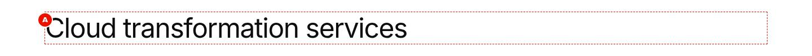{width=100%}

**Screenshot Details — h1**

| Item | Detail |
|:-----------|:----------------------------------------------|
| Screenshot Name | `screenshots/title-h1.jpg` |
| Screenshot Purpose | h1 |
| Screen Description | The h1 'Cloud transformation services' at 1440 px, 3rem regular weight with line height 1.2. |
| Business Context | The page heading of a Default page about cloud transformation that has no Page Header or Hero, so the Title provides the one h1. |
| Author Objective | Add a Title 'Cloud transformation services' with Title Type h1. |

**Field Entry Table** — enter these values in Universal Editor, in this order:

| Callout | Field Name | Example Value | Mandatory | Business Purpose | What Author Should Enter | Validation Rules |
|:--|:----------|:----------|:------|:----------|:----------|:----------|
| — | Component (Section › Add (+)) | Title | Yes | Adds the Title to the page | Select the section in the content tree, choose Add (+) and pick Title | Only components the section allows (section filter) |
| A | Title (Title) | Cloud transformation services | Recommended (an empty Title renders an empty heading or nothing) | The heading text | Short, descriptive, sentence case | None in the model |
| (B) | Title Type (Title) | h1 | Recommended | Heading level h1–h6 | Follow the page outline | Enforced: h1, h2, h3, h4, h5, h6 |

All other fields keep their default values. Each callout letter marks the field's output on the screenshot. Callouts in brackets, such as (B), have no marker: the field has no visible output of its own on this screenshot (alt text, a setting, an analytics or accessibility label, a link target or collapsed content).

**Expected Page Output**

- **Visual output:** 'Cloud transformation services' in Inter regular, 3rem on desktop with line height 1.2 and tight letter-spacing, black on white.
- **Rendering behaviour:** The h1 uses --heading-font-size-xxl: 3rem from 900 px, 2rem below, letter-spacing -0.03 times the size. In the first section without an image it can be the LCP element.
- **Publishing behaviour:** Publish to Preview shows the headings on main--tcs-corp--sradha-tcs.aem.page and Publish to Live on aem.live; headings are server-rendered in the page HTML and need no other publication.

**Business Rules**

- Exactly one h1 per page; it is Recommended, not enforced.
- Do not add an h1 Title on article, blog or press-release pages: their Page Header already renders the h1.
- Align the h1 with the page Title property and topic.
- Keep the h1 to about 70 characters.

**Common Authoring Mistakes**

| Error | Root Cause | Resolution |
|:----------|:----------|:----------|
| Two h1 on the page | A Hero with H1 or a Page Header is also on the page | Set this Title to h2 |
| The page heading is not found by screen readers | Title Type left on h2 for the page heading | Set Title Type to h1 |

**Troubleshooting**

- **Symptoms:** An SEO audit reports a missing h1 though the heading looks large.
- **Cause:** Title Type is h2, chosen for size, so the page has no h1.
- **Resolution:** Set Title Type to h1 and republish.
- **Verification Steps:** On aem.page the developer tools show h1 id="cloud-transformation-services".

**Use Cases:** Page title on Default pages without a Page Header or a Hero with H1.

**Authoring Guidelines:** Title Type **h1**; exactly one h1 per page.

**Business Rules:** Recommended: one h1 per page (not enforced).

**Rendering Rules:** `h1`: `--heading-font-size-xxl`, line height 1.2, letter-spacing −0.03 × size.

**Responsive Behaviour:** 2rem below 900 px, 3rem from 900 px.

**SEO Impact:** Strongest on-page topic signal; should match the page title.

**Accessibility Compliance:** Screen reader users jump to the h1 to find the main content (WCAG 1.3.1, 2.4.6).

#### Variation 2 — Heading level h2

**Variation Name:** Title Type h2.

**Business Purpose:** Section headings.

**Visual Example:**

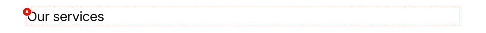{width=100%}

**Screenshot Details — h2**

| Item | Detail |
|:-----------|:----------------------------------------------|
| Screenshot Name | `screenshots/title-h2.jpg` |
| Screenshot Purpose | h2 |
| Screen Description | The h2 'Our services' at 1440 px, 2.5rem regular weight. |
| Business Context | A section heading of a services page: 'Our services' opens the band that lists the service lines. |
| Author Objective | Add a Title 'Our services' with Title Type h2. |

**Field Entry Table** — enter these values in Universal Editor, in this order:

| Callout | Field Name | Example Value | Mandatory | Business Purpose | What Author Should Enter | Validation Rules |
|:--|:----------|:----------|:------|:----------|:----------|:----------|
| — | Component (Section › Add (+)) | Title | Yes | Adds the Title to the page | Select the section in the content tree, choose Add (+) and pick Title | Only components the section allows (section filter) |
| A | Title (Title) | Our services | Recommended (an empty Title renders an empty heading or nothing) | The heading text | Short, descriptive, sentence case | None in the model |
| (B) | Title Type (Title) | h2 | Recommended | Heading level h1–h6 | Follow the page outline | Enforced: h1, h2, h3, h4, h5, h6 |

All other fields keep their default values. Each callout letter marks the field's output on the screenshot. Callouts in brackets, such as (B), have no marker: the field has no visible output of its own on this screenshot (alt text, a setting, an analytics or accessibility label, a link target or collapsed content).

**Expected Page Output**

- **Visual output:** 'Our services' in Inter regular at 2.5rem on desktop, black, with a top margin of 2rem and a bottom margin of 0.625rem.
- **Rendering behaviour:** The h2 uses --heading-font-size-xl: 2.5rem from 900 px, 1.75rem below, letter-spacing -0.025 times the size. The delivered heading gets the id our-services.
- **Publishing behaviour:** Publish to Preview shows the headings on main--tcs-corp--sradha-tcs.aem.page and Publish to Live on aem.live; headings are server-rendered in the page HTML and need no other publication.

**Business Rules**

- Use one h2 per section to open its topic.
- An h2 follows the page's h1 (Title, Hero or Page Header).
- The id our-services changes with the text and per locale; use a section Anchor name for stable links.
- Keep h2 headings to about 60 characters.

**Common Authoring Mistakes**

| Error | Root Cause | Resolution |
|:----------|:----------|:----------|
| The h2 renders with a large top gap | The heading margin (0.8 times the size) adds to the section spacing | Expected; do not add empty paragraphs to adjust it |
| A link to #our-services breaks in German | The heading id is derived from the translated text | Link to a section Anchor name instead |

**Troubleshooting**

- **Symptoms:** The heading shows at another size than h2.
- **Cause:** Title Type was left empty, so the renderer default applies [To be confirmed: heading level rendered when Title Type is empty — expected h2], or the change was not saved.
- **Resolution:** Select h2 explicitly in Title Type and republish.
- **Verification Steps:** On aem.page the element is h2 id="our-services".

**Use Cases:** One per section.

**Authoring Guidelines:** Title Type **h2**.

**Business Rules:** Follows the h1.

**Rendering Rules:** `--heading-font-size-xl`, letter-spacing −0.025 × size.

**Responsive Behaviour:** 1.75rem / 2.5rem.

**SEO Impact:** Structures the topics of the page.

**Accessibility Compliance:** Correct outline (WCAG 1.3.1).

#### Variation 3 — Heading level h3

**Variation Name:** Title Type h3.

**Business Purpose:** Sub-sections.

**Visual Example:**

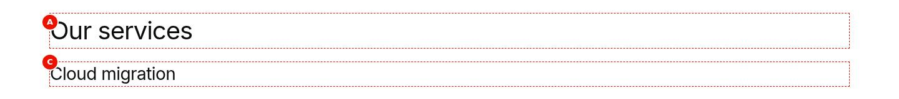{width=100%}

**Screenshot Details — h3**

| Item | Detail |
|:-----------|:----------------------------------------------|
| Screenshot Name | `screenshots/title-h3.jpg` |
| Screenshot Purpose | h3 |
| Screen Description | At 1440 px, the h2 'Our services' (2.5rem) with the h3 'Cloud migration' (1.75rem) below it. |
| Business Context | A sub-section inside the services band: 'Cloud migration' is one topic under the h2 'Our services'. |
| Author Objective | Add a Title 'Our services' (h2) and, below it, a Title 'Cloud migration' (h3). |

**Field Entry Table** — enter these values in Universal Editor, in this order:

| Callout | Field Name | Example Value | Mandatory | Business Purpose | What Author Should Enter | Validation Rules |
|:--|:----------|:----------|:------|:----------|:----------|:----------|
| — | Component (Section › Add (+)) | Title | Yes | Adds the Title to the page | Select the section in the content tree, choose Add (+) and pick Title | Only components the section allows (section filter) |
| A | Title (Title) | Our services | Recommended (an empty Title renders an empty heading or nothing) | The heading text | Short, descriptive, sentence case | None in the model |
| (B) | Title Type (Title) | h2 | Recommended | Heading level h1–h6 | Follow the page outline | Enforced: h1, h2, h3, h4, h5, h6 |
| — | Component (Section › Add (+)) | Title | Yes | Adds the Title to the page | Select the section in the content tree, choose Add (+) and pick Title | Only components the section allows (section filter) |
| C | Title (Title) | Cloud migration | Recommended (an empty Title renders an empty heading or nothing) | The heading text | Short, descriptive, sentence case | None in the model |
| (D) | Title Type (Title) | h3 | Recommended | Heading level h1–h6 | Follow the page outline | Enforced: h1, h2, h3, h4, h5, h6 |

All other fields keep their default values. Each callout letter marks the field's output on the screenshot. Callouts in brackets, such as (B), have no marker: the field has no visible output of its own on this screenshot (alt text, a setting, an analytics or accessibility label, a link target or collapsed content).

**Expected Page Output**

- **Visual output:** 'Our services' at 2.5rem and, below it, 'Cloud migration' at 1.75rem on desktop, both regular weight.
- **Rendering behaviour:** The h3 uses --heading-font-size-l: 1.75rem from 900 px, 1.5rem below, letter-spacing -0.02 times the size. Both are default content in one default-content-wrapper.
- **Publishing behaviour:** Publish to Preview shows the headings on main--tcs-corp--sradha-tcs.aem.page and Publish to Live on aem.live; headings are server-rendered in the page HTML and need no other publication.

**Business Rules**

- An h3 must follow an h2; do not skip levels.
- Use h3 for topics within a section.
- Both Titles are separate components in content tree order.
- Sentence case, not capitals.

**Common Authoring Mistakes**

| Error | Root Cause | Resolution |
|:----------|:----------|:----------|
| 'Cloud migration' appears above 'Our services' | The Titles are in the wrong content tree order | Drag 'Cloud migration' below 'Our services' |
| The outline jumps from h2 to h4 | Title Type of 'Cloud migration' set to h4 for its size | Set it to h3 |

**Troubleshooting**

- **Symptoms:** An accessibility checker reports 'heading levels should only increase by one'.
- **Cause:** 'Cloud migration' was set to h4 directly after the h2.
- **Resolution:** Set Title Type of 'Cloud migration' to h3 and republish.
- **Verification Steps:** The accessibility tree on aem.page shows h2 'Our services' followed by h3 'Cloud migration'.

**Use Cases:** Topics within a section.

**Authoring Guidelines:** Title Type **h3** after an h2.

**Business Rules:** Do not skip levels (Recommended).

**Rendering Rules:** `--heading-font-size-l`, letter-spacing −0.02 × size.

**Responsive Behaviour:** 1.5rem / 1.75rem.

**SEO Impact:** Sub-topic structure.

**Accessibility Compliance:** As above.

#### Variation 4 — Heading level h4

**Variation Name:** Title Type h4.

**Business Purpose:** Third-level sub-sections.

**Visual Example:**

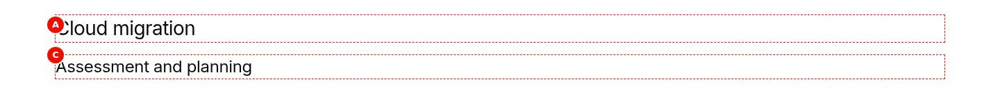{width=100%}

**Screenshot Details — h4**

| Item | Detail |
|:-----------|:----------------------------------------------|
| Screenshot Name | `screenshots/title-h4.jpg` |
| Screenshot Purpose | h4 |
| Screen Description | At 1440 px, the h3 'Cloud migration' (1.75rem) with the h4 'Assessment and planning' (1.5rem) below it. |
| Business Context | A third-level heading in a detailed service description: 'Assessment and planning' is a step under the topic 'Cloud migration'. |
| Author Objective | Add a Title 'Cloud migration' (h3) and, below it, a Title 'Assessment and planning' (h4). |

**Field Entry Table** — enter these values in Universal Editor, in this order:

| Callout | Field Name | Example Value | Mandatory | Business Purpose | What Author Should Enter | Validation Rules |
|:--|:----------|:----------|:------|:----------|:----------|:----------|
| — | Component (Section › Add (+)) | Title | Yes | Adds the Title to the page | Select the section in the content tree, choose Add (+) and pick Title | Only components the section allows (section filter) |
| A | Title (Title) | Cloud migration | Recommended (an empty Title renders an empty heading or nothing) | The heading text | Short, descriptive, sentence case | None in the model |
| (B) | Title Type (Title) | h3 | Recommended | Heading level h1–h6 | Follow the page outline | Enforced: h1, h2, h3, h4, h5, h6 |
| — | Component (Section › Add (+)) | Title | Yes | Adds the Title to the page | Select the section in the content tree, choose Add (+) and pick Title | Only components the section allows (section filter) |
| C | Title (Title) | Assessment and planning | Recommended (an empty Title renders an empty heading or nothing) | The heading text | Short, descriptive, sentence case | None in the model |
| (D) | Title Type (Title) | h4 | Recommended | Heading level h1–h6 | Follow the page outline | Enforced: h1, h2, h3, h4, h5, h6 |

All other fields keep their default values. Each callout letter marks the field's output on the screenshot. Callouts in brackets, such as (B), have no marker: the field has no visible output of its own on this screenshot (alt text, a setting, an analytics or accessibility label, a link target or collapsed content).

**Expected Page Output**

- **Visual output:** 'Cloud migration' at 1.75rem and 'Assessment and planning' at 1.5rem on desktop, both regular weight, black.
- **Rendering behaviour:** The h4 uses --heading-font-size-m: 1.5rem from 900 px, 1.125rem below, letter-spacing -0.015 times the size.
- **Publishing behaviour:** Publish to Preview shows the headings on main--tcs-corp--sradha-tcs.aem.page and Publish to Live on aem.live; headings are server-rendered in the page HTML and need no other publication.

**Business Rules**

- An h4 follows an h3; do not skip levels.
- Use h4 for detailed documents and FAQs.
- On mobile the h4 (1.125rem) is close to body size; keep it short.
- No size override exists; the level sets the size.

**Common Authoring Mistakes**

| Error | Root Cause | Resolution |
|:----------|:----------|:----------|
| 'Assessment and planning' is h3 too | Title Type copied from the previous Title | Set it to h4 |
| The h4 looks like body text on mobile | 1.125rem below 900 px by design | Keep the level; shorten the heading to keep it distinct |

**Troubleshooting**

- **Symptoms:** The h4 appears without the h3 above it on the published page.
- **Cause:** The 'Cloud migration' Title was deleted or moved to another section.
- **Resolution:** Restore 'Cloud migration' above it in the content tree and republish.
- **Verification Steps:** On aem.page the h3 is followed by the h4 in the same section.

**Use Cases:** Detailed documents, FAQs.

**Authoring Guidelines:** Title Type **h4** after an h3.

**Business Rules:** As above.

**Rendering Rules:** `--heading-font-size-m`, letter-spacing −0.015 × size.

**Responsive Behaviour:** 1.125rem / 1.5rem.

**SEO Impact:** Minor.

**Accessibility Compliance:** As above.

#### Variation 5 — Heading level h5

**Variation Name:** Title Type h5.

**Business Purpose:** Fourth-level headings.

**Visual Example:**

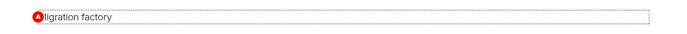{width=100%}

**Screenshot Details — h5**

| Item | Detail |
|:-----------|:----------------------------------------------|
| Screenshot Name | `screenshots/title-h5.jpg` |
| Screenshot Purpose | h5 |
| Screen Description | The h5 'Migration factory' at 1440 px, 1.25rem in light weight (300). |
| Business Context | A fourth-level heading in a deep service structure: 'Migration factory' is a detail under 'Assessment and planning'. |
| Author Objective | Add a Title 'Migration factory' with Title Type h5. |

**Field Entry Table** — enter these values in Universal Editor, in this order:

| Callout | Field Name | Example Value | Mandatory | Business Purpose | What Author Should Enter | Validation Rules |
|:--|:----------|:----------|:------|:----------|:----------|:----------|
| — | Component (Section › Add (+)) | Title | Yes | Adds the Title to the page | Select the section in the content tree, choose Add (+) and pick Title | Only components the section allows (section filter) |
| A | Title (Title) | Migration factory | Recommended (an empty Title renders an empty heading or nothing) | The heading text | Short, descriptive, sentence case | None in the model |
| (B) | Title Type (Title) | h5 | Recommended | Heading level h1–h6 | Follow the page outline | Enforced: h1, h2, h3, h4, h5, h6 |

All other fields keep their default values. Each callout letter marks the field's output on the screenshot. Callouts in brackets, such as (B), have no marker: the field has no visible output of its own on this screenshot (alt text, a setting, an analytics or accessibility label, a link target or collapsed content).

**Expected Page Output**

- **Visual output:** 'Migration factory' at 1.25rem on desktop in light weight (300), black on white.
- **Rendering behaviour:** The h5 uses --heading-font-size-s: 1.25rem from 900 px, 1rem below, weight light and letter-spacing -0.01 times the size.
- **Publishing behaviour:** Publish to Preview shows the headings on main--tcs-corp--sradha-tcs.aem.page and Publish to Live on aem.live; headings are server-rendered in the page HTML and need no other publication.

**Business Rules**

- h5 is rare; use it only after an h4.
- Its light weight is by design; do not bold it.
- Do not choose h5 to make a heading look smaller.
- Keep it short; at 1rem on mobile it is near body size.

**Common Authoring Mistakes**

| Error | Root Cause | Resolution |
|:----------|:----------|:----------|
| The h5 looks too thin | Light weight 300 is the design for h5 | Keep it; use h4 if the outline allows |
| h5 used directly after an h2 | Level chosen for its size | Use h3 and h4 levels in between, or a smaller topic structure |

**Troubleshooting**

- **Symptoms:** A checker reports a skipped level at 'Migration factory'.
- **Cause:** No h4 precedes the h5 in this section.
- **Resolution:** Add the missing h4 or change 'Migration factory' to the correct level.
- **Verification Steps:** The heading outline on aem.page has no gap before the h5.

**Use Cases:** Rare; deep document structures.

**Authoring Guidelines:** Title Type **h5** after an h4.

**Business Rules:** As above.

**Rendering Rules:** `--heading-font-size-s`, weight light (300), letter-spacing −0.01 × size.

**Responsive Behaviour:** 1rem / 1.25rem.

**SEO Impact:** Minor.

**Accessibility Compliance:** As above.

#### Variation 6 — Heading level h6

**Variation Name:** Title Type h6.

**Business Purpose:** Fifth-level headings or small heading-like labels.

**Visual Example:**

{width=100%}

**Screenshot Details — h6**

| Item | Detail |
|:-----------|:----------------------------------------------|
| Screenshot Name | `screenshots/title-h6.jpg` |
| Screenshot Purpose | h6 |
| Screen Description | The h6 'Key facts' at 1440 px, 1rem in semibold (600). |
| Business Context | A small heading-like label: 'Key facts' introduces a short list of facts at the deepest level of the outline. |
| Author Objective | Add a Title 'Key facts' with Title Type h6. |

**Field Entry Table** — enter these values in Universal Editor, in this order:

| Callout | Field Name | Example Value | Mandatory | Business Purpose | What Author Should Enter | Validation Rules |
|:--|:----------|:----------|:------|:----------|:----------|:----------|
| — | Component (Section › Add (+)) | Title | Yes | Adds the Title to the page | Select the section in the content tree, choose Add (+) and pick Title | Only components the section allows (section filter) |
| A | Title (Title) | Key facts | Recommended (an empty Title renders an empty heading or nothing) | The heading text | Short, descriptive, sentence case | None in the model |
| (B) | Title Type (Title) | h6 | Recommended | Heading level h1–h6 | Follow the page outline | Enforced: h1, h2, h3, h4, h5, h6 |

All other fields keep their default values. Each callout letter marks the field's output on the screenshot. Callouts in brackets, such as (B), have no marker: the field has no visible output of its own on this screenshot (alt text, a setting, an analytics or accessibility label, a link target or collapsed content).

**Expected Page Output**

- **Visual output:** 'Key facts' at 1rem on desktop in semibold (600), no letter-spacing, black.
- **Rendering behaviour:** The h6 uses --heading-font-size-xs: 1rem from 900 px, 0.875rem below, weight semibold, letter-spacing 0.
- **Publishing behaviour:** Publish to Preview shows the headings on main--tcs-corp--sradha-tcs.aem.page and Publish to Live on aem.live; headings are server-rendered in the page HTML and need no other publication.

**Business Rules**

- h6 is rare; use it after an h5 or for small heading-like labels where the outline requires them.
- It is semibold by design and smaller than the body text on mobile (0.875rem).
- Do not use h6 for visual emphasis of normal text; use bold in Text.
- No colour or alignment options exist.

**Common Authoring Mistakes**

| Error | Root Cause | Resolution |
|:----------|:----------|:----------|
| 'Key facts' appears in the outline though it is just a label | h6 used for styling | Use bold Text if it is not a heading |
| The h6 is smaller than the following text on mobile | 0.875rem below 900 px by design | Keep it short or use a higher level where the outline allows |

**Troubleshooting**

- **Symptoms:** Screen readers announce 'Key facts' as heading level 6 where users expect level 3.
- **Cause:** h6 was chosen for its small size within an h2 section.
- **Resolution:** Set the level that fits the outline (here h3) and republish.
- **Verification Steps:** The accessibility tree on aem.page lists 'Key facts' at the intended level.

**Use Cases:** Rare.

**Authoring Guidelines:** Title Type **h6** after an h5.

**Business Rules:** As above.

**Rendering Rules:** `--heading-font-size-xs`, weight semibold (600), no letter-spacing.

**Responsive Behaviour:** 0.875rem / 1rem.

**SEO Impact:** Minor.

**Accessibility Compliance:** As above.

### 6.7.4 Authoring Experience

{width=100%}

**Screenshot Details — Title on the Universal Editor canvas**

| Item | Detail |
|:-----------|:----------------------------------------------|
| Screenshot Name | `screenshots/title-authoring-view.jpg` |
| Screenshot Purpose | Title on the Universal Editor canvas |
| Screen Description | The h2 'Our services' and the introduction paragraph with 'measurable value' in bold in editor mode at 1440 px (an annotated preview, not a Universal Editor screenshot); A marks the heading. B, the level, is not marked separately; it shows only through the h2 size. |
| Business Context | How an author edits a heading in Universal Editor: the 'Our services' Title is edited inline on the canvas above its introduction text. |
| Author Objective | Add a Title 'Our services' (h2) and a Text, then edit the heading inline on the canvas. |

**Field Entry Table** — enter these values in Universal Editor, in this order:

| Callout | Field Name | Example Value | Mandatory | Business Purpose | What Author Should Enter | Validation Rules |
|:--|:----------|:----------|:------|:----------|:----------|:----------|
| — | Component (Section › Add (+)) | Title | Yes | Adds the Title to the page | Select the section in the content tree, choose Add (+) and pick Title | Only components the section allows (section filter) |
| — | Title (Title) | Our services | Recommended (an empty Title renders an empty heading or nothing) | The heading text | Short, descriptive, sentence case | None in the model |
| — | Title Type (Title) | h2 | Recommended | Heading level h1–h6 | Follow the page outline | Enforced: h1, h2, h3, h4, h5, h6 |
| — | Component (Section › Add (+)) | Text | Yes | Adds the Text to the page | Select the section in the content tree, choose Add (+) and pick Text | Only components the section allows (section filter) |
| — | Text (Text) | We help enterprises reimagine their business with consulting, technology and engineering services that create **measurable value** across the value chain. | No | Card text | 1–3 sentences; lists and links allowed | None |
| — | Title (Canvas) | Double-click the heading to edit its text inline (A); its size shows the Title Type h2 (B) | No | — | — | None |

All other fields keep their default values. The letters on this annotated preview follow the chapter's Annotations list.

**Expected Page Output**

- **Visual output:** The selected Title 'Our services' with its text in inline editing (A), shown at the h2 size that reflects Title Type (B), above the introduction paragraph with 'measurable value' in bold.
- **Rendering behaviour:** The Title has no JavaScript; the heading element is rendered by AEM and Edge Delivery and left unchanged by code. After an edit the canvas re-renders the default content.
- **Publishing behaviour:** Edits are saved to AEM author at once; they reach aem.page with Publish to Preview and aem.live with Publish to Live.

**Business Rules**

- The dialog has two fields, Title and Title Type, and no tabs or Additional tab.
- The size on the canvas shows the level: h2 here.
- Title Type has no default in the model; always select it.
- The Text below is a separate component, edited by itself.

**Common Authoring Mistakes**

| Error | Root Cause | Resolution |
|:----------|:----------|:----------|
| The size does not change after editing | Only the text was changed; Title Type is in the Properties panel | Select the Title and change Title Type in the Properties panel |
| The introduction becomes part of the heading | The paragraph was typed into the Title field | Move it into the Text component |

**Troubleshooting**

- **Symptoms:** The inline edit of 'Our services' is not kept after reloading the editor.
- **Cause:** The edit was not saved because the session expired or the page was open in two tabs.
- **Resolution:** Sign in again, edit the heading in one tab only and confirm the Title field value in the Properties panel.
- **Verification Steps:** After reloading Universal Editor the heading shows the new text.

**Annotations:**

- A = the heading text (Title), editable inline
- B = the heading level as rendered (Title Type), visible through the size

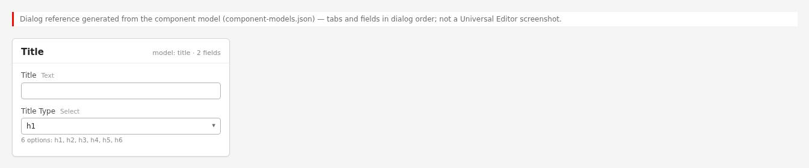{width=100%}

The dialog has two fields and no tabs: **Title** (text) and **Title Type** (select with h1, h2, h3, h4, h5, h6). There is no Additional tab.

### 6.7.5 Authoring Guide

**Step 1 — Open the page in Universal Editor**

**Action:** Sites console > select the page > **Edit**.

**Expected Result:** The page opens on the canvas.

**Steps — Step 1:** The page open in the Universal Editor.

| Step | Where | Field / control | Value / action |
|:--|:----------|:----------|:--------------------|
| 1 | AEM Sites console | Navigation | Open TCS Corp › us › en › services |
| 2 | AEM Sites console | Select | Select the page (check box of its card or row) |
| 3 | AEM Sites console toolbar | Edit | Select Edit: the page opens in the Universal Editor |

**Step 2 — Add a Title**

**Action:** Select the section, **Add (+)** > **Title**.

**Expected Result:** A Title component appears in the section.

**Steps — Step 2:** The picker with Title highlighted.

| Step | Where | Field / control | Value / action |
|:--|:----------|:----------|:--------------------|
| 1 | Universal Editor › Content tree | Section | Select the section |
| 2 | Universal Editor › Content tree | Add (+) | Select Add (+) |
| 3 | Component picker › Default Content | Title | Select Title |

**Step 3 — Enter the heading text**

**Action:** Type the text in **Title** (or inline on the canvas).

**Expected Result:** The heading shows on the canvas.

**Steps — Step 3:** The Title field filled in.

| Step | Where | Field / control | Value / action |
|:--|:----------|:----------|:--------------------|
| 1 | Title › Properties | Title | Our services |

**Step 4 — Choose the level**

**Action:** Select the **Title Type** that fits the outline (h1 for the page heading, h2 for sections, h3 below an h2, ...).

**Expected Result:** The heading changes size.

**Steps — Step 4:** The Title Type select open with h2 highlighted.

| Step | Where | Field / control | Value / action |
|:--|:----------|:----------|:--------------------|
| 1 | Title › Properties | Title Type | Open the select and choose h2 |

**Step 5 — Preview**

**Action:** Switch on Preview mode; check the heading at the three sizes.

**Expected Result:** The heading wraps cleanly on mobile.

**Steps — Step 5:** Preview mode at mobile size.

| Step | Where | Field / control | Value / action |
|:--|:----------|:----------|:--------------------|
| 1 | Universal Editor toolbar | Preview | Switch Preview on |
| 2 | Universal Editor toolbar | Device size | Mobile |

**Step 6 — Validate and publish**

**Action:** Check the heading outline (see Validation Process), then publish to Preview and Live.

**Expected Result:** The heading is live.

**Steps — Step 6:** The Publish dialog.

| Step | Where | Field / control | Value / action |
|:--|:----------|:----------|:--------------------|
| 1 | Universal Editor toolbar | Publish | Select Publish |
| 2 | Publish dialog | Items | Keep the page and its references selected |
| 3 | Publish dialog | Destination | Preview |
| 4 | Publish dialog | Publish | Select Publish; check the page on https://main--tcs-corp--sradha-tcs.aem.page/en/... |
| 5 | Publish dialog | Destination | Live (when approved), then Publish; check https://main--tcs-corp--sradha-tcs.aem.live/en/... |

#### Preview Process

On `.aem.page`, use a heading outline browser extension or the accessibility tree in developer tools to check the heading levels of the whole page.

#### Publishing Process

Publish the page to Live.

#### Validation Process

- [ ] Exactly one h1 on the page (including the Page Header / Hero heading).
- [ ] No skipped levels (h2 then h3, not h2 then h4).
- [ ] Heading text is short and descriptive.
- [ ] Heading text is not all upper case typed (use normal case).
- [ ] The heading wraps without breaking words badly on mobile.

#### Rollback Process

Change the text or level back, or restore the page version and republish.

The walkthroughs below repeat the steps above for each variation of chapter 6.7.3, from opening the page to publishing; the values are those of the variation's screenshot.

#### Walkthrough — Variation 1 — Heading level h1

Reproduces the screenshot `screenshots/title-h1.jpg` of this variation. The Field Entry Table under the screenshot lists every value with its rules.

**Step 1 — Open the page**

**Action:** In AEM Sites, open the locale site (for example `/content/tcs-corp/us/en`), select the page and choose Edit; the page opens in Universal Editor.

**Expected Result:** The page renders on the canvas with the content tree and the properties panel.

**Step 2 — Add the Title**

**Action:** Select the section in the content tree, choose **Add (+)** and pick **Title**.

**Expected Result:** An empty Title component is added to the selected section.

**Step 3 — Fill in Title**

**Action:** Select **Title** in the content tree and enter in the properties panel: **Title** (A) = Cloud transformation services; **Title Type** (B) = h1.

**Expected Result:** The heading 'Cloud transformation services' appears at the h1 size, 3rem on desktop.

**Step 4 — Preview**

**Action:** Choose **Preview** in the Universal Editor toolbar (or open the page on aem.page) and compare it with the screenshot.

**Expected Result:** 'Cloud transformation services' in Inter regular, 3rem on desktop with line height 1.2 and tight letter-spacing, black on white.

**Step 5 — Publish**

**Action:** Choose **Publish** › Publish to Live (with the referenced pages, fragments and assets that are not yet published).

**Expected Result:** Publish to Preview shows the headings on main--tcs-corp--sradha-tcs.aem.page and Publish to Live on aem.live; headings are server-rendered in the page HTML and need no other publication.

**Step 6 — Verify**

**Action:** On the live page check: On aem.page the developer tools show h1 id="cloud-transformation-services".

**Expected Result:** The page matches the screenshot; nothing in the Troubleshooting case above applies.

#### Walkthrough — Variation 2 — Heading level h2

Reproduces the screenshot `screenshots/title-h2.jpg` of this variation. The Field Entry Table under the screenshot lists every value with its rules.

**Step 1 — Open the page**

**Action:** In AEM Sites, open the locale site (for example `/content/tcs-corp/us/en`), select the page and choose Edit; the page opens in Universal Editor.

**Expected Result:** The page renders on the canvas with the content tree and the properties panel.

**Step 2 — Add the Title**

**Action:** Select the section in the content tree, choose **Add (+)** and pick **Title**.

**Expected Result:** An empty Title component is added to the selected section.

**Step 3 — Fill in Title**

**Action:** Select **Title** in the content tree and enter in the properties panel: **Title** (A) = Our services; **Title Type** (B) = h2.

**Expected Result:** The heading 'Our services' appears at the h2 size, 2.5rem on desktop.

**Step 4 — Preview**

**Action:** Choose **Preview** in the Universal Editor toolbar (or open the page on aem.page) and compare it with the screenshot.

**Expected Result:** 'Our services' in Inter regular at 2.5rem on desktop, black, with a top margin of 2rem and a bottom margin of 0.625rem.

**Step 5 — Publish**

**Action:** Choose **Publish** › Publish to Live (with the referenced pages, fragments and assets that are not yet published).

**Expected Result:** Publish to Preview shows the headings on main--tcs-corp--sradha-tcs.aem.page and Publish to Live on aem.live; headings are server-rendered in the page HTML and need no other publication.

**Step 6 — Verify**

**Action:** On the live page check: On aem.page the element is h2 id="our-services".

**Expected Result:** The page matches the screenshot; nothing in the Troubleshooting case above applies.

#### Walkthrough — Variation 3 — Heading level h3

Reproduces the screenshot `screenshots/title-h3.jpg` of this variation. The Field Entry Table under the screenshot lists every value with its rules.

**Step 1 — Open the page**

**Action:** In AEM Sites, open the locale site (for example `/content/tcs-corp/us/en`), select the page and choose Edit; the page opens in Universal Editor.

**Expected Result:** The page renders on the canvas with the content tree and the properties panel.

**Step 2 — Add the Title**

**Action:** Select the section in the content tree, choose **Add (+)** and pick **Title**.

**Expected Result:** Two empty Title components are added to the selected section.

**Step 3 — Fill in Title**

**Action:** Select **Title** in the content tree and enter in the properties panel: **Title** (A) = Our services; **Title Type** (B) = h2.

**Expected Result:** 'Our services' appears as h2 and 'Cloud migration' below it at the smaller h3 size.

**Step 4 — Add the Title**

**Action:** Select the section in the content tree, choose **Add (+)** and pick **Title**.

**Expected Result:** Two empty Title components are added to the selected section.

**Step 5 — Fill in Title**

**Action:** Select **Title** in the content tree and enter in the properties panel: **Title** (C) = Cloud migration; **Title Type** (D) = h3.

**Expected Result:** 'Our services' appears as h2 and 'Cloud migration' below it at the smaller h3 size.

**Step 6 — Preview**

**Action:** Choose **Preview** in the Universal Editor toolbar (or open the page on aem.page) and compare it with the screenshot.

**Expected Result:** 'Our services' at 2.5rem and, below it, 'Cloud migration' at 1.75rem on desktop, both regular weight.

**Step 7 — Publish**

**Action:** Choose **Publish** › Publish to Live (with the referenced pages, fragments and assets that are not yet published).

**Expected Result:** Publish to Preview shows the headings on main--tcs-corp--sradha-tcs.aem.page and Publish to Live on aem.live; headings are server-rendered in the page HTML and need no other publication.

**Step 8 — Verify**

**Action:** On the live page check: The accessibility tree on aem.page shows h2 'Our services' followed by h3 'Cloud migration'.

**Expected Result:** The page matches the screenshot; nothing in the Troubleshooting case above applies.

#### Walkthrough — Variation 4 — Heading level h4

Reproduces the screenshot `screenshots/title-h4.jpg` of this variation. The Field Entry Table under the screenshot lists every value with its rules.

**Step 1 — Open the page**

**Action:** In AEM Sites, open the locale site (for example `/content/tcs-corp/us/en`), select the page and choose Edit; the page opens in Universal Editor.

**Expected Result:** The page renders on the canvas with the content tree and the properties panel.

**Step 2 — Add the Title**

**Action:** Select the section in the content tree, choose **Add (+)** and pick **Title**.

**Expected Result:** Two empty Title components are added to the selected section.

**Step 3 — Fill in Title**

**Action:** Select **Title** in the content tree and enter in the properties panel: **Title** (A) = Cloud migration; **Title Type** (B) = h3.

**Expected Result:** 'Cloud migration' appears as h3 and 'Assessment and planning' below it at the h4 size.

**Step 4 — Add the Title**

**Action:** Select the section in the content tree, choose **Add (+)** and pick **Title**.

**Expected Result:** Two empty Title components are added to the selected section.

**Step 5 — Fill in Title**

**Action:** Select **Title** in the content tree and enter in the properties panel: **Title** (C) = Assessment and planning; **Title Type** (D) = h4.

**Expected Result:** 'Cloud migration' appears as h3 and 'Assessment and planning' below it at the h4 size.

**Step 6 — Preview**

**Action:** Choose **Preview** in the Universal Editor toolbar (or open the page on aem.page) and compare it with the screenshot.

**Expected Result:** 'Cloud migration' at 1.75rem and 'Assessment and planning' at 1.5rem on desktop, both regular weight, black.

**Step 7 — Publish**

**Action:** Choose **Publish** › Publish to Live (with the referenced pages, fragments and assets that are not yet published).

**Expected Result:** Publish to Preview shows the headings on main--tcs-corp--sradha-tcs.aem.page and Publish to Live on aem.live; headings are server-rendered in the page HTML and need no other publication.

**Step 8 — Verify**

**Action:** On the live page check: On aem.page the h3 is followed by the h4 in the same section.

**Expected Result:** The page matches the screenshot; nothing in the Troubleshooting case above applies.

#### Walkthrough — Variation 5 — Heading level h5

Reproduces the screenshot `screenshots/title-h5.jpg` of this variation. The Field Entry Table under the screenshot lists every value with its rules.

**Step 1 — Open the page**

**Action:** In AEM Sites, open the locale site (for example `/content/tcs-corp/us/en`), select the page and choose Edit; the page opens in Universal Editor.

**Expected Result:** The page renders on the canvas with the content tree and the properties panel.

**Step 2 — Add the Title**

**Action:** Select the section in the content tree, choose **Add (+)** and pick **Title**.

**Expected Result:** An empty Title component is added to the selected section.

**Step 3 — Fill in Title**

**Action:** Select **Title** in the content tree and enter in the properties panel: **Title** (A) = Migration factory; **Title Type** (B) = h5.

**Expected Result:** The heading 'Migration factory' appears at the h5 size in light weight.

**Step 4 — Preview**

**Action:** Choose **Preview** in the Universal Editor toolbar (or open the page on aem.page) and compare it with the screenshot.

**Expected Result:** 'Migration factory' at 1.25rem on desktop in light weight (300), black on white.

**Step 5 — Publish**

**Action:** Choose **Publish** › Publish to Live (with the referenced pages, fragments and assets that are not yet published).

**Expected Result:** Publish to Preview shows the headings on main--tcs-corp--sradha-tcs.aem.page and Publish to Live on aem.live; headings are server-rendered in the page HTML and need no other publication.

**Step 6 — Verify**

**Action:** On the live page check: The heading outline on aem.page has no gap before the h5.

**Expected Result:** The page matches the screenshot; nothing in the Troubleshooting case above applies.

#### Walkthrough — Variation 6 — Heading level h6

Reproduces the screenshot `screenshots/title-h6.jpg` of this variation. The Field Entry Table under the screenshot lists every value with its rules.

**Step 1 — Open the page**

**Action:** In AEM Sites, open the locale site (for example `/content/tcs-corp/us/en`), select the page and choose Edit; the page opens in Universal Editor.

**Expected Result:** The page renders on the canvas with the content tree and the properties panel.

**Step 2 — Add the Title**

**Action:** Select the section in the content tree, choose **Add (+)** and pick **Title**.

**Expected Result:** An empty Title component is added to the selected section.

**Step 3 — Fill in Title**

**Action:** Select **Title** in the content tree and enter in the properties panel: **Title** (A) = Key facts; **Title Type** (B) = h6.

**Expected Result:** The heading 'Key facts' appears at the h6 size in semibold.

**Step 4 — Preview**

**Action:** Choose **Preview** in the Universal Editor toolbar (or open the page on aem.page) and compare it with the screenshot.

**Expected Result:** 'Key facts' at 1rem on desktop in semibold (600), no letter-spacing, black.

**Step 5 — Publish**

**Action:** Choose **Publish** › Publish to Live (with the referenced pages, fragments and assets that are not yet published).

**Expected Result:** Publish to Preview shows the headings on main--tcs-corp--sradha-tcs.aem.page and Publish to Live on aem.live; headings are server-rendered in the page HTML and need no other publication.

**Step 6 — Verify**

**Action:** On the live page check: The accessibility tree on aem.page lists 'Key facts' at the intended level.

**Expected Result:** The page matches the screenshot; nothing in the Troubleshooting case above applies.

### 6.7.6 Authorable Field Specification

**Model `title`**

| Field Name | Field Type | Mandatory | Multi Value | Default Value | Business Purpose | Author Guidance | Validation Rules | Example Value |
|:---------------|:--------|:----------------------------|:-------|:--------------|:---------------|:--------------------|:-------------------|:----------|
| Title (`title`) | Text | Recommended (an empty Title renders an empty heading or nothing) | No | (empty) | The heading text | Short, descriptive, sentence case | None in the model | Our services |
| Title Type (`titleType`) | Select | Recommended | No | (none set in the model) | Heading level h1–h6 | Follow the page outline | Enforced: h1, h2, h3, h4, h5, h6 | h2 |

**Additional tab:** Not applicable (default content).

**Field details**

- **Title** — Purpose: heading text. Allowed Values: plain text. Character Limits: none enforced; Recommended up to 70 characters for h1 and up to 60 for h2–h3. Business Rules: Edge Delivery Services gives headings an `id` derived from their text (used by `#links`). Dependency Rules: none. Visibility Rules: always visible. Sample Content: "Why TCS for cloud".
- **Title Type** — Purpose: heading level. Allowed Values: h1–h6. Character Limits: not applicable. Business Rules: the model sets no default value; the level AEM renders when it is empty is the renderer's default. [To be confirmed: heading level rendered when Title Type is empty — expected h2] Dependency Rules: none. Visibility Rules: always visible. Sample Content: h2.

### 6.7.7 Field Annotation Mapping

| Marker | Field | Purpose |
|:--------|:--------|:-------------|
| A | Title | Heading text |
| B | Title Type | Heading level (size) |

### 6.7.8 Component Specification

| Attribute | Value |
|:-----------------|:-----------------------------------------|
| Component Name | Title (`title`, `core/franklin/components/title/v1/title`) |
| Version | 1.0 |
| Owner | [To be confirmed: product owner]; technical owner: development team |
| Dependencies | `models/_title.json`; `styles/styles.css` |
| Component Type | Default content |
| Supported Variants | h1; h2; h3; h4; h5; h6 |
| Supported Templates | Any page |
| Supported Metadata | None |
| Supported Tags | None |
| Supported Personalization | None (as of this handover) |
| Caching Considerations | Part of the page HTML |
| Performance Considerations | No JavaScript; an h1 in the first section can be the LCP element when there is no image |
| Accessibility Compliance | WCAG 2.1 AA: info and relationships (1.3.1), headings and labels (2.4.6), bypass blocks through heading navigation (2.4.1) |
| SEO Compliance | Server-rendered heading; level chosen by the author |

### 6.7.9 Input Model

- **Content Inputs:** Title.
- **Metadata Inputs:** none.
- **Tags Inputs:** none.
- **Page Context Inputs:** none.
- **Query Inputs:** none.
- **Manual Inputs:** Title, Title Type.

Authored HTML received from AEM:

```html
<h2 id="our-services">Our services</h2>
```

### 6.7.10 Output Model

**Rendered Output:** the heading element inside `div.default-content-wrapper`, unchanged by code.

**Generated HTML:**

```html
<div class="default-content-wrapper">
  <h2 id="our-services">Our services</h2>
</div>
```

**Generated JSON:** none.

**Generated Metadata:** none.

**Analytics Tracking:** none for the Title itself. The first heading inside a block is used as that block's `dc:title` in the data layer; a Title is default content, so it is not used for any block.

**Personalization Output:** none.

**Search Index Output:** none (the query index uses page metadata).

**Target Personalization Output:** None (as of this handover): the Title is default content, not a data layer component, and is not used as any block's dc:title. No personalisation marker is added.

### 6.7.11 Business Rules

1. The heading level is the Title Type value (h1–h6).
2. Heading ids are generated from the text by Edge Delivery Services; a block Anchor ID equal to a heading id gets a numeric suffix (5.6.3).
3. Heading sizes step at 900 px (mobile and desktop type scale).
4. All headings have `scroll-margin: 2.5rem` (anchor jumps leave space above).
5. h5 is light (300), h6 semibold (600), h1–h4 regular (400).
6. One h1 per page is Recommended, not enforced.
7. The article, blog and press-release templates add a Page Header with the page heading when none is authored; an extra h1 Title then duplicates it.

### 6.7.12 Author Best Practices

**Recommended Content Length:** h1 up to about 70 characters; h2–h3 up to about 60 characters; avoid headings longer than two lines on mobile.

**Image Dimensions:** not applicable.

**CTA Writing Guidelines:** not applicable (headings are not links).

**Accessibility Guidelines:** choose the level by structure, not size; never skip levels; no empty headings.

**SEO Guidelines:** the h1 should express the page topic and align with the page Title property.

**Metadata Guidelines:** keep the h1 consistent with the page Title and Description.

**Taxonomy Guidelines:** not applicable.

**Localization Guidelines:** translate per locale; allow for longer translations; heading ids change with translated text, so links to heading ids differ per locale (use Anchor names / IDs for stable links).

### 6.7.13 Troubleshooting Guide

#### Issue 1 — Two h1 headings on the page

**Symptoms:** Accessibility checker reports multiple h1.

**Root Cause:** A Title h1 plus a Page Header / Hero h1 (or a template-added Page Header).

**Diagnosis Steps:** Inspect the headings outline.

**Resolution Steps:** Change the Title to h2.

**Validation Steps:** One h1 remains.

**Preventive Measures:** On templated pages never add an h1 Title.

#### Issue 2 — Heading too large or too small

**Symptoms:** The heading size does not match the design.

**Root Cause:** The level was chosen for size.

**Diagnosis Steps:** Check Title Type against the outline.

**Resolution Steps:** Use the correct level; ask design if the scale does not fit.

**Validation Steps:** Outline correct.

**Preventive Measures:** Choose by structure.

#### Issue 3 — Anchor link to a heading breaks after translation

**Symptoms:** `#heading-id` link does not jump in another locale.

**Root Cause:** Heading ids are derived from the (translated) text.

**Diagnosis Steps:** Inspect the heading id on both locales.

**Resolution Steps:** Link to a section Anchor name or a block Anchor ID instead.

**Validation Steps:** The link jumps in every locale.

**Preventive Measures:** Use stable anchors.

#### Issue 4 — Empty heading in the outline

**Symptoms:** Screen reader announces an empty heading.

**Root Cause:** A Title without text.

**Diagnosis Steps:** Find empty `h1`–`h6` elements.

**Resolution Steps:** Fill or delete the Title.

**Validation Steps:** No empty headings.

**Preventive Measures:** Delete unused Titles.

#### Issue 5 — Heading level not as selected

**Symptoms:** The heading renders at another level.

**Root Cause:** Title Type empty (renderer default applies) or the change was not saved.

**Diagnosis Steps:** Check the Title Type field.

**Resolution Steps:** Select the level explicitly; republish.

**Validation Steps:** Correct element in the HTML.

**Preventive Measures:** Always set Title Type.

#### Issue 6 — Heading wraps awkwardly on mobile

**Symptoms:** A single word on the last line, or long words overflow.

**Root Cause:** Long heading text at 2rem on narrow screens.

**Diagnosis Steps:** View at 320 and 375 px.

**Resolution Steps:** Shorten the heading.

**Validation Steps:** Clean wrapping.

**Preventive Measures:** Keep headings short.

### 6.7.14 Support Runbook

**Monitoring Requirements:** Accessibility scans (heading order) after content releases are recommended. [To be confirmed: accessibility scanning tool — owner: site administrator]

**Logs:** None emitted.

**Common Errors:**

| Error | Cause | Fix |
|:------------|:----------------|:---------|
| Multiple h1 | Title h1 on a templated page | Use h2 |
| Skipped level | h2 followed by h4 | Use h3 |
| Empty heading | Empty Title | Delete or fill |
| Broken heading link | Translated heading id | Use anchors |

**Escalation Matrix:**

| Level | Who | Checks |
|:---------|:---------------|:-----------------------|
| L1 | Author support | Title Type, outline, duplicates |
| L2 | AMS / site administrator | Publish status, cache |
| L3 | Development team | `styles/styles.css` heading rules and tokens |
| Adobe Support | Adobe | AEM title rendering defects |

**Recovery Procedures:** Restore the page version and republish.

**Health Checks:** Block library page with h1–h6 on preview after releases.

**Operational Procedures:** Heading sizes are design tokens (`--heading-font-size-*`) changed by developers.

**Known Limitations:** No alignment, colour or size override; no Additional tab; no default Title Type in the model.

### 6.7.15 Common Authoring Mistakes

The mistakes seen most often with this component (each screenshot above also lists the mistakes of its example).

| Error | Root Cause | Resolution |
|:----------|:----------|:----------|
| Two h1 headings | A Title h1 on a page with a Page Header or Hero H1 | Set the Title to h2 |
| Skipped heading level | h2 followed by an h4 chosen for its size | Use h3 |
| Empty heading announced | A Title without text | Fill or delete the Title |
| Level not as expected | Title Type left empty (renderer default) | Select the level explicitly and republish |
| Heading link breaks in another locale | Heading ids come from the translated text | Link to a section Anchor name or block Anchor ID |
| Heading wraps badly on mobile | Long text at 2rem | Shorten the heading |
| Heading looks wrong in size | Level chosen to fit the design size | Use the outline level and ask design about the scale |
| Heading typed in capitals | Upper case typed instead of sentence case | Retype in sentence case |

### 6.7.16 Author Quick Reference Guide

**Mandatory Fields**

- Title: not required in the model, but an empty Title renders an empty heading or nothing

**Recommended Fields**

- Title Type: no default in the model; select h1 to h6 explicitly
- Title text: up to about 70 characters for h1, 60 for h2 and h3, sentence case

**Optional Fields**

- None: the Title has only Title and Title Type; there is no alignment, colour, size option or Additional tab

**Authoring Checklist**

1. Use exactly one h1 per page, counting the Page Header and Hero headings
2. Do not add an h1 Title on article, blog or press-release pages; the Page Header renders it
3. Give each section an h2 and nest h3 to h6 without skipping levels
4. Choose the level by structure, not by size
5. Delete Titles left empty
6. Use section Anchor names, not heading ids, for stable #links across locales
7. Use bold Text, not h5 or h6, for labels that are not headings

**Pre-Publish Checklist**

1. Check the heading outline of the whole page on aem.page (one h1, no skipped levels)
2. Check no heading is empty
3. Check the headings wrap cleanly at 375 px
4. Check the h1 matches the page Title property
5. Check the text is in sentence case, not typed in capitals

**Post-Publish Validation Checklist**

1. Run an accessibility scan of the live page for heading order
2. Check the h1 and h2 render as on aem.page
3. Check #links to headings still work after translation
4. Check search snippets use the h1 topic as intended
5. Spot-check the page in each locale for overlong translated headings

### 6.7.17 Component Execution Example

**Business example:** Six-level heading scale of the cloud page.

**Example Values Entered:**

| Field | Value |
|:--------------------|:------------------------------|
| Component (Section › Add (+)) | Title |
| Title (Title) | Cloud transformation services |
| Title Type (Title) | h1 |
| Component (Section › Add (+)) | Title |
| Title (Title) | Our services |
| Title Type (Title) | h2 |
| Component (Section › Add (+)) | Title |
| Title (Title) | Cloud migration |
| Title Type (Title) | h3 |
| Component (Section › Add (+)) | Title |
| Title (Title) | Assessment and planning |
| Title Type (Title) | h4 |
| Component (Section › Add (+)) | Title |
| Title (Title) | Migration factory |
| Title Type (Title) | h5 |
| Component (Section › Add (+)) | Title |
| Title (Title) | Key facts |
| Title Type (Title) | h6 |

All other fields keep their default values.

**Rendered Result:**

{width=100%}

**Author Notes**

- Six Titles from 'Cloud transformation services' (h1) to 'Key facts' (h6)
- Each Title Type is selected explicitly; the model has no default
- Only one h1 on the page, with no Hero or Page Header
- The levels follow each other without gaps

**Business Notes**

- The h1 states the page topic for search and screen readers
- h2 to h4 structure the services into topics and steps
- h5 and h6 are rare and only used where the outline needs them

**Technical Notes**

- The heading is rendered by AEM and Edge Delivery and not changed by code
- Edge Delivery Services adds an id from the text, for example our-services
- Sizes step at 900 px: h1 3rem desktop, 2rem mobile
- All headings have scroll-margin 2.5rem

## 6.8 Image Component

### 6.8.1 Component Purpose

**Business Objective:** Place a single, automatically optimised image from AEM Assets in the flow of a page, with accessible alt text.

**Business Use Cases:**

- Illustrations, diagrams and photographs between paragraphs.
- Infographics with a text alternative.
- Images inside Columns or Tabs Container panels.

**When To Use:** For a standalone image in default content.

**When Not To Use:**

- For an image with text side by side: use **Teaser** or **Columns**.
- For a full-width banner with a heading and CTAs: use **Hero**.
- For a background behind content: use the section **Background Image**.
- For a clickable image: not supported by the Image component (no link field); use a block with a link (Teaser, Cards).
- For video or animation: use **Video**, **Embed** or the Hero Lottie option.

**Dependencies:**

| Type | Item |
|:---------|:------------------------------------------------------------|
| Model | `models/_image.json` (definition `image`, resource type `core/franklin/components/image/v1/image`; model `image`) |
| Code | None specific; Edge Delivery Services delivers the responsive `<picture>`; `scripts/aem.js` `waitForFirstImage` makes the first image of the first section eager |
| Styles | `styles/styles.css` (`main img { max-width: 100%; width: auto; height: auto; }`) |
| Data sources | AEM Assets (`/content/dam/tcs-corp/`) |

**Related Components:** Text, Title, Button; Columns; Teaser; Hero; section Background Image.

**Applicable Templates:** Any page.

**Supported Content Types:** Raster images from AEM Assets (JPEG, PNG, WebP, GIF); SVG as supported by AEM Assets and Edge Delivery. [To be confirmed: SVG handling for the Image component — owner: development team]

**Business Problem Solved**

Pages needed a simple way to place a single image from AEM Assets in the flow of the text, delivered automatically as optimised responsive renditions and with an accessible text alternative, without building a block for each illustration, diagram or photograph.

**Supported Taxonomy**

None: the Image has no tag field and reads no page tags, taxonomy or asset metadata (Supported Tags: None). Image columns of the query index come from the page metadata, not from Image components.

### 6.8.2 Visual Overview

{width=100%}

**Screenshot Details — Desktop rendering**

| Item | Detail |
|:-----------|:----------------------------------------------|
| Screenshot Name | `screenshots/image-desktop-view.jpg` |
| Screenshot Purpose | Desktop rendering |
| Screen Description | At 1440 px, the paragraph on the migration factory, photo-2.svg left aligned at its natural width up to the content width, and the paragraph on optimising cost, performance and security below it. |
| Business Context | A cloud migration story on the English site where a photograph of engineers at work sits between the two paragraphs it illustrates, checked at 1440 px. |
| Author Objective | Add a Text, an Image with photo-2.svg and the Alt Text 'TCS engineers reviewing a cloud dashboard', and a second Text, and confirm the desktop layout. |

**Field Entry Table** — enter these values in Universal Editor, in this order:

| Callout | Field Name | Example Value | Mandatory | Business Purpose | What Author Should Enter | Validation Rules |
|:--|:----------|:----------|:------|:----------|:----------|:----------|
| — | Component (Section › Add (+)) | Text | Yes | Adds the Text to the page | Select the section in the content tree, choose Add (+) and pick Text | Only components the section allows (section filter) |
| A | Text (Text) | Our cloud migration factory combines automated discovery, proven runbooks and a dedicated operations team, so workloads move safely and on schedule. | No | Card text | 1–3 sentences; lists and links allowed | None |
| — | Component (Section › Add (+)) | Image | Yes | Adds the Image to the page | Select the section in the content tree, choose Add (+) and pick Image | Only components the section allows (section filter) |
| B | Image (Image) | Select the asset photo-2.svg (/en/media/photo-2.svg) | Recommended (without an image the component renders nothing) | The image to show | High-quality original from `/content/dam/tcs-corp/` | None in the model |
| C | Alt Text (Image) | TCS engineers reviewing a cloud dashboard | Recommended for informative images | Text alternative | Describe content and purpose; empty if decorative | None in the model |
| — | Component (Section › Add (+)) | Text | Yes | Adds the Text to the page | Select the section in the content tree, choose Add (+) and pick Text | Only components the section allows (section filter) |
| D | Text (Text) | After the move, we keep optimising cost, performance and security, with clear reports for every stakeholder. | No | Card text | 1–3 sentences; lists and links allowed | None |

All other fields keep their default values. Each callout letter marks the field's output on the screenshot.

**Expected Page Output**

- **Visual output:** The first paragraph, then photo-2.svg left aligned at its natural width up to the content width with its aspect ratio kept, then the paragraph about optimising cost, performance and security.
- **Rendering behaviour:** main img has max-width 100%, width and height auto: the image is never stretched and never wider than the content area (up to 110rem with Full Width). It is lazy unless it is the first image of the first section, which is set to eager as the LCP candidate.
- **Publishing behaviour:** Publish the page with photo-2.svg selected as a reference in the Publish dialog; on publish the asset is copied to the site's media store and served with a content-hash media_ URL from aem.page and aem.live.

**Business Rules**

- The Image has only Image and Alt Text: no link, caption, alignment, crop or size option.
- The image is shown at its natural size, never wider than the content area, with its aspect ratio kept.
- Alt Text 'TCS engineers reviewing a cloud dashboard' describes the photograph because it supports the text.
- The image sits in a paragraph of the default-content-wrapper, so it is left aligned with paragraph margins.

**Common Authoring Mistakes**

| Error | Root Cause | Resolution |
|:----------|:----------|:----------|
| The image does not fill the content width | The original is narrower than the content area; images are never enlarged | Upload a wider original, at least 2000 px |
| Screen readers say 'image' only | Alt Text left empty for an informative photograph | Enter a description such as 'TCS engineers reviewing a cloud dashboard' |
| The image appears after the second paragraph | Components in the wrong content tree order | Drag the Image between the two Texts |

**Troubleshooting**

- **Symptoms:** On aem.live a broken image icon shows between the paragraphs.
- **Cause:** photo-2.svg was not published, or was moved or deleted in AEM Assets after it was picked.
- **Resolution:** Publish the asset (or re-pick it if moved) and republish the page with references.
- **Verification Steps:** On aem.live the img request returns 200 and the photograph shows between the paragraphs.

**Desktop (1200 px and above):** the image is shown at its intrinsic width, never wider than the content area (`max-width: 100%`), with its aspect ratio preserved (`height: auto`). It sits in a paragraph inside `div.default-content-wrapper`, so it is left-aligned and gets the paragraph margins.

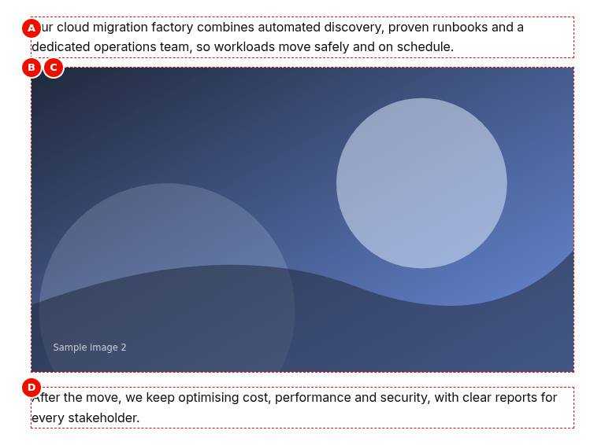{width=61%}

**Screenshot Details — Tablet rendering**

| Item | Detail |
|:-----------|:----------------------------------------------|
| Screenshot Name | `screenshots/image-tablet-view.jpg` |
| Screenshot Purpose | Tablet rendering |
| Screen Description | The same paragraphs and photo-2.svg at 768 px, the image scaled down to the content width with its aspect ratio kept. |
| Business Context | The same cloud migration story checked at 768 px, where the photograph must scale down to the tablet content width without distortion. |
| Author Objective | Confirm that the Image with photo-2.svg scales down between the two paragraphs at tablet width. |

**Field Entry Table** — enter these values in Universal Editor, in this order:

| Callout | Field Name | Example Value | Mandatory | Business Purpose | What Author Should Enter | Validation Rules |
|:--|:----------|:----------|:------|:----------|:----------|:----------|
| — | Component (Section › Add (+)) | Text | Yes | Adds the Text to the page | Select the section in the content tree, choose Add (+) and pick Text | Only components the section allows (section filter) |
| A | Text (Text) | Our cloud migration factory combines automated discovery, proven runbooks and a dedicated operations team, so workloads move safely and on schedule. | No | Card text | 1–3 sentences; lists and links allowed | None |
| — | Component (Section › Add (+)) | Image | Yes | Adds the Image to the page | Select the section in the content tree, choose Add (+) and pick Image | Only components the section allows (section filter) |
| B | Image (Image) | Select the asset photo-2.svg (/en/media/photo-2.svg) | Recommended (without an image the component renders nothing) | The image to show | High-quality original from `/content/dam/tcs-corp/` | None in the model |
| C | Alt Text (Image) | TCS engineers reviewing a cloud dashboard | Recommended for informative images | Text alternative | Describe content and purpose; empty if decorative | None in the model |
| — | Component (Section › Add (+)) | Text | Yes | Adds the Text to the page | Select the section in the content tree, choose Add (+) and pick Text | Only components the section allows (section filter) |
| D | Text (Text) | After the move, we keep optimising cost, performance and security, with clear reports for every stakeholder. | No | Card text | 1–3 sentences; lists and links allowed | None |

All other fields keep their default values. Each callout letter marks the field's output on the screenshot.

**Expected Page Output**

- **Visual output:** photo-2.svg fills the content width between the 2.5rem side paddings, scaled down with its aspect ratio kept, between the two paragraphs.
- **Rendering behaviour:** From 600 px the browser picks the large rendition (Edge Delivery typically serves 2000 px wide sources) and scales it to the content width; no cropping. Nothing is authored per device.
- **Publishing behaviour:** Publish the page with photo-2.svg selected as a reference in the Publish dialog; on publish the asset is copied to the site's media store and served with a content-hash media_ URL from aem.page and aem.live.

**Business Rules**

- The same image is used at every width; there is no art direction or per-device crop.
- The image scales down only; it keeps its aspect ratio (height auto).
- The surrounding paragraphs reflow at the tablet body size.
- Keep text out of the image: it would shrink with the image on tablets.

**Common Authoring Mistakes**

| Error | Root Cause | Resolution |
|:----------|:----------|:----------|
| Text inside the image becomes unreadable on the tablet | Words were baked into the picture | Put the text in the Text components and keep the image free of text |
| The image looks distorted | A width or height was forced outside the component (for example in pasted HTML) | Re-add the Image component and pick the asset again |

**Troubleshooting**

- **Symptoms:** At 768 px the page loads the image slowly.
- **Cause:** A very large original is used, so the 2000 px rendition is heavy.
- **Resolution:** Upload an original of about 2000 to 2400 px under about 5 MB and re-pick it.
- **Verification Steps:** In the Network panel at 768 px a WebP rendition of about 2000 px width loads quickly.

**Tablet (600–1199 px):** the browser picks the large rendition (Edge Delivery typically serves 2000 px wide sources from 600 px) and scales it to the content width.

{width=38%}

**Screenshot Details — Mobile rendering**

| Item | Detail |
|:-----------|:----------------------------------------------|
| Screenshot Name | `screenshots/image-mobile-view.jpg` |
| Screenshot Purpose | Mobile rendering |
| Screen Description | The same paragraphs and photo-2.svg at 375 px, the image across the content width inside 1.5rem side padding, not cropped. |
| Business Context | The cloud migration story checked at 375 px, where the photograph takes the full phone content width between the paragraphs. |
| Author Objective | Confirm that the Image with photo-2.svg loads the small rendition and scales to the mobile content width. |

**Field Entry Table** — enter these values in Universal Editor, in this order:

| Callout | Field Name | Example Value | Mandatory | Business Purpose | What Author Should Enter | Validation Rules |
|:--|:----------|:----------|:------|:----------|:----------|:----------|
| — | Component (Section › Add (+)) | Text | Yes | Adds the Text to the page | Select the section in the content tree, choose Add (+) and pick Text | Only components the section allows (section filter) |
| A | Text (Text) | Our cloud migration factory combines automated discovery, proven runbooks and a dedicated operations team, so workloads move safely and on schedule. | No | Card text | 1–3 sentences; lists and links allowed | None |
| — | Component (Section › Add (+)) | Image | Yes | Adds the Image to the page | Select the section in the content tree, choose Add (+) and pick Image | Only components the section allows (section filter) |
| B | Image (Image) | Select the asset photo-2.svg (/en/media/photo-2.svg) | Recommended (without an image the component renders nothing) | The image to show | High-quality original from `/content/dam/tcs-corp/` | None in the model |
| C | Alt Text (Image) | TCS engineers reviewing a cloud dashboard | Recommended for informative images | Text alternative | Describe content and purpose; empty if decorative | None in the model |
| — | Component (Section › Add (+)) | Text | Yes | Adds the Text to the page | Select the section in the content tree, choose Add (+) and pick Text | Only components the section allows (section filter) |
| D | Text (Text) | After the move, we keep optimising cost, performance and security, with clear reports for every stakeholder. | No | Card text | 1–3 sentences; lists and links allowed | None |

All other fields keep their default values. Each callout letter marks the field's output on the screenshot.

**Expected Page Output**

- **Visual output:** photo-2.svg spans the content width inside 1.5rem side padding, with the full picture visible and no cropping, between the two paragraphs.
- **Rendering behaviour:** Below 600 px the small rendition (typically 750 px wide) is loaded and scaled to the content width; the aspect ratio is kept and nothing is cropped.
- **Publishing behaviour:** Publish the page with photo-2.svg selected as a reference in the Publish dialog; on publish the asset is copied to the site's media store and served with a content-hash media_ URL from aem.page and aem.live.

**Business Rules**

- No crop is applied on mobile: keep important details large enough to read at 375 px.
- The 750 px rendition is used below 600 px.
- The Alt Text is the same at every width.
- For a full-bleed visual use a Hero or a section Background Image instead.

**Common Authoring Mistakes**

| Error | Root Cause | Resolution |
|:----------|:----------|:----------|
| Details of the photograph are too small on the phone | A wide image with small details is scaled to 375 px | Choose a tighter crop of the asset in AEM Assets |
| Authors expect a different mobile crop | The Image has no per-device option | Use a block with mobile image options, or a separate asset |

**Troubleshooting**

- **Symptoms:** At 375 px the image appears blurry.
- **Cause:** The original is smaller than 750 px, so the small rendition is upscaled by the screen density.
- **Resolution:** Upload an original at least 2000 px wide and re-pick it.
- **Verification Steps:** On aem.page at 375 px the loaded rendition is about 750 px wide and sharp.

**Mobile (below 600 px):** the small rendition (typically 750 px wide) is loaded and scaled to the content width; no cropping.

### 6.8.3 Component Variations

#### Variation 1 — Informative image

**Variation Name:** Image with alt text.

**Business Purpose:** Convey information visually and to assistive technology.

**Visual Example:**

{width=100%}

**Screenshot Details — Informative image**

| Item | Detail |
|:-----------|:----------------------------------------------|
| Screenshot Name | `screenshots/image-informative.jpg` |
| Screenshot Purpose | Informative image |
| Screen Description | chart.svg, a bar chart of a revenue growth index from 2020 to 2026 (not a diagram of the migration approach), with an inspector box below it showing the img with alt="Bar chart: revenue growth index rising from 2020 to 2026". |
| Business Context | An investor-style insights page shows a revenue growth chart; the chart carries information, so its content must also be available to screen reader users. |
| Author Objective | Add an Image with chart.svg and the Alt Text 'Bar chart: revenue growth index rising from 2020 to 2026', and check the alt attribute in the developer tools. |

**Field Entry Table** — enter these values in Universal Editor, in this order:

| Callout | Field Name | Example Value | Mandatory | Business Purpose | What Author Should Enter | Validation Rules |
|:--|:----------|:----------|:------|:----------|:----------|:----------|
| — | Component (Section › Add (+)) | Image | Yes | Adds the Image to the page | Select the section in the content tree, choose Add (+) and pick Image | Only components the section allows (section filter) |
| A | Image (Image) | Select the asset chart.svg (/en/media/chart.svg) | Recommended (without an image the component renders nothing) | The image to show | High-quality original from `/content/dam/tcs-corp/` | None in the model |
| B | Alt Text (Image) | Bar chart: revenue growth index rising from 2020 to 2026 | Recommended for informative images | Text alternative | Describe content and purpose; empty if decorative | None in the model |
| — | Developer tools (Preview) | Inspect the image: the  carries the Alt Text (shown below the image) | — | Check on the preview (not stored in the content) | Inspect the image: the  carries the Alt Text (shown below the image) | — |

All other fields keep their default values. Each callout letter marks the field's output on the screenshot.

**Expected Page Output**

- **Visual output:** chart.svg at its natural width; below it, for the screenshot, the inspected img with alt="Bar chart: revenue growth index rising from 2020 to 2026".
- **Rendering behaviour:** A picture with WebP and fallback sources and an img carrying the Alt Text as alt; lazy loading unless it is the first image of the first section.
- **Publishing behaviour:** Publish the page with chart.svg as a reference to Preview and Live; on aem.live the image is served from the media store with a media_ URL.

**Business Rules**

- Alt Text is Recommended for every informative image but not enforced by the model.
- The alt text names the chart type and the trend; keep it to about 125 characters.
- Explain the figures of a complex chart in the surrounding text as well.
- Translate the Alt Text per locale; use a locale-specific chart if it contains text.

**Common Authoring Mistakes**

| Error | Root Cause | Resolution |
|:----------|:----------|:----------|
| The alt text repeats the file name | 'chart.svg' or 'image' entered as Alt Text | Describe the content: 'Bar chart: revenue growth index rising from 2020 to 2026' |
| The checker reports images of text | Labels and figures exist only inside the chart | Repeat the key figures in a Text next to the chart |
| Alt text stays English on the German page | Alt Text not translated | Enter the translated Alt Text on the German page |

**Troubleshooting**

- **Symptoms:** An accessibility scan reports 'Image without alternative text' for the chart.
- **Cause:** Alt Text was left empty or the change was not republished.
- **Resolution:** Enter the Alt Text and publish the page again.
- **Verification Steps:** Inspect the img on aem.page: alt="Bar chart: revenue growth index rising from 2020 to 2026".

**Use Cases:** Diagrams, product shots, photographs that support the text.

**Authoring Guidelines:** Pick the image in **Image**; describe it in **Alt Text**.

**Business Rules:** Alt Text is not enforced by the model (Recommended for every informative image).

**Rendering Rules:** `<picture>` with WebP and fallback sources and an ``; lazy loading except for the first image of the first section.

**Responsive Behaviour:** Scales down with the container at all sizes; no crop.

**SEO Impact:** Alt text and the file context help image search.

**Accessibility Compliance:** WCAG 1.1.1 non-text content; complex diagrams also need the information in the text.

#### Variation 2 — Decorative image

**Variation Name:** Image without alt text.

**Business Purpose:** Visual atmosphere without information.

**Visual Example:**

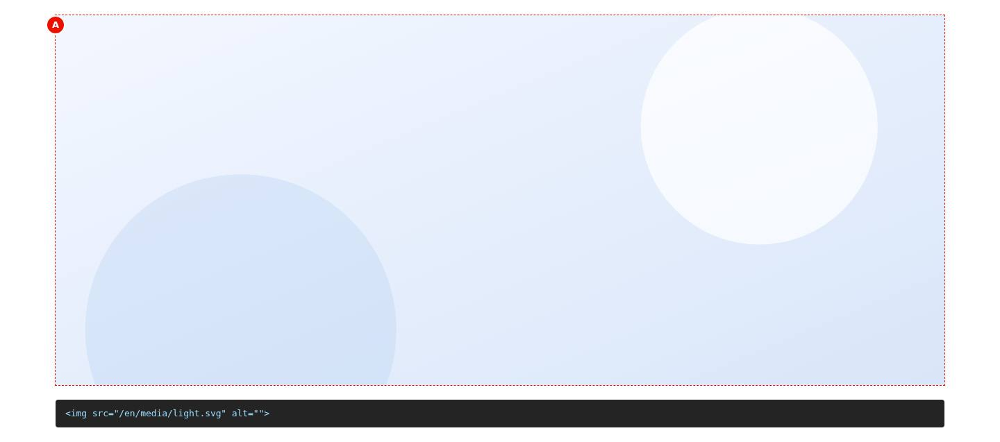{width=100%}

**Screenshot Details — Decorative image**

| Item | Detail |
|:-----------|:----------------------------------------------|
| Screenshot Name | `screenshots/image-decorative.jpg` |
| Screenshot Purpose | Decorative image |
| Screen Description | The pale blue light.svg pattern at its natural width, with an inspector box below it showing the img with alt="". |
| Business Context | A light brand pattern used as visual atmosphere between content; it carries no information, so screen readers should skip it. |
| Author Objective | Add an Image with light.svg, leave Alt Text empty, and check the alt attribute in the developer tools. |

**Field Entry Table** — enter these values in Universal Editor, in this order:

| Callout | Field Name | Example Value | Mandatory | Business Purpose | What Author Should Enter | Validation Rules |
|:--|:----------|:----------|:------|:----------|:----------|:----------|
| — | Component (Section › Add (+)) | Image | Yes | Adds the Image to the page | Select the section in the content tree, choose Add (+) and pick Image | Only components the section allows (section filter) |
| A | Image (Image) | Select the asset light.svg (/en/media/light.svg) | Recommended (without an image the component renders nothing) | The image to show | High-quality original from `/content/dam/tcs-corp/` | None in the model |
| (B) | Alt Text (Image) | Leave empty (decorative image) | No | — | — | None |
| — | Developer tools (Preview) | Inspect the image: alt="" (shown below the image) | — | Check on the preview (not stored in the content) | Inspect the image: alt="" (shown below the image) | — |

All other fields keep their default values. Each callout letter marks the field's output on the screenshot. Callouts in brackets, such as (B), have no marker: the field has no visible output of its own on this screenshot (alt text, a setting, an analytics or accessibility label, a link target or collapsed content).

**Expected Page Output**

- **Visual output:** The pale blue light.svg pattern at its natural width, and below it the inspected img showing alt="".
- **Rendering behaviour:** The picture is delivered as for any image; with an empty alt attribute screen readers skip it. What AEM renders for an empty Alt Text is [To be confirmed: alt value rendered when Alt Text is empty].
- **Publishing behaviour:** Publish the page with light.svg as a reference to Preview and Live; check the rendered alt attribute on aem.page before publishing to Live.

**Business Rules**

- Leave Alt Text empty only when the image adds no information.
- Check that the rendered img has alt="" and no fallback from the asset metadata.
- Do not use decorative images for content that a section Background Image would serve better.
- No text in decorative images.

**Common Authoring Mistakes**

| Error | Root Cause | Resolution |
|:----------|:----------|:----------|
| Screen readers announce 'light dot svg' | No alt attribute rendered, so the file name is read | Check the rendered alt; report it as the open [To be confirmed] point if the alt is missing |
| A decorative image gets a long description | Alt Text filled for a mood image | Clear Alt Text |
| A pattern meant as background sits between paragraphs | Image component used instead of a section Background Image | Set light.svg as the section Background Image |

**Troubleshooting**

- **Symptoms:** The inspector shows an alt taken from the asset title instead of alt="".
- **Cause:** The AEM renderer filled the empty Alt Text from the asset metadata.
- **Resolution:** Clear the asset's title or description used as fallback, or escalate to the development team (open point).
- **Verification Steps:** Inspect the img on aem.page: it has alt="".

**Use Cases:** Mood images, separators made of images.

**Authoring Guidelines:** Leave **Alt Text** empty.

**Business Rules:** What AEM renders for an empty Alt Text (empty alt or a fallback from the asset metadata) depends on the AEM renderer. [To be confirmed: alt value rendered when Alt Text is empty]

**Rendering Rules:** As Variation 1.

**Responsive Behaviour:** As Variation 1.

**SEO Impact:** None.

**Accessibility Compliance:** An empty `alt=""` lets screen readers skip the image (WCAG 1.1.1).

### 6.8.4 Authoring Experience

{width=100%}

**Screenshot Details — Image on the Universal Editor canvas**

| Item | Detail |
|:-----------|:----------------------------------------------|
| Screenshot Name | `screenshots/image-authoring-view.jpg` |
| Screenshot Purpose | Image on the Universal Editor canvas |
| Screen Description | photo-3.svg in editor mode at 1440 px (an annotated preview, not a Universal Editor screenshot), the image marked A. No Assets panel or dragging is shown, and the Alt Text 'Security analysts monitoring threats in an operations centre' (B) is not visible. |
| Business Context | How an author places an image in Universal Editor: an asset is dragged from the Assets panel onto the selected Image component and described in Alt Text. |
| Author Objective | Add an Image, drop photo-3.svg on it from the Assets panel and enter the Alt Text 'Security analysts monitoring threats in an operations centre'. |

**Field Entry Table** — enter these values in Universal Editor, in this order:

| Callout | Field Name | Example Value | Mandatory | Business Purpose | What Author Should Enter | Validation Rules |
|:--|:----------|:----------|:------|:----------|:----------|:----------|
| — | Component (Section › Add (+)) | Image | Yes | Adds the Image to the page | Select the section in the content tree, choose Add (+) and pick Image | Only components the section allows (section filter) |
| — | Image (Image) | Select the asset photo-3.svg (/en/media/photo-3.svg) | Recommended (without an image the component renders nothing) | The image to show | High-quality original from `/content/dam/tcs-corp/` | None in the model |
| — | Alt Text (Image) | Security analysts monitoring threats in an operations centre | Recommended for informative images | Text alternative | Describe content and purpose; empty if decorative | None in the model |
| — | Image (Universal Editor › Assets panel) | Drag photo-3.svg onto the selected Image (A) | No | — | — | None |

All other fields keep their default values. The letters on this annotated preview follow the chapter's Annotations list.

**Expected Page Output**

- **Visual output:** The selected Image component on the canvas (A) with photo-3.svg being dropped from the Assets panel; the Alt Text (B) is not visible on the canvas but shown in the Properties panel.
- **Rendering behaviour:** In the editor a changed image is re-rendered in place. The dialog has two fields, Image and Alt Text, and no tabs or Additional tab.
- **Publishing behaviour:** The asset reference is saved on author at once; Publish to Preview and Live must include photo-3.svg as a reference, otherwise the published page shows a broken image.

**Business Rules**

- Select the Image component first (A), then drop the asset on it.
- Alt Text (B) is entered in the Properties panel; it never shows on the canvas.
- Use assets from /content/dam/tcs-corp/ that are processed and published.
- One asset per Image component.

**Common Authoring Mistakes**

| Error | Root Cause | Resolution |
|:----------|:----------|:----------|
| The asset is dropped next to the Image and nothing changes | The Image component was not selected | Select the Image (A) and drop the asset on it again |
| The asset is not listed in the Assets panel | Missing permissions on the DAM folder or the asset is still processing | Wait for processing or ask for folder access |

**Troubleshooting**

- **Symptoms:** photo-3.svg shows on the canvas but not on aem.page.
- **Cause:** The page was published without its referenced asset.
- **Resolution:** Publish the page again with photo-3.svg selected in the references of the Publish dialog.
- **Verification Steps:** On aem.page the img loads from a media_ URL and the Alt Text is in its alt attribute.

**Annotations:**

- A = the image (Image field; select it to open the Assets picker or drop an asset)
- B = the alt text, not visible on the canvas but shown in the Properties panel (Alt Text)

{width=100%}

The dialog has two fields and no tabs: **Image** (AEM Assets reference, single) and **Alt Text** (text). There is no Additional tab.

### 6.8.5 Authoring Guide

**Step 1 — Open the page in Universal Editor**

**Action:** Sites console > select the page > **Edit**.

**Expected Result:** The page opens on the canvas.

**Steps — Step 1:** The page open in the Universal Editor.

| Step | Where | Field / control | Value / action |
|:--|:----------|:----------|:--------------------|
| 1 | AEM Sites console | Navigation | Open TCS Corp › us › en › services |
| 2 | AEM Sites console | Select | Select the page (check box of its card or row) |
| 3 | AEM Sites console toolbar | Edit | Select Edit: the page opens in the Universal Editor |

**Step 2 — Add an Image**

**Action:** Select the section (or Column / tab panel), **Add (+)** > **Image**.

**Expected Result:** An empty Image component appears.

**Steps — Step 2:** The picker with Image highlighted.

| Step | Where | Field / control | Value / action |
|:--|:----------|:----------|:--------------------|
| 1 | Universal Editor › Content tree | Section | Select the section |
| 2 | Universal Editor › Content tree | Add (+) | Select Add (+) |
| 3 | Component picker › Default Content | Image | Select Image |

**Step 3 — Pick the image**

**Action:** Select the **Image** field and choose the asset in the Assets picker (or drag it from the Assets panel).

**Expected Result:** The image shows on the canvas.

**Steps — Step 3:** The Assets picker with an image selected.

| Step | Where | Field / control | Value / action |
|:--|:----------|:----------|:--------------------|
| 1 | Image › Properties | Image | Select the field: the Assets picker opens |
| 2 | Assets picker | Asset | Open /content/dam/tcs-corp/, select the image, then Select |

**Step 4 — Write the alt text**

**Action:** Fill **Alt Text** for informative images; leave it empty for decorative ones.

**Expected Result:** The alt text is saved (visible in the inspector).

**Steps — Step 4:** The Alt Text field filled in.

| Step | Where | Field / control | Value / action |
|:--|:----------|:----------|:--------------------|
| 1 | Image › Properties | Alt Text | TCS engineers reviewing a cloud dashboard |

**Step 5 — Preview**

**Action:** Switch on Preview mode and check the three device sizes.

**Expected Result:** The image scales down without distortion.

**Steps — Step 5:** Preview at mobile size.

| Step | Where | Field / control | Value / action |
|:--|:----------|:----------|:--------------------|
| 1 | Universal Editor toolbar | Preview | Switch Preview on |
| 2 | Universal Editor toolbar | Device size | Mobile |

**Step 6 — Validate and publish**

**Action:** Run the checklist; publish the page with its references to Preview and Live.

**Expected Result:** The image is served from the site's media URL (`./media_...`).

**Steps — Step 6:** The Publish dialog listing the page and the image asset.

| Step | Where | Field / control | Value / action |
|:--|:----------|:----------|:--------------------|
| 1 | Universal Editor toolbar | Publish | Select Publish |
| 2 | Publish dialog | Items | Keep the page and its references selected (the image asset) |
| 3 | Publish dialog | Destination | Preview |
| 4 | Publish dialog | Publish | Select Publish; check the page on https://main--tcs-corp--sradha-tcs.aem.page/en/... |
| 5 | Publish dialog | Destination | Live (when approved), then Publish; check https://main--tcs-corp--sradha-tcs.aem.live/en/... |

#### Preview Process

On `.aem.page`, open developer tools > Network, filter on images and check that a WebP rendition of an appropriate width is loaded for the viewport.

#### Publishing Process

Publish the page; make sure the asset is included (references) or already published.

#### Validation Process

- [ ] The right image (version, crop) is used.
- [ ] Informative image: alt text present and meaningful; decorative: no alt text.
- [ ] The image is sharp on a desktop screen (original at least as wide as its display width, ideally 2×).
- [ ] No text baked into the image (or the text is repeated in alt text / the page).
- [ ] The image loads on the live site (asset published).
- [ ] File size reasonable (original under about 5 MB; Edge Delivery optimises renditions).

#### Rollback Process

Re-pick the previous asset, or restore the page version and republish.

The walkthroughs below repeat the steps above for each variation of chapter 6.8.3, from opening the page to publishing; the values are those of the variation's screenshot.

#### Walkthrough — Variation 1 — Informative image

Reproduces the screenshot `screenshots/image-informative.jpg` of this variation. The Field Entry Table under the screenshot lists every value with its rules.

**Step 1 — Open the page**

**Action:** In AEM Sites, open the locale site (for example `/content/tcs-corp/us/en`), select the page and choose Edit; the page opens in Universal Editor.

**Expected Result:** The page renders on the canvas with the content tree and the properties panel.

**Step 2 — Add the Image**

**Action:** Select the section in the content tree, choose **Add (+)** and pick **Image**.

**Expected Result:** An empty Image component is added to the selected section.

**Step 3 — Fill in Image**

**Action:** Select **Image** in the content tree and enter in the properties panel: **Image** (A) = Select the asset chart.svg (/en/media/chart.svg); **Alt Text** (B) = Bar chart: revenue growth index rising from 2020 to 2026.

**Expected Result:** chart.svg appears on the canvas and the Alt Text is saved in the Properties panel.

**Step 4 — Preview**

**Action:** Developer tools: Inspect the image: the  carries the Alt Text (shown below the image).

**Expected Result:** The developer tools show the img with the alt text 'Bar chart: revenue growth index rising from 2020 to 2026'.

**Step 5 — Preview**

**Action:** Choose **Preview** in the Universal Editor toolbar (or open the page on aem.page) and compare it with the screenshot.

**Expected Result:** chart.svg at its natural width; below it, for the screenshot, the inspected img with alt="Bar chart: revenue growth index rising from 2020 to 2026".

**Step 6 — Publish**

**Action:** Choose **Publish** › Publish to Live (with the referenced pages, fragments and assets that are not yet published).

**Expected Result:** Publish the page with chart.svg as a reference to Preview and Live; on aem.live the image is served from the media store with a media_ URL.

**Step 7 — Verify**

**Action:** On the live page check: Inspect the img on aem.page: alt="Bar chart: revenue growth index rising from 2020 to 2026".

**Expected Result:** The page matches the screenshot; nothing in the Troubleshooting case above applies.

#### Walkthrough — Variation 2 — Decorative image

Reproduces the screenshot `screenshots/image-decorative.jpg` of this variation. The Field Entry Table under the screenshot lists every value with its rules.

**Step 1 — Open the page**

**Action:** In AEM Sites, open the locale site (for example `/content/tcs-corp/us/en`), select the page and choose Edit; the page opens in Universal Editor.

**Expected Result:** The page renders on the canvas with the content tree and the properties panel.

**Step 2 — Add the Image**

**Action:** Select the section in the content tree, choose **Add (+)** and pick **Image**.

**Expected Result:** An empty Image component is added to the selected section.

**Step 3 — Fill in Image**

**Action:** Select **Image** in the content tree and enter in the properties panel: **Image** (A) = Select the asset light.svg (/en/media/light.svg); **Alt Text** (B) = Leave empty (decorative image).

**Expected Result:** light.svg appears on the canvas with the Alt Text field left empty.

**Step 4 — Preview**

**Action:** Developer tools: Inspect the image: alt="" (shown below the image).

**Expected Result:** The developer tools show the img with an empty alt attribute (alt="").

**Step 5 — Preview**

**Action:** Choose **Preview** in the Universal Editor toolbar (or open the page on aem.page) and compare it with the screenshot.

**Expected Result:** The pale blue light.svg pattern at its natural width, and below it the inspected img showing alt="".

**Step 6 — Publish**

**Action:** Choose **Publish** › Publish to Live (with the referenced pages, fragments and assets that are not yet published).

**Expected Result:** Publish the page with light.svg as a reference to Preview and Live; check the rendered alt attribute on aem.page before publishing to Live.

**Step 7 — Verify**

**Action:** On the live page check: Inspect the img on aem.page: it has alt="".

**Expected Result:** The page matches the screenshot; nothing in the Troubleshooting case above applies.

### 6.8.6 Authorable Field Specification

**Model `image`**

| Field Name | Field Type | Mandatory | Multi Value | Default Value | Business Purpose | Author Guidance | Validation Rules | Example Value |
|:--------------|:-------------|:------------------------------|:-------|:----------|:--------------|:-------------------------------|:--------------|:--------------------------|
| Image (`image`) | Reference (AEM Assets) | Recommended (without an image the component renders nothing) | No | (empty) | The image to show | High-quality original from `/content/dam/tcs-corp/` | None in the model | /content/dam/tcs-corp/insights/ai-lab.jpg |
| Alt Text (`imageAlt`) | Text | Recommended for informative images | No | (empty) | Text alternative | Describe content and purpose; empty if decorative | None in the model | Researchers testing a robotics prototype |

**Additional tab:** Not applicable (default content).

**Field details**

- **Image** — Purpose: the asset. Allowed Values: one AEM Assets image. Character Limits: not applicable. Business Rules: delivered as a responsive picture; the first image of the first section is loaded eagerly (LCP), others lazily. Dependency Rules: Alt Text. Visibility Rules: always visible. Sample Content: a 2000 × 1125 px JPEG.
- **Alt Text** — Purpose: accessible description. Allowed Values: text. Character Limits: Recommended up to 125 characters (not enforced). Business Rules: rendered as the `alt` attribute. Dependency Rules: meaningful only with an image. Visibility Rules: always visible. Sample Content: "Map of TCS delivery centres in Europe".

### 6.8.7 Field Annotation Mapping

| Marker | Field | Purpose |
|:--------|:-------|:-----------------|
| A | Image | The asset shown |
| B | Alt Text | Text alternative (not visible) |

### 6.8.8 Component Specification

| Attribute | Value |
|:-----------------|:------------------------------------------------------------|
| Component Name | Image (`image`, `core/franklin/components/image/v1/image`) |
| Version | 1.0 |
| Owner | [To be confirmed: product owner]; technical owner: development team |
| Dependencies | `models/_image.json`; AEM Assets; `styles/styles.css` |
| Component Type | Default content |
| Supported Variants | Informative image; Decorative image |
| Supported Templates | Any page |
| Supported Metadata | None |
| Supported Tags | None |
| Supported Personalization | None (as of this handover) |
| Caching Considerations | Images are copied to the site's media store on publish and served with content-hash URLs (`media_{hash}`), cacheable long-term; a changed asset gets a new hash after republishing the page |
| Performance Considerations | WebP renditions per breakpoint; lazy loading except the LCP candidate (first image of the first section, set to eager by `waitForFirstImage`) |
| Accessibility Compliance | WCAG 2.1 AA: text alternatives (1.1.1); images of text avoided (1.4.5) |
| SEO Compliance | Server-rendered `` with alt; width and height attributes from the pipeline help layout stability |

### 6.8.9 Input Model

- **Content Inputs:** Image, Alt Text.
- **Metadata Inputs:** none (asset metadata in AEM Assets is not read by the code).
- **Tags Inputs:** none.
- **Page Context Inputs:** position (first section's first image is eager).
- **Query Inputs:** none.
- **Manual Inputs:** Image, Alt Text.

Authored HTML received from AEM / Edge Delivery (typical; the widths and formats are chosen by Edge Delivery Services):

```html
<p>
  <picture>
    <source type="image/webp" srcset="./media_3c4d.jpg?width=2000&format=webply&optimize=medium"
            media="(min-width: 600px)">
    <source type="image/webp" srcset="./media_3c4d.jpg?width=750&format=webply&optimize=medium">
    <source type="image/jpeg" srcset="./media_3c4d.jpg?width=2000&format=jpeg&optimize=medium"
            media="(min-width: 600px)">
    
  </picture>
</p>
```

### 6.8.10 Output Model

**Rendered Output:** the picture is kept as delivered inside `div.default-content-wrapper`; the code does not change it (except `loading="eager"` for the LCP candidate).

**Generated HTML:** as in 6.8.9, inside `<div class="default-content-wrapper">`.

**Generated JSON:** none.

**Generated Metadata:** none (the page's `og-image` / `featured-image` come from the metadata sheet, not from Image components).

**Analytics Tracking:** none (an image without a link has no interaction; default content is not a data layer component).

**Personalization Output:** none.

**Search Index Output:** none (the query index's image columns come from metadata).

**Target Personalization Output:** None (as of this handover): the Image is default content without a link, so it is not a data layer component and has no interaction event or personalisation marker.

### 6.8.11 Business Rules

1. The image is shown at its natural size, never wider than its container; the aspect ratio is kept.
2. The first `img` of the first section is set to `loading="eager"`, and the first section is shown only after it has loaded (or failed).
3. Other images keep `loading="lazy"`.
4. There is no link, caption, alignment, crop or size option.
5. The alt text is the Alt Text field as rendered by AEM.
6. In the editor, a changed image is re-rendered in place.

### 6.8.12 Author Best Practices

**Recommended Content Length:** alt text up to about 125 characters; complex images (charts) explained in the surrounding text.

**Image Dimensions:** at least as wide as the largest display width (content area up to 110rem / 1760 px on wide screens with Full Width); 2000 px wide originals recommended; any aspect ratio (no crop is applied); the component does not stretch small images.

**CTA Writing Guidelines:** not applicable (no link).

**Accessibility Guidelines:** describe informative images; leave decorative images without alt text; avoid images of text; ensure charts have a text equivalent.

**SEO Guidelines:** descriptive file names and alt text; avoid very large originals.

**Metadata Guidelines:** set the page's social image in the metadata sheet (`og-image`), not by placing an Image.

**Taxonomy Guidelines:** not applicable.

**Localization Guidelines:** translate alt text per locale; use locale-specific images when they contain text or culture-specific content.

### 6.8.13 Troubleshooting Guide

#### Issue 1 — Image missing on the live site

**Symptoms:** A broken image or nothing where the image should be.

**Root Cause:** The asset is not published, or was moved / deleted in AEM Assets.

**Diagnosis Steps:** Check the image request in the network panel; check the asset in AEM Assets.

**Resolution Steps:** Publish the asset and republish the page.

**Validation Steps:** The image loads from `./media_...`.

**Preventive Measures:** Publish with references.

#### Issue 2 — Image looks blurry

**Symptoms:** Soft or pixelated image on desktop.

**Root Cause:** The original is smaller than its display size.

**Diagnosis Steps:** Check the asset's dimensions.

**Resolution Steps:** Upload a larger original and re-pick it.

**Validation Steps:** Sharp at 1440 px.

**Preventive Measures:** Use 2000 px originals.

#### Issue 3 — Old image still shows after replacing the asset

**Symptoms:** The site shows the previous version.

**Root Cause:** The page was not republished, so its media reference was not updated.

**Diagnosis Steps:** Compare the `media_` hash before and after.

**Resolution Steps:** Republish the page.

**Validation Steps:** New hash and new image.

**Preventive Measures:** Republish pages after replacing assets.

#### Issue 4 — Image is not full width

**Symptoms:** A small image does not fill the content width.

**Root Cause:** The CSS never enlarges images beyond their natural size.

**Diagnosis Steps:** Compare the natural width with the container.

**Resolution Steps:** Use a wider original, or a Hero / section background for full-width visuals.

**Validation Steps:** Image fills the area.

**Preventive Measures:** Choose the component by layout need.

#### Issue 5 — Accessibility checker reports missing alt text

**Symptoms:** "Image without alternative text" in scans.

**Root Cause:** Alt Text empty for an informative image, or the rendered alt attribute is missing.

**Diagnosis Steps:** Inspect the `img` alt attribute.

**Resolution Steps:** Fill Alt Text; republish.

**Validation Steps:** Scan passes.

**Preventive Measures:** Validation checklist before publishing.

#### Issue 6 — Slow page load (LCP)

**Symptoms:** PageSpeed Insights reports a slow LCP image.

**Root Cause:** A very large image in the first section, or many images above the fold.

**Diagnosis Steps:** Run PageSpeed Insights on the preview URL.

**Resolution Steps:** Use a smaller original or move the image below the first section.

**Validation Steps:** LCP under 2.5 s.

**Preventive Measures:** Keep the first section light.

#### Issue 7 — Image cannot be selected in the picker

**Symptoms:** The asset is not visible in the Assets picker.

**Root Cause:** Missing permissions on the DAM folder, or the asset is still processing.

**Diagnosis Steps:** Open the folder in AEM Assets.

**Resolution Steps:** Wait for processing; ask for access.

**Validation Steps:** Asset selectable.

**Preventive Measures:** Upload assets before editing.

### 6.8.14 Support Runbook

**Monitoring Requirements:** Core Web Vitals (LCP, CLS) for pages with large images. [To be confirmed: monitoring tool]

**Logs:** No console messages. Image failures show as failed requests in the browser network panel. Asset processing status in AEM Assets.

**Common Errors:**

| Error | Cause | Fix |
|:-------------|:-------------------|:------------|
| 404 on `media_` URL | Page published before the asset was available | Republish the page |
| Broken image on author | Asset deleted | Re-pick |
| Blurry image | Small original | Larger original |
| Missing alt | Empty Alt Text | Fill Alt Text |
| Slow LCP | Huge first image | Optimise / move |

**Escalation Matrix:**

| Level | Who | Checks |
|:---------|:---------------|:------------------------------|
| L1 | Author support | Asset publication, alt text, original size |
| L2 | AMS / site administrator | Publish status, media delivery, CDN cache |
| L3 | Development team | Image CSS, LCP handling in `scripts/aem.js` |
| Adobe Support | Adobe | AEM Assets processing, Edge Delivery media delivery |

**Recovery Procedures:** Re-pick a valid asset or restore the page version; republish.

**Health Checks:** Block library image page on preview after releases.

**Operational Procedures:** DAM folder structure and asset governance. [To be confirmed: DAM governance — owner: brand / DAM team]

**Known Limitations:** No link, caption, alignment, crop, focal point or size options; no Additional tab; no art direction (different crops per device).

### 6.8.15 Common Authoring Mistakes

The mistakes seen most often with this component (each screenshot above also lists the mistakes of its example).

| Error | Root Cause | Resolution |
|:----------|:----------|:----------|
| Image missing on live | Asset not published, moved or deleted | Publish the asset and republish the page |
| Image blurry | Original smaller than its display size | Upload a larger original and re-pick it |
| Old image still shown | Page not republished after the asset changed | Republish the page |
| Image not full width | CSS never enlarges images | Use a wider original, or a Hero or section background |
| Missing alt text reported | Alt Text empty for an informative image | Fill Alt Text and republish |
| Slow LCP | Very large image in the first section | Use a smaller original or move it below the first section |
| Asset not in the picker | No DAM permissions or asset still processing | Wait for processing or request access |
| Image expected to link somewhere | The Image has no link field | Use a Teaser or Cards with a link |

### 6.8.16 Author Quick Reference Guide

**Mandatory Fields**

- Image: not required in the model, but without an asset the component renders nothing

**Recommended Fields**

- Alt Text: for every informative image, up to about 125 characters; empty for decorative images

**Optional Fields**

- None beyond Image and Alt Text: no link, caption, alignment, crop, size option or Additional tab

**Authoring Checklist**

1. Use originals at least 2000 px wide; small images are never enlarged
2. Keep text out of images, or repeat it in the page text
3. Describe content and purpose in Alt Text, not the file name
4. Leave Alt Text empty for decorative images and check the rendered alt=""
5. Explain charts and diagrams in the surrounding text too
6. Use a Teaser, Cards or Hero for clickable or full-width images
7. Avoid a very large image as the first image of the first section (LCP)

**Pre-Publish Checklist**

1. Check the right asset version is used
2. Check the image is sharp at 1440 px and scales without distortion at 768 px and 375 px
3. Check the alt attribute in the inspector on aem.page
4. Check the original is under about 5 MB
5. Check the asset is included in the Publish dialog references

**Post-Publish Validation Checklist**

1. Open the page on aem.live and confirm the image request returns 200
2. Check a WebP rendition of a suitable width is loaded per viewport
3. Run PageSpeed Insights when the image is in the first section (LCP)
4. Run an accessibility scan for missing alt text
5. Republish the page after replacing the asset so the new media_ hash is used

### 6.8.17 Component Execution Example

**Business example:** Photograph in the cloud migration story.

**Example Values Entered:**

| Field | Value |
|:--------------------|:------------------------------|
| Component (Section › Add (+)) | Text |
| Text (Text) | Our cloud migration factory combines automated discovery, proven runbooks and a dedicated operations team, so workloads move safely and on schedule. |
| Component (Section › Add (+)) | Image |
| Image (Image) | Select the asset photo-2.svg (/en/media/photo-2.svg) |
| Alt Text (Image) | TCS engineers reviewing a cloud dashboard |
| Component (Section › Add (+)) | Text |
| Text (Text) | After the move, we keep optimising cost, performance and security, with clear reports for every stakeholder. |

All other fields keep their default values.

**Rendered Result:**

{width=100%}

**Author Notes**

- The Image sits between two Text components in content tree order
- Image is photo-2.svg picked from /en/media
- Alt Text 'TCS engineers reviewing a cloud dashboard' describes the photograph
- No other fields exist; the image keeps its natural size

**Business Notes**

- The photograph makes the migration factory tangible between the two paragraphs
- Alt text gives screen reader users the same context
- A wide original keeps the image sharp on large screens

**Technical Notes**

- Edge Delivery delivers a picture with WebP and fallback sources (typically 2000 px from 600 px, 750 px below)
- main img max-width 100% and height auto: no stretch, no crop
- The first image of the first section is set to eager by waitForFirstImage; others stay lazy
- On publish the asset is copied to the media store with a content-hash media_ URL

## 6.9 Button Component

### 6.9.1 Component Purpose

**Business Objective:** Give authors a consistent, accessible call to action with the TCS design system's button views, types, icons and alignment, without formatting tricks.

**Business Use Cases:**

- Primary call to action of a section ("Contact us", "Download the report").
- Secondary or tertiary actions next to a primary one.
- Icon-only actions (search, arrow, chevron).
- Text link calls to action ("View all insights").

**When To Use:** For any standalone call to action in default content, especially when you need a specific view, icon or alignment.

**When Not To Use:**

- Inside a sentence: use an inline link in **Text**.
- For CTAs that belong to a block (Hero, Teaser, Page Header, List, Cards have their own CTA fields).
- For navigation menus: use the navigation page (`references/nav`).

**Dependencies:**

| Type | Item |
|:--------------|:------------------------------------------------------------|
| Model | `models/_button.json` (definition `button`, resource type `core/franklin/components/button/v1/button`, model `button`) |
| Code | `decorators/content-buttons-decorator.js` (`decorateButtons`), `utils/buttons.js` (`BUTTON_VIEWS`, `BUTTON_TYPES`, `BUTTON_ALIGNMENTS`, `readButtonOptions`), `decorators/button-decorator.js` (`decorateButton`, `setButtonAlignment`); `decorators/data-layer-decorator.js` (click tracking) |
| Styles | `styles/styles.css` (`a.button`, `.primary`, `.secondary`, `.tertiary`, `.icon-button`, `a.link-button`, `.button-align-*`, `p.button-wrapper`) |
| Icons | `icons/arrow-right.svg`, `chevron-right.svg`, `chevron-down.svg`, `search.svg` (Icon options); `arrow-right.svg` (trailing icon of buttons); `chevron-right.svg` (link button) |
| Data sources / placeholders | None |

**Related Components:** Text (formatted standalone links create the same buttons), Hero / Teaser / Page Header CTAs (same decorator), Columns (Button inside a Column), Tabs Container.

**Applicable Templates:** Any page.

**Supported Content Types:** A link to an AEM page, an asset or an external URL.

**Business Problem Solved**

Authors needed a consistent, accessible call to action in default content with the TCS design system's views (button, icon, text link), types (primary, secondary, tertiary), four icons and alignment, chosen in a dialog instead of the bold and italic formatting tricks of the Text component.

**Supported Taxonomy**

None: the Button has no tag field and reads no page tags, taxonomy or metadata (Supported Tags: None). It is not part of the query index.

### 6.9.2 Visual Overview

{width=100%}

**Screenshot Details — Desktop rendering**

| Item | Detail |
|:-----------|:----------------------------------------------|
| Screenshot Name | `screenshots/button-desktop-view.jpg` |
| Screenshot Purpose | Desktop rendering |
| Screen Description | Six buttons at 1440 px, stacked left aligned in their own paragraphs (not a row): primary 'Contact us', secondary 'Explore services', tertiary 'See all case studies', a blue circular search icon button, the link view 'View all insights' with a chevron and a primary pill with the long download label. |
| Business Context | The call-to-action set of the English site shown together at 1440 px, so authors can compare every Button view and type before choosing one for a section. |
| Author Objective | Add six Buttons: Primary 'Contact us' with a Title, Secondary 'Explore services', Tertiary 'See all case studies', an Icon view Search, a Link view 'View all insights' and a long download label. |

**Field Entry Table** — enter these values in Universal Editor, in this order:

| Callout | Field Name | Example Value | Mandatory | Business Purpose | What Author Should Enter | Validation Rules |
|:--|:----------|:----------|:------|:----------|:----------|:----------|
| — | Component (Section › Add (+)) | Button | Yes | Adds the Button to the page | Select the section in the content tree, choose Add (+) and pick Button | Only components the section allows (section filter) |
| A | Link (Button) | Select the page or enter /en/contact | Recommended (without a link nothing is rendered as a button) | Button target | Pick internal pages with the picker | None in the model |
| (B) | Text (Button) | Contact us | Recommended | Visible label (accessible name for Icon view) | Verb first, up to about 25 characters | None in the model |
| (C) | Title (Button) | Contact the TCS team | No | Tooltip (`title` attribute) | Extra context only | None |
| — | Component (Section › Add (+)) | Button | Yes | Adds the Button to the page | Select the section in the content tree, choose Add (+) and pick Button | Only components the section allows (section filter) |
| D | Link (Button) | Select the page or enter /en/services | Recommended (without a link nothing is rendered as a button) | Button target | Pick internal pages with the picker | None in the model |
| (E) | Text (Button) | Explore services | Recommended | Visible label (accessible name for Icon view) | Verb first, up to about 25 characters | None in the model |
| (F) | Type (Button) | Secondary | No | Emphasis of Button / Icon views | One primary per section | Enforced: Primary, Secondary, Tertiary |
| — | Component (Section › Add (+)) | Button | Yes | Adds the Button to the page | Select the section in the content tree, choose Add (+) and pick Button | Only components the section allows (section filter) |
| G | Link (Button) | Select the page or enter /en/insights/case-studies | Recommended (without a link nothing is rendered as a button) | Button target | Pick internal pages with the picker | None in the model |
| (H) | Text (Button) | See all case studies | Recommended | Visible label (accessible name for Icon view) | Verb first, up to about 25 characters | None in the model |
| (I) | Type (Button) | Tertiary | No | Emphasis of Button / Icon views | One primary per section | Enforced: Primary, Secondary, Tertiary |
| — | Component (Section › Add (+)) | Button | Yes | Adds the Button to the page | Select the section in the content tree, choose Add (+) and pick Button | Only components the section allows (section filter) |
| J | Link (Button) | Select the page or enter /en/search | Recommended (without a link nothing is rendered as a button) | Button target | Pick internal pages with the picker | None in the model |
| (K) | Text (Button) | Search | Recommended | Visible label (accessible name for Icon view) | Verb first, up to about 25 characters | None in the model |
| (L) | Views (Button) | Icon | No | Button, icon-only or text link | Button for most CTAs | Enforced: Button, Icon, Link |
| (M) | Icon (Button) | Search | Recommended when Views is Icon | Icon of the Icon view | Pick the icon matching the action | Enforced: Arrow right, Chevron right, Chevron down, Search |
| — | Component (Section › Add (+)) | Button | Yes | Adds the Button to the page | Select the section in the content tree, choose Add (+) and pick Button | Only components the section allows (section filter) |
| N | Link (Button) | Select the page or enter /en/insights | Recommended (without a link nothing is rendered as a button) | Button target | Pick internal pages with the picker | None in the model |
| (O) | Text (Button) | View all insights | Recommended | Visible label (accessible name for Icon view) | Verb first, up to about 25 characters | None in the model |
| (P) | Views (Button) | Link | No | Button, icon-only or text link | Button for most CTAs | Enforced: Button, Icon, Link |
| — | Component (Section › Add (+)) | Button | Yes | Adds the Button to the page | Select the section in the content tree, choose Add (+) and pick Button | Only components the section allows (section filter) |
| Q | Link (Button) | Select the page or enter /en/insights/reports | Recommended (without a link nothing is rendered as a button) | Button target | Pick internal pages with the picker | None in the model |
| (R) | Text (Button) | Download the complete annual sustainability and responsibility report 2026 | Recommended | Visible label (accessible name for Icon view) | Verb first, up to about 25 characters | None in the model |

All other fields keep their default values. Each callout letter marks the field's output on the screenshot. Callouts in brackets, such as (B), have no marker: the field has no visible output of its own on this screenshot (alt text, a setting, an analytics or accessibility label, a link target or collapsed content).

**Expected Page Output**

- **Visual output:** Stacked left-aligned buttons: a black pill 'Contact us', an outlined pill 'Explore services', the text-and-arrow 'See all case studies', a blue 2.75rem circle with the search icon, the underlined 'View all insights' with a chevron and a black pill with the long download label.
- **Rendering behaviour:** Each button sits in its own p.button-wrapper (0.75rem vertical margin) with button-align-left. Pills are at least 3.125rem high with a 1rem label and a 1.5rem trailing arrow; the icon button is a 2.75rem circle with a 1.25rem icon; the link view is 1rem semibold with a 1rem chevron.
- **Publishing behaviour:** Publish to Preview and Live from Universal Editor; the targets /en/contact, /en/services, /en/insights/case-studies, /en/search, /en/insights and /en/insights/reports must be published themselves, otherwise the buttons lead to a 404.

**Business Rules**

- One primary per section: 'Contact us' is the only Primary (the default Type); the others use Secondary, Tertiary, Icon or Link.
- The Search icon button shows no text: Text 'Search' becomes its aria-label and title.
- Type is hidden and ignored for Views Link ('View all insights').
- Labels never wrap; the 70-character download label is a deliberate example of a label that is too long.
- Title 'Contact the TCS team' is the tooltip; empty Titles get the label as title.

**Common Authoring Mistakes**

| Error | Root Cause | Resolution |
|:----------|:----------|:----------|
| The download label is cut off | Labels never wrap and are clipped at the content width | Shorten it to about 25 characters, e.g. 'Download the 2026 report' |
| The search icon has no accessible name | Text left empty for the Icon view | Enter 'Search' in Text |
| 'View all insights' still looks like a button | Views left on Button | Set Views to Link |

**Troubleshooting**

- **Symptoms:** The Search button appears as a pill with the text 'Search' and an arrow.
- **Cause:** No icon was resolved for the Icon view (Icon empty or not delivered), so it falls back to a normal button.
- **Resolution:** Select Search in Icon and republish; if it is set but ignored, escalate to development ([To be confirmed: delivered markup of the Button component's Views, Icon and Alignment — owner: development team]).
- **Verification Steps:** On aem.page the link has the classes button primary icon-button and aria-label 'Search'.

**Desktop:** buttons are pill-shaped (`--radius-full`), at least 3.125rem high, label 1rem (`--button-font-size`), padding 0.75rem 1rem 0.75rem 1.5rem, with a 1.5rem trailing arrow; icon buttons are 2.75rem circles with a 1.25rem icon; the link view is a semibold underlined text with a 1rem chevron. Each button sits in its own `p.button-wrapper` (0.75rem top and bottom margin), aligned left, centre or right.

{width=61%}

**Screenshot Details — Tablet rendering**

| Item | Detail |
|:-----------|:----------------------------------------------|
| Screenshot Name | `screenshots/button-tablet-view.jpg` |
| Screenshot Purpose | Tablet rendering |
| Screen Description | The same six stacked buttons at 768 px at identical sizes; the long label 'Download the complete annual sustainability and responsibility report 2026' still fits on one line. |
| Business Context | The same six calls to action checked at 768 px, to confirm the button sizes are unchanged on tablets and the long label still fits. |
| Author Objective | Confirm that the six Buttons keep their size and style at tablet width. |

**Field Entry Table** — enter these values in Universal Editor, in this order:

| Callout | Field Name | Example Value | Mandatory | Business Purpose | What Author Should Enter | Validation Rules |
|:--|:----------|:----------|:------|:----------|:----------|:----------|
| — | Component (Section › Add (+)) | Button | Yes | Adds the Button to the page | Select the section in the content tree, choose Add (+) and pick Button | Only components the section allows (section filter) |
| A | Link (Button) | Select the page or enter /en/contact | Recommended (without a link nothing is rendered as a button) | Button target | Pick internal pages with the picker | None in the model |
| (B) | Text (Button) | Contact us | Recommended | Visible label (accessible name for Icon view) | Verb first, up to about 25 characters | None in the model |
| (C) | Title (Button) | Contact the TCS team | No | Tooltip (`title` attribute) | Extra context only | None |
| — | Component (Section › Add (+)) | Button | Yes | Adds the Button to the page | Select the section in the content tree, choose Add (+) and pick Button | Only components the section allows (section filter) |
| D | Link (Button) | Select the page or enter /en/services | Recommended (without a link nothing is rendered as a button) | Button target | Pick internal pages with the picker | None in the model |
| (E) | Text (Button) | Explore services | Recommended | Visible label (accessible name for Icon view) | Verb first, up to about 25 characters | None in the model |
| (F) | Type (Button) | Secondary | No | Emphasis of Button / Icon views | One primary per section | Enforced: Primary, Secondary, Tertiary |
| — | Component (Section › Add (+)) | Button | Yes | Adds the Button to the page | Select the section in the content tree, choose Add (+) and pick Button | Only components the section allows (section filter) |
| G | Link (Button) | Select the page or enter /en/insights/case-studies | Recommended (without a link nothing is rendered as a button) | Button target | Pick internal pages with the picker | None in the model |
| (H) | Text (Button) | See all case studies | Recommended | Visible label (accessible name for Icon view) | Verb first, up to about 25 characters | None in the model |
| (I) | Type (Button) | Tertiary | No | Emphasis of Button / Icon views | One primary per section | Enforced: Primary, Secondary, Tertiary |
| — | Component (Section › Add (+)) | Button | Yes | Adds the Button to the page | Select the section in the content tree, choose Add (+) and pick Button | Only components the section allows (section filter) |
| J | Link (Button) | Select the page or enter /en/search | Recommended (without a link nothing is rendered as a button) | Button target | Pick internal pages with the picker | None in the model |
| (K) | Text (Button) | Search | Recommended | Visible label (accessible name for Icon view) | Verb first, up to about 25 characters | None in the model |
| (L) | Views (Button) | Icon | No | Button, icon-only or text link | Button for most CTAs | Enforced: Button, Icon, Link |
| (M) | Icon (Button) | Search | Recommended when Views is Icon | Icon of the Icon view | Pick the icon matching the action | Enforced: Arrow right, Chevron right, Chevron down, Search |
| — | Component (Section › Add (+)) | Button | Yes | Adds the Button to the page | Select the section in the content tree, choose Add (+) and pick Button | Only components the section allows (section filter) |
| N | Link (Button) | Select the page or enter /en/insights | Recommended (without a link nothing is rendered as a button) | Button target | Pick internal pages with the picker | None in the model |
| (O) | Text (Button) | View all insights | Recommended | Visible label (accessible name for Icon view) | Verb first, up to about 25 characters | None in the model |
| (P) | Views (Button) | Link | No | Button, icon-only or text link | Button for most CTAs | Enforced: Button, Icon, Link |
| — | Component (Section › Add (+)) | Button | Yes | Adds the Button to the page | Select the section in the content tree, choose Add (+) and pick Button | Only components the section allows (section filter) |
| Q | Link (Button) | Select the page or enter /en/insights/reports | Recommended (without a link nothing is rendered as a button) | Button target | Pick internal pages with the picker | None in the model |
| (R) | Text (Button) | Download the complete annual sustainability and responsibility report 2026 | Recommended | Visible label (accessible name for Icon view) | Verb first, up to about 25 characters | None in the model |

All other fields keep their default values. Each callout letter marks the field's output on the screenshot. Callouts in brackets, such as (B), have no marker: the field has no visible output of its own on this screenshot (alt text, a setting, an analytics or accessibility label, a link target or collapsed content).

**Expected Page Output**

- **Visual output:** The same stacked buttons as on desktop, at identical sizes, inside the 2.5rem section padding; the long download label still fits on one line at 768 px.
- **Rendering behaviour:** Button tokens do not change per breakpoint: 3.125rem minimum height, 1rem label, 2.75rem icon buttons at every width. Alignment is the same on every device.
- **Publishing behaviour:** Publish to Preview and Live from Universal Editor; the targets /en/contact, /en/services, /en/insights/case-studies, /en/search, /en/insights and /en/insights/reports must be published themselves, otherwise the buttons lead to a 404.

**Business Rules**

- Button sizes are identical at all widths; nothing is authored per device.
- Alignment Left, Center or Right applies at every width; there is no per-breakpoint alignment.
- The long label is still visible at 768 px but is clipped at 375 px.
- Keep at most one primary per section on every device.

**Common Authoring Mistakes**

| Error | Root Cause | Resolution |
|:----------|:----------|:----------|
| Reviewers expect bigger buttons on tablet | Button tokens are fixed by design | No change; raise a design request if needed |
| The long label passes the tablet check but fails on phones | Only checked at 768 px | Also check at 375 px and 320 px |

**Troubleshooting**

- **Symptoms:** At 768 px 'Explore services' shows black instead of outlined.
- **Cause:** Type Secondary was not saved, so the default Primary applies.
- **Resolution:** Select the Button, set Type to Secondary again and republish.
- **Verification Steps:** On aem.page the link has the classes button secondary.

**Tablet:** identical sizes (button tokens do not change per breakpoint).

{width=38%}

**Screenshot Details — Mobile rendering**

| Item | Detail |
|:-----------|:----------------------------------------------|
| Screenshot Name | `screenshots/button-mobile-view.jpg` |
| Screenshot Purpose | Mobile rendering |
| Screen Description | The same six stacked buttons at 375 px at identical sizes; the primary pill with the long download label is clipped at the content edge. |
| Business Context | The six calls to action checked at 375 px, where long labels are the most common failure: the download label shows how a too-long label is clipped. |
| Author Objective | Confirm the Buttons at mobile width and identify the clipped download label. |

**Field Entry Table** — enter these values in Universal Editor, in this order:

| Callout | Field Name | Example Value | Mandatory | Business Purpose | What Author Should Enter | Validation Rules |
|:--|:----------|:----------|:------|:----------|:----------|:----------|
| — | Component (Section › Add (+)) | Button | Yes | Adds the Button to the page | Select the section in the content tree, choose Add (+) and pick Button | Only components the section allows (section filter) |
| A | Link (Button) | Select the page or enter /en/contact | Recommended (without a link nothing is rendered as a button) | Button target | Pick internal pages with the picker | None in the model |
| (B) | Text (Button) | Contact us | Recommended | Visible label (accessible name for Icon view) | Verb first, up to about 25 characters | None in the model |
| (C) | Title (Button) | Contact the TCS team | No | Tooltip (`title` attribute) | Extra context only | None |
| — | Component (Section › Add (+)) | Button | Yes | Adds the Button to the page | Select the section in the content tree, choose Add (+) and pick Button | Only components the section allows (section filter) |
| D | Link (Button) | Select the page or enter /en/services | Recommended (without a link nothing is rendered as a button) | Button target | Pick internal pages with the picker | None in the model |
| (E) | Text (Button) | Explore services | Recommended | Visible label (accessible name for Icon view) | Verb first, up to about 25 characters | None in the model |
| (F) | Type (Button) | Secondary | No | Emphasis of Button / Icon views | One primary per section | Enforced: Primary, Secondary, Tertiary |
| — | Component (Section › Add (+)) | Button | Yes | Adds the Button to the page | Select the section in the content tree, choose Add (+) and pick Button | Only components the section allows (section filter) |
| G | Link (Button) | Select the page or enter /en/insights/case-studies | Recommended (without a link nothing is rendered as a button) | Button target | Pick internal pages with the picker | None in the model |
| (H) | Text (Button) | See all case studies | Recommended | Visible label (accessible name for Icon view) | Verb first, up to about 25 characters | None in the model |
| (I) | Type (Button) | Tertiary | No | Emphasis of Button / Icon views | One primary per section | Enforced: Primary, Secondary, Tertiary |
| — | Component (Section › Add (+)) | Button | Yes | Adds the Button to the page | Select the section in the content tree, choose Add (+) and pick Button | Only components the section allows (section filter) |
| J | Link (Button) | Select the page or enter /en/search | Recommended (without a link nothing is rendered as a button) | Button target | Pick internal pages with the picker | None in the model |
| (K) | Text (Button) | Search | Recommended | Visible label (accessible name for Icon view) | Verb first, up to about 25 characters | None in the model |
| (L) | Views (Button) | Icon | No | Button, icon-only or text link | Button for most CTAs | Enforced: Button, Icon, Link |
| (M) | Icon (Button) | Search | Recommended when Views is Icon | Icon of the Icon view | Pick the icon matching the action | Enforced: Arrow right, Chevron right, Chevron down, Search |
| — | Component (Section › Add (+)) | Button | Yes | Adds the Button to the page | Select the section in the content tree, choose Add (+) and pick Button | Only components the section allows (section filter) |
| N | Link (Button) | Select the page or enter /en/insights | Recommended (without a link nothing is rendered as a button) | Button target | Pick internal pages with the picker | None in the model |
| (O) | Text (Button) | View all insights | Recommended | Visible label (accessible name for Icon view) | Verb first, up to about 25 characters | None in the model |
| (P) | Views (Button) | Link | No | Button, icon-only or text link | Button for most CTAs | Enforced: Button, Icon, Link |
| — | Component (Section › Add (+)) | Button | Yes | Adds the Button to the page | Select the section in the content tree, choose Add (+) and pick Button | Only components the section allows (section filter) |
| Q | Link (Button) | Select the page or enter /en/insights/reports | Recommended (without a link nothing is rendered as a button) | Button target | Pick internal pages with the picker | None in the model |
| (R) | Text (Button) | Download the complete annual sustainability and responsibility report 2026 | Recommended | Visible label (accessible name for Icon view) | Verb first, up to about 25 characters | None in the model |

All other fields keep their default values. Each callout letter marks the field's output on the screenshot. Callouts in brackets, such as (B), have no marker: the field has no visible output of its own on this screenshot (alt text, a setting, an analytics or accessibility label, a link target or collapsed content).

**Expected Page Output**

- **Visual output:** The buttons keep their desktop sizes inside 1.5rem side padding; the black pill 'Download the complete annual sustainability and responsibility report 2026' is cut off at the content edge.
- **Rendering behaviour:** Labels never wrap (white-space nowrap); a button wider than the content area is limited by max-width 100% and its label clipped by overflow hidden.
- **Publishing behaviour:** Publish to Preview and Live from Universal Editor; the targets /en/contact, /en/services, /en/insights/case-studies, /en/search, /en/insights and /en/insights/reports must be published themselves, otherwise the buttons lead to a 404.

**Business Rules**

- Labels of about 25 characters fit at 320 px; the 70-character download label does not.
- Put format and size information in Title, not in the label.
- German and French translations are about 30 % longer; check them at 320 px.
- Icon buttons stay 2.75rem (44 px) targets.

**Common Authoring Mistakes**

| Error | Root Cause | Resolution |
|:----------|:----------|:----------|
| The end of the download label is hidden | The label is far longer than about 25 characters | Shorten it to 'Download the 2026 report' and add '(PDF, 2 MB)' in Title |
| Translated labels overflow on the German page | Text expansion of the translation | Shorten the translated label |

**Troubleshooting**

- **Symptoms:** At 375 px the download button ends mid-word without its arrow.
- **Cause:** Buttons do not wrap their label by design and are clipped at the container width.
- **Resolution:** Shorten the Text of the Button and republish.
- **Verification Steps:** At 320 px on aem.page the whole label and the arrow are visible.

**Mobile:** identical sizes; labels never wrap (`white-space: nowrap`), and a label wider than the content area is clipped (`max-width: 100%; overflow: hidden`).

### 6.9.3 Component Variations

#### Variation 1 — Primary button

**Variation Name:** Views: Button, Type: Primary.

**Business Purpose:** The main action of a section.

**Visual Example:**

{width=38%}

**Screenshot Details — Primary button**

| Item | Detail |
|:-----------|:----------------------------------------------|
| Screenshot Name | `screenshots/button-primary.jpg` |
| Screenshot Purpose | Primary button |
| Screen Description | At 402 px, two black primary pills 'Contact us' with arrows, stacked; the lower one, under the pointer, has its label and arrow in slate-400. |
| Business Context | The main call to action of a contact band: 'Contact us' leads to the contact page, shown in its default and hover states. |
| Author Objective | Add two Buttons 'Contact us' to /en/contact with the Title 'Contact the TCS team', keeping Views Button and Type Primary, and check the hover state of the second. |

**Field Entry Table** — enter these values in Universal Editor, in this order:

| Callout | Field Name | Example Value | Mandatory | Business Purpose | What Author Should Enter | Validation Rules |
|:--|:----------|:----------|:------|:----------|:----------|:----------|
| — | Component (Section › Add (+)) | Button | Yes | Adds the Button to the page | Select the section in the content tree, choose Add (+) and pick Button | Only components the section allows (section filter) |
| A | Link (Button) | Select the page or enter /en/contact | Recommended (without a link nothing is rendered as a button) | Button target | Pick internal pages with the picker | None in the model |
| B | Text (Button) | Contact us | Recommended | Visible label (accessible name for Icon view) | Verb first, up to about 25 characters | None in the model |
| (C) | Title (Button) | Contact the TCS team | No | Tooltip (`title` attribute) | Extra context only | None |
| — | Component (Section › Add (+)) | Button | Yes | Adds the Button to the page | Select the section in the content tree, choose Add (+) and pick Button | Only components the section allows (section filter) |
| D | Link (Button) | Select the page or enter /en/contact | Recommended (without a link nothing is rendered as a button) | Button target | Pick internal pages with the picker | None in the model |
| (E) | Text (Button) | Contact us | Recommended | Visible label (accessible name for Icon view) | Verb first, up to about 25 characters | None in the model |
| (F) | Title (Button) | Contact the TCS team | No | Tooltip (`title` attribute) | Extra context only | None |
| — | Action (Preview) | Point at the second button (hover state) | — | Check on the preview (not stored in the content) | Point at the second button (hover state) | — |

All other fields keep their default values. Each callout letter marks the field's output on the screenshot. Callouts in brackets, such as (C), have no marker: the field has no visible output of its own on this screenshot (alt text, a setting, an analytics or accessibility label, a link target or collapsed content).

**Expected Page Output**

- **Visual output:** Two black pill buttons 'Contact us' with grey-300 medium-weight labels and trailing arrows; the second, under the pointer, has its label and arrow in slate-400.
- **Rendering behaviour:** a.button.primary: black border and background, grey-300 label, medium weight, at least 3.125rem high, padding 0.75rem 1rem 0.75rem 1.5rem; hover and focus change the label to slate-400. The title attribute is 'Contact the TCS team'.
- **Publishing behaviour:** Publish the page and /en/contact to Preview and Live. A click pushes cmp:click with dc:title 'Contact us' and the page as the component.

**Business Rules**

- Primary is the default Type; one primary per section is Recommended.
- Title 'Contact the TCS team' becomes the tooltip; it adds context to the label.
- The label starts with a verb and fits on one line at 320 px.
- Keyboard focus shows the same state as hover plus the focus outline.

**Common Authoring Mistakes**

| Error | Root Cause | Resolution |
|:----------|:----------|:----------|
| The button links to /content/tcs-corp/us/en/contact on live | A path was typed outside the mappings instead of picked | Re-pick the page in Link with the content picker |
| Two primary buttons in one section | Both Buttons kept the default Type | Set the less important one to Secondary |

**Troubleshooting**

- **Symptoms:** 'Contact us' shows as a plain blue link.
- **Cause:** Link is empty or the label equals the URL, so the link is not decorated.
- **Resolution:** Select /en/contact in Link and enter 'Contact us' in Text, then republish.
- **Verification Steps:** On aem.page the paragraph is p.button-wrapper and the link a.button.primary.

**Use Cases:** Contact, register, download.

**Authoring Guidelines:** Views **Button**, Type **Primary** (the defaults).

**Business Rules:** Primary is the default type; one primary per section is Recommended.

**Rendering Rules:** `a.button.primary`: black border and background (`--color-border-neutral`, `--color-bg-neutral`), grey-300 label (`--color-text-tertiary`), medium weight; hover / focus label slate-400.

**Responsive Behaviour:** Same at all sizes; label does not wrap.

**SEO Impact:** A normal link with its label as anchor text.

**Accessibility Compliance:** Keyboard focusable link with 0.125rem brand focus outline; the arrow is decorative CSS.

#### Variation 2 — Secondary button

**Variation Name:** Views: Button, Type: Secondary.

**Business Purpose:** An alternative action next to the primary.

**Visual Example:**

{width=38%}

**Screenshot Details — Secondary button**

| Item | Detail |
|:-----------|:----------------------------------------------|
| Screenshot Name | `screenshots/button-secondary.jpg` |
| Screenshot Purpose | Secondary button |
| Screen Description | At 402 px, two outlined secondary pills 'Explore services', stacked; the lower one, under the pointer, has a white fill with brand blue border and label. |
| Business Context | An alternative action next to a primary one: 'Explore services' leads to the services overview, shown in its default and hover states. |
| Author Objective | Add two Buttons 'Explore services' to /en/services with Type Secondary and check the hover state of the second. |

**Field Entry Table** — enter these values in Universal Editor, in this order:

| Callout | Field Name | Example Value | Mandatory | Business Purpose | What Author Should Enter | Validation Rules |
|:--|:----------|:----------|:------|:----------|:----------|:----------|
| — | Component (Section › Add (+)) | Button | Yes | Adds the Button to the page | Select the section in the content tree, choose Add (+) and pick Button | Only components the section allows (section filter) |
| A | Link (Button) | Select the page or enter /en/services | Recommended (without a link nothing is rendered as a button) | Button target | Pick internal pages with the picker | None in the model |
| B | Text (Button) | Explore services | Recommended | Visible label (accessible name for Icon view) | Verb first, up to about 25 characters | None in the model |
| (C) | Type (Button) | Secondary | No | Emphasis of Button / Icon views | One primary per section | Enforced: Primary, Secondary, Tertiary |
| — | Component (Section › Add (+)) | Button | Yes | Adds the Button to the page | Select the section in the content tree, choose Add (+) and pick Button | Only components the section allows (section filter) |
| D | Link (Button) | Select the page or enter /en/services | Recommended (without a link nothing is rendered as a button) | Button target | Pick internal pages with the picker | None in the model |
| (E) | Text (Button) | Explore services | Recommended | Visible label (accessible name for Icon view) | Verb first, up to about 25 characters | None in the model |
| (F) | Type (Button) | Secondary | No | Emphasis of Button / Icon views | One primary per section | Enforced: Primary, Secondary, Tertiary |
| — | Action (Preview) | Point at the second button (hover state) | — | Check on the preview (not stored in the content) | Point at the second button (hover state) | — |

All other fields keep their default values. Each callout letter marks the field's output on the screenshot. Callouts in brackets, such as (C), have no marker: the field has no visible output of its own on this screenshot (alt text, a setting, an analytics or accessibility label, a link target or collapsed content).

**Expected Page Output**

- **Visual output:** Two outlined pill buttons with slate-900 border, label and arrow; the second, under the pointer, has a white fill with brand blue border and label.
- **Rendering behaviour:** a.button.secondary: transparent background, slate-900 border and label; hover and focus give a white background and the brand border and text colour. Size and padding as for the primary type.
- **Publishing behaviour:** Publish the page and /en/services to Preview and Live.

**Business Rules**

- Use Secondary for the alternative next to one primary.
- Type is shown in the dialog because Views is Button.
- Hover and focus states are the same.
- The label never wraps; keep it short.

**Common Authoring Mistakes**

| Error | Root Cause | Resolution |
|:----------|:----------|:----------|
| The button is black | Type left on the default Primary | Set Type to Secondary |
| The secondary button disappears on a dark band | Placed on a dark background from a block or image | Place it on a white or Highlight section |

**Troubleshooting**

- **Symptoms:** Hovering 'Explore services' on aem.page shows no colour change.
- **Cause:** The Button was not decorated (no link), so it is a plain link without the secondary classes.
- **Resolution:** Check Link is set to /en/services and republish.
- **Verification Steps:** On aem.page the link has the classes button secondary and turns brand blue on hover.

**Use Cases:** "Learn more", "Explore".

**Authoring Guidelines:** Views **Button**, Type **Secondary**.

**Business Rules:** None beyond the type.

**Rendering Rules:** `a.button.secondary`: transparent background, slate-900 border and label; hover white background, brand border and label. In the CSS-only `dark` section style: lighter border and white label.

**Responsive Behaviour:** As Variation 1.

**SEO Impact:** As Variation 1.

**Accessibility Compliance:** As Variation 1.

#### Variation 3 — Tertiary button

**Variation Name:** Views: Button, Type: Tertiary.

**Business Purpose:** A lightweight action with an arrow.

**Visual Example:**

{width=38%}

**Screenshot Details — Tertiary button**

| Item | Detail |
|:-----------|:----------------------------------------------|
| Screenshot Name | `screenshots/button-tertiary.jpg` |
| Screenshot Purpose | Tertiary button |
| Screen Description | At 402 px, two tertiary calls to action 'See all case studies' with arrows and no container, stacked; the lower one, under the pointer, is brand blue with the arrow closer. |
| Business Context | A lightweight action at the end of a case study teaser: 'See all case studies' leads to the overview without a button container. |
| Author Objective | Add two Buttons 'See all case studies' to /en/insights/case-studies with Type Tertiary and check the hover state of the second. |

**Field Entry Table** — enter these values in Universal Editor, in this order:

| Callout | Field Name | Example Value | Mandatory | Business Purpose | What Author Should Enter | Validation Rules |
|:--|:----------|:----------|:------|:----------|:----------|:----------|
| — | Component (Section › Add (+)) | Button | Yes | Adds the Button to the page | Select the section in the content tree, choose Add (+) and pick Button | Only components the section allows (section filter) |
| A | Link (Button) | Select the page or enter /en/insights/case-studies | Recommended (without a link nothing is rendered as a button) | Button target | Pick internal pages with the picker | None in the model |
| B | Text (Button) | See all case studies | Recommended | Visible label (accessible name for Icon view) | Verb first, up to about 25 characters | None in the model |
| (C) | Type (Button) | Tertiary | No | Emphasis of Button / Icon views | One primary per section | Enforced: Primary, Secondary, Tertiary |
| — | Component (Section › Add (+)) | Button | Yes | Adds the Button to the page | Select the section in the content tree, choose Add (+) and pick Button | Only components the section allows (section filter) |
| D | Link (Button) | Select the page or enter /en/insights/case-studies | Recommended (without a link nothing is rendered as a button) | Button target | Pick internal pages with the picker | None in the model |
| (E) | Text (Button) | See all case studies | Recommended | Visible label (accessible name for Icon view) | Verb first, up to about 25 characters | None in the model |
| (F) | Type (Button) | Tertiary | No | Emphasis of Button / Icon views | One primary per section | Enforced: Primary, Secondary, Tertiary |
| — | Action (Preview) | Point at the second button (hover state) | — | Check on the preview (not stored in the content) | Point at the second button (hover state) | — |

All other fields keep their default values. Each callout letter marks the field's output on the screenshot. Callouts in brackets, such as (C), have no marker: the field has no visible output of its own on this screenshot (alt text, a setting, an analytics or accessibility label, a link target or collapsed content).

**Expected Page Output**

- **Visual output:** Two text calls to action 'See all case studies' in the default text colour with a trailing arrow and no border; the second, under the pointer, is brand blue with the arrow moved closer.
- **Rendering behaviour:** a.button.tertiary: no border, radius or padding, default text colour; hover and focus switch to the brand colour and the gap to the arrow becomes 0. The minimum height of 3.125rem keeps a large click target.
- **Publishing behaviour:** Publish the page and /en/insights/case-studies to Preview and Live.

**Business Rules**

- Tertiary is for third-level actions or dense layouts.
- It keeps the arrow; for a chevron text link use Views Link.
- The label must state the destination: 'See all case studies'.
- Do not pair two tertiary actions without a primary or secondary.

**Common Authoring Mistakes**

| Error | Root Cause | Resolution |
|:----------|:----------|:----------|
| An underlined text with a chevron appears instead | Views set to Link | Set Views to Button and Type to Tertiary |
| It is mistaken for body text | Tertiary placed inside running text | Keep it in its own paragraph after the text |

**Troubleshooting**

- **Symptoms:** 'See all case studies' shows as an outlined pill.
- **Cause:** Type Secondary was selected instead of Tertiary.
- **Resolution:** Set Type to Tertiary and republish.
- **Verification Steps:** On aem.page the link has the classes button tertiary and no border.

**Use Cases:** Third-level actions, dense layouts.

**Authoring Guidelines:** Views **Button**, Type **Tertiary**.

**Business Rules:** None beyond the type.

**Rendering Rules:** `a.button.tertiary`: no border, radius or padding; default text colour; hover brand colour and gap 0.

**Responsive Behaviour:** As Variation 1.

**SEO Impact:** As Variation 1.

**Accessibility Compliance:** As Variation 1; minimum height 3.125rem keeps a large target.

#### Variation 4 — Icon button

**Variation Name:** Views: Icon (Type Primary / Secondary / Tertiary; Icon Arrow right / Chevron right / Chevron down / Search).

**Business Purpose:** A compact, icon-only action.

**Visual Example:**

{width=38%}

**Screenshot Details — Icon button**

| Item | Detail |
|:-----------|:----------------------------------------------|
| Screenshot Name | `screenshots/button-icon.jpg` |
| Screenshot Purpose | Icon button |
| Screen Description | At 402 px, three 2.75rem circular search icon buttons stacked: primary filled blue with a white icon, secondary with a blue outline and icon, tertiary a blue icon only. |
| Business Context | Compact search entry points, for example in a hero or a band header, shown in the three icon button types. |
| Author Objective | Add three Buttons to /en/search with Text 'Search', Views Icon and Icon Search: Type Primary (default), Secondary and Tertiary. |

**Field Entry Table** — enter these values in Universal Editor, in this order:

| Callout | Field Name | Example Value | Mandatory | Business Purpose | What Author Should Enter | Validation Rules |
|:--|:----------|:----------|:------|:----------|:----------|:----------|
| — | Component (Section › Add (+)) | Button | Yes | Adds the Button to the page | Select the section in the content tree, choose Add (+) and pick Button | Only components the section allows (section filter) |
| A | Link (Button) | Select the page or enter /en/search | Recommended (without a link nothing is rendered as a button) | Button target | Pick internal pages with the picker | None in the model |
| B | Text (Button) | Search | Recommended | Visible label (accessible name for Icon view) | Verb first, up to about 25 characters | None in the model |
| (C) | Views (Button) | Icon | No | Button, icon-only or text link | Button for most CTAs | Enforced: Button, Icon, Link |
| (D) | Icon (Button) | Search | Recommended when Views is Icon | Icon of the Icon view | Pick the icon matching the action | Enforced: Arrow right, Chevron right, Chevron down, Search |
| — | Component (Section › Add (+)) | Button | Yes | Adds the Button to the page | Select the section in the content tree, choose Add (+) and pick Button | Only components the section allows (section filter) |
| E | Link (Button) | Select the page or enter /en/search | Recommended (without a link nothing is rendered as a button) | Button target | Pick internal pages with the picker | None in the model |
| (F) | Text (Button) | Search | Recommended | Visible label (accessible name for Icon view) | Verb first, up to about 25 characters | None in the model |
| (G) | Views (Button) | Icon | No | Button, icon-only or text link | Button for most CTAs | Enforced: Button, Icon, Link |
| (H) | Type (Button) | Secondary | No | Emphasis of Button / Icon views | One primary per section | Enforced: Primary, Secondary, Tertiary |
| (I) | Icon (Button) | Search | Recommended when Views is Icon | Icon of the Icon view | Pick the icon matching the action | Enforced: Arrow right, Chevron right, Chevron down, Search |
| — | Component (Section › Add (+)) | Button | Yes | Adds the Button to the page | Select the section in the content tree, choose Add (+) and pick Button | Only components the section allows (section filter) |
| J | Link (Button) | Select the page or enter /en/search | Recommended (without a link nothing is rendered as a button) | Button target | Pick internal pages with the picker | None in the model |
| (K) | Text (Button) | Search | Recommended | Visible label (accessible name for Icon view) | Verb first, up to about 25 characters | None in the model |
| (L) | Views (Button) | Icon | No | Button, icon-only or text link | Button for most CTAs | Enforced: Button, Icon, Link |
| (M) | Type (Button) | Tertiary | No | Emphasis of Button / Icon views | One primary per section | Enforced: Primary, Secondary, Tertiary |
| (N) | Icon (Button) | Search | Recommended when Views is Icon | Icon of the Icon view | Pick the icon matching the action | Enforced: Arrow right, Chevron right, Chevron down, Search |

All other fields keep their default values. Each callout letter marks the field's output on the screenshot. Callouts in brackets, such as (C), have no marker: the field has no visible output of its own on this screenshot (alt text, a setting, an analytics or accessibility label, a link target or collapsed content).

**Expected Page Output**

- **Visual output:** Three 2.75rem circular buttons with the 1.25rem search icon: blue-filled with a white icon (primary), blue outline and icon (secondary) and a blue icon only (tertiary).
- **Rendering behaviour:** a.button.{type}.icon-button with --icon-url /icons/search.svg as a mask that follows the text colour; the text is moved into a hidden span and aria-label and title are 'Search'. Primary turns brand-600 on hover.
- **Publishing behaviour:** Publish the page and /en/search to Preview and Live; the icon is a static file in /icons cached by the CDN.

**Business Rules**

- Text 'Search' is required in practice: it becomes the accessible name and tooltip and is not shown.
- The Icon field appears only when Views is Icon; four icons are available.
- Without a resolvable icon the Icon view renders as a normal button of the chosen type.
- The 2.75rem (44 px) circle meets the recommended target size.

**Common Authoring Mistakes**

| Error | Root Cause | Resolution |
|:----------|:----------|:----------|
| Screen readers announce only 'link' | Text left empty, so the name falls back to the title or the icon name | Enter 'Search' in Text |
| A pill with 'Search' and an arrow appears | Icon not selected | Select Search in Icon |
| The arrow icon is used for search | Wrong Icon option | Choose the icon matching the action |

**Troubleshooting**

- **Symptoms:** The three icon buttons show the text 'Search' in pills instead of circles.
- **Cause:** The Views value Icon or the Icon value was not delivered in the page markup.
- **Resolution:** Re-select Views Icon and Icon Search and republish; escalate to development if it persists ([To be confirmed: delivered markup of the Button component's Views, Icon and Alignment — owner: development team]).
- **Verification Steps:** On aem.page each link has the class icon-button and aria-label 'Search'.

**Use Cases:** Search entry points, "next" arrows, expand chevrons.

**Authoring Guidelines:** Views **Icon**; choose **Type** and **Icon**; fill **Text** with the action (it becomes the accessible name and tooltip, it is not shown).

**Business Rules:** The Icon field is shown only when Views is Icon. If no icon can be resolved, the link is rendered as a normal button of the chosen type.

**Rendering Rules:** `a.button.{type}.icon-button`: 2.75rem circle, padding 0.75rem, icon 1.25rem drawn from `/icons/{name}.svg` as a mask (follows the text colour); the text is wrapped in a hidden span; `aria-label` and `title` = the text (or the title, or the icon name). Primary: brand-500 background, white icon, brand-600 on hover. Secondary: brand border and icon. Tertiary: brand icon only.

**Responsive Behaviour:** Same at all sizes.

**SEO Impact:** The link has no visible text; search engines read the hidden text / `aria-label`.

**Accessibility Compliance:** Accessible name from the text (WCAG 4.1.2, 2.5.3); 2.75rem target (44 px) meets the recommended target size.

#### Variation 5 — Link view

**Variation Name:** Views: Link.

**Business Purpose:** A text call to action without a button container.

**Visual Example:**

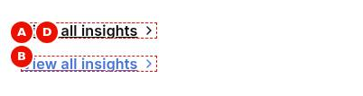{width=38%}

**Screenshot Details — Link view**

| Item | Detail |
|:-----------|:----------------------------------------------|
| Screenshot Name | `screenshots/button-link.jpg` |
| Screenshot Purpose | Link view |
| Screen Description | At 402 px, two underlined semibold 'View all insights' links with chevrons, stacked; the lower one, under the pointer, is brand blue. |
| Business Context | A text call to action at the end of an insights section: 'View all insights' leads to the insights hub with the lowest visual weight. |
| Author Objective | Add two Buttons 'View all insights' to /en/insights with Views Link and check the hover state of the second. |

**Field Entry Table** — enter these values in Universal Editor, in this order:

| Callout | Field Name | Example Value | Mandatory | Business Purpose | What Author Should Enter | Validation Rules |
|:--|:----------|:----------|:------|:----------|:----------|:----------|
| — | Component (Section › Add (+)) | Button | Yes | Adds the Button to the page | Select the section in the content tree, choose Add (+) and pick Button | Only components the section allows (section filter) |
| A | Link (Button) | Select the page or enter /en/insights | Recommended (without a link nothing is rendered as a button) | Button target | Pick internal pages with the picker | None in the model |
| B | Text (Button) | View all insights | Recommended | Visible label (accessible name for Icon view) | Verb first, up to about 25 characters | None in the model |
| (C) | Views (Button) | Link | No | Button, icon-only or text link | Button for most CTAs | Enforced: Button, Icon, Link |
| — | Component (Section › Add (+)) | Button | Yes | Adds the Button to the page | Select the section in the content tree, choose Add (+) and pick Button | Only components the section allows (section filter) |
| D | Link (Button) | Select the page or enter /en/insights | Recommended (without a link nothing is rendered as a button) | Button target | Pick internal pages with the picker | None in the model |
| (E) | Text (Button) | View all insights | Recommended | Visible label (accessible name for Icon view) | Verb first, up to about 25 characters | None in the model |
| (F) | Views (Button) | Link | No | Button, icon-only or text link | Button for most CTAs | Enforced: Button, Icon, Link |
| — | Action (Preview) | Point at the second button (hover state) | — | Check on the preview (not stored in the content) | Point at the second button (hover state) | — |

All other fields keep their default values. Each callout letter marks the field's output on the screenshot. Callouts in brackets, such as (C), have no marker: the field has no visible output of its own on this screenshot (alt text, a setting, an analytics or accessibility label, a link target or collapsed content).

**Expected Page Output**

- **Visual output:** Two underlined semibold texts 'View all insights' in the default text colour with a 1rem chevron; the second, under the pointer, is brand blue.
- **Rendering behaviour:** a.link-button: inline-flex, 1rem semibold, underlined, default text colour with a chevron-right mask; hover and focus switch to the brand colour. Type is hidden and ignored for this view.
- **Publishing behaviour:** Publish the page and /en/insights to Preview and Live.

**Business Rules**

- Views Link ignores Type; the field is hidden in the dialog.
- Use it for 'View all' or 'Read more' at the end of a section.
- Underline and chevron distinguish it from body text.
- The link view also comes from an unformatted standalone link in Text.

**Common Authoring Mistakes**

| Error | Root Cause | Resolution |
|:----------|:----------|:----------|
| A pill button appears | Views left on Button | Set Views to Link |
| Expected a brand blue link but text is black | The link view uses the default text colour until hover by design | Keep it; use an inline link in Text for a blue link |

**Troubleshooting**

- **Symptoms:** 'View all insights' shows without the chevron.
- **Cause:** The Views value was not saved or not delivered, so another view applies.
- **Resolution:** Re-select Views Link and republish; escalate if the class link-button is still missing.
- **Verification Steps:** On aem.page the link has the class link-button and a chevron.

**Use Cases:** "View all", "Read more" at the end of a section.

**Authoring Guidelines:** Views **Link** (Type is hidden for this view).

**Business Rules:** Type is ignored for the link view.

**Rendering Rules:** `a.link-button`: inline-flex, 1rem, semibold, underlined, default text colour, chevron-right 1rem; hover brand colour.

**Responsive Behaviour:** Same at all sizes.

**SEO Impact:** As a normal link.

**Accessibility Compliance:** Underline plus icon distinguish it from text.

#### Variation 6 — Centre alignment

**Variation Name:** Alignment: Center.

**Business Purpose:** Centre a button under centred content.

**Visual Example:**

{width=100%}

**Screenshot Details — Centre-aligned button**

| Item | Detail |
|:-----------|:----------------------------------------------|
| Screenshot Name | `screenshots/button-align-center.jpg` |
| Screenshot Purpose | Centre-aligned button |
| Screen Description | At 1440 px, the black primary pill 'Contact us' with its arrow, centred horizontally in the section content area. |
| Business Context | The closing call to action of a centred band: 'Contact us' is centred under a centred heading. |
| Author Objective | Add a Button 'Contact us' to /en/contact with the Title 'Contact the TCS team' and Alignment Center. |

**Field Entry Table** — enter these values in Universal Editor, in this order:

| Callout | Field Name | Example Value | Mandatory | Business Purpose | What Author Should Enter | Validation Rules |
|:--|:----------|:----------|:------|:----------|:----------|:----------|
| — | Component (Section › Add (+)) | Button | Yes | Adds the Button to the page | Select the section in the content tree, choose Add (+) and pick Button | Only components the section allows (section filter) |
| A | Link (Button) | Select the page or enter /en/contact | Recommended (without a link nothing is rendered as a button) | Button target | Pick internal pages with the picker | None in the model |
| (B) | Text (Button) | Contact us | Recommended | Visible label (accessible name for Icon view) | Verb first, up to about 25 characters | None in the model |
| (C) | Title (Button) | Contact the TCS team | No | Tooltip (`title` attribute) | Extra context only | None |
| (D) | Alignment (Button) | Center | No | Horizontal position | Left unless the layout is centred | Enforced: Left, Center, Right |

All other fields keep their default values. Each callout letter marks the field's output on the screenshot. Callouts in brackets, such as (B), have no marker: the field has no visible output of its own on this screenshot (alt text, a setting, an analytics or accessibility label, a link target or collapsed content).

**Expected Page Output**

- **Visual output:** The black primary pill 'Contact us' with its arrow, centred horizontally in the section content area.
- **Rendering behaviour:** The paragraph gets button-align-center (text-align center); the button keeps its primary style. The alignment is the same at all widths.
- **Publishing behaviour:** Publish the page and /en/contact to Preview and Live.

**Business Rules**

- Alignment applies to the button's own paragraph, not to the section.
- Use Center only when the surrounding content is centred.
- Each Button is aligned separately; set Center on every Button of a centred group.
- Alignment is not configurable per breakpoint.

**Common Authoring Mistakes**

| Error | Root Cause | Resolution |
|:----------|:----------|:----------|
| The button stays left | Alignment value not saved or not delivered | Re-select Center and republish; escalate if button-align-center is missing |
| The heading above is left aligned while the button is centred | Title has no alignment option | Use a block with text alignment (Hero, Teaser) for a fully centred band |

**Troubleshooting**

- **Symptoms:** Alignment Center has no effect on aem.page.
- **Cause:** The alignment value was not delivered, or a block's CSS around the button overrides it.
- **Resolution:** Re-select Center and republish; if the paragraph lacks button-align-center, escalate to development.
- **Verification Steps:** On aem.page the paragraph has the classes button-wrapper button-align-center.

**Use Cases:** Call-to-action bands, end-of-page actions.

**Authoring Guidelines:** Alignment **Center**.

**Business Rules:** Alignment applies to the button's paragraph.

**Rendering Rules:** `p.button-wrapper.button-align-center { text-align: center; }`.

**Responsive Behaviour:** Centred at all sizes.

**SEO Impact:** None.

**Accessibility Compliance:** No effect on reading order.

#### Variation 7 — Right alignment

**Variation Name:** Alignment: Right.

**Business Purpose:** Align a button to the end of the line.

**Visual Example:**

{width=100%}

**Screenshot Details — Right-aligned button**

| Item | Detail |
|:-----------|:----------------------------------------------|
| Screenshot Name | `screenshots/button-align-right.jpg` |
| Screenshot Purpose | Right-aligned button |
| Screen Description | At 1440 px, the outlined secondary pill 'Explore services' with its arrow, aligned to the right edge of the content area. |
| Business Context | A forward action aligned to the end of the line, for example after a right-aligned element: 'Explore services' sits at the right edge. |
| Author Objective | Add a Button 'Explore services' to /en/services with Type Secondary and Alignment Right. |

**Field Entry Table** — enter these values in Universal Editor, in this order:

| Callout | Field Name | Example Value | Mandatory | Business Purpose | What Author Should Enter | Validation Rules |
|:--|:----------|:----------|:------|:----------|:----------|:----------|
| — | Component (Section › Add (+)) | Button | Yes | Adds the Button to the page | Select the section in the content tree, choose Add (+) and pick Button | Only components the section allows (section filter) |
| A | Link (Button) | Select the page or enter /en/services | Recommended (without a link nothing is rendered as a button) | Button target | Pick internal pages with the picker | None in the model |
| (B) | Text (Button) | Explore services | Recommended | Visible label (accessible name for Icon view) | Verb first, up to about 25 characters | None in the model |
| (C) | Type (Button) | Secondary | No | Emphasis of Button / Icon views | One primary per section | Enforced: Primary, Secondary, Tertiary |
| (D) | Alignment (Button) | Right | No | Horizontal position | Left unless the layout is centred | Enforced: Left, Center, Right |

All other fields keep their default values. Each callout letter marks the field's output on the screenshot. Callouts in brackets, such as (B), have no marker: the field has no visible output of its own on this screenshot (alt text, a setting, an analytics or accessibility label, a link target or collapsed content).

**Expected Page Output**

- **Visual output:** The outlined secondary pill 'Explore services' with its arrow, aligned to the right edge of the content area.
- **Rendering behaviour:** The paragraph gets button-align-right (text-align end), so in a right-to-left context it would align left. Right alignment applies at every width.
- **Publishing behaviour:** Publish the page and /en/services to Preview and Live.

**Business Rules**

- Right alignment uses text-align end.
- Use it sparingly: screen magnifier users may miss right-aligned buttons.
- It cannot be switched to Left on mobile only.
- Combine with Secondary for an alternative action.

**Common Authoring Mistakes**

| Error | Root Cause | Resolution |
|:----------|:----------|:----------|
| The important action is overlooked on mobile | Primary call to action aligned right | Keep important actions left aligned |
| The button is right aligned but black | Type left on Primary | Set Type to Secondary |

**Troubleshooting**

- **Symptoms:** The button sits at the left on aem.page.
- **Cause:** Alignment Right was not saved or not delivered in the markup.
- **Resolution:** Re-select Right and republish; escalate if the paragraph lacks button-align-right.
- **Verification Steps:** On aem.page the paragraph has the class button-align-right and the button is at the right edge.

**Use Cases:** "Next" actions, layouts mirroring a right-aligned element.

**Authoring Guidelines:** Alignment **Right**.

**Business Rules:** Uses `text-align: end`, so in a right-to-left context it aligns left.

**Rendering Rules:** `p.button-wrapper.button-align-right { text-align: end; }`.

**Responsive Behaviour:** Right-aligned at all sizes; consider Left on mobile-heavy pages (not configurable per breakpoint).

**SEO Impact:** None.

**Accessibility Compliance:** Screen magnifier users may miss right-aligned buttons; use sparingly.

> **Note:** Alignment **Left** (the default) adds `button-align-left` (`text-align: start`).

### 6.9.4 Authoring Experience

{width=100%}

**Screenshot Details — Button on the Universal Editor canvas**

| Item | Detail |
|:-----------|:----------------------------------------------|
| Screenshot Name | `screenshots/button-authoring-view.jpg` |
| Screenshot Purpose | Button on the Universal Editor canvas |
| Screen Description | The centred primary pill 'Contact us' in editor mode at 1440 px (an annotated preview, not a Universal Editor screenshot); A marks the button label and C its paragraph (Alignment). B (Views, Type) is not marked. |
| Business Context | How an author configures a Button in Universal Editor: the selected 'Contact us' button on the canvas with its label, appearance and alignment marked. |
| Author Objective | Add a Button 'Contact us' to /en/contact with the Title 'Contact the TCS team' and Alignment Center, and identify its fields on the canvas. |

**Field Entry Table** — enter these values in Universal Editor, in this order:

| Callout | Field Name | Example Value | Mandatory | Business Purpose | What Author Should Enter | Validation Rules |
|:--|:----------|:----------|:------|:----------|:----------|:----------|
| — | Component (Section › Add (+)) | Button | Yes | Adds the Button to the page | Select the section in the content tree, choose Add (+) and pick Button | Only components the section allows (section filter) |
| — | Link (Button) | Select the page or enter /en/contact | Recommended (without a link nothing is rendered as a button) | Button target | Pick internal pages with the picker | None in the model |
| — | Text (Button) | Contact us | Recommended | Visible label (accessible name for Icon view) | Verb first, up to about 25 characters | None in the model |
| — | Title (Button) | Contact the TCS team | No | Tooltip (`title` attribute) | Extra context only | None |
| — | Alignment (Button) | Center | No | Horizontal position | Left unless the layout is centred | Enforced: Left, Center, Right |

All other fields keep their default values. The letters on this annotated preview follow the chapter's Annotations list.

**Expected Page Output**

- **Visual output:** The selected centred primary pill 'Contact us' on the canvas: its label (A, Text), its appearance (B, Views and Type) and its position in the line (C, Alignment).
- **Rendering behaviour:** In the editor the changed button is re-decorated in place by decorateButtons. The dialog has seven fields and no tabs: Link, Text, Title, Views, Type, Icon (only for Views Icon) and Alignment.
- **Publishing behaviour:** Field changes are saved on author at once; they reach aem.page with Publish to Preview and aem.live with Publish to Live. Clicking in edit mode selects the component and pushes no cmp:click.

**Business Rules**

- A (Text) is the visible label 'Contact us'; Title is only the tooltip.
- B shows Views Button and the default Type Primary.
- C is Alignment Center, applied to the button's paragraph.
- There is no open-in-new-tab option and no Additional tab.

**Common Authoring Mistakes**

| Error | Root Cause | Resolution |
|:----------|:----------|:----------|
| The Type field is missing | Views set to Link, which hides Type | Set Views to Button |
| Clicking the button on the canvas does not open /en/contact | Edit mode selects components instead of following links | Switch to Preview mode to test the link |

**Troubleshooting**

- **Symptoms:** No cmp:click appears in adobeDataLayer when testing the button.
- **Cause:** The test was done in edit mode, where clicks select components, or an ancestor has data-analytics="off".
- **Resolution:** Test on aem.page or in Preview mode and check the ancestors for data-analytics.
- **Verification Steps:** window.adobeDataLayer holds a cmp:click with dc:title 'Contact us' after the click.

**Annotations:**

- A = the button label (Text)
- B = the button's appearance (Views, Type, Icon)
- C = the button's position in its paragraph (Alignment)

{width=100%}

The dialog has seven fields and no tabs: **Link** (AEM content picker or URL), **Text** (label), **Title** (tooltip), **Views** (Button / Icon / Link, default Button), **Type** (Primary / Secondary / Tertiary, default Primary; shown when Views is empty, Button or Icon), **Icon** (Arrow right / Chevron right / Chevron down / Search; shown only when Views is Icon) and **Alignment** (Left / Center / Right, default Left). There is no Additional tab.

### 6.9.5 Authoring Guide

**Step 1 — Open the page in Universal Editor**

**Action:** Sites console > select the page > **Edit**.

**Expected Result:** The page opens on the canvas.

**Steps — Step 1:** The page open in the Universal Editor.

| Step | Where | Field / control | Value / action |
|:--|:----------|:----------|:--------------------|
| 1 | AEM Sites console | Navigation | Open TCS Corp › us › en › services |
| 2 | AEM Sites console | Select | Select the page (check box of its card or row) |
| 3 | AEM Sites console toolbar | Edit | Select Edit: the page opens in the Universal Editor |

**Step 2 — Add a Button**

**Action:** Select the section (or Column / tab panel), **Add (+)** > **Button**.

**Expected Result:** A Button component appears.

**Steps — Step 2:** The picker with Button highlighted.

| Step | Where | Field / control | Value / action |
|:--|:----------|:----------|:--------------------|
| 1 | Universal Editor › Content tree | Section | Select the section |
| 2 | Universal Editor › Content tree | Add (+) | Select Add (+) |
| 3 | Component picker › Default Content | Button | Select Button |

**Step 3 — Set the link**

**Action:** In **Link** pick a page (content picker) or paste a URL.

**Expected Result:** The link target is saved.

**Steps — Step 3:** The content picker selecting `/content/tcs-corp/us/en/contact`.

| Step | Where | Field / control | Value / action |
|:--|:----------|:----------|:--------------------|
| 1 | Button › Properties | Link | Open the content picker |
| 2 | Content picker | Page | Select /content/tcs-corp/us/en/contact |

**Step 4 — Write the label and title**

**Action:** Enter the label in **Text** and, optionally, a tooltip in **Title**.

**Expected Result:** The canvas shows the label.

**Steps — Step 4:** Text "Contact us" and Title "Contact the TCS team".

| Step | Where | Field / control | Value / action |
|:--|:----------|:----------|:--------------------|
| 1 | Button › Properties | Text | Contact us |
| 2 | Button › Properties | Title | Contact the TCS team |

**Step 5 — Choose the view and type**

**Action:** Choose **Views** (Button, Icon or Link); for Button and Icon choose **Type**; for Icon choose **Icon**.

**Expected Result:** The button changes appearance.

**Steps — Step 5:** Views Icon, Type Secondary, Icon Search, and the canvas showing the outlined search icon button.

| Step | Where | Field / control | Value / action |
|:--|:----------|:----------|:--------------------|
| 1 | Button › Properties | Views | Icon |
| 2 | Button › Properties | Type | Secondary |
| 3 | Button › Properties | Icon | Search |

**Step 6 — Choose the alignment**

**Action:** Choose **Alignment** (Left, Center or Right).

**Expected Result:** The button moves within its line.

**Steps — Step 6:** Alignment Center with the button centred.

| Step | Where | Field / control | Value / action |
|:--|:----------|:----------|:--------------------|
| 1 | Button › Properties | Alignment | Center |

**Step 7 — Preview**

**Action:** Switch on Preview mode; click the button; check the three device sizes.

**Expected Result:** The link opens; the label fits on mobile.

**Steps — Step 7:** Preview at mobile size.

| Step | Where | Field / control | Value / action |
|:--|:----------|:----------|:--------------------|
| 1 | Universal Editor toolbar | Preview | Switch Preview on |
| 2 | Universal Editor toolbar | Device size | Mobile |
| 3 | Universal Editor canvas | Button | Select the button: the link opens |

**Step 8 — Validate and publish**

**Action:** Run the checklist; publish to Preview and Live.

**Expected Result:** The button is live.

**Steps — Step 8:** The Publish dialog.

| Step | Where | Field / control | Value / action |
|:--|:----------|:----------|:--------------------|
| 1 | Universal Editor toolbar | Publish | Select Publish |
| 2 | Publish dialog | Items | Keep the page and its references selected |
| 3 | Publish dialog | Destination | Preview |
| 4 | Publish dialog | Publish | Select Publish; check the page on https://main--tcs-corp--sradha-tcs.aem.page/en/... |
| 5 | Publish dialog | Destination | Live (when approved), then Publish; check https://main--tcs-corp--sradha-tcs.aem.live/en/... |

#### Preview Process

On `.aem.page`, click the button, check the target and inspect the classes (`button primary`, `icon-button`, `link-button`, `button-align-*`).

#### Publishing Process

Publish the page; publish the target page or asset if it is new.

#### Validation Process

- [ ] The link target is correct and published (internal links as `/en/...`).
- [ ] The label is action-oriented and fits on one line at 320 px.
- [ ] View, type and alignment as designed; at most one primary button per section.
- [ ] Icon buttons have a meaningful Text (accessible name) and the right icon.
- [ ] The tooltip (Title) adds information or repeats the label (it is set to the label when empty).
- [ ] `cmp:click` is pushed on click (console `adobeDataLayer`, see Part 11).

#### Rollback Process

Change the fields back, or restore the page version and republish.

The walkthroughs below repeat the steps above for each variation of chapter 6.9.3, from opening the page to publishing; the values are those of the variation's screenshot.

#### Walkthrough — Variation 1 — Primary button

Reproduces the screenshot `screenshots/button-primary.jpg` of this variation. The Field Entry Table under the screenshot lists every value with its rules.

**Step 1 — Open the page**

**Action:** In AEM Sites, open the locale site (for example `/content/tcs-corp/us/en`), select the page and choose Edit; the page opens in Universal Editor.

**Expected Result:** The page renders on the canvas with the content tree and the properties panel.

**Step 2 — Add the Button**

**Action:** Select the section in the content tree, choose **Add (+)** and pick **Button**.

**Expected Result:** Two Button components are added to the selected section.

**Step 3 — Fill in Button**

**Action:** Select **Button** in the content tree and enter in the properties panel: **Link** (A) = Select the page or enter /en/contact; **Text** (B) = Contact us; **Title** (C) = Contact the TCS team.

**Expected Result:** Two black pill buttons 'Contact us' with arrows appear, each with the tooltip 'Contact the TCS team'.

**Step 4 — Add the Button**

**Action:** Select the section in the content tree, choose **Add (+)** and pick **Button**.

**Expected Result:** Two Button components are added to the selected section.

**Step 5 — Fill in Button**

**Action:** Select **Button** in the content tree and enter in the properties panel: **Link** (D) = Select the page or enter /en/contact; **Text** (E) = Contact us; **Title** (F) = Contact the TCS team.

**Expected Result:** Two black pill buttons 'Contact us' with arrows appear, each with the tooltip 'Contact the TCS team'.

**Step 6 — Preview**

**Action:** Action: Point at the second button (hover state).

**Expected Result:** With the pointer on the second button its label and arrow turn slate-400.

**Step 7 — Preview**

**Action:** Choose **Preview** in the Universal Editor toolbar (or open the page on aem.page) and compare it with the screenshot.

**Expected Result:** Two black pill buttons 'Contact us' with grey-300 medium-weight labels and trailing arrows; the second, under the pointer, has its label and arrow in slate-400.

**Step 8 — Publish**

**Action:** Choose **Publish** › Publish to Live (with the referenced pages, fragments and assets that are not yet published).

**Expected Result:** Publish the page and /en/contact to Preview and Live. A click pushes cmp:click with dc:title 'Contact us' and the page as the component.

**Step 9 — Verify**

**Action:** On the live page check: On aem.page the paragraph is p.button-wrapper and the link a.button.primary.

**Expected Result:** The page matches the screenshot; nothing in the Troubleshooting case above applies.

#### Walkthrough — Variation 2 — Secondary button

Reproduces the screenshot `screenshots/button-secondary.jpg` of this variation. The Field Entry Table under the screenshot lists every value with its rules.

**Step 1 — Open the page**

**Action:** In AEM Sites, open the locale site (for example `/content/tcs-corp/us/en`), select the page and choose Edit; the page opens in Universal Editor.

**Expected Result:** The page renders on the canvas with the content tree and the properties panel.

**Step 2 — Add the Button**

**Action:** Select the section in the content tree, choose **Add (+)** and pick **Button**.

**Expected Result:** Two Button components are added to the selected section.

**Step 3 — Fill in Button**

**Action:** Select **Button** in the content tree and enter in the properties panel: **Link** (A) = Select the page or enter /en/services; **Text** (B) = Explore services; **Type** (C) = Secondary.

**Expected Result:** Two outlined secondary buttons 'Explore services' with arrows appear.

**Step 4 — Add the Button**

**Action:** Select the section in the content tree, choose **Add (+)** and pick **Button**.

**Expected Result:** Two Button components are added to the selected section.

**Step 5 — Fill in Button**

**Action:** Select **Button** in the content tree and enter in the properties panel: **Link** (D) = Select the page or enter /en/services; **Text** (E) = Explore services; **Type** (F) = Secondary.

**Expected Result:** Two outlined secondary buttons 'Explore services' with arrows appear.

**Step 6 — Preview**

**Action:** Action: Point at the second button (hover state).

**Expected Result:** With the pointer on the second button its fill turns white and the border and label brand blue.

**Step 7 — Preview**

**Action:** Choose **Preview** in the Universal Editor toolbar (or open the page on aem.page) and compare it with the screenshot.

**Expected Result:** Two outlined pill buttons with slate-900 border, label and arrow; the second, under the pointer, has a white fill with brand blue border and label.

**Step 8 — Publish**

**Action:** Choose **Publish** › Publish to Live (with the referenced pages, fragments and assets that are not yet published).

**Expected Result:** Publish the page and /en/services to Preview and Live.

**Step 9 — Verify**

**Action:** On the live page check: On aem.page the link has the classes button secondary and turns brand blue on hover.

**Expected Result:** The page matches the screenshot; nothing in the Troubleshooting case above applies.

#### Walkthrough — Variation 3 — Tertiary button

Reproduces the screenshot `screenshots/button-tertiary.jpg` of this variation. The Field Entry Table under the screenshot lists every value with its rules.

**Step 1 — Open the page**

**Action:** In AEM Sites, open the locale site (for example `/content/tcs-corp/us/en`), select the page and choose Edit; the page opens in Universal Editor.

**Expected Result:** The page renders on the canvas with the content tree and the properties panel.

**Step 2 — Add the Button**

**Action:** Select the section in the content tree, choose **Add (+)** and pick **Button**.

**Expected Result:** Two Button components are added to the selected section.

**Step 3 — Fill in Button**

**Action:** Select **Button** in the content tree and enter in the properties panel: **Link** (A) = Select the page or enter /en/insights/case-studies; **Text** (B) = See all case studies; **Type** (C) = Tertiary.

**Expected Result:** Two tertiary calls to action 'See all case studies' with arrows and no container appear.

**Step 4 — Add the Button**

**Action:** Select the section in the content tree, choose **Add (+)** and pick **Button**.

**Expected Result:** Two Button components are added to the selected section.

**Step 5 — Fill in Button**

**Action:** Select **Button** in the content tree and enter in the properties panel: **Link** (D) = Select the page or enter /en/insights/case-studies; **Text** (E) = See all case studies; **Type** (F) = Tertiary.

**Expected Result:** Two tertiary calls to action 'See all case studies' with arrows and no container appear.

**Step 6 — Preview**

**Action:** Action: Point at the second button (hover state).

**Expected Result:** With the pointer on the second one it turns brand blue and the arrow moves closer.

**Step 7 — Preview**

**Action:** Choose **Preview** in the Universal Editor toolbar (or open the page on aem.page) and compare it with the screenshot.

**Expected Result:** Two text calls to action 'See all case studies' in the default text colour with a trailing arrow and no border; the second, under the pointer, is brand blue with the arrow moved closer.

**Step 8 — Publish**

**Action:** Choose **Publish** › Publish to Live (with the referenced pages, fragments and assets that are not yet published).

**Expected Result:** Publish the page and /en/insights/case-studies to Preview and Live.

**Step 9 — Verify**

**Action:** On the live page check: On aem.page the link has the classes button tertiary and no border.

**Expected Result:** The page matches the screenshot; nothing in the Troubleshooting case above applies.

#### Walkthrough — Variation 4 — Icon button

Reproduces the screenshot `screenshots/button-icon.jpg` of this variation. The Field Entry Table under the screenshot lists every value with its rules.

**Step 1 — Open the page**

**Action:** In AEM Sites, open the locale site (for example `/content/tcs-corp/us/en`), select the page and choose Edit; the page opens in Universal Editor.

**Expected Result:** The page renders on the canvas with the content tree and the properties panel.

**Step 2 — Add the Button**

**Action:** Select the section in the content tree, choose **Add (+)** and pick **Button**.

**Expected Result:** Three Button components are added to the selected section.

**Step 3 — Fill in Button**

**Action:** Select **Button** in the content tree and enter in the properties panel: **Link** (A) = Select the page or enter /en/search; **Text** (B) = Search; **Views** (C) = Icon; **Icon** (D) = Search.

**Expected Result:** Three circular search icon buttons appear: filled primary, outlined secondary and icon-only tertiary.

**Step 4 — Add the Button**

**Action:** Select the section in the content tree, choose **Add (+)** and pick **Button**.

**Expected Result:** Three Button components are added to the selected section.

**Step 5 — Fill in Button**

**Action:** Select **Button** in the content tree and enter in the properties panel: **Link** (E) = Select the page or enter /en/search; **Text** (F) = Search; **Views** (G) = Icon; **Type** (H) = Secondary; **Icon** (I) = Search.

**Expected Result:** Three circular search icon buttons appear: filled primary, outlined secondary and icon-only tertiary.

**Step 6 — Add the Button**

**Action:** Select the section in the content tree, choose **Add (+)** and pick **Button**.

**Expected Result:** Three Button components are added to the selected section.

**Step 7 — Fill in Button**

**Action:** Select **Button** in the content tree and enter in the properties panel: **Link** (J) = Select the page or enter /en/search; **Text** (K) = Search; **Views** (L) = Icon; **Type** (M) = Tertiary; **Icon** (N) = Search.

**Expected Result:** Three circular search icon buttons appear: filled primary, outlined secondary and icon-only tertiary.

**Step 8 — Preview**

**Action:** Choose **Preview** in the Universal Editor toolbar (or open the page on aem.page) and compare it with the screenshot.

**Expected Result:** Three 2.75rem circular buttons with the 1.25rem search icon: blue-filled with a white icon (primary), blue outline and icon (secondary) and a blue icon only (tertiary).

**Step 9 — Publish**

**Action:** Choose **Publish** › Publish to Live (with the referenced pages, fragments and assets that are not yet published).

**Expected Result:** Publish the page and /en/search to Preview and Live; the icon is a static file in /icons cached by the CDN.

**Step 10 — Verify**

**Action:** On the live page check: On aem.page each link has the class icon-button and aria-label 'Search'.

**Expected Result:** The page matches the screenshot; nothing in the Troubleshooting case above applies.

#### Walkthrough — Variation 5 — Link view

Reproduces the screenshot `screenshots/button-link.jpg` of this variation. The Field Entry Table under the screenshot lists every value with its rules.

**Step 1 — Open the page**

**Action:** In AEM Sites, open the locale site (for example `/content/tcs-corp/us/en`), select the page and choose Edit; the page opens in Universal Editor.

**Expected Result:** The page renders on the canvas with the content tree and the properties panel.

**Step 2 — Add the Button**

**Action:** Select the section in the content tree, choose **Add (+)** and pick **Button**.

**Expected Result:** Two Button components are added to the selected section.

**Step 3 — Fill in Button**

**Action:** Select **Button** in the content tree and enter in the properties panel: **Link** (A) = Select the page or enter /en/insights; **Text** (B) = View all insights; **Views** (C) = Link.

**Expected Result:** Two underlined 'View all insights' links with chevrons appear.

**Step 4 — Add the Button**

**Action:** Select the section in the content tree, choose **Add (+)** and pick **Button**.

**Expected Result:** Two Button components are added to the selected section.

**Step 5 — Fill in Button**

**Action:** Select **Button** in the content tree and enter in the properties panel: **Link** (D) = Select the page or enter /en/insights; **Text** (E) = View all insights; **Views** (F) = Link.

**Expected Result:** Two underlined 'View all insights' links with chevrons appear.

**Step 6 — Preview**

**Action:** Action: Point at the second button (hover state).

**Expected Result:** With the pointer on the second link it turns brand blue.

**Step 7 — Preview**

**Action:** Choose **Preview** in the Universal Editor toolbar (or open the page on aem.page) and compare it with the screenshot.

**Expected Result:** Two underlined semibold texts 'View all insights' in the default text colour with a 1rem chevron; the second, under the pointer, is brand blue.

**Step 8 — Publish**

**Action:** Choose **Publish** › Publish to Live (with the referenced pages, fragments and assets that are not yet published).

**Expected Result:** Publish the page and /en/insights to Preview and Live.

**Step 9 — Verify**

**Action:** On the live page check: On aem.page the link has the class link-button and a chevron.

**Expected Result:** The page matches the screenshot; nothing in the Troubleshooting case above applies.

#### Walkthrough — Variation 6 — Centre alignment

Reproduces the screenshot `screenshots/button-align-center.jpg` of this variation. The Field Entry Table under the screenshot lists every value with its rules.

**Step 1 — Open the page**

**Action:** In AEM Sites, open the locale site (for example `/content/tcs-corp/us/en`), select the page and choose Edit; the page opens in Universal Editor.

**Expected Result:** The page renders on the canvas with the content tree and the properties panel.

**Step 2 — Add the Button**

**Action:** Select the section in the content tree, choose **Add (+)** and pick **Button**.

**Expected Result:** A Button component is added to the selected section.

**Step 3 — Fill in Button**

**Action:** Select **Button** in the content tree and enter in the properties panel: **Link** (A) = Select the page or enter /en/contact; **Text** (B) = Contact us; **Title** (C) = Contact the TCS team; **Alignment** (D) = Center.

**Expected Result:** The primary button 'Contact us' appears centred in the section.

**Step 4 — Preview**

**Action:** Choose **Preview** in the Universal Editor toolbar (or open the page on aem.page) and compare it with the screenshot.

**Expected Result:** The black primary pill 'Contact us' with its arrow, centred horizontally in the section content area.

**Step 5 — Publish**

**Action:** Choose **Publish** › Publish to Live (with the referenced pages, fragments and assets that are not yet published).

**Expected Result:** Publish the page and /en/contact to Preview and Live.

**Step 6 — Verify**

**Action:** On the live page check: On aem.page the paragraph has the classes button-wrapper button-align-center.

**Expected Result:** The page matches the screenshot; nothing in the Troubleshooting case above applies.

#### Walkthrough — Variation 7 — Right alignment

Reproduces the screenshot `screenshots/button-align-right.jpg` of this variation. The Field Entry Table under the screenshot lists every value with its rules.

**Step 1 — Open the page**

**Action:** In AEM Sites, open the locale site (for example `/content/tcs-corp/us/en`), select the page and choose Edit; the page opens in Universal Editor.

**Expected Result:** The page renders on the canvas with the content tree and the properties panel.

**Step 2 — Add the Button**

**Action:** Select the section in the content tree, choose **Add (+)** and pick **Button**.

**Expected Result:** A Button component is added to the selected section.

**Step 3 — Fill in Button**

**Action:** Select **Button** in the content tree and enter in the properties panel: **Link** (A) = Select the page or enter /en/services; **Text** (B) = Explore services; **Type** (C) = Secondary; **Alignment** (D) = Right.

**Expected Result:** The secondary button 'Explore services' appears at the right edge of the content area.

**Step 4 — Preview**

**Action:** Choose **Preview** in the Universal Editor toolbar (or open the page on aem.page) and compare it with the screenshot.

**Expected Result:** The outlined secondary pill 'Explore services' with its arrow, aligned to the right edge of the content area.

**Step 5 — Publish**

**Action:** Choose **Publish** › Publish to Live (with the referenced pages, fragments and assets that are not yet published).

**Expected Result:** Publish the page and /en/services to Preview and Live.

**Step 6 — Verify**

**Action:** On the live page check: On aem.page the paragraph has the class button-align-right and the button is at the right edge.

**Expected Result:** The page matches the screenshot; nothing in the Troubleshooting case above applies.

### 6.9.6 Authorable Field Specification

**Model `button`**

| Field Name | Field Type | Mandatory | Multi Value | Default Value | Business Purpose | Author Guidance | Validation Rules | Example Value |
|:-------------------|:------------|:--------------------|:-------|:------------------|:-----------------------|:-----------------------|:--------------------------|:----------------------|
| Link (`link`) | AEM content (picker or URL) | Recommended (without a link nothing is rendered as a button) | No | (empty) | Button target | Pick internal pages with the picker | None in the model | /content/tcs-corp/us/en/contact |
| Text (`linkText`) | Text | Recommended | No | (empty) | Visible label (accessible name for Icon view) | Verb first, up to about 25 characters | None in the model | Contact us |
| Title (`linkTitle`) | Text | No | No | (empty; the code sets the label as title) | Tooltip (`title` attribute) | Extra context only | None | Contact the TCS team |
| Views (`buttonView`) | Select | No | No | Button (`button`) | Button, icon-only or text link | Button for most CTAs | Enforced: Button, Icon, Link | button |
| Type (`linkType`) | Select | No | No | Primary (`primary`) | Emphasis of Button / Icon views | One primary per section | Enforced: Primary, Secondary, Tertiary | secondary |
| Icon (`buttonIcon`) | Select | Recommended when Views is Icon | No | (empty) | Icon of the Icon view | Pick the icon matching the action | Enforced: Arrow right, Chevron right, Chevron down, Search | search |
| Alignment (`buttonAlignment`) | Select | No | No | Left (`left`) | Horizontal position | Left unless the layout is centred | Enforced: Left, Center, Right | center |

**Additional tab:** Not applicable (default content).

**Field details**

- **Link** — Purpose: target. Allowed Values: AEM page, asset or URL. Character Limits: not applicable. Business Rules: internal AEM paths are mapped to published paths by Edge Delivery (`paths.json`); downloads (`.pdf`, `.docx`, ...) are tracked as `xdm:linkType` `download`, other origins as `exit`. Dependency Rules: none. Visibility Rules: always visible. Sample Content: `/content/tcs-corp/us/en/contact`.
- **Text** — Purpose: label. Allowed Values: text. Character Limits: Recommended up to about 25 characters (labels never wrap and are clipped). Business Rules: for the Icon view it is hidden and becomes `aria-label` and `title`. Dependency Rules: none. Visibility Rules: always visible. Sample Content: "Download the report".
- **Title** — Purpose: tooltip. Allowed Values: text. Character Limits: Recommended up to 60 characters. Business Rules: when empty, the code sets the link text as title. Dependency Rules: none. Visibility Rules: always visible. Sample Content: "Annual report 2026 (PDF)".
- **Views** — Purpose: view. Allowed Values: `button`, `icon`, `link`. Character Limits: not applicable. Business Rules: an explicit view wins; Link ignores Type. Dependency Rules: controls the visibility of Type and Icon. Visibility Rules: always visible. Sample Content: Button.
- **Type** — Purpose: emphasis. Allowed Values: `primary`, `secondary`, `tertiary`. Character Limits: not applicable. Business Rules: default primary. Dependency Rules: Views. Visibility Rules: shown when Views is empty, `button` or `icon` (model `condition`). Sample Content: Primary.
- **Icon** — Purpose: icon. Allowed Values: `arrow-right`, `chevron-right`, `chevron-down`, `search`. Character Limits: not applicable. Business Rules: drawn from `/icons/{name}.svg`; without an icon the Icon view falls back to a normal button. Dependency Rules: Views = Icon. Visibility Rules: shown only when Views is `icon` (model `condition`). Sample Content: Search.
- **Alignment** — Purpose: position. Allowed Values: `left`, `center`, `right`. Character Limits: not applicable. Business Rules: adds `button-align-{value}` to the paragraph. Dependency Rules: none. Visibility Rules: always visible. Sample Content: Center.

> **Note:** How AEM delivers the Views, Icon and Alignment values in the page markup (classes or data attributes of the link or its paragraph) could not be verified from the repository; `utils/buttons.js` reads both forms (type classes, `view-{view}` and `align-{alignment}` classes, and view / type / icon / alignment data values). [To be confirmed: delivered markup of the Button component's Views, Icon and Alignment — owner: development team]

### 6.9.7 Field Annotation Mapping

| Marker | Field | Purpose |
|:--------|:------------|:---------------|
| A | Text; Title; Link | Label, tooltip and target |
| B | Views; Type; Icon | Appearance |
| C | Alignment | Position in the line |

### 6.9.8 Component Specification

| Attribute | Value |
|:-----------------|:---------------------------------------------------------|
| Component Name | Button (`button`, `core/franklin/components/button/v1/button`) |
| Version | 1.0 |
| Owner | [To be confirmed: product owner]; technical owner: development team |
| Dependencies | `models/_button.json`; `decorators/content-buttons-decorator.js`; `decorators/button-decorator.js`; `utils/buttons.js`; `styles/styles.css`; `/icons` |
| Component Type | Default content |
| Supported Variants | Primary; Secondary; Tertiary; Icon (3 types × 4 icons); Link; Alignment Left / Center / Right |
| Supported Templates | Any page |
| Supported Metadata | None |
| Supported Tags | None |
| Supported Personalization | None (as of this handover); clicks are in the data layer for future Target / Journey Optimizer use |
| Caching Considerations | Part of the page HTML; icons are static files cached by the CDN |
| Performance Considerations | Decorated in the eager phase (`decorateMain`); icons are CSS masks (one small SVG request each) |
| Accessibility Compliance | WCAG 2.1 AA: focus visible (2.4.7), accessible names for icon buttons (4.1.2), target size 2.75rem / 3.125rem, colour contrast of the types |
| SEO Compliance | A real `<a href>` with label text (hidden text for icon buttons) |

### 6.9.9 Input Model

- **Content Inputs:** Link, Text, Title.
- **Metadata Inputs:** none.
- **Tags Inputs:** none.
- **Page Context Inputs:** the section style (dark section overrides in CSS).
- **Query Inputs:** none.
- **Manual Inputs:** all seven fields.

Authored HTML received from AEM (typical; the standard button rendering encodes the type as formatting and the other options as classes or data values, see the note in 6.9.6):

```html
<p class="button-container">
  <strong><a href="/en/contact" title="Contact the TCS team"
     class="button">Contact us</a></strong>
</p>
```

### 6.9.10 Output Model

**Rendered Output:** `p.button-wrapper.button-align-{alignment}` containing `a.button.{type}` (Button view), `a.button.{type}.icon-button` (Icon view, with `--icon-url`, `aria-label`, hidden text span) or `a.link-button` (Link view). The formatting element (`strong` / `em`) is removed.

**Generated HTML:**

```html
<p class="button-wrapper button-align-center">
  <a href="/en/contact" title="Contact the TCS team" class="button primary">Contact us</a>
</p>
<p class="button-wrapper button-align-left">
  <a href="/en/search" title="Search" aria-label="Search" class="button secondary icon-button"
     style="--icon-url: url('/icons/search.svg')"><span>Search</span></a>
</p>
```

**Generated JSON:** none.

**Generated Metadata:** none.

**Analytics Tracking:** a click pushes `cmp:click` with the page as the component (default content):

```json
{
  "event": "cmp:click",
  "eventInfo": {
    "path": "component.page-1x2y3z",
    "interaction": "link",
    "dc:title": "Contact us",
    "xdm:linkURL": "https://main--tcs-corp--sradha-tcs.aem.live/en/contact",
    "xdm:linkType": "other",
    "breakpoint": "mobile"
  }
}
```

For icon buttons `dc:title` is the `aria-label` (the Text). Links to other origins have `xdm:linkType` `exit`; links with `download` or a file extension (`pdf`, `doc(x)`, `xls(x)`, `ppt(x)`, `zip`, `csv`, `txt`, `mp3`, `mp4`) have `download`.

**Personalization Output:** none.

**Search Index Output:** none.

**Target Personalization Output:** None (as of this handover): no personalisation marker. Clicks push cmp:click with the page as the component, dc:title = the label (aria-label for icon buttons) and xdm:linkType other, exit or download, for future Target or Journey Optimizer use once Adobe Tags is added.

### 6.9.11 Business Rules

1. Only a link that is alone in its paragraph is decorated; a link sharing its paragraph with text stays a plain link.
2. A link whose text is its URL stays plain (unless it is an icon link).
3. View: the explicit Views value wins; else an icon link is an Icon button; else a link with a Type is a button; else a link button.
4. Type: an explicit type class or value wins; else bold = primary, italic = secondary, bold + italic = tertiary; default primary when a button is rendered without a type.
5. Type is ignored for the Link view (and hidden in the dialog).
6. The Icon field is shown only for the Icon view; an Icon view without a resolvable icon renders as a normal button.
7. An icon-only link without type or view stays plain.
8. Icon buttons: the text is moved into a hidden span; `aria-label` = existing aria-label, else text, else title, else the icon name with spaces; `title` set when empty.
9. Every decorated link gets `title` = its text when it has none.
10. Alignment adds `button-align-left|center|right` to the paragraph; unknown values are ignored.
11. Labels never wrap and are clipped at the container width.
12. Disabled states exist in the decorator and CSS but are not authorable for the Button component.
13. No open-in-new-tab option exists for the Button component (as of this handover).
14. In the editor, changed buttons are re-decorated in place (`decorateButtons` from `scripts/editor-support.js`).

### 6.9.12 Author Best Practices

**Recommended Content Length:** labels of 2–4 words, up to about 25 characters; Title up to 60 characters.

**Image Dimensions:** not applicable.

**CTA Writing Guidelines:** start with a verb; describe the outcome ("Download the 2026 report", not "Click here"); one primary per section; pair a primary with a secondary or link view; mention the format for downloads ("(PDF, 2 MB)") in the Title.

**Accessibility Guidelines:** always fill Text for icon buttons; do not rely on the icon alone; avoid right alignment for important actions.

**SEO Guidelines:** descriptive labels; link to the locale's own pages.

**Metadata Guidelines:** not applicable.

**Taxonomy Guidelines:** not applicable.

**Localization Guidelines:** translate Text and Title; check translated labels at 320 px (German and French expand); link to the target locale's pages.

### 6.9.13 Troubleshooting Guide

#### Issue 1 — Button shows as a plain link

**Symptoms:** No button styling.

**Root Cause:** No link set, the label equals the URL, or the paragraph contains other text.

**Diagnosis Steps:** Inspect the paragraph; check Link and Text.

**Resolution Steps:** Set a link and a descriptive Text.

**Validation Steps:** The link has the class `button` or `link-button`.

**Preventive Measures:** Always fill Link and Text.

#### Issue 2 — Wrong type shown

**Symptoms:** Primary instead of Secondary, or the reverse.

**Root Cause:** Type not saved, or an inconsistent value delivered by AEM.

**Diagnosis Steps:** Check the Type field and the classes in the HTML.

**Resolution Steps:** Re-select the type; republish.

**Validation Steps:** Correct class.

**Preventive Measures:** Check in Preview mode before publishing.

#### Issue 3 — Icon button shows a normal button with an arrow

**Symptoms:** Views is Icon but a pill button with text appears.

**Root Cause:** No icon resolved (Icon empty or not delivered).

**Diagnosis Steps:** Check the Icon field; inspect for `--icon-url`.

**Resolution Steps:** Choose an Icon; if set but ignored, escalate to development (see the note in 6.9.6).

**Validation Steps:** A circular icon button appears.

**Preventive Measures:** Always choose an Icon with the Icon view.

#### Issue 4 — Label clipped on mobile

**Symptoms:** The end of the label is cut off.

**Root Cause:** Labels never wrap.

**Diagnosis Steps:** View at 320 / 375 px.

**Resolution Steps:** Shorten the label.

**Validation Steps:** Full label visible.

**Preventive Measures:** Up to about 25 characters.

#### Issue 5 — Alignment has no effect

**Symptoms:** Centre / Right does not move the button.

**Root Cause:** The alignment value was not delivered, or the button is inside a block whose CSS overrides alignment.

**Diagnosis Steps:** Inspect for `button-align-center` on the paragraph.

**Resolution Steps:** Re-select the alignment; escalate if the class is missing.

**Validation Steps:** Class present and button moved.

**Preventive Measures:** Check in Preview mode.

#### Issue 6 — External link opens in the same tab

**Symptoms:** Visitors leave the site in the same tab.

**Root Cause:** The Button component has no new-tab option.

**Diagnosis Steps:** Inspect for `target`.

**Resolution Steps:** Accept, or use a block with an "open in new tab" option; request the feature from development.

**Validation Steps:** Not applicable.

**Preventive Measures:** Agree the external-link policy. [To be confirmed: external link policy — owner: product owner]

#### Issue 7 — Click not visible in analytics

**Symptoms:** No `cmp:click` in the data layer.

**Root Cause:** The button is inside an element with `data-analytics="off"`, or the check happened in the editor's edit mode (clicks select components).

**Diagnosis Steps:** On preview, run `adobeDataLayer.filter(e => e.event === 'cmp:click')` in the console after clicking (use a link that does not leave the page, or preserve the console log).

**Resolution Steps:** Test on preview / live; check ancestors for `data-analytics`.

**Validation Steps:** An entry with the button label appears.

**Preventive Measures:** Validate analytics on preview.

### 6.9.14 Support Runbook

**Monitoring Requirements:** Broken-link checks; click volumes once a tag manager is connected (Part 11).

**Logs:** No console messages. Clicks appear in `window.adobeDataLayer`.

**Common Errors:**

| Error | Cause | Fix |
|:----------|:----------------------|:-----------|
| Plain link | Missing link / text | Fill fields |
| Clipped label | Long label | Shorten |
| Missing icon | Icon empty | Choose icon |
| Wrong target | Unpublished page | Publish target |
| No tracking | `data-analytics="off"` ancestor | Check container |

**Escalation Matrix:**

| Level | Who | Checks |
|:---------|:---------------|:--------------------------------------------------|
| L1 | Author support | Field values, target publication, label length |
| L2 | AMS / site administrator | Publish status, cache, `paths.json` mapping of the target |
| L3 | Development team | `decorators/content-buttons-decorator.js`, `utils/buttons.js`, `decorators/button-decorator.js`, `styles/styles.css` |
| Adobe Support | Adobe | AEM button rendering, Universal Editor dialog defects |

**Recovery Procedures:** Restore field values or the page version; republish.

**Health Checks:** After releases, check the locale block library page with every view, type and alignment.

**Operational Procedures:** New icons: add an SVG to `/icons` and an option to `models/_button.json`, then `npm run build:json` (development team).

**Known Limitations:** No new-tab option; no disabled state for authors; four icons only; labels never wrap; no Additional tab; alignment not configurable per breakpoint.

### 6.9.15 Common Authoring Mistakes

The mistakes seen most often with this component (each screenshot above also lists the mistakes of its example).

| Error | Root Cause | Resolution |
|:----------|:----------|:----------|
| Button shows as a plain link | No link, the label equals the URL or other text in the paragraph | Set Link and a descriptive Text |
| Wrong type shown | Type not saved or inconsistent value delivered | Re-select Type and republish |
| Icon view shows a pill with text | No icon resolved | Choose an Icon; escalate if set but ignored |
| Label clipped on mobile | Labels never wrap | Shorten the label to about 25 characters |
| Alignment has no effect | Value not delivered or overridden by a block | Re-select it; escalate if the class is missing |
| External link opens in the same tab | No new-tab option on the Button | Accept it or use a block with a new-tab option |
| No click in analytics | Tested in edit mode or data-analytics off on an ancestor | Test on preview or live; check ancestors |
| Icon button has no accessible name | Text left empty | Fill Text with the action |
| Type field missing in the dialog | Views is Link | Set Views to Button or Icon |

### 6.9.16 Author Quick Reference Guide

**Mandatory Fields**

- Link: not required in the model, but without a link nothing is rendered as a button
- Text: needed as the label, and as the accessible name for the Icon view

**Recommended Fields**

- Title: tooltip with extra context, e.g. file format and size; set to the label when empty
- Icon: required in practice when Views is Icon; otherwise the view falls back to a normal button

**Optional Fields**

- Views: Button (default), Icon or Link
- Type: Primary (default), Secondary or Tertiary; hidden for Views Link
- Alignment: Left (default), Center or Right

**Authoring Checklist**

1. Pick internal pages with the content picker in Link
2. Start the label with a verb and keep it to about 25 characters
3. Use one Primary per section; pair it with Secondary, Tertiary or Link
4. Always fill Text for icon buttons and choose the matching Icon
5. Use Center only under centred content and Right sparingly
6. Use an inline link in Text for links inside sentences
7. Use the CTA fields of Hero, Teaser, Page Header, List and Cards for their calls to action

**Pre-Publish Checklist**

1. Click the button on aem.page and check the target
2. Check the label fits on one line at 320 px, also in translations
3. Check view, type and alignment classes in the inspector
4. Check icon buttons have aria-label and the right icon
5. Check at most one primary button per section
6. Check the target page or asset is published

**Post-Publish Validation Checklist**

1. Click the button on aem.live and confirm the target opens
2. Check cmp:click in window.adobeDataLayer
3. Check external targets are labelled as leaving the site where needed (no new-tab option)
4. Run a broken-link check of the page
5. Check the button in the locale block library after code releases

### 6.9.17 Component Execution Example

**Business example:** Call-to-action set of the English site.

**Example Values Entered:**

| Field | Value |
|:--------------------|:------------------------------|
| Component (Section › Add (+)) | Button |
| Link (Button) | Select the page or enter /en/contact |
| Text (Button) | Contact us |
| Title (Button) | Contact the TCS team |
| Component (Section › Add (+)) | Button |
| Link (Button) | Select the page or enter /en/services |
| Text (Button) | Explore services |
| Type (Button) | Secondary |
| Component (Section › Add (+)) | Button |
| Link (Button) | Select the page or enter /en/insights/case-studies |
| Text (Button) | See all case studies |
| Type (Button) | Tertiary |
| Component (Section › Add (+)) | Button |
| Link (Button) | Select the page or enter /en/search |
| Text (Button) | Search |
| Views (Button) | Icon |
| Icon (Button) | Search |
| Component (Section › Add (+)) | Button |
| Link (Button) | Select the page or enter /en/insights |
| Text (Button) | View all insights |
| Views (Button) | Link |
| Component (Section › Add (+)) | Button |
| Link (Button) | Select the page or enter /en/insights/reports |
| Text (Button) | Download the complete annual sustainability and responsibility report 2026 |

All other fields keep their default values.

**Rendered Result:**

{width=100%}

**Author Notes**

- 'Contact us' keeps Views Button and Type Primary and gets the Title 'Contact the TCS team'
- 'Explore services' is Secondary and 'See all case studies' Tertiary
- The search button uses Views Icon, Icon Search and Text 'Search' as its accessible name
- 'View all insights' uses Views Link; the long download label shows what not to do

**Business Notes**

- One primary action, contact, with the alternatives in lower emphasis
- The icon button offers a compact search entry point
- The link view closes a section with 'View all insights'

**Technical Notes**

- decorateButtons turns each standalone link into p.button-wrapper with a.button.{type}, a.button.{type}.icon-button or a.link-button
- utils/buttons.js reads type, view, icon and alignment from classes or data values; bold = primary, italic = secondary, both = tertiary
- Labels never wrap (white-space nowrap, overflow hidden, max-width 100%)
- Clicks are pushed as cmp:click by the central data layer decorator

## 6.10 Hero Block

The Hero is the large, full-width opening banner of a page: an image or a Lottie animation fills
(or sits contained inside) the banner, an overlay keeps the text readable, and a content block
with an optional icon, eyebrow, title, description and a list of calls to action (CTAs) is placed
at one of nine positions. It implements the TCS.com Design System Figma "L1 Header" variations.

Source files: `blocks/hero/hero.js`, `blocks/hero/hero.css`, `blocks/hero/_hero.json`.

### 6.10.1 Component Purpose

**Business Objective**

Give every key landing page a strong, brand-consistent first impression that states the page's
message in one headline, supports it with imagery or motion, and routes visitors to the next
step through one or more CTAs. As the first element of a page the Hero is usually the Largest
Contentful Paint (LCP) element, so the block is optimised to load its image first.

**Business Use Cases**

- Home page opening banner of each of the 13 locale sites (`/en`, `/de-de`, ...).
- Service, industry and capability landing pages ("L1" pages) with a headline and CTAs.
- Campaign pages with a Lottie animation as the background ("Lotto" image type).
- Illustrated banners where the artwork must be shown whole (Contained image view).
- Brand statements on a dark navy or black background with white text.
- A slide of a Gen Carousel section (the Gen Carousel filter allows the Hero as a slide).
- In-page "Discover more" banners whose CTA scrolls down to a section of the same page
  (CTA Arrow Down).

**When To Use**

- At the top of a page that needs a visual banner with a single, strong headline.
- When the message benefits from a full-bleed background image or animation.
- When the page needs up to a few prominent CTAs above the fold.

**When Not To Use**

- On article, blog and press-release pages: their templates add a Page Header block (with the
  page title as the H1) from the page metadata; use the Page Header block instead.
- For a smaller image-and-text promotion inside the page flow: use the Teaser block.
- For a list of pages or cards: use List, Cards or Filter List.
- For a background video: a video background is **Not implemented (as of this handover)** in
  the Hero; use the Video or Embed block in its own section instead.
- Several Heroes in a row: use a Gen Carousel section if several banners must rotate.

**Dependencies**

| Type | Dependency | Used for |
|:-----------|:----------------------------------------|:--------------------------------------------|
| Code module | `scripts/scripts.js` `moveInstrumentation` | Keeps Universal Editor instrumentation on the rebuilt elements |
| Decorator | `decorators/animation-decorator.js` `createAnimation` | Lottie animation player and its pause / play button |
| Decorator | `decorators/button-decorator.js` `decorateButton` | CTA buttons (primary, secondary, tertiary) and new-window links |
| Decorator | `decorators/icon-button-decorator.js` (through the animation decorator) | Pause / play icon button |
| Decorator | `decorators/link-decorator.js` `setLinkTarget` (through the button decorator) | `target="_blank"` and `rel="noopener noreferrer"` |
| Util | `utils/buttons.js` `readButtonOptions` | Reads the CTA view (bold = primary, italic = secondary) |
| Util | `utils/links.js` `readLinkItems`, `NEW_WINDOW` | Reads the CTA List items, their Link Type and CTA Arrow values |
| Util | `utils/multifield.js` (through `readLinkItems`) | Splits the CTA List composite multifield into items |
| Util | `utils/environment.js` `isEditing`, `prefersReducedMotion` | Disables Motion Type in the editor and for reduced motion |
| Util | `utils/viewport.js` `onVisible`, `watchVisibility` | Starts motion and the animation when the hero is on screen |
| Util | `utils/media.js` `isAnimation` | Recognises a Lottie file (`.json` link) |
| Util | `utils/lottie.js` `loadLottie` | Loads the vendored player `scripts/lib/lottie/lottie_light.min.js` once per page |
| Util | `utils/placeholders.js` `getPlaceholders` (through the animation decorator) | Labels of the pause / play button |
| Global CSS | `styles/styles.css` | Button styles, design tokens, Additional tab classes |
| Data source | AEM Assets (DAM) | Hero image, icon and Lottie `.json` file |
| Sheet | `/{locale}/placeholders.json` | Keys `pauseAnimation`, `playAnimation` (English fallbacks "Pause animation", "Play animation") |
| Icons | `icons/arrow-right.svg`, `icons/arrow-down.svg`, `icons/pause.svg`, `icons/play.svg` | CTA arrows and the animation toggle |

The Hero reads no page metadata, data sheet, taxonomy or query index.

**Related Components**

- Page Header block: the metadata-driven page title area of article, blog and press-release
  pages (use it instead of a Hero there).
- Teaser block: a smaller image-and-text or background-image promotion in the page flow; it
  shares the Lotto image type and the animation decorator.
- Gen Carousel section: rotates several Hero (or Teaser) blocks as slides.
- Video and Embed blocks: for video content (the Hero has no video background).
- Button component: the CTA buttons use the same button decorator and styles.

**Applicable Templates**

Any page. The Hero is allowed in every Section and in Gen Carousel sections (filters `section`
and `gen-carousel`). On pages with Page Type `home`, the Home template removes the top margin
and padding of the first section so that a Hero placed there meets the header. On `article`,
`blog` and `press-release` pages a Page Header is added automatically; a Hero with an H1 there
would create a second H1 (see the SEO guidance).

**Supported Content Types**

- Images (JPEG, PNG, WebP, SVG from AEM Assets), delivered as an optimised `<picture>`.
- Lottie animations: a Lottie JSON file (`.json`) from AEM Assets, with Hero Image type "Lotto".
- Icon image (small square image or SVG above the eyebrow).
- Plain text (eyebrow, title), rich text (description), links (CTAs).
- Not supported: video files, YouTube / Vimeo, GIF animation as a "video" (a GIF can be used as
  an image), several images.

**Business Problem Solved**

Home and landing pages of the 13 locale sites needed one consistent, fast-loading opening banner that states the page's message in a single headline, supports it with a photograph, illustration or Lottie animation, keeps the text readable with an overlay and routes visitors on with CTAs, following the TCS DS Figma 'L1 Header' variations instead of page-by-page layouts.

**Supported Taxonomy**

None: the Hero has no tag field and reads no page tags, taxonomy or metadata; tag the page itself in its page properties. Hero content is not part of the query index.

### 6.10.2 Visual Overview

![Desktop rendering — The Hero at 1440 px: photo-1.svg full width under the 80 % white overlay; centred, the 3rem square-3 icon, the brand-blue eyebrow 'Enterprise AI', the 4rem H1 'Building on belief', the grey description 'Our AI-led services help enterprises grow, transform and compete with confidence.' and the buttons 'Talk to our experts' (Primary, filled) and 'Explore our services' (Secondary, outline) side by side. (Sample content on the preview; callout letters as in the Field Entry Table; file screenshots/hero-desktop-view.jpg)](screenshots/hero-desktop-view.jpg){width=100%}

**Screenshot Details — Desktop rendering**

| Item | Detail |
|:-----------|:----------------------------------------------|
| Screenshot Name | `screenshots/hero-desktop-view.jpg` |
| Screenshot Purpose | Desktop rendering |
| Screen Description | The Hero at 1440 px: photo-1.svg full width under the 80 % white overlay; centred, the 3rem square-3 icon, the brand-blue eyebrow 'Enterprise AI', the 4rem H1 'Building on belief', the grey description 'Our AI-led services help enterprises grow, transform and compete with confidence.' and the buttons 'Talk to our experts' (Primary, filled) and 'Explore our services' (Secondary, outline) side by side. |
| Business Context | The opening banner of the English Enterprise AI landing page, checked at desktop width before sign-off; the Hero sits in the first section, so its photograph is the LCP element. |
| Author Objective | Author a Hero with icon, cover photograph, eyebrow, H1 title, description and a Primary and a Secondary CTA, and confirm the 1440 px layout. |

**Field Entry Table** — enter these values in Universal Editor, in this order:

| Callout | Field Name | Example Value | Mandatory | Business Purpose | What Author Should Enter | Validation Rules |
|:--|:----------|:----------|:------|:----------|:----------|:----------|
| — | Component (Section › Add (+)) | Hero | Yes | Adds the Hero to the page | Select the section in the content tree, choose Add (+) and pick Hero | Only components the section allows (section filter) |
| A | Icon (Hero › Image) | Select the asset square-3.svg (/en/media/square-3.svg) | No | Small brand or topic icon above the eyebrow | Square icon, SVG or PNG; optional | None |
| B | Hero Image Path (Hero › Image) | Select the asset photo-1.svg (/en/media/photo-1.svg) | No (Recommended) | The background image or animation | Landscape image, or Lottie `.json` for Lotto | None |
| C | Eyebrow (Hero › Content) | Enterprise AI | No | Short context line above the title | Max. about 40 characters (Recommended); only shown with a title | None |
| D | Title (Hero › Content) | Building on belief | No (Recommended) | The headline of the hero and page | About 60 characters or less (Recommended) | None |
| E | Description (Hero › Content) | Our AI-led services help enterprises grow, transform and compete with confidence. | No | Supporting text below the title | 1–2 short paragraphs, about 200 characters (Recommended) | None |
| F | CTA Title (Hero › Links › CTA List › Item 1) | Talk to our experts | No (Recommended) | Visible text of the CTA | Verb first, 2–4 words, about 25 characters (Recommended) | None |
| G | CTA Link (Hero › Links › CTA List › Item 1) | Select the page or enter /en/contact | Yes in practice (an item without a link is not rendered) | Target page or URL | AEM page, external URL or `#anchor-…` | None in the model; items without a link are dropped by the code |
| (H) | CTA view (Hero › Links › CTA List › Item 1) | Primary | No | Text link, primary or secondary button | One Primary per hero | Options: Default, Primary, Secondary |
| I | CTA Title (Hero › Links › CTA List › Item 2) | Explore our services | No (Recommended) | Visible text of the CTA | Verb first, 2–4 words, about 25 characters (Recommended) | None |
| J | CTA Link (Hero › Links › CTA List › Item 2) | Select the page or enter /en/services | Yes in practice (an item without a link is not rendered) | Target page or URL | AEM page, external URL or `#anchor-…` | None in the model; items without a link are dropped by the code |
| (K) | CTA view (Hero › Links › CTA List › Item 2) | Secondary | No | Text link, primary or secondary button | One Primary per hero | Options: Default, Primary, Secondary |

All other fields keep their default values. Each callout letter marks the field's output on the screenshot. Callouts in brackets, such as (H), have no marker: the field has no visible output of its own on this screenshot (alt text, a setting, an analytics or accessibility label, a link target or collapsed content).

**Expected Page Output**

- **Visual output:** photo-1.svg fills the full browser width under the 80 % white overlay; the 3rem square-3 icon, the brand-blue eyebrow 'Enterprise AI', the 4rem title 'Building on belief', the 1.5rem grey description and the two CTAs are centred, the CTAs side by side.
- **Rendering behaviour:** From 900 px the hero is at least 53.125rem high with 7.5rem top and bottom and 2.75rem side padding; the content block is up to 84.5rem wide and centred. In the first section the image gets loading="eager" and fetchpriority="high".
- **Publishing behaviour:** Publish to Preview shows the Hero on main--tcs-corp--sradha-tcs.aem.page; Publish to Live copies it to aem.live, served by the CDN. photo-1.svg and square-3.svg must be published with the page (referenced assets selected in the Publish dialog), otherwise the hero renders without it.

**Business Rules**

- Keep this Hero in the page's first section: only there is photo-1.svg loaded eagerly with high fetch priority as the LCP image.
- square-3.svg becomes the icon because it stands alone before the title; Icon Image Alt Text is empty, so the icon is decorative.
- Hero Image alt text is empty, so photo-1.svg is treated as decorative; enter alt text when the photograph carries information.
- Title heading level keeps the default H1; the page must not have a Page Header or a second H1 Hero.
- One Primary CTA per hero: 'Talk to our experts' is Primary, 'Explore our services' Secondary.

**Common Authoring Mistakes**

| Error | Root Cause | Resolution |
|:----------|:----------|:----------|
| The CTAs appear as plain text inside the description | Extra text typed into a CTA List item, so the CTA cell no longer holds links only and is read as content | Remove the stray text; each item holds only CTA Title, CTA Link and its options |
| 'Explore our services' is missing on the page | CTA Link of Item 2 left empty; items without a link are dropped | Select /en/services in CTA Link of Item 2 |
| The SEO audit reports two H1 headings | Another Hero or a Page Header on the page also uses H1 | Set Title heading level to H2 on every other Hero |

**Troubleshooting**

- **Symptoms:** At 1440 px the hero shows only the white overlay; photo-1.svg is missing.
- **Cause:** The asset was not published with the page, so the image request on aem.page or aem.live fails.
- **Resolution:** Publish photo-1.svg in AEM Assets (or select it as a referenced asset in the Publish dialog) and publish the page again.
- **Verification Steps:** Reload the preview URL at 1440 px; the image request returns 200 in the Network tab and the photograph shows behind the overlay.

**Desktop (900 px and wider; the same rules apply at 1200 px and above)**

- The Hero spans the full width of the browser: the section wrapper of a Hero has no maximum
  width and no padding (`.hero-container .hero-wrapper`).
- Minimum height 53.125rem (850 px); padding 7.5rem top and bottom, 2.75rem left and right.
- The image covers the whole hero (`object-fit: cover`), behind an overlay: white at 80 %
  (Default), none (Light, no overlay), navy `#01121f` at 80 % (Dark blue), navy at 60 % (Dark
  blue subtle) or black at 80 % (Black).
- Content block maximum width 84.5rem; when the Horizontal Alignment is Left or Right it is
  limited to 47.5rem so its position is visible.
- Title: display size 2 (4rem), medium weight, line height 1.2, letter spacing -0.025 em of the
  size, maximum width 72.5rem.
- Eyebrow: 1rem, semibold, brand blue; 2.5rem space below. Icon: 3rem × 3rem with 0.5rem below.
- Description: 1.5rem, line height 1.2, maximum width 53.125rem, 2.5rem above it.
- CTAs: in one row (wrapping when needed), 2.5rem between CTAs and 2.5rem above the row.
- Lottie: the pause / play button sits in the bottom-right corner of the hero, 1rem from the
  edges.

{width=61%}

**Screenshot Details — Tablet rendering**

| Item | Detail |
|:-----------|:----------------------------------------------|
| Screenshot Name | `screenshots/hero-tablet-view.jpg` |
| Screenshot Purpose | Tablet rendering |
| Screen Description | The same Hero at 768 px: a banner at least 40rem high, photo-1.svg cropped to its centre, the 2.5rem icon, the eyebrow 'Enterprise AI', the 2.5rem H1 'Building on belief', the 1rem description and the two CTAs, all centred; the CTAs wrap only when they do not fit in one row. |
| Business Context | The same Enterprise AI landing-page banner checked at 768 px, the tablet range where the Hero switches to its 40rem minimum height and smaller type. |
| Author Objective | Confirm that the authored Hero (icon, photo-1.svg, eyebrow, H1, description, two CTAs) stays complete and readable at 768 px. |

**Field Entry Table** — enter these values in Universal Editor, in this order:

| Callout | Field Name | Example Value | Mandatory | Business Purpose | What Author Should Enter | Validation Rules |
|:--|:----------|:----------|:------|:----------|:----------|:----------|
| — | Component (Section › Add (+)) | Hero | Yes | Adds the Hero to the page | Select the section in the content tree, choose Add (+) and pick Hero | Only components the section allows (section filter) |
| A | Icon (Hero › Image) | Select the asset square-3.svg (/en/media/square-3.svg) | No | Small brand or topic icon above the eyebrow | Square icon, SVG or PNG; optional | None |
| B | Hero Image Path (Hero › Image) | Select the asset photo-1.svg (/en/media/photo-1.svg) | No (Recommended) | The background image or animation | Landscape image, or Lottie `.json` for Lotto | None |
| C | Eyebrow (Hero › Content) | Enterprise AI | No | Short context line above the title | Max. about 40 characters (Recommended); only shown with a title | None |
| D | Title (Hero › Content) | Building on belief | No (Recommended) | The headline of the hero and page | About 60 characters or less (Recommended) | None |
| E | Description (Hero › Content) | Our AI-led services help enterprises grow, transform and compete with confidence. | No | Supporting text below the title | 1–2 short paragraphs, about 200 characters (Recommended) | None |
| F | CTA Title (Hero › Links › CTA List › Item 1) | Talk to our experts | No (Recommended) | Visible text of the CTA | Verb first, 2–4 words, about 25 characters (Recommended) | None |
| G | CTA Link (Hero › Links › CTA List › Item 1) | Select the page or enter /en/contact | Yes in practice (an item without a link is not rendered) | Target page or URL | AEM page, external URL or `#anchor-…` | None in the model; items without a link are dropped by the code |
| (H) | CTA view (Hero › Links › CTA List › Item 1) | Primary | No | Text link, primary or secondary button | One Primary per hero | Options: Default, Primary, Secondary |
| I | CTA Title (Hero › Links › CTA List › Item 2) | Explore our services | No (Recommended) | Visible text of the CTA | Verb first, 2–4 words, about 25 characters (Recommended) | None |
| J | CTA Link (Hero › Links › CTA List › Item 2) | Select the page or enter /en/services | Yes in practice (an item without a link is not rendered) | Target page or URL | AEM page, external URL or `#anchor-…` | None in the model; items without a link are dropped by the code |
| (K) | CTA view (Hero › Links › CTA List › Item 2) | Secondary | No | Text link, primary or secondary button | One Primary per hero | Options: Default, Primary, Secondary |
| — | Screen width (Preview) | 768 px (tablet) | — | Check on the preview (not stored in the content) | 768 px (tablet) | — |

All other fields keep their default values. Each callout letter marks the field's output on the screenshot. Callouts in brackets, such as (H), have no marker: the field has no visible output of its own on this screenshot (alt text, a setting, an analytics or accessibility label, a link target or collapsed content).

**Expected Page Output**

- **Visual output:** photo-1.svg is cropped to its centre in a shorter banner; the 2.5rem icon, the eyebrow, the 2.5rem title 'Building on belief', the 1rem description and the two CTAs stay centred, the CTAs wrapping to a second line when they do not fit side by side.
- **Rendering behaviour:** Between 600 and 899 px the hero is at least 40rem high with 4rem top and bottom and 2.5rem side padding, title 2.5rem, description 1rem, CTA gap 2rem; the content block uses the full width. From 900 px the desktop rules apply.
- **Publishing behaviour:** Publish to Preview shows the Hero on main--tcs-corp--sradha-tcs.aem.page; Publish to Live copies it to aem.live, served by the CDN. photo-1.svg and square-3.svg must be published with the page (referenced assets selected in the Publish dialog), otherwise the hero renders without it. There is no tablet-specific content: the same published page serves every width.

**Business Rules**

- Below 900 px the content block is always full width; Horizontal Alignment Left or Right shows only through the text alignment.
- Buttons never wrap their text (`white-space: nowrap`); keep CTA Titles such as 'Talk to our experts' to about 25 characters.
- The cover image is cropped around its centre; keep the subject of photo-1.svg in the central area.
- Type sizes come from the global tokens and step up at 900 px; there is no tablet field in the dialog.

**Common Authoring Mistakes**

| Error | Root Cause | Resolution |
|:----------|:----------|:----------|
| The subject of the photograph is cut off at 768 px | The subject sits near the edge of the image and Hero View Default crops it to cover | Choose an image with a centred subject or move the text with Vertical Alignment |
| A CTA button runs past the edge of the banner | A very long CTA Title; button text does not wrap | Shorten the CTA Title to 2 to 4 words |

**Troubleshooting**

- **Symptoms:** At 768 px the title wraps over four or more lines and pushes the CTAs far down the banner.
- **Cause:** The Title is much longer than the recommended 60 characters for the 2.5rem tablet title size.
- **Resolution:** Shorten the headline to about 60 characters, as 'Building on belief', and move details into the Description.
- **Verification Steps:** Check the preview at 768 px and 1024 px: the title fits on two or three lines and both CTAs are visible.

**Tablet (600 px to 1199 px)**

- 600 px to 899 px: minimum height 40rem (640 px); padding 4rem top and bottom, 2.5rem left
  and right; title 2.5rem; description 1rem; eyebrow 1rem with 1.5rem below; icon 2.5rem; CTA
  gap 2rem; the content block uses the full width (Left / Right positions show only through the
  text alignment).
- 900 px to 1199 px: the desktop rules above apply (minimum height 53.125rem, 4rem title,
  47.5rem content width for Left / Right).

{width=38%}

**Screenshot Details — Mobile rendering**

| Item | Detail |
|:-----------|:----------------------------------------------|
| Screenshot Name | `screenshots/hero-mobile-view.jpg` |
| Screenshot Purpose | Mobile rendering |
| Screen Description | The Hero at 375 px: a banner at least 35rem high with photo-1.svg cropped to its centre; the icon, the eyebrow 'Enterprise AI', the 2.5rem H1 'Building on belief' and the 1rem description stacked and centred, the CTAs 'Talk to our experts' and 'Explore our services' wrapping one per line when they do not fit side by side. |
| Business Context | The Enterprise AI banner checked on a phone, where the Hero fills the first screen and the cover photograph is cropped the most. |
| Author Objective | Check that the Hero with icon, photo-1.svg, eyebrow, H1, description and two CTAs works at 375 px. |

**Field Entry Table** — enter these values in Universal Editor, in this order:

| Callout | Field Name | Example Value | Mandatory | Business Purpose | What Author Should Enter | Validation Rules |
|:--|:----------|:----------|:------|:----------|:----------|:----------|
| — | Component (Section › Add (+)) | Hero | Yes | Adds the Hero to the page | Select the section in the content tree, choose Add (+) and pick Hero | Only components the section allows (section filter) |
| A | Icon (Hero › Image) | Select the asset square-3.svg (/en/media/square-3.svg) | No | Small brand or topic icon above the eyebrow | Square icon, SVG or PNG; optional | None |
| B | Hero Image Path (Hero › Image) | Select the asset photo-1.svg (/en/media/photo-1.svg) | No (Recommended) | The background image or animation | Landscape image, or Lottie `.json` for Lotto | None |
| C | Eyebrow (Hero › Content) | Enterprise AI | No | Short context line above the title | Max. about 40 characters (Recommended); only shown with a title | None |
| D | Title (Hero › Content) | Building on belief | No (Recommended) | The headline of the hero and page | About 60 characters or less (Recommended) | None |
| E | Description (Hero › Content) | Our AI-led services help enterprises grow, transform and compete with confidence. | No | Supporting text below the title | 1–2 short paragraphs, about 200 characters (Recommended) | None |
| F | CTA Title (Hero › Links › CTA List › Item 1) | Talk to our experts | No (Recommended) | Visible text of the CTA | Verb first, 2–4 words, about 25 characters (Recommended) | None |
| G | CTA Link (Hero › Links › CTA List › Item 1) | Select the page or enter /en/contact | Yes in practice (an item without a link is not rendered) | Target page or URL | AEM page, external URL or `#anchor-…` | None in the model; items without a link are dropped by the code |
| (H) | CTA view (Hero › Links › CTA List › Item 1) | Primary | No | Text link, primary or secondary button | One Primary per hero | Options: Default, Primary, Secondary |
| I | CTA Title (Hero › Links › CTA List › Item 2) | Explore our services | No (Recommended) | Visible text of the CTA | Verb first, 2–4 words, about 25 characters (Recommended) | None |
| J | CTA Link (Hero › Links › CTA List › Item 2) | Select the page or enter /en/services | Yes in practice (an item without a link is not rendered) | Target page or URL | AEM page, external URL or `#anchor-…` | None in the model; items without a link are dropped by the code |
| (K) | CTA view (Hero › Links › CTA List › Item 2) | Secondary | No | Text link, primary or secondary button | One Primary per hero | Options: Default, Primary, Secondary |
| — | Screen width (Preview) | 375 px (mobile) | — | Check on the preview (not stored in the content) | 375 px (mobile) | — |

All other fields keep their default values. Each callout letter marks the field's output on the screenshot. Callouts in brackets, such as (H), have no marker: the field has no visible output of its own on this screenshot (alt text, a setting, an analytics or accessibility label, a link target or collapsed content).

**Expected Page Output**

- **Visual output:** A 35rem tall banner with photo-1.svg cropped to its centre; icon, eyebrow, the 2.5rem title 'Building on belief' and the 1rem description stacked and centred; 'Talk to our experts' and 'Explore our services' each on its own line.
- **Rendering behaviour:** Below 600 px the hero has a 35rem minimum height, 4rem top and bottom and 1.5rem side padding, and gaps of 0.75rem (icon), 1.5rem (eyebrow, description) and 2rem (CTAs). In the first section the image still loads eagerly.
- **Publishing behaviour:** Publish to Preview shows the Hero on main--tcs-corp--sradha-tcs.aem.page; Publish to Live copies it to aem.live, served by the CDN. photo-1.svg and square-3.svg must be published with the page (referenced assets selected in the Publish dialog), otherwise the hero renders without it. Check the published page on a real phone as well as in responsive mode.

**Business Rules**

- The 1.5rem side padding leaves about 20rem for text at 375 px; keep the eyebrow to one line of about 40 characters.
- CTAs wrap one per line when the two buttons do not fit side by side; their text never wraps.
- Horizontal Alignment does not move the block below 900 px; only Text Alignment moves the text.
- There is no separate mobile image field; the same photo-1.svg is cropped with `object-fit: cover`.

**Common Authoring Mistakes**

| Error | Root Cause | Resolution |
|:----------|:----------|:----------|
| The title fills the whole phone screen | Headline far longer than 60 characters at the 2.5rem size | Shorten the Title and move details into the Description |
| The photograph's subject is hidden behind the text | The subject lies where the centred content sits after the centre crop | Use an image with a different composition or set Vertical Alignment Top or Bottom |

**Troubleshooting**

- **Symptoms:** On the phone the grey description is hard to read over the cropped photograph.
- **Cause:** The centre crop of photo-1.svg puts a busy or dark area behind the dark text under the 80 % white overlay.
- **Resolution:** Choose an image with a calm centre, or a dark BG Color such as Dark blue, which switches the text to white.
- **Verification Steps:** Check the preview at 375 px with a contrast checker: at least 4.5:1 for the description and 3:1 for the title.

**Mobile (below 600 px)**

- Minimum height 35rem (560 px); padding 4rem top and bottom, 1.5rem left and right.
- The cover image is cropped around its centre to fill the taller, narrower box.
- Title 2.5rem; eyebrow and description 1rem; icon 2.5rem; gaps 0.75rem (icon), 1.5rem
  (eyebrow, description) and 2rem (CTAs).
- CTAs wrap; long CTA labels do not wrap inside a button (buttons use `white-space: nowrap`).
- The content block always uses the full width; Horizontal Alignment Left / Right moves the text
  start, not the block.

### 6.10.3 Component Variations

Each option of the Hero dialog that changes the presentation or behaviour is described below as
its own variation. Options combine: for example Lotto + Dark blue + Bottom + Left + Fade in is
one valid Hero. A video background is **Not implemented (as of this handover)**: the Hero Image
Path accepts an image or a Lottie `.json` file only.

#### Variation 1 — Default Image Hero (cover image)

**Variation Name:** Hero Image type "Default" with Hero View "Default".

**Business Purpose:** The standard brand banner: a photograph fills the whole hero behind the
text.

**Visual Example:**

{width=100%}

**Screenshot Details — Default image hero**

| Item | Detail |
|:-----------|:----------------------------------------------|
| Screenshot Name | `screenshots/hero-default-image.jpg` |
| Screenshot Purpose | Default image hero |
| Screen Description | The Hero at 1440 px: photo-2.svg (alt 'Consultants reviewing a transformation roadmap') full width under the 80 % white overlay, with the brand-blue eyebrow 'Consulting', the H1 'Transform with confidence', the grey description and the buttons 'Talk to our experts' (Primary, filled) and 'Explore our services' (Secondary, outline) side by side, centred. |
| Business Context | The Consulting landing page opens with a photograph of consultants at work; the image shows what the service is about, so it needs alt text. |
| Author Objective | Add a cover-image Hero with meaningful alt text, eyebrow 'Consulting', H1 'Transform with confidence', a description and two CTAs. |

**Field Entry Table** — enter these values in Universal Editor, in this order:

| Callout | Field Name | Example Value | Mandatory | Business Purpose | What Author Should Enter | Validation Rules |
|:--|:----------|:----------|:------|:----------|:----------|:----------|
| — | Component (Section › Add (+)) | Hero | Yes | Adds the Hero to the page | Select the section in the content tree, choose Add (+) and pick Hero | Only components the section allows (section filter) |
| A | Hero Image Path (Hero › Image) | Select the asset photo-2.svg (/en/media/photo-2.svg) | No (Recommended) | The background image or animation | Landscape image, or Lottie `.json` for Lotto | None |
| B | Hero Image alt text (Hero › Image) | Consultants reviewing a transformation roadmap | No | Text alternative of the image / animation | Describe meaningful media; empty if decorative | None |
| C | Eyebrow (Hero › Content) | Consulting | No | Short context line above the title | Max. about 40 characters (Recommended); only shown with a title | None |
| D | Title (Hero › Content) | Transform with confidence | No (Recommended) | The headline of the hero and page | About 60 characters or less (Recommended) | None |
| E | Description (Hero › Content) | Strategy, technology and operations working together for measurable outcomes. | No | Supporting text below the title | 1–2 short paragraphs, about 200 characters (Recommended) | None |
| F | CTA Title (Hero › Links › CTA List › Item 1) | Talk to our experts | No (Recommended) | Visible text of the CTA | Verb first, 2–4 words, about 25 characters (Recommended) | None |
| G | CTA Link (Hero › Links › CTA List › Item 1) | Select the page or enter /en/contact | Yes in practice (an item without a link is not rendered) | Target page or URL | AEM page, external URL or `#anchor-…` | None in the model; items without a link are dropped by the code |
| (H) | CTA view (Hero › Links › CTA List › Item 1) | Primary | No | Text link, primary or secondary button | One Primary per hero | Options: Default, Primary, Secondary |
| I | CTA Title (Hero › Links › CTA List › Item 2) | Explore our services | No (Recommended) | Visible text of the CTA | Verb first, 2–4 words, about 25 characters (Recommended) | None |
| J | CTA Link (Hero › Links › CTA List › Item 2) | Select the page or enter /en/services | Yes in practice (an item without a link is not rendered) | Target page or URL | AEM page, external URL or `#anchor-…` | None in the model; items without a link are dropped by the code |
| (K) | CTA view (Hero › Links › CTA List › Item 2) | Secondary | No | Text link, primary or secondary button | One Primary per hero | Options: Default, Primary, Secondary |

All other fields keep their default values. Each callout letter marks the field's output on the screenshot. Callouts in brackets, such as (H), have no marker: the field has no visible output of its own on this screenshot (alt text, a setting, an analytics or accessibility label, a link target or collapsed content).

**Expected Page Output**

- **Visual output:** photo-2.svg fills the banner under the 80 % white overlay; the brand-blue eyebrow 'Consulting', the dark title 'Transform with confidence', the grey description and the Primary and Secondary CTAs are centred.
- **Rendering behaviour:** The picture moves into `div.hero-media` with `object-fit: cover` and the block gets `hero-has-media`, which draws the white overlay; the image alt is 'Consultants reviewing a transformation roadmap'. Heights: 35rem mobile, 40rem tablet, 53.125rem from 900 px.
- **Publishing behaviour:** Publish to Preview shows the Hero on main--tcs-corp--sradha-tcs.aem.page; Publish to Live copies it to aem.live, served by the CDN. photo-2.svg must be published with the page (referenced assets selected in the Publish dialog), otherwise the hero renders without it.

**Business Rules**

- Hero Image type Default and Hero View Default: the photograph fills the hero and is cropped, never letterboxed.
- Exactly one image is used; the image row holds only the picture.
- The alt text 'Consultants reviewing a transformation roadmap' describes the content; leave alt text empty only for decorative images.
- The white overlay is drawn only because there is media.
- In the first section of the page the image is loaded eagerly with high fetch priority (LCP).

**Common Authoring Mistakes**

| Error | Root Cause | Resolution |
|:----------|:----------|:----------|
| Screen readers announce nothing useful for the photograph | Hero Image alt text left empty or filled with 'image' for a meaningful photograph | Describe what it shows, e.g. 'Consultants reviewing a transformation roadmap' |
| The text is hard to read over the photograph | BG Color changed to Light, no overlay with a busy photograph | Set BG Color back to Default (80 % white overlay) |
| Nothing shows behind the text | A .json file chosen in Hero Image Path with Hero Image type Default | Select an image, or set Hero Image type to Lotto for an animation |

**Troubleshooting**

- **Symptoms:** photo-2.svg shows on aem.page but not on the live site.
- **Cause:** The page was published to Live but the asset was not.
- **Resolution:** Publish the asset with the page (referenced assets selected in the Publish dialog) and publish again.
- **Verification Steps:** Open the aem.live URL with the cache disabled; the image request returns 200 and the img element has the alt 'Consultants reviewing a transformation roadmap'.

**Use Cases:** Home page banner; service and industry landing pages.

**Authoring Guidelines:** Image tab: Hero Image type = Default, select an image in Hero Image
Path, enter Hero Image alt text (or leave it empty if decorative), Hero View = Default.

**Business Rules:** Exactly one image is used; the image cell must contain only the picture.
When the hero is in the first section of the page the image is loaded eagerly with high fetch
priority (LCP).

**Rendering Rules:** The picture is moved into `div.hero-media` (absolute, behind the content);
`img` uses `object-fit: cover`; the block gets `hero-has-media`, which draws the overlay
(`::before`) in the BG Color.

**Responsive Behaviour:** Desktop: 53.125rem minimum height, image cropped to fill. Tablet:
40rem (600–899 px) or 53.125rem (900 px+). Mobile: 35rem, centre crop.

**SEO Impact:** The image is a real `` with alt text (indexable); the eager, high-priority
load supports a good LCP and Core Web Vitals score.

**Accessibility Compliance:** Meaningful images need alt text (WCAG 1.1.1); decorative images
get an empty alt. The overlay keeps text contrast; check contrast against busy images (WCAG
1.4.3).

#### Variation 2 — Lotto (Lottie Animation) Hero

**Variation Name:** Hero Image type "Lotto" (block class `lottie`).

**Business Purpose:** A motion background for campaigns and innovation themes, using a light
vector Lottie animation instead of a video.

**Visual Example:**

![Lottie animation hero — The Hero at 1440 px with Hero Image type Lotto: the pulsing-circle animation.json playing behind the content with no overlay (Light, no overlay); centred, the eyebrow 'AI and automation', the H1 'Intelligence in motion', the description and the buttons 'Talk to our experts' (Primary, filled) and 'Explore our services' (Secondary, outline) side by side; the round pause button 1rem from the bottom-right corner. (Sample content on the preview; callout letters as in the Field Entry Table; file screenshots/hero-lotto-animation.jpg)](screenshots/hero-lotto-animation.jpg){width=100%}

**Screenshot Details — Lottie animation hero**

| Item | Detail |
|:-----------|:----------------------------------------------|
| Screenshot Name | `screenshots/hero-lotto-animation.jpg` |
| Screenshot Purpose | Lottie animation hero |
| Screen Description | The Hero at 1440 px with Hero Image type Lotto: the pulsing-circle animation.json playing behind the content with no overlay (Light, no overlay); centred, the eyebrow 'AI and automation', the H1 'Intelligence in motion', the description and the buttons 'Talk to our experts' (Primary, filled) and 'Explore our services' (Secondary, outline) side by side; the round pause button 1rem from the bottom-right corner. |
| Business Context | An AI and automation campaign page uses a looping Lottie animation instead of a photograph to express a connected, intelligent enterprise. |
| Author Objective | Add a Hero with Hero Image type Lotto, the animation.json file with alt text, BG Color Light, no overlay, the text and two CTAs. |

**Field Entry Table** — enter these values in Universal Editor, in this order:

| Callout | Field Name | Example Value | Mandatory | Business Purpose | What Author Should Enter | Validation Rules |
|:--|:----------|:----------|:------|:----------|:----------|:----------|
| — | Component (Section › Add (+)) | Hero | Yes | Adds the Hero to the page | Select the section in the content tree, choose Add (+) and pick Hero | Only components the section allows (section filter) |
| (A) | Hero Image type (Hero › Image) | Lotto | No | Image or Lottie animation | Lotto only with a `.json` file | Options: Default, Lotto |
| B | Hero Image Path (Hero › Image) | Select the asset animation.json (/en/media/animation.json) | No (Recommended) | The background image or animation | Landscape image, or Lottie `.json` for Lotto | None |
| C | Hero Image alt text (Hero › Image) | Pulsing circle, symbolising a connected enterprise | No | Text alternative of the image / animation | Describe meaningful media; empty if decorative | None |
| D | Eyebrow (Hero › Content) | AI and automation | No | Short context line above the title | Max. about 40 characters (Recommended); only shown with a title | None |
| E | Title (Hero › Content) | Intelligence in motion | No (Recommended) | The headline of the hero and page | About 60 characters or less (Recommended) | None |
| F | Description (Hero › Content) | Strategy, technology and operations working together for measurable outcomes. | No | Supporting text below the title | 1–2 short paragraphs, about 200 characters (Recommended) | None |
| G | CTA Title (Hero › Links › CTA List › Item 1) | Talk to our experts | No (Recommended) | Visible text of the CTA | Verb first, 2–4 words, about 25 characters (Recommended) | None |
| H | CTA Link (Hero › Links › CTA List › Item 1) | Select the page or enter /en/contact | Yes in practice (an item without a link is not rendered) | Target page or URL | AEM page, external URL or `#anchor-…` | None in the model; items without a link are dropped by the code |
| (I) | CTA view (Hero › Links › CTA List › Item 1) | Primary | No | Text link, primary or secondary button | One Primary per hero | Options: Default, Primary, Secondary |
| J | CTA Title (Hero › Links › CTA List › Item 2) | Explore our services | No (Recommended) | Visible text of the CTA | Verb first, 2–4 words, about 25 characters (Recommended) | None |
| K | CTA Link (Hero › Links › CTA List › Item 2) | Select the page or enter /en/services | Yes in practice (an item without a link is not rendered) | Target page or URL | AEM page, external URL or `#anchor-…` | None in the model; items without a link are dropped by the code |
| (L) | CTA view (Hero › Links › CTA List › Item 2) | Secondary | No | Text link, primary or secondary button | One Primary per hero | Options: Default, Primary, Secondary |
| (M) | BG Color (Hero › Style) | Light, no overlay | No | Overlay and text colours | Dark options for white text | Options: Default, Light no overlay, Dark blue, Dark blue (subtle), Black |

All other fields keep their default values. Each callout letter marks the field's output on the screenshot. Callouts in brackets, such as (A), have no marker: the field has no visible output of its own on this screenshot (alt text, a setting, an analytics or accessibility label, a link target or collapsed content).

**Expected Page Output**

- **Visual output:** The pulsing-circle animation plays behind the centred eyebrow 'AI and automation', the title 'Intelligence in motion', the description and the two CTAs, with no overlay; a round pause button sits 1rem from the bottom-right corner.
- **Rendering behaviour:** `createAnimation()` renders the SVG player in `div.hero-animation` with 'xMidYMid meet', so bands may show at the sides on narrow screens; the player loads once per page when the hero is within 200 px of the viewport and the browser is idle. The animation loops and pauses off screen.
- **Publishing behaviour:** Publish to Preview shows the Hero on main--tcs-corp--sradha-tcs.aem.page; Publish to Live copies it to aem.live, served by the CDN. animation.json must be published with the page (referenced assets selected in the Publish dialog), otherwise the hero renders without it. Translated pause / play labels come from the locale placeholders sheet, a separate publish step; the Lottie player is code and is deployed by Code Sync.

**Business Rules**

- The animation plays only with Hero Image type Lotto and a .json file; with Default the .json file shows no media at all.
- The alt text 'Pulsing circle, symbolising a connected enterprise' gives the animation role img and an aria-label; without alt text it is aria-hidden.
- With reduced motion the animation starts paused on its first frame; the pause / play button lets every visitor stop the loop (WCAG 2.2.2).
- Button labels come from the placeholders `pauseAnimation` and `playAnimation` (fallbacks 'Pause animation', 'Play animation').
- Light, no overlay keeps the text dark, so the animation must stay light behind the text.

**Common Authoring Mistakes**

| Error | Root Cause | Resolution |
|:----------|:----------|:----------|
| The hero is empty although animation.json was selected | Hero Image type left on Default | Set Hero Image type to Lotto |
| The console shows 'failed to play the Lottie animation' | The file is not valid Lottie JSON or uses After Effects expressions the light player does not support | Re-export the animation for the SVG renderer and publish the asset again |
| The pause button covers a CTA | Content set to Bottom and Right, next to the bottom-right toggle | Keep Bottom and Right content clear of the corner or choose another alignment |

**Troubleshooting**

- **Symptoms:** The animation shows a still first frame and does not move.
- **Cause:** The visitor's system prefers reduced motion, so the animation starts paused by design.
- **Resolution:** No content change is needed: press Play on the toggle, or test with the reduced-motion setting off.
- **Verification Steps:** With reduced motion off, reload the preview: the circle pulses in a loop and the button switches between 'Pause animation' and 'Play animation'.

**Use Cases:** Campaign launches, AI / innovation pages, animated brand moments.

**Authoring Guidelines:** Image tab: Hero Image type = Lotto; Hero Image Path = the Lottie
`.json` file from AEM Assets; Hero Image alt text = a short description if the animation
conveys information, or empty if decorative.

**Business Rules:** The animation plays only when the Hero Image type is Lotto **and** the file
is a `.json` link. With Lotto and an image, the image is shown instead. With Default and a
`.json` file, no media is shown at all. The animation loops; it starts paused on its first frame
when the visitor prefers reduced motion; it pauses whenever it is off screen.

**Rendering Rules:** `createAnimation()` creates `div.hero-animation` inside `div.hero-media`
(SVG renderer, `preserveAspectRatio` "xMidYMid meet"). The player
(`/scripts/lib/lottie/lottie_light.min.js`) is loaded once per page when the hero comes within
200 px of the viewport and the browser is idle. A pause / play `<button class="animation-toggle">`
is appended to the block (bottom-right, above the overlay and the content). With an alt text the
animation has `role="img"` and `aria-label`; without, `aria-hidden="true"`.

**Responsive Behaviour:** The animation fills the hero box at every breakpoint and keeps its
aspect ratio ("meet", so it may show bands at the sides on narrow screens); the toggle stays
1rem from the bottom-right corner.

**SEO Impact:** The animation is not indexable content and is not an LCP image; the title and
description remain the indexable content. The player script is loaded after rendering, so it
does not block the LCP.

**Accessibility Compliance:** WCAG 2.2.2 (Pause, Stop, Hide): the pause / play button (labels
from placeholders `pauseAnimation` / `playAnimation`) lets visitors stop the loop. Reduced motion
(WCAG 2.3.3) is respected: the animation starts paused.

#### Variation 3 — Contained Image View

**Variation Name:** Hero View "Contained image" (block class `media-contained`).

**Business Purpose:** Show an illustration or artwork whole, centred behind the content, instead
of cropping it.

**Visual Example:**

{width=100%}

**Screenshot Details — Contained image hero**

| Item | Detail |
|:-----------|:----------------------------------------------|
| Screenshot Name | `screenshots/hero-contained-image.jpg` |
| Screenshot Purpose | Contained image hero |
| Screen Description | The Hero at 1440 px: the bar chart chart.svg shown whole and centred with no overlay (Contained image, Light, no overlay); at the top, centred, the eyebrow 'Annual report 2026', the H1 'Growth you can measure', the description and one Primary button 'Read the report'. |
| Business Context | The Annual report 2026 landing page shows its revenue chart illustration whole behind the headline; cropping the chart would cut off data. |
| Author Objective | Add a Hero with Hero View Contained image for chart.svg, alt text, Vertical Alignment Top, BG Color Light, no overlay and one Primary CTA 'Read the report'. |

**Field Entry Table** — enter these values in Universal Editor, in this order:

| Callout | Field Name | Example Value | Mandatory | Business Purpose | What Author Should Enter | Validation Rules |
|:--|:----------|:----------|:------|:----------|:----------|:----------|
| — | Component (Section › Add (+)) | Hero | Yes | Adds the Hero to the page | Select the section in the content tree, choose Add (+) and pick Hero | Only components the section allows (section filter) |
| A | Hero Image Path (Hero › Image) | Select the asset chart.svg (/en/media/chart.svg) | No (Recommended) | The background image or animation | Landscape image, or Lottie `.json` for Lotto | None |
| B | Hero Image alt text (Hero › Image) | Bar chart of the revenue growth index, 2020 to 2026 | No | Text alternative of the image / animation | Describe meaningful media; empty if decorative | None |
| (C) | Hero View (Hero › Image) | Contained image | No | Cover or contained image | Contained for illustrations | Options: Default, Contained image |
| D | Eyebrow (Hero › Content) | Annual report 2026 | No | Short context line above the title | Max. about 40 characters (Recommended); only shown with a title | None |
| E | Title (Hero › Content) | Growth you can measure | No (Recommended) | The headline of the hero and page | About 60 characters or less (Recommended) | None |
| F | Description (Hero › Content) | Strategy, technology and operations working together for measurable outcomes. | No | Supporting text below the title | 1–2 short paragraphs, about 200 characters (Recommended) | None |
| G | CTA Title (Hero › Links › CTA List › Item 1) | Read the report | No (Recommended) | Visible text of the CTA | Verb first, 2–4 words, about 25 characters (Recommended) | None |
| H | CTA Link (Hero › Links › CTA List › Item 1) | Select the page or enter /en/insights/annual-report | Yes in practice (an item without a link is not rendered) | Target page or URL | AEM page, external URL or `#anchor-…` | None in the model; items without a link are dropped by the code |
| (I) | CTA view (Hero › Links › CTA List › Item 1) | Primary | No | Text link, primary or secondary button | One Primary per hero | Options: Default, Primary, Secondary |
| (J) | Vertical Alignment (Hero › Style) | Top | No | Vertical position of the content | Keep the image subject visible | Options: Top, Middle, Bottom |
| (K) | BG Color (Hero › Style) | Light, no overlay | No | Overlay and text colours | Dark options for white text | Options: Default, Light no overlay, Dark blue, Dark blue (subtle), Black |

All other fields keep their default values. Each callout letter marks the field's output on the screenshot. Callouts in brackets, such as (C), have no marker: the field has no visible output of its own on this screenshot (alt text, a setting, an analytics or accessibility label, a link target or collapsed content).

**Expected Page Output**

- **Visual output:** The bar chart is shown whole and centred inside the banner with no overlay; the eyebrow 'Annual report 2026', the title 'Growth you can measure', the description and the 'Read the report' button sit at the top, centred.
- **Rendering behaviour:** `div.hero-media` becomes a centred flex box with 1.5rem padding and the image uses `object-fit: contain` with max-width and max-height 100 %; on mobile the chart scales down to the narrow width, leaving empty space above and below.
- **Publishing behaviour:** Publish to Preview shows the Hero on main--tcs-corp--sradha-tcs.aem.page; Publish to Live copies it to aem.live, served by the CDN. chart.svg must be published with the page (referenced assets selected in the Publish dialog), otherwise the hero renders without it. The CTA target /en/insights/annual-report must be published too, or the link leads to a 404.

**Business Rules**

- Contained image is for illustrations, charts and transparent SVG or PNG artwork; photographs use Hero View Default.
- The alt text 'Bar chart of the revenue growth index, 2020 to 2026' names the chart; give the figures in the page text as well.
- Vertical Alignment Top places the content right below the top padding, over the upper part of the chart; check legibility.
- Light, no overlay leaves the chart at full strength and keeps the text dark.
- One CTA only: 'Read the report' as Primary.

**Common Authoring Mistakes**

| Error | Root Cause | Resolution |
|:----------|:----------|:----------|
| The chart is cut off at the sides | Hero View left on Default (cover) | Set Hero View to Contained image |
| The title runs over the bars of the chart | No overlay and the content placed over a busy part of the artwork | Use BG Color Default for the white overlay or move the content with Vertical Alignment |

**Troubleshooting**

- **Symptoms:** On mobile the chart is very small, with large empty bands above and below it.
- **Cause:** Contained image scales the whole wide chart to the narrow width of the 35rem banner.
- **Resolution:** Accept it for wide artwork, or supply an illustration with a squarer aspect ratio designed for the hero.
- **Verification Steps:** Check 375 px and 1440 px: the whole chart is visible and the text stays readable.

**Use Cases:** Illustrated hero artwork, product diagrams, logos or graphics that must not be
cropped.

**Authoring Guidelines:** Image tab: Hero View = Contained image; choose an illustration
(ideally a transparent PNG or SVG) in Hero Image Path.

**Business Rules:** Applies to images; a Lottie animation already keeps its aspect ratio.

**Rendering Rules:** `div.hero-media` becomes a centred flex box with 1.5rem padding; the image
uses `object-fit: contain`, `max-width: 100%`, `max-height: 100%`, `width/height: auto`.

**Responsive Behaviour:** The whole image always shows; on mobile it is scaled down to the
narrow width, leaving empty space above and below.

**SEO Impact:** As Variation 1.

**Accessibility Compliance:** As Variation 1; make sure the text placed over the artwork keeps
enough contrast (use the overlay of the BG Color).

#### Variation 4 — Text-only Hero (no image)

**Variation Name:** Hero without Hero Image Path.

**Business Purpose:** A large typographic banner when no imagery is available or wanted.

**Visual Example:**

{width=100%}

**Screenshot Details — Hero without media**

| Item | Detail |
|:-----------|:----------------------------------------------|
| Screenshot Name | `screenshots/hero-text-only.jpg` |
| Screenshot Purpose | Hero without media |
| Screen Description | The Hero at 1440 px without an image: a plain white banner with no overlay; centred, the brand-blue eyebrow 'About us', the H1 'Technology that moves business forward', the grey description and the buttons 'Talk to our experts' (Primary, filled) and 'Explore our services' (Secondary, outline) side by side. |
| Business Context | The About us page opens with a typographic statement because no approved imagery exists for it yet. |
| Author Objective | Add a Hero without Hero Image Path: eyebrow 'About us', H1 title, description and two CTAs. |

**Field Entry Table** — enter these values in Universal Editor, in this order:

| Callout | Field Name | Example Value | Mandatory | Business Purpose | What Author Should Enter | Validation Rules |
|:--|:----------|:----------|:------|:----------|:----------|:----------|
| — | Component (Section › Add (+)) | Hero | Yes | Adds the Hero to the page | Select the section in the content tree, choose Add (+) and pick Hero | Only components the section allows (section filter) |
| A | Eyebrow (Hero › Content) | About us | No | Short context line above the title | Max. about 40 characters (Recommended); only shown with a title | None |
| B | Title (Hero › Content) | Technology that moves business forward | No (Recommended) | The headline of the hero and page | About 60 characters or less (Recommended) | None |
| C | Description (Hero › Content) | Strategy, technology and operations working together for measurable outcomes. | No | Supporting text below the title | 1–2 short paragraphs, about 200 characters (Recommended) | None |
| D | CTA Title (Hero › Links › CTA List › Item 1) | Talk to our experts | No (Recommended) | Visible text of the CTA | Verb first, 2–4 words, about 25 characters (Recommended) | None |
| E | CTA Link (Hero › Links › CTA List › Item 1) | Select the page or enter /en/contact | Yes in practice (an item without a link is not rendered) | Target page or URL | AEM page, external URL or `#anchor-…` | None in the model; items without a link are dropped by the code |
| (F) | CTA view (Hero › Links › CTA List › Item 1) | Primary | No | Text link, primary or secondary button | One Primary per hero | Options: Default, Primary, Secondary |
| G | CTA Title (Hero › Links › CTA List › Item 2) | Explore our services | No (Recommended) | Visible text of the CTA | Verb first, 2–4 words, about 25 characters (Recommended) | None |
| H | CTA Link (Hero › Links › CTA List › Item 2) | Select the page or enter /en/services | Yes in practice (an item without a link is not rendered) | Target page or URL | AEM page, external URL or `#anchor-…` | None in the model; items without a link are dropped by the code |
| (I) | CTA view (Hero › Links › CTA List › Item 2) | Secondary | No | Text link, primary or secondary button | One Primary per hero | Options: Default, Primary, Secondary |

All other fields keep their default values. Each callout letter marks the field's output on the screenshot. Callouts in brackets, such as (F), have no marker: the field has no visible output of its own on this screenshot (alt text, a setting, an analytics or accessibility label, a link target or collapsed content).

**Expected Page Output**

- **Visual output:** A plain white banner with no image and no overlay; the eyebrow 'About us', the title 'Technology that moves business forward', the description and the two CTAs centred in dark text.
- **Rendering behaviour:** Only `div.hero-content` is rendered; the block does not get `hero-has-media`, so no overlay is drawn, while the minimum heights (35, 40 and 53.125rem) and paddings still apply.
- **Publishing behaviour:** Publish to Preview shows the Hero on main--tcs-corp--sradha-tcs.aem.page; Publish to Live copies it to aem.live. No asset is involved, so publishing the page is enough; the CTA targets /en/contact and /en/services must be published.

**Business Rules**

- Leave Hero Image Path empty; BG Color Default and Light, no overlay both give a white background.
- Dark blue, Dark blue (subtle) or Black give a navy or black background with white text, even without an image.
- 'Technology that moves business forward' has 38 characters, within the recommended 60.
- Motion Type Zoom (image) has nothing to animate without media; use Fade in or Slide up if motion is wanted.

**Common Authoring Mistakes**

| Error | Root Cause | Resolution |
|:----------|:----------|:----------|
| An old image still shows behind the text | Hero Image Path kept the asset of the page the Hero was copied from | Clear Hero Image Path in the Image tab |
| The banner looks empty on desktop | Text-only hero at the 53.125rem desktop minimum height with a short text | Add a description and CTAs or an image; there is no height field |

**Troubleshooting**

- **Symptoms:** 'About us' shows as plain grey text and there is no headline.
- **Cause:** The Title was left empty; without a heading the eyebrow is treated as description text.
- **Resolution:** Enter the Title 'Technology that moves business forward' with Title heading level H1.
- **Verification Steps:** On preview 'About us' is brand blue above an h1 with class hero-title.

**Use Cases:** Statement pages, temporary pages before imagery is ready, dark brand banners.

**Authoring Guidelines:** Leave Hero Image Path empty; optionally choose a dark BG Color.

**Business Rules:** Without media the block does not get `hero-has-media` and no overlay is
drawn; the background is white (Default, Light) or the BG Color's navy / black.

**Rendering Rules:** Only `div.hero-content` is rendered; minimum heights and paddings still
apply.

**Responsive Behaviour:** As for the other variations (minimum heights 35 / 40 / 53.125rem).

**SEO Impact:** No image; the headline stays the main content signal.

**Accessibility Compliance:** Text colours follow the BG Color (dark text on white, white on
navy / black), which meet WCAG AA contrast.

#### Variation 5 — BG Color "Default" (light overlay)

**Variation Name:** BG Color "Default" (no class).

**Business Purpose:** Light, airy banner with dark text over a softened photograph.

**Visual Example:**

{width=100%}

**Screenshot Details — Default light overlay**

| Item | Detail |
|:-----------|:----------------------------------------------|
| Screenshot Name | `screenshots/hero-bg-default.jpg` |
| Screenshot Purpose | Default light overlay |
| Screen Description | The Hero at 1440 px with BG Color Default: photo-3.svg under an 80 % white overlay, the brand-blue eyebrow 'Enterprise AI', the dark H1 'Building on belief', the grey description and the buttons 'Talk to our experts' (Primary, filled) and 'Explore our services' (Secondary, outline) side by side, centred. |
| Business Context | An Enterprise AI landing page uses the light, airy corporate look: a photograph softened by a white overlay under dark text. |
| Author Objective | Add a Hero with photo-3.svg and leave BG Color on Default to get the 80 % white overlay. |

**Field Entry Table** — enter these values in Universal Editor, in this order:

| Callout | Field Name | Example Value | Mandatory | Business Purpose | What Author Should Enter | Validation Rules |
|:--|:----------|:----------|:------|:----------|:----------|:----------|
| — | Component (Section › Add (+)) | Hero | Yes | Adds the Hero to the page | Select the section in the content tree, choose Add (+) and pick Hero | Only components the section allows (section filter) |
| A | Hero Image Path (Hero › Image) | Select the asset photo-3.svg (/en/media/photo-3.svg) | No (Recommended) | The background image or animation | Landscape image, or Lottie `.json` for Lotto | None |
| B | Eyebrow (Hero › Content) | Enterprise AI | No | Short context line above the title | Max. about 40 characters (Recommended); only shown with a title | None |
| C | Title (Hero › Content) | Building on belief | No (Recommended) | The headline of the hero and page | About 60 characters or less (Recommended) | None |
| D | Description (Hero › Content) | Strategy, technology and operations working together for measurable outcomes. | No | Supporting text below the title | 1–2 short paragraphs, about 200 characters (Recommended) | None |
| E | CTA Title (Hero › Links › CTA List › Item 1) | Talk to our experts | No (Recommended) | Visible text of the CTA | Verb first, 2–4 words, about 25 characters (Recommended) | None |
| F | CTA Link (Hero › Links › CTA List › Item 1) | Select the page or enter /en/contact | Yes in practice (an item without a link is not rendered) | Target page or URL | AEM page, external URL or `#anchor-…` | None in the model; items without a link are dropped by the code |
| (G) | CTA view (Hero › Links › CTA List › Item 1) | Primary | No | Text link, primary or secondary button | One Primary per hero | Options: Default, Primary, Secondary |
| H | CTA Title (Hero › Links › CTA List › Item 2) | Explore our services | No (Recommended) | Visible text of the CTA | Verb first, 2–4 words, about 25 characters (Recommended) | None |
| I | CTA Link (Hero › Links › CTA List › Item 2) | Select the page or enter /en/services | Yes in practice (an item without a link is not rendered) | Target page or URL | AEM page, external URL or `#anchor-…` | None in the model; items without a link are dropped by the code |
| (J) | CTA view (Hero › Links › CTA List › Item 2) | Secondary | No | Text link, primary or secondary button | One Primary per hero | Options: Default, Primary, Secondary |

All other fields keep their default values. Each callout letter marks the field's output on the screenshot. Callouts in brackets, such as (G), have no marker: the field has no visible output of its own on this screenshot (alt text, a setting, an analytics or accessibility label, a link target or collapsed content).

**Expected Page Output**

- **Visual output:** photo-3.svg seen through an 80 % white overlay; the brand-blue eyebrow 'Enterprise AI', the black title 'Building on belief', the grey description and the Primary and Secondary CTAs centred.
- **Rendering behaviour:** BG Color Default adds no class: the overlay is `rgb(255 255 255 / 80%)`, the title `--color-text-default`, the eyebrow `--color-text-brand`, the description `--color-text-secondary`, on a white background; the same at every breakpoint.
- **Publishing behaviour:** Publish to Preview shows the Hero on main--tcs-corp--sradha-tcs.aem.page; Publish to Live copies it to aem.live, served by the CDN. photo-3.svg must be published with the page (referenced assets selected in the Publish dialog), otherwise the hero renders without it. Style options are block classes saved with the page, so no other publish step is needed.

**Business Rules**

- The overlay is drawn only when the Hero has media; a text-only Hero is plain white.
- Dark text on an 80 % white overlay usually exceeds 4.5:1; verify with very dark or busy images.
- Default is the usual choice for corporate banners; Primary stays filled and Secondary outlined.

**Common Authoring Mistakes**

| Error | Root Cause | Resolution |
|:----------|:----------|:----------|
| The photograph looks washed out | The 80 % white overlay of Default hides most of the image | Use Light, no overlay with a light image, or a dark BG Color |
| The grey description is hard to read | A dark or busy area of photo-3.svg lies behind the description | Choose a calmer image or a dark BG Color |

**Troubleshooting**

- **Symptoms:** After replacing the image the banner is white with no photograph.
- **Cause:** The new asset was selected in Hero Image Path but not published.
- **Resolution:** Publish the new image and publish the page again.
- **Verification Steps:** Preview and live pages show the photograph under the white overlay.

**Use Cases:** Most corporate banners.

**Authoring Guidelines:** Style tab: BG Color = Default.

**Business Rules:** The overlay is drawn only when there is media.

**Rendering Rules:** `--hero-overlay: rgb(255 255 255 / 80%)`; title `--color-text-default`,
eyebrow `--color-text-brand`, description `--color-text-secondary`; background
`--color-bg-default` (white).

**Responsive Behaviour:** Same at every breakpoint.

**SEO Impact:** None.

**Accessibility Compliance:** Dark text on an 80 % white overlay keeps contrast above 4.5:1 in
most cases; verify with very dark or busy images.

#### Variation 6 — BG Color "Light, no overlay"

**Variation Name:** BG Color "Light, no overlay" (class `bg-light`).

**Business Purpose:** Show the image exactly as designed (for example a light gradient artwork)
with dark text.

**Visual Example:**

{width=100%}

**Screenshot Details — Light background without overlay**

| Item | Detail |
|:-----------|:----------------------------------------------|
| Screenshot Name | `screenshots/hero-bg-light.jpg` |
| Screenshot Purpose | Light background without overlay |
| Screen Description | The Hero at 1440 px with BG Color Light, no overlay: the light gradient light.svg at full strength, with the brand-blue eyebrow 'Enterprise AI', the dark H1 'Building on belief', the grey description and the buttons 'Talk to our experts' (Primary, filled) and 'Explore our services' (Secondary, outline) side by side, centred. |
| Business Context | A pre-designed light gradient artwork (light.svg) must show exactly as designed, without a white wash over it. |
| Author Objective | Add a Hero with light.svg and set BG Color to Light, no overlay. |

**Field Entry Table** — enter these values in Universal Editor, in this order:

| Callout | Field Name | Example Value | Mandatory | Business Purpose | What Author Should Enter | Validation Rules |
|:--|:----------|:----------|:------|:----------|:----------|:----------|
| — | Component (Section › Add (+)) | Hero | Yes | Adds the Hero to the page | Select the section in the content tree, choose Add (+) and pick Hero | Only components the section allows (section filter) |
| A | Hero Image Path (Hero › Image) | Select the asset light.svg (/en/media/light.svg) | No (Recommended) | The background image or animation | Landscape image, or Lottie `.json` for Lotto | None |
| B | Eyebrow (Hero › Content) | Enterprise AI | No | Short context line above the title | Max. about 40 characters (Recommended); only shown with a title | None |
| C | Title (Hero › Content) | Building on belief | No (Recommended) | The headline of the hero and page | About 60 characters or less (Recommended) | None |
| D | Description (Hero › Content) | Strategy, technology and operations working together for measurable outcomes. | No | Supporting text below the title | 1–2 short paragraphs, about 200 characters (Recommended) | None |
| E | CTA Title (Hero › Links › CTA List › Item 1) | Talk to our experts | No (Recommended) | Visible text of the CTA | Verb first, 2–4 words, about 25 characters (Recommended) | None |
| F | CTA Link (Hero › Links › CTA List › Item 1) | Select the page or enter /en/contact | Yes in practice (an item without a link is not rendered) | Target page or URL | AEM page, external URL or `#anchor-…` | None in the model; items without a link are dropped by the code |
| (G) | CTA view (Hero › Links › CTA List › Item 1) | Primary | No | Text link, primary or secondary button | One Primary per hero | Options: Default, Primary, Secondary |
| H | CTA Title (Hero › Links › CTA List › Item 2) | Explore our services | No (Recommended) | Visible text of the CTA | Verb first, 2–4 words, about 25 characters (Recommended) | None |
| I | CTA Link (Hero › Links › CTA List › Item 2) | Select the page or enter /en/services | Yes in practice (an item without a link is not rendered) | Target page or URL | AEM page, external URL or `#anchor-…` | None in the model; items without a link are dropped by the code |
| (J) | CTA view (Hero › Links › CTA List › Item 2) | Secondary | No | Text link, primary or secondary button | One Primary per hero | Options: Default, Primary, Secondary |
| (K) | BG Color (Hero › Style) | Light, no overlay | No | Overlay and text colours | Dark options for white text | Options: Default, Light no overlay, Dark blue, Dark blue (subtle), Black |

All other fields keep their default values. Each callout letter marks the field's output on the screenshot. Callouts in brackets, such as (G), have no marker: the field has no visible output of its own on this screenshot (alt text, a setting, an analytics or accessibility label, a link target or collapsed content).

**Expected Page Output**

- **Visual output:** The light gradient fills the banner at full strength; the eyebrow 'Enterprise AI', the dark title 'Building on belief', the description and the two CTAs centred on it.
- **Rendering behaviour:** Class `bg-light` sets the overlay to transparent; the text colours stay as in Default. The gradient is cropped like any cover image, so on mobile the text may land on another part of it.
- **Publishing behaviour:** Publish to Preview shows the Hero on main--tcs-corp--sradha-tcs.aem.page; Publish to Live copies it to aem.live, served by the CDN. light.svg must be published with the page (referenced assets selected in the Publish dialog), otherwise the hero renders without it. Style options are block classes saved with the page, so no other publish step is needed.

**Business Rules**

- Use Light, no overlay only with light images: the text stays dark and contrast (WCAG 1.4.3) is the author's responsibility.
- Do not use it over photographs or busy images; use Default instead.
- For dark images choose Dark blue, Dark blue (subtle) or Black, which switch the text to white.
- Light, no overlay is not a fill colour: without an image the hero is white.

**Common Authoring Mistakes**

| Error | Root Cause | Resolution |
|:----------|:----------|:----------|
| Dark text over a dark part of the image | Light, no overlay chosen for a photograph | Choose Default or a dark BG Color |
| The author expects a light-blue background | Light means the image without overlay, not a colour | Use an image with the wanted colour |

**Troubleshooting**

- **Symptoms:** On mobile the title is hard to read on the gradient.
- **Cause:** The centre crop puts a more saturated part of light.svg behind the dark text.
- **Resolution:** Use a lighter or more even gradient, or switch BG Color to Default for the white overlay.
- **Verification Steps:** Check 375 px and 1440 px with a contrast checker: at least 3:1 for the title and 4.5:1 for the description.

**Use Cases:** Pre-designed light backgrounds and gradients.

**Authoring Guidelines:** Style tab: BG Color = Light, no overlay; use a light image.

**Business Rules:** The overlay is transparent; the text stays dark, so the image must be light
enough behind the text.

**Rendering Rules:** `--hero-overlay: transparent`; text colours as Default.

**Responsive Behaviour:** Same at every breakpoint; check the crop on mobile because the text may
land on a darker area of the image.

**SEO Impact:** None.

**Accessibility Compliance:** The author is responsible for contrast (WCAG 1.4.3): only use
light images.

#### Variation 7 — BG Color "Dark blue"

**Variation Name:** BG Color "Dark blue" (class `bg-dark`).

**Business Purpose:** A strong, premium brand look: white text on a navy overlay.

**Visual Example:**

{width=100%}

**Screenshot Details — Dark blue overlay**

| Item | Detail |
|:-----------|:----------------------------------------------|
| Screenshot Name | `screenshots/hero-bg-dark.jpg` |
| Screenshot Purpose | Dark blue overlay |
| Screen Description | The Hero at 1440 px with BG Color Dark blue: photo-4.svg under an 80 % navy overlay, the eyebrow 'Enterprise AI' still brand blue, the white H1 'Building on belief', the 50 % white description, an outline 'Talk to our experts' button and a text link 'Explore our services' with an arrow, both white, centred. |
| Business Context | A brand statement banner on a technology landing page uses the premium navy look with white text. |
| Author Objective | Add a Hero with photo-4.svg, BG Color Dark blue, a Secondary CTA and a Default (text) CTA. |

**Field Entry Table** — enter these values in Universal Editor, in this order:

| Callout | Field Name | Example Value | Mandatory | Business Purpose | What Author Should Enter | Validation Rules |
|:--|:----------|:----------|:------|:----------|:----------|:----------|
| — | Component (Section › Add (+)) | Hero | Yes | Adds the Hero to the page | Select the section in the content tree, choose Add (+) and pick Hero | Only components the section allows (section filter) |
| A | Hero Image Path (Hero › Image) | Select the asset photo-4.svg (/en/media/photo-4.svg) | No (Recommended) | The background image or animation | Landscape image, or Lottie `.json` for Lotto | None |
| B | Eyebrow (Hero › Content) | Enterprise AI | No | Short context line above the title | Max. about 40 characters (Recommended); only shown with a title | None |
| C | Title (Hero › Content) | Building on belief | No (Recommended) | The headline of the hero and page | About 60 characters or less (Recommended) | None |
| D | Description (Hero › Content) | Strategy, technology and operations working together for measurable outcomes. | No | Supporting text below the title | 1–2 short paragraphs, about 200 characters (Recommended) | None |
| E | CTA Title (Hero › Links › CTA List › Item 1) | Talk to our experts | No (Recommended) | Visible text of the CTA | Verb first, 2–4 words, about 25 characters (Recommended) | None |
| F | CTA Link (Hero › Links › CTA List › Item 1) | Select the page or enter /en/contact | Yes in practice (an item without a link is not rendered) | Target page or URL | AEM page, external URL or `#anchor-…` | None in the model; items without a link are dropped by the code |
| (G) | CTA view (Hero › Links › CTA List › Item 1) | Secondary | No | Text link, primary or secondary button | One Primary per hero | Options: Default, Primary, Secondary |
| H | CTA Title (Hero › Links › CTA List › Item 2) | Explore our services | No (Recommended) | Visible text of the CTA | Verb first, 2–4 words, about 25 characters (Recommended) | None |
| I | CTA Link (Hero › Links › CTA List › Item 2) | Select the page or enter /en/services | Yes in practice (an item without a link is not rendered) | Target page or URL | AEM page, external URL or `#anchor-…` | None in the model; items without a link are dropped by the code |
| (J) | BG Color (Hero › Style) | Dark blue | No | Overlay and text colours | Dark options for white text | Options: Default, Light no overlay, Dark blue, Dark blue (subtle), Black |

All other fields keep their default values. Each callout letter marks the field's output on the screenshot. Callouts in brackets, such as (G), have no marker: the field has no visible output of its own on this screenshot (alt text, a setting, an analytics or accessibility label, a link target or collapsed content).

**Expected Page Output**

- **Visual output:** photo-4.svg under an 80 % navy overlay; the brand-blue eyebrow, the white title 'Building on belief', the 50 % white description, a white-outline 'Talk to our experts' button and a white 'Explore our services' text link with an arrow.
- **Rendering behaviour:** Class `bg-dark`: overlay navy `rgb(1 18 31 / 80%)`, background `#01121f`; title `--color-text-on-neutral` (white), description white at 50 % with medium weight; Secondary and Default CTAs are white until hover or focus, the Default one turning light blue (`--brand-300`). The same at every breakpoint.
- **Publishing behaviour:** Publish to Preview shows the Hero on main--tcs-corp--sradha-tcs.aem.page; Publish to Live copies it to aem.live, served by the CDN. photo-4.svg must be published with the page (referenced assets selected in the Publish dialog), otherwise the hero renders without it. Style options are block classes saved with the page, so no other publish step is needed.

**Business Rules**

- On dark BG Colors use Secondary and Default CTAs: they switch to white; Primary keeps its normal fill.
- The eyebrow stays brand blue on navy (Part 16 F-17, open); check its contrast or keep it short.
- Check the 50 % white description against bright parts of photo-4.svg (WCAG 1.4.3).
- Item 2 has no CTA view, so 'Explore our services' renders as a tertiary text link with a right arrow.

**Common Authoring Mistakes**

| Error | Root Cause | Resolution |
|:----------|:----------|:----------|
| The eyebrow is hard to read on navy | The brand-blue eyebrow does not change on dark backgrounds (F-17) | Keep it short and check contrast, or leave Eyebrow empty |
| The second CTA looks like a link, not a button | CTA view of Item 2 left on Default | Set CTA view to Secondary if a button is wanted |

**Troubleshooting**

- **Symptoms:** A contrast checker flags the description.
- **Cause:** The 50 % white description sits over a bright area of photo-4.svg under the 80 % navy overlay.
- **Resolution:** Choose a darker image or BG Color Black; move the content to a calmer area of the image.
- **Verification Steps:** The contrast at the description position is at least 4.5:1 on the preview page.

**Use Cases:** Brand statements, home page, technology themes.

**Authoring Guidelines:** Style tab: BG Color = Dark blue.

**Business Rules:** Secondary and Default CTAs switch to white; on hover they return to their
normal hover colours (Default CTAs turn light blue `--brand-300`).

**Rendering Rules:** `--hero-overlay: rgb(1 18 31 / 80%)`, background `#01121f`; title
`--color-text-on-neutral` (white); description white at 50 % with medium weight. The eyebrow
keeps the brand blue.

**Responsive Behaviour:** Same at every breakpoint.

**SEO Impact:** None.

**Accessibility Compliance:** White text on 80 % navy meets AA. The eyebrow stays brand blue
(`--brand-500` `#4673db`) and the description is 50 % white: check their contrast (WCAG 1.4.3)
in validation.

#### Variation 8 — BG Color "Dark blue (subtle)"

**Variation Name:** BG Color "Dark blue (subtle)" (class `bg-dark-subtle`).

**Business Purpose:** A dark look that lets more of the photograph show through.

**Visual Example:**

{width=100%}

**Screenshot Details — Subtle dark blue overlay**

| Item | Detail |
|:-----------|:----------------------------------------------|
| Screenshot Name | `screenshots/hero-bg-dark-subtle.jpg` |
| Screenshot Purpose | Subtle dark blue overlay |
| Screen Description | The Hero at 1440 px with BG Color Dark blue (subtle): photo-5.svg under a 60 % navy overlay, more visible than with Dark blue; the brand-blue eyebrow 'Enterprise AI', the white H1 'Building on belief', the 50 % white description, an outline 'Talk to our experts' button and a text link 'Explore our services' with an arrow, both white, centred. |
| Business Context | A dark Enterprise AI banner where more of the photograph should show through than with Dark blue. |
| Author Objective | Add a Hero with photo-5.svg and BG Color Dark blue (subtle), with a Secondary and a Default CTA. |

**Field Entry Table** — enter these values in Universal Editor, in this order:

| Callout | Field Name | Example Value | Mandatory | Business Purpose | What Author Should Enter | Validation Rules |
|:--|:----------|:----------|:------|:----------|:----------|:----------|
| — | Component (Section › Add (+)) | Hero | Yes | Adds the Hero to the page | Select the section in the content tree, choose Add (+) and pick Hero | Only components the section allows (section filter) |
| A | Hero Image Path (Hero › Image) | Select the asset photo-5.svg (/en/media/photo-5.svg) | No (Recommended) | The background image or animation | Landscape image, or Lottie `.json` for Lotto | None |
| B | Eyebrow (Hero › Content) | Enterprise AI | No | Short context line above the title | Max. about 40 characters (Recommended); only shown with a title | None |
| C | Title (Hero › Content) | Building on belief | No (Recommended) | The headline of the hero and page | About 60 characters or less (Recommended) | None |
| D | Description (Hero › Content) | Strategy, technology and operations working together for measurable outcomes. | No | Supporting text below the title | 1–2 short paragraphs, about 200 characters (Recommended) | None |
| E | CTA Title (Hero › Links › CTA List › Item 1) | Talk to our experts | No (Recommended) | Visible text of the CTA | Verb first, 2–4 words, about 25 characters (Recommended) | None |
| F | CTA Link (Hero › Links › CTA List › Item 1) | Select the page or enter /en/contact | Yes in practice (an item without a link is not rendered) | Target page or URL | AEM page, external URL or `#anchor-…` | None in the model; items without a link are dropped by the code |
| (G) | CTA view (Hero › Links › CTA List › Item 1) | Secondary | No | Text link, primary or secondary button | One Primary per hero | Options: Default, Primary, Secondary |
| H | CTA Title (Hero › Links › CTA List › Item 2) | Explore our services | No (Recommended) | Visible text of the CTA | Verb first, 2–4 words, about 25 characters (Recommended) | None |
| I | CTA Link (Hero › Links › CTA List › Item 2) | Select the page or enter /en/services | Yes in practice (an item without a link is not rendered) | Target page or URL | AEM page, external URL or `#anchor-…` | None in the model; items without a link are dropped by the code |
| (J) | BG Color (Hero › Style) | Dark blue (subtle) | No | Overlay and text colours | Dark options for white text | Options: Default, Light no overlay, Dark blue, Dark blue (subtle), Black |

All other fields keep their default values. Each callout letter marks the field's output on the screenshot. Callouts in brackets, such as (G), have no marker: the field has no visible output of its own on this screenshot (alt text, a setting, an analytics or accessibility label, a link target or collapsed content).

**Expected Page Output**

- **Visual output:** photo-5.svg under a 60 % navy overlay, so the image is more visible than with Dark blue; white title 'Building on belief', 50 % white description, brand-blue eyebrow, a white-outline button and a white text link.
- **Rendering behaviour:** Class `bg-dark-subtle`: overlay navy `rgb(1 18 31 / 60%)`, background `#01121f`; title `--color-text-on-neutral` (white), description white at 50 % with medium weight; Secondary and Default CTAs are white until hover or focus, the Default one turning light blue (`--brand-300`). The same at every breakpoint.
- **Publishing behaviour:** Publish to Preview shows the Hero on main--tcs-corp--sradha-tcs.aem.page; Publish to Live copies it to aem.live, served by the CDN. photo-5.svg must be published with the page (referenced assets selected in the Publish dialog), otherwise the hero renders without it. Style options are block classes saved with the page, so no other publish step is needed.

**Business Rules**

- The lighter 60 % overlay needs a darker image to keep white text readable.
- The 50 % white description is the most at risk; verify its contrast on every image change.
- Text and CTA colours are the same as Dark blue; only the overlay strength differs.
- The eyebrow stays brand blue (Part 16 F-17, open).

**Common Authoring Mistakes**

| Error | Root Cause | Resolution |
|:----------|:----------|:----------|
| White text disappears over a bright sky | Dark blue (subtle) used with a bright photograph | Switch to Dark blue (80 %) or choose a darker image |
| The author sees no difference from Dark blue | A very dark image, where 60 % and 80 % look alike | Keep Dark blue for consistency or use a lighter image |

**Troubleshooting**

- **Symptoms:** The description is barely visible on the published page.
- **Cause:** The 60 % navy overlay lets a bright area of photo-5.svg through behind the 50 % white text.
- **Resolution:** Switch BG Color to Dark blue or Black, or replace the image with a darker one.
- **Verification Steps:** A contrast checker shows at least 4.5:1 for the description on the preview.

**Use Cases:** Dark banners with expressive imagery.

**Authoring Guidelines:** Style tab: BG Color = Dark blue (subtle).

**Business Rules:** As Dark blue; the lighter overlay needs a darker image.

**Rendering Rules:** `--hero-overlay: rgb(1 18 31 / 60%)`, background `#01121f`, white text and
CTAs as Dark blue.

**Responsive Behaviour:** Same at every breakpoint.

**SEO Impact:** None.

**Accessibility Compliance:** Verify contrast: with bright images 60 % navy may not be enough
for the 50 % white description.

#### Variation 9 — BG Color "Black"

**Variation Name:** BG Color "Black" (class `bg-black`).

**Business Purpose:** A neutral, dramatic black banner.

**Visual Example:**

{width=100%}

**Screenshot Details — Black overlay**

| Item | Detail |
|:-----------|:----------------------------------------------|
| Screenshot Name | `screenshots/hero-bg-black.jpg` |
| Screenshot Purpose | Black overlay |
| Screen Description | The Hero at 1440 px with BG Color Black: photo-6.svg under an 80 % black overlay; the brand-blue eyebrow 'Enterprise AI', the white H1 'Building on belief', the 50 % white description, an outline 'Talk to our experts' button and a text link 'Explore our services' with an arrow, both white, centred. |
| Business Context | An event or campaign banner with cinematic imagery uses a neutral, dramatic black look. |
| Author Objective | Add a Hero with photo-6.svg and BG Color Black, with a Secondary and a Default CTA. |

**Field Entry Table** — enter these values in Universal Editor, in this order:

| Callout | Field Name | Example Value | Mandatory | Business Purpose | What Author Should Enter | Validation Rules |
|:--|:----------|:----------|:------|:----------|:----------|:----------|
| — | Component (Section › Add (+)) | Hero | Yes | Adds the Hero to the page | Select the section in the content tree, choose Add (+) and pick Hero | Only components the section allows (section filter) |
| A | Hero Image Path (Hero › Image) | Select the asset photo-6.svg (/en/media/photo-6.svg) | No (Recommended) | The background image or animation | Landscape image, or Lottie `.json` for Lotto | None |
| B | Eyebrow (Hero › Content) | Enterprise AI | No | Short context line above the title | Max. about 40 characters (Recommended); only shown with a title | None |
| C | Title (Hero › Content) | Building on belief | No (Recommended) | The headline of the hero and page | About 60 characters or less (Recommended) | None |
| D | Description (Hero › Content) | Strategy, technology and operations working together for measurable outcomes. | No | Supporting text below the title | 1–2 short paragraphs, about 200 characters (Recommended) | None |
| E | CTA Title (Hero › Links › CTA List › Item 1) | Talk to our experts | No (Recommended) | Visible text of the CTA | Verb first, 2–4 words, about 25 characters (Recommended) | None |
| F | CTA Link (Hero › Links › CTA List › Item 1) | Select the page or enter /en/contact | Yes in practice (an item without a link is not rendered) | Target page or URL | AEM page, external URL or `#anchor-…` | None in the model; items without a link are dropped by the code |
| (G) | CTA view (Hero › Links › CTA List › Item 1) | Secondary | No | Text link, primary or secondary button | One Primary per hero | Options: Default, Primary, Secondary |
| H | CTA Title (Hero › Links › CTA List › Item 2) | Explore our services | No (Recommended) | Visible text of the CTA | Verb first, 2–4 words, about 25 characters (Recommended) | None |
| I | CTA Link (Hero › Links › CTA List › Item 2) | Select the page or enter /en/services | Yes in practice (an item without a link is not rendered) | Target page or URL | AEM page, external URL or `#anchor-…` | None in the model; items without a link are dropped by the code |
| (J) | BG Color (Hero › Style) | Black | No | Overlay and text colours | Dark options for white text | Options: Default, Light no overlay, Dark blue, Dark blue (subtle), Black |

All other fields keep their default values. Each callout letter marks the field's output on the screenshot. Callouts in brackets, such as (G), have no marker: the field has no visible output of its own on this screenshot (alt text, a setting, an analytics or accessibility label, a link target or collapsed content).

**Expected Page Output**

- **Visual output:** photo-6.svg under an 80 % black overlay; white title 'Building on belief', 50 % white description, brand-blue eyebrow, a white-outline 'Talk to our experts' button and a white 'Explore our services' text link.
- **Rendering behaviour:** Class `bg-black`: overlay black `rgb(0 0 0 / 80%)`, background `--black-1000` (`#0c0c0d`); title `--color-text-on-neutral` (white), description white at 50 % with medium weight; Secondary and Default CTAs are white until hover or focus, the Default one turning light blue (`--brand-300`). The same at every breakpoint.
- **Publishing behaviour:** Publish to Preview shows the Hero on main--tcs-corp--sradha-tcs.aem.page; Publish to Live copies it to aem.live, served by the CDN. photo-6.svg must be published with the page (referenced assets selected in the Publish dialog), otherwise the hero renders without it. Style options are block classes saved with the page, so no other publish step is needed.

**Business Rules**

- Black uses the same white text and CTA rules as Dark blue.
- Choose Black for neutral or cinematic images; brand statements use Dark blue.
- The eyebrow stays brand blue on black (Part 16 F-17, open); check its contrast.
- Without an image the hero is a plain black banner with white text.

**Common Authoring Mistakes**

| Error | Root Cause | Resolution |
|:----------|:----------|:----------|
| The banner looks almost plain black | A dark photograph under the 80 % black overlay | Use a brighter image or Dark blue (subtle) |
| A Primary CTA looks out of place | Primary keeps its normal fill on dark backgrounds | Use Secondary or Default CTAs on Black |

**Troubleshooting**

- **Symptoms:** The live banner is plain black with white text and no photograph.
- **Cause:** photo-6.svg was not published, so the Hero has no media and only the `--black-1000` background shows.
- **Resolution:** Publish photo-6.svg in AEM Assets and publish the page again.
- **Verification Steps:** On aem.live the photograph shows under the 80 % black overlay and its request returns 200.

**Use Cases:** Events, campaigns, cinematic imagery.

**Authoring Guidelines:** Style tab: BG Color = Black.

**Business Rules:** As Dark blue.

**Rendering Rules:** `--hero-overlay: rgb(0 0 0 / 80%)`, background `--black-1000` (`#0c0c0d`),
white text and CTAs.

**Responsive Behaviour:** Same at every breakpoint.

**SEO Impact:** None.

**Accessibility Compliance:** As Dark blue.

#### Variation 10 — Vertical Alignment "Top"

**Variation Name:** Vertical Alignment "Top" (class `align-top`).

**Business Purpose:** Place the content at the top of the banner, leaving the lower part of the
image visible.

**Visual Example:**

![Content at the top — The Hero at 1440 px: photo-7.svg under the 80 % white overlay with the brand-blue eyebrow 'Manufacturing', the H1 'Reimagine your operations', the grey description and the buttons 'Talk to our experts' (Primary, filled) and 'Explore our services' (Secondary, outline) side by side; with Vertical Alignment Top the centred content starts right below the 7.5rem top padding, leaving the lower part of the image free. (Sample content on the preview; callout letters as in the Field Entry Table; file screenshots/hero-align-top.jpg)](screenshots/hero-align-top.jpg){width=100%}

**Screenshot Details — Content at the top**

| Item | Detail |
|:-----------|:----------------------------------------------|
| Screenshot Name | `screenshots/hero-align-top.jpg` |
| Screenshot Purpose | Content at the top |
| Screen Description | The Hero at 1440 px: photo-7.svg under the 80 % white overlay with the brand-blue eyebrow 'Manufacturing', the H1 'Reimagine your operations', the grey description and the buttons 'Talk to our experts' (Primary, filled) and 'Explore our services' (Secondary, outline) side by side; with Vertical Alignment Top the centred content starts right below the 7.5rem top padding, leaving the lower part of the image free. |
| Business Context | A Manufacturing landing page whose photograph shows its subject in the lower half, so the text goes to the top. |
| Author Objective | Add a Hero with photo-7.svg and set Vertical Alignment to Top. |

**Field Entry Table** — enter these values in Universal Editor, in this order:

| Callout | Field Name | Example Value | Mandatory | Business Purpose | What Author Should Enter | Validation Rules |
|:--|:----------|:----------|:------|:----------|:----------|:----------|
| — | Component (Section › Add (+)) | Hero | Yes | Adds the Hero to the page | Select the section in the content tree, choose Add (+) and pick Hero | Only components the section allows (section filter) |
| A | Hero Image Path (Hero › Image) | Select the asset photo-7.svg (/en/media/photo-7.svg) | No (Recommended) | The background image or animation | Landscape image, or Lottie `.json` for Lotto | None |
| B | Eyebrow (Hero › Content) | Manufacturing | No | Short context line above the title | Max. about 40 characters (Recommended); only shown with a title | None |
| C | Title (Hero › Content) | Reimagine your operations | No (Recommended) | The headline of the hero and page | About 60 characters or less (Recommended) | None |
| D | Description (Hero › Content) | Strategy, technology and operations working together for measurable outcomes. | No | Supporting text below the title | 1–2 short paragraphs, about 200 characters (Recommended) | None |
| E | CTA Title (Hero › Links › CTA List › Item 1) | Talk to our experts | No (Recommended) | Visible text of the CTA | Verb first, 2–4 words, about 25 characters (Recommended) | None |
| F | CTA Link (Hero › Links › CTA List › Item 1) | Select the page or enter /en/contact | Yes in practice (an item without a link is not rendered) | Target page or URL | AEM page, external URL or `#anchor-…` | None in the model; items without a link are dropped by the code |
| (G) | CTA view (Hero › Links › CTA List › Item 1) | Primary | No | Text link, primary or secondary button | One Primary per hero | Options: Default, Primary, Secondary |
| H | CTA Title (Hero › Links › CTA List › Item 2) | Explore our services | No (Recommended) | Visible text of the CTA | Verb first, 2–4 words, about 25 characters (Recommended) | None |
| I | CTA Link (Hero › Links › CTA List › Item 2) | Select the page or enter /en/services | Yes in practice (an item without a link is not rendered) | Target page or URL | AEM page, external URL or `#anchor-…` | None in the model; items without a link are dropped by the code |
| (J) | CTA view (Hero › Links › CTA List › Item 2) | Secondary | No | Text link, primary or secondary button | One Primary per hero | Options: Default, Primary, Secondary |
| (K) | Vertical Alignment (Hero › Style) | Top | No | Vertical position of the content | Keep the image subject visible | Options: Top, Middle, Bottom |

All other fields keep their default values. Each callout letter marks the field's output on the screenshot. Callouts in brackets, such as (G), have no marker: the field has no visible output of its own on this screenshot (alt text, a setting, an analytics or accessibility label, a link target or collapsed content).

**Expected Page Output**

- **Visual output:** The eyebrow 'Manufacturing', the title 'Reimagine your operations', the description and the two CTAs start right below the top padding, centred; the lower half of photo-7.svg stays free.
- **Rendering behaviour:** Class `align-top` sets `justify-content: flex-start` on the column flex box; the effect shows only because the hero is taller than its content (35, 40 or 53.125rem). Applies at every breakpoint.
- **Publishing behaviour:** Publish to Preview shows the Hero on main--tcs-corp--sradha-tcs.aem.page; Publish to Live copies it to aem.live, served by the CDN. photo-7.svg must be published with the page (referenced assets selected in the Publish dialog), otherwise the hero renders without it. Style options are block classes saved with the page, so no other publish step is needed.

**Business Rules**

- Vertical Alignment moves the whole content block; reading order is unchanged.
- Top only shows when the hero is taller than its content; long content fills the hero anyway.
- Horizontal Alignment and Text Alignment keep their defaults Center and Center align here.

**Common Authoring Mistakes**

| Error | Root Cause | Resolution |
|:----------|:----------|:----------|
| No visible change after choosing Top | The content is as tall as the hero, so there is no free space | Shorten the description or accept the full banner |
| The text covers the image subject at the top | Top chosen for an image whose subject is at the top | Use Bottom for such images |

**Troubleshooting**

- **Symptoms:** The content is at the top on desktop but looks centred on mobile.
- **Cause:** On mobile the stacked content nearly fills the 35rem banner, so little free space is left below it.
- **Resolution:** Accept it, or shorten the description so the position shows.
- **Verification Steps:** Check 375 px and 1440 px on the preview: the content starts below the top padding at both widths.

**Use Cases:** Images with the subject at the bottom.

**Authoring Guidelines:** Style tab: Vertical Alignment = Top.

**Business Rules:** Only visible when the hero is taller than its content (minimum heights).

**Rendering Rules:** `justify-content: flex-start` on the hero (a column flex box).

**Responsive Behaviour:** Applies at every breakpoint.

**SEO Impact:** None.

**Accessibility Compliance:** No impact; reading order is unchanged.

#### Variation 11 — Vertical Alignment "Middle" (default)

**Variation Name:** Vertical Alignment "Middle" (class `align-middle`, set by the block
template).

**Business Purpose:** The balanced default: the content in the vertical centre.

**Visual Example:**

{width=100%}

**Screenshot Details — Content in the middle**

| Item | Detail |
|:-----------|:----------------------------------------------|
| Screenshot Name | `screenshots/hero-align-middle.jpg` |
| Screenshot Purpose | Content in the middle |
| Screen Description | The Hero at 1440 px: photo-7.svg under the 80 % white overlay with the brand-blue eyebrow 'Manufacturing', the H1 'Reimagine your operations', the grey description and the buttons 'Talk to our experts' (Primary, filled) and 'Explore our services' (Secondary, outline) side by side; with the default Middle the content is centred vertically and horizontally. |
| Business Context | The same Manufacturing banner with the balanced default layout, the content in the vertical centre. |
| Author Objective | Add a Hero with photo-7.svg and keep Vertical Alignment on its default Middle. |

**Field Entry Table** — enter these values in Universal Editor, in this order:

| Callout | Field Name | Example Value | Mandatory | Business Purpose | What Author Should Enter | Validation Rules |
|:--|:----------|:----------|:------|:----------|:----------|:----------|
| — | Component (Section › Add (+)) | Hero | Yes | Adds the Hero to the page | Select the section in the content tree, choose Add (+) and pick Hero | Only components the section allows (section filter) |
| A | Hero Image Path (Hero › Image) | Select the asset photo-7.svg (/en/media/photo-7.svg) | No (Recommended) | The background image or animation | Landscape image, or Lottie `.json` for Lotto | None |
| B | Eyebrow (Hero › Content) | Manufacturing | No | Short context line above the title | Max. about 40 characters (Recommended); only shown with a title | None |
| C | Title (Hero › Content) | Reimagine your operations | No (Recommended) | The headline of the hero and page | About 60 characters or less (Recommended) | None |
| D | Description (Hero › Content) | Strategy, technology and operations working together for measurable outcomes. | No | Supporting text below the title | 1–2 short paragraphs, about 200 characters (Recommended) | None |
| E | CTA Title (Hero › Links › CTA List › Item 1) | Talk to our experts | No (Recommended) | Visible text of the CTA | Verb first, 2–4 words, about 25 characters (Recommended) | None |
| F | CTA Link (Hero › Links › CTA List › Item 1) | Select the page or enter /en/contact | Yes in practice (an item without a link is not rendered) | Target page or URL | AEM page, external URL or `#anchor-…` | None in the model; items without a link are dropped by the code |
| (G) | CTA view (Hero › Links › CTA List › Item 1) | Primary | No | Text link, primary or secondary button | One Primary per hero | Options: Default, Primary, Secondary |
| H | CTA Title (Hero › Links › CTA List › Item 2) | Explore our services | No (Recommended) | Visible text of the CTA | Verb first, 2–4 words, about 25 characters (Recommended) | None |
| I | CTA Link (Hero › Links › CTA List › Item 2) | Select the page or enter /en/services | Yes in practice (an item without a link is not rendered) | Target page or URL | AEM page, external URL or `#anchor-…` | None in the model; items without a link are dropped by the code |
| (J) | CTA view (Hero › Links › CTA List › Item 2) | Secondary | No | Text link, primary or secondary button | One Primary per hero | Options: Default, Primary, Secondary |

All other fields keep their default values. Each callout letter marks the field's output on the screenshot. Callouts in brackets, such as (G), have no marker: the field has no visible output of its own on this screenshot (alt text, a setting, an analytics or accessibility label, a link target or collapsed content).

**Expected Page Output**

- **Visual output:** The eyebrow 'Manufacturing', the title 'Reimagine your operations', the description and the two CTAs centred vertically and horizontally over photo-7.svg.
- **Rendering behaviour:** The block template sets `align-middle`; the base `.hero` rule centres the content with `justify-content: center` at every breakpoint.
- **Publishing behaviour:** Publish to Preview shows the Hero on main--tcs-corp--sradha-tcs.aem.page; Publish to Live copies it to aem.live, served by the CDN. photo-7.svg must be published with the page (referenced assets selected in the Publish dialog), otherwise the hero renders without it. Style options are block classes saved with the page, so no other publish step is needed.

**Business Rules**

- Middle is pre-selected for every new Hero (model default and block template).
- No Style change is needed for this layout.
- Keep the image subject away from the centre, where the text sits.

**Common Authoring Mistakes**

| Error | Root Cause | Resolution |
|:----------|:----------|:----------|
| The text covers the image subject | Subject in the centre of photo-7.svg, under the centred content | Choose Top or Bottom, or another image |
| A copied Hero shows content at the top | Vertical Alignment Top kept from the source Hero | Set Vertical Alignment back to Middle |

**Troubleshooting**

- **Symptoms:** The content block sits clearly higher or lower than the middle of the banner although Middle is selected.
- **Cause:** Padding top or Padding bottom was changed in the Additional tab, so the space in which Middle centres the content is uneven.
- **Resolution:** Set Padding top and Padding bottom back to Default.
- **Verification Steps:** The content is vertically centred at 375 px and 1440 px on the preview.

**Use Cases:** Most heroes.

**Authoring Guidelines:** Style tab: Vertical Alignment = Middle (pre-selected for new Heroes).

**Business Rules:** Default value of the model and of the block template.

**Rendering Rules:** `justify-content: center` (the base `.hero` rule).

**Responsive Behaviour:** Applies at every breakpoint.

**SEO Impact:** None.

**Accessibility Compliance:** No impact.

#### Variation 12 — Vertical Alignment "Bottom"

**Variation Name:** Vertical Alignment "Bottom" (class `align-bottom`).

**Business Purpose:** Anchor the content at the bottom, showing the top of the image.

**Visual Example:**

![Content at the bottom — The Hero at 1440 px: photo-7.svg under the 80 % white overlay with the brand-blue eyebrow 'Manufacturing', the H1 'Reimagine your operations', the grey description and the buttons 'Talk to our experts' (Primary, filled) and 'Explore our services' (Secondary, outline) side by side; with Vertical Alignment Bottom the centred content rests above the 7.5rem bottom padding, leaving the upper part of the image free. (Sample content on the preview; callout letters as in the Field Entry Table; file screenshots/hero-align-bottom.jpg)](screenshots/hero-align-bottom.jpg){width=100%}

**Screenshot Details — Content at the bottom**

| Item | Detail |
|:-----------|:----------------------------------------------|
| Screenshot Name | `screenshots/hero-align-bottom.jpg` |
| Screenshot Purpose | Content at the bottom |
| Screen Description | The Hero at 1440 px: photo-7.svg under the 80 % white overlay with the brand-blue eyebrow 'Manufacturing', the H1 'Reimagine your operations', the grey description and the buttons 'Talk to our experts' (Primary, filled) and 'Explore our services' (Secondary, outline) side by side; with Vertical Alignment Bottom the centred content rests above the 7.5rem bottom padding, leaving the upper part of the image free. |
| Business Context | A Manufacturing banner whose photograph shows sky or the subject at the top, so the text rests at the bottom. |
| Author Objective | Add a Hero with photo-7.svg and set Vertical Alignment to Bottom. |

**Field Entry Table** — enter these values in Universal Editor, in this order:

| Callout | Field Name | Example Value | Mandatory | Business Purpose | What Author Should Enter | Validation Rules |
|:--|:----------|:----------|:------|:----------|:----------|:----------|
| — | Component (Section › Add (+)) | Hero | Yes | Adds the Hero to the page | Select the section in the content tree, choose Add (+) and pick Hero | Only components the section allows (section filter) |
| A | Hero Image Path (Hero › Image) | Select the asset photo-7.svg (/en/media/photo-7.svg) | No (Recommended) | The background image or animation | Landscape image, or Lottie `.json` for Lotto | None |
| B | Eyebrow (Hero › Content) | Manufacturing | No | Short context line above the title | Max. about 40 characters (Recommended); only shown with a title | None |
| C | Title (Hero › Content) | Reimagine your operations | No (Recommended) | The headline of the hero and page | About 60 characters or less (Recommended) | None |
| D | Description (Hero › Content) | Strategy, technology and operations working together for measurable outcomes. | No | Supporting text below the title | 1–2 short paragraphs, about 200 characters (Recommended) | None |
| E | CTA Title (Hero › Links › CTA List › Item 1) | Talk to our experts | No (Recommended) | Visible text of the CTA | Verb first, 2–4 words, about 25 characters (Recommended) | None |
| F | CTA Link (Hero › Links › CTA List › Item 1) | Select the page or enter /en/contact | Yes in practice (an item without a link is not rendered) | Target page or URL | AEM page, external URL or `#anchor-…` | None in the model; items without a link are dropped by the code |
| (G) | CTA view (Hero › Links › CTA List › Item 1) | Primary | No | Text link, primary or secondary button | One Primary per hero | Options: Default, Primary, Secondary |
| H | CTA Title (Hero › Links › CTA List › Item 2) | Explore our services | No (Recommended) | Visible text of the CTA | Verb first, 2–4 words, about 25 characters (Recommended) | None |
| I | CTA Link (Hero › Links › CTA List › Item 2) | Select the page or enter /en/services | Yes in practice (an item without a link is not rendered) | Target page or URL | AEM page, external URL or `#anchor-…` | None in the model; items without a link are dropped by the code |
| (J) | CTA view (Hero › Links › CTA List › Item 2) | Secondary | No | Text link, primary or secondary button | One Primary per hero | Options: Default, Primary, Secondary |
| (K) | Vertical Alignment (Hero › Style) | Bottom | No | Vertical position of the content | Keep the image subject visible | Options: Top, Middle, Bottom |

All other fields keep their default values. Each callout letter marks the field's output on the screenshot. Callouts in brackets, such as (G), have no marker: the field has no visible output of its own on this screenshot (alt text, a setting, an analytics or accessibility label, a link target or collapsed content).

**Expected Page Output**

- **Visual output:** The eyebrow, the title 'Reimagine your operations', the description and the two CTAs rest just above the bottom padding, centred; the upper part of photo-7.svg stays free.
- **Rendering behaviour:** Class `align-bottom` sets `justify-content: flex-end`; visible whenever the hero is taller than its content, at every breakpoint.
- **Publishing behaviour:** Publish to Preview shows the Hero on main--tcs-corp--sradha-tcs.aem.page; Publish to Live copies it to aem.live, served by the CDN. photo-7.svg must be published with the page (referenced assets selected in the Publish dialog), otherwise the hero renders without it. Style options are block classes saved with the page, so no other publish step is needed.

**Business Rules**

- Bottom suits images with the subject at the top and editorial looks.
- With a Lottie animation the pause / play button is also at the bottom right; keep the content clear of it.
- Horizontal and Text Alignment keep Center here.

**Common Authoring Mistakes**

| Error | Root Cause | Resolution |
|:----------|:----------|:----------|
| The CTAs collide with the pause button | Bottom combined with a Lotto animation and Right alignment | Use Center or Left, or Vertical Alignment Middle |
| The content looks cut off at the bottom | Margin or padding bottom set to 0 in the Additional tab | Reset Padding bottom to Default |

**Troubleshooting**

- **Symptoms:** The content seems glued to the next section on mobile.
- **Cause:** Padding bottom was reduced in the Additional tab, overriding the 4rem default.
- **Resolution:** Set Padding bottom back to Default.
- **Verification Steps:** The content rests 4rem above the bottom edge at 375 px and 7.5rem at 1440 px.

**Use Cases:** Images with the subject at the top; editorial looks.

**Authoring Guidelines:** Style tab: Vertical Alignment = Bottom.

**Business Rules:** With a Lottie animation, the pause / play button is also at the bottom
right; keep Right / Bottom content clear of it.

**Rendering Rules:** `justify-content: flex-end`.

**Responsive Behaviour:** Applies at every breakpoint.

**SEO Impact:** None.

**Accessibility Compliance:** No impact.

#### Variation 13 — Horizontal Alignment "Left"

**Variation Name:** Horizontal Alignment "Left" (class `align-left`).

**Business Purpose:** Place the content block on the left side of the banner, leaving the right
side of the image free.

**Visual Example:**

![Content on the left — The Hero at 1440 px: wide.svg under the 80 % white overlay with the brand-blue eyebrow 'Manufacturing', the H1 'Reimagine your operations', the grey description and the buttons 'Talk to our experts' (Primary, filled) and 'Explore our services' (Secondary, outline) side by side; with Horizontal Alignment Left and Left align the 47.5rem content block sits on the left, its text and CTAs left aligned. (Sample content on the preview; callout letters as in the Field Entry Table; file screenshots/hero-align-left.jpg)](screenshots/hero-align-left.jpg){width=100%}

**Screenshot Details — Content on the left**

| Item | Detail |
|:-----------|:----------------------------------------------|
| Screenshot Name | `screenshots/hero-align-left.jpg` |
| Screenshot Purpose | Content on the left |
| Screen Description | The Hero at 1440 px: wide.svg under the 80 % white overlay with the brand-blue eyebrow 'Manufacturing', the H1 'Reimagine your operations', the grey description and the buttons 'Talk to our experts' (Primary, filled) and 'Explore our services' (Secondary, outline) side by side; with Horizontal Alignment Left and Left align the 47.5rem content block sits on the left, its text and CTAs left aligned. |
| Business Context | A Manufacturing banner with a wide image whose subject is on the right, so the content block goes to the left. |
| Author Objective | Add a Hero with wide.svg, Horizontal Alignment Left and Text Alignment Left align. |

**Field Entry Table** — enter these values in Universal Editor, in this order:

| Callout | Field Name | Example Value | Mandatory | Business Purpose | What Author Should Enter | Validation Rules |
|:--|:----------|:----------|:------|:----------|:----------|:----------|
| — | Component (Section › Add (+)) | Hero | Yes | Adds the Hero to the page | Select the section in the content tree, choose Add (+) and pick Hero | Only components the section allows (section filter) |
| A | Hero Image Path (Hero › Image) | Select the asset wide.svg (/en/media/wide.svg) | No (Recommended) | The background image or animation | Landscape image, or Lottie `.json` for Lotto | None |
| B | Eyebrow (Hero › Content) | Manufacturing | No | Short context line above the title | Max. about 40 characters (Recommended); only shown with a title | None |
| C | Title (Hero › Content) | Reimagine your operations | No (Recommended) | The headline of the hero and page | About 60 characters or less (Recommended) | None |
| D | Description (Hero › Content) | Strategy, technology and operations working together for measurable outcomes. | No | Supporting text below the title | 1–2 short paragraphs, about 200 characters (Recommended) | None |
| E | CTA Title (Hero › Links › CTA List › Item 1) | Talk to our experts | No (Recommended) | Visible text of the CTA | Verb first, 2–4 words, about 25 characters (Recommended) | None |
| F | CTA Link (Hero › Links › CTA List › Item 1) | Select the page or enter /en/contact | Yes in practice (an item without a link is not rendered) | Target page or URL | AEM page, external URL or `#anchor-…` | None in the model; items without a link are dropped by the code |
| (G) | CTA view (Hero › Links › CTA List › Item 1) | Primary | No | Text link, primary or secondary button | One Primary per hero | Options: Default, Primary, Secondary |
| H | CTA Title (Hero › Links › CTA List › Item 2) | Explore our services | No (Recommended) | Visible text of the CTA | Verb first, 2–4 words, about 25 characters (Recommended) | None |
| I | CTA Link (Hero › Links › CTA List › Item 2) | Select the page or enter /en/services | Yes in practice (an item without a link is not rendered) | Target page or URL | AEM page, external URL or `#anchor-…` | None in the model; items without a link are dropped by the code |
| (J) | CTA view (Hero › Links › CTA List › Item 2) | Secondary | No | Text link, primary or secondary button | One Primary per hero | Options: Default, Primary, Secondary |
| (K) | Horizontal Alignment (Hero › Style) | Left | No | Horizontal position of the content (desktop) | Combine with a matching Text Alignment | Options: Left, Center, Right |
| (L) | Text Alignment (Hero › Style) | Left align | No | Alignment of icon, text and CTAs | Left for long descriptions | Options: Left align, Center align, Right align |

All other fields keep their default values. Each callout letter marks the field's output on the screenshot. Callouts in brackets, such as (G), have no marker: the field has no visible output of its own on this screenshot (alt text, a setting, an analytics or accessibility label, a link target or collapsed content).

**Expected Page Output**

- **Visual output:** On desktop a 47.5rem wide content block sits on the left of the banner with its eyebrow, title, description and CTAs left aligned; the right side of wide.svg stays free.
- **Rendering behaviour:** Class `align-left` sets `--hero-position: flex-start`; from 900 px the content block is limited to 47.5rem. Below 900 px the block is full width, so only the left-aligned text shows.
- **Publishing behaviour:** Publish to Preview shows the Hero on main--tcs-corp--sradha-tcs.aem.page; Publish to Live copies it to aem.live, served by the CDN. wide.svg must be published with the page (referenced assets selected in the Publish dialog), otherwise the hero renders without it. Style options are block classes saved with the page, so no other publish step is needed.

**Business Rules**

- Horizontal Alignment positions the block, Text Alignment the text inside it; set both to Left.
- New Heroes get Text Alignment Center align from the template, so without Left align the text stays centred in the left block.
- The block position shows only from 900 px.
- Left-aligned text is the easiest to read for long descriptions.

**Common Authoring Mistakes**

| Error | Root Cause | Resolution |
|:----------|:----------|:----------|
| The block moved left but the text is centred | Text Alignment left on the pre-selected Center align | Set Text Alignment to Left align |
| On tablet the content is not on the left | Below 900 px the content block is always full width | Expected; check the layout from 900 px |

**Troubleshooting**

- **Symptoms:** On a 768 px tablet the text runs across the whole image, over the subject.
- **Cause:** Below 900 px the content block is full width; only the text alignment is left.
- **Resolution:** Shorten the description or choose an image whose subject still shows at tablet width.
- **Verification Steps:** Check 768 px and 1440 px on the preview.

**Use Cases:** Images with the subject on the right.

**Authoring Guidelines:** Style tab: Horizontal Alignment = Left; usually combined with Text
Alignment = Left align.

**Business Rules:** If no Text Alignment is set (heroes authored before the option existed), the
text follows the position (left aligned).

**Rendering Rules:** `--hero-position: flex-start`; at 900 px and wider the content block is
limited to 47.5rem.

**Responsive Behaviour:** Desktop (900 px+): block on the left, 47.5rem wide. Tablet below
900 px and mobile: the block is full width, so only the text alignment shows.

**SEO Impact:** None.

**Accessibility Compliance:** Left-aligned text is the easiest to read for long descriptions
(WCAG 1.4.8 advisory).

#### Variation 14 — Horizontal Alignment "Center" (default)

**Variation Name:** Horizontal Alignment "Center" (class `align-center`, set by the block
template).

**Business Purpose:** The symmetrical default banner.

**Visual Example:**

![Content in the centre — The Hero at 1440 px: wide.svg under the 80 % white overlay with the brand-blue eyebrow 'Manufacturing', the H1 'Reimagine your operations', the grey description and the buttons 'Talk to our experts' (Primary, filled) and 'Explore our services' (Secondary, outline) side by side; with the default Center and Center align the content block and its text are centred. (Sample content on the preview; callout letters as in the Field Entry Table; file screenshots/hero-align-center.jpg)](screenshots/hero-align-center.jpg){width=100%}

**Screenshot Details — Content in the centre**

| Item | Detail |
|:-----------|:----------------------------------------------|
| Screenshot Name | `screenshots/hero-align-center.jpg` |
| Screenshot Purpose | Content in the centre |
| Screen Description | The Hero at 1440 px: wide.svg under the 80 % white overlay with the brand-blue eyebrow 'Manufacturing', the H1 'Reimagine your operations', the grey description and the buttons 'Talk to our experts' (Primary, filled) and 'Explore our services' (Secondary, outline) side by side; with the default Center and Center align the content block and its text are centred. |
| Business Context | The symmetrical default Manufacturing banner, with the content block in the horizontal centre. |
| Author Objective | Add a Hero with wide.svg and keep Horizontal Alignment on its default Center. |

**Field Entry Table** — enter these values in Universal Editor, in this order:

| Callout | Field Name | Example Value | Mandatory | Business Purpose | What Author Should Enter | Validation Rules |
|:--|:----------|:----------|:------|:----------|:----------|:----------|
| — | Component (Section › Add (+)) | Hero | Yes | Adds the Hero to the page | Select the section in the content tree, choose Add (+) and pick Hero | Only components the section allows (section filter) |
| A | Hero Image Path (Hero › Image) | Select the asset wide.svg (/en/media/wide.svg) | No (Recommended) | The background image or animation | Landscape image, or Lottie `.json` for Lotto | None |
| B | Eyebrow (Hero › Content) | Manufacturing | No | Short context line above the title | Max. about 40 characters (Recommended); only shown with a title | None |
| C | Title (Hero › Content) | Reimagine your operations | No (Recommended) | The headline of the hero and page | About 60 characters or less (Recommended) | None |
| D | Description (Hero › Content) | Strategy, technology and operations working together for measurable outcomes. | No | Supporting text below the title | 1–2 short paragraphs, about 200 characters (Recommended) | None |
| E | CTA Title (Hero › Links › CTA List › Item 1) | Talk to our experts | No (Recommended) | Visible text of the CTA | Verb first, 2–4 words, about 25 characters (Recommended) | None |
| F | CTA Link (Hero › Links › CTA List › Item 1) | Select the page or enter /en/contact | Yes in practice (an item without a link is not rendered) | Target page or URL | AEM page, external URL or `#anchor-…` | None in the model; items without a link are dropped by the code |
| (G) | CTA view (Hero › Links › CTA List › Item 1) | Primary | No | Text link, primary or secondary button | One Primary per hero | Options: Default, Primary, Secondary |
| H | CTA Title (Hero › Links › CTA List › Item 2) | Explore our services | No (Recommended) | Visible text of the CTA | Verb first, 2–4 words, about 25 characters (Recommended) | None |
| I | CTA Link (Hero › Links › CTA List › Item 2) | Select the page or enter /en/services | Yes in practice (an item without a link is not rendered) | Target page or URL | AEM page, external URL or `#anchor-…` | None in the model; items without a link are dropped by the code |
| (J) | CTA view (Hero › Links › CTA List › Item 2) | Secondary | No | Text link, primary or secondary button | One Primary per hero | Options: Default, Primary, Secondary |

All other fields keep their default values. Each callout letter marks the field's output on the screenshot. Callouts in brackets, such as (G), have no marker: the field has no visible output of its own on this screenshot (alt text, a setting, an analytics or accessibility label, a link target or collapsed content).

**Expected Page Output**

- **Visual output:** The eyebrow 'Manufacturing', the title 'Reimagine your operations', the description and the two CTAs centred horizontally, with centred text.
- **Rendering behaviour:** The template sets `align-center` and `text-center`; the content block is up to 84.5rem wide, centred at every breakpoint.
- **Publishing behaviour:** Publish to Preview shows the Hero on main--tcs-corp--sradha-tcs.aem.page; Publish to Live copies it to aem.live, served by the CDN. wide.svg must be published with the page (referenced assets selected in the Publish dialog), otherwise the hero renders without it. Style options are block classes saved with the page, so no other publish step is needed.

**Business Rules**

- Center is pre-selected for new Heroes (model default and template).
- Keep centred descriptions short; long centred paragraphs are harder to read.
- No Style change is needed for this layout.

**Common Authoring Mistakes**

| Error | Root Cause | Resolution |
|:----------|:----------|:----------|
| The content covers the subject of wide.svg | Centred content over a centred subject | Choose Left or Right with the matching Text Alignment |
| A long description is hard to read | Centred text over many lines | Shorten it to about 200 characters |

**Troubleshooting**

- **Symptoms:** The text is centred but the block sits to one side.
- **Cause:** Horizontal Alignment Left or Right was kept from a copied Hero.
- **Resolution:** Set Horizontal Alignment back to Center.
- **Verification Steps:** The block has class align-center and is centred at 1440 px.

**Use Cases:** Most heroes.

**Authoring Guidelines:** Style tab: Horizontal Alignment = Center (pre-selected).

**Business Rules:** Default value of the model and the block template.

**Rendering Rules:** `--hero-position: center`; content up to 84.5rem wide.

**Responsive Behaviour:** Centred at every breakpoint.

**SEO Impact:** None.

**Accessibility Compliance:** Keep centred descriptions short; long centred paragraphs are
harder to read.

#### Variation 15 — Horizontal Alignment "Right"

**Variation Name:** Horizontal Alignment "Right" (class `align-right`).

**Business Purpose:** Place the content block on the right, the image subject on the left.

**Visual Example:**

![Content on the right — The Hero at 1440 px: wide.svg under the 80 % white overlay with the brand-blue eyebrow 'Manufacturing', the H1 'Reimagine your operations', the grey description and the buttons 'Talk to our experts' (Primary, filled) and 'Explore our services' (Secondary, outline) side by side; with Horizontal Alignment Right and Right align the 47.5rem content block sits on the right, its text and CTAs right aligned. (Sample content on the preview; callout letters as in the Field Entry Table; file screenshots/hero-align-right.jpg)](screenshots/hero-align-right.jpg){width=100%}

**Screenshot Details — Content on the right**

| Item | Detail |
|:-----------|:----------------------------------------------|
| Screenshot Name | `screenshots/hero-align-right.jpg` |
| Screenshot Purpose | Content on the right |
| Screen Description | The Hero at 1440 px: wide.svg under the 80 % white overlay with the brand-blue eyebrow 'Manufacturing', the H1 'Reimagine your operations', the grey description and the buttons 'Talk to our experts' (Primary, filled) and 'Explore our services' (Secondary, outline) side by side; with Horizontal Alignment Right and Right align the 47.5rem content block sits on the right, its text and CTAs right aligned. |
| Business Context | A Manufacturing banner with a wide image whose subject is on the left, so the content block goes to the right. |
| Author Objective | Add a Hero with wide.svg, Horizontal Alignment Right and Text Alignment Right align. |

**Field Entry Table** — enter these values in Universal Editor, in this order:

| Callout | Field Name | Example Value | Mandatory | Business Purpose | What Author Should Enter | Validation Rules |
|:--|:----------|:----------|:------|:----------|:----------|:----------|
| — | Component (Section › Add (+)) | Hero | Yes | Adds the Hero to the page | Select the section in the content tree, choose Add (+) and pick Hero | Only components the section allows (section filter) |
| A | Hero Image Path (Hero › Image) | Select the asset wide.svg (/en/media/wide.svg) | No (Recommended) | The background image or animation | Landscape image, or Lottie `.json` for Lotto | None |
| B | Eyebrow (Hero › Content) | Manufacturing | No | Short context line above the title | Max. about 40 characters (Recommended); only shown with a title | None |
| C | Title (Hero › Content) | Reimagine your operations | No (Recommended) | The headline of the hero and page | About 60 characters or less (Recommended) | None |
| D | Description (Hero › Content) | Strategy, technology and operations working together for measurable outcomes. | No | Supporting text below the title | 1–2 short paragraphs, about 200 characters (Recommended) | None |
| E | CTA Title (Hero › Links › CTA List › Item 1) | Talk to our experts | No (Recommended) | Visible text of the CTA | Verb first, 2–4 words, about 25 characters (Recommended) | None |
| F | CTA Link (Hero › Links › CTA List › Item 1) | Select the page or enter /en/contact | Yes in practice (an item without a link is not rendered) | Target page or URL | AEM page, external URL or `#anchor-…` | None in the model; items without a link are dropped by the code |
| (G) | CTA view (Hero › Links › CTA List › Item 1) | Primary | No | Text link, primary or secondary button | One Primary per hero | Options: Default, Primary, Secondary |
| H | CTA Title (Hero › Links › CTA List › Item 2) | Explore our services | No (Recommended) | Visible text of the CTA | Verb first, 2–4 words, about 25 characters (Recommended) | None |
| I | CTA Link (Hero › Links › CTA List › Item 2) | Select the page or enter /en/services | Yes in practice (an item without a link is not rendered) | Target page or URL | AEM page, external URL or `#anchor-…` | None in the model; items without a link are dropped by the code |
| (J) | CTA view (Hero › Links › CTA List › Item 2) | Secondary | No | Text link, primary or secondary button | One Primary per hero | Options: Default, Primary, Secondary |
| (K) | Horizontal Alignment (Hero › Style) | Right | No | Horizontal position of the content (desktop) | Combine with a matching Text Alignment | Options: Left, Center, Right |
| (L) | Text Alignment (Hero › Style) | Right align | No | Alignment of icon, text and CTAs | Left for long descriptions | Options: Left align, Center align, Right align |

All other fields keep their default values. Each callout letter marks the field's output on the screenshot. Callouts in brackets, such as (G), have no marker: the field has no visible output of its own on this screenshot (alt text, a setting, an analytics or accessibility label, a link target or collapsed content).

**Expected Page Output**

- **Visual output:** On desktop the 47.5rem content block sits on the right of the banner with right-aligned eyebrow, title, description and CTAs; the left side of wide.svg stays free.
- **Rendering behaviour:** Class `align-right` sets `--hero-position: flex-end`; from 900 px the block is 47.5rem wide. `text-right` uses the logical `end`, so it is right aligned in left-to-right languages. Below 900 px the block is full width.
- **Publishing behaviour:** Publish to Preview shows the Hero on main--tcs-corp--sradha-tcs.aem.page; Publish to Live copies it to aem.live, served by the CDN. wide.svg must be published with the page (referenced assets selected in the Publish dialog), otherwise the hero renders without it. Style options are block classes saved with the page, so no other publish step is needed.

**Business Rules**

- Set Horizontal Alignment Right and Text Alignment Right align together.
- Avoid long right-aligned descriptions in left-to-right languages.
- With a Lottie animation keep Right content clear of the pause button at the bottom right.
- The block position shows only from 900 px.

**Common Authoring Mistakes**

| Error | Root Cause | Resolution |
|:----------|:----------|:----------|
| The block is on the right but the text is centred | Text Alignment left on Center align | Set Text Alignment to Right align |
| The CTAs are hard to find | Right-aligned buttons at the end of a long right-aligned text | Shorten the description or use Left |

**Troubleshooting**

- **Symptoms:** On mobile the text is right aligned across the full width and looks ragged.
- **Cause:** Text Alignment Right align applies at every width, while the block is full width below 900 px.
- **Resolution:** Accept it or choose Center align for a calmer mobile layout.
- **Verification Steps:** Check 375 px and 1440 px on the preview.

**Use Cases:** Images with the subject on the left.

**Authoring Guidelines:** Style tab: Horizontal Alignment = Right; choose a Text Alignment.

**Business Rules:** Without a Text Alignment the text is right aligned (`end`).

**Rendering Rules:** `--hero-position: flex-end`; 47.5rem content width at 900 px+.

**Responsive Behaviour:** As Variation 13, mirrored.

**SEO Impact:** None.

**Accessibility Compliance:** Avoid right-aligned long text for left-to-right languages.

#### Variation 16 — Text Alignment "Left align"

**Variation Name:** Text Alignment "Left align" (class `text-left`).

**Business Purpose:** Align the icon, eyebrow, title, description and CTAs to the start of the
content block.

**Visual Example:**

{width=100%}

**Screenshot Details — Left-aligned text**

| Item | Detail |
|:-----------|:----------------------------------------------|
| Screenshot Name | `screenshots/hero-text-left.jpg` |
| Screenshot Purpose | Left-aligned text |
| Screen Description | The Hero at 1440 px: photo-2.svg under the white overlay; inside the centred content block the square-3 icon, the eyebrow 'Manufacturing', the H1 'Reimagine your operations', the description and the Primary and Secondary CTAs all start at its left edge (Text Alignment Left align). |
| Business Context | A Manufacturing banner whose description reads better left aligned, while the content block stays in the centre of the hero. |
| Author Objective | Add a Hero with the square-3 icon, photo-2.svg and Text Alignment Left align, keeping Horizontal Alignment Center. |

**Field Entry Table** — enter these values in Universal Editor, in this order:

| Callout | Field Name | Example Value | Mandatory | Business Purpose | What Author Should Enter | Validation Rules |
|:--|:----------|:----------|:------|:----------|:----------|:----------|
| — | Component (Section › Add (+)) | Hero | Yes | Adds the Hero to the page | Select the section in the content tree, choose Add (+) and pick Hero | Only components the section allows (section filter) |
| A | Icon (Hero › Image) | Select the asset square-3.svg (/en/media/square-3.svg) | No | Small brand or topic icon above the eyebrow | Square icon, SVG or PNG; optional | None |
| B | Hero Image Path (Hero › Image) | Select the asset photo-2.svg (/en/media/photo-2.svg) | No (Recommended) | The background image or animation | Landscape image, or Lottie `.json` for Lotto | None |
| C | Eyebrow (Hero › Content) | Manufacturing | No | Short context line above the title | Max. about 40 characters (Recommended); only shown with a title | None |
| D | Title (Hero › Content) | Reimagine your operations | No (Recommended) | The headline of the hero and page | About 60 characters or less (Recommended) | None |
| E | Description (Hero › Content) | Strategy, technology and operations working together for measurable outcomes. | No | Supporting text below the title | 1–2 short paragraphs, about 200 characters (Recommended) | None |
| F | CTA Title (Hero › Links › CTA List › Item 1) | Talk to our experts | No (Recommended) | Visible text of the CTA | Verb first, 2–4 words, about 25 characters (Recommended) | None |
| G | CTA Link (Hero › Links › CTA List › Item 1) | Select the page or enter /en/contact | Yes in practice (an item without a link is not rendered) | Target page or URL | AEM page, external URL or `#anchor-…` | None in the model; items without a link are dropped by the code |
| (H) | CTA view (Hero › Links › CTA List › Item 1) | Primary | No | Text link, primary or secondary button | One Primary per hero | Options: Default, Primary, Secondary |
| I | CTA Title (Hero › Links › CTA List › Item 2) | Explore our services | No (Recommended) | Visible text of the CTA | Verb first, 2–4 words, about 25 characters (Recommended) | None |
| J | CTA Link (Hero › Links › CTA List › Item 2) | Select the page or enter /en/services | Yes in practice (an item without a link is not rendered) | Target page or URL | AEM page, external URL or `#anchor-…` | None in the model; items without a link are dropped by the code |
| (K) | CTA view (Hero › Links › CTA List › Item 2) | Secondary | No | Text link, primary or secondary button | One Primary per hero | Options: Default, Primary, Secondary |
| (L) | Text Alignment (Hero › Style) | Left align | No | Alignment of icon, text and CTAs | Left for long descriptions | Options: Left align, Center align, Right align |

All other fields keep their default values. Each callout letter marks the field's output on the screenshot. Callouts in brackets, such as (H), have no marker: the field has no visible output of its own on this screenshot (alt text, a setting, an analytics or accessibility label, a link target or collapsed content).

**Expected Page Output**

- **Visual output:** Inside the centred content block the icon, the eyebrow, the title, the description and the CTA row all start at the left edge of the block.
- **Rendering behaviour:** Class `text-left` sets `--hero-text-align: start` and `--hero-align: flex-start`, which also moves the icon and the CTA row to the start; it overrides the alignment implied by Horizontal Alignment, at every breakpoint.
- **Publishing behaviour:** Publish to Preview shows the Hero on main--tcs-corp--sradha-tcs.aem.page; Publish to Live copies it to aem.live, served by the CDN. photo-2.svg and square-3.svg must be published with the page (referenced assets selected in the Publish dialog), otherwise the hero renders without it. Style options are block classes saved with the page, so no other publish step is needed.

**Business Rules**

- Text Alignment aligns the icon, text and CTAs inside the content block; it does not move the block.
- With Horizontal Alignment Center the 84.5rem block stays centred, so on wide screens the text starts left of centre.
- Left align is recommended for long descriptions.
- Text Alignment overrides the text alignment that Left or Right Horizontal Alignment would imply.

**Common Authoring Mistakes**

| Error | Root Cause | Resolution |
|:----------|:----------|:----------|
| Left-aligned text looks unbalanced over the photograph | Left align combined with an image composed for centred text | Choose an image with free space on the left or keep Center align |
| The block is still in the middle | Text Alignment only aligns the content inside the block | Set Horizontal Alignment Left to move the block |

**Troubleshooting**

- **Symptoms:** The text is left aligned but sits in the middle of a wide screen.
- **Cause:** The content block is centred (Horizontal Alignment Center) and up to 84.5rem wide.
- **Resolution:** Set Horizontal Alignment to Left if the block should start at the left side.
- **Verification Steps:** At 1440 px the block position and text alignment match the design.

**Use Cases:** Left-positioned content; long descriptions.

**Authoring Guidelines:** Style tab: Text Alignment = Left align.

**Business Rules:** Overrides the text alignment implied by the Horizontal Alignment.

**Rendering Rules:** `--hero-text-align: start`, `--hero-align: flex-start` (icon and CTA row
start).

**Responsive Behaviour:** Applies at every breakpoint.

**SEO Impact:** None.

**Accessibility Compliance:** Recommended for readability.

#### Variation 17 — Text Alignment "Center align" (default)

**Variation Name:** Text Alignment "Center align" (class `text-center`, set by the block
template).

**Business Purpose:** Centred text for symmetrical banners.

**Visual Example:**

{width=100%}

**Screenshot Details — Centred text**

| Item | Detail |
|:-----------|:----------------------------------------------|
| Screenshot Name | `screenshots/hero-text-center.jpg` |
| Screenshot Purpose | Centred text |
| Screen Description | The Hero at 1440 px: photo-2.svg under the white overlay; the square-3 icon, the eyebrow 'Manufacturing', the H1 'Reimagine your operations', the description and the Primary and Secondary CTAs all centred in the content block (default Center align). |
| Business Context | The default symmetrical Manufacturing banner with all content centred inside the content block. |
| Author Objective | Add a Hero with the square-3 icon and photo-2.svg and keep Text Alignment on its default Center align. |

**Field Entry Table** — enter these values in Universal Editor, in this order:

| Callout | Field Name | Example Value | Mandatory | Business Purpose | What Author Should Enter | Validation Rules |
|:--|:----------|:----------|:------|:----------|:----------|:----------|
| — | Component (Section › Add (+)) | Hero | Yes | Adds the Hero to the page | Select the section in the content tree, choose Add (+) and pick Hero | Only components the section allows (section filter) |
| A | Icon (Hero › Image) | Select the asset square-3.svg (/en/media/square-3.svg) | No | Small brand or topic icon above the eyebrow | Square icon, SVG or PNG; optional | None |
| B | Hero Image Path (Hero › Image) | Select the asset photo-2.svg (/en/media/photo-2.svg) | No (Recommended) | The background image or animation | Landscape image, or Lottie `.json` for Lotto | None |
| C | Eyebrow (Hero › Content) | Manufacturing | No | Short context line above the title | Max. about 40 characters (Recommended); only shown with a title | None |
| D | Title (Hero › Content) | Reimagine your operations | No (Recommended) | The headline of the hero and page | About 60 characters or less (Recommended) | None |
| E | Description (Hero › Content) | Strategy, technology and operations working together for measurable outcomes. | No | Supporting text below the title | 1–2 short paragraphs, about 200 characters (Recommended) | None |
| F | CTA Title (Hero › Links › CTA List › Item 1) | Talk to our experts | No (Recommended) | Visible text of the CTA | Verb first, 2–4 words, about 25 characters (Recommended) | None |
| G | CTA Link (Hero › Links › CTA List › Item 1) | Select the page or enter /en/contact | Yes in practice (an item without a link is not rendered) | Target page or URL | AEM page, external URL or `#anchor-…` | None in the model; items without a link are dropped by the code |
| (H) | CTA view (Hero › Links › CTA List › Item 1) | Primary | No | Text link, primary or secondary button | One Primary per hero | Options: Default, Primary, Secondary |
| I | CTA Title (Hero › Links › CTA List › Item 2) | Explore our services | No (Recommended) | Visible text of the CTA | Verb first, 2–4 words, about 25 characters (Recommended) | None |
| J | CTA Link (Hero › Links › CTA List › Item 2) | Select the page or enter /en/services | Yes in practice (an item without a link is not rendered) | Target page or URL | AEM page, external URL or `#anchor-…` | None in the model; items without a link are dropped by the code |
| (K) | CTA view (Hero › Links › CTA List › Item 2) | Secondary | No | Text link, primary or secondary button | One Primary per hero | Options: Default, Primary, Secondary |

All other fields keep their default values. Each callout letter marks the field's output on the screenshot. Callouts in brackets, such as (H), have no marker: the field has no visible output of its own on this screenshot (alt text, a setting, an analytics or accessibility label, a link target or collapsed content).

**Expected Page Output**

- **Visual output:** The icon, the eyebrow 'Manufacturing', the title 'Reimagine your operations', the description and the CTA row all centred inside the content block.
- **Rendering behaviour:** The template sets `text-center`, giving `--hero-text-align: center` and `--hero-align: center` for the icon and the CTA row; the same at every breakpoint.
- **Publishing behaviour:** Publish to Preview shows the Hero on main--tcs-corp--sradha-tcs.aem.page; Publish to Live copies it to aem.live, served by the CDN. photo-2.svg and square-3.svg must be published with the page (referenced assets selected in the Publish dialog), otherwise the hero renders without it. Style options are block classes saved with the page, so no other publish step is needed.

**Business Rules**

- Center align is pre-selected for new Heroes, also when Horizontal Alignment is changed to Left or Right.
- Keep centred text short.
- No Style change is needed for this layout.

**Common Authoring Mistakes**

| Error | Root Cause | Resolution |
|:----------|:----------|:----------|
| After moving the block left the text is still centred | Center align stays pre-selected | Change Text Alignment too |
| A long centred description is hard to read | Many lines of centred text | Shorten it or use Left align |

**Troubleshooting**

- **Symptoms:** In a Hero authored before the Text Alignment option, the text follows a Left or Right position although no text alignment was chosen.
- **Cause:** Without a text class, Horizontal Alignment Left or Right also aligns the text (backwards compatibility).
- **Resolution:** Select Center align (or the wanted value) in Text Alignment so the class is saved.
- **Verification Steps:** The block has class text-center and the icon, text and CTAs are centred on the preview.

**Use Cases:** Default banners.

**Authoring Guidelines:** Style tab: Text Alignment = Center align (pre-selected).

**Business Rules:** Default of the model and the block template, so new Heroes are centred even
when the Horizontal Alignment is changed to Left or Right (change Text Alignment too).

**Rendering Rules:** `--hero-text-align: center`, `--hero-align: center`.

**Responsive Behaviour:** Applies at every breakpoint.

**SEO Impact:** None.

**Accessibility Compliance:** Keep centred text short.

#### Variation 18 — Text Alignment "Right align"

**Variation Name:** Text Alignment "Right align" (class `text-right`).

**Business Purpose:** Right-aligned content, for right-positioned blocks.

**Visual Example:**

{width=100%}

**Screenshot Details — Right-aligned text**

| Item | Detail |
|:-----------|:----------------------------------------------|
| Screenshot Name | `screenshots/hero-text-right.jpg` |
| Screenshot Purpose | Right-aligned text |
| Screen Description | The Hero at 1440 px: photo-2.svg under the white overlay; inside the centred content block the square-3 icon, the eyebrow 'Manufacturing', the H1 'Reimagine your operations', the description and the Primary and Secondary CTAs all aligned to its right edge (Text Alignment Right align). |
| Business Context | A Manufacturing banner variant with all content aligned to the right edge of the content block. |
| Author Objective | Add a Hero with the square-3 icon, photo-2.svg and Text Alignment Right align. |

**Field Entry Table** — enter these values in Universal Editor, in this order:

| Callout | Field Name | Example Value | Mandatory | Business Purpose | What Author Should Enter | Validation Rules |
|:--|:----------|:----------|:------|:----------|:----------|:----------|
| — | Component (Section › Add (+)) | Hero | Yes | Adds the Hero to the page | Select the section in the content tree, choose Add (+) and pick Hero | Only components the section allows (section filter) |
| A | Icon (Hero › Image) | Select the asset square-3.svg (/en/media/square-3.svg) | No | Small brand or topic icon above the eyebrow | Square icon, SVG or PNG; optional | None |
| B | Hero Image Path (Hero › Image) | Select the asset photo-2.svg (/en/media/photo-2.svg) | No (Recommended) | The background image or animation | Landscape image, or Lottie `.json` for Lotto | None |
| C | Eyebrow (Hero › Content) | Manufacturing | No | Short context line above the title | Max. about 40 characters (Recommended); only shown with a title | None |
| D | Title (Hero › Content) | Reimagine your operations | No (Recommended) | The headline of the hero and page | About 60 characters or less (Recommended) | None |
| E | Description (Hero › Content) | Strategy, technology and operations working together for measurable outcomes. | No | Supporting text below the title | 1–2 short paragraphs, about 200 characters (Recommended) | None |
| F | CTA Title (Hero › Links › CTA List › Item 1) | Talk to our experts | No (Recommended) | Visible text of the CTA | Verb first, 2–4 words, about 25 characters (Recommended) | None |
| G | CTA Link (Hero › Links › CTA List › Item 1) | Select the page or enter /en/contact | Yes in practice (an item without a link is not rendered) | Target page or URL | AEM page, external URL or `#anchor-…` | None in the model; items without a link are dropped by the code |
| (H) | CTA view (Hero › Links › CTA List › Item 1) | Primary | No | Text link, primary or secondary button | One Primary per hero | Options: Default, Primary, Secondary |
| I | CTA Title (Hero › Links › CTA List › Item 2) | Explore our services | No (Recommended) | Visible text of the CTA | Verb first, 2–4 words, about 25 characters (Recommended) | None |
| J | CTA Link (Hero › Links › CTA List › Item 2) | Select the page or enter /en/services | Yes in practice (an item without a link is not rendered) | Target page or URL | AEM page, external URL or `#anchor-…` | None in the model; items without a link are dropped by the code |
| (K) | CTA view (Hero › Links › CTA List › Item 2) | Secondary | No | Text link, primary or secondary button | One Primary per hero | Options: Default, Primary, Secondary |
| (L) | Text Alignment (Hero › Style) | Right align | No | Alignment of icon, text and CTAs | Left for long descriptions | Options: Left align, Center align, Right align |

All other fields keep their default values. Each callout letter marks the field's output on the screenshot. Callouts in brackets, such as (H), have no marker: the field has no visible output of its own on this screenshot (alt text, a setting, an analytics or accessibility label, a link target or collapsed content).

**Expected Page Output**

- **Visual output:** Inside the centred content block the icon, the eyebrow, the title, the description and the CTAs line up at the right edge.
- **Rendering behaviour:** Class `text-right` sets `--hero-text-align: end` and `--hero-align: flex-end`; it uses the logical end, so it is right aligned in left-to-right languages, at every breakpoint.
- **Publishing behaviour:** Publish to Preview shows the Hero on main--tcs-corp--sradha-tcs.aem.page; Publish to Live copies it to aem.live, served by the CDN. photo-2.svg and square-3.svg must be published with the page (referenced assets selected in the Publish dialog), otherwise the hero renders without it. Style options are block classes saved with the page, so no other publish step is needed.

**Business Rules**

- Right align is meant for content blocks placed on the right (Horizontal Alignment Right).
- Avoid it for long text in left-to-right languages.
- The block itself stays centred here because Horizontal Alignment is Center.

**Common Authoring Mistakes**

| Error | Root Cause | Resolution |
|:----------|:----------|:----------|
| Right-aligned text in the middle of the screen | Horizontal Alignment left on Center | Set Horizontal Alignment Right as well |
| The description is hard to read | Several lines of right-aligned text | Shorten it or use Left align |

**Troubleshooting**

- **Symptoms:** On the live page the text is still centred although Right align was chosen.
- **Cause:** The page was not published again after the Style change, so aem.live still serves the earlier version.
- **Resolution:** Publish the page to Live again.
- **Verification Steps:** The live block has class text-right and the icon, text and CTAs align right.

**Use Cases:** Right-positioned content blocks.

**Authoring Guidelines:** Style tab: Text Alignment = Right align.

**Business Rules:** Uses logical `end`, so it is right aligned in left-to-right languages.

**Rendering Rules:** `--hero-text-align: end`, `--hero-align: flex-end`.

**Responsive Behaviour:** Applies at every breakpoint.

**SEO Impact:** None.

**Accessibility Compliance:** Avoid for long text.

#### Variation 19 — Motion Type "None" (default)

**Variation Name:** Motion Type "None" (no class).

**Business Purpose:** A static hero, shown immediately.

**Visual Example:**

{width=100%}

**Screenshot Details — No motion**

| Item | Detail |
|:-----------|:----------------------------------------------|
| Screenshot Name | `screenshots/hero-motion-none.jpg` |
| Screenshot Purpose | No motion |
| Screen Description | The Hero at 1440 px: photo-4.svg under the 80 % navy overlay with the brand-blue eyebrow 'Cloud', the white H1 'Accelerate your growth', the 50 % white description and an outline 'Talk to our experts' button and a text link 'Explore our services' with an arrow, both white, centred and fully visible with no entrance animation (Motion Type None). |
| Business Context | A Cloud landing-page banner that must be fully visible as soon as the page loads, as most first-section heroes should be. |
| Author Objective | Add a Dark blue Hero with photo-4.svg and leave Motion Type on None. |

**Field Entry Table** — enter these values in Universal Editor, in this order:

| Callout | Field Name | Example Value | Mandatory | Business Purpose | What Author Should Enter | Validation Rules |
|:--|:----------|:----------|:------|:----------|:----------|:----------|
| — | Component (Section › Add (+)) | Hero | Yes | Adds the Hero to the page | Select the section in the content tree, choose Add (+) and pick Hero | Only components the section allows (section filter) |
| A | Hero Image Path (Hero › Image) | Select the asset photo-4.svg (/en/media/photo-4.svg) | No (Recommended) | The background image or animation | Landscape image, or Lottie `.json` for Lotto | None |
| B | Eyebrow (Hero › Content) | Cloud | No | Short context line above the title | Max. about 40 characters (Recommended); only shown with a title | None |
| C | Title (Hero › Content) | Accelerate your growth | No (Recommended) | The headline of the hero and page | About 60 characters or less (Recommended) | None |
| D | Description (Hero › Content) | Strategy, technology and operations working together for measurable outcomes. | No | Supporting text below the title | 1–2 short paragraphs, about 200 characters (Recommended) | None |
| E | CTA Title (Hero › Links › CTA List › Item 1) | Talk to our experts | No (Recommended) | Visible text of the CTA | Verb first, 2–4 words, about 25 characters (Recommended) | None |
| F | CTA Link (Hero › Links › CTA List › Item 1) | Select the page or enter /en/contact | Yes in practice (an item without a link is not rendered) | Target page or URL | AEM page, external URL or `#anchor-…` | None in the model; items without a link are dropped by the code |
| (G) | CTA view (Hero › Links › CTA List › Item 1) | Secondary | No | Text link, primary or secondary button | One Primary per hero | Options: Default, Primary, Secondary |
| H | CTA Title (Hero › Links › CTA List › Item 2) | Explore our services | No (Recommended) | Visible text of the CTA | Verb first, 2–4 words, about 25 characters (Recommended) | None |
| I | CTA Link (Hero › Links › CTA List › Item 2) | Select the page or enter /en/services | Yes in practice (an item without a link is not rendered) | Target page or URL | AEM page, external URL or `#anchor-…` | None in the model; items without a link are dropped by the code |
| (J) | BG Color (Hero › Style) | Dark blue | No | Overlay and text colours | Dark options for white text | Options: Default, Light no overlay, Dark blue, Dark blue (subtle), Black |

All other fields keep their default values. Each callout letter marks the field's output on the screenshot. Callouts in brackets, such as (G), have no marker: the field has no visible output of its own on this screenshot (alt text, a setting, an analytics or accessibility label, a link target or collapsed content).

**Expected Page Output**

- **Visual output:** photo-4.svg under the 80 % navy overlay with the brand-blue eyebrow 'Cloud', the white title 'Accelerate your growth', the 50 % white description, a white-outline 'Talk to our experts' button and a white 'Explore our services' text link, all visible at once.
- **Rendering behaviour:** Without a motion class `hero.js` adds neither `motion-ready` nor `is-visible`; image and content render immediately, so the LCP of a first-section Hero is not delayed.
- **Publishing behaviour:** Publish to Preview shows the Hero on main--tcs-corp--sradha-tcs.aem.page, where the motion can be checked; Publish to Live copies it to aem.live. photo-4.svg must be published with the page. Motion Type is a block class saved with the page.

**Business Rules**

- None is the default value of Motion Type.
- Motion Type is the last field of the Links tab, not of the Style tab.
- Keep None on first-section heroes unless an entrance animation is explicitly wanted.
- Dark blue switches the Secondary and Default CTAs to white; the eyebrow stays brand blue (Part 16 F-17, open).

**Common Authoring Mistakes**

| Error | Root Cause | Resolution |
|:----------|:----------|:----------|
| The content appears with a delay on page load | Motion Type Fade in or Slide up kept from a copied Hero | Set Motion Type to None |
| Motion Type cannot be found in the Style tab | The field is in the Links tab, under the CTA List | Open the Links tab and choose None |

**Troubleshooting**

- **Symptoms:** The banner still fades in on the live page although None is selected in the editor.
- **Cause:** The Motion Type change was saved in AEM but the page was not published to Live again.
- **Resolution:** Publish the page to Live.
- **Verification Steps:** On aem.live the block has no motion-fade class and the content shows immediately.

**Use Cases:** Default; pages where motion is not wanted.

**Authoring Guidelines:** Links tab: Motion Type = None.

**Business Rules:** Default value.

**Rendering Rules:** No `motion-ready` / `is-visible` classes are added.

**Responsive Behaviour:** Not applicable.

**SEO Impact:** None.

**Accessibility Compliance:** No motion.

#### Variation 20 — Motion Type "Fade in"

**Variation Name:** Motion Type "Fade in" (class `motion-fade`).

**Business Purpose:** A subtle entrance: the content fades in when the hero comes into view.

**Visual Example:**

![Fade-in motion — The Hero at 1440 px: photo-4.svg under the 80 % navy overlay with the brand-blue eyebrow 'Cloud', the white H1 'Accelerate your growth', the 50 % white description and an outline 'Talk to our experts' button and a text link 'Explore our services' with an arrow, both white; a frame about 250 ms into the 800 ms Fade in, the whole content block half transparent while the image is static. (Sample content on the preview; callout letters as in the Field Entry Table; file screenshots/hero-motion-fade.jpg)](screenshots/hero-motion-fade.jpg){width=100%}

**Screenshot Details — Fade-in motion**

| Item | Detail |
|:-----------|:----------------------------------------------|
| Screenshot Name | `screenshots/hero-motion-fade.jpg` |
| Screenshot Purpose | Fade-in motion |
| Screen Description | The Hero at 1440 px: photo-4.svg under the 80 % navy overlay with the brand-blue eyebrow 'Cloud', the white H1 'Accelerate your growth', the 50 % white description and an outline 'Talk to our experts' button and a text link 'Explore our services' with an arrow, both white; a frame about 250 ms into the 800 ms Fade in, the whole content block half transparent while the image is static. |
| Business Context | A Cloud campaign banner further down a page gets a subtle entrance: the content fades in when the visitor scrolls to it. |
| Author Objective | Add the Dark blue Cloud Hero and set Motion Type to Fade in, then check the animation in Preview. |

**Field Entry Table** — enter these values in Universal Editor, in this order:

| Callout | Field Name | Example Value | Mandatory | Business Purpose | What Author Should Enter | Validation Rules |
|:--|:----------|:----------|:------|:----------|:----------|:----------|
| — | Component (Section › Add (+)) | Hero | Yes | Adds the Hero to the page | Select the section in the content tree, choose Add (+) and pick Hero | Only components the section allows (section filter) |
| A | Hero Image Path (Hero › Image) | Select the asset photo-4.svg (/en/media/photo-4.svg) | No (Recommended) | The background image or animation | Landscape image, or Lottie `.json` for Lotto | None |
| B | Eyebrow (Hero › Content) | Cloud | No | Short context line above the title | Max. about 40 characters (Recommended); only shown with a title | None |
| C | Title (Hero › Content) | Accelerate your growth | No (Recommended) | The headline of the hero and page | About 60 characters or less (Recommended) | None |
| D | Description (Hero › Content) | Strategy, technology and operations working together for measurable outcomes. | No | Supporting text below the title | 1–2 short paragraphs, about 200 characters (Recommended) | None |
| E | CTA Title (Hero › Links › CTA List › Item 1) | Talk to our experts | No (Recommended) | Visible text of the CTA | Verb first, 2–4 words, about 25 characters (Recommended) | None |
| F | CTA Link (Hero › Links › CTA List › Item 1) | Select the page or enter /en/contact | Yes in practice (an item without a link is not rendered) | Target page or URL | AEM page, external URL or `#anchor-…` | None in the model; items without a link are dropped by the code |
| (G) | CTA view (Hero › Links › CTA List › Item 1) | Secondary | No | Text link, primary or secondary button | One Primary per hero | Options: Default, Primary, Secondary |
| H | CTA Title (Hero › Links › CTA List › Item 2) | Explore our services | No (Recommended) | Visible text of the CTA | Verb first, 2–4 words, about 25 characters (Recommended) | None |
| I | CTA Link (Hero › Links › CTA List › Item 2) | Select the page or enter /en/services | Yes in practice (an item without a link is not rendered) | Target page or URL | AEM page, external URL or `#anchor-…` | None in the model; items without a link are dropped by the code |
| (J) | Motion Type (Hero › Links) | Fade in | No | Entrance animation | Use sparingly; none on most pages | Options: None, Fade in, Slide up, Zoom (image) |
| (K) | BG Color (Hero › Style) | Dark blue | No | Overlay and text colours | Dark options for white text | Options: Default, Light no overlay, Dark blue, Dark blue (subtle), Black |
| — | Action (Preview) | Scroll the Hero into view; the frame shows the fade-in about 250 ms into the 800 ms animation | — | Check on the preview (not stored in the content) | Scroll the Hero into view; the frame shows the fade-in about 250 ms into the 800 ms animation | — |

All other fields keep their default values. Each callout letter marks the field's output on the screenshot. Callouts in brackets, such as (G), have no marker: the field has no visible output of its own on this screenshot (alt text, a setting, an analytics or accessibility label, a link target or collapsed content).

**Expected Page Output**

- **Visual output:** A frame about 250 ms into the 800 ms animation: photo-4.svg and the navy overlay fully visible, the eyebrow 'Cloud', the title 'Accelerate your growth', the description and the two CTAs half transparent.
- **Rendering behaviour:** `hero.js` adds `motion-ready` (content at opacity 0) and, when 10 % of the hero is visible, `is-visible`, which plays `hero-fade` (800 ms, ease) once on `.hero-content`. Never in Universal Editor edit mode or with reduced motion.
- **Publishing behaviour:** Publish to Preview shows the Hero on main--tcs-corp--sradha-tcs.aem.page, where the motion can be checked; Publish to Live copies it to aem.live. photo-4.svg must be published with the page. Motion Type is a block class saved with the page.

**Business Rules**

- Fade in plays once, when 10 % of the Hero is in view; the image is not animated.
- It never plays in edit mode or when the visitor prefers reduced motion; the content is then shown as is.
- The content is in the HTML from the start, so search engines are not affected.
- In the first section the content is briefly transparent, which can delay the visual LCP of the text.

**Common Authoring Mistakes**

| Error | Root Cause | Resolution |
|:----------|:----------|:----------|
| The fade does not play while editing | Motion is disabled in edit mode by design | Check it in Preview mode or on aem.page |
| The first-screen headline appears late | Fade in used on the first-section Hero | Use None for the opening Hero |
| The fade never plays for some visitors | Their system prefers reduced motion | Expected behaviour (WCAG 2.3.3); nothing to change |

**Troubleshooting**

- **Symptoms:** The title and CTAs stay invisible on the preview page.
- **Cause:** The block has `motion-ready` but never gets `is-visible`, typically after a script error that stopped the visibility observer.
- **Resolution:** Set Motion Type to None as a quick fix and report the console error to the development team (L3).
- **Verification Steps:** Reload the preview: the content is visible and the block has no motion-ready class.

**Use Cases:** Heroes further down a page or in campaigns.

**Authoring Guidelines:** Links tab: Motion Type = Fade in.

**Business Rules:** Plays once, when 10 % of the hero is visible; never in Universal Editor edit
mode or when the visitor prefers reduced motion (then the content is shown as is).

**Rendering Rules:** `hero.js` adds `motion-ready` (content at opacity 0) and, when visible,
`is-visible`, which plays `hero-fade` (800 ms, ease) on `.hero-content`.

**Responsive Behaviour:** Same at every breakpoint.

**SEO Impact:** The content is in the HTML from the start; search engines are not affected. For
a first-section hero the content is briefly transparent, which can delay the visual LCP of the
text slightly.

**Accessibility Compliance:** Respects `prefers-reduced-motion` (WCAG 2.3.3).

#### Variation 21 — Motion Type "Slide up"

**Variation Name:** Motion Type "Slide up" (class `motion-slide`).

**Business Purpose:** A more dynamic entrance: the content rises and fades in.

**Visual Example:**

![Slide-up motion — The Hero at 1440 px: photo-4.svg under the 80 % navy overlay with the brand-blue eyebrow 'Cloud', the white H1 'Accelerate your growth', the 50 % white description and an outline 'Talk to our experts' button and a text link 'Explore our services' with an arrow, both white; a frame about 300 ms into the 800 ms Slide up, the content block slightly below its final place and partly transparent. (Sample content on the preview; callout letters as in the Field Entry Table; file screenshots/hero-motion-slide.jpg)](screenshots/hero-motion-slide.jpg){width=100%}

**Screenshot Details — Slide-up motion**

| Item | Detail |
|:-----------|:----------------------------------------------|
| Screenshot Name | `screenshots/hero-motion-slide.jpg` |
| Screenshot Purpose | Slide-up motion |
| Screen Description | The Hero at 1440 px: photo-4.svg under the 80 % navy overlay with the brand-blue eyebrow 'Cloud', the white H1 'Accelerate your growth', the 50 % white description and an outline 'Talk to our experts' button and a text link 'Explore our services' with an arrow, both white; a frame about 300 ms into the 800 ms Slide up, the content block slightly below its final place and partly transparent. |
| Business Context | A product-launch style Cloud banner gets a more dynamic entrance: the content rises into place as it fades in. |
| Author Objective | Add the Dark blue Cloud Hero and set Motion Type to Slide up, then check the animation in Preview. |

**Field Entry Table** — enter these values in Universal Editor, in this order:

| Callout | Field Name | Example Value | Mandatory | Business Purpose | What Author Should Enter | Validation Rules |
|:--|:----------|:----------|:------|:----------|:----------|:----------|
| — | Component (Section › Add (+)) | Hero | Yes | Adds the Hero to the page | Select the section in the content tree, choose Add (+) and pick Hero | Only components the section allows (section filter) |
| A | Hero Image Path (Hero › Image) | Select the asset photo-4.svg (/en/media/photo-4.svg) | No (Recommended) | The background image or animation | Landscape image, or Lottie `.json` for Lotto | None |
| B | Eyebrow (Hero › Content) | Cloud | No | Short context line above the title | Max. about 40 characters (Recommended); only shown with a title | None |
| C | Title (Hero › Content) | Accelerate your growth | No (Recommended) | The headline of the hero and page | About 60 characters or less (Recommended) | None |
| D | Description (Hero › Content) | Strategy, technology and operations working together for measurable outcomes. | No | Supporting text below the title | 1–2 short paragraphs, about 200 characters (Recommended) | None |
| E | CTA Title (Hero › Links › CTA List › Item 1) | Talk to our experts | No (Recommended) | Visible text of the CTA | Verb first, 2–4 words, about 25 characters (Recommended) | None |
| F | CTA Link (Hero › Links › CTA List › Item 1) | Select the page or enter /en/contact | Yes in practice (an item without a link is not rendered) | Target page or URL | AEM page, external URL or `#anchor-…` | None in the model; items without a link are dropped by the code |
| (G) | CTA view (Hero › Links › CTA List › Item 1) | Secondary | No | Text link, primary or secondary button | One Primary per hero | Options: Default, Primary, Secondary |
| H | CTA Title (Hero › Links › CTA List › Item 2) | Explore our services | No (Recommended) | Visible text of the CTA | Verb first, 2–4 words, about 25 characters (Recommended) | None |
| I | CTA Link (Hero › Links › CTA List › Item 2) | Select the page or enter /en/services | Yes in practice (an item without a link is not rendered) | Target page or URL | AEM page, external URL or `#anchor-…` | None in the model; items without a link are dropped by the code |
| (J) | Motion Type (Hero › Links) | Slide up | No | Entrance animation | Use sparingly; none on most pages | Options: None, Fade in, Slide up, Zoom (image) |
| (K) | BG Color (Hero › Style) | Dark blue | No | Overlay and text colours | Dark options for white text | Options: Default, Light no overlay, Dark blue, Dark blue (subtle), Black |
| — | Action (Preview) | Scroll the Hero into view; the frame shows the slide-up about 300 ms into the 800 ms animation | — | Check on the preview (not stored in the content) | Scroll the Hero into view; the frame shows the slide-up about 300 ms into the 800 ms animation | — |

All other fields keep their default values. Each callout letter marks the field's output on the screenshot. Callouts in brackets, such as (G), have no marker: the field has no visible output of its own on this screenshot (alt text, a setting, an analytics or accessibility label, a link target or collapsed content).

**Expected Page Output**

- **Visual output:** A frame about 300 ms into the 800 ms animation: the content block slightly below its final position and partly transparent over the static photograph and navy overlay.
- **Rendering behaviour:** `motion-ready` hides the content until 10 % of the hero is visible; `is-visible` then plays `hero-slide` (800 ms, ease) from opacity 0 and `translateY(2rem)`. Not in edit mode, not with reduced motion.
- **Publishing behaviour:** Publish to Preview shows the Hero on main--tcs-corp--sradha-tcs.aem.page, where the motion can be checked; Publish to Live copies it to aem.live. photo-4.svg must be published with the page. Motion Type is a block class saved with the page.

**Business Rules**

- Slide up follows the same rules as Fade in: once, at 10 % visibility, never in edit mode or with reduced motion.
- The movement is 2rem upwards; the hero overflow is hidden, so nothing spills into the next section.
- Avoid combining Slide up with a Lottie background; one moving element is enough.
- Keep the opening Hero static; use Slide up for campaign heroes further down.

**Common Authoring Mistakes**

| Error | Root Cause | Resolution |
|:----------|:----------|:----------|
| Reviewers think the content is missing below the fold | Slide up hides the content until 10 % of the Hero is in view | Scroll the Hero into view in Preview; use None if that is not wanted |
| Slide up and the Lottie animation compete for attention | Motion Type combined with Hero Image type Lotto | Set Motion Type to None for Lotto heroes |

**Troubleshooting**

- **Symptoms:** The content appears only after the visitor scrolls a little.
- **Cause:** Slide up waits until 10 % of the Hero is in view; a Hero just below the fold starts hidden.
- **Resolution:** Expected; set Motion Type to None if the content must be visible without scrolling.
- **Verification Steps:** Scroll the preview: the content slides up once and stays visible.

**Use Cases:** Campaign and product launch heroes.

**Authoring Guidelines:** Links tab: Motion Type = Slide up.

**Business Rules:** As Fade in.

**Rendering Rules:** `hero-slide` (800 ms, ease) from opacity 0 and `translateY(2rem)`.

**Responsive Behaviour:** Same at every breakpoint.

**SEO Impact:** As Fade in.

**Accessibility Compliance:** As Fade in.

#### Variation 22 — Motion Type "Zoom (image)"

**Variation Name:** Motion Type "Zoom (image)" (class `motion-zoom`).

**Business Purpose:** A cinematic effect: the background slowly settles from a slight zoom.

**Visual Example:**

![Zoom motion — The Hero at 1440 px: photo-4.svg under the 80 % navy overlay with the brand-blue eyebrow 'Cloud', the white H1 'Accelerate your growth', the 50 % white description and an outline 'Talk to our experts' button and a text link 'Explore our services' with an arrow, both white; a frame about 300 ms into the 1600 ms Zoom (image), the photograph slightly enlarged while the text is fully visible. (Sample content on the preview; callout letters as in the Field Entry Table; file screenshots/hero-motion-zoom.jpg)](screenshots/hero-motion-zoom.jpg){width=100%}

**Screenshot Details — Zoom motion**

| Item | Detail |
|:-----------|:----------------------------------------------|
| Screenshot Name | `screenshots/hero-motion-zoom.jpg` |
| Screenshot Purpose | Zoom motion |
| Screen Description | The Hero at 1440 px: photo-4.svg under the 80 % navy overlay with the brand-blue eyebrow 'Cloud', the white H1 'Accelerate your growth', the 50 % white description and an outline 'Talk to our experts' button and a text link 'Explore our services' with an arrow, both white; a frame about 300 ms into the 1600 ms Zoom (image), the photograph slightly enlarged while the text is fully visible. |
| Business Context | A photography-led Cloud banner uses a cinematic effect: the background settles from a slight zoom while the text is already readable. |
| Author Objective | Add the Dark blue Cloud Hero and set Motion Type to Zoom (image), then check it in Preview. |

**Field Entry Table** — enter these values in Universal Editor, in this order:

| Callout | Field Name | Example Value | Mandatory | Business Purpose | What Author Should Enter | Validation Rules |
|:--|:----------|:----------|:------|:----------|:----------|:----------|
| — | Component (Section › Add (+)) | Hero | Yes | Adds the Hero to the page | Select the section in the content tree, choose Add (+) and pick Hero | Only components the section allows (section filter) |
| A | Hero Image Path (Hero › Image) | Select the asset photo-4.svg (/en/media/photo-4.svg) | No (Recommended) | The background image or animation | Landscape image, or Lottie `.json` for Lotto | None |
| B | Eyebrow (Hero › Content) | Cloud | No | Short context line above the title | Max. about 40 characters (Recommended); only shown with a title | None |
| C | Title (Hero › Content) | Accelerate your growth | No (Recommended) | The headline of the hero and page | About 60 characters or less (Recommended) | None |
| D | Description (Hero › Content) | Strategy, technology and operations working together for measurable outcomes. | No | Supporting text below the title | 1–2 short paragraphs, about 200 characters (Recommended) | None |
| E | CTA Title (Hero › Links › CTA List › Item 1) | Talk to our experts | No (Recommended) | Visible text of the CTA | Verb first, 2–4 words, about 25 characters (Recommended) | None |
| F | CTA Link (Hero › Links › CTA List › Item 1) | Select the page or enter /en/contact | Yes in practice (an item without a link is not rendered) | Target page or URL | AEM page, external URL or `#anchor-…` | None in the model; items without a link are dropped by the code |
| (G) | CTA view (Hero › Links › CTA List › Item 1) | Secondary | No | Text link, primary or secondary button | One Primary per hero | Options: Default, Primary, Secondary |
| H | CTA Title (Hero › Links › CTA List › Item 2) | Explore our services | No (Recommended) | Visible text of the CTA | Verb first, 2–4 words, about 25 characters (Recommended) | None |
| I | CTA Link (Hero › Links › CTA List › Item 2) | Select the page or enter /en/services | Yes in practice (an item without a link is not rendered) | Target page or URL | AEM page, external URL or `#anchor-…` | None in the model; items without a link are dropped by the code |
| (J) | Motion Type (Hero › Links) | Zoom (image) | No | Entrance animation | Use sparingly; none on most pages | Options: None, Fade in, Slide up, Zoom (image) |
| (K) | BG Color (Hero › Style) | Dark blue | No | Overlay and text colours | Dark options for white text | Options: Default, Light no overlay, Dark blue, Dark blue (subtle), Black |
| — | Action (Preview) | Scroll the Hero into view; the frame shows the zoom about 300 ms into the 1600 ms animation | — | Check on the preview (not stored in the content) | Scroll the Hero into view; the frame shows the zoom about 300 ms into the 1600 ms animation | — |

All other fields keep their default values. Each callout letter marks the field's output on the screenshot. Callouts in brackets, such as (G), have no marker: the field has no visible output of its own on this screenshot (alt text, a setting, an analytics or accessibility label, a link target or collapsed content).

**Expected Page Output**

- **Visual output:** A frame about 300 ms into the 1600 ms animation: photo-4.svg slightly enlarged behind the navy overlay, while the eyebrow, title, description and CTAs are fully visible and static.
- **Rendering behaviour:** `is-visible` plays `hero-zoom` (1600 ms, ease-out) on `.hero-media` from `scale(1.08)`; the hero `overflow: hidden` clips the enlarged image. The content is never hidden by this option.
- **Publishing behaviour:** Publish to Preview shows the Hero on main--tcs-corp--sradha-tcs.aem.page, where the motion can be checked; Publish to Live copies it to aem.live. photo-4.svg must be published with the page. Motion Type is a block class saved with the page.

**Business Rules**

- Zoom (image) animates the media only; the text is visible from the start.
- It needs media: a text-only Hero has nothing to zoom.
- It does not play in edit mode or with reduced motion.
- The image is clipped to the hero box during the zoom, so its edges never show.

**Common Authoring Mistakes**

| Error | Root Cause | Resolution |
|:----------|:----------|:----------|
| Nothing moves on a text-only Hero | Zoom (image) chosen without Hero Image Path | Add an image or choose Fade in |
| The zoom looks blurry | A low-resolution image enlarged by 8 % | Use an image of at least 1920 x 1080 px |

**Troubleshooting**

- **Symptoms:** The image does not zoom on the preview page.
- **Cause:** The visitor (or tester) has reduced motion enabled, or the page is open in Universal Editor edit mode.
- **Resolution:** Test in a browser without the reduced-motion setting, on the aem.page URL.
- **Verification Steps:** Scrolled into view, the image settles from a slight zoom over 1.6 seconds.

**Use Cases:** Photography-led banners.

**Authoring Guidelines:** Links tab: Motion Type = Zoom (image).

**Business Rules:** Animates the media only; the text is visible from the start. Not in the
editor and not with reduced motion.

**Rendering Rules:** `hero-zoom` (1600 ms, ease-out) on `.hero-media` from `scale(1.08)`; the
hero's `overflow: hidden` clips the enlarged image.

**Responsive Behaviour:** Same at every breakpoint.

**SEO Impact:** None (text is not hidden).

**Accessibility Compliance:** Respects reduced motion.

#### Variation 23 — CTA View "Default" (text link with arrow)

**Variation Name:** CTA view "Default" (tertiary button).

**Business Purpose:** A lightweight text CTA with an arrow, for secondary actions.

**Visual Example:**

{width=38%}

**Screenshot Details — Default CTA view**

| Item | Detail |
|:-----------|:----------------------------------------------|
| Screenshot Name | `screenshots/hero-cta-default.jpg` |
| Screenshot Purpose | Default CTA view |
| Screen Description | A crop of the CTA row of a Hero at 1440 px (title 'Building on belief' over photo-3.svg): the CTA 'Explore our services' (CTA view Default) as dark text with a trailing right arrow, no border or fill. |
| Business Context | A banner's lightweight secondary action, 'Explore our services', shown as a text link rather than a button. |
| Author Objective | Add a Hero with photo-3.svg, the title 'Building on belief' and one CTA with CTA view left on Default. |

**Field Entry Table** — enter these values in Universal Editor, in this order:

| Callout | Field Name | Example Value | Mandatory | Business Purpose | What Author Should Enter | Validation Rules |
|:--|:----------|:----------|:------|:----------|:----------|:----------|
| — | Component (Section › Add (+)) | Hero | Yes | Adds the Hero to the page | Select the section in the content tree, choose Add (+) and pick Hero | Only components the section allows (section filter) |
| (A) | Hero Image Path (Hero › Image) | Select the asset photo-3.svg (/en/media/photo-3.svg) | No (Recommended) | The background image or animation | Landscape image, or Lottie `.json` for Lotto | None |
| (B) | Title (Hero › Content) | Building on belief | No (Recommended) | The headline of the hero and page | About 60 characters or less (Recommended) | None |
| C | CTA Title (Hero › Links › CTA List › Item 1) | Explore our services | No (Recommended) | Visible text of the CTA | Verb first, 2–4 words, about 25 characters (Recommended) | None |
| D | CTA Link (Hero › Links › CTA List › Item 1) | Select the page or enter /en/services | Yes in practice (an item without a link is not rendered) | Target page or URL | AEM page, external URL or `#anchor-…` | None in the model; items without a link are dropped by the code |

All other fields keep their default values. Each callout letter marks the field's output on the screenshot. Callouts in brackets, such as (A), have no marker: the field has no visible output of its own on this screenshot (alt text, a setting, an analytics or accessibility label, a link target or collapsed content).

**Expected Page Output**

- **Visual output:** Below the title, the CTA 'Explore our services' as dark text with a trailing right arrow, with no border or fill.
- **Rendering behaviour:** Any CTA that is not Primary or Secondary is rendered as `a.button.tertiary`; the arrow is the global `arrow-right.svg` mask in `::after`. On dark BG Colors the text turns white, light blue on hover.
- **Publishing behaviour:** Publish to Preview shows the Hero on main--tcs-corp--sradha-tcs.aem.page; Publish to Live copies it to aem.live. photo-3.svg must be published with the page, and the CTA target /en/services must be published too.

**Business Rules**

- CTA view Default renders a tertiary text link with an arrow.
- Use it for secondary actions such as 'Explore our services' or 'Learn more', next to a Primary button.
- The link text must make sense out of context (WCAG 2.4.4); avoid 'Click here'.
- The arrow is decorative CSS; CTA Arrow is pre-set to Right.

**Common Authoring Mistakes**

| Error | Root Cause | Resolution |
|:----------|:----------|:----------|
| The CTA does not appear | CTA Link left empty; items without a link are dropped | Select /en/services in CTA Link |
| The CTA shows as a button | CTA view set to Primary or Secondary | Set CTA view to Default |

**Troubleshooting**

- **Symptoms:** 'Explore our services' shows as plain text inside the description area.
- **Cause:** The CTA item contains extra text, so the CTA cell no longer holds links only and is read as content.
- **Resolution:** Open the CTA List item and remove anything other than CTA Title, CTA Link and its options.
- **Verification Steps:** On preview the link sits in the hero-ctas row with the tertiary arrow style.

**Use Cases:** "Learn more", "Discover our story".

**Authoring Guidelines:** Links tab, CTA List item: CTA view = Default.

**Business Rules:** Any CTA that is not Primary or Secondary renders as tertiary.

**Rendering Rules:** `a.button.tertiary` with the arrow (`::after`, `arrow-right.svg`); white on
dark BG Colors, light blue on hover there.

**Responsive Behaviour:** Wraps with the other CTAs.

**SEO Impact:** A crawlable link with descriptive text.

**Accessibility Compliance:** Use descriptive link text (WCAG 2.4.4); the arrow is decorative
CSS.

#### Variation 24 — CTA View "Primary"

**Variation Name:** CTA view "Primary".

**Business Purpose:** The main action of the hero.

**Visual Example:**

{width=38%}

**Screenshot Details — Primary CTA**

| Item | Detail |
|:-----------|:----------------------------------------------|
| Screenshot Name | `screenshots/hero-cta-primary.jpg` |
| Screenshot Purpose | Primary CTA |
| Screen Description | A crop of the CTA row of a Hero at 1440 px (title 'Building on belief' over photo-3.svg): the Primary CTA 'Talk to our experts' as a pill-shaped filled black button with white text and a right arrow. |
| Business Context | The main action of a banner, 'Talk to our experts', needs the strongest visual weight. |
| Author Objective | Add a Hero with photo-3.svg, the title 'Building on belief' and one CTA with CTA view Primary. |

**Field Entry Table** — enter these values in Universal Editor, in this order:

| Callout | Field Name | Example Value | Mandatory | Business Purpose | What Author Should Enter | Validation Rules |
|:--|:----------|:----------|:------|:----------|:----------|:----------|
| — | Component (Section › Add (+)) | Hero | Yes | Adds the Hero to the page | Select the section in the content tree, choose Add (+) and pick Hero | Only components the section allows (section filter) |
| (A) | Hero Image Path (Hero › Image) | Select the asset photo-3.svg (/en/media/photo-3.svg) | No (Recommended) | The background image or animation | Landscape image, or Lottie `.json` for Lotto | None |
| (B) | Title (Hero › Content) | Building on belief | No (Recommended) | The headline of the hero and page | About 60 characters or less (Recommended) | None |
| C | CTA Title (Hero › Links › CTA List › Item 1) | Talk to our experts | No (Recommended) | Visible text of the CTA | Verb first, 2–4 words, about 25 characters (Recommended) | None |
| D | CTA Link (Hero › Links › CTA List › Item 1) | Select the page or enter /en/contact | Yes in practice (an item without a link is not rendered) | Target page or URL | AEM page, external URL or `#anchor-…` | None in the model; items without a link are dropped by the code |
| (E) | CTA view (Hero › Links › CTA List › Item 1) | Primary | No | Text link, primary or secondary button | One Primary per hero | Options: Default, Primary, Secondary |

All other fields keep their default values. Each callout letter marks the field's output on the screenshot. Callouts in brackets, such as (A), have no marker: the field has no visible output of its own on this screenshot (alt text, a setting, an analytics or accessibility label, a link target or collapsed content).

**Expected Page Output**

- **Visual output:** Below the title, a pill-shaped filled black button 'Talk to our experts' with white text and a right arrow.
- **Rendering behaviour:** CTA view Primary is stored as bold formatting of the link and rendered as `a.button.primary`; the button text does not wrap, the button wraps to a new line as a whole.
- **Publishing behaviour:** Publish to Preview shows the Hero on main--tcs-corp--sradha-tcs.aem.page; Publish to Live copies it to aem.live. photo-3.svg must be published with the page, and the contact page /en/contact must be published too.

**Business Rules**

- Use one Primary CTA per Hero.
- Primary keeps its filled style on every BG Color; on dark heroes Secondary and Default CTAs are the usual choice.
- Keep the CTA Title to 2 to 4 words, about 25 characters, verb first ('Talk to our experts').
- Focus and hover styles come from the global button styles.

**Common Authoring Mistakes**

| Error | Root Cause | Resolution |
|:----------|:----------|:----------|
| Two filled buttons compete for attention | Both CTAs set to Primary | Set the second CTA to Secondary or Default |
| The button text is cut or runs out of the banner on mobile | A long CTA Title; button text does not wrap | Shorten the CTA Title |

**Troubleshooting**

- **Symptoms:** The CTA renders as a text link although a button was intended.
- **Cause:** CTA view was left on Default in the CTA List item; only Primary and Secondary give a button.
- **Resolution:** Set CTA view to Primary in the CTA List item.
- **Verification Steps:** On preview the link has the classes button primary.

**Use Cases:** "Contact us", "Get started".

**Authoring Guidelines:** CTA List item: CTA view = Primary (stored as bold formatting of the
link).

**Business Rules:** Recommended: one Primary CTA per hero.

**Rendering Rules:** `a.button.primary` (neutral fill, rounded, arrow).

**Responsive Behaviour:** Does not wrap its text; wraps to a new line as a whole.

**SEO Impact:** As Variation 23.

**Accessibility Compliance:** Button colours meet AA; focus-visible styles come from the global
button styles.

#### Variation 25 — CTA View "Secondary"

**Variation Name:** CTA view "Secondary".

**Business Purpose:** An alternative action next to the primary CTA.

**Visual Example:**

{width=38%}

**Screenshot Details — Secondary CTA**

| Item | Detail |
|:-----------|:----------------------------------------------|
| Screenshot Name | `screenshots/hero-cta-secondary.jpg` |
| Screenshot Purpose | Secondary CTA |
| Screen Description | A crop of the CTA row of a Dark blue Hero at 1440 px (title 'Building on belief' over photo-3.svg under the navy overlay): the Secondary CTA 'Explore our services' as a pill-shaped outline button with white border, white text and a right arrow. |
| Business Context | An alternative action on a dark navy banner, shown as an outline button that turns white on the dark background. |
| Author Objective | Add a Dark blue Hero with photo-3.svg, the title 'Building on belief' and one CTA with CTA view Secondary. |

**Field Entry Table** — enter these values in Universal Editor, in this order:

| Callout | Field Name | Example Value | Mandatory | Business Purpose | What Author Should Enter | Validation Rules |
|:--|:----------|:----------|:------|:----------|:----------|:----------|
| — | Component (Section › Add (+)) | Hero | Yes | Adds the Hero to the page | Select the section in the content tree, choose Add (+) and pick Hero | Only components the section allows (section filter) |
| (A) | Hero Image Path (Hero › Image) | Select the asset photo-3.svg (/en/media/photo-3.svg) | No (Recommended) | The background image or animation | Landscape image, or Lottie `.json` for Lotto | None |
| (B) | Title (Hero › Content) | Building on belief | No (Recommended) | The headline of the hero and page | About 60 characters or less (Recommended) | None |
| C | CTA Title (Hero › Links › CTA List › Item 1) | Explore our services | No (Recommended) | Visible text of the CTA | Verb first, 2–4 words, about 25 characters (Recommended) | None |
| D | CTA Link (Hero › Links › CTA List › Item 1) | Select the page or enter /en/services | Yes in practice (an item without a link is not rendered) | Target page or URL | AEM page, external URL or `#anchor-…` | None in the model; items without a link are dropped by the code |
| (E) | CTA view (Hero › Links › CTA List › Item 1) | Secondary | No | Text link, primary or secondary button | One Primary per hero | Options: Default, Primary, Secondary |
| (F) | BG Color (Hero › Style) | Dark blue | No | Overlay and text colours | Dark options for white text | Options: Default, Light no overlay, Dark blue, Dark blue (subtle), Black |

All other fields keep their default values. Each callout letter marks the field's output on the screenshot. Callouts in brackets, such as (A), have no marker: the field has no visible output of its own on this screenshot (alt text, a setting, an analytics or accessibility label, a link target or collapsed content).

**Expected Page Output**

- **Visual output:** Below the white title, a pill-shaped outline button 'Explore our services' with a white border, white text and a right arrow on the navy overlay.
- **Rendering behaviour:** CTA view Secondary is stored as italic formatting and rendered as `a.button.secondary`; on Dark blue, Dark blue (subtle) and Black its border and text are white until hover or keyboard focus.
- **Publishing behaviour:** Publish to Preview shows the Hero on main--tcs-corp--sradha-tcs.aem.page; Publish to Live copies it to aem.live. photo-3.svg must be published with the page, and the CTA target /en/services must be published too.

**Business Rules**

- Use Secondary next to a Primary CTA, or as the main button on dark BG Colors.
- On dark BG Colors the white outline applies only until hover or focus; then the normal secondary hover style shows.
- The 80 % navy overlay of Dark blue keeps the white outline readable on photo-3.svg.

**Common Authoring Mistakes**

| Error | Root Cause | Resolution |
|:----------|:----------|:----------|
| The outline button is hard to see over a dark photograph | BG Color left on Default or Light, no overlay, so the CTA keeps its dark outline | Set BG Color to Dark blue so the CTA turns white |
| The author expected a filled button | Secondary is the outline style | Choose Primary for a filled button |

**Troubleshooting**

- **Symptoms:** On hover the white outline button switches to the normal secondary colours.
- **Cause:** The white override on dark BG Colors applies only until hover or keyboard focus.
- **Resolution:** Expected behaviour; ask the design team if the hover state needs a dark-background variant.
- **Verification Steps:** Hover and Tab to the button on the preview: the hover and focus states stay readable on navy.

**Use Cases:** "View our services" next to "Contact us".

**Authoring Guidelines:** CTA List item: CTA view = Secondary (stored as italic formatting).

**Business Rules:** On dark BG Colors the border and text are white until hover / focus.

**Rendering Rules:** `a.button.secondary`.

**Responsive Behaviour:** As Variation 24.

**SEO Impact:** As Variation 23.

**Accessibility Compliance:** As Variation 24.

#### Variation 26 — CTA Arrow "Right" (default)

**Variation Name:** CTA Arrow "Right".

**Business Purpose:** Signals navigation to another page.

**Visual Example:**

{width=38%}

**Screenshot Details — Right arrow CTA**

| Item | Detail |
|:-----------|:----------------------------------------------|
| Screenshot Name | `screenshots/hero-cta-arrow-right.jpg` |
| Screenshot Purpose | Right arrow CTA |
| Screen Description | A crop of the CTA row of a Hero at 1440 px (title 'Building on belief' over photo-3.svg): the text CTA 'Explore our services' (CTA view Default, CTA Arrow Right) with a right-pointing arrow after the text. |
| Business Context | A CTA that leads to another page, /en/services, shows the standard right-pointing arrow. |
| Author Objective | Add a Hero with one CTA 'Explore our services' and CTA Arrow Right. |

**Field Entry Table** — enter these values in Universal Editor, in this order:

| Callout | Field Name | Example Value | Mandatory | Business Purpose | What Author Should Enter | Validation Rules |
|:--|:----------|:----------|:------|:----------|:----------|:----------|
| — | Component (Section › Add (+)) | Hero | Yes | Adds the Hero to the page | Select the section in the content tree, choose Add (+) and pick Hero | Only components the section allows (section filter) |
| (A) | Hero Image Path (Hero › Image) | Select the asset photo-3.svg (/en/media/photo-3.svg) | No (Recommended) | The background image or animation | Landscape image, or Lottie `.json` for Lotto | None |
| (B) | Title (Hero › Content) | Building on belief | No (Recommended) | The headline of the hero and page | About 60 characters or less (Recommended) | None |
| C | CTA Title (Hero › Links › CTA List › Item 1) | Explore our services | No (Recommended) | Visible text of the CTA | Verb first, 2–4 words, about 25 characters (Recommended) | None |
| D | CTA Link (Hero › Links › CTA List › Item 1) | Select the page or enter /en/services | Yes in practice (an item without a link is not rendered) | Target page or URL | AEM page, external URL or `#anchor-…` | None in the model; items without a link are dropped by the code |
| (E) | CTA Arrow (Hero › Links › CTA List › Item 1) | Right | No | Arrow direction | Down for links within the page | Options: Right, Down |

All other fields keep their default values. Each callout letter marks the field's output on the screenshot. Callouts in brackets, such as (A), have no marker: the field has no visible output of its own on this screenshot (alt text, a setting, an analytics or accessibility label, a link target or collapsed content).

**Expected Page Output**

- **Visual output:** Below the title, the text CTA 'Explore our services' with a right-pointing arrow after the text.
- **Rendering behaviour:** CTA Arrow Right adds no class: the global `arrow-right.svg` mask is drawn by `a.button::after`. With CTA view Default the link is a tertiary text link.
- **Publishing behaviour:** Publish to Preview shows the Hero on main--tcs-corp--sradha-tcs.aem.page; Publish to Live copies it to aem.live. photo-3.svg must be published with the page, and the CTA target /en/services must be published too.

**Business Rules**

- Right is the pre-selected value of CTA Arrow in a new CTA List item.
- Use Right for links to other pages and external sites.
- The arrow is decorative and is not announced by screen readers.

**Common Authoring Mistakes**

| Error | Root Cause | Resolution |
|:----------|:----------|:----------|
| The arrow points down for a link to another page | CTA Arrow set to Down | Set CTA Arrow to Right |
| No arrow at all is expected | Every Hero CTA has an arrow; there is no None option | Accept the arrow or use a Text block link instead |

**Troubleshooting**

- **Symptoms:** A CTA to /en/services shows a down arrow.
- **Cause:** CTA Arrow is Down, or an older item has no arrow value and its link starts with #.
- **Resolution:** Open the CTA List item, set CTA Arrow to Right and check CTA Link.
- **Verification Steps:** On preview the arrow points right and the link has no hero-cta-down class.

**Use Cases:** Links to other pages.

**Authoring Guidelines:** CTA List item: CTA Arrow = Right (pre-selected).

**Business Rules:** Default value. A link without an arrow value that starts with `#` points
down automatically (see Variation 27).

**Rendering Rules:** Global `arrow-right.svg` mask on `a.button::after`.

**Responsive Behaviour:** Same at every breakpoint.

**SEO Impact:** None.

**Accessibility Compliance:** Decorative icon only.

#### Variation 27 — CTA Arrow "Down" (in-page link)

**Variation Name:** CTA Arrow "Down" (class `hero-cta-down` on the link).

**Business Purpose:** Signals a jump to a section of the same page.

**Visual Example:**

{width=38%}

**Screenshot Details — Down arrow CTA**

| Item | Detail |
|:-----------|:----------------------------------------------|
| Screenshot Name | `screenshots/hero-cta-arrow-down.jpg` |
| Screenshot Purpose | Down arrow CTA |
| Screen Description | A crop of the CTA row of a Hero at 1440 px (title 'Building on belief' over photo-3.svg): the text CTA 'Discover our story' (link #anchor-our-story, CTA Arrow Down) with a down-pointing arrow after the text. |
| Business Context | An in-page 'Discover our story' CTA jumps to a block further down the same page, so its arrow points down. |
| Author Objective | Add a Hero with one CTA 'Discover our story', CTA Link #anchor-our-story and CTA Arrow Down. |

**Field Entry Table** — enter these values in Universal Editor, in this order:

| Callout | Field Name | Example Value | Mandatory | Business Purpose | What Author Should Enter | Validation Rules |
|:--|:----------|:----------|:------|:----------|:----------|:----------|
| — | Component (Section › Add (+)) | Hero | Yes | Adds the Hero to the page | Select the section in the content tree, choose Add (+) and pick Hero | Only components the section allows (section filter) |
| (A) | Hero Image Path (Hero › Image) | Select the asset photo-3.svg (/en/media/photo-3.svg) | No (Recommended) | The background image or animation | Landscape image, or Lottie `.json` for Lotto | None |
| (B) | Title (Hero › Content) | Building on belief | No (Recommended) | The headline of the hero and page | About 60 characters or less (Recommended) | None |
| C | CTA Title (Hero › Links › CTA List › Item 1) | Discover our story | No (Recommended) | Visible text of the CTA | Verb first, 2–4 words, about 25 characters (Recommended) | None |
| (D) | CTA Link (Hero › Links › CTA List › Item 1) | Select the page or enter #anchor-our-story | Yes in practice (an item without a link is not rendered) | Target page or URL | AEM page, external URL or `#anchor-…` | None in the model; items without a link are dropped by the code |
| (E) | CTA Arrow (Hero › Links › CTA List › Item 1) | Down | No | Arrow direction | Down for links within the page | Options: Right, Down |

All other fields keep their default values. Each callout letter marks the field's output on the screenshot. Callouts in brackets, such as (A), have no marker: the field has no visible output of its own on this screenshot (alt text, a setting, an analytics or accessibility label, a link target or collapsed content).

**Expected Page Output**

- **Visual output:** Below the title, the text CTA 'Discover our story' with a down-pointing arrow after the text.
- **Rendering behaviour:** CTA Arrow Down adds the class `hero-cta-down`, whose `::after` uses `icons/arrow-down.svg`. The link is a plain `#anchor-our-story` fragment, scrolled to by the browser.
- **Publishing behaviour:** Publish to Preview shows the Hero on main--tcs-corp--sradha-tcs.aem.page; Publish to Live copies it to aem.live. photo-3.svg must be published with the page; the target block with Anchor ID anchor-our-story is on the same page, so no other page is involved.

**Business Rules**

- Use Down only for links to the same page, e.g. a block whose Additional tab Anchor ID is anchor-our-story.
- CTA Arrow is pre-set to Right in new items, so choose Down explicitly for in-page links.
- The target must exist on the page; Anchor IDs start with anchor- and must be unique.
- The link text must say where it goes; the arrow is decorative.

**Common Authoring Mistakes**

| Error | Root Cause | Resolution |
|:----------|:----------|:----------|
| The CTA does nothing when clicked | No block on the page has the Anchor ID anchor-our-story | Set Anchor ID anchor-our-story on the target block |
| The in-page CTA shows a right arrow | CTA Arrow kept its pre-selected Right | Set CTA Arrow to Down |
| The jump lands on a second block | The Anchor ID was used twice and de-duplicated to anchor-our-story-2 | Make the Anchor ID unique on the page |

**Troubleshooting**

- **Symptoms:** Clicking 'Discover our story' does not scroll the page.
- **Cause:** No element on the page has the id anchor-our-story; the Anchor ID is missing, misspelt or on another page.
- **Resolution:** Enter anchor-our-story in the Additional tab Anchor ID of the target block and publish.
- **Verification Steps:** `document.getElementById('anchor-our-story')` returns the block and the CTA scrolls to it.

**Use Cases:** "Discover our story" linking to `#anchor-our-story`.

**Authoring Guidelines:** CTA List item: CTA Arrow = Down; CTA Link = the anchor of a block
(Additional tab Anchor ID) or section on the page, e.g. `#anchor-our-story`.

**Business Rules:** The arrow points down when CTA Arrow = Down, or when no arrow value is
stored and the link starts with `#`.

**Rendering Rules:** `a.button.hero-cta-down::after` uses `icons/arrow-down.svg`.

**Responsive Behaviour:** Same at every breakpoint.

**SEO Impact:** In-page links do not affect crawling.

**Accessibility Compliance:** The link text must say where it goes; the arrow is decorative.

#### Variation 28 — CTA Link Type "Open in New Window"

**Variation Name:** CTA Link Type "Open in New Window".

**Business Purpose:** Open external or document links without leaving the TCS page.

**Visual Example:**

{width=38%}

**Screenshot Details — New-window CTA**

| Item | Detail |
|:-----------|:----------------------------------------------|
| Screenshot Name | `screenshots/hero-cta-new-window.jpg` |
| Screenshot Purpose | New-window CTA |
| Screen Description | A crop of the CTA row of a Hero at 1440 px (title 'Building on belief' over photo-3.svg): the Primary button 'Read the full report' in its hover state; it links to https://www.example.com/reports/ai-outlook-2026.pdf and opens in a new tab, with no visible new-tab hint. |
| Business Context | A banner links to the external AI outlook 2026 PDF report, which should open without the visitor leaving the TCS page. |
| Author Objective | Add a Hero with a Primary CTA 'Read the full report' to the external PDF and CTA Link Type Open in New Window. |

**Field Entry Table** — enter these values in Universal Editor, in this order:

| Callout | Field Name | Example Value | Mandatory | Business Purpose | What Author Should Enter | Validation Rules |
|:--|:----------|:----------|:------|:----------|:----------|:----------|
| — | Component (Section › Add (+)) | Hero | Yes | Adds the Hero to the page | Select the section in the content tree, choose Add (+) and pick Hero | Only components the section allows (section filter) |
| (A) | Hero Image Path (Hero › Image) | Select the asset photo-3.svg (/en/media/photo-3.svg) | No (Recommended) | The background image or animation | Landscape image, or Lottie `.json` for Lotto | None |
| (B) | Title (Hero › Content) | Building on belief | No (Recommended) | The headline of the hero and page | About 60 characters or less (Recommended) | None |
| C | CTA Title (Hero › Links › CTA List › Item 1) | Read the full report | No (Recommended) | Visible text of the CTA | Verb first, 2–4 words, about 25 characters (Recommended) | None |
| D | CTA Link (Hero › Links › CTA List › Item 1) | Select the page or enter https://www.example.com/reports/ai-outlook-2026.pdf | Yes in practice (an item without a link is not rendered) | Target page or URL | AEM page, external URL or `#anchor-…` | None in the model; items without a link are dropped by the code |
| (E) | CTA Link Type (Hero › Links › CTA List › Item 1) | Open in New Window | No | Same or new window | New window for external sites / documents | Options: Default, Open in New Window (`new-window`) |
| (F) | CTA view (Hero › Links › CTA List › Item 1) | Primary | No | Text link, primary or secondary button | One Primary per hero | Options: Default, Primary, Secondary |
| — | Action (Preview) | Hover the CTA; it opens the report in a new tab (target="_blank") | — | Check on the preview (not stored in the content) | Hover the CTA; it opens the report in a new tab (target="_blank") | — |

All other fields keep their default values. Each callout letter marks the field's output on the screenshot. Callouts in brackets, such as (A), have no marker: the field has no visible output of its own on this screenshot (alt text, a setting, an analytics or accessibility label, a link target or collapsed content).

**Expected Page Output**

- **Visual output:** Below the title, the filled Primary button 'Read the full report' in its hover state, with the browser status bar showing the external report URL.
- **Rendering behaviour:** The item value `new-window` makes `decorateButton` set `target="_blank"` and `rel="noopener noreferrer"`. The Hero adds no visual or screen-reader hint that a new tab opens (Part 16 F-17, open).
- **Publishing behaviour:** Publish to Preview shows the Hero on main--tcs-corp--sradha-tcs.aem.page; Publish to Live copies it to aem.live. photo-3.svg must be published with the page; the external PDF on www.example.com is not an AEM page and is not published by AEM.

**Business Rules**

- Use Open in New Window for external sites and documents such as the PDF report.
- No '(opens in a new tab)' hint is added in the Hero (Not implemented (as of this handover)); say it in the text, e.g. 'Read the full report (PDF)'.
- rel noopener noreferrer is added automatically.
- Keep internal TCS pages in the same window (CTA Link Type Default).

**Common Authoring Mistakes**

| Error | Root Cause | Resolution |
|:----------|:----------|:----------|
| Screen-reader users are not told that a new tab opens | The Hero adds no new-tab hint | Add '(PDF)' or 'opens in a new tab' to the CTA Title |
| The report opens in the same tab | CTA Link Type left on Default | Set CTA Link Type to Open in New Window |

**Troubleshooting**

- **Symptoms:** The CTA leads to an error page.
- **Cause:** The external URL changed or the PDF was removed from the external site.
- **Resolution:** Correct CTA Link with the current report URL and publish the page.
- **Verification Steps:** On preview the button opens the PDF in a new tab and the link has target _blank.

**Use Cases:** External partner sites, PDF reports.

**Authoring Guidelines:** CTA List item: CTA Link Type = Open in New Window.

**Business Rules:** The item value `new-window` sets `target="_blank"` and
`rel="noopener noreferrer"`. The Hero does not add a visual or screen-reader "opens in a new
tab" hint (Not implemented (as of this handover) for the Hero; the Page Header and card lists
have it).

**Rendering Rules:** `decorateButton(a, { newWindow: true })` → `setLinkTarget`.

**Responsive Behaviour:** Not applicable.

**SEO Impact:** None; `noopener noreferrer` is the safe default.

**Accessibility Compliance:** WCAG 3.2.5 (advisory): mention the new window in the CTA text,
e.g. "Read the report (PDF)", because the hint is not added automatically.

#### Variation 29 — Title Heading Level "H2" (secondary hero)

**Variation Name:** Title heading level "H2" (default "H1").

**Business Purpose:** Use a Hero lower on a page, or in a Gen Carousel slide after the first,
without creating several H1 headings.

**Visual Example:**

{width=100%}

**Screenshot Details — Hero with an H2 title**

| Item | Detail |
|:-----------|:----------------------------------------------|
| Screenshot Name | `screenshots/hero-title-h2.jpg` |
| Screenshot Purpose | Hero with an H2 title |
| Screen Description | The Hero at 1440 px: photo-8.svg under the 80 % white overlay with the eyebrow 'Industries', the title 'Industries we serve', the description and one Primary button 'Explore industries', centred; it looks the same as an H1 Hero, but the title is an h2 element. |
| Business Context | The Industries we serve banner sits lower on a page whose H1 is already set elsewhere, so it needs a second-level heading. |
| Author Objective | Add a Hero with photo-8.svg, eyebrow 'Industries', title 'Industries we serve' at Title heading level H2, a description and one Primary CTA. |

**Field Entry Table** — enter these values in Universal Editor, in this order:

| Callout | Field Name | Example Value | Mandatory | Business Purpose | What Author Should Enter | Validation Rules |
|:--|:----------|:----------|:------|:----------|:----------|:----------|
| — | Component (Section › Add (+)) | Hero | Yes | Adds the Hero to the page | Select the section in the content tree, choose Add (+) and pick Hero | Only components the section allows (section filter) |
| A | Hero Image Path (Hero › Image) | Select the asset photo-8.svg (/en/media/photo-8.svg) | No (Recommended) | The background image or animation | Landscape image, or Lottie `.json` for Lotto | None |
| B | Eyebrow (Hero › Content) | Industries | No | Short context line above the title | Max. about 40 characters (Recommended); only shown with a title | None |
| C | Title (Hero › Content) | Industries we serve | No (Recommended) | The headline of the hero and page | About 60 characters or less (Recommended) | None |
| (D) | Title heading level (Hero › Content) | H2 | No | Semantic heading level of the title | H1 for the first hero, H2 for others | Options: H1, H2 |
| E | Description (Hero › Content) | Strategy, technology and operations working together for measurable outcomes. | No | Supporting text below the title | 1–2 short paragraphs, about 200 characters (Recommended) | None |
| F | CTA Title (Hero › Links › CTA List › Item 1) | Explore industries | No (Recommended) | Visible text of the CTA | Verb first, 2–4 words, about 25 characters (Recommended) | None |
| G | CTA Link (Hero › Links › CTA List › Item 1) | Select the page or enter /en/industries | Yes in practice (an item without a link is not rendered) | Target page or URL | AEM page, external URL or `#anchor-…` | None in the model; items without a link are dropped by the code |
| (H) | CTA view (Hero › Links › CTA List › Item 1) | Primary | No | Text link, primary or secondary button | One Primary per hero | Options: Default, Primary, Secondary |

All other fields keep their default values. Each callout letter marks the field's output on the screenshot. Callouts in brackets, such as (D), have no marker: the field has no visible output of its own on this screenshot (alt text, a setting, an analytics or accessibility label, a link target or collapsed content).

**Expected Page Output**

- **Visual output:** Identical to an H1 hero: photo-8.svg under the white overlay, the centred eyebrow, the title 'Industries we serve' at 4rem on desktop, the description and the 'Explore industries' button; only the accessibility tree shows heading level 2.
- **Rendering behaviour:** The title is rendered as `h2` with class `hero-title`; `.hero-title` styles every level, so size and weight do not change. Outside the page's first section the image is not set to eager loading.
- **Publishing behaviour:** Publish to Preview shows the Hero on main--tcs-corp--sradha-tcs.aem.page; Publish to Live copies it to aem.live, served by the CDN. photo-8.svg must be published with the page (referenced assets selected in the Publish dialog), otherwise the hero renders without it.

**Business Rules**

- Keep exactly one H1 per page; every Hero after the first, and any Hero on a page with a Page Header, uses H2.
- The heading level changes the semantics only; check it in the browser's accessibility tree, not on screen.
- Article, blog and press-release templates add a Page Header with the H1, so a Hero there uses H2.
- Gen Carousel slides after the first one use H2.

**Common Authoring Mistakes**

| Error | Root Cause | Resolution |
|:----------|:----------|:----------|
| The SEO audit reports two H1 headings | Title heading level left on the default H1 | Choose H2 in the Content tab |
| The author expects a smaller title after choosing H2 | H2 has the same hero-title styling as H1 | Use H2 for structure only; shorten the text if it should look less prominent |

**Troubleshooting**

- **Symptoms:** An accessibility checker reports that the page has no H1.
- **Cause:** Every Hero on the page was set to H2 and no Page Header or other H1 exists.
- **Resolution:** Set the page's main Hero back to H1 and keep H2 on the others.
- **Verification Steps:** `document.querySelectorAll('h1').length` returns 1 on the preview page.

**Use Cases:** Second and later heroes, carousel slides 2+, pages with a Page Header.

**Authoring Guidelines:** Content tab: Title heading level = H2.

**Business Rules:** The look is the same (`.hero-title` styles any level); only the semantics
change. Default H1 (model and block template).

**Rendering Rules:** The heading is rendered as `<h1>` or `<h2>` with class `hero-title`.

**Responsive Behaviour:** Same as H1.

**SEO Impact:** Keep exactly one H1 per page; use H2 for every other hero.

**Accessibility Compliance:** Correct heading hierarchy (WCAG 1.3.1, 2.4.6).

### 6.10.4 Authoring Experience

{width=100%}

**Screenshot Details — Universal Editor canvas**

| Item | Detail |
|:-----------|:----------------------------------------------|
| Screenshot Name | `screenshots/hero-authoring-view.jpg` |
| Screenshot Purpose | Universal Editor canvas |
| Screen Description | The Hero at 1440 px in Universal Editor Edit mode (annotated preview, not a Universal Editor screenshot): the Enterprise AI banner selected, with A on the block, B on photo-1.svg, C on the square-3 icon, D on 'Enterprise AI', E on 'Building on belief', F on the description and G on the two CTAs. |
| Business Context | A new author learns which part of the Enterprise AI banner each dialog field controls before editing the home or landing-page heroes. |
| Author Objective | Select the Hero on the Universal Editor canvas and identify markers A to G: block, image, icon, eyebrow, title, description and CTAs. |

**Field Entry Table** — enter these values in Universal Editor, in this order:

| Callout | Field Name | Example Value | Mandatory | Business Purpose | What Author Should Enter | Validation Rules |
|:--|:----------|:----------|:------|:----------|:----------|:----------|
| — | Component (Section › Add (+)) | Hero | Yes | Adds the Hero to the page | Select the section in the content tree, choose Add (+) and pick Hero | Only components the section allows (section filter) |
| — | Icon (Hero › Image) | Select the asset square-3.svg (/en/media/square-3.svg) | No | Small brand or topic icon above the eyebrow | Square icon, SVG or PNG; optional | None |
| — | Hero Image Path (Hero › Image) | Select the asset photo-1.svg (/en/media/photo-1.svg) | No (Recommended) | The background image or animation | Landscape image, or Lottie `.json` for Lotto | None |
| — | Eyebrow (Hero › Content) | Enterprise AI | No | Short context line above the title | Max. about 40 characters (Recommended); only shown with a title | None |
| — | Title (Hero › Content) | Building on belief | No (Recommended) | The headline of the hero and page | About 60 characters or less (Recommended) | None |
| — | Description (Hero › Content) | Our AI-led services help enterprises grow, transform and compete with confidence. | No | Supporting text below the title | 1–2 short paragraphs, about 200 characters (Recommended) | None |
| — | CTA Title (Hero › Links › CTA List › Item 1) | Talk to our experts | No (Recommended) | Visible text of the CTA | Verb first, 2–4 words, about 25 characters (Recommended) | None |
| — | CTA Link (Hero › Links › CTA List › Item 1) | Select the page or enter /en/contact | Yes in practice (an item without a link is not rendered) | Target page or URL | AEM page, external URL or `#anchor-…` | None in the model; items without a link are dropped by the code |
| — | CTA view (Hero › Links › CTA List › Item 1) | Primary | No | Text link, primary or secondary button | One Primary per hero | Options: Default, Primary, Secondary |
| — | CTA Title (Hero › Links › CTA List › Item 2) | Explore our services | No (Recommended) | Visible text of the CTA | Verb first, 2–4 words, about 25 characters (Recommended) | None |
| — | CTA Link (Hero › Links › CTA List › Item 2) | Select the page or enter /en/services | Yes in practice (an item without a link is not rendered) | Target page or URL | AEM page, external URL or `#anchor-…` | None in the model; items without a link are dropped by the code |
| — | CTA view (Hero › Links › CTA List › Item 2) | Secondary | No | Text link, primary or secondary button | One Primary per hero | Options: Default, Primary, Secondary |
| — | Mode (Universal Editor) | Edit (the Hero selected on the canvas) | No | — | — | None |

All other fields keep their default values. The letters on this annotated preview follow the chapter's Annotations list.

**Expected Page Output**

- **Visual output:** The Hero is outlined on the canvas; letters mark the block (A), photo-1.svg (B), the square-3 icon (C), 'Enterprise AI' (D), 'Building on belief' (E), the description (F) and the CTA row (G).
- **Rendering behaviour:** In edit mode Motion Type never plays, so the content is always visible; a Lottie animation plays with its toggle. Eyebrow, title and description are editable in place; image, icon and CTAs only in the properties panel.
- **Publishing behaviour:** Universal Editor saves every change automatically, but nothing is public until Publish: Publish to Preview updates main--tcs-corp--sradha-tcs.aem.page, Publish to Live updates aem.live. photo-1.svg and square-3.svg are published with the page as referenced assets.

**Business Rules**

- Selecting the outline A opens the five tabs Image, Content, Links, Style and Additional.
- The instrumentation is moved to hero-media, hero-content and hero-ctas, so B to G stay selectable after decoration.
- A Hero with Hide block on is shown faded with a dashed outline in edit mode but hidden on preview and live.
- Changes to Motion Type show nothing on the canvas; check them in Preview mode.

**Common Authoring Mistakes**

| Error | Root Cause | Resolution |
|:----------|:----------|:----------|
| Clicking a CTA on the canvas does not open its fields | CTAs are edited in the Links tab, not in place | Select the Hero (A) and open Links › CTA List |
| The motion chosen in the dialog never plays while editing | Motion is disabled in edit mode by design | Switch to Preview mode to see it |

**Troubleshooting**

- **Symptoms:** Selecting the photograph (B) does not open an asset picker on the canvas.
- **Cause:** Images are not edited in place; Hero Image Path is a field of the Image tab.
- **Resolution:** Select the Hero (A) and change Hero Image Path in the Image tab of the properties panel.
- **Verification Steps:** The new image appears behind the overlay on the canvas.

**Annotations**

- A = Hero block (select it to open its properties: Image, Content, Links, Style, Additional).
- B = Hero image or Lottie animation (Hero Image Path; the background behind the overlay).
- C = Icon (small image above the eyebrow).
- D = Eyebrow (short line above the title).
- E = Title (H1 or H2).
- F = Description (rich text below the title).
- G = CTA List (the row of CTAs; each CTA is one item of the list).

Notes on the canvas: Motion Type never plays in edit mode, so the content is always visible;
the Lottie animation plays in the editor (with its pause / play button); a Hero with Hide block
on is shown faded with a dashed outline. The text elements (eyebrow, title, description) can
be edited in place on the canvas; images and CTAs are edited in the properties panel.

{width=100%}

**Properties panel tabs and fields**

- **Image** — Icon (asset picker), Icon Image Alt Text (text), Hero Image type (select:
  Default, Lotto), Hero Image Path (asset picker: an image, or a Lottie `.json` for Lotto),
  Hero Image alt text (text), Hero View (select: Default, Contained image).
- **Content** — Eyebrow (text), Title (text), Title heading level (select: H1, H2; default H1),
  Description (rich text).
- **Links** — CTA List (multifield; Add creates an item with CTA Title, CTA Link, CTA Link Type,
  CTA view, CTA Arrow), Motion Type (select: None, Fade in, Slide up, Zoom (image)).
- **Style** — Vertical Alignment (Top, Middle, Bottom; default Middle), Horizontal Alignment
  (Left, Center, Right; default Center), Text Alignment (Left align, Center align, Right align;
  default Center align), BG Color (Default, Light no overlay, Dark blue, Dark blue (subtle),
  Black).
- **Additional** — Anchor ID (validated text), Hide block (toggle), Padding left / right / top /
  bottom and Margin left / right / top / bottom (selects of the spacing tokens).

### 6.10.5 Authoring Guide

**Step 1 — Open the page in Universal Editor**

**Action:** In AEM as a Cloud Service, open Sites, browse to the locale site (for example
`/content/tcs-corp/us/en`), select the page and choose Edit; the page opens in Universal Editor.

**Expected Result:** The page renders on the canvas with the editing toolbar, the content tree
and the properties panel.

**Steps — Open the page:** Universal Editor with the target page loaded and the content tree visible.

| Step | Where | Field / control | Value / action |
|:--|:----------|:----------|:--------------------|
| 1 | AEM Sites console | Sites › tcs-corp › us › en | Select the page |
| 2 | AEM Sites console toolbar | Edit | Open the page in Universal Editor |

**Step 2 — Add the Hero block**

**Action:** Select the section that will hold the Hero (normally the first section; use a
section of its own for the Hero), choose Add (+) and pick **Hero**.

**Expected Result:** A Hero is added with the defaults Vertical Alignment Middle, Horizontal
Alignment Center, Text Alignment Center align and Title heading level H1; it shows as an empty
banner until content is added.

**Steps — Add the block:** The component picker of a section with Hero highlighted.

| Step | Where | Field / control | Value / action |
|:--|:----------|:----------|:--------------------|
| 1 | Universal Editor › Content tree | Section (the first section of the page) | Select |
| 2 | Section › Add (+) | Component | Hero |

**Step 3 — Add the icon (optional)**

**Action:** Select the Hero, open the **Image** tab, choose an asset in **Icon** and enter
**Icon Image Alt Text** (leave empty if the icon is decorative).

**Expected Result:** A small icon appears above the eyebrow (2.5rem, 3rem on desktop).

**Steps — Add the icon:** The Image tab with an icon selected and the icon visible above the title on the canvas.

| Step | Where | Field / control | Value / action |
|:--|:----------|:----------|:--------------------|
| 1 | Content tree | Hero | Select |
| 2 | Hero › Image | Icon | Select the asset square-3.svg (/en/media/square-3.svg) |
| 3 | Hero › Image | Icon Image Alt Text | Leave empty (decorative icon) |

**Step 4 — Choose the Hero Image type and the image or animation**

**Action:** In **Hero Image type** choose Default (image) or Lotto (Lottie animation). In
**Hero Image Path** choose the image, or for Lotto the Lottie `.json` file, from AEM Assets.

**Expected Result:** The image fills the hero behind the content, or the animation starts
playing with a pause button in the bottom-right corner.

**Steps — Choose the image:** The asset picker with a hero image selected and the Hero Image type set to Default.

| Step | Where | Field / control | Value / action |
|:--|:----------|:----------|:--------------------|
| 1 | Hero › Image | Hero Image type | Default |
| 2 | Hero › Image | Hero Image Path | Select the asset chart.svg (/en/media/chart.svg) |

**Step 5 — Enter the alt text and choose the Hero View**

**Action:** Enter **Hero Image alt text** (a short description of a meaningful image or
animation; empty for decorative ones). Choose **Hero View**: Default (fills the hero) or
Contained image (shown whole).

**Expected Result:** The image is cropped to fill the hero (Default) or shown entirely and
centred (Contained image).

**Steps — Alt text and view:** The Hero Image alt text filled in and Hero View set to Contained image, with the illustration shown whole.

| Step | Where | Field / control | Value / action |
|:--|:----------|:----------|:--------------------|
| 1 | Hero › Image | Hero Image alt text | Bar chart of the revenue growth index, 2020 to 2026 |
| 2 | Hero › Image | Hero View | Contained image |

**Step 6 — Enter the eyebrow, title and heading level**

**Action:** Open the **Content** tab. Enter **Eyebrow** and **Title**; choose **Title heading
level** H1 for the first hero of the page, H2 for any other.

**Expected Result:** The eyebrow appears in brand blue above the large title.

**Steps — Eyebrow and title:** The Content tab with Eyebrow, Title and Title heading level filled in.

| Step | Where | Field / control | Value / action |
|:--|:----------|:----------|:--------------------|
| 1 | Hero › Content | Eyebrow | Enterprise AI |
| 2 | Hero › Content | Title | Building on belief |
| 3 | Hero › Content | Title heading level | H1 |

**Step 7 — Enter the description**

**Action:** Enter the **Description** in the rich-text editor (one or two short paragraphs).

**Expected Result:** The description appears below the title.

**Steps — Description:** The rich-text Description field and the description rendered below the title.

| Step | Where | Field / control | Value / action |
|:--|:----------|:----------|:--------------------|
| 1 | Hero › Content | Description | Our AI-led services help enterprises grow, transform and compete with confidence. |

**Step 8 — Add CTAs**

**Action:** Open the **Links** tab. In **CTA List** choose Add for each CTA (recommended: one or
two).

**Expected Result:** One empty item per CTA is created in the list.

**Steps — Add CTA items:** The CTA List multifield with two items added.

| Step | Where | Field / control | Value / action |
|:--|:----------|:----------|:--------------------|
| 1 | Hero › Links | CTA List › Add | Item 1 |
| 2 | Hero › Links | CTA List › Add | Item 2 |

**Step 9 — Configure each CTA**

**Action:** For each item enter **CTA Title**, choose **CTA Link** (an AEM page or a URL),
choose **CTA Link Type** (Default or Open in New Window), **CTA view** (Default, Primary,
Secondary) and **CTA Arrow** (Right, Down).

**Expected Result:** The CTAs render as a text link with an arrow, a filled primary button or an
outline secondary button, in a row below the description.

**Steps — Configure a CTA:** One CTA item with all five fields filled in and the resulting primary button on the canvas.

| Step | Where | Field / control | Value / action |
|:--|:----------|:----------|:--------------------|
| 1 | Hero › Links › CTA List › Item 1 | CTA Title | Talk to our experts |
| 2 | Hero › Links › CTA List › Item 1 | CTA Link | Select the page or enter /en/contact |
| 3 | Hero › Links › CTA List › Item 1 | CTA Link Type | Default |
| 4 | Hero › Links › CTA List › Item 1 | CTA view | Primary |
| 5 | Hero › Links › CTA List › Item 1 | CTA Arrow | Right |

**Step 10 — Choose the Motion Type**

**Action:** In the **Links** tab choose **Motion Type**: None, Fade in, Slide up or Zoom (image).

**Expected Result:** No change in the editor (motion never plays in edit mode); the motion plays
in Preview and on the published page.

**Steps — Motion Type:** The Motion Type select open with its four options.

| Step | Where | Field / control | Value / action |
|:--|:----------|:----------|:--------------------|
| 1 | Hero › Links | Motion Type | Open the select (None, Fade in, Slide up, Zoom (image)) |
| 2 | Hero › Links | Motion Type | Fade in |

**Step 11 — Set the Style options**

**Action:** Open the **Style** tab. Choose **Vertical Alignment**, **Horizontal Alignment**,
**Text Alignment** and **BG Color**.

**Expected Result:** The content block moves to the chosen position, the text aligns and the
overlay / text colours change.

**Steps — Style options:** The Style tab set to Bottom, Left, Left align and Dark blue, with the canvas showing white text at the bottom left.

| Step | Where | Field / control | Value / action |
|:--|:----------|:----------|:--------------------|
| 1 | Hero › Style | Vertical Alignment | Bottom |
| 2 | Hero › Style | Horizontal Alignment | Left |
| 3 | Hero › Style | Text Alignment | Left align |
| 4 | Hero › Style | BG Color | Dark blue |

**Step 12 — Set the Additional options (optional)**

**Action:** Open the **Additional** tab. Enter an **Anchor ID** if other links should jump to
the Hero (for example `anchor-home-hero`), and adjust padding or margin only when the design
requires it. Leave **Hide block** off.

**Expected Result:** The Anchor ID is accepted only in the form `anchor-` + lower-case letters,
digits and hyphens; spacing changes show immediately.

**Steps — Additional tab:** The Additional tab with an Anchor ID entered and the spacing selects at Default.

| Step | Where | Field / control | Value / action |
|:--|:----------|:----------|:--------------------|
| 1 | Hero › Additional | Anchor ID | anchor-home-hero |
| 2 | Hero › Additional | Hide block | Off |
| 3 | Hero › Additional | Padding left / right / top / bottom, Margin left / right / top / bottom | Default (unchanged) |

**Step 13 — Preview**

**Action:** Switch Universal Editor to Preview mode, then open the page preview
(`https://main--tcs-corp--sradha-tcs.aem.page/{path}`) from AEM Sidekick or the Publish menu
after a preview publish.

**Expected Result:** The Hero renders as on the live site, the motion plays once, the
animation loops.

**Steps — Preview:** The page on the .aem.page preview host with the Hero at desktop width.

| Step | Where | Field / control | Value / action |
|:--|:----------|:----------|:--------------------|
| 1 | Universal Editor toolbar | Preview | Switch to Preview mode |
| 2 | Universal Editor toolbar | Publish | Publish to Preview |
| 3 | Browser | Address | https://main--tcs-corp--sradha-tcs.aem.page/{path} |
| 4 | Browser | Screen width | 1440 px (desktop) |

**Step 14 — Validate**

**Action:** Run the Validation checklist below at desktop, tablet and mobile widths.

**Expected Result:** Every checklist item passes.

**Steps — Validate:** The preview page in a browser's responsive mode at 375 px width with the Hero checked.

| Step | Where | Field / control | Value / action |
|:--|:----------|:----------|:--------------------|
| 1 | Browser developer tools | Responsive mode | 375 px (mobile), then 768 px and 1440 px |
| 2 | Preview page | Hero | Check the Validation checklist (image, text, CTAs, alt text, one H1) |

**Step 15 — Publish**

**Action:** In Universal Editor choose Publish and select Live (or use the AEM Sites console /
AEM Sidekick Publish).

**Expected Result:** The page is available on `https://main--tcs-corp--sradha-tcs.aem.live/{path}`
(and the production domain, [To be confirmed: production domain and CDN]).

**Steps — Publish:** The Publish dialog of Universal Editor with the page selected for Live.

| Step | Where | Field / control | Value / action |
|:--|:----------|:----------|:--------------------|
| 1 | Universal Editor toolbar | Publish | Open the Publish dialog |
| 2 | Publish dialog | Destination | Live |
| 3 | Publish dialog | Page | Selected (with its referenced assets) |
| 4 | Publish dialog | Publish | Confirm |

#### Preview Process

1. Save the changes (Universal Editor saves automatically on each field change).
2. Use Preview mode in Universal Editor for a quick check (motion and links behave as on the
   site).
3. Publish to Preview to update `https://main--tcs-corp--sradha-tcs.aem.page/{path}`; review
   the page there with stakeholders.
4. Check desktop (1440 px), tablet (768 px and 1024 px) and mobile (375 px) widths.

#### Publishing Process

1. Confirm the Validation checklist below.
2. Publish the page to Live from Universal Editor or the Sites console.
3. If the Hero uses new assets (image, icon, Lottie `.json`), make sure the assets are
   published as well (Universal Editor publishes referenced assets with the page when
   selected in the publish dialog).
4. Open the live URL and reload with the browser cache disabled to confirm the change.

#### Validation Process

- [ ] Exactly one H1 on the page: the Hero title (heading level H1) or the Page Header, not both.
- [ ] The title is short and fits on at most two lines on desktop and four on mobile.
- [ ] The image is sharp at 1440 px and its subject stays visible in the 375 px centre crop.
- [ ] Meaningful images / animations have alt text; decorative ones have it empty.
- [ ] Text contrast is sufficient over the image (especially eyebrow and description on dark
  BG Colors and on Light, no overlay).
- [ ] Lotto: the animation plays, the pause / play button works and is reachable with the
  keyboard (Tab), and with reduced motion the animation is paused.
- [ ] Each CTA has a descriptive title, the correct link and view; in-page CTAs point down and
  jump to the right anchor.
- [ ] New-window CTAs open a new tab and their text says so where relevant.
- [ ] Motion Type plays once on the preview and the content is visible afterwards.
- [ ] The alignment (vertical, horizontal, text) matches the design at desktop width.
- [ ] Anchor ID (if any) is unique and links to it scroll to the Hero.
- [ ] Hide block is off.
- [ ] No errors in the browser console (for Lotto: no "failed to play the Lottie animation").
- [ ] The hero image is the LCP element and loads quickly (PageSpeed Insights on the preview
  URL).

#### Rollback Process

1. In AEM Sites, open the page's **Version history** (Timeline / Versions), compare and restore
   the previous version; or undo the field changes in Universal Editor.
2. Publish the restored page to Live.
3. If a new asset caused the problem, revert or replace the asset in AEM Assets and republish.
4. As an emergency measure, turn **Hide block** on (Additional tab) and publish: the Hero
   disappears from the page until it is fixed (remember that the page then has no H1 if the
   Hero held it).
5. Code problems are rolled back by the development team by reverting the commit on `main`
   (`blocks/hero/*`); Edge Delivery serves the reverted code after Code Sync.

The walkthroughs below repeat the steps above for each variation of chapter 6.10.3, from opening the page to publishing; the values are those of the variation's screenshot.

#### Walkthrough — Variation 1 — Default Image Hero (cover image)

Reproduces the screenshot `screenshots/hero-default-image.jpg` of this variation. The Field Entry Table under the screenshot lists every value with its rules.

**Step 1 — Open the page**

**Action:** In AEM Sites, open the locale site (for example `/content/tcs-corp/us/en`), select the page and choose Edit; the page opens in Universal Editor.

**Expected Result:** The page renders on the canvas with the content tree and the properties panel.

**Step 2 — Add the Hero**

**Action:** Select the section in the content tree, choose **Add (+)** and pick **Hero**.

**Expected Result:** An empty Hero is added to the section with the template defaults Vertical Alignment Middle, Horizontal Alignment Center, Text Alignment Center align and Title heading level H1.

**Step 3 — Fill in Hero › Image**

**Action:** Select **Hero** in the content tree and open the **Image** tab of the properties panel. Enter: **Hero Image Path** (A) = Select the asset photo-2.svg (/en/media/photo-2.svg); **Hero Image alt text** (B) = Consultants reviewing a transformation roadmap.

**Expected Result:** photo-2.svg fills the banner behind the white overlay; the alt text is stored on the image and is not visible on the canvas.

**Step 4 — Fill in Hero › Content**

**Action:** Select **Hero** in the content tree and open the **Content** tab of the properties panel. Enter: **Eyebrow** (C) = Consulting; **Title** (D) = Transform with confidence; **Description** (E) = Strategy, technology and operations working together for measurable outcomes.

**Expected Result:** 'Consulting', 'Transform with confidence' and the description appear centred in dark text over the softened photograph.

**Step 5 — Fill in Hero › Links**

**Action:** Select **Hero** in the content tree and open the **Links** tab of the properties panel. Enter: **CTA List** › Item 1: **CTA Title** (F) = Talk to our experts, **CTA Link** (G) = Select the page or enter /en/contact, **CTA view** (H) = Primary; **CTA List** › Item 2: **CTA Title** (I) = Explore our services, **CTA Link** (J) = Select the page or enter /en/services, **CTA view** (K) = Secondary.

**Expected Result:** Two CTAs appear in one row below the description: 'Talk to our experts' as a filled Primary button and 'Explore our services' as an outline Secondary button.

**Step 6 — Preview**

**Action:** Choose **Preview** in the Universal Editor toolbar (or open the page on aem.page) and compare it with the screenshot.

**Expected Result:** photo-2.svg fills the banner under the 80 % white overlay; the brand-blue eyebrow 'Consulting', the dark title 'Transform with confidence', the grey description and the Primary and Secondary CTAs are centred.

**Step 7 — Publish**

**Action:** Choose **Publish** › Publish to Live (with the referenced pages, fragments and assets that are not yet published).

**Expected Result:** Publish to Preview shows the Hero on main--tcs-corp--sradha-tcs.aem.page; Publish to Live copies it to aem.live, served by the CDN. photo-2.svg must be published with the page (referenced assets selected in the Publish dialog), otherwise the hero renders without it.

**Step 8 — Verify**

**Action:** On the live page check: Open the aem.live URL with the cache disabled; the image request returns 200 and the img element has the alt 'Consultants reviewing a transformation roadmap'.

**Expected Result:** The page matches the screenshot; nothing in the Troubleshooting case above applies.

#### Walkthrough — Variation 2 — Lotto (Lottie Animation) Hero

Reproduces the screenshot `screenshots/hero-lotto-animation.jpg` of this variation. The Field Entry Table under the screenshot lists every value with its rules.

**Step 1 — Open the page**

**Action:** In AEM Sites, open the locale site (for example `/content/tcs-corp/us/en`), select the page and choose Edit; the page opens in Universal Editor.

**Expected Result:** The page renders on the canvas with the content tree and the properties panel.

**Step 2 — Add the Hero**

**Action:** Select the section in the content tree, choose **Add (+)** and pick **Hero**.

**Expected Result:** An empty Hero is added to the section with the template defaults Vertical Alignment Middle, Horizontal Alignment Center, Text Alignment Center align and Title heading level H1.

**Step 3 — Fill in Hero › Image**

**Action:** Select **Hero** in the content tree and open the **Image** tab of the properties panel. Enter: **Hero Image type** (A) = Lotto; **Hero Image Path** (B) = Select the asset animation.json (/en/media/animation.json); **Hero Image alt text** (C) = Pulsing circle, symbolising a connected enterprise.

**Expected Result:** With Lotto and animation.json selected, the pulsing circle plays behind the content and the round pause button appears in the bottom-right corner.

**Step 4 — Fill in Hero › Content**

**Action:** Select **Hero** in the content tree and open the **Content** tab of the properties panel. Enter: **Eyebrow** (D) = AI and automation; **Title** (E) = Intelligence in motion; **Description** (F) = Strategy, technology and operations working together for measurable outcomes.

**Expected Result:** 'AI and automation', 'Intelligence in motion' and the description appear centred over the animation.

**Step 5 — Fill in Hero › Links**

**Action:** Select **Hero** in the content tree and open the **Links** tab of the properties panel. Enter: **CTA List** › Item 1: **CTA Title** (G) = Talk to our experts, **CTA Link** (H) = Select the page or enter /en/contact, **CTA view** (I) = Primary; **CTA List** › Item 2: **CTA Title** (J) = Explore our services, **CTA Link** (K) = Select the page or enter /en/services, **CTA view** (L) = Secondary.

**Expected Result:** The Primary 'Talk to our experts' and Secondary 'Explore our services' CTAs appear in a row below the description.

**Step 6 — Fill in Hero › Style**

**Action:** Select **Hero** in the content tree and open the **Style** tab of the properties panel. Enter: **BG Color** (M) = Light, no overlay.

**Expected Result:** With Light, no overlay the white overlay disappears and the animation shows at full strength behind the dark text.

**Step 7 — Preview**

**Action:** Choose **Preview** in the Universal Editor toolbar (or open the page on aem.page) and compare it with the screenshot.

**Expected Result:** The pulsing-circle animation plays behind the centred eyebrow 'AI and automation', the title 'Intelligence in motion', the description and the two CTAs, with no overlay; a round pause button sits 1rem from the bottom-right corner.

**Step 8 — Publish**

**Action:** Choose **Publish** › Publish to Live (with the referenced pages, fragments and assets that are not yet published).

**Expected Result:** Publish to Preview shows the Hero on main--tcs-corp--sradha-tcs.aem.page; Publish to Live copies it to aem.live, served by the CDN. animation.json must be published with the page (referenced assets selected in the Publish dialog), otherwise the hero renders without it. Translated pause / play labels come from the locale placeholders sheet, a separate publish step; the Lottie player is code and is deployed by Code Sync.

**Step 9 — Verify**

**Action:** On the live page check: With reduced motion off, reload the preview: the circle pulses in a loop and the button switches between 'Pause animation' and 'Play animation'.

**Expected Result:** The page matches the screenshot; nothing in the Troubleshooting case above applies.

#### Walkthrough — Variation 3 — Contained Image View

Reproduces the screenshot `screenshots/hero-contained-image.jpg` of this variation. The Field Entry Table under the screenshot lists every value with its rules.

**Step 1 — Open the page**

**Action:** In AEM Sites, open the locale site (for example `/content/tcs-corp/us/en`), select the page and choose Edit; the page opens in Universal Editor.

**Expected Result:** The page renders on the canvas with the content tree and the properties panel.

**Step 2 — Add the Hero**

**Action:** Select the section in the content tree, choose **Add (+)** and pick **Hero**.

**Expected Result:** An empty Hero is added to the section with the template defaults Vertical Alignment Middle, Horizontal Alignment Center, Text Alignment Center align and Title heading level H1.

**Step 3 — Fill in Hero › Image**

**Action:** Select **Hero** in the content tree and open the **Image** tab of the properties panel. Enter: **Hero Image Path** (A) = Select the asset chart.svg (/en/media/chart.svg); **Hero Image alt text** (B) = Bar chart of the revenue growth index, 2020 to 2026; **Hero View** (C) = Contained image.

**Expected Result:** chart.svg appears whole and centred behind the content instead of filling the banner; the alt text is stored on the image.

**Step 4 — Fill in Hero › Content**

**Action:** Select **Hero** in the content tree and open the **Content** tab of the properties panel. Enter: **Eyebrow** (D) = Annual report 2026; **Title** (E) = Growth you can measure; **Description** (F) = Strategy, technology and operations working together for measurable outcomes.

**Expected Result:** 'Annual report 2026', 'Growth you can measure' and the description appear over the chart.

**Step 5 — Fill in Hero › Links**

**Action:** Select **Hero** in the content tree and open the **Links** tab of the properties panel. Enter: **CTA List** › Item 1: **CTA Title** (G) = Read the report, **CTA Link** (H) = Select the page or enter /en/insights/annual-report, **CTA view** (I) = Primary.

**Expected Result:** One Primary button 'Read the report', linking to /en/insights/annual-report, appears below the description.

**Step 6 — Fill in Hero › Style**

**Action:** Select **Hero** in the content tree and open the **Style** tab of the properties panel. Enter: **Vertical Alignment** (J) = Top; **BG Color** (K) = Light, no overlay.

**Expected Result:** The content moves to the top of the banner and the white overlay is removed, so the chart shows at full strength.

**Step 7 — Preview**

**Action:** Choose **Preview** in the Universal Editor toolbar (or open the page on aem.page) and compare it with the screenshot.

**Expected Result:** The bar chart is shown whole and centred inside the banner with no overlay; the eyebrow 'Annual report 2026', the title 'Growth you can measure', the description and the 'Read the report' button sit at the top, centred.

**Step 8 — Publish**

**Action:** Choose **Publish** › Publish to Live (with the referenced pages, fragments and assets that are not yet published).

**Expected Result:** Publish to Preview shows the Hero on main--tcs-corp--sradha-tcs.aem.page; Publish to Live copies it to aem.live, served by the CDN. chart.svg must be published with the page (referenced assets selected in the Publish dialog), otherwise the hero renders without it. The CTA target /en/insights/annual-report must be published too, or the link leads to a 404.

**Step 9 — Verify**

**Action:** On the live page check: Check 375 px and 1440 px: the whole chart is visible and the text stays readable.

**Expected Result:** The page matches the screenshot; nothing in the Troubleshooting case above applies.

#### Walkthrough — Variation 4 — Text-only Hero (no image)

Reproduces the screenshot `screenshots/hero-text-only.jpg` of this variation. The Field Entry Table under the screenshot lists every value with its rules.

**Step 1 — Open the page**

**Action:** In AEM Sites, open the locale site (for example `/content/tcs-corp/us/en`), select the page and choose Edit; the page opens in Universal Editor.

**Expected Result:** The page renders on the canvas with the content tree and the properties panel.

**Step 2 — Add the Hero**

**Action:** Select the section in the content tree, choose **Add (+)** and pick **Hero**.

**Expected Result:** An empty Hero is added to the section with the template defaults Vertical Alignment Middle, Horizontal Alignment Center, Text Alignment Center align and Title heading level H1.

**Step 3 — Fill in Hero › Content**

**Action:** Select **Hero** in the content tree and open the **Content** tab of the properties panel. Enter: **Eyebrow** (A) = About us; **Title** (B) = Technology that moves business forward; **Description** (C) = Strategy, technology and operations working together for measurable outcomes.

**Expected Result:** The eyebrow, title and description appear centred on a plain white banner with no overlay.

**Step 4 — Fill in Hero › Links**

**Action:** Select **Hero** in the content tree and open the **Links** tab of the properties panel. Enter: **CTA List** › Item 1: **CTA Title** (D) = Talk to our experts, **CTA Link** (E) = Select the page or enter /en/contact, **CTA view** (F) = Primary; **CTA List** › Item 2: **CTA Title** (G) = Explore our services, **CTA Link** (H) = Select the page or enter /en/services, **CTA view** (I) = Secondary.

**Expected Result:** Two CTAs appear in one row below the description: 'Talk to our experts' as a filled Primary button and 'Explore our services' as an outline Secondary button.

**Step 5 — Preview**

**Action:** Choose **Preview** in the Universal Editor toolbar (or open the page on aem.page) and compare it with the screenshot.

**Expected Result:** A plain white banner with no image and no overlay; the eyebrow 'About us', the title 'Technology that moves business forward', the description and the two CTAs centred in dark text.

**Step 6 — Publish**

**Action:** Choose **Publish** › Publish to Live (with the referenced pages, fragments and assets that are not yet published).

**Expected Result:** Publish to Preview shows the Hero on main--tcs-corp--sradha-tcs.aem.page; Publish to Live copies it to aem.live. No asset is involved, so publishing the page is enough; the CTA targets /en/contact and /en/services must be published.

**Step 7 — Verify**

**Action:** On the live page check: On preview 'About us' is brand blue above an h1 with class hero-title.

**Expected Result:** The page matches the screenshot; nothing in the Troubleshooting case above applies.

#### Walkthrough — Variation 5 — BG Color "Default" (light overlay)

Reproduces the screenshot `screenshots/hero-bg-default.jpg` of this variation. The Field Entry Table under the screenshot lists every value with its rules.

**Step 1 — Open the page**

**Action:** In AEM Sites, open the locale site (for example `/content/tcs-corp/us/en`), select the page and choose Edit; the page opens in Universal Editor.

**Expected Result:** The page renders on the canvas with the content tree and the properties panel.

**Step 2 — Add the Hero**

**Action:** Select the section in the content tree, choose **Add (+)** and pick **Hero**.

**Expected Result:** An empty Hero is added to the section with the template defaults Vertical Alignment Middle, Horizontal Alignment Center, Text Alignment Center align and Title heading level H1.

**Step 3 — Fill in Hero › Image**

**Action:** Select **Hero** in the content tree and open the **Image** tab of the properties panel. Enter: **Hero Image Path** (A) = Select the asset photo-3.svg (/en/media/photo-3.svg).

**Expected Result:** photo-3.svg appears behind the 80 % white overlay of the default BG Color.

**Step 4 — Fill in Hero › Content**

**Action:** Select **Hero** in the content tree and open the **Content** tab of the properties panel. Enter: **Eyebrow** (B) = Enterprise AI; **Title** (C) = Building on belief; **Description** (D) = Strategy, technology and operations working together for measurable outcomes.

**Expected Result:** 'Enterprise AI', 'Building on belief' and the description appear centred over the photograph in dark text.

**Step 5 — Fill in Hero › Links**

**Action:** Select **Hero** in the content tree and open the **Links** tab of the properties panel. Enter: **CTA List** › Item 1: **CTA Title** (E) = Talk to our experts, **CTA Link** (F) = Select the page or enter /en/contact, **CTA view** (G) = Primary; **CTA List** › Item 2: **CTA Title** (H) = Explore our services, **CTA Link** (I) = Select the page or enter /en/services, **CTA view** (J) = Secondary.

**Expected Result:** Two CTAs appear in one row below the description: 'Talk to our experts' as a filled Primary button and 'Explore our services' as an outline Secondary button.

**Step 6 — Preview**

**Action:** Choose **Preview** in the Universal Editor toolbar (or open the page on aem.page) and compare it with the screenshot.

**Expected Result:** photo-3.svg seen through an 80 % white overlay; the brand-blue eyebrow 'Enterprise AI', the black title 'Building on belief', the grey description and the Primary and Secondary CTAs centred.

**Step 7 — Publish**

**Action:** Choose **Publish** › Publish to Live (with the referenced pages, fragments and assets that are not yet published).

**Expected Result:** Publish to Preview shows the Hero on main--tcs-corp--sradha-tcs.aem.page; Publish to Live copies it to aem.live, served by the CDN. photo-3.svg must be published with the page (referenced assets selected in the Publish dialog), otherwise the hero renders without it. Style options are block classes saved with the page, so no other publish step is needed.

**Step 8 — Verify**

**Action:** On the live page check: Preview and live pages show the photograph under the white overlay.

**Expected Result:** The page matches the screenshot; nothing in the Troubleshooting case above applies.

#### Walkthrough — Variation 6 — BG Color "Light, no overlay"

Reproduces the screenshot `screenshots/hero-bg-light.jpg` of this variation. The Field Entry Table under the screenshot lists every value with its rules.

**Step 1 — Open the page**

**Action:** In AEM Sites, open the locale site (for example `/content/tcs-corp/us/en`), select the page and choose Edit; the page opens in Universal Editor.

**Expected Result:** The page renders on the canvas with the content tree and the properties panel.

**Step 2 — Add the Hero**

**Action:** Select the section in the content tree, choose **Add (+)** and pick **Hero**.

**Expected Result:** An empty Hero is added to the section with the template defaults Vertical Alignment Middle, Horizontal Alignment Center, Text Alignment Center align and Title heading level H1.

**Step 3 — Fill in Hero › Image**

**Action:** Select **Hero** in the content tree and open the **Image** tab of the properties panel. Enter: **Hero Image Path** (A) = Select the asset light.svg (/en/media/light.svg).

**Expected Result:** light.svg fills the banner, still under the default 80 % white overlay.

**Step 4 — Fill in Hero › Content**

**Action:** Select **Hero** in the content tree and open the **Content** tab of the properties panel. Enter: **Eyebrow** (B) = Enterprise AI; **Title** (C) = Building on belief; **Description** (D) = Strategy, technology and operations working together for measurable outcomes.

**Expected Result:** 'Enterprise AI', 'Building on belief' and the description appear centred over the photograph in dark text.

**Step 5 — Fill in Hero › Links**

**Action:** Select **Hero** in the content tree and open the **Links** tab of the properties panel. Enter: **CTA List** › Item 1: **CTA Title** (E) = Talk to our experts, **CTA Link** (F) = Select the page or enter /en/contact, **CTA view** (G) = Primary; **CTA List** › Item 2: **CTA Title** (H) = Explore our services, **CTA Link** (I) = Select the page or enter /en/services, **CTA view** (J) = Secondary.

**Expected Result:** Two CTAs appear in one row below the description: 'Talk to our experts' as a filled Primary button and 'Explore our services' as an outline Secondary button.

**Step 6 — Fill in Hero › Style**

**Action:** Select **Hero** in the content tree and open the **Style** tab of the properties panel. Enter: **BG Color** (K) = Light, no overlay.

**Expected Result:** With Light, no overlay the white overlay disappears and the gradient shows at full strength behind the dark text.

**Step 7 — Preview**

**Action:** Choose **Preview** in the Universal Editor toolbar (or open the page on aem.page) and compare it with the screenshot.

**Expected Result:** The light gradient fills the banner at full strength; the eyebrow 'Enterprise AI', the dark title 'Building on belief', the description and the two CTAs centred on it.

**Step 8 — Publish**

**Action:** Choose **Publish** › Publish to Live (with the referenced pages, fragments and assets that are not yet published).

**Expected Result:** Publish to Preview shows the Hero on main--tcs-corp--sradha-tcs.aem.page; Publish to Live copies it to aem.live, served by the CDN. light.svg must be published with the page (referenced assets selected in the Publish dialog), otherwise the hero renders without it. Style options are block classes saved with the page, so no other publish step is needed.

**Step 9 — Verify**

**Action:** On the live page check: Check 375 px and 1440 px with a contrast checker: at least 3:1 for the title and 4.5:1 for the description.

**Expected Result:** The page matches the screenshot; nothing in the Troubleshooting case above applies.

#### Walkthrough — Variation 7 — BG Color "Dark blue"

Reproduces the screenshot `screenshots/hero-bg-dark.jpg` of this variation. The Field Entry Table under the screenshot lists every value with its rules.

**Step 1 — Open the page**

**Action:** In AEM Sites, open the locale site (for example `/content/tcs-corp/us/en`), select the page and choose Edit; the page opens in Universal Editor.

**Expected Result:** The page renders on the canvas with the content tree and the properties panel.

**Step 2 — Add the Hero**

**Action:** Select the section in the content tree, choose **Add (+)** and pick **Hero**.

**Expected Result:** An empty Hero is added to the section with the template defaults Vertical Alignment Middle, Horizontal Alignment Center, Text Alignment Center align and Title heading level H1.

**Step 3 — Fill in Hero › Image**

**Action:** Select **Hero** in the content tree and open the **Image** tab of the properties panel. Enter: **Hero Image Path** (A) = Select the asset photo-4.svg (/en/media/photo-4.svg).

**Expected Result:** photo-4.svg fills the banner, at first behind the default 80 % white overlay.

**Step 4 — Fill in Hero › Content**

**Action:** Select **Hero** in the content tree and open the **Content** tab of the properties panel. Enter: **Eyebrow** (B) = Enterprise AI; **Title** (C) = Building on belief; **Description** (D) = Strategy, technology and operations working together for measurable outcomes.

**Expected Result:** 'Enterprise AI', 'Building on belief' and the description appear centred over the photograph in dark text.

**Step 5 — Fill in Hero › Links**

**Action:** Select **Hero** in the content tree and open the **Links** tab of the properties panel. Enter: **CTA List** › Item 1: **CTA Title** (E) = Talk to our experts, **CTA Link** (F) = Select the page or enter /en/contact, **CTA view** (G) = Secondary; **CTA List** › Item 2: **CTA Title** (H) = Explore our services, **CTA Link** (I) = Select the page or enter /en/services.

**Expected Result:** 'Talk to our experts' appears as an outline Secondary button and 'Explore our services' (no CTA view) as a text link with a right arrow, still dark on the default overlay.

**Step 6 — Fill in Hero › Style**

**Action:** Select **Hero** in the content tree and open the **Style** tab of the properties panel. Enter: **BG Color** (J) = Dark blue.

**Expected Result:** Dark blue replaces the white overlay with navy `rgb(1 18 31 / 80%)` and switches the title, the description and both CTAs to white.

**Step 7 — Preview**

**Action:** Choose **Preview** in the Universal Editor toolbar (or open the page on aem.page) and compare it with the screenshot.

**Expected Result:** photo-4.svg under an 80 % navy overlay; the brand-blue eyebrow, the white title 'Building on belief', the 50 % white description, a white-outline 'Talk to our experts' button and a white 'Explore our services' text link with an arrow.

**Step 8 — Publish**

**Action:** Choose **Publish** › Publish to Live (with the referenced pages, fragments and assets that are not yet published).

**Expected Result:** Publish to Preview shows the Hero on main--tcs-corp--sradha-tcs.aem.page; Publish to Live copies it to aem.live, served by the CDN. photo-4.svg must be published with the page (referenced assets selected in the Publish dialog), otherwise the hero renders without it. Style options are block classes saved with the page, so no other publish step is needed.

**Step 9 — Verify**

**Action:** On the live page check: The contrast at the description position is at least 4.5:1 on the preview page.

**Expected Result:** The page matches the screenshot; nothing in the Troubleshooting case above applies.

#### Walkthrough — Variation 8 — BG Color "Dark blue (subtle)"

Reproduces the screenshot `screenshots/hero-bg-dark-subtle.jpg` of this variation. The Field Entry Table under the screenshot lists every value with its rules.

**Step 1 — Open the page**

**Action:** In AEM Sites, open the locale site (for example `/content/tcs-corp/us/en`), select the page and choose Edit; the page opens in Universal Editor.

**Expected Result:** The page renders on the canvas with the content tree and the properties panel.

**Step 2 — Add the Hero**

**Action:** Select the section in the content tree, choose **Add (+)** and pick **Hero**.

**Expected Result:** An empty Hero is added to the section with the template defaults Vertical Alignment Middle, Horizontal Alignment Center, Text Alignment Center align and Title heading level H1.

**Step 3 — Fill in Hero › Image**

**Action:** Select **Hero** in the content tree and open the **Image** tab of the properties panel. Enter: **Hero Image Path** (A) = Select the asset photo-5.svg (/en/media/photo-5.svg).

**Expected Result:** photo-5.svg fills the banner, at first behind the default 80 % white overlay.

**Step 4 — Fill in Hero › Content**

**Action:** Select **Hero** in the content tree and open the **Content** tab of the properties panel. Enter: **Eyebrow** (B) = Enterprise AI; **Title** (C) = Building on belief; **Description** (D) = Strategy, technology and operations working together for measurable outcomes.

**Expected Result:** 'Enterprise AI', 'Building on belief' and the description appear centred over the photograph in dark text.

**Step 5 — Fill in Hero › Links**

**Action:** Select **Hero** in the content tree and open the **Links** tab of the properties panel. Enter: **CTA List** › Item 1: **CTA Title** (E) = Talk to our experts, **CTA Link** (F) = Select the page or enter /en/contact, **CTA view** (G) = Secondary; **CTA List** › Item 2: **CTA Title** (H) = Explore our services, **CTA Link** (I) = Select the page or enter /en/services.

**Expected Result:** 'Talk to our experts' appears as an outline Secondary button and 'Explore our services' (no CTA view) as a text link with a right arrow, still dark on the default overlay.

**Step 6 — Fill in Hero › Style**

**Action:** Select **Hero** in the content tree and open the **Style** tab of the properties panel. Enter: **BG Color** (J) = Dark blue (subtle).

**Expected Result:** Dark blue (subtle) replaces the white overlay with navy `rgb(1 18 31 / 60%)` and switches the title, the description and both CTAs to white.

**Step 7 — Preview**

**Action:** Choose **Preview** in the Universal Editor toolbar (or open the page on aem.page) and compare it with the screenshot.

**Expected Result:** photo-5.svg under a 60 % navy overlay, so the image is more visible than with Dark blue; white title 'Building on belief', 50 % white description, brand-blue eyebrow, a white-outline button and a white text link.

**Step 8 — Publish**

**Action:** Choose **Publish** › Publish to Live (with the referenced pages, fragments and assets that are not yet published).

**Expected Result:** Publish to Preview shows the Hero on main--tcs-corp--sradha-tcs.aem.page; Publish to Live copies it to aem.live, served by the CDN. photo-5.svg must be published with the page (referenced assets selected in the Publish dialog), otherwise the hero renders without it. Style options are block classes saved with the page, so no other publish step is needed.

**Step 9 — Verify**

**Action:** On the live page check: A contrast checker shows at least 4.5:1 for the description on the preview.

**Expected Result:** The page matches the screenshot; nothing in the Troubleshooting case above applies.

#### Walkthrough — Variation 9 — BG Color "Black"

Reproduces the screenshot `screenshots/hero-bg-black.jpg` of this variation. The Field Entry Table under the screenshot lists every value with its rules.

**Step 1 — Open the page**

**Action:** In AEM Sites, open the locale site (for example `/content/tcs-corp/us/en`), select the page and choose Edit; the page opens in Universal Editor.

**Expected Result:** The page renders on the canvas with the content tree and the properties panel.

**Step 2 — Add the Hero**

**Action:** Select the section in the content tree, choose **Add (+)** and pick **Hero**.

**Expected Result:** An empty Hero is added to the section with the template defaults Vertical Alignment Middle, Horizontal Alignment Center, Text Alignment Center align and Title heading level H1.

**Step 3 — Fill in Hero › Image**

**Action:** Select **Hero** in the content tree and open the **Image** tab of the properties panel. Enter: **Hero Image Path** (A) = Select the asset photo-6.svg (/en/media/photo-6.svg).

**Expected Result:** photo-6.svg fills the banner, at first behind the default 80 % white overlay.

**Step 4 — Fill in Hero › Content**

**Action:** Select **Hero** in the content tree and open the **Content** tab of the properties panel. Enter: **Eyebrow** (B) = Enterprise AI; **Title** (C) = Building on belief; **Description** (D) = Strategy, technology and operations working together for measurable outcomes.

**Expected Result:** 'Enterprise AI', 'Building on belief' and the description appear centred over the photograph in dark text.

**Step 5 — Fill in Hero › Links**

**Action:** Select **Hero** in the content tree and open the **Links** tab of the properties panel. Enter: **CTA List** › Item 1: **CTA Title** (E) = Talk to our experts, **CTA Link** (F) = Select the page or enter /en/contact, **CTA view** (G) = Secondary; **CTA List** › Item 2: **CTA Title** (H) = Explore our services, **CTA Link** (I) = Select the page or enter /en/services.

**Expected Result:** 'Talk to our experts' appears as an outline Secondary button and 'Explore our services' (no CTA view) as a text link with a right arrow, still dark on the default overlay.

**Step 6 — Fill in Hero › Style**

**Action:** Select **Hero** in the content tree and open the **Style** tab of the properties panel. Enter: **BG Color** (J) = Black.

**Expected Result:** Black replaces the white overlay with black `rgb(0 0 0 / 80%)` and switches the title, the description and both CTAs to white.

**Step 7 — Preview**

**Action:** Choose **Preview** in the Universal Editor toolbar (or open the page on aem.page) and compare it with the screenshot.

**Expected Result:** photo-6.svg under an 80 % black overlay; white title 'Building on belief', 50 % white description, brand-blue eyebrow, a white-outline 'Talk to our experts' button and a white 'Explore our services' text link.

**Step 8 — Publish**

**Action:** Choose **Publish** › Publish to Live (with the referenced pages, fragments and assets that are not yet published).

**Expected Result:** Publish to Preview shows the Hero on main--tcs-corp--sradha-tcs.aem.page; Publish to Live copies it to aem.live, served by the CDN. photo-6.svg must be published with the page (referenced assets selected in the Publish dialog), otherwise the hero renders without it. Style options are block classes saved with the page, so no other publish step is needed.

**Step 9 — Verify**

**Action:** On the live page check: On aem.live the photograph shows under the 80 % black overlay and its request returns 200.

**Expected Result:** The page matches the screenshot; nothing in the Troubleshooting case above applies.

#### Walkthrough — Variation 10 — Vertical Alignment "Top"

Reproduces the screenshot `screenshots/hero-align-top.jpg` of this variation. The Field Entry Table under the screenshot lists every value with its rules.

**Step 1 — Open the page**

**Action:** In AEM Sites, open the locale site (for example `/content/tcs-corp/us/en`), select the page and choose Edit; the page opens in Universal Editor.

**Expected Result:** The page renders on the canvas with the content tree and the properties panel.

**Step 2 — Add the Hero**

**Action:** Select the section in the content tree, choose **Add (+)** and pick **Hero**.

**Expected Result:** An empty Hero is added to the section with the template defaults Vertical Alignment Middle, Horizontal Alignment Center, Text Alignment Center align and Title heading level H1.

**Step 3 — Fill in Hero › Image**

**Action:** Select **Hero** in the content tree and open the **Image** tab of the properties panel. Enter: **Hero Image Path** (A) = Select the asset photo-7.svg (/en/media/photo-7.svg).

**Expected Result:** photo-7.svg fills the banner behind the white overlay.

**Step 4 — Fill in Hero › Content**

**Action:** Select **Hero** in the content tree and open the **Content** tab of the properties panel. Enter: **Eyebrow** (B) = Manufacturing; **Title** (C) = Reimagine your operations; **Description** (D) = Strategy, technology and operations working together for measurable outcomes.

**Expected Result:** 'Manufacturing', 'Reimagine your operations' and the description appear centred in the middle of the banner.

**Step 5 — Fill in Hero › Links**

**Action:** Select **Hero** in the content tree and open the **Links** tab of the properties panel. Enter: **CTA List** › Item 1: **CTA Title** (E) = Talk to our experts, **CTA Link** (F) = Select the page or enter /en/contact, **CTA view** (G) = Primary; **CTA List** › Item 2: **CTA Title** (H) = Explore our services, **CTA Link** (I) = Select the page or enter /en/services, **CTA view** (J) = Secondary.

**Expected Result:** Two CTAs appear in one row below the description: 'Talk to our experts' as a filled Primary button and 'Explore our services' as an outline Secondary button.

**Step 6 — Fill in Hero › Style**

**Action:** Select **Hero** in the content tree and open the **Style** tab of the properties panel. Enter: **Vertical Alignment** (K) = Top.

**Expected Result:** With Vertical Alignment Top the content block moves up to just below the top padding.

**Step 7 — Preview**

**Action:** Choose **Preview** in the Universal Editor toolbar (or open the page on aem.page) and compare it with the screenshot.

**Expected Result:** The eyebrow 'Manufacturing', the title 'Reimagine your operations', the description and the two CTAs start right below the top padding, centred; the lower half of photo-7.svg stays free.

**Step 8 — Publish**

**Action:** Choose **Publish** › Publish to Live (with the referenced pages, fragments and assets that are not yet published).

**Expected Result:** Publish to Preview shows the Hero on main--tcs-corp--sradha-tcs.aem.page; Publish to Live copies it to aem.live, served by the CDN. photo-7.svg must be published with the page (referenced assets selected in the Publish dialog), otherwise the hero renders without it. Style options are block classes saved with the page, so no other publish step is needed.

**Step 9 — Verify**

**Action:** On the live page check: Check 375 px and 1440 px on the preview: the content starts below the top padding at both widths.

**Expected Result:** The page matches the screenshot; nothing in the Troubleshooting case above applies.

#### Walkthrough — Variation 11 — Vertical Alignment "Middle" (default)

Reproduces the screenshot `screenshots/hero-align-middle.jpg` of this variation. The Field Entry Table under the screenshot lists every value with its rules.

**Step 1 — Open the page**

**Action:** In AEM Sites, open the locale site (for example `/content/tcs-corp/us/en`), select the page and choose Edit; the page opens in Universal Editor.

**Expected Result:** The page renders on the canvas with the content tree and the properties panel.

**Step 2 — Add the Hero**

**Action:** Select the section in the content tree, choose **Add (+)** and pick **Hero**.

**Expected Result:** An empty Hero is added to the section with the template defaults Vertical Alignment Middle, Horizontal Alignment Center, Text Alignment Center align and Title heading level H1.

**Step 3 — Fill in Hero › Image**

**Action:** Select **Hero** in the content tree and open the **Image** tab of the properties panel. Enter: **Hero Image Path** (A) = Select the asset photo-7.svg (/en/media/photo-7.svg).

**Expected Result:** photo-7.svg fills the banner behind the white overlay.

**Step 4 — Fill in Hero › Content**

**Action:** Select **Hero** in the content tree and open the **Content** tab of the properties panel. Enter: **Eyebrow** (B) = Manufacturing; **Title** (C) = Reimagine your operations; **Description** (D) = Strategy, technology and operations working together for measurable outcomes.

**Expected Result:** 'Manufacturing', 'Reimagine your operations' and the description appear in the vertical and horizontal centre of the banner.

**Step 5 — Fill in Hero › Links**

**Action:** Select **Hero** in the content tree and open the **Links** tab of the properties panel. Enter: **CTA List** › Item 1: **CTA Title** (E) = Talk to our experts, **CTA Link** (F) = Select the page or enter /en/contact, **CTA view** (G) = Primary; **CTA List** › Item 2: **CTA Title** (H) = Explore our services, **CTA Link** (I) = Select the page or enter /en/services, **CTA view** (J) = Secondary.

**Expected Result:** Two CTAs appear in one row below the description: 'Talk to our experts' as a filled Primary button and 'Explore our services' as an outline Secondary button.

**Step 6 — Preview**

**Action:** Choose **Preview** in the Universal Editor toolbar (or open the page on aem.page) and compare it with the screenshot.

**Expected Result:** The eyebrow 'Manufacturing', the title 'Reimagine your operations', the description and the two CTAs centred vertically and horizontally over photo-7.svg.

**Step 7 — Publish**

**Action:** Choose **Publish** › Publish to Live (with the referenced pages, fragments and assets that are not yet published).

**Expected Result:** Publish to Preview shows the Hero on main--tcs-corp--sradha-tcs.aem.page; Publish to Live copies it to aem.live, served by the CDN. photo-7.svg must be published with the page (referenced assets selected in the Publish dialog), otherwise the hero renders without it. Style options are block classes saved with the page, so no other publish step is needed.

**Step 8 — Verify**

**Action:** On the live page check: The content is vertically centred at 375 px and 1440 px on the preview.

**Expected Result:** The page matches the screenshot; nothing in the Troubleshooting case above applies.

#### Walkthrough — Variation 12 — Vertical Alignment "Bottom"

Reproduces the screenshot `screenshots/hero-align-bottom.jpg` of this variation. The Field Entry Table under the screenshot lists every value with its rules.

**Step 1 — Open the page**

**Action:** In AEM Sites, open the locale site (for example `/content/tcs-corp/us/en`), select the page and choose Edit; the page opens in Universal Editor.

**Expected Result:** The page renders on the canvas with the content tree and the properties panel.

**Step 2 — Add the Hero**

**Action:** Select the section in the content tree, choose **Add (+)** and pick **Hero**.

**Expected Result:** An empty Hero is added to the section with the template defaults Vertical Alignment Middle, Horizontal Alignment Center, Text Alignment Center align and Title heading level H1.

**Step 3 — Fill in Hero › Image**

**Action:** Select **Hero** in the content tree and open the **Image** tab of the properties panel. Enter: **Hero Image Path** (A) = Select the asset photo-7.svg (/en/media/photo-7.svg).

**Expected Result:** photo-7.svg fills the banner behind the white overlay.

**Step 4 — Fill in Hero › Content**

**Action:** Select **Hero** in the content tree and open the **Content** tab of the properties panel. Enter: **Eyebrow** (B) = Manufacturing; **Title** (C) = Reimagine your operations; **Description** (D) = Strategy, technology and operations working together for measurable outcomes.

**Expected Result:** 'Manufacturing', 'Reimagine your operations' and the description appear centred in the middle of the banner.

**Step 5 — Fill in Hero › Links**

**Action:** Select **Hero** in the content tree and open the **Links** tab of the properties panel. Enter: **CTA List** › Item 1: **CTA Title** (E) = Talk to our experts, **CTA Link** (F) = Select the page or enter /en/contact, **CTA view** (G) = Primary; **CTA List** › Item 2: **CTA Title** (H) = Explore our services, **CTA Link** (I) = Select the page or enter /en/services, **CTA view** (J) = Secondary.

**Expected Result:** Two CTAs appear in one row below the description: 'Talk to our experts' as a filled Primary button and 'Explore our services' as an outline Secondary button.

**Step 6 — Fill in Hero › Style**

**Action:** Select **Hero** in the content tree and open the **Style** tab of the properties panel. Enter: **Vertical Alignment** (K) = Bottom.

**Expected Result:** With Vertical Alignment Bottom the content block moves down to just above the bottom padding.

**Step 7 — Preview**

**Action:** Choose **Preview** in the Universal Editor toolbar (or open the page on aem.page) and compare it with the screenshot.

**Expected Result:** The eyebrow, the title 'Reimagine your operations', the description and the two CTAs rest just above the bottom padding, centred; the upper part of photo-7.svg stays free.

**Step 8 — Publish**

**Action:** Choose **Publish** › Publish to Live (with the referenced pages, fragments and assets that are not yet published).

**Expected Result:** Publish to Preview shows the Hero on main--tcs-corp--sradha-tcs.aem.page; Publish to Live copies it to aem.live, served by the CDN. photo-7.svg must be published with the page (referenced assets selected in the Publish dialog), otherwise the hero renders without it. Style options are block classes saved with the page, so no other publish step is needed.

**Step 9 — Verify**

**Action:** On the live page check: The content rests 4rem above the bottom edge at 375 px and 7.5rem at 1440 px.

**Expected Result:** The page matches the screenshot; nothing in the Troubleshooting case above applies.

#### Walkthrough — Variation 13 — Horizontal Alignment "Left"

Reproduces the screenshot `screenshots/hero-align-left.jpg` of this variation. The Field Entry Table under the screenshot lists every value with its rules.

**Step 1 — Open the page**

**Action:** In AEM Sites, open the locale site (for example `/content/tcs-corp/us/en`), select the page and choose Edit; the page opens in Universal Editor.

**Expected Result:** The page renders on the canvas with the content tree and the properties panel.

**Step 2 — Add the Hero**

**Action:** Select the section in the content tree, choose **Add (+)** and pick **Hero**.

**Expected Result:** An empty Hero is added to the section with the template defaults Vertical Alignment Middle, Horizontal Alignment Center, Text Alignment Center align and Title heading level H1.

**Step 3 — Fill in Hero › Image**

**Action:** Select **Hero** in the content tree and open the **Image** tab of the properties panel. Enter: **Hero Image Path** (A) = Select the asset wide.svg (/en/media/wide.svg).

**Expected Result:** wide.svg fills the banner behind the white overlay.

**Step 4 — Fill in Hero › Content**

**Action:** Select **Hero** in the content tree and open the **Content** tab of the properties panel. Enter: **Eyebrow** (B) = Manufacturing; **Title** (C) = Reimagine your operations; **Description** (D) = Strategy, technology and operations working together for measurable outcomes.

**Expected Result:** 'Manufacturing', 'Reimagine your operations' and the description appear centred over the image.

**Step 5 — Fill in Hero › Links**

**Action:** Select **Hero** in the content tree and open the **Links** tab of the properties panel. Enter: **CTA List** › Item 1: **CTA Title** (E) = Talk to our experts, **CTA Link** (F) = Select the page or enter /en/contact, **CTA view** (G) = Primary; **CTA List** › Item 2: **CTA Title** (H) = Explore our services, **CTA Link** (I) = Select the page or enter /en/services, **CTA view** (J) = Secondary.

**Expected Result:** Two CTAs appear in one row below the description: 'Talk to our experts' as a filled Primary button and 'Explore our services' as an outline Secondary button.

**Step 6 — Fill in Hero › Style**

**Action:** Select **Hero** in the content tree and open the **Style** tab of the properties panel. Enter: **Horizontal Alignment** (K) = Left; **Text Alignment** (L) = Left align.

**Expected Result:** Left moves the content block to the left side (47.5rem wide on desktop) and Left align aligns its text and CTAs to the left edge.

**Step 7 — Preview**

**Action:** Choose **Preview** in the Universal Editor toolbar (or open the page on aem.page) and compare it with the screenshot.

**Expected Result:** On desktop a 47.5rem wide content block sits on the left of the banner with its eyebrow, title, description and CTAs left aligned; the right side of wide.svg stays free.

**Step 8 — Publish**

**Action:** Choose **Publish** › Publish to Live (with the referenced pages, fragments and assets that are not yet published).

**Expected Result:** Publish to Preview shows the Hero on main--tcs-corp--sradha-tcs.aem.page; Publish to Live copies it to aem.live, served by the CDN. wide.svg must be published with the page (referenced assets selected in the Publish dialog), otherwise the hero renders without it. Style options are block classes saved with the page, so no other publish step is needed.

**Step 9 — Verify**

**Action:** On the live page check: Check 768 px and 1440 px on the preview.

**Expected Result:** The page matches the screenshot; nothing in the Troubleshooting case above applies.

#### Walkthrough — Variation 14 — Horizontal Alignment "Center" (default)

Reproduces the screenshot `screenshots/hero-align-center.jpg` of this variation. The Field Entry Table under the screenshot lists every value with its rules.

**Step 1 — Open the page**

**Action:** In AEM Sites, open the locale site (for example `/content/tcs-corp/us/en`), select the page and choose Edit; the page opens in Universal Editor.

**Expected Result:** The page renders on the canvas with the content tree and the properties panel.

**Step 2 — Add the Hero**

**Action:** Select the section in the content tree, choose **Add (+)** and pick **Hero**.

**Expected Result:** An empty Hero is added to the section with the template defaults Vertical Alignment Middle, Horizontal Alignment Center, Text Alignment Center align and Title heading level H1.

**Step 3 — Fill in Hero › Image**

**Action:** Select **Hero** in the content tree and open the **Image** tab of the properties panel. Enter: **Hero Image Path** (A) = Select the asset wide.svg (/en/media/wide.svg).

**Expected Result:** wide.svg fills the banner behind the white overlay.

**Step 4 — Fill in Hero › Content**

**Action:** Select **Hero** in the content tree and open the **Content** tab of the properties panel. Enter: **Eyebrow** (B) = Manufacturing; **Title** (C) = Reimagine your operations; **Description** (D) = Strategy, technology and operations working together for measurable outcomes.

**Expected Result:** 'Manufacturing', 'Reimagine your operations' and the description appear centred over the image.

**Step 5 — Fill in Hero › Links**

**Action:** Select **Hero** in the content tree and open the **Links** tab of the properties panel. Enter: **CTA List** › Item 1: **CTA Title** (E) = Talk to our experts, **CTA Link** (F) = Select the page or enter /en/contact, **CTA view** (G) = Primary; **CTA List** › Item 2: **CTA Title** (H) = Explore our services, **CTA Link** (I) = Select the page or enter /en/services, **CTA view** (J) = Secondary.

**Expected Result:** Two CTAs appear in one row below the description: 'Talk to our experts' as a filled Primary button and 'Explore our services' as an outline Secondary button.

**Step 6 — Preview**

**Action:** Choose **Preview** in the Universal Editor toolbar (or open the page on aem.page) and compare it with the screenshot.

**Expected Result:** The eyebrow 'Manufacturing', the title 'Reimagine your operations', the description and the two CTAs centred horizontally, with centred text.

**Step 7 — Publish**

**Action:** Choose **Publish** › Publish to Live (with the referenced pages, fragments and assets that are not yet published).

**Expected Result:** Publish to Preview shows the Hero on main--tcs-corp--sradha-tcs.aem.page; Publish to Live copies it to aem.live, served by the CDN. wide.svg must be published with the page (referenced assets selected in the Publish dialog), otherwise the hero renders without it. Style options are block classes saved with the page, so no other publish step is needed.

**Step 8 — Verify**

**Action:** On the live page check: The block has class align-center and is centred at 1440 px.

**Expected Result:** The page matches the screenshot; nothing in the Troubleshooting case above applies.

#### Walkthrough — Variation 15 — Horizontal Alignment "Right"

Reproduces the screenshot `screenshots/hero-align-right.jpg` of this variation. The Field Entry Table under the screenshot lists every value with its rules.

**Step 1 — Open the page**

**Action:** In AEM Sites, open the locale site (for example `/content/tcs-corp/us/en`), select the page and choose Edit; the page opens in Universal Editor.

**Expected Result:** The page renders on the canvas with the content tree and the properties panel.

**Step 2 — Add the Hero**

**Action:** Select the section in the content tree, choose **Add (+)** and pick **Hero**.

**Expected Result:** An empty Hero is added to the section with the template defaults Vertical Alignment Middle, Horizontal Alignment Center, Text Alignment Center align and Title heading level H1.

**Step 3 — Fill in Hero › Image**

**Action:** Select **Hero** in the content tree and open the **Image** tab of the properties panel. Enter: **Hero Image Path** (A) = Select the asset wide.svg (/en/media/wide.svg).

**Expected Result:** wide.svg fills the banner behind the white overlay.

**Step 4 — Fill in Hero › Content**

**Action:** Select **Hero** in the content tree and open the **Content** tab of the properties panel. Enter: **Eyebrow** (B) = Manufacturing; **Title** (C) = Reimagine your operations; **Description** (D) = Strategy, technology and operations working together for measurable outcomes.

**Expected Result:** 'Manufacturing', 'Reimagine your operations' and the description appear centred over the image.

**Step 5 — Fill in Hero › Links**

**Action:** Select **Hero** in the content tree and open the **Links** tab of the properties panel. Enter: **CTA List** › Item 1: **CTA Title** (E) = Talk to our experts, **CTA Link** (F) = Select the page or enter /en/contact, **CTA view** (G) = Primary; **CTA List** › Item 2: **CTA Title** (H) = Explore our services, **CTA Link** (I) = Select the page or enter /en/services, **CTA view** (J) = Secondary.

**Expected Result:** Two CTAs appear in one row below the description: 'Talk to our experts' as a filled Primary button and 'Explore our services' as an outline Secondary button.

**Step 6 — Fill in Hero › Style**

**Action:** Select **Hero** in the content tree and open the **Style** tab of the properties panel. Enter: **Horizontal Alignment** (K) = Right; **Text Alignment** (L) = Right align.

**Expected Result:** Right moves the content block to the right side (47.5rem on desktop) and Right align aligns its text and CTAs to the right edge.

**Step 7 — Preview**

**Action:** Choose **Preview** in the Universal Editor toolbar (or open the page on aem.page) and compare it with the screenshot.

**Expected Result:** On desktop the 47.5rem content block sits on the right of the banner with right-aligned eyebrow, title, description and CTAs; the left side of wide.svg stays free.

**Step 8 — Publish**

**Action:** Choose **Publish** › Publish to Live (with the referenced pages, fragments and assets that are not yet published).

**Expected Result:** Publish to Preview shows the Hero on main--tcs-corp--sradha-tcs.aem.page; Publish to Live copies it to aem.live, served by the CDN. wide.svg must be published with the page (referenced assets selected in the Publish dialog), otherwise the hero renders without it. Style options are block classes saved with the page, so no other publish step is needed.

**Step 9 — Verify**

**Action:** On the live page check: Check 375 px and 1440 px on the preview.

**Expected Result:** The page matches the screenshot; nothing in the Troubleshooting case above applies.

#### Walkthrough — Variation 16 — Text Alignment "Left align"

Reproduces the screenshot `screenshots/hero-text-left.jpg` of this variation. The Field Entry Table under the screenshot lists every value with its rules.

**Step 1 — Open the page**

**Action:** In AEM Sites, open the locale site (for example `/content/tcs-corp/us/en`), select the page and choose Edit; the page opens in Universal Editor.

**Expected Result:** The page renders on the canvas with the content tree and the properties panel.

**Step 2 — Add the Hero**

**Action:** Select the section in the content tree, choose **Add (+)** and pick **Hero**.

**Expected Result:** An empty Hero is added to the section with the template defaults Vertical Alignment Middle, Horizontal Alignment Center, Text Alignment Center align and Title heading level H1.

**Step 3 — Fill in Hero › Image**

**Action:** Select **Hero** in the content tree and open the **Image** tab of the properties panel. Enter: **Icon** (A) = Select the asset square-3.svg (/en/media/square-3.svg); **Hero Image Path** (B) = Select the asset photo-2.svg (/en/media/photo-2.svg).

**Expected Result:** The square-3 icon appears above the content and photo-2.svg fills the banner behind the white overlay.

**Step 4 — Fill in Hero › Content**

**Action:** Select **Hero** in the content tree and open the **Content** tab of the properties panel. Enter: **Eyebrow** (C) = Manufacturing; **Title** (D) = Reimagine your operations; **Description** (E) = Strategy, technology and operations working together for measurable outcomes.

**Expected Result:** 'Manufacturing', 'Reimagine your operations' and the description appear centred over the image.

**Step 5 — Fill in Hero › Links**

**Action:** Select **Hero** in the content tree and open the **Links** tab of the properties panel. Enter: **CTA List** › Item 1: **CTA Title** (F) = Talk to our experts, **CTA Link** (G) = Select the page or enter /en/contact, **CTA view** (H) = Primary; **CTA List** › Item 2: **CTA Title** (I) = Explore our services, **CTA Link** (J) = Select the page or enter /en/services, **CTA view** (K) = Secondary.

**Expected Result:** Two CTAs appear in one row below the description: 'Talk to our experts' as a filled Primary button and 'Explore our services' as an outline Secondary button.

**Step 6 — Fill in Hero › Style**

**Action:** Select **Hero** in the content tree and open the **Style** tab of the properties panel. Enter: **Text Alignment** (L) = Left align.

**Expected Result:** Left align moves the icon, eyebrow, title, description and CTA row to the left edge of the centred content block.

**Step 7 — Preview**

**Action:** Choose **Preview** in the Universal Editor toolbar (or open the page on aem.page) and compare it with the screenshot.

**Expected Result:** Inside the centred content block the icon, the eyebrow, the title, the description and the CTA row all start at the left edge of the block.

**Step 8 — Publish**

**Action:** Choose **Publish** › Publish to Live (with the referenced pages, fragments and assets that are not yet published).

**Expected Result:** Publish to Preview shows the Hero on main--tcs-corp--sradha-tcs.aem.page; Publish to Live copies it to aem.live, served by the CDN. photo-2.svg and square-3.svg must be published with the page (referenced assets selected in the Publish dialog), otherwise the hero renders without it. Style options are block classes saved with the page, so no other publish step is needed.

**Step 9 — Verify**

**Action:** On the live page check: At 1440 px the block position and text alignment match the design.

**Expected Result:** The page matches the screenshot; nothing in the Troubleshooting case above applies.

#### Walkthrough — Variation 17 — Text Alignment "Center align" (default)

Reproduces the screenshot `screenshots/hero-text-center.jpg` of this variation. The Field Entry Table under the screenshot lists every value with its rules.

**Step 1 — Open the page**

**Action:** In AEM Sites, open the locale site (for example `/content/tcs-corp/us/en`), select the page and choose Edit; the page opens in Universal Editor.

**Expected Result:** The page renders on the canvas with the content tree and the properties panel.

**Step 2 — Add the Hero**

**Action:** Select the section in the content tree, choose **Add (+)** and pick **Hero**.

**Expected Result:** An empty Hero is added to the section with the template defaults Vertical Alignment Middle, Horizontal Alignment Center, Text Alignment Center align and Title heading level H1.

**Step 3 — Fill in Hero › Image**

**Action:** Select **Hero** in the content tree and open the **Image** tab of the properties panel. Enter: **Icon** (A) = Select the asset square-3.svg (/en/media/square-3.svg); **Hero Image Path** (B) = Select the asset photo-2.svg (/en/media/photo-2.svg).

**Expected Result:** The square-3 icon appears above the content and photo-2.svg fills the banner behind the white overlay.

**Step 4 — Fill in Hero › Content**

**Action:** Select **Hero** in the content tree and open the **Content** tab of the properties panel. Enter: **Eyebrow** (C) = Manufacturing; **Title** (D) = Reimagine your operations; **Description** (E) = Strategy, technology and operations working together for measurable outcomes.

**Expected Result:** 'Manufacturing', 'Reimagine your operations' and the description appear centred under the icon.

**Step 5 — Fill in Hero › Links**

**Action:** Select **Hero** in the content tree and open the **Links** tab of the properties panel. Enter: **CTA List** › Item 1: **CTA Title** (F) = Talk to our experts, **CTA Link** (G) = Select the page or enter /en/contact, **CTA view** (H) = Primary; **CTA List** › Item 2: **CTA Title** (I) = Explore our services, **CTA Link** (J) = Select the page or enter /en/services, **CTA view** (K) = Secondary.

**Expected Result:** Two CTAs appear in one row below the description: 'Talk to our experts' as a filled Primary button and 'Explore our services' as an outline Secondary button.

**Step 6 — Preview**

**Action:** Choose **Preview** in the Universal Editor toolbar (or open the page on aem.page) and compare it with the screenshot.

**Expected Result:** The icon, the eyebrow 'Manufacturing', the title 'Reimagine your operations', the description and the CTA row all centred inside the content block.

**Step 7 — Publish**

**Action:** Choose **Publish** › Publish to Live (with the referenced pages, fragments and assets that are not yet published).

**Expected Result:** Publish to Preview shows the Hero on main--tcs-corp--sradha-tcs.aem.page; Publish to Live copies it to aem.live, served by the CDN. photo-2.svg and square-3.svg must be published with the page (referenced assets selected in the Publish dialog), otherwise the hero renders without it. Style options are block classes saved with the page, so no other publish step is needed.

**Step 8 — Verify**

**Action:** On the live page check: The block has class text-center and the icon, text and CTAs are centred on the preview.

**Expected Result:** The page matches the screenshot; nothing in the Troubleshooting case above applies.

#### Walkthrough — Variation 18 — Text Alignment "Right align"

Reproduces the screenshot `screenshots/hero-text-right.jpg` of this variation. The Field Entry Table under the screenshot lists every value with its rules.

**Step 1 — Open the page**

**Action:** In AEM Sites, open the locale site (for example `/content/tcs-corp/us/en`), select the page and choose Edit; the page opens in Universal Editor.

**Expected Result:** The page renders on the canvas with the content tree and the properties panel.

**Step 2 — Add the Hero**

**Action:** Select the section in the content tree, choose **Add (+)** and pick **Hero**.

**Expected Result:** An empty Hero is added to the section with the template defaults Vertical Alignment Middle, Horizontal Alignment Center, Text Alignment Center align and Title heading level H1.

**Step 3 — Fill in Hero › Image**

**Action:** Select **Hero** in the content tree and open the **Image** tab of the properties panel. Enter: **Icon** (A) = Select the asset square-3.svg (/en/media/square-3.svg); **Hero Image Path** (B) = Select the asset photo-2.svg (/en/media/photo-2.svg).

**Expected Result:** The square-3 icon appears above the content and photo-2.svg fills the banner behind the white overlay.

**Step 4 — Fill in Hero › Content**

**Action:** Select **Hero** in the content tree and open the **Content** tab of the properties panel. Enter: **Eyebrow** (C) = Manufacturing; **Title** (D) = Reimagine your operations; **Description** (E) = Strategy, technology and operations working together for measurable outcomes.

**Expected Result:** 'Manufacturing', 'Reimagine your operations' and the description appear centred over the image.

**Step 5 — Fill in Hero › Links**

**Action:** Select **Hero** in the content tree and open the **Links** tab of the properties panel. Enter: **CTA List** › Item 1: **CTA Title** (F) = Talk to our experts, **CTA Link** (G) = Select the page or enter /en/contact, **CTA view** (H) = Primary; **CTA List** › Item 2: **CTA Title** (I) = Explore our services, **CTA Link** (J) = Select the page or enter /en/services, **CTA view** (K) = Secondary.

**Expected Result:** Two CTAs appear in one row below the description: 'Talk to our experts' as a filled Primary button and 'Explore our services' as an outline Secondary button.

**Step 6 — Fill in Hero › Style**

**Action:** Select **Hero** in the content tree and open the **Style** tab of the properties panel. Enter: **Text Alignment** (L) = Right align.

**Expected Result:** Right align moves the icon, text and CTAs to the right edge of the content block.

**Step 7 — Preview**

**Action:** Choose **Preview** in the Universal Editor toolbar (or open the page on aem.page) and compare it with the screenshot.

**Expected Result:** Inside the centred content block the icon, the eyebrow, the title, the description and the CTAs line up at the right edge.

**Step 8 — Publish**

**Action:** Choose **Publish** › Publish to Live (with the referenced pages, fragments and assets that are not yet published).

**Expected Result:** Publish to Preview shows the Hero on main--tcs-corp--sradha-tcs.aem.page; Publish to Live copies it to aem.live, served by the CDN. photo-2.svg and square-3.svg must be published with the page (referenced assets selected in the Publish dialog), otherwise the hero renders without it. Style options are block classes saved with the page, so no other publish step is needed.

**Step 9 — Verify**

**Action:** On the live page check: The live block has class text-right and the icon, text and CTAs align right.

**Expected Result:** The page matches the screenshot; nothing in the Troubleshooting case above applies.

#### Walkthrough — Variation 19 — Motion Type "None" (default)

Reproduces the screenshot `screenshots/hero-motion-none.jpg` of this variation. The Field Entry Table under the screenshot lists every value with its rules.

**Step 1 — Open the page**

**Action:** In AEM Sites, open the locale site (for example `/content/tcs-corp/us/en`), select the page and choose Edit; the page opens in Universal Editor.

**Expected Result:** The page renders on the canvas with the content tree and the properties panel.

**Step 2 — Add the Hero**

**Action:** Select the section in the content tree, choose **Add (+)** and pick **Hero**.

**Expected Result:** An empty Hero is added to the section with the template defaults Vertical Alignment Middle, Horizontal Alignment Center, Text Alignment Center align and Title heading level H1.

**Step 3 — Fill in Hero › Image**

**Action:** Select **Hero** in the content tree and open the **Image** tab of the properties panel. Enter: **Hero Image Path** (A) = Select the asset photo-4.svg (/en/media/photo-4.svg).

**Expected Result:** photo-4.svg fills the banner, at first behind the default white overlay.

**Step 4 — Fill in Hero › Content**

**Action:** Select **Hero** in the content tree and open the **Content** tab of the properties panel. Enter: **Eyebrow** (B) = Cloud; **Title** (C) = Accelerate your growth; **Description** (D) = Strategy, technology and operations working together for measurable outcomes.

**Expected Result:** The eyebrow 'Cloud', the title 'Accelerate your growth' and the description appear centred over the photograph.

**Step 5 — Fill in Hero › Links**

**Action:** Select **Hero** in the content tree and open the **Links** tab of the properties panel. Enter: **CTA List** › Item 1: **CTA Title** (E) = Talk to our experts, **CTA Link** (F) = Select the page or enter /en/contact, **CTA view** (G) = Secondary; **CTA List** › Item 2: **CTA Title** (H) = Explore our services, **CTA Link** (I) = Select the page or enter /en/services.

**Expected Result:** 'Talk to our experts' appears as an outline Secondary button and 'Explore our services' (no CTA view) as a text link with a right arrow.

**Step 6 — Fill in Hero › Style**

**Action:** Select **Hero** in the content tree and open the **Style** tab of the properties panel. Enter: **BG Color** (J) = Dark blue.

**Expected Result:** Dark blue replaces the white overlay with 80 % navy and switches the title, the description and both CTAs to white.

**Step 7 — Preview**

**Action:** Choose **Preview** in the Universal Editor toolbar (or open the page on aem.page) and compare it with the screenshot.

**Expected Result:** photo-4.svg under the 80 % navy overlay with the brand-blue eyebrow 'Cloud', the white title 'Accelerate your growth', the 50 % white description, a white-outline 'Talk to our experts' button and a white 'Explore our services' text link, all visible at once.

**Step 8 — Publish**

**Action:** Choose **Publish** › Publish to Live (with the referenced pages, fragments and assets that are not yet published).

**Expected Result:** Publish to Preview shows the Hero on main--tcs-corp--sradha-tcs.aem.page, where the motion can be checked; Publish to Live copies it to aem.live. photo-4.svg must be published with the page. Motion Type is a block class saved with the page.

**Step 9 — Verify**

**Action:** On the live page check: On aem.live the block has no motion-fade class and the content shows immediately.

**Expected Result:** The page matches the screenshot; nothing in the Troubleshooting case above applies.

#### Walkthrough — Variation 20 — Motion Type "Fade in"

Reproduces the screenshot `screenshots/hero-motion-fade.jpg` of this variation. The Field Entry Table under the screenshot lists every value with its rules.

**Step 1 — Open the page**

**Action:** In AEM Sites, open the locale site (for example `/content/tcs-corp/us/en`), select the page and choose Edit; the page opens in Universal Editor.

**Expected Result:** The page renders on the canvas with the content tree and the properties panel.

**Step 2 — Add the Hero**

**Action:** Select the section in the content tree, choose **Add (+)** and pick **Hero**.

**Expected Result:** An empty Hero is added to the section with the template defaults Vertical Alignment Middle, Horizontal Alignment Center, Text Alignment Center align and Title heading level H1.

**Step 3 — Fill in Hero › Image**

**Action:** Select **Hero** in the content tree and open the **Image** tab of the properties panel. Enter: **Hero Image Path** (A) = Select the asset photo-4.svg (/en/media/photo-4.svg).

**Expected Result:** photo-4.svg fills the banner, at first behind the default white overlay.

**Step 4 — Fill in Hero › Content**

**Action:** Select **Hero** in the content tree and open the **Content** tab of the properties panel. Enter: **Eyebrow** (B) = Cloud; **Title** (C) = Accelerate your growth; **Description** (D) = Strategy, technology and operations working together for measurable outcomes.

**Expected Result:** The eyebrow 'Cloud', the title 'Accelerate your growth' and the description appear centred over the photograph.

**Step 5 — Fill in Hero › Links**

**Action:** Select **Hero** in the content tree and open the **Links** tab of the properties panel. Enter: **CTA List** › Item 1: **CTA Title** (E) = Talk to our experts, **CTA Link** (F) = Select the page or enter /en/contact, **CTA view** (G) = Secondary; **CTA List** › Item 2: **CTA Title** (H) = Explore our services, **CTA Link** (I) = Select the page or enter /en/services; **Motion Type** (J) = Fade in.

**Expected Result:** 'Talk to our experts' (Secondary) and 'Explore our services' (text link) appear below the description; choosing Fade in changes nothing on the canvas, because motion never plays in edit mode.

**Step 6 — Fill in Hero › Style**

**Action:** Select **Hero** in the content tree and open the **Style** tab of the properties panel. Enter: **BG Color** (K) = Dark blue.

**Expected Result:** Dark blue replaces the white overlay with 80 % navy and switches the title, the description and both CTAs to white.

**Step 7 — Preview**

**Action:** Action: Scroll the Hero into view; the frame shows the fade-in about 250 ms into the 800 ms animation.

**Expected Result:** When the Hero scrolls into view the content fades in over 800 ms; the frame shows it about 250 ms in, half transparent.

**Step 8 — Preview**

**Action:** Choose **Preview** in the Universal Editor toolbar (or open the page on aem.page) and compare it with the screenshot.

**Expected Result:** A frame about 250 ms into the 800 ms animation: photo-4.svg and the navy overlay fully visible, the eyebrow 'Cloud', the title 'Accelerate your growth', the description and the two CTAs half transparent.

**Step 9 — Publish**

**Action:** Choose **Publish** › Publish to Live (with the referenced pages, fragments and assets that are not yet published).

**Expected Result:** Publish to Preview shows the Hero on main--tcs-corp--sradha-tcs.aem.page, where the motion can be checked; Publish to Live copies it to aem.live. photo-4.svg must be published with the page. Motion Type is a block class saved with the page.

**Step 10 — Verify**

**Action:** On the live page check: Reload the preview: the content is visible and the block has no motion-ready class.

**Expected Result:** The page matches the screenshot; nothing in the Troubleshooting case above applies.

#### Walkthrough — Variation 21 — Motion Type "Slide up"

Reproduces the screenshot `screenshots/hero-motion-slide.jpg` of this variation. The Field Entry Table under the screenshot lists every value with its rules.

**Step 1 — Open the page**

**Action:** In AEM Sites, open the locale site (for example `/content/tcs-corp/us/en`), select the page and choose Edit; the page opens in Universal Editor.

**Expected Result:** The page renders on the canvas with the content tree and the properties panel.

**Step 2 — Add the Hero**

**Action:** Select the section in the content tree, choose **Add (+)** and pick **Hero**.

**Expected Result:** An empty Hero is added to the section with the template defaults Vertical Alignment Middle, Horizontal Alignment Center, Text Alignment Center align and Title heading level H1.

**Step 3 — Fill in Hero › Image**

**Action:** Select **Hero** in the content tree and open the **Image** tab of the properties panel. Enter: **Hero Image Path** (A) = Select the asset photo-4.svg (/en/media/photo-4.svg).

**Expected Result:** photo-4.svg fills the banner, at first behind the default white overlay.

**Step 4 — Fill in Hero › Content**

**Action:** Select **Hero** in the content tree and open the **Content** tab of the properties panel. Enter: **Eyebrow** (B) = Cloud; **Title** (C) = Accelerate your growth; **Description** (D) = Strategy, technology and operations working together for measurable outcomes.

**Expected Result:** The eyebrow 'Cloud', the title 'Accelerate your growth' and the description appear centred over the photograph.

**Step 5 — Fill in Hero › Links**

**Action:** Select **Hero** in the content tree and open the **Links** tab of the properties panel. Enter: **CTA List** › Item 1: **CTA Title** (E) = Talk to our experts, **CTA Link** (F) = Select the page or enter /en/contact, **CTA view** (G) = Secondary; **CTA List** › Item 2: **CTA Title** (H) = Explore our services, **CTA Link** (I) = Select the page or enter /en/services; **Motion Type** (J) = Slide up.

**Expected Result:** 'Talk to our experts' (Secondary) and 'Explore our services' (text link) appear below the description; choosing Slide up changes nothing on the canvas, because motion never plays in edit mode.

**Step 6 — Fill in Hero › Style**

**Action:** Select **Hero** in the content tree and open the **Style** tab of the properties panel. Enter: **BG Color** (K) = Dark blue.

**Expected Result:** Dark blue replaces the white overlay with 80 % navy and switches the title, the description and both CTAs to white.

**Step 7 — Preview**

**Action:** Action: Scroll the Hero into view; the frame shows the slide-up about 300 ms into the 800 ms animation.

**Expected Result:** When the Hero scrolls into view the content rises 2rem while fading in over 800 ms; the frame shows it about 300 ms in.

**Step 8 — Preview**

**Action:** Choose **Preview** in the Universal Editor toolbar (or open the page on aem.page) and compare it with the screenshot.

**Expected Result:** A frame about 300 ms into the 800 ms animation: the content block slightly below its final position and partly transparent over the static photograph and navy overlay.

**Step 9 — Publish**

**Action:** Choose **Publish** › Publish to Live (with the referenced pages, fragments and assets that are not yet published).

**Expected Result:** Publish to Preview shows the Hero on main--tcs-corp--sradha-tcs.aem.page, where the motion can be checked; Publish to Live copies it to aem.live. photo-4.svg must be published with the page. Motion Type is a block class saved with the page.

**Step 10 — Verify**

**Action:** On the live page check: Scroll the preview: the content slides up once and stays visible.

**Expected Result:** The page matches the screenshot; nothing in the Troubleshooting case above applies.

#### Walkthrough — Variation 22 — Motion Type "Zoom (image)"

Reproduces the screenshot `screenshots/hero-motion-zoom.jpg` of this variation. The Field Entry Table under the screenshot lists every value with its rules.

**Step 1 — Open the page**

**Action:** In AEM Sites, open the locale site (for example `/content/tcs-corp/us/en`), select the page and choose Edit; the page opens in Universal Editor.

**Expected Result:** The page renders on the canvas with the content tree and the properties panel.

**Step 2 — Add the Hero**

**Action:** Select the section in the content tree, choose **Add (+)** and pick **Hero**.

**Expected Result:** An empty Hero is added to the section with the template defaults Vertical Alignment Middle, Horizontal Alignment Center, Text Alignment Center align and Title heading level H1.

**Step 3 — Fill in Hero › Image**

**Action:** Select **Hero** in the content tree and open the **Image** tab of the properties panel. Enter: **Hero Image Path** (A) = Select the asset photo-4.svg (/en/media/photo-4.svg).

**Expected Result:** photo-4.svg fills the banner, at first behind the default white overlay.

**Step 4 — Fill in Hero › Content**

**Action:** Select **Hero** in the content tree and open the **Content** tab of the properties panel. Enter: **Eyebrow** (B) = Cloud; **Title** (C) = Accelerate your growth; **Description** (D) = Strategy, technology and operations working together for measurable outcomes.

**Expected Result:** The eyebrow 'Cloud', the title 'Accelerate your growth' and the description appear centred over the photograph.

**Step 5 — Fill in Hero › Links**

**Action:** Select **Hero** in the content tree and open the **Links** tab of the properties panel. Enter: **CTA List** › Item 1: **CTA Title** (E) = Talk to our experts, **CTA Link** (F) = Select the page or enter /en/contact, **CTA view** (G) = Secondary; **CTA List** › Item 2: **CTA Title** (H) = Explore our services, **CTA Link** (I) = Select the page or enter /en/services; **Motion Type** (J) = Zoom (image).

**Expected Result:** 'Talk to our experts' (Secondary) and 'Explore our services' (text link) appear below the description; choosing Zoom (image) changes nothing on the canvas, because motion never plays in edit mode.

**Step 6 — Fill in Hero › Style**

**Action:** Select **Hero** in the content tree and open the **Style** tab of the properties panel. Enter: **BG Color** (K) = Dark blue.

**Expected Result:** Dark blue replaces the white overlay with 80 % navy and switches the title, the description and both CTAs to white.

**Step 7 — Preview**

**Action:** Action: Scroll the Hero into view; the frame shows the zoom about 300 ms into the 1600 ms animation.

**Expected Result:** When the Hero scrolls into view the photograph settles from a slight zoom over 1600 ms; the frame shows it about 300 ms in, the text static.

**Step 8 — Preview**

**Action:** Choose **Preview** in the Universal Editor toolbar (or open the page on aem.page) and compare it with the screenshot.

**Expected Result:** A frame about 300 ms into the 1600 ms animation: photo-4.svg slightly enlarged behind the navy overlay, while the eyebrow, title, description and CTAs are fully visible and static.

**Step 9 — Publish**

**Action:** Choose **Publish** › Publish to Live (with the referenced pages, fragments and assets that are not yet published).

**Expected Result:** Publish to Preview shows the Hero on main--tcs-corp--sradha-tcs.aem.page, where the motion can be checked; Publish to Live copies it to aem.live. photo-4.svg must be published with the page. Motion Type is a block class saved with the page.

**Step 10 — Verify**

**Action:** On the live page check: Scrolled into view, the image settles from a slight zoom over 1.6 seconds.

**Expected Result:** The page matches the screenshot; nothing in the Troubleshooting case above applies.

#### Walkthrough — Variation 23 — CTA View "Default" (text link with arrow)

Reproduces the screenshot `screenshots/hero-cta-default.jpg` of this variation. The Field Entry Table under the screenshot lists every value with its rules.

**Step 1 — Open the page**

**Action:** In AEM Sites, open the locale site (for example `/content/tcs-corp/us/en`), select the page and choose Edit; the page opens in Universal Editor.

**Expected Result:** The page renders on the canvas with the content tree and the properties panel.

**Step 2 — Add the Hero**

**Action:** Select the section in the content tree, choose **Add (+)** and pick **Hero**.

**Expected Result:** An empty Hero is added to the section with the template defaults Vertical Alignment Middle, Horizontal Alignment Center, Text Alignment Center align and Title heading level H1.

**Step 3 — Fill in Hero › Image**

**Action:** Select **Hero** in the content tree and open the **Image** tab of the properties panel. Enter: **Hero Image Path** (A) = Select the asset photo-3.svg (/en/media/photo-3.svg).

**Expected Result:** photo-3.svg fills the banner behind the default white overlay.

**Step 4 — Fill in Hero › Content**

**Action:** Select **Hero** in the content tree and open the **Content** tab of the properties panel. Enter: **Title** (B) = Building on belief.

**Expected Result:** The title 'Building on belief' appears centred; no eyebrow or description is set in this example.

**Step 5 — Fill in Hero › Links**

**Action:** Select **Hero** in the content tree and open the **Links** tab of the properties panel. Enter: **CTA List** › Item 1: **CTA Title** (C) = Explore our services, **CTA Link** (D) = Select the page or enter /en/services.

**Expected Result:** 'Explore our services' appears below the title as a text link with a right arrow, without border or fill.

**Step 6 — Preview**

**Action:** Choose **Preview** in the Universal Editor toolbar (or open the page on aem.page) and compare it with the screenshot.

**Expected Result:** Below the title, the CTA 'Explore our services' as dark text with a trailing right arrow, with no border or fill.

**Step 7 — Publish**

**Action:** Choose **Publish** › Publish to Live (with the referenced pages, fragments and assets that are not yet published).

**Expected Result:** Publish to Preview shows the Hero on main--tcs-corp--sradha-tcs.aem.page; Publish to Live copies it to aem.live. photo-3.svg must be published with the page, and the CTA target /en/services must be published too.

**Step 8 — Verify**

**Action:** On the live page check: On preview the link sits in the hero-ctas row with the tertiary arrow style.

**Expected Result:** The page matches the screenshot; nothing in the Troubleshooting case above applies.

#### Walkthrough — Variation 24 — CTA View "Primary"

Reproduces the screenshot `screenshots/hero-cta-primary.jpg` of this variation. The Field Entry Table under the screenshot lists every value with its rules.

**Step 1 — Open the page**

**Action:** In AEM Sites, open the locale site (for example `/content/tcs-corp/us/en`), select the page and choose Edit; the page opens in Universal Editor.

**Expected Result:** The page renders on the canvas with the content tree and the properties panel.

**Step 2 — Add the Hero**

**Action:** Select the section in the content tree, choose **Add (+)** and pick **Hero**.

**Expected Result:** An empty Hero is added to the section with the template defaults Vertical Alignment Middle, Horizontal Alignment Center, Text Alignment Center align and Title heading level H1.

**Step 3 — Fill in Hero › Image**

**Action:** Select **Hero** in the content tree and open the **Image** tab of the properties panel. Enter: **Hero Image Path** (A) = Select the asset photo-3.svg (/en/media/photo-3.svg).

**Expected Result:** photo-3.svg fills the banner behind the default white overlay.

**Step 4 — Fill in Hero › Content**

**Action:** Select **Hero** in the content tree and open the **Content** tab of the properties panel. Enter: **Title** (B) = Building on belief.

**Expected Result:** The title 'Building on belief' appears centred; no eyebrow or description is set in this example.

**Step 5 — Fill in Hero › Links**

**Action:** Select **Hero** in the content tree and open the **Links** tab of the properties panel. Enter: **CTA List** › Item 1: **CTA Title** (C) = Talk to our experts, **CTA Link** (D) = Select the page or enter /en/contact, **CTA view** (E) = Primary.

**Expected Result:** 'Talk to our experts' appears below the title as a filled, pill-shaped Primary button with a right arrow.

**Step 6 — Preview**

**Action:** Choose **Preview** in the Universal Editor toolbar (or open the page on aem.page) and compare it with the screenshot.

**Expected Result:** Below the title, a pill-shaped filled black button 'Talk to our experts' with white text and a right arrow.

**Step 7 — Publish**

**Action:** Choose **Publish** › Publish to Live (with the referenced pages, fragments and assets that are not yet published).

**Expected Result:** Publish to Preview shows the Hero on main--tcs-corp--sradha-tcs.aem.page; Publish to Live copies it to aem.live. photo-3.svg must be published with the page, and the contact page /en/contact must be published too.

**Step 8 — Verify**

**Action:** On the live page check: On preview the link has the classes button primary.

**Expected Result:** The page matches the screenshot; nothing in the Troubleshooting case above applies.

#### Walkthrough — Variation 25 — CTA View "Secondary"

Reproduces the screenshot `screenshots/hero-cta-secondary.jpg` of this variation. The Field Entry Table under the screenshot lists every value with its rules.

**Step 1 — Open the page**

**Action:** In AEM Sites, open the locale site (for example `/content/tcs-corp/us/en`), select the page and choose Edit; the page opens in Universal Editor.

**Expected Result:** The page renders on the canvas with the content tree and the properties panel.

**Step 2 — Add the Hero**

**Action:** Select the section in the content tree, choose **Add (+)** and pick **Hero**.

**Expected Result:** An empty Hero is added to the section with the template defaults Vertical Alignment Middle, Horizontal Alignment Center, Text Alignment Center align and Title heading level H1.

**Step 3 — Fill in Hero › Image**

**Action:** Select **Hero** in the content tree and open the **Image** tab of the properties panel. Enter: **Hero Image Path** (A) = Select the asset photo-3.svg (/en/media/photo-3.svg).

**Expected Result:** photo-3.svg fills the banner behind the default white overlay.

**Step 4 — Fill in Hero › Content**

**Action:** Select **Hero** in the content tree and open the **Content** tab of the properties panel. Enter: **Title** (B) = Building on belief.

**Expected Result:** The title 'Building on belief' appears centred; no eyebrow or description is set in this example.

**Step 5 — Fill in Hero › Links**

**Action:** Select **Hero** in the content tree and open the **Links** tab of the properties panel. Enter: **CTA List** › Item 1: **CTA Title** (C) = Explore our services, **CTA Link** (D) = Select the page or enter /en/services, **CTA view** (E) = Secondary.

**Expected Result:** 'Explore our services' appears below the title as an outline Secondary button, dark on the default white overlay.

**Step 6 — Fill in Hero › Style**

**Action:** Select **Hero** in the content tree and open the **Style** tab of the properties panel. Enter: **BG Color** (F) = Dark blue.

**Expected Result:** Dark blue adds the navy overlay and switches the title and the outline button to white.

**Step 7 — Preview**

**Action:** Choose **Preview** in the Universal Editor toolbar (or open the page on aem.page) and compare it with the screenshot.

**Expected Result:** Below the white title, a pill-shaped outline button 'Explore our services' with a white border, white text and a right arrow on the navy overlay.

**Step 8 — Publish**

**Action:** Choose **Publish** › Publish to Live (with the referenced pages, fragments and assets that are not yet published).

**Expected Result:** Publish to Preview shows the Hero on main--tcs-corp--sradha-tcs.aem.page; Publish to Live copies it to aem.live. photo-3.svg must be published with the page, and the CTA target /en/services must be published too.

**Step 9 — Verify**

**Action:** On the live page check: Hover and Tab to the button on the preview: the hover and focus states stay readable on navy.

**Expected Result:** The page matches the screenshot; nothing in the Troubleshooting case above applies.

#### Walkthrough — Variation 26 — CTA Arrow "Right" (default)

Reproduces the screenshot `screenshots/hero-cta-arrow-right.jpg` of this variation. The Field Entry Table under the screenshot lists every value with its rules.

**Step 1 — Open the page**

**Action:** In AEM Sites, open the locale site (for example `/content/tcs-corp/us/en`), select the page and choose Edit; the page opens in Universal Editor.

**Expected Result:** The page renders on the canvas with the content tree and the properties panel.

**Step 2 — Add the Hero**

**Action:** Select the section in the content tree, choose **Add (+)** and pick **Hero**.

**Expected Result:** An empty Hero is added to the section with the template defaults Vertical Alignment Middle, Horizontal Alignment Center, Text Alignment Center align and Title heading level H1.

**Step 3 — Fill in Hero › Image**

**Action:** Select **Hero** in the content tree and open the **Image** tab of the properties panel. Enter: **Hero Image Path** (A) = Select the asset photo-3.svg (/en/media/photo-3.svg).

**Expected Result:** photo-3.svg fills the banner behind the default white overlay.

**Step 4 — Fill in Hero › Content**

**Action:** Select **Hero** in the content tree and open the **Content** tab of the properties panel. Enter: **Title** (B) = Building on belief.

**Expected Result:** The title 'Building on belief' appears centred; no eyebrow or description is set in this example.

**Step 5 — Fill in Hero › Links**

**Action:** Select **Hero** in the content tree and open the **Links** tab of the properties panel. Enter: **CTA List** › Item 1: **CTA Title** (C) = Explore our services, **CTA Link** (D) = Select the page or enter /en/services, **CTA Arrow** (E) = Right.

**Expected Result:** 'Explore our services' appears below the title as a text link with a right-pointing arrow.

**Step 6 — Preview**

**Action:** Choose **Preview** in the Universal Editor toolbar (or open the page on aem.page) and compare it with the screenshot.

**Expected Result:** Below the title, the text CTA 'Explore our services' with a right-pointing arrow after the text.

**Step 7 — Publish**

**Action:** Choose **Publish** › Publish to Live (with the referenced pages, fragments and assets that are not yet published).

**Expected Result:** Publish to Preview shows the Hero on main--tcs-corp--sradha-tcs.aem.page; Publish to Live copies it to aem.live. photo-3.svg must be published with the page, and the CTA target /en/services must be published too.

**Step 8 — Verify**

**Action:** On the live page check: On preview the arrow points right and the link has no hero-cta-down class.

**Expected Result:** The page matches the screenshot; nothing in the Troubleshooting case above applies.

#### Walkthrough — Variation 27 — CTA Arrow "Down" (in-page link)

Reproduces the screenshot `screenshots/hero-cta-arrow-down.jpg` of this variation. The Field Entry Table under the screenshot lists every value with its rules.

**Step 1 — Open the page**

**Action:** In AEM Sites, open the locale site (for example `/content/tcs-corp/us/en`), select the page and choose Edit; the page opens in Universal Editor.

**Expected Result:** The page renders on the canvas with the content tree and the properties panel.

**Step 2 — Add the Hero**

**Action:** Select the section in the content tree, choose **Add (+)** and pick **Hero**.

**Expected Result:** An empty Hero is added to the section with the template defaults Vertical Alignment Middle, Horizontal Alignment Center, Text Alignment Center align and Title heading level H1.

**Step 3 — Fill in Hero › Image**

**Action:** Select **Hero** in the content tree and open the **Image** tab of the properties panel. Enter: **Hero Image Path** (A) = Select the asset photo-3.svg (/en/media/photo-3.svg).

**Expected Result:** photo-3.svg fills the banner behind the default white overlay.

**Step 4 — Fill in Hero › Content**

**Action:** Select **Hero** in the content tree and open the **Content** tab of the properties panel. Enter: **Title** (B) = Building on belief.

**Expected Result:** The title 'Building on belief' appears centred; no eyebrow or description is set in this example.

**Step 5 — Fill in Hero › Links**

**Action:** Select **Hero** in the content tree and open the **Links** tab of the properties panel. Enter: **CTA List** › Item 1: **CTA Title** (C) = Discover our story, **CTA Link** (D) = Select the page or enter #anchor-our-story, **CTA Arrow** (E) = Down.

**Expected Result:** 'Discover our story' appears below the title as a text link with a down-pointing arrow.

**Step 6 — Preview**

**Action:** Choose **Preview** in the Universal Editor toolbar (or open the page on aem.page) and compare it with the screenshot.

**Expected Result:** Below the title, the text CTA 'Discover our story' with a down-pointing arrow after the text.

**Step 7 — Publish**

**Action:** Choose **Publish** › Publish to Live (with the referenced pages, fragments and assets that are not yet published).

**Expected Result:** Publish to Preview shows the Hero on main--tcs-corp--sradha-tcs.aem.page; Publish to Live copies it to aem.live. photo-3.svg must be published with the page; the target block with Anchor ID anchor-our-story is on the same page, so no other page is involved.

**Step 8 — Verify**

**Action:** On the live page check: `document.getElementById('anchor-our-story')` returns the block and the CTA scrolls to it.

**Expected Result:** The page matches the screenshot; nothing in the Troubleshooting case above applies.

#### Walkthrough — Variation 28 — CTA Link Type "Open in New Window"

Reproduces the screenshot `screenshots/hero-cta-new-window.jpg` of this variation. The Field Entry Table under the screenshot lists every value with its rules.

**Step 1 — Open the page**

**Action:** In AEM Sites, open the locale site (for example `/content/tcs-corp/us/en`), select the page and choose Edit; the page opens in Universal Editor.

**Expected Result:** The page renders on the canvas with the content tree and the properties panel.

**Step 2 — Add the Hero**

**Action:** Select the section in the content tree, choose **Add (+)** and pick **Hero**.

**Expected Result:** An empty Hero is added to the section with the template defaults Vertical Alignment Middle, Horizontal Alignment Center, Text Alignment Center align and Title heading level H1.

**Step 3 — Fill in Hero › Image**

**Action:** Select **Hero** in the content tree and open the **Image** tab of the properties panel. Enter: **Hero Image Path** (A) = Select the asset photo-3.svg (/en/media/photo-3.svg).

**Expected Result:** photo-3.svg fills the banner behind the default white overlay.

**Step 4 — Fill in Hero › Content**

**Action:** Select **Hero** in the content tree and open the **Content** tab of the properties panel. Enter: **Title** (B) = Building on belief.

**Expected Result:** The title 'Building on belief' appears centred; no eyebrow or description is set in this example.

**Step 5 — Fill in Hero › Links**

**Action:** Select **Hero** in the content tree and open the **Links** tab of the properties panel. Enter: **CTA List** › Item 1: **CTA Title** (C) = Read the full report, **CTA Link** (D) = Select the page or enter https://www.example.com/reports/ai-outlook-2026.pdf, **CTA Link Type** (E) = Open in New Window, **CTA view** (F) = Primary.

**Expected Result:** 'Read the full report' appears below the title as a filled Primary button; Open in New Window shows no visible change.

**Step 6 — Preview**

**Action:** Action: Hover the CTA; it opens the report in a new tab (target="_blank").

**Expected Result:** Hovering the button shows the external report URL in the status bar; clicking it opens the PDF in a new tab.

**Step 7 — Preview**

**Action:** Choose **Preview** in the Universal Editor toolbar (or open the page on aem.page) and compare it with the screenshot.

**Expected Result:** Below the title, the filled Primary button 'Read the full report' in its hover state, with the browser status bar showing the external report URL.

**Step 8 — Publish**

**Action:** Choose **Publish** › Publish to Live (with the referenced pages, fragments and assets that are not yet published).

**Expected Result:** Publish to Preview shows the Hero on main--tcs-corp--sradha-tcs.aem.page; Publish to Live copies it to aem.live. photo-3.svg must be published with the page; the external PDF on www.example.com is not an AEM page and is not published by AEM.

**Step 9 — Verify**

**Action:** On the live page check: On preview the button opens the PDF in a new tab and the link has target _blank.

**Expected Result:** The page matches the screenshot; nothing in the Troubleshooting case above applies.

#### Walkthrough — Variation 29 — Title Heading Level "H2" (secondary hero)

Reproduces the screenshot `screenshots/hero-title-h2.jpg` of this variation. The Field Entry Table under the screenshot lists every value with its rules.

**Step 1 — Open the page**

**Action:** In AEM Sites, open the locale site (for example `/content/tcs-corp/us/en`), select the page and choose Edit; the page opens in Universal Editor.

**Expected Result:** The page renders on the canvas with the content tree and the properties panel.

**Step 2 — Add the Hero**

**Action:** Select the section in the content tree, choose **Add (+)** and pick **Hero**.

**Expected Result:** An empty Hero is added to the section with the template defaults Vertical Alignment Middle, Horizontal Alignment Center, Text Alignment Center align and Title heading level H1.

**Step 3 — Fill in Hero › Image**

**Action:** Select **Hero** in the content tree and open the **Image** tab of the properties panel. Enter: **Hero Image Path** (A) = Select the asset photo-8.svg (/en/media/photo-8.svg).

**Expected Result:** photo-8.svg fills the banner behind the white overlay.

**Step 4 — Fill in Hero › Content**

**Action:** Select **Hero** in the content tree and open the **Content** tab of the properties panel. Enter: **Eyebrow** (B) = Industries; **Title** (C) = Industries we serve; **Title heading level** (D) = H2; **Description** (E) = Strategy, technology and operations working together for measurable outcomes.

**Expected Result:** 'Industries' and 'Industries we serve' appear centred; choosing H2 changes nothing visible on the canvas.

**Step 5 — Fill in Hero › Links**

**Action:** Select **Hero** in the content tree and open the **Links** tab of the properties panel. Enter: **CTA List** › Item 1: **CTA Title** (F) = Explore industries, **CTA Link** (G) = Select the page or enter /en/industries, **CTA view** (H) = Primary.

**Expected Result:** One Primary button 'Explore industries', linking to /en/industries, appears below the description.

**Step 6 — Preview**

**Action:** Choose **Preview** in the Universal Editor toolbar (or open the page on aem.page) and compare it with the screenshot.

**Expected Result:** Identical to an H1 hero: photo-8.svg under the white overlay, the centred eyebrow, the title 'Industries we serve' at 4rem on desktop, the description and the 'Explore industries' button; only the accessibility tree shows heading level 2.

**Step 7 — Publish**

**Action:** Choose **Publish** › Publish to Live (with the referenced pages, fragments and assets that are not yet published).

**Expected Result:** Publish to Preview shows the Hero on main--tcs-corp--sradha-tcs.aem.page; Publish to Live copies it to aem.live, served by the CDN. photo-8.svg must be published with the page (referenced assets selected in the Publish dialog), otherwise the hero renders without it.

**Step 8 — Verify**

**Action:** On the live page check: `document.querySelectorAll('h1').length` returns 1 on the preview page.

**Expected Result:** The page matches the screenshot; nothing in the Troubleshooting case above applies.

### 6.10.6 Authorable Field Specification

The Hero model `hero` has 31 fields (excluding the five tab separators): 26 block fields and 5
fields per CTA List item. No field is marked required in the model, so every "Mandatory" value
below is "No (not enforced)" unless stated otherwise; "Recommended" marks editorial guidance.
Fields named `classes` or `classes_*` are stored as block classes (options), not as content.

#### Block model `hero` — Image tab

| Field Name | Field Type | Mandatory | Multi Value | Default Value | Business Purpose | Author Guidance | Validation Rules | Example Value |
|:----------------------|:-----------|:---------------|:-------|:---------|:-------------------------|:--------------------------|:---------------|:----------------------|
| Icon (`content_icon`) | reference (asset) | No | No | Empty | Small brand or topic icon above the eyebrow | Square icon, SVG or PNG; optional | None | `/content/dam/tcs/icons/ai.svg` |
| Icon Image Alt Text (`content_iconAlt`) | text | No | No | Empty | Text alternative of the icon | Leave empty if decorative | None | Artificial intelligence |
| Hero Image type (`classes_media`) | select | No | No | Default ("") | Image or Lottie animation | Lotto only with a `.json` file | Options: Default, Lotto | Lotto |
| Hero Image Path (`image`) | reference (asset) | No (Recommended) | No | Empty | The background image or animation | Landscape image, or Lottie `.json` for Lotto | None | `/content/dam/tcs/hero/home.jpg` |
| Hero Image alt text (`imageAlt`) | text | No | No | Empty | Text alternative of the image / animation | Describe meaningful media; empty if decorative | None | Engineers reviewing a digital twin |
| Hero View (`classes`) | select | No | No | Default ("") | Cover or contained image | Contained for illustrations | Options: Default, Contained image | Contained image |

#### Block model `hero` — Content tab

| Field Name | Field Type | Mandatory | Multi Value | Default Value | Business Purpose | Author Guidance | Validation Rules | Example Value |
|:-----------------------|:----------|:---------------|:-------|:---------|:------------------------|:-----------------------------------|:------------|:---------------------|
| Eyebrow (`content_eyebrow`) | text | No | No | Empty | Short context line above the title | Max. about 40 characters (Recommended); only shown with a title | None | Enterprise AI |
| Title (`content_title`) | text | No (Recommended) | No | Empty | The headline of the hero and page | About 60 characters or less (Recommended) | None | Building on belief |
| Title heading level (`content_titleType`) | select | No | No | H1 | Semantic heading level of the title | H1 for the first hero, H2 for others | Options: H1, H2 | H1 |
| Description (`content_description`) | richtext | No | No | Empty | Supporting text below the title | 1–2 short paragraphs, about 200 characters (Recommended) | None | We help enterprises transform with AI-led services. |

#### Block model `hero` — Links tab

| Field Name | Field Type | Mandatory | Multi Value | Default Value | Business Purpose | Author Guidance | Validation Rules | Example Value |
|:------------------|:----------------|:-----------|:--------|:----------|:-----------------|:-------------------------|:----------------------|:--------------|
| CTA List (`ctas`) | container (composite multifield) | No | Yes | No items | The hero's calls to action | 1–2 CTAs (Recommended); see the item table | None | Contact us; Our services |
| Motion Type (`classes_motion`) | select | No | No | None ("") | Entrance animation | Use sparingly; none on most pages | Options: None, Fade in, Slide up, Zoom (image) | Fade in |

#### Block model `hero` — Style tab

| Field Name | Field Type | Mandatory | Multi Value | Default Value | Business Purpose | Author Guidance | Validation Rules | Example Value |
|:---------------------------|:--------|:-----------|:-------|:------------------|:-------------------------|:-----------------------|:----------------------------------|:---------|
| Vertical Alignment (`classes_alignment`) | select | No | No | Middle (`align-middle`) | Vertical position of the content | Keep the image subject visible | Options: Top, Middle, Bottom | Bottom |
| Horizontal Alignment (`classes_horizontal`) | select | No | No | Center (`align-center`) | Horizontal position of the content (desktop) | Combine with a matching Text Alignment | Options: Left, Center, Right | Left |
| Text Alignment (`classes_textAlignment`) | select | No | No | Center align (`text-center`) | Alignment of icon, text and CTAs | Left for long descriptions | Options: Left align, Center align, Right align | Left align |
| BG Color (`classes_background`) | select | No | No | Default ("") | Overlay and text colours | Dark options for white text | Options: Default, Light no overlay, Dark blue, Dark blue (subtle), Black | Dark blue |

#### Block model `hero` — Additional tab

| Field Name | Field Type | Mandatory | Multi Value | Default Value | Business Purpose | Author Guidance | Validation Rules | Example Value |
|:--------------------------|:---------|:-----------|:-------|:-----------|:---------------------|:-------------------|:--------------------------------------------|:------------------|
| Anchor ID (`classes_anchor`) | text | No | No | Empty | ID for in-page links to the block | Unique on the page, starts with `anchor-` | Enforced regExp `^anchor-[a-z0-9][a-z0-9-]*$` ("Start with anchor-, then lower-case letters, digits and hyphens.") | anchor-home-hero |
| Hide block (`classes_hideblock`) | boolean | No | No | false | Temporarily hide the block | Turn off before go-live | None | false |
| Padding left (`classes_paddingleft`) | select | No | No | Default ("") | Extra left padding | Only when the design needs it | Options: Default, 0, space-100 … space-3000 | pl-600 |
| Padding right (`classes_paddingright`) | select | No | No | Default ("") | Extra right padding | As above | Options: Default, 0, space-100 … space-3000 | pr-600 |
| Padding top (`classes_paddingtop`) | select | No | No | Default ("") | Overrides the hero's top padding | As above | Options: Default, 0, space-100 … space-3000 | pt-1600 |
| Padding bottom (`classes_paddingbottom`) | select | No | No | Default ("") | Overrides the hero's bottom padding | As above | Options: Default, 0, space-100 … space-3000 | pb-1600 |
| Margin left (`classes_marginleft`) | select | No | No | Default ("") | Left margin of the block | Rarely needed for a full-width hero | Options: Default, 0, space-100 … space-3000 | ml-0 |
| Margin right (`classes_marginright`) | select | No | No | Default ("") | Right margin of the block | As above | Options: Default, 0, space-100 … space-3000 | mr-0 |
| Margin top (`classes_margintop`) | select | No | No | Default ("") | Space above the block | As above | Options: Default, 0, space-100 … space-3000 | mt-0 |
| Margin bottom (`classes_marginbottom`) | select | No | No | Default ("") | Space below the block | As above | Options: Default, 0, space-100 … space-3000 | mb-1000 |

#### Item model — CTA List item (fields of the `ctas` container)

| Field Name | Field Type | Mandatory | Multi Value | Default Value | Business Purpose | Author Guidance | Validation Rules | Example Value |
|:-----------------|:-------------|:--------------------|:-------|:-----------|:--------------------|:-----------------------------|:-----------------------------|:----------------------|
| CTA Title (`ctaText`) | text | No (Recommended) | No | Empty | Visible text of the CTA | Verb first, 2–4 words, about 25 characters (Recommended) | None | Contact us |
| CTA Link (`cta`) | aem-content | Yes in practice (an item without a link is not rendered) | No | Empty | Target page or URL | AEM page, external URL or `#anchor-…` | None in the model; items without a link are dropped by the code | `/content/tcs-corp/us/en/contact-us` |
| CTA Link Type (`ctaTarget`) | select | No | No | Default ("") | Same or new window | New window for external sites / documents | Options: Default, Open in New Window (`new-window`) | new-window |
| CTA view (`ctaType`) | select | No | No | Default ("") | Text link, primary or secondary button | One Primary per hero | Options: Default, Primary, Secondary | primary |
| CTA Arrow (`ctaArrow`) | select | No | No | Right (`right`) | Arrow direction | Down for links within the page | Options: Right, Down | down |

**Field details**

- **Icon (`content_icon`)** — Purpose: a small icon above the eyebrow. Allowed Values: one
  image asset (SVG, PNG, JPEG, WebP). Character Limits: not applicable. Business Rules: only the
  first picture before the title that stands alone (no text in the same paragraph) becomes the
  icon; it is shown at 2.5rem (3rem from 900 px) with `object-fit: contain`. Dependency Rules:
  part of the content group (`content_`), rendered in the content cell. Visibility Rules: always
  visible in the dialog. Sample Content: `/content/dam/tcs/icons/cloud.svg`.
- **Icon Image Alt Text (`content_iconAlt`)** — Purpose: alt text of the icon. Allowed Values:
  plain text. Character Limits: Recommended up to 60 characters. Business Rules: empty means a
  decorative icon. Dependency Rules: only meaningful with an Icon. Visibility Rules: always
  visible. Sample Content: Cloud services.
- **Hero Image type (`classes_media`)** — Purpose: chooses image or Lottie animation. Allowed
  Values: Default (""), Lotto (`lottie`). Character Limits: not applicable. Business Rules:
  Lotto plays the animation only when Hero Image Path is a `.json` file; Default with a `.json`
  file shows no media. Dependency Rules: requires Hero Image Path. Visibility Rules: always
  visible. Sample Content: Lotto.
- **Hero Image Path (`image`)** — Purpose: the background image or animation. Allowed Values:
  one asset; an image, or a Lottie JSON file (`.json`) for Lotto. Character Limits: not
  applicable. Business Rules: the image of a first-section hero is loaded eagerly with
  `fetchpriority="high"`; without it the hero has no overlay. Dependency Rules: Hero Image type,
  Hero View, BG Color. Visibility Rules: always visible. Sample Content:
  `/content/dam/tcs/hero/home-hero.jpg` or `/content/dam/tcs/lottie/ai-waves.json`.
- **Hero Image alt text (`imageAlt`)** — Purpose: text alternative of the image or animation.
  Allowed Values: plain text. Character Limits: Recommended up to 125 characters. Business
  Rules: for an image it becomes the `alt`; for a Lottie animation the code reads it from the
  link's `title` and, when present, gives the animation `role="img"` and `aria-label`; when
  empty the animation is `aria-hidden`. Dependency Rules: Hero Image Path. Visibility Rules:
  always visible. Sample Content: A data centre corridor with glowing servers.
- **Hero View (`classes`)** — Purpose: fill (cover) or contain the image. Allowed Values:
  Default (""), Contained image (`media-contained`). Character Limits: not applicable. Business
  Rules: Contained image shows the whole image centred with 1.5rem padding. Dependency Rules:
  Hero Image Path. Visibility Rules: always visible. Sample Content: Contained image.
- **Eyebrow (`content_eyebrow`)** — Purpose: short kicker above the title. Allowed Values:
  plain text. Character Limits: Recommended up to 40 characters. Business Rules: the element
  before the title becomes the eyebrow (class `hero-eyebrow`); without a Title the eyebrow text
  is shown as part of the description instead. Dependency Rules: Title. Visibility Rules: always
  visible. Sample Content: Artificial Intelligence.
- **Title (`content_title`)** — Purpose: the headline. Allowed Values: plain text. Character
  Limits: Recommended up to 60 characters (display size 4rem on desktop). Business Rules:
  rendered as the heading of Title heading level with class `hero-title`; it is also the
  component title (`dc:title`) in the data layer. Dependency Rules: Title heading level.
  Visibility Rules: always visible. Sample Content: Building on belief.
- **Title heading level (`content_titleType`)** — Purpose: H1 or H2. Allowed Values: `h1`,
  `h2`. Character Limits: not applicable. Business Rules: default H1 (model and template); no
  visual difference. Dependency Rules: Title. Visibility Rules: always visible. Sample Content:
  h2.
- **Description (`content_description`)** — Purpose: supporting text. Allowed Values: rich text
  (paragraphs, bold, italic, links, lists). Character Limits: Recommended up to 200 characters.
  Business Rules: everything after the title (and anything before it that is not the icon or
  eyebrow) goes into `div.hero-description`; paragraphs are separated by 1rem. Dependency Rules:
  none. Visibility Rules: always visible. Sample Content: Our AI-led services help enterprises
  grow with resilience.
- **CTA List (`ctas`)** — Purpose: the calls to action. Allowed Values: any number of items.
  Character Limits: see the item fields. Business Rules: items without a link are dropped; the
  CTAs render in one wrapping row; if no item has a link the CTA row is omitted. Dependency
  Rules: none. Visibility Rules: always visible. Sample Content: two items "Contact us"
  (Primary) and "Our services" (Secondary).
- **Motion Type (`classes_motion`)** — Purpose: entrance animation. Allowed Values: None (""),
  Fade in (`motion-fade`), Slide up (`motion-slide`), Zoom (image) (`motion-zoom`). Character
  Limits: not applicable. Business Rules: plays once when 10 % of the hero is visible; disabled
  in Universal Editor edit mode and for reduced motion. Dependency Rules: Zoom needs media.
  Visibility Rules: always visible. Sample Content: Fade in.
- **Vertical Alignment (`classes_alignment`)** — Purpose: vertical content position. Allowed
  Values: `align-top`, `align-middle`, `align-bottom`. Character Limits: not applicable.
  Business Rules: default Middle. Dependency Rules: none. Visibility Rules: always visible.
  Sample Content: align-bottom.
- **Horizontal Alignment (`classes_horizontal`)** — Purpose: horizontal content position.
  Allowed Values: `align-left`, `align-center`, `align-right`. Character Limits: not
  applicable. Business Rules: default Center; Left / Right limit the content to 47.5rem from
  900 px; without a Text Alignment the text follows the position. Dependency Rules: Text
  Alignment. Visibility Rules: always visible. Sample Content: align-left.
- **Text Alignment (`classes_textAlignment`)** — Purpose: alignment inside the content block.
  Allowed Values: `text-left`, `text-center`, `text-right`. Character Limits: not applicable.
  Business Rules: default Center align; overrides the alignment implied by Horizontal
  Alignment. Dependency Rules: none. Visibility Rules: always visible. Sample Content:
  text-left.
- **BG Color (`classes_background`)** — Purpose: overlay and text colours. Allowed Values:
  Default (""), `bg-light`, `bg-dark`, `bg-dark-subtle`, `bg-black`. Character Limits: not
  applicable. Business Rules: overlay only with media; dark options switch title, description
  and Default / Secondary CTAs to white. Dependency Rules: Hero Image Path. Visibility Rules:
  always visible. Sample Content: bg-dark.
- **Anchor ID (`classes_anchor`)** — Purpose: makes the block the target of `#anchor-…` links.
  Allowed Values: `anchor-` followed by lower-case letters, digits and hyphens. Character
  Limits: Enforced pattern; no length limit (Recommended up to 40 characters). Business Rules:
  becomes the block `id` (a duplicate on the same page gets `-2`, `-3`, …) and the component id
  in the data layer. Dependency Rules: none. Visibility Rules: always visible. Sample Content:
  anchor-home-hero.
- **Hide block (`classes_hideblock`)** — Purpose: hide the block without deleting it. Allowed
  Values: on / off. Character Limits: not applicable. Business Rules: hidden on preview and live
  (`display: none`, its wrapper too); faded with a dashed outline in edit mode. Dependency
  Rules: none. Visibility Rules: always visible. Sample Content: off.
- **Padding left (`classes_paddingleft`)** — Purpose: left padding from the spacing tokens.
  Allowed Values: Default, `pl-0`, `pl-100` (0.25rem), `pl-200` (0.5rem), `pl-300` (0.75rem),
  `pl-400` (1rem), `pl-500` (1.25rem), `pl-600` (1.5rem), `pl-800` (2rem), `pl-1000` (2.5rem),
  `pl-1200` (3rem), `pl-1600` (4rem), `pl-2000` (5rem), `pl-2400` (6rem), `pl-3000` (7.5rem).
  Character Limits: not applicable. Business Rules: overrides the hero's own padding at every
  breakpoint. Dependency Rules: none. Visibility Rules: always visible. Sample Content: pl-1000.
- **Padding right (`classes_paddingright`)** — As Padding left with `pr-*` values. Sample
  Content: pr-1000.
- **Padding top (`classes_paddingtop`)** — As Padding left with `pt-*` values; replaces the
  hero's 4rem / 7.5rem top padding. Sample Content: pt-2000.
- **Padding bottom (`classes_paddingbottom`)** — As Padding left with `pb-*` values. Sample
  Content: pb-2000.
- **Margin left (`classes_marginleft`)** — Purpose: left margin from the spacing tokens. Allowed
  Values: Default, `ml-0` … `ml-3000` (same 14 token steps). Business Rules: a margin makes the
  full-width hero narrower than the viewport. Dependency Rules: none. Visibility Rules: always
  visible. Sample Content: ml-0.
- **Margin right (`classes_marginright`)** — As Margin left with `mr-*` values.
- **Margin top (`classes_margintop`)** — As Margin left with `mt-*` values. Sample Content:
  mt-0.
- **Margin bottom (`classes_marginbottom`)** — As Margin left with `mb-*` values. Sample
  Content: mb-1000.
- **CTA Title (`ctaText`)** — Purpose: CTA text. Allowed Values: plain text. Character Limits:
  Recommended up to 25 characters (buttons do not wrap their text). Business Rules: becomes the
  link text. Dependency Rules: CTA Link. Visibility Rules: always visible. Sample Content:
  Contact us.
- **CTA Link (`cta`)** — Purpose: the target. Allowed Values: AEM page, external URL, `#anchor`.
  Character Limits: not applicable. Business Rules: an item without a link is not rendered;
  a link starting with `#` without an arrow value points down. Dependency Rules: none.
  Visibility Rules: always visible. Sample Content: `/content/tcs-corp/us/en/contact-us`.
- **CTA Link Type (`ctaTarget`)** — Purpose: open in a new window. Allowed Values: Default
  (""), `new-window`. Business Rules: `new-window` sets `target="_blank"` and
  `rel="noopener noreferrer"`. Dependency Rules: CTA Link. Visibility Rules: always visible.
  Sample Content: new-window.
- **CTA view (`ctaType`)** — Purpose: CTA style. Allowed Values: Default (""), `primary`,
  `secondary`. Business Rules: delivered as bold (primary) or italic (secondary) formatting of
  the link; Default renders as a tertiary text link with an arrow. Dependency Rules: none.
  Visibility Rules: always visible. Sample Content: primary.
- **CTA Arrow (`ctaArrow`)** — Purpose: arrow direction. Allowed Values: `right`, `down`.
  Business Rules: default right; `down` adds `hero-cta-down`. Dependency Rules: none.
  Visibility Rules: always visible. Sample Content: down.

### 6.10.7 Field Annotation Mapping

| Marker | Field | Purpose |
|:--------|:----------------------------------------------|:-------------------------|
| A | Hero block (Style tab: Vertical Alignment, Horizontal Alignment, Text Alignment, BG Color; Links tab: Motion Type; Additional tab) | Block options that position and colour the hero |
| B | Hero Image type, Hero Image Path, Hero Image alt text, Hero View | The background image or Lottie animation |
| C | Icon, Icon Image Alt Text | The small icon above the eyebrow |
| D | Eyebrow | The short line above the title |
| E | Title, Title heading level | The headline (H1 / H2) |
| F | Description | The supporting rich text |
| G | CTA List (CTA Title, CTA Link, CTA Link Type, CTA view, CTA Arrow) | The calls to action |

### 6.10.8 Component Specification

| Attribute | Value |
|:-----------------|:------------------------------------------------------------|
| Component Name | Hero (`hero`; Universal Editor title "Hero") |
| Version | 1.0 |
| Owner | [To be confirmed: product owner — owner: Digital Marketing]; technical owner: development team |
| Dependencies | `decorators/animation-decorator.js`, `decorators/button-decorator.js`, `decorators/icon-button-decorator.js`, `decorators/link-decorator.js`, `utils/buttons.js`, `utils/links.js`, `utils/multifield.js`, `utils/environment.js`, `utils/viewport.js`, `utils/media.js`, `utils/lottie.js`, `utils/placeholders.js`, `scripts/scripts.js`, `scripts/lib/lottie/lottie_light.min.js`, `styles/styles.css` |
| Component Type | Block (resource type `core/franklin/components/block/v1/block`, model `hero`); the CTA List is a composite multifield inside the block, not a separate item component |
| Supported Variants | Image type Default / Lotto; Hero View Default / Contained image; BG Color Default / Light no overlay / Dark blue / Dark blue (subtle) / Black; Vertical Top / Middle / Bottom; Horizontal Left / Center / Right; Text Left / Center / Right; Motion None / Fade in / Slide up / Zoom; CTA view Default / Primary / Secondary; CTA Arrow Right / Down; CTA Link Type Default / New window; Title H1 / H2 |
| Supported Templates | Any page; allowed in Section and Gen Carousel; Home template removes the first section's top spacing |
| Supported Metadata | None read by the block (page metadata is not used) |
| Supported Tags | None (the Hero has no tag field) |
| Supported Personalization | None in the block; the block is in the data layer (`tcs-corp/components/hero`) so Adobe Target could target it once Adobe Tags is added (Not implemented (as of this handover)) |
| Caching Considerations | Rendered client-side from the page HTML cached by the Edge Delivery CDN; the Lottie player and `.json` file are cached as static resources; placeholders are fetched once per page (`/{locale}/placeholders.json`) only when a Lottie toggle is created |
| Performance Considerations | In the first section the block loads in the eager phase; its image gets `loading="eager"` and `fetchpriority="high"` (LCP). The Lottie player loads only when the hero is within 200 px of the viewport and the browser is idle; the animation pauses off screen. Motion uses CSS animations only |
| Accessibility Compliance | WCAG 2.1 AA: heading level selectable (1.3.1, 2.4.6); alt text for image, icon and animation (1.1.1); Lottie pause / play button with localised labels (2.2.2); reduced motion respected for motion and animation (2.3.3); white text and CTA colour switch on dark backgrounds (1.4.3); keyboard-reachable CTAs and toggle (2.1.1); no automatic new-window hint (author must state it) |
| SEO Compliance | One H1 per page when used as the first hero; title and description are server-delivered HTML (crawlable); image alt text indexable; optimised LCP image; CTAs are crawlable `<a href>` links |

### 6.10.9 Input Model

**Content Inputs:** icon, eyebrow, title, title heading level, description (content group
`content_`), hero image or Lottie file with its alt text, CTA List items.

**Metadata Inputs:** none.

**Tags Inputs:** none.

**Page Context Inputs:** whether the block is in the first section of `main` (eager image
loading); Universal Editor edit mode (`html.adobe-ue-edit`, disables motion); the visitor's
`prefers-reduced-motion` setting; the page's locale (placeholders for the animation toggle).

**Query Inputs:** none (no query index or sheet besides placeholders).

**Manual Inputs:** all fields are manual; the block options arrive as block classes.

**Authored HTML received from AEM** (rows can arrive in any order; the code sorts them into the
content, media and CTA cells):

```html
<div class="hero lottie align-bottom align-left text-left bg-dark motion-fade">
  <div><div>
    <p><picture></picture></p>
    <p>Enterprise AI</p>
    <h1>Building on belief</h1>
    <p>Our AI-led services help enterprises grow with resilience.</p>
  </div></div>
  <div><div>
    <p><a href="/content/dam/tcs/lottie/ai-waves.json"
      title="Animated waves of data">/content/dam/tcs/lottie/ai-waves.json</a></p>
  </div></div>
  <div><div>
    <p><strong><a href="/en/contact-us">Contact us</a></strong></p>
    <p>right</p>
    <hr>
    <p><em><a href="https://example.com/ai-report.pdf">AI report (PDF)</a></em></p>
    <p>new-window</p>
    <p>right</p>
    <hr>
    <p><a href="#anchor-our-story">Discover our story</a></p>
    <p>down</p>
  </div></div>
</div>
```

### 6.10.10 Output Model

**Rendered Output**

`hero.js` replaces the authored rows with at most two children; the block keeps its option
classes and gets `hero-has-media` when there is media.

- `div.hero` (+ option classes, `hero-has-media`, and at runtime `motion-ready`, `is-visible`)
  - `div.hero-media` (only with media) containing the `<picture>`, or `div.hero-animation`
    (Lotto)
  - `div.hero-content`
    - `div.hero-icon` with the icon `<picture>` (optional)
    - `p.hero-eyebrow` (optional; only when there is a title)
    - `h1.hero-title` or `h2.hero-title` (optional)
    - `div.hero-description` (optional)
    - `div.hero-ctas` with `a.button.primary|secondary|tertiary` (optional; `hero-cta-down` on
      down-arrow links; `target="_blank"` on new-window links)
  - `button.animation-toggle.button.icon-button.secondary` (Lotto only; appended to the block)

Universal Editor instrumentation (`data-aue-*`, `data-richtext-*`) is moved from the authored
cells to `hero-media`, `hero-content` and `hero-ctas`, so in-place editing keeps working.

**Generated HTML**

```html
<div class="hero align-middle align-center text-center bg-dark hero-has-media block"
  data-block-name="hero" data-block-status="loaded" data-cmp-id="hero-1">
  <div class="hero-media">
    <picture></picture>
  </div>
  <div class="hero-content">
    <p class="hero-eyebrow">Enterprise AI</p>
    <h1 class="hero-title">Building on belief</h1>
    <div class="hero-description"><p>Our AI-led services help enterprises grow.</p></div>
    <div class="hero-ctas">
      <a href="/en/contact-us" title="Contact us" class="button primary">Contact us</a>
      <a href="#anchor-our-story" title="Discover our story"
        class="button tertiary hero-cta-down">Discover our story</a>
    </div>
  </div>
</div>
```

With Lotto, the media and the toggle look like this:

```html
<div class="hero-media">
  <div class="hero-animation" role="img" aria-label="Animated waves of data">
    <svg><!-- rendered by the Lottie player --></svg>
  </div>
</div>
<button type="button" class="animation-toggle button secondary icon-button"
  aria-label="Pause animation" title="Pause animation"
  style="--icon-url: url('/icons/pause.svg')" data-cmp-interaction="animation"></button>
```

**Generated JSON:** none (the block produces no JSON).

**Generated Metadata:** none (the block does not write page metadata or `<head>` tags).

**Analytics Tracking**

The data layer decorator adds the block to `window.adobeDataLayer` once it is decorated, and
tracks clicks on its links and buttons. The component id is the Anchor ID when set, else
`hero-{n}` in page order.

```json
{
  "component": {
    "hero-1": {
      "@type": "tcs-corp/components/hero",
      "parentId": "page-1x2y3z",
      "dc:title": "Building on belief"
    }
  }
}
```

A click on a CTA:

```json
{
  "event": "cmp:click",
  "eventInfo": {
    "path": "component.hero-1",
    "interaction": "link",
    "dc:title": "Contact us",
    "xdm:linkURL": "https://main--tcs-corp--sradha-tcs.aem.live/en/contact-us",
    "xdm:linkType": "other",
    "breakpoint": "desktop"
  }
}
```

`xdm:linkType` is `exit` for links to another origin and `download` for file links (PDF, DOCX,
XLSX, PPTX, ZIP, CSV, TXT, MP3, MP4). A click on the Lottie pause / play button is a `cmp:click`
with `"interaction": "animation"` and `dc:title` "Pause animation" (or "Play animation", the
label at the time of the click). The Lottie animation is not an HTML media element, so no
`cmp:media` events are sent. No tag manager reads the data layer yet (Adobe Tags / Web SDK are
integration-ready, not implemented).

**Personalization Output:** none (no personalization marker or Target mbox).

**Search Index Output:** none. The query index (`helix-query.yaml`) only reads `<head>`
metadata, so Hero content is not indexed in `/query-index.json`; the Hero HTML is crawlable by
search engines as part of the page.

**Target Personalization Output:** None in the block today: no personalisation marker or Target mbox. The Hero is in the data layer as tcs-corp/components/hero (id = Anchor ID or hero-n, dc:title = the title) with cmp:click for its CTAs, so Adobe Target could address it once Adobe Tags is added (Not implemented (as of this handover)).

### 6.10.11 Business Rules

1. Rows are sorted by content, not position: a cell with only one picture (and no text), or
   only one `.json` link, is the media; a cell with only links (plus `new-window`, `right`,
   `down` values) and no heading is the CTA List; the first other cell is the content and any
   further cells are appended to it.
2. The media check runs first, so a cell with only a `.json` link is never read as a CTA List.
3. Lotto plays only when the block has class `lottie` and the media link ends in `.json`
   (query string or hash allowed).
4. With Lotto and an image, the image is shown (fallback).
5. With Default and a `.json` link, no media is rendered and the hero shows without media.
6. The Lottie label comes from the link's `title` when it differs from the link text; else the
   animation is decorative (`aria-hidden="true"`).
7. The Lottie toggle is appended to the block (outside `hero-media`) so it is above the overlay
   and the content; it is placed at the bottom right (`inset` 1rem).
8. Lottie: loop on; SVG renderer; `preserveAspectRatio` "xMidYMid meet"; starts paused on frame
   0 for reduced motion; plays when visible and pauses when off screen; the player loads once
   per page, within 200 px of the viewport, in browser idle time (or after 200 ms where
   `requestIdleCallback` is missing).
9. A hero image in the first section of `main` gets `loading="eager"` and
   `fetchpriority="high"`.
10. Without media, `hero-has-media` is not set and no overlay is drawn.
11. Content order: icon, eyebrow, title, description, CTAs, regardless of the authored order of
    the description elements.
12. The icon is the first stand-alone picture before the heading (a paragraph with only a
    picture); only one icon is used; other pictures go to the description.
13. The eyebrow is the first non-icon element before the heading; it exists only when there is
    a heading; without a heading every element (except the icon) goes into the description.
14. The description container is omitted when empty.
15. CTA view: Primary and Secondary stay; anything else (Default) becomes tertiary (text +
    arrow).
16. CTA Arrow Down, or no arrow value and a link starting with `#`, adds `hero-cta-down`.
17. `new-window` sets `target="_blank"` and `rel="noopener noreferrer"`; no new-tab hint is
    added.
18. CTA items without a link are dropped; the CTA row is omitted when no CTA remains.
19. Motion Type applies only with a motion class, outside Universal Editor edit mode and
    without reduced motion; then `motion-ready` hides Fade / Slide content until 10 % of the
    hero is visible, when `is-visible` plays the animation once.
20. Motion CSS is also guarded by `@media (prefers-reduced-motion: no-preference)` and
    `:root:not(.adobe-ue-edit)`.
21. Horizontal Alignment Left / Right also aligns the text when no Text Alignment class is
    present (backwards compatibility); new Heroes get Text Alignment Center from the template.
22. From 900 px, Left / Right limit the content block to 47.5rem; below 900 px the content is
    full width.
23. Dark BG Colors switch the title to white, the description to 50 % white (medium weight),
    Secondary CTAs to white outline and Default CTAs to white (light blue on hover); the eyebrow
    stays brand blue.
24. The section wrapper of a Hero is full width without padding (`.hero-container
    .hero-wrapper`).
25. Additional tab: Anchor ID must match `^anchor-[a-z0-9][a-z0-9-]*$` (enforced in the
    dialog) and becomes the block id (unique, `-2`, `-3` suffixes); Hide block hides it outside
    edit mode; padding / margin classes override the hero's own spacing.
26. Error handling: a Lottie load failure logs `failed to play the Lottie animation` in the
    console and leaves the media box empty; the rest of the hero renders. Missing placeholders
    fall back to English labels.

### 6.10.12 Author Best Practices

**Recommended Content Length**

| Element | Recommended | Why |
|:-------------|:-----------------------|:----------------------|
| Eyebrow | Up to 40 characters, one line | Kicker, not a sentence |
| Title | Up to 60 characters (2 lines on desktop) | Display size 4rem desktop, 2.5rem mobile |
| Description | Up to 200 characters, 1–2 paragraphs | Readability over images |
| CTA Title | 2–4 words, up to 25 characters | Buttons do not wrap their text |
| Number of CTAs | 1–2 (maximum 3) | Clear primary action |
| Alt text | Up to 125 characters | Concise screen-reader description |

**Image Dimensions**

- Cover image (Hero View Default): landscape, at least 1920 × 1080 px (16:9), ideally 2400 px
  wide; the box is at least 850 px tall on desktop and 560 px on mobile, cropped around the
  centre (`object-fit: cover`), so keep the subject in the central area and away from where
  the text sits.
- Contained image: the whole image is shown inside the hero minus 1.5rem padding; a transparent
  PNG or SVG illustration, around 1600 px wide.
- Icon: square, at least 96 × 96 px (displayed at 40–48 px), SVG preferred.
- Lottie: a Lottie JSON exported for the SVG renderer, ideally under 500 KB; its own aspect ratio
  is kept ("meet"), so design it for a wide (16:9) frame.

**CTA Writing Guidelines**

- Start with a verb and say what happens: "Contact us", "Explore our services".
- One Primary CTA; a Secondary or Default CTA for the alternative.
- Use Arrow Down only for links to the same page (`#anchor-…`).
- For new-window links, say so in the text when it matters ("(PDF)", "(opens LinkedIn)").

**Accessibility Guidelines**

- Exactly one H1 per page; heading level H2 for every other Hero.
- Alt text for meaningful images and animations; empty for decorative ones.
- Check contrast: use a darker overlay (Dark blue instead of Dark blue (subtle)) when the image
  is bright; avoid Light, no overlay over busy images.
- Keep motion optional; avoid combining a Lottie background with Slide up / Zoom.
- Make link text meaningful out of context (no "Click here").

**SEO Guidelines**

- Put the main keyword in the H1 title; keep it consistent with the page's Title / meta title.
- Use real text, not text baked into the image.
- Optimise image weight in AEM Assets; Edge Delivery serves optimised renditions.

**Metadata Guidelines:** the Hero does not read page metadata. Set the page Title, Description
and the SEO columns of the metadata sheet separately (they are not derived from the Hero).

**Taxonomy Guidelines:** the Hero has no tags; tag the page itself in its page properties.

**Localization Guidelines**

- Every locale site has its own Hero content; translate the eyebrow, title, description, CTA
  titles and alt texts, and link CTAs to the same-locale pages (`/de-de/...`).
- Allow 30 % more length for German, French and Dutch titles and CTAs; check that buttons still
  fit on mobile.
- The pause / play labels come from the locale's placeholders sheet (keys `pauseAnimation`,
  `playAnimation`); add translated texts to each locale's `placeholders`.
- Lottie animations with embedded text must be produced per language.

### 6.10.13 Troubleshooting Guide

#### Issue 1 — The Lottie animation does not play

**Symptoms:** The hero shows no background (or a static image) although a `.json` file was
selected.

**Root Cause:** Hero Image type is Default (a `.json` file is then not rendered); or the file is
not a valid Lottie JSON; or the player failed to load; or the visitor prefers reduced motion
(the animation then starts paused on its first frame).

**Diagnosis Steps:** Check the Image tab (Hero Image type = Lotto?); inspect the block in the
browser: does it have class `lottie` and a `div.hero-animation` with an `<svg>`? Look for
`failed to play the Lottie animation` in the console; check the Network tab for
`lottie_light.min.js` and the `.json` request (status 200?); check the OS reduced-motion
setting.

**Resolution Steps:** Set Hero Image type to Lotto; re-export the animation as Lottie JSON for
the SVG renderer (the light player does not support expressions); publish the asset; press Play
on the toggle if reduced motion is on.

**Validation Steps:** Reload the preview page; the animation plays and the toggle switches
between Pause and Play.

**Preventive Measures:** Test every new Lottie file on a block-library page first; keep the
validation checklist.

#### Issue 2 — The title or CTAs are not visible on page load

**Symptoms:** The content appears only after scrolling or after a delay, or stays invisible.

**Root Cause:** Motion Type Fade in / Slide up hides the content (`motion-ready`) until 10 % of
the hero is visible; if a script error stops the observer, it stays hidden.

**Diagnosis Steps:** Inspect the block classes: `motion-ready` without `is-visible`? Check the
console for errors.

**Resolution Steps:** Set Motion Type to None for first-section heroes if the delay is not
wanted; report script errors to L3.

**Validation Steps:** Reload the page; the content is visible immediately (None) or after the
800 ms animation.

**Preventive Measures:** Use motion only where it adds value; keep LCP heroes static.

#### Issue 3 — The image is cropped badly on mobile

**Symptoms:** On phones the subject of the image is cut off or hidden behind the text.

**Root Cause:** Hero View Default crops the image to fill a tall 35rem box around the centre.

**Diagnosis Steps:** View the page at 375 px; compare the image composition with the crop.

**Resolution Steps:** Choose an image with a centred subject; move the content with Vertical /
Horizontal Alignment; or use Hero View Contained image for illustrations.

**Validation Steps:** Check 375 px, 768 px and 1440 px widths.

**Preventive Measures:** Brief photographers / designers on the safe central area.

#### Issue 4 — Two H1 headings on the page

**Symptoms:** SEO audit or accessibility tool reports multiple H1s.

**Root Cause:** The Hero title is H1 (default) while another Hero, a Page Header (article,
blog, press-release templates) or an authored H1 also exists.

**Diagnosis Steps:** Run an accessibility / SEO checker or search the DOM for `h1`.

**Resolution Steps:** Set Title heading level to H2 on every Hero except the page's main one; on
templated pages use the Page Header for the H1.

**Validation Steps:** Exactly one `h1` in the DOM.

**Preventive Measures:** Validation checklist item "exactly one H1".

#### Issue 5 — A CTA is missing or shows as plain text

**Symptoms:** Fewer CTAs than authored; or the CTA text appears inside the description.

**Root Cause:** The item has no CTA Link (dropped); or the CTA cell contains other text, so it is
read as content.

**Diagnosis Steps:** Open each CTA List item and check CTA Link; inspect the authored HTML
(`.plain.html` of the page) for the CTA row.

**Resolution Steps:** Fill CTA Link for every item; remove stray text from the CTA items.

**Validation Steps:** All CTAs show in the `hero-ctas` row with the right view.

**Preventive Measures:** Always fill CTA Title and CTA Link together.

#### Issue 6 — Text is hard to read over the image

**Symptoms:** Low contrast between text and background; accessibility checker flags contrast.

**Root Cause:** BG Color Light, no overlay over a dark / busy image; Dark blue (subtle) over a
bright image; brand-blue eyebrow or 50 % white description on dark backgrounds.

**Diagnosis Steps:** Measure contrast with a contrast checker at the text position.

**Resolution Steps:** Choose Default (white overlay) or Dark blue / Black; replace the image;
move the content to a calmer area.

**Validation Steps:** Contrast of at least 4.5:1 for body text, 3:1 for the large title.

**Preventive Measures:** Pair BG Colors with suitable images in the design system guidance.

#### Issue 7 — The CTA arrow points down for a normal link

**Symptoms:** A CTA to another page shows a down arrow.

**Root Cause:** CTA Arrow is Down, or the item has no arrow value and the link starts with `#`.

**Diagnosis Steps:** Open the item and check CTA Arrow and CTA Link.

**Resolution Steps:** Set CTA Arrow to Right.

**Validation Steps:** The arrow points right in preview.

**Preventive Measures:** Use Down only for in-page anchors.

#### Issue 8 — The hero is missing on the published page

**Symptoms:** The hero shows in the editor (faded) but not on preview / live.

**Root Cause:** Hide block is on.

**Diagnosis Steps:** Additional tab: Hide block; the block has class `hideblock`.

**Resolution Steps:** Turn Hide block off and publish.

**Validation Steps:** The hero renders on the live URL.

**Preventive Measures:** Review the Additional tab before publishing.

### 6.10.14 Support Runbook

**Monitoring Requirements**

- Core Web Vitals of pages that open with a Hero (LCP is usually the hero image): PageSpeed
  Insights or real-user monitoring ([To be confirmed: RUM / monitoring tool — owner: site
  admin]).
- Periodic visual checks of the home pages of all 13 locales.
- Availability of the Lottie player (`/scripts/lib/lottie/lottie_light.min.js`) and Lottie
  assets.

**Logs**

- Browser console: `failed to play the Lottie animation` (with the error) from
  `decorators/animation-decorator.js`; `failed to load template {name}` from `scripts.js`
  (not Hero-specific). The Hero itself logs nothing else.
- Admin API: preview / publish status of the page and assets (`https://admin.hlx.page/status/sradha-tcs/tcs-corp/main/{path}`),
  visible in AEM Sidekick.
- AEM author: publication and replication logs in AEM as a Cloud Service (Cloud Manager log
  download) for publish failures.

**Common Errors**

| Error | Likely cause | Fix |
|:--------------------|:----------------------------|:----------------------|
| No background shown | Default type with a `.json` file; or asset not published | Set Lotto or choose an image; publish the asset |
| Console "failed to play the Lottie animation" | Invalid JSON, 404, unsupported Lottie features | Re-export / republish the file |
| Content invisible until scroll | Motion Type Fade / Slide | Use None for first-section heroes |
| Two H1s | Default H1 with a Page Header or second hero | Use H2 |
| CTA missing | Item without CTA Link | Fill CTA Link |
| Anchor ID rejected | Does not match `anchor-…` pattern | Use lower-case `anchor-name` |
| Hero not visible live | Hide block on | Turn off and publish |

**Escalation Matrix**

| Level | Who | Checks |
|:-------|:-----------------|:------------------------------------------------------------|
| L1 | Author support / content team lead | Dialog values (image type, alt text, CTAs, Hide block), asset publication, page preview vs live, checklist above |
| L2 | AMS / site admin | Page and asset publish status in Sidekick / admin API, CDN cache (purge by republishing), placeholders sheet published, browser console errors |
| L3 | Development team | `blocks/hero/*`, animation decorator, Lottie player, CSS regressions, Code Sync status of `main`, reproduction on a feature branch |
| L4 | Adobe Support | Edge Delivery Services delivery or AEM as a Cloud Service / Universal Editor platform incidents |

**Recovery Procedures**

1. Content error: restore the previous page version in AEM and publish.
2. Broken asset: replace or restore the asset in AEM Assets and republish the page.
3. Lottie failure: switch Hero Image type to Default and select a fallback image; publish.
4. Code regression: revert the offending commit on `main`; verify on `main--tcs-corp--sradha-tcs.aem.page`.
5. Emergency: Hide block on and publish while the fix is prepared.

**Health Checks**

- `curl -s https://main--tcs-corp--sradha-tcs.aem.live/en.plain.html` (or the page path) returns
  the hero rows.
- The home page of each locale renders the hero with no console errors.
- PageSpeed Insights LCP under 2.5 s for the home pages.
- The Lottie player URL returns 200.

**Operational Procedures**

- New hero design options are added by the development team in `_hero.json`, followed by
  `npm run build:json`, `npm run lint` and a pull request with a preview link.
- Placeholder labels (`pauseAnimation`, `playAnimation`) are maintained in each locale's
  placeholders sheet.
- Use the locale block-library pages to validate Hero variations after code changes.

**Known Limitations**

- No video background (Not implemented (as of this handover)).
- One media item only; no separate mobile / desktop image (art direction) field.
- No automatic "opens in a new tab" hint for new-window CTAs.
- The Lottie light player does not support After Effects expressions.
- Motion Type Fade / Slide briefly hides first-section content, which can affect perceived
  LCP.
- The eyebrow colour does not change on dark backgrounds.
- Horizontal Alignment only shows as a block position from 900 px.
- Without a title, the eyebrow is treated as description text.

### 6.10.15 Common Authoring Mistakes

The mistakes seen most often with this component (each screenshot above also lists the mistakes of its example).

| Error | Root Cause | Resolution |
|:----------|:----------|:----------|
| The hero shows no background although a .json file was selected | Hero Image type left on Default | Set Hero Image type to Lotto |
| Two H1 headings on the page | Title heading level left on H1 for a second Hero or on a page with a Page Header | Set H2 on every Hero except the main one |
| A CTA is missing on the page | CTA Link of the item left empty | Fill CTA Link for every CTA List item |
| CTAs show as text in the description | Extra text in a CTA List item, so the cell is read as content | Keep only CTA Title, CTA Link and options in each item |
| An in-page CTA shows a right arrow | CTA Arrow kept its pre-selected Right | Set CTA Arrow to Down for #anchor links |
| The block moved left but the text is centred | Text Alignment kept the pre-selected Center align | Set Text Alignment to Left align |
| Text unreadable over the image | Light, no overlay with a busy image, or Dark blue (subtle) with a bright one | Choose Default, Dark blue or Black, or a calmer image |
| The headline appears late on page load | Motion Type Fade in or Slide up on the first-section Hero | Set Motion Type to None |
| The Hero is missing on preview and live | Hide block switched on | Turn Hide block off and publish |

### 6.10.16 Author Quick Reference Guide

**Mandatory Fields**

- Title: not required in the model, but needed for a heading; without it the eyebrow falls into the description
- CTA Link (each CTA List item): not required in the model, but an item without a link is not rendered

**Recommended Fields**

- Hero Image Path: the photograph, illustration or Lottie .json; without it the Hero is text-only with no overlay
- Hero Image alt text: describe meaningful images and animations, leave empty for decorative ones
- Title heading level: H1 for the first Hero of the page, H2 for all others
- Description: one or two short paragraphs, about 200 characters
- CTA Title: verb first, 2 to 4 words, about 25 characters
- CTA view: one Primary per Hero, Secondary or Default for the alternative

**Optional Fields**

- Icon and Icon Image Alt Text: a small square icon above the eyebrow
- Eyebrow: a kicker of up to about 40 characters, shown only with a Title
- Hero Image type: Lotto for a Lottie .json file
- Hero View: Contained image for illustrations and charts
- CTA Link Type: Open in New Window for external sites and documents
- CTA Arrow: Down for #anchor links on the same page
- Motion Type: Fade in, Slide up or Zoom (image)
- Vertical Alignment, Horizontal Alignment and Text Alignment
- BG Color: Default, Light no overlay, Dark blue, Dark blue (subtle), Black
- Additional tab: Anchor ID, Hide block, Padding and Margin

**Authoring Checklist**

1. Put the main Hero in the page's first section so its image loads eagerly as the LCP element
2. Use H1 for the first Hero and H2 for every other Hero and on pages with a Page Header
3. Choose Hero Image type Lotto only with a Lottie .json file; with Default select an image
4. Use Hero View Contained image for illustrations and charts, Default for photographs
5. Add one Primary CTA and at most one or two further CTAs; fill CTA Title and CTA Link together
6. Set CTA Arrow to Down for #anchor links; it is pre-set to Right
7. Combine Horizontal Alignment Left or Right with the matching Text Alignment; Center align is pre-selected
8. Pick the BG Color for the image: Default or Light no overlay for dark text, Dark blue, Dark blue (subtle) or Black for white text
9. Keep Motion Type None on the opening Hero unless an entrance animation is wanted

**Pre-Publish Checklist**

1. Check the Hero on aem.page at 375, 768 and 1440 px
2. Confirm exactly one H1 on the page
3. Check alt texts: meaningful media described, decorative media empty
4. Check text contrast over the image, especially the eyebrow and description on dark BG Colors
5. Click every CTA: correct target, view and arrow; new-window CTAs open a new tab and say so in their text
6. For Lotto: the animation plays and the pause / play button works with the keyboard
7. Hide block is off and the Anchor ID, if any, is unique

**Post-Publish Validation Checklist**

1. Open the page on aem.live with the cache disabled and check that the hero image or animation loads
2. Check that new assets (image, icon, .json) were published with the page
3. Run PageSpeed Insights on the live URL; the hero image should be the LCP element
4. Check the browser console for 'failed to play the Lottie animation'
5. Check that CTA clicks appear as cmp:click in window.adobeDataLayer
6. Repeat the checks on every locale copy whose Hero changed

### 6.10.17 Component Execution Example

**Business example:** Annual report 2026 banner with a contained chart.

**Example Values Entered:**

| Field | Value |
|:--------------------|:------------------------------|
| Component (Section › Add (+)) | Hero |
| Hero Image Path (Hero › Image) | Select the asset chart.svg (/en/media/chart.svg) |
| Hero Image alt text (Hero › Image) | Bar chart of the revenue growth index, 2020 to 2026 |
| Hero View (Hero › Image) | Contained image |
| Eyebrow (Hero › Content) | Annual report 2026 |
| Title (Hero › Content) | Growth you can measure |
| Description (Hero › Content) | Strategy, technology and operations working together for measurable outcomes. |
| CTA Title (Hero › Links › CTA List › Item 1) | Read the report |
| CTA Link (Hero › Links › CTA List › Item 1) | Select the page or enter /en/insights/annual-report |
| CTA view (Hero › Links › CTA List › Item 1) | Primary |
| Vertical Alignment (Hero › Style) | Top |
| BG Color (Hero › Style) | Light, no overlay |

All other fields keep their default values.

**Rendered Result:**

{width=100%}

**Author Notes**

- Image tab: select chart.svg, enter the alt text and set Hero View to Contained image.
- Content tab: eyebrow 'Annual report 2026', title 'Growth you can measure' at the default H1, one-sentence description.
- Links tab: one CTA 'Read the report' to /en/insights/annual-report with CTA view Primary.
- Style tab: Vertical Alignment Top and BG Color Light, no overlay; Horizontal and Text Alignment keep Center.

**Business Notes**

- The chart must stay whole, so cropping (Hero View Default) is not acceptable for this banner.
- One Primary CTA routes visitors straight to the report.
- The headline states the message; the figures belong in the page text, not only in the image.

**Technical Notes**

- `media-contained` turns div.hero-media into a centred flex box with 1.5rem padding and object-fit: contain.
- `bg-light` makes the overlay transparent; the text keeps the default dark colours.
- `align-top` sets justify-content: flex-start; the template still adds align-center and text-center.
- In the first section the image gets loading eager and fetchpriority high.

## 6.11 Teaser Block

The Teaser is the site's most versatile content block: a title with optional eyebrow, tags,
date, reading time, page actions, author, description, image or Lottie animation, statistics,
links and a short description, presented in one of four layouts — Image & Text, Text split,
Background image and Card — with many style options. It implements the TCS.com Design System
Figma frames "Text & Image", "2 Slot Section", "Text Section - 2 Columns", "Secondary Page
Header", "Careers", "Media Coverage", "Media Kit" (Card) and the article header elements of
"L3 Header" (Text split).

Source files: `blocks/teaser/teaser.js`, `blocks/teaser/teaser.css`,
`blocks/teaser/_teaser.json`. The Teaser is a **key-value block**: Universal Editor stores one
row per property (property name | value), and the code reads the rows by name.

### 6.11.1 Component Purpose

**Business Objective**

Present a focused message — a service, an insight, a statistic-led story, a career call or a
media resource — with a consistent, design-system look, and lead the visitor to the next page
through clear links, while letting authors build many approved Figma variations from one
component instead of maintaining several near-identical blocks.

**Business Use Cases**

- Image & Text promotion of a service, industry or capability, with the image left or right.
- Two-column text sections (Text split): title left, text, chart, stats and links right.
- Statistic-led sections ("40 % cost reduction") with the Stats tab.
- Secondary page headers of landing pages (Top spacing "Page header", large title).
- Article-style header (Figma "L3 Header"): eyebrow, tags, date, reading time, listen /
  download / share actions and author.
- Careers call to action without image (centred text).
- Full-width banners with a background image under a dark overlay (Background image).
- Media kit / media coverage cards with an image behind the text (Card).
- Link lists ("List" link style) for related resources.
- Animated (Lottie) illustrations beside the text (Image type Lotto).
- A slide of a Gen Carousel section.

**When To Use**

- For any single message that combines a heading with text, media, stats or links inside the
  page flow.
- When the design is one of the Teaser's Figma variations.

**When Not To Use**

- For the first, full-height banner of a landing page: use the Hero.
- For article, blog and press-release page headers built from page metadata: use the Page
  Header (added automatically by those templates).
- For lists of several items (cards, pages, people): use Cards, List or Filter List.
- For quotes and testimonials: use the Quote or Testimonial block.
- For video: use the Video or Embed block (the Teaser has no video media type; Not implemented
  (as of this handover)).

**Dependencies**

| Type | Dependency | Used for |
|:-----------|:-------------------------------------------------|:---------------------------------------------|
| Core | `scripts/aem.js` `toClassName`; `scripts/scripts.js` `moveInstrumentation` | Normalising values; keeping Universal Editor instrumentation |
| Decorator | `decorators/a11y-decorator.js` `hideVisually` | Hide Title (visually hidden, kept for screen readers) |
| Decorator | `decorators/animation-decorator.js` `createAnimation` | Lotto image type and its pause / play button |
| Decorator | `decorators/article-meta-decorator.js` `buildPublished`, `buildReadingTime`, `buildPageActions`, `buildAuthorLockup` | Date, reading time, listen / download / share, author |
| Decorator | `decorators/date-decorator.js` (through article meta) and `utils/dates.js` | `<time>` element and date formats |
| Decorator | `decorators/button-decorator.js`, `decorators/icon-button-decorator.js` | Buttons, text links, icon buttons |
| Decorator | `decorators/content-decorator.js` `fromCell` | Moving eyebrow, description, author texts into the output |
| Decorator | `decorators/heading-decorator.js` `buildHeading` | Title with Title Type (H1–H6) |
| Decorator | `decorators/image-decorator.js` `pictureOf` | Image and author image with alt text |
| Decorator | `decorators/link-decorator.js` `setLinkTarget` | New-window links in List style |
| Decorator | `decorators/stats-decorator.js` `buildStats` | Stats as a description list |
| Decorator | `decorators/tag-decorator.js` `buildTagList` | Tag list |
| Util | `utils/properties.js` `readProperties`, `textOf`, `isOn`, `optionOf` | Reading the key-value rows |
| Util | `utils/links.js` `NEW_WINDOW`, `linkOf`, `readLinkItems`; `utils/multifield.js` | Links, Links multifield, Stats multifield |
| Util | `utils/media.js` `isAnimation`; `utils/lottie.js` | Lottie recognition and player |
| Util | `utils/placeholders.js` `getPlaceholders` | UI labels |
| Util | `utils/tags.js` `readTagValues`; `utils/taxonomy.js` `resolveTags`; `utils/site.js` | Tag IDs and their localised labels |
| Util | `utils/ids.js` `uniqueId` (through article meta) | Unique id of the share status message |
| Sheet | `/{locale}/placeholders.json` | Keys `minRead` ("{n} min read"), `listenToThisPage`, `downloadThisPage`, `shareThisPage`, `linkCopied`, `pauseAnimation`, `playAnimation` |
| Sheet | `/{locale}/taxonomy.json` | Tag titles (the locale's language sheet when translated) |
| Data source | AEM Assets | Image, Lottie `.json`, author image |
| Data source | AEM tags | Tags field |
| Icons | `arrow-right.svg`, `arrow-up-right.svg`, `headphones.svg`, `download.svg`, `share.svg`, `pause.svg`, `play.svg` | Links, actions, animation toggle |

**Related Components**

- Hero: full-height opening banner (shares the Lotto image type and animation decorator).
- Page Header: metadata-driven article header (shares the article meta decorator: date,
  reading time, actions, author).
- Cards and List: card collections (the List / Cards "Display as teaser" option is a card
  presentation, not this block).
- Testimonial: shares the Stats decorator.
- Gen Carousel section: can rotate Teasers as slides.
- Button component and Separator: often placed around Teasers.

**Applicable Templates**

Any page (home, article, blog, press-release or no template). Allowed in every Section and in
Gen Carousel sections (filters `section` and `gen-carousel`).

**Supported Content Types**

- Text (eyebrow, title, labels), rich text (description, short description, stats).
- Image (JPEG, PNG, WebP, SVG) or Lottie JSON animation (Image type Lotto).
- Author image.
- Links: AEM pages, external URLs, anchors; a listen (audio) link.
- AEM tags.
- Date (date-time picker) and reading time.
- Not supported: video, several images, carousels inside the teaser.

**Business Problem Solved**

The TCS.com design system has many single-message frames (Text & Image, 2 Slot Section, Text Section - 2 Columns, Secondary Page Header, Careers, Media Coverage, Media Kit, the L3 Header elements). Building a block per frame would multiply code and authoring training; the Teaser covers them with one key-value block whose Layout, image, style and link options let authors assemble the approved variations themselves, with consistent type, colours, accessibility and data-layer tracking on all 13 locale sites.

**Supported Taxonomy**

The Tags field (AEM tag picker, shown only with Display Tags on) takes tag IDs such as tcs-corp:topic/ai; labels come from /{locale}/taxonomy.json (the locale's language sheet when translated), else a label derived from the ID. Tags are display only: they are not written to page metadata, not indexed and not used by List or Filter List.

### 6.11.2 Visual Overview

{width=100%}

**Screenshot Details — Desktop rendering**

| Item | Detail |
|:-----------|:----------------------------------------------|
| Screenshot Name | `screenshots/teaser-desktop-view.jpg` |
| Screenshot Purpose | Desktop rendering |
| Screen Description | An Image & Text teaser at 1440 px: the rounded 10:9 image photo-1 on the left; the brand-blue eyebrow Cloud services, the semibold title Modernise your core on any cloud, the grey description and the buttons Talk to an expert (primary) above Explore cloud services (secondary) on the right, vertically centred against the image. |
| Business Context | The reference Image & Text teaser of the English site promoting cloud services: the photograph introduces the offer and the two CTAs lead to the contact page and the cloud services page. |
| Author Objective | Add an Image & Text teaser with an image on the left, eyebrow, title, description and two CTAs, keeping every Style option at its default. |

**Field Entry Table** — enter these values in Universal Editor, in this order:

| Callout | Field Name | Example Value | Mandatory | Business Purpose | What Author Should Enter | Validation Rules |
|:--|:----------|:----------|:------|:----------|:----------|:----------|
| — | Component (Section › Add (+)) | Teaser | Yes | Adds the Teaser to the page | Select the section in the content tree, choose Add (+) and pick Teaser | Only components the section allows (section filter) |
| A | Eyebrow (Teaser › Content) | Cloud services | No | Kicker above the title | Up to 40 characters (Recommended) | None |
| B | Title (Teaser › Content) | Modernise your core on any cloud | No (Recommended) | Heading of the teaser | Up to 70 characters (Recommended) | None |
| C | Description (Teaser › Content) | We help enterprises move, modernise and run their critical workloads on the cloud, with security and cost control built in from day one. | No | Main text | Up to 300 characters (Recommended) | None |
| D | Image (Teaser › Image) | Select the asset photo-1.svg (/en/media/photo-1.svg) | No | Image or animation | See Layout for placement | None |
| E | Image alt text (Teaser › Image) | Engineers reviewing a cloud architecture | No | Alt text / animation label | Empty if decorative | None |
| F | Primary CTA Title (Teaser › Links) | Talk to an expert | No | Primary CTA text | Verb first | Shown only with Multiple links off |
| G | Primary CTA Link (Teaser › Links) | Select the page or enter /en/contact | No | Primary CTA target | Page or URL | Shown only with Multiple links off |
| H | Secondary CTA Title (Teaser › Links) | Explore cloud services | No | Secondary CTA text | Verb first | Shown only with Multiple links off |
| I | Secondary CTA Link (Teaser › Links) | Select the page or enter /en/services/cloud | No | Secondary CTA target | Page or URL | Shown only with Multiple links off |

All other fields keep their default values. Each callout letter marks the field's output on the screenshot.

**Expected Page Output**

- **Visual output:** At 1440 px two equal columns: the rounded 10:9 photo-1 image on the left; on the right the brand-blue eyebrow "Cloud services", the semibold title "Modernise your core on any cloud", the grey description and "Talk to an expert" (black) above "Explore cloud services" (outline), vertically centred against the image.
- **Rendering behaviour:** From 900 px the block is a two-column grid with a 5rem gap; the image is cropped to 10:9 with object-fit cover, the title is 2.5rem and the description 1.125rem. Below 900 px the teaser becomes one column with the image above the text.
- **Publishing behaviour:** Publish to Preview shows the teaser on aem.page and Publish to Live on aem.live; photo-1.svg is a separate asset that must be published from AEM Assets as well, or the published page shows no image.

**Business Rules**

- No field is required in the model: the image column exists only because Image holds photo-1.svg (the block then gets teaser-has-media).
- Primary CTA Link Style and Secondary CTA Link Style keep their defaults Primary Button and Secondary Button.
- The title is an H2 (Title Type default); H1 only when this teaser opens a page without a Hero or Page Header.
- Image alt text "Engineers reviewing a cloud architecture" describes the photograph; leave it empty only for decorative images.
- Image ratio Default crops the photograph to 10:9, so keep the subject away from the edges.

**Common Authoring Mistakes**

| Error | Root Cause | Resolution |
|:----------|:----------|:----------|
| "Talk to an expert" is missing on the page | The CTA title was entered but its link field left empty; a CTA without a link is skipped | Select the page or enter /en/contact in the matching CTA Link field |
| The teaser shows centred text without the picture | Image left empty, Hide Image on, or the asset not selected from AEM Assets | Select photo-1.svg in Image and keep Hide Image off |
| The page ends up with two H1 headings | Title Type set to H1 on a teaser below a Hero or Page Header | Keep Title Type H2 for teasers in the page flow and use Title size to make the title bigger |

**Troubleshooting**

- **Symptoms:** The left image column is empty or shows a broken image on aem.page / aem.live while Universal Editor shows it.
- **Cause:** photo-1.svg was not published from AEM Assets, so the reference in the published page returns 404.
- **Resolution:** Publish photo-1.svg in AEM Assets (or select it in the page's Publish dialog) and publish the page again.
- **Verification Steps:** Reload the published page with the cache disabled; the image request returns 200 and the left image column shows the picture.

**Desktop (900 px and wider)**

- Image & Text with an image: two equal columns (`repeat(2, minmax(0, 1fr))`) with a 5rem gap;
  the image left (or right), 10:9, 1rem rounded corners; the text vertically centred.
- Text split: the kicker (eyebrow, tags, date, actions) across the top, then two equal columns
  with a 1.5rem gap: title and author left, description, image, stats, links and short
  description right (3rem between them).
- Background image: at least 48.75rem tall, 7.5rem / 5rem padding, centred text (maximum
  37.5rem wide) in white over the image and a 60 % dark overlay.
- Card: at least 35.625rem tall, 2.5rem padding, 1rem radius, header at the top and links at the
  bottom, white text over the image and a 70 % black overlay.
- With a BG Color (Grey, Dark, Dark green) the teaser becomes a panel with 7.5rem / 5rem
  padding.
- Type: title 2.5rem (Image & Text with image) or 3rem (other layouts); description 1.125rem
  (1.5rem in Text split); eyebrow 1rem; stat values 6rem.

{width=58%}

**Screenshot Details — Tablet rendering**

| Item | Detail |
|:-----------|:----------------------------------------------|
| Screenshot Name | `screenshots/teaser-tablet-view.jpg` |
| Screenshot Purpose | Tablet rendering |
| Screen Description | The same cloud services teaser at 768 px in one column: the rounded 10:9 image photo-1 full width on top, then the eyebrow Cloud services, the title Modernise your core on any cloud, the description and the stacked buttons Talk to an expert and Explore cloud services. |
| Business Context | The same cloud services teaser checked at tablet width, where many visitors on iPads and small laptops in portrait see the single-column version of the Image & Text layout. |
| Author Objective | Check the Image & Text teaser at 768 px: one column with the image above the text and the two CTAs stacked. |

**Field Entry Table** — enter these values in Universal Editor, in this order:

| Callout | Field Name | Example Value | Mandatory | Business Purpose | What Author Should Enter | Validation Rules |
|:--|:----------|:----------|:------|:----------|:----------|:----------|
| — | Component (Section › Add (+)) | Teaser | Yes | Adds the Teaser to the page | Select the section in the content tree, choose Add (+) and pick Teaser | Only components the section allows (section filter) |
| A | Eyebrow (Teaser › Content) | Cloud services | No | Kicker above the title | Up to 40 characters (Recommended) | None |
| B | Title (Teaser › Content) | Modernise your core on any cloud | No (Recommended) | Heading of the teaser | Up to 70 characters (Recommended) | None |
| C | Description (Teaser › Content) | We help enterprises move, modernise and run their critical workloads on the cloud, with security and cost control built in from day one. | No | Main text | Up to 300 characters (Recommended) | None |
| D | Image (Teaser › Image) | Select the asset photo-1.svg (/en/media/photo-1.svg) | No | Image or animation | See Layout for placement | None |
| E | Image alt text (Teaser › Image) | Engineers reviewing a cloud architecture | No | Alt text / animation label | Empty if decorative | None |
| F | Primary CTA Title (Teaser › Links) | Talk to an expert | No | Primary CTA text | Verb first | Shown only with Multiple links off |
| G | Primary CTA Link (Teaser › Links) | Select the page or enter /en/contact | No | Primary CTA target | Page or URL | Shown only with Multiple links off |
| H | Secondary CTA Title (Teaser › Links) | Explore cloud services | No | Secondary CTA text | Verb first | Shown only with Multiple links off |
| I | Secondary CTA Link (Teaser › Links) | Select the page or enter /en/services/cloud | No | Secondary CTA target | Page or URL | Shown only with Multiple links off |
| — | Screen width (Preview) | 768 px (tablet) | — | Check on the preview (not stored in the content) | 768 px (tablet) | — |

All other fields keep their default values. Each callout letter marks the field's output on the screenshot.

**Expected Page Output**

- **Visual output:** At 768 px the photo-1 image spans the full content width at 10:9 with rounded corners; below it the eyebrow "Cloud services", the title, the grey description and the two stacked buttons, all left aligned.
- **Rendering behaviour:** Between 600 px and 899 px the teaser uses the mobile layout (one column, 2.5rem gap, title 1.75rem, description 1rem) with the tablet section padding; from 900 px it switches to two columns.
- **Publishing behaviour:** Nothing extra is published for tablet: the same page and photo-1.svg serve every width. Publish to Preview, check the aem.page page in responsive mode at 768 px, then Publish to Live.

**Business Rules**

- Below 900 px the image is always above the text for Image & Text unless Image position (mobile) is Bottom.
- Image position Right would have no effect at 768 px; it applies only from 900 px.
- The 10:9 crop is the same at every width, so the image becomes taller as the column widens.
- From 900 px to 1199 px the desktop two-column layout already applies.

**Common Authoring Mistakes**

| Error | Root Cause | Resolution |
|:----------|:----------|:----------|
| The author expects the image beside the text on a tablet | The two-column layout starts at 900 px, not at 600 px | Accept the stacked layout below 900 px or check the design at 1024 px |
| The image is below the text on the tablet | Image position (mobile) set to Bottom | Set Image position (mobile) back to Default |

**Troubleshooting**

- **Symptoms:** At "768 px" the preview still shows the image and text side by side.
- **Cause:** The browser window or device emulation is actually 900 px or wider (for example a landscape tablet preset or page zoom).
- **Resolution:** Set the responsive mode width to exactly 768 px with zoom at 100 % and reload the aem.page page.
- **Verification Steps:** The image appears full width above the eyebrow and the two buttons are stacked under the description.

**Tablet (600 px to 1199 px)**

- 600 px to 899 px: the mobile layout (one column) with tablet section padding; type at mobile
  sizes.
- 900 px to 1199 px: the desktop layout (two columns, desktop type sizes).

{width=38%}

**Screenshot Details — Mobile rendering**

| Item | Detail |
|:-----------|:----------------------------------------------|
| Screenshot Name | `screenshots/teaser-mobile-view.jpg` |
| Screenshot Purpose | Mobile rendering |
| Screen Description | The cloud services teaser at 375 px: the rounded 10:9 image photo-1 on top, then the eyebrow Cloud services, the title Modernise your core on any cloud over two lines, the description and the stacked buttons Talk to an expert and Explore cloud services. |
| Business Context | The cloud services teaser on a phone, the most common way visitors reach service pages from search and social links. |
| Author Objective | Check the Image & Text teaser at 375 px: image on top, then the text and the two CTAs. |

**Field Entry Table** — enter these values in Universal Editor, in this order:

| Callout | Field Name | Example Value | Mandatory | Business Purpose | What Author Should Enter | Validation Rules |
|:--|:----------|:----------|:------|:----------|:----------|:----------|
| — | Component (Section › Add (+)) | Teaser | Yes | Adds the Teaser to the page | Select the section in the content tree, choose Add (+) and pick Teaser | Only components the section allows (section filter) |
| A | Eyebrow (Teaser › Content) | Cloud services | No | Kicker above the title | Up to 40 characters (Recommended) | None |
| B | Title (Teaser › Content) | Modernise your core on any cloud | No (Recommended) | Heading of the teaser | Up to 70 characters (Recommended) | None |
| C | Description (Teaser › Content) | We help enterprises move, modernise and run their critical workloads on the cloud, with security and cost control built in from day one. | No | Main text | Up to 300 characters (Recommended) | None |
| D | Image (Teaser › Image) | Select the asset photo-1.svg (/en/media/photo-1.svg) | No | Image or animation | See Layout for placement | None |
| E | Image alt text (Teaser › Image) | Engineers reviewing a cloud architecture | No | Alt text / animation label | Empty if decorative | None |
| F | Primary CTA Title (Teaser › Links) | Talk to an expert | No | Primary CTA text | Verb first | Shown only with Multiple links off |
| G | Primary CTA Link (Teaser › Links) | Select the page or enter /en/contact | No | Primary CTA target | Page or URL | Shown only with Multiple links off |
| H | Secondary CTA Title (Teaser › Links) | Explore cloud services | No | Secondary CTA text | Verb first | Shown only with Multiple links off |
| I | Secondary CTA Link (Teaser › Links) | Select the page or enter /en/services/cloud | No | Secondary CTA target | Page or URL | Shown only with Multiple links off |
| — | Screen width (Preview) | 375 px (mobile) | — | Check on the preview (not stored in the content) | 375 px (mobile) | — |

All other fields keep their default values. Each callout letter marks the field's output on the screenshot.

**Expected Page Output**

- **Visual output:** At 375 px the rounded 10:9 photo-1 image fills the width; under it the brand-blue eyebrow, the title "Modernise your core on any cloud" over two lines, the grey description and the "Talk to an expert" and "Explore cloud services" buttons at their natural width.
- **Rendering behaviour:** Below 600 px the teaser is one column with a 2.5rem gap, title 1.75rem and description 1rem; buttons keep their text on one line and are stacked, left aligned.
- **Publishing behaviour:** The phone uses the same published page and photo-1.svg; Publish to Preview and check the aem.page page at 375 px before Publish to Live.

**Business Rules**

- Image position (mobile) Default keeps the image above the text; choose Bottom to lead with the message.
- CTA titles should stay within about 25 characters because buttons do not wrap at 375 px.
- Keep the title under 70 characters so it does not run to many lines on a phone.
- The Image alt text is read before the heading on mobile, because the image comes first in the DOM.

**Common Authoring Mistakes**

| Error | Root Cause | Resolution |
|:----------|:----------|:----------|
| A button runs past the screen edge | A CTA title far longer than 25 characters, which a button does not wrap | Shorten the Primary CTA Title or Secondary CTA Title |
| The image appears after the buttons | Image position (mobile) set to Bottom | Set Image position (mobile) to Default |

**Troubleshooting**

- **Symptoms:** On a 375 px phone the "Explore cloud services" button is cut off at the right edge.
- **Cause:** The Secondary CTA Title was lengthened and buttons keep their text on one line.
- **Resolution:** Shorten the Secondary CTA Title (about 25 characters) and publish the page again.
- **Verification Steps:** At 375 px in responsive mode both buttons fit inside the content width.

**Mobile (below 600 px)**

- One column with a 2.5rem gap; Image & Text shows the image above the text (Image position
  (mobile) Bottom moves it below); Image position Right has no effect below 900 px.
- Text split: everything in one column in the order kicker, title, author, description, image,
  stats, links, short description (Image position (mobile) Top moves the image to the top of
  the text part, Bottom to the end).
- Background image: at least 35rem tall, 5rem / 1.5rem padding. Card: at least 25rem tall,
  1.5rem padding.
- BG Color panels: 2.5rem / 1.5rem padding.
- Type: title 1.75rem (Image & Text with image) or 2rem; description 1rem; stat values 2.75rem.

### 6.11.3 Component Variations

All variations below combine: a teaser has one Layout, one BG Color, and any combination of the
image, style and link options. Options that do not apply to the chosen Layout are hidden in the
dialog (model `condition`) or have no effect, as noted.

#### Variation 1 — Layout "Image & Text", image left (default)

**Variation Name:** Layout "Image & Text" (no layout class) with Image position "Left".

**Business Purpose:** The classic promotion: image beside the text (Figma "Text & Image").

**Visual Example:**

{width=100%}

**Screenshot Details — Image & Text, image left**

| Item | Detail |
|:-----------|:----------------------------------------------|
| Screenshot Name | `screenshots/teaser-image-text-left.jpg` |
| Screenshot Purpose | Image & Text, image left |
| Screen Description | An Image & Text teaser at 1440 px: the rounded 10:9 image photo-2 (consultants in a workshop) on the left; the brand-blue eyebrow Consulting, the semibold title Strategy that turns into results, the description and the buttons Talk to an expert and Explore cloud services on the right. |
| Business Context | A consulting promotion on a services page: the workshop photograph on the left sets the scene and the CTAs lead to an expert conversation or the cloud services page. |
| Author Objective | Add an Image & Text teaser with the image on the left (Image position default) for the consulting message. |

**Field Entry Table** — enter these values in Universal Editor, in this order:

| Callout | Field Name | Example Value | Mandatory | Business Purpose | What Author Should Enter | Validation Rules |
|:--|:----------|:----------|:------|:----------|:----------|:----------|
| — | Component (Section › Add (+)) | Teaser | Yes | Adds the Teaser to the page | Select the section in the content tree, choose Add (+) and pick Teaser | Only components the section allows (section filter) |
| A | Eyebrow (Teaser › Content) | Consulting | No | Kicker above the title | Up to 40 characters (Recommended) | None |
| B | Title (Teaser › Content) | Strategy that turns into results | No (Recommended) | Heading of the teaser | Up to 70 characters (Recommended) | None |
| C | Description (Teaser › Content) | We help enterprises move, modernise and run their critical workloads on the cloud, with security and cost control built in from day one. | No | Main text | Up to 300 characters (Recommended) | None |
| D | Image (Teaser › Image) | Select the asset photo-2.svg (/en/media/photo-2.svg) | No | Image or animation | See Layout for placement | None |
| E | Image alt text (Teaser › Image) | Consultants in a workshop | No | Alt text / animation label | Empty if decorative | None |
| F | Primary CTA Title (Teaser › Links) | Talk to an expert | No | Primary CTA text | Verb first | Shown only with Multiple links off |
| G | Primary CTA Link (Teaser › Links) | Select the page or enter /en/contact | No | Primary CTA target | Page or URL | Shown only with Multiple links off |
| H | Secondary CTA Title (Teaser › Links) | Explore cloud services | No | Secondary CTA text | Verb first | Shown only with Multiple links off |
| I | Secondary CTA Link (Teaser › Links) | Select the page or enter /en/services/cloud | No | Secondary CTA target | Page or URL | Shown only with Multiple links off |

All other fields keep their default values. Each callout letter marks the field's output on the screenshot.

**Expected Page Output**

- **Visual output:** The rounded 10:9 photo-2 image (consultants in a workshop) fills the left half; on the right the eyebrow "Consulting", the title "Strategy that turns into results", the description and the two stacked buttons.
- **Rendering behaviour:** div.teaser-media is the first grid item and div.teaser-content the second; from 900 px they form two equal columns with a 5rem gap and the text vertically centred; below 900 px the image stacks above the text.
- **Publishing behaviour:** Publish to Preview shows the teaser on aem.page and Publish to Live on aem.live; photo-2.svg is a separate asset that must be published from AEM Assets as well, or the published page shows no image.

**Business Rules**

- Image position Left is the default; no Image position row is needed.
- In a sequence of teasers, give the next one Image position Right for a zig-zag rhythm.
- Image alt text "Consultants in a workshop" describes the picture for screen readers.
- The CTAs keep their default styles: Primary Button, then Secondary Button.

**Common Authoring Mistakes**

| Error | Root Cause | Resolution |
|:----------|:----------|:----------|
| The image appears on the right | Image position set to Right or a copied teaser carrying the legacy image-right class | Set Image position to Left; remove the image-right class if present |
| The teaser shows centred text without the picture | Image left empty, Hide Image on, or the asset not selected from AEM Assets | Select photo-2.svg in Image and keep Hide Image off |

**Troubleshooting**

- **Symptoms:** The left column is empty or shows a broken image on aem.page / aem.live while Universal Editor shows it.
- **Cause:** photo-2.svg was not published from AEM Assets, so the reference in the published page returns 404.
- **Resolution:** Publish photo-2.svg in AEM Assets (or select it in the page's Publish dialog) and publish the page again.
- **Verification Steps:** Reload the published page with the cache disabled; the image request returns 200 and the left column shows the picture.

**Use Cases:** Service and industry promotions, "about us" sections.

**Authoring Guidelines:** Style tab: Layout = Image & Text; Image tab: choose an Image, Image
position = Left (default).

**Business Rules:** The block gets `teaser-has-media` only when an image (or animation) is
rendered; Hide Image or an empty Image gives Variation 3.

**Rendering Rules:** `div.teaser-media` is the first grid item, `div.teaser-content` the second;
image 10:9, radius 1rem, `object-fit: cover`; grid `align-items: center`.

**Responsive Behaviour:** Desktop (900 px+): two equal columns, 5rem gap. Tablet below 900 px
and mobile: one column, image above the text, 2.5rem gap.

**SEO Impact:** Title as a heading (default H2), image with alt text, crawlable links.

**Accessibility Compliance:** Reading order is image then text in the DOM; alt text per WCAG
1.1.1; heading level selectable (1.3.1).

#### Variation 2 — Layout "Image & Text", image right

**Variation Name:** Image position "Right" (class `image-right`).

**Business Purpose:** Alternate the image side between consecutive teasers for rhythm.

**Visual Example:**

{width=100%}

**Screenshot Details — Image & Text, image right**

| Item | Detail |
|:-----------|:----------------------------------------------|
| Screenshot Name | `screenshots/teaser-image-text-right.jpg` |
| Screenshot Purpose | Image & Text, image right |
| Screen Description | An Image & Text teaser at 1440 px with Image position Right: on the left the eyebrow Cybersecurity, the title Resilience by design, the description and the buttons Talk to an expert and Explore cloud services; on the right the rounded 10:9 image photo-3. |
| Business Context | A cybersecurity promotion placed after an image-left teaser, so the page alternates image sides and reads as a zig-zag sequence. |
| Author Objective | Add an Image & Text teaser and set Image position to Right so the photograph sits on the right on desktop. |

**Field Entry Table** — enter these values in Universal Editor, in this order:

| Callout | Field Name | Example Value | Mandatory | Business Purpose | What Author Should Enter | Validation Rules |
|:--|:----------|:----------|:------|:----------|:----------|:----------|
| — | Component (Section › Add (+)) | Teaser | Yes | Adds the Teaser to the page | Select the section in the content tree, choose Add (+) and pick Teaser | Only components the section allows (section filter) |
| A | Eyebrow (Teaser › Content) | Cybersecurity | No | Kicker above the title | Up to 40 characters (Recommended) | None |
| B | Title (Teaser › Content) | Resilience by design | No (Recommended) | Heading of the teaser | Up to 70 characters (Recommended) | None |
| C | Description (Teaser › Content) | We help enterprises move, modernise and run their critical workloads on the cloud, with security and cost control built in from day one. | No | Main text | Up to 300 characters (Recommended) | None |
| D | Image (Teaser › Image) | Select the asset photo-3.svg (/en/media/photo-3.svg) | No | Image or animation | See Layout for placement | None |
| E | Image alt text (Teaser › Image) | A security operations centre | No | Alt text / animation label | Empty if decorative | None |
| (F) | Image position (Teaser › Image) | Right | No | Image side (desktop) | Alternate in sequences | Options: Left, Right; shown only for Layout Image & Text |
| G | Primary CTA Title (Teaser › Links) | Talk to an expert | No | Primary CTA text | Verb first | Shown only with Multiple links off |
| H | Primary CTA Link (Teaser › Links) | Select the page or enter /en/contact | No | Primary CTA target | Page or URL | Shown only with Multiple links off |
| I | Secondary CTA Title (Teaser › Links) | Explore cloud services | No | Secondary CTA text | Verb first | Shown only with Multiple links off |
| J | Secondary CTA Link (Teaser › Links) | Select the page or enter /en/services/cloud | No | Secondary CTA target | Page or URL | Shown only with Multiple links off |

All other fields keep their default values. Each callout letter marks the field's output on the screenshot. Callouts in brackets, such as (F), have no marker: the field has no visible output of its own on this screenshot (alt text, a setting, an analytics or accessibility label, a link target or collapsed content).

**Expected Page Output**

- **Visual output:** The text column is on the left: eyebrow "Cybersecurity", title "Resilience by design", description and the two stacked buttons; the rounded 10:9 photo-3 image of a security operations centre fills the right half.
- **Rendering behaviour:** The block gets image-right; from 900 px .teaser-has-media.image-right .teaser-media gets order 2. Below 900 px the image stays above the text; the DOM order (image first) is unchanged.
- **Publishing behaviour:** Publish to Preview shows the teaser on aem.page and Publish to Live on aem.live; photo-3.svg is a separate asset that must be published from AEM Assets as well, or the published page shows no image.

**Business Rules**

- Image position is shown only for Layout Image & Text and applies only when an image is rendered.
- Right affects desktop widths (900 px and wider) only; on phones the image is still on top unless Image position (mobile) is Bottom.
- Screen readers still meet the image before the text, as the change is visual only.
- Alt text "A security operations centre" describes the photograph.

**Common Authoring Mistakes**

| Error | Root Cause | Resolution |
|:----------|:----------|:----------|
| The Image position field cannot be found | Layout is Text split, Background image or Card, which hide the field | Set Layout to Image & Text in the Style tab |
| The image is still on the left on a tablet | The tablet is narrower than 900 px, where Right has no effect | Check at 900 px or wider; this is expected below 900 px |

**Troubleshooting**

- **Symptoms:** The photograph stays on the left on the desktop preview although Image position shows Right.
- **Cause:** The change was saved but the page was not published to Preview again, or the browser shows a cached version.
- **Resolution:** Publish the page to Preview again and reload aem.page with the cache disabled.
- **Verification Steps:** At 1440 px the image is in the right column and the block element has the class image-right.

**Use Cases:** Zig-zag sequences of teasers.

**Authoring Guidelines:** Layout = Image & Text; Image tab: Image position = Right (the field is
shown only for the Image & Text layout).

**Business Rules:** Applied only for Image & Text with media; ignored for other layouts. An
existing `image-right` block class is also honoured.

**Rendering Rules:** From 900 px `.teaser-has-media.image-right .teaser-media { order: 2 }`.

**Responsive Behaviour:** Desktop: image right. Tablet below 900 px / mobile: the image stays
above the text (unless Image position (mobile) Bottom).

**SEO Impact:** None beyond Variation 1.

**Accessibility Compliance:** Visual order differs from the DOM order (image first) only
visually; the reading order stays logical.

#### Variation 3 — Layout "Image & Text" without image (centred)

**Variation Name:** Image & Text with no Image or with Hide Image on (Figma "Careers").

**Business Purpose:** A centred text call to action.

**Visual Example:**

{width=100%}

**Screenshot Details — Centred text teaser**

| Item | Detail |
|:-----------|:----------------------------------------------|
| Screenshot Name | `screenshots/teaser-image-text-no-image.jpg` |
| Screenshot Purpose | Centred text teaser |
| Screen Description | An Image & Text teaser without an image at 1440 px, centred in a 37.5rem column: the eyebrow Careers, the title Build the future with us at 3rem, the description and the buttons Search jobs (primary) above Life at TCS (secondary). |
| Business Context | A careers call to action at the end of a page (Figma "Careers"): a short centred message with a route to job search and to life at TCS. |
| Author Objective | Add an Image & Text teaser without an image so that the eyebrow, title, description and CTAs are centred. |

**Field Entry Table** — enter these values in Universal Editor, in this order:

| Callout | Field Name | Example Value | Mandatory | Business Purpose | What Author Should Enter | Validation Rules |
|:--|:----------|:----------|:------|:----------|:----------|:----------|
| — | Component (Section › Add (+)) | Teaser | Yes | Adds the Teaser to the page | Select the section in the content tree, choose Add (+) and pick Teaser | Only components the section allows (section filter) |
| A | Eyebrow (Teaser › Content) | Careers | No | Kicker above the title | Up to 40 characters (Recommended) | None |
| B | Title (Teaser › Content) | Build the future with us | No (Recommended) | Heading of the teaser | Up to 70 characters (Recommended) | None |
| C | Description (Teaser › Content) | Join a global team of technologists and consultants solving problems that matter for the world’s leading businesses. | No | Main text | Up to 300 characters (Recommended) | None |
| D | Primary CTA Title (Teaser › Links) | Search jobs | No | Primary CTA text | Verb first | Shown only with Multiple links off |
| E | Primary CTA Link (Teaser › Links) | Select the page or enter /en/careers | No | Primary CTA target | Page or URL | Shown only with Multiple links off |
| F | Secondary CTA Title (Teaser › Links) | Life at TCS | No | Secondary CTA text | Verb first | Shown only with Multiple links off |
| G | Secondary CTA Link (Teaser › Links) | Select the page or enter /en/about | No | Secondary CTA target | Page or URL | Shown only with Multiple links off |

All other fields keep their default values. Each callout letter marks the field's output on the screenshot.

**Expected Page Output**

- **Visual output:** A centred column at most 37.5rem wide: the brand-blue eyebrow "Careers", the large title "Build the future with us", the grey description and the "Search jobs" (black) and "Life at TCS" (outline) buttons centred one above the other.
- **Rendering behaviour:** Without media the block has no teaser-has-media, so .teaser-content is centred (max 37.5rem) and the title uses heading XXL: 3rem from 900 px, 2rem below. The look is the same at every width.
- **Publishing behaviour:** Only the page is published (no asset). Publish to Preview, check /en/careers and /en/about resolve, then Publish to Live.

**Business Rules**

- An Image & Text teaser without Image (or with Hide Image on) is centred unless Text alignment is Left or Right.
- The title is larger than in the image variant (3rem instead of 2.5rem on desktop).
- Keep centred text short: the description here is a single sentence.
- Hide Image keeps an asset reference for later while showing this centred look.

**Common Authoring Mistakes**

| Error | Root Cause | Resolution |
|:----------|:----------|:----------|
| A photograph still appears | The teaser was copied from an image teaser and its Image is still set | Clear Image or turn Hide Image on |
| The text is left aligned instead of centred | Text alignment set to Left | Set Text alignment to Layout default |

**Troubleshooting**

- **Symptoms:** The careers teaser shows an image column although none was intended.
- **Cause:** The teaser was duplicated from an image teaser and the Image field still references a picture.
- **Resolution:** Clear the Image field or turn Hide Image on in the Image tab, then publish the page.
- **Verification Steps:** The block has no teaser-has-media class and the text is centred in a 37.5rem column.

**Use Cases:** Careers calls to action, newsletter sign-up prompts, section intros.

**Authoring Guidelines:** Layout = Image & Text; leave Image empty or turn Hide Image on.

**Business Rules:** Without media the content is centred (unless Text alignment Left or Right);
the title uses the larger size (3rem desktop).

**Rendering Rules:** `.teaser:not(.no-image, .teaser-has-media, .card, .text-left, .text-right)
.teaser-content` is 100 % wide, max 37.5rem, centred; kicker, tags, heading row and author are
centred; links are centred.

**Responsive Behaviour:** Centred on all breakpoints.

**SEO Impact:** Text only.

**Accessibility Compliance:** Keep centred text short.

#### Variation 4 — Layout "Text split"

**Variation Name:** Layout "Text split (title left, text right)" (class `no-image`).

**Business Purpose:** A two-column text section: the title on the left, the content on the
right (Figma "2 Slot Section", "Text Section - 2 Columns", "L3 Header").

**Visual Example:**

{width=100%}

**Screenshot Details — Text split**

| Item | Detail |
|:-----------|:----------------------------------------------|
| Screenshot Name | `screenshots/teaser-text-split.jpg` |
| Screenshot Purpose | Text split |
| Screen Description | A Text split teaser at 1440 px: across the top the eyebrow Insights and the grey uppercase tags ARTIFICIAL INTELLIGENCE, BANKING and REPORT; the regular-weight title Turning enterprise data into decisions on the left; the description and the text links Read the report and Explore data and analytics on the right. |
| Business Context | An insights section introduction (Figma "2 Slot Section"): the topic tags and a large title on the left frame the research, the description and two text links on the right lead to the report. |
| Author Objective | Add a Text split teaser with tags and two text links in Multiple links mode. |

**Field Entry Table** — enter these values in Universal Editor, in this order:

| Callout | Field Name | Example Value | Mandatory | Business Purpose | What Author Should Enter | Validation Rules |
|:--|:----------|:----------|:------|:----------|:----------|:----------|
| — | Component (Section › Add (+)) | Teaser | Yes | Adds the Teaser to the page | Select the section in the content tree, choose Add (+) and pick Teaser | Only components the section allows (section filter) |
| A | Eyebrow (Teaser › Content) | Insights | No | Kicker above the title | Up to 40 characters (Recommended) | None |
| B | Title (Teaser › Content) | Turning enterprise data into decisions | No (Recommended) | Heading of the teaser | Up to 70 characters (Recommended) | None |
| C | Description (Teaser › Content) | Organisations that connect their data across functions make faster, better decisions. Our research shows how leaders in banking, retail and manufacturing build that advantage. | No | Main text | Up to 300 characters (Recommended) | None |
| (D) | Display Tags (Teaser › Content) | On | No | Show the tags | On to show Tags | None |
| E | Tags (Teaser › Content) | Add the tags tcs-corp:topic/ai, tcs-corp:industry/banking, tcs-corp:content-type/report | No | Topic tags | 1–3 tags (Recommended) | AEM tag picker |
| (F) | Layout (Teaser › Style) | Text split (title left, text right) | No | Overall layout | Choose first | Options: Image & Text, Text split, Background image, Card |
| (G) | Multiple links (Teaser › Links) | On | No | List of links instead of two CTAs | On for 3+ links | None |
| H | CTA Title (Teaser › Links › Links › Item 1) | Read the report | No (Recommended) | Link text | Descriptive, up to 60 characters for List rows | None |
| I | CTA Link (Teaser › Links › Links › Item 1) | Select the page or enter /en/insights | Yes in practice (items without a link are dropped) | Link target | Page, URL or anchor | None in the model |
| J | CTA Title (Teaser › Links › Links › Item 2) | Explore data and analytics | No (Recommended) | Link text | Descriptive, up to 60 characters for List rows | None |
| K | CTA Link (Teaser › Links › Links › Item 2) | Select the page or enter /en/services/consulting | Yes in practice (items without a link are dropped) | Link target | Page, URL or anchor | None in the model |

All other fields keep their default values. Each callout letter marks the field's output on the screenshot. Callouts in brackets, such as (D), have no marker: the field has no visible output of its own on this screenshot (alt text, a setting, an analytics or accessibility label, a link target or collapsed content).

**Expected Page Output**

- **Visual output:** Across the top the eyebrow "Insights" and the grey uppercase tags ARTIFICIAL INTELLIGENCE, BANKING and REPORT separated by bars; below, the regular-weight title "Turning enterprise data into decisions" on the left and on the right the 1.5rem description with "Read the report" and "Explore data and analytics" as text links with arrows.
- **Rendering behaviour:** From 900 px .teaser-content is a grid with areas kicker kicker / heading body, two equal columns 1.5rem apart and 2.5rem below the kicker; title 3rem regular. Below 900 px one column: kicker, title, description, links.
- **Publishing behaviour:** Publish the page to Preview, then Live. The tag labels come from /en/taxonomy.json, which must itself be published; the links appear as soon as the page is published.

**Business Rules**

- Tags render only with Display Tags on; the Tags field is hidden until it is on.
- Multiple links On hides and ignores the Primary / Secondary CTA fields.
- Both Links items have no CTA Link Style, so they render as Text links (tertiary buttons with an arrow).
- Layout Text split hides Image position; Text alignment Center has no effect here (finding F-18, open).
- Tags are display only: they are not page tags and do not feed List or Filter List.

**Common Authoring Mistakes**

| Error | Root Cause | Resolution |
|:----------|:----------|:----------|
| A tag reads "AI" instead of "ARTIFICIAL INTELLIGENCE" | The tag IDs are missing from the locale taxonomy or the taxonomy is not published | Add the tags to /en/taxonomy and publish it |
| The links do not appear | Multiple links On but the two links typed into the hidden Primary / Secondary CTA fields | Add the two items in the Links multifield |
| The tags field cannot be found | Display Tags is off, which hides Tags | Turn Display Tags on first |

**Troubleshooting**

- **Symptoms:** The first tag reads "AI" (derived from the ID) instead of "ARTIFICIAL INTELLIGENCE".
- **Cause:** tcs-corp:topic/ai has no title in /en/taxonomy.json or the taxonomy page was not published, so the label is derived from the ID.
- **Resolution:** Add the tag and its title to the en taxonomy page and publish it; republish the page if needed.
- **Verification Steps:** Open /en/taxonomy.json on aem.live and find the tag; reload the page and the localised label shows.

**Use Cases:** Section introductions, article headers with meta, statistics sections.

**Authoring Guidelines:** Style tab: Layout = Text split.

**Business Rules:** An image is placed in the right column (Variation 5), not beside the text.
Image position is hidden; Image ratio and Image corners remain visible. Text alignment Center
has no effect in this layout.

**Rendering Rules:** `.teaser.no-image`: block `align-items: start`; text colour default
(black), title heading XXL at regular weight, description body L; from 900 px
`.teaser-content` is a grid with areas `kicker kicker` / `heading body`; `.teaser-header` uses
`display: contents`.

**Responsive Behaviour:** Desktop: two columns (1.5rem gap), kicker above both with 2.5rem
below. Tablet below 900 px / mobile: single column.

**SEO Impact:** The title heading precedes the body in the DOM (good structure).

**Accessibility Compliance:** DOM order kicker → title → author → body is the reading order.

#### Variation 5 — Layout "Text split" with an image in the text column

**Variation Name:** Text split with an Image (e.g. a chart).

**Business Purpose:** Show a chart, diagram or picture inside the right-hand text column.

**Visual Example:**

{width=100%}

**Screenshot Details — Text split with a chart**

| Item | Detail |
|:-----------|:----------------------------------------------|
| Screenshot Name | `screenshots/teaser-text-split-image.jpg` |
| Screenshot Purpose | Text split with a chart |
| Screen Description | A Text split teaser at 1440 px: the eyebrow Insights and the regular-weight title Growth follows data maturity on the left; on the right the description and below it the bar chart chart.svg (Revenue growth index, 2020–2026) shown whole with square corners. |
| Business Context | A research highlight on an insights page: the claim on the left and a revenue growth chart in the right-hand text column give readers the evidence at a glance. |
| Author Objective | Add a Text split teaser with a chart image (chart.svg) in the right column below the description. |

**Field Entry Table** — enter these values in Universal Editor, in this order:

| Callout | Field Name | Example Value | Mandatory | Business Purpose | What Author Should Enter | Validation Rules |
|:--|:----------|:----------|:------|:----------|:----------|:----------|
| — | Component (Section › Add (+)) | Teaser | Yes | Adds the Teaser to the page | Select the section in the content tree, choose Add (+) and pick Teaser | Only components the section allows (section filter) |
| A | Eyebrow (Teaser › Content) | Insights | No | Kicker above the title | Up to 40 characters (Recommended) | None |
| B | Title (Teaser › Content) | Growth follows data maturity | No (Recommended) | Heading of the teaser | Up to 70 characters (Recommended) | None |
| C | Description (Teaser › Content) | Organisations that connect their data across functions make faster, better decisions. Our research shows how leaders in banking, retail and manufacturing build that advantage. | No | Main text | Up to 300 characters (Recommended) | None |
| D | Image (Teaser › Image) | Select the asset chart.svg (/en/media/chart.svg) | No | Image or animation | See Layout for placement | None |
| E | Image alt text (Teaser › Image) | Bar chart: the revenue growth index rises from 120 in 2020 to 360 in 2026 | No | Alt text / animation label | Empty if decorative | None |
| (F) | Layout (Teaser › Style) | Text split (title left, text right) | No | Overall layout | Choose first | Options: Image & Text, Text split, Background image, Card |

All other fields keep their default values. Each callout letter marks the field's output on the screenshot. Callouts in brackets, such as (F), have no marker: the field has no visible output of its own on this screenshot (alt text, a setting, an analytics or accessibility label, a link target or collapsed content).

**Expected Page Output**

- **Visual output:** The eyebrow "Insights" above the regular-weight title "Growth follows data maturity" on the left; on the right the description and below it the bar chart "Revenue growth index, 2020–2026" shown whole, without rounded corners.
- **Rendering behaviour:** In Text split the media is placed inside div.teaser-body after the description; the image keeps its own proportion (aspect-ratio auto) and square corners unless Image ratio is Portrait or Square. Below 900 px it stays in the text order.
- **Publishing behaviour:** Publish chart.svg in AEM Assets together with the page, then Publish to Preview and Live; the SVG is served as uploaded (no rendition), so it must already be optimised.

**Business Rules**

- The image comes after the description and before any stats and links.
- Image ratio Default shows the chart uncropped in Text split; Portrait or Square would crop it.
- Images in Text split always have square corners; Image corners Rounded has no effect.
- The alt text "Bar chart: the revenue growth index rises from 120 in 2020 to 360 in 2026" carries the data; state the key figures in the description too.

**Common Authoring Mistakes**

| Error | Root Cause | Resolution |
|:----------|:----------|:----------|
| The chart is cut off at the sides | Image ratio set to Portrait (8:9) or Square (1:1), which crop with object-fit cover | Set Image ratio to Default or Original |
| The chart appears beside the text instead of in the column | Layout left on Image & Text | Set Layout to Text split in the Style tab |
| Screen reader users miss the figures | Image alt text empty for a chart that carries information | Describe the trend and the key values in Image alt text |

**Troubleshooting**

- **Symptoms:** Only the top part of the bar chart is visible in the right column.
- **Cause:** Image ratio Portrait (8:9) or Square (1:1) is set, which crops the chart to that proportion.
- **Resolution:** Set Image ratio to Default (original proportion in Text split) and publish the page.
- **Verification Steps:** The whole chart including its title and baseline is visible at 1440 px and 375 px.

**Use Cases:** Research highlights with a chart, product diagrams.

**Authoring Guidelines:** Layout = Text split; Image tab: Image (and alt text); optional Image
ratio.

**Business Rules:** The image comes right after the description (before stats and links); it
is shown whole (no crop) unless Image ratio is Portrait or Square; corners are always square for
images.

**Rendering Rules:** `div.teaser-media` inside `div.teaser-body`;
`.teaser.no-image .teaser-media img { border-radius: 0 }` and `aspect-ratio: auto` unless
`ratio-8-9` / `ratio-1-1`.

**Responsive Behaviour:** In the right column on desktop; in the single column on mobile, in
the text order (or top / bottom with Image position (mobile)).

**SEO Impact:** Chart images need descriptive alt text (they carry information).

**Accessibility Compliance:** Complex charts need the key figures in the description too
(WCAG 1.1.1).

#### Variation 6 — Layout "Background image"

**Variation Name:** Layout "Background image" (class `background`).

**Business Purpose:** A full-width banner inside the page with the image behind centred text.

**Visual Example:**

{width=100%}

**Screenshot Details — Background image teaser**

| Item | Detail |
|:-----------|:----------------------------------------------|
| Screenshot Name | `screenshots/teaser-background-image.jpg` |
| Screenshot Purpose | Background image teaser |
| Screen Description | A Background image teaser at 1440 px: wide.svg under a dark 60 % overlay with the centred brand-blue eyebrow Sustainability, the white title Technology for a net-zero future, the description and the white outline buttons Read the report and Our approach, stacked. |
| Business Context | A mid-page sustainability campaign banner: a wide brand image under a dark overlay makes the statement stand out and both CTAs lead to the report and the approach page. |
| Author Objective | Add a Background image teaser with a wide image, centred white text and two white outline buttons. |

**Field Entry Table** — enter these values in Universal Editor, in this order:

| Callout | Field Name | Example Value | Mandatory | Business Purpose | What Author Should Enter | Validation Rules |
|:--|:----------|:----------|:------|:----------|:----------|:----------|
| — | Component (Section › Add (+)) | Teaser | Yes | Adds the Teaser to the page | Select the section in the content tree, choose Add (+) and pick Teaser | Only components the section allows (section filter) |
| A | Eyebrow (Teaser › Content) | Sustainability | No | Kicker above the title | Up to 40 characters (Recommended) | None |
| B | Title (Teaser › Content) | Technology for a net-zero future | No (Recommended) | Heading of the teaser | Up to 70 characters (Recommended) | None |
| C | Description (Teaser › Content) | Data, AI and engineering that help enterprises measure, reduce and report their emissions. | No | Main text | Up to 300 characters (Recommended) | None |
| D | Image (Teaser › Image) | Select the asset wide.svg (/en/media/wide.svg) | No | Image or animation | See Layout for placement | None |
| (E) | Layout (Teaser › Style) | Background image | No | Overall layout | Choose first | Options: Image & Text, Text split, Background image, Card |
| F | Primary CTA Title (Teaser › Links) | Read the report | No | Primary CTA text | Verb first | Shown only with Multiple links off |
| G | Primary CTA Link (Teaser › Links) | Select the page or enter /en/insights | No | Primary CTA target | Page or URL | Shown only with Multiple links off |
| (H) | Primary CTA Link Style (Teaser › Links) | Secondary Button | No | Primary CTA style | Keep Primary | Options: Text link, List, Primary Button, Secondary Button; shown only with Multiple links off |
| I | Secondary CTA Title (Teaser › Links) | Our approach | No | Secondary CTA text | Verb first | Shown only with Multiple links off |
| J | Secondary CTA Link (Teaser › Links) | Select the page or enter /en/about | No | Secondary CTA target | Page or URL | Shown only with Multiple links off |

All other fields keep their default values. Each callout letter marks the field's output on the screenshot. Callouts in brackets, such as (E), have no marker: the field has no visible output of its own on this screenshot (alt text, a setting, an analytics or accessibility label, a link target or collapsed content).

**Expected Page Output**

- **Visual output:** The wide.svg image covers the banner under a 60 % dark overlay; centred on it the brand-blue eyebrow "Sustainability", the white 3rem title "Technology for a net-zero future", the 70 % white description and the white outline buttons "Read the report" and "Our approach" stacked.
- **Rendering behaviour:** The block is a centred flex column at least 48.75rem high with 7.5rem / 5rem padding from 900 px (35rem, 5rem / 1.5rem below); the media is absolute behind the overlay and cropped to cover with no radius.
- **Publishing behaviour:** Publish to Preview shows the teaser on aem.page and Publish to Live on aem.live; wide.svg is a separate asset that must be published from AEM Assets as well, or the published page shows no image.

**Business Rules**

- Primary CTA Link Style is set to Secondary Button so both CTAs are white outlines; the Primary Button keeps its black fill on the overlay.
- Image position, Image ratio and Image corners are hidden for Background image; the image always covers the banner.
- No Image alt text is entered, so the background picture is decorative (alt="").
- Text is white or 70 % white whatever BG Color; BG Color Dark only darkens the overlay to 80 %.
- Top spacing has no effect in this layout (finding F-18, open).

**Common Authoring Mistakes**

| Error | Root Cause | Resolution |
|:----------|:----------|:----------|
| White text on a plain grey box | No Image selected or wide.svg not published, so the overlay sits on the white page | Select and publish an image, or use BG Color Dark / Dark green with Image & Text |
| A dark button is hard to see on the overlay | Primary CTA Link Style left on Primary Button | Set Primary CTA Link Style to Secondary Button |

**Troubleshooting**

- **Symptoms:** The banner shows white text on a grey box with no picture (chapter Issue 4).
- **Cause:** wide.svg is not published, or the Image was cleared, so only the 60 % overlay over the white page remains.
- **Resolution:** Publish wide.svg in AEM Assets, re-select it in Image if needed and publish the page.
- **Verification Steps:** The image is visible behind the overlay at 1440 px and 375 px and the white title is readable.

**Use Cases:** Mid-page campaign banners, section breaks with a statement.

**Authoring Guidelines:** Style tab: Layout = Background image; Image tab: Image.

**Business Rules:** Image position, Image ratio and Image corners are hidden. Text colours are
white / 70 % white whatever the BG Color. Top spacing has no effect (the layout's padding wins).

**Rendering Rules:** Flex column, centred, `min-height` 35rem (48.75rem from 900 px); media
absolute behind (`z-index: -2`, cover, no radius); overlay `::before` `rgb(12 12 13 / 60%)`
(80 % with BG Color Dark, dark green 80 % with Dark green).

**Responsive Behaviour:** Desktop: 48.75rem high, padding 7.5rem / 5rem. Tablet below 900 px /
mobile: 35rem high, padding 5rem / 1.5rem.

**SEO Impact:** The image is still an `` with alt text.

**Accessibility Compliance:** White text over the overlay; verify contrast with bright images.

#### Variation 7 — Layout "Card"

**Variation Name:** Layout "Card" (class `card`).

**Business Purpose:** A rounded card with an image behind its text and links at the bottom
(Figma "Media Kit").

**Visual Example:**

{width=100%}

**Screenshot Details — Card teaser**

| Item | Detail |
|:-----------|:----------------------------------------------|
| Screenshot Name | `screenshots/teaser-card.jpg` |
| Screenshot Purpose | Card teaser |
| Screen Description | A Card teaser at 1440 px: a rounded card with photo-4 under a 70 % black overlay; the eyebrow Media kit and the white title Brand assets and company facts top left; at the bottom the description and the List rows Download the media kit and Contact the press office with a divider and right arrows. |
| Business Context | A media kit card in the newsroom (Figma "Media Kit"): journalists and partners find brand assets and the press office contact in one compact tile. |
| Author Objective | Add a Card teaser with an image behind the text and two List-style links at the bottom. |

**Field Entry Table** — enter these values in Universal Editor, in this order:

| Callout | Field Name | Example Value | Mandatory | Business Purpose | What Author Should Enter | Validation Rules |
|:--|:----------|:----------|:------|:----------|:----------|:----------|
| — | Component (Section › Add (+)) | Teaser | Yes | Adds the Teaser to the page | Select the section in the content tree, choose Add (+) and pick Teaser | Only components the section allows (section filter) |
| A | Eyebrow (Teaser › Content) | Media kit | No | Kicker above the title | Up to 40 characters (Recommended) | None |
| B | Title (Teaser › Content) | Brand assets and company facts | No (Recommended) | Heading of the teaser | Up to 70 characters (Recommended) | None |
| C | Description (Teaser › Content) | Logos, executive photography and fact sheets for journalists and partners. | No | Main text | Up to 300 characters (Recommended) | None |
| D | Image (Teaser › Image) | Select the asset photo-4.svg (/en/media/photo-4.svg) | No | Image or animation | See Layout for placement | None |
| (E) | Layout (Teaser › Style) | Card | No | Overall layout | Choose first | Options: Image & Text, Text split, Background image, Card |
| (F) | Multiple links (Teaser › Links) | On | No | List of links instead of two CTAs | On for 3+ links | None |
| G | CTA Title (Teaser › Links › Links › Item 1) | Download the media kit | No (Recommended) | Link text | Descriptive, up to 60 characters for List rows | None |
| H | CTA Link (Teaser › Links › Links › Item 1) | Select the page or enter /en/media-kit | Yes in practice (items without a link are dropped) | Link target | Page, URL or anchor | None in the model |
| (I) | CTA Link Style (Teaser › Links › Links › Item 1) | List | No | Link style | List for resource lists | Options: Text link, List, Primary Button, Secondary Button |
| J | CTA Title (Teaser › Links › Links › Item 2) | Contact the press office | No (Recommended) | Link text | Descriptive, up to 60 characters for List rows | None |
| K | CTA Link (Teaser › Links › Links › Item 2) | Select the page or enter /en/contact | Yes in practice (items without a link are dropped) | Link target | Page, URL or anchor | None in the model |
| (L) | CTA Link Style (Teaser › Links › Links › Item 2) | List | No | Link style | List for resource lists | Options: Text link, List, Primary Button, Secondary Button |

All other fields keep their default values. Each callout letter marks the field's output on the screenshot. Callouts in brackets, such as (E), have no marker: the field has no visible output of its own on this screenshot (alt text, a setting, an analytics or accessibility label, a link target or collapsed content).

**Expected Page Output**

- **Visual output:** A rounded card with photo-4 under a 70 % black overlay: the brand-blue eyebrow "Media kit" and the white title "Brand assets and company facts" at the top left; at the bottom the description and two full-width rows "Download the media kit" and "Contact the press office", divided by a grey line, each with a right arrow.
- **Rendering behaviour:** Flex column with 1rem radius, at least 35.625rem high with 2.5rem padding from 900 px (25rem and 1.5rem below); .teaser-content stretches so the header stays at the top and the body at the bottom; the title is at most 31.25rem wide.
- **Publishing behaviour:** Publish to Preview shows the teaser on aem.page and Publish to Live on aem.live; photo-4.svg is a separate asset that must be published from AEM Assets as well, or the published page shows no image.

**Business Rules**

- Both Links items use CTA Link Style List, so they share one ul with a #767676 divider on the dark card.
- The Card overlay is always black 70 %, whatever BG Color is chosen.
- Image position, Image ratio and Image corners are hidden; the image always covers the card.
- Text is left aligned by default; keep Vertical alignment on Layout default so the header stays at the top.
- No Image alt text: the background picture is decorative.

**Common Authoring Mistakes**

| Error | Root Cause | Resolution |
|:----------|:----------|:----------|
| The links show as small text links instead of rows | CTA Link Style left on Text link in the Links items | Set CTA Link Style to List in each item |
| The card is grey with unreadable text | No Image or photo-4.svg not published | Select and publish an image for the card |
| The card content no longer spreads from top to bottom | Vertical alignment set to Top or Bottom | Set Vertical alignment back to Layout default |

**Troubleshooting**

- **Symptoms:** "Download the media kit" and "Contact the press office" appear as short text links with no dividers.
- **Cause:** The CTA Link Style of the Links items is Text link (empty), so no List rows are built.
- **Resolution:** Open each Links item, set CTA Link Style to List and publish the page.
- **Verification Steps:** Both links render as full-width rows inside ul.teaser-link-list with a divider between them.

**Use Cases:** Media kit downloads, media coverage, side-by-side cards in Columns.

**Authoring Guidelines:** Style tab: Layout = Card; Image tab: Image.

**Business Rules:** Image position, Image ratio and Image corners are hidden. Text is left
aligned by default; the overlay is always black 70 %; Top spacing has no effect.

**Rendering Rules:** Flex column, `min-height` 25rem (35.625rem from 900 px), radius 1rem,
padding 1.5rem (2.5rem); `.teaser-content` stretches (`flex: 1`, `justify-content:
space-between`) so the header is at the top and the body at the bottom; title max 31.25rem.

**Responsive Behaviour:** Desktop: 35.625rem minimum height. Tablet below 900 px / mobile:
25rem.

**SEO Impact:** As Variation 6.

**Accessibility Compliance:** As Variation 6.

#### Variation 8 — Image type "Lotto" (Lottie animation)

**Variation Name:** Image type "Lotto" (`imageFormat` = `lottie`).

**Business Purpose:** An animated illustration instead of a still image.

**Visual Example:**

{width=100%}

**Screenshot Details — Lottie teaser**

| Item | Detail |
|:-----------|:----------------------------------------------|
| Screenshot Name | `screenshots/teaser-lotto-animation.jpg` |
| Screenshot Purpose | Lottie teaser |
| Screen Description | An Image & Text teaser at 1440 px with Image type Lotto: the Lottie animation.json (a blue shape) contained in the left media box with a round pause button at its bottom right; on the right the eyebrow Innovation, the title AI that learns with your business, the description and the buttons Talk to an expert and Explore cloud services. |
| Business Context | An innovation story on an AI page: a looping Lottie illustration of connected data points replaces the still photograph to show movement and intelligence. |
| Author Objective | Add an Image & Text teaser with Image type Lotto and the Lottie file animation.json as the image, named by its alt text. |

**Field Entry Table** — enter these values in Universal Editor, in this order:

| Callout | Field Name | Example Value | Mandatory | Business Purpose | What Author Should Enter | Validation Rules |
|:--|:----------|:----------|:------|:----------|:----------|:----------|
| — | Component (Section › Add (+)) | Teaser | Yes | Adds the Teaser to the page | Select the section in the content tree, choose Add (+) and pick Teaser | Only components the section allows (section filter) |
| A | Eyebrow (Teaser › Content) | Innovation | No | Kicker above the title | Up to 40 characters (Recommended) | None |
| B | Title (Teaser › Content) | AI that learns with your business | No (Recommended) | Heading of the teaser | Up to 70 characters (Recommended) | None |
| C | Description (Teaser › Content) | We help enterprises move, modernise and run their critical workloads on the cloud, with security and cost control built in from day one. | No | Main text | Up to 300 characters (Recommended) | None |
| (D) | Image type (Teaser › Image) | Lotto | No | Picture or Lottie | Lotto only with `.json` | Options: Default, Lotto |
| E | Image (Teaser › Image) | Select the asset animation.json (/en/media/animation.json) | No | Image or animation | See Layout for placement | None |
| F | Image alt text (Teaser › Image) | Animated illustration of connected data points | No | Alt text / animation label | Empty if decorative | None |
| G | Primary CTA Title (Teaser › Links) | Talk to an expert | No | Primary CTA text | Verb first | Shown only with Multiple links off |
| H | Primary CTA Link (Teaser › Links) | Select the page or enter /en/contact | No | Primary CTA target | Page or URL | Shown only with Multiple links off |
| I | Secondary CTA Title (Teaser › Links) | Explore cloud services | No | Secondary CTA text | Verb first | Shown only with Multiple links off |
| J | Secondary CTA Link (Teaser › Links) | Select the page or enter /en/services/cloud | No | Secondary CTA target | Page or URL | Shown only with Multiple links off |

All other fields keep their default values. Each callout letter marks the field's output on the screenshot. Callouts in brackets, such as (D), have no marker: the field has no visible output of its own on this screenshot (alt text, a setting, an analytics or accessibility label, a link target or collapsed content).

**Expected Page Output**

- **Visual output:** The left column plays the animation.json Lottie (a blue shape) contained in the 10:9 media box, with a round pause button at its bottom right; the right column shows the eyebrow "Innovation", the title "AI that learns with your business", the description and the two buttons.
- **Rendering behaviour:** The player loads when the teaser comes within 200px of the viewport, in idle time; the animation loops, pauses off screen and starts paused on its first frame for reduced motion; beside the text it is contained ("xMidYMid meet").
- **Publishing behaviour:** Publish animation.json in AEM Assets with the page, then Publish to Preview and Live; the Pause / Play labels come from the published /en/placeholders.json (pauseAnimation, playAnimation).

**Business Rules**

- Lotto plays only when Image is a .json file; with Image type Default a .json file shows no media.
- The animation is named by the Image alt text, which Universal Editor stores as the image link title; teaser.js reads both (finding F-46, fixed in 1.4).
- The pause / play button (WCAG 2.2.2) is always added; do not cover it with other content.
- Image ratio Original has no effect on an animation; it keeps 10:9 or the Portrait / Square ratio.
- Without Image alt text the animation is aria-hidden (decorative).

**Common Authoring Mistakes**

| Error | Root Cause | Resolution |
|:----------|:----------|:----------|
| The image column is empty and the text is centred | Image type left on Default with a .json file | Set Image type to Lotto |
| The animation does not play and the console shows "failed to play the Lottie animation" | animation.json is invalid, uses unsupported expressions or is not published | Re-export the Lottie for the SVG renderer and publish it |
| Screen readers skip the animation | Image alt text left empty | Enter "Animated illustration of connected data points" in Image alt text |

**Troubleshooting**

- **Symptoms:** The left column stays empty on aem.live and the console logs "failed to play the Lottie animation".
- **Cause:** animation.json was not published from AEM Assets (404) or is not a valid Lottie file for the light SVG player.
- **Resolution:** Publish animation.json (re-export it without After Effects expressions if needed) and publish the page again.
- **Verification Steps:** The .json request returns 200, the animation loops and the pause button toggles it to Play animation.

**Use Cases:** Innovation stories, explainer graphics.

**Authoring Guidelines:** Image tab: Image type = Lotto; Image = the Lottie `.json` file; Image
alt text = description (or empty if decorative).

**Business Rules:** Only with Lotto and a `.json` link; with Default and a `.json` file no media
is shown. The animation loops, starts paused for reduced motion and pauses off screen. Behind
the text (Background image, Card) it covers its box ("xMidYMid slice"); otherwise it is
contained ("xMidYMid meet").

**Rendering Rules:** `div.teaser-media` holds `div.teaser-animation` and the
`button.animation-toggle` (bottom right, 0.75rem from the edges); the animation uses the Image
ratio (10:9 by default; Original does not change an animation) and rounded corners.

**Responsive Behaviour:** As the image of the chosen layout.

**SEO Impact:** Not indexable; use text for key messages.

**Accessibility Compliance:** Pause / play button (WCAG 2.2.2), labels from placeholders;
`role="img"` + `aria-label` with alt text, else `aria-hidden`.

#### Variation 9 — Image position (mobile) "Default"

**Variation Name:** Image position (mobile) "Default" (no class).

**Business Purpose:** The natural order on small screens.

**Visual Example:**

{width=38%}

**Screenshot Details — Default mobile image position**

| Item | Detail |
|:-----------|:----------------------------------------------|
| Screenshot Name | `screenshots/teaser-mobile-image-default.jpg` |
| Screenshot Purpose | Default mobile image position |
| Screen Description | An Image & Text teaser at 375 px with Image position (mobile) Default: the rounded 10:9 image photo-5 on top, then the eyebrow Retail, the title Personalised experiences at scale, the description and the stacked buttons Talk to an expert and Explore cloud services. |
| Business Context | A retail industry teaser viewed on a phone, where the image leads the story by default. |
| Author Objective | Keep Image position (mobile) on Default and check at 375 px that the image is above the text. |

**Field Entry Table** — enter these values in Universal Editor, in this order:

| Callout | Field Name | Example Value | Mandatory | Business Purpose | What Author Should Enter | Validation Rules |
|:--|:----------|:----------|:------|:----------|:----------|:----------|
| — | Component (Section › Add (+)) | Teaser | Yes | Adds the Teaser to the page | Select the section in the content tree, choose Add (+) and pick Teaser | Only components the section allows (section filter) |
| A | Eyebrow (Teaser › Content) | Retail | No | Kicker above the title | Up to 40 characters (Recommended) | None |
| B | Title (Teaser › Content) | Personalised experiences at scale | No (Recommended) | Heading of the teaser | Up to 70 characters (Recommended) | None |
| C | Description (Teaser › Content) | We help enterprises move, modernise and run their critical workloads on the cloud, with security and cost control built in from day one. | No | Main text | Up to 300 characters (Recommended) | None |
| D | Image (Teaser › Image) | Select the asset photo-5.svg (/en/media/photo-5.svg) | No | Image or animation | See Layout for placement | None |
| E | Image alt text (Teaser › Image) | A retail analytics dashboard | No | Alt text / animation label | Empty if decorative | None |
| F | Primary CTA Title (Teaser › Links) | Talk to an expert | No | Primary CTA text | Verb first | Shown only with Multiple links off |
| G | Primary CTA Link (Teaser › Links) | Select the page or enter /en/contact | No | Primary CTA target | Page or URL | Shown only with Multiple links off |
| H | Secondary CTA Title (Teaser › Links) | Explore cloud services | No | Secondary CTA text | Verb first | Shown only with Multiple links off |
| I | Secondary CTA Link (Teaser › Links) | Select the page or enter /en/services/cloud | No | Secondary CTA target | Page or URL | Shown only with Multiple links off |
| — | Screen width (Preview) | 375 px (mobile) | — | Check on the preview (not stored in the content) | 375 px (mobile) | — |

All other fields keep their default values. Each callout letter marks the field's output on the screenshot.

**Expected Page Output**

- **Visual output:** At 375 px the rounded 10:9 photo-5 retail dashboard image is on top; below it the eyebrow "Retail", the title "Personalised experiences at scale", the description and the two stacked buttons.
- **Rendering behaviour:** Default adds no class: the media is the first child of the block, so below 900 px it is above the text in DOM order; from 900 px the image is beside the text on the left.
- **Publishing behaviour:** Publish to Preview shows the teaser on aem.page and Publish to Live on aem.live; photo-5.svg is a separate asset that must be published from AEM Assets as well, or the published page shows no image.

**Business Rules**

- Default puts the image above the text for Image & Text; for Text split the image stays after the description.
- Image position (mobile) applies below 900 px only.
- Visual order equals DOM order, so screen readers meet the image alt text "A retail analytics dashboard" first.

**Common Authoring Mistakes**

| Error | Root Cause | Resolution |
|:----------|:----------|:----------|
| The image appears at the bottom on phones | Image position (mobile) set to Bottom | Set Image position (mobile) to Default |
| The teaser shows centred text without the picture | Image left empty, Hide Image on, or the asset not selected from AEM Assets | Select photo-5.svg in Image and keep Hide Image off |

**Troubleshooting**

- **Symptoms:** The top of the mobile teaser is empty or shows a broken image on aem.page / aem.live while Universal Editor shows it.
- **Cause:** photo-5.svg was not published from AEM Assets, so the reference in the published page returns 404.
- **Resolution:** Publish photo-5.svg in AEM Assets (or select it in the page's Publish dialog) and publish the page again.
- **Verification Steps:** Reload the published page with the cache disabled; the image request returns 200 and the top of the mobile teaser shows the picture.

**Use Cases:** Most teasers.

**Authoring Guidelines:** Image tab: Image position (mobile) = Default.

**Business Rules:** Image & Text: image above the text; Text split: image in the text order
(after the description).

**Rendering Rules:** DOM order.

**Responsive Behaviour:** Applies below 900 px only.

**SEO Impact:** None.

**Accessibility Compliance:** Visual order equals DOM order.

#### Variation 10 — Image position (mobile) "Top"

**Variation Name:** Image position (mobile) "Top" (class `mobile-image-top`).

**Business Purpose:** Lead with the image on phones.

**Visual Example:**

{width=38%}

**Screenshot Details — Mobile image on top**

| Item | Detail |
|:-----------|:----------------------------------------------|
| Screenshot Name | `screenshots/teaser-mobile-image-top.jpg` |
| Screenshot Purpose | Mobile image on top |
| Screen Description | A Text split teaser at 375 px with Image position (mobile) Top: the eyebrow Insights, the title Growth follows data maturity, then the bar chart chart.svg, then the description Organisations that connect their data across functions… |
| Business Context | A data maturity research highlight whose chart is the strongest argument, so on phones the chart is shown right after the title instead of after the long description. |
| Author Objective | Set Image position (mobile) to Top on a Text split teaser with a chart and check it at 375 px. |

**Field Entry Table** — enter these values in Universal Editor, in this order:

| Callout | Field Name | Example Value | Mandatory | Business Purpose | What Author Should Enter | Validation Rules |
|:--|:----------|:----------|:------|:----------|:----------|:----------|
| — | Component (Section › Add (+)) | Teaser | Yes | Adds the Teaser to the page | Select the section in the content tree, choose Add (+) and pick Teaser | Only components the section allows (section filter) |
| A | Eyebrow (Teaser › Content) | Insights | No | Kicker above the title | Up to 40 characters (Recommended) | None |
| B | Title (Teaser › Content) | Growth follows data maturity | No (Recommended) | Heading of the teaser | Up to 70 characters (Recommended) | None |
| C | Description (Teaser › Content) | Organisations that connect their data across functions make faster, better decisions. Our research shows how leaders in banking, retail and manufacturing build that advantage. | No | Main text | Up to 300 characters (Recommended) | None |
| D | Image (Teaser › Image) | Select the asset chart.svg (/en/media/chart.svg) | No | Image or animation | See Layout for placement | None |
| E | Image alt text (Teaser › Image) | Bar chart: the revenue growth index rises from 120 in 2020 to 360 in 2026 | No | Alt text / animation label | Empty if decorative | None |
| (F) | Image position (mobile) (Teaser › Image) | Top | No | Image order below 900 px | Bottom to lead with text | Options: Default, Top, Bottom |
| (G) | Layout (Teaser › Style) | Text split (title left, text right) | No | Overall layout | Choose first | Options: Image & Text, Text split, Background image, Card |
| — | Screen width (Preview) | 375 px (mobile) | — | Check on the preview (not stored in the content) | 375 px (mobile) | — |

All other fields keep their default values. Each callout letter marks the field's output on the screenshot. Callouts in brackets, such as (F), have no marker: the field has no visible output of its own on this screenshot (alt text, a setting, an analytics or accessibility label, a link target or collapsed content).

**Expected Page Output**

- **Visual output:** At 375 px: the eyebrow "Insights", the title "Growth follows data maturity", then the uncropped bar chart, then the description "Organisations that connect their data…".
- **Rendering behaviour:** .teaser.no-image.mobile-image-top .teaser-media gets order -1 inside the body below 900 px; from 900 px the order is reset and the chart is back after the description in the right column.
- **Publishing behaviour:** Publish chart.svg with the page, then Publish to Preview and Live; nothing else is needed for the mobile order, which is pure CSS.

**Business Rules**

- For Text split, Top moves the image to the top of the text part, below the title, not above the title.
- For Image & Text, Top is the same as Default (the image is already first).
- The reordering is visual: screen readers still read the description before the chart.
- Applies below 900 px only.

**Common Authoring Mistakes**

| Error | Root Cause | Resolution |
|:----------|:----------|:----------|
| The chart is expected above the title | Top only reorders inside the body of a Text split teaser | Accept the order or use Layout Image & Text, where the image is above all text on mobile |
| Nothing changes on mobile | Layout is Image & Text, where Top equals Default | Use Top only with Text split, or Bottom to move the image |

**Troubleshooting**

- **Symptoms:** At 375 px the chart still appears after the description.
- **Cause:** The page was checked wider than 900 px, or Image position (mobile) was saved as Default.
- **Resolution:** Set Image position (mobile) to Top, publish to Preview and check in responsive mode at 375 px.
- **Verification Steps:** The block has the class mobile-image-top and the chart appears between the title and the description.

**Use Cases:** Text split teasers whose image should be seen first on mobile.

**Authoring Guidelines:** Image tab: Image position (mobile) = Top.

**Business Rules:** For Image & Text this equals Default (the image is already first); for Text
split the image moves to the top of the body (below the title).

**Rendering Rules:** `.teaser.no-image.mobile-image-top .teaser-media { order: -1 }`; reset to
`order: 0` from 900 px.

**Responsive Behaviour:** Below 900 px only.

**SEO Impact:** None.

**Accessibility Compliance:** Visual reordering only; DOM order unchanged.

#### Variation 11 — Image position (mobile) "Bottom"

**Variation Name:** Image position (mobile) "Bottom" (class `mobile-image-bottom`).

**Business Purpose:** Lead with the text on phones.

**Visual Example:**

{width=38%}

**Screenshot Details — Mobile image at the bottom**

| Item | Detail |
|:-----------|:----------------------------------------------|
| Screenshot Name | `screenshots/teaser-mobile-image-bottom.jpg` |
| Screenshot Purpose | Mobile image at the bottom |
| Screen Description | An Image & Text teaser at 375 px with Image position (mobile) Bottom: the eyebrow Manufacturing, the title Smart factories, connected supply chains, the description and the stacked buttons Talk to an expert and Explore cloud services, then the rounded image photo-6 below the buttons. |
| Business Context | A manufacturing teaser where the message and the CTAs matter more than the factory photograph, so phones show the text first. |
| Author Objective | Set Image position (mobile) to Bottom so the photograph comes after the buttons on phones. |

**Field Entry Table** — enter these values in Universal Editor, in this order:

| Callout | Field Name | Example Value | Mandatory | Business Purpose | What Author Should Enter | Validation Rules |
|:--|:----------|:----------|:------|:----------|:----------|:----------|
| — | Component (Section › Add (+)) | Teaser | Yes | Adds the Teaser to the page | Select the section in the content tree, choose Add (+) and pick Teaser | Only components the section allows (section filter) |
| A | Eyebrow (Teaser › Content) | Manufacturing | No | Kicker above the title | Up to 40 characters (Recommended) | None |
| B | Title (Teaser › Content) | Smart factories, connected supply chains | No (Recommended) | Heading of the teaser | Up to 70 characters (Recommended) | None |
| C | Description (Teaser › Content) | We help enterprises move, modernise and run their critical workloads on the cloud, with security and cost control built in from day one. | No | Main text | Up to 300 characters (Recommended) | None |
| D | Image (Teaser › Image) | Select the asset photo-6.svg (/en/media/photo-6.svg) | No | Image or animation | See Layout for placement | None |
| E | Image alt text (Teaser › Image) | A modern factory floor | No | Alt text / animation label | Empty if decorative | None |
| (F) | Image position (mobile) (Teaser › Image) | Bottom | No | Image order below 900 px | Bottom to lead with text | Options: Default, Top, Bottom |
| G | Primary CTA Title (Teaser › Links) | Talk to an expert | No | Primary CTA text | Verb first | Shown only with Multiple links off |
| H | Primary CTA Link (Teaser › Links) | Select the page or enter /en/contact | No | Primary CTA target | Page or URL | Shown only with Multiple links off |
| I | Secondary CTA Title (Teaser › Links) | Explore cloud services | No | Secondary CTA text | Verb first | Shown only with Multiple links off |
| J | Secondary CTA Link (Teaser › Links) | Select the page or enter /en/services/cloud | No | Secondary CTA target | Page or URL | Shown only with Multiple links off |
| — | Screen width (Preview) | 375 px (mobile) | — | Check on the preview (not stored in the content) | 375 px (mobile) | — |

All other fields keep their default values. Each callout letter marks the field's output on the screenshot. Callouts in brackets, such as (F), have no marker: the field has no visible output of its own on this screenshot (alt text, a setting, an analytics or accessibility label, a link target or collapsed content).

**Expected Page Output**

- **Visual output:** At 375 px: the eyebrow "Manufacturing", the title "Smart factories, connected supply chains", the description and the two buttons, then the rounded 10:9 photo-6 factory floor image at the bottom.
- **Rendering behaviour:** .teaser.mobile-image-bottom .teaser-media gets order 2 below 900 px; from 900 px the order is reset and the image is beside the text on the left again.
- **Publishing behaviour:** Publish to Preview shows the teaser on aem.page and Publish to Live on aem.live; photo-6.svg is a separate asset that must be published from AEM Assets as well, or the published page shows no image.

**Business Rules**

- For Image & Text the image moves after the text; for Text split to the end of the body.
- Only below 900 px; desktop keeps Image position Left or Right.
- The DOM order is unchanged, so screen readers still read the image first.

**Common Authoring Mistakes**

| Error | Root Cause | Resolution |
|:----------|:----------|:----------|
| The image is also at the bottom expected on desktop | Image position (mobile) affects only widths below 900 px | Use Image position Right for desktop placement |
| No change is visible in the editor | The editor canvas is wider than 900 px | Check the aem.page preview at 375 px |

**Troubleshooting**

- **Symptoms:** The bottom of the mobile teaser is empty or shows a broken image on aem.page / aem.live while Universal Editor shows it.
- **Cause:** photo-6.svg was not published from AEM Assets, so the reference in the published page returns 404.
- **Resolution:** Publish photo-6.svg in AEM Assets (or select it in the page's Publish dialog) and publish the page again.
- **Verification Steps:** Reload the published page with the cache disabled; the image request returns 200 and the bottom of the mobile teaser shows the picture.

**Use Cases:** Teasers where the message matters more than the picture.

**Authoring Guidelines:** Image tab: Image position (mobile) = Bottom.

**Business Rules:** Image & Text: image after the text; Text split: image at the end of the body.

**Rendering Rules:** `.teaser.mobile-image-bottom .teaser-media { order: 2 }`; reset from
900 px.

**Responsive Behaviour:** Below 900 px only.

**SEO Impact:** None.

**Accessibility Compliance:** Visual reordering only.

#### Variation 12 — Image ratio "Default (10:9)"

**Variation Name:** Image ratio "Default (10:9)" (no class).

**Business Purpose:** The standard design-system image proportion.

**Visual Example:**

{width=100%}

**Screenshot Details — 10:9 image**

| Item | Detail |
|:-----------|:----------------------------------------------|
| Screenshot Name | `screenshots/teaser-ratio-10-9.jpg` |
| Screenshot Purpose | 10:9 image |
| Screen Description | An Image & Text teaser at 1440 px: the image photo-2 cropped to 10:9 with rounded corners on the left; the brand-blue eyebrow Cloud services, the semibold title A default 10:9 image, the description and the button Talk to an expert on the right. |
| Business Context | The standard design-system image proportion for an Image & Text promotion, used on most service and industry teasers. |
| Author Objective | Add an Image & Text teaser and keep Image ratio on Default (10:9). |

**Field Entry Table** — enter these values in Universal Editor, in this order:

| Callout | Field Name | Example Value | Mandatory | Business Purpose | What Author Should Enter | Validation Rules |
|:--|:----------|:----------|:------|:----------|:----------|:----------|
| — | Component (Section › Add (+)) | Teaser | Yes | Adds the Teaser to the page | Select the section in the content tree, choose Add (+) and pick Teaser | Only components the section allows (section filter) |
| A | Eyebrow (Teaser › Content) | Cloud services | No | Kicker above the title | Up to 40 characters (Recommended) | None |
| B | Title (Teaser › Content) | A default 10:9 image | No (Recommended) | Heading of the teaser | Up to 70 characters (Recommended) | None |
| C | Description (Teaser › Content) | We help enterprises move, modernise and run their critical workloads on the cloud, with security and cost control built in from day one. | No | Main text | Up to 300 characters (Recommended) | None |
| D | Image (Teaser › Image) | Select the asset photo-2.svg (/en/media/photo-2.svg) | No | Image or animation | See Layout for placement | None |
| E | Image alt text (Teaser › Image) | Consultants in a workshop | No | Alt text / animation label | Empty if decorative | None |
| F | Primary CTA Title (Teaser › Links) | Talk to an expert | No | Primary CTA text | Verb first | Shown only with Multiple links off |
| G | Primary CTA Link (Teaser › Links) | Select the page or enter /en/contact | No | Primary CTA target | Page or URL | Shown only with Multiple links off |

All other fields keep their default values. Each callout letter marks the field's output on the screenshot.

**Expected Page Output**

- **Visual output:** The photo-2 workshop image is shown slightly wider than tall (10:9) with 1rem rounded corners on the left; on the right the eyebrow, the title "A default 10:9 image", the description and one black "Talk to an expert" button.
- **Rendering behaviour:** aspect-ratio 10 / 9 with object-fit cover crops the image to fill the box at every width; the column width sets the size (half the content width from 900 px, full width below).
- **Publishing behaviour:** Publish to Preview shows the teaser on aem.page and Publish to Live on aem.live; photo-2.svg is a separate asset that must be published from AEM Assets as well, or the published page shows no image.

**Business Rules**

- Default (10:9) needs no class; Image ratio is shown for Image & Text and Text split only.
- Upload about 1200 x 1080 px so the crop loses little.
- In Text split the same Default value shows the image at its original proportion instead.

**Common Authoring Mistakes**

| Error | Root Cause | Resolution |
|:----------|:----------|:----------|
| The subject is cut off | The photograph is much wider than 10:9 and gets cropped | Recompose the image to 10:9 or choose Image ratio Original |
| "Talk to an expert" is missing on the page | The CTA title was entered but its link field left empty; a CTA without a link is skipped | Select the page or enter /en/contact in the matching CTA Link field |

**Troubleshooting**

- **Symptoms:** The image column is empty or shows a broken image on aem.page / aem.live while Universal Editor shows it.
- **Cause:** photo-2.svg was not published from AEM Assets, so the reference in the published page returns 404.
- **Resolution:** Publish photo-2.svg in AEM Assets (or select it in the page's Publish dialog) and publish the page again.
- **Verification Steps:** Reload the published page with the cache disabled; the image request returns 200 and the image column shows the picture.

**Use Cases:** Most Image & Text teasers.

**Authoring Guidelines:** Image tab: Image ratio = Default (shown for Image & Text and Text
split).

**Business Rules:** In Text split, Default shows the image at its original proportion.

**Rendering Rules:** `aspect-ratio: 10 / 9`, `object-fit: cover` (crops).

**Responsive Behaviour:** Same proportion at every width.

**SEO Impact:** None.

**Accessibility Compliance:** Cropping must not remove information from the image.

#### Variation 13 — Image ratio "Portrait (8:9)"

**Variation Name:** Image ratio "Portrait (8:9)" (class `ratio-8-9`).

**Business Purpose:** A taller image, e.g. for people photography.

**Visual Example:**

{width=100%}

**Screenshot Details — 8:9 image**

| Item | Detail |
|:-----------|:----------------------------------------------|
| Screenshot Name | `screenshots/teaser-ratio-8-9.jpg` |
| Screenshot Purpose | 8:9 image |
| Screen Description | An Image & Text teaser at 1440 px: the image photo-3 cropped to a taller 8:9 portrait on the left; the brand-blue eyebrow Cloud services, the semibold title A portrait 8:9 image, the description and the button Talk to an expert on the right. |
| Business Context | A taller image proportion for people and leadership teasers, where a portrait crop suits the subject better than the default. |
| Author Objective | Set Image ratio to Portrait (8:9) on an Image & Text teaser. |

**Field Entry Table** — enter these values in Universal Editor, in this order:

| Callout | Field Name | Example Value | Mandatory | Business Purpose | What Author Should Enter | Validation Rules |
|:--|:----------|:----------|:------|:----------|:----------|:----------|
| — | Component (Section › Add (+)) | Teaser | Yes | Adds the Teaser to the page | Select the section in the content tree, choose Add (+) and pick Teaser | Only components the section allows (section filter) |
| A | Eyebrow (Teaser › Content) | Cloud services | No | Kicker above the title | Up to 40 characters (Recommended) | None |
| B | Title (Teaser › Content) | A portrait 8:9 image | No (Recommended) | Heading of the teaser | Up to 70 characters (Recommended) | None |
| C | Description (Teaser › Content) | We help enterprises move, modernise and run their critical workloads on the cloud, with security and cost control built in from day one. | No | Main text | Up to 300 characters (Recommended) | None |
| D | Image (Teaser › Image) | Select the asset photo-3.svg (/en/media/photo-3.svg) | No | Image or animation | See Layout for placement | None |
| E | Image alt text (Teaser › Image) | A security operations centre | No | Alt text / animation label | Empty if decorative | None |
| (F) | Image ratio (Teaser › Image) | Portrait (8:9) | No | Image proportion | Portrait for people | Options: Default (10:9), Portrait (8:9), Square (1:1), Original; shown for Image & Text and Text split |
| G | Primary CTA Title (Teaser › Links) | Talk to an expert | No | Primary CTA text | Verb first | Shown only with Multiple links off |
| H | Primary CTA Link (Teaser › Links) | Select the page or enter /en/contact | No | Primary CTA target | Page or URL | Shown only with Multiple links off |

All other fields keep their default values. Each callout letter marks the field's output on the screenshot. Callouts in brackets, such as (F), have no marker: the field has no visible output of its own on this screenshot (alt text, a setting, an analytics or accessibility label, a link target or collapsed content).

**Expected Page Output**

- **Visual output:** The photo-3 image is slightly taller than wide (8:9) with rounded corners on the left; the eyebrow, the title "A portrait 8:9 image", the description and the "Talk to an expert" button are centred vertically beside it.
- **Rendering behaviour:** The block gets ratio-8-9 and the image aspect-ratio 8 / 9 with object-fit cover at every width; animations use the same ratio.
- **Publishing behaviour:** Publish to Preview shows the teaser on aem.page and Publish to Live on aem.live; photo-3.svg is a separate asset that must be published from AEM Assets as well, or the published page shows no image.

**Business Rules**

- Portrait applies to images and Lottie animations, in Image & Text and Text split.
- Upload about 1200 x 1350 px for this ratio.
- Image ratio is hidden for Background image and Card, which always cover their box.

**Common Authoring Mistakes**

| Error | Root Cause | Resolution |
|:----------|:----------|:----------|
| Heads or faces are cut off | A landscape photograph cropped to 8:9 | Use a portrait source image or keep Default |
| The Image ratio field is missing | Layout is Background image or Card | Use Image & Text or Text split |

**Troubleshooting**

- **Symptoms:** The image column is empty or shows a broken image on aem.page / aem.live while Universal Editor shows it.
- **Cause:** photo-3.svg was not published from AEM Assets, so the reference in the published page returns 404.
- **Resolution:** Publish photo-3.svg in AEM Assets (or select it in the page's Publish dialog) and publish the page again.
- **Verification Steps:** Reload the published page with the cache disabled; the image request returns 200 and the image column shows the picture.

**Use Cases:** Portraits, leadership teasers.

**Authoring Guidelines:** Image ratio = Portrait (8:9).

**Business Rules:** Applies to images and animations, also in Text split.

**Rendering Rules:** `aspect-ratio: 8 / 9`.

**Responsive Behaviour:** Same proportion at every width.

**SEO Impact:** None.

**Accessibility Compliance:** As Variation 12.

#### Variation 14 — Image ratio "Square (1:1)"

**Variation Name:** Image ratio "Square (1:1)" (class `ratio-1-1`).

**Business Purpose:** A square image.

**Visual Example:**

{width=100%}

**Screenshot Details — Square image**

| Item | Detail |
|:-----------|:----------------------------------------------|
| Screenshot Name | `screenshots/teaser-ratio-1-1.jpg` |
| Screenshot Purpose | Square image |
| Screen Description | An Image & Text teaser at 1440 px: the image photo-5 as a rounded square (1:1) on the left; the brand-blue eyebrow Cloud services, the semibold title A square 1:1 image, the description and the button Talk to an expert on the right. |
| Business Context | A square image for logos, illustrations or social-style pictures in an Image & Text teaser. |
| Author Objective | Set Image ratio to Square (1:1) on an Image & Text teaser. |

**Field Entry Table** — enter these values in Universal Editor, in this order:

| Callout | Field Name | Example Value | Mandatory | Business Purpose | What Author Should Enter | Validation Rules |
|:--|:----------|:----------|:------|:----------|:----------|:----------|
| — | Component (Section › Add (+)) | Teaser | Yes | Adds the Teaser to the page | Select the section in the content tree, choose Add (+) and pick Teaser | Only components the section allows (section filter) |
| A | Eyebrow (Teaser › Content) | Cloud services | No | Kicker above the title | Up to 40 characters (Recommended) | None |
| B | Title (Teaser › Content) | A square 1:1 image | No (Recommended) | Heading of the teaser | Up to 70 characters (Recommended) | None |
| C | Description (Teaser › Content) | We help enterprises move, modernise and run their critical workloads on the cloud, with security and cost control built in from day one. | No | Main text | Up to 300 characters (Recommended) | None |
| D | Image (Teaser › Image) | Select the asset photo-5.svg (/en/media/photo-5.svg) | No | Image or animation | See Layout for placement | None |
| E | Image alt text (Teaser › Image) | A retail analytics dashboard | No | Alt text / animation label | Empty if decorative | None |
| (F) | Image ratio (Teaser › Image) | Square (1:1) | No | Image proportion | Portrait for people | Options: Default (10:9), Portrait (8:9), Square (1:1), Original; shown for Image & Text and Text split |
| G | Primary CTA Title (Teaser › Links) | Talk to an expert | No | Primary CTA text | Verb first | Shown only with Multiple links off |
| H | Primary CTA Link (Teaser › Links) | Select the page or enter /en/contact | No | Primary CTA target | Page or URL | Shown only with Multiple links off |

All other fields keep their default values. Each callout letter marks the field's output on the screenshot. Callouts in brackets, such as (F), have no marker: the field has no visible output of its own on this screenshot (alt text, a setting, an analytics or accessibility label, a link target or collapsed content).

**Expected Page Output**

- **Visual output:** The photo-5 image is a rounded square on the left; the eyebrow "Cloud services", the title "A square 1:1 image", the description and the "Talk to an expert" button sit beside it, vertically centred.
- **Rendering behaviour:** The block gets ratio-1-1 and the image aspect-ratio 1 with object-fit cover at every width.
- **Publishing behaviour:** Publish to Preview shows the teaser on aem.page and Publish to Live on aem.live; photo-5.svg is a separate asset that must be published from AEM Assets as well, or the published page shows no image.

**Business Rules**

- Square applies to images and animations, in Image & Text and Text split.
- Upload about 1200 x 1200 px.
- A wide photograph loses its sides in a square crop; check that nothing important is cut.

**Common Authoring Mistakes**

| Error | Root Cause | Resolution |
|:----------|:----------|:----------|
| The sides of the picture are missing | A 16:9 photograph cropped to 1:1 | Use a square source image or Image ratio Original |
| The teaser shows centred text without the picture | Image left empty, Hide Image on, or the asset not selected from AEM Assets | Select photo-5.svg in Image and keep Hide Image off |

**Troubleshooting**

- **Symptoms:** The image column is empty or shows a broken image on aem.page / aem.live while Universal Editor shows it.
- **Cause:** photo-5.svg was not published from AEM Assets, so the reference in the published page returns 404.
- **Resolution:** Publish photo-5.svg in AEM Assets (or select it in the page's Publish dialog) and publish the page again.
- **Verification Steps:** Reload the published page with the cache disabled; the image request returns 200 and the image column shows the picture.

**Use Cases:** Logos, icons-as-illustration, social-style imagery.

**Authoring Guidelines:** Image ratio = Square (1:1).

**Business Rules:** Applies to images and animations, also in Text split.

**Rendering Rules:** `aspect-ratio: 1`.

**Responsive Behaviour:** Same at every width.

**SEO Impact:** None.

**Accessibility Compliance:** As Variation 12.

#### Variation 15 — Image ratio "Original"

**Variation Name:** Image ratio "Original" (class `ratio-original`).

**Business Purpose:** Show the image uncropped.

**Visual Example:**

{width=100%}

**Screenshot Details — Original ratio**

| Item | Detail |
|:-----------|:----------------------------------------------|
| Screenshot Name | `screenshots/teaser-ratio-original.jpg` |
| Screenshot Purpose | Original ratio |
| Screen Description | An Image & Text teaser at 1440 px: the wide image photo-6 uncropped at its own 16:9 proportion on the left; the brand-blue eyebrow Cloud services, the semibold title The image in its original ratio, the description and the button Talk to an expert vertically centred on the right. |
| Business Context | An uncropped image for diagrams, screenshots and wide photographs where any crop would remove information. |
| Author Objective | Set Image ratio to Original so the photograph keeps its own 16:9 proportion. |

**Field Entry Table** — enter these values in Universal Editor, in this order:

| Callout | Field Name | Example Value | Mandatory | Business Purpose | What Author Should Enter | Validation Rules |
|:--|:----------|:----------|:------|:----------|:----------|:----------|
| — | Component (Section › Add (+)) | Teaser | Yes | Adds the Teaser to the page | Select the section in the content tree, choose Add (+) and pick Teaser | Only components the section allows (section filter) |
| A | Eyebrow (Teaser › Content) | Cloud services | No | Kicker above the title | Up to 40 characters (Recommended) | None |
| B | Title (Teaser › Content) | The image in its original ratio | No (Recommended) | Heading of the teaser | Up to 70 characters (Recommended) | None |
| C | Description (Teaser › Content) | We help enterprises move, modernise and run their critical workloads on the cloud, with security and cost control built in from day one. | No | Main text | Up to 300 characters (Recommended) | None |
| D | Image (Teaser › Image) | Select the asset photo-6.svg (/en/media/photo-6.svg) | No | Image or animation | See Layout for placement | None |
| E | Image alt text (Teaser › Image) | A modern factory floor | No | Alt text / animation label | Empty if decorative | None |
| (F) | Image ratio (Teaser › Image) | Original | No | Image proportion | Portrait for people | Options: Default (10:9), Portrait (8:9), Square (1:1), Original; shown for Image & Text and Text split |
| G | Primary CTA Title (Teaser › Links) | Talk to an expert | No | Primary CTA text | Verb first | Shown only with Multiple links off |
| H | Primary CTA Link (Teaser › Links) | Select the page or enter /en/contact | No | Primary CTA target | Page or URL | Shown only with Multiple links off |

All other fields keep their default values. Each callout letter marks the field's output on the screenshot. Callouts in brackets, such as (F), have no marker: the field has no visible output of its own on this screenshot (alt text, a setting, an analytics or accessibility label, a link target or collapsed content).

**Expected Page Output**

- **Visual output:** The wide photo-6 image is shown uncropped at 16:9 with rounded corners on the left, lower than the default box; the text "The image in its original ratio", the description and the button are vertically centred beside it.
- **Rendering behaviour:** The block gets ratio-original and .teaser-media img aspect-ratio auto, so the height follows the image; a Lottie animation would keep 10:9.
- **Publishing behaviour:** Publish to Preview shows the teaser on aem.page and Publish to Live on aem.live; photo-6.svg is a separate asset that must be published from AEM Assets as well, or the published page shows no image.

**Business Rules**

- Original affects pictures only; animations ignore it (finding F-18, open).
- Use it for diagrams and screenshots that must be seen whole.
- Teasers next to each other with Original images of different proportions will not line up.

**Common Authoring Mistakes**

| Error | Root Cause | Resolution |
|:----------|:----------|:----------|
| A Lottie animation is still 10:9 | Image ratio Original does not apply to animations | Use Portrait or Square, or design the animation at 10:9 |
| The image looks small beside long text | A very wide original leaves a short box | Use Default (10:9) or shorten the description |

**Troubleshooting**

- **Symptoms:** The image column is empty or shows a broken image on aem.page / aem.live while Universal Editor shows it.
- **Cause:** photo-6.svg was not published from AEM Assets, so the reference in the published page returns 404.
- **Resolution:** Publish photo-6.svg in AEM Assets (or select it in the page's Publish dialog) and publish the page again.
- **Verification Steps:** Reload the published page with the cache disabled; the image request returns 200 and the image column shows the picture.

**Use Cases:** Diagrams, screenshots, charts.

**Authoring Guidelines:** Image ratio = Original.

**Business Rules:** Affects images only; an animation keeps 10:9.

**Rendering Rules:** `.teaser.ratio-original .teaser-media img { aspect-ratio: auto }`.

**Responsive Behaviour:** The height follows the image's proportion.

**SEO Impact:** None.

**Accessibility Compliance:** No information lost through cropping.

#### Variation 16 — Image corners "Rounded" (default)

**Variation Name:** Image corners "Rounded" (no class).

**Business Purpose:** The design system's soft image corners.

**Visual Example:**

{width=100%}

**Screenshot Details — Rounded corners**

| Item | Detail |
|:-----------|:----------------------------------------------|
| Screenshot Name | `screenshots/teaser-corners-rounded.jpg` |
| Screenshot Purpose | Rounded corners |
| Screen Description | An Image & Text teaser at 1440 px: the image photo-7 at 10:9 with 1rem rounded corners on the left; the brand-blue eyebrow Cloud services, the semibold title Rounded image corners, the description and the button Talk to an expert on the right. |
| Business Context | The design system's default soft image corners on an Image & Text teaser about cloud services. |
| Author Objective | Keep Image corners on Rounded (default) for the photo-7 image. |

**Field Entry Table** — enter these values in Universal Editor, in this order:

| Callout | Field Name | Example Value | Mandatory | Business Purpose | What Author Should Enter | Validation Rules |
|:--|:----------|:----------|:------|:----------|:----------|:----------|
| — | Component (Section › Add (+)) | Teaser | Yes | Adds the Teaser to the page | Select the section in the content tree, choose Add (+) and pick Teaser | Only components the section allows (section filter) |
| A | Eyebrow (Teaser › Content) | Cloud services | No | Kicker above the title | Up to 40 characters (Recommended) | None |
| B | Title (Teaser › Content) | Rounded image corners | No (Recommended) | Heading of the teaser | Up to 70 characters (Recommended) | None |
| C | Description (Teaser › Content) | We help enterprises move, modernise and run their critical workloads on the cloud, with security and cost control built in from day one. | No | Main text | Up to 300 characters (Recommended) | None |
| D | Image (Teaser › Image) | Select the asset photo-7.svg (/en/media/photo-7.svg) | No | Image or animation | See Layout for placement | None |
| E | Image alt text (Teaser › Image) | A team in a modern office | No | Alt text / animation label | Empty if decorative | None |
| F | Primary CTA Title (Teaser › Links) | Talk to an expert | No | Primary CTA text | Verb first | Shown only with Multiple links off |
| G | Primary CTA Link (Teaser › Links) | Select the page or enter /en/contact | No | Primary CTA target | Page or URL | Shown only with Multiple links off |

All other fields keep their default values. Each callout letter marks the field's output on the screenshot.

**Expected Page Output**

- **Visual output:** The photo-7 office team image on the left has 1rem rounded corners at 10:9; on the right the eyebrow, the title "Rounded image corners", the description and the "Talk to an expert" button.
- **Rendering behaviour:** border-radius var(--radius-l) (1rem) is applied to the image (or animation) at every width; no class is added.
- **Publishing behaviour:** Publish to Preview shows the teaser on aem.page and Publish to Live on aem.live; photo-7.svg is a separate asset that must be published from AEM Assets as well, or the published page shows no image.

**Business Rules**

- Rounded is the default; Image corners is shown for Image & Text and Text split.
- In Text split images are always square-cornered, whatever this field says.
- Alt text "A team in a modern office" describes the picture.

**Common Authoring Mistakes**

| Error | Root Cause | Resolution |
|:----------|:----------|:----------|
| The corners are square | Image corners set to Square, or Layout Text split | Set Image corners to Rounded and use Image & Text |
| The teaser shows centred text without the picture | Image left empty, Hide Image on, or the asset not selected from AEM Assets | Select photo-7.svg in Image and keep Hide Image off |

**Troubleshooting**

- **Symptoms:** The image column is empty or shows a broken image on aem.page / aem.live while Universal Editor shows it.
- **Cause:** photo-7.svg was not published from AEM Assets, so the reference in the published page returns 404.
- **Resolution:** Publish photo-7.svg in AEM Assets (or select it in the page's Publish dialog) and publish the page again.
- **Verification Steps:** Reload the published page with the cache disabled; the image request returns 200 and the image column shows the picture.

**Use Cases:** Default.

**Authoring Guidelines:** Image corners = Rounded (shown for Image & Text and Text split).

**Business Rules:** In Text split images are always square-cornered (the layout overrides it).

**Rendering Rules:** `border-radius: var(--radius-l)` (1rem).

**Responsive Behaviour:** Same at every width.

**SEO Impact:** None.

**Accessibility Compliance:** None.

#### Variation 17 — Image corners "Square"

**Variation Name:** Image corners "Square" (class `square`).

**Business Purpose:** Sharp-edged images for technical or editorial looks.

**Visual Example:**

{width=100%}

**Screenshot Details — Square corners**

| Item | Detail |
|:-----------|:----------------------------------------------|
| Screenshot Name | `screenshots/teaser-corners-square.jpg` |
| Screenshot Purpose | Square corners |
| Screen Description | An Image & Text teaser at 1440 px: the image photo-8 at 10:9 with sharp square corners on the left; the brand-blue eyebrow Cloud services, the semibold title Square image corners, the description and the button Talk to an expert on the right. |
| Business Context | Sharp-edged images for technical or editorial looks, here a city skyline beside a cloud services message. |
| Author Objective | Set Image corners to Square on an Image & Text teaser. |

**Field Entry Table** — enter these values in Universal Editor, in this order:

| Callout | Field Name | Example Value | Mandatory | Business Purpose | What Author Should Enter | Validation Rules |
|:--|:----------|:----------|:------|:----------|:----------|:----------|
| — | Component (Section › Add (+)) | Teaser | Yes | Adds the Teaser to the page | Select the section in the content tree, choose Add (+) and pick Teaser | Only components the section allows (section filter) |
| A | Eyebrow (Teaser › Content) | Cloud services | No | Kicker above the title | Up to 40 characters (Recommended) | None |
| B | Title (Teaser › Content) | Square image corners | No (Recommended) | Heading of the teaser | Up to 70 characters (Recommended) | None |
| C | Description (Teaser › Content) | We help enterprises move, modernise and run their critical workloads on the cloud, with security and cost control built in from day one. | No | Main text | Up to 300 characters (Recommended) | None |
| D | Image (Teaser › Image) | Select the asset photo-8.svg (/en/media/photo-8.svg) | No | Image or animation | See Layout for placement | None |
| E | Image alt text (Teaser › Image) | A city skyline at dusk | No | Alt text / animation label | Empty if decorative | None |
| (F) | Image corners (Teaser › Image) | Square | No | Corner style | Square for diagrams | Options: Rounded, Square; shown for Image & Text and Text split |
| G | Primary CTA Title (Teaser › Links) | Talk to an expert | No | Primary CTA text | Verb first | Shown only with Multiple links off |
| H | Primary CTA Link (Teaser › Links) | Select the page or enter /en/contact | No | Primary CTA target | Page or URL | Shown only with Multiple links off |

All other fields keep their default values. Each callout letter marks the field's output on the screenshot. Callouts in brackets, such as (F), have no marker: the field has no visible output of its own on this screenshot (alt text, a setting, an analytics or accessibility label, a link target or collapsed content).

**Expected Page Output**

- **Visual output:** The photo-8 city skyline image on the left has sharp 90-degree corners at 10:9; the eyebrow, the title "Square image corners", the description and the button sit beside it.
- **Rendering behaviour:** The block gets the class square and .teaser-media img / .teaser-animation get border-radius 0 at every width.
- **Publishing behaviour:** Publish to Preview shows the teaser on aem.page and Publish to Live on aem.live; photo-8.svg is a separate asset that must be published from AEM Assets as well, or the published page shows no image.

**Business Rules**

- Square applies to images and animations.
- Hidden for Background image and Card, which have no image radius anyway.
- Alt text "A city skyline at dusk" describes the picture.

**Common Authoring Mistakes**

| Error | Root Cause | Resolution |
|:----------|:----------|:----------|
| The Image corners field is missing | Layout is Background image or Card | Use Image & Text or Text split |
| The corners stay rounded | The value was not saved or the page not republished | Set Square again and publish the page |

**Troubleshooting**

- **Symptoms:** The image column is empty or shows a broken image on aem.page / aem.live while Universal Editor shows it.
- **Cause:** photo-8.svg was not published from AEM Assets, so the reference in the published page returns 404.
- **Resolution:** Publish photo-8.svg in AEM Assets (or select it in the page's Publish dialog) and publish the page again.
- **Verification Steps:** Reload the published page with the cache disabled; the image request returns 200 and the image column shows the picture.

**Use Cases:** Diagrams, editorial photos.

**Authoring Guidelines:** Image corners = Square.

**Business Rules:** Applies to images and animations.

**Rendering Rules:** `.teaser.square .teaser-media :is(img, .teaser-animation) { border-radius: 0 }`.

**Responsive Behaviour:** Same at every width.

**SEO Impact:** None.

**Accessibility Compliance:** None.

#### Variation 18 — BG Color "Default"

**Variation Name:** BG Color "Default" (no class).

**Business Purpose:** The teaser sits directly on the section background without a panel.

**Visual Example:**

{width=100%}

**Screenshot Details — No background colour**

| Item | Detail |
|:-----------|:----------------------------------------------|
| Screenshot Name | `screenshots/teaser-bg-default.jpg` |
| Screenshot Purpose | No background colour |
| Screen Description | An Image & Text teaser at 1440 px: on the white page without a panel, the rounded 10:9 image photo-2 on the left; the brand-blue eyebrow Cloud services, the semibold title Modernise your core on any cloud, the description and the buttons Talk to an expert and Explore cloud services on the right. |
| Business Context | The usual Image & Text promotion placed directly on the white section background, without a coloured panel. |
| Author Objective | Keep BG Color on Default so the teaser sits on the section background without panel padding. |

**Field Entry Table** — enter these values in Universal Editor, in this order:

| Callout | Field Name | Example Value | Mandatory | Business Purpose | What Author Should Enter | Validation Rules |
|:--|:----------|:----------|:------|:----------|:----------|:----------|
| — | Component (Section › Add (+)) | Teaser | Yes | Adds the Teaser to the page | Select the section in the content tree, choose Add (+) and pick Teaser | Only components the section allows (section filter) |
| A | Eyebrow (Teaser › Content) | Cloud services | No | Kicker above the title | Up to 40 characters (Recommended) | None |
| B | Title (Teaser › Content) | Modernise your core on any cloud | No (Recommended) | Heading of the teaser | Up to 70 characters (Recommended) | None |
| C | Description (Teaser › Content) | We help enterprises move, modernise and run their critical workloads on the cloud, with security and cost control built in from day one. | No | Main text | Up to 300 characters (Recommended) | None |
| D | Image (Teaser › Image) | Select the asset photo-2.svg (/en/media/photo-2.svg) | No | Image or animation | See Layout for placement | None |
| E | Image alt text (Teaser › Image) | Consultants in a workshop | No | Alt text / animation label | Empty if decorative | None |
| F | Primary CTA Title (Teaser › Links) | Talk to an expert | No | Primary CTA text | Verb first | Shown only with Multiple links off |
| G | Primary CTA Link (Teaser › Links) | Select the page or enter /en/contact | No | Primary CTA target | Page or URL | Shown only with Multiple links off |
| H | Secondary CTA Title (Teaser › Links) | Explore cloud services | No | Secondary CTA text | Verb first | Shown only with Multiple links off |
| I | Secondary CTA Link (Teaser › Links) | Select the page or enter /en/services/cloud | No | Secondary CTA target | Page or URL | Shown only with Multiple links off |

All other fields keep their default values. Each callout letter marks the field's output on the screenshot.

**Expected Page Output**

- **Visual output:** On the white page the rounded 10:9 photo-2 image is on the left; the eyebrow "Cloud services", the title "Modernise your core on any cloud", the grey description and the two stacked buttons on the right, with no extra padding around the block.
- **Rendering behaviour:** No bg-* class: only the section padding applies; text is dark (title default colour, description secondary grey).
- **Publishing behaviour:** Publish to Preview shows the teaser on aem.page and Publish to Live on aem.live; photo-2.svg is a separate asset that must be published from AEM Assets as well, or the published page shows no image.

**Business Rules**

- Default adds no panel padding; Grey, Dark and Dark green add 2.5rem / 1.5rem (7.5rem / 5rem from 900 px).
- Background image and Card keep their own overlay and padding whatever BG Color says.
- Use a section background instead when several blocks share the same colour.

**Common Authoring Mistakes**

| Error | Root Cause | Resolution |
|:----------|:----------|:----------|
| The teaser seems to touch the neighbouring content | Default has no padding of its own | Use the Additional tab Margin top / bottom or a section style |
| "Explore cloud services" is missing on the page | The CTA title was entered but its link field left empty; a CTA without a link is skipped | Select the page or enter /en/services/cloud in the matching CTA Link field |

**Troubleshooting**

- **Symptoms:** The left column is empty or shows a broken image on aem.page / aem.live while Universal Editor shows it.
- **Cause:** photo-2.svg was not published from AEM Assets, so the reference in the published page returns 404.
- **Resolution:** Publish photo-2.svg in AEM Assets (or select it in the page's Publish dialog) and publish the page again.
- **Verification Steps:** Reload the published page with the cache disabled; the image request returns 200 and the left column shows the picture.

**Use Cases:** Most teasers.

**Authoring Guidelines:** Style tab: BG Color = Default.

**Business Rules:** No panel padding; Background image and Card keep their own overlay and
padding.

**Rendering Rules:** No `bg-*` class.

**Responsive Behaviour:** Not applicable.

**SEO Impact:** None.

**Accessibility Compliance:** Dark text on white.

#### Variation 19 — BG Color "Grey"

**Variation Name:** BG Color "Grey" (class `bg-grey`).

**Business Purpose:** A light grey panel to separate the teaser from neighbouring content.

**Visual Example:**

{width=100%}

**Screenshot Details — Grey panel**

| Item | Detail |
|:-----------|:----------------------------------------------|
| Screenshot Name | `screenshots/teaser-bg-grey.jpg` |
| Screenshot Purpose | Grey panel |
| Screen Description | A Text split teaser at 1440 px on a padded light grey panel: the eyebrow Insights above, the regular-weight title Turning enterprise data into decisions on the left, the description and the text link Read the report on the right. |
| Business Context | An insights panel separated from neighbouring white content by a light grey background, typical in alternating sections. |
| Author Objective | Add a Text split teaser with BG Color Grey and one text link. |

**Field Entry Table** — enter these values in Universal Editor, in this order:

| Callout | Field Name | Example Value | Mandatory | Business Purpose | What Author Should Enter | Validation Rules |
|:--|:----------|:----------|:------|:----------|:----------|:----------|
| — | Component (Section › Add (+)) | Teaser | Yes | Adds the Teaser to the page | Select the section in the content tree, choose Add (+) and pick Teaser | Only components the section allows (section filter) |
| A | Eyebrow (Teaser › Content) | Insights | No | Kicker above the title | Up to 40 characters (Recommended) | None |
| B | Title (Teaser › Content) | Turning enterprise data into decisions | No (Recommended) | Heading of the teaser | Up to 70 characters (Recommended) | None |
| C | Description (Teaser › Content) | Organisations that connect their data across functions make faster, better decisions. Our research shows how leaders in banking, retail and manufacturing build that advantage. | No | Main text | Up to 300 characters (Recommended) | None |
| (D) | Layout (Teaser › Style) | Text split (title left, text right) | No | Overall layout | Choose first | Options: Image & Text, Text split, Background image, Card |
| (E) | BG Color (Teaser › Style) | Grey | No | Panel colour | Dark for contrast sections | Options: Default, Grey, Dark, Dark green |
| (F) | Multiple links (Teaser › Links) | On | No | List of links instead of two CTAs | On for 3+ links | None |
| G | CTA Title (Teaser › Links › Links › Item 1) | Read the report | No (Recommended) | Link text | Descriptive, up to 60 characters for List rows | None |
| H | CTA Link (Teaser › Links › Links › Item 1) | Select the page or enter /en/insights | Yes in practice (items without a link are dropped) | Link target | Page, URL or anchor | None in the model |

All other fields keep their default values. Each callout letter marks the field's output on the screenshot. Callouts in brackets, such as (D), have no marker: the field has no visible output of its own on this screenshot (alt text, a setting, an analytics or accessibility label, a link target or collapsed content).

**Expected Page Output**

- **Visual output:** A light grey panel with generous padding: the eyebrow "Insights" above, the regular-weight title "Turning enterprise data into decisions" on the left, the 1.5rem description and the text link "Read the report" with an arrow on the right.
- **Rendering behaviour:** bg-grey sets background var(--color-bg-secondary) and padding 2.5rem / 1.5rem, 7.5rem / 5rem from 900 px; text stays dark.
- **Publishing behaviour:** Only the page is published (no asset). Publish to Preview, check /en/insights opens from the link, then Publish to Live.

**Business Rules**

- The Links item has no CTA Link Style, so "Read the report" is a Text link.
- Grey keeps dark text and dark buttons; no colour override is applied.
- Additional tab Padding values override the panel padding at every breakpoint.

**Common Authoring Mistakes**

| Error | Root Cause | Resolution |
|:----------|:----------|:----------|
| The grey panel is too tight or too loose | Padding top / bottom from the Additional tab overrides the panel padding | Reset Padding to Default |
| "Read the report" shows as a button | CTA Link Style set to Primary or Secondary Button | Set CTA Link Style to Text link |

**Troubleshooting**

- **Symptoms:** The grey background is missing on the published page.
- **Cause:** BG Color was saved as Default, or the page was not republished after the change.
- **Resolution:** Set BG Color to Grey in the Style tab and publish the page to Preview and Live.
- **Verification Steps:** The block has the class bg-grey and a light grey panel with padding shows at 1440 px.

**Use Cases:** Alternating sections, stats panels.

**Authoring Guidelines:** BG Color = Grey.

**Business Rules:** Adds panel padding; text stays dark.

**Rendering Rules:** `background-color: var(--color-bg-secondary)`; padding 2.5rem / 1.5rem
(7.5rem / 5rem from 900 px).

**Responsive Behaviour:** Padding grows at 900 px.

**SEO Impact:** None.

**Accessibility Compliance:** Dark text on light grey meets AA.

#### Variation 20 — BG Color "Dark"

**Variation Name:** BG Color "Dark" (class `bg-dark`).

**Business Purpose:** A black panel with white text.

**Visual Example:**

![Dark panel — A Text split teaser at 1440 px on a near-black panel: the eyebrow Results and the white title Cloud modernisation in numbers on the left; on the right the description, the stats Lower operating cost 40%, Faster releases 3x and Applications migrated 1,200 in light blue, then Talk to an expert as a black button barely visible on the panel and the white outline Read the case studies. (Sample content on the preview; callout letters as in the Field Entry Table; file screenshots/teaser-bg-dark.jpg)](screenshots/teaser-bg-dark.jpg){width=100%}

**Screenshot Details — Dark panel**

| Item | Detail |
|:-----------|:----------------------------------------------|
| Screenshot Name | `screenshots/teaser-bg-dark.jpg` |
| Screenshot Purpose | Dark panel |
| Screen Description | A Text split teaser at 1440 px on a near-black panel: the eyebrow Results and the white title Cloud modernisation in numbers on the left; on the right the description, the stats Lower operating cost 40%, Faster releases 3x and Applications migrated 1,200 in light blue, then Talk to an expert as a black button barely visible on the panel and the white outline Read the case studies. |
| Business Context | A results section of a cloud case study: three headline numbers on a near-black panel prove the message before the CTAs. |
| Author Objective | Add a Text split teaser on BG Color Dark with two CTAs and three stats. |

**Field Entry Table** — enter these values in Universal Editor, in this order:

| Callout | Field Name | Example Value | Mandatory | Business Purpose | What Author Should Enter | Validation Rules |
|:--|:----------|:----------|:------|:----------|:----------|:----------|
| — | Component (Section › Add (+)) | Teaser | Yes | Adds the Teaser to the page | Select the section in the content tree, choose Add (+) and pick Teaser | Only components the section allows (section filter) |
| A | Eyebrow (Teaser › Content) | Results | No | Kicker above the title | Up to 40 characters (Recommended) | None |
| B | Title (Teaser › Content) | Cloud modernisation in numbers | No (Recommended) | Heading of the teaser | Up to 70 characters (Recommended) | None |
| C | Description (Teaser › Content) | What our clients achieved in the first two years after moving their core applications to the cloud. | No | Main text | Up to 300 characters (Recommended) | None |
| (D) | Layout (Teaser › Style) | Text split (title left, text right) | No | Overall layout | Choose first | Options: Image & Text, Text split, Background image, Card |
| (E) | BG Color (Teaser › Style) | Dark | No | Panel colour | Dark for contrast sections | Options: Default, Grey, Dark, Dark green |
| F | Primary CTA Title (Teaser › Links) | Talk to an expert | No | Primary CTA text | Verb first | Shown only with Multiple links off |
| G | Primary CTA Link (Teaser › Links) | Select the page or enter /en/contact | No | Primary CTA target | Page or URL | Shown only with Multiple links off |
| H | Secondary CTA Title (Teaser › Links) | Read the case studies | No | Secondary CTA text | Verb first | Shown only with Multiple links off |
| I | Secondary CTA Link (Teaser › Links) | Select the page or enter /en/insights | No | Secondary CTA target | Page or URL | Shown only with Multiple links off |
| J | Stats Title (Teaser › Stats › Stats › Item 1) | Lower operating cost | No (Recommended) | What the number measures | Short label | None |
| K | Stats Value (Teaser › Stats › Stats › Item 1) | 40% | No (Recommended) | The number | A single line, e.g. 40% | None (single line is guidance; the last element of the item is used as the value) |
| L | Stats Title (Teaser › Stats › Stats › Item 2) | Faster releases | No (Recommended) | What the number measures | Short label | None |
| M | Stats Value (Teaser › Stats › Stats › Item 2) | 3x | No (Recommended) | The number | A single line, e.g. 40% | None (single line is guidance; the last element of the item is used as the value) |
| N | Stats Title (Teaser › Stats › Stats › Item 3) | Applications migrated | No (Recommended) | What the number measures | Short label | None |
| O | Stats Value (Teaser › Stats › Stats › Item 3) | 1,200 | No (Recommended) | The number | A single line, e.g. 40% | None (single line is guidance; the last element of the item is used as the value) |

All other fields keep their default values. Each callout letter marks the field's output on the screenshot. Callouts in brackets, such as (D), have no marker: the field has no visible output of its own on this screenshot (alt text, a setting, an analytics or accessibility label, a link target or collapsed content).

**Expected Page Output**

- **Visual output:** A near-black panel: the eyebrow "Results" and the white title "Cloud modernisation in numbers" on the left; on the right the 70 % white description, the stats Lower operating cost 40%, Faster releases 3x and Applications migrated 1,200 with light-blue values, then "Talk to an expert" and the white outline "Read the case studies".
- **Rendering behaviour:** bg-dark sets #0c0c0d with panel padding (7.5rem / 5rem from 900 px); text white, body 70 % white, stat values --brand-300 at 6rem from 900 px (2.75rem below), wrapping one per row on phones.
- **Publishing behaviour:** Only the page is published. Publish to Preview, check both CTA targets and the stats at 375 px, then Publish to Live.

**Business Rules**

- Stats render after the description and before the links; each value must be a single line.
- On Dark the Secondary Button turns white outline; the Primary Button keeps its black fill and nearly disappears on #0c0c0d, so prefer Secondary Button or Text link here.
- Stat values up to about 6 characters avoid overflow at 6rem.
- BG Color Dark switches the title, stat labels, Secondary Buttons and text links to white; the Primary Button is not recoloured.

**Common Authoring Mistakes**

| Error | Root Cause | Resolution |
|:----------|:----------|:----------|
| "Talk to an expert" is hard to see | Primary Button on the Dark panel has no light variant | Set Primary CTA Link Style to Secondary Button |
| A stat label shows as the large value | Stats Value left empty, so the last line of the title becomes the value | Enter 40%, 3x and 1,200 in Stats Value |

**Troubleshooting**

- **Symptoms:** The "Talk to an expert" button is barely visible on the dark panel.
- **Cause:** The Primary Button is black and teaser.css has no Dark-panel style for it (only Secondary and Text link turn white).
- **Resolution:** Set Primary CTA Link Style to Secondary Button (or Text link) and publish the page.
- **Verification Steps:** Both CTAs show a white outline or white text on the dark panel at 1440 px and 375 px.

**Use Cases:** Statement sections, stats on dark.

**Authoring Guidelines:** BG Color = Dark.

**Business Rules:** Text white, body / meta text 70 % white, stat values light blue
(`--brand-300`), list dividers `#767676`; Secondary buttons white outline; with Background
image the overlay is 80 %.

**Rendering Rules:** `background-color: var(--color-bg-neutral)` (`#0c0c0d`), panel padding.

**Responsive Behaviour:** As Grey.

**SEO Impact:** None.

**Accessibility Compliance:** White on near-black meets AA; check 70 % white small text.

#### Variation 21 — BG Color "Dark green"

**Variation Name:** BG Color "Dark green" (class `bg-dark-green`).

**Business Purpose:** A dark green brand panel.

**Visual Example:**

{width=100%}

**Screenshot Details — Dark green panel**

| Item | Detail |
|:-----------|:----------------------------------------------|
| Screenshot Name | `screenshots/teaser-bg-dark-green.jpg` |
| Screenshot Purpose | Dark green panel |
| Screen Description | A teaser without an image at 1440 px on a dark green panel, centred: the brand-blue eyebrow Sustainability, the white title Engineering a net-zero future, the description and the buttons Our commitments (black) above Read the report (white outline). |
| Business Context | A sustainability statement on a dark green brand panel, used for ESG and net-zero themes. |
| Author Objective | Add an Image & Text teaser without an image on BG Color Dark green with two CTAs. |

**Field Entry Table** — enter these values in Universal Editor, in this order:

| Callout | Field Name | Example Value | Mandatory | Business Purpose | What Author Should Enter | Validation Rules |
|:--|:----------|:----------|:------|:----------|:----------|:----------|
| — | Component (Section › Add (+)) | Teaser | Yes | Adds the Teaser to the page | Select the section in the content tree, choose Add (+) and pick Teaser | Only components the section allows (section filter) |
| A | Eyebrow (Teaser › Content) | Sustainability | No | Kicker above the title | Up to 40 characters (Recommended) | None |
| B | Title (Teaser › Content) | Engineering a net-zero future | No (Recommended) | Heading of the teaser | Up to 70 characters (Recommended) | None |
| C | Description (Teaser › Content) | We help enterprises measure, reduce and report their emissions with data and AI. | No | Main text | Up to 300 characters (Recommended) | None |
| (D) | BG Color (Teaser › Style) | Dark green | No | Panel colour | Dark for contrast sections | Options: Default, Grey, Dark, Dark green |
| E | Primary CTA Title (Teaser › Links) | Our commitments | No | Primary CTA text | Verb first | Shown only with Multiple links off |
| F | Primary CTA Link (Teaser › Links) | Select the page or enter /en/about | No | Primary CTA target | Page or URL | Shown only with Multiple links off |
| G | Secondary CTA Title (Teaser › Links) | Read the report | No | Secondary CTA text | Verb first | Shown only with Multiple links off |
| H | Secondary CTA Link (Teaser › Links) | Select the page or enter /en/insights | No | Secondary CTA target | Page or URL | Shown only with Multiple links off |

All other fields keep their default values. Each callout letter marks the field's output on the screenshot. Callouts in brackets, such as (D), have no marker: the field has no visible output of its own on this screenshot (alt text, a setting, an analytics or accessibility label, a link target or collapsed content).

**Expected Page Output**

- **Visual output:** A dark green (#003b39) panel with centred content: the brand-blue eyebrow "Sustainability", the white title "Engineering a net-zero future", the 70 % white description and "Our commitments" above the white outline "Read the report".
- **Rendering behaviour:** bg-dark-green sets #003b39 with panel padding; with no image the content is centred in a 37.5rem column and the title uses 3rem from 900 px (2rem below).
- **Publishing behaviour:** Only the page is published. Publish to Preview, check /en/about and /en/insights, then Publish to Live.

**Business Rules**

- Dark green behaves like Dark: white title, 70 % white text, white outline Secondary Button.
- The Primary Button "Our commitments" stays black on the green panel; check that it is distinguishable.
- The brand-blue eyebrow is not recoloured on dark panels; check its contrast against #003b39.
- With Background image this colour would give a green 80 % overlay instead.

**Common Authoring Mistakes**

| Error | Root Cause | Resolution |
|:----------|:----------|:----------|
| The eyebrow is hard to read | Brand blue on dark green has low contrast | Shorten or drop the eyebrow, or use Eyebrow style Label |
| The panel is grey instead of green | BG Color set to Grey | Set BG Color to Dark green |

**Troubleshooting**

- **Symptoms:** The text is dark and unreadable on the green panel.
- **Cause:** The colour was applied through a section style instead of BG Color, so the teaser keeps its dark text colours.
- **Resolution:** Set BG Color to Dark green in the teaser's Style tab and remove the section colour.
- **Verification Steps:** The block has the class bg-dark-green and the title renders white.

**Use Cases:** Sustainability and ESG themes.

**Authoring Guidelines:** BG Color = Dark green.

**Business Rules:** As Dark; with Background image the overlay is green `rgb(0 59 57 / 80%)`.

**Rendering Rules:** `background-color: #003b39`, panel padding.

**Responsive Behaviour:** As Grey.

**SEO Impact:** None.

**Accessibility Compliance:** As Dark.

#### Variation 22 — Text alignment "Layout default"

**Variation Name:** Text alignment "Layout default" (no class).

**Business Purpose:** Each layout's designed alignment.

**Visual Example:**

![Layout default alignment — Two teasers at 1440 px stacked one above the other: first an Image & Text teaser with photo-2 on the left and the left-aligned title Left aligned by default with two buttons; below it a Background image teaser with wide.svg and the centred eyebrow Sustainability, title Centred by default and the white outline buttons Read the report and Our approach. (Sample content on the preview; callout letters as in the Field Entry Table; file screenshots/teaser-text-layout-default.jpg)](screenshots/teaser-text-layout-default.jpg){width=100%}

**Screenshot Details — Layout default alignment**

| Item | Detail |
|:-----------|:----------------------------------------------|
| Screenshot Name | `screenshots/teaser-text-layout-default.jpg` |
| Screenshot Purpose | Layout default alignment |
| Screen Description | Two teasers at 1440 px stacked one above the other: first an Image & Text teaser with photo-2 on the left and the left-aligned title Left aligned by default with two buttons; below it a Background image teaser with wide.svg and the centred eyebrow Sustainability, title Centred by default and the white outline buttons Read the report and Our approach. |
| Business Context | Two teasers on one page showing each layout's designed alignment: the consulting promotion left aligned beside its image and the sustainability banner centred over its background image. |
| Author Objective | Add an Image & Text teaser and a Background image teaser and keep Text alignment on Layout default for both. |

**Field Entry Table** — enter these values in Universal Editor, in this order:

| Callout | Field Name | Example Value | Mandatory | Business Purpose | What Author Should Enter | Validation Rules |
|:--|:----------|:----------|:------|:----------|:----------|:----------|
| — | Component (Section › Add (+)) | Teaser | Yes | Adds the Teaser to the page | Select the section in the content tree, choose Add (+) and pick Teaser | Only components the section allows (section filter) |
| A | Eyebrow (Teaser › Content) | Consulting | No | Kicker above the title | Up to 40 characters (Recommended) | None |
| B | Title (Teaser › Content) | Left aligned by default | No (Recommended) | Heading of the teaser | Up to 70 characters (Recommended) | None |
| C | Description (Teaser › Content) | We help enterprises move, modernise and run their critical workloads on the cloud, with security and cost control built in from day one. | No | Main text | Up to 300 characters (Recommended) | None |
| D | Image (Teaser › Image) | Select the asset photo-2.svg (/en/media/photo-2.svg) | No | Image or animation | See Layout for placement | None |
| E | Image alt text (Teaser › Image) | Consultants in a workshop | No | Alt text / animation label | Empty if decorative | None |
| F | Primary CTA Title (Teaser › Links) | Talk to an expert | No | Primary CTA text | Verb first | Shown only with Multiple links off |
| G | Primary CTA Link (Teaser › Links) | Select the page or enter /en/contact | No | Primary CTA target | Page or URL | Shown only with Multiple links off |
| H | Secondary CTA Title (Teaser › Links) | Explore cloud services | No | Secondary CTA text | Verb first | Shown only with Multiple links off |
| I | Secondary CTA Link (Teaser › Links) | Select the page or enter /en/services/cloud | No | Secondary CTA target | Page or URL | Shown only with Multiple links off |
| — | Component (Section › Add (+)) | Teaser | Yes | Adds the Teaser to the page | Select the section in the content tree, choose Add (+) and pick Teaser | Only components the section allows (section filter) |
| J | Eyebrow (Teaser › Content) | Sustainability | No | Kicker above the title | Up to 40 characters (Recommended) | None |
| K | Title (Teaser › Content) | Centred by default | No (Recommended) | Heading of the teaser | Up to 70 characters (Recommended) | None |
| L | Description (Teaser › Content) | Data, AI and engineering that help enterprises measure, reduce and report their emissions. | No | Main text | Up to 300 characters (Recommended) | None |
| M | Image (Teaser › Image) | Select the asset wide.svg (/en/media/wide.svg) | No | Image or animation | See Layout for placement | None |
| (N) | Layout (Teaser › Style) | Background image | No | Overall layout | Choose first | Options: Image & Text, Text split, Background image, Card |
| O | Primary CTA Title (Teaser › Links) | Read the report | No | Primary CTA text | Verb first | Shown only with Multiple links off |
| P | Primary CTA Link (Teaser › Links) | Select the page or enter /en/insights | No | Primary CTA target | Page or URL | Shown only with Multiple links off |
| (Q) | Primary CTA Link Style (Teaser › Links) | Secondary Button | No | Primary CTA style | Keep Primary | Options: Text link, List, Primary Button, Secondary Button; shown only with Multiple links off |
| R | Secondary CTA Title (Teaser › Links) | Our approach | No | Secondary CTA text | Verb first | Shown only with Multiple links off |
| S | Secondary CTA Link (Teaser › Links) | Select the page or enter /en/about | No | Secondary CTA target | Page or URL | Shown only with Multiple links off |

All other fields keep their default values. Each callout letter marks the field's output on the screenshot. Callouts in brackets, such as (N), have no marker: the field has no visible output of its own on this screenshot (alt text, a setting, an analytics or accessibility label, a link target or collapsed content).

**Expected Page Output**

- **Visual output:** Top: photo-2 on the left and the left-aligned "Left aligned by default" text with two buttons on the right. Below it: the wide.svg Background image banner with the centred eyebrow, the white title "Centred by default", the description and two white outline buttons.
- **Rendering behaviour:** Layout default adds no class: Image & Text with media, Text split and Card are left aligned; Background image and Image & Text without media centre the content in a 37.5rem column.
- **Publishing behaviour:** Publish photo-2.svg and wide.svg in AEM Assets with the page, then Publish to Preview and Live; both teasers are part of the same page publish.

**Business Rules**

- Layout default means left for Image & Text with an image, Text split and Card.
- Layout default means centred for Background image and for Image & Text without an image.
- The second teaser sets Primary CTA Link Style to Secondary Button so both of its buttons are white outlines.
- The two teasers are in one section and stack vertically; each has its own Style tab.

**Common Authoring Mistakes**

| Error | Root Cause | Resolution |
|:----------|:----------|:----------|
| The banner text is left aligned | Text alignment set to Left on the Background image teaser | Set Text alignment to Layout default |
| The style of one teaser changes the other | Editing the wrong teaser in the content tree | Select the intended Teaser in the content tree before opening the Style tab |

**Troubleshooting**

- **Symptoms:** The banner of the second teaser is empty or shows a broken image on aem.page / aem.live while Universal Editor shows it.
- **Cause:** wide.svg was not published from AEM Assets, so the reference in the published page returns 404.
- **Resolution:** Publish wide.svg in AEM Assets (or select it in the page's Publish dialog) and publish the page again.
- **Verification Steps:** Reload the published page with the cache disabled; the image request returns 200 and the banner of the second teaser shows the picture.

**Use Cases:** Default.

**Authoring Guidelines:** Style tab: Text alignment = Layout default.

**Business Rules:** Left for Image & Text with image, Text split and Card; centred for Background
image and Image & Text without image.

**Rendering Rules:** No class.

**Responsive Behaviour:** Same at every width.

**SEO Impact:** None.

**Accessibility Compliance:** None.

#### Variation 23 — Text alignment "Left"

**Variation Name:** Text alignment "Left" (class `text-left`).

**Business Purpose:** Force left alignment in layouts that centre by default.

**Visual Example:**

{width=100%}

**Screenshot Details — Left-aligned text**

| Item | Detail |
|:-----------|:----------------------------------------------|
| Screenshot Name | `screenshots/teaser-text-left.jpg` |
| Screenshot Purpose | Left-aligned text |
| Screen Description | A Background image teaser at 1440 px with Text alignment Left: wide.svg under the dark overlay; the eyebrow Sustainability, the white title Left-aligned text over the image, the description and the white outline buttons Read the report and Our approach are left aligned within a text block that stays centred in the banner. |
| Business Context | A sustainability banner with a longer statement, where left-aligned text reads more easily than the centred default of the Background image layout. |
| Author Objective | Set Text alignment to Left on a Background image teaser. |

**Field Entry Table** — enter these values in Universal Editor, in this order:

| Callout | Field Name | Example Value | Mandatory | Business Purpose | What Author Should Enter | Validation Rules |
|:--|:----------|:----------|:------|:----------|:----------|:----------|
| — | Component (Section › Add (+)) | Teaser | Yes | Adds the Teaser to the page | Select the section in the content tree, choose Add (+) and pick Teaser | Only components the section allows (section filter) |
| A | Eyebrow (Teaser › Content) | Sustainability | No | Kicker above the title | Up to 40 characters (Recommended) | None |
| B | Title (Teaser › Content) | Left-aligned text over the image | No (Recommended) | Heading of the teaser | Up to 70 characters (Recommended) | None |
| C | Description (Teaser › Content) | Data, AI and engineering that help enterprises measure, reduce and report their emissions. | No | Main text | Up to 300 characters (Recommended) | None |
| D | Image (Teaser › Image) | Select the asset wide.svg (/en/media/wide.svg) | No | Image or animation | See Layout for placement | None |
| (E) | Layout (Teaser › Style) | Background image | No | Overall layout | Choose first | Options: Image & Text, Text split, Background image, Card |
| (F) | Text alignment (Teaser › Style) | Left | No | Text alignment | Layout default in most cases | Options: Layout default, Left, Center, Right |
| G | Primary CTA Title (Teaser › Links) | Read the report | No | Primary CTA text | Verb first | Shown only with Multiple links off |
| H | Primary CTA Link (Teaser › Links) | Select the page or enter /en/insights | No | Primary CTA target | Page or URL | Shown only with Multiple links off |
| (I) | Primary CTA Link Style (Teaser › Links) | Secondary Button | No | Primary CTA style | Keep Primary | Options: Text link, List, Primary Button, Secondary Button; shown only with Multiple links off |
| J | Secondary CTA Title (Teaser › Links) | Our approach | No | Secondary CTA text | Verb first | Shown only with Multiple links off |
| K | Secondary CTA Link (Teaser › Links) | Select the page or enter /en/about | No | Secondary CTA target | Page or URL | Shown only with Multiple links off |

All other fields keep their default values. Each callout letter marks the field's output on the screenshot. Callouts in brackets, such as (E), have no marker: the field has no visible output of its own on this screenshot (alt text, a setting, an analytics or accessibility label, a link target or collapsed content).

**Expected Page Output**

- **Visual output:** The wide.svg banner under the dark overlay; the eyebrow "Sustainability", the white title "Left-aligned text over the image", the description and the two white outline buttons are left aligned within a text block that sits in the middle of the banner.
- **Rendering behaviour:** text-left removes the centred 37.5rem column and sets text-align start; the Background image flex column still centres the text block itself horizontally and vertically, so the text starts left of centre rather than at the banner edge.
- **Publishing behaviour:** Publish to Preview shows the teaser on aem.page and Publish to Live on aem.live; wide.svg is a separate asset that must be published from AEM Assets as well, or the published page shows no image.

**Business Rules**

- Left only changes the layouts that centre by default (Background image, Image & Text without image).
- The 37.5rem maximum width no longer applies, so the title can run wider.
- Combine with Vertical alignment to move the text block up or down; there is no option to pin it to the left edge.
- Both CTAs use white outline buttons (Primary CTA Link Style Secondary Button).

**Common Authoring Mistakes**

| Error | Root Cause | Resolution |
|:----------|:----------|:----------|
| The text block is not at the left edge of the banner | Text alignment aligns the lines, while the Background image layout centres the block | Accept the centred block or use Layout Card, which is left aligned at the edge |
| The title becomes a very long single line | Text alignment Left lifts the 37.5rem limit | Shorten the title or set Title size Medium (40px) |

**Troubleshooting**

- **Symptoms:** The text is still centred line by line after choosing Left.
- **Cause:** Text alignment was set on another teaser of the page or the change was not published.
- **Resolution:** Select this Background image teaser, set Text alignment to Left and publish the page.
- **Verification Steps:** The block has the class text-left and each line of the title and description starts at the same left position.

**Use Cases:** Long text in Background image or no-image teasers.

**Authoring Guidelines:** Text alignment = Left.

**Business Rules:** Removes the centred 37.5rem column of the centring layouts.

**Rendering Rules:** `text-align: start` on content and heading row.

**Responsive Behaviour:** Same at every width.

**SEO Impact:** None.

**Accessibility Compliance:** Improves readability of long text.

#### Variation 24 — Text alignment "Center"

**Variation Name:** Text alignment "Center" (class `text-center`).

**Business Purpose:** Centre the text, including in Image & Text and Card.

**Visual Example:**

{width=100%}

**Screenshot Details — Centred text**

| Item | Detail |
|:-----------|:----------------------------------------------|
| Screenshot Name | `screenshots/teaser-text-center.jpg` |
| Screenshot Purpose | Centred text |
| Screen Description | An Image & Text teaser at 1440 px with Text alignment Center: the rounded image photo-3 on the left; in the right column the eyebrow Cybersecurity, the title Centred next to the image, the description and the buttons Talk to an expert and Explore cloud services, all centred. |
| Business Context | A short cybersecurity promotion where the text column is centred next to the image for a more balanced, poster-like look. |
| Author Objective | Set Text alignment to Center on an Image & Text teaser with an image. |

**Field Entry Table** — enter these values in Universal Editor, in this order:

| Callout | Field Name | Example Value | Mandatory | Business Purpose | What Author Should Enter | Validation Rules |
|:--|:----------|:----------|:------|:----------|:----------|:----------|
| — | Component (Section › Add (+)) | Teaser | Yes | Adds the Teaser to the page | Select the section in the content tree, choose Add (+) and pick Teaser | Only components the section allows (section filter) |
| A | Eyebrow (Teaser › Content) | Cybersecurity | No | Kicker above the title | Up to 40 characters (Recommended) | None |
| B | Title (Teaser › Content) | Centred next to the image | No (Recommended) | Heading of the teaser | Up to 70 characters (Recommended) | None |
| C | Description (Teaser › Content) | We help enterprises move, modernise and run their critical workloads on the cloud, with security and cost control built in from day one. | No | Main text | Up to 300 characters (Recommended) | None |
| D | Image (Teaser › Image) | Select the asset photo-3.svg (/en/media/photo-3.svg) | No | Image or animation | See Layout for placement | None |
| E | Image alt text (Teaser › Image) | A security operations centre | No | Alt text / animation label | Empty if decorative | None |
| (F) | Text alignment (Teaser › Style) | Center | No | Text alignment | Layout default in most cases | Options: Layout default, Left, Center, Right |
| G | Primary CTA Title (Teaser › Links) | Talk to an expert | No | Primary CTA text | Verb first | Shown only with Multiple links off |
| H | Primary CTA Link (Teaser › Links) | Select the page or enter /en/contact | No | Primary CTA target | Page or URL | Shown only with Multiple links off |
| I | Secondary CTA Title (Teaser › Links) | Explore cloud services | No | Secondary CTA text | Verb first | Shown only with Multiple links off |
| J | Secondary CTA Link (Teaser › Links) | Select the page or enter /en/services/cloud | No | Secondary CTA target | Page or URL | Shown only with Multiple links off |

All other fields keep their default values. Each callout letter marks the field's output on the screenshot. Callouts in brackets, such as (F), have no marker: the field has no visible output of its own on this screenshot (alt text, a setting, an analytics or accessibility label, a link target or collapsed content).

**Expected Page Output**

- **Visual output:** photo-3 on the left at 10:9; in the right column the eyebrow "Cybersecurity", the title "Centred next to the image", the description and the two stacked buttons, all centred within the column.
- **Rendering behaviour:** text-center centres the kicker, heading row, author and links; with an image beside the text the column keeps its full width (no 37.5rem limit). Below 900 px the centred text sits under the image.
- **Publishing behaviour:** Publish to Preview shows the teaser on aem.page and Publish to Live on aem.live; photo-3.svg is a separate asset that must be published from AEM Assets as well, or the published page shows no image.

**Business Rules**

- Center has no effect in Text split (finding F-18, open).
- With an image the text column is not narrowed; without one it is limited to 37.5rem.
- Keep centred text short: one or two sentences of description.

**Common Authoring Mistakes**

| Error | Root Cause | Resolution |
|:----------|:----------|:----------|
| Centring has no visible effect | Layout is Text split, where Center is ignored | Use Image & Text or Card for centred text |
| The long description is hard to read | Several paragraphs centred | Shorten the description or use Layout default |

**Troubleshooting**

- **Symptoms:** The left column is empty or shows a broken image on aem.page / aem.live while Universal Editor shows it.
- **Cause:** photo-3.svg was not published from AEM Assets, so the reference in the published page returns 404.
- **Resolution:** Publish photo-3.svg in AEM Assets (or select it in the page's Publish dialog) and publish the page again.
- **Verification Steps:** Reload the published page with the cache disabled; the image request returns 200 and the left column shows the picture.

**Use Cases:** Short promotional teasers.

**Authoring Guidelines:** Text alignment = Center.

**Business Rules:** No effect in Text split. With an image beside the text the column is not
limited in width.

**Rendering Rules:** `.teaser.text-center:not(.no-image) .teaser-content` centred (max 37.5rem,
none with media); kicker, tags, heading row, author and links centred.

**Responsive Behaviour:** Same at every width.

**SEO Impact:** None.

**Accessibility Compliance:** Keep centred text short.

#### Variation 25 — Text alignment "Right"

**Variation Name:** Text alignment "Right" (class `text-right`).

**Business Purpose:** Right-aligned text.

**Visual Example:**

{width=100%}

**Screenshot Details — Right-aligned text**

| Item | Detail |
|:-----------|:----------------------------------------------|
| Screenshot Name | `screenshots/teaser-text-right.jpg` |
| Screenshot Purpose | Right-aligned text |
| Screen Description | A Card teaser at 1440 px with Text alignment Right: photo-4 under a dark overlay; the eyebrow Media kit, the title Brand assets and company facts and the description aligned right; the List rows Download the media kit and Contact the press office stay full width with their labels on the left and arrows on the right. |
| Business Context | A media kit card with a right-aligned header, a special design used when the card sits on the right of a two-column row. |
| Author Objective | Set Text alignment to Right on a Card teaser with two List links. |

**Field Entry Table** — enter these values in Universal Editor, in this order:

| Callout | Field Name | Example Value | Mandatory | Business Purpose | What Author Should Enter | Validation Rules |
|:--|:----------|:----------|:------|:----------|:----------|:----------|
| — | Component (Section › Add (+)) | Teaser | Yes | Adds the Teaser to the page | Select the section in the content tree, choose Add (+) and pick Teaser | Only components the section allows (section filter) |
| A | Eyebrow (Teaser › Content) | Media kit | No | Kicker above the title | Up to 40 characters (Recommended) | None |
| B | Title (Teaser › Content) | Brand assets and company facts | No (Recommended) | Heading of the teaser | Up to 70 characters (Recommended) | None |
| C | Description (Teaser › Content) | Logos, executive photography and fact sheets for journalists and partners. | No | Main text | Up to 300 characters (Recommended) | None |
| D | Image (Teaser › Image) | Select the asset photo-4.svg (/en/media/photo-4.svg) | No | Image or animation | See Layout for placement | None |
| (E) | Layout (Teaser › Style) | Card | No | Overall layout | Choose first | Options: Image & Text, Text split, Background image, Card |
| (F) | Text alignment (Teaser › Style) | Right | No | Text alignment | Layout default in most cases | Options: Layout default, Left, Center, Right |
| (G) | Multiple links (Teaser › Links) | On | No | List of links instead of two CTAs | On for 3+ links | None |
| H | CTA Title (Teaser › Links › Links › Item 1) | Download the media kit | No (Recommended) | Link text | Descriptive, up to 60 characters for List rows | None |
| I | CTA Link (Teaser › Links › Links › Item 1) | Select the page or enter /en/media-kit | Yes in practice (items without a link are dropped) | Link target | Page, URL or anchor | None in the model |
| (J) | CTA Link Style (Teaser › Links › Links › Item 1) | List | No | Link style | List for resource lists | Options: Text link, List, Primary Button, Secondary Button |
| K | CTA Title (Teaser › Links › Links › Item 2) | Contact the press office | No (Recommended) | Link text | Descriptive, up to 60 characters for List rows | None |
| L | CTA Link (Teaser › Links › Links › Item 2) | Select the page or enter /en/contact | Yes in practice (items without a link are dropped) | Link target | Page, URL or anchor | None in the model |
| (M) | CTA Link Style (Teaser › Links › Links › Item 2) | List | No | Link style | List for resource lists | Options: Text link, List, Primary Button, Secondary Button |

All other fields keep their default values. Each callout letter marks the field's output on the screenshot. Callouts in brackets, such as (E), have no marker: the field has no visible output of its own on this screenshot (alt text, a setting, an analytics or accessibility label, a link target or collapsed content).

**Expected Page Output**

- **Visual output:** The dark rounded Card with photo-4 behind the overlay: the eyebrow "Media kit", the title "Brand assets and company facts" and the description aligned to the right; the List rows "Download the media kit" and "Contact the press office" stay full width with the label on the left and the arrow on the right.
- **Rendering behaviour:** text-right sets text-align end and flex-end on the kicker, heading row and author; the List rows are full-width flex rows, so their labels stay at the start.
- **Publishing behaviour:** Publish to Preview shows the teaser on aem.page and Publish to Live on aem.live; photo-4.svg is a separate asset that must be published from AEM Assets as well, or the published page shows no image.

**Business Rules**

- Right applies to every layout, including Text split.
- Full-width List rows do not move: only headings, text and buttons align right.
- Avoid right alignment for long text in left-to-right languages.
- Both Links items use CTA Link Style List.

**Common Authoring Mistakes**

| Error | Root Cause | Resolution |
|:----------|:----------|:----------|
| The List links stay left aligned | List rows always span the full width | Use Text link or button styles if the links must align right |
| The card shows no picture | photo-4.svg not published | Publish the asset and the page |

**Troubleshooting**

- **Symptoms:** The card background is empty or shows a broken image on aem.page / aem.live while Universal Editor shows it.
- **Cause:** photo-4.svg was not published from AEM Assets, so the reference in the published page returns 404.
- **Resolution:** Publish photo-4.svg in AEM Assets (or select it in the page's Publish dialog) and publish the page again.
- **Verification Steps:** Reload the published page with the cache disabled; the image request returns 200 and the card background shows the picture.

**Use Cases:** Special designs; rarely needed in left-to-right languages.

**Authoring Guidelines:** Text alignment = Right.

**Business Rules:** Applies to every layout, including Text split.

**Rendering Rules:** `text-align: end`; kicker, meta, tags, heading row and author
`justify-content: flex-end`; links `align-items: flex-end`.

**Responsive Behaviour:** Same at every width.

**SEO Impact:** None.

**Accessibility Compliance:** Avoid for long text.

#### Variation 26 — Vertical alignment "Layout default"

**Variation Name:** Vertical alignment "Layout default" (no class).

**Business Purpose:** Each layout's designed vertical alignment.

**Visual Example:**

{width=100%}

**Screenshot Details — Layout default vertical alignment**

| Item | Detail |
|:-----------|:----------------------------------------------|
| Screenshot Name | `screenshots/teaser-valign-default.jpg` |
| Screenshot Purpose | Layout default vertical alignment |
| Screen Description | An Image & Text teaser at 1440 px: the tall image tall.svg at 8:9 on the left; the brand-blue eyebrow Cloud services, the semibold title Modernise your core on any cloud, the description and the two buttons vertically centred against the image on the right. |
| Business Context | A cloud services promotion next to a tall portrait image, where the text is centred vertically against the picture as designed. |
| Author Objective | Keep Vertical alignment on Layout default for an Image & Text teaser with a Portrait (8:9) image. |

**Field Entry Table** — enter these values in Universal Editor, in this order:

| Callout | Field Name | Example Value | Mandatory | Business Purpose | What Author Should Enter | Validation Rules |
|:--|:----------|:----------|:------|:----------|:----------|:----------|
| — | Component (Section › Add (+)) | Teaser | Yes | Adds the Teaser to the page | Select the section in the content tree, choose Add (+) and pick Teaser | Only components the section allows (section filter) |
| A | Eyebrow (Teaser › Content) | Cloud services | No | Kicker above the title | Up to 40 characters (Recommended) | None |
| B | Title (Teaser › Content) | Modernise your core on any cloud | No (Recommended) | Heading of the teaser | Up to 70 characters (Recommended) | None |
| C | Description (Teaser › Content) | We help enterprises move, modernise and run their critical workloads on the cloud, with security and cost control built in from day one. | No | Main text | Up to 300 characters (Recommended) | None |
| D | Image (Teaser › Image) | Select the asset tall.svg (/en/media/tall.svg) | No | Image or animation | See Layout for placement | None |
| E | Image alt text (Teaser › Image) | A team in a modern office | No | Alt text / animation label | Empty if decorative | None |
| (F) | Image ratio (Teaser › Image) | Portrait (8:9) | No | Image proportion | Portrait for people | Options: Default (10:9), Portrait (8:9), Square (1:1), Original; shown for Image & Text and Text split |
| G | Primary CTA Title (Teaser › Links) | Talk to an expert | No | Primary CTA text | Verb first | Shown only with Multiple links off |
| H | Primary CTA Link (Teaser › Links) | Select the page or enter /en/contact | No | Primary CTA target | Page or URL | Shown only with Multiple links off |
| I | Secondary CTA Title (Teaser › Links) | Explore cloud services | No | Secondary CTA text | Verb first | Shown only with Multiple links off |
| J | Secondary CTA Link (Teaser › Links) | Select the page or enter /en/services/cloud | No | Secondary CTA target | Page or URL | Shown only with Multiple links off |

All other fields keep their default values. Each callout letter marks the field's output on the screenshot. Callouts in brackets, such as (F), have no marker: the field has no visible output of its own on this screenshot (alt text, a setting, an analytics or accessibility label, a link target or collapsed content).

**Expected Page Output**

- **Visual output:** The tall.svg office image at 8:9 on the left; on the right the eyebrow "Cloud services", the title "Modernise your core on any cloud", the description and the two buttons in the vertical middle of the image height.
- **Rendering behaviour:** No class: the grid uses align-items center, visible from 900 px where the columns are side by side; below 900 px the text follows the image.
- **Publishing behaviour:** Publish to Preview shows the teaser on aem.page and Publish to Live on aem.live; tall.svg is a separate asset that must be published from AEM Assets as well, or the published page shows no image.

**Business Rules**

- Layout default is centre for Image & Text and Background image, top for Text split.
- Card keeps its header at the top and its body at the bottom.
- The effect is visible only where two columns exist (900 px and wider) and in Background image.

**Common Authoring Mistakes**

| Error | Root Cause | Resolution |
|:----------|:----------|:----------|
| The text starts at the top of the image | Vertical alignment set to Top | Set Vertical alignment to Layout default |
| The teaser shows centred text without the picture | Image left empty, Hide Image on, or the asset not selected from AEM Assets | Select tall.svg in Image and keep Hide Image off |

**Troubleshooting**

- **Symptoms:** The left column is empty or shows a broken image on aem.page / aem.live while Universal Editor shows it.
- **Cause:** tall.svg was not published from AEM Assets, so the reference in the published page returns 404.
- **Resolution:** Publish tall.svg in AEM Assets (or select it in the page's Publish dialog) and publish the page again.
- **Verification Steps:** Reload the published page with the cache disabled; the image request returns 200 and the left column shows the picture.

**Use Cases:** Default.

**Authoring Guidelines:** Style tab: Vertical alignment = Layout default.

**Business Rules:** Centre for Image & Text and Background image; top for Text split; Card keeps
the header at the top and the body at the bottom.

**Rendering Rules:** No class.

**Responsive Behaviour:** Visible where two columns exist (900 px+) and in Background image.

**SEO Impact:** None.

**Accessibility Compliance:** None.

#### Variation 27 — Vertical alignment "Top"

**Variation Name:** Vertical alignment "Top" (class `valign-top`).

**Business Purpose:** Align the text with the top of the image, or put Background image text at
the top.

**Visual Example:**

{width=100%}

**Screenshot Details — Top alignment**

| Item | Detail |
|:-----------|:----------------------------------------------|
| Screenshot Name | `screenshots/teaser-valign-top.jpg` |
| Screenshot Purpose | Top alignment |
| Screen Description | An Image & Text teaser at 1440 px: the tall image tall.svg at 8:9 on the left; the brand-blue eyebrow Cloud services, the semibold title Text aligned to the top of the image, the description and the two buttons on the right, with the eyebrow level with the top edge of the image. |
| Business Context | A cloud services teaser with a tall image, where the eyebrow should line up with the top edge of the picture. |
| Author Objective | Set Vertical alignment to Top on an Image & Text teaser with a Portrait (8:9) image. |

**Field Entry Table** — enter these values in Universal Editor, in this order:

| Callout | Field Name | Example Value | Mandatory | Business Purpose | What Author Should Enter | Validation Rules |
|:--|:----------|:----------|:------|:----------|:----------|:----------|
| — | Component (Section › Add (+)) | Teaser | Yes | Adds the Teaser to the page | Select the section in the content tree, choose Add (+) and pick Teaser | Only components the section allows (section filter) |
| A | Eyebrow (Teaser › Content) | Cloud services | No | Kicker above the title | Up to 40 characters (Recommended) | None |
| B | Title (Teaser › Content) | Text aligned to the top of the image | No (Recommended) | Heading of the teaser | Up to 70 characters (Recommended) | None |
| C | Description (Teaser › Content) | We help enterprises move, modernise and run their critical workloads on the cloud, with security and cost control built in from day one. | No | Main text | Up to 300 characters (Recommended) | None |
| D | Image (Teaser › Image) | Select the asset tall.svg (/en/media/tall.svg) | No | Image or animation | See Layout for placement | None |
| E | Image alt text (Teaser › Image) | A team in a modern office | No | Alt text / animation label | Empty if decorative | None |
| (F) | Image ratio (Teaser › Image) | Portrait (8:9) | No | Image proportion | Portrait for people | Options: Default (10:9), Portrait (8:9), Square (1:1), Original; shown for Image & Text and Text split |
| (G) | Vertical alignment (Teaser › Style) | Top | No | Vertical alignment of columns | Top for long text | Options: Layout default, Top, Center, Bottom |
| H | Primary CTA Title (Teaser › Links) | Talk to an expert | No | Primary CTA text | Verb first | Shown only with Multiple links off |
| I | Primary CTA Link (Teaser › Links) | Select the page or enter /en/contact | No | Primary CTA target | Page or URL | Shown only with Multiple links off |
| J | Secondary CTA Title (Teaser › Links) | Explore cloud services | No | Secondary CTA text | Verb first | Shown only with Multiple links off |
| K | Secondary CTA Link (Teaser › Links) | Select the page or enter /en/services/cloud | No | Secondary CTA target | Page or URL | Shown only with Multiple links off |

All other fields keep their default values. Each callout letter marks the field's output on the screenshot. Callouts in brackets, such as (F), have no marker: the field has no visible output of its own on this screenshot (alt text, a setting, an analytics or accessibility label, a link target or collapsed content).

**Expected Page Output**

- **Visual output:** The tall.svg image at 8:9 on the left; the eyebrow "Cloud services" level with its top edge, followed by the title "Text aligned to the top of the image", the description and the two buttons, leaving space below.
- **Rendering behaviour:** valign-top sets align-items start on the grid (from 900 px); in Background image it also sets justify-content flex-start.
- **Publishing behaviour:** Publish to Preview shows the teaser on aem.page and Publish to Live on aem.live; tall.svg is a separate asset that must be published from AEM Assets as well, or the published page shows no image.

**Business Rules**

- Top is useful for long text next to a tall image.
- Keep Layout default for Card: Top changes how the card content stretches.
- Below 900 px the columns stack, so Top has no visible effect for Image & Text.

**Common Authoring Mistakes**

| Error | Root Cause | Resolution |
|:----------|:----------|:----------|
| No change is visible on the phone | Columns stack below 900 px | Check at 900 px or wider |
| Card links move to the top | Vertical alignment Top used on a Card | Set Vertical alignment to Layout default on Cards |

**Troubleshooting**

- **Symptoms:** The text stays centred against the image at 1440 px.
- **Cause:** Vertical alignment was saved as Layout default or set on a different teaser.
- **Resolution:** Select this teaser, set Vertical alignment to Top and publish the page.
- **Verification Steps:** The block has the class valign-top and the eyebrow aligns with the image top.

**Use Cases:** Long text next to a tall image.

**Authoring Guidelines:** Vertical alignment = Top.

**Business Rules:** Recommended: keep Layout default for Card (the option changes how the card
content stretches).

**Rendering Rules:** `align-items: start`; Background image also `justify-content: flex-start`.

**Responsive Behaviour:** Desktop (900 px+) for Image & Text / Text split; all widths for
Background image.

**SEO Impact:** None.

**Accessibility Compliance:** None.

#### Variation 28 — Vertical alignment "Center"

**Variation Name:** Vertical alignment "Center" (class `valign-middle`).

**Business Purpose:** Centre the columns against each other, e.g. in Text split.

**Visual Example:**

{width=100%}

**Screenshot Details — Centre alignment**

| Item | Detail |
|:-----------|:----------------------------------------------|
| Screenshot Name | `screenshots/teaser-valign-middle.jpg` |
| Screenshot Purpose | Centre alignment |
| Screen Description | A Text split teaser at 1440 px with Vertical alignment Center: the eyebrow Insights above; the short title AI at scale on the left, vertically centred against the right column with the long description and the List rows Cloud migration, Business and technology consulting and Industries we serve. |
| Business Context | An AI research section where a short title faces a long body with three related links, so the title is centred against the right column. |
| Author Objective | Set Vertical alignment to Center on a Text split teaser with three List links. |

**Field Entry Table** — enter these values in Universal Editor, in this order:

| Callout | Field Name | Example Value | Mandatory | Business Purpose | What Author Should Enter | Validation Rules |
|:--|:----------|:----------|:------|:----------|:----------|:----------|
| — | Component (Section › Add (+)) | Teaser | Yes | Adds the Teaser to the page | Select the section in the content tree, choose Add (+) and pick Teaser | Only components the section allows (section filter) |
| A | Eyebrow (Teaser › Content) | Insights | No | Kicker above the title | Up to 40 characters (Recommended) | None |
| B | Title (Teaser › Content) | AI at scale | No (Recommended) | Heading of the teaser | Up to 70 characters (Recommended) | None |
| C | Description (Teaser › Content) | Our research across 1,500 enterprises shows that the leaders connect data across functions, automate routine decisions and invest early in the skills their teams need. They treat AI as an operating model, not a project, and measure value in every release. | No | Main text | Up to 300 characters (Recommended) | None |
| (D) | Layout (Teaser › Style) | Text split (title left, text right) | No | Overall layout | Choose first | Options: Image & Text, Text split, Background image, Card |
| (E) | Vertical alignment (Teaser › Style) | Center | No | Vertical alignment of columns | Top for long text | Options: Layout default, Top, Center, Bottom |
| (F) | Multiple links (Teaser › Links) | On | No | List of links instead of two CTAs | On for 3+ links | None |
| G | CTA Title (Teaser › Links › Links › Item 1) | Cloud migration | No (Recommended) | Link text | Descriptive, up to 60 characters for List rows | None |
| H | CTA Link (Teaser › Links › Links › Item 1) | Select the page or enter /en/services/cloud/migration | Yes in practice (items without a link are dropped) | Link target | Page, URL or anchor | None in the model |
| (I) | CTA Link Style (Teaser › Links › Links › Item 1) | List | No | Link style | List for resource lists | Options: Text link, List, Primary Button, Secondary Button |
| J | CTA Title (Teaser › Links › Links › Item 2) | Business and technology consulting | No (Recommended) | Link text | Descriptive, up to 60 characters for List rows | None |
| K | CTA Link (Teaser › Links › Links › Item 2) | Select the page or enter /en/services/consulting | Yes in practice (items without a link are dropped) | Link target | Page, URL or anchor | None in the model |
| (L) | CTA Link Style (Teaser › Links › Links › Item 2) | List | No | Link style | List for resource lists | Options: Text link, List, Primary Button, Secondary Button |
| M | CTA Title (Teaser › Links › Links › Item 3) | Industries we serve | No (Recommended) | Link text | Descriptive, up to 60 characters for List rows | None |
| N | CTA Link (Teaser › Links › Links › Item 3) | Select the page or enter /en/industries | Yes in practice (items without a link are dropped) | Link target | Page, URL or anchor | None in the model |
| (O) | CTA Link Style (Teaser › Links › Links › Item 3) | List | No | Link style | List for resource lists | Options: Text link, List, Primary Button, Secondary Button |

All other fields keep their default values. Each callout letter marks the field's output on the screenshot. Callouts in brackets, such as (D), have no marker: the field has no visible output of its own on this screenshot (alt text, a setting, an analytics or accessibility label, a link target or collapsed content).

**Expected Page Output**

- **Visual output:** The eyebrow "Insights" across the top; the short title "AI at scale" on the left, vertically centred against the right column with the long description and the List rows "Cloud migration", "Business and technology consulting" and "Industries we serve".
- **Rendering behaviour:** valign-middle sets align-items center; in Text split from 900 px the content grid also centres its columns. Below 900 px the content is a single column.
- **Publishing behaviour:** Only the page is published. Publish to Preview, open the three List link targets, then Publish to Live.

**Business Rules**

- Text split defaults to top alignment; Center is an explicit choice here.
- The three Links items use CTA Link Style List and share one list with dividers.
- Description up to about 600 characters in Text split.

**Common Authoring Mistakes**

| Error | Root Cause | Resolution |
|:----------|:----------|:----------|
| The title stays at the top | Vertical alignment left on Layout default (top for Text split) | Set Vertical alignment to Center |
| The rows show without dividers | CTA Link Style left on Text link | Set CTA Link Style to List in each item |

**Troubleshooting**

- **Symptoms:** One of the three List rows is missing.
- **Cause:** That Links item has a CTA Title but no CTA Link, and items without a link are dropped.
- **Resolution:** Select the page in the item's CTA Link (for example /en/industries) and publish.
- **Verification Steps:** Three rows with dividers between them render under the description.

**Use Cases:** Text split with a short title and a long body.

**Authoring Guidelines:** Vertical alignment = Center.

**Business Rules:** Equals the default for Image & Text and Background image.

**Rendering Rules:** `align-items: center`; in Text split from 900 px the content grid
`align-items: center`.

**Responsive Behaviour:** Desktop for the two-column layouts.

**SEO Impact:** None.

**Accessibility Compliance:** None.

#### Variation 29 — Vertical alignment "Bottom"

**Variation Name:** Vertical alignment "Bottom" (class `valign-bottom`).

**Business Purpose:** Align the text to the bottom of the image, or put Background image text at
the bottom.

**Visual Example:**

{width=100%}

**Screenshot Details — Bottom alignment**

| Item | Detail |
|:-----------|:----------------------------------------------|
| Screenshot Name | `screenshots/teaser-valign-bottom.jpg` |
| Screenshot Purpose | Bottom alignment |
| Screen Description | A Background image teaser at 1440 px with Vertical alignment Bottom: wide.svg under the dark overlay, with the centred eyebrow Sustainability, the white title Text resting at the bottom, the description and the white outline buttons Read the report and Our approach in the lower part of the banner. |
| Business Context | An editorial sustainability banner whose statement rests at the bottom of the background image, leaving the top of the picture free. |
| Author Objective | Set Vertical alignment to Bottom on a Background image teaser. |

**Field Entry Table** — enter these values in Universal Editor, in this order:

| Callout | Field Name | Example Value | Mandatory | Business Purpose | What Author Should Enter | Validation Rules |
|:--|:----------|:----------|:------|:----------|:----------|:----------|
| — | Component (Section › Add (+)) | Teaser | Yes | Adds the Teaser to the page | Select the section in the content tree, choose Add (+) and pick Teaser | Only components the section allows (section filter) |
| A | Eyebrow (Teaser › Content) | Sustainability | No | Kicker above the title | Up to 40 characters (Recommended) | None |
| B | Title (Teaser › Content) | Text resting at the bottom | No (Recommended) | Heading of the teaser | Up to 70 characters (Recommended) | None |
| C | Description (Teaser › Content) | Data, AI and engineering that help enterprises measure, reduce and report their emissions. | No | Main text | Up to 300 characters (Recommended) | None |
| D | Image (Teaser › Image) | Select the asset wide.svg (/en/media/wide.svg) | No | Image or animation | See Layout for placement | None |
| (E) | Layout (Teaser › Style) | Background image | No | Overall layout | Choose first | Options: Image & Text, Text split, Background image, Card |
| (F) | Vertical alignment (Teaser › Style) | Bottom | No | Vertical alignment of columns | Top for long text | Options: Layout default, Top, Center, Bottom |
| G | Primary CTA Title (Teaser › Links) | Read the report | No | Primary CTA text | Verb first | Shown only with Multiple links off |
| H | Primary CTA Link (Teaser › Links) | Select the page or enter /en/insights | No | Primary CTA target | Page or URL | Shown only with Multiple links off |
| (I) | Primary CTA Link Style (Teaser › Links) | Secondary Button | No | Primary CTA style | Keep Primary | Options: Text link, List, Primary Button, Secondary Button; shown only with Multiple links off |
| J | Secondary CTA Title (Teaser › Links) | Our approach | No | Secondary CTA text | Verb first | Shown only with Multiple links off |
| K | Secondary CTA Link (Teaser › Links) | Select the page or enter /en/about | No | Secondary CTA target | Page or URL | Shown only with Multiple links off |

All other fields keep their default values. Each callout letter marks the field's output on the screenshot. Callouts in brackets, such as (E), have no marker: the field has no visible output of its own on this screenshot (alt text, a setting, an analytics or accessibility label, a link target or collapsed content).

**Expected Page Output**

- **Visual output:** The wide.svg banner under the dark overlay with the centred eyebrow "Sustainability", the white title "Text resting at the bottom", the description and the two white outline buttons placed at the bottom of the banner.
- **Rendering behaviour:** valign-bottom sets justify-content flex-end on the Background image flex column, at every width; the text stays horizontally centred.
- **Publishing behaviour:** Publish to Preview shows the teaser on aem.page and Publish to Live on aem.live; wide.svg is a separate asset that must be published from AEM Assets as well, or the published page shows no image.

**Business Rules**

- For Background image the vertical position works at all widths.
- Avoid Bottom on Card: it changes how the card content stretches.
- Keep the bottom area of the image calm so the white text stays readable.

**Common Authoring Mistakes**

| Error | Root Cause | Resolution |
|:----------|:----------|:----------|
| The text sits over a busy part of the image | The image has detail at the bottom | Choose an image with a calm lower area or use Layout default |
| Nothing moves in Image & Text on phones | Bottom only applies where columns sit side by side | Check at 900 px or wider |

**Troubleshooting**

- **Symptoms:** The banner is empty or shows a broken image on aem.page / aem.live while Universal Editor shows it.
- **Cause:** wide.svg was not published from AEM Assets, so the reference in the published page returns 404.
- **Resolution:** Publish wide.svg in AEM Assets (or select it in the page's Publish dialog) and publish the page again.
- **Verification Steps:** Reload the published page with the cache disabled; the image request returns 200 and the banner shows the picture.

**Use Cases:** Editorial banners.

**Authoring Guidelines:** Vertical alignment = Bottom.

**Business Rules:** As Top (avoid for Card).

**Rendering Rules:** `align-items: end`; Background image `justify-content: flex-end`; Text split
grid `align-items: end` from 900 px.

**Responsive Behaviour:** As Top.

**SEO Impact:** None.

**Accessibility Compliance:** None.

#### Variation 30 — Title size "Layout default"

**Variation Name:** Title size "Layout default" (no class).

**Business Purpose:** The layout's designed title size.

**Visual Example:**

{width=100%}

**Screenshot Details — Default title size**

| Item | Detail |
|:-----------|:----------------------------------------------|
| Screenshot Name | `screenshots/teaser-title-default.jpg` |
| Screenshot Purpose | Default title size |
| Screen Description | Two teasers at 1440 px stacked one above the other: an Image & Text teaser with photo-2 and the semibold 2.5rem title Image & Text title with the button Talk to an expert; below it a Text split teaser with the regular-weight 3rem title Text split title on the left and the description on the right. |
| Business Context | Two teasers comparing the designed title sizes: the Image & Text title beside an image and the larger Text split title. |
| Author Objective | Add an Image & Text and a Text split teaser and keep Title size on Layout default for both. |

**Field Entry Table** — enter these values in Universal Editor, in this order:

| Callout | Field Name | Example Value | Mandatory | Business Purpose | What Author Should Enter | Validation Rules |
|:--|:----------|:----------|:------|:----------|:----------|:----------|
| — | Component (Section › Add (+)) | Teaser | Yes | Adds the Teaser to the page | Select the section in the content tree, choose Add (+) and pick Teaser | Only components the section allows (section filter) |
| A | Eyebrow (Teaser › Content) | Cloud services | No | Kicker above the title | Up to 40 characters (Recommended) | None |
| B | Title (Teaser › Content) | Image & Text title | No (Recommended) | Heading of the teaser | Up to 70 characters (Recommended) | None |
| C | Description (Teaser › Content) | We help enterprises move, modernise and run their critical workloads on the cloud, with security and cost control built in from day one. | No | Main text | Up to 300 characters (Recommended) | None |
| D | Image (Teaser › Image) | Select the asset photo-2.svg (/en/media/photo-2.svg) | No | Image or animation | See Layout for placement | None |
| E | Image alt text (Teaser › Image) | Consultants in a workshop | No | Alt text / animation label | Empty if decorative | None |
| F | Primary CTA Title (Teaser › Links) | Talk to an expert | No | Primary CTA text | Verb first | Shown only with Multiple links off |
| G | Primary CTA Link (Teaser › Links) | Select the page or enter /en/contact | No | Primary CTA target | Page or URL | Shown only with Multiple links off |
| — | Component (Section › Add (+)) | Teaser | Yes | Adds the Teaser to the page | Select the section in the content tree, choose Add (+) and pick Teaser | Only components the section allows (section filter) |
| H | Eyebrow (Teaser › Content) | Insights | No | Kicker above the title | Up to 40 characters (Recommended) | None |
| I | Title (Teaser › Content) | Text split title | No (Recommended) | Heading of the teaser | Up to 70 characters (Recommended) | None |
| J | Description (Teaser › Content) | Organisations that connect their data across functions make faster, better decisions. Our research shows how leaders in banking, retail and manufacturing build that advantage. | No | Main text | Up to 300 characters (Recommended) | None |
| (K) | Layout (Teaser › Style) | Text split (title left, text right) | No | Overall layout | Choose first | Options: Image & Text, Text split, Background image, Card |

All other fields keep their default values. Each callout letter marks the field's output on the screenshot. Callouts in brackets, such as (K), have no marker: the field has no visible output of its own on this screenshot (alt text, a setting, an analytics or accessibility label, a link target or collapsed content).

**Expected Page Output**

- **Visual output:** Top: photo-2 on the left with the semibold 2.5rem title "Image & Text title" and a button. Below: the regular-weight 3rem title "Text split title" on the left and the description on the right.
- **Rendering behaviour:** Image & Text with media uses heading XL (2.5rem from 900 px, 1.75rem below); every other layout heading XXL (3rem, 2rem).
- **Publishing behaviour:** Publish photo-2.svg with the page, then Publish to Preview and Live; both teasers go out with the page.

**Business Rules**

- Layout default: 2.5rem beside an image, 3rem in all other layouts.
- Title Type does not change the size; only Title size does.
- The sizes step at 900 px.

**Common Authoring Mistakes**

| Error | Root Cause | Resolution |
|:----------|:----------|:----------|
| The author changes Title Type to make a title bigger | Heading level confused with size | Use Title size and keep the right heading level |
| Titles of neighbouring teasers differ in size | Different layouts have different default sizes | Set the same Title size on both if they must match |

**Troubleshooting**

- **Symptoms:** The first teaser's image column is empty or shows a broken image on aem.page / aem.live while Universal Editor shows it.
- **Cause:** photo-2.svg was not published from AEM Assets, so the reference in the published page returns 404.
- **Resolution:** Publish photo-2.svg in AEM Assets (or select it in the page's Publish dialog) and publish the page again.
- **Verification Steps:** Reload the published page with the cache disabled; the image request returns 200 and the first teaser's image column shows the picture.

**Use Cases:** Default.

**Authoring Guidelines:** Style tab: Title size = Layout default.

**Business Rules:** Heading XL (1.75rem mobile, 2.5rem desktop) for Image & Text with media;
heading XXL (2rem, 3rem) for every other layout.

**Rendering Rules:** `.teaser-title` and the layout rules.

**Responsive Behaviour:** Steps at 900 px.

**SEO Impact:** None.

**Accessibility Compliance:** Text resizes with browser zoom (rem units).

#### Variation 31 — Title size "Medium (40px)"

**Variation Name:** Title size "Medium (40px)" (class `title-m`).

**Business Purpose:** A smaller title in layouts that default to XXL.

**Visual Example:**

{width=100%}

**Screenshot Details — Medium title**

| Item | Detail |
|:-----------|:----------------------------------------------|
| Screenshot Name | `screenshots/teaser-title-m.jpg` |
| Screenshot Purpose | Medium title |
| Screen Description | A Background image teaser at 1440 px with Title size Medium: wide.svg under the dark overlay with the centred eyebrow Sustainability, the 2.5rem white title Technology for a net-zero future, the description and the white outline buttons Read the report and Our approach. |
| Business Context | A sustainability banner with a long title, reduced to the Medium size so it fits the Background image banner in fewer lines. |
| Author Objective | Set Title size to Medium (40px) on a Background image teaser. |

**Field Entry Table** — enter these values in Universal Editor, in this order:

| Callout | Field Name | Example Value | Mandatory | Business Purpose | What Author Should Enter | Validation Rules |
|:--|:----------|:----------|:------|:----------|:----------|:----------|
| — | Component (Section › Add (+)) | Teaser | Yes | Adds the Teaser to the page | Select the section in the content tree, choose Add (+) and pick Teaser | Only components the section allows (section filter) |
| A | Eyebrow (Teaser › Content) | Sustainability | No | Kicker above the title | Up to 40 characters (Recommended) | None |
| B | Title (Teaser › Content) | Technology for a net-zero future | No (Recommended) | Heading of the teaser | Up to 70 characters (Recommended) | None |
| C | Description (Teaser › Content) | Data, AI and engineering that help enterprises measure, reduce and report their emissions. | No | Main text | Up to 300 characters (Recommended) | None |
| D | Image (Teaser › Image) | Select the asset wide.svg (/en/media/wide.svg) | No | Image or animation | See Layout for placement | None |
| (E) | Layout (Teaser › Style) | Background image | No | Overall layout | Choose first | Options: Image & Text, Text split, Background image, Card |
| (F) | Title size (Teaser › Style) | Medium (40px) | No | Title size | Display only for 1–3 words | Options: Layout default, Medium (40px), Large (48px), Extra large (64px), Display (96px) |
| G | Primary CTA Title (Teaser › Links) | Read the report | No | Primary CTA text | Verb first | Shown only with Multiple links off |
| H | Primary CTA Link (Teaser › Links) | Select the page or enter /en/insights | No | Primary CTA target | Page or URL | Shown only with Multiple links off |
| (I) | Primary CTA Link Style (Teaser › Links) | Secondary Button | No | Primary CTA style | Keep Primary | Options: Text link, List, Primary Button, Secondary Button; shown only with Multiple links off |
| J | Secondary CTA Title (Teaser › Links) | Our approach | No | Secondary CTA text | Verb first | Shown only with Multiple links off |
| K | Secondary CTA Link (Teaser › Links) | Select the page or enter /en/about | No | Secondary CTA target | Page or URL | Shown only with Multiple links off |

All other fields keep their default values. Each callout letter marks the field's output on the screenshot. Callouts in brackets, such as (E), have no marker: the field has no visible output of its own on this screenshot (alt text, a setting, an analytics or accessibility label, a link target or collapsed content).

**Expected Page Output**

- **Visual output:** The wide.svg banner under the dark overlay with the centred eyebrow, the 2.5rem white title "Technology for a net-zero future" (smaller than the layout's 3rem), the description and the two white outline buttons.
- **Rendering behaviour:** title-m uses --heading-font-size-xl: 2.5rem from 900 px, 1.75rem below, line height 1.4 and letter spacing -0.025 of the size.
- **Publishing behaviour:** Publish to Preview shows the teaser on aem.page and Publish to Live on aem.live; wide.svg is a separate asset that must be published from AEM Assets as well, or the published page shows no image.

**Business Rules**

- Medium is the default size only for Image & Text with an image; here it reduces the 3rem default.
- The 40px label is the desktop size.
- Primary CTA Link Style Secondary Button keeps both buttons white on the overlay.

**Common Authoring Mistakes**

| Error | Root Cause | Resolution |
|:----------|:----------|:----------|
| The size does not change | Title size set on another teaser of the page | Select this teaser and set Title size again |
| The title wraps awkwardly on phones | A long title at 1.75rem on 375 px | Shorten the title |

**Troubleshooting**

- **Symptoms:** The banner is empty or shows a broken image on aem.page / aem.live while Universal Editor shows it.
- **Cause:** wide.svg was not published from AEM Assets, so the reference in the published page returns 404.
- **Resolution:** Publish wide.svg in AEM Assets (or select it in the page's Publish dialog) and publish the page again.
- **Verification Steps:** Reload the published page with the cache disabled; the image request returns 200 and the banner shows the picture.

**Use Cases:** Long titles, dense pages.

**Authoring Guidelines:** Title size = Medium (40px).

**Business Rules:** 40 px is the desktop size; mobile 1.75rem (28 px).

**Rendering Rules:** `font-size: var(--heading-font-size-xl)`, line height 1.4, letter spacing
-0.025 of the size.

**Responsive Behaviour:** 1.75rem below 900 px, 2.5rem from 900 px.

**SEO Impact:** None (size only).

**Accessibility Compliance:** None.

#### Variation 32 — Title size "Large (48px)"

**Variation Name:** Title size "Large (48px)" (class `title-l`).

**Business Purpose:** A larger title for Image & Text teasers.

**Visual Example:**

{width=100%}

**Screenshot Details — Large title**

| Item | Detail |
|:-----------|:----------------------------------------------|
| Screenshot Name | `screenshots/teaser-title-l.jpg` |
| Screenshot Purpose | Large title |
| Screen Description | An Image & Text teaser at 1440 px: the rounded image photo-2 on the left; the brand-blue eyebrow Cloud services, the semibold title A large title beside the image at 3rem (Title size Large) over two lines, the description and the button Talk to an expert on the right. |
| Business Context | A key cloud services promotion whose title should be more prominent than the default Image & Text title. |
| Author Objective | Set Title size to Large (48px) on an Image & Text teaser. |

**Field Entry Table** — enter these values in Universal Editor, in this order:

| Callout | Field Name | Example Value | Mandatory | Business Purpose | What Author Should Enter | Validation Rules |
|:--|:----------|:----------|:------|:----------|:----------|:----------|
| — | Component (Section › Add (+)) | Teaser | Yes | Adds the Teaser to the page | Select the section in the content tree, choose Add (+) and pick Teaser | Only components the section allows (section filter) |
| A | Eyebrow (Teaser › Content) | Cloud services | No | Kicker above the title | Up to 40 characters (Recommended) | None |
| B | Title (Teaser › Content) | A large title beside the image | No (Recommended) | Heading of the teaser | Up to 70 characters (Recommended) | None |
| C | Description (Teaser › Content) | We help enterprises move, modernise and run their critical workloads on the cloud, with security and cost control built in from day one. | No | Main text | Up to 300 characters (Recommended) | None |
| D | Image (Teaser › Image) | Select the asset photo-2.svg (/en/media/photo-2.svg) | No | Image or animation | See Layout for placement | None |
| E | Image alt text (Teaser › Image) | Consultants in a workshop | No | Alt text / animation label | Empty if decorative | None |
| (F) | Title size (Teaser › Style) | Large (48px) | No | Title size | Display only for 1–3 words | Options: Layout default, Medium (40px), Large (48px), Extra large (64px), Display (96px) |
| G | Primary CTA Title (Teaser › Links) | Talk to an expert | No | Primary CTA text | Verb first | Shown only with Multiple links off |
| H | Primary CTA Link (Teaser › Links) | Select the page or enter /en/contact | No | Primary CTA target | Page or URL | Shown only with Multiple links off |

All other fields keep their default values. Each callout letter marks the field's output on the screenshot. Callouts in brackets, such as (F), have no marker: the field has no visible output of its own on this screenshot (alt text, a setting, an analytics or accessibility label, a link target or collapsed content).

**Expected Page Output**

- **Visual output:** photo-2 on the left; on the right the eyebrow "Cloud services", the 3rem semibold title "A large title beside the image" over two lines, the description and the "Talk to an expert" button.
- **Rendering behaviour:** title-l uses --heading-font-size-xxl: 3rem from 900 px, 2rem below, line height 1.2, letter spacing -0.03 of the size.
- **Publishing behaviour:** Publish to Preview shows the teaser on aem.page and Publish to Live on aem.live; photo-2.svg is a separate asset that must be published from AEM Assets as well, or the published page shows no image.

**Business Rules**

- Large is the default for layouts without an image; here it enlarges the Image & Text title.
- Use it for key promotions, not on every teaser of a page.
- Title weight stays semibold unless changed.

**Common Authoring Mistakes**

| Error | Root Cause | Resolution |
|:----------|:----------|:----------|
| The title pushes the button below the image height | A long title at 3rem | Shorten the title to two lines |
| The teaser shows centred text without the picture | Image left empty, Hide Image on, or the asset not selected from AEM Assets | Select photo-2.svg in Image and keep Hide Image off |

**Troubleshooting**

- **Symptoms:** The left column is empty or shows a broken image on aem.page / aem.live while Universal Editor shows it.
- **Cause:** photo-2.svg was not published from AEM Assets, so the reference in the published page returns 404.
- **Resolution:** Publish photo-2.svg in AEM Assets (or select it in the page's Publish dialog) and publish the page again.
- **Verification Steps:** Reload the published page with the cache disabled; the image request returns 200 and the left column shows the picture.

**Use Cases:** Key promotions.

**Authoring Guidelines:** Title size = Large (48px).

**Business Rules:** 48 px desktop, 2rem (32 px) mobile.

**Rendering Rules:** `--heading-font-size-xxl`, line height 1.2, letter spacing -0.03.

**Responsive Behaviour:** Steps at 900 px.

**SEO Impact:** None.

**Accessibility Compliance:** None.

#### Variation 33 — Title size "Extra large (64px)"

**Variation Name:** Title size "Extra large (64px)" (class `title-xl`).

**Business Purpose:** Hero-like titles inside the page, e.g. secondary page headers.

**Visual Example:**

{width=100%}

**Screenshot Details — Extra large title**

| Item | Detail |
|:-----------|:----------------------------------------------|
| Screenshot Name | `screenshots/teaser-title-xl.jpg` |
| Screenshot Purpose | Extra large title |
| Screen Description | A Text split teaser at 1440 px with Title Type H1 and Title size Extra large: the eyebrow Services above, the 4rem regular-weight title Cloud on the left and the description Move, modernise and run workloads on any cloud… on the right. |
| Business Context | The page-opening statement of a cloud services landing page: a one-word title at 64 px carries the page and is its H1. |
| Author Objective | Set Title Type H1 and Title size Extra large (64px) on a Text split teaser. |

**Field Entry Table** — enter these values in Universal Editor, in this order:

| Callout | Field Name | Example Value | Mandatory | Business Purpose | What Author Should Enter | Validation Rules |
|:--|:----------|:----------|:------|:----------|:----------|:----------|
| — | Component (Section › Add (+)) | Teaser | Yes | Adds the Teaser to the page | Select the section in the content tree, choose Add (+) and pick Teaser | Only components the section allows (section filter) |
| A | Eyebrow (Teaser › Content) | Services | No | Kicker above the title | Up to 40 characters (Recommended) | None |
| B | Title (Teaser › Content) | Cloud | No (Recommended) | Heading of the teaser | Up to 70 characters (Recommended) | None |
| (C) | Title Type (Teaser › Content) | H1 | No | Heading level | H2 in the page flow; H1 only for a page-opening teaser | Options: H1, H2, H3, H4, H5, H6 |
| D | Description (Teaser › Content) | Move, modernise and run workloads on any cloud with a partner that has done it at scale. | No | Main text | Up to 300 characters (Recommended) | None |
| (E) | Layout (Teaser › Style) | Text split (title left, text right) | No | Overall layout | Choose first | Options: Image & Text, Text split, Background image, Card |
| (F) | Title size (Teaser › Style) | Extra large (64px) | No | Title size | Display only for 1–3 words | Options: Layout default, Medium (40px), Large (48px), Extra large (64px), Display (96px) |

All other fields keep their default values. Each callout letter marks the field's output on the screenshot. Callouts in brackets, such as (C), have no marker: the field has no visible output of its own on this screenshot (alt text, a setting, an analytics or accessibility label, a link target or collapsed content).

**Expected Page Output**

- **Visual output:** The eyebrow "Services" above; the very large regular-weight title "Cloud" on the left and the description "Move, modernise and run workloads…" on the right.
- **Rendering behaviour:** title-xl uses --display-font-size-2: 4rem from 900 px, 2.5rem below, line height 1.2; the title is an h1 element with class teaser-title.
- **Publishing behaviour:** Only the page is published. Publish to Preview, check that the page has exactly one H1, then Publish to Live.

**Business Rules**

- Title Type H1 only when no Hero or Page Header provides the H1.
- The 64px in the label is the desktop size; phones show 2.5rem.
- Text split keeps its regular weight unless Title weight is changed.
- Keep XL titles short; long titles wrap over many lines.

**Common Authoring Mistakes**

| Error | Root Cause | Resolution |
|:----------|:----------|:----------|
| The page ends up with two H1 headings | Title Type set to H1 on a teaser below a Hero or Page Header | Keep Title Type H2 for teasers in the page flow and use Title size to make the title bigger |
| The title wraps over five lines on phones | A long title with Extra large | Shorten the title or use Large (48px) |

**Troubleshooting**

- **Symptoms:** An SEO check reports two H1 headings on the page.
- **Cause:** This teaser uses Title Type H1 and the page also has a Hero or Page Header.
- **Resolution:** Set Title Type back to H2 on the teaser and keep the size with Title size.
- **Verification Steps:** The accessibility tree shows one H1 and the teaser title as H2 with the same look.

**Use Cases:** Secondary page headers, campaign statements.

**Authoring Guidelines:** Title size = Extra large (64px).

**Business Rules:** 64 px desktop, 2.5rem (40 px) mobile.

**Rendering Rules:** `--display-font-size-2`, line height 1.2, letter spacing -0.03.

**Responsive Behaviour:** Steps at 900 px.

**SEO Impact:** Consider Title Type H1 when the teaser opens a page without a Hero / Page Header.

**Accessibility Compliance:** None.

#### Variation 34 — Title size "Display (96px)"

**Variation Name:** Title size "Display (96px)" (class `title-display`).

**Business Purpose:** The largest display title.

**Visual Example:**

{width=100%}

**Screenshot Details — Display title**

| Item | Detail |
|:-----------|:----------------------------------------------|
| Screenshot Name | `screenshots/teaser-title-display.jpg` |
| Screenshot Purpose | Display title |
| Screen Description | A teaser at 1440 px with only a title and Title size Display: the semibold 6rem title Built on belief centred on the white page over two lines, without eyebrow, description or links. |
| Business Context | A brand statement between page sections: three words at the largest display size, without eyebrow, description or links. |
| Author Objective | Add a teaser with only a Title and set Title size to Display (96px). |

**Field Entry Table** — enter these values in Universal Editor, in this order:

| Callout | Field Name | Example Value | Mandatory | Business Purpose | What Author Should Enter | Validation Rules |
|:--|:----------|:----------|:------|:----------|:----------|:----------|
| — | Component (Section › Add (+)) | Teaser | Yes | Adds the Teaser to the page | Select the section in the content tree, choose Add (+) and pick Teaser | Only components the section allows (section filter) |
| A | Title (Teaser › Content) | Built on belief | No (Recommended) | Heading of the teaser | Up to 70 characters (Recommended) | None |
| (B) | Title size (Teaser › Style) | Display (96px) | No | Title size | Display only for 1–3 words | Options: Layout default, Medium (40px), Large (48px), Extra large (64px), Display (96px) |

All other fields keep their default values. Each callout letter marks the field's output on the screenshot. Callouts in brackets, such as (B), have no marker: the field has no visible output of its own on this screenshot (alt text, a setting, an analytics or accessibility label, a link target or collapsed content).

**Expected Page Output**

- **Visual output:** Centred on the white page the semibold title "Built on belief" at 6rem over two lines; nothing else.
- **Rendering behaviour:** title-display uses --display-font-size-1 (2.75rem below 900 px) and from 900 px font-size 6rem with letter spacing -0.12rem; without an image the content is centred in a 37.5rem column.
- **Publishing behaviour:** Only the page is published. Publish to Preview, check the title at 320 px and 375 px, then Publish to Live.

**Business Rules**

- Keep Display titles to one to three words (up to about 25 characters).
- A teaser with only a title is valid; empty parts are not rendered.
- The heading is still an H2 by default; set Title Type to fit the page outline.
- Long words may overflow narrow screens: test at 320 px.

**Common Authoring Mistakes**

| Error | Root Cause | Resolution |
|:----------|:----------|:----------|
| A word runs off the screen on phones | A long word at 2.75rem on a 320 px screen | Use shorter words or Title size Extra large |
| The title is not centred | Text alignment set to Left | Set Text alignment to Layout default |

**Troubleshooting**

- **Symptoms:** On a 320 px phone the title "Built on belief" overflows to the right.
- **Cause:** The Display size is 2.75rem below 900 px and a long word does not fit the column.
- **Resolution:** Shorten the words or choose Title size Extra large, then publish.
- **Verification Steps:** In responsive mode at 320 px the title fits without a horizontal scroll bar.

**Use Cases:** One- to three-word statements.

**Authoring Guidelines:** Title size = Display (96px); keep the title very short.

**Business Rules:** 96 px (6rem) from 900 px, 2.75rem (44 px) below.

**Rendering Rules:** `--display-font-size-1`, line height 1.2; from 900 px `font-size: 6rem`,
`letter-spacing: -0.12rem`.

**Responsive Behaviour:** Steps at 900 px.

**SEO Impact:** None.

**Accessibility Compliance:** Long words may overflow narrow screens: test at 320 px.

#### Variation 35 — Title weight "Layout default"

**Variation Name:** Title weight "Layout default" (no class).

**Business Purpose:** The layout's designed weight.

**Visual Example:**

{width=100%}

**Screenshot Details — Default title weight**

| Item | Detail |
|:-----------|:----------------------------------------------|
| Screenshot Name | `screenshots/teaser-title-weight-default.jpg` |
| Screenshot Purpose | Default title weight |
| Screen Description | Two teasers at 1440 px stacked one above the other: an Image & Text teaser with photo-2 and the semibold title A semibold Image & Text title with the button Talk to an expert; below it a Text split teaser with the regular-weight title A regular Text split title on the left and the description on the right. |
| Business Context | Two teasers comparing the designed title weights: semibold beside an image and regular in Text split. |
| Author Objective | Add an Image & Text and a Text split teaser and keep Title weight on Layout default. |

**Field Entry Table** — enter these values in Universal Editor, in this order:

| Callout | Field Name | Example Value | Mandatory | Business Purpose | What Author Should Enter | Validation Rules |
|:--|:----------|:----------|:------|:----------|:----------|:----------|
| — | Component (Section › Add (+)) | Teaser | Yes | Adds the Teaser to the page | Select the section in the content tree, choose Add (+) and pick Teaser | Only components the section allows (section filter) |
| A | Eyebrow (Teaser › Content) | Cloud services | No | Kicker above the title | Up to 40 characters (Recommended) | None |
| B | Title (Teaser › Content) | A semibold Image & Text title | No (Recommended) | Heading of the teaser | Up to 70 characters (Recommended) | None |
| C | Description (Teaser › Content) | We help enterprises move, modernise and run their critical workloads on the cloud, with security and cost control built in from day one. | No | Main text | Up to 300 characters (Recommended) | None |
| D | Image (Teaser › Image) | Select the asset photo-2.svg (/en/media/photo-2.svg) | No | Image or animation | See Layout for placement | None |
| E | Image alt text (Teaser › Image) | Consultants in a workshop | No | Alt text / animation label | Empty if decorative | None |
| F | Primary CTA Title (Teaser › Links) | Talk to an expert | No | Primary CTA text | Verb first | Shown only with Multiple links off |
| G | Primary CTA Link (Teaser › Links) | Select the page or enter /en/contact | No | Primary CTA target | Page or URL | Shown only with Multiple links off |
| — | Component (Section › Add (+)) | Teaser | Yes | Adds the Teaser to the page | Select the section in the content tree, choose Add (+) and pick Teaser | Only components the section allows (section filter) |
| H | Eyebrow (Teaser › Content) | Insights | No | Kicker above the title | Up to 40 characters (Recommended) | None |
| I | Title (Teaser › Content) | A regular Text split title | No (Recommended) | Heading of the teaser | Up to 70 characters (Recommended) | None |
| J | Description (Teaser › Content) | Organisations that connect their data across functions make faster, better decisions. Our research shows how leaders in banking, retail and manufacturing build that advantage. | No | Main text | Up to 300 characters (Recommended) | None |
| (K) | Layout (Teaser › Style) | Text split (title left, text right) | No | Overall layout | Choose first | Options: Image & Text, Text split, Background image, Card |

All other fields keep their default values. Each callout letter marks the field's output on the screenshot. Callouts in brackets, such as (K), have no marker: the field has no visible output of its own on this screenshot (alt text, a setting, an analytics or accessibility label, a link target or collapsed content).

**Expected Page Output**

- **Visual output:** Top: photo-2 beside the semibold title "A semibold Image & Text title" with a button. Below: the regular-weight title "A regular Text split title" on the left and the description on the right.
- **Rendering behaviour:** The default is semibold (600) for every layout except Text split, which uses regular (400) through .teaser.no-image .teaser-title.
- **Publishing behaviour:** Publish photo-2.svg with the page, then Publish to Preview and Live.

**Business Rules**

- Layout default: semibold except Text split.
- Title weight Regular or Semibold overrides the layout weight.
- Weight does not change the heading level.

**Common Authoring Mistakes**

| Error | Root Cause | Resolution |
|:----------|:----------|:----------|
| Two neighbouring titles look inconsistent | One teaser is Text split and the other Image & Text | Set the same Title weight on both |
| "Talk to an expert" is missing on the page | The CTA title was entered but its link field left empty; a CTA without a link is skipped | Select the page or enter /en/contact in the matching CTA Link field |

**Troubleshooting**

- **Symptoms:** The first teaser's image column is empty or shows a broken image on aem.page / aem.live while Universal Editor shows it.
- **Cause:** photo-2.svg was not published from AEM Assets, so the reference in the published page returns 404.
- **Resolution:** Publish photo-2.svg in AEM Assets (or select it in the page's Publish dialog) and publish the page again.
- **Verification Steps:** Reload the published page with the cache disabled; the image request returns 200 and the first teaser's image column shows the picture.

**Use Cases:** Default.

**Authoring Guidelines:** Title weight = Layout default.

**Business Rules:** Semibold (600) except Text split, which is regular (400).

**Rendering Rules:** `.teaser-title` / `.teaser.no-image .teaser-title`.

**Responsive Behaviour:** Same at every width.

**SEO Impact:** None.

**Accessibility Compliance:** None.

#### Variation 36 — Title weight "Regular"

**Variation Name:** Title weight "Regular" (class `title-regular`).

**Business Purpose:** A lighter, editorial title.

**Visual Example:**

{width=100%}

**Screenshot Details — Regular title**

| Item | Detail |
|:-----------|:----------------------------------------------|
| Screenshot Name | `screenshots/teaser-title-regular.jpg` |
| Screenshot Purpose | Regular title |
| Screen Description | An Image & Text teaser at 1440 px: the rounded image photo-2 on the left; the brand-blue eyebrow Cloud services, the title A regular-weight title in regular weight (Title weight Regular), the description and the button Talk to an expert on the right. |
| Business Context | An editorial cloud services teaser with a lighter title, matching large regular-weight headings elsewhere on the page. |
| Author Objective | Set Title weight to Regular on an Image & Text teaser. |

**Field Entry Table** — enter these values in Universal Editor, in this order:

| Callout | Field Name | Example Value | Mandatory | Business Purpose | What Author Should Enter | Validation Rules |
|:--|:----------|:----------|:------|:----------|:----------|:----------|
| — | Component (Section › Add (+)) | Teaser | Yes | Adds the Teaser to the page | Select the section in the content tree, choose Add (+) and pick Teaser | Only components the section allows (section filter) |
| A | Eyebrow (Teaser › Content) | Cloud services | No | Kicker above the title | Up to 40 characters (Recommended) | None |
| B | Title (Teaser › Content) | A regular-weight title | No (Recommended) | Heading of the teaser | Up to 70 characters (Recommended) | None |
| C | Description (Teaser › Content) | We help enterprises move, modernise and run their critical workloads on the cloud, with security and cost control built in from day one. | No | Main text | Up to 300 characters (Recommended) | None |
| D | Image (Teaser › Image) | Select the asset photo-2.svg (/en/media/photo-2.svg) | No | Image or animation | See Layout for placement | None |
| E | Image alt text (Teaser › Image) | Consultants in a workshop | No | Alt text / animation label | Empty if decorative | None |
| (F) | Title weight (Teaser › Style) | Regular | No | Title weight | As designed | Options: Layout default, Regular, Semibold |
| G | Primary CTA Title (Teaser › Links) | Talk to an expert | No | Primary CTA text | Verb first | Shown only with Multiple links off |
| H | Primary CTA Link (Teaser › Links) | Select the page or enter /en/contact | No | Primary CTA target | Page or URL | Shown only with Multiple links off |

All other fields keep their default values. Each callout letter marks the field's output on the screenshot. Callouts in brackets, such as (F), have no marker: the field has no visible output of its own on this screenshot (alt text, a setting, an analytics or accessibility label, a link target or collapsed content).

**Expected Page Output**

- **Visual output:** photo-2 on the left; on the right the eyebrow, the 2.5rem title "A regular-weight title" in regular weight (400), the description and the "Talk to an expert" button.
- **Rendering behaviour:** title-regular sets font-weight var(--font-weight-regular) on .teaser-title at every width.
- **Publishing behaviour:** Publish to Preview shows the teaser on aem.page and Publish to Live on aem.live; photo-2.svg is a separate asset that must be published from AEM Assets as well, or the published page shows no image.

**Business Rules**

- Regular suits large titles (Extra large, Display) and editorial looks.
- It overrides the semibold layout default.
- Check that the title still stands out from the description.

**Common Authoring Mistakes**

| Error | Root Cause | Resolution |
|:----------|:----------|:----------|
| The title looks too similar to the text | Regular weight at the default size beside a long description | Keep Layout default or use a larger Title size |
| The teaser shows centred text without the picture | Image left empty, Hide Image on, or the asset not selected from AEM Assets | Select photo-2.svg in Image and keep Hide Image off |

**Troubleshooting**

- **Symptoms:** The left column is empty or shows a broken image on aem.page / aem.live while Universal Editor shows it.
- **Cause:** photo-2.svg was not published from AEM Assets, so the reference in the published page returns 404.
- **Resolution:** Publish photo-2.svg in AEM Assets (or select it in the page's Publish dialog) and publish the page again.
- **Verification Steps:** Reload the published page with the cache disabled; the image request returns 200 and the left column shows the picture.

**Use Cases:** Large titles (XL, Display).

**Authoring Guidelines:** Title weight = Regular.

**Business Rules:** Overrides the layout weight.

**Rendering Rules:** `font-weight: var(--font-weight-regular)`.

**Responsive Behaviour:** Same at every width.

**SEO Impact:** None.

**Accessibility Compliance:** None.

#### Variation 37 — Title weight "Semibold"

**Variation Name:** Title weight "Semibold" (class `title-semibold`).

**Business Purpose:** A stronger title, e.g. in Text split.

**Visual Example:**

{width=100%}

**Screenshot Details — Semibold title**

| Item | Detail |
|:-----------|:----------------------------------------------|
| Screenshot Name | `screenshots/teaser-title-semibold.jpg` |
| Screenshot Purpose | Semibold title |
| Screen Description | A Text split teaser at 1440 px with Title weight Semibold: the eyebrow Insights above, the 3rem semibold title A semibold Text split title on the left and the description on the right. |
| Business Context | An insights Text split section whose title needs more emphasis than the layout's regular weight. |
| Author Objective | Set Title weight to Semibold on a Text split teaser. |

**Field Entry Table** — enter these values in Universal Editor, in this order:

| Callout | Field Name | Example Value | Mandatory | Business Purpose | What Author Should Enter | Validation Rules |
|:--|:----------|:----------|:------|:----------|:----------|:----------|
| — | Component (Section › Add (+)) | Teaser | Yes | Adds the Teaser to the page | Select the section in the content tree, choose Add (+) and pick Teaser | Only components the section allows (section filter) |
| A | Eyebrow (Teaser › Content) | Insights | No | Kicker above the title | Up to 40 characters (Recommended) | None |
| B | Title (Teaser › Content) | A semibold Text split title | No (Recommended) | Heading of the teaser | Up to 70 characters (Recommended) | None |
| C | Description (Teaser › Content) | Organisations that connect their data across functions make faster, better decisions. Our research shows how leaders in banking, retail and manufacturing build that advantage. | No | Main text | Up to 300 characters (Recommended) | None |
| (D) | Layout (Teaser › Style) | Text split (title left, text right) | No | Overall layout | Choose first | Options: Image & Text, Text split, Background image, Card |
| (E) | Title weight (Teaser › Style) | Semibold | No | Title weight | As designed | Options: Layout default, Regular, Semibold |

All other fields keep their default values. Each callout letter marks the field's output on the screenshot. Callouts in brackets, such as (D), have no marker: the field has no visible output of its own on this screenshot (alt text, a setting, an analytics or accessibility label, a link target or collapsed content).

**Expected Page Output**

- **Visual output:** The eyebrow "Insights" above; the 3rem semibold title "A semibold Text split title" on the left and the 1.5rem description on the right.
- **Rendering behaviour:** title-semibold sets font-weight var(--font-weight-semibold), overriding .teaser.no-image .teaser-title regular weight.
- **Publishing behaviour:** Only the page is published. Publish to Preview and Live.

**Business Rules**

- Semibold overrides the Text split default (regular).
- Use it consistently across Text split teasers of one page.
- No image or links are needed for a valid Text split teaser.

**Common Authoring Mistakes**

| Error | Root Cause | Resolution |
|:----------|:----------|:----------|
| The weight is still regular | Title weight set on another teaser | Select this teaser and set Semibold |
| Every heading of the page looks heavy | Semibold applied to all teasers | Keep Layout default where emphasis is not needed |

**Troubleshooting**

- **Symptoms:** The Text split title stays regular weight after choosing Semibold.
- **Cause:** The page was not republished, so aem.page still serves the previous version.
- **Resolution:** Publish the page to Preview again and reload with the cache disabled.
- **Verification Steps:** The block has the class title-semibold and the title renders at weight 600.

**Use Cases:** Emphasis.

**Authoring Guidelines:** Title weight = Semibold.

**Business Rules:** Overrides the layout weight.

**Rendering Rules:** `font-weight: var(--font-weight-semibold)`.

**Responsive Behaviour:** Same at every width.

**SEO Impact:** None.

**Accessibility Compliance:** None.

#### Variation 38 — Description size "Layout default"

**Variation Name:** Description size "Layout default" (no class).

**Business Purpose:** The layout's designed text size.

**Visual Example:**

{width=100%}

**Screenshot Details — Default description size**

| Item | Detail |
|:-----------|:----------------------------------------------|
| Screenshot Name | `screenshots/teaser-description-default.jpg` |
| Screenshot Purpose | Default description size |
| Screen Description | Two teasers at 1440 px stacked one above the other: an Image & Text teaser with photo-2, the title Description at 1.125rem, grey 1.125rem body text and a button; below it a Text split teaser with the title Description at 1.5rem on the left and the larger black description on the right. |
| Business Context | Two teasers comparing the designed description sizes: standard body text beside an image and the larger lead text of Text split. |
| Author Objective | Add an Image & Text and a Text split teaser and keep Description size on Layout default. |

**Field Entry Table** — enter these values in Universal Editor, in this order:

| Callout | Field Name | Example Value | Mandatory | Business Purpose | What Author Should Enter | Validation Rules |
|:--|:----------|:----------|:------|:----------|:----------|:----------|
| — | Component (Section › Add (+)) | Teaser | Yes | Adds the Teaser to the page | Select the section in the content tree, choose Add (+) and pick Teaser | Only components the section allows (section filter) |
| A | Eyebrow (Teaser › Content) | Cloud services | No | Kicker above the title | Up to 40 characters (Recommended) | None |
| B | Title (Teaser › Content) | Description at 1.125rem | No (Recommended) | Heading of the teaser | Up to 70 characters (Recommended) | None |
| C | Description (Teaser › Content) | We help enterprises move, modernise and run their critical workloads on the cloud, with security and cost control built in from day one. | No | Main text | Up to 300 characters (Recommended) | None |
| D | Image (Teaser › Image) | Select the asset photo-2.svg (/en/media/photo-2.svg) | No | Image or animation | See Layout for placement | None |
| E | Image alt text (Teaser › Image) | Consultants in a workshop | No | Alt text / animation label | Empty if decorative | None |
| F | Primary CTA Title (Teaser › Links) | Talk to an expert | No | Primary CTA text | Verb first | Shown only with Multiple links off |
| G | Primary CTA Link (Teaser › Links) | Select the page or enter /en/contact | No | Primary CTA target | Page or URL | Shown only with Multiple links off |
| — | Component (Section › Add (+)) | Teaser | Yes | Adds the Teaser to the page | Select the section in the content tree, choose Add (+) and pick Teaser | Only components the section allows (section filter) |
| H | Eyebrow (Teaser › Content) | Insights | No | Kicker above the title | Up to 40 characters (Recommended) | None |
| I | Title (Teaser › Content) | Description at 1.5rem | No (Recommended) | Heading of the teaser | Up to 70 characters (Recommended) | None |
| J | Description (Teaser › Content) | Organisations that connect their data across functions make faster, better decisions. Our research shows how leaders in banking, retail and manufacturing build that advantage. | No | Main text | Up to 300 characters (Recommended) | None |
| (K) | Layout (Teaser › Style) | Text split (title left, text right) | No | Overall layout | Choose first | Options: Image & Text, Text split, Background image, Card |

All other fields keep their default values. Each callout letter marks the field's output on the screenshot. Callouts in brackets, such as (K), have no marker: the field has no visible output of its own on this screenshot (alt text, a setting, an analytics or accessibility label, a link target or collapsed content).

**Expected Page Output**

- **Visual output:** Top: photo-2 beside the title "Description at 1.125rem" with grey 1.125rem body text and a button. Below: "Description at 1.5rem" on the left and the larger black description on the right.
- **Rendering behaviour:** Body M (1rem below 900 px, 1.125rem from 900 px, line height 1.39) for most layouts; Body L (1rem, 1.5rem, line height 1.417) for Text split; the same applies to the Short Description.
- **Publishing behaviour:** Publish photo-2.svg with the page, then Publish to Preview and Live.

**Business Rules**

- Layout default: 1.125rem with an image, 1.5rem in Text split.
- Text split also uses the default text colour (black) instead of grey.
- Description size affects the Short Description too.

**Common Authoring Mistakes**

| Error | Root Cause | Resolution |
|:----------|:----------|:----------|
| The Text split description looks too large for long copy | The layout default is 1.5rem | Set Description size Regular (18px) |
| Description and title of two teasers do not match | Different layouts have different defaults | Set the same Description size on both |

**Troubleshooting**

- **Symptoms:** The first teaser's image column is empty or shows a broken image on aem.page / aem.live while Universal Editor shows it.
- **Cause:** photo-2.svg was not published from AEM Assets, so the reference in the published page returns 404.
- **Resolution:** Publish photo-2.svg in AEM Assets (or select it in the page's Publish dialog) and publish the page again.
- **Verification Steps:** Reload the published page with the cache disabled; the image request returns 200 and the first teaser's image column shows the picture.

**Use Cases:** Default.

**Authoring Guidelines:** Description size = Layout default.

**Business Rules:** Body M (1rem / 1.125rem, line height 1.39) for most layouts; Body L (1rem /
1.5rem, line height 1.417) for Text split. Applies to the description and the short description.

**Rendering Rules:** `.teaser-description`, `.teaser-short-description`.

**Responsive Behaviour:** Steps at 900 px.

**SEO Impact:** None.

**Accessibility Compliance:** None.

#### Variation 39 — Description size "Regular (18px)"

**Variation Name:** Description size "Regular (18px)" (class `text-regular`).

**Business Purpose:** Regular body text, e.g. long Text split copy.

**Visual Example:**

{width=100%}

**Screenshot Details — Regular description**

| Item | Detail |
|:-----------|:----------------------------------------------|
| Screenshot Name | `screenshots/teaser-description-regular.jpg` |
| Screenshot Purpose | Regular description |
| Screen Description | A Text split teaser at 1440 px with Description size Regular: the eyebrow Insights above, the regular-weight title Regular body text on the left and on the right the description at 1.125rem, smaller than the Text split default. |
| Business Context | An insights Text split section with longer copy, set in regular body size for comfortable reading. |
| Author Objective | Set Description size to Regular (18px) on a Text split teaser. |

**Field Entry Table** — enter these values in Universal Editor, in this order:

| Callout | Field Name | Example Value | Mandatory | Business Purpose | What Author Should Enter | Validation Rules |
|:--|:----------|:----------|:------|:----------|:----------|:----------|
| — | Component (Section › Add (+)) | Teaser | Yes | Adds the Teaser to the page | Select the section in the content tree, choose Add (+) and pick Teaser | Only components the section allows (section filter) |
| A | Eyebrow (Teaser › Content) | Insights | No | Kicker above the title | Up to 40 characters (Recommended) | None |
| B | Title (Teaser › Content) | Regular body text | No (Recommended) | Heading of the teaser | Up to 70 characters (Recommended) | None |
| C | Description (Teaser › Content) | Organisations that connect their data across functions make faster, better decisions. Our research shows how leaders in banking, retail and manufacturing build that advantage. | No | Main text | Up to 300 characters (Recommended) | None |
| (D) | Layout (Teaser › Style) | Text split (title left, text right) | No | Overall layout | Choose first | Options: Image & Text, Text split, Background image, Card |
| (E) | Description size (Teaser › Style) | Regular (18px) | No | Text size | Large for short copy | Options: Layout default, Regular (18px), Large (24px) |

All other fields keep their default values. Each callout letter marks the field's output on the screenshot. Callouts in brackets, such as (D), have no marker: the field has no visible output of its own on this screenshot (alt text, a setting, an analytics or accessibility label, a link target or collapsed content).

**Expected Page Output**

- **Visual output:** The eyebrow "Insights" above; the regular-weight title "Regular body text" on the left and on the right the description at 1.125rem with a generous line height, smaller than the Text split default.
- **Rendering behaviour:** text-regular sets --body-font-size-m (1.125rem from 900 px, 1rem below) and line height 1.61 for the description and short description.
- **Publishing behaviour:** Only the page is published. Publish to Preview and Live.

**Business Rules**

- Regular suits long Text split copy (up to about 600 characters).
- 18px is the desktop size; phones show 16px.
- The Short Description follows the same size.

**Common Authoring Mistakes**

| Error | Root Cause | Resolution |
|:----------|:----------|:----------|
| No visible change on phones | Both Regular and the default are 1rem below 900 px | Check at 900 px or wider |
| The description looks smaller than intended | Regular chosen for short lead copy | Use Layout default or Large (24px) |

**Troubleshooting**

- **Symptoms:** The description still renders at 1.5rem on desktop.
- **Cause:** Description size was saved as Layout default.
- **Resolution:** Set Description size to Regular (18px) and publish the page.
- **Verification Steps:** The block has the class text-regular and the description is 1.125rem at 1440 px.

**Use Cases:** Longer copy.

**Authoring Guidelines:** Description size = Regular (18px).

**Business Rules:** 18 px desktop, 16 px mobile.

**Rendering Rules:** `--body-font-size-m`, line height 1.61.

**Responsive Behaviour:** Steps at 900 px.

**SEO Impact:** None.

**Accessibility Compliance:** Comfortable line height for reading.

#### Variation 40 — Description size "Large (24px)"

**Variation Name:** Description size "Large (24px)" (class `text-large`).

**Business Purpose:** Lead-paragraph sized text.

**Visual Example:**

{width=100%}

**Screenshot Details — Large description**

| Item | Detail |
|:-----------|:----------------------------------------------|
| Screenshot Name | `screenshots/teaser-description-large.jpg` |
| Screenshot Purpose | Large description |
| Screen Description | An Image & Text teaser at 1440 px: the rounded image photo-2 on the left; the brand-blue eyebrow Cloud services, the semibold title A large description, the description at 1.5rem (Description size Large) over four lines and the button Talk to an expert on the right. |
| Business Context | A short, impactful cloud services message whose description is set like a lead paragraph beside the image. |
| Author Objective | Set Description size to Large (24px) on an Image & Text teaser. |

**Field Entry Table** — enter these values in Universal Editor, in this order:

| Callout | Field Name | Example Value | Mandatory | Business Purpose | What Author Should Enter | Validation Rules |
|:--|:----------|:----------|:------|:----------|:----------|:----------|
| — | Component (Section › Add (+)) | Teaser | Yes | Adds the Teaser to the page | Select the section in the content tree, choose Add (+) and pick Teaser | Only components the section allows (section filter) |
| A | Eyebrow (Teaser › Content) | Cloud services | No | Kicker above the title | Up to 40 characters (Recommended) | None |
| B | Title (Teaser › Content) | A large description | No (Recommended) | Heading of the teaser | Up to 70 characters (Recommended) | None |
| C | Description (Teaser › Content) | We help enterprises move, modernise and run their critical workloads on the cloud, with security and cost control built in from day one. | No | Main text | Up to 300 characters (Recommended) | None |
| D | Image (Teaser › Image) | Select the asset photo-2.svg (/en/media/photo-2.svg) | No | Image or animation | See Layout for placement | None |
| E | Image alt text (Teaser › Image) | Consultants in a workshop | No | Alt text / animation label | Empty if decorative | None |
| (F) | Description size (Teaser › Style) | Large (24px) | No | Text size | Large for short copy | Options: Layout default, Regular (18px), Large (24px) |
| G | Primary CTA Title (Teaser › Links) | Talk to an expert | No | Primary CTA text | Verb first | Shown only with Multiple links off |
| H | Primary CTA Link (Teaser › Links) | Select the page or enter /en/contact | No | Primary CTA target | Page or URL | Shown only with Multiple links off |

All other fields keep their default values. Each callout letter marks the field's output on the screenshot. Callouts in brackets, such as (F), have no marker: the field has no visible output of its own on this screenshot (alt text, a setting, an analytics or accessibility label, a link target or collapsed content).

**Expected Page Output**

- **Visual output:** photo-2 on the left; on the right the eyebrow, the title "A large description", the grey description at 1.5rem over four lines and the "Talk to an expert" button.
- **Rendering behaviour:** text-large sets --body-font-size-l (1.5rem from 900 px, 1rem below) and line height 1.417.
- **Publishing behaviour:** Publish to Preview shows the teaser on aem.page and Publish to Live on aem.live; photo-2.svg is a separate asset that must be published from AEM Assets as well, or the published page shows no image.

**Business Rules**

- Large suits one or two sentences; long copy becomes heavy.
- 24px is the desktop size; phones show 16px.
- The grey description colour of Image & Text is kept.

**Common Authoring Mistakes**

| Error | Root Cause | Resolution |
|:----------|:----------|:----------|
| The text column becomes taller than the image | A long description at 1.5rem | Shorten the description or use Layout default |
| The teaser shows centred text without the picture | Image left empty, Hide Image on, or the asset not selected from AEM Assets | Select photo-2.svg in Image and keep Hide Image off |

**Troubleshooting**

- **Symptoms:** The left column is empty or shows a broken image on aem.page / aem.live while Universal Editor shows it.
- **Cause:** photo-2.svg was not published from AEM Assets, so the reference in the published page returns 404.
- **Resolution:** Publish photo-2.svg in AEM Assets (or select it in the page's Publish dialog) and publish the page again.
- **Verification Steps:** Reload the published page with the cache disabled; the image request returns 200 and the left column shows the picture.

**Use Cases:** Short, impactful copy.

**Authoring Guidelines:** Description size = Large (24px).

**Business Rules:** 24 px desktop, 16 px mobile.

**Rendering Rules:** `--body-font-size-l`, line height 1.417.

**Responsive Behaviour:** Steps at 900 px.

**SEO Impact:** None.

**Accessibility Compliance:** None.

#### Variation 41 — Eyebrow style "Brand"

**Variation Name:** Eyebrow style "Brand" (default, no class).

**Business Purpose:** The brand-blue kicker.

**Visual Example:**

{width=100%}

**Screenshot Details — Brand eyebrow**

| Item | Detail |
|:-----------|:----------------------------------------------|
| Screenshot Name | `screenshots/teaser-eyebrow-brand.jpg` |
| Screenshot Purpose | Brand eyebrow |
| Screen Description | An Image & Text teaser at 1440 px: the rounded image photo-2 on the left; the brand-blue eyebrow Artificial intelligence, the semibold title The brand eyebrow, the description and the button Talk to an expert on the right. |
| Business Context | An AI promotion with the default brand-blue eyebrow naming the topic above the title. |
| Author Objective | Keep Eyebrow style on Brand and enter the eyebrow "Artificial intelligence". |

**Field Entry Table** — enter these values in Universal Editor, in this order:

| Callout | Field Name | Example Value | Mandatory | Business Purpose | What Author Should Enter | Validation Rules |
|:--|:----------|:----------|:------|:----------|:----------|:----------|
| — | Component (Section › Add (+)) | Teaser | Yes | Adds the Teaser to the page | Select the section in the content tree, choose Add (+) and pick Teaser | Only components the section allows (section filter) |
| A | Eyebrow (Teaser › Content) | Artificial intelligence | No | Kicker above the title | Up to 40 characters (Recommended) | None |
| B | Title (Teaser › Content) | The brand eyebrow | No (Recommended) | Heading of the teaser | Up to 70 characters (Recommended) | None |
| C | Description (Teaser › Content) | We help enterprises move, modernise and run their critical workloads on the cloud, with security and cost control built in from day one. | No | Main text | Up to 300 characters (Recommended) | None |
| D | Image (Teaser › Image) | Select the asset photo-2.svg (/en/media/photo-2.svg) | No | Image or animation | See Layout for placement | None |
| E | Image alt text (Teaser › Image) | Consultants in a workshop | No | Alt text / animation label | Empty if decorative | None |
| F | Primary CTA Title (Teaser › Links) | Talk to an expert | No | Primary CTA text | Verb first | Shown only with Multiple links off |
| G | Primary CTA Link (Teaser › Links) | Select the page or enter /en/contact | No | Primary CTA target | Page or URL | Shown only with Multiple links off |

All other fields keep their default values. Each callout letter marks the field's output on the screenshot.

**Expected Page Output**

- **Visual output:** photo-2 on the left; on the right the semibold brand-blue eyebrow "Artificial intelligence" above the title "The brand eyebrow", the description and the button.
- **Rendering behaviour:** .teaser-eyebrow uses --color-text-brand, semibold, 1rem at all widths, and takes the full row of the kicker.
- **Publishing behaviour:** Publish to Preview shows the teaser on aem.page and Publish to Live on aem.live; photo-2.svg is a separate asset that must be published from AEM Assets as well, or the published page shows no image.

**Business Rules**

- Eyebrow up to about 40 characters.
- Brand blue is used on every background, also dark panels: check contrast there.
- The eyebrow shows only when filled and Show Eyebrow is on (default).

**Common Authoring Mistakes**

| Error | Root Cause | Resolution |
|:----------|:----------|:----------|
| The eyebrow is missing | Show Eyebrow turned off | Turn Show Eyebrow on |
| The eyebrow appears grey and uppercase | Eyebrow style set to Label | Set Eyebrow style to Brand |

**Troubleshooting**

- **Symptoms:** The left column is empty or shows a broken image on aem.page / aem.live while Universal Editor shows it.
- **Cause:** photo-2.svg was not published from AEM Assets, so the reference in the published page returns 404.
- **Resolution:** Publish photo-2.svg in AEM Assets (or select it in the page's Publish dialog) and publish the page again.
- **Verification Steps:** Reload the published page with the cache disabled; the image request returns 200 and the left column shows the picture.

**Use Cases:** Default.

**Authoring Guidelines:** Eyebrow style = Brand.

**Business Rules:** Brand colour on every background (also dark ones).

**Rendering Rules:** `.teaser-eyebrow` `--color-text-brand`, Body L (1rem) / Body S (1rem)
semibold; takes the full row of the kicker.

**Responsive Behaviour:** 1rem at all widths.

**SEO Impact:** None.

**Accessibility Compliance:** Check brand blue contrast on dark panels.

#### Variation 42 — Eyebrow style "Label (uppercase, grey)"

**Variation Name:** Eyebrow style "Label" (class `eyebrow-label`).

**Business Purpose:** A small uppercase label like the tags (article headers, media coverage).

**Visual Example:**

{width=100%}

**Screenshot Details — Label eyebrow**

| Item | Detail |
|:-----------|:----------------------------------------------|
| Screenshot Name | `screenshots/teaser-eyebrow-label.jpg` |
| Screenshot Purpose | Label eyebrow |
| Screen Description | A Text split teaser at 1440 px with Eyebrow style Label: the small grey uppercase label PRESS RELEASE above, the regular-weight title TCS opens a new AI innovation centre in Europe on the left and the description on the right. |
| Business Context | A press release teaser in the newsroom, where the eyebrow names the content type as a small uppercase label like the tags. |
| Author Objective | Set Eyebrow style to Label (uppercase, grey) on a Text split teaser. |

**Field Entry Table** — enter these values in Universal Editor, in this order:

| Callout | Field Name | Example Value | Mandatory | Business Purpose | What Author Should Enter | Validation Rules |
|:--|:----------|:----------|:------|:----------|:----------|:----------|
| — | Component (Section › Add (+)) | Teaser | Yes | Adds the Teaser to the page | Select the section in the content tree, choose Add (+) and pick Teaser | Only components the section allows (section filter) |
| A | Eyebrow (Teaser › Content) | Press release | No | Kicker above the title | Up to 40 characters (Recommended) | None |
| B | Title (Teaser › Content) | TCS opens a new AI innovation centre in Europe | No (Recommended) | Heading of the teaser | Up to 70 characters (Recommended) | None |
| C | Description (Teaser › Content) | The centre brings together research, client co-innovation and skills programmes for enterprises across the region. | No | Main text | Up to 300 characters (Recommended) | None |
| (D) | Layout (Teaser › Style) | Text split (title left, text right) | No | Overall layout | Choose first | Options: Image & Text, Text split, Background image, Card |
| (E) | Eyebrow style (Teaser › Style) | Label (uppercase, grey) | No | Eyebrow look | Label for content types | Options: Brand, Label (uppercase, grey) |

All other fields keep their default values. Each callout letter marks the field's output on the screenshot. Callouts in brackets, such as (D), have no marker: the field has no visible output of its own on this screenshot (alt text, a setting, an analytics or accessibility label, a link target or collapsed content).

**Expected Page Output**

- **Visual output:** The small grey uppercase label "PRESS RELEASE" above; the regular-weight title "TCS opens a new AI innovation centre in Europe" on the left and the description on the right.
- **Rendering behaviour:** eyebrow-label uses the meta colour (grey, 70 % white on dark), Body XS (0.75rem below 900 px, 0.875rem from 900 px), medium weight and uppercase through CSS.
- **Publishing behaviour:** Only the page is published. Publish to Preview and Live.

**Business Rules**

- Enter the eyebrow in normal case ("Press release"); CSS shows it in capitals.
- Label suits content types such as Insight or Press release.
- Small text: check contrast, especially on dark panels.

**Common Authoring Mistakes**

| Error | Root Cause | Resolution |
|:----------|:----------|:----------|
| Screen readers spell out the label | Eyebrow typed in capitals | Type "Press release" and let the style uppercase it |
| The label shows in brand blue | Eyebrow style left on Brand | Set Eyebrow style to Label |

**Troubleshooting**

- **Symptoms:** The eyebrow still appears as a large blue label.
- **Cause:** Eyebrow style was saved as Brand.
- **Resolution:** Set Eyebrow style to Label (uppercase, grey) and publish the page.
- **Verification Steps:** The block has the class eyebrow-label and the eyebrow shows small, grey and uppercase.

**Use Cases:** Content-type labels (Insight, Press release).

**Authoring Guidelines:** Eyebrow style = Label (uppercase, grey).

**Business Rules:** Uses the meta colour (grey; 70 % white on dark).

**Rendering Rules:** Body XS (0.75rem / 0.875rem), medium, uppercase, letter spacing 0.01.

**Responsive Behaviour:** Steps at 900 px.

**SEO Impact:** None (CSS uppercase; the text stays as authored).

**Accessibility Compliance:** Small text: check contrast.

#### Variation 43 — Top spacing "Default"

**Variation Name:** Top spacing "Default" (no class).

**Business Purpose:** Normal spacing in the page flow.

**Visual Example:**

{width=100%}

**Screenshot Details — Default top spacing**

| Item | Detail |
|:-----------|:----------------------------------------------|
| Screenshot Name | `screenshots/teaser-top-spacing-default.jpg` |
| Screenshot Purpose | Default top spacing |
| Screen Description | A section at 1440 px: the H2 How we work and the intro text, then an Image & Text teaser with photo-2, the eyebrow Cloud services, the title A teaser between other content and the button Talk to an expert, then the text Explore our services, industries and latest research below, with normal spacing. |
| Business Context | A teaser placed between a Title, a Text and another Text component on a "How we work" page, using the normal flow spacing. |
| Author Objective | Add a teaser between other components and keep Top spacing on Default. |

**Field Entry Table** — enter these values in Universal Editor, in this order:

| Callout | Field Name | Example Value | Mandatory | Business Purpose | What Author Should Enter | Validation Rules |
|:--|:----------|:----------|:------|:----------|:----------|:----------|
| — | Component (Section › Add (+)) | Title | Yes | Adds the Title to the page | Select the section in the content tree, choose Add (+) and pick Title | Only components the section allows (section filter) |
| A | Title (Title) | How we work | No (Recommended) | Heading of the teaser | Up to 70 characters (Recommended) | None |
| (B) | Title Type (Title) | h2 | No | Heading level | H2 in the page flow; H1 only for a page-opening teaser | Options: H1, H2, H3, H4, H5, H6 |
| — | Component (Section › Add (+)) | Text | Yes | Adds the Text to the page | Select the section in the content tree, choose Add (+) and pick Text | Only components the section allows (section filter) |
| C | Text (Text) | Every engagement starts with the outcomes that matter to your business, and a team that stays with you from strategy to operations. | No | Card text | 1–3 sentences; lists and links allowed | None |
| — | Component (Section › Add (+)) | Teaser | Yes | Adds the Teaser to the page | Select the section in the content tree, choose Add (+) and pick Teaser | Only components the section allows (section filter) |
| D | Eyebrow (Teaser › Content) | Cloud services | No | Kicker above the title | Up to 40 characters (Recommended) | None |
| E | Title (Teaser › Content) | A teaser between other content | No (Recommended) | Heading of the teaser | Up to 70 characters (Recommended) | None |
| F | Description (Teaser › Content) | We help enterprises move, modernise and run their critical workloads on the cloud, with security and cost control built in from day one. | No | Main text | Up to 300 characters (Recommended) | None |
| G | Image (Teaser › Image) | Select the asset photo-2.svg (/en/media/photo-2.svg) | No | Image or animation | See Layout for placement | None |
| H | Image alt text (Teaser › Image) | Consultants in a workshop | No | Alt text / animation label | Empty if decorative | None |
| I | Primary CTA Title (Teaser › Links) | Talk to an expert | No | Primary CTA text | Verb first | Shown only with Multiple links off |
| J | Primary CTA Link (Teaser › Links) | Select the page or enter /en/contact | No | Primary CTA target | Page or URL | Shown only with Multiple links off |
| — | Component (Section › Add (+)) | Text | Yes | Adds the Text to the page | Select the section in the content tree, choose Add (+) and pick Text | Only components the section allows (section filter) |
| K | Text (Text) | Explore our services, industries and latest research below. | No | Card text | 1–3 sentences; lists and links allowed | None |

All other fields keep their default values. Each callout letter marks the field's output on the screenshot. Callouts in brackets, such as (B), have no marker: the field has no visible output of its own on this screenshot (alt text, a setting, an analytics or accessibility label, a link target or collapsed content).

**Expected Page Output**

- **Visual output:** The H2 "How we work" and an intro paragraph above; then the teaser with photo-2 on the left and "A teaser between other content" with a button on the right; then the line "Explore our services, industries and latest research below."
- **Rendering behaviour:** Default adds no padding; the teaser follows the section spacing like the Title and Text components around it.
- **Publishing behaviour:** Publish photo-2.svg with the page, then Publish to Preview and Live; the Title and Text components are part of the same page.

**Business Rules**

- Use Default for teasers in the middle of a page.
- Page header spacing is only for a teaser that opens a page.
- The teaser title stays H2 under the H2 "How we work"; choose H3 if it belongs to that topic.

**Common Authoring Mistakes**

| Error | Root Cause | Resolution |
|:----------|:----------|:----------|
| A large gap above the teaser | Top spacing set to Page header | Set Top spacing to Default |
| The heading outline is flat | Teaser title H2 under a section H2 it belongs to | Set Title Type H3 |

**Troubleshooting**

- **Symptoms:** The teaser image column is empty or shows a broken image on aem.page / aem.live while Universal Editor shows it.
- **Cause:** photo-2.svg was not published from AEM Assets, so the reference in the published page returns 404.
- **Resolution:** Publish photo-2.svg in AEM Assets (or select it in the page's Publish dialog) and publish the page again.
- **Verification Steps:** Reload the published page with the cache disabled; the image request returns 200 and the teaser image column shows the picture.

**Use Cases:** Default.

**Authoring Guidelines:** Top spacing = Default.

**Business Rules:** No extra padding.

**Rendering Rules:** No class.

**Responsive Behaviour:** Not applicable.

**SEO Impact:** None.

**Accessibility Compliance:** None.

#### Variation 44 — Top spacing "Page header (extra space above)"

**Variation Name:** Top spacing "Page header" (class `spacing-header`).

**Business Purpose:** The larger space above a teaser that opens a page (Figma "Secondary Page
Header").

**Visual Example:**

{width=100%}

**Screenshot Details — Page header spacing**

| Item | Detail |
|:-----------|:----------------------------------------------|
| Screenshot Name | `screenshots/teaser-spacing-header.jpg` |
| Screenshot Purpose | Page header spacing |
| Screen Description | A Text split teaser at 1440 px with Top spacing Page header: a large empty space above, then the eyebrow Industries, the regular-weight title Banking and financial services on the left and the description on the right. |
| Business Context | The opening of a banking industry landing page without a Hero (Figma "Secondary Page Header"): extra space above the title separates it from the header. |
| Author Objective | Set Top spacing to Page header on a Text split teaser that opens the page. |

**Field Entry Table** — enter these values in Universal Editor, in this order:

| Callout | Field Name | Example Value | Mandatory | Business Purpose | What Author Should Enter | Validation Rules |
|:--|:----------|:----------|:------|:----------|:----------|:----------|
| — | Component (Section › Add (+)) | Teaser | Yes | Adds the Teaser to the page | Select the section in the content tree, choose Add (+) and pick Teaser | Only components the section allows (section filter) |
| A | Eyebrow (Teaser › Content) | Industries | No | Kicker above the title | Up to 40 characters (Recommended) | None |
| B | Title (Teaser › Content) | Banking and financial services | No (Recommended) | Heading of the teaser | Up to 70 characters (Recommended) | None |
| C | Description (Teaser › Content) | Platforms, AI and operations that help banks grow, comply and serve customers better. | No | Main text | Up to 300 characters (Recommended) | None |
| (D) | Layout (Teaser › Style) | Text split (title left, text right) | No | Overall layout | Choose first | Options: Image & Text, Text split, Background image, Card |
| (E) | Top spacing (Teaser › Style) | Page header (extra space above) | No | Extra space above | Page header for page-opening teasers | Options: Default, Page header (extra space above) |

All other fields keep their default values. Each callout letter marks the field's output on the screenshot. Callouts in brackets, such as (D), have no marker: the field has no visible output of its own on this screenshot (alt text, a setting, an analytics or accessibility label, a link target or collapsed content).

**Expected Page Output**

- **Visual output:** A large empty area above the teaser, then the eyebrow "Industries", the regular-weight title "Banking and financial services" on the left and the 1.5rem description on the right.
- **Rendering behaviour:** spacing-header adds padding-top var(--space-5000) (12.5rem) from 900 px and var(--space-1600) (4rem) below.
- **Publishing behaviour:** Only the page is published. Publish to Preview, check the space under the header at 1440 px and 375 px, then Publish to Live.

**Business Rules**

- Use Page header only for the first teaser of a page without a Hero or Page Header.
- No effect with Background image or Card (finding F-18, open).
- Additional tab Padding top overrides it.
- Consider Title Type H1 for a page-opening teaser.

**Common Authoring Mistakes**

| Error | Root Cause | Resolution |
|:----------|:----------|:----------|
| A large gap appears mid-page | Page header spacing used on a teaser that is not first | Set Top spacing to Default |
| The extra space is missing | Additional tab Padding top is set | Reset Padding top to Default |

**Troubleshooting**

- **Symptoms:** The page-header teaser starts directly under the header with no extra space.
- **Cause:** Padding top in the Additional tab overrides Top spacing, or the Layout is Background image / Card.
- **Resolution:** Reset Padding top to Default and keep Layout Text split or Image & Text; publish the page.
- **Verification Steps:** The block has the class spacing-header and 12.5rem padding above at 1440 px.

**Use Cases:** Landing pages without a Hero.

**Authoring Guidelines:** Style tab: Top spacing = Page header.

**Business Rules:** No effect with Background image or Card (their padding wins); Additional tab
Padding top overrides it.

**Rendering Rules:** `padding-top: var(--space-1600)` (4rem); `var(--space-5000)` (12.5rem) from
900 px.

**Responsive Behaviour:** 4rem below 900 px, 12.5rem from 900 px.

**SEO Impact:** Consider Title Type H1 for a page-opening teaser.

**Accessibility Compliance:** None.

#### Variation 45 — Links "Primary and Secondary CTA" (Multiple links off)

**Variation Name:** Multiple links off (default).

**Business Purpose:** Up to two CTAs, each with its own style.

**Visual Example:**

{width=100%}

**Screenshot Details — Two CTAs**

| Item | Detail |
|:-----------|:----------------------------------------------|
| Screenshot Name | `screenshots/teaser-links-primary-secondary.jpg` |
| Screenshot Purpose | Two CTAs |
| Screen Description | A Text split teaser at 1440 px: the eyebrow Insights above, the title Two calls to action on the left; on the right the description, the black button Talk to an expert and below it the outline button Explore our services. |
| Business Context | An insights Text split section closing with two actions: talk to an expert (main action) or explore the services (alternative). |
| Author Objective | Leave Multiple links off and fill the Primary and Secondary CTA fields of a Text split teaser. |

**Field Entry Table** — enter these values in Universal Editor, in this order:

| Callout | Field Name | Example Value | Mandatory | Business Purpose | What Author Should Enter | Validation Rules |
|:--|:----------|:----------|:------|:----------|:----------|:----------|
| — | Component (Section › Add (+)) | Teaser | Yes | Adds the Teaser to the page | Select the section in the content tree, choose Add (+) and pick Teaser | Only components the section allows (section filter) |
| A | Eyebrow (Teaser › Content) | Insights | No | Kicker above the title | Up to 40 characters (Recommended) | None |
| B | Title (Teaser › Content) | Two calls to action | No (Recommended) | Heading of the teaser | Up to 70 characters (Recommended) | None |
| C | Description (Teaser › Content) | Organisations that connect their data across functions make faster, better decisions. Our research shows how leaders in banking, retail and manufacturing build that advantage. | No | Main text | Up to 300 characters (Recommended) | None |
| (D) | Layout (Teaser › Style) | Text split (title left, text right) | No | Overall layout | Choose first | Options: Image & Text, Text split, Background image, Card |
| E | Primary CTA Title (Teaser › Links) | Talk to an expert | No | Primary CTA text | Verb first | Shown only with Multiple links off |
| F | Primary CTA Link (Teaser › Links) | Select the page or enter /en/contact | No | Primary CTA target | Page or URL | Shown only with Multiple links off |
| G | Secondary CTA Title (Teaser › Links) | Explore our services | No | Secondary CTA text | Verb first | Shown only with Multiple links off |
| H | Secondary CTA Link (Teaser › Links) | Select the page or enter /en/services | No | Secondary CTA target | Page or URL | Shown only with Multiple links off |

All other fields keep their default values. Each callout letter marks the field's output on the screenshot. Callouts in brackets, such as (D), have no marker: the field has no visible output of its own on this screenshot (alt text, a setting, an analytics or accessibility label, a link target or collapsed content).

**Expected Page Output**

- **Visual output:** The eyebrow "Insights" above; the title "Two calls to action" on the left; on the right the description, the black "Talk to an expert" button and below it the outline "Explore our services" button.
- **Rendering behaviour:** div.teaser-links is a column with items at the start and a 0.75rem gap; the CTAs are a.button.primary and a.button.secondary, stacked at every width.
- **Publishing behaviour:** Only the page is published. Publish to Preview, open /en/contact and /en/services from the buttons, then Publish to Live.

**Business Rules**

- With Multiple links off only Primary CTA and Secondary CTA are used (in that order).
- Missing style rows fall back to Primary Button and Secondary Button; an empty style is Text link.
- CTAs without a link are skipped.
- One Primary Button per teaser; start the titles with a verb.

**Common Authoring Mistakes**

| Error | Root Cause | Resolution |
|:----------|:----------|:----------|
| "Explore our services" is missing on the page | The CTA title was entered but its link field left empty; a CTA without a link is skipped | Select the page or enter /en/services in the matching CTA Link field |
| Both buttons are black | Secondary CTA Link Style changed to Primary Button | Set Secondary CTA Link Style to Secondary Button |

**Troubleshooting**

- **Symptoms:** Neither button appears although both titles were entered.
- **Cause:** Multiple links is on, so the Primary / Secondary CTA fields are hidden and ignored.
- **Resolution:** Turn Multiple links off (or add the links as Links items) and publish the page.
- **Verification Steps:** div.teaser-links renders the black and the outline button under the description.

**Use Cases:** Most teasers.

**Authoring Guidelines:** Links tab: Multiple links off; fill Primary CTA Title / Link / Link
Type / Link Style and the Secondary equivalents.

**Business Rules:** Missing style rows fall back to Primary Button and Secondary Button; an
empty style is a Text link; CTAs without a link are skipped.

**Rendering Rules:** `div.teaser-links` (column, items start, 0.75rem gap).

**Responsive Behaviour:** Stacked at every width.

**SEO Impact:** Crawlable links.

**Accessibility Compliance:** Descriptive link texts.

#### Variation 46 — Links "Multiple links"

**Variation Name:** Multiple links on.

**Business Purpose:** Any number of links, each with its own style (e.g. a list of resources).

**Visual Example:**

{width=100%}

**Screenshot Details — Multiple links**

| Item | Detail |
|:-----------|:----------------------------------------------|
| Screenshot Name | `screenshots/teaser-links-multiple.jpg` |
| Screenshot Purpose | Multiple links |
| Screen Description | A Text split teaser at 1440 px: the eyebrow Insights above, the title Related services on the left; on the right the description and four List rows Cloud migration, Business and technology consulting, Industries we serve and About us with grey dividers and right arrows. |
| Business Context | An insights section listing four related destinations (cloud migration, consulting, industries, about us) as a resource list. |
| Author Objective | Turn Multiple links on and add four Links items with CTA Link Style List. |

**Field Entry Table** — enter these values in Universal Editor, in this order:

| Callout | Field Name | Example Value | Mandatory | Business Purpose | What Author Should Enter | Validation Rules |
|:--|:----------|:----------|:------|:----------|:----------|:----------|
| — | Component (Section › Add (+)) | Teaser | Yes | Adds the Teaser to the page | Select the section in the content tree, choose Add (+) and pick Teaser | Only components the section allows (section filter) |
| A | Eyebrow (Teaser › Content) | Insights | No | Kicker above the title | Up to 40 characters (Recommended) | None |
| B | Title (Teaser › Content) | Related services | No (Recommended) | Heading of the teaser | Up to 70 characters (Recommended) | None |
| C | Description (Teaser › Content) | Organisations that connect their data across functions make faster, better decisions. Our research shows how leaders in banking, retail and manufacturing build that advantage. | No | Main text | Up to 300 characters (Recommended) | None |
| (D) | Layout (Teaser › Style) | Text split (title left, text right) | No | Overall layout | Choose first | Options: Image & Text, Text split, Background image, Card |
| (E) | Multiple links (Teaser › Links) | On | No | List of links instead of two CTAs | On for 3+ links | None |
| F | CTA Title (Teaser › Links › Links › Item 1) | Cloud migration | No (Recommended) | Link text | Descriptive, up to 60 characters for List rows | None |
| G | CTA Link (Teaser › Links › Links › Item 1) | Select the page or enter /en/services/cloud/migration | Yes in practice (items without a link are dropped) | Link target | Page, URL or anchor | None in the model |
| (H) | CTA Link Style (Teaser › Links › Links › Item 1) | List | No | Link style | List for resource lists | Options: Text link, List, Primary Button, Secondary Button |
| I | CTA Title (Teaser › Links › Links › Item 2) | Business and technology consulting | No (Recommended) | Link text | Descriptive, up to 60 characters for List rows | None |
| J | CTA Link (Teaser › Links › Links › Item 2) | Select the page or enter /en/services/consulting | Yes in practice (items without a link are dropped) | Link target | Page, URL or anchor | None in the model |
| (K) | CTA Link Style (Teaser › Links › Links › Item 2) | List | No | Link style | List for resource lists | Options: Text link, List, Primary Button, Secondary Button |
| L | CTA Title (Teaser › Links › Links › Item 3) | Industries we serve | No (Recommended) | Link text | Descriptive, up to 60 characters for List rows | None |
| M | CTA Link (Teaser › Links › Links › Item 3) | Select the page or enter /en/industries | Yes in practice (items without a link are dropped) | Link target | Page, URL or anchor | None in the model |
| (N) | CTA Link Style (Teaser › Links › Links › Item 3) | List | No | Link style | List for resource lists | Options: Text link, List, Primary Button, Secondary Button |
| O | CTA Title (Teaser › Links › Links › Item 4) | About us | No (Recommended) | Link text | Descriptive, up to 60 characters for List rows | None |
| P | CTA Link (Teaser › Links › Links › Item 4) | Select the page or enter /en/about | Yes in practice (items without a link are dropped) | Link target | Page, URL or anchor | None in the model |
| (Q) | CTA Link Style (Teaser › Links › Links › Item 4) | List | No | Link style | List for resource lists | Options: Text link, List, Primary Button, Secondary Button |

All other fields keep their default values. Each callout letter marks the field's output on the screenshot. Callouts in brackets, such as (D), have no marker: the field has no visible output of its own on this screenshot (alt text, a setting, an analytics or accessibility label, a link target or collapsed content).

**Expected Page Output**

- **Visual output:** The eyebrow "Insights" above; the title "Related services" on the left; on the right the description and four full-width rows "Cloud migration", "Business and technology consulting", "Industries we serve" and "About us", separated by grey lines, each with a right arrow.
- **Rendering behaviour:** Consecutive List items form one ul.teaser-link-list; rows are 1.5rem apart with 0.75rem padding and a #b2b2b2 divider under all but the last; text Heading M (1.125rem, 1.5rem from 900 px).
- **Publishing behaviour:** Only the page is published. Publish to Preview, open the four targets, then Publish to Live.

**Business Rules**

- Multiple links On hides and ignores the Primary / Secondary CTA fields.
- Links render in the authored order, each in its own CTA Link Style.
- Items without a CTA Link are dropped.
- List titles up to about 60 characters, parallel in form.

**Common Authoring Mistakes**

| Error | Root Cause | Resolution |
|:----------|:----------|:----------|
| A link is missing | The item has no CTA Link | Select the page in that item's CTA Link |
| The items render as text links | CTA Link Style left empty (Text link) | Set CTA Link Style to List on each item |

**Troubleshooting**

- **Symptoms:** The row "About us" is missing from the list on the published page.
- **Cause:** That Links item has a CTA Title but an empty CTA Link; items without a link are dropped.
- **Resolution:** Open the item, select the page or enter /en/about in CTA Link and publish the page.
- **Verification Steps:** Every item renders as a row inside ul.teaser-link-list and opens its target.

**Use Cases:** Related links, resource lists.

**Authoring Guidelines:** Links tab: Multiple links on; add items in Links (CTA Title, CTA
Link, CTA Link Type, CTA Link Style).

**Business Rules:** Primary / Secondary CTA fields are hidden and ignored. Items without a
link are skipped. Items without a style use the legacy Multi Link Style row if present, else
Text link.

**Rendering Rules:** Links in authored order; consecutive List items share one list.

**Responsive Behaviour:** Stacked at every width.

**SEO Impact:** Crawlable links.

**Accessibility Compliance:** List-style links are in a `<ul>` (WCAG 1.3.1).

#### Variation 47 — Link style "Text link"

**Variation Name:** CTA Link Style "Text link" (value "").

**Business Purpose:** A light text CTA with an arrow.

**Visual Example:**

{width=100%}

**Screenshot Details — Text link**

| Item | Detail |
|:-----------|:----------------------------------------------|
| Screenshot Name | `screenshots/teaser-link-text.jpg` |
| Screenshot Purpose | Text link |
| Screen Description | An Image & Text teaser at 1440 px: the rounded image photo-2 on the left; the brand-blue eyebrow Cloud services, the semibold title A text link, the description and the text link Learn more with a right arrow on the right. |
| Business Context | A cloud services teaser with a single light action, where a text link fits better than a button. |
| Author Objective | Turn Multiple links on and add one Links item without a CTA Link Style (Text link). |

**Field Entry Table** — enter these values in Universal Editor, in this order:

| Callout | Field Name | Example Value | Mandatory | Business Purpose | What Author Should Enter | Validation Rules |
|:--|:----------|:----------|:------|:----------|:----------|:----------|
| — | Component (Section › Add (+)) | Teaser | Yes | Adds the Teaser to the page | Select the section in the content tree, choose Add (+) and pick Teaser | Only components the section allows (section filter) |
| A | Eyebrow (Teaser › Content) | Cloud services | No | Kicker above the title | Up to 40 characters (Recommended) | None |
| B | Title (Teaser › Content) | A text link | No (Recommended) | Heading of the teaser | Up to 70 characters (Recommended) | None |
| C | Description (Teaser › Content) | We help enterprises move, modernise and run their critical workloads on the cloud, with security and cost control built in from day one. | No | Main text | Up to 300 characters (Recommended) | None |
| D | Image (Teaser › Image) | Select the asset photo-2.svg (/en/media/photo-2.svg) | No | Image or animation | See Layout for placement | None |
| E | Image alt text (Teaser › Image) | Consultants in a workshop | No | Alt text / animation label | Empty if decorative | None |
| (F) | Multiple links (Teaser › Links) | On | No | List of links instead of two CTAs | On for 3+ links | None |
| G | CTA Title (Teaser › Links › Links › Item 1) | Learn more | No (Recommended) | Link text | Descriptive, up to 60 characters for List rows | None |
| H | CTA Link (Teaser › Links › Links › Item 1) | Select the page or enter /en/services/cloud | Yes in practice (items without a link are dropped) | Link target | Page, URL or anchor | None in the model |

All other fields keep their default values. Each callout letter marks the field's output on the screenshot. Callouts in brackets, such as (F), have no marker: the field has no visible output of its own on this screenshot (alt text, a setting, an analytics or accessibility label, a link target or collapsed content).

**Expected Page Output**

- **Visual output:** photo-2 on the left; on the right the eyebrow, the title "A text link", the description and "Learn more" in black text with a right arrow, turning blue on hover.
- **Rendering behaviour:** A Text link renders as a.button.tertiary (text with an arrow); on dark panels, Background image and Card it is white with a light-blue hover.
- **Publishing behaviour:** Publish to Preview shows the teaser on aem.page and Publish to Live on aem.live; photo-2.svg is a separate asset that must be published from AEM Assets as well, or the published page shows no image.

**Business Rules**

- An item without CTA Link Style is a Text link (unless a legacy Multi Link Style row exists).
- "Learn more" is vague out of context; prefer "Learn more about cloud services".
- The arrow is decorative.

**Common Authoring Mistakes**

| Error | Root Cause | Resolution |
|:----------|:----------|:----------|
| Screen readers announce many identical "Learn more" links | Generic link text repeated across teasers | Write specific link text naming the target |
| The teaser shows centred text without the picture | Image left empty, Hide Image on, or the asset not selected from AEM Assets | Select photo-2.svg in Image and keep Hide Image off |

**Troubleshooting**

- **Symptoms:** The left column is empty or shows a broken image on aem.page / aem.live while Universal Editor shows it.
- **Cause:** photo-2.svg was not published from AEM Assets, so the reference in the published page returns 404.
- **Resolution:** Publish photo-2.svg in AEM Assets (or select it in the page's Publish dialog) and publish the page again.
- **Verification Steps:** Reload the published page with the cache disabled; the image request returns 200 and the left column shows the picture.

**Use Cases:** Secondary actions.

**Authoring Guidelines:** Any Link Style = Text link.

**Business Rules:** Rendered as a tertiary button.

**Rendering Rules:** `a.button.tertiary`; white on dark / background / card, light blue on
hover there.

**Responsive Behaviour:** Same at every width.

**SEO Impact:** None.

**Accessibility Compliance:** Arrow is decorative.

#### Variation 48 — Link style "List"

**Variation Name:** CTA Link Style "List" (value `list`).

**Business Purpose:** Full-width link rows with dividers.

**Visual Example:**

{width=100%}

**Screenshot Details — List links**

| Item | Detail |
|:-----------|:----------------------------------------------|
| Screenshot Name | `screenshots/teaser-link-list.jpg` |
| Screenshot Purpose | List links |
| Screen Description | A Text split teaser at 1440 px: the eyebrow Insights above, the title Explore more on the left; on the right the description and three List rows Cloud migration, Business and technology consulting and Industries we serve with grey dividers and right arrows. |
| Business Context | An insights section pointing to three related services as divided link rows (Figma link list). |
| Author Objective | Add three Links items with CTA Link Style List to a Text split teaser. |

**Field Entry Table** — enter these values in Universal Editor, in this order:

| Callout | Field Name | Example Value | Mandatory | Business Purpose | What Author Should Enter | Validation Rules |
|:--|:----------|:----------|:------|:----------|:----------|:----------|
| — | Component (Section › Add (+)) | Teaser | Yes | Adds the Teaser to the page | Select the section in the content tree, choose Add (+) and pick Teaser | Only components the section allows (section filter) |
| A | Eyebrow (Teaser › Content) | Insights | No | Kicker above the title | Up to 40 characters (Recommended) | None |
| B | Title (Teaser › Content) | Explore more | No (Recommended) | Heading of the teaser | Up to 70 characters (Recommended) | None |
| C | Description (Teaser › Content) | Organisations that connect their data across functions make faster, better decisions. Our research shows how leaders in banking, retail and manufacturing build that advantage. | No | Main text | Up to 300 characters (Recommended) | None |
| (D) | Layout (Teaser › Style) | Text split (title left, text right) | No | Overall layout | Choose first | Options: Image & Text, Text split, Background image, Card |
| (E) | Multiple links (Teaser › Links) | On | No | List of links instead of two CTAs | On for 3+ links | None |
| F | CTA Title (Teaser › Links › Links › Item 1) | Cloud migration | No (Recommended) | Link text | Descriptive, up to 60 characters for List rows | None |
| G | CTA Link (Teaser › Links › Links › Item 1) | Select the page or enter /en/services/cloud/migration | Yes in practice (items without a link are dropped) | Link target | Page, URL or anchor | None in the model |
| (H) | CTA Link Style (Teaser › Links › Links › Item 1) | List | No | Link style | List for resource lists | Options: Text link, List, Primary Button, Secondary Button |
| I | CTA Title (Teaser › Links › Links › Item 2) | Business and technology consulting | No (Recommended) | Link text | Descriptive, up to 60 characters for List rows | None |
| J | CTA Link (Teaser › Links › Links › Item 2) | Select the page or enter /en/services/consulting | Yes in practice (items without a link are dropped) | Link target | Page, URL or anchor | None in the model |
| (K) | CTA Link Style (Teaser › Links › Links › Item 2) | List | No | Link style | List for resource lists | Options: Text link, List, Primary Button, Secondary Button |
| L | CTA Title (Teaser › Links › Links › Item 3) | Industries we serve | No (Recommended) | Link text | Descriptive, up to 60 characters for List rows | None |
| M | CTA Link (Teaser › Links › Links › Item 3) | Select the page or enter /en/industries | Yes in practice (items without a link are dropped) | Link target | Page, URL or anchor | None in the model |
| (N) | CTA Link Style (Teaser › Links › Links › Item 3) | List | No | Link style | List for resource lists | Options: Text link, List, Primary Button, Secondary Button |

All other fields keep their default values. Each callout letter marks the field's output on the screenshot. Callouts in brackets, such as (D), have no marker: the field has no visible output of its own on this screenshot (alt text, a setting, an analytics or accessibility label, a link target or collapsed content).

**Expected Page Output**

- **Visual output:** The eyebrow "Insights" above; the title "Explore more" on the left; on the right the description and three full-width rows "Cloud migration", "Business and technology consulting" and "Industries we serve" with grey dividers and right arrows.
- **Rendering behaviour:** ul.teaser-link-list > li > a.teaser-link-list-item; rows 1.5rem apart, divider #b2b2b2 below all but the last; hover turns the text and arrow brand blue.
- **Publishing behaviour:** Only the page is published. Publish to Preview, open the three targets, then Publish to Live.

**Business Rules**

- Consecutive List links share one list; another style ends it.
- A new-window List link shows an up-right arrow instead of the right arrow.
- Use List for three or more related links.

**Common Authoring Mistakes**

| Error | Root Cause | Resolution |
|:----------|:----------|:----------|
| Two separate lists appear | A Text link or button item placed between List items | Group the List items together |
| A row is missing | Its CTA Link is empty | Select the page in the item's CTA Link |

**Troubleshooting**

- **Symptoms:** The row "Industries we serve" is missing from the list on the published page.
- **Cause:** That Links item has a CTA Title but an empty CTA Link; items without a link are dropped.
- **Resolution:** Open the item, select the page or enter /en/industries in CTA Link and publish the page.
- **Verification Steps:** Every item renders as a row inside ul.teaser-link-list and opens its target.

**Use Cases:** Related services, resource lists.

**Authoring Guidelines:** Link Style = List (Multiple links on, or for the Primary / Secondary
CTA).

**Business Rules:** Consecutive List links form one `<ul>`; a new-window link shows an up-right
arrow; the List arrow option changes the arrow of same-window links.

**Rendering Rules:** `ul.teaser-link-list > li > a.teaser-link-list-item`; rows 1.5rem apart,
0.75rem padding and a divider (`#b2b2b2`, `#767676` on dark) below all but the last; text
Heading M (1.125rem / 1.5rem); hover: brand colour (light blue on dark).

**Responsive Behaviour:** Full width at every breakpoint.

**SEO Impact:** Crawlable list of links.

**Accessibility Compliance:** Semantic list; the arrow is a decorative pseudo-element.

#### Variation 49 — Link style "Primary Button"

**Variation Name:** CTA Link Style "Primary Button" (value `primary`).

**Business Purpose:** The main action.

**Visual Example:**

{width=100%}

**Screenshot Details — Primary button**

| Item | Detail |
|:-----------|:----------------------------------------------|
| Screenshot Name | `screenshots/teaser-link-primary.jpg` |
| Screenshot Purpose | Primary button |
| Screen Description | An Image & Text teaser at 1440 px: the rounded image photo-2 on the left; the brand-blue eyebrow Cloud services, the semibold title One primary button, the description and the black pill button Talk to an expert on the right. |
| Business Context | A cloud services teaser with one clear main action: talk to an expert. |
| Author Objective | Fill only the Primary CTA (style Primary Button by default) on an Image & Text teaser. |

**Field Entry Table** — enter these values in Universal Editor, in this order:

| Callout | Field Name | Example Value | Mandatory | Business Purpose | What Author Should Enter | Validation Rules |
|:--|:----------|:----------|:------|:----------|:----------|:----------|
| — | Component (Section › Add (+)) | Teaser | Yes | Adds the Teaser to the page | Select the section in the content tree, choose Add (+) and pick Teaser | Only components the section allows (section filter) |
| A | Eyebrow (Teaser › Content) | Cloud services | No | Kicker above the title | Up to 40 characters (Recommended) | None |
| B | Title (Teaser › Content) | One primary button | No (Recommended) | Heading of the teaser | Up to 70 characters (Recommended) | None |
| C | Description (Teaser › Content) | We help enterprises move, modernise and run their critical workloads on the cloud, with security and cost control built in from day one. | No | Main text | Up to 300 characters (Recommended) | None |
| D | Image (Teaser › Image) | Select the asset photo-2.svg (/en/media/photo-2.svg) | No | Image or animation | See Layout for placement | None |
| E | Image alt text (Teaser › Image) | Consultants in a workshop | No | Alt text / animation label | Empty if decorative | None |
| F | Primary CTA Title (Teaser › Links) | Talk to an expert | No | Primary CTA text | Verb first | Shown only with Multiple links off |
| G | Primary CTA Link (Teaser › Links) | Select the page or enter /en/contact | No | Primary CTA target | Page or URL | Shown only with Multiple links off |

All other fields keep their default values. Each callout letter marks the field's output on the screenshot.

**Expected Page Output**

- **Visual output:** photo-2 on the left; on the right the eyebrow, the title "One primary button", the description and the black pill button "Talk to an expert" with a white arrow.
- **Rendering behaviour:** a.button.primary in div.teaser-links; the button does not wrap its text; global focus styles apply.
- **Publishing behaviour:** Publish to Preview shows the teaser on aem.page and Publish to Live on aem.live; photo-2.svg is a separate asset that must be published from AEM Assets as well, or the published page shows no image.

**Business Rules**

- Primary Button is the default style of the Primary CTA.
- One Primary Button per teaser.
- An empty Secondary CTA is simply not rendered.

**Common Authoring Mistakes**

| Error | Root Cause | Resolution |
|:----------|:----------|:----------|
| "Talk to an expert" is missing on the page | The CTA title was entered but its link field left empty; a CTA without a link is skipped | Select the page or enter /en/contact in the matching CTA Link field |
| The button looks like a text link | Primary CTA Link Style set to Text link | Set Primary CTA Link Style to Primary Button |

**Troubleshooting**

- **Symptoms:** The left column is empty or shows a broken image on aem.page / aem.live while Universal Editor shows it.
- **Cause:** photo-2.svg was not published from AEM Assets, so the reference in the published page returns 404.
- **Resolution:** Publish photo-2.svg in AEM Assets (or select it in the page's Publish dialog) and publish the page again.
- **Verification Steps:** Reload the published page with the cache disabled; the image request returns 200 and the left column shows the picture.

**Use Cases:** "Contact us", "Download the report".

**Authoring Guidelines:** Link Style = Primary Button (default for Primary CTA).

**Business Rules:** Recommended: one per teaser.

**Rendering Rules:** `a.button.primary`.

**Responsive Behaviour:** Does not wrap its text.

**SEO Impact:** None.

**Accessibility Compliance:** Global button focus styles.

#### Variation 50 — Link style "Secondary Button"

**Variation Name:** CTA Link Style "Secondary Button" (value `secondary`).

**Business Purpose:** The alternative action.

**Visual Example:**

{width=100%}

**Screenshot Details — Secondary button**

| Item | Detail |
|:-----------|:----------------------------------------------|
| Screenshot Name | `screenshots/teaser-link-secondary.jpg` |
| Screenshot Purpose | Secondary button |
| Screen Description | Two centred teasers at 1440 px stacked one above the other: on white, the eyebrow Careers, the title A secondary button, the description and the outline button Life at TCS; below it on a near-black panel, the title On a dark panel with the same button as a white outline. |
| Business Context | Two careers teasers showing the Secondary Button on white and on a dark panel, where it switches to a white outline. |
| Author Objective | Fill only the Secondary CTA on two centred teasers, the second with BG Color Dark. |

**Field Entry Table** — enter these values in Universal Editor, in this order:

| Callout | Field Name | Example Value | Mandatory | Business Purpose | What Author Should Enter | Validation Rules |
|:--|:----------|:----------|:------|:----------|:----------|:----------|
| — | Component (Section › Add (+)) | Teaser | Yes | Adds the Teaser to the page | Select the section in the content tree, choose Add (+) and pick Teaser | Only components the section allows (section filter) |
| A | Eyebrow (Teaser › Content) | Careers | No | Kicker above the title | Up to 40 characters (Recommended) | None |
| B | Title (Teaser › Content) | A secondary button | No (Recommended) | Heading of the teaser | Up to 70 characters (Recommended) | None |
| C | Description (Teaser › Content) | Join a global team of technologists and consultants solving problems that matter for the world’s leading businesses. | No | Main text | Up to 300 characters (Recommended) | None |
| D | Secondary CTA Title (Teaser › Links) | Life at TCS | No | Secondary CTA text | Verb first | Shown only with Multiple links off |
| E | Secondary CTA Link (Teaser › Links) | Select the page or enter /en/about | No | Secondary CTA target | Page or URL | Shown only with Multiple links off |
| — | Component (Section › Add (+)) | Teaser | Yes | Adds the Teaser to the page | Select the section in the content tree, choose Add (+) and pick Teaser | Only components the section allows (section filter) |
| F | Eyebrow (Teaser › Content) | Careers | No | Kicker above the title | Up to 40 characters (Recommended) | None |
| G | Title (Teaser › Content) | On a dark panel | No (Recommended) | Heading of the teaser | Up to 70 characters (Recommended) | None |
| H | Description (Teaser › Content) | Join a global team of technologists and consultants solving problems that matter for the world’s leading businesses. | No | Main text | Up to 300 characters (Recommended) | None |
| (I) | BG Color (Teaser › Style) | Dark | No | Panel colour | Dark for contrast sections | Options: Default, Grey, Dark, Dark green |
| (J) | Secondary CTA Title (Teaser › Links) | Life at TCS | No | Secondary CTA text | Verb first | Shown only with Multiple links off |
| K | Secondary CTA Link (Teaser › Links) | Select the page or enter /en/about | No | Secondary CTA target | Page or URL | Shown only with Multiple links off |

All other fields keep their default values. Each callout letter marks the field's output on the screenshot. Callouts in brackets, such as (I), have no marker: the field has no visible output of its own on this screenshot (alt text, a setting, an analytics or accessibility label, a link target or collapsed content).

**Expected Page Output**

- **Visual output:** Top: centred eyebrow "Careers", title "A secondary button", description and the outline button "Life at TCS". Below: a near-black panel with "On a dark panel" and the same button as a white outline.
- **Rendering behaviour:** a.button.secondary; on Dark, Dark green, Background image and Card the border and text become white; both teasers are centred because they have no image.
- **Publishing behaviour:** Only the page is published. Publish to Preview, open /en/about from both buttons, then Publish to Live.

**Business Rules**

- Secondary Button is the default style of the Secondary CTA.
- A Secondary CTA without a Primary CTA is valid; it renders alone.
- On dark backgrounds the outline turns white automatically.

**Common Authoring Mistakes**

| Error | Root Cause | Resolution |
|:----------|:----------|:----------|
| "Life at TCS" is missing on the page | The CTA title was entered but its link field left empty; a CTA without a link is skipped | Select the page or enter /en/about in the matching CTA Link field |
| The dark-panel button looks black | Secondary CTA Link Style changed to Primary Button | Set it back to Secondary Button |

**Troubleshooting**

- **Symptoms:** On the dark panel the "Life at TCS" outline is dark and invisible.
- **Cause:** The dark colour comes from a section style instead of the teaser's BG Color, so the white button style is not applied.
- **Resolution:** Set BG Color Dark on the teaser itself and publish the page.
- **Verification Steps:** The block has the class bg-dark and the button shows a white outline.

**Use Cases:** "Explore more".

**Authoring Guidelines:** Link Style = Secondary Button (default for Secondary CTA).

**Business Rules:** White outline and text on Dark, Dark green, Background image and Card.

**Rendering Rules:** `a.button.secondary`.

**Responsive Behaviour:** Does not wrap its text.

**SEO Impact:** None.

**Accessibility Compliance:** As Primary.

#### Variation 51 — Mixed link styles

**Variation Name:** Links in different styles in one teaser.

**Business Purpose:** Combine a button with list rows or text links.

**Visual Example:**

{width=100%}

**Screenshot Details — Mixed links**

| Item | Detail |
|:-----------|:----------------------------------------------|
| Screenshot Name | `screenshots/teaser-links-mixed.jpg` |
| Screenshot Purpose | Mixed links |
| Screen Description | A Text split teaser at 1440 px: the eyebrow Insights above, the title Mixed link styles on the left; on the right the description, the List rows Cloud migration and Business and technology consulting with a divider and arrows, then the black button Talk to an expert. |
| Business Context | A resource list that ends with a final action: two related service rows followed by a Talk to an expert button. |
| Author Objective | Add three Links items: two with CTA Link Style List and one with Primary Button. |

**Field Entry Table** — enter these values in Universal Editor, in this order:

| Callout | Field Name | Example Value | Mandatory | Business Purpose | What Author Should Enter | Validation Rules |
|:--|:----------|:----------|:------|:----------|:----------|:----------|
| — | Component (Section › Add (+)) | Teaser | Yes | Adds the Teaser to the page | Select the section in the content tree, choose Add (+) and pick Teaser | Only components the section allows (section filter) |
| A | Eyebrow (Teaser › Content) | Insights | No | Kicker above the title | Up to 40 characters (Recommended) | None |
| B | Title (Teaser › Content) | Mixed link styles | No (Recommended) | Heading of the teaser | Up to 70 characters (Recommended) | None |
| C | Description (Teaser › Content) | Organisations that connect their data across functions make faster, better decisions. Our research shows how leaders in banking, retail and manufacturing build that advantage. | No | Main text | Up to 300 characters (Recommended) | None |
| (D) | Layout (Teaser › Style) | Text split (title left, text right) | No | Overall layout | Choose first | Options: Image & Text, Text split, Background image, Card |
| (E) | Multiple links (Teaser › Links) | On | No | List of links instead of two CTAs | On for 3+ links | None |
| F | CTA Title (Teaser › Links › Links › Item 1) | Cloud migration | No (Recommended) | Link text | Descriptive, up to 60 characters for List rows | None |
| G | CTA Link (Teaser › Links › Links › Item 1) | Select the page or enter /en/services/cloud/migration | Yes in practice (items without a link are dropped) | Link target | Page, URL or anchor | None in the model |
| (H) | CTA Link Style (Teaser › Links › Links › Item 1) | List | No | Link style | List for resource lists | Options: Text link, List, Primary Button, Secondary Button |
| I | CTA Title (Teaser › Links › Links › Item 2) | Business and technology consulting | No (Recommended) | Link text | Descriptive, up to 60 characters for List rows | None |
| J | CTA Link (Teaser › Links › Links › Item 2) | Select the page or enter /en/services/consulting | Yes in practice (items without a link are dropped) | Link target | Page, URL or anchor | None in the model |
| (K) | CTA Link Style (Teaser › Links › Links › Item 2) | List | No | Link style | List for resource lists | Options: Text link, List, Primary Button, Secondary Button |
| L | CTA Title (Teaser › Links › Links › Item 3) | Talk to an expert | No (Recommended) | Link text | Descriptive, up to 60 characters for List rows | None |
| M | CTA Link (Teaser › Links › Links › Item 3) | Select the page or enter /en/contact | Yes in practice (items without a link are dropped) | Link target | Page, URL or anchor | None in the model |
| (N) | CTA Link Style (Teaser › Links › Links › Item 3) | Primary Button | No | Link style | List for resource lists | Options: Text link, List, Primary Button, Secondary Button |

All other fields keep their default values. Each callout letter marks the field's output on the screenshot. Callouts in brackets, such as (D), have no marker: the field has no visible output of its own on this screenshot (alt text, a setting, an analytics or accessibility label, a link target or collapsed content).

**Expected Page Output**

- **Visual output:** The eyebrow "Insights" above; the title "Mixed link styles" on the left; on the right the description, the rows "Cloud migration" and "Business and technology consulting" with a divider and arrows, then the black "Talk to an expert" button.
- **Rendering behaviour:** The two List links share one ul; the Primary Button ends the list; the container gets teaser-links-mixed instead of a single teaser-links-{style}.
- **Publishing behaviour:** Only the page is published. Publish to Preview, open the three targets, then Publish to Live.

**Business Rules**

- A non-List link ends the current list; a later List link starts a new one.
- Each item keeps its own CTA Link Style.
- Put the button last so the list reads as one group.

**Common Authoring Mistakes**

| Error | Root Cause | Resolution |
|:----------|:----------|:----------|
| The list is split in two | The button item placed between the List items | Move the Primary Button item to the end |
| The button renders as a row | Its CTA Link Style left on List | Set CTA Link Style to Primary Button |

**Troubleshooting**

- **Symptoms:** "Talk to an expert" appears as a third divided row instead of a button.
- **Cause:** The third Links item has CTA Link Style List.
- **Resolution:** Set the third item's CTA Link Style to Primary Button and publish the page.
- **Verification Steps:** div.teaser-links has the class teaser-links-mixed and the last link is a black button.

**Use Cases:** Resource lists with a final action.

**Authoring Guidelines:** Give the links different CTA Link Styles.

**Business Rules:** A non-List link ends the current list; the next List link starts a new one.

**Rendering Rules:** The container gets `teaser-links-mixed` (one style: `teaser-links-{style}`,
`teaser-links-default` for Text links).

**Responsive Behaviour:** Stacked.

**SEO Impact:** None.

**Accessibility Compliance:** None.

#### Variation 52 — List arrow "Right"

**Variation Name:** List arrow "Right" (default, value "").

**Business Purpose:** The standard arrow of List rows.

**Visual Example:**

{width=100%}

**Screenshot Details — Right arrow**

| Item | Detail |
|:-----------|:----------------------------------------------|
| Screenshot Name | `screenshots/teaser-list-arrow-right.jpg` |
| Screenshot Purpose | Right arrow |
| Screen Description | A Text split teaser at 1440 px: the title List rows with right arrows on the left; on the right the description and three divided List rows Cloud migration, Business and technology consulting and Industries we serve, each ending in a grey right arrow. |
| Business Context | An insights link list with the standard right-pointing arrows of the List link style. |
| Author Objective | Add three List-style Links items and keep List arrow on Right (default). |

**Field Entry Table** — enter these values in Universal Editor, in this order:

| Callout | Field Name | Example Value | Mandatory | Business Purpose | What Author Should Enter | Validation Rules |
|:--|:----------|:----------|:------|:----------|:----------|:----------|
| — | Component (Section › Add (+)) | Teaser | Yes | Adds the Teaser to the page | Select the section in the content tree, choose Add (+) and pick Teaser | Only components the section allows (section filter) |
| A | Eyebrow (Teaser › Content) | Insights | No | Kicker above the title | Up to 40 characters (Recommended) | None |
| B | Title (Teaser › Content) | List rows with right arrows | No (Recommended) | Heading of the teaser | Up to 70 characters (Recommended) | None |
| C | Description (Teaser › Content) | Organisations that connect their data across functions make faster, better decisions. Our research shows how leaders in banking, retail and manufacturing build that advantage. | No | Main text | Up to 300 characters (Recommended) | None |
| (D) | Layout (Teaser › Style) | Text split (title left, text right) | No | Overall layout | Choose first | Options: Image & Text, Text split, Background image, Card |
| (E) | Multiple links (Teaser › Links) | On | No | List of links instead of two CTAs | On for 3+ links | None |
| F | CTA Title (Teaser › Links › Links › Item 1) | Cloud migration | No (Recommended) | Link text | Descriptive, up to 60 characters for List rows | None |
| G | CTA Link (Teaser › Links › Links › Item 1) | Select the page or enter /en/services/cloud/migration | Yes in practice (items without a link are dropped) | Link target | Page, URL or anchor | None in the model |
| (H) | CTA Link Style (Teaser › Links › Links › Item 1) | List | No | Link style | List for resource lists | Options: Text link, List, Primary Button, Secondary Button |
| I | CTA Title (Teaser › Links › Links › Item 2) | Business and technology consulting | No (Recommended) | Link text | Descriptive, up to 60 characters for List rows | None |
| J | CTA Link (Teaser › Links › Links › Item 2) | Select the page or enter /en/services/consulting | Yes in practice (items without a link are dropped) | Link target | Page, URL or anchor | None in the model |
| (K) | CTA Link Style (Teaser › Links › Links › Item 2) | List | No | Link style | List for resource lists | Options: Text link, List, Primary Button, Secondary Button |
| L | CTA Title (Teaser › Links › Links › Item 3) | Industries we serve | No (Recommended) | Link text | Descriptive, up to 60 characters for List rows | None |
| M | CTA Link (Teaser › Links › Links › Item 3) | Select the page or enter /en/industries | Yes in practice (items without a link are dropped) | Link target | Page, URL or anchor | None in the model |
| (N) | CTA Link Style (Teaser › Links › Links › Item 3) | List | No | Link style | List for resource lists | Options: Text link, List, Primary Button, Secondary Button |

All other fields keep their default values. Each callout letter marks the field's output on the screenshot. Callouts in brackets, such as (D), have no marker: the field has no visible output of its own on this screenshot (alt text, a setting, an analytics or accessibility label, a link target or collapsed content).

**Expected Page Output**

- **Visual output:** The title "List rows with right arrows" on the left; on the right the description and three divided rows "Cloud migration", "Business and technology consulting" and "Industries we serve", each ending in a grey right arrow.
- **Rendering behaviour:** The arrow is a CSS mask of icons/arrow-right.svg in the divider colour, turning brand blue on hover or focus.
- **Publishing behaviour:** Only the page is published (the arrow icons are code). Publish to Preview and Live.

**Business Rules**

- List arrow affects List-style links only.
- New-window List links always show the up-right arrow.
- The arrow is decorative and not announced.

**Common Authoring Mistakes**

| Error | Root Cause | Resolution |
|:----------|:----------|:----------|
| One row shows an up-right arrow | That item has CTA Link Type Open in New Window | Expected; use Default if the link should open in the same tab |
| No arrows appear | Items are Text links, not List | Set CTA Link Style to List |

**Troubleshooting**

- **Symptoms:** The row "Cloud migration" is missing from the list on the published page.
- **Cause:** That Links item has a CTA Title but an empty CTA Link; items without a link are dropped.
- **Resolution:** Open the item, select the page or enter /en/services/cloud/migration in CTA Link and publish the page.
- **Verification Steps:** Every item renders as a row inside ul.teaser-link-list and opens its target.

**Use Cases:** Default.

**Authoring Guidelines:** Links tab: List arrow = Right.

**Business Rules:** New-window links always show the up-right arrow.

**Rendering Rules:** `arrow-right.svg` mask.

**Responsive Behaviour:** Same at every width.

**SEO Impact:** None.

**Accessibility Compliance:** Decorative.

#### Variation 53 — List arrow "Down right"

**Variation Name:** List arrow "Down right" (class `arrow-down-right`).

**Business Purpose:** The diagonal down-right arrow of some Figma frames.

**Visual Example:**

{width=100%}

**Screenshot Details — Down-right arrow**

| Item | Detail |
|:-----------|:----------------------------------------------|
| Screenshot Name | `screenshots/teaser-list-arrow-down-right.jpg` |
| Screenshot Purpose | Down-right arrow |
| Screen Description | A Text split teaser at 1440 px with List arrow Down right: the title List rows with down-right arrows on the left; on the right the description and three divided List rows, each ending in a grey diagonal arrow pointing down and right. |
| Business Context | An insights link list using the diagonal down-right arrow of some Figma frames. |
| Author Objective | Set List arrow to Down right on a teaser with three List-style links. |

**Field Entry Table** — enter these values in Universal Editor, in this order:

| Callout | Field Name | Example Value | Mandatory | Business Purpose | What Author Should Enter | Validation Rules |
|:--|:----------|:----------|:------|:----------|:----------|:----------|
| — | Component (Section › Add (+)) | Teaser | Yes | Adds the Teaser to the page | Select the section in the content tree, choose Add (+) and pick Teaser | Only components the section allows (section filter) |
| A | Eyebrow (Teaser › Content) | Insights | No | Kicker above the title | Up to 40 characters (Recommended) | None |
| B | Title (Teaser › Content) | List rows with down-right arrows | No (Recommended) | Heading of the teaser | Up to 70 characters (Recommended) | None |
| C | Description (Teaser › Content) | Organisations that connect their data across functions make faster, better decisions. Our research shows how leaders in banking, retail and manufacturing build that advantage. | No | Main text | Up to 300 characters (Recommended) | None |
| (D) | Layout (Teaser › Style) | Text split (title left, text right) | No | Overall layout | Choose first | Options: Image & Text, Text split, Background image, Card |
| (E) | Multiple links (Teaser › Links) | On | No | List of links instead of two CTAs | On for 3+ links | None |
| F | CTA Title (Teaser › Links › Links › Item 1) | Cloud migration | No (Recommended) | Link text | Descriptive, up to 60 characters for List rows | None |
| G | CTA Link (Teaser › Links › Links › Item 1) | Select the page or enter /en/services/cloud/migration | Yes in practice (items without a link are dropped) | Link target | Page, URL or anchor | None in the model |
| (H) | CTA Link Style (Teaser › Links › Links › Item 1) | List | No | Link style | List for resource lists | Options: Text link, List, Primary Button, Secondary Button |
| I | CTA Title (Teaser › Links › Links › Item 2) | Business and technology consulting | No (Recommended) | Link text | Descriptive, up to 60 characters for List rows | None |
| J | CTA Link (Teaser › Links › Links › Item 2) | Select the page or enter /en/services/consulting | Yes in practice (items without a link are dropped) | Link target | Page, URL or anchor | None in the model |
| (K) | CTA Link Style (Teaser › Links › Links › Item 2) | List | No | Link style | List for resource lists | Options: Text link, List, Primary Button, Secondary Button |
| L | CTA Title (Teaser › Links › Links › Item 3) | Industries we serve | No (Recommended) | Link text | Descriptive, up to 60 characters for List rows | None |
| M | CTA Link (Teaser › Links › Links › Item 3) | Select the page or enter /en/industries | Yes in practice (items without a link are dropped) | Link target | Page, URL or anchor | None in the model |
| (N) | CTA Link Style (Teaser › Links › Links › Item 3) | List | No | Link style | List for resource lists | Options: Text link, List, Primary Button, Secondary Button |
| (O) | List arrow (Teaser › Links) | Down right | No | Arrow of List-style links | Down right per design | Options: Right, Down right |

All other fields keep their default values. Each callout letter marks the field's output on the screenshot. Callouts in brackets, such as (D), have no marker: the field has no visible output of its own on this screenshot (alt text, a setting, an analytics or accessibility label, a link target or collapsed content).

**Expected Page Output**

- **Visual output:** The title "List rows with down-right arrows" on the left; on the right the description and three divided rows, each ending in a grey diagonal arrow pointing down and right.
- **Rendering behaviour:** arrow-down-right replaces the mask with icons/arrow-up-right.svg rotated 90 degrees for same-window List links.
- **Publishing behaviour:** Only the page is published. Publish to Preview and Live.

**Business Rules**

- Down right applies to same-window List links only.
- The List arrow field is always visible but has no effect on buttons or Text links.
- Use one arrow style per page for consistency.

**Common Authoring Mistakes**

| Error | Root Cause | Resolution |
|:----------|:----------|:----------|
| Buttons do not change | List arrow only affects List rows | Expected; buttons keep their own arrow |
| A new-window row still points up-right | New-window rows always use the up-right arrow | Expected behaviour |

**Troubleshooting**

- **Symptoms:** The rows still show right arrows after choosing Down right.
- **Cause:** List arrow was saved as Right, or the page was not republished.
- **Resolution:** Set List arrow to Down right and publish the page to Preview again.
- **Verification Steps:** The block has the class arrow-down-right and the arrows point diagonally down.

**Use Cases:** Design-specific link lists.

**Authoring Guidelines:** List arrow = Down right (the field is always visible; it only affects
List links).

**Business Rules:** Applies to same-window List links only.

**Rendering Rules:** `arrow-up-right.svg` rotated 90 degrees.

**Responsive Behaviour:** Same at every width.

**SEO Impact:** None.

**Accessibility Compliance:** Decorative.

#### Variation 54 — Stats

**Variation Name:** Teaser with Stats (Stats tab).

**Business Purpose:** Headline numbers that prove the message (Figma "Text Section - 2 Columns"
with stats).

**Visual Example:**

{width=100%}

**Screenshot Details — Stats**

| Item | Detail |
|:-----------|:----------------------------------------------|
| Screenshot Name | `screenshots/teaser-stats.jpg` |
| Screenshot Purpose | Stats |
| Screen Description | A Text split teaser at 1440 px: the eyebrow Results above, the title Cloud modernisation in numbers on the left; on the right the description and the stats Lower operating cost 40%, Faster releases 3x and Applications migrated 1,200, each label above a large brand-blue value. |
| Business Context | A cloud case-study results section where three headline numbers prove the claim (Figma "Text Section - 2 Columns" with stats). |
| Author Objective | Add three Stats items to a Text split teaser, each with a Stats Title and a one-line Stats Value. |

**Field Entry Table** — enter these values in Universal Editor, in this order:

| Callout | Field Name | Example Value | Mandatory | Business Purpose | What Author Should Enter | Validation Rules |
|:--|:----------|:----------|:------|:----------|:----------|:----------|
| — | Component (Section › Add (+)) | Teaser | Yes | Adds the Teaser to the page | Select the section in the content tree, choose Add (+) and pick Teaser | Only components the section allows (section filter) |
| A | Eyebrow (Teaser › Content) | Results | No | Kicker above the title | Up to 40 characters (Recommended) | None |
| B | Title (Teaser › Content) | Cloud modernisation in numbers | No (Recommended) | Heading of the teaser | Up to 70 characters (Recommended) | None |
| C | Description (Teaser › Content) | What our clients achieved in the first two years after moving their core applications to the cloud. | No | Main text | Up to 300 characters (Recommended) | None |
| (D) | Layout (Teaser › Style) | Text split (title left, text right) | No | Overall layout | Choose first | Options: Image & Text, Text split, Background image, Card |
| E | Stats Title (Teaser › Stats › Stats › Item 1) | Lower operating cost | No (Recommended) | What the number measures | Short label | None |
| F | Stats Value (Teaser › Stats › Stats › Item 1) | 40% | No (Recommended) | The number | A single line, e.g. 40% | None (single line is guidance; the last element of the item is used as the value) |
| G | Stats Title (Teaser › Stats › Stats › Item 2) | Faster releases | No (Recommended) | What the number measures | Short label | None |
| H | Stats Value (Teaser › Stats › Stats › Item 2) | 3x | No (Recommended) | The number | A single line, e.g. 40% | None (single line is guidance; the last element of the item is used as the value) |
| I | Stats Title (Teaser › Stats › Stats › Item 3) | Applications migrated | No (Recommended) | What the number measures | Short label | None |
| J | Stats Value (Teaser › Stats › Stats › Item 3) | 1,200 | No (Recommended) | The number | A single line, e.g. 40% | None (single line is guidance; the last element of the item is used as the value) |

All other fields keep their default values. Each callout letter marks the field's output on the screenshot. Callouts in brackets, such as (D), have no marker: the field has no visible output of its own on this screenshot (alt text, a setting, an analytics or accessibility label, a link target or collapsed content).

**Expected Page Output**

- **Visual output:** The eyebrow "Results" above; the title "Cloud modernisation in numbers" on the left; on the right the description and the stats "Lower operating cost" 40%, "Faster releases" 3x and "Applications migrated" 1,200, each label above a large brand-blue value.
- **Rendering behaviour:** dl.teaser-stats with one div.teaser-stat (dt label, dd value) per item; items at least 11.25rem wide and wrapping; values 6rem from 900 px, 2.75rem below, no wrap.
- **Publishing behaviour:** Only the page is published (stats are text). Publish to Preview, check the values at 375 px, then Publish to Live.

**Business Rules**

- The last element of an item is the value, the elements before it the label.
- Keep values to about 6 characters (40%, 3x, 1,200) so they do not overflow.
- Stats appear after the description and before the links.
- 2 to 4 stats per teaser.

**Common Authoring Mistakes**

| Error | Root Cause | Resolution |
|:----------|:----------|:----------|
| A label shows as the large value | Stats Value empty or several lines | Enter a single-line Stats Value in every item |
| A value overflows on phones | A long value such as "1,200 apps" | Keep the unit in the label |

**Troubleshooting**

- **Symptoms:** "Applications migrated" appears in large blue type with no number.
- **Cause:** The third item's Stats Value is empty, so the last line of the title is used as the value.
- **Resolution:** Enter 1,200 in Stats Value of the third item and publish the page.
- **Verification Steps:** Each stat shows its label above its value in dl.teaser-stats.

**Use Cases:** Case-study results, company facts.

**Authoring Guidelines:** Stats tab: add an item per stat with Stats Title and Stats Value (a
single line).

**Business Rules:** In each item the last element is the value and the elements before it the
title; stats appear after the description (and image) and before the links.

**Rendering Rules:** `buildStats` → `dl.teaser-stats > div.teaser-stat > dt.teaser-stat-label +
dd.teaser-stat-value`; items flex at least 11.25rem wide, wrapping; value Display 1 (2.75rem;
6rem from 900 px), no wrap, brand blue (light blue on dark).

**Responsive Behaviour:** Several per row on desktop, wrapping to one per row on mobile.

**SEO Impact:** Numbers are text (indexable).

**Accessibility Compliance:** Description list associates each label with its value (WCAG
1.3.1).

#### Variation 55 — Date

**Variation Name:** Show Date with Date, Date Format and Date label.

**Business Purpose:** Publication date in article-style headers.

**Visual Example:**

{width=100%}

**Screenshot Details — Date**

| Item | Detail |
|:-----------|:----------------------------------------------|
| Screenshot Name | `screenshots/teaser-date.jpg` |
| Screenshot Purpose | Date |
| Screen Description | A Text split teaser at 1440 px: the eyebrow Report, and below it on the left (not at the right of the kicker, as there are no tags) the small text Published 13-10-2026; then the regular-weight title The state of AI in banking 2026 on the left and the description How 300 banks are moving AI from pilots into everyday operations… on the right. |
| Business Context | The header of a banking AI report teaser that tells readers when the research was published. |
| Author Objective | Turn Show Date on, pick 13 October 2026 and enter the Date label "Published". |

**Field Entry Table** — enter these values in Universal Editor, in this order:

| Callout | Field Name | Example Value | Mandatory | Business Purpose | What Author Should Enter | Validation Rules |
|:--|:----------|:----------|:------|:----------|:----------|:----------|
| — | Component (Section › Add (+)) | Teaser | Yes | Adds the Teaser to the page | Select the section in the content tree, choose Add (+) and pick Teaser | Only components the section allows (section filter) |
| A | Eyebrow (Teaser › Content) | Report | No | Kicker above the title | Up to 40 characters (Recommended) | None |
| B | Title (Teaser › Content) | The state of AI in banking 2026 | No (Recommended) | Heading of the teaser | Up to 70 characters (Recommended) | None |
| C | Description (Teaser › Content) | How 300 banks are moving AI from pilots into everyday operations, and what sets the leaders apart. | No | Main text | Up to 300 characters (Recommended) | None |
| (D) | Show Date (Teaser › Content) | On | No | Show the date | On for dated content | None |
| (E) | Date (Teaser › Content) | 2026-10-13 | No | Publication date | Pick a date | Date picker |
| F | Date label (Teaser › Content) | Published | No | Text before the date | Short word | None |
| (G) | Layout (Teaser › Style) | Text split (title left, text right) | No | Overall layout | Choose first | Options: Image & Text, Text split, Background image, Card |

All other fields keep their default values. Each callout letter marks the field's output on the screenshot. Callouts in brackets, such as (D), have no marker: the field has no visible output of its own on this screenshot (alt text, a setting, an analytics or accessibility label, a link target or collapsed content).

**Expected Page Output**

- **Visual output:** Under the eyebrow "Report" the small light text "Published 13-10-2026"; below, the regular-weight title on the left and the description on the right.
- **Rendering behaviour:** p.teaser-date holds the label and a time element with datetime 2026-10-13 in the kicker's info row; without tags the info row starts at the left under the eyebrow.
- **Publishing behaviour:** Only the page is published; the date is stored in the teaser. Publish to Preview and Live.

**Business Rules**

- The date shows only with Show Date on and a Date.
- Date Format default DD-MM-YYYY gives 13-10-2026; MMM d, yyyy uses English month names in every locale.
- Date, Date Format and Date label are hidden until Show Date is on.
- Keep the date consistent with the page's publish-date metadata when the teaser describes the same report.

**Common Authoring Mistakes**

| Error | Root Cause | Resolution |
|:----------|:----------|:----------|
| The Date field cannot be found | Show Date is off | Turn Show Date on |
| The date shows as 2026-10-13T00:00:00.000Z | A typed non-date value | Pick the date with the date picker |

**Troubleshooting**

- **Symptoms:** No date appears although a Date was picked.
- **Cause:** Show Date was turned off again; the stored Date is kept but ignored.
- **Resolution:** Turn Show Date on and publish the page.
- **Verification Steps:** "Published 13-10-2026" appears and the time element has datetime="2026-10-13".

**Use Cases:** Insights, news, events.

**Authoring Guidelines:** Content tab: Show Date on; choose Date, Date Format and optional Date
label.

**Business Rules:** Shown only with Show Date on and a Date; formats DD-MM-YYYY (default),
MM-DD-YYYY, MMM d, yyyy (English month abbreviations), DD/MM/YY.

**Rendering Rules:** `p.teaser-date` with the label and `<time datetime="YYYY-MM-DD">`.

**Responsive Behaviour:** Wraps under the tags on narrow screens.

**SEO Impact:** Machine-readable `datetime`.

**Accessibility Compliance:** `<time>` element.

#### Variation 56 — Reading time

**Variation Name:** Reading time.

**Business Purpose:** Tell readers how long the content takes.

**Visual Example:**

{width=100%}

**Screenshot Details — Reading time**

| Item | Detail |
|:-----------|:----------------------------------------------|
| Screenshot Name | `screenshots/teaser-reading-time.jpg` |
| Screenshot Purpose | Reading time |
| Screen Description | A Text split teaser at 1440 px: the eyebrow Report, and below it on the left the small text Published 13-10-2026 followed by 14 min read; then the regular-weight title The state of AI in banking 2026 on the left and the description How 300 banks are moving AI from pilots into everyday operations… on the right. |
| Business Context | The banking AI report teaser adding how long the report takes to read, next to its publication date. |
| Author Objective | Enter Reading time 14 on the dated report teaser. |

**Field Entry Table** — enter these values in Universal Editor, in this order:

| Callout | Field Name | Example Value | Mandatory | Business Purpose | What Author Should Enter | Validation Rules |
|:--|:----------|:----------|:------|:----------|:----------|:----------|
| — | Component (Section › Add (+)) | Teaser | Yes | Adds the Teaser to the page | Select the section in the content tree, choose Add (+) and pick Teaser | Only components the section allows (section filter) |
| A | Eyebrow (Teaser › Content) | Report | No | Kicker above the title | Up to 40 characters (Recommended) | None |
| B | Title (Teaser › Content) | The state of AI in banking 2026 | No (Recommended) | Heading of the teaser | Up to 70 characters (Recommended) | None |
| C | Description (Teaser › Content) | How 300 banks are moving AI from pilots into everyday operations, and what sets the leaders apart. | No | Main text | Up to 300 characters (Recommended) | None |
| (D) | Show Date (Teaser › Content) | On | No | Show the date | On for dated content | None |
| (E) | Date (Teaser › Content) | 2026-10-13 | No | Publication date | Pick a date | Date picker |
| F | Date label (Teaser › Content) | Published | No | Text before the date | Short word | None |
| G | Reading time (Teaser › Content) | 14 | No | Reading time | Minutes as a number | None |
| (H) | Layout (Teaser › Style) | Text split (title left, text right) | No | Overall layout | Choose first | Options: Image & Text, Text split, Background image, Card |

All other fields keep their default values. Each callout letter marks the field's output on the screenshot. Callouts in brackets, such as (D), have no marker: the field has no visible output of its own on this screenshot (alt text, a setting, an analytics or accessibility label, a link target or collapsed content).

**Expected Page Output**

- **Visual output:** Under the eyebrow "Report" the small text "Published 13-10-2026" followed by "14 min read"; below, the title on the left and the description on the right.
- **Rendering behaviour:** p.teaser-reading-time in div.teaser-info; a whole number becomes the placeholder minRead "{n} min read"; the row wraps on narrow screens.
- **Publishing behaviour:** Publish the page to Preview and Live; the "min read" text comes from the published /{locale}/placeholders.json (key minRead), which is a separate publish step.

**Business Rules**

- Digits only become "{n} min read"; any other text is shown as typed.
- Enter minutes, not "14 minutes", so each locale shows its own wording.
- Reading time shows without Show Date too.

**Common Authoring Mistakes**

| Error | Root Cause | Resolution |
|:----------|:----------|:----------|
| "14 minutes" shows in English on the German site | Text typed instead of a number | Enter 14 and let the placeholder translate |
| "14 min read" is English on a localised site | The locale's placeholders lack minRead | Add minRead to the locale placeholders and publish them |

**Troubleshooting**

- **Symptoms:** The reading time shows the English "14 min read" on a non-English locale.
- **Cause:** The key minRead is missing from that locale's placeholders sheet or the sheet is not published.
- **Resolution:** Add minRead with the translated "{n}" text to the locale placeholders and publish the sheet.
- **Verification Steps:** Open /{locale}/placeholders.json and find minRead; reload the page and the translated text shows.

**Use Cases:** Articles, reports.

**Authoring Guidelines:** Content tab: Reading time = minutes (e.g. 14) or any text.

**Business Rules:** A whole number becomes the placeholder `minRead` ("{n} min read"); other
text is shown as typed.

**Rendering Rules:** `p.teaser-reading-time` in `div.teaser-info`.

**Responsive Behaviour:** Wraps with the info row.

**SEO Impact:** None.

**Accessibility Compliance:** Plain text.

#### Variation 57 — Page actions (listen, download, share)

**Variation Name:** Listen link, Download and Share.

**Business Purpose:** Let visitors listen to, print / save or share the page.

**Visual Example:**

![Page actions — A Text split teaser at 1440 px after selecting Share: under the eyebrow Report, on the left, the headphones, download and share icon buttons with Link copied to clipboard below them, its first letter cut off at the left edge; then the regular-weight title The state of AI in banking 2026 on the left and the description How 300 banks are moving AI from pilots into everyday operations… on the right. (Sample content on the preview; callout letters as in the Field Entry Table; file screenshots/teaser-page-actions.jpg)](screenshots/teaser-page-actions.jpg){width=100%}

**Screenshot Details — Page actions**

| Item | Detail |
|:-----------|:----------------------------------------------|
| Screenshot Name | `screenshots/teaser-page-actions.jpg` |
| Screenshot Purpose | Page actions |
| Screen Description | A Text split teaser at 1440 px after selecting Share: under the eyebrow Report, on the left, the headphones, download and share icon buttons with Link copied to clipboard below them, its first letter cut off at the left edge; then the regular-weight title The state of AI in banking 2026 on the left and the description How 300 banks are moving AI from pilots into everyday operations… on the right. |
| Business Context | The report teaser offering readers an audio version, a printable version and sharing, as in the article header (Figma "L3 Header"). |
| Author Objective | Set the Listen link and turn Download and Share on, then test Share on a desktop browser. |

**Field Entry Table** — enter these values in Universal Editor, in this order:

| Callout | Field Name | Example Value | Mandatory | Business Purpose | What Author Should Enter | Validation Rules |
|:--|:----------|:----------|:------|:----------|:----------|:----------|
| — | Component (Section › Add (+)) | Teaser | Yes | Adds the Teaser to the page | Select the section in the content tree, choose Add (+) and pick Teaser | Only components the section allows (section filter) |
| A | Eyebrow (Teaser › Content) | Report | No | Kicker above the title | Up to 40 characters (Recommended) | None |
| B | Title (Teaser › Content) | The state of AI in banking 2026 | No (Recommended) | Heading of the teaser | Up to 70 characters (Recommended) | None |
| C | Description (Teaser › Content) | How 300 banks are moving AI from pilots into everyday operations, and what sets the leaders apart. | No | Main text | Up to 300 characters (Recommended) | None |
| D | Listen link (Teaser › Content) | Select the page or enter /en/insights/ai-in-banking-podcast | No | Audio version of the page | Audio page or file | None |
| (E) | Download (Teaser › Content) | On | No | Show the download (print) icon | For printable content | None |
| (F) | Share (Teaser › Content) | On | No | Show the share icon | For shareable content | None |
| (G) | Layout (Teaser › Style) | Text split (title left, text right) | No | Overall layout | Choose first | Options: Image & Text, Text split, Background image, Card |
| — | Action (Preview) | Select Share (desktop browser without a share dialog) | — | Check on the preview (not stored in the content) | Select Share (desktop browser without a share dialog) | — |

All other fields keep their default values. Each callout letter marks the field's output on the screenshot. Callouts in brackets, such as (E), have no marker: the field has no visible output of its own on this screenshot (alt text, a setting, an analytics or accessibility label, a link target or collapsed content).

**Expected Page Output**

- **Visual output:** Under the eyebrow "Report" three icon buttons: headphones, download and share; after selecting Share the text "Link copied to clipboard" appears below the icons; then the title and description.
- **Rendering behaviour:** div.teaser-actions holds tertiary icon buttons and p.teaser-status (role status); Share uses the device share dialog where available, otherwise copies the URL and shows the message for 3 seconds.
- **Publishing behaviour:** Publish the page and the podcast page /en/insights/ai-in-banking-podcast; the button labels come from the published locale placeholders (listenToThisPage, downloadThisPage, shareThisPage, linkCopied).

**Business Rules**

- Listen replaces the link text with "Listen to this page" and shows the headphones icon.
- Download opens the browser print dialog (print or save as PDF).
- Share uses the teaser title "The state of AI in banking 2026" as the share title.
- Without a share dialog the URL is copied; a blocked clipboard fails silently.

**Common Authoring Mistakes**

| Error | Root Cause | Resolution |
|:----------|:----------|:----------|
| Share seems to do nothing | Tested on a non-HTTPS host where the clipboard is blocked | Test on aem.page or aem.live |
| The listen icon leads to a 404 | The podcast page not published | Publish /en/insights/ai-in-banking-podcast |

**Troubleshooting**

- **Symptoms:** Selecting Share on desktop shows no dialog and no message.
- **Cause:** The browser has no Web Share API and the clipboard is blocked (non-HTTPS host or denied permission).
- **Resolution:** Test on the HTTPS aem.page / aem.live host and allow clipboard access.
- **Verification Steps:** "Link copied to clipboard" appears for 3 seconds and the page URL can be pasted.

**Use Cases:** Article headers (Figma "L3 Header").

**Authoring Guidelines:** Content tab: Listen link (audio page or file), Download on, Share on.

**Business Rules:** Listen: the link becomes an icon button labelled `listenToThisPage`
("Listen to this page"). Download: `window.print()` (print or save as PDF), label
`downloadThisPage`. Share: the device share dialog (title = teaser title or page title), else
the URL is copied and "Link copied to clipboard" (`linkCopied`) shows for 3 seconds.

**Rendering Rules:** `div.teaser-actions` with tertiary icon buttons and `p.teaser-status`
(`role="status"`).

**Responsive Behaviour:** Same at every width.

**SEO Impact:** None.

**Accessibility Compliance:** Icon buttons have accessible names; the copy confirmation is
announced through the live status region.

#### Variation 58 — Author lockup

**Variation Name:** Author name, designation and image.

**Business Purpose:** Credit the author of an insight.

**Visual Example:**

{width=100%}

**Screenshot Details — Author**

| Item | Detail |
|:-----------|:----------------------------------------------|
| Screenshot Name | `screenshots/teaser-author.jpg` |
| Screenshot Purpose | Author |
| Screen Description | A Text split teaser at 1440 px: the eyebrow Report above; on the left the title The state of AI in banking 2026 and below it a round portrait with Anita Rao and Head of AI Research; on the right the description. |
| Business Context | A thought-leadership teaser crediting the report author, Anita Rao, Head of AI Research. |
| Author Objective | Enter Author name, Author designation and Author image on the report teaser. |

**Field Entry Table** — enter these values in Universal Editor, in this order:

| Callout | Field Name | Example Value | Mandatory | Business Purpose | What Author Should Enter | Validation Rules |
|:--|:----------|:----------|:------|:----------|:----------|:----------|
| — | Component (Section › Add (+)) | Teaser | Yes | Adds the Teaser to the page | Select the section in the content tree, choose Add (+) and pick Teaser | Only components the section allows (section filter) |
| A | Eyebrow (Teaser › Content) | Report | No | Kicker above the title | Up to 40 characters (Recommended) | None |
| B | Title (Teaser › Content) | The state of AI in banking 2026 | No (Recommended) | Heading of the teaser | Up to 70 characters (Recommended) | None |
| C | Description (Teaser › Content) | How 300 banks are moving AI from pilots into everyday operations, and what sets the leaders apart. | No | Main text | Up to 300 characters (Recommended) | None |
| D | Author name (Teaser › Content) | Anita Rao | No | Author's name | Full name | None |
| E | Author designation (Teaser › Content) | Head of AI Research | No | Author's role | e.g. TCS Role | None |
| F | Author image (Teaser › Content) | Select the asset person-1.svg (/en/media/person-1.svg) | No | Author portrait | Square portrait | None |
| G | Author image alt text (Teaser › Content) | Anita Rao | No | Portrait alt text | Empty if decorative | None |
| (H) | Layout (Teaser › Style) | Text split (title left, text right) | No | Overall layout | Choose first | Options: Image & Text, Text split, Background image, Card |

All other fields keep their default values. Each callout letter marks the field's output on the screenshot. Callouts in brackets, such as (H), have no marker: the field has no visible output of its own on this screenshot (alt text, a setting, an analytics or accessibility label, a link target or collapsed content).

**Expected Page Output**

- **Visual output:** The title "The state of AI in banking 2026" on the left with, below it, a round 2.5rem portrait next to "Anita Rao" (light) and "Head of AI Research" (medium); the description on the right.
- **Rendering behaviour:** div.teaser-author below the heading row: div.teaser-author-image (round, cover) and div.teaser-author-details; in Text split it sits in the left column.
- **Publishing behaviour:** Publish to Preview shows the teaser on aem.page and Publish to Live on aem.live; person-1.svg is a separate asset that must be published from AEM Assets as well, or the published page shows no image.

**Business Rules**

- The lockup appears only with a name or a designation; an image alone is not shown.
- Author image alt text "Anita Rao" repeats the visible name; it may be left empty because the name is next to it.
- Keep the author consistent with the page's author-id metadata where the teaser describes the same report.
- Use a square portrait of at least 160 x 160 px.

**Common Authoring Mistakes**

| Error | Root Cause | Resolution |
|:----------|:----------|:----------|
| Only the portrait was entered and nothing shows | Author name and Author designation empty | Enter Anita Rao and Head of AI Research |
| The portrait looks squashed | A non-square source image | Use a square image; it is cropped to a circle |

**Troubleshooting**

- **Symptoms:** The author portrait is empty or shows a broken image on aem.page / aem.live while Universal Editor shows it.
- **Cause:** person-1.svg was not published from AEM Assets, so the reference in the published page returns 404.
- **Resolution:** Publish person-1.svg in AEM Assets (or select it in the page's Publish dialog) and publish the page again.
- **Verification Steps:** Reload the published page with the cache disabled; the image request returns 200 and the author portrait shows the picture.

**Use Cases:** Thought-leadership teasers and headers.

**Authoring Guidelines:** Content tab: Author name, Author designation, Author image, Author
image alt text.

**Business Rules:** Shown only with a name or a designation (an image alone is not shown).

**Rendering Rules:** `div.teaser-author` (image `div.teaser-author-image`, round, cover) and
`div.teaser-author-details` (`p.teaser-author-name` light, `p.teaser-author-designation`
medium), below the title row; in Text split in the left column.

**Responsive Behaviour:** Same at every width.

**SEO Impact:** Author names are indexable text.

**Accessibility Compliance:** Author image alt text (usually the name, or empty when the name
is next to it).

#### Variation 59 — Tags

**Variation Name:** Display Tags with Tags.

**Business Purpose:** Show topic labels (Figma "BANKING | AI NATIVE").

**Visual Example:**

{width=100%}

**Screenshot Details — Tags**

| Item | Detail |
|:-----------|:----------------------------------------------|
| Screenshot Name | `screenshots/teaser-tags.jpg` |
| Screenshot Purpose | Tags |
| Screen Description | A Text split teaser at 1440 px: the eyebrow Report, below it the grey uppercase tags ARTIFICIAL INTELLIGENCE, BANKING and REPORT separated by bars; then the regular-weight title The state of AI in banking 2026 on the left and the description How 300 banks are moving AI from pilots into everyday operations… on the right. |
| Business Context | The report teaser labelled with its topic, industry and content type so readers recognise the subject at a glance. |
| Author Objective | Turn Display Tags on and add the tags tcs-corp:topic/ai, tcs-corp:industry/banking and tcs-corp:content-type/report. |

**Field Entry Table** — enter these values in Universal Editor, in this order:

| Callout | Field Name | Example Value | Mandatory | Business Purpose | What Author Should Enter | Validation Rules |
|:--|:----------|:----------|:------|:----------|:----------|:----------|
| — | Component (Section › Add (+)) | Teaser | Yes | Adds the Teaser to the page | Select the section in the content tree, choose Add (+) and pick Teaser | Only components the section allows (section filter) |
| A | Eyebrow (Teaser › Content) | Report | No | Kicker above the title | Up to 40 characters (Recommended) | None |
| B | Title (Teaser › Content) | The state of AI in banking 2026 | No (Recommended) | Heading of the teaser | Up to 70 characters (Recommended) | None |
| C | Description (Teaser › Content) | How 300 banks are moving AI from pilots into everyday operations, and what sets the leaders apart. | No | Main text | Up to 300 characters (Recommended) | None |
| (D) | Display Tags (Teaser › Content) | On | No | Show the tags | On to show Tags | None |
| E | Tags (Teaser › Content) | Add the tags tcs-corp:topic/ai, tcs-corp:industry/banking, tcs-corp:content-type/report | No | Topic tags | 1–3 tags (Recommended) | AEM tag picker |
| (F) | Layout (Teaser › Style) | Text split (title left, text right) | No | Overall layout | Choose first | Options: Image & Text, Text split, Background image, Card |

All other fields keep their default values. Each callout letter marks the field's output on the screenshot. Callouts in brackets, such as (D), have no marker: the field has no visible output of its own on this screenshot (alt text, a setting, an analytics or accessibility label, a link target or collapsed content).

**Expected Page Output**

- **Visual output:** Under the eyebrow "Report" the small grey uppercase tags ARTIFICIAL INTELLIGENCE, BANKING and REPORT separated by vertical bars; below, the title on the left and the description on the right.
- **Rendering behaviour:** div.teaser-meta > ul.teaser-tags > li[data-tag]; labels resolved from /en/taxonomy.json (the locale's language sheet when translated), uppercased by CSS; the row wraps.
- **Publishing behaviour:** Publish the page; the labels come from the published /en/taxonomy page, which must be published after tags are added or renamed.

**Business Rules**

- Tags render only with Display Tags on and at least one tag.
- Tags missing from the taxonomy show a label derived from the ID.
- Tags are display only: not written to page metadata or used by List / Filter List.
- Use 1 to 3 tags; the content-type tag here repeats the eyebrow "Report".

**Common Authoring Mistakes**

| Error | Root Cause | Resolution |
|:----------|:----------|:----------|
| A tag reads "AI" instead of its full title | The tag is missing from the taxonomy | Add it to /en/taxonomy and publish |
| The tags do not show | Display Tags off | Turn Display Tags on |

**Troubleshooting**

- **Symptoms:** The first tag reads "AI" instead of "ARTIFICIAL INTELLIGENCE".
- **Cause:** tcs-corp:topic/ai is missing from /en/taxonomy.json or the taxonomy page is not published, so the label is derived from the last part of the ID.
- **Resolution:** Add the tag with the title "Artificial intelligence" to the en taxonomy page and publish it.
- **Verification Steps:** Open /en/taxonomy.json on aem.live and find the tag; reload the page and the full label shows.

**Use Cases:** Insights, industry teasers.

**Authoring Guidelines:** Content tab: Display Tags on; choose Tags.

**Business Rules:** Labels come from the locale's taxonomy (`/{locale}/taxonomy.json`); tags
missing there show a label derived from the tag ID.

**Rendering Rules:** `div.teaser-meta > ul.teaser-tags > li[data-tag]`.

**Responsive Behaviour:** Wraps.

**SEO Impact:** Display only; tags are not written to page metadata.

**Accessibility Compliance:** Semantic list.

#### Variation 60 — View All link

**Variation Name:** View All Text and View All Link.

**Business Purpose:** A "View all" button beside the title (e.g. above a related list).

**Visual Example:**

{width=100%}

**Screenshot Details — View All**

| Item | Detail |
|:-----------|:----------------------------------------------|
| Screenshot Name | `screenshots/teaser-view-all.jpg` |
| Screenshot Purpose | View All |
| Screen Description | A teaser without an image at 1440 px with Text alignment Left: the eyebrow Insights, the title Latest research on the left with the black View all button at the right of the same row, and the description Reports, articles and case studies from our experts below. |
| Business Context | A "Latest research" heading above a list of insights, with a View all button to the full insights page. |
| Author Objective | Enter View All Text and View All Link and set Text alignment Left on a teaser without image. |

**Field Entry Table** — enter these values in Universal Editor, in this order:

| Callout | Field Name | Example Value | Mandatory | Business Purpose | What Author Should Enter | Validation Rules |
|:--|:----------|:----------|:------|:----------|:----------|:----------|
| — | Component (Section › Add (+)) | Teaser | Yes | Adds the Teaser to the page | Select the section in the content tree, choose Add (+) and pick Teaser | Only components the section allows (section filter) |
| A | Eyebrow (Teaser › Content) | Insights | No | Kicker above the title | Up to 40 characters (Recommended) | None |
| B | Title (Teaser › Content) | Latest research | No (Recommended) | Heading of the teaser | Up to 70 characters (Recommended) | None |
| C | Description (Teaser › Content) | Reports, articles and case studies from our experts. | No | Main text | Up to 300 characters (Recommended) | None |
| D | View All Text (Teaser › Content) | View all | No | View All button text | Specific text | None |
| E | View All Link (Teaser › Content) | Select the page or enter /en/insights | No | View All target | A listing page | None |
| (F) | Text alignment (Teaser › Style) | Left | No | Text alignment | Layout default in most cases | Options: Layout default, Left, Center, Right |

All other fields keep their default values. Each callout letter marks the field's output on the screenshot. Callouts in brackets, such as (F), have no marker: the field has no visible output of its own on this screenshot (alt text, a setting, an analytics or accessibility label, a link target or collapsed content).

**Expected Page Output**

- **Visual output:** The eyebrow "Insights", the title "Latest research" on the left and a black "View all" button at the right of the same row; the description below.
- **Rendering behaviour:** a.teaser-view-all.button.primary in div.teaser-heading-row (space-between, wrapping); Text alignment Left lifts the centred column of the no-image layout; on narrow screens the button moves below the title.
- **Publishing behaviour:** Only the page is published. Publish to Preview, check /en/insights opens, then Publish to Live.

**Business Rules**

- View All is always a Primary Button and has no new-window option.
- Both View All Text and View All Link are needed.
- Prefer specific text such as "View all insights".
- Without Text alignment Left the no-image teaser would be centred.

**Common Authoring Mistakes**

| Error | Root Cause | Resolution |
|:----------|:----------|:----------|
| The button does not appear | View All Link empty | Select /en/insights in View All Link |
| The title and button are centred | Text alignment left on Layout default | Set Text alignment to Left |

**Troubleshooting**

- **Symptoms:** The View all button is missing.
- **Cause:** Only View All Text was entered; the button needs View All Link.
- **Resolution:** Select the insights page in View All Link and publish the page.
- **Verification Steps:** a.teaser-view-all appears at the right of the title row and opens /en/insights.

**Use Cases:** Section headings for news or insights.

**Authoring Guidelines:** Content tab: View All Text and View All Link.

**Business Rules:** Always a primary button; no new-window option.

**Rendering Rules:** `a.teaser-view-all.button.primary` in `div.teaser-heading-row`
(space-between, wrapping).

**Responsive Behaviour:** Moves below the title when space runs out.

**SEO Impact:** Crawlable link.

**Accessibility Compliance:** Use a specific text ("View all insights").

#### Variation 61 — Hide Title

**Variation Name:** Hide Title on.

**Business Purpose:** Keep a heading for structure and screen readers without showing it.

**Visual Example:**

{width=100%}

**Screenshot Details — Hidden title**

| Item | Detail |
|:-----------|:----------------------------------------------|
| Screenshot Name | `screenshots/teaser-hide-title.jpg` |
| Screenshot Purpose | Hidden title |
| Screen Description | A centred teaser without an image at 1440 px with Hide Title on: no visible title; the description Join a global team of technologists… and the buttons Search jobs and Life at TCS, centred. |
| Business Context | A careers call to action whose design has no visible heading but which still needs a heading for screen readers and the page outline. |
| Author Objective | Turn Hide Title on so "Build the future with us" stays in the page but is not shown. |

**Field Entry Table** — enter these values in Universal Editor, in this order:

| Callout | Field Name | Example Value | Mandatory | Business Purpose | What Author Should Enter | Validation Rules |
|:--|:----------|:----------|:------|:----------|:----------|:----------|
| — | Component (Section › Add (+)) | Teaser | Yes | Adds the Teaser to the page | Select the section in the content tree, choose Add (+) and pick Teaser | Only components the section allows (section filter) |
| A | Title (Teaser › Content) | Build the future with us | No (Recommended) | Heading of the teaser | Up to 70 characters (Recommended) | None |
| (B) | Hide Title (Teaser › Content) | On | No | Visually hide the title | Use rarely | None |
| C | Description (Teaser › Content) | Join a global team of technologists and consultants solving problems that matter for the world’s leading businesses. | No | Main text | Up to 300 characters (Recommended) | None |
| D | Primary CTA Title (Teaser › Links) | Search jobs | No | Primary CTA text | Verb first | Shown only with Multiple links off |
| E | Primary CTA Link (Teaser › Links) | Select the page or enter /en/careers | No | Primary CTA target | Page or URL | Shown only with Multiple links off |
| F | Secondary CTA Title (Teaser › Links) | Life at TCS | No | Secondary CTA text | Verb first | Shown only with Multiple links off |
| G | Secondary CTA Link (Teaser › Links) | Select the page or enter /en/about | No | Secondary CTA target | Page or URL | Shown only with Multiple links off |

All other fields keep their default values. Each callout letter marks the field's output on the screenshot. Callouts in brackets, such as (B), have no marker: the field has no visible output of its own on this screenshot (alt text, a setting, an analytics or accessibility label, a link target or collapsed content).

**Expected Page Output**

- **Visual output:** A centred teaser that starts with the description "Join a global team…" followed by "Search jobs" and "Life at TCS"; no visible title.
- **Rendering behaviour:** The h2 keeps its place in the DOM with the class visually-hidden; screen readers and the data layer dc:title still use it.
- **Publishing behaviour:** Only the page is published. Publish to Preview, check the heading in the accessibility tree, then Publish to Live.

**Business Rules**

- Prefer Hide Title to deleting the title when no heading is visible.
- The hidden heading should match the visible content (no keyword stuffing).
- The title is also the share title and the data layer dc:title.

**Common Authoring Mistakes**

| Error | Root Cause | Resolution |
|:----------|:----------|:----------|
| The title was deleted instead | Removing the visible heading | Re-enter the title and turn Hide Title on |
| The title still shows | Hide Title off | Turn Hide Title on |

**Troubleshooting**

- **Symptoms:** Screen readers announce no heading for the careers teaser.
- **Cause:** The Title field was cleared instead of using Hide Title.
- **Resolution:** Enter "Build the future with us" in Title, turn Hide Title on and publish.
- **Verification Steps:** The accessibility tree shows the H2 while the page shows no title.

**Use Cases:** Designs without a visible heading.

**Authoring Guidelines:** Content tab: Hide Title on.

**Business Rules:** The title stays in the DOM and in the data layer `dc:title`.

**Rendering Rules:** `hideVisually()` adds `visually-hidden`.

**Responsive Behaviour:** Hidden at every width.

**SEO Impact:** Visually hidden headings should match visible content; avoid stuffing keywords.

**Accessibility Compliance:** Preserves the heading structure (WCAG 1.3.1).

#### Variation 62 — Short description

**Variation Name:** Short Description.

**Business Purpose:** A note after the links (legal text, footnote).

**Visual Example:**

{width=100%}

**Screenshot Details — Short description**

| Item | Detail |
|:-----------|:----------------------------------------------|
| Screenshot Name | `screenshots/teaser-short-description.jpg` |
| Screenshot Purpose | Short description |
| Screen Description | A centred teaser without an image at 1440 px: the eyebrow Careers, the title Build the future with us, the description, the buttons Search jobs and Life at TCS and below them the short note Applications are reviewed on a rolling basis. Equal opportunity employer. |
| Business Context | A careers call to action with a short legal note after the buttons. |
| Author Objective | Enter a Short Description that appears below the CTAs. |

**Field Entry Table** — enter these values in Universal Editor, in this order:

| Callout | Field Name | Example Value | Mandatory | Business Purpose | What Author Should Enter | Validation Rules |
|:--|:----------|:----------|:------|:----------|:----------|:----------|
| — | Component (Section › Add (+)) | Teaser | Yes | Adds the Teaser to the page | Select the section in the content tree, choose Add (+) and pick Teaser | Only components the section allows (section filter) |
| A | Eyebrow (Teaser › Content) | Careers | No | Kicker above the title | Up to 40 characters (Recommended) | None |
| B | Title (Teaser › Content) | Build the future with us | No (Recommended) | Heading of the teaser | Up to 70 characters (Recommended) | None |
| C | Description (Teaser › Content) | Join a global team of technologists and consultants solving problems that matter for the world’s leading businesses. | No | Main text | Up to 300 characters (Recommended) | None |
| D | Short Description (Teaser › Content) | Applications are reviewed on a rolling basis. Equal opportunity employer. | No | Note after the links | Footnotes, sources | None |
| E | Primary CTA Title (Teaser › Links) | Search jobs | No | Primary CTA text | Verb first | Shown only with Multiple links off |
| F | Primary CTA Link (Teaser › Links) | Select the page or enter /en/careers | No | Primary CTA target | Page or URL | Shown only with Multiple links off |
| G | Secondary CTA Title (Teaser › Links) | Life at TCS | No | Secondary CTA text | Verb first | Shown only with Multiple links off |
| H | Secondary CTA Link (Teaser › Links) | Select the page or enter /en/about | No | Secondary CTA target | Page or URL | Shown only with Multiple links off |

All other fields keep their default values. Each callout letter marks the field's output on the screenshot.

**Expected Page Output**

- **Visual output:** Centred: the eyebrow "Careers", the title "Build the future with us", the description, the two buttons and below them the note "Applications are reviewed on a rolling basis. Equal opportunity employer."
- **Rendering behaviour:** div.teaser-short-description is the last element of the body, styled like the description (Description size applies).
- **Publishing behaviour:** Only the page is published. Publish to Preview and Live.

**Business Rules**

- The Short Description is always shown when filled (no toggle).
- Show Description off does not hide it.
- Keep it under about 200 characters (footnotes, sources).

**Common Authoring Mistakes**

| Error | Root Cause | Resolution |
|:----------|:----------|:----------|
| The note appears above the buttons | Typed into Description | Move it to Short Description |
| The note cannot be hidden | No Show toggle exists for it | Clear the field to remove it |

**Troubleshooting**

- **Symptoms:** The legal note stays visible after Show Description was turned off.
- **Cause:** Show Description only affects the Description, not the Short Description.
- **Resolution:** Clear the Short Description field if the note must go and publish.
- **Verification Steps:** No div.teaser-short-description is rendered.

**Use Cases:** Footnotes, sources of statistics.

**Authoring Guidelines:** Content tab: Short Description.

**Business Rules:** Always shown when filled (no toggle).

**Rendering Rules:** `div.teaser-short-description`, styled like the description.

**Responsive Behaviour:** Same as description.

**SEO Impact:** Indexable text.

**Accessibility Compliance:** None.

#### Variation 63 — Show Eyebrow off

**Variation Name:** Show Eyebrow off.

**Business Purpose:** Hide an authored eyebrow without deleting it.

**Visual Example:**

{width=100%}

**Screenshot Details — Hidden eyebrow**

| Item | Detail |
|:-----------|:----------------------------------------------|
| Screenshot Name | `screenshots/teaser-eyebrow-hidden.jpg` |
| Screenshot Purpose | Hidden eyebrow |
| Screen Description | A centred teaser without an image at 1440 px with Show Eyebrow off: no eyebrow; the title Build the future with us, the description and the buttons Search jobs and Life at TCS. |
| Business Context | A careers teaser whose shared copy includes an eyebrow that is not wanted on this page. |
| Author Objective | Turn Show Eyebrow off to hide "Careers" without deleting it. |

**Field Entry Table** — enter these values in Universal Editor, in this order:

| Callout | Field Name | Example Value | Mandatory | Business Purpose | What Author Should Enter | Validation Rules |
|:--|:----------|:----------|:------|:----------|:----------|:----------|
| — | Component (Section › Add (+)) | Teaser | Yes | Adds the Teaser to the page | Select the section in the content tree, choose Add (+) and pick Teaser | Only components the section allows (section filter) |
| (A) | Eyebrow (Teaser › Content) | Careers | No | Kicker above the title | Up to 40 characters (Recommended) | None |
| (B) | Show Eyebrow (Teaser › Content) | Off | No | Show / hide the eyebrow | Keep on | None |
| C | Title (Teaser › Content) | Build the future with us | No (Recommended) | Heading of the teaser | Up to 70 characters (Recommended) | None |
| D | Description (Teaser › Content) | Join a global team of technologists and consultants solving problems that matter for the world’s leading businesses. | No | Main text | Up to 300 characters (Recommended) | None |
| E | Primary CTA Title (Teaser › Links) | Search jobs | No | Primary CTA text | Verb first | Shown only with Multiple links off |
| F | Primary CTA Link (Teaser › Links) | Select the page or enter /en/careers | No | Primary CTA target | Page or URL | Shown only with Multiple links off |
| G | Secondary CTA Title (Teaser › Links) | Life at TCS | No | Secondary CTA text | Verb first | Shown only with Multiple links off |
| H | Secondary CTA Link (Teaser › Links) | Select the page or enter /en/about | No | Secondary CTA target | Page or URL | Shown only with Multiple links off |

All other fields keep their default values. Each callout letter marks the field's output on the screenshot. Callouts in brackets, such as (A), have no marker: the field has no visible output of its own on this screenshot (alt text, a setting, an analytics or accessibility label, a link target or collapsed content).

**Expected Page Output**

- **Visual output:** Centred: the title "Build the future with us", the description and the two buttons; no eyebrow above the title.
- **Rendering behaviour:** With Show Eyebrow false no p.teaser-eyebrow is output (removed, not visually hidden).
- **Publishing behaviour:** Only the page is published. Publish to Preview and Live.

**Business Rules**

- Show Eyebrow is on by default; only an explicit off hides it.
- The eyebrow text is not output at all, so it is not indexed.
- Turn it back on later without retyping.

**Common Authoring Mistakes**

| Error | Root Cause | Resolution |
|:----------|:----------|:----------|
| The eyebrow still shows | Show Eyebrow left on | Turn Show Eyebrow off |
| The eyebrow is needed for screen readers | Show Eyebrow removes it completely | Keep it on |

**Troubleshooting**

- **Symptoms:** "Careers" still appears above the title on aem.page.
- **Cause:** The page was not republished after turning Show Eyebrow off.
- **Resolution:** Publish the page to Preview again and reload.
- **Verification Steps:** No p.teaser-eyebrow is in the teaser.

**Use Cases:** Temporary changes, shared copy.

**Authoring Guidelines:** Content tab: Show Eyebrow off.

**Business Rules:** Default on; only an explicit off hides the eyebrow (removed from the page,
not just visually).

**Rendering Rules:** No `p.teaser-eyebrow`.

**Responsive Behaviour:** Not applicable.

**SEO Impact:** The text is not output.

**Accessibility Compliance:** None.

#### Variation 64 — Show Description off

**Variation Name:** Show Description off.

**Business Purpose:** Hide the description without deleting it.

**Visual Example:**

{width=100%}

**Screenshot Details — Hidden description**

| Item | Detail |
|:-----------|:----------------------------------------------|
| Screenshot Name | `screenshots/teaser-description-hidden.jpg` |
| Screenshot Purpose | Hidden description |
| Screen Description | A centred teaser without an image at 1440 px with Show Description off: the eyebrow Careers, the title Build the future with us and the buttons Search jobs and Life at TCS, without a description. |
| Business Context | A compact careers teaser showing only the title and the CTAs, keeping the description for later use. |
| Author Objective | Turn Show Description off to hide the description without deleting it. |

**Field Entry Table** — enter these values in Universal Editor, in this order:

| Callout | Field Name | Example Value | Mandatory | Business Purpose | What Author Should Enter | Validation Rules |
|:--|:----------|:----------|:------|:----------|:----------|:----------|
| — | Component (Section › Add (+)) | Teaser | Yes | Adds the Teaser to the page | Select the section in the content tree, choose Add (+) and pick Teaser | Only components the section allows (section filter) |
| A | Eyebrow (Teaser › Content) | Careers | No | Kicker above the title | Up to 40 characters (Recommended) | None |
| B | Title (Teaser › Content) | Build the future with us | No (Recommended) | Heading of the teaser | Up to 70 characters (Recommended) | None |
| (C) | Description (Teaser › Content) | Join a global team of technologists and consultants solving problems that matter for the world’s leading businesses. | No | Main text | Up to 300 characters (Recommended) | None |
| (D) | Show Description (Teaser › Content) | Off | No | Show / hide the description | Keep on | None |
| E | Primary CTA Title (Teaser › Links) | Search jobs | No | Primary CTA text | Verb first | Shown only with Multiple links off |
| F | Primary CTA Link (Teaser › Links) | Select the page or enter /en/careers | No | Primary CTA target | Page or URL | Shown only with Multiple links off |
| G | Secondary CTA Title (Teaser › Links) | Life at TCS | No | Secondary CTA text | Verb first | Shown only with Multiple links off |
| H | Secondary CTA Link (Teaser › Links) | Select the page or enter /en/about | No | Secondary CTA target | Page or URL | Shown only with Multiple links off |

All other fields keep their default values. Each callout letter marks the field's output on the screenshot. Callouts in brackets, such as (C), have no marker: the field has no visible output of its own on this screenshot (alt text, a setting, an analytics or accessibility label, a link target or collapsed content).

**Expected Page Output**

- **Visual output:** Centred: the eyebrow "Careers", the title "Build the future with us" and the two buttons; no description.
- **Rendering behaviour:** With Show Description false no div.teaser-description is output; the Short Description is unaffected.
- **Publishing behaviour:** Only the page is published. Publish to Preview and Live.

**Business Rules**

- Show Description is on by default.
- The hidden text is not output and not indexed.
- The Short Description stays visible if filled.

**Common Authoring Mistakes**

| Error | Root Cause | Resolution |
|:----------|:----------|:----------|
| The description still shows | Show Description on | Turn Show Description off |
| A note still shows | It is the Short Description | Clear Short Description |

**Troubleshooting**

- **Symptoms:** The description still appears after Show Description was turned off.
- **Cause:** The page was not republished, or the text is in Short Description.
- **Resolution:** Check which field holds the text, then publish the page again.
- **Verification Steps:** No div.teaser-description is in the teaser.

**Use Cases:** Compact teasers.

**Authoring Guidelines:** Content tab: Show Description off.

**Business Rules:** Default on; the Short Description is not affected.

**Rendering Rules:** No `div.teaser-description`.

**Responsive Behaviour:** Not applicable.

**SEO Impact:** The text is not output.

**Accessibility Compliance:** None.

#### Variation 65 — Title Type (heading level H1–H6)

**Variation Name:** Title Type H1, H2 (default), H3, H4, H5 or H6.

**Business Purpose:** The correct heading level for the teaser's place in the page outline.

**Visual Example:**

{width=100%}

**Screenshot Details — Heading level**

| Item | Detail |
|:-----------|:----------------------------------------------|
| Screenshot Name | `screenshots/teaser-title-type.jpg` |
| Screenshot Purpose | Heading level |
| Screen Description | Two identical-looking centred teasers at 1440 px stacked one above the other, each with the eyebrow Careers, the title Build the future with us, the description and the buttons Search jobs and Life at TCS; the first title is an H2, the second an H3. |
| Business Context | Two identical-looking careers teasers whose headings sit at different levels of the page outline (H2 and H3). |
| Author Objective | Keep Title Type H2 on the first teaser and set H3 on the second. |

**Field Entry Table** — enter these values in Universal Editor, in this order:

| Callout | Field Name | Example Value | Mandatory | Business Purpose | What Author Should Enter | Validation Rules |
|:--|:----------|:----------|:------|:----------|:----------|:----------|
| — | Component (Section › Add (+)) | Teaser | Yes | Adds the Teaser to the page | Select the section in the content tree, choose Add (+) and pick Teaser | Only components the section allows (section filter) |
| A | Eyebrow (Teaser › Content) | Careers | No | Kicker above the title | Up to 40 characters (Recommended) | None |
| B | Title (Teaser › Content) | Build the future with us | No (Recommended) | Heading of the teaser | Up to 70 characters (Recommended) | None |
| C | Description (Teaser › Content) | Join a global team of technologists and consultants solving problems that matter for the world’s leading businesses. | No | Main text | Up to 300 characters (Recommended) | None |
| D | Primary CTA Title (Teaser › Links) | Search jobs | No | Primary CTA text | Verb first | Shown only with Multiple links off |
| E | Primary CTA Link (Teaser › Links) | Select the page or enter /en/careers | No | Primary CTA target | Page or URL | Shown only with Multiple links off |
| F | Secondary CTA Title (Teaser › Links) | Life at TCS | No | Secondary CTA text | Verb first | Shown only with Multiple links off |
| G | Secondary CTA Link (Teaser › Links) | Select the page or enter /en/about | No | Secondary CTA target | Page or URL | Shown only with Multiple links off |
| — | Component (Section › Add (+)) | Teaser | Yes | Adds the Teaser to the page | Select the section in the content tree, choose Add (+) and pick Teaser | Only components the section allows (section filter) |
| H | Eyebrow (Teaser › Content) | Careers | No | Kicker above the title | Up to 40 characters (Recommended) | None |
| I | Title (Teaser › Content) | Build the future with us | No (Recommended) | Heading of the teaser | Up to 70 characters (Recommended) | None |
| (J) | Title Type (Teaser › Content) | H3 | No | Heading level | H2 in the page flow; H1 only for a page-opening teaser | Options: H1, H2, H3, H4, H5, H6 |
| K | Description (Teaser › Content) | Join a global team of technologists and consultants solving problems that matter for the world’s leading businesses. | No | Main text | Up to 300 characters (Recommended) | None |
| (L) | Primary CTA Title (Teaser › Links) | Search jobs | No | Primary CTA text | Verb first | Shown only with Multiple links off |
| M | Primary CTA Link (Teaser › Links) | Select the page or enter /en/careers | No | Primary CTA target | Page or URL | Shown only with Multiple links off |
| (N) | Secondary CTA Title (Teaser › Links) | Life at TCS | No | Secondary CTA text | Verb first | Shown only with Multiple links off |
| O | Secondary CTA Link (Teaser › Links) | Select the page or enter /en/about | No | Secondary CTA target | Page or URL | Shown only with Multiple links off |

All other fields keep their default values. Each callout letter marks the field's output on the screenshot. Callouts in brackets, such as (J), have no marker: the field has no visible output of its own on this screenshot (alt text, a setting, an analytics or accessibility label, a link target or collapsed content).

**Expected Page Output**

- **Visual output:** Two centred careers teasers that look the same: eyebrow, title "Build the future with us", description and two buttons; only the accessibility tree shows H2 and H3.
- **Rendering behaviour:** buildHeading creates h2 or h3 with the class teaser-title; the size comes from the layout and Title size, not from the level.
- **Publishing behaviour:** Only the page is published. Publish to Preview, check the heading outline, then Publish to Live.

**Business Rules**

- Choose the level that fits the outline; never skip levels for looks.
- An invalid level falls back to the authored level, else H2.
- One H1 per page.

**Common Authoring Mistakes**

| Error | Root Cause | Resolution |
|:----------|:----------|:----------|
| A heading level is skipped | H4 under an H2 | Use H3 |
| H1 used for size | Level confused with size | Use Title size |

**Troubleshooting**

- **Symptoms:** An accessibility check reports a skipped heading level.
- **Cause:** The second teaser uses H4 directly below an H2.
- **Resolution:** Set Title Type H3 and publish the page.
- **Verification Steps:** The accessibility tree shows H2 followed by H3.

**Use Cases:** H1 for a page-opening teaser without Hero / Page Header; H3 inside a section
with its own H2.

**Authoring Guidelines:** Content tab: Title Type.

**Business Rules:** The look does not depend on the level (Title size controls it).

**Rendering Rules:** `buildHeading()` creates the chosen element with class `teaser-title`.

**Responsive Behaviour:** Not applicable.

**SEO Impact:** One H1 per page; logical hierarchy.

**Accessibility Compliance:** WCAG 1.3.1, 2.4.6.

#### Variation 66 — Personalization marker

**Variation Name:** Personalization on.

**Business Purpose:** Mark a teaser as a candidate for personalization (e.g. by Adobe Target).

**Visual Example:**

**Steps — Personalization marker:** The browser's element inspector showing the teaser with class personalization and data-personalization="true"; the page looks unchanged.

| Step | Where | Field / control | Value / action |
|:--|:----------|:----------|:--------------------|
| 1 | Section › Add (+) | Component | Teaser |
| 2 | Teaser › Content | Eyebrow / Title / Description | Cloud services / Modernise your core on any cloud / We help enterprises move, modernise and run their critical workloads on the cloud … |
| 3 | Teaser › Image | Image | Select the asset photo-1.svg (/en/media/photo-1.svg) |
| 4 | Teaser › Style | Personalization | On |
| 5 | Preview (browser) | Developer tools › Elements | Inspect the teaser block |
| 6 | Developer tools › Elements | Teaser element | Shows class "personalization" and data-personalization="true"; the page looks unchanged |

**Use Cases:** Future Target activities.

**Authoring Guidelines:** Style tab: Personalization on.

**Business Rules:** No visible change; no personalization runs today (Adobe Target is Not
implemented (as of this handover)).

**Rendering Rules:** Adds class `personalization` and `data-personalization="true"`.

**Responsive Behaviour:** Not applicable.

**SEO Impact:** None.

**Accessibility Compliance:** None.

### 6.11.4 Authoring Experience

![Universal Editor canvas — The fully populated Text split teaser at 1440 px in editor mode with markers A to N (A shares the top-left corner with C): eyebrow Report, tags, Published 13-10-2026, 14 min read and action icons above; title, View all and Anita Rao on the left; description, chart, stats 40%, 3x, 1,200, two buttons and the short description on the right. (Annotated preview in editor mode with sample content; letters as in the annotations list, not a Universal Editor screenshot; file screenshots/teaser-authoring-view.jpg)](screenshots/teaser-authoring-view.jpg){width=100%}

**Screenshot Details — Universal Editor canvas**

| Item | Detail |
|:-----------|:----------------------------------------------|
| Screenshot Name | `screenshots/teaser-authoring-view.jpg` |
| Screenshot Purpose | Universal Editor canvas |
| Screen Description | The fully populated Text split teaser at 1440 px in editor mode with markers A to N (A shares the top-left corner with C): eyebrow Report, tags, Published 13-10-2026, 14 min read and action icons above; title, View all and Anita Rao on the left; description, chart, stats 40%, 3x, 1,200, two buttons and the short description on the right. |
| Business Context | The fully populated article-style teaser of the State of AI in banking 2026 report, annotated in editor mode to show where each field renders. |
| Author Objective | Fill every Content, Image, Links and Stats field of a Text split teaser and identify markers A to N. |

**Field Entry Table** — enter these values in Universal Editor, in this order:

| Callout | Field Name | Example Value | Mandatory | Business Purpose | What Author Should Enter | Validation Rules |
|:--|:----------|:----------|:------|:----------|:----------|:----------|
| — | Component (Section › Add (+)) | Teaser | Yes | Adds the Teaser to the page | Select the section in the content tree, choose Add (+) and pick Teaser | Only components the section allows (section filter) |
| — | Eyebrow (Teaser › Content) | Report | No | Kicker above the title | Up to 40 characters (Recommended) | None |
| — | Title (Teaser › Content) | The state of AI in banking 2026 | No (Recommended) | Heading of the teaser | Up to 70 characters (Recommended) | None |
| — | Description (Teaser › Content) | How 300 banks are moving AI from pilots into everyday operations, and what sets the leaders apart. | No | Main text | Up to 300 characters (Recommended) | None |
| — | Short Description (Teaser › Content) | Based on a survey of 300 banks in Europe and the Americas, 2026. | No | Note after the links | Footnotes, sources | None |
| — | View All Text (Teaser › Content) | View all | No | View All button text | Specific text | None |
| — | View All Link (Teaser › Content) | Select the page or enter /en/insights | No | View All target | A listing page | None |
| — | Show Date (Teaser › Content) | On | No | Show the date | On for dated content | None |
| — | Date (Teaser › Content) | 2026-10-13 | No | Publication date | Pick a date | Date picker |
| — | Date label (Teaser › Content) | Published | No | Text before the date | Short word | None |
| — | Reading time (Teaser › Content) | 14 | No | Reading time | Minutes as a number | None |
| — | Display Tags (Teaser › Content) | On | No | Show the tags | On to show Tags | None |
| — | Tags (Teaser › Content) | Add the tags tcs-corp:topic/ai, tcs-corp:industry/banking, tcs-corp:content-type/report | No | Topic tags | 1–3 tags (Recommended) | AEM tag picker |
| — | Listen link (Teaser › Content) | Select the page or enter /en/insights/ai-in-banking-podcast | No | Audio version of the page | Audio page or file | None |
| — | Download (Teaser › Content) | On | No | Show the download (print) icon | For printable content | None |
| — | Share (Teaser › Content) | On | No | Show the share icon | For shareable content | None |
| — | Author name (Teaser › Content) | Anita Rao | No | Author's name | Full name | None |
| — | Author designation (Teaser › Content) | Head of AI Research | No | Author's role | e.g. TCS Role | None |
| — | Author image (Teaser › Content) | Select the asset person-1.svg (/en/media/person-1.svg) | No | Author portrait | Square portrait | None |
| — | Author image alt text (Teaser › Content) | Anita Rao | No | Portrait alt text | Empty if decorative | None |
| — | Image (Teaser › Image) | Select the asset chart.svg (/en/media/chart.svg) | No | Image or animation | See Layout for placement | None |
| — | Image alt text (Teaser › Image) | Bar chart: the revenue growth index rises from 120 in 2020 to 360 in 2026 | No | Alt text / animation label | Empty if decorative | None |
| — | Layout (Teaser › Style) | Text split (title left, text right) | No | Overall layout | Choose first | Options: Image & Text, Text split, Background image, Card |
| — | Primary CTA Title (Teaser › Links) | Download the report | No | Primary CTA text | Verb first | Shown only with Multiple links off |
| — | Primary CTA Link (Teaser › Links) | Select the page or enter /en/insights | No | Primary CTA target | Page or URL | Shown only with Multiple links off |
| — | Secondary CTA Title (Teaser › Links) | Talk to an expert | No | Secondary CTA text | Verb first | Shown only with Multiple links off |
| — | Secondary CTA Link (Teaser › Links) | Select the page or enter /en/contact | No | Secondary CTA target | Page or URL | Shown only with Multiple links off |
| — | Stats Title (Teaser › Stats › Stats › Item 1) | Lower operating cost | No (Recommended) | What the number measures | Short label | None |
| — | Stats Value (Teaser › Stats › Stats › Item 1) | 40% | No (Recommended) | The number | A single line, e.g. 40% | None (single line is guidance; the last element of the item is used as the value) |
| — | Stats Title (Teaser › Stats › Stats › Item 2) | Faster releases | No (Recommended) | What the number measures | Short label | None |
| — | Stats Value (Teaser › Stats › Stats › Item 2) | 3x | No (Recommended) | The number | A single line, e.g. 40% | None (single line is guidance; the last element of the item is used as the value) |
| — | Stats Title (Teaser › Stats › Stats › Item 3) | Applications migrated | No (Recommended) | What the number measures | Short label | None |
| — | Stats Value (Teaser › Stats › Stats › Item 3) | 1,200 | No (Recommended) | The number | A single line, e.g. 40% | None (single line is guidance; the last element of the item is used as the value) |

All other fields keep their default values. The letters on this annotated preview follow the chapter's Annotations list.

**Expected Page Output**

- **Visual output:** Kicker: eyebrow "Report", tags, "Published 13-10-2026", "14 min read", listen / download / share icons. Left: title, View all button, Anita Rao lockup. Right: description, chart, stats 40% / 3x / 1,200, "Download the report" and "Talk to an expert", short description.
- **Rendering behaviour:** Text split from 900 px: kicker across both columns, heading and author left, body right; below 900 px one column in DOM order. Empty parts would not be rendered.
- **Publishing behaviour:** Publish the page with chart.svg and person-1.svg, the podcast page and, if new tags or labels were added, /en/taxonomy and /en/placeholders; each is a separate publish.

**Business Rules**

- Only Layout Text split places the chart in the right column.
- Date, Date label and Tags appear in the dialog only after Show Date and Display Tags are on.
- Multiple links off: Primary and Secondary CTA are used; Links items would be ignored.
- Stats come before the links and the Short Description last.
- Markers A to N match the Field Annotation Mapping (6.11.7).

**Common Authoring Mistakes**

| Error | Root Cause | Resolution |
|:----------|:----------|:----------|
| The canvas does not show Date | Show Date off | Turn Show Date on |
| The chart sits beside the text | Layout not Text split | Set Layout Text split |
| A stat shows its label as value | Empty Stats Value | Enter a one-line value |

**Troubleshooting**

- **Symptoms:** Fields such as Date, Tags or Links are missing from the properties panel.
- **Cause:** Their condition hides them: Show Date / Display Tags off, or Multiple links off for Links.
- **Resolution:** Turn on the controlling toggle (Show Date, Display Tags, Multiple links) in the dialog.
- **Verification Steps:** The field appears in the panel and its value renders on the canvas.

**Annotations**

- A = Teaser block (select it to open its properties: Content, Image, Style, Links, Stats,
  Additional).
- B = Image or Lottie animation.
- C = Eyebrow.
- D = Tags.
- E = Date (with its label).
- F = Reading time.
- G = Page actions (listen, download, share icons).
- H = Title.
- I = View All button.
- J = Author (image, name, designation).
- K = Description.
- L = Stats.
- M = Links (Primary / Secondary CTA or the Links list).
- N = Short Description.

Notes on the canvas: the teaser is a key-value block, so its content is edited in the
properties panel (texts that keep their editor instrumentation, such as the title, eyebrow and
description, can also be selected on the canvas). Fields hidden by a `condition` (for example
Date when Show Date is off) disappear from the panel until their toggle or Layout allows them.
The Lottie animation plays in the editor. Personalization has no visible effect.

{width=100%}

**Properties panel tabs and fields**

- **Content** — Eyebrow, Show Eyebrow, Title, Title Type (H1–H6), Hide Title, Description, Show
  Description, Short Description, View All Text, View All Link, Show Date, Date, Date Format and
  Date label (the last three only with Show Date on), Reading time, Display Tags, Tags (only with
  Display Tags on), Listen link, Download, Share, Author name, Author designation, Author image,
  Author image alt text.
- **Image** — Image type (Default, Lotto), Image, Image alt text, Hide Image, Image position
  (only for Layout Image & Text), Image position (mobile), Image ratio and Image corners (only
  for Layouts Image & Text and Text split).
- **Style** — Layout (Image & Text, Text split, Background image, Card), BG Color (Default,
  Grey, Dark, Dark green), Text alignment, Vertical alignment, Title size, Title weight,
  Description size, Eyebrow style, Top spacing, Personalization.
- **Links** — Multiple links; Links multifield (only with Multiple links on: CTA Title, CTA
  Link, CTA Link Type, CTA Link Style); List arrow; Primary CTA Title / Link / Link Type / Link
  Style and Secondary CTA Title / Link / Link Type / Link Style (only with Multiple links off).
- **Stats** — Stats multifield (Stats Title, Stats Value).
- **Additional** — Anchor ID, Hide block, Padding left / right / top / bottom, Margin left /
  right / top / bottom.

### 6.11.5 Authoring Guide

**Step 1 — Open the page in Universal Editor**

**Action:** In AEM Sites browse to the locale site (for example `/content/tcs-corp/us/en`),
select the page and choose Edit.

**Expected Result:** The page opens in Universal Editor.

**Steps — Open the page:** Universal Editor with the page loaded and the content tree visible.

| Step | Where | Field / control | Value / action |
|:--|:----------|:----------|:--------------------|
| 1 | AEM Sites console | Browse | /content/tcs-corp/us/en |
| 2 | AEM Sites console | Select | The page to edit |
| 3 | AEM Sites console toolbar | Edit | Opens the page in Universal Editor |
| 4 | Universal Editor | Content tree | Open the content tree panel |

**Step 2 — Add the Teaser block**

**Action:** Select the target section, choose Add (+) and pick **Teaser**.

**Expected Result:** An empty Teaser is added with the defaults Title Type H2, Image position
Left, Show Eyebrow and Show Description on, Date Format DD-MM-YYYY, Primary CTA style Primary
Button and Secondary CTA style Secondary Button.

**Steps — Add the block:** The component picker with Teaser highlighted.

| Step | Where | Field / control | Value / action |
|:--|:----------|:----------|:--------------------|
| 1 | Universal Editor › Content tree | Section | Select the target section |
| 2 | Universal Editor › Content tree | Section › Add (+) | Teaser |

**Step 3 — Choose the Layout first**

**Action:** Open the **Style** tab and choose **Layout** (Image & Text, Text split, Background
image or Card), so that the dialog shows the fields that apply.

**Expected Result:** The Image tab shows or hides Image position, Image ratio and Image corners
according to the Layout.

**Steps — Choose the layout:** The Layout select open with its four options.

| Step | Where | Field / control | Value / action |
|:--|:----------|:----------|:--------------------|
| 1 | Content tree | Teaser | Select the block |
| 2 | Teaser › Style | Layout | Open the select: Image & Text, Text split (title left, text right), Background image, Card |
| 3 | Teaser › Style | Layout | Image & Text |

**Step 4 — Enter the eyebrow and title**

**Action:** Open the **Content** tab; enter **Eyebrow** (keep Show Eyebrow on), **Title**, choose
**Title Type**, and leave Hide Title off unless the title must be hidden.

**Expected Result:** Eyebrow and title render on the canvas.

**Steps — Eyebrow and title:** The Content tab with Eyebrow, Title and Title Type filled in.

| Step | Where | Field / control | Value / action |
|:--|:----------|:----------|:--------------------|
| 1 | Teaser › Content | Eyebrow | Cloud services |
| 2 | Teaser › Content | Show Eyebrow | On (default) |
| 3 | Teaser › Content | Title | Modernise your core on any cloud |
| 4 | Teaser › Content | Title Type | H2 |
| 5 | Teaser › Content | Hide Title | Off (default) |

**Step 5 — Enter the description and short description**

**Action:** Enter **Description** (keep Show Description on) and, if needed, **Short
Description** (shown after the links).

**Expected Result:** The description appears under the title (in the right column for Text
split).

**Steps — Description:** The rich-text Description field and the rendered text.

| Step | Where | Field / control | Value / action |
|:--|:----------|:----------|:--------------------|
| 1 | Teaser › Content | Description | We help enterprises move, modernise and run their critical workloads on the cloud, with security and cost control built in from day one. |
| 2 | Teaser › Content | Show Description | On (default) |
| 3 | Teaser › Content | Short Description | Optional: shown after the links |

**Step 6 — Add the article meta (optional)**

**Action:** For article-style teasers: turn **Show Date** on and choose **Date**, **Date
Format** and **Date label**; enter **Reading time**; turn **Display Tags** on and choose
**Tags**; set **Listen link**, **Download** and **Share**; enter **View All Text** and **View All
Link** if a View All button is needed.

**Expected Result:** Tags, date, reading time and action icons appear in the kicker row; View
All appears beside the title.

**Steps — Article meta:** The Content tab with Show Date and Display Tags on, and the kicker row on the canvas showing tags, date, reading time and icons.

| Step | Where | Field / control | Value / action |
|:--|:----------|:----------|:--------------------|
| 1 | Teaser › Content | Show Date | On |
| 2 | Teaser › Content | Date | 2026-10-13 |
| 3 | Teaser › Content | Date Format | DD-MM-YYYY |
| 4 | Teaser › Content | Date label | Published |
| 5 | Teaser › Content | Reading time | 14 |
| 6 | Teaser › Content | Display Tags | On |
| 7 | Teaser › Content | Tags | Add the tags tcs-corp:topic/ai, tcs-corp:industry/banking, tcs-corp:content-type/report |
| 8 | Teaser › Content | Listen link / Download / Share | Select the page /en/insights/ai-in-banking-podcast / On / On |

**Step 7 — Add the author (optional)**

**Action:** Enter **Author name**, **Author designation**, choose **Author image** and enter
**Author image alt text**.

**Expected Result:** The author lockup appears below the title.

**Steps — Author:** The author fields filled in and the round portrait with name and designation on the canvas.

| Step | Where | Field / control | Value / action |
|:--|:----------|:----------|:--------------------|
| 1 | Teaser › Content | Author name | Anita Rao |
| 2 | Teaser › Content | Author designation | Head of AI Research |
| 3 | Teaser › Content | Author image | Select the asset person-1.svg (/en/media/person-1.svg) |
| 4 | Teaser › Content | Author image alt text | Anita Rao |

**Step 8 — Add the image or animation**

**Action:** Open the **Image** tab: choose **Image type** (Default or Lotto), **Image** (a
picture or a Lottie `.json`), **Image alt text**; then the layout options **Image position**,
**Image position (mobile)**, **Image ratio**, **Image corners** as shown.

**Expected Result:** The image appears beside the text (Image & Text), in the text column (Text
split) or behind the text (Background image, Card).

**Steps — Image:** The Image tab with an image selected, Image position Right and Image ratio Portrait.

| Step | Where | Field / control | Value / action |
|:--|:----------|:----------|:--------------------|
| 1 | Teaser › Image | Image type | Default |
| 2 | Teaser › Image | Image | Select the asset photo-1.svg (/en/media/photo-1.svg) |
| 3 | Teaser › Image | Image alt text | Engineers reviewing a cloud architecture |
| 4 | Teaser › Image | Image position | Right |
| 5 | Teaser › Image | Image ratio | Portrait (8:9) |

**Step 9 — Set the Style options**

**Action:** In the **Style** tab choose **BG Color**, **Text alignment**, **Vertical
alignment**, **Title size**, **Title weight**, **Description size**, **Eyebrow style** and **Top
spacing**; leave **Personalization** off unless requested by the personalization team.

**Expected Result:** The canvas updates with the chosen colours, alignment and type sizes.

**Steps — Style options:** The Style tab with BG Color Dark and Title size Large, and the dark teaser on the canvas.

| Step | Where | Field / control | Value / action |
|:--|:----------|:----------|:--------------------|
| 1 | Teaser › Style | BG Color | Dark |
| 2 | Teaser › Style | Title size | Large (48px) |
| 3 | Teaser › Style | Text alignment / Vertical alignment | Layout default |
| 4 | Teaser › Style | Personalization | Off (default) |

**Step 10 — Add the links**

**Action:** Open the **Links** tab. For one or two CTAs leave **Multiple links** off and fill
the Primary and Secondary CTA fields (Title, Link, Link Type, Link Style). For more links turn
**Multiple links** on and add items to **Links**, each with CTA Title, CTA Link, CTA Link Type
and CTA Link Style. Choose **List arrow** if you use the List style.

**Expected Result:** Buttons, text links or list rows appear below the description and stats.

**Steps — Links:** The Links tab with Multiple links on and three List-style items, rendered as divided rows.

| Step | Where | Field / control | Value / action |
|:--|:----------|:----------|:--------------------|
| 1 | Teaser › Links | Multiple links | On |
| 2 | Teaser › Links › Links | Add | Item 1: CTA Title = Cloud migration, CTA Link = /en/services/cloud/migration, CTA Link Style = List |
| 3 | Teaser › Links › Links | Add | Item 2: CTA Title = Business and technology consulting, CTA Link = /en/services/consulting, CTA Link Style = List |
| 4 | Teaser › Links › Links | Add | Item 3: CTA Title = Industries we serve, CTA Link = /en/industries, CTA Link Style = List |
| 5 | Teaser › Links | List arrow | Right (default) |

**Step 11 — Add stats (optional)**

**Action:** Open the **Stats** tab, add an item per stat and enter **Stats Title** and **Stats
Value** (a single line such as `40%`).

**Expected Result:** Each stat shows its title above a large brand-blue value.

**Steps — Stats:** The Stats tab with three items and the stats row on the canvas.

| Step | Where | Field / control | Value / action |
|:--|:----------|:----------|:--------------------|
| 1 | Teaser › Stats › Stats | Add | Item 1: Stats Title = Lower operating cost, Stats Value = 40% |
| 2 | Teaser › Stats › Stats | Add | Item 2: Stats Title = Faster releases, Stats Value = 3x |
| 3 | Teaser › Stats › Stats | Add | Item 3: Stats Title = Applications migrated, Stats Value = 1,200 |

**Step 12 — Set the Additional options (optional)**

**Action:** Open the **Additional** tab; enter an **Anchor ID** (e.g. `anchor-our-services`) if
the teaser is a link target; adjust padding / margin only when the design requires it; leave
**Hide block** off.

**Expected Result:** A valid Anchor ID is accepted; spacing updates.

**Steps — Additional tab:** The Additional tab with an Anchor ID entered.

| Step | Where | Field / control | Value / action |
|:--|:----------|:----------|:--------------------|
| 1 | Teaser › Additional | Anchor ID | anchor-our-services |
| 2 | Teaser › Additional | Hide block | Off (default) |
| 3 | Teaser › Additional | Padding / Margin | Default (only when the design requires it) |

**Step 13 — Preview**

**Action:** Switch to Preview mode, then publish to Preview and open
`https://main--tcs-corp--sradha-tcs.aem.page/{path}`.

**Expected Result:** The teaser renders as on the live site; Share and Download work.

**Steps — Preview:** The teaser on the .aem.page preview host at desktop width.

| Step | Where | Field / control | Value / action |
|:--|:----------|:----------|:--------------------|
| 1 | Universal Editor toolbar | Preview | Switch to Preview mode and check the teaser |
| 2 | Universal Editor toolbar | Publish | Publish to Preview |
| 3 | Browser | Address | https://main--tcs-corp--sradha-tcs.aem.page/{path} |
| 4 | Browser | Screen width | 1440 px (desktop) |

**Step 14 — Validate**

**Action:** Run the Validation checklist below at desktop, tablet and mobile widths.

**Expected Result:** All items pass.

**Steps — Validate:** The teaser at 375 px width in the browser's responsive mode.

| Step | Where | Field / control | Value / action |
|:--|:----------|:----------|:--------------------|
| 1 | Browser › Developer tools | Responsive mode | On |
| 2 | Browser › Responsive mode | Screen width | 375 px (mobile) |
| 3 | Preview | Validation checklist | Check layout, image order, links, stats, date, tags and actions; repeat at 768 px and 1440 px |

**Step 15 — Publish**

**Action:** Choose Publish → Live in Universal Editor (or publish from the Sites console).

**Expected Result:** The page is updated on `https://main--tcs-corp--sradha-tcs.aem.live/{path}`.

**Steps — Publish:** The Publish dialog with the page selected for Live.

| Step | Where | Field / control | Value / action |
|:--|:----------|:----------|:--------------------|
| 1 | Universal Editor toolbar | Publish | Open the Publish dialog |
| 2 | Publish dialog | Destination | Live |
| 3 | Publish dialog | Pages | Select the page (and newly used assets) |
| 4 | Publish dialog | Publish | Confirm |

#### Preview Process

1. Universal Editor saves each change automatically.
2. Use Preview mode for a first check, then publish to Preview (`.aem.page`) for review.
3. Check 1440 px, 1024 px, 768 px and 375 px widths; check light and dark BG Colors.
4. Check that the placeholders sheet and taxonomy of the locale are published if the teaser
   uses reading time, actions or tags.

#### Publishing Process

1. Complete the Validation checklist.
2. Publish the page (and newly used assets) to Live.
3. If tags are new, publish the locale's taxonomy page so that their labels resolve.
4. Reload the live page with the cache disabled to confirm.

#### Validation Process

- [ ] The Layout matches the design; options hidden for the layout are not relied on.
- [ ] Title present with the right Title Type (one H1 per page; H2 / H3 in the page flow).
- [ ] Image alt text set for meaningful images and charts; empty for decorative ones.
- [ ] Image crop (Image ratio) keeps the subject; Text split charts are fully visible.
- [ ] Image position (mobile) gives the intended order at 375 px.
- [ ] Background image / Card: text readable over the overlay; an image is selected.
- [ ] Links: each link has a title and a target; styles are as designed; List rows divide
  correctly; new-window links open a new tab.
- [ ] Multiple links: the Primary / Secondary CTA fields are not expected to show.
- [ ] Stats: each item shows a title and a single-line value.
- [ ] Date shows in the chosen format; reading time reads "{n} min read" (localised).
- [ ] Tags show localised labels (from the taxonomy), not raw IDs.
- [ ] Listen, Download and Share work; "Link copied to clipboard" appears where sharing is not
  supported.
- [ ] Author shows name and designation (an image alone is not shown).
- [ ] Lotto: animation plays, pause / play works.
- [ ] Anchor ID unique; Hide block off; Personalization off unless requested.
- [ ] No console errors.

#### Rollback Process

1. Restore the previous page version in AEM (Versions / Timeline) or undo in Universal Editor.
2. Publish the restored version.
3. Revert or replace changed assets in AEM Assets and republish.
4. Emergency: turn Hide block on (Additional tab) and publish.
5. Code regressions: the development team reverts the commit on `main` (`blocks/teaser/*` or
   the shared decorators).

The walkthroughs below repeat the steps above for each variation of chapter 6.11.3, from opening the page to publishing; the values are those of the variation's screenshot.

#### Walkthrough — Variation 1 — Layout "Image & Text", image left (default)

Reproduces the screenshot `screenshots/teaser-image-text-left.jpg` of this variation. The Field Entry Table under the screenshot lists every value with its rules.

**Step 1 — Open the page**

**Action:** In AEM Sites, open the locale site (for example `/content/tcs-corp/us/en`), select the page and choose Edit; the page opens in Universal Editor.

**Expected Result:** The page renders on the canvas with the content tree and the properties panel.

**Step 2 — Add the Teaser**

**Action:** Select the section in the content tree, choose **Add (+)** and pick **Teaser**.

**Expected Result:** An empty Teaser is added to the section with Title Type H2, Image position Left, Show Eyebrow and Show Description on and Primary / Secondary Button link styles preset.

**Step 3 — Fill in Teaser › Content**

**Action:** Select **Teaser** in the content tree and open the **Content** tab of the properties panel. Enter: **Eyebrow** (A) = Consulting; **Title** (B) = Strategy that turns into results; **Description** (C) = We help enterprises move, modernise and run their critical workloads on the cloud, with security and cost control built in from day one.

**Expected Result:** The eyebrow "Consulting" and the title "Strategy that turns into results" appear on the canvas with the description below them.

**Step 4 — Fill in Teaser › Image**

**Action:** Select **Teaser** in the content tree and open the **Image** tab of the properties panel. Enter: **Image** (D) = Select the asset photo-2.svg (/en/media/photo-2.svg); **Image alt text** (E) = Consultants in a workshop.

**Expected Result:** photo-2.svg fills the left column as a rounded 10:9 image and the text moves into the right half.

**Step 5 — Fill in Teaser › Links**

**Action:** Select **Teaser** in the content tree and open the **Links** tab of the properties panel. Enter: **Primary CTA Title** (F) = Talk to an expert; **Primary CTA Link** (G) = Select the page or enter /en/contact; **Secondary CTA Title** (H) = Explore cloud services; **Secondary CTA Link** (I) = Select the page or enter /en/services/cloud.

**Expected Result:** "Talk to an expert" renders as a black Primary Button above the outline "Explore cloud services" Secondary Button, stacked under the description.

**Step 6 — Preview**

**Action:** Choose **Preview** in the Universal Editor toolbar (or open the page on aem.page) and compare it with the screenshot.

**Expected Result:** The rounded 10:9 photo-2 image (consultants in a workshop) fills the left half; on the right the eyebrow "Consulting", the title "Strategy that turns into results", the description and the two stacked buttons.

**Step 7 — Publish**

**Action:** Choose **Publish** › Publish to Live (with the referenced pages, fragments and assets that are not yet published).

**Expected Result:** Publish to Preview shows the teaser on aem.page and Publish to Live on aem.live; photo-2.svg is a separate asset that must be published from AEM Assets as well, or the published page shows no image.

**Step 8 — Verify**

**Action:** On the live page check: Reload the published page with the cache disabled; the image request returns 200 and the left column shows the picture.

**Expected Result:** The page matches the screenshot; nothing in the Troubleshooting case above applies.

#### Walkthrough — Variation 2 — Layout "Image & Text", image right

Reproduces the screenshot `screenshots/teaser-image-text-right.jpg` of this variation. The Field Entry Table under the screenshot lists every value with its rules.

**Step 1 — Open the page**

**Action:** In AEM Sites, open the locale site (for example `/content/tcs-corp/us/en`), select the page and choose Edit; the page opens in Universal Editor.

**Expected Result:** The page renders on the canvas with the content tree and the properties panel.

**Step 2 — Add the Teaser**

**Action:** Select the section in the content tree, choose **Add (+)** and pick **Teaser**.

**Expected Result:** An empty Teaser is added to the section with Title Type H2, Image position Left, Show Eyebrow and Show Description on and Primary / Secondary Button link styles preset.

**Step 3 — Fill in Teaser › Content**

**Action:** Select **Teaser** in the content tree and open the **Content** tab of the properties panel. Enter: **Eyebrow** (A) = Cybersecurity; **Title** (B) = Resilience by design; **Description** (C) = We help enterprises move, modernise and run their critical workloads on the cloud, with security and cost control built in from day one.

**Expected Result:** The eyebrow "Cybersecurity" and the title "Resilience by design" appear on the canvas with the description below them.

**Step 4 — Fill in Teaser › Image**

**Action:** Select **Teaser** in the content tree and open the **Image** tab of the properties panel. Enter: **Image** (D) = Select the asset photo-3.svg (/en/media/photo-3.svg); **Image alt text** (E) = A security operations centre; **Image position** (F) = Right.

**Expected Result:** photo-3.svg appears as a rounded 10:9 image; after Image position Right it moves to the right column with the text on the left.

**Step 5 — Fill in Teaser › Links**

**Action:** Select **Teaser** in the content tree and open the **Links** tab of the properties panel. Enter: **Primary CTA Title** (G) = Talk to an expert; **Primary CTA Link** (H) = Select the page or enter /en/contact; **Secondary CTA Title** (I) = Explore cloud services; **Secondary CTA Link** (J) = Select the page or enter /en/services/cloud.

**Expected Result:** "Talk to an expert" renders as a black Primary Button above the outline "Explore cloud services" Secondary Button, stacked under the description.

**Step 6 — Preview**

**Action:** Choose **Preview** in the Universal Editor toolbar (or open the page on aem.page) and compare it with the screenshot.

**Expected Result:** The text column is on the left: eyebrow "Cybersecurity", title "Resilience by design", description and the two stacked buttons; the rounded 10:9 photo-3 image of a security operations centre fills the right half.

**Step 7 — Publish**

**Action:** Choose **Publish** › Publish to Live (with the referenced pages, fragments and assets that are not yet published).

**Expected Result:** Publish to Preview shows the teaser on aem.page and Publish to Live on aem.live; photo-3.svg is a separate asset that must be published from AEM Assets as well, or the published page shows no image.

**Step 8 — Verify**

**Action:** On the live page check: At 1440 px the image is in the right column and the block element has the class image-right.

**Expected Result:** The page matches the screenshot; nothing in the Troubleshooting case above applies.

#### Walkthrough — Variation 3 — Layout "Image & Text" without image (centred)

Reproduces the screenshot `screenshots/teaser-image-text-no-image.jpg` of this variation. The Field Entry Table under the screenshot lists every value with its rules.

**Step 1 — Open the page**

**Action:** In AEM Sites, open the locale site (for example `/content/tcs-corp/us/en`), select the page and choose Edit; the page opens in Universal Editor.

**Expected Result:** The page renders on the canvas with the content tree and the properties panel.

**Step 2 — Add the Teaser**

**Action:** Select the section in the content tree, choose **Add (+)** and pick **Teaser**.

**Expected Result:** An empty Teaser is added to the section with Title Type H2, Image position Left, Show Eyebrow and Show Description on and Primary / Secondary Button link styles preset.

**Step 3 — Fill in Teaser › Content**

**Action:** Select **Teaser** in the content tree and open the **Content** tab of the properties panel. Enter: **Eyebrow** (A) = Careers; **Title** (B) = Build the future with us; **Description** (C) = Join a global team of technologists and consultants solving problems that matter for the world’s leading businesses.

**Expected Result:** The eyebrow "Careers" and the title "Build the future with us" appear on the canvas with the description below them, all centred in a narrow column.

**Step 4 — Fill in Teaser › Links**

**Action:** Select **Teaser** in the content tree and open the **Links** tab of the properties panel. Enter: **Primary CTA Title** (D) = Search jobs; **Primary CTA Link** (E) = Select the page or enter /en/careers; **Secondary CTA Title** (F) = Life at TCS; **Secondary CTA Link** (G) = Select the page or enter /en/about.

**Expected Result:** "Search jobs" renders as a black Primary Button above the outline "Life at TCS" Secondary Button, centred under the description.

**Step 5 — Preview**

**Action:** Choose **Preview** in the Universal Editor toolbar (or open the page on aem.page) and compare it with the screenshot.

**Expected Result:** A centred column at most 37.5rem wide: the brand-blue eyebrow "Careers", the large title "Build the future with us", the grey description and the "Search jobs" (black) and "Life at TCS" (outline) buttons centred one above the other.

**Step 6 — Publish**

**Action:** Choose **Publish** › Publish to Live (with the referenced pages, fragments and assets that are not yet published).

**Expected Result:** Only the page is published (no asset). Publish to Preview, check /en/careers and /en/about resolve, then Publish to Live.

**Step 7 — Verify**

**Action:** On the live page check: The block has no teaser-has-media class and the text is centred in a 37.5rem column.

**Expected Result:** The page matches the screenshot; nothing in the Troubleshooting case above applies.

#### Walkthrough — Variation 4 — Layout "Text split"

Reproduces the screenshot `screenshots/teaser-text-split.jpg` of this variation. The Field Entry Table under the screenshot lists every value with its rules.

**Step 1 — Open the page**

**Action:** In AEM Sites, open the locale site (for example `/content/tcs-corp/us/en`), select the page and choose Edit; the page opens in Universal Editor.

**Expected Result:** The page renders on the canvas with the content tree and the properties panel.

**Step 2 — Add the Teaser**

**Action:** Select the section in the content tree, choose **Add (+)** and pick **Teaser**.

**Expected Result:** An empty Teaser is added to the section with Title Type H2, Image position Left, Show Eyebrow and Show Description on and Primary / Secondary Button link styles preset.

**Step 3 — Fill in Teaser › Content**

**Action:** Select **Teaser** in the content tree and open the **Content** tab of the properties panel. Enter: **Eyebrow** (A) = Insights; **Title** (B) = Turning enterprise data into decisions; **Description** (C) = Organisations that connect their data across functions make faster, better decisions. Our research shows how leaders in banking, retail and manufacturing build that advantage; **Display Tags** (D) = On; **Tags** (E) = Add the tags tcs-corp:topic/ai, tcs-corp:industry/banking, tcs-corp:content-type/report.

**Expected Result:** The eyebrow "Insights", the title and the description appear; with Display Tags on, the three tags show as grey uppercase labels under the eyebrow.

**Step 4 — Fill in Teaser › Style**

**Action:** Select **Teaser** in the content tree and open the **Style** tab of the properties panel. Enter: **Layout** (F) = Text split (title left, text right).

**Expected Result:** With Layout Text split the title moves to the left column at regular weight and the description to the right column.

**Step 5 — Fill in Teaser › Links**

**Action:** Select **Teaser** in the content tree and open the **Links** tab of the properties panel. Enter: **Multiple links** (G) = On; **Links** › Item 1: **CTA Title** (H) = Read the report, **CTA Link** (I) = Select the page or enter /en/insights; **Links** › Item 2: **CTA Title** (J) = Explore data and analytics, **CTA Link** (K) = Select the page or enter /en/services/consulting.

**Expected Result:** Multiple links On hides the CTA fields; the items "Read the report" and "Explore data and analytics" appear as text links with arrows.

**Step 6 — Preview**

**Action:** Choose **Preview** in the Universal Editor toolbar (or open the page on aem.page) and compare it with the screenshot.

**Expected Result:** Across the top the eyebrow "Insights" and the grey uppercase tags ARTIFICIAL INTELLIGENCE, BANKING and REPORT separated by bars; below, the regular-weight title "Turning enterprise data into decisions" on the left and on the right the 1.5rem description with "Read the report" and "Explore data and analytics" as text links with arrows.

**Step 7 — Publish**

**Action:** Choose **Publish** › Publish to Live (with the referenced pages, fragments and assets that are not yet published).

**Expected Result:** Publish the page to Preview, then Live. The tag labels come from /en/taxonomy.json, which must itself be published; the links appear as soon as the page is published.

**Step 8 — Verify**

**Action:** On the live page check: Open /en/taxonomy.json on aem.live and find the tag; reload the page and the localised label shows.

**Expected Result:** The page matches the screenshot; nothing in the Troubleshooting case above applies.

#### Walkthrough — Variation 5 — Layout "Text split" with an image in the text column

Reproduces the screenshot `screenshots/teaser-text-split-image.jpg` of this variation. The Field Entry Table under the screenshot lists every value with its rules.

**Step 1 — Open the page**

**Action:** In AEM Sites, open the locale site (for example `/content/tcs-corp/us/en`), select the page and choose Edit; the page opens in Universal Editor.

**Expected Result:** The page renders on the canvas with the content tree and the properties panel.

**Step 2 — Add the Teaser**

**Action:** Select the section in the content tree, choose **Add (+)** and pick **Teaser**.

**Expected Result:** An empty Teaser is added to the section with Title Type H2, Image position Left, Show Eyebrow and Show Description on and Primary / Secondary Button link styles preset.

**Step 3 — Fill in Teaser › Content**

**Action:** Select **Teaser** in the content tree and open the **Content** tab of the properties panel. Enter: **Eyebrow** (A) = Insights; **Title** (B) = Growth follows data maturity; **Description** (C) = Organisations that connect their data across functions make faster, better decisions. Our research shows how leaders in banking, retail and manufacturing build that advantage.

**Expected Result:** The eyebrow "Insights" and the title "Growth follows data maturity" appear on the canvas with the description below them, centred because no image or layout is set yet.

**Step 4 — Fill in Teaser › Image**

**Action:** Select **Teaser** in the content tree and open the **Image** tab of the properties panel. Enter: **Image** (D) = Select the asset chart.svg (/en/media/chart.svg); **Image alt text** (E) = Bar chart: the revenue growth index rises from 120 in 2020 to 360 in 2026.

**Expected Result:** chart.svg appears as a rounded 10:9 image beside the text until the Layout is changed.

**Step 5 — Fill in Teaser › Style**

**Action:** Select **Teaser** in the content tree and open the **Style** tab of the properties panel. Enter: **Layout** (F) = Text split (title left, text right).

**Expected Result:** With Text split the title moves left and the chart drops into the right column under the description, uncropped and square-cornered.

**Step 6 — Preview**

**Action:** Choose **Preview** in the Universal Editor toolbar (or open the page on aem.page) and compare it with the screenshot.

**Expected Result:** The eyebrow "Insights" above the regular-weight title "Growth follows data maturity" on the left; on the right the description and below it the bar chart "Revenue growth index, 2020–2026" shown whole, without rounded corners.

**Step 7 — Publish**

**Action:** Choose **Publish** › Publish to Live (with the referenced pages, fragments and assets that are not yet published).

**Expected Result:** Publish chart.svg in AEM Assets together with the page, then Publish to Preview and Live; the SVG is served as uploaded (no rendition), so it must already be optimised.

**Step 8 — Verify**

**Action:** On the live page check: The whole chart including its title and baseline is visible at 1440 px and 375 px.

**Expected Result:** The page matches the screenshot; nothing in the Troubleshooting case above applies.

#### Walkthrough — Variation 6 — Layout "Background image"

Reproduces the screenshot `screenshots/teaser-background-image.jpg` of this variation. The Field Entry Table under the screenshot lists every value with its rules.

**Step 1 — Open the page**

**Action:** In AEM Sites, open the locale site (for example `/content/tcs-corp/us/en`), select the page and choose Edit; the page opens in Universal Editor.

**Expected Result:** The page renders on the canvas with the content tree and the properties panel.

**Step 2 — Add the Teaser**

**Action:** Select the section in the content tree, choose **Add (+)** and pick **Teaser**.

**Expected Result:** An empty Teaser is added to the section with Title Type H2, Image position Left, Show Eyebrow and Show Description on and Primary / Secondary Button link styles preset.

**Step 3 — Fill in Teaser › Content**

**Action:** Select **Teaser** in the content tree and open the **Content** tab of the properties panel. Enter: **Eyebrow** (A) = Sustainability; **Title** (B) = Technology for a net-zero future; **Description** (C) = Data, AI and engineering that help enterprises measure, reduce and report their emissions.

**Expected Result:** The eyebrow "Sustainability" and the title "Technology for a net-zero future" appear on the canvas with the description below them, centred because no image is set yet.

**Step 4 — Fill in Teaser › Image**

**Action:** Select **Teaser** in the content tree and open the **Image** tab of the properties panel. Enter: **Image** (D) = Select the asset wide.svg (/en/media/wide.svg).

**Expected Result:** wide.svg appears as a rounded 10:9 image beside the text until the Layout is changed.

**Step 5 — Fill in Teaser › Style**

**Action:** Select **Teaser** in the content tree and open the **Style** tab of the properties panel. Enter: **Layout** (E) = Background image.

**Expected Result:** With Layout Background image the picture moves behind the text under a dark overlay and the text turns white and centred.

**Step 6 — Fill in Teaser › Links**

**Action:** Select **Teaser** in the content tree and open the **Links** tab of the properties panel. Enter: **Primary CTA Title** (F) = Read the report; **Primary CTA Link** (G) = Select the page or enter /en/insights; **Primary CTA Link Style** (H) = Secondary Button; **Secondary CTA Title** (I) = Our approach; **Secondary CTA Link** (J) = Select the page or enter /en/about.

**Expected Result:** With Primary CTA Link Style Secondary Button, "Read the report" and "Our approach" both appear as white outline buttons.

**Step 7 — Preview**

**Action:** Choose **Preview** in the Universal Editor toolbar (or open the page on aem.page) and compare it with the screenshot.

**Expected Result:** The wide.svg image covers the banner under a 60 % dark overlay; centred on it the brand-blue eyebrow "Sustainability", the white 3rem title "Technology for a net-zero future", the 70 % white description and the white outline buttons "Read the report" and "Our approach" stacked.

**Step 8 — Publish**

**Action:** Choose **Publish** › Publish to Live (with the referenced pages, fragments and assets that are not yet published).

**Expected Result:** Publish to Preview shows the teaser on aem.page and Publish to Live on aem.live; wide.svg is a separate asset that must be published from AEM Assets as well, or the published page shows no image.

**Step 9 — Verify**

**Action:** On the live page check: The image is visible behind the overlay at 1440 px and 375 px and the white title is readable.

**Expected Result:** The page matches the screenshot; nothing in the Troubleshooting case above applies.

#### Walkthrough — Variation 7 — Layout "Card"

Reproduces the screenshot `screenshots/teaser-card.jpg` of this variation. The Field Entry Table under the screenshot lists every value with its rules.

**Step 1 — Open the page**

**Action:** In AEM Sites, open the locale site (for example `/content/tcs-corp/us/en`), select the page and choose Edit; the page opens in Universal Editor.

**Expected Result:** The page renders on the canvas with the content tree and the properties panel.

**Step 2 — Add the Teaser**

**Action:** Select the section in the content tree, choose **Add (+)** and pick **Teaser**.

**Expected Result:** An empty Teaser is added to the section with Title Type H2, Image position Left, Show Eyebrow and Show Description on and Primary / Secondary Button link styles preset.

**Step 3 — Fill in Teaser › Content**

**Action:** Select **Teaser** in the content tree and open the **Content** tab of the properties panel. Enter: **Eyebrow** (A) = Media kit; **Title** (B) = Brand assets and company facts; **Description** (C) = Logos, executive photography and fact sheets for journalists and partners.

**Expected Result:** The eyebrow "Media kit" and the title "Brand assets and company facts" appear on the canvas with the description below them, centred because no image is set yet.

**Step 4 — Fill in Teaser › Image**

**Action:** Select **Teaser** in the content tree and open the **Image** tab of the properties panel. Enter: **Image** (D) = Select the asset photo-4.svg (/en/media/photo-4.svg).

**Expected Result:** photo-4.svg appears as a rounded 10:9 image beside the text until the Layout is changed.

**Step 5 — Fill in Teaser › Style**

**Action:** Select **Teaser** in the content tree and open the **Style** tab of the properties panel. Enter: **Layout** (E) = Card.

**Expected Result:** With Layout Card the image moves behind the text in a rounded dark card, title at the top and body at the bottom.

**Step 6 — Fill in Teaser › Links**

**Action:** Select **Teaser** in the content tree and open the **Links** tab of the properties panel. Enter: **Multiple links** (F) = On; **Links** › Item 1: **CTA Title** (G) = Download the media kit, **CTA Link** (H) = Select the page or enter /en/media-kit, **CTA Link Style** (I) = List; **Links** › Item 2: **CTA Title** (J) = Contact the press office, **CTA Link** (K) = Select the page or enter /en/contact, **CTA Link Style** (L) = List.

**Expected Result:** With Multiple links on, the two List items appear as full-width rows with a divider and right arrows at the bottom of the card.

**Step 7 — Preview**

**Action:** Choose **Preview** in the Universal Editor toolbar (or open the page on aem.page) and compare it with the screenshot.

**Expected Result:** A rounded card with photo-4 under a 70 % black overlay: the brand-blue eyebrow "Media kit" and the white title "Brand assets and company facts" at the top left; at the bottom the description and two full-width rows "Download the media kit" and "Contact the press office", divided by a grey line, each with a right arrow.

**Step 8 — Publish**

**Action:** Choose **Publish** › Publish to Live (with the referenced pages, fragments and assets that are not yet published).

**Expected Result:** Publish to Preview shows the teaser on aem.page and Publish to Live on aem.live; photo-4.svg is a separate asset that must be published from AEM Assets as well, or the published page shows no image.

**Step 9 — Verify**

**Action:** On the live page check: Both links render as full-width rows inside ul.teaser-link-list with a divider between them.

**Expected Result:** The page matches the screenshot; nothing in the Troubleshooting case above applies.

#### Walkthrough — Variation 8 — Image type "Lotto" (Lottie animation)

Reproduces the screenshot `screenshots/teaser-lotto-animation.jpg` of this variation. The Field Entry Table under the screenshot lists every value with its rules.

**Step 1 — Open the page**

**Action:** In AEM Sites, open the locale site (for example `/content/tcs-corp/us/en`), select the page and choose Edit; the page opens in Universal Editor.

**Expected Result:** The page renders on the canvas with the content tree and the properties panel.

**Step 2 — Add the Teaser**

**Action:** Select the section in the content tree, choose **Add (+)** and pick **Teaser**.

**Expected Result:** An empty Teaser is added to the section with Title Type H2, Image position Left, Show Eyebrow and Show Description on and Primary / Secondary Button link styles preset.

**Step 3 — Fill in Teaser › Content**

**Action:** Select **Teaser** in the content tree and open the **Content** tab of the properties panel. Enter: **Eyebrow** (A) = Innovation; **Title** (B) = AI that learns with your business; **Description** (C) = We help enterprises move, modernise and run their critical workloads on the cloud, with security and cost control built in from day one.

**Expected Result:** The eyebrow "Innovation" and the title "AI that learns with your business" appear on the canvas with the description below them.

**Step 4 — Fill in Teaser › Image**

**Action:** Select **Teaser** in the content tree and open the **Image** tab of the properties panel. Enter: **Image type** (D) = Lotto; **Image** (E) = Select the asset animation.json (/en/media/animation.json); **Image alt text** (F) = Animated illustration of connected data points.

**Expected Result:** With Image type Lotto and animation.json the Lottie plays in the left column with a pause button in its corner.

**Step 5 — Fill in Teaser › Links**

**Action:** Select **Teaser** in the content tree and open the **Links** tab of the properties panel. Enter: **Primary CTA Title** (G) = Talk to an expert; **Primary CTA Link** (H) = Select the page or enter /en/contact; **Secondary CTA Title** (I) = Explore cloud services; **Secondary CTA Link** (J) = Select the page or enter /en/services/cloud.

**Expected Result:** "Talk to an expert" renders as a black Primary Button above the outline "Explore cloud services" Secondary Button, stacked under the description.

**Step 6 — Preview**

**Action:** Choose **Preview** in the Universal Editor toolbar (or open the page on aem.page) and compare it with the screenshot.

**Expected Result:** The left column plays the animation.json Lottie (a blue shape) contained in the 10:9 media box, with a round pause button at its bottom right; the right column shows the eyebrow "Innovation", the title "AI that learns with your business", the description and the two buttons.

**Step 7 — Publish**

**Action:** Choose **Publish** › Publish to Live (with the referenced pages, fragments and assets that are not yet published).

**Expected Result:** Publish animation.json in AEM Assets with the page, then Publish to Preview and Live; the Pause / Play labels come from the published /en/placeholders.json (pauseAnimation, playAnimation).

**Step 8 — Verify**

**Action:** On the live page check: The .json request returns 200, the animation loops and the pause button toggles it to Play animation.

**Expected Result:** The page matches the screenshot; nothing in the Troubleshooting case above applies.

#### Walkthrough — Variation 9 — Image position (mobile) "Default"

Reproduces the screenshot `screenshots/teaser-mobile-image-default.jpg` of this variation. The Field Entry Table under the screenshot lists every value with its rules.

**Step 1 — Open the page**

**Action:** In AEM Sites, open the locale site (for example `/content/tcs-corp/us/en`), select the page and choose Edit; the page opens in Universal Editor.

**Expected Result:** The page renders on the canvas with the content tree and the properties panel.

**Step 2 — Add the Teaser**

**Action:** Select the section in the content tree, choose **Add (+)** and pick **Teaser**.

**Expected Result:** An empty Teaser is added to the section with Title Type H2, Image position Left, Show Eyebrow and Show Description on and Primary / Secondary Button link styles preset.

**Step 3 — Fill in Teaser › Content**

**Action:** Select **Teaser** in the content tree and open the **Content** tab of the properties panel. Enter: **Eyebrow** (A) = Retail; **Title** (B) = Personalised experiences at scale; **Description** (C) = We help enterprises move, modernise and run their critical workloads on the cloud, with security and cost control built in from day one.

**Expected Result:** The eyebrow "Retail" and the title "Personalised experiences at scale" appear on the canvas with the description below them.

**Step 4 — Fill in Teaser › Image**

**Action:** Select **Teaser** in the content tree and open the **Image** tab of the properties panel. Enter: **Image** (D) = Select the asset photo-5.svg (/en/media/photo-5.svg); **Image alt text** (E) = A retail analytics dashboard.

**Expected Result:** photo-5.svg fills the left column as a rounded 10:9 image and the text moves into the right half.

**Step 5 — Fill in Teaser › Links**

**Action:** Select **Teaser** in the content tree and open the **Links** tab of the properties panel. Enter: **Primary CTA Title** (F) = Talk to an expert; **Primary CTA Link** (G) = Select the page or enter /en/contact; **Secondary CTA Title** (H) = Explore cloud services; **Secondary CTA Link** (I) = Select the page or enter /en/services/cloud.

**Expected Result:** "Talk to an expert" renders as a black Primary Button above the outline "Explore cloud services" Secondary Button, stacked under the description.

**Step 6 — Preview**

**Action:** Screen width: 375 px (mobile).

**Expected Result:** At 375 px the photo-5 image sits on top, followed by eyebrow, title, description and the two buttons.

**Step 7 — Preview**

**Action:** Choose **Preview** in the Universal Editor toolbar (or open the page on aem.page) and compare it with the screenshot.

**Expected Result:** At 375 px the rounded 10:9 photo-5 retail dashboard image is on top; below it the eyebrow "Retail", the title "Personalised experiences at scale", the description and the two stacked buttons.

**Step 8 — Publish**

**Action:** Choose **Publish** › Publish to Live (with the referenced pages, fragments and assets that are not yet published).

**Expected Result:** Publish to Preview shows the teaser on aem.page and Publish to Live on aem.live; photo-5.svg is a separate asset that must be published from AEM Assets as well, or the published page shows no image.

**Step 9 — Verify**

**Action:** On the live page check: Reload the published page with the cache disabled; the image request returns 200 and the top of the mobile teaser shows the picture.

**Expected Result:** The page matches the screenshot; nothing in the Troubleshooting case above applies.

#### Walkthrough — Variation 10 — Image position (mobile) "Top"

Reproduces the screenshot `screenshots/teaser-mobile-image-top.jpg` of this variation. The Field Entry Table under the screenshot lists every value with its rules.

**Step 1 — Open the page**

**Action:** In AEM Sites, open the locale site (for example `/content/tcs-corp/us/en`), select the page and choose Edit; the page opens in Universal Editor.

**Expected Result:** The page renders on the canvas with the content tree and the properties panel.

**Step 2 — Add the Teaser**

**Action:** Select the section in the content tree, choose **Add (+)** and pick **Teaser**.

**Expected Result:** An empty Teaser is added to the section with Title Type H2, Image position Left, Show Eyebrow and Show Description on and Primary / Secondary Button link styles preset.

**Step 3 — Fill in Teaser › Content**

**Action:** Select **Teaser** in the content tree and open the **Content** tab of the properties panel. Enter: **Eyebrow** (A) = Insights; **Title** (B) = Growth follows data maturity; **Description** (C) = Organisations that connect their data across functions make faster, better decisions. Our research shows how leaders in banking, retail and manufacturing build that advantage.

**Expected Result:** The eyebrow "Insights" and the title "Growth follows data maturity" appear on the canvas with the description below them.

**Step 4 — Fill in Teaser › Image**

**Action:** Select **Teaser** in the content tree and open the **Image** tab of the properties panel. Enter: **Image** (D) = Select the asset chart.svg (/en/media/chart.svg); **Image alt text** (E) = Bar chart: the revenue growth index rises from 120 in 2020 to 360 in 2026; **Image position (mobile)** (F) = Top.

**Expected Result:** chart.svg appears beside the text with Image position (mobile) Top stored for narrow screens.

**Step 5 — Fill in Teaser › Style**

**Action:** Select **Teaser** in the content tree and open the **Style** tab of the properties panel. Enter: **Layout** (G) = Text split (title left, text right).

**Expected Result:** With Layout Text split the chart joins the right column; on narrow widths it now precedes the description.

**Step 6 — Preview**

**Action:** Screen width: 375 px (mobile).

**Expected Result:** At 375 px the chart appears directly under the title and above the description.

**Step 7 — Preview**

**Action:** Choose **Preview** in the Universal Editor toolbar (or open the page on aem.page) and compare it with the screenshot.

**Expected Result:** At 375 px: the eyebrow "Insights", the title "Growth follows data maturity", then the uncropped bar chart, then the description "Organisations that connect their data…".

**Step 8 — Publish**

**Action:** Choose **Publish** › Publish to Live (with the referenced pages, fragments and assets that are not yet published).

**Expected Result:** Publish chart.svg with the page, then Publish to Preview and Live; nothing else is needed for the mobile order, which is pure CSS.

**Step 9 — Verify**

**Action:** On the live page check: The block has the class mobile-image-top and the chart appears between the title and the description.

**Expected Result:** The page matches the screenshot; nothing in the Troubleshooting case above applies.

#### Walkthrough — Variation 11 — Image position (mobile) "Bottom"

Reproduces the screenshot `screenshots/teaser-mobile-image-bottom.jpg` of this variation. The Field Entry Table under the screenshot lists every value with its rules.

**Step 1 — Open the page**

**Action:** In AEM Sites, open the locale site (for example `/content/tcs-corp/us/en`), select the page and choose Edit; the page opens in Universal Editor.

**Expected Result:** The page renders on the canvas with the content tree and the properties panel.

**Step 2 — Add the Teaser**

**Action:** Select the section in the content tree, choose **Add (+)** and pick **Teaser**.

**Expected Result:** An empty Teaser is added to the section with Title Type H2, Image position Left, Show Eyebrow and Show Description on and Primary / Secondary Button link styles preset.

**Step 3 — Fill in Teaser › Content**

**Action:** Select **Teaser** in the content tree and open the **Content** tab of the properties panel. Enter: **Eyebrow** (A) = Manufacturing; **Title** (B) = Smart factories, connected supply chains; **Description** (C) = We help enterprises move, modernise and run their critical workloads on the cloud, with security and cost control built in from day one.

**Expected Result:** The eyebrow "Manufacturing" and the title "Smart factories, connected supply chains" appear on the canvas with the description below them.

**Step 4 — Fill in Teaser › Image**

**Action:** Select **Teaser** in the content tree and open the **Image** tab of the properties panel. Enter: **Image** (D) = Select the asset photo-6.svg (/en/media/photo-6.svg); **Image alt text** (E) = A modern factory floor; **Image position (mobile)** (F) = Bottom.

**Expected Result:** photo-6.svg fills the left column as a rounded 10:9 image and the text moves into the right half; Image position (mobile) Bottom is stored for narrow screens.

**Step 5 — Fill in Teaser › Links**

**Action:** Select **Teaser** in the content tree and open the **Links** tab of the properties panel. Enter: **Primary CTA Title** (G) = Talk to an expert; **Primary CTA Link** (H) = Select the page or enter /en/contact; **Secondary CTA Title** (I) = Explore cloud services; **Secondary CTA Link** (J) = Select the page or enter /en/services/cloud.

**Expected Result:** "Talk to an expert" renders as a black Primary Button above the outline "Explore cloud services" Secondary Button, stacked under the description.

**Step 6 — Preview**

**Action:** Screen width: 375 px (mobile).

**Expected Result:** At 375 px the text and both buttons come first and the photo-6 image follows below the buttons.

**Step 7 — Preview**

**Action:** Choose **Preview** in the Universal Editor toolbar (or open the page on aem.page) and compare it with the screenshot.

**Expected Result:** At 375 px: the eyebrow "Manufacturing", the title "Smart factories, connected supply chains", the description and the two buttons, then the rounded 10:9 photo-6 factory floor image at the bottom.

**Step 8 — Publish**

**Action:** Choose **Publish** › Publish to Live (with the referenced pages, fragments and assets that are not yet published).

**Expected Result:** Publish to Preview shows the teaser on aem.page and Publish to Live on aem.live; photo-6.svg is a separate asset that must be published from AEM Assets as well, or the published page shows no image.

**Step 9 — Verify**

**Action:** On the live page check: Reload the published page with the cache disabled; the image request returns 200 and the bottom of the mobile teaser shows the picture.

**Expected Result:** The page matches the screenshot; nothing in the Troubleshooting case above applies.

#### Walkthrough — Variation 12 — Image ratio "Default (10:9)"

Reproduces the screenshot `screenshots/teaser-ratio-10-9.jpg` of this variation. The Field Entry Table under the screenshot lists every value with its rules.

**Step 1 — Open the page**

**Action:** In AEM Sites, open the locale site (for example `/content/tcs-corp/us/en`), select the page and choose Edit; the page opens in Universal Editor.

**Expected Result:** The page renders on the canvas with the content tree and the properties panel.

**Step 2 — Add the Teaser**

**Action:** Select the section in the content tree, choose **Add (+)** and pick **Teaser**.

**Expected Result:** An empty Teaser is added to the section with Title Type H2, Image position Left, Show Eyebrow and Show Description on and Primary / Secondary Button link styles preset.

**Step 3 — Fill in Teaser › Content**

**Action:** Select **Teaser** in the content tree and open the **Content** tab of the properties panel. Enter: **Eyebrow** (A) = Cloud services; **Title** (B) = A default 10:9 image; **Description** (C) = We help enterprises move, modernise and run their critical workloads on the cloud, with security and cost control built in from day one.

**Expected Result:** The eyebrow "Cloud services" and the title "A default 10:9 image" appear on the canvas with the description below them.

**Step 4 — Fill in Teaser › Image**

**Action:** Select **Teaser** in the content tree and open the **Image** tab of the properties panel. Enter: **Image** (D) = Select the asset photo-2.svg (/en/media/photo-2.svg); **Image alt text** (E) = Consultants in a workshop.

**Expected Result:** photo-2.svg appears in the left column cropped to 10:9 with rounded corners.

**Step 5 — Fill in Teaser › Links**

**Action:** Select **Teaser** in the content tree and open the **Links** tab of the properties panel. Enter: **Primary CTA Title** (F) = Talk to an expert; **Primary CTA Link** (G) = Select the page or enter /en/contact.

**Expected Result:** "Talk to an expert" renders as a black Primary Button under the description; no secondary CTA is set.

**Step 6 — Preview**

**Action:** Choose **Preview** in the Universal Editor toolbar (or open the page on aem.page) and compare it with the screenshot.

**Expected Result:** The photo-2 workshop image is shown slightly wider than tall (10:9) with 1rem rounded corners on the left; on the right the eyebrow, the title "A default 10:9 image", the description and one black "Talk to an expert" button.

**Step 7 — Publish**

**Action:** Choose **Publish** › Publish to Live (with the referenced pages, fragments and assets that are not yet published).

**Expected Result:** Publish to Preview shows the teaser on aem.page and Publish to Live on aem.live; photo-2.svg is a separate asset that must be published from AEM Assets as well, or the published page shows no image.

**Step 8 — Verify**

**Action:** On the live page check: Reload the published page with the cache disabled; the image request returns 200 and the image column shows the picture.

**Expected Result:** The page matches the screenshot; nothing in the Troubleshooting case above applies.

#### Walkthrough — Variation 13 — Image ratio "Portrait (8:9)"

Reproduces the screenshot `screenshots/teaser-ratio-8-9.jpg` of this variation. The Field Entry Table under the screenshot lists every value with its rules.

**Step 1 — Open the page**

**Action:** In AEM Sites, open the locale site (for example `/content/tcs-corp/us/en`), select the page and choose Edit; the page opens in Universal Editor.

**Expected Result:** The page renders on the canvas with the content tree and the properties panel.

**Step 2 — Add the Teaser**

**Action:** Select the section in the content tree, choose **Add (+)** and pick **Teaser**.

**Expected Result:** An empty Teaser is added to the section with Title Type H2, Image position Left, Show Eyebrow and Show Description on and Primary / Secondary Button link styles preset.

**Step 3 — Fill in Teaser › Content**

**Action:** Select **Teaser** in the content tree and open the **Content** tab of the properties panel. Enter: **Eyebrow** (A) = Cloud services; **Title** (B) = A portrait 8:9 image; **Description** (C) = We help enterprises move, modernise and run their critical workloads on the cloud, with security and cost control built in from day one.

**Expected Result:** The eyebrow "Cloud services" and the title "A portrait 8:9 image" appear on the canvas with the description below them.

**Step 4 — Fill in Teaser › Image**

**Action:** Select **Teaser** in the content tree and open the **Image** tab of the properties panel. Enter: **Image** (D) = Select the asset photo-3.svg (/en/media/photo-3.svg); **Image alt text** (E) = A security operations centre; **Image ratio** (F) = Portrait (8:9).

**Expected Result:** photo-3.svg appears in the left column; with Image ratio Portrait (8:9) it becomes taller than wide.

**Step 5 — Fill in Teaser › Links**

**Action:** Select **Teaser** in the content tree and open the **Links** tab of the properties panel. Enter: **Primary CTA Title** (G) = Talk to an expert; **Primary CTA Link** (H) = Select the page or enter /en/contact.

**Expected Result:** "Talk to an expert" renders as a black Primary Button under the description; no secondary CTA is set.

**Step 6 — Preview**

**Action:** Choose **Preview** in the Universal Editor toolbar (or open the page on aem.page) and compare it with the screenshot.

**Expected Result:** The photo-3 image is slightly taller than wide (8:9) with rounded corners on the left; the eyebrow, the title "A portrait 8:9 image", the description and the "Talk to an expert" button are centred vertically beside it.

**Step 7 — Publish**

**Action:** Choose **Publish** › Publish to Live (with the referenced pages, fragments and assets that are not yet published).

**Expected Result:** Publish to Preview shows the teaser on aem.page and Publish to Live on aem.live; photo-3.svg is a separate asset that must be published from AEM Assets as well, or the published page shows no image.

**Step 8 — Verify**

**Action:** On the live page check: Reload the published page with the cache disabled; the image request returns 200 and the image column shows the picture.

**Expected Result:** The page matches the screenshot; nothing in the Troubleshooting case above applies.

#### Walkthrough — Variation 14 — Image ratio "Square (1:1)"

Reproduces the screenshot `screenshots/teaser-ratio-1-1.jpg` of this variation. The Field Entry Table under the screenshot lists every value with its rules.

**Step 1 — Open the page**

**Action:** In AEM Sites, open the locale site (for example `/content/tcs-corp/us/en`), select the page and choose Edit; the page opens in Universal Editor.

**Expected Result:** The page renders on the canvas with the content tree and the properties panel.

**Step 2 — Add the Teaser**

**Action:** Select the section in the content tree, choose **Add (+)** and pick **Teaser**.

**Expected Result:** An empty Teaser is added to the section with Title Type H2, Image position Left, Show Eyebrow and Show Description on and Primary / Secondary Button link styles preset.

**Step 3 — Fill in Teaser › Content**

**Action:** Select **Teaser** in the content tree and open the **Content** tab of the properties panel. Enter: **Eyebrow** (A) = Cloud services; **Title** (B) = A square 1:1 image; **Description** (C) = We help enterprises move, modernise and run their critical workloads on the cloud, with security and cost control built in from day one.

**Expected Result:** The eyebrow "Cloud services" and the title "A square 1:1 image" appear on the canvas with the description below them.

**Step 4 — Fill in Teaser › Image**

**Action:** Select **Teaser** in the content tree and open the **Image** tab of the properties panel. Enter: **Image** (D) = Select the asset photo-5.svg (/en/media/photo-5.svg); **Image alt text** (E) = A retail analytics dashboard; **Image ratio** (F) = Square (1:1).

**Expected Result:** photo-5.svg appears in the left column; with Image ratio Square (1:1) it becomes a rounded square.

**Step 5 — Fill in Teaser › Links**

**Action:** Select **Teaser** in the content tree and open the **Links** tab of the properties panel. Enter: **Primary CTA Title** (G) = Talk to an expert; **Primary CTA Link** (H) = Select the page or enter /en/contact.

**Expected Result:** "Talk to an expert" renders as a black Primary Button under the description; no secondary CTA is set.

**Step 6 — Preview**

**Action:** Choose **Preview** in the Universal Editor toolbar (or open the page on aem.page) and compare it with the screenshot.

**Expected Result:** The photo-5 image is a rounded square on the left; the eyebrow "Cloud services", the title "A square 1:1 image", the description and the "Talk to an expert" button sit beside it, vertically centred.

**Step 7 — Publish**

**Action:** Choose **Publish** › Publish to Live (with the referenced pages, fragments and assets that are not yet published).

**Expected Result:** Publish to Preview shows the teaser on aem.page and Publish to Live on aem.live; photo-5.svg is a separate asset that must be published from AEM Assets as well, or the published page shows no image.

**Step 8 — Verify**

**Action:** On the live page check: Reload the published page with the cache disabled; the image request returns 200 and the image column shows the picture.

**Expected Result:** The page matches the screenshot; nothing in the Troubleshooting case above applies.

#### Walkthrough — Variation 15 — Image ratio "Original"

Reproduces the screenshot `screenshots/teaser-ratio-original.jpg` of this variation. The Field Entry Table under the screenshot lists every value with its rules.

**Step 1 — Open the page**

**Action:** In AEM Sites, open the locale site (for example `/content/tcs-corp/us/en`), select the page and choose Edit; the page opens in Universal Editor.

**Expected Result:** The page renders on the canvas with the content tree and the properties panel.

**Step 2 — Add the Teaser**

**Action:** Select the section in the content tree, choose **Add (+)** and pick **Teaser**.

**Expected Result:** An empty Teaser is added to the section with Title Type H2, Image position Left, Show Eyebrow and Show Description on and Primary / Secondary Button link styles preset.

**Step 3 — Fill in Teaser › Content**

**Action:** Select **Teaser** in the content tree and open the **Content** tab of the properties panel. Enter: **Eyebrow** (A) = Cloud services; **Title** (B) = The image in its original ratio; **Description** (C) = We help enterprises move, modernise and run their critical workloads on the cloud, with security and cost control built in from day one.

**Expected Result:** The eyebrow "Cloud services" and the title "The image in its original ratio" appear on the canvas with the description below them.

**Step 4 — Fill in Teaser › Image**

**Action:** Select **Teaser** in the content tree and open the **Image** tab of the properties panel. Enter: **Image** (D) = Select the asset photo-6.svg (/en/media/photo-6.svg); **Image alt text** (E) = A modern factory floor; **Image ratio** (F) = Original.

**Expected Result:** photo-6.svg appears in the left column; with Image ratio Original it shows uncropped at 16:9.

**Step 5 — Fill in Teaser › Links**

**Action:** Select **Teaser** in the content tree and open the **Links** tab of the properties panel. Enter: **Primary CTA Title** (G) = Talk to an expert; **Primary CTA Link** (H) = Select the page or enter /en/contact.

**Expected Result:** "Talk to an expert" renders as a black Primary Button under the description; no secondary CTA is set.

**Step 6 — Preview**

**Action:** Choose **Preview** in the Universal Editor toolbar (or open the page on aem.page) and compare it with the screenshot.

**Expected Result:** The wide photo-6 image is shown uncropped at 16:9 with rounded corners on the left, lower than the default box; the text "The image in its original ratio", the description and the button are vertically centred beside it.

**Step 7 — Publish**

**Action:** Choose **Publish** › Publish to Live (with the referenced pages, fragments and assets that are not yet published).

**Expected Result:** Publish to Preview shows the teaser on aem.page and Publish to Live on aem.live; photo-6.svg is a separate asset that must be published from AEM Assets as well, or the published page shows no image.

**Step 8 — Verify**

**Action:** On the live page check: Reload the published page with the cache disabled; the image request returns 200 and the image column shows the picture.

**Expected Result:** The page matches the screenshot; nothing in the Troubleshooting case above applies.

#### Walkthrough — Variation 16 — Image corners "Rounded" (default)

Reproduces the screenshot `screenshots/teaser-corners-rounded.jpg` of this variation. The Field Entry Table under the screenshot lists every value with its rules.

**Step 1 — Open the page**

**Action:** In AEM Sites, open the locale site (for example `/content/tcs-corp/us/en`), select the page and choose Edit; the page opens in Universal Editor.

**Expected Result:** The page renders on the canvas with the content tree and the properties panel.

**Step 2 — Add the Teaser**

**Action:** Select the section in the content tree, choose **Add (+)** and pick **Teaser**.

**Expected Result:** An empty Teaser is added to the section with Title Type H2, Image position Left, Show Eyebrow and Show Description on and Primary / Secondary Button link styles preset.

**Step 3 — Fill in Teaser › Content**

**Action:** Select **Teaser** in the content tree and open the **Content** tab of the properties panel. Enter: **Eyebrow** (A) = Cloud services; **Title** (B) = Rounded image corners; **Description** (C) = We help enterprises move, modernise and run their critical workloads on the cloud, with security and cost control built in from day one.

**Expected Result:** The eyebrow "Cloud services" and the title "Rounded image corners" appear on the canvas with the description below them.

**Step 4 — Fill in Teaser › Image**

**Action:** Select **Teaser** in the content tree and open the **Image** tab of the properties panel. Enter: **Image** (D) = Select the asset photo-7.svg (/en/media/photo-7.svg); **Image alt text** (E) = A team in a modern office.

**Expected Result:** photo-7.svg appears in the left column with 1rem rounded corners.

**Step 5 — Fill in Teaser › Links**

**Action:** Select **Teaser** in the content tree and open the **Links** tab of the properties panel. Enter: **Primary CTA Title** (F) = Talk to an expert; **Primary CTA Link** (G) = Select the page or enter /en/contact.

**Expected Result:** "Talk to an expert" renders as a black Primary Button under the description; no secondary CTA is set.

**Step 6 — Preview**

**Action:** Choose **Preview** in the Universal Editor toolbar (or open the page on aem.page) and compare it with the screenshot.

**Expected Result:** The photo-7 office team image on the left has 1rem rounded corners at 10:9; on the right the eyebrow, the title "Rounded image corners", the description and the "Talk to an expert" button.

**Step 7 — Publish**

**Action:** Choose **Publish** › Publish to Live (with the referenced pages, fragments and assets that are not yet published).

**Expected Result:** Publish to Preview shows the teaser on aem.page and Publish to Live on aem.live; photo-7.svg is a separate asset that must be published from AEM Assets as well, or the published page shows no image.

**Step 8 — Verify**

**Action:** On the live page check: Reload the published page with the cache disabled; the image request returns 200 and the image column shows the picture.

**Expected Result:** The page matches the screenshot; nothing in the Troubleshooting case above applies.

#### Walkthrough — Variation 17 — Image corners "Square"

Reproduces the screenshot `screenshots/teaser-corners-square.jpg` of this variation. The Field Entry Table under the screenshot lists every value with its rules.

**Step 1 — Open the page**

**Action:** In AEM Sites, open the locale site (for example `/content/tcs-corp/us/en`), select the page and choose Edit; the page opens in Universal Editor.

**Expected Result:** The page renders on the canvas with the content tree and the properties panel.

**Step 2 — Add the Teaser**

**Action:** Select the section in the content tree, choose **Add (+)** and pick **Teaser**.

**Expected Result:** An empty Teaser is added to the section with Title Type H2, Image position Left, Show Eyebrow and Show Description on and Primary / Secondary Button link styles preset.

**Step 3 — Fill in Teaser › Content**

**Action:** Select **Teaser** in the content tree and open the **Content** tab of the properties panel. Enter: **Eyebrow** (A) = Cloud services; **Title** (B) = Square image corners; **Description** (C) = We help enterprises move, modernise and run their critical workloads on the cloud, with security and cost control built in from day one.

**Expected Result:** The eyebrow "Cloud services" and the title "Square image corners" appear on the canvas with the description below them.

**Step 4 — Fill in Teaser › Image**

**Action:** Select **Teaser** in the content tree and open the **Image** tab of the properties panel. Enter: **Image** (D) = Select the asset photo-8.svg (/en/media/photo-8.svg); **Image alt text** (E) = A city skyline at dusk; **Image corners** (F) = Square.

**Expected Result:** photo-8.svg appears in the left column; with Image corners Square its corners become sharp.

**Step 5 — Fill in Teaser › Links**

**Action:** Select **Teaser** in the content tree and open the **Links** tab of the properties panel. Enter: **Primary CTA Title** (G) = Talk to an expert; **Primary CTA Link** (H) = Select the page or enter /en/contact.

**Expected Result:** "Talk to an expert" renders as a black Primary Button under the description; no secondary CTA is set.

**Step 6 — Preview**

**Action:** Choose **Preview** in the Universal Editor toolbar (or open the page on aem.page) and compare it with the screenshot.

**Expected Result:** The photo-8 city skyline image on the left has sharp 90-degree corners at 10:9; the eyebrow, the title "Square image corners", the description and the button sit beside it.

**Step 7 — Publish**

**Action:** Choose **Publish** › Publish to Live (with the referenced pages, fragments and assets that are not yet published).

**Expected Result:** Publish to Preview shows the teaser on aem.page and Publish to Live on aem.live; photo-8.svg is a separate asset that must be published from AEM Assets as well, or the published page shows no image.

**Step 8 — Verify**

**Action:** On the live page check: Reload the published page with the cache disabled; the image request returns 200 and the image column shows the picture.

**Expected Result:** The page matches the screenshot; nothing in the Troubleshooting case above applies.

#### Walkthrough — Variation 18 — BG Color "Default"

Reproduces the screenshot `screenshots/teaser-bg-default.jpg` of this variation. The Field Entry Table under the screenshot lists every value with its rules.

**Step 1 — Open the page**

**Action:** In AEM Sites, open the locale site (for example `/content/tcs-corp/us/en`), select the page and choose Edit; the page opens in Universal Editor.

**Expected Result:** The page renders on the canvas with the content tree and the properties panel.

**Step 2 — Add the Teaser**

**Action:** Select the section in the content tree, choose **Add (+)** and pick **Teaser**.

**Expected Result:** An empty Teaser is added to the section with Title Type H2, Image position Left, Show Eyebrow and Show Description on and Primary / Secondary Button link styles preset.

**Step 3 — Fill in Teaser › Content**

**Action:** Select **Teaser** in the content tree and open the **Content** tab of the properties panel. Enter: **Eyebrow** (A) = Cloud services; **Title** (B) = Modernise your core on any cloud; **Description** (C) = We help enterprises move, modernise and run their critical workloads on the cloud, with security and cost control built in from day one.

**Expected Result:** The eyebrow "Cloud services" and the title "Modernise your core on any cloud" appear on the canvas with the description below them.

**Step 4 — Fill in Teaser › Image**

**Action:** Select **Teaser** in the content tree and open the **Image** tab of the properties panel. Enter: **Image** (D) = Select the asset photo-2.svg (/en/media/photo-2.svg); **Image alt text** (E) = Consultants in a workshop.

**Expected Result:** photo-2.svg fills the left column as a rounded 10:9 image and the text moves into the right half.

**Step 5 — Fill in Teaser › Links**

**Action:** Select **Teaser** in the content tree and open the **Links** tab of the properties panel. Enter: **Primary CTA Title** (F) = Talk to an expert; **Primary CTA Link** (G) = Select the page or enter /en/contact; **Secondary CTA Title** (H) = Explore cloud services; **Secondary CTA Link** (I) = Select the page or enter /en/services/cloud.

**Expected Result:** "Talk to an expert" renders as a black Primary Button above the outline "Explore cloud services" Secondary Button, stacked under the description.

**Step 6 — Preview**

**Action:** Choose **Preview** in the Universal Editor toolbar (or open the page on aem.page) and compare it with the screenshot.

**Expected Result:** On the white page the rounded 10:9 photo-2 image is on the left; the eyebrow "Cloud services", the title "Modernise your core on any cloud", the grey description and the two stacked buttons on the right, with no extra padding around the block.

**Step 7 — Publish**

**Action:** Choose **Publish** › Publish to Live (with the referenced pages, fragments and assets that are not yet published).

**Expected Result:** Publish to Preview shows the teaser on aem.page and Publish to Live on aem.live; photo-2.svg is a separate asset that must be published from AEM Assets as well, or the published page shows no image.

**Step 8 — Verify**

**Action:** On the live page check: Reload the published page with the cache disabled; the image request returns 200 and the left column shows the picture.

**Expected Result:** The page matches the screenshot; nothing in the Troubleshooting case above applies.

#### Walkthrough — Variation 19 — BG Color "Grey"

Reproduces the screenshot `screenshots/teaser-bg-grey.jpg` of this variation. The Field Entry Table under the screenshot lists every value with its rules.

**Step 1 — Open the page**

**Action:** In AEM Sites, open the locale site (for example `/content/tcs-corp/us/en`), select the page and choose Edit; the page opens in Universal Editor.

**Expected Result:** The page renders on the canvas with the content tree and the properties panel.

**Step 2 — Add the Teaser**

**Action:** Select the section in the content tree, choose **Add (+)** and pick **Teaser**.

**Expected Result:** An empty Teaser is added to the section with Title Type H2, Image position Left, Show Eyebrow and Show Description on and Primary / Secondary Button link styles preset.

**Step 3 — Fill in Teaser › Content**

**Action:** Select **Teaser** in the content tree and open the **Content** tab of the properties panel. Enter: **Eyebrow** (A) = Insights; **Title** (B) = Turning enterprise data into decisions; **Description** (C) = Organisations that connect their data across functions make faster, better decisions. Our research shows how leaders in banking, retail and manufacturing build that advantage.

**Expected Result:** The eyebrow "Insights" and the title "Turning enterprise data into decisions" appear on the canvas with the description below them, centred because no image is set.

**Step 4 — Fill in Teaser › Style**

**Action:** Select **Teaser** in the content tree and open the **Style** tab of the properties panel. Enter: **Layout** (D) = Text split (title left, text right); **BG Color** (E) = Grey.

**Expected Result:** With Layout Text split the title moves left and the description right; BG Color Grey puts the teaser on a padded light grey panel.

**Step 5 — Fill in Teaser › Links**

**Action:** Select **Teaser** in the content tree and open the **Links** tab of the properties panel. Enter: **Multiple links** (F) = On; **Links** › Item 1: **CTA Title** (G) = Read the report, **CTA Link** (H) = Select the page or enter /en/insights.

**Expected Result:** Multiple links On hides the CTA fields; "Read the report" appears as a text link with an arrow under the description.

**Step 6 — Preview**

**Action:** Choose **Preview** in the Universal Editor toolbar (or open the page on aem.page) and compare it with the screenshot.

**Expected Result:** A light grey panel with generous padding: the eyebrow "Insights" above, the regular-weight title "Turning enterprise data into decisions" on the left, the 1.5rem description and the text link "Read the report" with an arrow on the right.

**Step 7 — Publish**

**Action:** Choose **Publish** › Publish to Live (with the referenced pages, fragments and assets that are not yet published).

**Expected Result:** Only the page is published (no asset). Publish to Preview, check /en/insights opens from the link, then Publish to Live.

**Step 8 — Verify**

**Action:** On the live page check: The block has the class bg-grey and a light grey panel with padding shows at 1440 px.

**Expected Result:** The page matches the screenshot; nothing in the Troubleshooting case above applies.

#### Walkthrough — Variation 20 — BG Color "Dark"

Reproduces the screenshot `screenshots/teaser-bg-dark.jpg` of this variation. The Field Entry Table under the screenshot lists every value with its rules.

**Step 1 — Open the page**

**Action:** In AEM Sites, open the locale site (for example `/content/tcs-corp/us/en`), select the page and choose Edit; the page opens in Universal Editor.

**Expected Result:** The page renders on the canvas with the content tree and the properties panel.

**Step 2 — Add the Teaser**

**Action:** Select the section in the content tree, choose **Add (+)** and pick **Teaser**.

**Expected Result:** An empty Teaser is added to the section with Title Type H2, Image position Left, Show Eyebrow and Show Description on and Primary / Secondary Button link styles preset.

**Step 3 — Fill in Teaser › Content**

**Action:** Select **Teaser** in the content tree and open the **Content** tab of the properties panel. Enter: **Eyebrow** (A) = Results; **Title** (B) = Cloud modernisation in numbers; **Description** (C) = What our clients achieved in the first two years after moving their core applications to the cloud.

**Expected Result:** The eyebrow "Results" and the title "Cloud modernisation in numbers" appear on the canvas with the description below them, centred because no image is set.

**Step 4 — Fill in Teaser › Style**

**Action:** Select **Teaser** in the content tree and open the **Style** tab of the properties panel. Enter: **Layout** (D) = Text split (title left, text right); **BG Color** (E) = Dark.

**Expected Result:** Text split moves the title left and the text right; BG Color Dark turns the panel near-black with white text.

**Step 5 — Fill in Teaser › Links**

**Action:** Select **Teaser** in the content tree and open the **Links** tab of the properties panel. Enter: **Primary CTA Title** (F) = Talk to an expert; **Primary CTA Link** (G) = Select the page or enter /en/contact; **Secondary CTA Title** (H) = Read the case studies; **Secondary CTA Link** (I) = Select the page or enter /en/insights.

**Expected Result:** "Talk to an expert" and the white outline "Read the case studies" appear stacked under the description.

**Step 6 — Fill in Teaser › Stats**

**Action:** Select **Teaser** in the content tree and open the **Stats** tab of the properties panel. Enter: **Stats** › Item 1: **Stats Title** (J) = Lower operating cost, **Stats Value** (K) = 40%; **Stats** › Item 2: **Stats Title** (L) = Faster releases, **Stats Value** (M) = 3x; **Stats** › Item 3: **Stats Title** (N) = Applications migrated, **Stats Value** (O) = 1,200.

**Expected Result:** Three stats appear between the description and the buttons, each a white label above a large light-blue value.

**Step 7 — Preview**

**Action:** Choose **Preview** in the Universal Editor toolbar (or open the page on aem.page) and compare it with the screenshot.

**Expected Result:** A near-black panel: the eyebrow "Results" and the white title "Cloud modernisation in numbers" on the left; on the right the 70 % white description, the stats Lower operating cost 40%, Faster releases 3x and Applications migrated 1,200 with light-blue values, then "Talk to an expert" and the white outline "Read the case studies".

**Step 8 — Publish**

**Action:** Choose **Publish** › Publish to Live (with the referenced pages, fragments and assets that are not yet published).

**Expected Result:** Only the page is published. Publish to Preview, check both CTA targets and the stats at 375 px, then Publish to Live.

**Step 9 — Verify**

**Action:** On the live page check: Both CTAs show a white outline or white text on the dark panel at 1440 px and 375 px.

**Expected Result:** The page matches the screenshot; nothing in the Troubleshooting case above applies.

#### Walkthrough — Variation 21 — BG Color "Dark green"

Reproduces the screenshot `screenshots/teaser-bg-dark-green.jpg` of this variation. The Field Entry Table under the screenshot lists every value with its rules.

**Step 1 — Open the page**

**Action:** In AEM Sites, open the locale site (for example `/content/tcs-corp/us/en`), select the page and choose Edit; the page opens in Universal Editor.

**Expected Result:** The page renders on the canvas with the content tree and the properties panel.

**Step 2 — Add the Teaser**

**Action:** Select the section in the content tree, choose **Add (+)** and pick **Teaser**.

**Expected Result:** An empty Teaser is added to the section with Title Type H2, Image position Left, Show Eyebrow and Show Description on and Primary / Secondary Button link styles preset.

**Step 3 — Fill in Teaser › Content**

**Action:** Select **Teaser** in the content tree and open the **Content** tab of the properties panel. Enter: **Eyebrow** (A) = Sustainability; **Title** (B) = Engineering a net-zero future; **Description** (C) = We help enterprises measure, reduce and report their emissions with data and AI.

**Expected Result:** The eyebrow "Sustainability" and the title "Engineering a net-zero future" appear on the canvas with the description below them, centred because no image is set.

**Step 4 — Fill in Teaser › Style**

**Action:** Select **Teaser** in the content tree and open the **Style** tab of the properties panel. Enter: **BG Color** (D) = Dark green.

**Expected Result:** BG Color Dark green turns the teaser into a padded #003b39 panel with white text.

**Step 5 — Fill in Teaser › Links**

**Action:** Select **Teaser** in the content tree and open the **Links** tab of the properties panel. Enter: **Primary CTA Title** (E) = Our commitments; **Primary CTA Link** (F) = Select the page or enter /en/about; **Secondary CTA Title** (G) = Read the report; **Secondary CTA Link** (H) = Select the page or enter /en/insights.

**Expected Result:** "Our commitments" and the white outline "Read the report" appear centred and stacked under the description.

**Step 6 — Preview**

**Action:** Choose **Preview** in the Universal Editor toolbar (or open the page on aem.page) and compare it with the screenshot.

**Expected Result:** A dark green (#003b39) panel with centred content: the brand-blue eyebrow "Sustainability", the white title "Engineering a net-zero future", the 70 % white description and "Our commitments" above the white outline "Read the report".

**Step 7 — Publish**

**Action:** Choose **Publish** › Publish to Live (with the referenced pages, fragments and assets that are not yet published).

**Expected Result:** Only the page is published. Publish to Preview, check /en/about and /en/insights, then Publish to Live.

**Step 8 — Verify**

**Action:** On the live page check: The block has the class bg-dark-green and the title renders white.

**Expected Result:** The page matches the screenshot; nothing in the Troubleshooting case above applies.

#### Walkthrough — Variation 22 — Text alignment "Layout default"

Reproduces the screenshot `screenshots/teaser-text-layout-default.jpg` of this variation. The Field Entry Table under the screenshot lists every value with its rules.

**Step 1 — Open the page**

**Action:** In AEM Sites, open the locale site (for example `/content/tcs-corp/us/en`), select the page and choose Edit; the page opens in Universal Editor.

**Expected Result:** The page renders on the canvas with the content tree and the properties panel.

**Step 2 — Add the Teaser**

**Action:** Select the section in the content tree, choose **Add (+)** and pick **Teaser**.

**Expected Result:** Two empty Teasers are added one below the other in the section, each with Title Type H2 and the Primary / Secondary Button link styles preset.

**Step 3 — Fill in Teaser › Content**

**Action:** Select **Teaser** in the content tree and open the **Content** tab of the properties panel. Enter: **Eyebrow** (A) = Consulting; **Title** (B) = Left aligned by default; **Description** (C) = We help enterprises move, modernise and run their critical workloads on the cloud, with security and cost control built in from day one.

**Expected Result:** The first teaser shows "Left aligned by default" under the eyebrow "Consulting"; the second "Centred by default" under "Sustainability".

**Step 4 — Fill in Teaser › Image**

**Action:** Select **Teaser** in the content tree and open the **Image** tab of the properties panel. Enter: **Image** (D) = Select the asset photo-2.svg (/en/media/photo-2.svg); **Image alt text** (E) = Consultants in a workshop.

**Expected Result:** photo-2.svg appears beside the first teaser's text; wide.svg is set on the second teaser.

**Step 5 — Fill in Teaser › Links**

**Action:** Select **Teaser** in the content tree and open the **Links** tab of the properties panel. Enter: **Primary CTA Title** (F) = Talk to an expert; **Primary CTA Link** (G) = Select the page or enter /en/contact; **Secondary CTA Title** (H) = Explore cloud services; **Secondary CTA Link** (I) = Select the page or enter /en/services/cloud.

**Expected Result:** The first teaser gets "Talk to an expert" and "Explore cloud services"; the second "Read the report" and "Our approach".

**Step 6 — Add the Teaser**

**Action:** Select the section in the content tree, choose **Add (+)** and pick **Teaser**.

**Expected Result:** Two empty Teasers are added one below the other in the section, each with Title Type H2 and the Primary / Secondary Button link styles preset.

**Step 7 — Fill in Teaser › Content**

**Action:** Select **Teaser** in the content tree and open the **Content** tab of the properties panel. Enter: **Eyebrow** (J) = Sustainability; **Title** (K) = Centred by default; **Description** (L) = Data, AI and engineering that help enterprises measure, reduce and report their emissions.

**Expected Result:** The first teaser shows "Left aligned by default" under the eyebrow "Consulting"; the second "Centred by default" under "Sustainability".

**Step 8 — Fill in Teaser › Image**

**Action:** Select **Teaser** in the content tree and open the **Image** tab of the properties panel. Enter: **Image** (M) = Select the asset wide.svg (/en/media/wide.svg).

**Expected Result:** photo-2.svg appears beside the first teaser's text; wide.svg is set on the second teaser.

**Step 9 — Fill in Teaser › Style**

**Action:** Select **Teaser** in the content tree and open the **Style** tab of the properties panel. Enter: **Layout** (N) = Background image.

**Expected Result:** Layout Background image on the second teaser puts wide.svg behind its centred white text; the first stays left aligned.

**Step 10 — Fill in Teaser › Links**

**Action:** Select **Teaser** in the content tree and open the **Links** tab of the properties panel. Enter: **Primary CTA Title** (O) = Read the report; **Primary CTA Link** (P) = Select the page or enter /en/insights; **Primary CTA Link Style** (Q) = Secondary Button; **Secondary CTA Title** (R) = Our approach; **Secondary CTA Link** (S) = Select the page or enter /en/about.

**Expected Result:** The first teaser gets "Talk to an expert" and "Explore cloud services"; the second "Read the report" and "Our approach".

**Step 11 — Preview**

**Action:** Choose **Preview** in the Universal Editor toolbar (or open the page on aem.page) and compare it with the screenshot.

**Expected Result:** Top: photo-2 on the left and the left-aligned "Left aligned by default" text with two buttons on the right. Below it: the wide.svg Background image banner with the centred eyebrow, the white title "Centred by default", the description and two white outline buttons.

**Step 12 — Publish**

**Action:** Choose **Publish** › Publish to Live (with the referenced pages, fragments and assets that are not yet published).

**Expected Result:** Publish photo-2.svg and wide.svg in AEM Assets with the page, then Publish to Preview and Live; both teasers are part of the same page publish.

**Step 13 — Verify**

**Action:** On the live page check: Reload the published page with the cache disabled; the image request returns 200 and the banner of the second teaser shows the picture.

**Expected Result:** The page matches the screenshot; nothing in the Troubleshooting case above applies.

#### Walkthrough — Variation 23 — Text alignment "Left"

Reproduces the screenshot `screenshots/teaser-text-left.jpg` of this variation. The Field Entry Table under the screenshot lists every value with its rules.

**Step 1 — Open the page**

**Action:** In AEM Sites, open the locale site (for example `/content/tcs-corp/us/en`), select the page and choose Edit; the page opens in Universal Editor.

**Expected Result:** The page renders on the canvas with the content tree and the properties panel.

**Step 2 — Add the Teaser**

**Action:** Select the section in the content tree, choose **Add (+)** and pick **Teaser**.

**Expected Result:** An empty Teaser is added to the section with Title Type H2, Image position Left, Show Eyebrow and Show Description on and Primary / Secondary Button link styles preset.

**Step 3 — Fill in Teaser › Content**

**Action:** Select **Teaser** in the content tree and open the **Content** tab of the properties panel. Enter: **Eyebrow** (A) = Sustainability; **Title** (B) = Left-aligned text over the image; **Description** (C) = Data, AI and engineering that help enterprises measure, reduce and report their emissions.

**Expected Result:** The eyebrow "Sustainability" and the title "Left-aligned text over the image" appear on the canvas with the description below them, centred because no image is set yet.

**Step 4 — Fill in Teaser › Image**

**Action:** Select **Teaser** in the content tree and open the **Image** tab of the properties panel. Enter: **Image** (D) = Select the asset wide.svg (/en/media/wide.svg).

**Expected Result:** wide.svg appears as a rounded 10:9 image beside the text until the Layout is changed.

**Step 5 — Fill in Teaser › Style**

**Action:** Select **Teaser** in the content tree and open the **Style** tab of the properties panel. Enter: **Layout** (E) = Background image; **Text alignment** (F) = Left.

**Expected Result:** Layout Background image puts wide.svg behind the text; Text alignment Left then aligns the lines to the left.

**Step 6 — Fill in Teaser › Links**

**Action:** Select **Teaser** in the content tree and open the **Links** tab of the properties panel. Enter: **Primary CTA Title** (G) = Read the report; **Primary CTA Link** (H) = Select the page or enter /en/insights; **Primary CTA Link Style** (I) = Secondary Button; **Secondary CTA Title** (J) = Our approach; **Secondary CTA Link** (K) = Select the page or enter /en/about.

**Expected Result:** "Read the report" and "Our approach" appear as white outline buttons, because Primary CTA Link Style is Secondary Button.

**Step 7 — Preview**

**Action:** Choose **Preview** in the Universal Editor toolbar (or open the page on aem.page) and compare it with the screenshot.

**Expected Result:** The wide.svg banner under the dark overlay; the eyebrow "Sustainability", the white title "Left-aligned text over the image", the description and the two white outline buttons are left aligned within a text block that sits in the middle of the banner.

**Step 8 — Publish**

**Action:** Choose **Publish** › Publish to Live (with the referenced pages, fragments and assets that are not yet published).

**Expected Result:** Publish to Preview shows the teaser on aem.page and Publish to Live on aem.live; wide.svg is a separate asset that must be published from AEM Assets as well, or the published page shows no image.

**Step 9 — Verify**

**Action:** On the live page check: The block has the class text-left and each line of the title and description starts at the same left position.

**Expected Result:** The page matches the screenshot; nothing in the Troubleshooting case above applies.

#### Walkthrough — Variation 24 — Text alignment "Center"

Reproduces the screenshot `screenshots/teaser-text-center.jpg` of this variation. The Field Entry Table under the screenshot lists every value with its rules.

**Step 1 — Open the page**

**Action:** In AEM Sites, open the locale site (for example `/content/tcs-corp/us/en`), select the page and choose Edit; the page opens in Universal Editor.

**Expected Result:** The page renders on the canvas with the content tree and the properties panel.

**Step 2 — Add the Teaser**

**Action:** Select the section in the content tree, choose **Add (+)** and pick **Teaser**.

**Expected Result:** An empty Teaser is added to the section with Title Type H2, Image position Left, Show Eyebrow and Show Description on and Primary / Secondary Button link styles preset.

**Step 3 — Fill in Teaser › Content**

**Action:** Select **Teaser** in the content tree and open the **Content** tab of the properties panel. Enter: **Eyebrow** (A) = Cybersecurity; **Title** (B) = Centred next to the image; **Description** (C) = We help enterprises move, modernise and run their critical workloads on the cloud, with security and cost control built in from day one.

**Expected Result:** The eyebrow "Cybersecurity" and the title "Centred next to the image" appear on the canvas with the description below them.

**Step 4 — Fill in Teaser › Image**

**Action:** Select **Teaser** in the content tree and open the **Image** tab of the properties panel. Enter: **Image** (D) = Select the asset photo-3.svg (/en/media/photo-3.svg); **Image alt text** (E) = A security operations centre.

**Expected Result:** photo-3.svg fills the left column as a rounded 10:9 image and the text moves into the right half.

**Step 5 — Fill in Teaser › Style**

**Action:** Select **Teaser** in the content tree and open the **Style** tab of the properties panel. Enter: **Text alignment** (F) = Center.

**Expected Result:** With Text alignment Center the eyebrow, title, description and buttons are centred in the right column.

**Step 6 — Fill in Teaser › Links**

**Action:** Select **Teaser** in the content tree and open the **Links** tab of the properties panel. Enter: **Primary CTA Title** (G) = Talk to an expert; **Primary CTA Link** (H) = Select the page or enter /en/contact; **Secondary CTA Title** (I) = Explore cloud services; **Secondary CTA Link** (J) = Select the page or enter /en/services/cloud.

**Expected Result:** "Talk to an expert" renders as a black Primary Button above the outline "Explore cloud services" Secondary Button, centred under the description.

**Step 7 — Preview**

**Action:** Choose **Preview** in the Universal Editor toolbar (or open the page on aem.page) and compare it with the screenshot.

**Expected Result:** photo-3 on the left at 10:9; in the right column the eyebrow "Cybersecurity", the title "Centred next to the image", the description and the two stacked buttons, all centred within the column.

**Step 8 — Publish**

**Action:** Choose **Publish** › Publish to Live (with the referenced pages, fragments and assets that are not yet published).

**Expected Result:** Publish to Preview shows the teaser on aem.page and Publish to Live on aem.live; photo-3.svg is a separate asset that must be published from AEM Assets as well, or the published page shows no image.

**Step 9 — Verify**

**Action:** On the live page check: Reload the published page with the cache disabled; the image request returns 200 and the left column shows the picture.

**Expected Result:** The page matches the screenshot; nothing in the Troubleshooting case above applies.

#### Walkthrough — Variation 25 — Text alignment "Right"

Reproduces the screenshot `screenshots/teaser-text-right.jpg` of this variation. The Field Entry Table under the screenshot lists every value with its rules.

**Step 1 — Open the page**

**Action:** In AEM Sites, open the locale site (for example `/content/tcs-corp/us/en`), select the page and choose Edit; the page opens in Universal Editor.

**Expected Result:** The page renders on the canvas with the content tree and the properties panel.

**Step 2 — Add the Teaser**

**Action:** Select the section in the content tree, choose **Add (+)** and pick **Teaser**.

**Expected Result:** An empty Teaser is added to the section with Title Type H2, Image position Left, Show Eyebrow and Show Description on and Primary / Secondary Button link styles preset.

**Step 3 — Fill in Teaser › Content**

**Action:** Select **Teaser** in the content tree and open the **Content** tab of the properties panel. Enter: **Eyebrow** (A) = Media kit; **Title** (B) = Brand assets and company facts; **Description** (C) = Logos, executive photography and fact sheets for journalists and partners.

**Expected Result:** The eyebrow "Media kit" and the title "Brand assets and company facts" appear on the canvas with the description below them, centred because no image is set yet.

**Step 4 — Fill in Teaser › Image**

**Action:** Select **Teaser** in the content tree and open the **Image** tab of the properties panel. Enter: **Image** (D) = Select the asset photo-4.svg (/en/media/photo-4.svg).

**Expected Result:** photo-4.svg appears as a rounded 10:9 image beside the text until the Layout is changed.

**Step 5 — Fill in Teaser › Style**

**Action:** Select **Teaser** in the content tree and open the **Style** tab of the properties panel. Enter: **Layout** (E) = Card; **Text alignment** (F) = Right.

**Expected Result:** Layout Card puts photo-4 behind the text; Text alignment Right moves the eyebrow, title and description to the right.

**Step 6 — Fill in Teaser › Links**

**Action:** Select **Teaser** in the content tree and open the **Links** tab of the properties panel. Enter: **Multiple links** (G) = On; **Links** › Item 1: **CTA Title** (H) = Download the media kit, **CTA Link** (I) = Select the page or enter /en/media-kit, **CTA Link Style** (J) = List; **Links** › Item 2: **CTA Title** (K) = Contact the press office, **CTA Link** (L) = Select the page or enter /en/contact, **CTA Link Style** (M) = List.

**Expected Result:** The two List items appear as full-width divided rows with arrows at the bottom of the card.

**Step 7 — Preview**

**Action:** Choose **Preview** in the Universal Editor toolbar (or open the page on aem.page) and compare it with the screenshot.

**Expected Result:** The dark rounded Card with photo-4 behind the overlay: the eyebrow "Media kit", the title "Brand assets and company facts" and the description aligned to the right; the List rows "Download the media kit" and "Contact the press office" stay full width with the label on the left and the arrow on the right.

**Step 8 — Publish**

**Action:** Choose **Publish** › Publish to Live (with the referenced pages, fragments and assets that are not yet published).

**Expected Result:** Publish to Preview shows the teaser on aem.page and Publish to Live on aem.live; photo-4.svg is a separate asset that must be published from AEM Assets as well, or the published page shows no image.

**Step 9 — Verify**

**Action:** On the live page check: Reload the published page with the cache disabled; the image request returns 200 and the card background shows the picture.

**Expected Result:** The page matches the screenshot; nothing in the Troubleshooting case above applies.

#### Walkthrough — Variation 26 — Vertical alignment "Layout default"

Reproduces the screenshot `screenshots/teaser-valign-default.jpg` of this variation. The Field Entry Table under the screenshot lists every value with its rules.

**Step 1 — Open the page**

**Action:** In AEM Sites, open the locale site (for example `/content/tcs-corp/us/en`), select the page and choose Edit; the page opens in Universal Editor.

**Expected Result:** The page renders on the canvas with the content tree and the properties panel.

**Step 2 — Add the Teaser**

**Action:** Select the section in the content tree, choose **Add (+)** and pick **Teaser**.

**Expected Result:** An empty Teaser is added to the section with Title Type H2, Image position Left, Show Eyebrow and Show Description on and Primary / Secondary Button link styles preset.

**Step 3 — Fill in Teaser › Content**

**Action:** Select **Teaser** in the content tree and open the **Content** tab of the properties panel. Enter: **Eyebrow** (A) = Cloud services; **Title** (B) = Modernise your core on any cloud; **Description** (C) = We help enterprises move, modernise and run their critical workloads on the cloud, with security and cost control built in from day one.

**Expected Result:** The eyebrow "Cloud services" and the title "Modernise your core on any cloud" appear on the canvas with the description below them.

**Step 4 — Fill in Teaser › Image**

**Action:** Select **Teaser** in the content tree and open the **Image** tab of the properties panel. Enter: **Image** (D) = Select the asset tall.svg (/en/media/tall.svg); **Image alt text** (E) = A team in a modern office; **Image ratio** (F) = Portrait (8:9).

**Expected Result:** tall.svg appears in the left column at 8:9 (Image ratio Portrait) with the text centred vertically beside it.

**Step 5 — Fill in Teaser › Links**

**Action:** Select **Teaser** in the content tree and open the **Links** tab of the properties panel. Enter: **Primary CTA Title** (G) = Talk to an expert; **Primary CTA Link** (H) = Select the page or enter /en/contact; **Secondary CTA Title** (I) = Explore cloud services; **Secondary CTA Link** (J) = Select the page or enter /en/services/cloud.

**Expected Result:** "Talk to an expert" renders as a black Primary Button above the outline "Explore cloud services" Secondary Button, stacked under the description.

**Step 6 — Preview**

**Action:** Choose **Preview** in the Universal Editor toolbar (or open the page on aem.page) and compare it with the screenshot.

**Expected Result:** The tall.svg office image at 8:9 on the left; on the right the eyebrow "Cloud services", the title "Modernise your core on any cloud", the description and the two buttons in the vertical middle of the image height.

**Step 7 — Publish**

**Action:** Choose **Publish** › Publish to Live (with the referenced pages, fragments and assets that are not yet published).

**Expected Result:** Publish to Preview shows the teaser on aem.page and Publish to Live on aem.live; tall.svg is a separate asset that must be published from AEM Assets as well, or the published page shows no image.

**Step 8 — Verify**

**Action:** On the live page check: Reload the published page with the cache disabled; the image request returns 200 and the left column shows the picture.

**Expected Result:** The page matches the screenshot; nothing in the Troubleshooting case above applies.

#### Walkthrough — Variation 27 — Vertical alignment "Top"

Reproduces the screenshot `screenshots/teaser-valign-top.jpg` of this variation. The Field Entry Table under the screenshot lists every value with its rules.

**Step 1 — Open the page**

**Action:** In AEM Sites, open the locale site (for example `/content/tcs-corp/us/en`), select the page and choose Edit; the page opens in Universal Editor.

**Expected Result:** The page renders on the canvas with the content tree and the properties panel.

**Step 2 — Add the Teaser**

**Action:** Select the section in the content tree, choose **Add (+)** and pick **Teaser**.

**Expected Result:** An empty Teaser is added to the section with Title Type H2, Image position Left, Show Eyebrow and Show Description on and Primary / Secondary Button link styles preset.

**Step 3 — Fill in Teaser › Content**

**Action:** Select **Teaser** in the content tree and open the **Content** tab of the properties panel. Enter: **Eyebrow** (A) = Cloud services; **Title** (B) = Text aligned to the top of the image; **Description** (C) = We help enterprises move, modernise and run their critical workloads on the cloud, with security and cost control built in from day one.

**Expected Result:** The eyebrow "Cloud services" and the title "Text aligned to the top of the image" appear on the canvas with the description below them.

**Step 4 — Fill in Teaser › Image**

**Action:** Select **Teaser** in the content tree and open the **Image** tab of the properties panel. Enter: **Image** (D) = Select the asset tall.svg (/en/media/tall.svg); **Image alt text** (E) = A team in a modern office; **Image ratio** (F) = Portrait (8:9).

**Expected Result:** tall.svg appears in the left column at 8:9 with the text centred vertically beside it.

**Step 5 — Fill in Teaser › Style**

**Action:** Select **Teaser** in the content tree and open the **Style** tab of the properties panel. Enter: **Vertical alignment** (G) = Top.

**Expected Result:** With Vertical alignment Top the text column moves up so the eyebrow is level with the top of the image.

**Step 6 — Fill in Teaser › Links**

**Action:** Select **Teaser** in the content tree and open the **Links** tab of the properties panel. Enter: **Primary CTA Title** (H) = Talk to an expert; **Primary CTA Link** (I) = Select the page or enter /en/contact; **Secondary CTA Title** (J) = Explore cloud services; **Secondary CTA Link** (K) = Select the page or enter /en/services/cloud.

**Expected Result:** "Talk to an expert" renders as a black Primary Button above the outline "Explore cloud services" Secondary Button, stacked under the description.

**Step 7 — Preview**

**Action:** Choose **Preview** in the Universal Editor toolbar (or open the page on aem.page) and compare it with the screenshot.

**Expected Result:** The tall.svg image at 8:9 on the left; the eyebrow "Cloud services" level with its top edge, followed by the title "Text aligned to the top of the image", the description and the two buttons, leaving space below.

**Step 8 — Publish**

**Action:** Choose **Publish** › Publish to Live (with the referenced pages, fragments and assets that are not yet published).

**Expected Result:** Publish to Preview shows the teaser on aem.page and Publish to Live on aem.live; tall.svg is a separate asset that must be published from AEM Assets as well, or the published page shows no image.

**Step 9 — Verify**

**Action:** On the live page check: The block has the class valign-top and the eyebrow aligns with the image top.

**Expected Result:** The page matches the screenshot; nothing in the Troubleshooting case above applies.

#### Walkthrough — Variation 28 — Vertical alignment "Center"

Reproduces the screenshot `screenshots/teaser-valign-middle.jpg` of this variation. The Field Entry Table under the screenshot lists every value with its rules.

**Step 1 — Open the page**

**Action:** In AEM Sites, open the locale site (for example `/content/tcs-corp/us/en`), select the page and choose Edit; the page opens in Universal Editor.

**Expected Result:** The page renders on the canvas with the content tree and the properties panel.

**Step 2 — Add the Teaser**

**Action:** Select the section in the content tree, choose **Add (+)** and pick **Teaser**.

**Expected Result:** An empty Teaser is added to the section with Title Type H2, Image position Left, Show Eyebrow and Show Description on and Primary / Secondary Button link styles preset.

**Step 3 — Fill in Teaser › Content**

**Action:** Select **Teaser** in the content tree and open the **Content** tab of the properties panel. Enter: **Eyebrow** (A) = Insights; **Title** (B) = AI at scale; **Description** (C) = Our research across 1,500 enterprises shows that the leaders connect data across functions, automate routine decisions and invest early in the skills their teams need. They treat AI as an operating model, not a project, and measure value in every release.

**Expected Result:** The eyebrow "Insights" and the title "AI at scale" appear on the canvas with the description below them, centred because no image is set.

**Step 4 — Fill in Teaser › Style**

**Action:** Select **Teaser** in the content tree and open the **Style** tab of the properties panel. Enter: **Layout** (D) = Text split (title left, text right); **Vertical alignment** (E) = Center.

**Expected Result:** Text split moves the title left; Vertical alignment Center centres it against the taller right column.

**Step 5 — Fill in Teaser › Links**

**Action:** Select **Teaser** in the content tree and open the **Links** tab of the properties panel. Enter: **Multiple links** (F) = On; **Links** › Item 1: **CTA Title** (G) = Cloud migration, **CTA Link** (H) = Select the page or enter /en/services/cloud/migration, **CTA Link Style** (I) = List; **Links** › Item 2: **CTA Title** (J) = Business and technology consulting, **CTA Link** (K) = Select the page or enter /en/services/consulting, **CTA Link Style** (L) = List; **Links** › Item 3: **CTA Title** (M) = Industries we serve, **CTA Link** (N) = Select the page or enter /en/industries, **CTA Link Style** (O) = List.

**Expected Result:** The three List items appear as full-width rows with dividers and right arrows under the description.

**Step 6 — Preview**

**Action:** Choose **Preview** in the Universal Editor toolbar (or open the page on aem.page) and compare it with the screenshot.

**Expected Result:** The eyebrow "Insights" across the top; the short title "AI at scale" on the left, vertically centred against the right column with the long description and the List rows "Cloud migration", "Business and technology consulting" and "Industries we serve".

**Step 7 — Publish**

**Action:** Choose **Publish** › Publish to Live (with the referenced pages, fragments and assets that are not yet published).

**Expected Result:** Only the page is published. Publish to Preview, open the three List link targets, then Publish to Live.

**Step 8 — Verify**

**Action:** On the live page check: Three rows with dividers between them render under the description.

**Expected Result:** The page matches the screenshot; nothing in the Troubleshooting case above applies.

#### Walkthrough — Variation 29 — Vertical alignment "Bottom"

Reproduces the screenshot `screenshots/teaser-valign-bottom.jpg` of this variation. The Field Entry Table under the screenshot lists every value with its rules.

**Step 1 — Open the page**

**Action:** In AEM Sites, open the locale site (for example `/content/tcs-corp/us/en`), select the page and choose Edit; the page opens in Universal Editor.

**Expected Result:** The page renders on the canvas with the content tree and the properties panel.

**Step 2 — Add the Teaser**

**Action:** Select the section in the content tree, choose **Add (+)** and pick **Teaser**.

**Expected Result:** An empty Teaser is added to the section with Title Type H2, Image position Left, Show Eyebrow and Show Description on and Primary / Secondary Button link styles preset.

**Step 3 — Fill in Teaser › Content**

**Action:** Select **Teaser** in the content tree and open the **Content** tab of the properties panel. Enter: **Eyebrow** (A) = Sustainability; **Title** (B) = Text resting at the bottom; **Description** (C) = Data, AI and engineering that help enterprises measure, reduce and report their emissions.

**Expected Result:** The eyebrow "Sustainability" and the title "Text resting at the bottom" appear on the canvas with the description below them, centred because no image is set yet.

**Step 4 — Fill in Teaser › Image**

**Action:** Select **Teaser** in the content tree and open the **Image** tab of the properties panel. Enter: **Image** (D) = Select the asset wide.svg (/en/media/wide.svg).

**Expected Result:** wide.svg appears as a rounded 10:9 image beside the text until the Layout is changed.

**Step 5 — Fill in Teaser › Style**

**Action:** Select **Teaser** in the content tree and open the **Style** tab of the properties panel. Enter: **Layout** (E) = Background image; **Vertical alignment** (F) = Bottom.

**Expected Result:** Layout Background image puts wide.svg behind the text; Vertical alignment Bottom moves the text to the bottom of the banner.

**Step 6 — Fill in Teaser › Links**

**Action:** Select **Teaser** in the content tree and open the **Links** tab of the properties panel. Enter: **Primary CTA Title** (G) = Read the report; **Primary CTA Link** (H) = Select the page or enter /en/insights; **Primary CTA Link Style** (I) = Secondary Button; **Secondary CTA Title** (J) = Our approach; **Secondary CTA Link** (K) = Select the page or enter /en/about.

**Expected Result:** "Read the report" and "Our approach" appear as white outline buttons, because Primary CTA Link Style is Secondary Button.

**Step 7 — Preview**

**Action:** Choose **Preview** in the Universal Editor toolbar (or open the page on aem.page) and compare it with the screenshot.

**Expected Result:** The wide.svg banner under the dark overlay with the centred eyebrow "Sustainability", the white title "Text resting at the bottom", the description and the two white outline buttons placed at the bottom of the banner.

**Step 8 — Publish**

**Action:** Choose **Publish** › Publish to Live (with the referenced pages, fragments and assets that are not yet published).

**Expected Result:** Publish to Preview shows the teaser on aem.page and Publish to Live on aem.live; wide.svg is a separate asset that must be published from AEM Assets as well, or the published page shows no image.

**Step 9 — Verify**

**Action:** On the live page check: Reload the published page with the cache disabled; the image request returns 200 and the banner shows the picture.

**Expected Result:** The page matches the screenshot; nothing in the Troubleshooting case above applies.

#### Walkthrough — Variation 30 — Title size "Layout default"

Reproduces the screenshot `screenshots/teaser-title-default.jpg` of this variation. The Field Entry Table under the screenshot lists every value with its rules.

**Step 1 — Open the page**

**Action:** In AEM Sites, open the locale site (for example `/content/tcs-corp/us/en`), select the page and choose Edit; the page opens in Universal Editor.

**Expected Result:** The page renders on the canvas with the content tree and the properties panel.

**Step 2 — Add the Teaser**

**Action:** Select the section in the content tree, choose **Add (+)** and pick **Teaser**.

**Expected Result:** Two empty Teasers are added one below the other in the section, each with Title Type H2 and the Primary / Secondary Button link styles preset.

**Step 3 — Fill in Teaser › Content**

**Action:** Select **Teaser** in the content tree and open the **Content** tab of the properties panel. Enter: **Eyebrow** (A) = Cloud services; **Title** (B) = Image & Text title; **Description** (C) = We help enterprises move, modernise and run their critical workloads on the cloud, with security and cost control built in from day one.

**Expected Result:** The first teaser shows "Image & Text title", the second "Text split title", each with eyebrow and description.

**Step 4 — Fill in Teaser › Image**

**Action:** Select **Teaser** in the content tree and open the **Image** tab of the properties panel. Enter: **Image** (D) = Select the asset photo-2.svg (/en/media/photo-2.svg); **Image alt text** (E) = Consultants in a workshop.

**Expected Result:** photo-2.svg appears beside the first teaser's text, whose title becomes the smaller 2.5rem size.

**Step 5 — Fill in Teaser › Links**

**Action:** Select **Teaser** in the content tree and open the **Links** tab of the properties panel. Enter: **Primary CTA Title** (F) = Talk to an expert; **Primary CTA Link** (G) = Select the page or enter /en/contact.

**Expected Result:** "Talk to an expert" appears as a black Primary Button in the first teaser.

**Step 6 — Add the Teaser**

**Action:** Select the section in the content tree, choose **Add (+)** and pick **Teaser**.

**Expected Result:** Two empty Teasers are added one below the other in the section, each with Title Type H2 and the Primary / Secondary Button link styles preset.

**Step 7 — Fill in Teaser › Content**

**Action:** Select **Teaser** in the content tree and open the **Content** tab of the properties panel. Enter: **Eyebrow** (H) = Insights; **Title** (I) = Text split title; **Description** (J) = Organisations that connect their data across functions make faster, better decisions. Our research shows how leaders in banking, retail and manufacturing build that advantage.

**Expected Result:** The first teaser shows "Image & Text title", the second "Text split title", each with eyebrow and description.

**Step 8 — Fill in Teaser › Style**

**Action:** Select **Teaser** in the content tree and open the **Style** tab of the properties panel. Enter: **Layout** (K) = Text split (title left, text right).

**Expected Result:** Layout Text split on the second teaser puts its 3rem regular-weight title on the left.

**Step 9 — Preview**

**Action:** Choose **Preview** in the Universal Editor toolbar (or open the page on aem.page) and compare it with the screenshot.

**Expected Result:** Top: photo-2 on the left with the semibold 2.5rem title "Image & Text title" and a button. Below: the regular-weight 3rem title "Text split title" on the left and the description on the right.

**Step 10 — Publish**

**Action:** Choose **Publish** › Publish to Live (with the referenced pages, fragments and assets that are not yet published).

**Expected Result:** Publish photo-2.svg with the page, then Publish to Preview and Live; both teasers go out with the page.

**Step 11 — Verify**

**Action:** On the live page check: Reload the published page with the cache disabled; the image request returns 200 and the first teaser's image column shows the picture.

**Expected Result:** The page matches the screenshot; nothing in the Troubleshooting case above applies.

#### Walkthrough — Variation 31 — Title size "Medium (40px)"

Reproduces the screenshot `screenshots/teaser-title-m.jpg` of this variation. The Field Entry Table under the screenshot lists every value with its rules.

**Step 1 — Open the page**

**Action:** In AEM Sites, open the locale site (for example `/content/tcs-corp/us/en`), select the page and choose Edit; the page opens in Universal Editor.

**Expected Result:** The page renders on the canvas with the content tree and the properties panel.

**Step 2 — Add the Teaser**

**Action:** Select the section in the content tree, choose **Add (+)** and pick **Teaser**.

**Expected Result:** An empty Teaser is added to the section with Title Type H2, Image position Left, Show Eyebrow and Show Description on and Primary / Secondary Button link styles preset.

**Step 3 — Fill in Teaser › Content**

**Action:** Select **Teaser** in the content tree and open the **Content** tab of the properties panel. Enter: **Eyebrow** (A) = Sustainability; **Title** (B) = Technology for a net-zero future; **Description** (C) = Data, AI and engineering that help enterprises measure, reduce and report their emissions.

**Expected Result:** The eyebrow "Sustainability" and the title "Technology for a net-zero future" appear on the canvas with the description below them, centred because no image is set yet.

**Step 4 — Fill in Teaser › Image**

**Action:** Select **Teaser** in the content tree and open the **Image** tab of the properties panel. Enter: **Image** (D) = Select the asset wide.svg (/en/media/wide.svg).

**Expected Result:** wide.svg appears as a rounded 10:9 image beside the text until the Layout is changed.

**Step 5 — Fill in Teaser › Style**

**Action:** Select **Teaser** in the content tree and open the **Style** tab of the properties panel. Enter: **Layout** (E) = Background image; **Title size** (F) = Medium (40px).

**Expected Result:** Layout Background image puts wide.svg behind the text; Title size Medium reduces the white title to 2.5rem.

**Step 6 — Fill in Teaser › Links**

**Action:** Select **Teaser** in the content tree and open the **Links** tab of the properties panel. Enter: **Primary CTA Title** (G) = Read the report; **Primary CTA Link** (H) = Select the page or enter /en/insights; **Primary CTA Link Style** (I) = Secondary Button; **Secondary CTA Title** (J) = Our approach; **Secondary CTA Link** (K) = Select the page or enter /en/about.

**Expected Result:** "Read the report" and "Our approach" appear as white outline buttons, because Primary CTA Link Style is Secondary Button.

**Step 7 — Preview**

**Action:** Choose **Preview** in the Universal Editor toolbar (or open the page on aem.page) and compare it with the screenshot.

**Expected Result:** The wide.svg banner under the dark overlay with the centred eyebrow, the 2.5rem white title "Technology for a net-zero future" (smaller than the layout's 3rem), the description and the two white outline buttons.

**Step 8 — Publish**

**Action:** Choose **Publish** › Publish to Live (with the referenced pages, fragments and assets that are not yet published).

**Expected Result:** Publish to Preview shows the teaser on aem.page and Publish to Live on aem.live; wide.svg is a separate asset that must be published from AEM Assets as well, or the published page shows no image.

**Step 9 — Verify**

**Action:** On the live page check: Reload the published page with the cache disabled; the image request returns 200 and the banner shows the picture.

**Expected Result:** The page matches the screenshot; nothing in the Troubleshooting case above applies.

#### Walkthrough — Variation 32 — Title size "Large (48px)"

Reproduces the screenshot `screenshots/teaser-title-l.jpg` of this variation. The Field Entry Table under the screenshot lists every value with its rules.

**Step 1 — Open the page**

**Action:** In AEM Sites, open the locale site (for example `/content/tcs-corp/us/en`), select the page and choose Edit; the page opens in Universal Editor.

**Expected Result:** The page renders on the canvas with the content tree and the properties panel.

**Step 2 — Add the Teaser**

**Action:** Select the section in the content tree, choose **Add (+)** and pick **Teaser**.

**Expected Result:** An empty Teaser is added to the section with Title Type H2, Image position Left, Show Eyebrow and Show Description on and Primary / Secondary Button link styles preset.

**Step 3 — Fill in Teaser › Content**

**Action:** Select **Teaser** in the content tree and open the **Content** tab of the properties panel. Enter: **Eyebrow** (A) = Cloud services; **Title** (B) = A large title beside the image; **Description** (C) = We help enterprises move, modernise and run their critical workloads on the cloud, with security and cost control built in from day one.

**Expected Result:** The eyebrow "Cloud services" and the title "A large title beside the image" appear on the canvas with the description below them.

**Step 4 — Fill in Teaser › Image**

**Action:** Select **Teaser** in the content tree and open the **Image** tab of the properties panel. Enter: **Image** (D) = Select the asset photo-2.svg (/en/media/photo-2.svg); **Image alt text** (E) = Consultants in a workshop.

**Expected Result:** photo-2.svg fills the left column as a rounded 10:9 image and the text moves into the right half and the title drops to 2.5rem.

**Step 5 — Fill in Teaser › Style**

**Action:** Select **Teaser** in the content tree and open the **Style** tab of the properties panel. Enter: **Title size** (F) = Large (48px).

**Expected Result:** Title size Large raises the title beside the image to 3rem.

**Step 6 — Fill in Teaser › Links**

**Action:** Select **Teaser** in the content tree and open the **Links** tab of the properties panel. Enter: **Primary CTA Title** (G) = Talk to an expert; **Primary CTA Link** (H) = Select the page or enter /en/contact.

**Expected Result:** "Talk to an expert" renders as a black Primary Button under the description.

**Step 7 — Preview**

**Action:** Choose **Preview** in the Universal Editor toolbar (or open the page on aem.page) and compare it with the screenshot.

**Expected Result:** photo-2 on the left; on the right the eyebrow "Cloud services", the 3rem semibold title "A large title beside the image" over two lines, the description and the "Talk to an expert" button.

**Step 8 — Publish**

**Action:** Choose **Publish** › Publish to Live (with the referenced pages, fragments and assets that are not yet published).

**Expected Result:** Publish to Preview shows the teaser on aem.page and Publish to Live on aem.live; photo-2.svg is a separate asset that must be published from AEM Assets as well, or the published page shows no image.

**Step 9 — Verify**

**Action:** On the live page check: Reload the published page with the cache disabled; the image request returns 200 and the left column shows the picture.

**Expected Result:** The page matches the screenshot; nothing in the Troubleshooting case above applies.

#### Walkthrough — Variation 33 — Title size "Extra large (64px)"

Reproduces the screenshot `screenshots/teaser-title-xl.jpg` of this variation. The Field Entry Table under the screenshot lists every value with its rules.

**Step 1 — Open the page**

**Action:** In AEM Sites, open the locale site (for example `/content/tcs-corp/us/en`), select the page and choose Edit; the page opens in Universal Editor.

**Expected Result:** The page renders on the canvas with the content tree and the properties panel.

**Step 2 — Add the Teaser**

**Action:** Select the section in the content tree, choose **Add (+)** and pick **Teaser**.

**Expected Result:** An empty Teaser is added to the section with Title Type H2, Image position Left, Show Eyebrow and Show Description on and Primary / Secondary Button link styles preset.

**Step 3 — Fill in Teaser › Content**

**Action:** Select **Teaser** in the content tree and open the **Content** tab of the properties panel. Enter: **Eyebrow** (A) = Services; **Title** (B) = Cloud; **Title Type** (C) = H1; **Description** (D) = Move, modernise and run workloads on any cloud with a partner that has done it at scale.

**Expected Result:** The eyebrow "Services", the title "Cloud" as an H1 and the description appear on the canvas, centred.

**Step 4 — Fill in Teaser › Style**

**Action:** Select **Teaser** in the content tree and open the **Style** tab of the properties panel. Enter: **Layout** (E) = Text split (title left, text right); **Title size** (F) = Extra large (64px).

**Expected Result:** Text split moves "Cloud" to the left column; Title size Extra large makes it 4rem.

**Step 5 — Preview**

**Action:** Choose **Preview** in the Universal Editor toolbar (or open the page on aem.page) and compare it with the screenshot.

**Expected Result:** The eyebrow "Services" above; the very large regular-weight title "Cloud" on the left and the description "Move, modernise and run workloads…" on the right.

**Step 6 — Publish**

**Action:** Choose **Publish** › Publish to Live (with the referenced pages, fragments and assets that are not yet published).

**Expected Result:** Only the page is published. Publish to Preview, check that the page has exactly one H1, then Publish to Live.

**Step 7 — Verify**

**Action:** On the live page check: The accessibility tree shows one H1 and the teaser title as H2 with the same look.

**Expected Result:** The page matches the screenshot; nothing in the Troubleshooting case above applies.

#### Walkthrough — Variation 34 — Title size "Display (96px)"

Reproduces the screenshot `screenshots/teaser-title-display.jpg` of this variation. The Field Entry Table under the screenshot lists every value with its rules.

**Step 1 — Open the page**

**Action:** In AEM Sites, open the locale site (for example `/content/tcs-corp/us/en`), select the page and choose Edit; the page opens in Universal Editor.

**Expected Result:** The page renders on the canvas with the content tree and the properties panel.

**Step 2 — Add the Teaser**

**Action:** Select the section in the content tree, choose **Add (+)** and pick **Teaser**.

**Expected Result:** An empty Teaser is added to the section with Title Type H2, Image position Left, Show Eyebrow and Show Description on and Primary / Secondary Button link styles preset.

**Step 3 — Fill in Teaser › Content**

**Action:** Select **Teaser** in the content tree and open the **Content** tab of the properties panel. Enter: **Title** (A) = Built on belief.

**Expected Result:** The title "Built on belief" appears centred on its own, without eyebrow or description.

**Step 4 — Fill in Teaser › Style**

**Action:** Select **Teaser** in the content tree and open the **Style** tab of the properties panel. Enter: **Title size** (B) = Display (96px).

**Expected Result:** Title size Display enlarges the title to 6rem at desktop width.

**Step 5 — Preview**

**Action:** Choose **Preview** in the Universal Editor toolbar (or open the page on aem.page) and compare it with the screenshot.

**Expected Result:** Centred on the white page the semibold title "Built on belief" at 6rem over two lines; nothing else.

**Step 6 — Publish**

**Action:** Choose **Publish** › Publish to Live (with the referenced pages, fragments and assets that are not yet published).

**Expected Result:** Only the page is published. Publish to Preview, check the title at 320 px and 375 px, then Publish to Live.

**Step 7 — Verify**

**Action:** On the live page check: In responsive mode at 320 px the title fits without a horizontal scroll bar.

**Expected Result:** The page matches the screenshot; nothing in the Troubleshooting case above applies.

#### Walkthrough — Variation 35 — Title weight "Layout default"

Reproduces the screenshot `screenshots/teaser-title-weight-default.jpg` of this variation. The Field Entry Table under the screenshot lists every value with its rules.

**Step 1 — Open the page**

**Action:** In AEM Sites, open the locale site (for example `/content/tcs-corp/us/en`), select the page and choose Edit; the page opens in Universal Editor.

**Expected Result:** The page renders on the canvas with the content tree and the properties panel.

**Step 2 — Add the Teaser**

**Action:** Select the section in the content tree, choose **Add (+)** and pick **Teaser**.

**Expected Result:** Two empty Teasers are added one below the other in the section, each with Title Type H2 and the Primary / Secondary Button link styles preset.

**Step 3 — Fill in Teaser › Content**

**Action:** Select **Teaser** in the content tree and open the **Content** tab of the properties panel. Enter: **Eyebrow** (A) = Cloud services; **Title** (B) = A semibold Image & Text title; **Description** (C) = We help enterprises move, modernise and run their critical workloads on the cloud, with security and cost control built in from day one.

**Expected Result:** The first teaser shows "A semibold Image & Text title", the second "A regular Text split title".

**Step 4 — Fill in Teaser › Image**

**Action:** Select **Teaser** in the content tree and open the **Image** tab of the properties panel. Enter: **Image** (D) = Select the asset photo-2.svg (/en/media/photo-2.svg); **Image alt text** (E) = Consultants in a workshop.

**Expected Result:** photo-2.svg appears beside the first teaser's semibold title.

**Step 5 — Fill in Teaser › Links**

**Action:** Select **Teaser** in the content tree and open the **Links** tab of the properties panel. Enter: **Primary CTA Title** (F) = Talk to an expert; **Primary CTA Link** (G) = Select the page or enter /en/contact.

**Expected Result:** "Talk to an expert" appears as a black Primary Button in the first teaser.

**Step 6 — Add the Teaser**

**Action:** Select the section in the content tree, choose **Add (+)** and pick **Teaser**.

**Expected Result:** Two empty Teasers are added one below the other in the section, each with Title Type H2 and the Primary / Secondary Button link styles preset.

**Step 7 — Fill in Teaser › Content**

**Action:** Select **Teaser** in the content tree and open the **Content** tab of the properties panel. Enter: **Eyebrow** (H) = Insights; **Title** (I) = A regular Text split title; **Description** (J) = Organisations that connect their data across functions make faster, better decisions. Our research shows how leaders in banking, retail and manufacturing build that advantage.

**Expected Result:** The first teaser shows "A semibold Image & Text title", the second "A regular Text split title".

**Step 8 — Fill in Teaser › Style**

**Action:** Select **Teaser** in the content tree and open the **Style** tab of the properties panel. Enter: **Layout** (K) = Text split (title left, text right).

**Expected Result:** Layout Text split on the second teaser shows its title in regular weight on the left.

**Step 9 — Preview**

**Action:** Choose **Preview** in the Universal Editor toolbar (or open the page on aem.page) and compare it with the screenshot.

**Expected Result:** Top: photo-2 beside the semibold title "A semibold Image & Text title" with a button. Below: the regular-weight title "A regular Text split title" on the left and the description on the right.

**Step 10 — Publish**

**Action:** Choose **Publish** › Publish to Live (with the referenced pages, fragments and assets that are not yet published).

**Expected Result:** Publish photo-2.svg with the page, then Publish to Preview and Live.

**Step 11 — Verify**

**Action:** On the live page check: Reload the published page with the cache disabled; the image request returns 200 and the first teaser's image column shows the picture.

**Expected Result:** The page matches the screenshot; nothing in the Troubleshooting case above applies.

#### Walkthrough — Variation 36 — Title weight "Regular"

Reproduces the screenshot `screenshots/teaser-title-regular.jpg` of this variation. The Field Entry Table under the screenshot lists every value with its rules.

**Step 1 — Open the page**

**Action:** In AEM Sites, open the locale site (for example `/content/tcs-corp/us/en`), select the page and choose Edit; the page opens in Universal Editor.

**Expected Result:** The page renders on the canvas with the content tree and the properties panel.

**Step 2 — Add the Teaser**

**Action:** Select the section in the content tree, choose **Add (+)** and pick **Teaser**.

**Expected Result:** An empty Teaser is added to the section with Title Type H2, Image position Left, Show Eyebrow and Show Description on and Primary / Secondary Button link styles preset.

**Step 3 — Fill in Teaser › Content**

**Action:** Select **Teaser** in the content tree and open the **Content** tab of the properties panel. Enter: **Eyebrow** (A) = Cloud services; **Title** (B) = A regular-weight title; **Description** (C) = We help enterprises move, modernise and run their critical workloads on the cloud, with security and cost control built in from day one.

**Expected Result:** The eyebrow "Cloud services" and the title "A regular-weight title" appear on the canvas with the description below them.

**Step 4 — Fill in Teaser › Image**

**Action:** Select **Teaser** in the content tree and open the **Image** tab of the properties panel. Enter: **Image** (D) = Select the asset photo-2.svg (/en/media/photo-2.svg); **Image alt text** (E) = Consultants in a workshop.

**Expected Result:** photo-2.svg fills the left column as a rounded 10:9 image and the text moves into the right half.

**Step 5 — Fill in Teaser › Style**

**Action:** Select **Teaser** in the content tree and open the **Style** tab of the properties panel. Enter: **Title weight** (F) = Regular.

**Expected Result:** Title weight Regular turns the semibold title into regular weight.

**Step 6 — Fill in Teaser › Links**

**Action:** Select **Teaser** in the content tree and open the **Links** tab of the properties panel. Enter: **Primary CTA Title** (G) = Talk to an expert; **Primary CTA Link** (H) = Select the page or enter /en/contact.

**Expected Result:** "Talk to an expert" renders as a black Primary Button under the description.

**Step 7 — Preview**

**Action:** Choose **Preview** in the Universal Editor toolbar (or open the page on aem.page) and compare it with the screenshot.

**Expected Result:** photo-2 on the left; on the right the eyebrow, the 2.5rem title "A regular-weight title" in regular weight (400), the description and the "Talk to an expert" button.

**Step 8 — Publish**

**Action:** Choose **Publish** › Publish to Live (with the referenced pages, fragments and assets that are not yet published).

**Expected Result:** Publish to Preview shows the teaser on aem.page and Publish to Live on aem.live; photo-2.svg is a separate asset that must be published from AEM Assets as well, or the published page shows no image.

**Step 9 — Verify**

**Action:** On the live page check: Reload the published page with the cache disabled; the image request returns 200 and the left column shows the picture.

**Expected Result:** The page matches the screenshot; nothing in the Troubleshooting case above applies.

#### Walkthrough — Variation 37 — Title weight "Semibold"

Reproduces the screenshot `screenshots/teaser-title-semibold.jpg` of this variation. The Field Entry Table under the screenshot lists every value with its rules.

**Step 1 — Open the page**

**Action:** In AEM Sites, open the locale site (for example `/content/tcs-corp/us/en`), select the page and choose Edit; the page opens in Universal Editor.

**Expected Result:** The page renders on the canvas with the content tree and the properties panel.

**Step 2 — Add the Teaser**

**Action:** Select the section in the content tree, choose **Add (+)** and pick **Teaser**.

**Expected Result:** An empty Teaser is added to the section with Title Type H2, Image position Left, Show Eyebrow and Show Description on and Primary / Secondary Button link styles preset.

**Step 3 — Fill in Teaser › Content**

**Action:** Select **Teaser** in the content tree and open the **Content** tab of the properties panel. Enter: **Eyebrow** (A) = Insights; **Title** (B) = A semibold Text split title; **Description** (C) = Organisations that connect their data across functions make faster, better decisions. Our research shows how leaders in banking, retail and manufacturing build that advantage.

**Expected Result:** The eyebrow "Insights" and the title "A semibold Text split title" appear on the canvas with the description below them, centred because no image is set.

**Step 4 — Fill in Teaser › Style**

**Action:** Select **Teaser** in the content tree and open the **Style** tab of the properties panel. Enter: **Layout** (D) = Text split (title left, text right); **Title weight** (E) = Semibold.

**Expected Result:** Layout Text split moves the title left; Title weight Semibold makes it bold again.

**Step 5 — Preview**

**Action:** Choose **Preview** in the Universal Editor toolbar (or open the page on aem.page) and compare it with the screenshot.

**Expected Result:** The eyebrow "Insights" above; the 3rem semibold title "A semibold Text split title" on the left and the 1.5rem description on the right.

**Step 6 — Publish**

**Action:** Choose **Publish** › Publish to Live (with the referenced pages, fragments and assets that are not yet published).

**Expected Result:** Only the page is published. Publish to Preview and Live.

**Step 7 — Verify**

**Action:** On the live page check: The block has the class title-semibold and the title renders at weight 600.

**Expected Result:** The page matches the screenshot; nothing in the Troubleshooting case above applies.

#### Walkthrough — Variation 38 — Description size "Layout default"

Reproduces the screenshot `screenshots/teaser-description-default.jpg` of this variation. The Field Entry Table under the screenshot lists every value with its rules.

**Step 1 — Open the page**

**Action:** In AEM Sites, open the locale site (for example `/content/tcs-corp/us/en`), select the page and choose Edit; the page opens in Universal Editor.

**Expected Result:** The page renders on the canvas with the content tree and the properties panel.

**Step 2 — Add the Teaser**

**Action:** Select the section in the content tree, choose **Add (+)** and pick **Teaser**.

**Expected Result:** Two empty Teasers are added one below the other in the section, each with Title Type H2 and the Primary / Secondary Button link styles preset.

**Step 3 — Fill in Teaser › Content**

**Action:** Select **Teaser** in the content tree and open the **Content** tab of the properties panel. Enter: **Eyebrow** (A) = Cloud services; **Title** (B) = Description at 1.125rem; **Description** (C) = We help enterprises move, modernise and run their critical workloads on the cloud, with security and cost control built in from day one.

**Expected Result:** The first teaser shows "Description at 1.125rem", the second "Description at 1.5rem", each with eyebrow and description.

**Step 4 — Fill in Teaser › Image**

**Action:** Select **Teaser** in the content tree and open the **Image** tab of the properties panel. Enter: **Image** (D) = Select the asset photo-2.svg (/en/media/photo-2.svg); **Image alt text** (E) = Consultants in a workshop.

**Expected Result:** photo-2.svg appears beside the first teaser's text.

**Step 5 — Fill in Teaser › Links**

**Action:** Select **Teaser** in the content tree and open the **Links** tab of the properties panel. Enter: **Primary CTA Title** (F) = Talk to an expert; **Primary CTA Link** (G) = Select the page or enter /en/contact.

**Expected Result:** "Talk to an expert" appears as a black Primary Button in the first teaser.

**Step 6 — Add the Teaser**

**Action:** Select the section in the content tree, choose **Add (+)** and pick **Teaser**.

**Expected Result:** Two empty Teasers are added one below the other in the section, each with Title Type H2 and the Primary / Secondary Button link styles preset.

**Step 7 — Fill in Teaser › Content**

**Action:** Select **Teaser** in the content tree and open the **Content** tab of the properties panel. Enter: **Eyebrow** (H) = Insights; **Title** (I) = Description at 1.5rem; **Description** (J) = Organisations that connect their data across functions make faster, better decisions. Our research shows how leaders in banking, retail and manufacturing build that advantage.

**Expected Result:** The first teaser shows "Description at 1.125rem", the second "Description at 1.5rem", each with eyebrow and description.

**Step 8 — Fill in Teaser › Style**

**Action:** Select **Teaser** in the content tree and open the **Style** tab of the properties panel. Enter: **Layout** (K) = Text split (title left, text right).

**Expected Result:** Layout Text split on the second teaser enlarges its description to 1.5rem in the right column.

**Step 9 — Preview**

**Action:** Choose **Preview** in the Universal Editor toolbar (or open the page on aem.page) and compare it with the screenshot.

**Expected Result:** Top: photo-2 beside the title "Description at 1.125rem" with grey 1.125rem body text and a button. Below: "Description at 1.5rem" on the left and the larger black description on the right.

**Step 10 — Publish**

**Action:** Choose **Publish** › Publish to Live (with the referenced pages, fragments and assets that are not yet published).

**Expected Result:** Publish photo-2.svg with the page, then Publish to Preview and Live.

**Step 11 — Verify**

**Action:** On the live page check: Reload the published page with the cache disabled; the image request returns 200 and the first teaser's image column shows the picture.

**Expected Result:** The page matches the screenshot; nothing in the Troubleshooting case above applies.

#### Walkthrough — Variation 39 — Description size "Regular (18px)"

Reproduces the screenshot `screenshots/teaser-description-regular.jpg` of this variation. The Field Entry Table under the screenshot lists every value with its rules.

**Step 1 — Open the page**

**Action:** In AEM Sites, open the locale site (for example `/content/tcs-corp/us/en`), select the page and choose Edit; the page opens in Universal Editor.

**Expected Result:** The page renders on the canvas with the content tree and the properties panel.

**Step 2 — Add the Teaser**

**Action:** Select the section in the content tree, choose **Add (+)** and pick **Teaser**.

**Expected Result:** An empty Teaser is added to the section with Title Type H2, Image position Left, Show Eyebrow and Show Description on and Primary / Secondary Button link styles preset.

**Step 3 — Fill in Teaser › Content**

**Action:** Select **Teaser** in the content tree and open the **Content** tab of the properties panel. Enter: **Eyebrow** (A) = Insights; **Title** (B) = Regular body text; **Description** (C) = Organisations that connect their data across functions make faster, better decisions. Our research shows how leaders in banking, retail and manufacturing build that advantage.

**Expected Result:** The eyebrow "Insights" and the title "Regular body text" appear on the canvas with the description below them, centred because no image is set.

**Step 4 — Fill in Teaser › Style**

**Action:** Select **Teaser** in the content tree and open the **Style** tab of the properties panel. Enter: **Layout** (D) = Text split (title left, text right); **Description size** (E) = Regular (18px).

**Expected Result:** Text split moves the description right; Description size Regular reduces it to 1.125rem.

**Step 5 — Preview**

**Action:** Choose **Preview** in the Universal Editor toolbar (or open the page on aem.page) and compare it with the screenshot.

**Expected Result:** The eyebrow "Insights" above; the regular-weight title "Regular body text" on the left and on the right the description at 1.125rem with a generous line height, smaller than the Text split default.

**Step 6 — Publish**

**Action:** Choose **Publish** › Publish to Live (with the referenced pages, fragments and assets that are not yet published).

**Expected Result:** Only the page is published. Publish to Preview and Live.

**Step 7 — Verify**

**Action:** On the live page check: The block has the class text-regular and the description is 1.125rem at 1440 px.

**Expected Result:** The page matches the screenshot; nothing in the Troubleshooting case above applies.

#### Walkthrough — Variation 40 — Description size "Large (24px)"

Reproduces the screenshot `screenshots/teaser-description-large.jpg` of this variation. The Field Entry Table under the screenshot lists every value with its rules.

**Step 1 — Open the page**

**Action:** In AEM Sites, open the locale site (for example `/content/tcs-corp/us/en`), select the page and choose Edit; the page opens in Universal Editor.

**Expected Result:** The page renders on the canvas with the content tree and the properties panel.

**Step 2 — Add the Teaser**

**Action:** Select the section in the content tree, choose **Add (+)** and pick **Teaser**.

**Expected Result:** An empty Teaser is added to the section with Title Type H2, Image position Left, Show Eyebrow and Show Description on and Primary / Secondary Button link styles preset.

**Step 3 — Fill in Teaser › Content**

**Action:** Select **Teaser** in the content tree and open the **Content** tab of the properties panel. Enter: **Eyebrow** (A) = Cloud services; **Title** (B) = A large description; **Description** (C) = We help enterprises move, modernise and run their critical workloads on the cloud, with security and cost control built in from day one.

**Expected Result:** The eyebrow "Cloud services" and the title "A large description" appear on the canvas with the description below them.

**Step 4 — Fill in Teaser › Image**

**Action:** Select **Teaser** in the content tree and open the **Image** tab of the properties panel. Enter: **Image** (D) = Select the asset photo-2.svg (/en/media/photo-2.svg); **Image alt text** (E) = Consultants in a workshop.

**Expected Result:** photo-2.svg fills the left column as a rounded 10:9 image and the text moves into the right half.

**Step 5 — Fill in Teaser › Style**

**Action:** Select **Teaser** in the content tree and open the **Style** tab of the properties panel. Enter: **Description size** (F) = Large (24px).

**Expected Result:** Description size Large enlarges the description to 1.5rem beside the image.

**Step 6 — Fill in Teaser › Links**

**Action:** Select **Teaser** in the content tree and open the **Links** tab of the properties panel. Enter: **Primary CTA Title** (G) = Talk to an expert; **Primary CTA Link** (H) = Select the page or enter /en/contact.

**Expected Result:** "Talk to an expert" renders as a black Primary Button under the description.

**Step 7 — Preview**

**Action:** Choose **Preview** in the Universal Editor toolbar (or open the page on aem.page) and compare it with the screenshot.

**Expected Result:** photo-2 on the left; on the right the eyebrow, the title "A large description", the grey description at 1.5rem over four lines and the "Talk to an expert" button.

**Step 8 — Publish**

**Action:** Choose **Publish** › Publish to Live (with the referenced pages, fragments and assets that are not yet published).

**Expected Result:** Publish to Preview shows the teaser on aem.page and Publish to Live on aem.live; photo-2.svg is a separate asset that must be published from AEM Assets as well, or the published page shows no image.

**Step 9 — Verify**

**Action:** On the live page check: Reload the published page with the cache disabled; the image request returns 200 and the left column shows the picture.

**Expected Result:** The page matches the screenshot; nothing in the Troubleshooting case above applies.

#### Walkthrough — Variation 41 — Eyebrow style "Brand"

Reproduces the screenshot `screenshots/teaser-eyebrow-brand.jpg` of this variation. The Field Entry Table under the screenshot lists every value with its rules.

**Step 1 — Open the page**

**Action:** In AEM Sites, open the locale site (for example `/content/tcs-corp/us/en`), select the page and choose Edit; the page opens in Universal Editor.

**Expected Result:** The page renders on the canvas with the content tree and the properties panel.

**Step 2 — Add the Teaser**

**Action:** Select the section in the content tree, choose **Add (+)** and pick **Teaser**.

**Expected Result:** An empty Teaser is added to the section with Title Type H2, Image position Left, Show Eyebrow and Show Description on and Primary / Secondary Button link styles preset.

**Step 3 — Fill in Teaser › Content**

**Action:** Select **Teaser** in the content tree and open the **Content** tab of the properties panel. Enter: **Eyebrow** (A) = Artificial intelligence; **Title** (B) = The brand eyebrow; **Description** (C) = We help enterprises move, modernise and run their critical workloads on the cloud, with security and cost control built in from day one.

**Expected Result:** The eyebrow "Artificial intelligence" and the title "The brand eyebrow" appear on the canvas with the description below them, the eyebrow in brand blue.

**Step 4 — Fill in Teaser › Image**

**Action:** Select **Teaser** in the content tree and open the **Image** tab of the properties panel. Enter: **Image** (D) = Select the asset photo-2.svg (/en/media/photo-2.svg); **Image alt text** (E) = Consultants in a workshop.

**Expected Result:** photo-2.svg fills the left column as a rounded 10:9 image and the text moves into the right half.

**Step 5 — Fill in Teaser › Links**

**Action:** Select **Teaser** in the content tree and open the **Links** tab of the properties panel. Enter: **Primary CTA Title** (F) = Talk to an expert; **Primary CTA Link** (G) = Select the page or enter /en/contact.

**Expected Result:** "Talk to an expert" renders as a black Primary Button under the description.

**Step 6 — Preview**

**Action:** Choose **Preview** in the Universal Editor toolbar (or open the page on aem.page) and compare it with the screenshot.

**Expected Result:** photo-2 on the left; on the right the semibold brand-blue eyebrow "Artificial intelligence" above the title "The brand eyebrow", the description and the button.

**Step 7 — Publish**

**Action:** Choose **Publish** › Publish to Live (with the referenced pages, fragments and assets that are not yet published).

**Expected Result:** Publish to Preview shows the teaser on aem.page and Publish to Live on aem.live; photo-2.svg is a separate asset that must be published from AEM Assets as well, or the published page shows no image.

**Step 8 — Verify**

**Action:** On the live page check: Reload the published page with the cache disabled; the image request returns 200 and the left column shows the picture.

**Expected Result:** The page matches the screenshot; nothing in the Troubleshooting case above applies.

#### Walkthrough — Variation 42 — Eyebrow style "Label (uppercase, grey)"

Reproduces the screenshot `screenshots/teaser-eyebrow-label.jpg` of this variation. The Field Entry Table under the screenshot lists every value with its rules.

**Step 1 — Open the page**

**Action:** In AEM Sites, open the locale site (for example `/content/tcs-corp/us/en`), select the page and choose Edit; the page opens in Universal Editor.

**Expected Result:** The page renders on the canvas with the content tree and the properties panel.

**Step 2 — Add the Teaser**

**Action:** Select the section in the content tree, choose **Add (+)** and pick **Teaser**.

**Expected Result:** An empty Teaser is added to the section with Title Type H2, Image position Left, Show Eyebrow and Show Description on and Primary / Secondary Button link styles preset.

**Step 3 — Fill in Teaser › Content**

**Action:** Select **Teaser** in the content tree and open the **Content** tab of the properties panel. Enter: **Eyebrow** (A) = Press release; **Title** (B) = TCS opens a new AI innovation centre in Europe; **Description** (C) = The centre brings together research, client co-innovation and skills programmes for enterprises across the region.

**Expected Result:** The eyebrow "Press release" and the title "TCS opens a new AI innovation centre in Europe" appear on the canvas with the description below them, centred because no image is set.

**Step 4 — Fill in Teaser › Style**

**Action:** Select **Teaser** in the content tree and open the **Style** tab of the properties panel. Enter: **Layout** (D) = Text split (title left, text right); **Eyebrow style** (E) = Label (uppercase, grey).

**Expected Result:** Text split moves the title left; Eyebrow style Label turns "Press release" into a small grey uppercase label.

**Step 5 — Preview**

**Action:** Choose **Preview** in the Universal Editor toolbar (or open the page on aem.page) and compare it with the screenshot.

**Expected Result:** The small grey uppercase label "PRESS RELEASE" above; the regular-weight title "TCS opens a new AI innovation centre in Europe" on the left and the description on the right.

**Step 6 — Publish**

**Action:** Choose **Publish** › Publish to Live (with the referenced pages, fragments and assets that are not yet published).

**Expected Result:** Only the page is published. Publish to Preview and Live.

**Step 7 — Verify**

**Action:** On the live page check: The block has the class eyebrow-label and the eyebrow shows small, grey and uppercase.

**Expected Result:** The page matches the screenshot; nothing in the Troubleshooting case above applies.

#### Walkthrough — Variation 43 — Top spacing "Default"

Reproduces the screenshot `screenshots/teaser-top-spacing-default.jpg` of this variation. The Field Entry Table under the screenshot lists every value with its rules.

**Step 1 — Open the page**

**Action:** In AEM Sites, open the locale site (for example `/content/tcs-corp/us/en`), select the page and choose Edit; the page opens in Universal Editor.

**Expected Result:** The page renders on the canvas with the content tree and the properties panel.

**Step 2 — Add the Title**

**Action:** Select the section in the content tree, choose **Add (+)** and pick **Title**.

**Expected Result:** A Title, a Text, a Teaser and another Text component are added to the section in this order.

**Step 3 — Fill in Title**

**Action:** Select **Title** in the content tree and enter in the properties panel: **Title** (A) = How we work; **Title Type** (B) = h2.

**Expected Result:** The heading "How we work" appears as an H2 at the top of the section.

**Step 4 — Add the Text**

**Action:** Select the section in the content tree, choose **Add (+)** and pick **Text**.

**Expected Result:** A Title, a Text, a Teaser and another Text component are added to the section in this order.

**Step 5 — Fill in Text**

**Action:** Select **Text** in the content tree and enter in the properties panel: **Text** (C) = Every engagement starts with the outcomes that matter to your business, and a team that stays with you from strategy to operations.

**Expected Result:** The paragraphs "Every engagement starts…" and "Explore our services…" appear above and below the teaser.

**Step 6 — Add the Teaser**

**Action:** Select the section in the content tree, choose **Add (+)** and pick **Teaser**.

**Expected Result:** A Title, a Text, a Teaser and another Text component are added to the section in this order.

**Step 7 — Fill in Teaser › Content**

**Action:** Select **Teaser** in the content tree and open the **Content** tab of the properties panel. Enter: **Eyebrow** (D) = Cloud services; **Title** (E) = A teaser between other content; **Description** (F) = We help enterprises move, modernise and run their critical workloads on the cloud, with security and cost control built in from day one.

**Expected Result:** The eyebrow "Cloud services" and the title "A teaser between other content" appear on the canvas with the description below them.

**Step 8 — Fill in Teaser › Image**

**Action:** Select **Teaser** in the content tree and open the **Image** tab of the properties panel. Enter: **Image** (G) = Select the asset photo-2.svg (/en/media/photo-2.svg); **Image alt text** (H) = Consultants in a workshop.

**Expected Result:** photo-2.svg fills the left column as a rounded 10:9 image and the text moves into the right half.

**Step 9 — Fill in Teaser › Links**

**Action:** Select **Teaser** in the content tree and open the **Links** tab of the properties panel. Enter: **Primary CTA Title** (I) = Talk to an expert; **Primary CTA Link** (J) = Select the page or enter /en/contact.

**Expected Result:** "Talk to an expert" renders as a black Primary Button under the description.

**Step 10 — Add the Text**

**Action:** Select the section in the content tree, choose **Add (+)** and pick **Text**.

**Expected Result:** A Title, a Text, a Teaser and another Text component are added to the section in this order.

**Step 11 — Fill in Text**

**Action:** Select **Text** in the content tree and enter in the properties panel: **Text** (K) = Explore our services, industries and latest research below.

**Expected Result:** The paragraphs "Every engagement starts…" and "Explore our services…" appear above and below the teaser.

**Step 12 — Preview**

**Action:** Choose **Preview** in the Universal Editor toolbar (or open the page on aem.page) and compare it with the screenshot.

**Expected Result:** The H2 "How we work" and an intro paragraph above; then the teaser with photo-2 on the left and "A teaser between other content" with a button on the right; then the line "Explore our services, industries and latest research below."

**Step 13 — Publish**

**Action:** Choose **Publish** › Publish to Live (with the referenced pages, fragments and assets that are not yet published).

**Expected Result:** Publish photo-2.svg with the page, then Publish to Preview and Live; the Title and Text components are part of the same page.

**Step 14 — Verify**

**Action:** On the live page check: Reload the published page with the cache disabled; the image request returns 200 and the teaser image column shows the picture.

**Expected Result:** The page matches the screenshot; nothing in the Troubleshooting case above applies.

#### Walkthrough — Variation 44 — Top spacing "Page header (extra space above)"

Reproduces the screenshot `screenshots/teaser-spacing-header.jpg` of this variation. The Field Entry Table under the screenshot lists every value with its rules.

**Step 1 — Open the page**

**Action:** In AEM Sites, open the locale site (for example `/content/tcs-corp/us/en`), select the page and choose Edit; the page opens in Universal Editor.

**Expected Result:** The page renders on the canvas with the content tree and the properties panel.

**Step 2 — Add the Teaser**

**Action:** Select the section in the content tree, choose **Add (+)** and pick **Teaser**.

**Expected Result:** An empty Teaser is added to the section with Title Type H2, Image position Left, Show Eyebrow and Show Description on and Primary / Secondary Button link styles preset.

**Step 3 — Fill in Teaser › Content**

**Action:** Select **Teaser** in the content tree and open the **Content** tab of the properties panel. Enter: **Eyebrow** (A) = Industries; **Title** (B) = Banking and financial services; **Description** (C) = Platforms, AI and operations that help banks grow, comply and serve customers better.

**Expected Result:** The eyebrow "Industries" and the title "Banking and financial services" appear on the canvas with the description below them, centred because no image is set.

**Step 4 — Fill in Teaser › Style**

**Action:** Select **Teaser** in the content tree and open the **Style** tab of the properties panel. Enter: **Layout** (D) = Text split (title left, text right); **Top spacing** (E) = Page header (extra space above).

**Expected Result:** Text split moves the title left and the description right; Top spacing Page header adds a large space above.

**Step 5 — Preview**

**Action:** Choose **Preview** in the Universal Editor toolbar (or open the page on aem.page) and compare it with the screenshot.

**Expected Result:** A large empty area above the teaser, then the eyebrow "Industries", the regular-weight title "Banking and financial services" on the left and the 1.5rem description on the right.

**Step 6 — Publish**

**Action:** Choose **Publish** › Publish to Live (with the referenced pages, fragments and assets that are not yet published).

**Expected Result:** Only the page is published. Publish to Preview, check the space under the header at 1440 px and 375 px, then Publish to Live.

**Step 7 — Verify**

**Action:** On the live page check: The block has the class spacing-header and 12.5rem padding above at 1440 px.

**Expected Result:** The page matches the screenshot; nothing in the Troubleshooting case above applies.

#### Walkthrough — Variation 45 — Links "Primary and Secondary CTA" (Multiple links off)

Reproduces the screenshot `screenshots/teaser-links-primary-secondary.jpg` of this variation. The Field Entry Table under the screenshot lists every value with its rules.

**Step 1 — Open the page**

**Action:** In AEM Sites, open the locale site (for example `/content/tcs-corp/us/en`), select the page and choose Edit; the page opens in Universal Editor.

**Expected Result:** The page renders on the canvas with the content tree and the properties panel.

**Step 2 — Add the Teaser**

**Action:** Select the section in the content tree, choose **Add (+)** and pick **Teaser**.

**Expected Result:** An empty Teaser is added to the section with Title Type H2, Image position Left, Show Eyebrow and Show Description on and Primary / Secondary Button link styles preset.

**Step 3 — Fill in Teaser › Content**

**Action:** Select **Teaser** in the content tree and open the **Content** tab of the properties panel. Enter: **Eyebrow** (A) = Insights; **Title** (B) = Two calls to action; **Description** (C) = Organisations that connect their data across functions make faster, better decisions. Our research shows how leaders in banking, retail and manufacturing build that advantage.

**Expected Result:** The eyebrow "Insights" and the title "Two calls to action" appear on the canvas with the description below them, centred because no image is set.

**Step 4 — Fill in Teaser › Style**

**Action:** Select **Teaser** in the content tree and open the **Style** tab of the properties panel. Enter: **Layout** (D) = Text split (title left, text right).

**Expected Result:** Text split moves the title left and the description right.

**Step 5 — Fill in Teaser › Links**

**Action:** Select **Teaser** in the content tree and open the **Links** tab of the properties panel. Enter: **Primary CTA Title** (E) = Talk to an expert; **Primary CTA Link** (F) = Select the page or enter /en/contact; **Secondary CTA Title** (G) = Explore our services; **Secondary CTA Link** (H) = Select the page or enter /en/services.

**Expected Result:** "Talk to an expert" renders as a black Primary Button above the outline "Explore our services" Secondary Button, stacked under the description.

**Step 6 — Preview**

**Action:** Choose **Preview** in the Universal Editor toolbar (or open the page on aem.page) and compare it with the screenshot.

**Expected Result:** The eyebrow "Insights" above; the title "Two calls to action" on the left; on the right the description, the black "Talk to an expert" button and below it the outline "Explore our services" button.

**Step 7 — Publish**

**Action:** Choose **Publish** › Publish to Live (with the referenced pages, fragments and assets that are not yet published).

**Expected Result:** Only the page is published. Publish to Preview, open /en/contact and /en/services from the buttons, then Publish to Live.

**Step 8 — Verify**

**Action:** On the live page check: div.teaser-links renders the black and the outline button under the description.

**Expected Result:** The page matches the screenshot; nothing in the Troubleshooting case above applies.

#### Walkthrough — Variation 46 — Links "Multiple links"

Reproduces the screenshot `screenshots/teaser-links-multiple.jpg` of this variation. The Field Entry Table under the screenshot lists every value with its rules.

**Step 1 — Open the page**

**Action:** In AEM Sites, open the locale site (for example `/content/tcs-corp/us/en`), select the page and choose Edit; the page opens in Universal Editor.

**Expected Result:** The page renders on the canvas with the content tree and the properties panel.

**Step 2 — Add the Teaser**

**Action:** Select the section in the content tree, choose **Add (+)** and pick **Teaser**.

**Expected Result:** An empty Teaser is added to the section with Title Type H2, Image position Left, Show Eyebrow and Show Description on and Primary / Secondary Button link styles preset.

**Step 3 — Fill in Teaser › Content**

**Action:** Select **Teaser** in the content tree and open the **Content** tab of the properties panel. Enter: **Eyebrow** (A) = Insights; **Title** (B) = Related services; **Description** (C) = Organisations that connect their data across functions make faster, better decisions. Our research shows how leaders in banking, retail and manufacturing build that advantage.

**Expected Result:** The eyebrow "Insights" and the title "Related services" appear on the canvas with the description below them, centred because no image is set.

**Step 4 — Fill in Teaser › Style**

**Action:** Select **Teaser** in the content tree and open the **Style** tab of the properties panel. Enter: **Layout** (D) = Text split (title left, text right).

**Expected Result:** Text split moves the title left and the description right.

**Step 5 — Fill in Teaser › Links**

**Action:** Select **Teaser** in the content tree and open the **Links** tab of the properties panel. Enter: **Multiple links** (E) = On; **Links** › Item 1: **CTA Title** (F) = Cloud migration, **CTA Link** (G) = Select the page or enter /en/services/cloud/migration, **CTA Link Style** (H) = List; **Links** › Item 2: **CTA Title** (I) = Business and technology consulting, **CTA Link** (J) = Select the page or enter /en/services/consulting, **CTA Link Style** (K) = List; **Links** › Item 3: **CTA Title** (L) = Industries we serve, **CTA Link** (M) = Select the page or enter /en/industries, **CTA Link Style** (N) = List; **Links** › Item 4: **CTA Title** (O) = About us, **CTA Link** (P) = Select the page or enter /en/about, **CTA Link Style** (Q) = List.

**Expected Result:** The four List items appear as full-width rows with grey dividers and right arrows under the description.

**Step 6 — Preview**

**Action:** Choose **Preview** in the Universal Editor toolbar (or open the page on aem.page) and compare it with the screenshot.

**Expected Result:** The eyebrow "Insights" above; the title "Related services" on the left; on the right the description and four full-width rows "Cloud migration", "Business and technology consulting", "Industries we serve" and "About us", separated by grey lines, each with a right arrow.

**Step 7 — Publish**

**Action:** Choose **Publish** › Publish to Live (with the referenced pages, fragments and assets that are not yet published).

**Expected Result:** Only the page is published. Publish to Preview, open the four targets, then Publish to Live.

**Step 8 — Verify**

**Action:** On the live page check: Every item renders as a row inside ul.teaser-link-list and opens its target.

**Expected Result:** The page matches the screenshot; nothing in the Troubleshooting case above applies.

#### Walkthrough — Variation 47 — Link style "Text link"

Reproduces the screenshot `screenshots/teaser-link-text.jpg` of this variation. The Field Entry Table under the screenshot lists every value with its rules.

**Step 1 — Open the page**

**Action:** In AEM Sites, open the locale site (for example `/content/tcs-corp/us/en`), select the page and choose Edit; the page opens in Universal Editor.

**Expected Result:** The page renders on the canvas with the content tree and the properties panel.

**Step 2 — Add the Teaser**

**Action:** Select the section in the content tree, choose **Add (+)** and pick **Teaser**.

**Expected Result:** An empty Teaser is added to the section with Title Type H2, Image position Left, Show Eyebrow and Show Description on and Primary / Secondary Button link styles preset.

**Step 3 — Fill in Teaser › Content**

**Action:** Select **Teaser** in the content tree and open the **Content** tab of the properties panel. Enter: **Eyebrow** (A) = Cloud services; **Title** (B) = A text link; **Description** (C) = We help enterprises move, modernise and run their critical workloads on the cloud, with security and cost control built in from day one.

**Expected Result:** The eyebrow "Cloud services" and the title "A text link" appear on the canvas with the description below them.

**Step 4 — Fill in Teaser › Image**

**Action:** Select **Teaser** in the content tree and open the **Image** tab of the properties panel. Enter: **Image** (D) = Select the asset photo-2.svg (/en/media/photo-2.svg); **Image alt text** (E) = Consultants in a workshop.

**Expected Result:** photo-2.svg fills the left column as a rounded 10:9 image and the text moves into the right half.

**Step 5 — Fill in Teaser › Links**

**Action:** Select **Teaser** in the content tree and open the **Links** tab of the properties panel. Enter: **Multiple links** (F) = On; **Links** › Item 1: **CTA Title** (G) = Learn more, **CTA Link** (H) = Select the page or enter /en/services/cloud.

**Expected Result:** Multiple links On hides the CTA fields; the single item "Learn more" appears as a text link with an arrow.

**Step 6 — Preview**

**Action:** Choose **Preview** in the Universal Editor toolbar (or open the page on aem.page) and compare it with the screenshot.

**Expected Result:** photo-2 on the left; on the right the eyebrow, the title "A text link", the description and "Learn more" in black text with a right arrow, turning blue on hover.

**Step 7 — Publish**

**Action:** Choose **Publish** › Publish to Live (with the referenced pages, fragments and assets that are not yet published).

**Expected Result:** Publish to Preview shows the teaser on aem.page and Publish to Live on aem.live; photo-2.svg is a separate asset that must be published from AEM Assets as well, or the published page shows no image.

**Step 8 — Verify**

**Action:** On the live page check: Reload the published page with the cache disabled; the image request returns 200 and the left column shows the picture.

**Expected Result:** The page matches the screenshot; nothing in the Troubleshooting case above applies.

#### Walkthrough — Variation 48 — Link style "List"

Reproduces the screenshot `screenshots/teaser-link-list.jpg` of this variation. The Field Entry Table under the screenshot lists every value with its rules.

**Step 1 — Open the page**

**Action:** In AEM Sites, open the locale site (for example `/content/tcs-corp/us/en`), select the page and choose Edit; the page opens in Universal Editor.

**Expected Result:** The page renders on the canvas with the content tree and the properties panel.

**Step 2 — Add the Teaser**

**Action:** Select the section in the content tree, choose **Add (+)** and pick **Teaser**.

**Expected Result:** An empty Teaser is added to the section with Title Type H2, Image position Left, Show Eyebrow and Show Description on and Primary / Secondary Button link styles preset.

**Step 3 — Fill in Teaser › Content**

**Action:** Select **Teaser** in the content tree and open the **Content** tab of the properties panel. Enter: **Eyebrow** (A) = Insights; **Title** (B) = Explore more; **Description** (C) = Organisations that connect their data across functions make faster, better decisions. Our research shows how leaders in banking, retail and manufacturing build that advantage.

**Expected Result:** The eyebrow "Insights" and the title "Explore more" appear on the canvas with the description below them, centred because no image is set.

**Step 4 — Fill in Teaser › Style**

**Action:** Select **Teaser** in the content tree and open the **Style** tab of the properties panel. Enter: **Layout** (D) = Text split (title left, text right).

**Expected Result:** Text split moves the title left and the description right.

**Step 5 — Fill in Teaser › Links**

**Action:** Select **Teaser** in the content tree and open the **Links** tab of the properties panel. Enter: **Multiple links** (E) = On; **Links** › Item 1: **CTA Title** (F) = Cloud migration, **CTA Link** (G) = Select the page or enter /en/services/cloud/migration, **CTA Link Style** (H) = List; **Links** › Item 2: **CTA Title** (I) = Business and technology consulting, **CTA Link** (J) = Select the page or enter /en/services/consulting, **CTA Link Style** (K) = List; **Links** › Item 3: **CTA Title** (L) = Industries we serve, **CTA Link** (M) = Select the page or enter /en/industries, **CTA Link Style** (N) = List.

**Expected Result:** The three List items appear as full-width rows with grey dividers and right arrows under the description.

**Step 6 — Preview**

**Action:** Choose **Preview** in the Universal Editor toolbar (or open the page on aem.page) and compare it with the screenshot.

**Expected Result:** The eyebrow "Insights" above; the title "Explore more" on the left; on the right the description and three full-width rows "Cloud migration", "Business and technology consulting" and "Industries we serve" with grey dividers and right arrows.

**Step 7 — Publish**

**Action:** Choose **Publish** › Publish to Live (with the referenced pages, fragments and assets that are not yet published).

**Expected Result:** Only the page is published. Publish to Preview, open the three targets, then Publish to Live.

**Step 8 — Verify**

**Action:** On the live page check: Every item renders as a row inside ul.teaser-link-list and opens its target.

**Expected Result:** The page matches the screenshot; nothing in the Troubleshooting case above applies.

#### Walkthrough — Variation 49 — Link style "Primary Button"

Reproduces the screenshot `screenshots/teaser-link-primary.jpg` of this variation. The Field Entry Table under the screenshot lists every value with its rules.

**Step 1 — Open the page**

**Action:** In AEM Sites, open the locale site (for example `/content/tcs-corp/us/en`), select the page and choose Edit; the page opens in Universal Editor.

**Expected Result:** The page renders on the canvas with the content tree and the properties panel.

**Step 2 — Add the Teaser**

**Action:** Select the section in the content tree, choose **Add (+)** and pick **Teaser**.

**Expected Result:** An empty Teaser is added to the section with Title Type H2, Image position Left, Show Eyebrow and Show Description on and Primary / Secondary Button link styles preset.

**Step 3 — Fill in Teaser › Content**

**Action:** Select **Teaser** in the content tree and open the **Content** tab of the properties panel. Enter: **Eyebrow** (A) = Cloud services; **Title** (B) = One primary button; **Description** (C) = We help enterprises move, modernise and run their critical workloads on the cloud, with security and cost control built in from day one.

**Expected Result:** The eyebrow "Cloud services" and the title "One primary button" appear on the canvas with the description below them.

**Step 4 — Fill in Teaser › Image**

**Action:** Select **Teaser** in the content tree and open the **Image** tab of the properties panel. Enter: **Image** (D) = Select the asset photo-2.svg (/en/media/photo-2.svg); **Image alt text** (E) = Consultants in a workshop.

**Expected Result:** photo-2.svg fills the left column as a rounded 10:9 image and the text moves into the right half.

**Step 5 — Fill in Teaser › Links**

**Action:** Select **Teaser** in the content tree and open the **Links** tab of the properties panel. Enter: **Primary CTA Title** (F) = Talk to an expert; **Primary CTA Link** (G) = Select the page or enter /en/contact.

**Expected Result:** "Talk to an expert" renders as a black Primary Button under the description.

**Step 6 — Preview**

**Action:** Choose **Preview** in the Universal Editor toolbar (or open the page on aem.page) and compare it with the screenshot.

**Expected Result:** photo-2 on the left; on the right the eyebrow, the title "One primary button", the description and the black pill button "Talk to an expert" with a white arrow.

**Step 7 — Publish**

**Action:** Choose **Publish** › Publish to Live (with the referenced pages, fragments and assets that are not yet published).

**Expected Result:** Publish to Preview shows the teaser on aem.page and Publish to Live on aem.live; photo-2.svg is a separate asset that must be published from AEM Assets as well, or the published page shows no image.

**Step 8 — Verify**

**Action:** On the live page check: Reload the published page with the cache disabled; the image request returns 200 and the left column shows the picture.

**Expected Result:** The page matches the screenshot; nothing in the Troubleshooting case above applies.

#### Walkthrough — Variation 50 — Link style "Secondary Button"

Reproduces the screenshot `screenshots/teaser-link-secondary.jpg` of this variation. The Field Entry Table under the screenshot lists every value with its rules.

**Step 1 — Open the page**

**Action:** In AEM Sites, open the locale site (for example `/content/tcs-corp/us/en`), select the page and choose Edit; the page opens in Universal Editor.

**Expected Result:** The page renders on the canvas with the content tree and the properties panel.

**Step 2 — Add the Teaser**

**Action:** Select the section in the content tree, choose **Add (+)** and pick **Teaser**.

**Expected Result:** Two empty Teasers are added one below the other in the section, each with Title Type H2 and the Primary / Secondary Button link styles preset.

**Step 3 — Fill in Teaser › Content**

**Action:** Select **Teaser** in the content tree and open the **Content** tab of the properties panel. Enter: **Eyebrow** (A) = Careers; **Title** (B) = A secondary button; **Description** (C) = Join a global team of technologists and consultants solving problems that matter for the world’s leading businesses.

**Expected Result:** Both teasers show the centred eyebrow "Careers" with the titles "A secondary button" and "On a dark panel".

**Step 4 — Fill in Teaser › Links**

**Action:** Select **Teaser** in the content tree and open the **Links** tab of the properties panel. Enter: **Secondary CTA Title** (D) = Life at TCS; **Secondary CTA Link** (E) = Select the page or enter /en/about.

**Expected Result:** "Life at TCS" appears as an outline Secondary Button in each teaser.

**Step 5 — Add the Teaser**

**Action:** Select the section in the content tree, choose **Add (+)** and pick **Teaser**.

**Expected Result:** Two empty Teasers are added one below the other in the section, each with Title Type H2 and the Primary / Secondary Button link styles preset.

**Step 6 — Fill in Teaser › Content**

**Action:** Select **Teaser** in the content tree and open the **Content** tab of the properties panel. Enter: **Eyebrow** (F) = Careers; **Title** (G) = On a dark panel; **Description** (H) = Join a global team of technologists and consultants solving problems that matter for the world’s leading businesses.

**Expected Result:** Both teasers show the centred eyebrow "Careers" with the titles "A secondary button" and "On a dark panel".

**Step 7 — Fill in Teaser › Style**

**Action:** Select **Teaser** in the content tree and open the **Style** tab of the properties panel. Enter: **BG Color** (I) = Dark.

**Expected Result:** BG Color Dark turns the second teaser into a near-black panel and its button outline white.

**Step 8 — Fill in Teaser › Links**

**Action:** Select **Teaser** in the content tree and open the **Links** tab of the properties panel. Enter: **Secondary CTA Title** (J) = Life at TCS; **Secondary CTA Link** (K) = Select the page or enter /en/about.

**Expected Result:** "Life at TCS" appears as an outline Secondary Button in each teaser.

**Step 9 — Preview**

**Action:** Choose **Preview** in the Universal Editor toolbar (or open the page on aem.page) and compare it with the screenshot.

**Expected Result:** Top: centred eyebrow "Careers", title "A secondary button", description and the outline button "Life at TCS". Below: a near-black panel with "On a dark panel" and the same button as a white outline.

**Step 10 — Publish**

**Action:** Choose **Publish** › Publish to Live (with the referenced pages, fragments and assets that are not yet published).

**Expected Result:** Only the page is published. Publish to Preview, open /en/about from both buttons, then Publish to Live.

**Step 11 — Verify**

**Action:** On the live page check: The block has the class bg-dark and the button shows a white outline.

**Expected Result:** The page matches the screenshot; nothing in the Troubleshooting case above applies.

#### Walkthrough — Variation 51 — Mixed link styles

Reproduces the screenshot `screenshots/teaser-links-mixed.jpg` of this variation. The Field Entry Table under the screenshot lists every value with its rules.

**Step 1 — Open the page**

**Action:** In AEM Sites, open the locale site (for example `/content/tcs-corp/us/en`), select the page and choose Edit; the page opens in Universal Editor.

**Expected Result:** The page renders on the canvas with the content tree and the properties panel.

**Step 2 — Add the Teaser**

**Action:** Select the section in the content tree, choose **Add (+)** and pick **Teaser**.

**Expected Result:** An empty Teaser is added to the section with Title Type H2, Image position Left, Show Eyebrow and Show Description on and Primary / Secondary Button link styles preset.

**Step 3 — Fill in Teaser › Content**

**Action:** Select **Teaser** in the content tree and open the **Content** tab of the properties panel. Enter: **Eyebrow** (A) = Insights; **Title** (B) = Mixed link styles; **Description** (C) = Organisations that connect their data across functions make faster, better decisions. Our research shows how leaders in banking, retail and manufacturing build that advantage.

**Expected Result:** The eyebrow "Insights" and the title "Mixed link styles" appear on the canvas with the description below them, centred because no image is set.

**Step 4 — Fill in Teaser › Style**

**Action:** Select **Teaser** in the content tree and open the **Style** tab of the properties panel. Enter: **Layout** (D) = Text split (title left, text right).

**Expected Result:** Text split moves the title left and the description right.

**Step 5 — Fill in Teaser › Links**

**Action:** Select **Teaser** in the content tree and open the **Links** tab of the properties panel. Enter: **Multiple links** (E) = On; **Links** › Item 1: **CTA Title** (F) = Cloud migration, **CTA Link** (G) = Select the page or enter /en/services/cloud/migration, **CTA Link Style** (H) = List; **Links** › Item 2: **CTA Title** (I) = Business and technology consulting, **CTA Link** (J) = Select the page or enter /en/services/consulting, **CTA Link Style** (K) = List; **Links** › Item 3: **CTA Title** (L) = Talk to an expert, **CTA Link** (M) = Select the page or enter /en/contact, **CTA Link Style** (N) = Primary Button.

**Expected Result:** Two divided List rows appear under the description, followed by the black "Talk to an expert" button.

**Step 6 — Preview**

**Action:** Choose **Preview** in the Universal Editor toolbar (or open the page on aem.page) and compare it with the screenshot.

**Expected Result:** The eyebrow "Insights" above; the title "Mixed link styles" on the left; on the right the description, the rows "Cloud migration" and "Business and technology consulting" with a divider and arrows, then the black "Talk to an expert" button.

**Step 7 — Publish**

**Action:** Choose **Publish** › Publish to Live (with the referenced pages, fragments and assets that are not yet published).

**Expected Result:** Only the page is published. Publish to Preview, open the three targets, then Publish to Live.

**Step 8 — Verify**

**Action:** On the live page check: div.teaser-links has the class teaser-links-mixed and the last link is a black button.

**Expected Result:** The page matches the screenshot; nothing in the Troubleshooting case above applies.

#### Walkthrough — Variation 52 — List arrow "Right"

Reproduces the screenshot `screenshots/teaser-list-arrow-right.jpg` of this variation. The Field Entry Table under the screenshot lists every value with its rules.

**Step 1 — Open the page**

**Action:** In AEM Sites, open the locale site (for example `/content/tcs-corp/us/en`), select the page and choose Edit; the page opens in Universal Editor.

**Expected Result:** The page renders on the canvas with the content tree and the properties panel.

**Step 2 — Add the Teaser**

**Action:** Select the section in the content tree, choose **Add (+)** and pick **Teaser**.

**Expected Result:** An empty Teaser is added to the section with Title Type H2, Image position Left, Show Eyebrow and Show Description on and Primary / Secondary Button link styles preset.

**Step 3 — Fill in Teaser › Content**

**Action:** Select **Teaser** in the content tree and open the **Content** tab of the properties panel. Enter: **Eyebrow** (A) = Insights; **Title** (B) = List rows with right arrows; **Description** (C) = Organisations that connect their data across functions make faster, better decisions. Our research shows how leaders in banking, retail and manufacturing build that advantage.

**Expected Result:** The eyebrow "Insights" and the title "List rows with right arrows" appear on the canvas with the description below them, centred because no image is set.

**Step 4 — Fill in Teaser › Style**

**Action:** Select **Teaser** in the content tree and open the **Style** tab of the properties panel. Enter: **Layout** (D) = Text split (title left, text right).

**Expected Result:** Text split moves the title left and the description right.

**Step 5 — Fill in Teaser › Links**

**Action:** Select **Teaser** in the content tree and open the **Links** tab of the properties panel. Enter: **Multiple links** (E) = On; **Links** › Item 1: **CTA Title** (F) = Cloud migration, **CTA Link** (G) = Select the page or enter /en/services/cloud/migration, **CTA Link Style** (H) = List; **Links** › Item 2: **CTA Title** (I) = Business and technology consulting, **CTA Link** (J) = Select the page or enter /en/services/consulting, **CTA Link Style** (K) = List; **Links** › Item 3: **CTA Title** (L) = Industries we serve, **CTA Link** (M) = Select the page or enter /en/industries, **CTA Link Style** (N) = List.

**Expected Result:** The three List items appear as full-width rows with grey dividers and right arrows under the description.

**Step 6 — Preview**

**Action:** Choose **Preview** in the Universal Editor toolbar (or open the page on aem.page) and compare it with the screenshot.

**Expected Result:** The title "List rows with right arrows" on the left; on the right the description and three divided rows "Cloud migration", "Business and technology consulting" and "Industries we serve", each ending in a grey right arrow.

**Step 7 — Publish**

**Action:** Choose **Publish** › Publish to Live (with the referenced pages, fragments and assets that are not yet published).

**Expected Result:** Only the page is published (the arrow icons are code). Publish to Preview and Live.

**Step 8 — Verify**

**Action:** On the live page check: Every item renders as a row inside ul.teaser-link-list and opens its target.

**Expected Result:** The page matches the screenshot; nothing in the Troubleshooting case above applies.

#### Walkthrough — Variation 53 — List arrow "Down right"

Reproduces the screenshot `screenshots/teaser-list-arrow-down-right.jpg` of this variation. The Field Entry Table under the screenshot lists every value with its rules.

**Step 1 — Open the page**

**Action:** In AEM Sites, open the locale site (for example `/content/tcs-corp/us/en`), select the page and choose Edit; the page opens in Universal Editor.

**Expected Result:** The page renders on the canvas with the content tree and the properties panel.

**Step 2 — Add the Teaser**

**Action:** Select the section in the content tree, choose **Add (+)** and pick **Teaser**.

**Expected Result:** An empty Teaser is added to the section with Title Type H2, Image position Left, Show Eyebrow and Show Description on and Primary / Secondary Button link styles preset.

**Step 3 — Fill in Teaser › Content**

**Action:** Select **Teaser** in the content tree and open the **Content** tab of the properties panel. Enter: **Eyebrow** (A) = Insights; **Title** (B) = List rows with down-right arrows; **Description** (C) = Organisations that connect their data across functions make faster, better decisions. Our research shows how leaders in banking, retail and manufacturing build that advantage.

**Expected Result:** The eyebrow "Insights" and the title "List rows with down-right arrows" appear on the canvas with the description below them, centred because no image is set.

**Step 4 — Fill in Teaser › Style**

**Action:** Select **Teaser** in the content tree and open the **Style** tab of the properties panel. Enter: **Layout** (D) = Text split (title left, text right).

**Expected Result:** Text split moves the title left and the description right.

**Step 5 — Fill in Teaser › Links**

**Action:** Select **Teaser** in the content tree and open the **Links** tab of the properties panel. Enter: **Multiple links** (E) = On; **Links** › Item 1: **CTA Title** (F) = Cloud migration, **CTA Link** (G) = Select the page or enter /en/services/cloud/migration, **CTA Link Style** (H) = List; **Links** › Item 2: **CTA Title** (I) = Business and technology consulting, **CTA Link** (J) = Select the page or enter /en/services/consulting, **CTA Link Style** (K) = List; **Links** › Item 3: **CTA Title** (L) = Industries we serve, **CTA Link** (M) = Select the page or enter /en/industries, **CTA Link Style** (N) = List; **List arrow** (O) = Down right.

**Expected Result:** The three List items appear as divided rows; List arrow Down right turns their arrows diagonally down.

**Step 6 — Preview**

**Action:** Choose **Preview** in the Universal Editor toolbar (or open the page on aem.page) and compare it with the screenshot.

**Expected Result:** The title "List rows with down-right arrows" on the left; on the right the description and three divided rows, each ending in a grey diagonal arrow pointing down and right.

**Step 7 — Publish**

**Action:** Choose **Publish** › Publish to Live (with the referenced pages, fragments and assets that are not yet published).

**Expected Result:** Only the page is published. Publish to Preview and Live.

**Step 8 — Verify**

**Action:** On the live page check: The block has the class arrow-down-right and the arrows point diagonally down.

**Expected Result:** The page matches the screenshot; nothing in the Troubleshooting case above applies.

#### Walkthrough — Variation 54 — Stats

Reproduces the screenshot `screenshots/teaser-stats.jpg` of this variation. The Field Entry Table under the screenshot lists every value with its rules.

**Step 1 — Open the page**

**Action:** In AEM Sites, open the locale site (for example `/content/tcs-corp/us/en`), select the page and choose Edit; the page opens in Universal Editor.

**Expected Result:** The page renders on the canvas with the content tree and the properties panel.

**Step 2 — Add the Teaser**

**Action:** Select the section in the content tree, choose **Add (+)** and pick **Teaser**.

**Expected Result:** An empty Teaser is added to the section with Title Type H2, Image position Left, Show Eyebrow and Show Description on and Primary / Secondary Button link styles preset.

**Step 3 — Fill in Teaser › Content**

**Action:** Select **Teaser** in the content tree and open the **Content** tab of the properties panel. Enter: **Eyebrow** (A) = Results; **Title** (B) = Cloud modernisation in numbers; **Description** (C) = What our clients achieved in the first two years after moving their core applications to the cloud.

**Expected Result:** The eyebrow "Results" and the title "Cloud modernisation in numbers" appear on the canvas with the description below them, centred because no image is set.

**Step 4 — Fill in Teaser › Style**

**Action:** Select **Teaser** in the content tree and open the **Style** tab of the properties panel. Enter: **Layout** (D) = Text split (title left, text right).

**Expected Result:** Text split moves the title left and the description right.

**Step 5 — Fill in Teaser › Stats**

**Action:** Select **Teaser** in the content tree and open the **Stats** tab of the properties panel. Enter: **Stats** › Item 1: **Stats Title** (E) = Lower operating cost, **Stats Value** (F) = 40%; **Stats** › Item 2: **Stats Title** (G) = Faster releases, **Stats Value** (H) = 3x; **Stats** › Item 3: **Stats Title** (I) = Applications migrated, **Stats Value** (J) = 1,200.

**Expected Result:** Three stats appear under the description, each a label above a large brand-blue value.

**Step 6 — Preview**

**Action:** Choose **Preview** in the Universal Editor toolbar (or open the page on aem.page) and compare it with the screenshot.

**Expected Result:** The eyebrow "Results" above; the title "Cloud modernisation in numbers" on the left; on the right the description and the stats "Lower operating cost" 40%, "Faster releases" 3x and "Applications migrated" 1,200, each label above a large brand-blue value.

**Step 7 — Publish**

**Action:** Choose **Publish** › Publish to Live (with the referenced pages, fragments and assets that are not yet published).

**Expected Result:** Only the page is published (stats are text). Publish to Preview, check the values at 375 px, then Publish to Live.

**Step 8 — Verify**

**Action:** On the live page check: Each stat shows its label above its value in dl.teaser-stats.

**Expected Result:** The page matches the screenshot; nothing in the Troubleshooting case above applies.

#### Walkthrough — Variation 55 — Date

Reproduces the screenshot `screenshots/teaser-date.jpg` of this variation. The Field Entry Table under the screenshot lists every value with its rules.

**Step 1 — Open the page**

**Action:** In AEM Sites, open the locale site (for example `/content/tcs-corp/us/en`), select the page and choose Edit; the page opens in Universal Editor.

**Expected Result:** The page renders on the canvas with the content tree and the properties panel.

**Step 2 — Add the Teaser**

**Action:** Select the section in the content tree, choose **Add (+)** and pick **Teaser**.

**Expected Result:** An empty Teaser is added to the section with Title Type H2, Image position Left, Show Eyebrow and Show Description on and Primary / Secondary Button link styles preset.

**Step 3 — Fill in Teaser › Content**

**Action:** Select **Teaser** in the content tree and open the **Content** tab of the properties panel. Enter: **Eyebrow** (A) = Report; **Title** (B) = The state of AI in banking 2026; **Description** (C) = How 300 banks are moving AI from pilots into everyday operations, and what sets the leaders apart; **Show Date** (D) = On; **Date** (E) = 2026-10-13; **Date label** (F) = Published.

**Expected Result:** The eyebrow "Report", the title "The state of AI in banking 2026" and the description appear, with "Published 13-10-2026" under the eyebrow.

**Step 4 — Fill in Teaser › Style**

**Action:** Select **Teaser** in the content tree and open the **Style** tab of the properties panel. Enter: **Layout** (G) = Text split (title left, text right).

**Expected Result:** Text split moves the title left and the description right; the date stays in the row above.

**Step 5 — Preview**

**Action:** Choose **Preview** in the Universal Editor toolbar (or open the page on aem.page) and compare it with the screenshot.

**Expected Result:** Under the eyebrow "Report" the small light text "Published 13-10-2026"; below, the regular-weight title on the left and the description on the right.

**Step 6 — Publish**

**Action:** Choose **Publish** › Publish to Live (with the referenced pages, fragments and assets that are not yet published).

**Expected Result:** Only the page is published; the date is stored in the teaser. Publish to Preview and Live.

**Step 7 — Verify**

**Action:** On the live page check: "Published 13-10-2026" appears and the time element has datetime="2026-10-13".

**Expected Result:** The page matches the screenshot; nothing in the Troubleshooting case above applies.

#### Walkthrough — Variation 56 — Reading time

Reproduces the screenshot `screenshots/teaser-reading-time.jpg` of this variation. The Field Entry Table under the screenshot lists every value with its rules.

**Step 1 — Open the page**

**Action:** In AEM Sites, open the locale site (for example `/content/tcs-corp/us/en`), select the page and choose Edit; the page opens in Universal Editor.

**Expected Result:** The page renders on the canvas with the content tree and the properties panel.

**Step 2 — Add the Teaser**

**Action:** Select the section in the content tree, choose **Add (+)** and pick **Teaser**.

**Expected Result:** An empty Teaser is added to the section with Title Type H2, Image position Left, Show Eyebrow and Show Description on and Primary / Secondary Button link styles preset.

**Step 3 — Fill in Teaser › Content**

**Action:** Select **Teaser** in the content tree and open the **Content** tab of the properties panel. Enter: **Eyebrow** (A) = Report; **Title** (B) = The state of AI in banking 2026; **Description** (C) = How 300 banks are moving AI from pilots into everyday operations, and what sets the leaders apart; **Show Date** (D) = On; **Date** (E) = 2026-10-13; **Date label** (F) = Published; **Reading time** (G) = 14.

**Expected Result:** The eyebrow "Report", the title "The state of AI in banking 2026" and the description appear, with "Published 13-10-2026" and "14 min read" under the eyebrow.

**Step 4 — Fill in Teaser › Style**

**Action:** Select **Teaser** in the content tree and open the **Style** tab of the properties panel. Enter: **Layout** (H) = Text split (title left, text right).

**Expected Result:** Text split moves the title left and the description right; date and reading time stay above.

**Step 5 — Preview**

**Action:** Choose **Preview** in the Universal Editor toolbar (or open the page on aem.page) and compare it with the screenshot.

**Expected Result:** Under the eyebrow "Report" the small text "Published 13-10-2026" followed by "14 min read"; below, the title on the left and the description on the right.

**Step 6 — Publish**

**Action:** Choose **Publish** › Publish to Live (with the referenced pages, fragments and assets that are not yet published).

**Expected Result:** Publish the page to Preview and Live; the "min read" text comes from the published /{locale}/placeholders.json (key minRead), which is a separate publish step.

**Step 7 — Verify**

**Action:** On the live page check: Open /{locale}/placeholders.json and find minRead; reload the page and the translated text shows.

**Expected Result:** The page matches the screenshot; nothing in the Troubleshooting case above applies.

#### Walkthrough — Variation 57 — Page actions (listen, download, share)

Reproduces the screenshot `screenshots/teaser-page-actions.jpg` of this variation. The Field Entry Table under the screenshot lists every value with its rules.

**Step 1 — Open the page**

**Action:** In AEM Sites, open the locale site (for example `/content/tcs-corp/us/en`), select the page and choose Edit; the page opens in Universal Editor.

**Expected Result:** The page renders on the canvas with the content tree and the properties panel.

**Step 2 — Add the Teaser**

**Action:** Select the section in the content tree, choose **Add (+)** and pick **Teaser**.

**Expected Result:** An empty Teaser is added to the section with Title Type H2, Image position Left, Show Eyebrow and Show Description on and Primary / Secondary Button link styles preset.

**Step 3 — Fill in Teaser › Content**

**Action:** Select **Teaser** in the content tree and open the **Content** tab of the properties panel. Enter: **Eyebrow** (A) = Report; **Title** (B) = The state of AI in banking 2026; **Description** (C) = How 300 banks are moving AI from pilots into everyday operations, and what sets the leaders apart; **Listen link** (D) = Select the page or enter /en/insights/ai-in-banking-podcast; **Download** (E) = On; **Share** (F) = On.

**Expected Result:** The eyebrow "Report", the title "The state of AI in banking 2026" and the description appear, with the listen, download and share icons under the eyebrow.

**Step 4 — Fill in Teaser › Style**

**Action:** Select **Teaser** in the content tree and open the **Style** tab of the properties panel. Enter: **Layout** (G) = Text split (title left, text right).

**Expected Result:** Text split moves the title left and the description right; the icons stay in the row above.

**Step 5 — Preview**

**Action:** Action: Select Share (desktop browser without a share dialog).

**Expected Result:** Selecting Share copies the page URL and "Link copied to clipboard" appears below the icons for 3 seconds.

**Step 6 — Preview**

**Action:** Choose **Preview** in the Universal Editor toolbar (or open the page on aem.page) and compare it with the screenshot.

**Expected Result:** Under the eyebrow "Report" three icon buttons: headphones, download and share; after selecting Share the text "Link copied to clipboard" appears below the icons; then the title and description.

**Step 7 — Publish**

**Action:** Choose **Publish** › Publish to Live (with the referenced pages, fragments and assets that are not yet published).

**Expected Result:** Publish the page and the podcast page /en/insights/ai-in-banking-podcast; the button labels come from the published locale placeholders (listenToThisPage, downloadThisPage, shareThisPage, linkCopied).

**Step 8 — Verify**

**Action:** On the live page check: "Link copied to clipboard" appears for 3 seconds and the page URL can be pasted.

**Expected Result:** The page matches the screenshot; nothing in the Troubleshooting case above applies.

#### Walkthrough — Variation 58 — Author lockup

Reproduces the screenshot `screenshots/teaser-author.jpg` of this variation. The Field Entry Table under the screenshot lists every value with its rules.

**Step 1 — Open the page**

**Action:** In AEM Sites, open the locale site (for example `/content/tcs-corp/us/en`), select the page and choose Edit; the page opens in Universal Editor.

**Expected Result:** The page renders on the canvas with the content tree and the properties panel.

**Step 2 — Add the Teaser**

**Action:** Select the section in the content tree, choose **Add (+)** and pick **Teaser**.

**Expected Result:** An empty Teaser is added to the section with Title Type H2, Image position Left, Show Eyebrow and Show Description on and Primary / Secondary Button link styles preset.

**Step 3 — Fill in Teaser › Content**

**Action:** Select **Teaser** in the content tree and open the **Content** tab of the properties panel. Enter: **Eyebrow** (A) = Report; **Title** (B) = The state of AI in banking 2026; **Description** (C) = How 300 banks are moving AI from pilots into everyday operations, and what sets the leaders apart; **Author name** (D) = Anita Rao; **Author designation** (E) = Head of AI Research; **Author image** (F) = Select the asset person-1.svg (/en/media/person-1.svg); **Author image alt text** (G) = Anita Rao.

**Expected Result:** The eyebrow "Report", the title "The state of AI in banking 2026" and the description appear, with the round portrait, "Anita Rao" and "Head of AI Research" below the title.

**Step 4 — Fill in Teaser › Style**

**Action:** Select **Teaser** in the content tree and open the **Style** tab of the properties panel. Enter: **Layout** (H) = Text split (title left, text right).

**Expected Result:** Text split puts the title and the author lockup in the left column and the description on the right.

**Step 5 — Preview**

**Action:** Choose **Preview** in the Universal Editor toolbar (or open the page on aem.page) and compare it with the screenshot.

**Expected Result:** The title "The state of AI in banking 2026" on the left with, below it, a round 2.5rem portrait next to "Anita Rao" (light) and "Head of AI Research" (medium); the description on the right.

**Step 6 — Publish**

**Action:** Choose **Publish** › Publish to Live (with the referenced pages, fragments and assets that are not yet published).

**Expected Result:** Publish to Preview shows the teaser on aem.page and Publish to Live on aem.live; person-1.svg is a separate asset that must be published from AEM Assets as well, or the published page shows no image.

**Step 7 — Verify**

**Action:** On the live page check: Reload the published page with the cache disabled; the image request returns 200 and the author portrait shows the picture.

**Expected Result:** The page matches the screenshot; nothing in the Troubleshooting case above applies.

#### Walkthrough — Variation 59 — Tags

Reproduces the screenshot `screenshots/teaser-tags.jpg` of this variation. The Field Entry Table under the screenshot lists every value with its rules.

**Step 1 — Open the page**

**Action:** In AEM Sites, open the locale site (for example `/content/tcs-corp/us/en`), select the page and choose Edit; the page opens in Universal Editor.

**Expected Result:** The page renders on the canvas with the content tree and the properties panel.

**Step 2 — Add the Teaser**

**Action:** Select the section in the content tree, choose **Add (+)** and pick **Teaser**.

**Expected Result:** An empty Teaser is added to the section with Title Type H2, Image position Left, Show Eyebrow and Show Description on and Primary / Secondary Button link styles preset.

**Step 3 — Fill in Teaser › Content**

**Action:** Select **Teaser** in the content tree and open the **Content** tab of the properties panel. Enter: **Eyebrow** (A) = Report; **Title** (B) = The state of AI in banking 2026; **Description** (C) = How 300 banks are moving AI from pilots into everyday operations, and what sets the leaders apart; **Display Tags** (D) = On; **Tags** (E) = Add the tags tcs-corp:topic/ai, tcs-corp:industry/banking, tcs-corp:content-type/report.

**Expected Result:** The eyebrow "Report", the title "The state of AI in banking 2026" and the description appear; with Display Tags on, the three uppercase tags show under the eyebrow.

**Step 4 — Fill in Teaser › Style**

**Action:** Select **Teaser** in the content tree and open the **Style** tab of the properties panel. Enter: **Layout** (F) = Text split (title left, text right).

**Expected Result:** Text split moves the title left and the description right; the tags stay in the row above.

**Step 5 — Preview**

**Action:** Choose **Preview** in the Universal Editor toolbar (or open the page on aem.page) and compare it with the screenshot.

**Expected Result:** Under the eyebrow "Report" the small grey uppercase tags ARTIFICIAL INTELLIGENCE, BANKING and REPORT separated by vertical bars; below, the title on the left and the description on the right.

**Step 6 — Publish**

**Action:** Choose **Publish** › Publish to Live (with the referenced pages, fragments and assets that are not yet published).

**Expected Result:** Publish the page; the labels come from the published /en/taxonomy page, which must be published after tags are added or renamed.

**Step 7 — Verify**

**Action:** On the live page check: Open /en/taxonomy.json on aem.live and find the tag; reload the page and the full label shows.

**Expected Result:** The page matches the screenshot; nothing in the Troubleshooting case above applies.

#### Walkthrough — Variation 60 — View All link

Reproduces the screenshot `screenshots/teaser-view-all.jpg` of this variation. The Field Entry Table under the screenshot lists every value with its rules.

**Step 1 — Open the page**

**Action:** In AEM Sites, open the locale site (for example `/content/tcs-corp/us/en`), select the page and choose Edit; the page opens in Universal Editor.

**Expected Result:** The page renders on the canvas with the content tree and the properties panel.

**Step 2 — Add the Teaser**

**Action:** Select the section in the content tree, choose **Add (+)** and pick **Teaser**.

**Expected Result:** An empty Teaser is added to the section with Title Type H2, Image position Left, Show Eyebrow and Show Description on and Primary / Secondary Button link styles preset.

**Step 3 — Fill in Teaser › Content**

**Action:** Select **Teaser** in the content tree and open the **Content** tab of the properties panel. Enter: **Eyebrow** (A) = Insights; **Title** (B) = Latest research; **Description** (C) = Reports, articles and case studies from our experts; **View All Text** (D) = View all; **View All Link** (E) = Select the page or enter /en/insights.

**Expected Result:** The eyebrow "Insights", the title "Latest research", the "View all" button and the description appear, centred.

**Step 4 — Fill in Teaser › Style**

**Action:** Select **Teaser** in the content tree and open the **Style** tab of the properties panel. Enter: **Text alignment** (F) = Left.

**Expected Result:** Text alignment Left moves the title to the left and the View all button to the right of the same row.

**Step 5 — Preview**

**Action:** Choose **Preview** in the Universal Editor toolbar (or open the page on aem.page) and compare it with the screenshot.

**Expected Result:** The eyebrow "Insights", the title "Latest research" on the left and a black "View all" button at the right of the same row; the description below.

**Step 6 — Publish**

**Action:** Choose **Publish** › Publish to Live (with the referenced pages, fragments and assets that are not yet published).

**Expected Result:** Only the page is published. Publish to Preview, check /en/insights opens, then Publish to Live.

**Step 7 — Verify**

**Action:** On the live page check: a.teaser-view-all appears at the right of the title row and opens /en/insights.

**Expected Result:** The page matches the screenshot; nothing in the Troubleshooting case above applies.

#### Walkthrough — Variation 61 — Hide Title

Reproduces the screenshot `screenshots/teaser-hide-title.jpg` of this variation. The Field Entry Table under the screenshot lists every value with its rules.

**Step 1 — Open the page**

**Action:** In AEM Sites, open the locale site (for example `/content/tcs-corp/us/en`), select the page and choose Edit; the page opens in Universal Editor.

**Expected Result:** The page renders on the canvas with the content tree and the properties panel.

**Step 2 — Add the Teaser**

**Action:** Select the section in the content tree, choose **Add (+)** and pick **Teaser**.

**Expected Result:** An empty Teaser is added to the section with Title Type H2, Image position Left, Show Eyebrow and Show Description on and Primary / Secondary Button link styles preset.

**Step 3 — Fill in Teaser › Content**

**Action:** Select **Teaser** in the content tree and open the **Content** tab of the properties panel. Enter: **Title** (A) = Build the future with us; **Hide Title** (B) = On; **Description** (C) = Join a global team of technologists and consultants solving problems that matter for the world’s leading businesses.

**Expected Result:** The title disappears from the canvas with Hide Title on; only the centred description remains visible.

**Step 4 — Fill in Teaser › Links**

**Action:** Select **Teaser** in the content tree and open the **Links** tab of the properties panel. Enter: **Primary CTA Title** (D) = Search jobs; **Primary CTA Link** (E) = Select the page or enter /en/careers; **Secondary CTA Title** (F) = Life at TCS; **Secondary CTA Link** (G) = Select the page or enter /en/about.

**Expected Result:** "Search jobs" (black) and "Life at TCS" (outline) appear centred and stacked under the description.

**Step 5 — Preview**

**Action:** Choose **Preview** in the Universal Editor toolbar (or open the page on aem.page) and compare it with the screenshot.

**Expected Result:** A centred teaser that starts with the description "Join a global team…" followed by "Search jobs" and "Life at TCS"; no visible title.

**Step 6 — Publish**

**Action:** Choose **Publish** › Publish to Live (with the referenced pages, fragments and assets that are not yet published).

**Expected Result:** Only the page is published. Publish to Preview, check the heading in the accessibility tree, then Publish to Live.

**Step 7 — Verify**

**Action:** On the live page check: The accessibility tree shows the H2 while the page shows no title.

**Expected Result:** The page matches the screenshot; nothing in the Troubleshooting case above applies.

#### Walkthrough — Variation 62 — Short description

Reproduces the screenshot `screenshots/teaser-short-description.jpg` of this variation. The Field Entry Table under the screenshot lists every value with its rules.

**Step 1 — Open the page**

**Action:** In AEM Sites, open the locale site (for example `/content/tcs-corp/us/en`), select the page and choose Edit; the page opens in Universal Editor.

**Expected Result:** The page renders on the canvas with the content tree and the properties panel.

**Step 2 — Add the Teaser**

**Action:** Select the section in the content tree, choose **Add (+)** and pick **Teaser**.

**Expected Result:** An empty Teaser is added to the section with Title Type H2, Image position Left, Show Eyebrow and Show Description on and Primary / Secondary Button link styles preset.

**Step 3 — Fill in Teaser › Content**

**Action:** Select **Teaser** in the content tree and open the **Content** tab of the properties panel. Enter: **Eyebrow** (A) = Careers; **Title** (B) = Build the future with us; **Description** (C) = Join a global team of technologists and consultants solving problems that matter for the world’s leading businesses; **Short Description** (D) = Applications are reviewed on a rolling basis. Equal opportunity employer.

**Expected Result:** The centred eyebrow "Careers", title and description appear, and the note "Applications are reviewed on a rolling basis…" is added at the end.

**Step 4 — Fill in Teaser › Links**

**Action:** Select **Teaser** in the content tree and open the **Links** tab of the properties panel. Enter: **Primary CTA Title** (E) = Search jobs; **Primary CTA Link** (F) = Select the page or enter /en/careers; **Secondary CTA Title** (G) = Life at TCS; **Secondary CTA Link** (H) = Select the page or enter /en/about.

**Expected Result:** "Search jobs" and "Life at TCS" appear centred and stacked between the description and the note.

**Step 5 — Preview**

**Action:** Choose **Preview** in the Universal Editor toolbar (or open the page on aem.page) and compare it with the screenshot.

**Expected Result:** Centred: the eyebrow "Careers", the title "Build the future with us", the description, the two buttons and below them the note "Applications are reviewed on a rolling basis. Equal opportunity employer."

**Step 6 — Publish**

**Action:** Choose **Publish** › Publish to Live (with the referenced pages, fragments and assets that are not yet published).

**Expected Result:** Only the page is published. Publish to Preview and Live.

**Step 7 — Verify**

**Action:** On the live page check: No div.teaser-short-description is rendered.

**Expected Result:** The page matches the screenshot; nothing in the Troubleshooting case above applies.

#### Walkthrough — Variation 63 — Show Eyebrow off

Reproduces the screenshot `screenshots/teaser-eyebrow-hidden.jpg` of this variation. The Field Entry Table under the screenshot lists every value with its rules.

**Step 1 — Open the page**

**Action:** In AEM Sites, open the locale site (for example `/content/tcs-corp/us/en`), select the page and choose Edit; the page opens in Universal Editor.

**Expected Result:** The page renders on the canvas with the content tree and the properties panel.

**Step 2 — Add the Teaser**

**Action:** Select the section in the content tree, choose **Add (+)** and pick **Teaser**.

**Expected Result:** An empty Teaser is added to the section with Title Type H2, Image position Left, Show Eyebrow and Show Description on and Primary / Secondary Button link styles preset.

**Step 3 — Fill in Teaser › Content**

**Action:** Select **Teaser** in the content tree and open the **Content** tab of the properties panel. Enter: **Eyebrow** (A) = Careers; **Show Eyebrow** (B) = Off; **Title** (C) = Build the future with us; **Description** (D) = Join a global team of technologists and consultants solving problems that matter for the world’s leading businesses.

**Expected Result:** The eyebrow "Careers" disappears with Show Eyebrow off; the centred title and description remain.

**Step 4 — Fill in Teaser › Links**

**Action:** Select **Teaser** in the content tree and open the **Links** tab of the properties panel. Enter: **Primary CTA Title** (E) = Search jobs; **Primary CTA Link** (F) = Select the page or enter /en/careers; **Secondary CTA Title** (G) = Life at TCS; **Secondary CTA Link** (H) = Select the page or enter /en/about.

**Expected Result:** "Search jobs" (black) and "Life at TCS" (outline) appear centred and stacked under the description.

**Step 5 — Preview**

**Action:** Choose **Preview** in the Universal Editor toolbar (or open the page on aem.page) and compare it with the screenshot.

**Expected Result:** Centred: the title "Build the future with us", the description and the two buttons; no eyebrow above the title.

**Step 6 — Publish**

**Action:** Choose **Publish** › Publish to Live (with the referenced pages, fragments and assets that are not yet published).

**Expected Result:** Only the page is published. Publish to Preview and Live.

**Step 7 — Verify**

**Action:** On the live page check: No p.teaser-eyebrow is in the teaser.

**Expected Result:** The page matches the screenshot; nothing in the Troubleshooting case above applies.

#### Walkthrough — Variation 64 — Show Description off

Reproduces the screenshot `screenshots/teaser-description-hidden.jpg` of this variation. The Field Entry Table under the screenshot lists every value with its rules.

**Step 1 — Open the page**

**Action:** In AEM Sites, open the locale site (for example `/content/tcs-corp/us/en`), select the page and choose Edit; the page opens in Universal Editor.

**Expected Result:** The page renders on the canvas with the content tree and the properties panel.

**Step 2 — Add the Teaser**

**Action:** Select the section in the content tree, choose **Add (+)** and pick **Teaser**.

**Expected Result:** An empty Teaser is added to the section with Title Type H2, Image position Left, Show Eyebrow and Show Description on and Primary / Secondary Button link styles preset.

**Step 3 — Fill in Teaser › Content**

**Action:** Select **Teaser** in the content tree and open the **Content** tab of the properties panel. Enter: **Eyebrow** (A) = Careers; **Title** (B) = Build the future with us; **Description** (C) = Join a global team of technologists and consultants solving problems that matter for the world’s leading businesses; **Show Description** (D) = Off.

**Expected Result:** The description disappears with Show Description off; the centred eyebrow and title remain.

**Step 4 — Fill in Teaser › Links**

**Action:** Select **Teaser** in the content tree and open the **Links** tab of the properties panel. Enter: **Primary CTA Title** (E) = Search jobs; **Primary CTA Link** (F) = Select the page or enter /en/careers; **Secondary CTA Title** (G) = Life at TCS; **Secondary CTA Link** (H) = Select the page or enter /en/about.

**Expected Result:** "Search jobs" (black) and "Life at TCS" (outline) appear centred and stacked under the title.

**Step 5 — Preview**

**Action:** Choose **Preview** in the Universal Editor toolbar (or open the page on aem.page) and compare it with the screenshot.

**Expected Result:** Centred: the eyebrow "Careers", the title "Build the future with us" and the two buttons; no description.

**Step 6 — Publish**

**Action:** Choose **Publish** › Publish to Live (with the referenced pages, fragments and assets that are not yet published).

**Expected Result:** Only the page is published. Publish to Preview and Live.

**Step 7 — Verify**

**Action:** On the live page check: No div.teaser-description is in the teaser.

**Expected Result:** The page matches the screenshot; nothing in the Troubleshooting case above applies.

#### Walkthrough — Variation 65 — Title Type (heading level H1–H6)

Reproduces the screenshot `screenshots/teaser-title-type.jpg` of this variation. The Field Entry Table under the screenshot lists every value with its rules.

**Step 1 — Open the page**

**Action:** In AEM Sites, open the locale site (for example `/content/tcs-corp/us/en`), select the page and choose Edit; the page opens in Universal Editor.

**Expected Result:** The page renders on the canvas with the content tree and the properties panel.

**Step 2 — Add the Teaser**

**Action:** Select the section in the content tree, choose **Add (+)** and pick **Teaser**.

**Expected Result:** Two empty Teasers are added one below the other in the section, each with Title Type H2 and the Primary / Secondary Button link styles preset.

**Step 3 — Fill in Teaser › Content**

**Action:** Select **Teaser** in the content tree and open the **Content** tab of the properties panel. Enter: **Eyebrow** (A) = Careers; **Title** (B) = Build the future with us; **Description** (C) = Join a global team of technologists and consultants solving problems that matter for the world’s leading businesses.

**Expected Result:** Both teasers show the centred eyebrow "Careers" and the title; the second title becomes an H3 with the same look.

**Step 4 — Fill in Teaser › Links**

**Action:** Select **Teaser** in the content tree and open the **Links** tab of the properties panel. Enter: **Primary CTA Title** (D) = Search jobs; **Primary CTA Link** (E) = Select the page or enter /en/careers; **Secondary CTA Title** (F) = Life at TCS; **Secondary CTA Link** (G) = Select the page or enter /en/about.

**Expected Result:** "Search jobs" and "Life at TCS" appear centred under each description.

**Step 5 — Add the Teaser**

**Action:** Select the section in the content tree, choose **Add (+)** and pick **Teaser**.

**Expected Result:** Two empty Teasers are added one below the other in the section, each with Title Type H2 and the Primary / Secondary Button link styles preset.

**Step 6 — Fill in Teaser › Content**

**Action:** Select **Teaser** in the content tree and open the **Content** tab of the properties panel. Enter: **Eyebrow** (H) = Careers; **Title** (I) = Build the future with us; **Title Type** (J) = H3; **Description** (K) = Join a global team of technologists and consultants solving problems that matter for the world’s leading businesses.

**Expected Result:** Both teasers show the centred eyebrow "Careers" and the title; the second title becomes an H3 with the same look.

**Step 7 — Fill in Teaser › Links**

**Action:** Select **Teaser** in the content tree and open the **Links** tab of the properties panel. Enter: **Primary CTA Title** (L) = Search jobs; **Primary CTA Link** (M) = Select the page or enter /en/careers; **Secondary CTA Title** (N) = Life at TCS; **Secondary CTA Link** (O) = Select the page or enter /en/about.

**Expected Result:** "Search jobs" and "Life at TCS" appear centred under each description.

**Step 8 — Preview**

**Action:** Choose **Preview** in the Universal Editor toolbar (or open the page on aem.page) and compare it with the screenshot.

**Expected Result:** Two centred careers teasers that look the same: eyebrow, title "Build the future with us", description and two buttons; only the accessibility tree shows H2 and H3.

**Step 9 — Publish**

**Action:** Choose **Publish** › Publish to Live (with the referenced pages, fragments and assets that are not yet published).

**Expected Result:** Only the page is published. Publish to Preview, check the heading outline, then Publish to Live.

**Step 10 — Verify**

**Action:** On the live page check: The accessibility tree shows H2 followed by H3.

**Expected Result:** The page matches the screenshot; nothing in the Troubleshooting case above applies.

### 6.11.6 Authorable Field Specification

The Teaser model `teaser` has 70 fields (excluding the six tab separators): 64 block fields, 4
fields per Links item and 2 per Stats item. The block definition sets `key-value: true`. Only the
Anchor ID has an enforced validation; no field is marked required. Visibility conditions are
listed in the Field details.

#### Block model `teaser` — Content tab

| Field Name | Field Type | Mandatory | Multi Value | Default Value | Business Purpose | Author Guidance | Validation Rules | Example Value |
|:----------------------|:-------------|:---------------|:-------|:------------|:-----------------|:----------------------|:----------------|:----------------------|
| Eyebrow (`eyebrow`) | text | No | No | Empty | Kicker above the title | Up to 40 characters (Recommended) | None | Insights |
| Show Eyebrow (`showEyebrow`) | boolean | No | No | true | Show / hide the eyebrow | Keep on | None | true |
| Title (`title`) | text | No (Recommended) | No | Empty | Heading of the teaser | Up to 70 characters (Recommended) | None | Banking on AI |
| Title Type (`titleType`) | select | No | No | H2 | Heading level | H2 in the page flow; H1 only for a page-opening teaser | Options: H1, H2, H3, H4, H5, H6 | h2 |
| Hide Title (`titleHidden`) | boolean | No | No | false | Visually hide the title | Use rarely | None | false |
| Description (`description`) | richtext | No | No | Empty | Main text | Up to 300 characters (Recommended) | None | How banks scale AI responsibly. |
| Show Description (`showDescription`) | boolean | No | No | true | Show / hide the description | Keep on | None | true |
| Short Description (`shortDescription`) | richtext | No | No | Empty | Note after the links | Footnotes, sources | None | Source: TCS AI study 2026. |
| View All Text (`viewAllText`) | text | No | No | Empty | View All button text | Specific text | None | View all insights |
| View All Link (`viewAll`) | aem-content | No | No | Empty | View All target | A listing page | None | `/content/tcs-corp/us/en/insights` |
| Show Date (`showDate`) | boolean | No | No | false | Show the date | On for dated content | None | true |
| Date (`date`) | date-time | No | No | Empty | Publication date | Pick a date | Date picker | 2026-10-13 |
| Date Format (`dateFormat`) | select | No | No | DD-MM-YYYY | Date display format | Match the locale's convention | Options: DD-MM-YYYY; MM-DD-YYYY; MMM d, yyyy; DD/MM/YY | dd/mm/yy |
| Date label (`dateLabel`) | text | No | No | Empty | Text before the date | Short word | None | Published |
| Reading time (`readingTime`) | text | No | No | Empty | Reading time | Minutes as a number | None | 14 |
| Display Tags (`displayTags`) | boolean | No | No | false | Show the tags | On to show Tags | None | true |
| Tags (`tags`) | aem-tag | No | Yes | Empty | Topic tags | 1–3 tags (Recommended) | AEM tag picker | tcs-corp:industry/banking |
| Listen link (`listenLink`) | aem-content | No | No | Empty | Audio version of the page | Audio page or file | None | `/content/dam/tcs/audio/ai.mp3` |
| Download (`download`) | boolean | No | No | false | Show the download (print) icon | For printable content | None | true |
| Share (`socialShare`) | boolean | No | No | false | Show the share icon | For shareable content | None | true |
| Author name (`authorName`) | text | No | No | Empty | Author's name | Full name | None | Priya Sharma |
| Author designation (`authorDesignation`) | text | No | No | Empty | Author's role | e.g. TCS Role | None | Head of AI Research, TCS |
| Author image (`authorImage`) | reference (asset) | No | No | Empty | Author portrait | Square portrait | None | `/content/dam/tcs/people/priya.jpg` |
| Author image alt text (`authorImageAlt`) | text | No | No | Empty | Portrait alt text | Empty if decorative | None | Priya Sharma |

#### Block model `teaser` — Image tab

| Field Name | Field Type | Mandatory | Multi Value | Default Value | Business Purpose | Author Guidance | Validation Rules | Example Value |
|:------------------------|:-----------|:-----------|:-------|:----------|:----------------|:------------------|:-------------------------------------|:----------------------|
| Image type (`imageFormat`) | select | No | No | Default ("") | Picture or Lottie | Lotto only with `.json` | Options: Default, Lotto | lottie |
| Image (`image`) | reference (asset) | No | No | Empty | Image or animation | See Layout for placement | None | `/content/dam/tcs/teaser/cloud.jpg` |
| Image alt text (`imageAlt`) | text | No | No | Empty | Alt text / animation label | Empty if decorative | None | Cloud migration dashboard |
| Hide Image (`hideImage`) | boolean | No | No | false | Hide the image | Keeps the asset reference | None | false |
| Image position (`imagePosition`) | select | No | No | Left | Image side (desktop) | Alternate in sequences | Options: Left, Right; shown only for Layout Image & Text | right |
| Image position (mobile) (`imagePositionMobile`) | select | No | No | Default ("") | Image order below 900 px | Bottom to lead with text | Options: Default, Top, Bottom | mobile-image-bottom |
| Image ratio (`imageRatio`) | select | No | No | Default (10:9) | Image proportion | Portrait for people | Options: Default (10:9), Portrait (8:9), Square (1:1), Original; shown for Image & Text and Text split | ratio-8-9 |
| Image corners (`imageCorners`) | select | No | No | Rounded ("") | Corner style | Square for diagrams | Options: Rounded, Square; shown for Image & Text and Text split | square |

#### Block model `teaser` — Style tab

| Field Name | Field Type | Mandatory | Multi Value | Default Value | Business Purpose | Author Guidance | Validation Rules | Example Value |
|:-----------------------|:---------|:-----------|:-------|:--------------|:-----------------|:-------------------|:---------------------------------------|:----------------|
| Layout (`classes`) | select | No | No | Image & Text ("") | Overall layout | Choose first | Options: Image & Text, Text split, Background image, Card | no-image |
| BG Color (`bgColor`) | select | No | No | Default ("") | Panel colour | Dark for contrast sections | Options: Default, Grey, Dark, Dark green | dark |
| Text alignment (`textAlignment`) | select | No | No | Layout default ("") | Text alignment | Layout default in most cases | Options: Layout default, Left, Center, Right | text-left |
| Vertical alignment (`verticalAlignment`) | select | No | No | Layout default ("") | Vertical alignment of columns | Top for long text | Options: Layout default, Top, Center, Bottom | valign-top |
| Title size (`titleSize`) | select | No | No | Layout default ("") | Title size | Display only for 1–3 words | Options: Layout default, Medium (40px), Large (48px), Extra large (64px), Display (96px) | title-l |
| Title weight (`titleWeight`) | select | No | No | Layout default ("") | Title weight | As designed | Options: Layout default, Regular, Semibold | title-regular |
| Description size (`descriptionSize`) | select | No | No | Layout default ("") | Text size | Large for short copy | Options: Layout default, Regular (18px), Large (24px) | text-large |
| Eyebrow style (`eyebrowStyle`) | select | No | No | Brand ("") | Eyebrow look | Label for content types | Options: Brand, Label (uppercase, grey) | eyebrow-label |
| Top spacing (`topSpacing`) | select | No | No | Default ("") | Extra space above | Page header for page-opening teasers | Options: Default, Page header (extra space above) | spacing-header |
| Personalization (`personalization`) | boolean | No | No | false | Personalization marker | Only on request | None | false |

#### Block model `teaser` — Links tab

| Field Name | Field Type | Mandatory | Multi Value | Default Value | Business Purpose | Author Guidance | Validation Rules | Example Value |
|:---------------------------|:-------------|:-----------|:-------|:-----------|:------------------|:---------------|:-----------------------------------------|:----------------------|
| Multiple links (`multiLinks`) | boolean | No | No | false | List of links instead of two CTAs | On for 3+ links | None | true |
| Links (`links`) | container (composite multifield) | No | Yes | No items | The links list | See the Links item table | Shown only with Multiple links on | 3 items |
| List arrow (`linkArrow`) | select | No | No | Right ("") | Arrow of List-style links | Down right per design | Options: Right, Down right | arrow-down-right |
| Primary CTA Title (`primaryCtaText`) | text | No | No | Empty | Primary CTA text | Verb first | Shown only with Multiple links off | Contact us |
| Primary CTA Link (`primaryCta`) | aem-content | No | No | Empty | Primary CTA target | Page or URL | Shown only with Multiple links off | `/content/tcs-corp/us/en/contact-us` |
| Primary CTA Link Type (`primaryCtaTarget`) | select | No | No | Default ("") | Same / new window | New window for external | Options: Default, Open in New Window; shown only with Multiple links off | new-window |
| Primary CTA Link Style (`primaryCtaStyle`) | select | No | No | Primary Button | Primary CTA style | Keep Primary | Options: Text link, List, Primary Button, Secondary Button; shown only with Multiple links off | primary |
| Secondary CTA Title (`secondaryCtaText`) | text | No | No | Empty | Secondary CTA text | Verb first | Shown only with Multiple links off | Our services |
| Secondary CTA Link (`secondaryCta`) | aem-content | No | No | Empty | Secondary CTA target | Page or URL | Shown only with Multiple links off | `/content/tcs-corp/us/en/services` |
| Secondary CTA Link Type (`secondaryCtaTarget`) | select | No | No | Default ("") | Same / new window | As above | Options: Default, Open in New Window; shown only with Multiple links off | (Default) |
| Secondary CTA Link Style (`secondaryCtaStyle`) | select | No | No | Secondary Button | Secondary CTA style | Secondary or Text link | Options: Text link, List, Primary Button, Secondary Button; shown only with Multiple links off | secondary |

#### Block model `teaser` — Stats tab

| Field Name | Field Type | Mandatory | Multi Value | Default Value | Business Purpose | Author Guidance | Validation Rules | Example Value |
|:------------|:-------------------|:-----------|:--------|:----------|:---------------|:---------------------------|:------------|:----------|
| Stats (`stats`) | container (composite multifield) | No | Yes | No items | Headline statistics | 2–4 stats (Recommended); see the Stats item table | None | 3 items |

#### Block model `teaser` — Additional tab

| Field Name | Field Type | Mandatory | Multi Value | Default Value | Business Purpose | Author Guidance | Validation Rules | Example Value |
|:--------------------------|:---------|:-----------|:-------|:-----------|:--------------------|:---------------|:--------------------------------------------|:---------------------|
| Anchor ID (`classes_anchor`) | text | No | No | Empty | ID for in-page links | Unique, starts with `anchor-` | Enforced regExp `^anchor-[a-z0-9][a-z0-9-]*$` ("Start with anchor-, then lower-case letters, digits and hyphens.") | anchor-our-services |
| Hide block (`classes_hideblock`) | boolean | No | No | false | Temporarily hide | Off before go-live | None | false |
| Padding left (`classes_paddingleft`) | select | No | No | Default ("") | Left padding | Only when the design needs it | Options: Default, 0, space-100 … space-3000 | pl-600 |
| Padding right (`classes_paddingright`) | select | No | No | Default ("") | Right padding | As above | Options: Default, 0, space-100 … space-3000 | pr-600 |
| Padding top (`classes_paddingtop`) | select | No | No | Default ("") | Top padding (overrides Top spacing and panel padding) | As above | Options: Default, 0, space-100 … space-3000 | pt-1000 |
| Padding bottom (`classes_paddingbottom`) | select | No | No | Default ("") | Bottom padding | As above | Options: Default, 0, space-100 … space-3000 | pb-1000 |
| Margin left (`classes_marginleft`) | select | No | No | Default ("") | Left margin | As above | Options: Default, 0, space-100 … space-3000 | ml-0 |
| Margin right (`classes_marginright`) | select | No | No | Default ("") | Right margin | As above | Options: Default, 0, space-100 … space-3000 | mr-0 |
| Margin top (`classes_margintop`) | select | No | No | Default ("") | Space above | As above | Options: Default, 0, space-100 … space-3000 | mt-800 |
| Margin bottom (`classes_marginbottom`) | select | No | No | Default ("") | Space below | As above | Options: Default, 0, space-100 … space-3000 | mb-800 |

#### Item model — Links item (fields of the `links` container)

| Field Name | Field Type | Mandatory | Multi Value | Default Value | Business Purpose | Author Guidance | Validation Rules | Example Value |
|:------------------|:-------------|:-------------------|:-------|:----------|:------------|:-----------------------|:--------------------------|:----------------------|
| CTA Title (`ctaText`) | text | No (Recommended) | No | Empty | Link text | Descriptive, up to 60 characters for List rows | None | Cloud migration services |
| CTA Link (`cta`) | aem-content | Yes in practice (items without a link are dropped) | No | Empty | Link target | Page, URL or anchor | None in the model | `/content/tcs-corp/us/en/services/cloud` |
| CTA Link Type (`ctaTarget`) | select | No | No | Default ("") | Same / new window | New window for external | Options: Default, Open in New Window | new-window |
| CTA Link Style (`ctaStyle`) | select | No | No | Text link ("") | Link style | List for resource lists | Options: Text link, List, Primary Button, Secondary Button | list |

#### Item model — Stats item (fields of the `stats` container)

| Field Name | Field Type | Mandatory | Multi Value | Default Value | Business Purpose | Author Guidance | Validation Rules | Example Value |
|:-----------------|:----------|:---------------|:-------|:---------|:---------------|:---------------|:---------------------------------|:-------------|
| Stats Title (`statLabel`) | richtext | No (Recommended) | No | Empty | What the number measures | Short label | None | Reduction in run costs |
| Stats Value (`statValue`) | richtext | No (Recommended) | No | Empty | The number | A single line, e.g. 40% | None (single line is guidance; the last element of the item is used as the value) | 40% |

**Field details**

Content tab:

- **Eyebrow (`eyebrow`)** — Purpose: kicker above the title. Allowed Values: plain text.
  Character Limits: Recommended up to 40 characters. Business Rules: shown only when filled and
  Show Eyebrow is not off; rendered as `p.teaser-eyebrow`, full width of the kicker row; style
  from Eyebrow style. Dependency Rules: Show Eyebrow, Eyebrow style. Visibility Rules: always
  visible. Sample Content: Insights.
- **Show Eyebrow (`showEyebrow`)** — Purpose: toggles the eyebrow. Allowed Values: on / off.
  Character Limits: not applicable. Business Rules: default on; a missing value counts as on;
  only an explicit off hides it. Dependency Rules: Eyebrow. Visibility Rules: always visible.
  Sample Content: on.
- **Title (`title`)** — Purpose: the teaser heading. Allowed Values: plain text. Character
  Limits: Recommended up to 70 characters (up to 25 for Display size). Business Rules: no title,
  no heading; it is also the share title and the data layer `dc:title`. Dependency Rules: Title
  Type, Hide Title, Title size, Title weight. Visibility Rules: always visible. Sample Content:
  Banking on AI.
- **Title Type (`titleType`)** — Purpose: heading level. Allowed Values: `h1`–`h6`. Business
  Rules: default H2 (model and template); an invalid value falls back to the authored heading
  level, else H2. Dependency Rules: Title. Visibility Rules: always visible. Sample Content: h3.
- **Hide Title (`titleHidden`)** — Purpose: hide the title visually. Allowed Values: on / off.
  Business Rules: the heading stays in the DOM with `visually-hidden`. Dependency Rules: Title.
  Visibility Rules: always visible. Sample Content: off.
- **Description (`description`)** — Purpose: main text. Allowed Values: rich text. Character
  Limits: Recommended up to 300 characters (Image & Text), 600 (Text split). Business Rules:
  shown when filled and Show Description is not off; paragraphs separated by 1.5rem. Dependency
  Rules: Show Description, Description size. Visibility Rules: always visible. Sample Content:
  How leading banks scale AI responsibly across the enterprise.
- **Show Description (`showDescription`)** — Purpose: toggles the description. Allowed Values:
  on / off. Business Rules: default on; a missing value counts as on. Dependency Rules:
  Description. Visibility Rules: always visible. Sample Content: on.
- **Short Description (`shortDescription`)** — Purpose: note after the links. Allowed Values:
  rich text. Character Limits: Recommended up to 200 characters. Business Rules: always shown
  when filled; last element of the body. Dependency Rules: Description size applies. Visibility
  Rules: always visible. Sample Content: Source: TCS Global AI Study 2026.
- **View All Text (`viewAllText`)** — Purpose: View All button text. Allowed Values: plain text.
  Character Limits: Recommended up to 25 characters. Business Rules: combined with View All Link
  into one link. Dependency Rules: View All Link. Visibility Rules: always visible. Sample
  Content: View all insights.
- **View All Link (`viewAll`)** — Purpose: View All target. Allowed Values: AEM page or URL.
  Business Rules: rendered as a primary button beside the title; no new-window option.
  Dependency Rules: View All Text. Visibility Rules: always visible. Sample Content:
  `/content/tcs-corp/us/en/insights`.
- **Show Date (`showDate`)** — Purpose: shows the date. Allowed Values: on / off. Business
  Rules: default off; the date is shown only when on and a Date is set. Dependency Rules: Date,
  Date Format, Date label. Visibility Rules: always visible; controls the visibility of the
  three date fields. Sample Content: on.
- **Date (`date`)** — Purpose: the date. Allowed Values: a date from the picker (stored as an
  ISO date / date-time). Business Rules: formatted from its calendar date (no time-zone shift);
  a value that is not a date is shown as stored. Dependency Rules: Show Date. Visibility Rules:
  shown only when Show Date is on (`showDate === true`). Sample Content: 2026-10-13.
- **Date Format (`dateFormat`)** — Purpose: display format. Allowed Values: `dd-mm-yyyy`
  (13-10-2026), `mm-dd-yyyy` (10-13-2026), `mmm-d-yyyy` (Oct 13, 2026; English month
  abbreviations), `dd/mm/yy` (13/10/26). Business Rules: default `dd-mm-yyyy`. Dependency Rules:
  Date. Visibility Rules: shown only when Show Date is on. Sample Content: dd/mm/yy.
- **Date label (`dateLabel`)** — Purpose: text before the date. Allowed Values: plain text.
  Character Limits: Recommended up to 20 characters. Business Rules: followed by a space and
  the date. Dependency Rules: Date. Visibility Rules: shown only when Show Date is on. Sample
  Content: Published.
- **Reading time (`readingTime`)** — Purpose: reading time. Allowed Values: whole number of
  minutes or free text. Character Limits: Recommended up to 20 characters. Business Rules: a
  number becomes the localised placeholder `minRead` ("{n} min read"); other text is shown as
  typed. Dependency Rules: none. Visibility Rules: always visible. Sample Content: 14.
- **Display Tags (`displayTags`)** — Purpose: shows the tags. Allowed Values: on / off.
  Business Rules: default off. Dependency Rules: Tags. Visibility Rules: always visible;
  controls the visibility of Tags. Sample Content: on.
- **Tags (`tags`)** — Purpose: topic labels. Allowed Values: AEM tags (multi). Character
  Limits: Recommended 1–3 tags. Business Rules: labels resolved from `/{locale}/taxonomy.json`
  (the locale's language sheet when translated); unknown IDs are turned into a label from the
  last part of the ID (e.g. `tcs-corp:topic/artificial-intelligence` → "Artificial intelligence").
  Dependency Rules: Display Tags. Visibility Rules: shown only when Display Tags is on. Sample
  Content: tcs-corp:industry/banking; tcs-corp:topic/ai-native.
- **Listen link (`listenLink`)** — Purpose: audio version. Allowed Values: AEM page, asset or
  URL. Business Rules: the link text is replaced by the localised label "Listen to this page"
  and shown as a headphones icon button. Dependency Rules: none. Visibility Rules: always
  visible. Sample Content: `/content/dam/tcs/audio/banking-on-ai.mp3`.
- **Download (`download`)** — Purpose: print / save as PDF. Allowed Values: on / off. Business
  Rules: the icon button calls the browser's print dialog. Dependency Rules: none. Visibility
  Rules: always visible. Sample Content: on.
- **Share (`socialShare`)** — Purpose: share the page. Allowed Values: on / off. Business Rules:
  opens the device share sheet (Web Share API) with the teaser title (or page title) and URL;
  without it, copies the URL and shows "Link copied to clipboard" for 3 seconds; a dismissed
  dialog or blocked clipboard is ignored silently. Dependency Rules: none. Visibility Rules:
  always visible. Sample Content: on.
- **Author name (`authorName`)** — Purpose: author's name. Allowed Values: plain text. Character
  Limits: Recommended up to 50 characters. Business Rules: the author lockup is shown only with
  a name or designation. Dependency Rules: none. Visibility Rules: always visible. Sample
  Content: Priya Sharma.
- **Author designation (`authorDesignation`)** — Purpose: author's role. Allowed Values: plain
  text. Character Limits: Recommended up to 60 characters. Business Rules: as Author name.
  Visibility Rules: always visible. Sample Content: Head of AI Research, TCS.
- **Author image (`authorImage`)** — Purpose: portrait. Allowed Values: one image. Business
  Rules: shown round at 2.5rem, only together with a name or designation. Dependency Rules:
  Author name / designation. Visibility Rules: always visible. Sample Content:
  `/content/dam/tcs/people/priya-sharma.jpg`.
- **Author image alt text (`authorImageAlt`)** — Purpose: portrait alt text. Allowed Values:
  plain text. Business Rules: empty makes the image decorative (`alt=""`). Dependency Rules:
  Author image. Visibility Rules: always visible. Sample Content: Priya Sharma.

Image tab:

- **Image type (`imageFormat`)** — Purpose: picture or Lottie. Allowed Values: Default (""),
  Lotto (`lottie`). Business Rules: Lotto plays the animation only when Image is a `.json`
  file; Default with a `.json` file shows no media. Dependency Rules: Image. Visibility Rules:
  always visible. Sample Content: lottie.
- **Image (`image`)** — Purpose: the media. Allowed Values: one image or Lottie JSON asset.
  Business Rules: placement depends on Layout (beside, in the text column, or behind);
  ignored when Hide Image is on. Dependency Rules: Image type, Layout. Visibility Rules: always
  visible. Sample Content: `/content/dam/tcs/teaser/cloud.jpg`.
- **Image alt text (`imageAlt`)** — Purpose: alt text or animation label. Allowed Values: plain
  text. Character Limits: Recommended up to 125 characters. Business Rules: empty makes the
  image decorative (`alt=""`) or the animation `aria-hidden`. Dependency Rules: Image.
  Visibility Rules: always visible. Sample Content: A cloud migration dashboard on a laptop.
- **Hide Image (`hideImage`)** — Purpose: hide the media. Allowed Values: on / off. Business
  Rules: Image & Text without media centres the content (Variation 3). Dependency Rules: Image.
  Visibility Rules: always visible. Sample Content: off.
- **Image position (`imagePosition`)** — Purpose: image side on desktop. Allowed Values: `left`,
  `right`. Business Rules: default Left; applied only to Image & Text with media, from 900 px.
  Dependency Rules: Layout. Visibility Rules: shown only when Layout is Image & Text (`classes`
  empty or unset). Sample Content: right.
- **Image position (mobile) (`imagePositionMobile`)** — Purpose: image order below 900 px.
  Allowed Values: Default (""), `mobile-image-top`, `mobile-image-bottom`. Business Rules: no
  effect from 900 px or for Background image / Card. Dependency Rules: Image. Visibility Rules:
  always visible. Sample Content: mobile-image-bottom.
- **Image ratio (`imageRatio`)** — Purpose: image proportion. Allowed Values: Default (""),
  `ratio-8-9`, `ratio-1-1`, `ratio-original`. Business Rules: default 10:9 (original proportion
  in Text split); Original affects images only. Dependency Rules: Layout. Visibility Rules:
  shown only when Layout is Image & Text or Text split. Sample Content: ratio-1-1.
- **Image corners (`imageCorners`)** — Purpose: corner style. Allowed Values: Rounded (""),
  `square`. Business Rules: images in Text split are always square. Dependency Rules: Layout.
  Visibility Rules: shown only when Layout is Image & Text or Text split. Sample Content:
  square.

Style tab:

- **Layout (`classes`)** — Purpose: overall layout. Allowed Values: Image & Text (""),
  `no-image` (Text split), `background`, `card`. Business Rules: stored as a block class (also
  read from a `classes` row); controls the visibility of Image position, Image ratio and Image
  corners. Dependency Rules: none. Visibility Rules: always visible. Sample Content: no-image.
- **BG Color (`bgColor`)** — Purpose: panel colour. Allowed Values: Default (""), `grey`,
  `dark`, `dark-green` (rendered as `bg-grey`, `bg-dark`, `bg-dark-green`). Business Rules:
  adds panel padding; dark options switch text to white. Visibility Rules: always visible.
  Sample Content: dark.
- **Text alignment (`textAlignment`)** — Purpose: text alignment. Allowed Values: Layout default
  (""), `text-left`, `text-center`, `text-right`. Business Rules: Center has no effect in Text
  split. Visibility Rules: always visible. Sample Content: text-center.
- **Vertical alignment (`verticalAlignment`)** — Purpose: vertical alignment. Allowed Values:
  Layout default (""), `valign-top`, `valign-middle`, `valign-bottom`. Business Rules: affects
  the two-column layouts from 900 px and Background image at all widths. Visibility Rules:
  always visible. Sample Content: valign-top.
- **Title size (`titleSize`)** — Purpose: title size. Allowed Values: Layout default (""),
  `title-m`, `title-l`, `title-xl`, `title-display`. Business Rules: the pixel sizes in the
  labels are desktop sizes; mobile sizes are smaller. Visibility Rules: always visible. Sample
  Content: title-xl.
- **Title weight (`titleWeight`)** — Purpose: title weight. Allowed Values: Layout default (""),
  `title-regular`, `title-semibold`. Visibility Rules: always visible. Sample Content:
  title-regular.
- **Description size (`descriptionSize`)** — Purpose: description and short description size.
  Allowed Values: Layout default (""), `text-regular`, `text-large`. Visibility Rules: always
  visible. Sample Content: text-large.
- **Eyebrow style (`eyebrowStyle`)** — Purpose: eyebrow look. Allowed Values: Brand (""),
  `eyebrow-label`. Visibility Rules: always visible. Sample Content: eyebrow-label.
- **Top spacing (`topSpacing`)** — Purpose: page-header spacing. Allowed Values: Default (""),
  `spacing-header`. Business Rules: 4rem / 12.5rem top padding; no effect for Background image
  and Card; Additional Padding top overrides it. Visibility Rules: always visible. Sample
  Content: spacing-header.
- **Personalization (`personalization`)** — Purpose: personalization marker. Allowed Values: on
  / off. Business Rules: adds class `personalization` and `data-personalization="true"`; no
  visible change and no personalization engine connected. Visibility Rules: always visible.
  Sample Content: off.

Links tab:

- **Multiple links (`multiLinks`)** — Purpose: chooses the links mode. Allowed Values: on / off.
  Business Rules: on uses Links; off uses the Primary / Secondary CTA fields. Dependency Rules:
  controls visibility of the link fields. Visibility Rules: always visible. Sample Content: on.
- **Links (`links`)** — Purpose: list of links. Allowed Values: any number of items. Business
  Rules: items rendered in order in their own style; items without a link dropped; consecutive
  List items share one list. Visibility Rules: shown only when Multiple links is on. Sample
  Content: 4 List-style items.
- **List arrow (`linkArrow`)** — Purpose: arrow of List links. Allowed Values: Right (""),
  `arrow-down-right`. Business Rules: affects same-window List links only. Visibility Rules:
  always visible. Sample Content: arrow-down-right.
- **Primary CTA Title (`primaryCtaText`)** — Purpose: first CTA text. Allowed Values: plain
  text. Character Limits: Recommended up to 25 characters (buttons do not wrap). Visibility
  Rules: shown only when Multiple links is off. Sample Content: Contact us.
- **Primary CTA Link (`primaryCta`)** — Purpose: first CTA target. Allowed Values: page / URL /
  anchor. Business Rules: without a link the CTA is not rendered. Visibility Rules: Multiple
  links off. Sample Content: `/content/tcs-corp/us/en/contact-us`.
- **Primary CTA Link Type (`primaryCtaTarget`)** — Purpose: new window. Allowed Values: Default
  (""), `new-window`. Visibility Rules: Multiple links off. Sample Content: (Default).
- **Primary CTA Link Style (`primaryCtaStyle`)** — Purpose: style. Allowed Values: Text link
  (""), `list`, `primary`, `secondary`. Business Rules: default Primary Button; when the value
  is missing the code uses Primary Button, an empty value is Text link. Visibility Rules:
  Multiple links off. Sample Content: primary.
- **Secondary CTA Title (`secondaryCtaText`)** — As Primary CTA Title. Sample Content: Our
  services.
- **Secondary CTA Link (`secondaryCta`)** — As Primary CTA Link. Sample Content:
  `/content/tcs-corp/us/en/services`.
- **Secondary CTA Link Type (`secondaryCtaTarget`)** — As Primary CTA Link Type.
- **Secondary CTA Link Style (`secondaryCtaStyle`)** — As Primary CTA Link Style, default
  Secondary Button (fallback Secondary Button when missing). Sample Content: secondary.
- **CTA Title (`ctaText`, Links item)** — Purpose: link text. Character Limits: Recommended up
  to 60 characters for List rows, 25 for buttons. Visibility Rules: always visible in the item.
  Sample Content: Cloud migration services.
- **CTA Link (`cta`, Links item)** — Purpose: link target. Business Rules: item dropped without
  it. Sample Content: `/content/tcs-corp/us/en/services/cloud`.
- **CTA Link Type (`ctaTarget`, Links item)** — Allowed Values: Default (""), `new-window`.
  Business Rules: new-window List links show an up-right arrow. Sample Content: new-window.
- **CTA Link Style (`ctaStyle`, Links item)** — Allowed Values: Text link (""), `list`,
  `primary`, `secondary`. Business Rules: an item without a style uses the legacy Multi Link
  Style value of older teasers, else Text link. Sample Content: list.

Stats tab:

- **Stats (`stats`)** — Purpose: statistics. Allowed Values: any number of items. Character
  Limits: Recommended 2–4 items. Business Rules: rendered as a description list after the
  description / image and before the links; omitted when empty. Visibility Rules: always
  visible. Sample Content: 3 items.
- **Stats Title (`statLabel`, Stats item)** — Purpose: label. Allowed Values: rich text.
  Character Limits: Recommended up to 50 characters. Business Rules: all elements of the item
  except the last form the label. Sample Content: Reduction in run costs.
- **Stats Value (`statValue`, Stats item)** — Purpose: value. Allowed Values: rich text, a
  single line. Character Limits: Recommended up to 6 characters (no wrapping at 6rem). Business
  Rules: the last element of the item is the value; if the value is empty, the last line of the
  title becomes the value. Sample Content: 40%.

Additional tab:

- **Anchor ID (`classes_anchor`)** — Purpose: in-page link target. Allowed Values: `anchor-` +
  lower-case letters, digits, hyphens. Character Limits: Enforced pattern. Business Rules:
  becomes the block id (duplicates get `-2`, `-3`) and the data layer component id. Visibility
  Rules: always visible. Sample Content: anchor-our-services.
- **Hide block (`classes_hideblock`)** — Purpose: hide without deleting. Business Rules: hidden
  on preview / live, faded in the editor. Sample Content: off.
- **Padding left / right / top / bottom (`classes_paddingleft`, `classes_paddingright`,
  `classes_paddingtop`, `classes_paddingbottom`)** — Purpose: block padding. Allowed Values:
  Default, `p{l,r,t,b}-0`, `-100` (0.25rem), `-200` (0.5rem), `-300` (0.75rem), `-400` (1rem),
  `-500` (1.25rem), `-600` (1.5rem), `-800` (2rem), `-1000` (2.5rem), `-1200` (3rem), `-1600`
  (4rem), `-2000` (5rem), `-2400` (6rem), `-3000` (7.5rem). Business Rules: override the
  teaser's own padding (BG Color panels, Top spacing, Background image, Card) at every
  breakpoint. Visibility Rules: always visible. Sample Content: pt-1000.
- **Margin left / right / top / bottom (`classes_marginleft`, `classes_marginright`,
  `classes_margintop`, `classes_marginbottom`)** — Purpose: block margin. Allowed Values:
  Default, `m{l,r,t,b}-0` … `-3000` (same 14 steps). Business Rules: applied by `styles.css`.
  Visibility Rules: always visible. Sample Content: mb-800.

### 6.11.7 Field Annotation Mapping

| Marker | Field | Purpose |
|:--------|:----------------------------------------------|:------------------|
| A | Teaser block (Style tab: Layout, BG Color, alignments, sizes, Eyebrow style, Top spacing, Personalization; Additional tab) | Layout and style of the whole teaser |
| B | Image type, Image, Image alt text, Hide Image, Image position, Image position (mobile), Image ratio, Image corners | The image or Lottie animation |
| C | Eyebrow, Show Eyebrow | The kicker above the title |
| D | Display Tags, Tags | The topic tags |
| E | Show Date, Date, Date Format, Date label | The date |
| F | Reading time | The reading time |
| G | Listen link, Download, Share | The page action icons |
| H | Title, Title Type, Hide Title | The heading |
| I | View All Text, View All Link | The View All button |
| J | Author name, Author designation, Author image, Author image alt text | The author lockup |
| K | Description, Show Description | The main text |
| L | Stats (Stats Title, Stats Value) | The statistics |
| M | Multiple links, Links (CTA Title, CTA Link, CTA Link Type, CTA Link Style), List arrow, Primary / Secondary CTA fields | The links |
| N | Short Description | The note after the links |

### 6.11.8 Component Specification

| Attribute | Value |
|:-----------------|:------------------------------------------------------------|
| Component Name | Teaser (`teaser`; Universal Editor title "Teaser") |
| Version | 1.0 |
| Owner | [To be confirmed: product owner — owner: Digital Marketing]; technical owner: development team |
| Dependencies | `scripts/aem.js`, `scripts/scripts.js`; decorators `a11y`, `animation`, `article-meta`, `date`, `button`, `icon-button`, `content`, `heading`, `image`, `link`, `stats`, `tag`; utils `properties`, `links`, `multifield`, `media`, `lottie`, `placeholders`, `tags`, `taxonomy`, `site`, `dates`, `ids`, `environment`, `viewport`; `styles/styles.css` |
| Component Type | Key-value block (`key-value: true`, resource type `core/franklin/components/block/v1/block`, model `teaser`); Links and Stats are composite multifields inside the block |
| Supported Variants | Layouts Image & Text (left / right / no image), Text split (with / without image), Background image, Card; Image type Default / Lotto; mobile image position; 4 image ratios; 2 corner styles; 4 BG Colors; 4 text alignments; 4 vertical alignments; 5 title sizes; 3 title weights; 3 description sizes; 2 eyebrow styles; 2 top spacings; links mode (two CTAs / multiple); 4 link styles; 2 list arrows; content features (stats, date, reading time, actions, author, tags, View All, hidden title, short description, personalization marker) |
| Supported Templates | Any page; allowed in Section and Gen Carousel |
| Supported Metadata | None read from page metadata (date, reading time, author and listen link are authored in the block; the share fallback title is `document.title`) |
| Supported Tags | AEM tags in the Tags field; labels from the locale taxonomy (`/{locale}/taxonomy.json`) |
| Supported Personalization | Personalization marker only (`data-personalization="true"`); no Adobe Target integration (Not implemented (as of this handover)); the block is in the data layer as `tcs-corp/components/teaser` |
| Caching Considerations | Page HTML cached by the Edge Delivery CDN; placeholders and taxonomy fetched once per page (in-memory promise) and cached by the CDN as published sheets; republish the sheets after changes |
| Performance Considerations | Decorated in the eager phase when in the first section (its first image is the LCP candidate via `waitForFirstImage`), else lazily with its section; `await getPlaceholders()` (and the taxonomy when tags are shown) runs before rendering — one small JSON request each, cached per page; the Lottie player loads only near the viewport in idle time |
| Accessibility Compliance | WCAG 2.1 AA: selectable heading level and visually hidden title (1.3.1, 2.4.6); alt texts (1.1.1); stats as `<dl>`; links in `<ul>` for List style; icon buttons with localised accessible names; live status for "Link copied" (4.1.3); Lottie pause / play (2.2.2) and reduced motion; white text on dark panels and overlays (1.4.3); no automatic new-window hint |
| SEO Compliance | Server-delivered text content (crawlable); heading level control; `<time datetime>` for dates; image alt texts; crawlable links |

### 6.11.9 Input Model

**Content Inputs:** eyebrow, title, description, short description, View All link, date and
label, reading time, listen link, author name / designation / image, image or Lottie file with
alt text, links (two CTAs or the Links multifield), stats.

**Metadata Inputs:** none from page metadata; `document.title` is used as the share title when
the teaser has no title.

**Tags Inputs:** the Tags field (AEM tag IDs such as `tcs-corp:industry/banking`), resolved through
`/{locale}/taxonomy.json`.

**Page Context Inputs:** the locale (placeholders and taxonomy paths); the visitor's reduced
motion preference (Lottie); Web Share API / clipboard availability (Share).

**Query Inputs:** none (no query index).

**Manual Inputs:** every field; Layout also from the block class `no-image` / `background` /
`card`; style values from rows or matching block classes; a legacy `image-right` class and a
legacy `multiLinkStyle` row are honoured.

**Authored HTML received from AEM** (one row per property: name | value; abridged):

```html
<div class="teaser no-image">
  <div><div>eyebrow</div><div><p>Insights</p></div></div>
  <div><div>title</div><div><h2>Banking on AI</h2></div></div>
  <div><div>description</div><div><p>How leading banks scale AI.</p></div></div>
  <div><div>showDate</div><div><p>true</p></div></div>
  <div><div>date</div><div><p>2026-10-13T00:00:00.000Z</p></div></div>
  <div><div>dateFormat</div><div><p>dd-mm-yyyy</p></div></div>
  <div><div>dateLabel</div><div><p>Published</p></div></div>
  <div><div>readingTime</div><div><p>14</p></div></div>
  <div><div>displayTags</div><div><p>true</p></div></div>
  <div><div>tags</div><div><ul><li>tcs-corp:industry/banking</li></ul></div></div>
  <div><div>socialShare</div><div><p>true</p></div></div>
  <div><div>multiLinks</div><div><p>true</p></div></div>
  <div><div>links</div><div>
    <p><a href="/en/services/cloud">Cloud services</a></p><p>list</p>
    <hr>
    <p><a href="https://example.com/report.pdf">AI report</a></p><p>new-window</p><p>list</p>
  </div></div>
  <div><div>stats</div><div>
    <p>Reduction in run costs</p><p>40%</p>
    <hr>
    <p>Faster onboarding</p><p>3x</p>
  </div></div>
</div>
```

### 6.11.10 Output Model

**Rendered Output**

`teaser.js` reads the rows, then replaces them with at most two children. Classes added to the
block: the Layout (`no-image`, `background`, `card`), `bg-{color}`, the style option classes
(`text-*`, `valign-*`, `mobile-image-*`, `title-*`, `text-regular` / `text-large`,
`eyebrow-label`, `spacing-header`, `ratio-*`, `square`, `arrow-down-right`), `image-right` and
`teaser-has-media` (Image & Text with media only), and `personalization`.

- `div.teaser` (+ classes)
  - `div.teaser-media` (Image & Text, Background image, Card: first child) with `<picture>` or
    `div.teaser-animation` + `button.animation-toggle`
  - `div.teaser-content`
    - `div.teaser-header`
      - `div.teaser-kicker`: `p.teaser-eyebrow`; `div.teaser-meta > ul.teaser-tags >
        li[data-tag]`; `div.teaser-info` (`p.teaser-date` with `<time>`,
        `p.teaser-reading-time`, `div.teaser-actions` with icon buttons and
        `p.teaser-status[role=status]`)
      - `div.teaser-intro`: `div.teaser-heading-row` (`h2.teaser-title`,
        `a.teaser-view-all.button.primary`); `div.teaser-author` (`div.teaser-author-image`,
        `div.teaser-author-details` with `p.teaser-author-name`, `p.teaser-author-designation`)
    - `div.teaser-body`: `div.teaser-description`; `div.teaser-media` (Text split only);
      `dl.teaser-stats > div.teaser-stat > dt.teaser-stat-label + dd.teaser-stat-value`;
      `div.teaser-links.teaser-links-{default|list|primary|secondary|mixed}` with `a.button` and
      / or `ul.teaser-link-list > li > a.teaser-link-list-item`; `div.teaser-short-description`

Empty containers are not rendered. Universal Editor instrumentation is moved to the rendered
elements (eyebrow, title, description, pictures, links, stats).

**Generated HTML**

```html
<div class="teaser block no-image bg-grey" data-block-name="teaser" data-cmp-id="teaser-1">
  <div class="teaser-content">
    <div class="teaser-header">
      <div class="teaser-kicker">
        <p class="teaser-eyebrow">Insights</p>
        <div class="teaser-meta"><ul class="teaser-tags">
          <li data-tag="tcs-corp:industry/banking">Banking</li></ul></div>
        <div class="teaser-info">
          <p class="teaser-date">Published <time datetime="2026-10-13">13-10-2026</time></p>
          <p class="teaser-reading-time">14 min read</p>
          <div class="teaser-actions">
            <button type="button" class="button tertiary icon-button"
              aria-label="Share this page" data-cmp-interaction="share"></button>
            <p class="teaser-status" role="status" id="teaser-status-1"></p>
          </div>
        </div>
      </div>
      <div class="teaser-intro"><div class="teaser-heading-row">
        <h2 class="teaser-title">Banking on AI</h2></div></div>
    </div>
    <div class="teaser-body">
      <div class="teaser-description"><p>How leading banks scale AI.</p></div>
      <dl class="teaser-stats"><div class="teaser-stat">
        <dt class="teaser-stat-label"><p>Reduction in run costs</p></dt>
        <dd class="teaser-stat-value"><p>40%</p></dd></div></dl>
      <div class="teaser-links teaser-links-list"><ul class="teaser-link-list">
        <li><a href="/en/services/cloud" class="teaser-link-list-item">Cloud services</a></li>
      </ul></div>
    </div>
  </div>
</div>
```

**Generated JSON:** none.

**Generated Metadata:** none (no `<head>` changes).

**Analytics Tracking**

Component state (id = Anchor ID, else `teaser-{n}`; `dc:title` = the first heading, also when
visually hidden):

```json
{
  "component": {
    "teaser-1": {
      "@type": "tcs-corp/components/teaser",
      "parentId": "page-1x2y3z",
      "dc:title": "Banking on AI"
    }
  }
}
```

Click events (`cmp:click`) with `interaction`:

| Element | `interaction` | Other eventInfo |
|:---------------|:-------------|:--------------------------------------|
| CTA, link, List row, View All | `link` | `dc:title` (link text), `xdm:linkURL`, `xdm:linkType` (`other`, `exit`, `download`), `breakpoint` |
| Listen icon | `listen` | `xdm:linkURL` of the audio link |
| Download icon | `download` | `xdm:linkType` `other` (it is a button) |
| Share icon | `share` | — |
| Lottie pause / play | `animation` | `dc:title` "Pause animation" / "Play animation" |

```json
{
  "event": "cmp:click",
  "eventInfo": {
    "path": "component.teaser-1",
    "interaction": "share",
    "dc:title": "Share this page",
    "xdm:linkType": "other",
    "breakpoint": "mobile"
  }
}
```

The share result (shared, copied, cancelled) is not tracked. No tag manager consumes the data
layer yet (Adobe Tags / Web SDK integration-ready, not implemented).

**Personalization Output:** with Personalization on, `class="personalization"` and
`data-personalization="true"` on the block, for a future personalization script; nothing else.

**Search Index Output:** none; the query index reads only `<head>` metadata. Teaser text is
crawlable HTML.

**Target Personalization Output:** None in the block today. Personalization on adds only class personalization and data-personalization="true" for a future script; Adobe Target is Not implemented (as of this handover). The block is in the data layer as tcs-corp/components/teaser (id = Anchor ID, else teaser-{n}, dc:title = the title) with link, listen, download, share and animation clicks.

### 6.11.11 Business Rules

1. Properties are read from two-cell rows by normalised name (lower case, no hyphens); rows with
   another number of cells are ignored.
2. Toggles are on only when the value is `true`; Show Eyebrow and Show Description are on unless
   explicitly `false` (a missing row means shown).
3. Select values are read from the row, else from a matching block class (so block options and
   rows both work).
4. Layout: `no-image`, `background`, `card` or Image & Text; layout and BG Color classes are
   removed and re-added from the resolved values.
5. BG Color `grey`, `dark`, `dark-green` becomes `bg-grey`, `bg-dark`, `bg-dark-green`.
6. The eyebrow renders only when filled and shown; the kicker renders only with an eyebrow,
   tags or info.
7. Tags render only with Display Tags on and at least one tag; labels from the locale taxonomy,
   else derived from the tag ID; authored titles (no `:` or `/`) are shown as typed.
8. Date renders only with Show Date on and a Date; default format `dd-mm-yyyy`; the `<time>`
   gets `datetime="YYYY-MM-DD"`; non-date text is shown as stored.
9. Reading time: digits only → `minRead` placeholder "{n} min read"; else as typed.
10. Page actions: Listen link (icon button, label `listenToThisPage`), Download
    (`window.print()`, `downloadThisPage`), Share (Web Share API with title = teaser title or
    `document.title`, else clipboard copy and `linkCopied` for 3 seconds; errors ignored). The
    actions container is omitted when none is set.
11. Title: built only when filled; level from Title Type (invalid → authored level → H2); Hide
    Title applies `visually-hidden`.
12. View All: a primary button in the heading row; requires a link.
13. Author lockup: requires a name or designation; the image is optional.
14. Description renders when filled and shown; Short Description whenever filled.
15. Media: none when Hide Image is on or no Image; Lotto needs a `.json` link (else no media
    unless a picture exists); animation fit "slice" for Background image / Card, "meet"
    otherwise; label from Image alt text.
16. Media placement: in the body after the description for Text split; first child of the block
    for the other layouts.
17. `teaser-has-media` and `image-right` are set only for Image & Text with media; Image
    position Right (or a legacy `image-right` class) moves the image right from 900 px.
18. Stats: items split by `<hr>` or list items; the last element is the value, the others the
    label; omitted when no item.
19. Links mode: Multiple links on → Links items with their CTA Link Style (fallback: legacy
    Multi Link Style, else Text link); off → Primary CTA (fallback style Primary Button) then
    Secondary CTA (fallback Secondary Button); an empty style row means Text link; CTAs without
    a link are skipped; the links container is omitted when empty.
20. List style: consecutive List links share one `<ul>`; any other style ends the list;
    new-window List links get `target="_blank"` / `rel="noopener noreferrer"` and an up-right
    arrow; List arrow Down right changes same-window arrows.
21. Text link renders as a tertiary button; Primary / Secondary as buttons; the links container
    gets `teaser-links-{style}` or `teaser-links-mixed`.
22. Layout-specific CSS: options without effect (Top spacing on Background image / Card, Text
    alignment Center on Text split, image corners in Text split, Image ratio Original on
    animations) are ignored silently.
23. Dialog conditions: Date / Date Format / Date label need Show Date; Tags needs Display
    Tags; Image position needs Layout Image & Text; Image ratio and Image corners need Image &
    Text or Text split; Links needs Multiple links; the eight Primary / Secondary CTA fields need
    Multiple links off. Hidden fields keep their stored values, which the code ignores where the
    controlling toggle is off.
24. Personalization adds a marker class and data attribute only.
25. Additional tab: Anchor ID pattern enforced and applied as the block id (unique); Hide block
    hides outside edit mode; padding / margin classes override the teaser's own spacing.
26. Error handling: missing placeholders or taxonomy fall back to English labels and ID-derived
    tag labels; Lottie failures log `failed to play the Lottie animation`; no other errors are
    logged by the block.

### 6.11.12 Author Best Practices

**Recommended Content Length**

| Element | Recommended |
|:-------------|:--------------------------------|
| Eyebrow | Up to 40 characters |
| Title | Up to 70 characters (Display size: 1–3 words) |
| Description | Up to 300 characters (Image & Text, Background image, Card); up to 600 (Text split) |
| Short Description | Up to 200 characters |
| CTA / button titles | Up to 25 characters |
| List link titles | Up to 60 characters |
| Stats | 2–4 items; values up to 6 characters; labels up to 50 characters |
| Tags | 1–3 |
| Author designation | Up to 60 characters |

**Image Dimensions**

| Layout / option | Recommended image |
|:--------------------|:-------------------------------------------|
| Image & Text, Default ratio (10:9) | 1200 × 1080 px |
| Image ratio Portrait (8:9) | 1200 × 1350 px |
| Image ratio Square (1:1) | 1200 × 1200 px |
| Image ratio Original / Text split charts | Native size, at least 1200 px wide; transparent PNG or SVG for charts |
| Background image | 2400 × 1350 px (16:9) or wider; cropped to cover a 35rem–48.75rem high banner |
| Card | 1200 × 1200 px or 4:3; cropped to cover the card (min. 25rem / 35.625rem high) |
| Author image | Square, at least 160 × 160 px (shown round at 40 px) |
| Lottie | Lottie JSON for the SVG renderer, ideally under 500 KB, designed at 10:9 (beside) or 16:9 (behind) |

**CTA Writing Guidelines**

- Start with a verb; be specific ("Read the banking report").
- One Primary Button per teaser; Secondary Button or Text link for alternatives.
- Use List style for three or more related links; keep List titles parallel in form.
- Mention new windows or file types in the text ("(PDF)").
- View All text names what is listed ("View all insights").

**Accessibility Guidelines**

- Choose the Title Type that fits the page outline; never skip levels for looks — use Title
  size instead.
- Alt text for meaningful images and charts (state the key data in the description too).
- Check contrast for Background image and Card (white text) and brand-blue eyebrows on dark
  panels.
- Prefer Hide Title over deleting a title when the design has no visible heading.
- Keep stats values short so they do not overflow on mobile.

**SEO Guidelines**

- Write the key message in the title and description as text, not inside images.
- Link to canonical locale pages; avoid "Click here".
- Use one H1 per page (a page-opening teaser may use H1 when there is no Hero or Page Header).

**Metadata Guidelines:** the Teaser does not read page metadata; author dates, reading time and
author details in the block and keep them consistent with the page's own metadata
(`publish-date`, `reading-time`, `author-id`) where the teaser describes the same page.

**Taxonomy Guidelines:** use tags from the TCS taxonomy only; make sure each tag has a title in
the locale's taxonomy (and its language sheet) so that a translated label is shown; publish the
taxonomy after adding tags.

**Localization Guidelines**

- Translate every text field per locale; link to same-locale pages.
- Labels "{n} min read", "Listen to this page", "Download this page", "Share this page", "Link
  copied to clipboard", "Pause animation", "Play animation" come from each locale's placeholders
  (`minRead`, `listenToThisPage`, `downloadThisPage`, `shareThisPage`, `linkCopied`,
  `pauseAnimation`, `playAnimation`).
- Date Format "MMM d, yyyy" uses English month names in every locale; prefer the numeric
  formats on non-English sites.
- Allow for 30 % longer text in German, French and Dutch.

### 6.11.13 Troubleshooting Guide

#### Issue 1 — A field is missing from the dialog

**Symptoms:** The author cannot find Date, Tags, Image position, Image ratio, Image corners,
Links or the Primary / Secondary CTA fields.

**Root Cause:** The field's `condition` hides it: Show Date / Display Tags off; Layout not
Image & Text (Image position) or not Image & Text / Text split (ratio, corners); Multiple links
off (Links) or on (Primary / Secondary CTA).

**Diagnosis Steps:** Check the controlling toggle or Layout in the dialog.

**Resolution Steps:** Turn the toggle on / off or change the Layout; the field appears.

**Validation Steps:** The field is visible and its value renders.

**Preventive Measures:** Choose the Layout and the link mode first (Steps 3 and 10).

#### Issue 2 — Links do not appear

**Symptoms:** No buttons or link rows render.

**Root Cause:** Multiple links is on but only the Primary / Secondary fields were filled (or the
reverse); or the link fields are empty.

**Diagnosis Steps:** Check Multiple links and which fields hold links; inspect the
`.plain.html` rows `multiLinks`, `links`, `primaryCta`.

**Resolution Steps:** Fill the fields of the active mode (or switch the toggle back).

**Validation Steps:** `div.teaser-links` renders with the expected styles.

**Preventive Measures:** Decide on two CTAs vs. a list before authoring.

#### Issue 3 — Tags show raw or English labels

**Symptoms:** Tags appear like "Ai native" or in English on a localised site.

**Root Cause:** The tag is missing from `/{locale}/taxonomy.json`, the taxonomy is not
published, or the locale's language sheet lacks a translation.

**Diagnosis Steps:** Open `https://main--tcs-corp--sradha-tcs.aem.live/{locale}/taxonomy.json`
and look for the tag ID.

**Resolution Steps:** Add the tag and its title to the locale's taxonomy and publish it.

**Validation Steps:** Reload the page; the localised label shows.

**Preventive Measures:** Publish the taxonomy with every new tag.

#### Issue 4 — The Background image / Card teaser looks grey with unreadable text

**Symptoms:** White text on a grey box, no picture.

**Root Cause:** No Image (or Hide Image on, or a `.json` with Image type Default): the dark
overlay is drawn over the white page.

**Diagnosis Steps:** Check Image, Hide Image and Image type.

**Resolution Steps:** Select an image (or set Lotto for a `.json`), or choose BG Color Dark /
Dark green, or switch Layout to Image & Text.

**Validation Steps:** The image shows behind the overlay; contrast is sufficient.

**Preventive Measures:** Always pair Background image / Card with an image.

#### Issue 5 — The image is cropped or the chart is cut off

**Symptoms:** Important parts of the image are missing.

**Root Cause:** Image ratio 10:9 / 8:9 / 1:1 crops with `object-fit: cover`; Background image and
Card always crop.

**Diagnosis Steps:** Check Image ratio and Layout.

**Resolution Steps:** Use Image ratio Original (Image & Text) or Default / Original in Text
split; recompose the image.

**Validation Steps:** The whole chart is visible at all widths.

**Preventive Measures:** Use the Text split layout for charts.

#### Issue 6 — The date shows the wrong format or no date

**Symptoms:** No date, or a date like "2026-10-13T00:00:00.000Z".

**Root Cause:** Show Date off; Date empty; or a non-ISO value.

**Diagnosis Steps:** Check Show Date and the stored Date value.

**Resolution Steps:** Turn Show Date on and pick the date with the date picker; choose the Date
Format.

**Validation Steps:** "Published 13-10-2026" (or the chosen format) shows.

**Preventive Measures:** Use the picker, not typed text.

#### Issue 7 — Share does nothing on desktop

**Symptoms:** Clicking Share shows no dialog.

**Root Cause:** Without the Web Share API the URL is copied to the clipboard and "Link copied to
clipboard" shows for 3 seconds; if the clipboard is blocked (non-HTTPS or permissions), nothing
happens.

**Diagnosis Steps:** Check for the status message; test on HTTPS; check browser permissions.

**Resolution Steps:** Test on the `.aem.page` / `.aem.live` hosts (HTTPS).

**Validation Steps:** The message appears and the URL is in the clipboard.

**Preventive Measures:** Document the expected behaviour for testers.

#### Issue 8 — Stats show the wrong value

**Symptoms:** The title text appears as the large value.

**Root Cause:** The Stats Value is empty or contains several lines: the last element of the item
is taken as the value.

**Diagnosis Steps:** Open the Stats items.

**Resolution Steps:** Enter a single-line Stats Value in every item.

**Validation Steps:** Each stat shows its label above its value.

**Preventive Measures:** Keep values to one short line.

### 6.11.14 Support Runbook

**Monitoring Requirements**

- Visual checks of key pages with teasers in each locale after releases.
- Availability of `/{locale}/placeholders.json` and `/{locale}/taxonomy.json` (HTTP 200).
- Core Web Vitals of pages that open with a teaser.

**Logs**

- Browser console: `failed to play the Lottie animation` (animation decorator). The Teaser logs
  no other messages; missing placeholders / taxonomy fail silently (English fallbacks,
  ID-derived tag labels).
- Admin API / AEM Sidekick: preview and publish status of the page, assets, placeholders and
  taxonomy.
- AEM author: publish / replication logs (Cloud Manager).

**Common Errors**

| Error | Likely cause | Fix |
|:---------------------|:---------------------|:--------------------|
| Field not in dialog | Hidden by a `condition` | Change the toggle / Layout |
| No links | Wrong link mode filled | Fill the active mode's fields |
| Raw tag labels | Taxonomy not published / tag missing | Update and publish the taxonomy |
| Grey Background / Card | No image | Add an image or change layout |
| English labels on a localised page | Placeholder keys missing in the locale sheet | Add the keys and publish |
| Console "failed to play the Lottie animation" | Bad / missing `.json` | Re-export / republish |
| Anchor ID rejected | Pattern not matched | Use `anchor-` + lower case |
| Teaser missing live | Hide block on | Turn off and publish |

**Escalation Matrix**

| Level | Who | Checks |
|:-------|:-----------------|:---------------------------------------------------------|
| L1 | Author support / content team lead | Dialog values, conditions, toggles, link mode, assets published, Hide block, checklist |
| L2 | AMS / site admin | Publish status of page, assets, placeholders and taxonomy (Sidekick / admin API); CDN cache; console errors |
| L3 | Development team | `blocks/teaser/*` and the shared decorators / utils; CSS regressions; Code Sync of `main` |
| L4 | Adobe Support | Edge Delivery Services or AEM as a Cloud Service / Universal Editor incidents |

**Recovery Procedures**

1. Restore the previous page version and publish.
2. Republish the placeholders / taxonomy sheets if labels are wrong.
3. Replace broken assets and republish.
4. Hide block on as a temporary measure.
5. Revert the code commit on `main` for regressions.

**Health Checks**

- `curl -s https://main--tcs-corp--sradha-tcs.aem.live/{path}.plain.html` shows the teaser rows.
- `curl -s -o /dev/null -w "%{http_code}" https://main--tcs-corp--sradha-tcs.aem.live/en/placeholders.json`
  returns 200 (same for `taxonomy.json` and each locale).
- Block-library pages render every teaser variation without console errors.

**Operational Procedures**

- Dialog changes: edit `_teaser.json`, run `npm run build:json` and `npm run lint`, open a pull
  request with a preview link; keep old values working (the code already honours the legacy
  `image-right` class and `multiLinkStyle` row).
- Maintain the placeholder keys listed above in all 13 locale sheets.
- Publish the taxonomy whenever tags are added.

**Known Limitations**

- No video media type (Not implemented (as of this handover)).
- No automatic "opens in a new tab" hint for new-window links.
- Personalization is a marker only; no Target integration.
- Date Format "MMM d, yyyy" uses English month names.
- Text alignment Center has no effect in Text split; Top spacing has no effect in Background
  image and Card; Image ratio Original does not apply to animations.
- The Lottie light player does not support After Effects expressions.
- View All has no new-window option and is always a primary button.
- The share outcome is not tracked in the data layer.

### 6.11.15 Common Authoring Mistakes

The mistakes seen most often with this component (each screenshot above also lists the mistakes of its example).

| Error | Root Cause | Resolution |
|:----------|:----------|:----------|
| A field is missing from the dialog | Its condition hides it: Show Date or Display Tags off, Layout not Image & Text (Image position), Multiple links on or off | Turn the toggle on or off or change the Layout; the field appears |
| No links render | The fields of the inactive link mode were filled (Multiple links on with Primary / Secondary CTA, or the reverse) | Fill the fields of the active mode or switch Multiple links |
| Background image or Card shows white text on grey | No Image, Hide Image on, the asset unpublished or a .json with Image type Default | Select and publish an image, or set Image type Lotto for a .json |
| Tags show derived labels such as "AI" | The tag is missing from /{locale}/taxonomy.json or the taxonomy is not published | Add the tag and its title to the locale taxonomy and publish it |
| A chart is cut off | Image ratio Portrait or Square, or Layout Background image / Card, which always crop | Use Text split with Image ratio Default, or Original in Image & Text |
| A stat label appears as the large value | Stats Value empty or several lines; the last element of the item is the value | Enter a single short line in every Stats Value |
| No date appears | Show Date off or no Date picked | Turn Show Date on and pick the date with the date picker |
| The page has two H1 headings | Title Type H1 used to make a teaser title bigger | Keep the right level and use Title size |
| The Lotto image column is empty | Image type Default with a .json, or an invalid or unpublished Lottie file | Set Image type Lotto and publish a valid .json |
| The Primary Button is nearly invisible on a dark panel | Primary Button keeps its black fill on Dark and Dark green | Use Secondary Button or Text link on dark panels |

### 6.11.16 Author Quick Reference Guide

**Mandatory Fields**

- Title — not required in the model, but needed for the heading, the share title and the data layer dc:title
- Primary CTA Link / Secondary CTA Link — needed for each CTA to render; a CTA with only a title is skipped
- CTA Link (Links item) — needed with Multiple links on; items without a link are dropped
- Image — needed for Background image and Card (otherwise white text over a grey overlay) and for the Image & Text image column
- Date — needed for the date to show when Show Date is on
- Author name or Author designation — needed for the author lockup; an Author image alone is not shown
- View All Link — needed for the View All button; View All Text alone renders nothing

**Recommended Fields**

- Layout — chosen first in the Style tab so the Image tab shows the fields that apply
- Eyebrow — the kicker above the title, up to 40 characters
- Description — the main text, up to 300 characters (600 in Text split)
- Title Type — H2 in the page flow, H1 only for a page-opening teaser
- Image alt text — for meaningful images, charts and Lotto animations; empty for decorative images
- Primary CTA Title — verb first, up to 25 characters
- Stats Value — one short line per item, e.g. 40%

**Optional Fields**

- Show Eyebrow, Hide Title, Show Description
- Short Description — a note after the links
- View All Text with View All Link
- Show Date, Date Format, Date label and Reading time
- Display Tags and Tags
- Listen link, Download and Share
- Author designation, Author image, Author image alt text
- Image type (Default or Lotto) and Hide Image
- Image position, Image position (mobile), Image ratio, Image corners
- BG Color, Text alignment, Vertical alignment
- Title size, Title weight, Description size, Eyebrow style, Top spacing
- Personalization — marker only, on request
- Multiple links, Links, List arrow, CTA Link Type and CTA Link Style
- Stats (Stats Title, Stats Value)
- Additional tab: Anchor ID, Hide block, Padding and Margin

**Authoring Checklist**

1. Choose Layout in the Style tab before filling the Image tab
2. Decide between two CTAs (Multiple links off) and a link list (Multiple links on) before entering links
3. Keep one Primary Button per teaser; use Secondary Button or Text link for alternatives
4. On BG Color Dark / Dark green, Background image and Card use Secondary Button or Text link; the Primary Button keeps its black fill
5. Use Image type Lotto only with a Lottie .json file and give it Image alt text
6. Use Text split with Image ratio Default for charts so they show whole
7. Change the look with Title size, not with Title Type
8. Turn Show Date and Display Tags on before looking for Date and Tags
9. Use Top spacing Page header only for a teaser that opens a page

**Pre-Publish Checklist**

1. Preview on aem.page at 1440, 1024, 768 and 375 px
2. Check the image order at 375 px against Image position (mobile)
3. Check every CTA and Links item has a link and the intended style
4. Publish the image, chart, portrait or Lottie .json in AEM Assets
5. Publish the locale taxonomy for new tags and the placeholders for changed labels
6. Check white text contrast on Background image, Card and dark BG Colors
7. Check one H1 per page and no skipped heading levels
8. Confirm Hide block is off and Personalization off unless requested

**Post-Publish Validation Checklist**

1. Open the page on aem.live and reload with the cache disabled
2. Check the image, portrait and animation requests return 200
3. Select every CTA, List row and View All button and confirm the target
4. Test Share (Link copied to clipboard on desktop) and Download (print dialog)
5. Check the tag labels and "min read" text are localised
6. Check the Lottie pause / play button works
7. Check window.adobeDataLayer lists the teaser with the expected dc:title

### 6.11.17 Component Execution Example

**Business example:** Article-style Text split teaser for the State of AI in banking 2026 report.

**Example Values Entered:**

| Field | Value |
|:--------------------|:------------------------------|
| Component (Section › Add (+)) | Teaser |
| Eyebrow (Teaser › Content) | Report |
| Title (Teaser › Content) | The state of AI in banking 2026 |
| Description (Teaser › Content) | How 300 banks are moving AI from pilots into everyday operations, and what sets the leaders apart. |
| Short Description (Teaser › Content) | Based on a survey of 300 banks in Europe and the Americas, 2026. |
| View All Text (Teaser › Content) | View all |
| View All Link (Teaser › Content) | Select the page or enter /en/insights |
| Show Date (Teaser › Content) | On |
| Date (Teaser › Content) | 2026-10-13 |
| Date label (Teaser › Content) | Published |
| Reading time (Teaser › Content) | 14 |
| Display Tags (Teaser › Content) | On |
| Tags (Teaser › Content) | Add the tags tcs-corp:topic/ai, tcs-corp:industry/banking, tcs-corp:content-type/report |
| Listen link (Teaser › Content) | Select the page or enter /en/insights/ai-in-banking-podcast |
| Download (Teaser › Content) | On |
| Share (Teaser › Content) | On |
| Author name (Teaser › Content) | Anita Rao |
| Author designation (Teaser › Content) | Head of AI Research |
| Author image (Teaser › Content) | Select the asset person-1.svg (/en/media/person-1.svg) |
| Author image alt text (Teaser › Content) | Anita Rao |
| Image (Teaser › Image) | Select the asset chart.svg (/en/media/chart.svg) |
| Image alt text (Teaser › Image) | Bar chart: the revenue growth index rises from 120 in 2020 to 360 in 2026 |
| Layout (Teaser › Style) | Text split (title left, text right) |
| Primary CTA Title (Teaser › Links) | Download the report |
| Primary CTA Link (Teaser › Links) | Select the page or enter /en/insights |
| Secondary CTA Title (Teaser › Links) | Talk to an expert |
| Secondary CTA Link (Teaser › Links) | Select the page or enter /en/contact |
| Stats Title (Teaser › Stats › Stats › Item 1) | Lower operating cost |
| Stats Value (Teaser › Stats › Stats › Item 1) | 40% |
| Stats Title (Teaser › Stats › Stats › Item 2) | Faster releases |
| Stats Value (Teaser › Stats › Stats › Item 2) | 3x |
| Stats Title (Teaser › Stats › Stats › Item 3) | Applications migrated |
| Stats Value (Teaser › Stats › Stats › Item 3) | 1,200 |

All other fields keep their default values.

**Rendered Result:**

{width=100%}

**Author Notes**

- Set Layout Text split first; the Image tab then hides Image position and keeps Image ratio and Image corners
- Turn Show Date and Display Tags on to reveal Date, Date label and Tags; Reading time 14 renders "14 min read"
- Leave Multiple links off: Primary CTA "Download the report" and Secondary CTA "Talk to an expert" keep their default button styles
- Add three Stats items with the one-line values 40%, 3x and 1,200
- Give chart.svg its data-bearing alt text; the Author image alt text may stay empty because the name is shown

**Business Notes**

- The teaser promotes the State of AI in banking 2026 report and routes readers to /en/insights and /en/contact
- The stats give the headline evidence: 40% lower operating cost, 3x faster releases, 1,200 applications migrated
- The author lockup credits Anita Rao, Head of AI Research, for thought-leadership credibility
- Listen, Download and Share let readers consume and pass on the report; their use is tracked as clicks

**Technical Notes**

- Key-value block: each property is a row; teaser.js reads them with readProperties and rebuilds the DOM
- The kicker holds the eyebrow, the tags (resolveTags from /en/taxonomy.json) and the info row with date, reading time and actions
- In Text split the chart is placed in div.teaser-body after the description, uncropped and square-cornered
- Labels minRead, listenToThisPage, downloadThisPage, shareThisPage and linkCopied come from /en/placeholders.json
- Clicks are captured centrally by the data layer decorator with interaction link, listen, download or share

## 6.12 Quote Block

The Quote block (`blocks/quote`) presents a single highlighted statement, for example a client
or leadership quote, as a card with large brand-blue quotation marks that overlaps a portrait
image. An optional eyebrow and section title sit above the card. It implements the TCS.com
design system Figma component "Text & Image Overlap" (node 2590-300067).

### 6.12.1 Component Purpose

**Business Objective:** Give a single voice (a client, partner, analyst or TCS leader) visual
prominence on a page, combining the statement with a portrait so that the quote is attributed
to a real person and reads as a credible endorsement.

**Business Use Cases:**

- A client quote on a case study or industry page, with the client's portrait.
- A leadership statement (for example the CEO's view) on a corporate, investor or press page.
- A partner endorsement on a partnership or alliance page.
- An analyst or award jury statement on a recognition page.
- A pull quote in an article or blog post, with or without an image.

**When To Use:**

- One statement deserves emphasis on its own and should stand out from the body copy.
- A portrait (or a relevant image) is available and the overlapping card layout is wanted.
- The statement needs an attributed author (name, designation, organisation).

**When Not To Use:**

- For a testimonial that needs stats, a round author photo or a centred layout: use the
  Testimonial block (6.13).
- For several quotes side by side or a carousel of quotes: use Cards / List or a Gen Carousel
  section with several Quote blocks (one quote per block).
- For ordinary inline quotations inside running text: use a Text component (rich text).
- For a promotional message with a call to action: use the Teaser or Hero block. The Quote block
  has no CTA field.

**Dependencies:**

| Type | Dependency | Use |
|:--------------|:----------------------------------------|:------------------------------------------|
| Block code | `blocks/quote/quote.js`, `blocks/quote/quote.css` | Decoration and styles |
| Model | `blocks/quote/_quote.json` (aggregated in `component-definition.json`, `component-models.json`) | Universal Editor dialog |
| Decorator | `decorators/content-decorator.js` `fromCell` | Moves eyebrow, quote and author content into new elements, keeping editor instrumentation |
| Decorator | `decorators/heading-decorator.js` `buildHeading` | Builds the title heading at the Title Type level |
| Decorator | `decorators/image-decorator.js` `pictureOf` | Takes the authored picture and applies the Image Alt Text field |
| Util | `utils/properties.js` `readProperties`, `optionOf`, `textOf` | Reads the key-value property rows and the select values |
| Global | `decorators/block-options-decorator.js`, `styles/styles.css` | Additional tab (anchor, hide, padding, margin) |
| Global | `decorators/data-layer-decorator.js`, `utils/analytics.js` | Adobe Client Data Layer component entry and click events |
| Global | `decorators/content-buttons-decorator.js` | A standalone link in the quote or author rich text becomes a link button |
| Data sources | None | The block reads no sheet, placeholder, taxonomy or query index |
| Placeholders | None | The block renders no fixed UI text |

**Related Components:** Testimonial (6.13) for centred testimonials with stats; Teaser for
image and text with CTAs; Columns (6.14) for free side-by-side layouts; Text (default content)
for inline quotations.

**Applicable Templates:** Any page. The block is allowed in every section (section filter in
`models/_section.json`), so it can be used on Home, Article, Blog, Press Release and pages
without a Page Type. No template adds or requires it.

**Supported Content Types:** Client stories, case studies, leadership statements, partner and
analyst endorsements, articles, blogs and press releases (as a pull quote).

**Business Problem Solved**

Client, partner and leadership statements were placed as ordinary rich text, so they neither stood out from the body copy nor showed clearly who said them. The Quote block gives one attributed statement a card with brand-blue quotation marks overlapping a portrait (Figma 'Text & Image Overlap'), with fixed crops, two image positions and a grey option, so every locale site presents endorsements the same way.

**Supported Taxonomy**

None: the Quote has no tag field and reads no page tags, taxonomy or metadata; tag the page itself if it should appear in List or Filter List results. Quote content is not part of the query index.

### 6.12.2 Visual Overview

![Desktop rendering — The Quote at 1440 px: the grey eyebrow Client voice and the brand-blue H2 What our clients say above a white card with large blue opening and closing quote marks, holding the quote Working with TCS, we moved our core banking platform… and Anita Rao / Chief Digital Officer, Example Bank; the card on the left overlaps the portrait tall.svg on the right and is vertically centred against it. (Sample content on the preview; callout letters as in the Field Entry Table; file screenshots/quote-desktop-view.jpg)](screenshots/quote-desktop-view.jpg){width=100%}

**Screenshot Details — Desktop rendering**

| Item | Detail |
|:-----------|:----------------------------------------------|
| Screenshot Name | `screenshots/quote-desktop-view.jpg` |
| Screenshot Purpose | Desktop rendering |
| Screen Description | The Quote at 1440 px: the grey eyebrow Client voice and the brand-blue H2 What our clients say above a white card with large blue opening and closing quote marks, holding the quote Working with TCS, we moved our core banking platform… and Anita Rao / Chief Digital Officer, Example Bank; the card on the left overlaps the portrait tall.svg on the right and is vertically centred against it. |
| Business Context | The overview example of chapter 6.12: a client quote from Anita Rao of Example Bank, as it would appear on an English case study or industry page, checked at 1440 px before sign-off. |
| Author Objective | Add a Quote with eyebrow, H2 title, quote text, a two-line author and a portrait with alt text, and confirm the desktop overlap layout. |

**Field Entry Table** — enter these values in Universal Editor, in this order:

| Callout | Field Name | Example Value | Mandatory | Business Purpose | What Author Should Enter | Validation Rules |
|:--|:----------|:----------|:------|:----------|:----------|:----------|
| — | Component (Section › Add (+)) | Quote | Yes | Adds the Quote to the page | Select the section in the content tree, choose Add (+) and pick Quote | Only components the section allows (section filter) |
| A | Eyebrow (Quote › Content) | Client voice | No | Short label above the title | A category or context, a few words | None |
| B | Title (Quote › Content) | What our clients say | No | Section heading above the quote | Short, descriptive heading | None |
| C | Quote (Quote › Content) | Working with TCS, we moved our core banking platform to the cloud in eighteen months and opened new digital services for millions of customers. | No (Recommended) | The statement shown in the card | Do not type quote marks; keep it concise | None |
| D | Quote Author (Quote › Content) | Anita Rao Chief Digital Officer, Example Bank | No (Recommended) | Attribution below the quote | Name on line 1, then designation and organisation | None |
| E | Image (Quote › Content) | Select the asset tall.svg (/en/media/tall.svg) | No | Portrait overlapped by the card | Portrait from AEM Assets | Asset reference (single) |
| F | Image Alt Text (Quote › Content) | Portrait of Anita Rao | No | Alternative text of the image | Describe the image; empty if decorative | None |

All other fields keep their default values. Each callout letter marks the field's output on the screenshot.

**Expected Page Output**

- **Visual output:** 'Client voice' in grey semibold and 'What our clients say' as a 3rem brand-blue H2 sit above the body; the white card with 7.5rem blue opening and closing marks holds the quote and 'Anita Rao' / 'Chief Digital Officer, Example Bank' and overlaps tall.svg on the right.
- **Rendering behaviour:** From 900 px the body is centred at up to 70rem as a 498 : 204 : 418 grid: the card spans columns 1–2, vertically centred and above the image (z-index 1), the image columns 2–3, cropped to 622 : 869. The block gets quote-has-media and neither image-left nor image-bottom.
- **Publishing behaviour:** Publish to Preview shows the block on main--tcs-corp--sradha-tcs.aem.page; Publish to Live copies it to aem.live, served by the CDN after the purge. tall.svg must be published with the page (referenced assets in the Publish dialog), otherwise the card renders without the portrait.

**Business Rules**

- Quote holds only the statement, without typed quotation marks; the 7.5rem marks are CSS content with empty alternative text.
- Quote Author has two paragraphs: 'Anita Rao' first, then 'Chief Digital Officer, Example Bank'; it renders as the figcaption.
- Title Type stays H2 (model default), so 'What our clients say' fits under the page's H1.
- Image Alt Text 'Portrait of Anita Rao' replaces the asset's alt; left empty, the image would be decorative (alt="").
- Image Position (Desktop) Right and Image Position (Mobile) Top are the block template defaults; the overlap needs a picture in Image.

**Common Authoring Mistakes**

| Error | Root Cause | Resolution |
|:----------|:----------|:----------|
| The quote shows a second pair of quotation marks | The statement was typed or pasted with its own quotation marks into Quote | Remove the typed marks at the start and end of the Quote text |
| Name and designation run together on one line | 'Anita Rao Chief Digital Officer, Example Bank' entered as one paragraph in Quote Author | Press Enter after 'Anita Rao' so the designation becomes a second paragraph |
| Card and image are stacked without overlap at 1440 px | tall.svg is not selected or not published, so quote-has-media is not set | Re-select tall.svg in Image and publish it with the page |

**Troubleshooting**

- **Symptoms:** At 1440 px the card fills the 70rem column and no portrait appears beside it.
- **Cause:** The Image reference points to an asset that is unpublished or was moved, so no picture reaches the block and quote-has-media is missing.
- **Resolution:** Re-select /en/media/tall.svg (or the approved portrait) in Image, publish the asset and publish the page again.
- **Verification Steps:** Reload the aem.page URL at 1440 px; the block has the class quote-has-media and a .quote-media element, and the card overlaps the portrait.

**Desktop (900px and wider):** The eyebrow (grey, semibold, 1.5rem) and the title (brand blue,
medium weight, 3rem, tight letter-spacing) are stacked, 0.75rem apart, with 5rem space below
them. The body is centred with a maximum width of 70rem (1120px). When an image is present, the
body is a three-column grid in the proportions 498 : 204 : 418. The card spans the first two
columns (702 of 1120, about 63%), the image the last two (622 of 1120, about 56%), so the card
overlaps the image by 204/1120 (about 18%). The card sits above the image (z-index 1) and is
vertically centred against it. The image has a 622 : 869 portrait aspect ratio (cropped with
object-fit: cover). Inside the card, a three-column grid holds the opening quote mark (column
4.125rem), the text, and the closing quote mark (column 2.875rem, aligned to the bottom). The
quote marks are 7.5rem high, in brand blue. The card padding is 1.5rem top and bottom and 2.5rem
left and right. The quote text is 1.75rem (line height 1.39); the author is 1.5rem (line height
1.417); there is 2.5rem between quote and author.

{width=58%}

**Screenshot Details — Tablet rendering**

| Item | Detail |
|:-----------|:----------------------------------------------|
| Screenshot Name | `screenshots/quote-tablet-view.jpg` |
| Screenshot Purpose | Tablet rendering |
| Screen Description | The Quote at 768 px in the stacked layout: Client voice and the H2 What our clients say on top, tall.svg across the block width at 4 : 5, and the white card with 5rem quote marks, the quote and Anita Rao / Chief Digital Officer, Example Bank overlapping the image's bottom edge, inset 1rem on each side. |
| Business Context | The same Anita Rao client quote checked at 768 px, the tablet width at which the Quote still uses its stacked mobile layout. |
| Author Objective | Reuse the overview Quote and confirm that at 768 px the portrait comes first and the card overlaps its bottom edge. |

**Field Entry Table** — enter these values in Universal Editor, in this order:

| Callout | Field Name | Example Value | Mandatory | Business Purpose | What Author Should Enter | Validation Rules |
|:--|:----------|:----------|:------|:----------|:----------|:----------|
| — | Component (Section › Add (+)) | Quote | Yes | Adds the Quote to the page | Select the section in the content tree, choose Add (+) and pick Quote | Only components the section allows (section filter) |
| A | Eyebrow (Quote › Content) | Client voice | No | Short label above the title | A category or context, a few words | None |
| B | Title (Quote › Content) | What our clients say | No | Section heading above the quote | Short, descriptive heading | None |
| C | Quote (Quote › Content) | Working with TCS, we moved our core banking platform to the cloud in eighteen months and opened new digital services for millions of customers. | No (Recommended) | The statement shown in the card | Do not type quote marks; keep it concise | None |
| D | Quote Author (Quote › Content) | Anita Rao Chief Digital Officer, Example Bank | No (Recommended) | Attribution below the quote | Name on line 1, then designation and organisation | None |
| E | Image (Quote › Content) | Select the asset tall.svg (/en/media/tall.svg) | No | Portrait overlapped by the card | Portrait from AEM Assets | Asset reference (single) |
| F | Image Alt Text (Quote › Content) | Portrait of Anita Rao | No | Alternative text of the image | Describe the image; empty if decorative | None |
| — | Screen width (Preview) | 768 px (tablet) | — | Check on the preview (not stored in the content) | 768 px (tablet) | — |

All other fields keep their default values. Each callout letter marks the field's output on the screenshot.

**Expected Page Output**

- **Visual output:** 'Client voice' and the 2rem title 'What our clients say' on top; tall.svg fills the block width at 4 : 5; the white card, inset 1rem left and right, moves 3rem up over the bottom of the image, with 5rem quote marks.
- **Rendering behaviour:** The block's only breakpoint is 900 px, so at 768 px .quote-media gets order -1 and the card a negative 3rem top margin; the section side padding is 2.5rem from 600 px. Screen readers still read header, quote, author, then image (DOM order).
- **Publishing behaviour:** The tablet layout needs no separate publish: Publish to Preview (aem.page) and Publish to Live (aem.live) deliver the same page, and the CSS chooses the layout by screen width. tall.svg is published as a referenced asset.

**Business Rules**

- There is no tablet-specific field; Image Position (Desktop) has no effect below 900 px.
- Image Position (Mobile) Top (default) places tall.svg above the card at 768 px.
- The portrait is cropped to 4 : 5 with object-fit: cover; keep the face in the upper-middle area.
- Type uses the mobile token sizes at 768 px: title 2rem, quote 1.5rem, author 1.125rem, eyebrow 1rem.

**Common Authoring Mistakes**

| Error | Root Cause | Resolution |
|:----------|:----------|:----------|
| Image Position (Desktop) Left changes nothing at 768 px | Left applies only from 900 px; tablet uses the mobile layout | Use Image Position (Mobile) for tablet and check Left at desktop width |
| The head of the portrait is cut off at 768 px | A landscape or tightly framed asset is cropped to 4 : 5 | Use a portrait rendition with space around the face |

**Troubleshooting**

- **Symptoms:** At 768 px the card sits above the portrait instead of overlapping its bottom edge.
- **Cause:** Image Position (Mobile) is set to Bottom (class image-bottom), which applies to every width below 900 px, tablet included.
- **Resolution:** Set Image Position (Mobile) back to Top in the Content tab and publish the page.
- **Verification Steps:** In device mode at 768 px the image comes first and the card overlaps its bottom edge; the block has no image-bottom class.

**Tablet (600px to 899px):** The block uses the stacked mobile layout (the block's only
breakpoint is 900px). The image comes first and fills the width with a 4 : 5 aspect ratio. The
card follows and moves up over the bottom of the image by 3rem (`--space-1200`), inset 1rem
(`--space-400`) on the left and right. Type uses the mobile sizes of the tokens (title 2rem,
quote 1.5rem, author 1.125rem, eyebrow 1rem, quote marks 5rem in a 2.5rem column). From 600px the
section's side padding grows to 2.5rem (`--section-padding-inline`), so the block is narrower
than the screen by 5rem.

{width=38%}

**Screenshot Details — Mobile rendering**

| Item | Detail |
|:-----------|:----------------------------------------------|
| Screenshot Name | `screenshots/quote-mobile-view.jpg` |
| Screenshot Purpose | Mobile rendering |
| Screen Description | The Quote at 375 px: Client voice and What our clients say stacked, tall.svg full width at 4 : 5, and the white card with the smaller 5rem blue quote marks, the quote and Anita Rao / Chief Digital Officer, Example Bank overlapping the image's bottom edge by 3rem. |
| Business Context | The Anita Rao client quote checked at 375 px, the width most visitors of case study pages use on phones. |
| Author Objective | Reuse the overview Quote and confirm the mobile layout: portrait first, card overlapping its bottom edge, smaller quote marks. |

**Field Entry Table** — enter these values in Universal Editor, in this order:

| Callout | Field Name | Example Value | Mandatory | Business Purpose | What Author Should Enter | Validation Rules |
|:--|:----------|:----------|:------|:----------|:----------|:----------|
| — | Component (Section › Add (+)) | Quote | Yes | Adds the Quote to the page | Select the section in the content tree, choose Add (+) and pick Quote | Only components the section allows (section filter) |
| A | Eyebrow (Quote › Content) | Client voice | No | Short label above the title | A category or context, a few words | None |
| B | Title (Quote › Content) | What our clients say | No | Section heading above the quote | Short, descriptive heading | None |
| C | Quote (Quote › Content) | Working with TCS, we moved our core banking platform to the cloud in eighteen months and opened new digital services for millions of customers. | No (Recommended) | The statement shown in the card | Do not type quote marks; keep it concise | None |
| D | Quote Author (Quote › Content) | Anita Rao Chief Digital Officer, Example Bank | No (Recommended) | Attribution below the quote | Name on line 1, then designation and organisation | None |
| E | Image (Quote › Content) | Select the asset tall.svg (/en/media/tall.svg) | No | Portrait overlapped by the card | Portrait from AEM Assets | Asset reference (single) |
| F | Image Alt Text (Quote › Content) | Portrait of Anita Rao | No | Alternative text of the image | Describe the image; empty if decorative | None |
| — | Screen width (Preview) | 375 px (mobile) | — | Check on the preview (not stored in the content) | 375 px (mobile) | — |

All other fields keep their default values. Each callout letter marks the field's output on the screenshot.

**Expected Page Output**

- **Visual output:** 'Client voice' and 'What our clients say' are stacked 0.75rem apart with 2.5rem below; tall.svg fills the width at 4 : 5; the white card with 5rem blue marks and 1.5rem padding overlaps the image's bottom edge by 3rem, inset 1rem.
- **Rendering behaviour:** Below 600 px the section side padding is 1.5rem; the card's three-column grid keeps 2.5rem columns for the quote marks. The layout switches to the overlap grid only at 900 px.
- **Publishing behaviour:** Same page as the desktop and tablet views: Publish to Preview shows it on aem.page, Publish to Live on aem.live; no mobile-only content exists. tall.svg must be published with the page.

**Business Rules**

- Image Position (Mobile) Top (default) keeps the portrait above the card on phones.
- The quote is read before the image by screen readers, although the image is shown first (CSS order -1).
- Keep the quote within 100 to 300 characters (Recommended) so the card stays readable at 375 px.
- Quote Author keeps the name and the designation on separate paragraphs; long designations wrap inside the card.

**Common Authoring Mistakes**

| Error | Root Cause | Resolution |
|:----------|:----------|:----------|
| The card is very long on mobile and pushes the author below the fold | A quote far beyond 300 characters | Shorten the Quote to the approved key statement |
| The portrait shows only shoulders at 375 px | Subject placed low in the asset; the 4 : 5 crop is centred | Use a portrait with the face in the upper-middle area |

**Troubleshooting**

- **Symptoms:** At 375 px the portrait is missing and the card starts directly under the title without overlap.
- **Cause:** The Image reference holds no picture (asset unpublished or deleted), so quote-has-media and the negative card margin are not applied.
- **Resolution:** Re-select the portrait in Image, publish the asset and the page.
- **Verification Steps:** Reload the preview URL in device mode at 375 px; the portrait shows first and the card overlaps it by 3rem.

**Mobile (below 600px):** As for tablet, with the section side padding of 1.5rem. The header has
0.75rem between eyebrow and title and 2.5rem below it. The card padding is 1.5rem on all sides
and the quote marks are 5rem high. With Image Position (Mobile) = Bottom, the image is below the
card and the card overlaps the top edge of the image instead. With BG Color = Grey, the whole
block has a light grey background with 2.5rem top and bottom and 1.5rem side padding (7.5rem and
5rem from 900px).

### 6.12.3 Component Variations

The Style select (`classes`) has only the Default option, so there are no style classes. The
variations come from Image Position (Desktop), Image Position (Mobile), BG Color and whether an
image is set. These options combine freely (for example Image Left + Image Bottom + Grey).

#### Variation 1 — Default (Image Right, Image Top on Mobile)

**Variation Name:** Default — image on the right on desktop, above the quote on mobile and tablet.

**Business Purpose:** The standard Figma "Text & Image Overlap" presentation: the quote card
reads first (left) on desktop and the portrait sits to the right.

**Visual Example:**

{width=100%}

**Screenshot Details — Default variation**

| Item | Detail |
|:-----------|:----------------------------------------------|
| Screenshot Name | `screenshots/quote-default-image-right.jpg` |
| Screenshot Purpose | Default variation |
| Screen Description | The Quote at 1440 px on a white background: the eyebrow Customer story and the H2 Transformation in their words above the white card with the data platform quote and Marcus Khan / Head of Data, Example Retail Group; the card on the left overlaps the portrait tall.svg on the right. |
| Business Context | Variation 1, the standard Figma 'Text & Image Overlap': a customer story quote from Marcus Khan of Example Retail Group, the card reading first on the left. |
| Author Objective | Author a Quote with eyebrow 'Customer story', title 'Transformation in their words', quote, author and portrait, leaving the positions and BG Color at their defaults. |

**Field Entry Table** — enter these values in Universal Editor, in this order:

| Callout | Field Name | Example Value | Mandatory | Business Purpose | What Author Should Enter | Validation Rules |
|:--|:----------|:----------|:------|:----------|:----------|:----------|
| — | Component (Section › Add (+)) | Quote | Yes | Adds the Quote to the page | Select the section in the content tree, choose Add (+) and pick Quote | Only components the section allows (section filter) |
| A | Eyebrow (Quote › Content) | Customer story | No | Short label above the title | A category or context, a few words | None |
| B | Title (Quote › Content) | Transformation in their words | No | Section heading above the quote | Short, descriptive heading | None |
| C | Quote (Quote › Content) | The new data platform gives our teams one view of every customer, and decisions that took weeks now take hours. | No (Recommended) | The statement shown in the card | Do not type quote marks; keep it concise | None |
| D | Quote Author (Quote › Content) | Marcus Khan Head of Data, Example Retail Group | No (Recommended) | Attribution below the quote | Name on line 1, then designation and organisation | None |
| E | Image (Quote › Content) | Select the asset tall.svg (/en/media/tall.svg) | No | Portrait overlapped by the card | Portrait from AEM Assets | Asset reference (single) |
| F | Image Alt Text (Quote › Content) | Portrait of Marcus Khan | No | Alternative text of the image | Describe the image; empty if decorative | None |

All other fields keep their default values. Each callout letter marks the field's output on the screenshot.

**Expected Page Output**

- **Visual output:** On a white background the card with the blue quote marks, the data platform quote and 'Marcus Khan' / 'Head of Data, Example Retail Group' sits on the left and overlaps the portrait on the right by about 18 %.
- **Rendering behaviour:** The block gets quote-has-media only; from 900 px the card spans grid columns 1–2 and the image columns 2–3 of the 498 : 204 : 418 grid. Below 900 px the image is above the card, overlapped by 3rem.
- **Publishing behaviour:** Publish to Preview shows the quote on aem.page and Publish to Live on aem.live; the portrait is published as a referenced asset with the page. The block reads no sheet or placeholder, so nothing else needs publishing.

**Business Rules**

- Image Position (Desktop) Right and Image Position (Mobile) Top are the model and template defaults; a missing or unknown value falls back to them.
- BG Color Default (empty) keeps the white --color-bg-default background for block and card.
- Style has only Default; it adds no class.
- Image Alt Text 'Portrait of Marcus Khan' identifies the person; the name is also in the figcaption.

**Common Authoring Mistakes**

| Error | Root Cause | Resolution |
|:----------|:----------|:----------|
| The portrait appears on the left | Image Position (Desktop) changed to Left on a copied block | Set Image Position (Desktop) back to Right |
| 'Transformation in their words' shows as an H1 | Title Type set to H1 while the page already has a Page Header H1 | Set Title Type to H2 |
| The block background is grey | BG Color left on Grey from a copied block | Set BG Color to Default |

**Troubleshooting**

- **Symptoms:** The card and the portrait appear one after the other on desktop, without the overlap.
- **Cause:** The Image field is empty or holds a broken asset reference, so quote-has-media is not set and the grid is not applied.
- **Resolution:** Select the portrait again in Image from AEM Assets and publish the asset and the page.
- **Verification Steps:** Inspect the block on aem.page: it has quote-has-media and a .quote-media element, and the card overlaps the image at 1440 px.

**Use Cases:** Client and leadership quotes on most pages; the first quote on a page.

**Authoring Guidelines:** Set Quote, Quote Author and Image (with Image Alt Text, or leave it
empty for a decorative image). Leave Image Position (Desktop) = Right, Image Position (Mobile) =
Top and BG Color = Default. These are the defaults of a new block.

**Business Rules:** Right and Top are the defaults of the model (`value`) and of the block
template, and the code falls back to them when the rows are missing or hold an unknown value.

**Rendering Rules:** The block gets the class `quote-has-media`; neither `image-left` nor
`image-bottom` is set. The desktop grid places the card in columns 1-2 and the image in columns
2-3.

**Responsive Behaviour:** Desktop: card left, image right, 18% overlap, card vertically centred.
Tablet and mobile: image above (4 : 5), card overlapping its bottom edge by 3rem, inset 1rem.

**SEO Impact:** The title is a real heading (H2 by default) that contributes to the page outline.
The quote is a `<blockquote>` and the author is a `<figcaption>`, which search engines can read
as a quotation and its attribution. The image alt text is indexed for image search when set.

**Accessibility Compliance:** The quote marks are CSS-generated content with an empty alternative
text (`content: '\201C' / ''`), so screen readers do not announce them. The image alt text comes
from Image Alt Text; empty alt marks the image as decorative. DOM order is header, card, image,
so screen readers read the quote before the image even on mobile, where the image is shown first
(CSS `order: -1`). Text colours (black on white, brand blue for title) meet WCAG 2.1 AA contrast
[To be confirmed: contrast measurement of brand-500 on white — owner: design lead].

#### Variation 2 — Image Left (Desktop)

**Variation Name:** Image Position (Desktop) = Left.

**Business Purpose:** A mirrored layout, so the portrait is on the left and the card on the
right. Used to alternate the direction of several Quote blocks on one page, or when the person in
the image faces right.

**Visual Example:**

{width=100%}

**Screenshot Details — Image Left variation**

| Item | Detail |
|:-----------|:----------------------------------------------|
| Screenshot Name | `screenshots/quote-image-left.jpg` |
| Screenshot Purpose | Image Left variation |
| Screen Description | The Quote at 1440 px with Image Position (Desktop) Left: Partner perspective and the H2 Built on shared ambition above; the portrait tall.svg on the left and the white card with the connected factory quote and Sara Lee / VP Operations, Example Manufacturing on the right, overlapping the image's right edge. |
| Business Context | Variation 2: a partner endorsement from Sara Lee of Example Manufacturing, mirrored so the portrait sits on the left, for example as the second of two Quote blocks on a partnership page. |
| Author Objective | Author a Quote with the connected factory quote and portrait and set Image Position (Desktop) to Left. |

**Field Entry Table** — enter these values in Universal Editor, in this order:

| Callout | Field Name | Example Value | Mandatory | Business Purpose | What Author Should Enter | Validation Rules |
|:--|:----------|:----------|:------|:----------|:----------|:----------|
| — | Component (Section › Add (+)) | Quote | Yes | Adds the Quote to the page | Select the section in the content tree, choose Add (+) and pick Quote | Only components the section allows (section filter) |
| A | Eyebrow (Quote › Content) | Partner perspective | No | Short label above the title | A category or context, a few words | None |
| B | Title (Quote › Content) | Built on shared ambition | No | Section heading above the quote | Short, descriptive heading | None |
| C | Quote (Quote › Content) | Our joint engineering teams delivered the new connected factory platform across twelve plants without a single day of lost production. | No (Recommended) | The statement shown in the card | Do not type quote marks; keep it concise | None |
| D | Quote Author (Quote › Content) | Sara Lee VP Operations, Example Manufacturing | No (Recommended) | Attribution below the quote | Name on line 1, then designation and organisation | None |
| E | Image (Quote › Content) | Select the asset tall.svg (/en/media/tall.svg) | No | Portrait overlapped by the card | Portrait from AEM Assets | Asset reference (single) |
| F | Image Alt Text (Quote › Content) | Portrait of Sara Lee | No | Alternative text of the image | Describe the image; empty if decorative | None |
| (G) | Image Position (Desktop) (Quote › Content) | Left | No | Side of the image from 900px | Right or Left | right or left; other values fall back to right |

All other fields keep their default values. Each callout letter marks the field's output on the screenshot. Callouts in brackets, such as (G), have no marker: the field has no visible output of its own on this screenshot (alt text, a setting, an analytics or accessibility label, a link target or collapsed content).

**Expected Page Output**

- **Visual output:** Under 'Partner perspective' and 'Built on shared ambition', the portrait is on the left and the white card with the quote and 'Sara Lee' / 'VP Operations, Example Manufacturing' sits on the right, overlapping the image's right edge.
- **Rendering behaviour:** The block gets image-left; from 900 px the grid becomes 418 : 204 : 498, the image spans columns 1–2 and the card columns 2–3. Below 900 px Left has no effect and the Top mobile layout applies.
- **Publishing behaviour:** Publish to Preview and Publish to Live deliver the mirrored layout on aem.page and aem.live; the portrait must be published with the page. The DOM order (card before image) is unchanged.

**Business Rules**

- Left is applied only with an image (quote-has-media); without an image the option has no visible effect.
- Image Position (Desktop) accepts right or left; any other value falls back to Right.
- Only the visual order changes; screen readers still read the card first, then the image (WCAG 1.3.2).
- Alternate Right and Left when two Quote blocks follow each other on the page.

**Common Authoring Mistakes**

| Error | Root Cause | Resolution |
|:----------|:----------|:----------|
| The image stays above the card on a phone | Image Position (Desktop) Left expected to change the mobile layout | Use Image Position (Mobile) for widths below 900 px |
| Left has no visible effect at 1440 px | Image is empty, so the overlap grid is not built | Select the portrait in Image |

**Troubleshooting**

- **Symptoms:** With Image Position (Desktop) Left, the portrait is still on the right at desktop width.
- **Cause:** The page was not republished after the change, or the check was made below 900 px where Left does not apply.
- **Resolution:** Publish the page again and check the preview URL at 1440 px.
- **Verification Steps:** The block has the class image-left and the image spans the first two grid columns at 1440 px.

**Use Cases:** The second of two Quote blocks on a page (zig-zag rhythm); portraits whose subject
looks to the right.

**Authoring Guidelines:** In the Content tab, set Image Position (Desktop) to Left. An Image must
be set; without an image the option has no visible effect.

**Business Rules:** The value `left` is applied only when it is one of the allowed values
(`right`, `left`); anything else falls back to Right.

**Rendering Rules:** The block gets the class `image-left`. From 900px the body grid becomes
418 : 204 : 498; the image spans columns 1-2 and the card columns 2-3. The rules only apply with
`quote-has-media`.

**Responsive Behaviour:** Desktop: image left, card right, overlap 204/1120. Tablet and mobile:
no effect; the mobile position (Top or Bottom) applies.

**SEO Impact:** None beyond Variation 1; DOM order is unchanged (card before image).

**Accessibility Compliance:** Only the visual order changes; the reading order stays card first,
then image, which keeps the meaning (WCAG 1.3.2 Meaningful Sequence).

#### Variation 3 — Image Bottom (Mobile and Tablet)

**Variation Name:** Image Position (Mobile) = Bottom.

**Business Purpose:** On small screens, show the quote before the portrait, for example when the
quote should be read before the reader scrolls past a tall image.

**Visual Example:**

{width=38%}

**Screenshot Details — Image Bottom (mobile) variation**

| Item | Detail |
|:-----------|:----------------------------------------------|
| Screenshot Name | `screenshots/quote-image-bottom-mobile.jpg` |
| Screenshot Purpose | Image Bottom (mobile) variation |
| Screen Description | The Quote at 375 px with Image Position (Mobile) Bottom: Client voice and What our clients say on top, then the white card with 5rem quote marks, the quote and Anita Rao / Chief Digital Officer, Example Bank, and below it tall.svg full width at 4 : 5, its top edge overlapped by the card. |
| Business Context | Variation 3 on a phone: the Anita Rao quote placed high on a case study page, with the statement shown before the tall portrait at 375 px. |
| Author Objective | Set Image Position (Mobile) to Bottom so the card comes first below 900 px, and check it at 375 px. |

**Field Entry Table** — enter these values in Universal Editor, in this order:

| Callout | Field Name | Example Value | Mandatory | Business Purpose | What Author Should Enter | Validation Rules |
|:--|:----------|:----------|:------|:----------|:----------|:----------|
| — | Component (Section › Add (+)) | Quote | Yes | Adds the Quote to the page | Select the section in the content tree, choose Add (+) and pick Quote | Only components the section allows (section filter) |
| A | Eyebrow (Quote › Content) | Client voice | No | Short label above the title | A category or context, a few words | None |
| B | Title (Quote › Content) | What our clients say | No | Section heading above the quote | Short, descriptive heading | None |
| C | Quote (Quote › Content) | Working with TCS, we moved our core banking platform to the cloud in eighteen months and opened new digital services for millions of customers. | No (Recommended) | The statement shown in the card | Do not type quote marks; keep it concise | None |
| D | Quote Author (Quote › Content) | Anita Rao Chief Digital Officer, Example Bank | No (Recommended) | Attribution below the quote | Name on line 1, then designation and organisation | None |
| E | Image (Quote › Content) | Select the asset tall.svg (/en/media/tall.svg) | No | Portrait overlapped by the card | Portrait from AEM Assets | Asset reference (single) |
| F | Image Alt Text (Quote › Content) | Portrait of Anita Rao | No | Alternative text of the image | Describe the image; empty if decorative | None |
| (G) | Image Position (Mobile) (Quote › Content) | Bottom | No | Image above or below the card below 900px | Top or Bottom | top or bottom; other values fall back to top |
| — | Screen width (Preview) | 375 px (mobile) | — | Check on the preview (not stored in the content) | 375 px (mobile) | — |

All other fields keep their default values. Each callout letter marks the field's output on the screenshot. Callouts in brackets, such as (G), have no marker: the field has no visible output of its own on this screenshot (alt text, a setting, an analytics or accessibility label, a link target or collapsed content).

**Expected Page Output**

- **Visual output:** Under the eyebrow and title, the white card with 5rem quote marks, the quote and the two author lines comes first, inset 1rem; tall.svg follows full width at 4 : 5, its top edge covered by the card by 3rem.
- **Rendering behaviour:** The block gets image-bottom; below 900 px .quote-media gets order 1 and the card a negative 3rem bottom margin. From 900 px the option has no effect and the desktop grid (here Right) applies.
- **Publishing behaviour:** Publish to Preview shows the layout on aem.page; Publish to Live on aem.live. The setting is part of the block, so the published page carries it at every phone and tablet width.

**Business Rules**

- Image Position (Mobile) accepts top or bottom; any other value falls back to Top.
- Bottom applies to every width below 900 px, tablet included.
- Visual order now matches DOM order: card, then image.
- An Image must be set; without it the card simply fills the width.

**Common Authoring Mistakes**

| Error | Root Cause | Resolution |
|:----------|:----------|:----------|
| The portrait is still above the card at 1440 px | Image Position (Mobile) expected to change the desktop layout | Use Image Position (Desktop) for 900 px and wider |
| Bottom checked in the editor at desktop width shows no change | The canvas is wider than 900 px | Switch the Universal Editor emulation to Mobile |

**Troubleshooting**

- **Symptoms:** At 375 px the card is first but does not overlap the image; there is a gap between them.
- **Cause:** The image is missing (no quote-has-media), so the negative bottom margin of the card is not applied.
- **Resolution:** Select tall.svg (or the approved portrait) in Image and publish the asset and the page.
- **Verification Steps:** At 375 px the block has image-bottom and quote-has-media, and the card overlaps the image's top edge by 3rem.

**Use Cases:** Quotes high on a page on mobile; long portraits where the quote should stay above
the fold.

**Authoring Guidelines:** In the Content tab, set Image Position (Mobile) to Bottom. An Image
must be set.

**Business Rules:** The value `bottom` is applied only when it is one of the allowed values
(`top`, `bottom`); anything else falls back to Top.

**Rendering Rules:** The block gets the class `image-bottom`. Below 900px the image gets
`order: 1` (after the card) and the card gets a negative bottom margin of 3rem with 1rem side
insets, so it overlaps the image's top edge.

**Responsive Behaviour:** Desktop: no effect (the desktop grid places card and image). Tablet and
mobile: card first, image below, overlapping by 3rem.

**SEO Impact:** None.

**Accessibility Compliance:** Visual order matches the DOM order (card, then image).

#### Variation 4 — Grey Background

**Variation Name:** BG Color = Grey.

**Business Purpose:** Sets the quote apart from neighbouring white sections with a light grey
panel, as in the Figma grey variant.

**Visual Example:**

{width=100%}

**Screenshot Details — Grey background variation**

| Item | Detail |
|:-----------|:----------------------------------------------|
| Screenshot Name | `screenshots/quote-grey-background.jpg` |
| Screenshot Purpose | Grey background variation |
| Screen Description | The Quote at 1440 px with BG Color Grey: the whole block and the card are light grey with 7.5rem / 5rem padding; Leadership insight and the H2 Resilience as a strategy above the card with the security quote and Marcus Khan / Chief Information Security Officer, Example Insurance, overlapping tall.svg on the right. |
| Business Context | Variation 4: a leadership insight from Marcus Khan, CISO of Example Insurance, set apart on a light grey panel between two white text sections. |
| Author Objective | Author a Quote with eyebrow 'Leadership insight', title 'Resilience as a strategy', quote, author and portrait, and set BG Color to Grey. |

**Field Entry Table** — enter these values in Universal Editor, in this order:

| Callout | Field Name | Example Value | Mandatory | Business Purpose | What Author Should Enter | Validation Rules |
|:--|:----------|:----------|:------|:----------|:----------|:----------|
| — | Component (Section › Add (+)) | Quote | Yes | Adds the Quote to the page | Select the section in the content tree, choose Add (+) and pick Quote | Only components the section allows (section filter) |
| A | Eyebrow (Quote › Content) | Leadership insight | No | Short label above the title | A category or context, a few words | None |
| B | Title (Quote › Content) | Resilience as a strategy | No | Section heading above the quote | Short, descriptive heading | None |
| C | Quote (Quote › Content) | Security is no longer a cost centre for us. It is the foundation that lets us launch new products with confidence. | No (Recommended) | The statement shown in the card | Do not type quote marks; keep it concise | None |
| D | Quote Author (Quote › Content) | Marcus Khan Chief Information Security Officer, Example Insurance | No (Recommended) | Attribution below the quote | Name on line 1, then designation and organisation | None |
| E | Image (Quote › Content) | Select the asset tall.svg (/en/media/tall.svg) | No | Portrait overlapped by the card | Portrait from AEM Assets | Asset reference (single) |
| F | Image Alt Text (Quote › Content) | Portrait of Marcus Khan | No | Alternative text of the image | Describe the image; empty if decorative | None |
| (G) | BG Color (Quote › Content) | Grey | No | Background of block and card | Default (white) or Grey | Only grey is applied |

All other fields keep their default values. Each callout letter marks the field's output on the screenshot. Callouts in brackets, such as (G), have no marker: the field has no visible output of its own on this screenshot (alt text, a setting, an analytics or accessibility label, a link target or collapsed content).

**Expected Page Output**

- **Visual output:** The whole block is a light grey (grey-100) panel with generous padding; the card is grey too, so the quote marks, the security quote and Marcus Khan's two lines read on grey while the card overlaps the portrait on the right.
- **Rendering behaviour:** The block gets bg-grey; --quote-bg becomes --color-bg-secondary for block and card. Padding is 7.5rem top and bottom and 5rem left and right from 900 px, 2.5rem and 1.5rem below.
- **Publishing behaviour:** Publish to Preview shows the grey panel on aem.page and Publish to Live on aem.live; the portrait is published as a referenced asset. No sheet or placeholder is involved.

**Business Rules**

- BG Color accepts only grey; Default (empty) is the white background.
- Any earlier bg-grey class is removed before the value is applied, so switching back to Default in the editor takes effect at once.
- Padding selects of the Additional tab override the Grey padding.
- Brand blue and black text on grey-100 must keep 4.5 : 1 contrast [To be confirmed: contrast measurement on grey-100 — owner: design lead].

**Common Authoring Mistakes**

| Error | Root Cause | Resolution |
|:----------|:----------|:----------|
| The grey panel has almost no padding | Padding top / bottom set in the Additional tab, which overrides the Grey padding | Reset the Padding selects to Default |
| Two grey blocks merge into one grey area | BG Color Grey on neighbouring blocks | Use Grey only between white sections |

**Troubleshooting**

- **Symptoms:** BG Color is Grey in the properties panel, but the published quote is white.
- **Cause:** The page was not published after the change, so aem.live still serves the version without bg-grey.
- **Resolution:** Publish the page again from Universal Editor.
- **Verification Steps:** On aem.live the block has the class bg-grey and a grey background with 7.5rem vertical padding at 1440 px.

**Use Cases:** Pages with several white blocks in a row; emphasising a quote between two text
sections.

**Authoring Guidelines:** In the Content tab, set BG Color to Grey.

**Business Rules:** Only `grey` is allowed; Default (empty) means the default white background.

**Rendering Rules:** The block gets the class `bg-grey` (any previous `bg-grey` class is removed
first). `--quote-bg` becomes `--color-bg-secondary` (grey-100); the block and the card use it.
Padding: 2.5rem top/bottom and 1.5rem left/right below 900px; 7.5rem and 5rem from 900px. The
Additional tab padding selects override this padding.

**Responsive Behaviour:** Desktop: large padding (7.5rem / 5rem). Tablet and mobile: 2.5rem /
1.5rem.

**SEO Impact:** None.

**Accessibility Compliance:** Black text on grey-100 and brand blue on grey-100 must keep 4.5 : 1
contrast [To be confirmed: contrast measurement on grey-100 — owner: design lead].

#### Variation 5 — Text Only (No Image)

**Variation Name:** Quote without an image.

**Business Purpose:** A pull quote when no suitable image is available, or in articles where an
image would compete with other media.

**Visual Example:**

{width=100%}

**Screenshot Details — Text-only variation**

| Item | Detail |
|:-----------|:----------------------------------------------|
| Screenshot Name | `screenshots/quote-text-only.jpg` |
| Screenshot Purpose | Text-only variation |
| Screen Description | The Quote at 1440 px without an image: In their words and the H2 A partnership that scales above a white card centred in the 70rem body, with the large blue quote marks around the roll-out quote and Sara Lee / Chief Operating Officer, Example Energy. |
| Business Context | Variation 5: a pull quote from Sara Lee of Example Energy for an article or blog post where no approved portrait is available. |
| Author Objective | Author a Quote with eyebrow, title, quote and author only, leaving Image empty. |

**Field Entry Table** — enter these values in Universal Editor, in this order:

| Callout | Field Name | Example Value | Mandatory | Business Purpose | What Author Should Enter | Validation Rules |
|:--|:----------|:----------|:------|:----------|:----------|:----------|
| — | Component (Section › Add (+)) | Quote | Yes | Adds the Quote to the page | Select the section in the content tree, choose Add (+) and pick Quote | Only components the section allows (section filter) |
| A | Eyebrow (Quote › Content) | In their words | No | Short label above the title | A category or context, a few words | None |
| B | Title (Quote › Content) | A partnership that scales | No | Section heading above the quote | Short, descriptive heading | None |
| C | Quote (Quote › Content) | From the first pilot to a global roll-out, the programme kept its pace and its focus on our customers. | No (Recommended) | The statement shown in the card | Do not type quote marks; keep it concise | None |
| D | Quote Author (Quote › Content) | Sara Lee Chief Operating Officer, Example Energy | No (Recommended) | Attribution below the quote | Name on line 1, then designation and organisation | None |

All other fields keep their default values. Each callout letter marks the field's output on the screenshot.

**Expected Page Output**

- **Visual output:** 'In their words' and 'A partnership that scales' above a white card with the large blue opening and closing marks around the roll-out quote and 'Sara Lee' / 'Chief Operating Officer, Example Energy'; no image.
- **Rendering behaviour:** No .quote-media element and no quote-has-media class; from 900 px the card fills the centred body up to 70rem with 4.125rem and 2.875rem mark columns and 1.5rem / 2.5rem padding. Below 900 px it fills the block width.
- **Publishing behaviour:** Publish to Preview shows the pull quote on aem.page and Publish to Live on aem.live; with no image there is no asset to publish with the page.

**Business Rules**

- Leave Image empty; Image Alt Text, Image Position (Desktop) and Image Position (Mobile) then have no effect.
- quote-has-media is set only when Image holds a picture.
- The card needs Quote or Quote Author; with neither, only the eyebrow and title render.
- Keep the heading level of 'A partnership that scales' consistent with the article outline (H2 default).

**Common Authoring Mistakes**

| Error | Root Cause | Resolution |
|:----------|:----------|:----------|
| An empty white area appears beside the quote | An asset that is not a picture, or an unpublished one, selected in Image | Clear the Image field for a text-only quote |
| The card is missing and only the title shows | The quote text was entered in Title or Eyebrow instead of Quote | Move the statement into Quote |

**Troubleshooting**

- **Symptoms:** Only 'In their words' and 'A partnership that scales' appear; the card with the quote is missing.
- **Cause:** Quote and Quote Author are empty (for example the text was pasted into Title), so no figure.quote-card is built.
- **Resolution:** Enter the statement in Quote and the name and designation in Quote Author, then publish.
- **Verification Steps:** The preview page shows the card with the blue quote marks, and the block contains a blockquote and a figcaption.

**Use Cases:** Article and blog pull quotes; quotes from people without an approved portrait.

**Authoring Guidelines:** Leave Image empty. Image Alt Text and both Image Position selects then
have no effect.

**Business Rules:** The class `quote-has-media` is only set when the Image field holds a picture.

**Rendering Rules:** No `.quote-media` element is created. The card has no negative margin. From
900px the card uses the 4.125rem / 2.875rem quote mark columns and 1.5rem / 2.5rem padding inside
the 70rem centred body.

**Responsive Behaviour:** Desktop: the card fills the centred body up to 70rem. Tablet and
mobile: the card fills the block width with 1.5rem padding.

**SEO Impact:** As Variation 1, without an image.

**Accessibility Compliance:** As Variation 1.

### 6.12.4 Authoring Experience

![Universal Editor canvas — The Quote in Universal Editor edit mode at 1440 px, selected, with letters A on the eyebrow Client voice, B on the H2 What our clients say, C on the quote text, D on Anita Rao / Chief Digital Officer, Example Bank and E on the portrait tall.svg, which the card overlaps on the right. An annotated preview, not a Universal Editor screenshot. (Annotated preview in editor mode with sample content; letters as in the annotations list, not a Universal Editor screenshot; file screenshots/quote-authoring-view.jpg)](screenshots/quote-authoring-view.jpg){width=100%}

**Screenshot Details — Universal Editor canvas**

| Item | Detail |
|:-----------|:----------------------------------------------|
| Screenshot Name | `screenshots/quote-authoring-view.jpg` |
| Screenshot Purpose | Universal Editor canvas |
| Screen Description | The Quote in Universal Editor edit mode at 1440 px, selected, with letters A on the eyebrow Client voice, B on the H2 What our clients say, C on the quote text, D on Anita Rao / Chief Digital Officer, Example Bank and E on the portrait tall.svg, which the card overlaps on the right. An annotated preview, not a Universal Editor screenshot. |
| Business Context | The Universal Editor view of the Anita Rao quote, used to show authors which canvas element each field fills (letters A to E). |
| Author Objective | Select the Quote block in edit mode and identify Eyebrow, Title, Quote, Quote Author and Image on the canvas. |

**Field Entry Table** — enter these values in Universal Editor, in this order:

| Callout | Field Name | Example Value | Mandatory | Business Purpose | What Author Should Enter | Validation Rules |
|:--|:----------|:----------|:------|:----------|:----------|:----------|
| — | Component (Section › Add (+)) | Quote | Yes | Adds the Quote to the page | Select the section in the content tree, choose Add (+) and pick Quote | Only components the section allows (section filter) |
| — | Eyebrow (Quote › Content) | Client voice | No | Short label above the title | A category or context, a few words | None |
| — | Title (Quote › Content) | What our clients say | No | Section heading above the quote | Short, descriptive heading | None |
| — | Quote (Quote › Content) | Working with TCS, we moved our core banking platform to the cloud in eighteen months and opened new digital services for millions of customers. | No (Recommended) | The statement shown in the card | Do not type quote marks; keep it concise | None |
| — | Quote Author (Quote › Content) | Anita Rao Chief Digital Officer, Example Bank | No (Recommended) | Attribution below the quote | Name on line 1, then designation and organisation | None |
| — | Image (Quote › Content) | Select the asset tall.svg (/en/media/tall.svg) | No | Portrait overlapped by the card | Portrait from AEM Assets | Asset reference (single) |
| — | Image Alt Text (Quote › Content) | Portrait of Anita Rao | No | Alternative text of the image | Describe the image; empty if decorative | None |
| — | Select (Universal Editor canvas) | The Quote block (edit mode) | No | — | — | None |

All other fields keep their default values. The letters on this annotated preview follow the chapter's Annotations list.

**Expected Page Output**

- **Visual output:** The selected Quote block on the canvas with A on 'Client voice', B on 'What our clients say', C on the quote text, D on the author lines and E on the portrait.
- **Rendering behaviour:** In edit mode the data-aue and data-richtext attributes are moved to the rendered eyebrow, title, blockquote, figcaption and picture, so Quote and Quote Author are editable in place; every change re-decorates the block.
- **Publishing behaviour:** Edits in the canvas are saved to AEM at once but are not public until Publish to Preview (aem.page) or Publish to Live (aem.live) is selected.

**Business Rules**

- Quote (C) and Quote Author (D) are rich text and can be edited in place on the canvas.
- The Image (E) is changed only through the properties panel (asset picker).
- A block with Hide block on is shown faded with an outline in edit mode, and not on the page.
- The panel has two tabs, Content and Additional; the layout options are in Content.

**Common Authoring Mistakes**

| Error | Root Cause | Resolution |
|:----------|:----------|:----------|
| Typing on the canvas over the title does not change the heading level | The level is set by Title Type, not by in-place formatting | Choose the level in Title Type |
| Changes are visible in the editor but not on aem.live | The page was edited but not published | Select Publish and publish to Live |

**Troubleshooting**

- **Symptoms:** Clicking the quote text on the canvas opens no inline editor.
- **Cause:** The block was not selected first, or the click landed on the CSS quote mark, which is not part of the rich text.
- **Resolution:** Select the Quote block in the content tree, then click inside the quote text (C).
- **Verification Steps:** The rich text toolbar appears and the edit is saved to the Quote field in the properties panel.

**Annotations:**

- A = Eyebrow (text above the title)
- B = Title (heading at the Title Type level)
- C = Quote (rich text in the card, editable in place)
- D = Quote Author (rich text below the quote, editable in place)
- E = Image (portrait, selected from AEM Assets)

{width=100%}

The properties panel has two tabs:

- **Content:** Eyebrow (text), Title (text), Title Type (select H1-H6, default H2), Quote (rich
  text), Quote Author (rich text; "Name on the first line, then designation and organisation."),
  Image (asset reference), Image Alt Text (text; "Leave empty if the image is decorative."), Image
  Position (Desktop) (Right / Left), Image Position (Mobile) (Top / Bottom), Style (Default only)
  and BG Color (Default / Grey).
- **Additional:** Anchor ID (validated text), Hide block (toggle), Padding left, Padding right,
  Padding top, Padding bottom, Margin left, Margin right, Margin top and Margin bottom (selects of
  the spacing tokens).

### 6.12.5 Authoring Guide

**Step 1 — Open the page in Universal Editor**

**Action:** In AEM Sites, open the locale's site (for example `/content/tcs-corp/us/en`), select
the page and choose Edit, which opens it in Universal Editor.

**Expected Result:** The page is shown in the Universal Editor canvas in edit mode.

**Steps — Open the page:** AEM Sites console with the page selected and the Edit action highlighted.

| Step | Where | Field / control | Value / action |
|:--|:----------|:----------|:--------------------|
| 1 | AEM Sites console | Navigation | Sites › tcs-corp › us › en |
| 2 | AEM Sites console | Select | The page /content/tcs-corp/us/en/about |
| 3 | AEM Sites console toolbar | Edit | Select Edit (opens the page in Universal Editor) |

**Step 2 — Select the section**

**Action:** In the canvas or the content tree, select the section that will hold the quote.

**Expected Result:** The section is highlighted and the Add (+) action is available.

**Steps — Select the section:** A section selected in the content tree with the Add button visible.

| Step | Where | Field / control | Value / action |
|:--|:----------|:----------|:--------------------|
| 1 | Universal Editor › Content tree | Main › Section | Select the section that will hold the quote |
| 2 | Universal Editor › Content tree | Section | Check that the Add (+) action is shown |

**Step 3 — Add the Quote block**

**Action:** Select Add (+) and choose Quote from the component list.

**Expected Result:** An empty Quote block is added, with Title Type = H2, Image Position (Desktop)
= Right and Image Position (Mobile) = Top preset. The block shows no content yet.

**Steps — Add the block:** The component picker with Quote highlighted.

| Step | Where | Field / control | Value / action |
|:--|:----------|:----------|:--------------------|
| 1 | Universal Editor › Content tree | Section › Add (+) | Open the component list |
| 2 | Component list | Blocks | Quote |
| 3 | Quote › Content | Title Type, Image Position (Desktop), Image Position (Mobile) | Preset: H2, Right, Top |

**Step 4 — Fill the header**

**Action:** In the Content tab, enter the Eyebrow (optional), the Title (optional) and choose the
Title Type that fits the page's heading outline.

**Expected Result:** The eyebrow and title appear above the card.

**Steps — Eyebrow and title:** Properties panel with Eyebrow, Title and Title Type filled; the canvas shows them above the card.

| Step | Where | Field / control | Value / action |
|:--|:----------|:----------|:--------------------|
| 1 | Universal Editor › Content tree | Select | Quote |
| 2 | Quote › Content | Eyebrow | Client voice |
| 3 | Quote › Content | Title | What our clients say |
| 4 | Quote › Content | Title Type | H2 |

**Step 5 — Write the quote and the author**

**Action:** Enter the statement in Quote, without typing quotation marks (the block adds them).
In Quote Author, put the name on the first line and the designation and organisation on the
next line(s).

**Expected Result:** The card shows the quote between large blue quote marks, with the author
below it.

**Steps — Quote and author:** Rich text editor with the quote; the canvas showing the quote card with the author lines.

| Step | Where | Field / control | Value / action |
|:--|:----------|:----------|:--------------------|
| 1 | Quote › Content | Quote | Working with TCS, we moved our core banking platform to the cloud in eighteen months and opened new digital services for millions of customers. (no quotation marks) |
| 2 | Quote › Content | Quote Author | Line 1: Anita Rao |
| 3 | Quote › Content | Quote Author | Line 2: Chief Digital Officer, Example Bank |

**Step 6 — Add the image**

**Action:** In Image, select a portrait from AEM Assets. Enter Image Alt Text describing it
(for example "Portrait of Jane Doe"), or leave it empty if the image is decorative.

**Expected Result:** The image appears and the card overlaps it.

**Steps — Image and alt text:** Asset picker with a portrait selected, and the Image Alt Text field filled.

| Step | Where | Field / control | Value / action |
|:--|:----------|:----------|:--------------------|
| 1 | Quote › Content | Image | Open the asset picker (Select) |
| 2 | Asset picker | Asset | Select the portrait tall.svg (/en/media/tall.svg) |
| 3 | Quote › Content | Image Alt Text | Portrait of Anita Rao |

**Step 7 — Set the layout options**

**Action:** Choose Image Position (Desktop) (Right or Left), Image Position (Mobile) (Top or
Bottom) and BG Color (Default or Grey). Leave Style = Default.

**Expected Result:** The canvas updates; desktop and mobile positions can be checked by resizing
the canvas (emulation) in Universal Editor.

**Steps — Layout options:** The Image Position and BG Color selects open in the properties panel.

| Step | Where | Field / control | Value / action |
|:--|:----------|:----------|:--------------------|
| 1 | Quote › Content | Image Position (Desktop) | Right (or Left) |
| 2 | Quote › Content | Image Position (Mobile) | Top (or Bottom) |
| 3 | Quote › Content | BG Color | Default (or Grey) |
| 4 | Quote › Content | Style | Default (keep) |
| 5 | Universal Editor toolbar | Emulation | Desktop, then Mobile to check both positions |

**Step 8 — Fill the Additional tab (optional)**

**Action:** Open the Additional tab. Enter an Anchor ID if other content links to the quote (for
example `anchor-client-voice`). Adjust padding and margin only if the design asks for it. Use
Hide block to prepare the block without showing it on the page.

**Expected Result:** The Anchor ID is accepted only if it matches the pattern; spacing changes
are visible on the canvas; a hidden block appears faded with a dashed outline in edit mode.

**Steps — Additional tab:** Additional tab with Anchor ID, Hide block and spacing selects.

| Step | Where | Field / control | Value / action |
|:--|:----------|:----------|:--------------------|
| 1 | Quote › Additional | Anchor ID | anchor-client-voice |
| 2 | Quote › Additional | Hide block | Off |
| 3 | Quote › Additional | Padding / Margin selects | Default (change only if the design asks for it) |

**Step 9 — Preview**

**Action:** Switch Universal Editor to Preview mode and check the block at desktop, tablet and
mobile widths.

**Expected Result:** The block renders as on the live site; Hide block blocks are not shown.

**Steps — Preview:** Universal Editor in Preview mode with the Quote block rendered.

| Step | Where | Field / control | Value / action |
|:--|:----------|:----------|:--------------------|
| 1 | Universal Editor toolbar | Preview | Switch to Preview mode |
| 2 | Universal Editor toolbar | Emulation | Desktop (1440 px), Tablet (768 px), Mobile (375 px) |
| 3 | Canvas | Check | Card overlaps the image; hidden blocks are not shown |

**Step 10 — Validate**

**Action:** Run the Validation Process checklist below.

**Expected Result:** All checks pass.

**Steps — Validation:** The block on the preview URL with the browser's accessibility tree showing the blockquote and figcaption.

| Step | Where | Field / control | Value / action |
|:--|:----------|:----------|:--------------------|
| 1 | Browser | Address | https://main--tcs-corp--sradha-tcs.aem.page/en/about |
| 2 | Browser developer tools | Accessibility tree | Select the Quote block: heading (H2), blockquote, figcaption |
| 3 | Browser developer tools | Elements | Image alt = "Portrait of Anita Rao"; no typed quotation marks in the quote |
| 4 | Browser developer tools | Device mode | 375 px, 768 px, 1440 px; image position switches at 900 px |

**Step 11 — Publish**

**Action:** Select Publish in Universal Editor and publish the page (to preview first if your
process requires it, then live).

**Expected Result:** The page is published; the change is visible on
`https://main--tcs-corp--sradha-tcs.aem.live/{locale}/{path}` after the CDN refresh.

**Steps — Publish:** The Universal Editor Publish dialog with the page selected.

| Step | Where | Field / control | Value / action |
|:--|:----------|:----------|:--------------------|
| 1 | Universal Editor toolbar | Publish | Select Publish |
| 2 | Publish dialog | Pages | Keep the current page (and its referenced assets) selected |
| 3 | Publish dialog | Destination | Publish to Live (Publish to Preview first if your process requires it) |
| 4 | Publish dialog | Publish | Select Publish |
| 5 | Browser | Address | https://main--tcs-corp--sradha-tcs.aem.live/en/{path} after the CDN refresh |

#### Preview Process

1. In Universal Editor, use Preview mode for a quick check of the rendering.
2. Publish to preview (where available) and open
   `https://main--tcs-corp--sradha-tcs.aem.page/{locale}/{path}`.
3. Check the block at 375px, 768px and 1440px wide (browser developer tools device mode).
4. Check that the desktop image position switches at 900px.

#### Publishing Process

1. Publish the page from Universal Editor (or from the Sites console with Quick Publish /
   Manage Publication).
2. The Edge Delivery live URL updates once the content is published; the Edge Delivery CDN
   serves the new version after its cache is purged by the publish.
3. Referenced images from AEM Assets are published with the page.

#### Validation Process

- [ ] The title uses the right heading level for the page outline (only one H1 per page).
- [ ] The quote text contains no typed quotation marks (the block adds them).
- [ ] The author's name is on the first line and the designation and organisation follow.
- [ ] The image has meaningful alt text, or none if decorative.
- [ ] The portrait's subject is not cut off by the 4 : 5 (mobile) or 622 : 869 (desktop) crop.
- [ ] The card overlaps the image as expected at desktop and mobile widths.
- [ ] The chosen Image Position (Desktop / Mobile) and BG Color are as designed.
- [ ] Anchor ID (if set) is unique on the page and links to it with `#anchor-...` work.
- [ ] Hide block is off when the quote should be visible.
- [ ] Quote approval and usage rights of the quote and portrait are documented
  [To be confirmed: approval process for client quotes — owner: content lead].

#### Rollback Process

1. In AEM Sites, open the page's version history (Timeline or Versions) and restore the version
   before the change, or undo the change in Universal Editor.
2. To remove the quote quickly without deleting it, switch on Hide block (Additional tab).
3. Publish the page again; the Edge Delivery live page updates after publishing.
4. If the whole page must be withdrawn, unpublish it from the Sites console.

The walkthroughs below repeat the steps above for each variation of chapter 6.12.3, from opening the page to publishing; the values are those of the variation's screenshot.

#### Walkthrough — Variation 1 — Default (Image Right, Image Top on Mobile)

Reproduces the screenshot `screenshots/quote-default-image-right.jpg` of this variation. The Field Entry Table under the screenshot lists every value with its rules.

**Step 1 — Open the page**

**Action:** In AEM Sites, open the locale site (for example `/content/tcs-corp/us/en`), select the page and choose Edit; the page opens in Universal Editor.

**Expected Result:** The page renders on the canvas with the content tree and the properties panel.

**Step 2 — Add the Quote**

**Action:** Select the section in the content tree, choose **Add (+)** and pick **Quote**.

**Expected Result:** An empty Quote is added with Title Type H2, Image Position (Desktop) Right and Image Position (Mobile) Top preset.

**Step 3 — Fill in Quote › Content**

**Action:** Select **Quote** in the content tree and open the **Content** tab of the properties panel. Enter: **Eyebrow** (A) = Customer story; **Title** (B) = Transformation in their words; **Quote** (C) = The new data platform gives our teams one view of every customer, and decisions that took weeks now take hours; **Quote Author** (D) = Marcus Khan Head of Data, Example Retail Group; **Image** (E) = Select the asset tall.svg (/en/media/tall.svg); **Image Alt Text** (F) = Portrait of Marcus Khan.

**Expected Result:** 'Customer story' and 'Transformation in their words' appear above the card; the quote and Marcus Khan's two lines fill the card, which overlaps the portrait on the right.

**Step 4 — Preview**

**Action:** Choose **Preview** in the Universal Editor toolbar (or open the page on aem.page) and compare it with the screenshot.

**Expected Result:** On a white background the card with the blue quote marks, the data platform quote and 'Marcus Khan' / 'Head of Data, Example Retail Group' sits on the left and overlaps the portrait on the right by about 18 %.

**Step 5 — Publish**

**Action:** Choose **Publish** › Publish to Live (with the referenced pages, fragments and assets that are not yet published).

**Expected Result:** Publish to Preview shows the quote on aem.page and Publish to Live on aem.live; the portrait is published as a referenced asset with the page. The block reads no sheet or placeholder, so nothing else needs publishing.

**Step 6 — Verify**

**Action:** On the live page check: Inspect the block on aem.page: it has quote-has-media and a .quote-media element, and the card overlaps the image at 1440 px.

**Expected Result:** The page matches the screenshot; nothing in the Troubleshooting case above applies.

#### Walkthrough — Variation 2 — Image Left (Desktop)

Reproduces the screenshot `screenshots/quote-image-left.jpg` of this variation. The Field Entry Table under the screenshot lists every value with its rules.

**Step 1 — Open the page**

**Action:** In AEM Sites, open the locale site (for example `/content/tcs-corp/us/en`), select the page and choose Edit; the page opens in Universal Editor.

**Expected Result:** The page renders on the canvas with the content tree and the properties panel.

**Step 2 — Add the Quote**

**Action:** Select the section in the content tree, choose **Add (+)** and pick **Quote**.

**Expected Result:** An empty Quote is added with Title Type H2, Image Position (Desktop) Right and Image Position (Mobile) Top preset.

**Step 3 — Fill in Quote › Content**

**Action:** Select **Quote** in the content tree and open the **Content** tab of the properties panel. Enter: **Eyebrow** (A) = Partner perspective; **Title** (B) = Built on shared ambition; **Quote** (C) = Our joint engineering teams delivered the new connected factory platform across twelve plants without a single day of lost production; **Quote Author** (D) = Sara Lee VP Operations, Example Manufacturing; **Image** (E) = Select the asset tall.svg (/en/media/tall.svg); **Image Alt Text** (F) = Portrait of Sara Lee; **Image Position (Desktop)** (G) = Left.

**Expected Result:** With Image Position (Desktop) Left the portrait moves to the left and the card with Sara Lee's quote overlaps its right edge.

**Step 4 — Preview**

**Action:** Choose **Preview** in the Universal Editor toolbar (or open the page on aem.page) and compare it with the screenshot.

**Expected Result:** Under 'Partner perspective' and 'Built on shared ambition', the portrait is on the left and the white card with the quote and 'Sara Lee' / 'VP Operations, Example Manufacturing' sits on the right, overlapping the image's right edge.

**Step 5 — Publish**

**Action:** Choose **Publish** › Publish to Live (with the referenced pages, fragments and assets that are not yet published).

**Expected Result:** Publish to Preview and Publish to Live deliver the mirrored layout on aem.page and aem.live; the portrait must be published with the page. The DOM order (card before image) is unchanged.

**Step 6 — Verify**

**Action:** On the live page check: The block has the class image-left and the image spans the first two grid columns at 1440 px.

**Expected Result:** The page matches the screenshot; nothing in the Troubleshooting case above applies.

#### Walkthrough — Variation 3 — Image Bottom (Mobile and Tablet)

Reproduces the screenshot `screenshots/quote-image-bottom-mobile.jpg` of this variation. The Field Entry Table under the screenshot lists every value with its rules.

**Step 1 — Open the page**

**Action:** In AEM Sites, open the locale site (for example `/content/tcs-corp/us/en`), select the page and choose Edit; the page opens in Universal Editor.

**Expected Result:** The page renders on the canvas with the content tree and the properties panel.

**Step 2 — Add the Quote**

**Action:** Select the section in the content tree, choose **Add (+)** and pick **Quote**.

**Expected Result:** An empty Quote is added with Title Type H2, Image Position (Desktop) Right and Image Position (Mobile) Top preset.

**Step 3 — Fill in Quote › Content**

**Action:** Select **Quote** in the content tree and open the **Content** tab of the properties panel. Enter: **Eyebrow** (A) = Client voice; **Title** (B) = What our clients say; **Quote** (C) = Working with TCS, we moved our core banking platform to the cloud in eighteen months and opened new digital services for millions of customers; **Quote Author** (D) = Anita Rao Chief Digital Officer, Example Bank; **Image** (E) = Select the asset tall.svg (/en/media/tall.svg); **Image Alt Text** (F) = Portrait of Anita Rao; **Image Position (Mobile)** (G) = Bottom.

**Expected Result:** With Image Position (Mobile) Bottom the canvas still shows the desktop overlap at full width; the change shows only below 900 px.

**Step 4 — Preview**

**Action:** Screen width: 375 px (mobile).

**Expected Result:** At 375 px the card with the quote comes first and the portrait follows below, its top edge overlapped by the card.

**Step 5 — Preview**

**Action:** Choose **Preview** in the Universal Editor toolbar (or open the page on aem.page) and compare it with the screenshot.

**Expected Result:** Under the eyebrow and title, the white card with 5rem quote marks, the quote and the two author lines comes first, inset 1rem; tall.svg follows full width at 4 : 5, its top edge covered by the card by 3rem.

**Step 6 — Publish**

**Action:** Choose **Publish** › Publish to Live (with the referenced pages, fragments and assets that are not yet published).

**Expected Result:** Publish to Preview shows the layout on aem.page; Publish to Live on aem.live. The setting is part of the block, so the published page carries it at every phone and tablet width.

**Step 7 — Verify**

**Action:** On the live page check: At 375 px the block has image-bottom and quote-has-media, and the card overlaps the image's top edge by 3rem.

**Expected Result:** The page matches the screenshot; nothing in the Troubleshooting case above applies.

#### Walkthrough — Variation 4 — Grey Background

Reproduces the screenshot `screenshots/quote-grey-background.jpg` of this variation. The Field Entry Table under the screenshot lists every value with its rules.

**Step 1 — Open the page**

**Action:** In AEM Sites, open the locale site (for example `/content/tcs-corp/us/en`), select the page and choose Edit; the page opens in Universal Editor.

**Expected Result:** The page renders on the canvas with the content tree and the properties panel.

**Step 2 — Add the Quote**

**Action:** Select the section in the content tree, choose **Add (+)** and pick **Quote**.

**Expected Result:** An empty Quote is added with Title Type H2, Image Position (Desktop) Right and Image Position (Mobile) Top preset.

**Step 3 — Fill in Quote › Content**

**Action:** Select **Quote** in the content tree and open the **Content** tab of the properties panel. Enter: **Eyebrow** (A) = Leadership insight; **Title** (B) = Resilience as a strategy; **Quote** (C) = Security is no longer a cost centre for us. It is the foundation that lets us launch new products with confidence; **Quote Author** (D) = Marcus Khan Chief Information Security Officer, Example Insurance; **Image** (E) = Select the asset tall.svg (/en/media/tall.svg); **Image Alt Text** (F) = Portrait of Marcus Khan; **BG Color** (G) = Grey.

**Expected Result:** With BG Color Grey the block and the card turn light grey with large padding, and the card with the security quote overlaps the portrait.

**Step 4 — Preview**

**Action:** Choose **Preview** in the Universal Editor toolbar (or open the page on aem.page) and compare it with the screenshot.

**Expected Result:** The whole block is a light grey (grey-100) panel with generous padding; the card is grey too, so the quote marks, the security quote and Marcus Khan's two lines read on grey while the card overlaps the portrait on the right.

**Step 5 — Publish**

**Action:** Choose **Publish** › Publish to Live (with the referenced pages, fragments and assets that are not yet published).

**Expected Result:** Publish to Preview shows the grey panel on aem.page and Publish to Live on aem.live; the portrait is published as a referenced asset. No sheet or placeholder is involved.

**Step 6 — Verify**

**Action:** On the live page check: On aem.live the block has the class bg-grey and a grey background with 7.5rem vertical padding at 1440 px.

**Expected Result:** The page matches the screenshot; nothing in the Troubleshooting case above applies.

#### Walkthrough — Variation 5 — Text Only (No Image)

Reproduces the screenshot `screenshots/quote-text-only.jpg` of this variation. The Field Entry Table under the screenshot lists every value with its rules.

**Step 1 — Open the page**

**Action:** In AEM Sites, open the locale site (for example `/content/tcs-corp/us/en`), select the page and choose Edit; the page opens in Universal Editor.

**Expected Result:** The page renders on the canvas with the content tree and the properties panel.

**Step 2 — Add the Quote**

**Action:** Select the section in the content tree, choose **Add (+)** and pick **Quote**.

**Expected Result:** An empty Quote is added with Title Type H2, Image Position (Desktop) Right and Image Position (Mobile) Top preset.

**Step 3 — Fill in Quote › Content**

**Action:** Select **Quote** in the content tree and open the **Content** tab of the properties panel. Enter: **Eyebrow** (A) = In their words; **Title** (B) = A partnership that scales; **Quote** (C) = From the first pilot to a global roll-out, the programme kept its pace and its focus on our customers; **Quote Author** (D) = Sara Lee Chief Operating Officer, Example Energy.

**Expected Result:** The eyebrow and title appear above a centred card holding the quote and Sara Lee's two lines, without an image.

**Step 4 — Preview**

**Action:** Choose **Preview** in the Universal Editor toolbar (or open the page on aem.page) and compare it with the screenshot.

**Expected Result:** 'In their words' and 'A partnership that scales' above a white card with the large blue opening and closing marks around the roll-out quote and 'Sara Lee' / 'Chief Operating Officer, Example Energy'; no image.

**Step 5 — Publish**

**Action:** Choose **Publish** › Publish to Live (with the referenced pages, fragments and assets that are not yet published).

**Expected Result:** Publish to Preview shows the pull quote on aem.page and Publish to Live on aem.live; with no image there is no asset to publish with the page.

**Step 6 — Verify**

**Action:** On the live page check: The preview page shows the card with the blue quote marks, and the block contains a blockquote and a figcaption.

**Expected Result:** The page matches the screenshot; nothing in the Troubleshooting case above applies.

### 6.12.6 Authorable Field Specification

**Model `quote` — Content tab**

| Field Name | Field Type | Mandatory | Multi Value | Default Value | Business Purpose | Author Guidance | Validation Rules | Example Value |
|:----------------------|:-----------|:---------------|:-------|:---------|:------------------------|:-------------------------|:-------------------|:----------------------|
| Eyebrow (`eyebrow`) | text | No | No | empty | Short label above the title | A category or context, a few words | None | Client voice |
| Title (`title`) | text | No | No | empty | Section heading above the quote | Short, descriptive heading | None | What our clients say |
| Title Type (`titleType`) | select | No | No | h2 | Heading level of the title | Choose the level that fits the outline | One of h1-h6 (select) | h2 |
| Quote (`quote`) | richtext | No (Recommended) | No | empty | The statement shown in the card | Do not type quote marks; keep it concise | None | TCS helped us transform our data estate in record time. |
| Quote Author (`author`) | richtext | No (Recommended) | No | empty | Attribution below the quote | Name on line 1, then designation and organisation | None | Jane Doe; Chief Digital Officer, Example Bank |
| Image (`image`) | reference | No | No | empty | Portrait overlapped by the card | Portrait from AEM Assets | Asset reference (single) | /content/dam/tcs-corp/people/jane-doe.jpg |
| Image Alt Text (`imageAlt`) | text | No | No | empty | Alternative text of the image | Describe the image; empty if decorative | None | Portrait of Jane Doe |
| Image Position (Desktop) (`imagePosition`) | select | No | No | right | Side of the image from 900px | Right or Left | right or left; other values fall back to right | left |
| Image Position (Mobile) (`imagePositionMobile`) | select | No | No | top | Image above or below the card below 900px | Top or Bottom | top or bottom; other values fall back to top | bottom |
| Style (`classes`) | select | No | No | Default (empty) | Reserved for style variants | Leave Default | Only Default exists | Default |
| BG Color (`bgColor`) | select | No | No | Default (empty) | Background of block and card | Default (white) or Grey | Only grey is applied | grey |

**Model `quote` — Additional tab**

| Field Name | Field Type | Mandatory | Multi Value | Default Value | Business Purpose | Author Guidance | Validation Rules | Example Value |
|:--------------------------|:---------|:-----------|:-------|:------------|:-----------------|:----------------------|:---------------------------|:---------------------|
| Anchor ID (`classes_anchor`) | text | No | No | empty | Id for in-page links | Start with anchor-, lower case | Enforced: regExp `^anchor-[a-z0-9][a-z0-9-]*$` | anchor-client-voice |
| Hide block (`classes_hideblock`) | boolean | No | No | false | Hide the block on the page | Use to prepare or temporarily remove | Toggle | false |
| Padding left (`classes_paddingleft`) | select | No | No | Default (empty) | Left padding from the spacing tokens | Only when the design asks | One of 15 options (pl-0 ... pl-3000) | pl-400 |
| Padding right (`classes_paddingright`) | select | No | No | Default (empty) | Right padding | Only when the design asks | One of 15 options (pr-0 ... pr-3000) | pr-400 |
| Padding top (`classes_paddingtop`) | select | No | No | Default (empty) | Top padding | Only when the design asks | One of 15 options (pt-0 ... pt-3000) | pt-1000 |
| Padding bottom (`classes_paddingbottom`) | select | No | No | Default (empty) | Bottom padding | Only when the design asks | One of 15 options (pb-0 ... pb-3000) | pb-1000 |
| Margin left (`classes_marginleft`) | select | No | No | Default (empty) | Left margin | Only when the design asks | One of 15 options (ml-0 ... ml-3000) | ml-0 |
| Margin right (`classes_marginright`) | select | No | No | Default (empty) | Right margin | Only when the design asks | One of 15 options (mr-0 ... mr-3000) | mr-0 |
| Margin top (`classes_margintop`) | select | No | No | Default (empty) | Top margin | Only when the design asks | One of 15 options (mt-0 ... mt-3000) | mt-1600 |
| Margin bottom (`classes_marginbottom`) | select | No | No | Default (empty) | Bottom margin | Only when the design asks | One of 15 options (mb-0 ... mb-3000) | mb-1600 |

The 15 options of every padding and margin select are: Default (empty), 0 (none), 0.25rem
(space-100), 0.5rem (space-200), 0.75rem (space-300), 1rem (space-400), 1.25rem (space-500),
1.5rem (space-600), 2rem (space-800), 2.5rem (space-1000), 3rem (space-1200), 4rem (space-1600),
5rem (space-2000), 6rem (space-2400) and 7.5rem (space-3000). The values are the class prefix
(`pl`, `pr`, `pt`, `pb`, `ml`, `mr`, `mt`, `mb`) plus the token number, for example `pt-1000`.

**Field details**

**Eyebrow (`eyebrow`)**

- Purpose: A short label above the title that gives context (for example the topic or the type
  of voice).
- Allowed Values: Plain text.
- Character Limits: None enforced. Recommended: up to 40 characters.
- Business Rules: Rendered as `<p class="quote-eyebrow">` only when it has text.
- Dependency Rules: Independent of Title; an eyebrow can be shown without a title.
- Visibility Rules: Always visible in the dialog (no `condition`).
- Sample Content: "Client voice".

**Title (`title`)**

- Purpose: The heading of the quote section.
- Allowed Values: Plain text.
- Character Limits: None enforced. Recommended: up to 60 characters (one or two lines at 3rem).
- Business Rules: Rendered only when it has text, as the heading level of Title Type.
- Dependency Rules: Title Type sets the level; without a title, Title Type has no effect.
- Visibility Rules: Always visible.
- Sample Content: "What our clients say".

**Title Type (`titleType`)**

- Purpose: Sets the HTML heading level of the title.
- Allowed Values: H1, H2, H3, H4, H5, H6 (values h1-h6). Default h2.
- Character Limits: Not applicable.
- Business Rules: An invalid or missing value falls back to a heading level found in the title
  cell, else H2 (`buildHeading`). The visual style is the same for every level.
- Dependency Rules: Only used when Title has text.
- Visibility Rules: Always visible.
- Sample Content: h2.

**Quote (`quote`)**

- Purpose: The statement shown in the card.
- Allowed Values: Rich text (paragraphs, bold, italic, links).
- Character Limits: None enforced. Recommended: up to 300 characters (about 3 to 6 lines on
  desktop).
- Business Rules: Rendered as `<blockquote class="quote-text">` when it has text. Paragraphs
  inside are spaced 0.5rem apart. A link alone in its own paragraph is turned into a link button
  by the content buttons decorator.
- Dependency Rules: The card is created when Quote or Quote Author has text.
- Visibility Rules: Always visible.
- Sample Content: "TCS helped us transform our data estate in record time."

**Quote Author (`author`)**

- Purpose: Attribution of the quote.
- Allowed Values: Rich text; name on the first line, then designation and organisation.
- Character Limits: None enforced. Recommended: name up to 40 characters, designation and
  organisation up to 80 characters.
- Business Rules: Rendered as `<figcaption class="quote-author">` when it has text; all lines
  use the same style (1.125rem / 1.5rem), paragraphs 0.5rem apart.
- Dependency Rules: None.
- Visibility Rules: Always visible.
- Sample Content: "Jane Doe" / "Chief Digital Officer, Example Bank".

**Image (`image`)**

- Purpose: The portrait the card overlaps.
- Allowed Values: One image asset from AEM Assets.
- Character Limits: Not applicable.
- Business Rules: When the cell holds a picture, the block gets `quote-has-media` and the
  overlap layout. Cropped to 4 : 5 below 900px and 622 : 869 from 900px.
- Dependency Rules: Image Alt Text, Image Position (Desktop) and Image Position (Mobile) only
  have an effect with an image.
- Visibility Rules: Always visible.
- Sample Content: `/content/dam/tcs-corp/people/jane-doe.jpg`.

**Image Alt Text (`imageAlt`)**

- Purpose: Alternative text of the image for screen readers and search engines.
- Allowed Values: Plain text; empty for a decorative image.
- Character Limits: None enforced. Recommended: up to 125 characters.
- Business Rules: When set, it replaces the image's alt; when empty and the image has no alt,
  `alt=""` is set (decorative).
- Dependency Rules: Requires Image.
- Visibility Rules: Always visible.
- Sample Content: "Portrait of Jane Doe".

**Image Position (Desktop) (`imagePosition`)**

- Purpose: The side of the image from 900px.
- Allowed Values: Right (right, default), Left (left).
- Character Limits: Not applicable.
- Business Rules: Left adds `image-left`; any other value is treated as Right.
- Dependency Rules: Requires Image.
- Visibility Rules: Always visible.
- Sample Content: left.

**Image Position (Mobile) (`imagePositionMobile`)**

- Purpose: The image above or below the card below 900px.
- Allowed Values: Top (top, default), Bottom (bottom).
- Character Limits: Not applicable.
- Business Rules: Bottom adds `image-bottom`; any other value is treated as Top.
- Dependency Rules: Requires Image.
- Visibility Rules: Always visible.
- Sample Content: bottom.

**Style (`classes`)**

- Purpose: Reserved for future style variants of the block.
- Allowed Values: Default (empty) only.
- Character Limits: Not applicable.
- Business Rules: Adds no class today.
- Dependency Rules: None.
- Visibility Rules: Always visible.
- Sample Content: Default.

**BG Color (`bgColor`)**

- Purpose: The background colour of the block and the card.
- Allowed Values: Default (empty, white), Grey (grey).
- Character Limits: Not applicable.
- Business Rules: Grey adds `bg-grey` (grey-100 background and the block's own padding).
- Dependency Rules: The Additional tab padding overrides the grey padding.
- Visibility Rules: Always visible.
- Sample Content: grey.

**Anchor ID (`classes_anchor`)**

- Purpose: Gives the block an id for links like `#anchor-client-voice`.
- Allowed Values: `anchor-` followed by lower-case letters, digits and hyphens.
- Character Limits: None enforced. Recommended: up to 40 characters.
- Business Rules: Enforced by the model regExp `^anchor-[a-z0-9][a-z0-9-]*$` (error "Start with
  anchor-, then lower-case letters, digits and hyphens."). The block options decorator sets it as
  the block id; a duplicate on the page gets `-2`, `-3`, ... appended.
- Dependency Rules: The id is also used as the block's data layer component id.
- Visibility Rules: Always visible.
- Sample Content: `anchor-client-voice`.

**Hide block (`classes_hideblock`)**

- Purpose: Hides the whole block on the page without deleting it.
- Allowed Values: On / Off (default Off).
- Character Limits: Not applicable.
- Business Rules: Adds the class `hideblock`; the block and its wrapper are not displayed outside
  edit mode; in Universal Editor edit mode the block is shown at 45% opacity with a dashed
  outline.
- Dependency Rules: None.
- Visibility Rules: Always visible.
- Sample Content: Off.

**Padding left (`classes_paddingleft`)**

- Purpose: Left inner spacing of the block.
- Allowed Values: The 15 options listed above (class `pl-{token}`).
- Character Limits: Not applicable.
- Business Rules: Styled in `styles/styles.css` with a selector that outranks the block's own
  padding (including the Grey padding).
- Dependency Rules: None.
- Visibility Rules: Always visible.
- Sample Content: 1rem (space-400).

**Padding right (`classes_paddingright`)**

- Purpose: Right inner spacing.
- Allowed Values: The 15 options (class `pr-{token}`).
- Character Limits: Not applicable.
- Business Rules: As Padding left.
- Dependency Rules: None.
- Visibility Rules: Always visible.
- Sample Content: 1rem (space-400).

**Padding top (`classes_paddingtop`)**

- Purpose: Top inner spacing.
- Allowed Values: The 15 options (class `pt-{token}`).
- Character Limits: Not applicable.
- Business Rules: As Padding left.
- Dependency Rules: None.
- Visibility Rules: Always visible.
- Sample Content: 2.5rem (space-1000).

**Padding bottom (`classes_paddingbottom`)**

- Purpose: Bottom inner spacing.
- Allowed Values: The 15 options (class `pb-{token}`).
- Character Limits: Not applicable.
- Business Rules: As Padding left.
- Dependency Rules: None.
- Visibility Rules: Always visible.
- Sample Content: 2.5rem (space-1000).

**Margin left (`classes_marginleft`)**

- Purpose: Left outer spacing of the block.
- Allowed Values: The 15 options (class `ml-{token}`).
- Character Limits: Not applicable.
- Business Rules: Styled in `styles/styles.css`.
- Dependency Rules: None.
- Visibility Rules: Always visible.
- Sample Content: 0 (none).

**Margin right (`classes_marginright`)**

- Purpose: Right outer spacing.
- Allowed Values: The 15 options (class `mr-{token}`).
- Character Limits: Not applicable.
- Business Rules: As Margin left.
- Dependency Rules: None.
- Visibility Rules: Always visible.
- Sample Content: 0 (none).

**Margin top (`classes_margintop`)**

- Purpose: Space above the block.
- Allowed Values: The 15 options (class `mt-{token}`).
- Character Limits: Not applicable.
- Business Rules: As Margin left.
- Dependency Rules: None.
- Visibility Rules: Always visible.
- Sample Content: 4rem (space-1600).

**Margin bottom (`classes_marginbottom`)**

- Purpose: Space below the block.
- Allowed Values: The 15 options (class `mb-{token}`).
- Character Limits: Not applicable.
- Business Rules: As Margin left.
- Dependency Rules: None.
- Visibility Rules: Always visible.
- Sample Content: 4rem (space-1600).

### 6.12.7 Field Annotation Mapping

| Marker | Field | Purpose |
|:--------|:------------------------|:--------------------|
| A | Eyebrow (`eyebrow`) | Context label above the title |
| B | Title (`title`) with Title Type (`titleType`) | Section heading |
| C | Quote (`quote`) | The statement in the card |
| D | Quote Author (`author`) | Name, designation and organisation |
| E | Image (`image`) with Image Alt Text (`imageAlt`) | Portrait overlapped by the card |

### 6.12.8 Component Specification

| Attribute | Value |
|:-----------------|:------------------------------------------------------------|
| Component Name | Quote (`quote`) |
| Version | 1.0 |
| Owner | [To be confirmed: product owner]; technical owner: development team |
| Dependencies | `decorators/content-decorator.js`; `decorators/heading-decorator.js`; `decorators/image-decorator.js`; `utils/properties.js`; global block options, buttons and data layer decorators |
| Component Type | Block (key-value block, `core/franklin/components/block/v1/block`, no child items) |
| Supported Variants | Image Position (Desktop) Right / Left; Image Position (Mobile) Top / Bottom; BG Color Default / Grey; with or without image; Style: Default only |
| Supported Templates | Any page (allowed in every section); not added by any template |
| Supported Metadata | None read by the block |
| Supported Tags | None |
| Supported Personalization | None in the block; the data layer entry could be used by Adobe Target once Adobe Tags is integrated (not implemented) |
| Caching Considerations | Content is part of the page HTML cached by the Edge Delivery CDN and purged on publish; no sheet or query index is fetched |
| Performance Considerations | Decorated synchronously when its section loads; the image is the authored picture with Edge Delivery optimized sources; if the block is in the first section, its first image becomes the LCP candidate and is loaded eagerly (`waitForFirstImage`) |
| Accessibility Compliance | Semantic figure, blockquote and figcaption; heading level selectable; quote marks hidden from screen readers; alt text field; reading order card before image |
| SEO Compliance | Real heading for the title; quote text in the HTML (rendered client side from authored content); image alt text |

### 6.12.9 Input Model

- **Content Inputs:** Eyebrow, Title, Title Type, Quote, Quote Author, Image, Image Alt Text,
  Image Position (Desktop), Image Position (Mobile), BG Color (property rows).
- **Metadata Inputs:** None.
- **Tags Inputs:** None.
- **Page Context Inputs:** None (the block does not read the page path, locale or Page Type).
- **Query Inputs:** None.
- **Manual Inputs:** All content is authored manually in the block; the Style and Additional tab
  fields arrive as block classes.

The block receives one row per property: the first cell holds the property name, the second its
value. The code reads the names case-insensitively (`readProperties`).

```html
<div class="quote image-left anchor-client-voice">
  <div><div>eyebrow</div><div><p>Client voice</p></div></div>
  <div><div>title</div><div><p>What our clients say</p></div></div>
  <div><div>titleType</div><div><p>h2</p></div></div>
  <div><div>quote</div><div><p>TCS helped us transform our data estate.</p></div></div>
  <div><div>author</div><div><p>Jane Doe</p><p>CDO, Example Bank</p></div></div>
  <div><div>image</div><div><picture></picture></div></div>
  <div><div>imageAlt</div><div><p>Portrait of Jane Doe</p></div></div>
  <div><div>imagePosition</div><div><p>left</p></div></div>
  <div><div>imagePositionMobile</div><div><p>top</p></div></div>
  <div><div>bgColor</div><div><p>grey</p></div></div>
</div>
```

### 6.12.10 Output Model

**Rendered Output:** The block's rows are replaced by up to two parts:

- `div.quote-header` with `p.quote-eyebrow` and the title heading `.quote-title` (only if one of
  them has text).
- `div.quote-body` with `figure.quote-card` (containing `div.quote-card-text` with
  `blockquote.quote-text` and `figcaption.quote-author`) and `div.quote-media` (the picture).

Block classes set by the code: `bg-grey`, `quote-has-media`, `image-left`, `image-bottom`. The
block options decorator sets the `id` from the Anchor ID.

**Generated HTML:**

```html
<div class="quote image-left bg-grey quote-has-media block" id="anchor-client-voice"
  data-block-name="quote" data-block-status="loaded">
  <div class="quote-header">
    <p class="quote-eyebrow">Client voice</p>
    <h2 class="quote-title">What our clients say</h2>
  </div>
  <div class="quote-body">
    <figure class="quote-card">
      <div class="quote-card-text">
        <blockquote class="quote-text"><p>TCS helped us transform our data estate.</p>
        </blockquote>
        <figcaption class="quote-author"><p>Jane Doe</p><p>CDO, Example Bank</p></figcaption>
      </div>
    </figure>
    <div class="quote-media">
      <picture></picture>
    </div>
  </div>
</div>
```

**Generated JSON:** None.

**Generated Metadata:** None.

**Analytics Tracking:** After the sections load, the data layer decorator pushes the block's
component state; its id is the block id (Anchor ID) or `quote-{n}` in page order, and its title
is the first heading in the block. Clicks on links or buttons inside the quote or author text
push `cmp:click`.

```json
{
  "component": {
    "anchor-client-voice": {
      "@type": "tcs-corp/components/quote",
      "parentId": "page-1k3x9q",
      "dc:title": "What our clients say"
    }
  }
}
```

```json
{
  "event": "cmp:click",
  "eventInfo": {
    "path": "component.anchor-client-voice",
    "interaction": "link",
    "dc:title": "Read the case study",
    "xdm:linkURL": "https://main--tcs-corp--sradha-tcs.aem.live/en/case-studies/example",
    "xdm:linkType": "other",
    "breakpoint": "desktop"
  }
}
```

**Personalization Output:** None.

**Search Index Output:** None. The query index (`helix-query.yaml`) reads page metadata only, not
block content. The quote text is part of the page HTML that search engines crawl.

**Target Personalization Output:** None in the block today: no personalisation marker or Target mbox. The Quote is in the data layer as tcs-corp/components/quote (id = Anchor ID or quote-n, dc:title = the title), which Adobe Target could use once Adobe Tags is integrated (Not implemented (as of this handover)).

### 6.12.11 Business Rules

1. The block is a key-value block: each authored row with exactly two cells is a property; rows
   with another number of cells are ignored.
2. The eyebrow is rendered only when it has text (after trimming).
3. The title is rendered only when it has text; its level is Title Type (h1-h6), else a heading
   level found in the title cell, else H2.
4. The header is left out when it has neither eyebrow nor title.
5. The quote is rendered as a blockquote only when it has text; the author as a figcaption only
   when it has text.
6. The card (`figure.quote-card`) is added only when it holds a quote or an author.
7. The image part is added only when the Image cell contains a picture; the block then gets
   `quote-has-media`.
8. Image Alt Text, when set, replaces the image's alt; otherwise an image without alt gets
   `alt=""` (decorative).
9. Image Position (Desktop) accepts `right` or `left`; a missing or unknown value means Right.
10. Image Position (Mobile) accepts `top` or `bottom`; a missing or unknown value means Top.
11. BG Color accepts only `grey`; any `bg-grey` class is removed before the current value is
    applied, so re-decoration in the editor never leaves a stale colour.
12. Select values are also read from the block classes as a fallback (`optionOf`), so a class
    `grey`, `left` or `bottom` on the block has the same effect.
13. The body is left out when it has neither card nor image; an empty block renders nothing.
14. The quote marks are always added by CSS; authors must not type them.
15. The desktop layout (overlap grid) starts at 900px; below 900px the stacked layout applies.
16. The Additional tab padding overrides the Grey padding (higher-specificity selectors).
17. Hide block hides the block on the published page and in preview; in edit mode it is shown
    faded.
18. Editor-only behaviour: editor instrumentation (`data-aue-*`, `data-richtext-*`) is moved to
    the rendered elements so in-place editing works; each change re-decorates the block.
19. Error handling: the block code has no try/catch of its own; an error is caught and logged by
    the block loader (`failed to load module for quote`), and the authored rows stay in place.

### 6.12.12 Author Best Practices

**Recommended Content Length:** Eyebrow up to 40 characters; Title up to 60 characters; Quote 100
to 300 characters; author name up to 40 characters and designation plus organisation up to 80.
(All Recommended; nothing is enforced.)

**Image Dimensions:** Portrait images. The CSS crops them to 4 : 5 below 900px and to 622 : 869
(about 5 : 7) from 900px, with the image up to about 622px wide on desktop. Recommended: at
least 1244 x 1738 px, with the face in the upper-middle area so that both crops keep it.

**CTA Writing Guidelines:** The block has no CTA field. If a link is needed (for example to the
full case study), put it in its own paragraph at the end of the quote or author text, with a
descriptive label ("Read the Example Bank case study"); it becomes a link button.

**Accessibility Guidelines:** Pick the heading level that fits the page outline; write alt text
that identifies the person ("Portrait of Jane Doe"), or leave it empty if the name is in the
caption and the image adds nothing; do not type quote marks; do not use colour or bold alone to
convey meaning.

**SEO Guidelines:** Use a descriptive title; keep the exact wording approved by the person
quoted; include the full name and organisation in the author text.

**Metadata Guidelines:** The block reads no metadata. Page-level metadata (title, description)
is set in the page properties or the metadata sheet.

**Taxonomy Guidelines:** The block has no tags; tag the page itself if it should appear in List
or Filter List results.

**Localization Guidelines:** Translate the eyebrow, title, quote and designation in each locale
site; keep the person's name as approved; check that longer translations (for example German)
still fit the card on mobile; translated quotes must be approved by the quoted person
[To be confirmed: translation approval for quotes — owner: localisation lead].

### 6.12.13 Troubleshooting Guide

#### Issue 1 — The image does not overlap the card

**Symptoms:** The quote card and the image are shown one after the other without overlap.

**Root Cause:** The Image field is empty or holds no picture (for example a broken asset
reference), so `quote-has-media` is not set.

**Diagnosis Steps:** Inspect the block in the browser; check whether it has the class
`quote-has-media` and a `.quote-media` element.

**Resolution Steps:** Select the image again in the Image field from AEM Assets and publish the
asset and the page.

**Validation Steps:** Reload the preview page; the block has `quote-has-media` and the card
overlaps the image.

**Preventive Measures:** Publish referenced assets with the page; avoid deleting or moving assets
that are in use.

#### Issue 2 — Image Position has no effect

**Symptoms:** Choosing Left (desktop) or Bottom (mobile) changes nothing.

**Root Cause:** The setting is checked at the wrong width (Left only applies from 900px, Bottom
only below 900px), or there is no image.

**Diagnosis Steps:** Check the block classes (`image-left`, `image-bottom`) and the viewport
width.

**Resolution Steps:** Resize the browser past 900px (Left) or below 900px (Bottom); make sure an
image is set.

**Validation Steps:** The image moves to the chosen side at the right widths.

**Preventive Measures:** Validate both breakpoints in preview before publishing.

#### Issue 3 — Double quotation marks

**Symptoms:** The quote shows two sets of quote marks.

**Root Cause:** The author typed quotation marks in the Quote field; the block adds its own.

**Diagnosis Steps:** Look at the Quote rich text in the properties panel.

**Resolution Steps:** Remove the typed quotation marks at the start and end.

**Validation Steps:** Only the large blue marks remain.

**Preventive Measures:** Add the rule to the author training and the validation checklist.

#### Issue 4 — The face is cut off

**Symptoms:** The person's head is cropped on mobile or desktop.

**Root Cause:** The image is cropped to 4 : 5 (mobile) and 622 : 869 (desktop) with
`object-fit: cover`, centred; a landscape or tightly framed image loses its edges.

**Diagnosis Steps:** Compare the source image's proportions with the two crops.

**Resolution Steps:** Use a portrait image with the face in the upper-middle area, or create a
rendition with more space around the subject.

**Validation Steps:** Check at 375px, 768px and 1440px.

**Preventive Measures:** Brief photographers and DAM editors on the crop ratios.

#### Issue 5 — The anchor link does not jump to the quote

**Symptoms:** A link to `#anchor-...` does not scroll to the block.

**Root Cause:** The Anchor ID was rejected by validation, differs from the link, or another
element already uses it (the block then gets `-2`).

**Diagnosis Steps:** Inspect the block's `id` attribute and compare it with the link's hash.

**Resolution Steps:** Use a unique Anchor ID and update the link.

**Validation Steps:** Open the page with the hash; it scrolls to the quote.

**Preventive Measures:** Keep a list of anchors per page; use descriptive, unique ids.

#### Issue 6 — The block is missing on the published page

**Symptoms:** The quote is visible in the editor (faded) but not on the page.

**Root Cause:** Hide block is on, or the page was not published after the change.

**Diagnosis Steps:** Check the Additional tab (Hide block) and the page's publication status.

**Resolution Steps:** Turn off Hide block and publish the page.

**Validation Steps:** The block appears on the live URL.

**Preventive Measures:** Use Hide block only on purpose and note it in the page's change log.

#### Issue 7 — The title has the wrong heading level

**Symptoms:** Accessibility checkers report skipped heading levels or several H1s.

**Root Cause:** Title Type is set to a level that does not fit the page outline.

**Diagnosis Steps:** Inspect the heading tag of `.quote-title`; review the page outline.

**Resolution Steps:** Change Title Type (for example to H2 or H3).

**Validation Steps:** Re-run the accessibility check.

**Preventive Measures:** Keep H1 for the page title (Page Header) only.

### 6.12.14 Support Runbook

**Monitoring Requirements:** No block-specific monitoring exists. Monitor the pages that use the
block with Real User Monitoring (Edge Delivery operational telemetry) for LCP and layout shifts,
and check browser console errors on key pages after code deployments.

**Logs:**

- Browser console: the block emits no messages of its own. A decoration error is logged by the
  block loader as `failed to load module for quote` (with the error); a CSS or network problem as
  `failed to load block quote`.
- Admin API: publish and preview status of the page (`https://admin.hlx.page/status/sradha-tcs/tcs-corp/main/{path}`) shows whether the latest content is published.
- Author logs: AEM as a Cloud Service author logs and the page's Timeline (publication events).

**Common Errors:**

| Error | Likely Cause | Action |
|:------------------|:-----------------------|:-----------------------|
| No overlap, image missing | Image empty or asset unpublished | Re-select and publish the asset |
| Image Position ignored | Checked at the wrong width or no image | Check at the right breakpoint |
| Double quote marks | Marks typed in Quote | Remove them |
| Anchor ID rejected | Pattern not matched | Use `anchor-` plus lower case, digits, hyphens |
| Block not visible | Hide block on, or page not published | Turn off, publish |
| `failed to load module for quote` | Code error or unexpected markup | Escalate to L3 with the page URL |

**Escalation Matrix:**

| Level | Team | Checks |
|:-------|:-------------|:--------------------------------------------------------|
| L1 | Author support | Field values, Hide block, image and alt text, publication status, checklist |
| L2 | AMS / site admin | Page and asset replication, Admin API status, CDN cache, console errors, recent deployments |
| L3 | Development team | Block code, CSS, models, decorators; reproduce locally with `aem up`; fix and deploy |
| L4 | Adobe Support | Platform issues (Universal Editor, Edge Delivery publishing, CDN) with the program and environment ids |

**Recovery Procedures:** Restore the previous page version and republish; hide the block with
Hide block while a fix is prepared; for code regressions, revert the commit on `main` (Code Sync
deploys it).

**Health Checks:** Open a page with the block on the live host; check that the classes
`quote-has-media` (if an image is set) and the expected position classes are present, that no
console errors appear, and that the layout switches at 900px.

**Operational Procedures:** Content changes follow the standard publish workflow; code changes go
through a feature branch, preview URL, pull request and merge to `main`. After `_quote.json`
changes, run `npm run build:json` and `npm run lint`.

**Known Limitations:**

- Style has only the Default option; there are no other style variants.
- Only one quote per block; no carousel or multiple quotes.
- No CTA field; links can only be added in the rich text.
- The figcaption is inside a `div` within the figure rather than a direct child of it, which HTML
  validators report and which may weaken the figure/caption association for assistive technology.
- Image crops are fixed (4 : 5 and 622 : 869); there is no focal point setting.
- The layout switches at 900px only; tablet uses the mobile layout.

### 6.12.15 Common Authoring Mistakes

The mistakes seen most often with this component (each screenshot above also lists the mistakes of its example).

| Error | Root Cause | Resolution |
|:----------|:----------|:----------|
| Double quotation marks | Quotation marks typed in Quote; the block adds its own | Remove the typed marks |
| No overlap between card and image | Image empty or asset unpublished, so quote-has-media is not set | Re-select the portrait and publish it with the page |
| Image Position has no visible effect | Left checked below 900 px or Bottom checked from 900 px, or no image | Check each option at its breakpoint with an image set |
| The face is cut off | Landscape or tightly framed image cropped to 4 : 5 or 622 : 869 | Use a portrait with space around the face |
| Name and designation on one line | Quote Author entered as one paragraph | Put the name and the designation in separate paragraphs |
| Two H1 headings on the page | Title Type set to H1 beside a Page Header | Set Title Type to H2 or H3 |
| Anchor link does not jump to the quote | Anchor ID rejected by the pattern or duplicated (the block gets -2) | Use a unique anchor- id and update the link |
| The quote is missing on the published page | Hide block on, or the page not published | Turn off Hide block and publish |
| The grey panel has little padding | Additional tab padding overrides the Grey padding | Reset the Padding selects to Default |

### 6.12.16 Author Quick Reference Guide

**Mandatory Fields**

- Quote — not required in the model, but needed for the card: without Quote and Quote Author no card renders, only the eyebrow and title

**Recommended Fields**

- Quote Author — name on the first paragraph, designation and organisation on the next; becomes the figcaption
- Image — the portrait; needed for the overlap layout and for the Image Position options
- Image Alt Text — 'Portrait of' plus the name; leave empty only for a decorative image
- Title — short heading above the card
- Title Type — H2 by default; pick the level that fits the page outline

**Optional Fields**

- Eyebrow — a few words of context above the title
- Image Position (Desktop) — Right (default) or Left, from 900 px
- Image Position (Mobile) — Top (default) or Bottom, below 900 px
- BG Color — Default (white) or Grey
- Style — Default only
- Anchor ID — anchor- plus lower-case letters, digits and hyphens
- Hide block — prepare the quote without showing it
- Padding / Margin selects — only when the design asks for it

**Authoring Checklist**

1. One quote per Quote block; use several blocks for several quotes
2. Do not type quotation marks in Quote; the block adds them
3. Put the name on the first paragraph of Quote Author and the designation and organisation on the next
4. Use a portrait with the face in the upper-middle area (crops 4 : 5 and 622 : 869)
5. Alternate Image Position (Desktop) Right and Left for consecutive quotes
6. Use BG Color Grey to separate the quote from white neighbours, not on adjacent blocks
7. Keep the quote within 100 to 300 characters (Recommended)
8. Leave Image empty for a text-only pull quote

**Pre-Publish Checklist**

1. Preview at 375 px, 768 px and 1440 px and check the layout switch at 900 px
2. Check the card overlaps the portrait at desktop and mobile widths
3. Check the face is not cut off by either crop
4. Check only the large blue quote marks appear
5. Check Title Type fits the page outline (only one H1 per page)
6. Check Image Alt Text, or that the image is decorative on purpose
7. Check Hide block is off and the Anchor ID (if any) is unique
8. Confirm approval of the quote and portrait [To be confirmed: approval process for client quotes — owner: content lead]

**Post-Publish Validation Checklist**

1. Open the page on aem.live and check the portrait loads (no 404 for the asset)
2. Check the block has quote-has-media when an image is set
3. Check the browser console shows no 'failed to load module for quote'
4. Follow any #anchor- link to the quote and check it scrolls to the block
5. Check the accessibility tree shows the heading, blockquote and figcaption
6. Check the translated quotes in the other locale sites fit the card on mobile

### 6.12.17 Component Execution Example

**Business example:** Leadership insight on a grey panel.

**Example Values Entered:**

| Field | Value |
|:--------------------|:------------------------------|
| Component (Section › Add (+)) | Quote |
| Eyebrow (Quote › Content) | Leadership insight |
| Title (Quote › Content) | Resilience as a strategy |
| Quote (Quote › Content) | Security is no longer a cost centre for us. It is the foundation that lets us launch new products with confidence. |
| Quote Author (Quote › Content) | Marcus Khan Chief Information Security Officer, Example Insurance |
| Image (Quote › Content) | Select the asset tall.svg (/en/media/tall.svg) |
| Image Alt Text (Quote › Content) | Portrait of Marcus Khan |
| BG Color (Quote › Content) | Grey |

All other fields keep their default values.

**Rendered Result:**

{width=100%}

**Author Notes**

- Add the Quote and enter 'Leadership insight', 'Resilience as a strategy' and the security quote without quotation marks.
- Enter 'Marcus Khan' and 'Chief Information Security Officer, Example Insurance' as two paragraphs in Quote Author.
- Select tall.svg in Image with the alt text 'Portrait of Marcus Khan' and set BG Color to Grey.
- Leave the Padding selects at Default so the Grey padding applies.

**Business Notes**

- A named CISO statement makes the security message credible on an insurance or cyber security page.
- The grey panel separates the quote from surrounding white text sections.
- The quote and portrait need approval by the person quoted [To be confirmed: approval process for client quotes — owner: content lead].

**Technical Notes**

- The block gets bg-grey and quote-has-media; --quote-bg becomes --color-bg-secondary for block and card.
- Padding is 7.5rem / 5rem from 900 px and 2.5rem / 1.5rem below; Additional tab padding overrides it.
- The quote is a blockquote and the author a figcaption inside a div in the figure (F-24, open).
- The block is in the data layer as tcs-corp/components/quote with dc:title 'Resilience as a strategy'.

## 6.13 Testimonial Block

The Testimonial block (`blocks/testimonial`) shows a section title, then a centred testimonial:
an eyebrow, the quote (Description) in large brand-blue type and the author (name, round photo,
designation and location), followed by an optional row of stats (a title above a large value)
under a divider. It implements the TCS.com design system Figma "Testimonial Block" (nodes
3291-268576 and 404-29822).

### 6.13.1 Component Purpose

**Business Objective:** Build trust by presenting a client's or partner's own words together
with measurable results (stats), so a visitor sees both the endorsement and the business outcome.

**Business Use Cases:**

- A client testimonial with the outcomes of an engagement ("40% faster time to market").
- A case study summary: the client's statement and three or four key results.
- A results band without a quote (stats only), with the description and author hidden.
- A short endorsement with the author's name and role only (no photo).

**When To Use:**

- A single testimonial should be the focus of a section, centred and in large type.
- Quantified results support the testimonial.
- An author photo is small (a 3rem round avatar) rather than a large portrait.

**When Not To Use:**

- For a large portrait overlapped by the quote: use the Quote block (6.12).
- For several testimonials in a row or a slider: use Cards / List, or a Gen Carousel section with
  one Testimonial block per slide.
- For stats with images or CTAs per item: use Cards (Stat card style) or List.
- For a call to action: the block has no CTA field; use Teaser or Hero.

**Dependencies:**

| Type | Dependency | Use |
|:--------------|:-----------------------------------------------|:---------------------------------------|
| Block code | `blocks/testimonial/testimonial.js`, `blocks/testimonial/testimonial.css` | Decoration and styles |
| Model | `blocks/testimonial/_testimonial.json` (aggregated in `component-definition.json`, `component-models.json`) | Universal Editor dialog |
| Decorator | `decorators/stats-decorator.js` `buildStats` (with `utils/multifield.js` `readMultifieldItems`) | Builds the stats description list from the Stats multifield |
| Decorator | `decorators/a11y-decorator.js` `hideVisually` | Hide Title keeps the title for screen readers |
| Decorator | `decorators/content-decorator.js` `fromCell` | Moves eyebrow, description, author and designation into new elements, keeping editor instrumentation |
| Decorator | `decorators/heading-decorator.js` `buildHeading` | Title at the Title Type level |
| Decorator | `decorators/image-decorator.js` `pictureOf` | Author image with its alt text |
| Util | `utils/properties.js` `readProperties`, `isOn`, `optionOf`, `textOf` | Property rows, toggles and selects |
| Global | `decorators/block-options-decorator.js`, `styles/styles.css` (`.visually-hidden`, block options) | Additional tab; visually hidden title |
| Global | `decorators/data-layer-decorator.js`, `utils/analytics.js` | Data layer component entry and click events |
| Global | `decorators/content-buttons-decorator.js` | A standalone link in rich text becomes a link button |
| Data sources | None | No sheet, query index or taxonomy is read |
| Placeholders | None | No fixed UI text |

**Related Components:** Quote (6.12); Teaser (also has a Stats multifield built by the same
stats decorator); Cards / List (Stat card style for stat grids); Page Header (author data from
the Authors sheet, which the Testimonial does not use).

**Applicable Templates:** Any page; the block is allowed in every section (section filter). Not
added by any template.

**Supported Content Types:** Client stories, case studies, industry and service pages, partner
pages, results summaries.

**Business Problem Solved**

Client endorsements and engagement results were shown separately, so visitors saw either a statement or numbers but rarely both. The Testimonial block presents a centred client statement with its attribution and up to a row of quantified results (stats) in one Figma 'Testimonial Block', with toggles to hide the eyebrow, title, description or author without deleting them, so the same block serves testimonials, results bands and pending approvals.

**Supported Taxonomy**

None: the Testimonial has no tag field and reads no page tags, taxonomy, metadata or Authors sheet; tag the page itself if it should appear in List or Filter List results. Its content is not in the query index.

### 6.13.2 Visual Overview

![Desktop rendering — The Testimonial at 1440 px: the H2 What our clients say left aligned in the default text colour; centred below, the eyebrow Client testimonial, the 2.5rem brand-blue quote TCS became an extension of our own team… and the 3rem round photo person-1.svg beside Anita Rao / Chief Digital Officer, Example Bank, London; under a divider four stats in one row: 40%, 25%, 1,200+ and 4.8/5. (Sample content on the preview; callout letters as in the Field Entry Table; file screenshots/testimonial-desktop-view.jpg)](screenshots/testimonial-desktop-view.jpg){width=100%}

**Screenshot Details — Desktop rendering**

| Item | Detail |
|:-----------|:----------------------------------------------|
| Screenshot Name | `screenshots/testimonial-desktop-view.jpg` |
| Screenshot Purpose | Desktop rendering |
| Screen Description | The Testimonial at 1440 px: the H2 What our clients say left aligned in the default text colour; centred below, the eyebrow Client testimonial, the 2.5rem brand-blue quote TCS became an extension of our own team… and the 3rem round photo person-1.svg beside Anita Rao / Chief Digital Officer, Example Bank, London; under a divider four stats in one row: 40%, 25%, 1,200+ and 4.8/5. |
| Business Context | The overview example of chapter 6.13: Anita Rao of Example Bank endorses TCS on a case study page, backed by four engagement results, checked at 1440 px. |
| Author Objective | Add a Testimonial with eyebrow, H2 title, description, author with photo and designation, and four stats, and confirm the desktop layout. |

**Field Entry Table** — enter these values in Universal Editor, in this order:

| Callout | Field Name | Example Value | Mandatory | Business Purpose | What Author Should Enter | Validation Rules |
|:--|:----------|:----------|:------|:----------|:----------|:----------|
| — | Component (Section › Add (+)) | Testimonial | Yes | Adds the Testimonial to the page | Select the section in the content tree, choose Add (+) and pick Testimonial | Only components the section allows (section filter) |
| A | Eyebrow (Testimonial › Content) | Client testimonial | No | Centred label above the quote | A few words of context | None |
| B | Title (Testimonial › Content) | What our clients say | No | Section title | Short heading | None |
| C | Description (Testimonial › Content) | TCS became an extension of our own team. Together we rebuilt our digital channels and now release new features every week instead of every quarter. | No (Recommended) | The testimonial quote | Concise, approved wording | None |
| D | Author (Testimonial › Author) | Anita Rao | No | The author's name | Name (and role if no designation) | None |
| E | Author Image (Testimonial › Author) | Select the asset person-1.svg (/en/media/person-1.svg) | No | Round author photo | Square headshot | Single asset |
| F | Designation & Location (Testimonial › Author) | Chief Digital Officer, Example Bank, London | No | Role, organisation, location | One or two lines | None |
| G | Stats Title (Testimonial › Stats › Stats › Item 1) | Faster time to market | No (Recommended) | What the value measures | Short phrase | None |
| H | Stats Value (Testimonial › Stats › Stats › Item 1) | 40% | No (Recommended) | The figure | A single line | None (single line Recommended) |
| I | Stats Title (Testimonial › Stats › Stats › Item 2) | Lower operating cost | No (Recommended) | What the value measures | Short phrase | None |
| J | Stats Value (Testimonial › Stats › Stats › Item 2) | 25% | No (Recommended) | The figure | A single line | None (single line Recommended) |
| K | Stats Title (Testimonial › Stats › Stats › Item 3) | Applications migrated | No (Recommended) | What the value measures | Short phrase | None |
| L | Stats Value (Testimonial › Stats › Stats › Item 3) | 1,200+ | No (Recommended) | The figure | A single line | None (single line Recommended) |
| M | Stats Title (Testimonial › Stats › Stats › Item 4) | Customer satisfaction | No (Recommended) | What the value measures | Short phrase | None |
| N | Stats Value (Testimonial › Stats › Stats › Item 4) | 4.8/5 | No (Recommended) | The figure | A single line | None (single line Recommended) |

All other fields keep their default values. Each callout letter marks the field's output on the screenshot.

**Expected Page Output**

- **Visual output:** 'What our clients say' is left aligned at 3rem; below, centred, 'Client testimonial', the 2.5rem brand-blue quote, and the 3rem round photo beside 'Anita Rao' / 'Chief Digital Officer, Example Bank, London'; under a 1px divider the four stats 40%, 25%, 1,200+ and 4.8/5 in one row.
- **Rendering behaviour:** From 900 px the parts are 5rem apart; the figure is centred at up to 59.375rem and the stats grid at up to 70rem with columns of at least 10rem, so the four stats share one row. Each stat title is a dt above its value dd.
- **Publishing behaviour:** Publish to Preview shows the block on main--tcs-corp--sradha-tcs.aem.page and Publish to Live on aem.live, served by the CDN after the purge. person-1.svg must be published with the page as a referenced asset.

**Business Rules**

- Show Description is on (block template default), so the Description renders as the blockquote.
- Author Image Alt Text is empty, so person-1.svg gets alt="" and the name is not announced twice.
- Each Stats item holds a Stats Title ('Faster time to market') and a one-line Stats Value ('40%'); the last element of an item is the value.
- Title Type stays H2; the title is the block's dc:title in the data layer.
- Keep 2 to 5 stats (Recommended); up to five fit one row at 70rem.

**Common Authoring Mistakes**

| Error | Root Cause | Resolution |
|:----------|:----------|:----------|
| 'Faster time to market' appears in large blue type and 40% as the small title | Title and value entered the other way round in the Stats item | Put the measure in Stats Title and the number in Stats Value |
| A stat shows its value without a title | Only one field of the item filled; a one-element item becomes the value | Fill both Stats Title and Stats Value |
| The round photo shows only part of the face | A landscape asset cropped to a 3rem circle | Use a square headshot with the face centred |

**Troubleshooting**

- **Symptoms:** The large blue quote is missing at 1440 px; the eyebrow is followed directly by the author row.
- **Cause:** Show Description is off, or the block was authored before the field existed and has no Show Description value, which counts as off (F-25, open).
- **Resolution:** Open the Show / Hide tab, switch Show Description on and publish the page.
- **Verification Steps:** The preview page shows the quote, and the block contains blockquote.testimonial-description.

**Desktop (900px and wider):** The block is a vertical stack with 5rem between its parts (title,
testimonial, stats). The section title is left aligned, 3rem, semibold, in the default text
colour. The testimonial is centred (maximum width 59.375rem) with 0.75rem gaps: the eyebrow
(1rem, regular, line height 1.625), the description (2.5rem, medium, brand blue, line height 1.4,
maximum width 56.25rem; paragraphs 1rem apart) and the author 1.5rem lower (the 0.75rem gap
plus the caption's 0.75rem top margin). The author is a
centred row: a 3rem round photo (cropped to a circle) and the text (name and designation, both
1rem medium, 0.25rem apart). The stats are a centred grid (maximum width 70rem) with a 1px grey
divider on top and 2.5rem padding above the items. Each column is at least 10rem wide
(`repeat(auto-fit, minmax(10rem, 1fr))`), so up to five stats fit in one row at 70rem; more wrap
to a new row (gaps 2rem vertical, 2.5rem horizontal). Each stat shows its title (1rem, medium,
grey) above its value (3rem, semibold, brand blue).

{width=58%}

**Screenshot Details — Tablet rendering**

| Item | Detail |
|:-----------|:----------------------------------------------|
| Screenshot Name | `screenshots/testimonial-tablet-view.jpg` |
| Screenshot Purpose | Tablet rendering |
| Screen Description | The Testimonial at 768 px with the smaller base sizes: the 2rem title What our clients say, the centred eyebrow, the 1.75rem blue quote and the author row with person-1.svg; under the divider three stats (40%, 25%, 1,200+) in the first row and 4.8/5 Customer satisfaction alone in the second. |
| Business Context | The Anita Rao testimonial with four results checked at 768 px, where the block uses its smaller base sizes. |
| Author Objective | Reuse the overview Testimonial and confirm the tablet type sizes and the stats wrapping at 768 px. |

**Field Entry Table** — enter these values in Universal Editor, in this order:

| Callout | Field Name | Example Value | Mandatory | Business Purpose | What Author Should Enter | Validation Rules |
|:--|:----------|:----------|:------|:----------|:----------|:----------|
| — | Component (Section › Add (+)) | Testimonial | Yes | Adds the Testimonial to the page | Select the section in the content tree, choose Add (+) and pick Testimonial | Only components the section allows (section filter) |
| A | Eyebrow (Testimonial › Content) | Client testimonial | No | Centred label above the quote | A few words of context | None |
| B | Title (Testimonial › Content) | What our clients say | No | Section title | Short heading | None |
| C | Description (Testimonial › Content) | TCS became an extension of our own team. Together we rebuilt our digital channels and now release new features every week instead of every quarter. | No (Recommended) | The testimonial quote | Concise, approved wording | None |
| D | Author (Testimonial › Author) | Anita Rao | No | The author's name | Name (and role if no designation) | None |
| E | Author Image (Testimonial › Author) | Select the asset person-1.svg (/en/media/person-1.svg) | No | Round author photo | Square headshot | Single asset |
| F | Designation & Location (Testimonial › Author) | Chief Digital Officer, Example Bank, London | No | Role, organisation, location | One or two lines | None |
| G | Stats Title (Testimonial › Stats › Stats › Item 1) | Faster time to market | No (Recommended) | What the value measures | Short phrase | None |
| H | Stats Value (Testimonial › Stats › Stats › Item 1) | 40% | No (Recommended) | The figure | A single line | None (single line Recommended) |
| I | Stats Title (Testimonial › Stats › Stats › Item 2) | Lower operating cost | No (Recommended) | What the value measures | Short phrase | None |
| J | Stats Value (Testimonial › Stats › Stats › Item 2) | 25% | No (Recommended) | The figure | A single line | None (single line Recommended) |
| K | Stats Title (Testimonial › Stats › Stats › Item 3) | Applications migrated | No (Recommended) | What the value measures | Short phrase | None |
| L | Stats Value (Testimonial › Stats › Stats › Item 3) | 1,200+ | No (Recommended) | The figure | A single line | None (single line Recommended) |
| M | Stats Title (Testimonial › Stats › Stats › Item 4) | Customer satisfaction | No (Recommended) | What the value measures | Short phrase | None |
| N | Stats Value (Testimonial › Stats › Stats › Item 4) | 4.8/5 | No (Recommended) | The figure | A single line | None (single line Recommended) |
| — | Screen width (Preview) | 768 px (tablet) | — | Check on the preview (not stored in the content) | 768 px (tablet) | — |

All other fields keep their default values. Each callout letter marks the field's output on the screenshot.

**Expected Page Output**

- **Visual output:** The 2rem title, the centred 1.75rem quote and the author row with the round photo; under the divider three stats in the first row and 4.8/5 Customer satisfaction alone in the second.
- **Rendering behaviour:** The only breakpoint is 900 px, so at 768 px the parts are 2.5rem apart and the base sizes apply. With 2.5rem section padding about 43rem remain, room for three 10rem columns with 2.5rem gaps; the fourth stat wraps.
- **Publishing behaviour:** The tablet layout needs no separate publish: aem.page (Publish to Preview) and aem.live (Publish to Live) serve one page and the CSS chooses the sizes by width. person-1.svg is published with the page.

**Business Rules**

- There is no tablet field; the stats wrap automatically with repeat(auto-fit, minmax(10rem, 1fr)).
- Four stats give three plus one at 768 px; three or five stats wrap more evenly at this width.
- Stat values stay short (up to 8 characters, Recommended) so '1,200+' fits a 10rem column at 2rem.
- Description up to 250 characters (Recommended) keeps the centred quote within a few lines.

**Common Authoring Mistakes**

| Error | Root Cause | Resolution |
|:----------|:----------|:----------|
| The fourth stat sits alone in a second row | Four stats at a width that fits three columns | Accept the wrap or use three stats for tablet-heavy pages |
| A long stat value breaks over two lines | A value such as '1,200 applications' entered in Stats Value | Keep the number in Stats Value and the words in Stats Title |

**Troubleshooting**

- **Symptoms:** At 768 px the stats are uneven: three in one row, one alone below.
- **Cause:** The auto-fit grid fits as many 10rem columns as the width allows; four items do not fit three columns.
- **Resolution:** Use three or five stats where tablet wrapping matters, or accept the wrap (the grid cannot be configured).
- **Verification Steps:** Check the preview in device mode at 768 px and 1440 px; at 1440 px all stats share one row.

**Tablet (600px to 899px):** The block uses the base (mobile) sizes; the only breakpoint of the
block is 900px. Gaps between parts are 2.5rem. Type: title 2rem, description 1.75rem, eyebrow
and author 0.875rem, stat values 2rem. The stats grid fits as many 10rem columns as the width
allows (typically three at 768px).

{width=38%}

**Screenshot Details — Mobile rendering**

| Item | Detail |
|:-----------|:----------------------------------------------|
| Screenshot Name | `screenshots/testimonial-mobile-view.jpg` |
| Screenshot Purpose | Mobile rendering |
| Screen Description | The Testimonial at 375 px: the title What our clients say, the centred eyebrow and blue quote, the round photo with Anita Rao / Chief Digital Officer, Example Bank, London centred, then the four stats stacked one per row under the divider. |
| Business Context | The Anita Rao testimonial with four results checked at 375 px, the phone width of most case study visitors. |
| Author Objective | Reuse the overview Testimonial and confirm the stacked stats and the wrapping author row at 375 px. |

**Field Entry Table** — enter these values in Universal Editor, in this order:

| Callout | Field Name | Example Value | Mandatory | Business Purpose | What Author Should Enter | Validation Rules |
|:--|:----------|:----------|:------|:----------|:----------|:----------|
| — | Component (Section › Add (+)) | Testimonial | Yes | Adds the Testimonial to the page | Select the section in the content tree, choose Add (+) and pick Testimonial | Only components the section allows (section filter) |
| A | Eyebrow (Testimonial › Content) | Client testimonial | No | Centred label above the quote | A few words of context | None |
| B | Title (Testimonial › Content) | What our clients say | No | Section title | Short heading | None |
| C | Description (Testimonial › Content) | TCS became an extension of our own team. Together we rebuilt our digital channels and now release new features every week instead of every quarter. | No (Recommended) | The testimonial quote | Concise, approved wording | None |
| D | Author (Testimonial › Author) | Anita Rao | No | The author's name | Name (and role if no designation) | None |
| E | Author Image (Testimonial › Author) | Select the asset person-1.svg (/en/media/person-1.svg) | No | Round author photo | Square headshot | Single asset |
| F | Designation & Location (Testimonial › Author) | Chief Digital Officer, Example Bank, London | No | Role, organisation, location | One or two lines | None |
| G | Stats Title (Testimonial › Stats › Stats › Item 1) | Faster time to market | No (Recommended) | What the value measures | Short phrase | None |
| H | Stats Value (Testimonial › Stats › Stats › Item 1) | 40% | No (Recommended) | The figure | A single line | None (single line Recommended) |
| I | Stats Title (Testimonial › Stats › Stats › Item 2) | Lower operating cost | No (Recommended) | What the value measures | Short phrase | None |
| J | Stats Value (Testimonial › Stats › Stats › Item 2) | 25% | No (Recommended) | The figure | A single line | None (single line Recommended) |
| K | Stats Title (Testimonial › Stats › Stats › Item 3) | Applications migrated | No (Recommended) | What the value measures | Short phrase | None |
| L | Stats Value (Testimonial › Stats › Stats › Item 3) | 1,200+ | No (Recommended) | The figure | A single line | None (single line Recommended) |
| M | Stats Title (Testimonial › Stats › Stats › Item 4) | Customer satisfaction | No (Recommended) | What the value measures | Short phrase | None |
| N | Stats Value (Testimonial › Stats › Stats › Item 4) | 4.8/5 | No (Recommended) | The figure | A single line | None (single line Recommended) |
| — | Screen width (Preview) | 375 px (mobile) | — | Check on the preview (not stored in the content) | 375 px (mobile) | — |

All other fields keep their default values. Each callout letter marks the field's output on the screenshot.

**Expected Page Output**

- **Visual output:** The 2rem title, the centred quote in 1.75rem blue type, the photo and the author text centred (wrapping onto separate lines if needed), then the four stats stacked one per row under the divider.
- **Rendering behaviour:** Below 600 px the section side padding is 1.5rem, leaving about 20.4rem; two 10rem columns with a 2.5rem gap need 22.5rem, so each stat takes a full row. Parts stay 2.5rem apart.
- **Publishing behaviour:** Same page as desktop and tablet: Publish to Preview shows it on aem.page and Publish to Live on aem.live; there is no mobile-only content.

**Business Rules**

- The author row wraps, centred, when the photo and text do not fit on one line.
- Stats are one per row on phones; four stats make a tall band, so keep the count small.
- The 3rem round photo keeps its size at every width.
- The description has no length limit in the model; long quotes become long on 375 px.

**Common Authoring Mistakes**

| Error | Root Cause | Resolution |
|:----------|:----------|:----------|
| The testimonial takes several screens on a phone | A long description plus five or more stats | Shorten the Description and keep 2 to 5 stats |
| The designation breaks awkwardly under the photo | Name, designation and location typed into Author | Put only the name in Author and the rest in Designation & Location |

**Troubleshooting**

- **Symptoms:** At 375 px the round photo is missing; only the name and designation are centred under the quote.
- **Cause:** person-1.svg was not published or the Author Image reference is broken, so no picture reaches the block.
- **Resolution:** Re-select the headshot in Author Image and publish the asset and the page.
- **Verification Steps:** In device mode at 375 px the 3rem round photo appears in the author row and its request returns 200.

**Mobile (below 600px):** As tablet, with the section side padding of 1.5rem. The author's photo
and text wrap onto separate lines when there is not enough room (the author row wraps, centred).
The stats are usually one per row (two columns need about 22.5rem). With BG Color = Grey, the
block has a light grey background and 2.5rem / 1.5rem padding (7.5rem / 5rem from 900px).

### 6.13.3 Component Variations

The Style select (`classes`) has only the Default option. The variations are BG Color, the
author presentation, the stats and the Show / Hide toggles; they combine freely.

#### Variation 1 — Default Testimonial

**Variation Name:** Default — title, eyebrow, description and author on a white background.

**Business Purpose:** The standard Figma testimonial: one centred statement with attribution.

**Visual Example:**

{width=100%}

**Screenshot Details — Default variation**

| Item | Detail |
|:-----------|:----------------------------------------------|
| Screenshot Name | `screenshots/testimonial-default.jpg` |
| Screenshot Purpose | Default variation |
| Screen Description | The Testimonial at 1440 px on white: the H2 Partners in transformation left aligned; centred below, Customer story, the large blue quote about the real-time view of stock and demand, and Marcus Khan / Chief Operating Officer, Example Retail Group, Toronto; no photo, no stats. |
| Business Context | Variation 1: a customer story testimonial from Marcus Khan of Example Retail Group on a retail industry page, without photo or stats. |
| Author Objective | Author a Testimonial with eyebrow 'Customer story', title 'Partners in transformation', the store programme quote, the author name and designation. |

**Field Entry Table** — enter these values in Universal Editor, in this order:

| Callout | Field Name | Example Value | Mandatory | Business Purpose | What Author Should Enter | Validation Rules |
|:--|:----------|:----------|:------|:----------|:----------|:----------|
| — | Component (Section › Add (+)) | Testimonial | Yes | Adds the Testimonial to the page | Select the section in the content tree, choose Add (+) and pick Testimonial | Only components the section allows (section filter) |
| A | Eyebrow (Testimonial › Content) | Customer story | No | Centred label above the quote | A few words of context | None |
| B | Title (Testimonial › Content) | Partners in transformation | No | Section title | Short heading | None |
| C | Description (Testimonial › Content) | The programme gave every store the same real-time view of stock and demand, and our customers noticed the difference within weeks. | No (Recommended) | The testimonial quote | Concise, approved wording | None |
| D | Author (Testimonial › Author) | Marcus Khan | No | The author's name | Name (and role if no designation) | None |
| E | Designation & Location (Testimonial › Author) | Chief Operating Officer, Example Retail Group, Toronto | No | Role, organisation, location | One or two lines | None |

All other fields keep their default values. Each callout letter marks the field's output on the screenshot.

**Expected Page Output**

- **Visual output:** On white, 'Partners in transformation' left aligned; centred below, 'Customer story', the large blue quote about real-time stock and demand, and 'Marcus Khan' over 'Chief Operating Officer, Example Retail Group, Toronto'; no photo, no stats.
- **Rendering behaviour:** Output order is the H2 title, then figure.testimonial-quote with the eyebrow, blockquote and figcaption; no stats list. From 900 px the parts are 5rem apart, below 2.5rem.
- **Publishing behaviour:** Publish to Preview shows the testimonial on aem.page and Publish to Live on aem.live. Without an image there is no asset to publish, and the block reads no sheet or placeholder.

**Business Rules**

- Show Description is on by default; the description renders only when it is on and has text.
- Author holds only 'Marcus Khan'; designation, organisation and city go into Designation & Location.
- BG Color Default and all Show / Hide toggles at their defaults (only Show Description on).
- With the Stats tab empty, no divider or stats list is rendered.

**Common Authoring Mistakes**

| Error | Root Cause | Resolution |
|:----------|:----------|:----------|
| Two H1 headings on the page | Title Type set to H1 for 'Partners in transformation' on a page with a Page Header | Set Title Type to H2 |
| Name and role appear twice | 'Marcus Khan, Chief Operating Officer' typed into Author and again in Designation & Location | Keep only the name in Author |

**Troubleshooting**

- **Symptoms:** On a Testimonial copied from an older page, the eyebrow is followed directly by Marcus Khan's name; the quote is missing.
- **Cause:** The copied block has no Show Description value, and a missing value counts as off (F-25, open).
- **Resolution:** Open the Show / Hide tab, switch Show Description on and publish the page.
- **Verification Steps:** The preview page shows the blue quote and the block contains blockquote.testimonial-description.

**Use Cases:** Client testimonials on service, industry and case study pages.

**Authoring Guidelines:** Fill Eyebrow, Title, Description (Content tab), Author and Designation
& Location (Author tab). Leave BG Color = Default and all Show / Hide toggles at their defaults
(Show Description on, the others off).

**Business Rules:** Show Description is on by default (model value and block template); the
description is shown only when it is on and has text.

**Rendering Rules:** Output order: title heading, `figure.testimonial-quote` (eyebrow,
`blockquote.testimonial-description`, `figcaption` with the author), then the stats if any.

**Responsive Behaviour:** Desktop: 5rem gaps, large type. Tablet and mobile: 2.5rem gaps, smaller
type, author row wraps if needed.

**SEO Impact:** The title is a real heading (H2 by default); the quote is a `<blockquote>` with a
`<figcaption>` attribution, readable by search engines.

**Accessibility Compliance:** Semantic `figure` / `blockquote` / `figcaption`; selectable heading
level; centred text is limited to 59.375rem for readability. Brand blue on white must keep
4.5 : 1 contrast for the 1.75rem+ description (large text needs 3 : 1)
[To be confirmed: contrast measurement — owner: design lead].

#### Variation 2 — Grey Background

**Variation Name:** BG Color = Grey.

**Business Purpose:** Sets the testimonial apart from surrounding white content.

**Visual Example:**

{width=100%}

**Screenshot Details — Grey background variation**

| Item | Detail |
|:-----------|:----------------------------------------------|
| Screenshot Name | `screenshots/testimonial-grey-background.jpg` |
| Screenshot Purpose | Grey background variation |
| Screen Description | The Testimonial at 1440 px with BG Color Grey: the title What our clients say, the centred eyebrow, the blue quote, the author row with person-1.svg and the four stats under the divider, all on a light grey panel with 7.5rem / 5rem padding. |
| Business Context | Variation 2: the Anita Rao testimonial and its four results framed as one light grey panel between white sections of a case study page. |
| Author Objective | Author the full Testimonial with photo and four stats and set BG Color to Grey in the Style tab. |

**Field Entry Table** — enter these values in Universal Editor, in this order:

| Callout | Field Name | Example Value | Mandatory | Business Purpose | What Author Should Enter | Validation Rules |
|:--|:----------|:----------|:------|:----------|:----------|:----------|
| — | Component (Section › Add (+)) | Testimonial | Yes | Adds the Testimonial to the page | Select the section in the content tree, choose Add (+) and pick Testimonial | Only components the section allows (section filter) |
| A | Eyebrow (Testimonial › Content) | Client testimonial | No | Centred label above the quote | A few words of context | None |
| B | Title (Testimonial › Content) | What our clients say | No | Section title | Short heading | None |
| C | Description (Testimonial › Content) | TCS became an extension of our own team. Together we rebuilt our digital channels and now release new features every week instead of every quarter. | No (Recommended) | The testimonial quote | Concise, approved wording | None |
| D | Author (Testimonial › Author) | Anita Rao | No | The author's name | Name (and role if no designation) | None |
| E | Author Image (Testimonial › Author) | Select the asset person-1.svg (/en/media/person-1.svg) | No | Round author photo | Square headshot | Single asset |
| F | Designation & Location (Testimonial › Author) | Chief Digital Officer, Example Bank, London | No | Role, organisation, location | One or two lines | None |
| (G) | BG Color (Testimonial › Style) | Grey | No | Background | Default or Grey | Only grey applied |
| H | Stats Title (Testimonial › Stats › Stats › Item 1) | Faster time to market | No (Recommended) | What the value measures | Short phrase | None |
| I | Stats Value (Testimonial › Stats › Stats › Item 1) | 40% | No (Recommended) | The figure | A single line | None (single line Recommended) |
| J | Stats Title (Testimonial › Stats › Stats › Item 2) | Lower operating cost | No (Recommended) | What the value measures | Short phrase | None |
| K | Stats Value (Testimonial › Stats › Stats › Item 2) | 25% | No (Recommended) | The figure | A single line | None (single line Recommended) |
| L | Stats Title (Testimonial › Stats › Stats › Item 3) | Applications migrated | No (Recommended) | What the value measures | Short phrase | None |
| M | Stats Value (Testimonial › Stats › Stats › Item 3) | 1,200+ | No (Recommended) | The figure | A single line | None (single line Recommended) |
| N | Stats Title (Testimonial › Stats › Stats › Item 4) | Customer satisfaction | No (Recommended) | What the value measures | Short phrase | None |
| O | Stats Value (Testimonial › Stats › Stats › Item 4) | 4.8/5 | No (Recommended) | The figure | A single line | None (single line Recommended) |

All other fields keep their default values. Each callout letter marks the field's output on the screenshot. Callouts in brackets, such as (G), have no marker: the field has no visible output of its own on this screenshot (alt text, a setting, an analytics or accessibility label, a link target or collapsed content).

**Expected Page Output**

- **Visual output:** The title, the centred quote, the author row with the round photo and the four stats under the divider all sit on a light grey (grey-100) panel with large padding.
- **Rendering behaviour:** The block gets bg-grey: background --color-bg-secondary, padding 7.5rem top and bottom and 5rem left and right from 900 px, 2.5rem and 1.5rem below. The Additional tab padding overrides it.
- **Publishing behaviour:** Publish to Preview shows the grey panel on aem.page and Publish to Live on aem.live; person-1.svg is published with the page. No sheet or placeholder is involved.

**Business Rules**

- BG Color accepts only grey; the bg-grey class is reset on each decoration.
- BG Color is in the Style tab, not in Content.
- Text colours must keep contrast on grey-100 [To be confirmed: contrast measurement on grey-100 — owner: design lead].
- Do not put two grey blocks next to each other; they merge into one area.

**Common Authoring Mistakes**

| Error | Root Cause | Resolution |
|:----------|:----------|:----------|
| The grey panel has almost no padding | Padding selects set in the Additional tab override the Grey padding | Reset the Padding selects to Default |
| BG Color searched for in the Content tab | The field is in the Style tab | Open the Style tab and choose Grey |

**Troubleshooting**

- **Symptoms:** BG Color is Grey in the panel but the published testimonial is white.
- **Cause:** The page was not published after the change, so aem.live still serves the version without bg-grey.
- **Resolution:** Publish the page again from Universal Editor.
- **Verification Steps:** On aem.live the block has the class bg-grey and a grey background with 7.5rem vertical padding at 1440 px.

**Use Cases:** Between white sections; to frame the testimonial and stats as one panel.

**Authoring Guidelines:** Style tab: BG Color = Grey.

**Business Rules:** Only `grey` is allowed; the class is reset on each decoration.

**Rendering Rules:** Class `bg-grey`: background `--color-bg-secondary` (grey-100), padding
2.5rem / 1.5rem below 900px and 7.5rem / 5rem from 900px. The Additional tab padding overrides it.

**Responsive Behaviour:** Padding changes at 900px as above.

**SEO Impact:** None.

**Accessibility Compliance:** Text colours must keep contrast on grey-100
[To be confirmed: contrast measurement on grey-100 — owner: design lead].

#### Variation 3 — Author with Photo

**Variation Name:** Author image set.

**Business Purpose:** Puts a face to the testimonial, as in Figma 404-29822.

**Visual Example:**

{width=38%}

**Screenshot Details — Author with photo**

| Item | Detail |
|:-----------|:----------------------------------------------|
| Screenshot Name | `screenshots/testimonial-author-photo.jpg` |
| Screenshot Purpose | Author with photo |
| Screen Description | A detail of the Testimonial at 1440 px showing the author row below the quote: the centred author row with the 3rem round photo person-1.svg on the left of Anita Rao and Chief Digital Officer, Example Bank, London. |
| Business Context | Variation 3, a detail capture: the author row of the Anita Rao testimonial with her approved headshot, as used for named client executives. |
| Author Objective | Select person-1.svg in Author Image so a round photo appears beside the name and designation. |

**Field Entry Table** — enter these values in Universal Editor, in this order:

| Callout | Field Name | Example Value | Mandatory | Business Purpose | What Author Should Enter | Validation Rules |
|:--|:----------|:----------|:------|:----------|:----------|:----------|
| — | Component (Section › Add (+)) | Testimonial | Yes | Adds the Testimonial to the page | Select the section in the content tree, choose Add (+) and pick Testimonial | Only components the section allows (section filter) |
| (A) | Eyebrow (Testimonial › Content) | Client testimonial | No | Centred label above the quote | A few words of context | None |
| (B) | Title (Testimonial › Content) | What our clients say | No | Section title | Short heading | None |
| (C) | Description (Testimonial › Content) | TCS became an extension of our own team. Together we rebuilt our digital channels and now release new features every week instead of every quarter. | No (Recommended) | The testimonial quote | Concise, approved wording | None |
| D | Author (Testimonial › Author) | Anita Rao | No | The author's name | Name (and role if no designation) | None |
| E | Author Image (Testimonial › Author) | Select the asset person-1.svg (/en/media/person-1.svg) | No | Round author photo | Square headshot | Single asset |
| F | Designation & Location (Testimonial › Author) | Chief Digital Officer, Example Bank, London | No | Role, organisation, location | One or two lines | None |
| — | Capture (Preview) | The author row below the quote (detail) | — | Check on the preview (not stored in the content) | The author row below the quote (detail) | — |

All other fields keep their default values. Each callout letter marks the field's output on the screenshot. Callouts in brackets, such as (A), have no marker: the field has no visible output of its own on this screenshot (alt text, a setting, an analytics or accessibility label, a link target or collapsed content).

**Expected Page Output**

- **Visual output:** Below the quote, a centred row: the 3rem round photo on the left, then 'Anita Rao' and 'Chief Digital Officer, Example Bank, London', both 1rem medium, 0.25rem apart.
- **Rendering behaviour:** div.testimonial-author-image comes before div.testimonial-author-text inside div.testimonial-author; the image is 3rem square with border-radius full and object-fit cover. On narrow screens the text wraps below the photo.
- **Publishing behaviour:** Publish to Preview and Publish to Live deliver the author row; person-1.svg must be selected as a referenced asset in the Publish dialog, otherwise the row shows text only.

**Business Rules**

- The image part is created only when Author Image holds a picture.
- Author Image Alt Text is left empty because the name is next to the photo; the image gets alt="".
- Use a square headshot of at least 96 x 96 px with the face centred (Recommended).
- The photo keeps its 3rem size at every breakpoint.

**Common Authoring Mistakes**

| Error | Root Cause | Resolution |
|:----------|:----------|:----------|
| Screen readers read the name twice | Author Image Alt Text set to 'Anita Rao' although the name is next to the photo | Leave Author Image Alt Text empty |
| The face is cropped at the forehead | A tall portrait cropped to the circle with object-fit cover | Use a square rendition with the face centred |

**Troubleshooting**

- **Symptoms:** The author row shows a broken or empty circle beside the name.
- **Cause:** The Author Image asset is unpublished or was moved after selection.
- **Resolution:** Re-select person-1.svg (or the approved headshot) in Author Image and publish it with the page.
- **Verification Steps:** The preview page shows the round photo and its request returns 200.

**Use Cases:** Named client executives with an approved headshot.

**Authoring Guidelines:** Author tab: select Author Image from AEM Assets. Leave Author Image Alt
Text empty when the author's name is shown next to the photo (the dialog's guidance), otherwise
describe the person.

**Business Rules:** The image part is created only when the Author Image cell holds a picture;
the alt text is applied by `pictureOf` (empty alt = decorative).

**Rendering Rules:** `div.testimonial-author-image` before `div.testimonial-author-text` inside
`div.testimonial-author`; the image is 3rem x 3rem, `border-radius: full`, `object-fit: cover`.

**Responsive Behaviour:** Same size at every breakpoint; on narrow screens the text wraps below
the photo.

**SEO Impact:** Minimal (decorative avatar).

**Accessibility Compliance:** A decorative photo has `alt=""` so the name is not announced twice.

#### Variation 4 — Author Text Only (No Photo)

**Variation Name:** Author without image.

**Business Purpose:** An attribution when no approved photo exists.

**Visual Example:**

{width=38%}

**Screenshot Details — Author text only**

| Item | Detail |
|:-----------|:----------------------------------------------|
| Screenshot Name | `screenshots/testimonial-author-text-only.jpg` |
| Screenshot Purpose | Author text only |
| Screen Description | A detail of the Testimonial at 1440 px showing the author row below the quote: Sara Lee and VP Operations, Example Manufacturing, Munich centred on two lines, without a photo. |
| Business Context | Variation 4, a detail capture: the attribution of a Sara Lee testimonial when no approved photo of her exists. |
| Author Objective | Fill Author and Designation & Location and leave Author Image empty. |

**Field Entry Table** — enter these values in Universal Editor, in this order:

| Callout | Field Name | Example Value | Mandatory | Business Purpose | What Author Should Enter | Validation Rules |
|:--|:----------|:----------|:------|:----------|:----------|:----------|
| — | Component (Section › Add (+)) | Testimonial | Yes | Adds the Testimonial to the page | Select the section in the content tree, choose Add (+) and pick Testimonial | Only components the section allows (section filter) |
| (A) | Eyebrow (Testimonial › Content) | Client testimonial | No | Centred label above the quote | A few words of context | None |
| (B) | Title (Testimonial › Content) | What our clients say | No | Section title | Short heading | None |
| (C) | Description (Testimonial › Content) | TCS became an extension of our own team. Together we rebuilt our digital channels and now release new features every week instead of every quarter. | No (Recommended) | The testimonial quote | Concise, approved wording | None |
| D | Author (Testimonial › Author) | Sara Lee | No | The author's name | Name (and role if no designation) | None |
| E | Designation & Location (Testimonial › Author) | VP Operations, Example Manufacturing, Munich | No | Role, organisation, location | One or two lines | None |
| — | Capture (Preview) | The author row below the quote (detail) | — | Check on the preview (not stored in the content) | The author row below the quote (detail) | — |

All other fields keep their default values. Each callout letter marks the field's output on the screenshot. Callouts in brackets, such as (A), have no marker: the field has no visible output of its own on this screenshot (alt text, a setting, an analytics or accessibility label, a link target or collapsed content).

**Expected Page Output**

- **Visual output:** Below the quote, 'Sara Lee' and 'VP Operations, Example Manufacturing, Munich' centred on two lines, with no photo.
- **Rendering behaviour:** Only div.testimonial-author-text is built, with p.testimonial-author-name from Author and div.testimonial-author-details from Designation & Location; it is centred at every breakpoint.
- **Publishing behaviour:** Publish to Preview shows the attribution on aem.page and Publish to Live on aem.live; with no Author Image there is no asset to publish.

**Business Rules**

- The author part is built from whichever of image, name and designation has content.
- Author is plain text: the name only, 'Sara Lee'.
- Designation & Location is rich text: role, organisation and city on one line.
- With Author, Author Image and Designation & Location all empty, no figcaption is added.

**Common Authoring Mistakes**

| Error | Root Cause | Resolution |
|:----------|:----------|:----------|
| An empty gap appears left of the name | An unpublished asset left in Author Image | Clear the Author Image field |
| The designation is bold or large | Formatting such as a heading applied in the Designation & Location rich text | Use a plain paragraph |

**Troubleshooting**

- **Symptoms:** No attribution appears below the quote.
- **Cause:** Hide Author Details is on in the Show / Hide tab, so no author part is built whatever the Author tab contains.
- **Resolution:** Switch Hide Author Details off and publish the page.
- **Verification Steps:** The preview page shows 'Sara Lee' and her designation inside a figcaption.

**Use Cases:** Anonymous or role-only attributions ("CIO, a leading European bank").

**Authoring Guidelines:** Author tab: fill Author and/or Designation & Location, leave Author
Image empty.

**Business Rules:** The author part is built from whichever of image, name and designation has
content; with none, no figcaption is added.

**Rendering Rules:** `p.testimonial-author-name` (from Author) and
`div.testimonial-author-details` (from Designation & Location, rich text) in
`div.testimonial-author-text`.

**Responsive Behaviour:** Centred at every breakpoint.

**SEO Impact:** The attribution text is in the HTML.

**Accessibility Compliance:** As Variation 1.

#### Variation 5 — With Stats

**Variation Name:** Stats added (Stats tab).

**Business Purpose:** Shows measurable results of the engagement below the testimonial.

**Visual Example:**

![Stats variation — The Testimonial at 1440 px: the H2 Measurable outcomes left aligned, the centred Case study results, the cloud-native quote and Sara Lee / Chief Information Officer, Example Insurance, Amsterdam; under a 1px divider four stats in one row, grey titles above 3rem blue values: Faster time to market 40%, Lower operating cost 25%, Applications migrated 1,200+, Customer satisfaction 4.8/5. (Sample content on the preview; callout letters as in the Field Entry Table; file screenshots/testimonial-with-stats.jpg)](screenshots/testimonial-with-stats.jpg){width=100%}

**Screenshot Details — Stats variation**

| Item | Detail |
|:-----------|:----------------------------------------------|
| Screenshot Name | `screenshots/testimonial-with-stats.jpg` |
| Screenshot Purpose | Stats variation |
| Screen Description | The Testimonial at 1440 px: the H2 Measurable outcomes left aligned, the centred Case study results, the cloud-native quote and Sara Lee / Chief Information Officer, Example Insurance, Amsterdam; under a 1px divider four stats in one row, grey titles above 3rem blue values: Faster time to market 40%, Lower operating cost 25%, Applications migrated 1,200+, Customer satisfaction 4.8/5. |
| Business Context | Variation 5: a case study results band in which Sara Lee of Example Insurance states the effect of the cloud-native platform and four stats quantify it. |
| Author Objective | Author a Testimonial with eyebrow 'Case study results', title 'Measurable outcomes', quote, author and four Stats items. |

**Field Entry Table** — enter these values in Universal Editor, in this order:

| Callout | Field Name | Example Value | Mandatory | Business Purpose | What Author Should Enter | Validation Rules |
|:--|:----------|:----------|:------|:----------|:----------|:----------|
| — | Component (Section › Add (+)) | Testimonial | Yes | Adds the Testimonial to the page | Select the section in the content tree, choose Add (+) and pick Testimonial | Only components the section allows (section filter) |
| A | Eyebrow (Testimonial › Content) | Case study results | No | Centred label above the quote | A few words of context | None |
| B | Title (Testimonial › Content) | Measurable outcomes | No | Section title | Short heading | None |
| C | Description (Testimonial › Content) | Moving to a cloud-native platform changed how quickly we can respond to our customers. | No (Recommended) | The testimonial quote | Concise, approved wording | None |
| D | Author (Testimonial › Author) | Sara Lee | No | The author's name | Name (and role if no designation) | None |
| E | Designation & Location (Testimonial › Author) | Chief Information Officer, Example Insurance, Amsterdam | No | Role, organisation, location | One or two lines | None |
| F | Stats Title (Testimonial › Stats › Stats › Item 1) | Faster time to market | No (Recommended) | What the value measures | Short phrase | None |
| G | Stats Value (Testimonial › Stats › Stats › Item 1) | 40% | No (Recommended) | The figure | A single line | None (single line Recommended) |
| H | Stats Title (Testimonial › Stats › Stats › Item 2) | Lower operating cost | No (Recommended) | What the value measures | Short phrase | None |
| I | Stats Value (Testimonial › Stats › Stats › Item 2) | 25% | No (Recommended) | The figure | A single line | None (single line Recommended) |
| J | Stats Title (Testimonial › Stats › Stats › Item 3) | Applications migrated | No (Recommended) | What the value measures | Short phrase | None |
| K | Stats Value (Testimonial › Stats › Stats › Item 3) | 1,200+ | No (Recommended) | The figure | A single line | None (single line Recommended) |
| L | Stats Title (Testimonial › Stats › Stats › Item 4) | Customer satisfaction | No (Recommended) | What the value measures | Short phrase | None |
| M | Stats Value (Testimonial › Stats › Stats › Item 4) | 4.8/5 | No (Recommended) | The figure | A single line | None (single line Recommended) |

All other fields keep their default values. Each callout letter marks the field's output on the screenshot.

**Expected Page Output**

- **Visual output:** 'Measurable outcomes' left aligned, the centred quote and 'Sara Lee' / 'Chief Information Officer, Example Insurance, Amsterdam'; under a 1px divider four stats in one row, each a grey title above a 3rem blue value: 40%, 25%, 1,200+, 4.8/5.
- **Rendering behaviour:** The Stats multifield becomes dl.testimonial-stats with one div.testimonial-stat per item, dt title first and dd value below, in an auto-fit grid of 10rem columns up to 70rem wide.
- **Publishing behaviour:** Publish to Preview shows the results on aem.page and Publish to Live on aem.live. The stats are page content; they are not read from a sheet, so there is nothing else to publish.

**Business Rules**

- Each item's last element is the value and the elements before it are the title.
- Stats Value is a single line ('40%'); a value of several paragraphs moves all but the last into the title.
- Items without content are skipped; with no items, no stats list is rendered.
- Write the stat title so it explains the value ('Faster time to market' / '40%').
- Localise number formats in other locales [To be confirmed: number format rules per locale — owner: localisation lead].

**Common Authoring Mistakes**

| Error | Root Cause | Resolution |
|:----------|:----------|:----------|
| 'Lower operating cost' shows in large blue type | Stats Title and Stats Value swapped in item 2 | Put '25%' in Stats Value and the measure in Stats Title |
| The value '1,200+' shows as two lines, one in the title | '1,200+' and 'applications' entered as two paragraphs in Stats Value | Keep one line in Stats Value |
| A fifth, empty-looking stat appears | An item with stray formatting left in the multifield | Delete the item in the Stats tab |

**Troubleshooting**

- **Symptoms:** A stat shows its value with the title text above it in blue, or a value without a title.
- **Cause:** In that item only one field holds text, or Stats Value has several paragraphs, so the last element is taken as the value (F-25, open).
- **Resolution:** Fill both Stats Title and Stats Value with one paragraph each and publish.
- **Verification Steps:** Each div.testimonial-stat on the preview page has a dt with the title and a dd with the number.

**Use Cases:** Case study results; programme outcomes; benefit summaries.

**Authoring Guidelines:** Stats tab: add one item per stat; enter Stats Title (what is measured)
and Stats Value (a single line, for example "40%").

**Business Rules:** Each item's last element is the value and the elements before it are the
title. A Stats Value of several paragraphs therefore moves all but the last into the title; an
item with only one filled field shows that text as the value without a title. Items without
content are skipped; with no items, no stats are shown.

**Rendering Rules:** `dl.testimonial-stats` with one `div.testimonial-stat` per item, containing
`dt.testimonial-stat-label` (title) and `dd.testimonial-stat-value` (value), shown title first.

**Responsive Behaviour:** Auto-fit grid of columns at least 10rem wide: up to five per row on
desktop, about three on tablet, one or two on mobile.

**SEO Impact:** The stats are text in the HTML (not images), so they can be indexed.

**Accessibility Compliance:** A description list associates each title (term) with its value
(definition) for screen readers.

#### Variation 6 — Hide Eyebrow

**Variation Name:** Hide Eyebrow on.

**Business Purpose:** Removes the eyebrow without deleting its text (for example for a variant of
the page).

**Visual Example:**

{width=100%}

**Screenshot Details — Hide Eyebrow variation**

| Item | Detail |
|:-----------|:----------------------------------------------|
| Screenshot Name | `screenshots/testimonial-hide-eyebrow.jpg` |
| Screenshot Purpose | Hide Eyebrow variation |
| Screen Description | The Testimonial at 1440 px with Hide Eyebrow on: the H2 What our clients say, then directly the centred blue quote and the author row with person-1.svg and Anita Rao / Chief Digital Officer, Example Bank, London; no Client testimonial label and no stats. |
| Business Context | Variation 6: the Anita Rao testimonial on a page where the title already gives the context, so the 'Client testimonial' label is switched off without deleting it. |
| Author Objective | Keep the eyebrow text but switch Hide Eyebrow on in the Show / Hide tab. |

**Field Entry Table** — enter these values in Universal Editor, in this order:

| Callout | Field Name | Example Value | Mandatory | Business Purpose | What Author Should Enter | Validation Rules |
|:--|:----------|:----------|:------|:----------|:----------|:----------|
| — | Component (Section › Add (+)) | Testimonial | Yes | Adds the Testimonial to the page | Select the section in the content tree, choose Add (+) and pick Testimonial | Only components the section allows (section filter) |
| (A) | Eyebrow (Testimonial › Content) | Client testimonial | No | Centred label above the quote | A few words of context | None |
| B | Title (Testimonial › Content) | What our clients say | No | Section title | Short heading | None |
| C | Description (Testimonial › Content) | TCS became an extension of our own team. Together we rebuilt our digital channels and now release new features every week instead of every quarter. | No (Recommended) | The testimonial quote | Concise, approved wording | None |
| D | Author (Testimonial › Author) | Anita Rao | No | The author's name | Name (and role if no designation) | None |
| E | Author Image (Testimonial › Author) | Select the asset person-1.svg (/en/media/person-1.svg) | No | Round author photo | Square headshot | Single asset |
| F | Designation & Location (Testimonial › Author) | Chief Digital Officer, Example Bank, London | No | Role, organisation, location | One or two lines | None |
| (G) | Hide Eyebrow (Testimonial › Show / Hide) | On | No | Hide the eyebrow | On to hide | Toggle |

All other fields keep their default values. Each callout letter marks the field's output on the screenshot. Callouts in brackets, such as (A), have no marker: the field has no visible output of its own on this screenshot (alt text, a setting, an analytics or accessibility label, a link target or collapsed content).

**Expected Page Output**

- **Visual output:** 'What our clients say' left aligned, then directly the centred blue quote and the author row with the round photo; the 'Client testimonial' label is gone.
- **Rendering behaviour:** No p.testimonial-eyebrow is created, so the eyebrow text is not in the HTML at all; the figure starts with the blockquote. Spacing is unchanged.
- **Publishing behaviour:** Publish to Preview and Publish to Live remove the eyebrow from aem.page and aem.live; the text stays saved in the Eyebrow field for later reuse.

**Business Rules**

- The eyebrow renders only when Hide Eyebrow is off and Eyebrow has text.
- Hide Eyebrow removes the text from the page, not only visually.
- Toggles count as on only when their value is exactly true; a missing value means off.
- Use Hide Eyebrow when the title already states the context.

**Common Authoring Mistakes**

| Error | Root Cause | Resolution |
|:----------|:----------|:----------|
| Hide Eyebrow used to keep the label for screen readers | Hide Eyebrow removes the eyebrow from the HTML | Clear the need or keep the eyebrow visible |
| The eyebrow still shows after the change | The page was not published again | Publish the page |

**Troubleshooting**

- **Symptoms:** 'Client testimonial' still appears on aem.live although Hide Eyebrow is on.
- **Cause:** The change was saved in the editor but the page was not published again.
- **Resolution:** Publish the page from Universal Editor.
- **Verification Steps:** On aem.live the figure has no p.testimonial-eyebrow and starts with the quote.

**Use Cases:** When the title already gives the context.

**Authoring Guidelines:** Show / Hide tab: Hide Eyebrow on.

**Business Rules:** The eyebrow is shown only when Hide Eyebrow is off and the Eyebrow has text.

**Rendering Rules:** No `p.testimonial-eyebrow` is created (it is not in the HTML).

**Responsive Behaviour:** No difference between breakpoints.

**SEO Impact:** The eyebrow text is not in the page.

**Accessibility Compliance:** Not applicable (content removed).

#### Variation 7 — Hide Title (Visually Hidden)

**Variation Name:** Hide Title on.

**Business Purpose:** Matches designs without a visible section title while keeping a heading for
screen-reader navigation and the page outline.

**Visual Example:**

{width=100%}

**Screenshot Details — Hide Title variation**

| Item | Detail |
|:-----------|:----------------------------------------------|
| Screenshot Name | `screenshots/testimonial-hide-title.jpg` |
| Screenshot Purpose | Hide Title variation |
| Screen Description | The Testimonial at 1440 px with Hide Title on: no visible title; the block starts with the centred eyebrow Client testimonial, then the blue quote and the author row with person-1.svg and Anita Rao. The H2 stays in the HTML for screen readers. |
| Business Context | Variation 7: the Anita Rao testimonial placed directly below a section heading in default content, so its own title is hidden visually but kept for screen readers. |
| Author Objective | Keep Title 'What our clients say' filled and switch Hide Title on in the Show / Hide tab. |

**Field Entry Table** — enter these values in Universal Editor, in this order:

| Callout | Field Name | Example Value | Mandatory | Business Purpose | What Author Should Enter | Validation Rules |
|:--|:----------|:----------|:------|:----------|:----------|:----------|
| — | Component (Section › Add (+)) | Testimonial | Yes | Adds the Testimonial to the page | Select the section in the content tree, choose Add (+) and pick Testimonial | Only components the section allows (section filter) |
| A | Eyebrow (Testimonial › Content) | Client testimonial | No | Centred label above the quote | A few words of context | None |
| B | Title (Testimonial › Content) | What our clients say | No | Section title | Short heading | None |
| C | Description (Testimonial › Content) | TCS became an extension of our own team. Together we rebuilt our digital channels and now release new features every week instead of every quarter. | No (Recommended) | The testimonial quote | Concise, approved wording | None |
| D | Author (Testimonial › Author) | Anita Rao | No | The author's name | Name (and role if no designation) | None |
| E | Author Image (Testimonial › Author) | Select the asset person-1.svg (/en/media/person-1.svg) | No | Round author photo | Square headshot | Single asset |
| F | Designation & Location (Testimonial › Author) | Chief Digital Officer, Example Bank, London | No | Role, organisation, location | One or two lines | None |
| (G) | Hide Title (Testimonial › Show / Hide) | On | No | Hide the title visually | Title stays for screen readers | Toggle |

All other fields keep their default values. Each callout letter marks the field's output on the screenshot. Callouts in brackets, such as (G), have no marker: the field has no visible output of its own on this screenshot (alt text, a setting, an analytics or accessibility label, a link target or collapsed content).

**Expected Page Output**

- **Visual output:** The block starts with the centred 'Client testimonial' eyebrow, then the blue quote and the author row; no visible title above them.
- **Rendering behaviour:** The H2 stays in the HTML with the class visually-hidden (clipped to 1px by styles/styles.css); screen readers announce it and it remains the block's dc:title in the data layer.
- **Publishing behaviour:** Publish to Preview and Publish to Live deliver the hidden heading to aem.page and aem.live; the heading still counts in the page outline.

**Business Rules**

- Fill Title even when it is hidden; without Title text there is nothing to hide.
- Hide Title keeps the heading for screen readers and the outline (WCAG 1.3.1, 2.4.6).
- Title Type still applies to the hidden heading; keep H2 under the page's H1.
- Hide Title is different from Hide Eyebrow, which removes the eyebrow from the HTML.

**Common Authoring Mistakes**

| Error | Root Cause | Resolution |
|:----------|:----------|:----------|
| Title cleared instead of hidden | Author deleted 'What our clients say' to hide it | Restore the Title and switch Hide Title on |
| The hidden title causes a skipped heading level | Title Type set to H4 under an H2 section heading | Set Title Type to H3 |

**Troubleshooting**

- **Symptoms:** An accessibility check reports that the testimonial section has no heading.
- **Cause:** The Title field is empty, so Hide Title has nothing to keep for screen readers.
- **Resolution:** Enter 'What our clients say' in Title, keep Hide Title on and publish.
- **Verification Steps:** The browser's accessibility tree shows the H2 'What our clients say' in the block while the page shows no visible title.

**Use Cases:** Testimonials directly below a section heading in default content.

**Authoring Guidelines:** Fill Title anyway, then Show / Hide tab: Hide Title on.

**Business Rules:** The title stays in the HTML with the class `visually-hidden`; without Title
text there is nothing to hide.

**Rendering Rules:** The heading is clipped to 1px (`.visually-hidden` in `styles/styles.css`).

**Responsive Behaviour:** Hidden at every breakpoint.

**SEO Impact:** The heading remains in the HTML and the outline.

**Accessibility Compliance:** Screen readers still announce the heading (WCAG 1.3.1, 2.4.6); it
remains the block's `dc:title` in the data layer.

#### Variation 8 — Description Hidden (Show Description off)

**Variation Name:** Show Description off.

**Business Purpose:** Uses the block for the author and stats only, for example a results band.

**Visual Example:**

{width=100%}

**Screenshot Details — Show Description off**

| Item | Detail |
|:-----------|:----------------------------------------------|
| Screenshot Name | `screenshots/testimonial-description-hidden.jpg` |
| Screenshot Purpose | Show Description off |
| Screen Description | The Testimonial at 1440 px with Show Description off: the H2 What our clients say, the centred eyebrow Client testimonial and directly the author row with person-1.svg and Anita Rao; under the divider the four stats 40%, 25%, 1,200+ and 4.8/5; no quote. |
| Business Context | Variation 8: the Anita Rao block reused as a results band while the quote awaits client approval, showing the author and the four stats only. |
| Author Objective | Keep the Description text but switch Show Description off in the Show / Hide tab. |

**Field Entry Table** — enter these values in Universal Editor, in this order:

| Callout | Field Name | Example Value | Mandatory | Business Purpose | What Author Should Enter | Validation Rules |
|:--|:----------|:----------|:------|:----------|:----------|:----------|
| — | Component (Section › Add (+)) | Testimonial | Yes | Adds the Testimonial to the page | Select the section in the content tree, choose Add (+) and pick Testimonial | Only components the section allows (section filter) |
| A | Eyebrow (Testimonial › Content) | Client testimonial | No | Centred label above the quote | A few words of context | None |
| B | Title (Testimonial › Content) | What our clients say | No | Section title | Short heading | None |
| (C) | Description (Testimonial › Content) | TCS became an extension of our own team. Together we rebuilt our digital channels and now release new features every week instead of every quarter. | No (Recommended) | The testimonial quote | Concise, approved wording | None |
| D | Author (Testimonial › Author) | Anita Rao | No | The author's name | Name (and role if no designation) | None |
| E | Author Image (Testimonial › Author) | Select the asset person-1.svg (/en/media/person-1.svg) | No | Round author photo | Square headshot | Single asset |
| F | Designation & Location (Testimonial › Author) | Chief Digital Officer, Example Bank, London | No | Role, organisation, location | One or two lines | None |
| (G) | Show Description (Testimonial › Show / Hide) | Off | No | Show the quote | Keep on to show the quote | Toggle |
| H | Stats Title (Testimonial › Stats › Stats › Item 1) | Faster time to market | No (Recommended) | What the value measures | Short phrase | None |
| I | Stats Value (Testimonial › Stats › Stats › Item 1) | 40% | No (Recommended) | The figure | A single line | None (single line Recommended) |
| J | Stats Title (Testimonial › Stats › Stats › Item 2) | Lower operating cost | No (Recommended) | What the value measures | Short phrase | None |
| K | Stats Value (Testimonial › Stats › Stats › Item 2) | 25% | No (Recommended) | The figure | A single line | None (single line Recommended) |
| L | Stats Title (Testimonial › Stats › Stats › Item 3) | Applications migrated | No (Recommended) | What the value measures | Short phrase | None |
| M | Stats Value (Testimonial › Stats › Stats › Item 3) | 1,200+ | No (Recommended) | The figure | A single line | None (single line Recommended) |
| N | Stats Title (Testimonial › Stats › Stats › Item 4) | Customer satisfaction | No (Recommended) | What the value measures | Short phrase | None |
| O | Stats Value (Testimonial › Stats › Stats › Item 4) | 4.8/5 | No (Recommended) | The figure | A single line | None (single line Recommended) |

All other fields keep their default values. Each callout letter marks the field's output on the screenshot. Callouts in brackets, such as (C), have no marker: the field has no visible output of its own on this screenshot (alt text, a setting, an analytics or accessibility label, a link target or collapsed content).

**Expected Page Output**

- **Visual output:** 'What our clients say', the centred 'Client testimonial' eyebrow and directly the author row with the round photo; under the divider the four stats 40%, 25%, 1,200+ and 4.8/5.
- **Rendering behaviour:** No blockquote.testimonial-description is created; the figure holds the eyebrow and the figcaption. The quote text is not in the HTML.
- **Publishing behaviour:** Publish to Preview and Publish to Live remove the quote from aem.page and aem.live; the text stays saved in Description until Show Description is switched on again.

**Business Rules**

- The description renders only when Show Description is exactly true and Description has text.
- A missing Show Description value also hides the description (F-25, open).
- The stats and author are not affected by Show Description.
- Combine with Hide Author Details for a stats-only band.

**Common Authoring Mistakes**

| Error | Root Cause | Resolution |
|:----------|:----------|:----------|
| The quote is gone on a block where it should show | Show Description switched off by mistake or missing on an older block | Switch Show Description on |
| Unapproved quote still visible on aem.live | Show Description switched off but the page not published | Publish the page |

**Troubleshooting**

- **Symptoms:** After switching Show Description back on, the quote still does not appear.
- **Cause:** The Description field is empty, so there is no text to render even with the toggle on.
- **Resolution:** Enter the approved quote in Description (Content tab) and publish.
- **Verification Steps:** The preview page shows the large blue quote between the eyebrow and the author row.

**Use Cases:** Stats bands; reusing a block while the quote awaits approval.

**Authoring Guidelines:** Show / Hide tab: Show Description off.

**Business Rules:** The description is shown only when Show Description is explicitly on
(`true`). A block whose Show Description row is missing (for example authored before the field
existed) shows no description.

**Rendering Rules:** No `blockquote.testimonial-description` is created.

**Responsive Behaviour:** No difference.

**SEO Impact:** The quote text is not in the page.

**Accessibility Compliance:** Not applicable (content removed).

#### Variation 9 — Hide Author Details

**Variation Name:** Hide Author Details on.

**Business Purpose:** Hides the attribution (name, photo, designation and location) without
deleting it, for example while approval is pending or for stats-only bands.

**Visual Example:**

{width=100%}

**Screenshot Details — Hide Author Details variation**

| Item | Detail |
|:-----------|:----------------------------------------------|
| Screenshot Name | `screenshots/testimonial-hide-author.jpg` |
| Screenshot Purpose | Hide Author Details variation |
| Screen Description | The Testimonial at 1440 px with Hide Author Details on: the H2 What our clients say, the centred eyebrow and the blue quote, then directly the divider and the four stats 40%, 25%, 1,200+ and 4.8/5; no photo, name or designation. |
| Business Context | Variation 9: the Example Bank testimonial shown anonymously while Anita Rao's approval of the attribution is pending, with the four results kept. |
| Author Objective | Keep the Author tab filled and switch Hide Author Details on in the Show / Hide tab. |

**Field Entry Table** — enter these values in Universal Editor, in this order:

| Callout | Field Name | Example Value | Mandatory | Business Purpose | What Author Should Enter | Validation Rules |
|:--|:----------|:----------|:------|:----------|:----------|:----------|
| — | Component (Section › Add (+)) | Testimonial | Yes | Adds the Testimonial to the page | Select the section in the content tree, choose Add (+) and pick Testimonial | Only components the section allows (section filter) |
| A | Eyebrow (Testimonial › Content) | Client testimonial | No | Centred label above the quote | A few words of context | None |
| B | Title (Testimonial › Content) | What our clients say | No | Section title | Short heading | None |
| C | Description (Testimonial › Content) | TCS became an extension of our own team. Together we rebuilt our digital channels and now release new features every week instead of every quarter. | No (Recommended) | The testimonial quote | Concise, approved wording | None |
| (D) | Author (Testimonial › Author) | Anita Rao | No | The author's name | Name (and role if no designation) | None |
| (E) | Author Image (Testimonial › Author) | Select the asset person-1.svg (/en/media/person-1.svg) | No | Round author photo | Square headshot | Single asset |
| (F) | Designation & Location (Testimonial › Author) | Chief Digital Officer, Example Bank, London | No | Role, organisation, location | One or two lines | None |
| (G) | Hide Author Details (Testimonial › Show / Hide) | On | No | Hide name, photo, designation | On to hide | Toggle |
| H | Stats Title (Testimonial › Stats › Stats › Item 1) | Faster time to market | No (Recommended) | What the value measures | Short phrase | None |
| I | Stats Value (Testimonial › Stats › Stats › Item 1) | 40% | No (Recommended) | The figure | A single line | None (single line Recommended) |
| J | Stats Title (Testimonial › Stats › Stats › Item 2) | Lower operating cost | No (Recommended) | What the value measures | Short phrase | None |
| K | Stats Value (Testimonial › Stats › Stats › Item 2) | 25% | No (Recommended) | The figure | A single line | None (single line Recommended) |
| L | Stats Title (Testimonial › Stats › Stats › Item 3) | Applications migrated | No (Recommended) | What the value measures | Short phrase | None |
| M | Stats Value (Testimonial › Stats › Stats › Item 3) | 1,200+ | No (Recommended) | The figure | A single line | None (single line Recommended) |
| N | Stats Title (Testimonial › Stats › Stats › Item 4) | Customer satisfaction | No (Recommended) | What the value measures | Short phrase | None |
| O | Stats Value (Testimonial › Stats › Stats › Item 4) | 4.8/5 | No (Recommended) | The figure | A single line | None (single line Recommended) |

All other fields keep their default values. Each callout letter marks the field's output on the screenshot. Callouts in brackets, such as (D), have no marker: the field has no visible output of its own on this screenshot (alt text, a setting, an analytics or accessibility label, a link target or collapsed content).

**Expected Page Output**

- **Visual output:** The title, the centred 'Client testimonial' eyebrow and the blue quote, then directly the divider and the four stats; no photo, name or designation.
- **Rendering behaviour:** No author part and no figcaption are built, whatever the Author tab contains; the figure holds the eyebrow and the blockquote. If eyebrow and description were absent too, the whole figure would be left out.
- **Publishing behaviour:** Publish to Preview and Publish to Live remove the attribution from aem.page and aem.live; the Author tab values stay saved for when approval arrives.

**Business Rules**

- Hide Author Details hides Author, Author Image and Designation & Location together.
- The author content is not in the HTML, so it is not indexed.
- An anonymous quote should say in the text who is speaking if it matters to the meaning.
- person-1.svg is no longer shown but may still be listed as a referenced asset when publishing.

**Common Authoring Mistakes**

| Error | Root Cause | Resolution |
|:----------|:----------|:----------|
| Only the photo was meant to be hidden but the name is gone too | Hide Author Details hides all author parts | Clear Author Image instead |
| The name still shows on aem.live | Toggle switched on but the page not published | Publish the page |

**Troubleshooting**

- **Symptoms:** Hide Author Details is on, but the author row still appears on aem.page.
- **Cause:** The page was not published to preview after the change, so the old version is still served.
- **Resolution:** Publish the page to preview (or live) again.
- **Verification Steps:** The figure on the page contains no figcaption; the quote is followed by the stats divider.

**Use Cases:** Anonymous testimonials; stats-only bands (together with Show Description off).

**Authoring Guidelines:** Show / Hide tab: Hide Author Details on.

**Business Rules:** No author part is built, whatever the Author tab contains.

**Rendering Rules:** No `figcaption`. If eyebrow and description are also absent, the whole
figure is left out.

**Responsive Behaviour:** No difference.

**SEO Impact:** The attribution is not in the page.

**Accessibility Compliance:** A quote without attribution should say who is speaking in the text
if it matters to the meaning.

### 6.13.4 Authoring Experience

{width=100%}

**Screenshot Details — Universal Editor canvas**

| Item | Detail |
|:-----------|:----------------------------------------------|
| Screenshot Name | `screenshots/testimonial-authoring-view.jpg` |
| Screenshot Purpose | Universal Editor canvas |
| Screen Description | The Testimonial in Universal Editor edit mode at 1440 px, selected, with letters A on the title, B on the eyebrow, C on the quote, D on person-1.svg, E on Anita Rao, F on the designation, G on the stat titles and H on the stat values. An annotated preview, not a Universal Editor screenshot. |
| Business Context | The Universal Editor view of the Anita Rao testimonial, used to show authors which canvas element each field fills (letters A to H). |
| Author Objective | Select the Testimonial in edit mode and identify Title, Eyebrow, Description, Author Image, Author, Designation & Location and the stats. |

**Field Entry Table** — enter these values in Universal Editor, in this order:

| Callout | Field Name | Example Value | Mandatory | Business Purpose | What Author Should Enter | Validation Rules |
|:--|:----------|:----------|:------|:----------|:----------|:----------|
| — | Component (Section › Add (+)) | Testimonial | Yes | Adds the Testimonial to the page | Select the section in the content tree, choose Add (+) and pick Testimonial | Only components the section allows (section filter) |
| — | Eyebrow (Testimonial › Content) | Client testimonial | No | Centred label above the quote | A few words of context | None |
| — | Title (Testimonial › Content) | What our clients say | No | Section title | Short heading | None |
| — | Description (Testimonial › Content) | TCS became an extension of our own team. Together we rebuilt our digital channels and now release new features every week instead of every quarter. | No (Recommended) | The testimonial quote | Concise, approved wording | None |
| — | Author (Testimonial › Author) | Anita Rao | No | The author's name | Name (and role if no designation) | None |
| — | Author Image (Testimonial › Author) | Select the asset person-1.svg (/en/media/person-1.svg) | No | Round author photo | Square headshot | Single asset |
| — | Designation & Location (Testimonial › Author) | Chief Digital Officer, Example Bank, London | No | Role, organisation, location | One or two lines | None |
| — | Stats Title (Testimonial › Stats › Stats › Item 1) | Faster time to market | No (Recommended) | What the value measures | Short phrase | None |
| — | Stats Value (Testimonial › Stats › Stats › Item 1) | 40% | No (Recommended) | The figure | A single line | None (single line Recommended) |
| — | Stats Title (Testimonial › Stats › Stats › Item 2) | Lower operating cost | No (Recommended) | What the value measures | Short phrase | None |
| — | Stats Value (Testimonial › Stats › Stats › Item 2) | 25% | No (Recommended) | The figure | A single line | None (single line Recommended) |
| — | Stats Title (Testimonial › Stats › Stats › Item 3) | Applications migrated | No (Recommended) | What the value measures | Short phrase | None |
| — | Stats Value (Testimonial › Stats › Stats › Item 3) | 1,200+ | No (Recommended) | The figure | A single line | None (single line Recommended) |
| — | Stats Title (Testimonial › Stats › Stats › Item 4) | Customer satisfaction | No (Recommended) | What the value measures | Short phrase | None |
| — | Stats Value (Testimonial › Stats › Stats › Item 4) | 4.8/5 | No (Recommended) | The figure | A single line | None (single line Recommended) |
| — | Select (Universal Editor canvas) | The Testimonial block (edit mode) | No | — | — | None |

All other fields keep their default values. The letters on this annotated preview follow the chapter's Annotations list.

**Expected Page Output**

- **Visual output:** The selected block with A on the title, B on the eyebrow, C on the quote, D on the round photo, E on 'Anita Rao', F on the designation, G on the stat titles and H on the stat values.
- **Rendering behaviour:** In edit mode the editor instrumentation is moved to the rendered elements, so Description, Designation & Location and the stats are editable in place; every change re-decorates the block. The panel has six tabs.
- **Publishing behaviour:** Edits on the canvas are saved to AEM at once but reach aem.page or aem.live only after Publish to Preview or Publish to Live.

**Business Rules**

- Description (C) and Designation & Location (F) are rich text and editable in place.
- Author (E) is plain text; Author Image (D) is changed through the asset picker.
- Stats (G, H) are items of the Stats multifield in the Stats tab.
- A block with Hide block on is shown faded with an outline in edit mode, and not on the page.

**Common Authoring Mistakes**

| Error | Root Cause | Resolution |
|:----------|:----------|:----------|
| A stat cannot be added from the canvas | Stats items are added in the Stats tab of the properties panel | Open the Stats tab and add an item |
| The edit is visible in the editor but not on aem.live | The page was not published | Select Publish and publish to Live |

**Troubleshooting**

- **Symptoms:** The BG Color and Show / Hide fields cannot be found in the Content tab.
- **Cause:** The Testimonial panel splits its fields over six tabs: Content, Author, Style, Show / Hide, Stats and Additional.
- **Resolution:** Open the Style tab for BG Color and the Show / Hide tab for the four toggles.
- **Verification Steps:** Changing BG Color to Grey in the Style tab turns the block grey on the canvas.

**Annotations:**

- A = Title (heading, left aligned)
- B = Eyebrow (centred label)
- C = Description (the testimonial quote, rich text)
- D = Author Image (round photo)
- E = Author (name)
- F = Designation & Location (rich text)
- G = Stats Title (one per stat)
- H = Stats Value (one per stat)

{width=100%}

The properties panel has six tabs:

- **Content:** Eyebrow (text), Title (text), Title Type (H1-H6, default H2), Description (rich
  text, "The testimonial quote.").
- **Author:** Author (text, for example "Ranil Boteju, Chief Data & Analytics Officer, Lloyds
  Banking Group"), Author Image (asset reference), Author Image Alt Text (text, "Leave empty if
  the name is next to the image."), Designation & Location (rich text, "e.g. name, designation,
  organisation.").
- **Style:** Style (Default only), BG Color (Default / Grey).
- **Show / Hide:** Hide Eyebrow (off), Hide Title (off; "The title stays available to screen
  readers."), Show Description (on), Hide Author Details (off; "Hides the author, author image and
  designation & location").
- **Stats:** Stats (multifield; each item has Stats Title and Stats Value, "A single line, e.g.
  40%.").
- **Additional:** Anchor ID, Hide block, Padding left / right / top / bottom, Margin left / right
  / top / bottom.

### 6.13.5 Authoring Guide

**Step 1 — Open the page in Universal Editor**

**Action:** In AEM Sites, open the locale site, select the page and choose Edit.

**Expected Result:** The page opens in the Universal Editor canvas.

**Steps — Open the page:** AEM Sites console with the page selected and Edit highlighted.

| Step | Where | Field / control | Value / action |
|:--|:----------|:----------|:--------------------|
| 1 | AEM Sites console | Navigation | Sites › tcs-corp › us › en |
| 2 | AEM Sites console | Select | The page /content/tcs-corp/us/en/industries/banking |
| 3 | AEM Sites console toolbar | Edit | Select Edit (opens the page in Universal Editor) |

**Step 2 — Add the Testimonial block**

**Action:** Select the target section, select Add (+) and choose Testimonial.

**Expected Result:** An empty Testimonial block is added with Title Type = H2 and Show
Description on.

**Steps — Add the block:** The component picker with Testimonial highlighted.

| Step | Where | Field / control | Value / action |
|:--|:----------|:----------|:--------------------|
| 1 | Universal Editor › Content tree | Main › Section | Select the target section |
| 2 | Universal Editor › Content tree | Section › Add (+) | Open the component list |
| 3 | Component list | Blocks | Testimonial |
| 4 | Testimonial › Content | Title Type; Show / Hide › Show Description | Preset: H2; On |

**Step 3 — Fill the Content tab**

**Action:** Enter Eyebrow, Title, choose Title Type and write the Description (the testimonial
quote).

**Expected Result:** The title appears on the left; eyebrow and quote are centred below it.

**Steps — Content tab:** Content tab filled; canvas showing title, eyebrow and quote.

| Step | Where | Field / control | Value / action |
|:--|:----------|:----------|:--------------------|
| 1 | Testimonial › Content | Eyebrow | Client testimonial |
| 2 | Testimonial › Content | Title | What our clients say |
| 3 | Testimonial › Content | Title Type | H2 |
| 4 | Testimonial › Content | Description | TCS became an extension of our own team. Together we rebuilt our digital channels and now release new features every week instead of every quarter. |

**Step 4 — Fill the Author tab**

**Action:** Enter Author (the name), select Author Image, set Author Image Alt Text (or leave it
empty when the name is next to the photo) and enter Designation & Location.

**Expected Result:** The author row appears centred below the quote, with the round photo.

**Steps — Author tab:** Author tab filled; canvas showing the author row with photo.

| Step | Where | Field / control | Value / action |
|:--|:----------|:----------|:--------------------|
| 1 | Testimonial › Author | Author | Anita Rao |
| 2 | Testimonial › Author | Author Image | Select the asset person-1.svg (/en/media/person-1.svg) |
| 3 | Testimonial › Author | Author Image Alt Text | Leave empty (the name is next to the photo) |
| 4 | Testimonial › Author | Designation & Location | Chief Digital Officer, Example Bank, London |

**Step 5 — Choose the style**

**Action:** In the Style tab, choose BG Color (Default or Grey). Leave Style = Default.

**Expected Result:** The background changes accordingly.

**Steps — Style tab:** Style tab with BG Color = Grey and the grey block on the canvas.

| Step | Where | Field / control | Value / action |
|:--|:----------|:----------|:--------------------|
| 1 | Testimonial › Style | Style | Default (keep) |
| 2 | Testimonial › Style | BG Color | Grey |

**Step 6 — Set Show / Hide**

**Action:** In the Show / Hide tab, set Hide Eyebrow, Hide Title, Show Description and Hide
Author Details as the design requires.

**Expected Result:** The hidden parts disappear from the canvas (the hidden title stays in the
HTML for screen readers).

**Steps — Show / Hide tab:** Show / Hide toggles with Hide Title on.

| Step | Where | Field / control | Value / action |
|:--|:----------|:----------|:--------------------|
| 1 | Testimonial › Show / Hide | Hide Eyebrow | Off |
| 2 | Testimonial › Show / Hide | Hide Title | On (the title stays available to screen readers) |
| 3 | Testimonial › Show / Hide | Show Description | On |
| 4 | Testimonial › Show / Hide | Hide Author Details | Off |

**Step 7 — Add stats**

**Action:** In the Stats tab, add an item for each stat; enter Stats Title (for example "Faster
time to market") and Stats Value (for example "40%"). Reorder items as needed.

**Expected Result:** The stats appear under a divider, title above value.

**Steps — Stats tab:** Stats multifield with three items; canvas showing the stats row.

| Step | Where | Field / control | Value / action |
|:--|:----------|:----------|:--------------------|
| 1 | Testimonial › Stats | Stats › Add | Item 1 |
| 2 | Testimonial › Stats › Item 1 | Stats Title; Stats Value | Faster time to market; 40% |
| 3 | Testimonial › Stats | Stats › Add | Item 2 |
| 4 | Testimonial › Stats › Item 2 | Stats Title; Stats Value | Lower operating cost; 25% |
| 5 | Testimonial › Stats | Stats › Add | Item 3 |
| 6 | Testimonial › Stats › Item 3 | Stats Title; Stats Value | Applications migrated; 1,200+ |
| 7 | Testimonial › Stats | Reorder | Drag the items into the order to show |

**Step 8 — Fill the Additional tab (optional)**

**Action:** Set an Anchor ID (for example `anchor-client-results`), Hide block, and spacing only
when needed.

**Expected Result:** Invalid anchors are rejected; spacing changes are visible.

**Steps — Additional tab:** Additional tab with Anchor ID filled.

| Step | Where | Field / control | Value / action |
|:--|:----------|:----------|:--------------------|
| 1 | Testimonial › Additional | Anchor ID | anchor-client-results |
| 2 | Testimonial › Additional | Hide block | Off |
| 3 | Testimonial › Additional | Padding / Margin selects | Default (change only when needed) |

**Step 9 — Preview**

**Action:** Switch to Preview mode and check desktop, tablet and mobile widths.

**Expected Result:** Layout and stats wrap as described in 6.13.2.

**Steps — Preview:** Preview mode at mobile width with stats stacked.

| Step | Where | Field / control | Value / action |
|:--|:----------|:----------|:--------------------|
| 1 | Universal Editor toolbar | Preview | Switch to Preview mode |
| 2 | Universal Editor toolbar | Emulation | Mobile (375 px): stats one per row |
| 3 | Universal Editor toolbar | Emulation | Tablet (768 px) and Desktop (1440 px) |

**Step 10 — Validate**

**Action:** Run the Validation Process checklist.

**Expected Result:** All checks pass.

**Steps — Validation:** Accessibility tree showing the heading, blockquote, figcaption and description list.

| Step | Where | Field / control | Value / action |
|:--|:----------|:----------|:--------------------|
| 1 | Browser | Address | https://main--tcs-corp--sradha-tcs.aem.page/en/industries/banking |
| 2 | Browser developer tools | Accessibility tree | Select the Testimonial block |
| 3 | Accessibility tree | Check | heading (H2), blockquote, figcaption, description list (term / definition per stat) |
| 4 | Browser developer tools | Device mode | 375 px, 768 px, 1440 px; the stats wrap cleanly |

**Step 11 — Publish**

**Action:** Publish the page from Universal Editor.

**Expected Result:** The live page shows the testimonial after publishing.

**Steps — Publish:** Universal Editor Publish dialog.

| Step | Where | Field / control | Value / action |
|:--|:----------|:----------|:--------------------|
| 1 | Universal Editor toolbar | Publish | Select Publish |
| 2 | Publish dialog | Pages | Keep the current page (and its referenced assets) selected |
| 3 | Publish dialog | Destination | Publish to Live (Publish to Preview first if your process requires it) |
| 4 | Publish dialog | Publish | Select Publish |
| 5 | Browser | Address | https://main--tcs-corp--sradha-tcs.aem.live/en/{path} after the CDN refresh |

#### Preview Process

1. Use Universal Editor Preview mode for a quick check.
2. Open the preview URL `https://main--tcs-corp--sradha-tcs.aem.page/{locale}/{path}` after
   publishing to preview (where available).
3. Check at 375px, 768px and 1440px; check that the stats wrap cleanly.

#### Publishing Process

1. Publish the page from Universal Editor or the Sites console.
2. Referenced images (Author Image) are published with the page.
3. The Edge Delivery live page updates after publishing.

#### Validation Process

- [ ] The title's heading level fits the page outline (Hide Title still counts as a heading).
- [ ] Show Description is on when the quote should be shown.
- [ ] The author name and designation are correct and approved.
- [ ] The author photo is square, shows the face centred and has correct alt text (or none).
- [ ] Each Stats Value is a single line (for example "40%"), each Stats Title describes it.
- [ ] Stats are factual, sourced and approved
  [To be confirmed: approval process for published stats — owner: content lead].
- [ ] The stats row wraps well at mobile and tablet widths.
- [ ] Anchor ID (if any) is unique.
- [ ] Hide block is off when the block should be visible.

#### Rollback Process

1. Restore the previous page version from the page's version history, or undo the change.
2. Use Hide block (Additional tab) or Hide Author Details / Show Description off to withdraw a
   part quickly.
3. Publish the page again.

The walkthroughs below repeat the steps above for each variation of chapter 6.13.3, from opening the page to publishing; the values are those of the variation's screenshot.

#### Walkthrough — Variation 1 — Default Testimonial

Reproduces the screenshot `screenshots/testimonial-default.jpg` of this variation. The Field Entry Table under the screenshot lists every value with its rules.

**Step 1 — Open the page**

**Action:** In AEM Sites, open the locale site (for example `/content/tcs-corp/us/en`), select the page and choose Edit; the page opens in Universal Editor.

**Expected Result:** The page renders on the canvas with the content tree and the properties panel.

**Step 2 — Add the Testimonial**

**Action:** Select the section in the content tree, choose **Add (+)** and pick **Testimonial**.

**Expected Result:** An empty Testimonial is added with Title Type H2 and Show Description on preset.

**Step 3 — Fill in Testimonial › Content**

**Action:** Select **Testimonial** in the content tree and open the **Content** tab of the properties panel. Enter: **Eyebrow** (A) = Customer story; **Title** (B) = Partners in transformation; **Description** (C) = The programme gave every store the same real-time view of stock and demand, and our customers noticed the difference within weeks.

**Expected Result:** 'Partners in transformation' appears left aligned, with 'Customer story' and the blue quote centred below.

**Step 4 — Fill in Testimonial › Author**

**Action:** Select **Testimonial** in the content tree and open the **Author** tab of the properties panel. Enter: **Author** (D) = Marcus Khan; **Designation & Location** (E) = Chief Operating Officer, Example Retail Group, Toronto.

**Expected Result:** 'Marcus Khan' and 'Chief Operating Officer, Example Retail Group, Toronto' appear centred under the quote, without a photo.

**Step 5 — Preview**

**Action:** Choose **Preview** in the Universal Editor toolbar (or open the page on aem.page) and compare it with the screenshot.

**Expected Result:** On white, 'Partners in transformation' left aligned; centred below, 'Customer story', the large blue quote about real-time stock and demand, and 'Marcus Khan' over 'Chief Operating Officer, Example Retail Group, Toronto'; no photo, no stats.

**Step 6 — Publish**

**Action:** Choose **Publish** › Publish to Live (with the referenced pages, fragments and assets that are not yet published).

**Expected Result:** Publish to Preview shows the testimonial on aem.page and Publish to Live on aem.live. Without an image there is no asset to publish, and the block reads no sheet or placeholder.

**Step 7 — Verify**

**Action:** On the live page check: The preview page shows the blue quote and the block contains blockquote.testimonial-description.

**Expected Result:** The page matches the screenshot; nothing in the Troubleshooting case above applies.

#### Walkthrough — Variation 2 — Grey Background

Reproduces the screenshot `screenshots/testimonial-grey-background.jpg` of this variation. The Field Entry Table under the screenshot lists every value with its rules.

**Step 1 — Open the page**

**Action:** In AEM Sites, open the locale site (for example `/content/tcs-corp/us/en`), select the page and choose Edit; the page opens in Universal Editor.

**Expected Result:** The page renders on the canvas with the content tree and the properties panel.

**Step 2 — Add the Testimonial**

**Action:** Select the section in the content tree, choose **Add (+)** and pick **Testimonial**.

**Expected Result:** An empty Testimonial is added with Title Type H2 and Show Description on preset.

**Step 3 — Fill in Testimonial › Content**

**Action:** Select **Testimonial** in the content tree and open the **Content** tab of the properties panel. Enter: **Eyebrow** (A) = Client testimonial; **Title** (B) = What our clients say; **Description** (C) = TCS became an extension of our own team. Together we rebuilt our digital channels and now release new features every week instead of every quarter.

**Expected Result:** The title, eyebrow and blue quote appear on the canvas.

**Step 4 — Fill in Testimonial › Author**

**Action:** Select **Testimonial** in the content tree and open the **Author** tab of the properties panel. Enter: **Author** (D) = Anita Rao; **Author Image** (E) = Select the asset person-1.svg (/en/media/person-1.svg); **Designation & Location** (F) = Chief Digital Officer, Example Bank, London.

**Expected Result:** The round photo, the name and the designation appear under the quote.

**Step 5 — Fill in Testimonial › Style**

**Action:** Select **Testimonial** in the content tree and open the **Style** tab of the properties panel. Enter: **BG Color** (G) = Grey.

**Expected Result:** With BG Color Grey the whole block turns light grey with large padding.

**Step 6 — Fill in Testimonial › Stats**

**Action:** Select **Testimonial** in the content tree and open the **Stats** tab of the properties panel. Enter: **Stats** › Item 1: **Stats Title** (H) = Faster time to market, **Stats Value** (I) = 40%; **Stats** › Item 2: **Stats Title** (J) = Lower operating cost, **Stats Value** (K) = 25%; **Stats** › Item 3: **Stats Title** (L) = Applications migrated, **Stats Value** (M) = 1,200+; **Stats** › Item 4: **Stats Title** (N) = Customer satisfaction, **Stats Value** (O) = 4.8/5.

**Expected Result:** The four stats appear under the divider inside the grey panel.

**Step 7 — Preview**

**Action:** Choose **Preview** in the Universal Editor toolbar (or open the page on aem.page) and compare it with the screenshot.

**Expected Result:** The title, the centred quote, the author row with the round photo and the four stats under the divider all sit on a light grey (grey-100) panel with large padding.

**Step 8 — Publish**

**Action:** Choose **Publish** › Publish to Live (with the referenced pages, fragments and assets that are not yet published).

**Expected Result:** Publish to Preview shows the grey panel on aem.page and Publish to Live on aem.live; person-1.svg is published with the page. No sheet or placeholder is involved.

**Step 9 — Verify**

**Action:** On the live page check: On aem.live the block has the class bg-grey and a grey background with 7.5rem vertical padding at 1440 px.

**Expected Result:** The page matches the screenshot; nothing in the Troubleshooting case above applies.

#### Walkthrough — Variation 3 — Author with Photo

Reproduces the screenshot `screenshots/testimonial-author-photo.jpg` of this variation. The Field Entry Table under the screenshot lists every value with its rules.

**Step 1 — Open the page**

**Action:** In AEM Sites, open the locale site (for example `/content/tcs-corp/us/en`), select the page and choose Edit; the page opens in Universal Editor.

**Expected Result:** The page renders on the canvas with the content tree and the properties panel.

**Step 2 — Add the Testimonial**

**Action:** Select the section in the content tree, choose **Add (+)** and pick **Testimonial**.

**Expected Result:** An empty Testimonial is added with Title Type H2 and Show Description on preset.

**Step 3 — Fill in Testimonial › Content**

**Action:** Select **Testimonial** in the content tree and open the **Content** tab of the properties panel. Enter: **Eyebrow** (A) = Client testimonial; **Title** (B) = What our clients say; **Description** (C) = TCS became an extension of our own team. Together we rebuilt our digital channels and now release new features every week instead of every quarter.

**Expected Result:** The title, eyebrow and blue quote appear on the canvas.

**Step 4 — Fill in Testimonial › Author**

**Action:** Select **Testimonial** in the content tree and open the **Author** tab of the properties panel. Enter: **Author** (D) = Anita Rao; **Author Image** (E) = Select the asset person-1.svg (/en/media/person-1.svg); **Designation & Location** (F) = Chief Digital Officer, Example Bank, London.

**Expected Result:** The round photo appears to the left of 'Anita Rao' and her designation.

**Step 5 — Preview**

**Action:** Capture: The author row below the quote (detail).

**Expected Result:** The capture shows the author row below the quote in detail.

**Step 6 — Preview**

**Action:** Choose **Preview** in the Universal Editor toolbar (or open the page on aem.page) and compare it with the screenshot.

**Expected Result:** Below the quote, a centred row: the 3rem round photo on the left, then 'Anita Rao' and 'Chief Digital Officer, Example Bank, London', both 1rem medium, 0.25rem apart.

**Step 7 — Publish**

**Action:** Choose **Publish** › Publish to Live (with the referenced pages, fragments and assets that are not yet published).

**Expected Result:** Publish to Preview and Publish to Live deliver the author row; person-1.svg must be selected as a referenced asset in the Publish dialog, otherwise the row shows text only.

**Step 8 — Verify**

**Action:** On the live page check: The preview page shows the round photo and its request returns 200.

**Expected Result:** The page matches the screenshot; nothing in the Troubleshooting case above applies.

#### Walkthrough — Variation 4 — Author Text Only (No Photo)

Reproduces the screenshot `screenshots/testimonial-author-text-only.jpg` of this variation. The Field Entry Table under the screenshot lists every value with its rules.

**Step 1 — Open the page**

**Action:** In AEM Sites, open the locale site (for example `/content/tcs-corp/us/en`), select the page and choose Edit; the page opens in Universal Editor.

**Expected Result:** The page renders on the canvas with the content tree and the properties panel.

**Step 2 — Add the Testimonial**

**Action:** Select the section in the content tree, choose **Add (+)** and pick **Testimonial**.

**Expected Result:** An empty Testimonial is added with Title Type H2 and Show Description on preset.

**Step 3 — Fill in Testimonial › Content**

**Action:** Select **Testimonial** in the content tree and open the **Content** tab of the properties panel. Enter: **Eyebrow** (A) = Client testimonial; **Title** (B) = What our clients say; **Description** (C) = TCS became an extension of our own team. Together we rebuilt our digital channels and now release new features every week instead of every quarter.

**Expected Result:** The title, eyebrow and blue quote appear on the canvas.

**Step 4 — Fill in Testimonial › Author**

**Action:** Select **Testimonial** in the content tree and open the **Author** tab of the properties panel. Enter: **Author** (D) = Sara Lee; **Designation & Location** (E) = VP Operations, Example Manufacturing, Munich.

**Expected Result:** 'Sara Lee' and 'VP Operations, Example Manufacturing, Munich' appear centred under the quote, without a photo.

**Step 5 — Preview**

**Action:** Capture: The author row below the quote (detail).

**Expected Result:** The capture shows the text-only author row below the quote in detail.

**Step 6 — Preview**

**Action:** Choose **Preview** in the Universal Editor toolbar (or open the page on aem.page) and compare it with the screenshot.

**Expected Result:** Below the quote, 'Sara Lee' and 'VP Operations, Example Manufacturing, Munich' centred on two lines, with no photo.

**Step 7 — Publish**

**Action:** Choose **Publish** › Publish to Live (with the referenced pages, fragments and assets that are not yet published).

**Expected Result:** Publish to Preview shows the attribution on aem.page and Publish to Live on aem.live; with no Author Image there is no asset to publish.

**Step 8 — Verify**

**Action:** On the live page check: The preview page shows 'Sara Lee' and her designation inside a figcaption.

**Expected Result:** The page matches the screenshot; nothing in the Troubleshooting case above applies.

#### Walkthrough — Variation 5 — With Stats

Reproduces the screenshot `screenshots/testimonial-with-stats.jpg` of this variation. The Field Entry Table under the screenshot lists every value with its rules.

**Step 1 — Open the page**

**Action:** In AEM Sites, open the locale site (for example `/content/tcs-corp/us/en`), select the page and choose Edit; the page opens in Universal Editor.

**Expected Result:** The page renders on the canvas with the content tree and the properties panel.

**Step 2 — Add the Testimonial**

**Action:** Select the section in the content tree, choose **Add (+)** and pick **Testimonial**.

**Expected Result:** An empty Testimonial is added with Title Type H2 and Show Description on preset.

**Step 3 — Fill in Testimonial › Content**

**Action:** Select **Testimonial** in the content tree and open the **Content** tab of the properties panel. Enter: **Eyebrow** (A) = Case study results; **Title** (B) = Measurable outcomes; **Description** (C) = Moving to a cloud-native platform changed how quickly we can respond to our customers.

**Expected Result:** 'Measurable outcomes', 'Case study results' and the cloud-native quote appear on the canvas.

**Step 4 — Fill in Testimonial › Author**

**Action:** Select **Testimonial** in the content tree and open the **Author** tab of the properties panel. Enter: **Author** (D) = Sara Lee; **Designation & Location** (E) = Chief Information Officer, Example Insurance, Amsterdam.

**Expected Result:** 'Sara Lee' and her designation appear centred under the quote.

**Step 5 — Fill in Testimonial › Stats**

**Action:** Select **Testimonial** in the content tree and open the **Stats** tab of the properties panel. Enter: **Stats** › Item 1: **Stats Title** (F) = Faster time to market, **Stats Value** (G) = 40%; **Stats** › Item 2: **Stats Title** (H) = Lower operating cost, **Stats Value** (I) = 25%; **Stats** › Item 3: **Stats Title** (J) = Applications migrated, **Stats Value** (K) = 1,200+; **Stats** › Item 4: **Stats Title** (L) = Customer satisfaction, **Stats Value** (M) = 4.8/5.

**Expected Result:** A divider and four stats appear, each with its grey title above the large blue value.

**Step 6 — Preview**

**Action:** Choose **Preview** in the Universal Editor toolbar (or open the page on aem.page) and compare it with the screenshot.

**Expected Result:** 'Measurable outcomes' left aligned, the centred quote and 'Sara Lee' / 'Chief Information Officer, Example Insurance, Amsterdam'; under a 1px divider four stats in one row, each a grey title above a 3rem blue value: 40%, 25%, 1,200+, 4.8/5.

**Step 7 — Publish**

**Action:** Choose **Publish** › Publish to Live (with the referenced pages, fragments and assets that are not yet published).

**Expected Result:** Publish to Preview shows the results on aem.page and Publish to Live on aem.live. The stats are page content; they are not read from a sheet, so there is nothing else to publish.

**Step 8 — Verify**

**Action:** On the live page check: Each div.testimonial-stat on the preview page has a dt with the title and a dd with the number.

**Expected Result:** The page matches the screenshot; nothing in the Troubleshooting case above applies.

#### Walkthrough — Variation 6 — Hide Eyebrow

Reproduces the screenshot `screenshots/testimonial-hide-eyebrow.jpg` of this variation. The Field Entry Table under the screenshot lists every value with its rules.

**Step 1 — Open the page**

**Action:** In AEM Sites, open the locale site (for example `/content/tcs-corp/us/en`), select the page and choose Edit; the page opens in Universal Editor.

**Expected Result:** The page renders on the canvas with the content tree and the properties panel.

**Step 2 — Add the Testimonial**

**Action:** Select the section in the content tree, choose **Add (+)** and pick **Testimonial**.

**Expected Result:** An empty Testimonial is added with Title Type H2 and Show Description on preset.

**Step 3 — Fill in Testimonial › Content**

**Action:** Select **Testimonial** in the content tree and open the **Content** tab of the properties panel. Enter: **Eyebrow** (A) = Client testimonial; **Title** (B) = What our clients say; **Description** (C) = TCS became an extension of our own team. Together we rebuilt our digital channels and now release new features every week instead of every quarter.

**Expected Result:** The title, the eyebrow 'Client testimonial' and the blue quote appear on the canvas.

**Step 4 — Fill in Testimonial › Author**

**Action:** Select **Testimonial** in the content tree and open the **Author** tab of the properties panel. Enter: **Author** (D) = Anita Rao; **Author Image** (E) = Select the asset person-1.svg (/en/media/person-1.svg); **Designation & Location** (F) = Chief Digital Officer, Example Bank, London.

**Expected Result:** The round photo, the name and the designation appear under the quote.

**Step 5 — Fill in Testimonial › Show / Hide**

**Action:** Select **Testimonial** in the content tree and open the **Show / Hide** tab of the properties panel. Enter: **Hide Eyebrow** (G) = On.

**Expected Result:** With Hide Eyebrow on, 'Client testimonial' disappears and the quote moves up below the title.

**Step 6 — Preview**

**Action:** Choose **Preview** in the Universal Editor toolbar (or open the page on aem.page) and compare it with the screenshot.

**Expected Result:** 'What our clients say' left aligned, then directly the centred blue quote and the author row with the round photo; the 'Client testimonial' label is gone.

**Step 7 — Publish**

**Action:** Choose **Publish** › Publish to Live (with the referenced pages, fragments and assets that are not yet published).

**Expected Result:** Publish to Preview and Publish to Live remove the eyebrow from aem.page and aem.live; the text stays saved in the Eyebrow field for later reuse.

**Step 8 — Verify**

**Action:** On the live page check: On aem.live the figure has no p.testimonial-eyebrow and starts with the quote.

**Expected Result:** The page matches the screenshot; nothing in the Troubleshooting case above applies.

#### Walkthrough — Variation 7 — Hide Title (Visually Hidden)

Reproduces the screenshot `screenshots/testimonial-hide-title.jpg` of this variation. The Field Entry Table under the screenshot lists every value with its rules.

**Step 1 — Open the page**

**Action:** In AEM Sites, open the locale site (for example `/content/tcs-corp/us/en`), select the page and choose Edit; the page opens in Universal Editor.

**Expected Result:** The page renders on the canvas with the content tree and the properties panel.

**Step 2 — Add the Testimonial**

**Action:** Select the section in the content tree, choose **Add (+)** and pick **Testimonial**.

**Expected Result:** An empty Testimonial is added with Title Type H2 and Show Description on preset.

**Step 3 — Fill in Testimonial › Content**

**Action:** Select **Testimonial** in the content tree and open the **Content** tab of the properties panel. Enter: **Eyebrow** (A) = Client testimonial; **Title** (B) = What our clients say; **Description** (C) = TCS became an extension of our own team. Together we rebuilt our digital channels and now release new features every week instead of every quarter.

**Expected Result:** 'What our clients say' appears left aligned above the eyebrow and the blue quote.

**Step 4 — Fill in Testimonial › Author**

**Action:** Select **Testimonial** in the content tree and open the **Author** tab of the properties panel. Enter: **Author** (D) = Anita Rao; **Author Image** (E) = Select the asset person-1.svg (/en/media/person-1.svg); **Designation & Location** (F) = Chief Digital Officer, Example Bank, London.

**Expected Result:** The round photo, the name and the designation appear under the quote.

**Step 5 — Fill in Testimonial › Show / Hide**

**Action:** Select **Testimonial** in the content tree and open the **Show / Hide** tab of the properties panel. Enter: **Hide Title** (G) = On.

**Expected Result:** With Hide Title on, the title disappears from view and the block starts with the eyebrow.

**Step 6 — Preview**

**Action:** Choose **Preview** in the Universal Editor toolbar (or open the page on aem.page) and compare it with the screenshot.

**Expected Result:** The block starts with the centred 'Client testimonial' eyebrow, then the blue quote and the author row; no visible title above them.

**Step 7 — Publish**

**Action:** Choose **Publish** › Publish to Live (with the referenced pages, fragments and assets that are not yet published).

**Expected Result:** Publish to Preview and Publish to Live deliver the hidden heading to aem.page and aem.live; the heading still counts in the page outline.

**Step 8 — Verify**

**Action:** On the live page check: The browser's accessibility tree shows the H2 'What our clients say' in the block while the page shows no visible title.

**Expected Result:** The page matches the screenshot; nothing in the Troubleshooting case above applies.

#### Walkthrough — Variation 8 — Description Hidden (Show Description off)

Reproduces the screenshot `screenshots/testimonial-description-hidden.jpg` of this variation. The Field Entry Table under the screenshot lists every value with its rules.

**Step 1 — Open the page**

**Action:** In AEM Sites, open the locale site (for example `/content/tcs-corp/us/en`), select the page and choose Edit; the page opens in Universal Editor.

**Expected Result:** The page renders on the canvas with the content tree and the properties panel.

**Step 2 — Add the Testimonial**

**Action:** Select the section in the content tree, choose **Add (+)** and pick **Testimonial**.

**Expected Result:** An empty Testimonial is added with Title Type H2 and Show Description on preset.

**Step 3 — Fill in Testimonial › Content**

**Action:** Select **Testimonial** in the content tree and open the **Content** tab of the properties panel. Enter: **Eyebrow** (A) = Client testimonial; **Title** (B) = What our clients say; **Description** (C) = TCS became an extension of our own team. Together we rebuilt our digital channels and now release new features every week instead of every quarter.

**Expected Result:** The title, eyebrow and the blue quote appear on the canvas.

**Step 4 — Fill in Testimonial › Author**

**Action:** Select **Testimonial** in the content tree and open the **Author** tab of the properties panel. Enter: **Author** (D) = Anita Rao; **Author Image** (E) = Select the asset person-1.svg (/en/media/person-1.svg); **Designation & Location** (F) = Chief Digital Officer, Example Bank, London.

**Expected Result:** The round photo, the name and the designation appear under the quote.

**Step 5 — Fill in Testimonial › Show / Hide**

**Action:** Select **Testimonial** in the content tree and open the **Show / Hide** tab of the properties panel. Enter: **Show Description** (G) = Off.

**Expected Result:** With Show Description off, the blue quote disappears and the author row follows the eyebrow.

**Step 6 — Fill in Testimonial › Stats**

**Action:** Select **Testimonial** in the content tree and open the **Stats** tab of the properties panel. Enter: **Stats** › Item 1: **Stats Title** (H) = Faster time to market, **Stats Value** (I) = 40%; **Stats** › Item 2: **Stats Title** (J) = Lower operating cost, **Stats Value** (K) = 25%; **Stats** › Item 3: **Stats Title** (L) = Applications migrated, **Stats Value** (M) = 1,200+; **Stats** › Item 4: **Stats Title** (N) = Customer satisfaction, **Stats Value** (O) = 4.8/5.

**Expected Result:** The four stats appear under the divider below the author row.

**Step 7 — Preview**

**Action:** Choose **Preview** in the Universal Editor toolbar (or open the page on aem.page) and compare it with the screenshot.

**Expected Result:** 'What our clients say', the centred 'Client testimonial' eyebrow and directly the author row with the round photo; under the divider the four stats 40%, 25%, 1,200+ and 4.8/5.

**Step 8 — Publish**

**Action:** Choose **Publish** › Publish to Live (with the referenced pages, fragments and assets that are not yet published).

**Expected Result:** Publish to Preview and Publish to Live remove the quote from aem.page and aem.live; the text stays saved in Description until Show Description is switched on again.

**Step 9 — Verify**

**Action:** On the live page check: The preview page shows the large blue quote between the eyebrow and the author row.

**Expected Result:** The page matches the screenshot; nothing in the Troubleshooting case above applies.

#### Walkthrough — Variation 9 — Hide Author Details

Reproduces the screenshot `screenshots/testimonial-hide-author.jpg` of this variation. The Field Entry Table under the screenshot lists every value with its rules.

**Step 1 — Open the page**

**Action:** In AEM Sites, open the locale site (for example `/content/tcs-corp/us/en`), select the page and choose Edit; the page opens in Universal Editor.

**Expected Result:** The page renders on the canvas with the content tree and the properties panel.

**Step 2 — Add the Testimonial**

**Action:** Select the section in the content tree, choose **Add (+)** and pick **Testimonial**.

**Expected Result:** An empty Testimonial is added with Title Type H2 and Show Description on preset.

**Step 3 — Fill in Testimonial › Content**

**Action:** Select **Testimonial** in the content tree and open the **Content** tab of the properties panel. Enter: **Eyebrow** (A) = Client testimonial; **Title** (B) = What our clients say; **Description** (C) = TCS became an extension of our own team. Together we rebuilt our digital channels and now release new features every week instead of every quarter.

**Expected Result:** The title, eyebrow and blue quote appear on the canvas.

**Step 4 — Fill in Testimonial › Author**

**Action:** Select **Testimonial** in the content tree and open the **Author** tab of the properties panel. Enter: **Author** (D) = Anita Rao; **Author Image** (E) = Select the asset person-1.svg (/en/media/person-1.svg); **Designation & Location** (F) = Chief Digital Officer, Example Bank, London.

**Expected Result:** The round photo, the name and the designation appear under the quote.

**Step 5 — Fill in Testimonial › Show / Hide**

**Action:** Select **Testimonial** in the content tree and open the **Show / Hide** tab of the properties panel. Enter: **Hide Author Details** (G) = On.

**Expected Result:** With Hide Author Details on, the whole author row disappears.

**Step 6 — Fill in Testimonial › Stats**

**Action:** Select **Testimonial** in the content tree and open the **Stats** tab of the properties panel. Enter: **Stats** › Item 1: **Stats Title** (H) = Faster time to market, **Stats Value** (I) = 40%; **Stats** › Item 2: **Stats Title** (J) = Lower operating cost, **Stats Value** (K) = 25%; **Stats** › Item 3: **Stats Title** (L) = Applications migrated, **Stats Value** (M) = 1,200+; **Stats** › Item 4: **Stats Title** (N) = Customer satisfaction, **Stats Value** (O) = 4.8/5.

**Expected Result:** The four stats appear under the divider, directly after the quote.

**Step 7 — Preview**

**Action:** Choose **Preview** in the Universal Editor toolbar (or open the page on aem.page) and compare it with the screenshot.

**Expected Result:** The title, the centred 'Client testimonial' eyebrow and the blue quote, then directly the divider and the four stats; no photo, name or designation.

**Step 8 — Publish**

**Action:** Choose **Publish** › Publish to Live (with the referenced pages, fragments and assets that are not yet published).

**Expected Result:** Publish to Preview and Publish to Live remove the attribution from aem.page and aem.live; the Author tab values stay saved for when approval arrives.

**Step 9 — Verify**

**Action:** On the live page check: The figure on the page contains no figcaption; the quote is followed by the stats divider.

**Expected Result:** The page matches the screenshot; nothing in the Troubleshooting case above applies.

### 6.13.6 Authorable Field Specification

**Model `testimonial` — Content, Author, Style, Show / Hide and Stats tabs**

| Field Name | Field Type | Mandatory | Multi Value | Default Value | Business Purpose | Author Guidance | Validation Rules | Example Value |
|:-----------------------|:--------------|:---------------|:-------|:---------|:------------------|:------------------|:------------|:----------------------|
| Eyebrow (`eyebrow`) | text | No | No | empty | Centred label above the quote | A few words of context | None | Client success |
| Title (`title`) | text | No | No | empty | Section title | Short heading | None | What our clients say |
| Title Type (`titleType`) | select | No | No | h2 | Heading level | Fit the outline | h1-h6 | h2 |
| Description (`description`) | richtext | No (Recommended) | No | empty | The testimonial quote | Concise, approved wording | None | TCS gave us a platform for growth. |
| Author (`authorName`) | text | No | No | empty | The author's name | Name (and role if no designation) | None | Ranil Boteju |
| Author Image (`authorImage`) | reference | No | No | empty | Round author photo | Square headshot | Single asset | /content/dam/tcs-corp/people/rb.jpg |
| Author Image Alt Text (`authorImageAlt`) | text | No | No | empty | Alt text of the photo | Empty if the name is next to it | None | Photo of Ranil Boteju |
| Designation & Location (`designationLocation`) | richtext | No | No | empty | Role, organisation, location | One or two lines | None | Chief Data & Analytics Officer, Lloyds Banking Group |
| Style (`classes`) | select | No | No | Default (empty) | Reserved for styles | Leave Default | Only Default | Default |
| BG Color (`bgColor`) | select | No | No | Default (empty) | Background | Default or Grey | Only grey applied | grey |
| Hide Eyebrow (`hideEyebrow`) | boolean | No | No | false | Hide the eyebrow | On to hide | Toggle | false |
| Hide Title (`titleHidden`) | boolean | No | No | false | Hide the title visually | Title stays for screen readers | Toggle | true |
| Show Description (`showDescription`) | boolean | No | No | true | Show the quote | Keep on to show the quote | Toggle | true |
| Hide Author Details (`hideAuthor`) | boolean | No | No | false | Hide name, photo, designation | On to hide | Toggle | false |
| Stats (`stats`) | container (multifield) | No | Yes | no items | Results below the testimonial | One item per stat | None | 2 items |

**Model `testimonial` — Stats item (container `stats`, `multi: true`)**

| Field Name | Field Type | Mandatory | Multi Value | Default Value | Business Purpose | Author Guidance | Validation Rules | Example Value |
|:-----------------|:----------|:---------------|:-------|:---------|:---------------|:------------|:----------------|:-------------|
| Stats Title (`statLabel`) | richtext | No (Recommended) | No | empty | What the value measures | Short phrase | None | Faster time to market |
| Stats Value (`statValue`) | richtext | No (Recommended) | No | empty | The figure | A single line | None (single line Recommended) | 40% |

**Model `testimonial` — Additional tab**

| Field Name | Field Type | Mandatory | Multi Value | Default Value | Business Purpose | Author Guidance | Validation Rules | Example Value |
|:--------------------------|:---------|:-----------|:-------|:------------|:-------------|:-------------------|:------------------------|:----------------------|
| Anchor ID (`classes_anchor`) | text | No | No | empty | Id for in-page links | Start with anchor- | Enforced: regExp `^anchor-[a-z0-9][a-z0-9-]*$` | anchor-client-results |
| Hide block (`classes_hideblock`) | boolean | No | No | false | Hide the block | Prepare or withdraw | Toggle | false |
| Padding left (`classes_paddingleft`) | select | No | No | Default (empty) | Left padding | Only when the design asks | 15 options (pl-0 ... pl-3000) | pl-400 |
| Padding right (`classes_paddingright`) | select | No | No | Default (empty) | Right padding | Only when the design asks | 15 options (pr-0 ... pr-3000) | pr-400 |
| Padding top (`classes_paddingtop`) | select | No | No | Default (empty) | Top padding | Only when the design asks | 15 options (pt-0 ... pt-3000) | pt-1000 |
| Padding bottom (`classes_paddingbottom`) | select | No | No | Default (empty) | Bottom padding | Only when the design asks | 15 options (pb-0 ... pb-3000) | pb-1000 |
| Margin left (`classes_marginleft`) | select | No | No | Default (empty) | Left margin | Only when the design asks | 15 options (ml-0 ... ml-3000) | ml-0 |
| Margin right (`classes_marginright`) | select | No | No | Default (empty) | Right margin | Only when the design asks | 15 options (mr-0 ... mr-3000) | mr-0 |
| Margin top (`classes_margintop`) | select | No | No | Default (empty) | Top margin | Only when the design asks | 15 options (mt-0 ... mt-3000) | mt-1600 |
| Margin bottom (`classes_marginbottom`) | select | No | No | Default (empty) | Bottom margin | Only when the design asks | 15 options (mb-0 ... mb-3000) | mb-1600 |

The padding and margin selects offer the same 15 options as the Quote block (6.12.6): Default,
0 (none), 0.25rem (space-100), 0.5rem (space-200), 0.75rem (space-300), 1rem (space-400), 1.25rem
(space-500), 1.5rem (space-600), 2rem (space-800), 2.5rem (space-1000), 3rem (space-1200), 4rem
(space-1600), 5rem (space-2000), 6rem (space-2400) and 7.5rem (space-3000).

**Field details**

**Eyebrow (`eyebrow`)**

- Purpose: Context label, centred above the quote.
- Allowed Values: Plain text.
- Character Limits: None enforced. Recommended: up to 40 characters.
- Business Rules: Shown as `p.testimonial-eyebrow` when it has text and Hide Eyebrow is off.
- Dependency Rules: Hide Eyebrow.
- Visibility Rules: Always visible in the dialog (no `condition`).
- Sample Content: "Client success".

**Title (`title`)**

- Purpose: Section title above the testimonial.
- Allowed Values: Plain text.
- Character Limits: None enforced. Recommended: up to 60 characters.
- Business Rules: Rendered as the heading of Title Type; visually hidden when Hide Title is on.
- Dependency Rules: Title Type, Hide Title.
- Visibility Rules: Always visible.
- Sample Content: "What our clients say".

**Title Type (`titleType`)**

- Purpose: Heading level of the title.
- Allowed Values: H1-H6 (h1-h6), default h2.
- Character Limits: Not applicable.
- Business Rules: Invalid or missing: the heading level found in the cell, else H2.
- Dependency Rules: Only with Title text.
- Visibility Rules: Always visible.
- Sample Content: h2.

**Description (`description`)**

- Purpose: The testimonial quote.
- Allowed Values: Rich text.
- Character Limits: None enforced. Recommended: up to 250 characters (it is set at 1.75rem /
  2.5rem).
- Business Rules: Shown as `blockquote.testimonial-description` only when Show Description is
  on and it has text; paragraphs 1rem apart.
- Dependency Rules: Show Description.
- Visibility Rules: Always visible.
- Sample Content: "TCS gave us a platform for growth."

**Author (`authorName`)**

- Purpose: The author's name (the dialog example also shows role and organisation in one line).
- Allowed Values: Plain text.
- Character Limits: None enforced. Recommended: up to 80 characters.
- Business Rules: Shown as `p.testimonial-author-name` when it has text and Hide Author Details
  is off.
- Dependency Rules: Hide Author Details.
- Visibility Rules: Always visible.
- Sample Content: "Ranil Boteju".

**Author Image (`authorImage`)**

- Purpose: Round photo of the author.
- Allowed Values: One image asset.
- Character Limits: Not applicable.
- Business Rules: Shown 3rem x 3rem, cropped to a circle; only when the cell holds a picture and
  Hide Author Details is off.
- Dependency Rules: Author Image Alt Text; Hide Author Details.
- Visibility Rules: Always visible.
- Sample Content: `/content/dam/tcs-corp/people/ranil-boteju.jpg`.

**Author Image Alt Text (`authorImageAlt`)**

- Purpose: Alt text of the photo.
- Allowed Values: Plain text; empty when the name is next to the image.
- Character Limits: None enforced. Recommended: up to 100 characters.
- Business Rules: Replaces the image's alt when set; otherwise an image without alt gets `alt=""`.
- Dependency Rules: Requires Author Image.
- Visibility Rules: Always visible.
- Sample Content: empty (name shown next to it).

**Designation & Location (`designationLocation`)**

- Purpose: Role, organisation and location of the author.
- Allowed Values: Rich text.
- Character Limits: None enforced. Recommended: up to 100 characters.
- Business Rules: Shown as `div.testimonial-author-details` (rich text kept) below the name.
- Dependency Rules: Hide Author Details.
- Visibility Rules: Always visible.
- Sample Content: "Chief Data & Analytics Officer, Lloyds Banking Group".

**Style (`classes`)**

- Purpose: Reserved for style variants.
- Allowed Values: Default only.
- Character Limits: Not applicable.
- Business Rules: Adds no class.
- Dependency Rules: None.
- Visibility Rules: Always visible.
- Sample Content: Default.

**BG Color (`bgColor`)**

- Purpose: Background colour.
- Allowed Values: Default (white), Grey (grey).
- Character Limits: Not applicable.
- Business Rules: Grey adds `bg-grey` with its own padding.
- Dependency Rules: Additional tab padding overrides it.
- Visibility Rules: Always visible.
- Sample Content: grey.

**Hide Eyebrow (`hideEyebrow`)**

- Purpose: Leaves out the eyebrow.
- Allowed Values: On / Off (default Off).
- Character Limits: Not applicable.
- Business Rules: Only an authored `true` turns it on.
- Dependency Rules: Eyebrow.
- Visibility Rules: Always visible.
- Sample Content: Off.

**Hide Title (`titleHidden`)**

- Purpose: Hides the title visually, keeping it for screen readers.
- Allowed Values: On / Off (default Off).
- Character Limits: Not applicable.
- Business Rules: Adds `visually-hidden` to the heading.
- Dependency Rules: Title must have text.
- Visibility Rules: Always visible.
- Sample Content: On.

**Show Description (`showDescription`)**

- Purpose: Shows the quote.
- Allowed Values: On / Off (default On).
- Character Limits: Not applicable.
- Business Rules: Only an authored `true` shows the description; a missing value hides it.
- Dependency Rules: Description.
- Visibility Rules: Always visible.
- Sample Content: On.

**Hide Author Details (`hideAuthor`)**

- Purpose: Leaves out the author, author image and designation & location.
- Allowed Values: On / Off (default Off).
- Character Limits: Not applicable.
- Business Rules: When on, no figcaption is built.
- Dependency Rules: Author tab fields.
- Visibility Rules: Always visible.
- Sample Content: Off.

**Stats (`stats`)**

- Purpose: A list of results shown under a divider.
- Allowed Values: Zero or more items, each with Stats Title and Stats Value.
- Character Limits: None enforced. Recommended: 2 to 5 items (five fit one desktop row).
- Business Rules: Empty items are skipped; with no items no stats are rendered.
- Dependency Rules: None (independent of the Show / Hide toggles).
- Visibility Rules: Always visible.
- Sample Content: "Faster time to market / 40%", "Cost reduction / 25%".

**Stats Title (`statLabel`)**

- Purpose: What the value measures, shown above it.
- Allowed Values: Rich text.
- Character Limits: None enforced. Recommended: up to 40 characters.
- Business Rules: All elements of an item before the last become the title (`dt`).
- Dependency Rules: Stats Value.
- Visibility Rules: Always visible within the item.
- Sample Content: "Faster time to market".

**Stats Value (`statValue`)**

- Purpose: The figure.
- Allowed Values: Rich text; a single line ("A single line, e.g. 40%.").
- Character Limits: None enforced. Recommended: up to 8 characters.
- Business Rules: The last element of an item is the value (`dd`); extra paragraphs move into the
  title.
- Dependency Rules: Stats Title.
- Visibility Rules: Always visible within the item.
- Sample Content: "40%".

**Anchor ID (`classes_anchor`)**

- Purpose: Block id for `#anchor-...` links.
- Allowed Values: `anchor-` plus lower-case letters, digits and hyphens.
- Character Limits: None enforced. Recommended: up to 40 characters.
- Business Rules: Enforced by regExp `^anchor-[a-z0-9][a-z0-9-]*$`; duplicates get `-2`, `-3`.
- Dependency Rules: Becomes the data layer component id.
- Visibility Rules: Always visible.
- Sample Content: `anchor-client-results`.

**Hide block (`classes_hideblock`)**

- Purpose: Hides the whole block on the page.
- Allowed Values: On / Off (default Off).
- Character Limits: Not applicable.
- Business Rules: Not displayed outside edit mode; faded with a dashed outline in edit mode.
- Dependency Rules: None.
- Visibility Rules: Always visible.
- Sample Content: Off.

**Padding left (`classes_paddingleft`)**

- Purpose: Left inner spacing.
- Allowed Values: The 15 options (class `pl-{token}`).
- Character Limits: Not applicable.
- Business Rules: Outranks the block's own padding (including Grey).
- Dependency Rules: None.
- Visibility Rules: Always visible.
- Sample Content: 1rem (space-400).

**Padding right (`classes_paddingright`)**

- Purpose: Right inner spacing.
- Allowed Values: The 15 options (class `pr-{token}`).
- Character Limits: Not applicable.
- Business Rules: As Padding left.
- Dependency Rules: None.
- Visibility Rules: Always visible.
- Sample Content: 1rem (space-400).

**Padding top (`classes_paddingtop`)**

- Purpose: Top inner spacing.
- Allowed Values: The 15 options (class `pt-{token}`).
- Character Limits: Not applicable.
- Business Rules: As Padding left.
- Dependency Rules: None.
- Visibility Rules: Always visible.
- Sample Content: 2.5rem (space-1000).

**Padding bottom (`classes_paddingbottom`)**

- Purpose: Bottom inner spacing.
- Allowed Values: The 15 options (class `pb-{token}`).
- Character Limits: Not applicable.
- Business Rules: As Padding left.
- Dependency Rules: None.
- Visibility Rules: Always visible.
- Sample Content: 2.5rem (space-1000).

**Margin left (`classes_marginleft`)**

- Purpose: Left outer spacing.
- Allowed Values: The 15 options (class `ml-{token}`).
- Character Limits: Not applicable.
- Business Rules: Styled in `styles/styles.css`.
- Dependency Rules: None.
- Visibility Rules: Always visible.
- Sample Content: 0 (none).

**Margin right (`classes_marginright`)**

- Purpose: Right outer spacing.
- Allowed Values: The 15 options (class `mr-{token}`).
- Character Limits: Not applicable.
- Business Rules: As Margin left.
- Dependency Rules: None.
- Visibility Rules: Always visible.
- Sample Content: 0 (none).

**Margin top (`classes_margintop`)**

- Purpose: Space above the block.
- Allowed Values: The 15 options (class `mt-{token}`).
- Character Limits: Not applicable.
- Business Rules: As Margin left.
- Dependency Rules: None.
- Visibility Rules: Always visible.
- Sample Content: 4rem (space-1600).

**Margin bottom (`classes_marginbottom`)**

- Purpose: Space below the block.
- Allowed Values: The 15 options (class `mb-{token}`).
- Character Limits: Not applicable.
- Business Rules: As Margin left.
- Dependency Rules: None.
- Visibility Rules: Always visible.
- Sample Content: 4rem (space-1600).

### 6.13.7 Field Annotation Mapping

| Marker | Field | Purpose |
|:--------|:------------------------------|:------------------|
| A | Title (`title`), Title Type (`titleType`) | Section heading |
| B | Eyebrow (`eyebrow`) | Context label above the quote |
| C | Description (`description`) | The testimonial quote |
| D | Author Image (`authorImage`), Author Image Alt Text (`authorImageAlt`) | Round author photo |
| E | Author (`authorName`) | Author's name |
| F | Designation & Location (`designationLocation`) | Role, organisation, location |
| G | Stats Title (`statLabel`) | What each stat measures |
| H | Stats Value (`statValue`) | The figure of each stat |

### 6.13.8 Component Specification

| Attribute | Value |
|:-----------------|:------------------------------------------------------------|
| Component Name | Testimonial (`testimonial`) |
| Version | 1.0 |
| Owner | [To be confirmed: product owner]; technical owner: development team |
| Dependencies | `decorators/stats-decorator.js`; `utils/multifield.js`; `decorators/a11y-decorator.js`; `decorators/content-decorator.js`; `decorators/heading-decorator.js`; `decorators/image-decorator.js`; `utils/properties.js`; global block options, buttons and data layer decorators |
| Component Type | Block (key-value block with a composite multifield, no child components) |
| Supported Variants | BG Color Default / Grey; author with or without photo; with or without stats; Hide Eyebrow; Hide Title; Show Description; Hide Author Details; Style: Default only |
| Supported Templates | Any page (allowed in every section) |
| Supported Metadata | None read by the block |
| Supported Tags | None |
| Supported Personalization | None in the block; Adobe Target via the data layer once Adobe Tags is integrated (not implemented) |
| Caching Considerations | Part of the page HTML cached by the Edge Delivery CDN; no data fetched |
| Performance Considerations | Synchronous decoration; small author image (3rem) from the authored, optimized picture; no scripts or data requests |
| Accessibility Compliance | Figure / blockquote / figcaption; description list for stats; visually hidden title option; alt text field; selectable heading level |
| SEO Compliance | Real heading; quote and stats as text; title kept in the HTML when hidden visually |

### 6.13.9 Input Model

- **Content Inputs:** Eyebrow, Title, Title Type, Description, Author, Author Image, Author
  Image Alt Text, Designation & Location, BG Color, the Show / Hide toggles, Stats.
- **Metadata Inputs:** None (the Authors data sheet is not used by this block).
- **Tags Inputs:** None.
- **Page Context Inputs:** None.
- **Query Inputs:** None.
- **Manual Inputs:** All content is authored in the block; Style and Additional tab values arrive
  as block classes.

Authored HTML (one row per property; the Stats cell holds the items as runs of elements
separated by `<hr>`, or as list items when an item has a single element):

```html
<div class="testimonial">
  <div><div>eyebrow</div><div><p>Client success</p></div></div>
  <div><div>title</div><div><p>What our clients say</p></div></div>
  <div><div>titleType</div><div><p>h2</p></div></div>
  <div><div>description</div><div><p>TCS gave us a platform for growth.</p></div></div>
  <div><div>authorName</div><div><p>Ranil Boteju</p></div></div>
  <div><div>authorImage</div><div><picture></picture></div>
  </div>
  <div><div>designationLocation</div><div><p>CDAO, Lloyds Banking Group</p></div></div>
  <div><div>bgColor</div><div><p>grey</p></div></div>
  <div><div>showDescription</div><div><p>true</p></div></div>
  <div><div>stats</div><div>
    <p>Faster time to market</p><p>40%</p><hr><p>Cost reduction</p><p>25%</p>
  </div></div>
</div>
```

### 6.13.10 Output Model

**Rendered Output:** The rows are replaced by, in order: the title heading `.testimonial-title`
(with `visually-hidden` when Hide Title is on); `figure.testimonial-quote` with
`p.testimonial-eyebrow`, `blockquote.testimonial-description` and `figcaption` >
`div.testimonial-author` (`div.testimonial-author-image`, `div.testimonial-author-text` with
`p.testimonial-author-name` and `div.testimonial-author-details`); and `dl.testimonial-stats`
with `div.testimonial-stat` > `dt.testimonial-stat-label` + `dd.testimonial-stat-value`. Parts
without content are left out. Block class from the code: `bg-grey`.

**Generated HTML:**

```html
<div class="testimonial bg-grey block" data-block-name="testimonial">
  <h2 class="testimonial-title">What our clients say</h2>
  <figure class="testimonial-quote">
    <p class="testimonial-eyebrow">Client success</p>
    <blockquote class="testimonial-description"><p>TCS gave us a platform for growth.</p>
    </blockquote>
    <figcaption>
      <div class="testimonial-author">
        <div class="testimonial-author-image"><picture></picture></div>
        <div class="testimonial-author-text">
          <p class="testimonial-author-name">Ranil Boteju</p>
          <div class="testimonial-author-details"><p>CDAO, Lloyds Banking Group</p></div>
        </div>
      </div>
    </figcaption>
  </figure>
  <dl class="testimonial-stats">
    <div class="testimonial-stat">
      <dt class="testimonial-stat-label"><p>Faster time to market</p></dt>
      <dd class="testimonial-stat-value"><p>40%</p></dd>
    </div>
  </dl>
</div>
```

**Generated JSON:** None.

**Generated Metadata:** None.

**Analytics Tracking:** The block is added to the data layer after the sections load (id = Anchor
ID, else `testimonial-{n}`; `dc:title` = the title heading, even when visually hidden). Links in
the rich text push `cmp:click`.

```json
{
  "component": {
    "testimonial-1": {
      "@type": "tcs-corp/components/testimonial",
      "parentId": "page-1k3x9q",
      "dc:title": "What our clients say"
    }
  }
}
```

**Personalization Output:** None.

**Search Index Output:** None (the query index reads page metadata only).

**Target Personalization Output:** None in the block today: no personalisation marker or Target mbox. The Testimonial is in the data layer as tcs-corp/components/testimonial (id = Anchor ID or testimonial-n, dc:title = the title, also when hidden), which Adobe Target could use once Adobe Tags is integrated (Not implemented (as of this handover)).

### 6.13.11 Business Rules

1. Key-value block: only rows with exactly two cells are properties; property names are matched
   case-insensitively.
2. The title is rendered only when it has text, at Title Type (h1-h6), else a heading level in the
   cell, else H2.
3. Hide Title adds `visually-hidden` to the title; the heading stays in the HTML.
4. The eyebrow is rendered only when Hide Eyebrow is off and the eyebrow has text.
5. The description is rendered only when Show Description is `true` and it has text; a missing
   Show Description value hides the description.
6. Toggles are on only when their value is exactly `true` (case-insensitive); a missing row means
   off.
7. Hide Author Details on: no author part, whatever the Author tab contains.
8. The author part is built from the parts with content (photo, name, designation); without any,
   no figcaption is added.
9. The author image's alt is Author Image Alt Text when set, else `alt=""` if the image has no alt.
10. The figure is left out when it has no eyebrow, description or author.
11. Stats: the multifield items are read as list items or as runs of elements between `<hr>`s;
    a list item's children are its elements; empty items are skipped.
12. In each stat, the last element is the value and all earlier elements are the title; a
    one-element item has a value and an empty title.
13. With no stat items, no stats list is rendered.
14. BG Color accepts only `grey`; the `bg-grey` class is reset on each decoration; a block class
    `grey` is a fallback.
15. The layout switches at 900px (gaps and Grey padding).
16. Stats columns are at least 10rem wide and wrap automatically; up to five fit one row at the
    70rem maximum width.
17. The Additional tab padding overrides the Grey padding; Hide block hides the block outside
    edit mode.
18. Editor-only: instrumentation is moved to the rendered elements so in-place editing works;
    changes re-decorate the block.
19. Errors are caught by the block loader (`failed to load module for testimonial`).

### 6.13.12 Author Best Practices

**Recommended Content Length:** Eyebrow up to 40 characters; Title up to 60; Description up to
250 (large type); Author up to 80; Designation & Location up to 100; 2 to 5 stats with titles up
to 40 characters and values up to 8 characters. (All Recommended.)

**Image Dimensions:** Author Image is shown 3rem x 3rem (48px) in a circle with `object-fit:
cover`. Recommended: a square (1 : 1) headshot of at least 96 x 96 px, face centred.

**CTA Writing Guidelines:** No CTA field. If needed, add a link in its own paragraph in the
description (it becomes a link button) with a descriptive label.

**Accessibility Guidelines:** Keep a title even when it is hidden (Hide Title) so the section has
a heading; leave the alt text empty when the name is next to the photo; write stats so that the
title explains the value ("Faster time to market" / "40%"); do not use only colour to convey
meaning.

**SEO Guidelines:** Use a descriptive title; write numbers as text (not images); include the
organisation name in the designation.

**Metadata Guidelines:** The block reads no page metadata.

**Taxonomy Guidelines:** No tags in the block; tag the page if it should appear in discovery
lists.

**Localization Guidelines:** Translate eyebrow, title, description, designation and stat titles;
localise number formats in values (for example "40 %" in French) [To be confirmed: number format
rules per locale — owner: localisation lead]; keep names unchanged.

### 6.13.13 Troubleshooting Guide

#### Issue 1 — The quote (description) does not appear

**Symptoms:** Title and author are shown, but not the large quote.

**Root Cause:** Show Description is off, or its value is missing (blocks authored before the
field existed), or the Description is empty.

**Diagnosis Steps:** Check the Show / Hide tab and the Description field.

**Resolution Steps:** Switch Show Description on (toggle it off and on again if it shows as on
but the value was never saved) and fill the Description.

**Validation Steps:** The `blockquote.testimonial-description` appears.

**Preventive Measures:** Add the Show Description check to the validation checklist.

#### Issue 2 — A stat value appears in the title position or vice versa

**Symptoms:** A stat shows text where the value should be, or the value is missing.

**Root Cause:** The last element of an item is always the value; an empty Stats Value makes the
title the value, and a multi-paragraph value moves its first paragraphs into the title.

**Diagnosis Steps:** Inspect the item's `dt` and `dd` in the HTML; open the item in the Stats
tab.

**Resolution Steps:** Fill both fields; keep Stats Value on a single line.

**Validation Steps:** Title above, value below for each item.

**Preventive Measures:** Train authors on the single-line rule.

#### Issue 3 — The author row is missing

**Symptoms:** No name, photo or designation below the quote.

**Root Cause:** Hide Author Details is on, or all three author fields are empty.

**Diagnosis Steps:** Check the Show / Hide and Author tabs.

**Resolution Steps:** Turn Hide Author Details off and fill the fields.

**Validation Steps:** The `figcaption` with the author appears.

**Preventive Measures:** Use Hide Author Details only on purpose.

#### Issue 4 — The title is not visible

**Symptoms:** The section title is missing on the page but heard by screen readers.

**Root Cause:** Hide Title is on (visually hidden by design).

**Diagnosis Steps:** Check the `visually-hidden` class on `.testimonial-title`.

**Resolution Steps:** Turn Hide Title off if the title should be seen.

**Validation Steps:** The title is visible.

**Preventive Measures:** Document per page whether the title should be hidden.

#### Issue 5 — The author photo is distorted or cropped badly

**Symptoms:** The face is off-centre or cut in the circle.

**Root Cause:** A non-square or off-centre image is cropped to a 3rem circle.

**Diagnosis Steps:** Check the source image proportions.

**Resolution Steps:** Use a square, centred headshot.

**Validation Steps:** The face fills the circle.

**Preventive Measures:** Keep a library of approved square headshots.

#### Issue 6 — Stats wrap unevenly

**Symptoms:** For example four stats show as three plus one on tablet.

**Root Cause:** The grid fits as many 10rem columns as the width allows (`auto-fit`).

**Diagnosis Steps:** Check the viewport width and the number of items.

**Resolution Steps:** Use a number of stats that wraps well (for example 3 or 6), or shorten the
values.

**Validation Steps:** Check at 375px, 768px and 1440px.

**Preventive Measures:** Plan the number of stats with the design team.

#### Issue 7 — The eyebrow is missing

**Symptoms:** The label above the quote is not shown.

**Root Cause:** Hide Eyebrow is on, or the Eyebrow is empty.

**Diagnosis Steps:** Check the Show / Hide tab.

**Resolution Steps:** Turn Hide Eyebrow off and fill the Eyebrow.

**Validation Steps:** `p.testimonial-eyebrow` appears.

**Preventive Measures:** Validate before publishing.

### 6.13.14 Support Runbook

**Monitoring Requirements:** No block-specific monitoring. Monitor key pages with Real User
Monitoring (Edge Delivery operational telemetry) and check the console after deployments.

**Logs:**

- Browser console: no messages of its own; decoration errors appear as `failed to load module for
  testimonial`, CSS or loading errors as `failed to load block testimonial`.
- Admin API: page status at `https://admin.hlx.page/status/sradha-tcs/tcs-corp/main/{path}`.
- Author logs: AEM author logs and the page Timeline.

**Common Errors:**

| Error | Likely Cause | Action |
|:-------------------|:--------------------|:----------------|
| Quote missing | Show Description off or missing | Turn it on |
| Author missing | Hide Author Details on or fields empty | Turn off, fill fields |
| Stat value and title swapped | Empty value or multi-line value | Fill both, single-line value |
| Title not visible | Hide Title on | Turn off if needed |
| Anchor ID rejected | Pattern not matched | Use `anchor-...` |
| `failed to load module for testimonial` | Code error | Escalate to L3 |

**Escalation Matrix:**

| Level | Team | Checks |
|:-------|:-------------|:---------------------------------------------|
| L1 | Author support | Field values, Show / Hide toggles, stats items, images, publication |
| L2 | AMS / site admin | Replication, Admin API status, CDN cache, console errors, deployments |
| L3 | Development team | Block, stats decorator, multifield reading, CSS; local reproduction with `aem up` |
| L4 | Adobe Support | Universal Editor, Edge Delivery publishing or CDN platform issues |

**Recovery Procedures:** Restore the previous page version and republish; use Hide block or the
Show / Hide toggles to withdraw parts; revert code regressions on `main`.

**Health Checks:** On a live page with the block, check that the figure, the author row and the
stats list render, there are no console errors and the gaps change at 900px.

**Operational Procedures:** Standard publish workflow for content; feature branch, preview, pull
request and merge for code. After `_testimonial.json` changes run `npm run build:json` and
`npm run lint`. Changes to `decorators/stats-decorator.js` also affect the Teaser block.

**Known Limitations:**

- Style has only the Default option.
- One testimonial per block; no carousel.
- The block does not use the Authors data sheet; author data is entered per block.
- No CTA field.
- Stats are text only (no icons, no counting animation).
- Show Description must be explicitly on; blocks without the value hide the description.
- The layout switches at 900px only.

### 6.13.15 Common Authoring Mistakes

The mistakes seen most often with this component (each screenshot above also lists the mistakes of its example).

| Error | Root Cause | Resolution |
|:----------|:----------|:----------|
| The quote does not appear | Show Description off or missing (F-25, open), or Description empty | Switch Show Description on and fill Description |
| Stat title and value swapped | Number entered in Stats Title and measure in Stats Value | Put the number in Stats Value |
| A stat shows a value without a title | Only one field of the item filled | Fill both Stats Title and Stats Value |
| The author row is missing | Hide Author Details on, or all author fields empty | Switch it off and fill the Author tab |
| The title is not visible | Hide Title on, or Title empty | Switch Hide Title off or fill Title |
| The eyebrow is missing | Hide Eyebrow on, or Eyebrow empty | Switch Hide Eyebrow off and fill Eyebrow |
| The author photo is distorted or badly cropped | Non-square image cropped to a 3rem circle | Use a square headshot with the face centred |
| Name announced twice by screen readers | Author Image Alt Text repeats the name shown next to the photo | Leave Author Image Alt Text empty |
| Stats wrap unevenly on tablet | Four stats at a width that fits three 10rem columns | Use three or five stats, or accept the wrap |

### 6.13.16 Author Quick Reference Guide

**Mandatory Fields**

- Description — not required in the model, but it is the testimonial; it renders only with Show Description on
- Show Description — must be on (template default) for the Description to render; a missing value means off

**Recommended Fields**

- Title — section heading; keep it even when Hide Title is on
- Author — the name only
- Designation & Location — role, organisation and city
- Stats — 2 to 5 items, each with Stats Title and a one-line Stats Value
- Title Type — H2 by default; fit the page outline

**Optional Fields**

- Eyebrow — a few words of context
- Author Image — a square headshot shown as a 3rem circle
- Author Image Alt Text — leave empty when the name is next to the photo
- BG Color (Style tab) — Default or Grey
- Hide Eyebrow, Hide Title, Hide Author Details (Show / Hide tab)
- Style — Default only
- Anchor ID, Hide block, Padding / Margin (Additional tab)

**Authoring Checklist**

1. One testimonial per block; use several blocks in a Gen Carousel section for a slider
2. Put only the name in Author and the role, organisation and city in Designation & Location
3. Enter the measure in Stats Title and only the number in Stats Value
4. Keep the Description within about 250 characters (Recommended)
5. Use a square headshot for Author Image
6. Hide Title instead of clearing Title when no visible title is wanted
7. Use Hide Author Details or Show Description off to withhold content pending approval
8. Check Show Description is on when copying older blocks

**Pre-Publish Checklist**

1. Preview at 375 px, 768 px and 1440 px
2. Check the quote shows (Show Description on and Description filled)
3. Check every stat shows a title above a blue value
4. Check the author row shows the photo, name and designation as intended
5. Check the Title Type fits the page outline, also when the title is hidden
6. Check the headshot is published and not cut off in the circle
7. Confirm quote and results approval [To be confirmed: approval process for client quotes — owner: content lead]

**Post-Publish Validation Checklist**

1. Open the page on aem.live and check the quote, author and stats
2. Check the author photo request returns 200
3. Check the browser console shows no 'failed to load module for testimonial'
4. Check the accessibility tree shows the heading, blockquote, figcaption and description list
5. Follow any #anchor- link to the block
6. Check translated blocks in the other locales fit and use local number formats

### 6.13.17 Component Execution Example

**Business example:** Example Bank testimonial with four results.

**Example Values Entered:**

| Field | Value |
|:--------------------|:------------------------------|
| Component (Section › Add (+)) | Testimonial |
| Eyebrow (Testimonial › Content) | Client testimonial |
| Title (Testimonial › Content) | What our clients say |
| Description (Testimonial › Content) | TCS became an extension of our own team. Together we rebuilt our digital channels and now release new features every week instead of every quarter. |
| Author (Testimonial › Author) | Anita Rao |
| Author Image (Testimonial › Author) | Select the asset person-1.svg (/en/media/person-1.svg) |
| Designation & Location (Testimonial › Author) | Chief Digital Officer, Example Bank, London |
| Stats Title (Testimonial › Stats › Stats › Item 1) | Faster time to market |
| Stats Value (Testimonial › Stats › Stats › Item 1) | 40% |
| Stats Title (Testimonial › Stats › Stats › Item 2) | Lower operating cost |
| Stats Value (Testimonial › Stats › Stats › Item 2) | 25% |
| Stats Title (Testimonial › Stats › Stats › Item 3) | Applications migrated |
| Stats Value (Testimonial › Stats › Stats › Item 3) | 1,200+ |
| Stats Title (Testimonial › Stats › Stats › Item 4) | Customer satisfaction |
| Stats Value (Testimonial › Stats › Stats › Item 4) | 4.8/5 |

All other fields keep their default values.

**Rendered Result:**

![Execution example — The Testimonial at 1440 px: the H2 What our clients say left aligned in the default text colour; centred below, the eyebrow Client testimonial, the 2.5rem brand-blue quote TCS became an extension of our own team… and the 3rem round photo person-1.svg beside Anita Rao / Chief Digital Officer, Example Bank, London; under a divider four stats in one row: 40%, 25%, 1,200+ and 4.8/5. (Sample content on the preview; callout letters as in the Field Entry Table of this screenshot; file screenshots/testimonial-desktop-view.jpg)](screenshots/testimonial-desktop-view.jpg){width=100%}

**Author Notes**

- In Content enter 'Client testimonial', 'What our clients say' and the quote about weekly releases.
- In Author enter 'Anita Rao', select person-1.svg and enter 'Chief Digital Officer, Example Bank, London'; leave the alt text empty.
- In Stats add four items: Faster time to market 40%, Lower operating cost 25%, Applications migrated 1,200+, Customer satisfaction 4.8/5.
- Leave Show Description on and the other toggles off.

**Business Notes**

- The client's own words and four measurable outcomes make the case study credible in one band.
- The results must match the approved case study figures.
- Quote and figures need client approval [To be confirmed: approval process for client quotes — owner: content lead].

**Technical Notes**

- Output: H2, figure.testimonial-quote (eyebrow, blockquote, figcaption), then dl.testimonial-stats.
- Stats come from the Stats multifield via decorators/stats-decorator.js; the last element of each item is the value.
- The stats grid uses repeat(auto-fit, minmax(10rem, 1fr)) up to 70rem; four stats share one row at 1440 px.
- The block is in the data layer as tcs-corp/components/testimonial with dc:title 'What our clients say'.

## 6.14 Columns Block

The Columns block (`blocks/columns`) places content side by side: a grid of rows and columns
whose cells hold default content (Text, Image, Button, Title). It is the boilerplate Columns
block of the AEM Edge Delivery Services xwalk project with the project's Additional tab. Columns
are stacked on mobile and tablet and shown side by side, with equal widths, from 900px.

### 6.14.1 Component Purpose

**Business Objective:** Give authors a simple, flexible way to put text, images and buttons next
to each other without a purpose-built block, for layouts not covered by the designed components.

**Business Use Cases:**

- Image and text side by side (for example a service description next to an illustration).
- Two or three text columns (for example "Our mission", "Our vision", "Our values").
- A row of logos or images with captions.
- Contact or address blocks next to each other.
- Several rows of image and text pairs.

**When To Use:**

- The content is simple default content (text, headings, images, buttons) that should sit in
  columns.
- No designed component (Teaser, Cards, List, Quote, Testimonial) fits the need.

**When Not To Use:**

- For card grids with consistent card styling, links and responsive column control: use Cards or
  List (they have per-breakpoint column settings; Columns does not).
- For an image with text and CTAs in the design system style: use Teaser or Hero.
- For tabular data: use Table or Table List.
- For a quote with a portrait: use Quote.
- When columns of very different widths are needed: Columns always gives equal widths.

**Dependencies:**

| Type | Dependency | Use |
|:--------------|:--------------------------------------------|:-----------------------------------|
| Block code | `blocks/columns/columns.js`, `blocks/columns/columns.css` | Column count class, image column detection, layout |
| Model | `blocks/columns/_columns.json` (definition, model `columns`, filters `columns` and `column`) | Universal Editor dialog and allowed content |
| Default content models | `models/_text.json`, `models/_title.json`, `models/_image.json`, `models/_button.json` | The components allowed in each column |
| Global | `decorators/content-buttons-decorator.js` | Links and Button components in the columns become buttons or link buttons |
| Global | `decorators/block-options-decorator.js`, `styles/styles.css` | Additional tab |
| Global | `decorators/data-layer-decorator.js`, `utils/analytics.js` | Data layer component entry and click events |
| Data sources / placeholders | None | The block reads no sheet, query index or placeholder |

The block's JavaScript imports no decorators or utils.

**Related Components:** Cards and List (structured card grids); Teaser (designed image and text);
Table; the default content components Text, Title, Image and Button that go into the columns.

**Applicable Templates:** Any page. Columns is allowed in every section (section filter) and in
Tabs sections (tabs filter). Not added by any template.

**Supported Content Types:** Any page content: corporate, service, industry, about, contact,
article and press release pages.

**Business Problem Solved**

Authors needed to place simple content (text, headings, images, buttons) side by side for layouts that no designed component covers, without asking for a new block each time. Columns gives a grid of rows and equal-width columns filled with the standard Text, Title, Image and Button components, stacked on mobile and tablet with image-only columns first, so ad hoc side-by-side layouts stay authorable on every locale site.

**Supported Taxonomy**

None: the Columns block has no tag field and reads no page tags, taxonomy or metadata; tag the page itself if it should appear in List or Filter List results. Column content is not part of the query index.

### 6.14.2 Visual Overview

{width=100%}

**Screenshot Details — Desktop rendering**

| Item | Detail |
|:-----------|:----------------------------------------------|
| Screenshot Name | `screenshots/columns-desktop-view.jpg` |
| Screenshot Purpose | Desktop rendering |
| Screen Description | The Columns block at 1440 px with two equal columns 1.5rem apart: photo-1.svg on the left; on the right, vertically centred, the H2 Cloud transformation, end to end, the paragraph From assessment to migration and managed operations… and the button Explore cloud services. |
| Business Context | The overview example of chapter 6.14: a cloud services introduction on an English service page, with an illustration beside the heading, text and CTA, checked at 1440 px. |
| Author Objective | Add a two-column Columns block with an Image in Column 1 and a Title, Text and Button in Column 2, and confirm the desktop layout. |

**Field Entry Table** — enter these values in Universal Editor, in this order:

| Callout | Field Name | Example Value | Mandatory | Business Purpose | What Author Should Enter | Validation Rules |
|:--|:----------|:----------|:------|:----------|:----------|:----------|
| — | Component (Section › Add (+)) | Columns | Yes | Adds the Columns to the page | Select the section in the content tree, choose Add (+) and pick Columns | Only components the section allows (section filter) |
| (A) | Columns (Columns › Content) | 2 | No | Number of columns of the grid | 2 to 4 | Number value type; no range enforced |
| (B) | Rows (Columns › Content) | 1 | No | Number of rows | As many as needed | Number value type; no range enforced |
| (C) | Component (Content tree › Columns › Row 1 › Column 1 › Add (+)) | Image | No | — | — | None |
| (D) | Image (Columns › Row 1 › Column 1 › Image) | Select the asset photo-1.svg (/en/media/photo-1.svg) | No | — | — | None |
| (E) | Alt Text (Columns › Row 1 › Column 1 › Image) | Consultants reviewing a cloud architecture on a large screen | No | — | — | None |
| (F) | Component (Content tree › Columns › Row 1 › Column 2 › Add (+)) | Title | No | — | — | None |
| G | Title (Columns › Row 1 › Column 2 › Title) | Cloud transformation, end to end | No | — | — | None |
| (H) | Title Type (Columns › Row 1 › Column 2 › Title) | h2 | No | — | — | None |
| (I) | Component (Content tree › Columns › Row 1 › Column 2 › Add (+)) | Text | No | — | — | None |
| J | Text (in place) (Columns › Row 1 › Column 2 › Text) | From assessment to migration and managed operations, our teams help enterprises move to the cloud with less risk and faster results. | No | — | — | None |
| (K) | Component (Content tree › Columns › Row 1 › Column 2 › Add (+)) | Button | No | — | — | None |
| (L) | Link (Columns › Row 1 › Column 2 › Button) | Select the page or enter /en/services/cloud | No | — | — | None |
| M | Text (Columns › Row 1 › Column 2 › Button) | Explore cloud services | No | — | — | None |

All other fields keep their default values. Each callout letter marks the field's output on the screenshot. Callouts in brackets, such as (A), have no marker: the field has no visible output of its own on this screenshot (alt text, a setting, an analytics or accessibility label, a link target or collapsed content).

**Expected Page Output**

- **Visual output:** photo-1.svg fills the left half; on the right, vertically centred, the H2 'Cloud transformation, end to end', the paragraph about assessment, migration and managed operations, and the 'Explore cloud services' button.
- **Rendering behaviour:** The block gets columns-2-cols; from 900 px the row is a flex row with a 1.5rem gap, both columns flex: 1 (equal width) and centred vertically. The image keeps its own aspect ratio at full column width; Column 1 has columns-img-col.
- **Publishing behaviour:** Publish to Preview shows the block on main--tcs-corp--sradha-tcs.aem.page and Publish to Live on aem.live, served by the CDN after the purge; photo-1.svg must be published with the page as referenced assets. The /en/services/cloud page must itself be published for the button to work.

**Business Rules**

- Column widths are always equal; there is no width setting (F-23, open).
- Column 1 holds only the Image, so it gets columns-img-col and is shown first below 900 px.
- The Title in Column 2 uses H2 so the block's heading fits under the page H1.
- Alt Text 'Consultants reviewing a cloud architecture on a large screen' describes the meaningful image.
- Use one Button per column; 'Explore cloud services' is the only call to action.

**Common Authoring Mistakes**

| Error | Root Cause | Resolution |
|:----------|:----------|:----------|
| The image is not first on mobile | A caption Text added to Column 1 beside the Image, so the column loses columns-img-col | Keep the Image alone in its column; move the caption to Column 2 |
| The heading is bold body text | Text component formatted bold instead of a Title component | Add a Title component with Title Type H2 |
| The button leads to a 404 | /en/services/cloud is not published, or the Link was typed with a typo | Select the page with the picker and publish it |

**Troubleshooting**

- **Symptoms:** The image column is wider or narrower than the text column on desktop.
- **Cause:** Columns always share the row equally (flex: 1); a very wide image or long unbroken text does not change that, but different image ratios change the row height.
- **Resolution:** Accept equal widths or use Teaser or Cards for other proportions; use an image with a ratio that suits half the row.
- **Verification Steps:** At 1440 px both columns are equal width with a 1.5rem gap and centred vertically.

**Desktop (900px and wider):** Each row is a horizontal flex row with a 1.5rem gap between
columns. Every column takes an equal share of the width (`flex: 1`), whatever the number of
columns, and the columns of a row are vertically centred against each other
(`align-items: center`). Images fill their column's width (`width: 100%`, height automatic, no
crop). The columns appear in authored order. There is no gap between rows other than the
content's own margins.

{width=58%}

**Screenshot Details — Tablet rendering**

| Item | Detail |
|:-----------|:----------------------------------------------|
| Screenshot Name | `screenshots/columns-tablet-view.jpg` |
| Screenshot Purpose | Tablet rendering |
| Screen Description | The Columns block at 768 px, stacked: photo-1.svg at full width on top, then the H2 Cloud transformation, end to end, the paragraph and the button Explore cloud services below it. |
| Business Context | The same cloud services Columns block checked at 768 px, where the block stacks its columns. |
| Author Objective | Reuse the overview Columns block and confirm the stacked tablet layout with the image first. |

**Field Entry Table** — enter these values in Universal Editor, in this order:

| Callout | Field Name | Example Value | Mandatory | Business Purpose | What Author Should Enter | Validation Rules |
|:--|:----------|:----------|:------|:----------|:----------|:----------|
| — | Component (Section › Add (+)) | Columns | Yes | Adds the Columns to the page | Select the section in the content tree, choose Add (+) and pick Columns | Only components the section allows (section filter) |
| (A) | Columns (Columns › Content) | 2 | No | Number of columns of the grid | 2 to 4 | Number value type; no range enforced |
| (B) | Rows (Columns › Content) | 1 | No | Number of rows | As many as needed | Number value type; no range enforced |
| (C) | Component (Content tree › Columns › Row 1 › Column 1 › Add (+)) | Image | No | — | — | None |
| (D) | Image (Columns › Row 1 › Column 1 › Image) | Select the asset photo-1.svg (/en/media/photo-1.svg) | No | — | — | None |
| (E) | Alt Text (Columns › Row 1 › Column 1 › Image) | Consultants reviewing a cloud architecture on a large screen | No | — | — | None |
| (F) | Component (Content tree › Columns › Row 1 › Column 2 › Add (+)) | Title | No | — | — | None |
| G | Title (Columns › Row 1 › Column 2 › Title) | Cloud transformation, end to end | No | — | — | None |
| (H) | Title Type (Columns › Row 1 › Column 2 › Title) | h2 | No | — | — | None |
| (I) | Component (Content tree › Columns › Row 1 › Column 2 › Add (+)) | Text | No | — | — | None |
| J | Text (in place) (Columns › Row 1 › Column 2 › Text) | From assessment to migration and managed operations, our teams help enterprises move to the cloud with less risk and faster results. | No | — | — | None |
| (K) | Component (Content tree › Columns › Row 1 › Column 2 › Add (+)) | Button | No | — | — | None |
| (L) | Link (Columns › Row 1 › Column 2 › Button) | Select the page or enter /en/services/cloud | No | — | — | None |
| M | Text (Columns › Row 1 › Column 2 › Button) | Explore cloud services | No | — | — | None |
| — | Screen width (Preview) | 768 px (tablet) | — | Check on the preview (not stored in the content) | 768 px (tablet) | — |

All other fields keep their default values. Each callout letter marks the field's output on the screenshot. Callouts in brackets, such as (A), have no marker: the field has no visible output of its own on this screenshot (alt text, a setting, an analytics or accessibility label, a link target or collapsed content).

**Expected Page Output**

- **Visual output:** photo-1.svg fills the width at the top; below it the H2 'Cloud transformation, end to end', the paragraph and the 'Explore cloud services' button, all full width.
- **Rendering behaviour:** Below 900 px each row is a vertical flex stack; the image-only column has order 0 and the text column order 1. There is no gap other than content margins; the section side padding is 2.5rem from 600 px.
- **Publishing behaviour:** The tablet layout needs no separate publish: aem.page (Publish to Preview) and aem.live (Publish to Live) serve one page and the CSS stacks the columns by width.

**Business Rules**

- There is no two-up tablet layout; Columns switches only at 900 px.
- Only a column whose only content is an image moves first.
- The DOM order is unchanged; screen readers read the columns in authored order.
- Images are not cropped; their height follows their own aspect ratio.

**Common Authoring Mistakes**

| Error | Root Cause | Resolution |
|:----------|:----------|:----------|
| Columns expected side by side at 768 px | The block only goes horizontal from 900 px | Check the side-by-side layout at desktop width |
| The image is very tall on tablet | A portrait-format asset shown at full width | Use a landscape image such as 16 : 9 |

**Troubleshooting**

- **Symptoms:** At 768 px the text comes before the image.
- **Cause:** Column 1 holds another component beside the Image (for example a caption Text), so it does not get columns-img-col.
- **Resolution:** Move the caption to Column 2 so the Image is alone in Column 1, then publish.
- **Verification Steps:** At 768 px the image is first and Column 1 has the class columns-img-col.

**Tablet (600px to 899px):** Each row is a vertical stack: the columns are full width, one under
the other. A column that holds only an image is moved to the top of its row (CSS `order: 0`;
other columns have `order: 1`). There is no gap between the stacked columns other than content
margins. The section's side padding is 2.5rem from 600px.

{width=38%}

**Screenshot Details — Mobile rendering**

| Item | Detail |
|:-----------|:----------------------------------------------|
| Screenshot Name | `screenshots/columns-mobile-view.jpg` |
| Screenshot Purpose | Mobile rendering |
| Screen Description | The Columns block at 375 px, stacked within 1.5rem side padding: photo-1.svg first, then the H2 Cloud transformation, end to end, the paragraph and the button Explore cloud services. |
| Business Context | The cloud services Columns block checked at 375 px, the phone width of most visitors of service pages. |
| Author Objective | Reuse the overview Columns block and confirm the stacked mobile layout with the image first. |

**Field Entry Table** — enter these values in Universal Editor, in this order:

| Callout | Field Name | Example Value | Mandatory | Business Purpose | What Author Should Enter | Validation Rules |
|:--|:----------|:----------|:------|:----------|:----------|:----------|
| — | Component (Section › Add (+)) | Columns | Yes | Adds the Columns to the page | Select the section in the content tree, choose Add (+) and pick Columns | Only components the section allows (section filter) |
| (A) | Columns (Columns › Content) | 2 | No | Number of columns of the grid | 2 to 4 | Number value type; no range enforced |
| (B) | Rows (Columns › Content) | 1 | No | Number of rows | As many as needed | Number value type; no range enforced |
| (C) | Component (Content tree › Columns › Row 1 › Column 1 › Add (+)) | Image | No | — | — | None |
| (D) | Image (Columns › Row 1 › Column 1 › Image) | Select the asset photo-1.svg (/en/media/photo-1.svg) | No | — | — | None |
| (E) | Alt Text (Columns › Row 1 › Column 1 › Image) | Consultants reviewing a cloud architecture on a large screen | No | — | — | None |
| (F) | Component (Content tree › Columns › Row 1 › Column 2 › Add (+)) | Title | No | — | — | None |
| G | Title (Columns › Row 1 › Column 2 › Title) | Cloud transformation, end to end | No | — | — | None |
| (H) | Title Type (Columns › Row 1 › Column 2 › Title) | h2 | No | — | — | None |
| (I) | Component (Content tree › Columns › Row 1 › Column 2 › Add (+)) | Text | No | — | — | None |
| J | Text (in place) (Columns › Row 1 › Column 2 › Text) | From assessment to migration and managed operations, our teams help enterprises move to the cloud with less risk and faster results. | No | — | — | None |
| (K) | Component (Content tree › Columns › Row 1 › Column 2 › Add (+)) | Button | No | — | — | None |
| (L) | Link (Columns › Row 1 › Column 2 › Button) | Select the page or enter /en/services/cloud | No | — | — | None |
| M | Text (Columns › Row 1 › Column 2 › Button) | Explore cloud services | No | — | — | None |
| — | Screen width (Preview) | 375 px (mobile) | — | Check on the preview (not stored in the content) | 375 px (mobile) | — |

All other fields keep their default values. Each callout letter marks the field's output on the screenshot. Callouts in brackets, such as (A), have no marker: the field has no visible output of its own on this screenshot (alt text, a setting, an analytics or accessibility label, a link target or collapsed content).

**Expected Page Output**

- **Visual output:** photo-1.svg at full width at the top, then the H2 'Cloud transformation, end to end', the paragraph and the 'Explore cloud services' button below, within 1.5rem side padding.
- **Rendering behaviour:** As tablet: each row stacks its columns, the image-only column first (order 0); below 600 px the section side padding is 1.5rem. The button styling comes from the global content buttons decorator.
- **Publishing behaviour:** Same page as desktop and tablet: Publish to Preview shows it on aem.page and Publish to Live on aem.live; photo-1.svg is published with the page.

**Business Rules**

- Below 900 px all columns are full width, one under the other.
- The heading in Column 2 helps screen-reader users find the stacked content.
- Keep about 600 characters per column at most (Recommended) so the stack stays short.
- Do not refer to 'left' or 'right' in the text; on mobile the columns are stacked.

**Common Authoring Mistakes**

| Error | Root Cause | Resolution |
|:----------|:----------|:----------|
| Text says 'see the image on the right' but the image is above | Copy written for the desktop layout | Remove position references from the text |
| The image shows below the text | Image and Text in the same column | Put the Image alone in its own column |

**Troubleshooting**

- **Symptoms:** At 375 px the image is missing and only the heading, text and button show.
- **Cause:** photo-1.svg was not published or the Image reference is broken.
- **Resolution:** Re-select the asset in the Image component and publish it with the page.
- **Verification Steps:** In device mode at 375 px the image shows at the top and its request returns 200.

**Mobile (below 600px):** As tablet, with the section side padding of 1.5rem.

### 6.14.3 Component Variations

Columns has no Style select and no style classes. The variations are the number of columns,
the number of rows and image-only columns. The column count only changes how many equal columns
share the row; the CSS has no rules per count.

#### Variation 1 — Two Columns

**Variation Name:** Two columns (the default of a new block: 2 columns, 1 row).

**Business Purpose:** The most common split: image and text, or two text blocks side by side.

**Visual Example:**

{width=100%}

**Screenshot Details — Two-column variation**

| Item | Detail |
|:-----------|:----------------------------------------------|
| Screenshot Name | `screenshots/columns-two-columns.jpg` |
| Screenshot Purpose | Two-column variation |
| Screen Description | The Columns block at 1440 px with two equal columns: the H3 The challenge and the paragraph about ageing store systems on the left, the H3 The solution and the cloud-native inventory platform paragraph on the right. |
| Business Context | Variation 1: the 'challenge and solution' summary of a retail case study, two text columns side by side. |
| Author Objective | Add a two-column Columns block with an H3 Title and a Text in each column. |

**Field Entry Table** — enter these values in Universal Editor, in this order:

| Callout | Field Name | Example Value | Mandatory | Business Purpose | What Author Should Enter | Validation Rules |
|:--|:----------|:----------|:------|:----------|:----------|:----------|
| — | Component (Section › Add (+)) | Columns | Yes | Adds the Columns to the page | Select the section in the content tree, choose Add (+) and pick Columns | Only components the section allows (section filter) |
| (A) | Columns (Columns › Content) | 2 | No | Number of columns of the grid | 2 to 4 | Number value type; no range enforced |
| (B) | Rows (Columns › Content) | 1 | No | Number of rows | As many as needed | Number value type; no range enforced |
| (C) | Component (Content tree › Columns › Row 1 › Column 1 › Add (+)) | Title | No | — | — | None |
| D | Title (Columns › Row 1 › Column 1 › Title) | The challenge | No | — | — | None |
| (E) | Title Type (Columns › Row 1 › Column 1 › Title) | h3 | No | — | — | None |
| (F) | Component (Content tree › Columns › Row 1 › Column 1 › Add (+)) | Text | No | — | — | None |
| G | Text (in place) (Columns › Row 1 › Column 1 › Text) | A global retailer ran its stores on ageing systems that could not share stock data in real time, so shelves were often empty while warehouses were full. | No | — | — | None |
| (H) | Component (Content tree › Columns › Row 1 › Column 2 › Add (+)) | Title | No | — | — | None |
| I | Title (Columns › Row 1 › Column 2 › Title) | The solution | No | — | — | None |
| (J) | Title Type (Columns › Row 1 › Column 2 › Title) | h3 | No | — | — | None |
| (K) | Component (Content tree › Columns › Row 1 › Column 2 › Add (+)) | Text | No | — | — | None |
| L | Text (in place) (Columns › Row 1 › Column 2 › Text) | We built a cloud-native inventory platform that connects every store and warehouse, with demand forecasts that update every hour. | No | — | — | None |

All other fields keep their default values. Each callout letter marks the field's output on the screenshot. Callouts in brackets, such as (A), have no marker: the field has no visible output of its own on this screenshot (alt text, a setting, an analytics or accessibility label, a link target or collapsed content).

**Expected Page Output**

- **Visual output:** Two equal columns: 'The challenge' with the paragraph about ageing store systems on the left, 'The solution' with the cloud-native inventory platform paragraph on the right.
- **Rendering behaviour:** The block gets columns-2-cols; from 900 px each column is half the row minus the 1.5rem gap, vertically centred. Below 900 px 'The solution' stacks below 'The challenge'; no column moves because neither is image-only.
- **Publishing behaviour:** Publish to Preview shows the block on aem.page and Publish to Live on aem.live. The block holds no assets or links, so only the page is published.

**Business Rules**

- Columns 2 and Rows 1 are the template defaults of a new block.
- The class columns-2-cols is counted from the cells of the first row, not read from the Columns field (F-23, open).
- Both Titles use H3, below the H2 of the case study section.
- Keep the two paragraphs of similar length so the columns balance.

**Common Authoring Mistakes**

| Error | Root Cause | Resolution |
|:----------|:----------|:----------|
| Both texts in one column | Title and Text of 'The solution' added to Column 1 | Move the components to Column 2 in the content tree |
| The headings skip a level | Title Type H4 used under an H2 section | Use H3 for both column headings |

**Troubleshooting**

- **Symptoms:** The two columns start at different heights on desktop.
- **Cause:** From 900 px the columns are centred vertically (align-items: center), so a shorter column sits lower.
- **Resolution:** Balance the text length of 'The challenge' and 'The solution'.
- **Verification Steps:** At 1440 px both headings start at nearly the same height.

**Use Cases:** Image and description; "Challenge" and "Solution"; two contact addresses.

**Authoring Guidelines:** Add the Columns block (it starts with Columns = 2 and Rows = 1); add
Text, Title, Image or Button components to each column.

**Business Rules:** The block gets the class `columns-2-cols`, counted from the cells of the first
row.

**Rendering Rules:** Each column is 50% of the row minus the 1.5rem gap on desktop.

**Responsive Behaviour:** Desktop: side by side, equal width, centred vertically. Tablet and
mobile: stacked, image-only columns first.

**SEO Impact:** Content stays in the HTML in authored order; headings inside the columns
contribute to the page outline.

**Accessibility Compliance:** The reading order is the authored order (row by row, column by
column), except that on mobile an image-only column is shown before the text column visually;
screen readers still follow the DOM order. Use headings inside columns so screen-reader users
can navigate them.

#### Variation 2 — Three or More Columns

**Variation Name:** Three or more columns.

**Business Purpose:** Short parallel items: values, pillars, steps, logos.

**Visual Example:**

{width=100%}

**Screenshot Details — Three-column variation**

| Item | Detail |
|:-----------|:----------------------------------------------|
| Screenshot Name | `screenshots/columns-three-columns.jpg` |
| Screenshot Purpose | Three-column variation |
| Screen Description | The Columns block at 1440 px with three equal columns: the H3s Our mission, Our vision and Our values, each with its one-sentence text. |
| Business Context | Variation 2: the 'Our mission, Our vision, Our values' statements of an About page, three short parallel items. |
| Author Objective | Set Columns to 3 and add an H3 Title and a one-line Text to each column. |

**Field Entry Table** — enter these values in Universal Editor, in this order:

| Callout | Field Name | Example Value | Mandatory | Business Purpose | What Author Should Enter | Validation Rules |
|:--|:----------|:----------|:------|:----------|:----------|:----------|
| — | Component (Section › Add (+)) | Columns | Yes | Adds the Columns to the page | Select the section in the content tree, choose Add (+) and pick Columns | Only components the section allows (section filter) |
| (A) | Columns (Columns › Content) | 3 | No | Number of columns of the grid | 2 to 4 | Number value type; no range enforced |
| (B) | Rows (Columns › Content) | 1 | No | Number of rows | As many as needed | Number value type; no range enforced |
| (C) | Component (Content tree › Columns › Row 1 › Column 1 › Add (+)) | Title | No | — | — | None |
| D | Title (Columns › Row 1 › Column 1 › Title) | Our mission | No | — | — | None |
| (E) | Title Type (Columns › Row 1 › Column 1 › Title) | h3 | No | — | — | None |
| (F) | Component (Content tree › Columns › Row 1 › Column 1 › Add (+)) | Text | No | — | — | None |
| G | Text (in place) (Columns › Row 1 › Column 1 › Text) | Help our clients build resilient, future-ready enterprises. | No | — | — | None |
| (H) | Component (Content tree › Columns › Row 1 › Column 2 › Add (+)) | Title | No | — | — | None |
| I | Title (Columns › Row 1 › Column 2 › Title) | Our vision | No | — | — | None |
| (J) | Title Type (Columns › Row 1 › Column 2 › Title) | h3 | No | — | — | None |
| (K) | Component (Content tree › Columns › Row 1 › Column 2 › Add (+)) | Text | No | — | — | None |
| L | Text (in place) (Columns › Row 1 › Column 2 › Text) | Be the most trusted partner for business transformation. | No | — | — | None |
| (M) | Component (Content tree › Columns › Row 1 › Column 3 › Add (+)) | Title | No | — | — | None |
| N | Title (Columns › Row 1 › Column 3 › Title) | Our values | No | — | — | None |
| (O) | Title Type (Columns › Row 1 › Column 3 › Title) | h3 | No | — | — | None |
| (P) | Component (Content tree › Columns › Row 1 › Column 3 › Add (+)) | Text | No | — | — | None |
| Q | Text (in place) (Columns › Row 1 › Column 3 › Text) | Integrity, excellence, respect for the individual and learning. | No | — | — | None |

All other fields keep their default values. Each callout letter marks the field's output on the screenshot. Callouts in brackets, such as (A), have no marker: the field has no visible output of its own on this screenshot (alt text, a setting, an analytics or accessibility label, a link target or collapsed content).

**Expected Page Output**

- **Visual output:** Three equal columns: 'Our mission' with 'Help our clients build resilient, future-ready enterprises.', 'Our vision' and 'Our values' with their single sentences.
- **Rendering behaviour:** The block gets columns-3-cols; from 900 px three equal columns 1.5rem apart, vertically centred. Below 900 px they stack in authored order; there is no two-up tablet layout.
- **Publishing behaviour:** Publish to Preview shows the block on aem.page and Publish to Live on aem.live; the block has no assets or links to publish separately.

**Business Rules**

- Columns 3 creates three cells per row; the class columns-3-cols comes from the first row's cells.
- No maximum is enforced, but keep about 300 characters per column with three columns (Recommended).
- Each column starts with an H3 Title so the items can be found by heading navigation.
- The column-count class has no styles of its own; widths are always equal.

**Common Authoring Mistakes**

| Error | Root Cause | Resolution |
|:----------|:----------|:----------|
| Only two columns show | Columns left at the template value 2 | Set Columns to 3 in the Content tab |
| Lines are very short between 900 and 1199 px | Long paragraphs in three columns | Keep each column to a sentence or two |

**Troubleshooting**

- **Symptoms:** A third column was added but appears empty on the canvas.
- **Cause:** Columns was changed to 3 but no components were added to Column 3 in the content tree.
- **Resolution:** Select Row 1 › Column 3 › Add (+) and add the Title 'Our values' and its Text.
- **Verification Steps:** The preview page shows three columns, each with a heading and a sentence.

**Use Cases:** "Mission / Vision / Values"; three key facts; a row of four logos.

**Authoring Guidelines:** Set Columns to 3 (or more) in the Content tab and fill each column.

**Business Rules:** The class is `columns-{n}-cols`, where n is the number of cells in the first
row (for example `columns-3-cols`). No maximum is enforced.

**Rendering Rules:** n equal columns from 900px, 1.5rem apart. The class has no styles of its
own.

**Responsive Behaviour:** Desktop: n equal columns (narrow with 4 or more). Tablet and mobile:
stacked. There is no intermediate two-up tablet layout.

**SEO Impact:** As Variation 1.

**Accessibility Compliance:** Keep column text short; with many columns, text lines become very
short on 900px to 1199px screens, which hurts readability.

#### Variation 3 — Image Column

**Variation Name:** A column whose only content is an image.

**Business Purpose:** Image and text layouts in which the image should appear above the text on
small screens.

**Visual Example:**

{width=100%}

**Screenshot Details — Image column variation**

| Item | Detail |
|:-----------|:----------------------------------------------|
| Screenshot Name | `screenshots/columns-image-column.jpg` |
| Screenshot Purpose | Image column variation |
| Screen Description | The Columns block at 1440 px: the H2 Intelligent operations and the AI-led automation paragraph on the left, photo-2.svg on the right; an inset shows the same block at 375 px with the image moved above the text. |
| Business Context | Variation 3: the intelligent operations section of a service page, text on the left and a dashboard image on the right that must lead on mobile. |
| Author Objective | Add a two-column Columns block with Title and Text in Column 1 and only an Image in Column 2, and check desktop and mobile. |

**Field Entry Table** — enter these values in Universal Editor, in this order:

| Callout | Field Name | Example Value | Mandatory | Business Purpose | What Author Should Enter | Validation Rules |
|:--|:----------|:----------|:------|:----------|:----------|:----------|
| — | Component (Section › Add (+)) | Columns | Yes | Adds the Columns to the page | Select the section in the content tree, choose Add (+) and pick Columns | Only components the section allows (section filter) |
| (A) | Columns (Columns › Content) | 2 | No | Number of columns of the grid | 2 to 4 | Number value type; no range enforced |
| (B) | Rows (Columns › Content) | 1 | No | Number of rows | As many as needed | Number value type; no range enforced |
| (C) | Component (Content tree › Columns › Row 1 › Column 1 › Add (+)) | Title | No | — | — | None |
| D | Title (Columns › Row 1 › Column 1 › Title) | Intelligent operations | No | — | — | None |
| (E) | Title Type (Columns › Row 1 › Column 1 › Title) | h2 | No | — | — | None |
| (F) | Component (Content tree › Columns › Row 1 › Column 1 › Add (+)) | Text | No | — | — | None |
| G | Text (in place) (Columns › Row 1 › Column 1 › Text) | AI-led automation monitors applications and infrastructure around the clock and resolves routine incidents before users notice them. | No | — | — | None |
| (H) | Component (Content tree › Columns › Row 1 › Column 2 › Add (+)) | Image | No | — | — | None |
| (I) | Image (Columns › Row 1 › Column 2 › Image) | Select the asset photo-2.svg (/en/media/photo-2.svg) | No | — | — | None |
| (J) | Alt Text (Columns › Row 1 › Column 2 › Image) | Operations dashboard with real-time service health | No | — | — | None |
| — | Screen width (Preview) | 1440 px (desktop); inset: the same block at 375 px (mobile) | — | Check on the preview (not stored in the content) | 1440 px (desktop); inset: the same block at 375 px (mobile) | — |

All other fields keep their default values. Each callout letter marks the field's output on the screenshot. Callouts in brackets, such as (A), have no marker: the field has no visible output of its own on this screenshot (alt text, a setting, an analytics or accessibility label, a link target or collapsed content).

**Expected Page Output**

- **Visual output:** Desktop: 'Intelligent operations' and the AI-led automation paragraph on the left, photo-2.svg on the right; the 375 px inset shows the image moved above the text.
- **Rendering behaviour:** Column 2 holds only the picture, so it gets columns-img-col: order 0 below 900 px (the text column has order 1). From 900 px the authored order applies, text left, image right.
- **Publishing behaviour:** Publish to Preview shows the block on main--tcs-corp--sradha-tcs.aem.page and Publish to Live on aem.live, served by the CDN after the purge; photo-2.svg must be published with the page as referenced assets.

**Business Rules**

- A column gets columns-img-col only when the picture is its only content.
- From 900 px the authored position (image right) applies; below 900 px the image comes first.
- Alt Text 'Operations dashboard with real-time service health' must make sense when read after the text (DOM order).
- Images are not cropped; use a ratio that suits half the row.

**Common Authoring Mistakes**

| Error | Root Cause | Resolution |
|:----------|:----------|:----------|
| The image stays below the text on mobile | A caption Text added to Column 2 beside the Image | Remove the extra component so the Image is alone |
| The image is announced without meaning | Alt Text left empty on a meaningful dashboard image | Enter a description in Alt Text |

**Troubleshooting**

- **Symptoms:** At 375 px the dashboard image appears after the paragraph.
- **Cause:** Column 2 contains another component next to the Image, so columns-img-col is not set.
- **Resolution:** Delete the extra component from Column 2 and publish.
- **Verification Steps:** At 375 px the image comes first; Column 2 has the class columns-img-col.

**Use Cases:** Text with an illustration on the right on desktop, image first on mobile.

**Authoring Guidelines:** Put only an Image component in the column (no text or button with it).

**Business Rules:** A column gets `columns-img-col` when it contains a picture and the element
around it (the column cell) has exactly one child. A column with an image and text does not get
the class.

**Rendering Rules:** `columns-img-col` has `order: 0` on mobile and tablet (other columns
`order: 1`), so the image comes first; the image is a block element at full column width.

**Responsive Behaviour:** Desktop: authored position. Tablet and mobile: first in its row.

**SEO Impact:** Set Alt Text on the Image component for image search.

**Accessibility Compliance:** The visual reorder on mobile does not change the DOM order; if the
image carries meaning, its alt text must make sense wherever it is read.

#### Variation 4 — Multiple Rows

**Variation Name:** Several rows.

**Business Purpose:** A repeated pattern, such as alternating image and text rows (zig-zag), or a
grid of items.

**Visual Example:**

{width=100%}

**Screenshot Details — Multiple rows variation**

| Item | Detail |
|:-----------|:----------------------------------------------|
| Screenshot Name | `screenshots/columns-multiple-rows.jpg` |
| Screenshot Purpose | Multiple rows variation |
| Screen Description | The Columns block at 1440 px with three rows of two equal columns: photo-3.svg beside the H3 Discover, the H3 Design beside photo-4.svg, and photo-5.svg beside the H3 Deliver, each heading with its short paragraph, so the image alternates left, right, left. |
| Business Context | Variation 4: a 'Discover, Design, Deliver' approach section on a consulting page, three image and text rows with the image alternating sides. |
| Author Objective | Set Rows to 3 and fill each row with an Image and an H3 Title with Text, alternating the image between Column 1 and Column 2. |

**Field Entry Table** — enter these values in Universal Editor, in this order:

| Callout | Field Name | Example Value | Mandatory | Business Purpose | What Author Should Enter | Validation Rules |
|:--|:----------|:----------|:------|:----------|:----------|:----------|
| — | Component (Section › Add (+)) | Columns | Yes | Adds the Columns to the page | Select the section in the content tree, choose Add (+) and pick Columns | Only components the section allows (section filter) |
| (A) | Columns (Columns › Content) | 2 | No | Number of columns of the grid | 2 to 4 | Number value type; no range enforced |
| (B) | Rows (Columns › Content) | 3 | No | Number of rows | As many as needed | Number value type; no range enforced |
| (C) | Component (Content tree › Columns › Row 1 › Column 1 › Add (+)) | Image | No | — | — | None |
| (D) | Image (Columns › Row 1 › Column 1 › Image) | Select the asset photo-3.svg (/en/media/photo-3.svg) | No | — | — | None |
| (E) | Alt Text (Columns › Row 1 › Column 1 › Image) | Data engineers at work | No | — | — | None |
| (F) | Component (Content tree › Columns › Row 1 › Column 2 › Add (+)) | Title | No | — | — | None |
| G | Title (Columns › Row 1 › Column 2 › Title) | Discover | No | — | — | None |
| (H) | Title Type (Columns › Row 1 › Column 2 › Title) | h3 | No | — | — | None |
| (I) | Component (Content tree › Columns › Row 1 › Column 2 › Add (+)) | Text | No | — | — | None |
| J | Text (in place) (Columns › Row 1 › Column 2 › Text) | We map your processes, data and systems to find where change creates the most value. | No | — | — | None |
| (K) | Component (Content tree › Columns › Row 2 › Column 1 › Add (+)) | Title | No | — | — | None |
| L | Title (Columns › Row 2 › Column 1 › Title) | Design | No | — | — | None |
| (M) | Title Type (Columns › Row 2 › Column 1 › Title) | h3 | No | — | — | None |
| (N) | Component (Content tree › Columns › Row 2 › Column 1 › Add (+)) | Text | No | — | — | None |
| O | Text (in place) (Columns › Row 2 › Column 1 › Text) | Joint teams shape the target architecture and the roadmap to reach it. | No | — | — | None |
| (P) | Component (Content tree › Columns › Row 2 › Column 2 › Add (+)) | Image | No | — | — | None |
| (Q) | Image (Columns › Row 2 › Column 2 › Image) | Select the asset photo-4.svg (/en/media/photo-4.svg) | No | — | — | None |
| (R) | Alt Text (Columns › Row 2 › Column 2 › Image) | Workshop with sticky notes on a wall | No | — | — | None |
| (S) | Component (Content tree › Columns › Row 3 › Column 1 › Add (+)) | Image | No | — | — | None |
| (T) | Image (Columns › Row 3 › Column 1 › Image) | Select the asset photo-5.svg (/en/media/photo-5.svg) | No | — | — | None |
| (U) | Alt Text (Columns › Row 3 › Column 1 › Image) | Engineers deploying a release | No | — | — | None |
| (V) | Component (Content tree › Columns › Row 3 › Column 2 › Add (+)) | Title | No | — | — | None |
| W | Title (Columns › Row 3 › Column 2 › Title) | Deliver | No | — | — | None |
| (X) | Title Type (Columns › Row 3 › Column 2 › Title) | h3 | No | — | — | None |
| (Y) | Component (Content tree › Columns › Row 3 › Column 2 › Add (+)) | Text | No | — | — | None |
| Z | Text (in place) (Columns › Row 3 › Column 2 › Text) | Agile squads build, migrate and run the new platform, measuring outcomes as they go. | No | — | — | None |

All other fields keep their default values. Each callout letter marks the field's output on the screenshot. Callouts in brackets, such as (A), have no marker: the field has no visible output of its own on this screenshot (alt text, a setting, an analytics or accessibility label, a link target or collapsed content).

**Expected Page Output**

- **Visual output:** Row 1: photo-3.svg left, 'Discover' right; Row 2: 'Design' left, photo-4.svg right; Row 3: photo-5.svg left, 'Deliver' right, each with its short paragraph.
- **Rendering behaviour:** Each row is its own flex row with equal columns from 900 px; the class columns-2-cols comes from the first row. Below 900 px every image-only column comes first in its row, so the zig-zag becomes image, text, image, text, image, text.
- **Publishing behaviour:** Publish to Preview shows the block on main--tcs-corp--sradha-tcs.aem.page and Publish to Live on aem.live, served by the CDN after the purge; photo-3.svg, photo-4.svg and photo-5.svg must be published with the page as referenced assets.

**Business Rules**

- Rows 3 creates three rows of two cells; each row is laid out on its own.
- To alternate, the image is in Column 1 of Rows 1 and 3 and in Column 2 of Row 2.
- Each image is alone in its column, so all three move first on mobile.
- Each row starts its text with an H3 Title ('Discover', 'Design', 'Deliver').
- Use the same aspect ratio for photo-3.svg, photo-4.svg and photo-5.svg so the rows look even.

**Common Authoring Mistakes**

| Error | Root Cause | Resolution |
|:----------|:----------|:----------|
| Row 2 shows text first on mobile while the others show the image first | An extra Text added next to photo-4.svg in Row 2, Column 2 | Keep each Image alone in its column |
| Rows do not line up | A row with a different number of cells, or images of different ratios | Use two cells per row and images of one ratio |
| The steps are hard to navigate with a screen reader | Step names typed as bold text | Use Title components with H3 |

**Troubleshooting**

- **Symptoms:** On desktop the rows have different heights and the text sits at different positions.
- **Cause:** The images have different aspect ratios; the columns are vertically centred and images are not cropped.
- **Resolution:** Replace the images with renditions of the same ratio (for example 16 : 9).
- **Verification Steps:** At 1440 px the three rows have equal heights and the text is centred beside each image.

**Use Cases:** Feature lists with images; step-by-step explanations; zig-zag layouts.

**Authoring Guidelines:** Set Rows to the number of rows; to alternate the image side, put the
image in the first column of one row and the second column of the next.

**Business Rules:** The column count class is taken from the first row only; each row is laid
out on its own.

**Rendering Rules:** Each row is its own flex container; rows with fewer cells share the width
among their own cells.

**Responsive Behaviour:** Desktop: each row side by side. Tablet and mobile: all cells stacked
row after row; image-only columns first within their row, so a zig-zag becomes image, text,
image, text.

**SEO Impact:** As Variation 1.

**Accessibility Compliance:** Use a heading per row so each pair can be found by heading
navigation.

### 6.14.4 Authoring Experience

![Universal Editor canvas — The Columns block in Universal Editor edit mode at 1440 px with three columns: the H2 Banking reimagined and its text, square-1.svg, and a text with the button Banking and financial services; letters A on the block, B on a column, C on the title, D on the text and E on the image. An annotated preview, not a Universal Editor screenshot. (Annotated preview in editor mode with sample content; letters as in the annotations list, not a Universal Editor screenshot; file screenshots/columns-authoring-view.jpg)](screenshots/columns-authoring-view.jpg){width=100%}

**Screenshot Details — Universal Editor canvas**

| Item | Detail |
|:-----------|:----------------------------------------------|
| Screenshot Name | `screenshots/columns-authoring-view.jpg` |
| Screenshot Purpose | Universal Editor canvas |
| Screen Description | The Columns block in Universal Editor edit mode at 1440 px with three columns: the H2 Banking reimagined and its text, square-1.svg, and a text with the button Banking and financial services; letters A on the block, B on a column, C on the title, D on the text and E on the image. An annotated preview, not a Universal Editor screenshot. |
| Business Context | The Universal Editor view of a three-column banking Columns block, used to show authors the block, a column and the components inside (letters A to E). |
| Author Objective | Select the Columns block in edit mode and identify the block, a column, the Title, the Text and the Image. |

**Field Entry Table** — enter these values in Universal Editor, in this order:

| Callout | Field Name | Example Value | Mandatory | Business Purpose | What Author Should Enter | Validation Rules |
|:--|:----------|:----------|:------|:----------|:----------|:----------|
| — | Component (Section › Add (+)) | Columns | Yes | Adds the Columns to the page | Select the section in the content tree, choose Add (+) and pick Columns | Only components the section allows (section filter) |
| — | Columns (Columns › Content) | 3 | No | Number of columns of the grid | 2 to 4 | Number value type; no range enforced |
| — | Rows (Columns › Content) | 1 | No | Number of rows | As many as needed | Number value type; no range enforced |
| — | Component (Content tree › Columns › Row 1 › Column 1 › Add (+)) | Title | No | — | — | None |
| — | Title (Columns › Row 1 › Column 1 › Title) | Banking reimagined | No | — | — | None |
| — | Title Type (Columns › Row 1 › Column 1 › Title) | h2 | No | — | — | None |
| — | Component (Content tree › Columns › Row 1 › Column 1 › Add (+)) | Text | No | — | — | None |
| — | Text (in place) (Columns › Row 1 › Column 1 › Text) | Composable platforms that let banks launch products in weeks. | No | — | — | None |
| — | Component (Content tree › Columns › Row 1 › Column 2 › Add (+)) | Image | No | — | — | None |
| — | Image (Columns › Row 1 › Column 2 › Image) | Select the asset square-1.svg (/en/media/square-1.svg) | No | — | — | None |
| — | Alt Text (Columns › Row 1 › Column 2 › Image) | Abstract illustration of connected services | No | — | — | None |
| — | Component (Content tree › Columns › Row 1 › Column 3 › Add (+)) | Text | No | — | — | None |
| — | Text (in place) (Columns › Row 1 › Column 3 › Text) | Talk to our banking specialists about your modernisation roadmap. | No | — | — | None |
| — | Component (Content tree › Columns › Row 1 › Column 3 › Add (+)) | Button | No | — | — | None |
| — | Link (Columns › Row 1 › Column 3 › Button) | Select the page or enter /en/industries/banking | No | — | — | None |
| — | Text (Columns › Row 1 › Column 3 › Button) | Banking and financial services | No | — | — | None |
| — | Select (Universal Editor canvas) | The Columns block (edit mode) | No | — | — | None |

All other fields keep their default values. The letters on this annotated preview follow the chapter's Annotations list.

**Expected Page Output**

- **Visual output:** The selected block with A on the block outline, B on a column, C on the H2 'Banking reimagined', D on the text 'Composable platforms…' and E on square-1.svg in Column 2; Column 3 holds the text and the 'Banking and financial services' button.
- **Rendering behaviour:** In edit mode each change re-decorates the block; the block gets columns-3-cols and Column 2, holding only square-1.svg, gets columns-img-col. The Columns and Rows fields are not read by the code (F-23, open).
- **Publishing behaviour:** Edits are saved to AEM at once but reach aem.page or aem.live only after Publish to Preview or Publish to Live; square-1.svg and /en/industries/banking must be published too.

**Business Rules**

- The Columns block panel holds only Columns, Rows and the Additional tab; content goes into the column components.
- Only Text, Image, Button and Title can be added to a column (filter column).
- Text is edited in place; Title, Image and Button have their own panels.
- A block with Hide block on is shown faded in edit mode and not on the page.

**Common Authoring Mistakes**

| Error | Root Cause | Resolution |
|:----------|:----------|:----------|
| No component can be added directly to the block | Only columns can be added to the block (filter columns) | Select a column in the content tree and use its Add (+) |
| A Teaser or Cards cannot be added to a column | The column filter allows only Text, Image, Button and Title | Use a separate block outside the Columns block |

**Troubleshooting**

- **Symptoms:** The Columns block shows nothing on the canvas and the console logs 'failed to load module for columns'.
- **Cause:** All rows were deleted from the block in the content tree, so there is no first row to count (F-23, open).
- **Resolution:** Undo the change or add the block again with Columns 3 and Rows 1, then refill the columns.
- **Verification Steps:** The canvas shows the three columns and the console shows no error for columns.

**Annotations:**

- A = Columns block (select it to edit Columns, Rows and the Additional tab)
- B = A column (the container that accepts Text, Image, Button and Title)
- C = Title component inside a column
- D = Text component inside a column (rich text, editable in place)
- E = Image component inside a column (or a Button component)

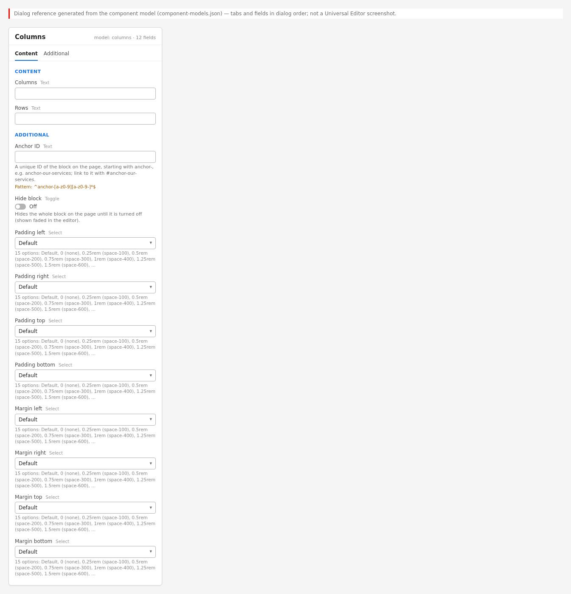{width=100%}

The properties panel of the block has two tabs:

- **Content:** Columns (number, default 2 in a new block) and Rows (number, default 1). They set
  the grid of the block in AEM (one cell per column in each row); the block's code does not read
  them, it counts the cells of the first row.
- **Additional:** Anchor ID, Hide block, Padding left / right / top / bottom, Margin left / right
  / top / bottom.

The components inside the columns have their own panels: Title (Title, Title Type), Image
(Image, Alt Text), Button (Link, Text, Title, Views, Type, Icon, Alignment) and Text (edited in
place in the canvas).

### 6.14.5 Authoring Guide

**Step 1 — Open the page in Universal Editor**

**Action:** In AEM Sites, select the page in the locale site and choose Edit.

**Expected Result:** The page opens in the Universal Editor canvas.

**Steps — Open the page:** Sites console with the page selected and Edit highlighted.

| Step | Where | Field / control | Value / action |
|:--|:----------|:----------|:--------------------|
| 1 | AEM Sites console | Navigation | Sites › tcs-corp › us › en |
| 2 | AEM Sites console | Select | The page /content/tcs-corp/us/en/about |
| 3 | AEM Sites console toolbar | Edit | Select Edit (opens the page in Universal Editor) |

**Step 2 — Add the Columns block**

**Action:** Select the section (or a Tabs section), select Add (+) and choose Columns.

**Expected Result:** A Columns block with two empty columns in one row is added.

**Steps — Add the block:** The component picker with Columns highlighted; the new empty block on the canvas.

| Step | Where | Field / control | Value / action |
|:--|:----------|:----------|:--------------------|
| 1 | Universal Editor › Content tree | Main › Section | Select the section (or a Tabs section) |
| 2 | Universal Editor › Content tree | Section › Add (+) | Open the component list |
| 3 | Component list | Blocks | Columns |
| 4 | Canvas | Check | One row with two empty columns (Columns = 2, Rows = 1 preset) |

**Step 3 — Set the number of columns and rows**

**Action:** With the block selected, set Columns and Rows in the Content tab.

**Expected Result:** The grid shows the requested number of cells.

**Steps — Columns and Rows:** Content tab with Columns = 3 and Rows = 1, and the three empty columns on the canvas.

| Step | Where | Field / control | Value / action |
|:--|:----------|:----------|:--------------------|
| 1 | Universal Editor › Content tree | Select | Columns |
| 2 | Columns › Content | Columns | 3 |
| 3 | Columns › Content | Rows | 1 |
| 4 | Canvas | Check | Three empty columns in one row |

**Step 4 — Add content to each column**

**Action:** Select a column, select Add (+) and choose Title, Text, Image or Button. Repeat for
each column.

**Expected Result:** The components appear in the column; only these four component types are
offered.

**Steps — Add column content:** The Add menu of a column listing Text, Image, Button and Title.

| Step | Where | Field / control | Value / action |
|:--|:----------|:----------|:--------------------|
| 1 | Universal Editor › Content tree | Select | Columns › Row 1 › Column 1 |
| 2 | Content tree › Columns › Row 1 › Column 1 | Add (+) | Open the component list |
| 3 | Component list | Offered components | Text, Image, Button, Title |
| 4 | Component list | Select | Image |
| 5 | Content tree › Columns › Row 1 › Column 2 | Add (+) | Title, then Text, then Button |

**Step 5 — Fill the components**

**Action:** Enter the Title and its Title Type, write the Text in place, select the Image and its
Alt Text, and set the Button's Link, Text, Views, Type and Alignment.

**Expected Result:** The columns show the content; on desktop they sit side by side.

**Steps — Fill the content:** A filled two-column block: image left, title, text and button right.

| Step | Where | Field / control | Value / action |
|:--|:----------|:----------|:--------------------|
| 1 | Columns › Row 1 › Column 1 › Image | Image | Select the asset photo-1.svg (/en/media/photo-1.svg) |
| 2 | Columns › Row 1 › Column 1 › Image | Alt Text | Consultants reviewing a cloud architecture on a large screen |
| 3 | Columns › Row 1 › Column 2 › Title | Title; Title Type | Cloud transformation, end to end; h2 |
| 4 | Columns › Row 1 › Column 2 › Text | Text (in place) | From assessment to migration and managed operations, our teams help enterprises move to the cloud with less risk and faster results. |
| 5 | Columns › Row 1 › Column 2 › Button | Link; Text | /en/services/cloud; Explore cloud services |
| 6 | Columns › Row 1 › Column 2 › Button | Views; Type; Alignment | Button; Primary; Left |

**Step 6 — Order the content**

**Action:** Drag components within a column, or between columns, in the content tree to change
their order.

**Expected Result:** The canvas reflects the new order.

**Steps — Reorder:** The content tree with a component being moved between columns.

| Step | Where | Field / control | Value / action |
|:--|:----------|:----------|:--------------------|
| 1 | Universal Editor › Content tree | Expand | Columns › Row 1 › Column 1 and Column 2 |
| 2 | Content tree | Drag | Button from Column 2 to below the Image in Column 1 |
| 3 | Content tree | Drag | Within a column: move Title above Text |
| 4 | Canvas | Check | The new order is shown |

**Step 7 — Fill the Additional tab (optional)**

**Action:** Select the block and set an Anchor ID, Hide block or spacing if required.

**Expected Result:** Anchor IDs that do not match the pattern are rejected.

**Steps — Additional tab:** Additional tab of the Columns block.

| Step | Where | Field / control | Value / action |
|:--|:----------|:----------|:--------------------|
| 1 | Universal Editor › Content tree | Select | Columns |
| 2 | Columns › Additional | Anchor ID | anchor-cloud-overview |
| 3 | Columns › Additional | Hide block | Off |
| 4 | Columns › Additional | Padding / Margin selects | Default (change only if required) |

**Step 8 — Preview**

**Action:** Use Preview mode; check the layout at desktop, tablet and mobile widths.

**Expected Result:** Columns side by side from 900px, stacked below, image-only columns first.

**Steps — Preview:** Preview at mobile width with the image above the text.

| Step | Where | Field / control | Value / action |
|:--|:----------|:----------|:--------------------|
| 1 | Universal Editor toolbar | Preview | Switch to Preview mode |
| 2 | Universal Editor toolbar | Emulation | Mobile (375 px): the image-only column above the text |
| 3 | Universal Editor toolbar | Emulation | Desktop (1440 px): columns side by side from 900 px |

**Step 9 — Validate**

**Action:** Run the Validation Process checklist.

**Expected Result:** All checks pass.

**Steps — Validation:** The page's heading outline and image alt texts checked in the browser tools.

| Step | Where | Field / control | Value / action |
|:--|:----------|:----------|:--------------------|
| 1 | Browser | Address | https://main--tcs-corp--sradha-tcs.aem.page/en/about |
| 2 | Browser developer tools | Accessibility tree / heading outline | Headings in the columns follow the page outline (H2 below the page H1) |
| 3 | Browser developer tools | Elements | Every column image has an alt text (or is decorative on purpose) |
| 4 | Browser developer tools | Device mode | 375 px, 768 px, 900 px, 1440 px |

**Step 10 — Publish**

**Action:** Publish the page from Universal Editor.

**Expected Result:** The live page shows the columns.

**Steps — Publish:** Universal Editor Publish dialog.

| Step | Where | Field / control | Value / action |
|:--|:----------|:----------|:--------------------|
| 1 | Universal Editor toolbar | Publish | Select Publish |
| 2 | Publish dialog | Pages | Keep the current page (and its referenced assets) selected |
| 3 | Publish dialog | Destination | Publish to Live (Publish to Preview first if your process requires it) |
| 4 | Publish dialog | Publish | Select Publish |
| 5 | Browser | Address | https://main--tcs-corp--sradha-tcs.aem.live/en/{path} after the CDN refresh |

#### Preview Process

1. Check in Universal Editor Preview mode.
2. Open the preview URL `https://main--tcs-corp--sradha-tcs.aem.page/{locale}/{path}` after
   publishing to preview (where available).
3. Check at 375px, 768px, 900px and 1440px; the layout switches at 900px.

#### Publishing Process

1. Publish the page from Universal Editor or the Sites console.
2. Images used in the columns are published with the page.
3. The live page updates after publishing.

#### Validation Process

- [ ] Every row has the intended number of columns (the first row sets the column count class).
- [ ] No column is empty (an empty cell still takes an equal share of the width).
- [ ] Images have Alt Text (or are decorative on purpose).
- [ ] Image-only columns appear first on mobile as intended.
- [ ] Headings in the columns follow the page outline.
- [ ] Buttons have clear labels and correct links.
- [ ] Text stays readable at 900px to 1199px with the chosen number of columns.
- [ ] Anchor ID (if any) is unique; Hide block is off when the block should be visible.

#### Rollback Process

1. Restore the previous page version from the version history, or undo the change.
2. Use Hide block to withdraw the block quickly.
3. Publish the page again.

The walkthroughs below repeat the steps above for each variation of chapter 6.14.3, from opening the page to publishing; the values are those of the variation's screenshot.

#### Walkthrough — Variation 1 — Two Columns

Reproduces the screenshot `screenshots/columns-two-columns.jpg` of this variation. The Field Entry Table under the screenshot lists every value with its rules.

**Step 1 — Open the page**

**Action:** In AEM Sites, open the locale site (for example `/content/tcs-corp/us/en`), select the page and choose Edit; the page opens in Universal Editor.

**Expected Result:** The page renders on the canvas with the content tree and the properties panel.

**Step 2 — Add the Columns**

**Action:** Select the section in the content tree, choose **Add (+)** and pick **Columns**.

**Expected Result:** An empty Columns block is added with the template grid of 2 columns and 1 row; the content tree shows Row 1 with Column 1 and Column 2.

**Step 3 — Fill in Columns › Content**

**Action:** Select **Columns** in the content tree and open the **Content** tab of the properties panel. Enter: **Columns** (A) = 2; **Rows** (B) = 1.

**Expected Result:** With Columns 2 and Rows 1 the content tree shows 1 row of 2 empty columns (Column 1, Column 2); the block will get columns-2-cols.

**Step 4 — Fill in Content tree › Columns › Row 1 › Column 1 › Add (+)**

**Action:** Select **Content tree** in the content tree and open the **Columns › Row 1 › Column 1 › Add (+)** tab of the properties panel. Enter: **Component** (C) = Title.

**Expected Result:** Title and Text components are added to Row 1, Column 1 in this order, empty until their fields are filled.

**Step 5 — Fill in Columns › Row 1 › Column 1 › Title**

**Action:** Select **Columns** in the content tree and open the **Row 1 › Column 1 › Title** tab of the properties panel. Enter: **Title** (D) = The challenge; **Title Type** (E) = h3.

**Expected Result:** 'The challenge' appears as an H3 at the top of Row 1, Column 1.

**Step 6 — Fill in Content tree › Columns › Row 1 › Column 1 › Add (+)**

**Action:** Select **Content tree** in the content tree and open the **Columns › Row 1 › Column 1 › Add (+)** tab of the properties panel. Enter: **Component** (F) = Text.

**Expected Result:** Title and Text components are added to Row 1, Column 1 in this order, empty until their fields are filled.

**Step 7 — Fill in Columns › Row 1 › Column 1 › Text**

**Action:** Select **Columns** in the content tree and open the **Row 1 › Column 1 › Text** tab of the properties panel. Enter: **Text (in place)** (G) = A global retailer ran its stores on ageing systems that could not share stock data in real time, so shelves were often empty while warehouses were full.

**Expected Result:** The paragraph 'A global retailer ran its stores on ageing systems…' appears in Row 1, Column 1, typed in place on the canvas.

**Step 8 — Fill in Content tree › Columns › Row 1 › Column 2 › Add (+)**

**Action:** Select **Content tree** in the content tree and open the **Columns › Row 1 › Column 2 › Add (+)** tab of the properties panel. Enter: **Component** (H) = Title.

**Expected Result:** Title and Text components are added to Row 1, Column 2 in this order, empty until their fields are filled.

**Step 9 — Fill in Columns › Row 1 › Column 2 › Title**

**Action:** Select **Columns** in the content tree and open the **Row 1 › Column 2 › Title** tab of the properties panel. Enter: **Title** (I) = The solution; **Title Type** (J) = h3.

**Expected Result:** 'The solution' appears as an H3 at the top of Row 1, Column 2.

**Step 10 — Fill in Content tree › Columns › Row 1 › Column 2 › Add (+)**

**Action:** Select **Content tree** in the content tree and open the **Columns › Row 1 › Column 2 › Add (+)** tab of the properties panel. Enter: **Component** (K) = Text.

**Expected Result:** Title and Text components are added to Row 1, Column 2 in this order, empty until their fields are filled.

**Step 11 — Fill in Columns › Row 1 › Column 2 › Text**

**Action:** Select **Columns** in the content tree and open the **Row 1 › Column 2 › Text** tab of the properties panel. Enter: **Text (in place)** (L) = We built a cloud-native inventory platform that connects every store and warehouse, with demand forecasts that update every hour.

**Expected Result:** The paragraph 'We built a cloud-native inventory platform that connects every…' appears in Row 1, Column 2, typed in place on the canvas.

**Step 12 — Preview**

**Action:** Choose **Preview** in the Universal Editor toolbar (or open the page on aem.page) and compare it with the screenshot.

**Expected Result:** Two equal columns: 'The challenge' with the paragraph about ageing store systems on the left, 'The solution' with the cloud-native inventory platform paragraph on the right.

**Step 13 — Publish**

**Action:** Choose **Publish** › Publish to Live (with the referenced pages, fragments and assets that are not yet published).

**Expected Result:** Publish to Preview shows the block on aem.page and Publish to Live on aem.live. The block holds no assets or links, so only the page is published.

**Step 14 — Verify**

**Action:** On the live page check: At 1440 px both headings start at nearly the same height.

**Expected Result:** The page matches the screenshot; nothing in the Troubleshooting case above applies.

#### Walkthrough — Variation 2 — Three or More Columns

Reproduces the screenshot `screenshots/columns-three-columns.jpg` of this variation. The Field Entry Table under the screenshot lists every value with its rules.

**Step 1 — Open the page**

**Action:** In AEM Sites, open the locale site (for example `/content/tcs-corp/us/en`), select the page and choose Edit; the page opens in Universal Editor.

**Expected Result:** The page renders on the canvas with the content tree and the properties panel.

**Step 2 — Add the Columns**

**Action:** Select the section in the content tree, choose **Add (+)** and pick **Columns**.

**Expected Result:** An empty Columns block is added with the template grid of 2 columns and 1 row; the content tree shows Row 1 with Column 1 and Column 2.

**Step 3 — Fill in Columns › Content**

**Action:** Select **Columns** in the content tree and open the **Content** tab of the properties panel. Enter: **Columns** (A) = 3; **Rows** (B) = 1.

**Expected Result:** With Columns 3 and Rows 1 the content tree shows 1 row of 3 empty columns (Column 1, Column 2, Column 3); the block will get columns-3-cols.

**Step 4 — Fill in Content tree › Columns › Row 1 › Column 1 › Add (+)**

**Action:** Select **Content tree** in the content tree and open the **Columns › Row 1 › Column 1 › Add (+)** tab of the properties panel. Enter: **Component** (C) = Title.

**Expected Result:** Title and Text components are added to Row 1, Column 1 in this order, empty until their fields are filled.

**Step 5 — Fill in Columns › Row 1 › Column 1 › Title**

**Action:** Select **Columns** in the content tree and open the **Row 1 › Column 1 › Title** tab of the properties panel. Enter: **Title** (D) = Our mission; **Title Type** (E) = h3.

**Expected Result:** 'Our mission' appears as an H3 at the top of Row 1, Column 1.

**Step 6 — Fill in Content tree › Columns › Row 1 › Column 1 › Add (+)**

**Action:** Select **Content tree** in the content tree and open the **Columns › Row 1 › Column 1 › Add (+)** tab of the properties panel. Enter: **Component** (F) = Text.

**Expected Result:** Title and Text components are added to Row 1, Column 1 in this order, empty until their fields are filled.

**Step 7 — Fill in Columns › Row 1 › Column 1 › Text**

**Action:** Select **Columns** in the content tree and open the **Row 1 › Column 1 › Text** tab of the properties panel. Enter: **Text (in place)** (G) = Help our clients build resilient, future-ready enterprises.

**Expected Result:** The paragraph 'Help our clients build resilient, future-ready enterprises.' appears in Row 1, Column 1, typed in place on the canvas.

**Step 8 — Fill in Content tree › Columns › Row 1 › Column 2 › Add (+)**

**Action:** Select **Content tree** in the content tree and open the **Columns › Row 1 › Column 2 › Add (+)** tab of the properties panel. Enter: **Component** (H) = Title.

**Expected Result:** Title and Text components are added to Row 1, Column 2 in this order, empty until their fields are filled.

**Step 9 — Fill in Columns › Row 1 › Column 2 › Title**

**Action:** Select **Columns** in the content tree and open the **Row 1 › Column 2 › Title** tab of the properties panel. Enter: **Title** (I) = Our vision; **Title Type** (J) = h3.

**Expected Result:** 'Our vision' appears as an H3 at the top of Row 1, Column 2.

**Step 10 — Fill in Content tree › Columns › Row 1 › Column 2 › Add (+)**

**Action:** Select **Content tree** in the content tree and open the **Columns › Row 1 › Column 2 › Add (+)** tab of the properties panel. Enter: **Component** (K) = Text.

**Expected Result:** Title and Text components are added to Row 1, Column 2 in this order, empty until their fields are filled.

**Step 11 — Fill in Columns › Row 1 › Column 2 › Text**

**Action:** Select **Columns** in the content tree and open the **Row 1 › Column 2 › Text** tab of the properties panel. Enter: **Text (in place)** (L) = Be the most trusted partner for business transformation.

**Expected Result:** The paragraph 'Be the most trusted partner for business transformation.' appears in Row 1, Column 2, typed in place on the canvas.

**Step 12 — Fill in Content tree › Columns › Row 1 › Column 3 › Add (+)**

**Action:** Select **Content tree** in the content tree and open the **Columns › Row 1 › Column 3 › Add (+)** tab of the properties panel. Enter: **Component** (M) = Title.

**Expected Result:** Title and Text components are added to Row 1, Column 3 in this order, empty until their fields are filled.

**Step 13 — Fill in Columns › Row 1 › Column 3 › Title**

**Action:** Select **Columns** in the content tree and open the **Row 1 › Column 3 › Title** tab of the properties panel. Enter: **Title** (N) = Our values; **Title Type** (O) = h3.

**Expected Result:** 'Our values' appears as an H3 at the top of Row 1, Column 3.

**Step 14 — Fill in Content tree › Columns › Row 1 › Column 3 › Add (+)**

**Action:** Select **Content tree** in the content tree and open the **Columns › Row 1 › Column 3 › Add (+)** tab of the properties panel. Enter: **Component** (P) = Text.

**Expected Result:** Title and Text components are added to Row 1, Column 3 in this order, empty until their fields are filled.

**Step 15 — Fill in Columns › Row 1 › Column 3 › Text**

**Action:** Select **Columns** in the content tree and open the **Row 1 › Column 3 › Text** tab of the properties panel. Enter: **Text (in place)** (Q) = Integrity, excellence, respect for the individual and learning.

**Expected Result:** The paragraph 'Integrity, excellence, respect for the individual and learning.' appears in Row 1, Column 3, typed in place on the canvas.

**Step 16 — Preview**

**Action:** Choose **Preview** in the Universal Editor toolbar (or open the page on aem.page) and compare it with the screenshot.

**Expected Result:** Three equal columns: 'Our mission' with 'Help our clients build resilient, future-ready enterprises.', 'Our vision' and 'Our values' with their single sentences.

**Step 17 — Publish**

**Action:** Choose **Publish** › Publish to Live (with the referenced pages, fragments and assets that are not yet published).

**Expected Result:** Publish to Preview shows the block on aem.page and Publish to Live on aem.live; the block has no assets or links to publish separately.

**Step 18 — Verify**

**Action:** On the live page check: The preview page shows three columns, each with a heading and a sentence.

**Expected Result:** The page matches the screenshot; nothing in the Troubleshooting case above applies.

#### Walkthrough — Variation 3 — Image Column

Reproduces the screenshot `screenshots/columns-image-column.jpg` of this variation. The Field Entry Table under the screenshot lists every value with its rules.

**Step 1 — Open the page**

**Action:** In AEM Sites, open the locale site (for example `/content/tcs-corp/us/en`), select the page and choose Edit; the page opens in Universal Editor.

**Expected Result:** The page renders on the canvas with the content tree and the properties panel.

**Step 2 — Add the Columns**

**Action:** Select the section in the content tree, choose **Add (+)** and pick **Columns**.

**Expected Result:** An empty Columns block is added with the template grid of 2 columns and 1 row; the content tree shows Row 1 with Column 1 and Column 2.

**Step 3 — Fill in Columns › Content**

**Action:** Select **Columns** in the content tree and open the **Content** tab of the properties panel. Enter: **Columns** (A) = 2; **Rows** (B) = 1.

**Expected Result:** With Columns 2 and Rows 1 the content tree shows 1 row of 2 empty columns (Column 1, Column 2); the block will get columns-2-cols.

**Step 4 — Fill in Content tree › Columns › Row 1 › Column 1 › Add (+)**

**Action:** Select **Content tree** in the content tree and open the **Columns › Row 1 › Column 1 › Add (+)** tab of the properties panel. Enter: **Component** (C) = Title.

**Expected Result:** Title and Text components are added to Row 1, Column 1 in this order, empty until their fields are filled.

**Step 5 — Fill in Columns › Row 1 › Column 1 › Title**

**Action:** Select **Columns** in the content tree and open the **Row 1 › Column 1 › Title** tab of the properties panel. Enter: **Title** (D) = Intelligent operations; **Title Type** (E) = h2.

**Expected Result:** 'Intelligent operations' appears as an H2 at the top of Row 1, Column 1.

**Step 6 — Fill in Content tree › Columns › Row 1 › Column 1 › Add (+)**

**Action:** Select **Content tree** in the content tree and open the **Columns › Row 1 › Column 1 › Add (+)** tab of the properties panel. Enter: **Component** (F) = Text.

**Expected Result:** Title and Text components are added to Row 1, Column 1 in this order, empty until their fields are filled.

**Step 7 — Fill in Columns › Row 1 › Column 1 › Text**

**Action:** Select **Columns** in the content tree and open the **Row 1 › Column 1 › Text** tab of the properties panel. Enter: **Text (in place)** (G) = AI-led automation monitors applications and infrastructure around the clock and resolves routine incidents before users notice them.

**Expected Result:** The paragraph 'AI-led automation monitors applications and infrastructure around the clock…' appears in Row 1, Column 1, typed in place on the canvas.

**Step 8 — Fill in Content tree › Columns › Row 1 › Column 2 › Add (+)**

**Action:** Select **Content tree** in the content tree and open the **Columns › Row 1 › Column 2 › Add (+)** tab of the properties panel. Enter: **Component** (H) = Image.

**Expected Result:** An Image component is added to Row 1, Column 2; as the only content of the column it will get columns-img-col.

**Step 9 — Fill in Columns › Row 1 › Column 2 › Image**

**Action:** Select **Columns** in the content tree and open the **Row 1 › Column 2 › Image** tab of the properties panel. Enter: **Image** (I) = Select the asset photo-2.svg (/en/media/photo-2.svg); **Alt Text** (J) = Operations dashboard with real-time service health.

**Expected Result:** photo-2.svg fills Row 1, Column 2 at full width with the alt text 'Operations dashboard with real-time service health'; being alone in the column, it is shown first below 900 px.

**Step 10 — Preview**

**Action:** Screen width: 1440 px (desktop); inset: the same block at 375 px (mobile).

**Expected Result:** At 1440 px the text is on the left and photo-2.svg on the right; at 375 px the image moves above the text.

**Step 11 — Preview**

**Action:** Choose **Preview** in the Universal Editor toolbar (or open the page on aem.page) and compare it with the screenshot.

**Expected Result:** Desktop: 'Intelligent operations' and the AI-led automation paragraph on the left, photo-2.svg on the right; the 375 px inset shows the image moved above the text.

**Step 12 — Publish**

**Action:** Choose **Publish** › Publish to Live (with the referenced pages, fragments and assets that are not yet published).

**Expected Result:** Publish to Preview shows the block on main--tcs-corp--sradha-tcs.aem.page and Publish to Live on aem.live, served by the CDN after the purge; photo-2.svg must be published with the page as referenced assets.

**Step 13 — Verify**

**Action:** On the live page check: At 375 px the image comes first; Column 2 has the class columns-img-col.

**Expected Result:** The page matches the screenshot; nothing in the Troubleshooting case above applies.

#### Walkthrough — Variation 4 — Multiple Rows

Reproduces the screenshot `screenshots/columns-multiple-rows.jpg` of this variation. The Field Entry Table under the screenshot lists every value with its rules.

**Step 1 — Open the page**

**Action:** In AEM Sites, open the locale site (for example `/content/tcs-corp/us/en`), select the page and choose Edit; the page opens in Universal Editor.

**Expected Result:** The page renders on the canvas with the content tree and the properties panel.

**Step 2 — Add the Columns**

**Action:** Select the section in the content tree, choose **Add (+)** and pick **Columns**.

**Expected Result:** An empty Columns block is added with the template grid of 2 columns and 1 row; the content tree shows Row 1 with Column 1 and Column 2.

**Step 3 — Fill in Columns › Content**

**Action:** Select **Columns** in the content tree and open the **Content** tab of the properties panel. Enter: **Columns** (A) = 2; **Rows** (B) = 3.

**Expected Result:** With Columns 2 and Rows 3 the content tree shows 3 rows of 2 empty columns (Column 1, Column 2); the block will get columns-2-cols.

**Step 4 — Fill in Content tree › Columns › Row 1 › Column 1 › Add (+)**

**Action:** Select **Content tree** in the content tree and open the **Columns › Row 1 › Column 1 › Add (+)** tab of the properties panel. Enter: **Component** (C) = Image.

**Expected Result:** An Image component is added to Row 1, Column 1; as the only content of the column it will get columns-img-col.

**Step 5 — Fill in Columns › Row 1 › Column 1 › Image**

**Action:** Select **Columns** in the content tree and open the **Row 1 › Column 1 › Image** tab of the properties panel. Enter: **Image** (D) = Select the asset photo-3.svg (/en/media/photo-3.svg); **Alt Text** (E) = Data engineers at work.

**Expected Result:** photo-3.svg fills Row 1, Column 1 at full width with the alt text 'Data engineers at work'; being alone in the column, it is shown first below 900 px.

**Step 6 — Fill in Content tree › Columns › Row 1 › Column 2 › Add (+)**

**Action:** Select **Content tree** in the content tree and open the **Columns › Row 1 › Column 2 › Add (+)** tab of the properties panel. Enter: **Component** (F) = Title.

**Expected Result:** Title and Text components are added to Row 1, Column 2 in this order, empty until their fields are filled.

**Step 7 — Fill in Columns › Row 1 › Column 2 › Title**

**Action:** Select **Columns** in the content tree and open the **Row 1 › Column 2 › Title** tab of the properties panel. Enter: **Title** (G) = Discover; **Title Type** (H) = h3.

**Expected Result:** 'Discover' appears as an H3 at the top of Row 1, Column 2.

**Step 8 — Fill in Content tree › Columns › Row 1 › Column 2 › Add (+)**

**Action:** Select **Content tree** in the content tree and open the **Columns › Row 1 › Column 2 › Add (+)** tab of the properties panel. Enter: **Component** (I) = Text.

**Expected Result:** Title and Text components are added to Row 1, Column 2 in this order, empty until their fields are filled.

**Step 9 — Fill in Columns › Row 1 › Column 2 › Text**

**Action:** Select **Columns** in the content tree and open the **Row 1 › Column 2 › Text** tab of the properties panel. Enter: **Text (in place)** (J) = We map your processes, data and systems to find where change creates the most value.

**Expected Result:** The paragraph 'We map your processes, data and systems to find…' appears in Row 1, Column 2, typed in place on the canvas.

**Step 10 — Fill in Content tree › Columns › Row 2 › Column 1 › Add (+)**

**Action:** Select **Content tree** in the content tree and open the **Columns › Row 2 › Column 1 › Add (+)** tab of the properties panel. Enter: **Component** (K) = Title.

**Expected Result:** Title and Text components are added to Row 2, Column 1 in this order, empty until their fields are filled.

**Step 11 — Fill in Columns › Row 2 › Column 1 › Title**

**Action:** Select **Columns** in the content tree and open the **Row 2 › Column 1 › Title** tab of the properties panel. Enter: **Title** (L) = Design; **Title Type** (M) = h3.

**Expected Result:** 'Design' appears as an H3 at the top of Row 2, Column 1.

**Step 12 — Fill in Content tree › Columns › Row 2 › Column 1 › Add (+)**

**Action:** Select **Content tree** in the content tree and open the **Columns › Row 2 › Column 1 › Add (+)** tab of the properties panel. Enter: **Component** (N) = Text.

**Expected Result:** Title and Text components are added to Row 2, Column 1 in this order, empty until their fields are filled.

**Step 13 — Fill in Columns › Row 2 › Column 1 › Text**

**Action:** Select **Columns** in the content tree and open the **Row 2 › Column 1 › Text** tab of the properties panel. Enter: **Text (in place)** (O) = Joint teams shape the target architecture and the roadmap to reach it.

**Expected Result:** The paragraph 'Joint teams shape the target architecture and the roadmap…' appears in Row 2, Column 1, typed in place on the canvas.

**Step 14 — Fill in Content tree › Columns › Row 2 › Column 2 › Add (+)**

**Action:** Select **Content tree** in the content tree and open the **Columns › Row 2 › Column 2 › Add (+)** tab of the properties panel. Enter: **Component** (P) = Image.

**Expected Result:** An Image component is added to Row 2, Column 2; as the only content of the column it will get columns-img-col.

**Step 15 — Fill in Columns › Row 2 › Column 2 › Image**

**Action:** Select **Columns** in the content tree and open the **Row 2 › Column 2 › Image** tab of the properties panel. Enter: **Image** (Q) = Select the asset photo-4.svg (/en/media/photo-4.svg); **Alt Text** (R) = Workshop with sticky notes on a wall.

**Expected Result:** photo-4.svg fills Row 2, Column 2 at full width with the alt text 'Workshop with sticky notes on a wall'; being alone in the column, it is shown first below 900 px.

**Step 16 — Fill in Content tree › Columns › Row 3 › Column 1 › Add (+)**

**Action:** Select **Content tree** in the content tree and open the **Columns › Row 3 › Column 1 › Add (+)** tab of the properties panel. Enter: **Component** (S) = Image.

**Expected Result:** An Image component is added to Row 3, Column 1; as the only content of the column it will get columns-img-col.

**Step 17 — Fill in Columns › Row 3 › Column 1 › Image**

**Action:** Select **Columns** in the content tree and open the **Row 3 › Column 1 › Image** tab of the properties panel. Enter: **Image** (T) = Select the asset photo-5.svg (/en/media/photo-5.svg); **Alt Text** (U) = Engineers deploying a release.

**Expected Result:** photo-5.svg fills Row 3, Column 1 at full width with the alt text 'Engineers deploying a release'; being alone in the column, it is shown first below 900 px.

**Step 18 — Fill in Content tree › Columns › Row 3 › Column 2 › Add (+)**

**Action:** Select **Content tree** in the content tree and open the **Columns › Row 3 › Column 2 › Add (+)** tab of the properties panel. Enter: **Component** (V) = Title.

**Expected Result:** Title and Text components are added to Row 3, Column 2 in this order, empty until their fields are filled.

**Step 19 — Fill in Columns › Row 3 › Column 2 › Title**

**Action:** Select **Columns** in the content tree and open the **Row 3 › Column 2 › Title** tab of the properties panel. Enter: **Title** (W) = Deliver; **Title Type** (X) = h3.

**Expected Result:** 'Deliver' appears as an H3 at the top of Row 3, Column 2.

**Step 20 — Fill in Content tree › Columns › Row 3 › Column 2 › Add (+)**

**Action:** Select **Content tree** in the content tree and open the **Columns › Row 3 › Column 2 › Add (+)** tab of the properties panel. Enter: **Component** (Y) = Text.

**Expected Result:** Title and Text components are added to Row 3, Column 2 in this order, empty until their fields are filled.

**Step 21 — Fill in Columns › Row 3 › Column 2 › Text**

**Action:** Select **Columns** in the content tree and open the **Row 3 › Column 2 › Text** tab of the properties panel. Enter: **Text (in place)** (Z) = Agile squads build, migrate and run the new platform, measuring outcomes as they go.

**Expected Result:** The paragraph 'Agile squads build, migrate and run the new platform,…' appears in Row 3, Column 2, typed in place on the canvas.

**Step 22 — Preview**

**Action:** Choose **Preview** in the Universal Editor toolbar (or open the page on aem.page) and compare it with the screenshot.

**Expected Result:** Row 1: photo-3.svg left, 'Discover' right; Row 2: 'Design' left, photo-4.svg right; Row 3: photo-5.svg left, 'Deliver' right, each with its short paragraph.

**Step 23 — Publish**

**Action:** Choose **Publish** › Publish to Live (with the referenced pages, fragments and assets that are not yet published).

**Expected Result:** Publish to Preview shows the block on main--tcs-corp--sradha-tcs.aem.page and Publish to Live on aem.live, served by the CDN after the purge; photo-3.svg, photo-4.svg and photo-5.svg must be published with the page as referenced assets.

**Step 24 — Verify**

**Action:** On the live page check: At 1440 px the three rows have equal heights and the text is centred beside each image.

**Expected Result:** The page matches the screenshot; nothing in the Troubleshooting case above applies.

### 6.14.6 Authorable Field Specification

**Model `columns` — Content and Additional tabs**

| Field Name | Field Type | Mandatory | Multi Value | Default Value | Business Purpose | Author Guidance | Validation Rules | Example Value |
|:-------------------------|:----------|:-----------|:-------|:--------------------|:---------------|:------------------|:-------------------------|:-------------------|
| Columns (`columns`) | text (number) | No | No | empty in the model; 2 in a new block (template) | Number of columns of the grid | 2 to 4 | Number value type; no range enforced | 3 |
| Rows (`rows`) | text (number) | No | No | empty in the model; 1 in a new block (template) | Number of rows | As many as needed | Number value type; no range enforced | 2 |
| Anchor ID (`classes_anchor`) | text | No | No | empty | Id for in-page links | Start with anchor- | Enforced: regExp `^anchor-[a-z0-9][a-z0-9-]*$` | anchor-our-values |
| Hide block (`classes_hideblock`) | boolean | No | No | false | Hide the block | Prepare or withdraw | Toggle | false |
| Padding left (`classes_paddingleft`) | select | No | No | Default (empty) | Left padding | Only when the design asks | 15 options (pl-0 ... pl-3000) | pl-400 |
| Padding right (`classes_paddingright`) | select | No | No | Default (empty) | Right padding | Only when the design asks | 15 options (pr-0 ... pr-3000) | pr-400 |
| Padding top (`classes_paddingtop`) | select | No | No | Default (empty) | Top padding | Only when the design asks | 15 options (pt-0 ... pt-3000) | pt-800 |
| Padding bottom (`classes_paddingbottom`) | select | No | No | Default (empty) | Bottom padding | Only when the design asks | 15 options (pb-0 ... pb-3000) | pb-800 |
| Margin left (`classes_marginleft`) | select | No | No | Default (empty) | Left margin | Only when the design asks | 15 options (ml-0 ... ml-3000) | ml-0 |
| Margin right (`classes_marginright`) | select | No | No | Default (empty) | Right margin | Only when the design asks | 15 options (mr-0 ... mr-3000) | mr-0 |
| Margin top (`classes_margintop`) | select | No | No | Default (empty) | Top margin | Only when the design asks | 15 options (mt-0 ... mt-3000) | mt-1600 |
| Margin bottom (`classes_marginbottom`) | select | No | No | Default (empty) | Bottom margin | Only when the design asks | 15 options (mb-0 ... mb-3000) | mb-1600 |

The padding and margin selects have the same 15 options as in 6.12.6 (Default, 0 (none), and the
tokens space-100 to space-3000).

**Column item (`column`)**

The column has no model of its own (no fields). Its filter allows four components: Text, Image,
Button and Title. Their fields:

| Field Name | Field Type | Mandatory | Multi Value | Default Value | Business Purpose | Author Guidance | Validation Rules | Example Value |
|:-------------------|:-------------|:-----------|:-------|:---------|:----------------|:----------------------|:----------------|:----------------------|
| Text (Text component) | rich text (edited in place) | No | No | empty | Paragraphs, lists, links | Keep it short in narrow columns | None | Our values guide every engagement. |
| Title (Title component) | text | No | No | empty | Heading in the column | Short heading | None | Our mission |
| Title Type (Title component) | select | No | No | none set | Heading level | h1-h6; fit the outline | h1-h6 | h3 |
| Image (Image component) | reference | No | No | empty | Image in the column | From AEM Assets | Single asset | /content/dam/tcs-corp/illustrations/cloud.png |
| Alt Text (Image component) | text | No | No | empty | Image alternative text | Describe the image | None | Cloud migration illustration |
| Link (Button component) | aem-content | No | No | empty | Button target | Page or URL | None | /content/tcs-corp/us/en/services/cloud |
| Text (Button component) | text | No | No | empty | Button label | Action-oriented | None | Explore cloud services |
| Title (Button component) | text | No | No | empty | Link title attribute | Optional extra description | None | Cloud services overview |
| Views (Button component) | select | No | No | button | Button, Icon or Link | Choose the view | button, icon, link | button |
| Type (Button component) | select | No | No | primary | Button style | Primary, Secondary, Tertiary | Shown when Views is empty, Button or Icon | secondary |
| Icon (Button component) | select | No | No | none | Icon of an icon button | Arrow right, Chevron right, Chevron down, Search | Shown when Views is Icon | arrow-right |
| Alignment (Button component) | select | No | No | left | Button alignment | Left, Center, Right | left, center, right | left |

**Field details**

**Columns (`columns`)**

- Purpose: The number of columns of the grid.
- Allowed Values: A number (value type number); a new block starts with 2.
- Character Limits: Not applicable. No range is enforced. Recommended: 2 to 4.
- Business Rules: Used by AEM to build the grid; the code counts the first row's cells for the
  `columns-{n}-cols` class.
- Dependency Rules: Rows.
- Visibility Rules: Always visible (no `condition`).
- Sample Content: 3.

**Rows (`rows`)**

- Purpose: The number of rows.
- Allowed Values: A number; a new block starts with 1.
- Character Limits: Not applicable. No range is enforced.
- Business Rules: Each row is laid out on its own.
- Dependency Rules: Columns.
- Visibility Rules: Always visible.
- Sample Content: 2.

**Anchor ID (`classes_anchor`)**

- Purpose: Block id for `#anchor-...` links.
- Allowed Values: `anchor-` plus lower-case letters, digits and hyphens.
- Character Limits: None enforced. Recommended: up to 40 characters.
- Business Rules: Enforced by regExp `^anchor-[a-z0-9][a-z0-9-]*$`; duplicates get `-2`, `-3`.
- Dependency Rules: Becomes the data layer component id.
- Visibility Rules: Always visible.
- Sample Content: `anchor-our-values`.

**Hide block (`classes_hideblock`)**

- Purpose: Hides the block on the page.
- Allowed Values: On / Off (default Off).
- Character Limits: Not applicable.
- Business Rules: Not displayed outside edit mode; faded with a dashed outline in edit mode.
- Dependency Rules: None.
- Visibility Rules: Always visible.
- Sample Content: Off.

**Padding left / right / top / bottom (`classes_paddingleft`, `classes_paddingright`,
`classes_paddingtop`, `classes_paddingbottom`)** — each field separately:

- Padding left — Purpose: left inner spacing; Allowed Values: the 15 options (`pl-{token}`);
  Character Limits: not applicable; Business Rules: styled in `styles/styles.css`; Dependency
  Rules: none; Visibility Rules: always visible; Sample Content: 1rem (space-400).
- Padding right — Purpose: right inner spacing; Allowed Values: the 15 options (`pr-{token}`);
  Character Limits: not applicable; Business Rules: as Padding left; Dependency Rules: none;
  Visibility Rules: always visible; Sample Content: 1rem (space-400).
- Padding top — Purpose: top inner spacing; Allowed Values: the 15 options (`pt-{token}`);
  Character Limits: not applicable; Business Rules: as Padding left; Dependency Rules: none;
  Visibility Rules: always visible; Sample Content: 2rem (space-800).
- Padding bottom — Purpose: bottom inner spacing; Allowed Values: the 15 options
  (`pb-{token}`); Character Limits: not applicable; Business Rules: as Padding left; Dependency
  Rules: none; Visibility Rules: always visible; Sample Content: 2rem (space-800).

**Margin left / right / top / bottom (`classes_marginleft`, `classes_marginright`,
`classes_margintop`, `classes_marginbottom`)** — each field separately:

- Margin left — Purpose: left outer spacing; Allowed Values: the 15 options (`ml-{token}`);
  Character Limits: not applicable; Business Rules: styled in `styles/styles.css`; Dependency
  Rules: none; Visibility Rules: always visible; Sample Content: 0 (none).
- Margin right — Purpose: right outer spacing; Allowed Values: the 15 options (`mr-{token}`);
  Character Limits: not applicable; Business Rules: as Margin left; Dependency Rules: none;
  Visibility Rules: always visible; Sample Content: 0 (none).
- Margin top — Purpose: space above the block; Allowed Values: the 15 options (`mt-{token}`);
  Character Limits: not applicable; Business Rules: as Margin left; Dependency Rules: none;
  Visibility Rules: always visible; Sample Content: 4rem (space-1600).
- Margin bottom — Purpose: space below the block; Allowed Values: the 15 options
  (`mb-{token}`); Character Limits: not applicable; Business Rules: as Margin left; Dependency
  Rules: none; Visibility Rules: always visible; Sample Content: 4rem (space-1600).

**Column content (Text, Title, Image, Button components)**

- Purpose: The content of each column.
- Allowed Values: Only Text, Image, Button and Title can be added to a column (filter `column`).
- Character Limits: None enforced. Recommended: a heading up to 40 characters and up to 300
  characters of text per column in three-column layouts.
- Business Rules: A standalone link in a paragraph and the Button component are turned into
  buttons or link buttons by the content buttons decorator; an image alone in a column makes it
  an image column.
- Dependency Rules: Button Type is shown only when Views is empty, Button or Icon; Button Icon
  only when Views is Icon (model `condition`).
- Visibility Rules: As above for the Button fields; all other fields always visible.
- Sample Content: Title "Our mission" (h3), Text "We help enterprises...", Button "Learn more".

### 6.14.7 Field Annotation Mapping

| Marker | Field | Purpose |
|:--------|:----------------------------|:--------------------|
| A | Columns block (Columns, Rows, Additional tab) | Grid size and block options |
| B | Column (container, no fields) | Holds the column's components |
| C | Title component (Title, Title Type) | Heading in a column |
| D | Text component (rich text) | Body text in a column |
| E | Image component (Image, Alt Text) or Button component | Image or call to action in a column |

### 6.14.8 Component Specification

| Attribute | Value |
|:-----------------|:------------------------------------------------------------|
| Component Name | Columns (`columns`) |
| Version | 1.0 |
| Owner | [To be confirmed: product owner]; technical owner: development team |
| Dependencies | No imports in the block code; default content models (Text, Title, Image, Button); global buttons, block options and data layer decorators |
| Component Type | Container block (`core/franklin/components/columns/v1/columns`), with column items holding default content |
| Supported Variants | Any number of columns and rows; image-only columns; no style options |
| Supported Templates | Any page; allowed in sections and Tabs sections |
| Supported Metadata | None |
| Supported Tags | None |
| Supported Personalization | None; Adobe Target via the data layer once Adobe Tags is integrated (not implemented) |
| Caching Considerations | Part of the page HTML cached by the Edge Delivery CDN; nothing fetched |
| Performance Considerations | Very small synchronous decoration; images are the authored, optimized pictures; in the first section the first image is the LCP candidate and loaded eagerly |
| Accessibility Compliance | DOM order kept; image alt text from the Image component; headings from the Title component; visual reorder of image columns on mobile only |
| SEO Compliance | All content in the HTML; headings and alt texts authored per component |

### 6.14.9 Input Model

- **Content Inputs:** The rows and cells of the grid, each cell holding Text, Title, Image and
  Button content.
- **Metadata Inputs:** None.
- **Tags Inputs:** None.
- **Page Context Inputs:** None.
- **Query Inputs:** None.
- **Manual Inputs:** Columns and Rows (grid size), the column content and the Additional tab
  values (as block classes).

Authored HTML (one `div` per row, one `div` per column):

```html
<div class="columns anchor-our-values">
  <div>
    <div><picture></picture></div>
    <div>
      <h3>Our mission</h3>
      <p>We help enterprises grow with technology.</p>
      <p><a href="/en/about">Learn more</a></p>
    </div>
  </div>
</div>
```

### 6.14.10 Output Model

**Rendered Output:** The rows and cells keep their structure. The code adds the class
`columns-{n}-cols` to the block (n = cells in the first row) and `columns-img-col` to each
image-only column. Links and Button components were already turned into buttons
(`p.button-wrapper`, `a.button`) by the content buttons decorator before the block loads. The
block options decorator sets the `id` from the Anchor ID.

**Generated HTML:**

```html
<div class="columns anchor-our-values columns-2-cols block" id="anchor-our-values"
  data-block-name="columns" data-block-status="loaded">
  <div>
    <div class="columns-img-col"><picture>
    </picture></div>
    <div>
      <h3>Our mission</h3>
      <p>We help enterprises grow with technology.</p>
      <p class="button-wrapper">
        <a href="/en/about" title="Learn more" class="link-button">Learn more</a>
      </p>
    </div>
  </div>
</div>
```

An unformatted standalone link becomes a link button (`link-button`); a bold or italic link, or
a Button component with Views = Button, becomes a button (`button primary`, `button secondary`
or `button tertiary`); Views = Icon adds `icon-button`. See the Button chapter for details.

**Generated JSON:** None.

**Generated Metadata:** None.

**Analytics Tracking:** The block is added to the data layer after the sections load (id = Anchor
ID, else `columns-{n}`; `dc:title` = the first heading in any column). Clicks on links and
buttons in the columns push `cmp:click` with the link URL and type (`other`, `exit` or
`download`).

```json
{
  "event": "cmp:click",
  "eventInfo": {
    "path": "component.anchor-our-values",
    "interaction": "link",
    "dc:title": "Learn more",
    "xdm:linkURL": "https://main--tcs-corp--sradha-tcs.aem.live/en/about",
    "xdm:linkType": "other",
    "breakpoint": "tablet"
  }
}
```

**Personalization Output:** None.

**Search Index Output:** None (the query index reads page metadata only).

**Target Personalization Output:** None in the block today: no personalisation marker or Target mbox. The block is in the data layer as tcs-corp/components/columns (id = Anchor ID or columns-n, dc:title = its first heading) with cmp:click for its links and buttons, which Adobe Target could use once Adobe Tags is integrated (Not implemented (as of this handover)).

### 6.14.11 Business Rules

1. The column count class is `columns-{n}-cols`, with n the number of cells in the first row.
2. Columns and Rows are not read by the code; they define the grid authored in AEM.
3. A column gets `columns-img-col` when it contains a picture and the picture's nearest `div`
   (the column) has exactly one child.
4. A column with an image plus other content is a normal column.
5. Below 900px each row stacks its columns; image-only columns are shown first (`order: 0`), the
   others after (`order: 1`).
6. From 900px each row is horizontal, columns have equal widths (`flex: 1`), a 1.5rem gap and are
   vertically centred; the authored order applies.
7. Images fill their column's width; there is no crop or fixed aspect ratio.
8. Only Text, Image, Button and Title can be added to a column (filter `column`); only columns
   can be added to the block (filter `columns`).
9. Links and Button components are decorated as buttons or link buttons by the global content
   buttons decorator.
10. An empty Columns block (no rows) fails to decorate (no first row); the error is logged by the
    block loader as `failed to load module for columns` and nothing is rendered.
11. The Additional tab works as for every block: Anchor ID (validated), Hide block (hidden outside
    edit mode, faded in edit mode), padding and margin classes.
12. Editor-only: each change re-decorates the block.
13. There are no style options and no per-breakpoint column settings.

### 6.14.12 Author Best Practices

**Recommended Content Length:** Two columns: up to about 600 characters per column; three
columns: up to about 300; four columns: up to about 150. A heading per column up to 40
characters. (Recommended.)

**Image Dimensions:** Images are shown at the full width of their column with their own aspect
ratio. Use the same aspect ratio for images in the same row (for example 16 : 9 or 1 : 1) so the
row looks even; width at least twice the displayed column width (for example 1200px for a
two-column block at 1200px wide).

**CTA Writing Guidelines:** Use the Button component (or a standalone link in its own paragraph)
with an action-oriented label ("Explore cloud services"); one primary button per column at most.

**Accessibility Guidelines:** Start each column with a Title at the right level; set Alt Text on
every meaningful image; do not rely on the side-by-side position to convey meaning (on mobile
the columns are stacked and image columns move up).

**SEO Guidelines:** Use real headings (Title component) rather than bold text; use descriptive
link labels.

**Metadata Guidelines:** The block reads no metadata.

**Taxonomy Guidelines:** No tags in the block.

**Localization Guidelines:** Translations can be much longer (for example German); check that
columns still balance on desktop and keep text short in three- and four-column layouts.

### 6.14.13 Troubleshooting Guide

#### Issue 1 — The block shows nothing

**Symptoms:** An empty space or nothing where the Columns block should be; the console shows
`failed to load module for columns`.

**Root Cause:** The block has no rows (for example all rows were removed), so the code finds no
first row.

**Diagnosis Steps:** Inspect the block in the browser; check for rows and the console error.

**Resolution Steps:** Set Rows to at least 1 and Columns to at least 1 and add content, or delete
the block.

**Validation Steps:** The block renders and the error is gone.

**Preventive Measures:** Delete unused Columns blocks rather than emptying them.

#### Issue 2 — Columns have different widths than expected

**Symptoms:** A column is wider or narrower than intended, or a design asks for 1/3 and 2/3.

**Root Cause:** Columns always share the row equally; there is no width setting.

**Diagnosis Steps:** Check the number of cells in the row.

**Resolution Steps:** Use the equal split, or a designed block (Teaser) for asymmetric layouts;
request a new variant from development if needed.

**Validation Steps:** Review at 1440px.

**Preventive Measures:** Agree layouts with the design team before authoring.

#### Issue 3 — The image is not first on mobile

**Symptoms:** On mobile the text appears before the image.

**Root Cause:** The image column also contains text or a button, so it is not an image column.

**Diagnosis Steps:** Check whether the column has the class `columns-img-col`.

**Resolution Steps:** Move the other content to another column, leaving only the Image.

**Validation Steps:** On mobile the image appears first.

**Preventive Measures:** Keep images in their own column.

#### Issue 4 — Columns are too narrow on small laptops

**Symptoms:** At 900px to 1199px the text in four or more columns wraps after a few words.

**Root Cause:** The layout becomes horizontal at 900px whatever the number of columns.

**Diagnosis Steps:** Check at 900px and 1024px.

**Resolution Steps:** Reduce the number of columns or shorten the text; use Cards or List for
many items (they have per-breakpoint columns).

**Validation Steps:** Text is readable at 900px.

**Preventive Measures:** Prefer 2 to 3 columns.

#### Issue 5 — A link shows as a button (or not)

**Symptoms:** A text link in a column is shown as a link button, or a Button component looks
different than expected.

**Root Cause:** A link alone in its paragraph is turned into a link button by the content
buttons decorator; Button components are styled from their Views and Type.

**Diagnosis Steps:** Check whether the link is alone in its paragraph; check the Button's Views
and Type.

**Resolution Steps:** Put the link inside a sentence to keep it inline, or set the Button's Views
and Type.

**Validation Steps:** The link or button looks as intended.

**Preventive Measures:** Use the Button component for calls to action.

#### Issue 6 — Rows do not line up

**Symptoms:** Items in a multi-row block do not align in a grid.

**Root Cause:** Each row is a separate flex row; rows with fewer cells share the width among
fewer columns, and images of different ratios have different heights.

**Diagnosis Steps:** Count the cells per row; compare image ratios.

**Resolution Steps:** Use the same number of cells in every row and images with the same aspect
ratio.

**Validation Steps:** Rows align at 1440px.

**Preventive Measures:** Use Cards or List for regular grids.

### 6.14.14 Support Runbook

**Monitoring Requirements:** No block-specific monitoring; monitor key pages with Real User
Monitoring and check the console after deployments.

**Logs:**

- Browser console: no messages of its own; decoration errors appear as `failed to load module for
  columns` and CSS or loading errors as `failed to load block columns`.
- Admin API: page status at `https://admin.hlx.page/status/sradha-tcs/tcs-corp/main/{path}`.
- Author logs: AEM author logs and the page Timeline.

**Common Errors:**

| Error | Likely Cause | Action |
|:--------------------|:--------------------|:-----------------------|
| `failed to load module for columns` | Block without rows, or code error | Add a row or delete the block; else L3 |
| Image not first on mobile | Image column has other content | Keep the image alone in its column |
| Unequal or unwanted widths | Equal split by design | Use another block or request a variant |
| Narrow text on small laptops | Many columns at 900px | Fewer columns or shorter text |
| Anchor ID rejected | Pattern not matched | Use `anchor-...` |

**Escalation Matrix:**

| Level | Team | Checks |
|:-------|:-------------|:------------------------------------------------|
| L1 | Author support | Rows and columns, column content, alt texts, Hide block, publication |
| L2 | AMS / site admin | Replication, Admin API status, CDN cache, console errors, deployments |
| L3 | Development team | `columns.js` / `columns.css`, filters, button decoration; local reproduction with `aem up` |
| L4 | Adobe Support | Universal Editor columns component or Edge Delivery platform issues |

**Recovery Procedures:** Restore the previous page version and republish; hide the block with
Hide block; revert code regressions on `main`.

**Health Checks:** On a live page with the block, check that the block has `columns-{n}-cols`,
image-only columns have `columns-img-col`, there are no console errors and the layout switches
at 900px.

**Operational Procedures:** Standard publish workflow for content; feature branch, preview, pull
request and merge for code. After `_columns.json` changes run `npm run build:json` and
`npm run lint`.

**Known Limitations:**

- No style options, no column width ratios and no per-breakpoint column counts.
- The `columns-{n}-cols` class has no styles; the count only affects how many equal columns share
  the row.
- No tablet-specific layout: stacked until 900px.
- No gap between stacked columns or between rows other than content margins.
- An empty block (no rows) fails to decorate.
- Columns and Rows have no enforced range.

### 6.14.15 Common Authoring Mistakes

The mistakes seen most often with this component (each screenshot above also lists the mistakes of its example).

| Error | Root Cause | Resolution |
|:----------|:----------|:----------|
| The block shows nothing | No rows in the block; the decoration fails (F-23, open) | Add the block again with Columns and Rows set and fill the cells |
| Columns are not the widths wanted | Widths are always equal (flex: 1) | Use Teaser or Cards for other proportions |
| The image is not first on mobile | Another component shares the image's column | Keep the Image alone in its column |
| Columns too narrow on small laptops | Four or more columns with long text | Use fewer columns or shorter text |
| A link shows as a button | The link is alone in its paragraph and becomes a link button | Put the link inside a sentence or use a Button component |
| Rows do not line up | Different cell counts per row or images of different ratios | Use the same cells per row and one image ratio |
| A Teaser cannot be added to a column | The column filter allows only Text, Image, Button and Title | Place the Teaser outside the Columns block |
| Changing Columns in the panel expects new widths | The field sets the grid only; the code counts cells | Add or remove the column components in the content tree |

### 6.14.16 Author Quick Reference Guide

**Mandatory Fields**

- At least one row with content — not required in the model, but an empty Columns block (no rows) fails to decorate and logs failed to load module for columns (F-23, open)

**Recommended Fields**

- Columns — 2 to 4; sets the cells per row in AEM (the code counts the first row's cells)
- Rows — as many as needed; each row is laid out on its own
- Title component per column — at the right Title Type for the outline
- Image Alt Text — on every meaningful image
- Button component — for a call to action, one per column at most

**Optional Fields**

- Text component — paragraphs, lists and inline links, edited in place
- Image component alone in a column — moves the image first on mobile
- Anchor ID — anchor- plus lower-case letters, digits and hyphens
- Hide block — prepare the block without showing it
- Padding / Margin selects — only when the design asks for it

**Authoring Checklist**

1. Use Columns only when no designed block (Teaser, Cards, List, Quote, Testimonial) fits
2. Set Columns and Rows when adding the block; widths are always equal (F-23, open)
3. Put an Image alone in its column when it should come first on mobile
4. Start each column or row with a Title component
5. Use the same number of cells in every row and images of the same ratio
6. Keep text short with three or four columns (about 300 / 150 characters)
7. Alternate the image column for a zig-zag of several rows
8. Do not refer to left or right in the text; columns stack below 900 px

**Pre-Publish Checklist**

1. Preview at 375 px, 768 px and 1440 px; the layout switches at 900 px
2. Check image-only columns come first on mobile
3. Check columns balance in height at 1440 px
4. Check heading levels inside the columns fit the page outline
5. Check every meaningful image has Alt Text
6. Check button links point to published pages
7. Check the block is not empty and Hide block is off

**Post-Publish Validation Checklist**

1. Open the page on aem.live and check all images load
2. Check the browser console shows no 'failed to load module for columns'
3. Click every button and link in the columns
4. Check the block has the expected columns-{n}-cols class
5. Follow any #anchor- link to the block
6. Check translated pages still balance, especially German

### 6.14.17 Component Execution Example

**Business example:** Discover, Design, Deliver approach in three rows.

**Example Values Entered:**

| Field | Value |
|:--------------------|:------------------------------|
| Component (Section › Add (+)) | Columns |
| Columns (Columns › Content) | 2 |
| Rows (Columns › Content) | 3 |
| Component (Content tree › Columns › Row 1 › Column 1 › Add (+)) | Image |
| Image (Columns › Row 1 › Column 1 › Image) | Select the asset photo-3.svg (/en/media/photo-3.svg) |
| Alt Text (Columns › Row 1 › Column 1 › Image) | Data engineers at work |
| Component (Content tree › Columns › Row 1 › Column 2 › Add (+)) | Title |
| Title (Columns › Row 1 › Column 2 › Title) | Discover |
| Title Type (Columns › Row 1 › Column 2 › Title) | h3 |
| Component (Content tree › Columns › Row 1 › Column 2 › Add (+)) | Text |
| Text (in place) (Columns › Row 1 › Column 2 › Text) | We map your processes, data and systems to find where change creates the most value. |
| Component (Content tree › Columns › Row 2 › Column 1 › Add (+)) | Title |
| Title (Columns › Row 2 › Column 1 › Title) | Design |
| Title Type (Columns › Row 2 › Column 1 › Title) | h3 |
| Component (Content tree › Columns › Row 2 › Column 1 › Add (+)) | Text |
| Text (in place) (Columns › Row 2 › Column 1 › Text) | Joint teams shape the target architecture and the roadmap to reach it. |
| Component (Content tree › Columns › Row 2 › Column 2 › Add (+)) | Image |
| Image (Columns › Row 2 › Column 2 › Image) | Select the asset photo-4.svg (/en/media/photo-4.svg) |
| Alt Text (Columns › Row 2 › Column 2 › Image) | Workshop with sticky notes on a wall |
| Component (Content tree › Columns › Row 3 › Column 1 › Add (+)) | Image |
| Image (Columns › Row 3 › Column 1 › Image) | Select the asset photo-5.svg (/en/media/photo-5.svg) |
| Alt Text (Columns › Row 3 › Column 1 › Image) | Engineers deploying a release |
| Component (Content tree › Columns › Row 3 › Column 2 › Add (+)) | Title |
| Title (Columns › Row 3 › Column 2 › Title) | Deliver |
| Title Type (Columns › Row 3 › Column 2 › Title) | h3 |
| Component (Content tree › Columns › Row 3 › Column 2 › Add (+)) | Text |
| Text (in place) (Columns › Row 3 › Column 2 › Text) | Agile squads build, migrate and run the new platform, measuring outcomes as they go. |

All other fields keep their default values.

**Rendered Result:**

{width=100%}

**Author Notes**

- Add Columns with Columns 2 and Rows 3.
- Row 1: Image photo-3.svg in Column 1, Title 'Discover' (H3) and Text in Column 2.
- Row 2: Title 'Design' and Text in Column 1, Image photo-4.svg in Column 2.
- Row 3: Image photo-5.svg in Column 1, Title 'Deliver' and Text in Column 2; set Alt Text on each image.

**Business Notes**

- The zig-zag explains the three-phase approach step by step on a consulting page.
- The H3 step names let readers and screen-reader users jump between the phases.
- For a styled, regular grid with links, Cards or List would be the better choice.

**Technical Notes**

- The block gets columns-2-cols from the first row; Columns and Rows are not read by the code (F-23, open).
- Each row is its own flex row; from 900 px columns are flex: 1 with a 1.5rem gap, centred vertically.
- Each image-only column gets columns-img-col and order 0 below 900 px.
- The block is in the data layer as tcs-corp/components/columns with dc:title 'Discover'.

## 6.15 Cards Block

The Cards block shows **manually authored cards**: authors type each card's image, eyebrow,
title, description, label, tags, date, link and call to action directly in the block. It is the
authoring alternative to the List block (chapter 6.16), which builds its cards from the metadata
of pages. Both blocks share one presentation, the TCS.com Design System (DS) Figma "List"
variations 1–14, and one set of block settings, so a Cards block looks exactly like a List with
the same settings: image, panel, report and statistic cards, a large feature card or rows of
links, shown in a grid or a horizontal scroller chosen separately for desktop, tablet and
mobile.

Source files: `blocks/cards/cards.js`, `blocks/cards/cards-data.js`, `blocks/cards/cards.css`
(imports `styles/card-list.css`), `blocks/cards/_cards.json`, `blocks/cards/README.md`; shared
with List: `decorators/card-list-decorator.js`, `utils/card-list-config.js`,
`styles/card-list.css`, `models/_card-list.json`; unit tests: `test/cards/cards-data.test.mjs`.

> **Important:** Cards blocks created before the redesign (pull request #62) behave differently:
> they have no block model, so their settings can't be edited, and they render with the new design
> instead of the original bordered grid (variation 45, Issue 6). The refactoring proposal
> `docs/proposals/cards-card-refactoring.md` restores the original look as a "Classic" presentation for them, migrates their
> instances, and plans the Cards container and Card item extensions (findings F-34, F-41, F-42).

### 6.15.1 Component Purpose

**Business Objective**

Let authors present curated, hand-written content as consistent, brand-compliant cards without
creating a page for every card. Typical content is not a page of its own: statistics ("4bn
revenue"), capabilities, services described in campaign wording, partner logos with a text, or
a set of promotions pointing to pages or external sites. Because Cards uses the same design and
settings as the List, a page can mix curated cards and page lists without visual differences.

**Business Use Cases**

- "At a glance" statistic rows on corporate, investor and about pages (big number, label and
  explanation, in brand or grey colours).
- Capability or service overviews with an image, a title, a rich text description and a link.
- Themed panels (dark, brand blue, image background) linking to topic hubs.
- A "featured" spotlight card followed by smaller cards (First card as feature).
- Report or download teasers (report cards with a "Download" call to action).
- Rows of links (title, eyebrow, description, date) for news-style link lists that are not
  driven by the query index.
- Horizontally scrolling card rails on mobile (or on every breakpoint) with a scroll indicator
  and previous / next buttons.
- Cards created with the earlier Block Collection Cards (image + rich text) keep working and
  render in the new design.

**When To Use**

- The cards' content is written for this placement and doesn't exist as page metadata.
- A card must link to an external site, to any URL, or to nothing at all.
- The description needs rich text (paragraphs, bold, bullet lists, inline links).
- Statistic cards with typed numbers and labels.
- The order of the cards is curated and must not change when pages are added.

**When Not To Use**

- The cards represent pages of the site that already have their metadata (card title, card
  description, card image): use the **List** block (6.16) so the cards update with the pages.
- The list must grow automatically with new child pages or tagged pages: use **List** (Child
  pages or Tagged pages source).
- Visitors must filter, sort or search the cards: use **Filter List**.
- A single image-and-text promotion: use **Teaser**.
- Slides that rotate: use the Gen Carousel block (6.24); Cards has no auto-rotation (by design).
- Tabular data: use **Table** or **Table List**.

**Dependencies**

| Type | Dependency | Used for |
|:-----------|:-------------------------------------------------------|:-----------------------------------------------------|
| Decorator | `decorators/card-list-decorator.js` (`buildCardListHeader`, `renderCardList`, `renderCardListEmpty`, `applyCardListLayout`, `cardListId`, `trackCardList`) | Header, cards, feature card, rows of links, grid / scroll classes, empty state, data layer state (shared with List) |
| Decorator | `decorators/scroller-decorator.js` `createScroller` (through the card list decorator) | Previous / next buttons, scroll indicator, mouse drag, keyboard, loop, initial item |
| Decorator | `decorators/button-decorator.js`, `decorators/icon-button-decorator.js` | Header CTA, card calls to action, previous / next icon buttons |
| Decorator | `decorators/link-decorator.js` (`setLinkTarget`, `announceNewTab`) | `target="_blank"`, `rel="noopener noreferrer"` and the "(opens in a new tab)" text |
| Decorator | `decorators/heading-decorator.js` `buildHeading` | The block title in the chosen heading level |
| Decorator | `decorators/responsive-image-decorator.js` `buildImage` | Card images (the authored picture is cloned) |
| Decorator | `decorators/data-layer-decorator.js` | Page entry (`trackPage`) and the click events (`cmp:click`) |
| Util | `utils/card-list-config.js` (`normalizePresentation`, `kindOf`, `isSafeUrl`, `toISODate`, ...) | Settings, defaults, validation, card kind (shared with List) |
| Util | `blocks/cards/cards-data.js` (`buildManualCards`, `itemToCard`) | A Card's values as the card model (no DOM; unit tested) |
| Util | `utils/cells.js` `matchCells` | Reads Card cells when AEM leaves out fields that were never set |
| Util | `utils/properties.js`, `utils/tags.js`, `utils/taxonomy.js` `resolveTags` | Key-value rows, tag values, tag labels |
| Util | `utils/dates.js` `formatDate` | The card date in the block's Date format |
| Util | `utils/placeholders.js` `getPlaceholders` | UI text (see below) |
| Util | `utils/environment.js` `isEditing` | Editor hint instead of hiding an empty block |
| Util | `utils/analytics.js` `pushComponents`, `utils/ids.js` `uniqueId` | Data layer state; generated ids |
| Script | `scripts/scripts.js` `moveInstrumentation` | Keeps Universal Editor instrumentation on rebuilt cards and the rich text |
| Styles | `styles/card-list.css` (imported by `blocks/cards/cards.css`) | The whole presentation (shared with List) |
| Sheet | `/{locale}/placeholders.json` | `cards`, `cardsEditorHint`, `listPrevious`, `listNext`, `opensInNewTab`, `explore`, `download`, `listEmpty`, `minutesShort` |
| Sheet | `/{locale}/taxonomy.json` | Labels of the cards' tags (fallback: labels derived from the tag IDs) |
| Data sources | None | Cards doesn't read the query index, the redirects sheet or the Authors sheet |

**Related Components**

- **List** (6.16): the same presentation for pages (child pages, fixed list, tagged pages).
- **Filter List** (6.17): page discovery with filter pills and sorting.
- **Teaser** (6.11) and **Hero** (6.10): single promotions.
- **Columns** (6.14): free side-by-side layouts without card styling.
- **Section** (6.5, with its style and width options): the container of the block.

**Applicable Templates**

Any page: the section filter allows Cards in every section, and no page template (home,
article, blog, press-release) adds or removes it. Typical placements are home and landing pages
(statistics, capabilities), article and blog pages (related content curated by hand) and
press-release pages (downloads).

**Supported Content Types**

Manually entered content per card: image from AEM Assets (with alt text), plain text (eyebrow,
title, label, content type, reading time), rich text (description), AEM tags (taxonomy), a date,
an internal page link or an external URL (`https://…`, `mailto:`, `tel:`), and display options
(card style, card colour). No page metadata, query index or content fragment is used.

**Business Problem Solved**

Curated content that isn't a page of its own (statistics, capabilities, campaign promotions, report downloads, external partner links) had no brand-compliant card presentation; authors either created pages only to feed a List or used free layouts. Cards lets authors type each card's image, texts, tags, date, link and call to action directly, with exactly the List's Figma presentation (image, panel, report, statistic, feature, rows of links; grid or scroll per breakpoint), so curated cards and page lists look identical on one page.

**Supported Taxonomy**

Each Card has a Tags field (AEM tags, multi value) with tag IDs such as tcs-corp:industry/banking; labels come from the locale's /{locale}/taxonomy.json (translated per language sheet), else a label derived from the tag ID. Up to 3 tags show on image cards and the feature card, the first tag on panels (without eyebrow) and rows. Cards reads no page tags or metadata.

### 6.15.2 Visual Overview

![Desktop rendering — The Cards block at 1440 px with default settings: the header with the H2 "Latest insights" and its description on the left and the "View all insights" text link on the right, above four image cards in one row (photo-1.svg to photo-4.svg in 16:9 frames, kickers such as "Insight", the tag label and "6m", titles from "The agentic bank" to "Personalisation in retail", descriptions and meta rows "Article" with dates from "04 Sep 26"). (Sample content on the preview; callout letters as in the Field Entry Table; file screenshots/cards-desktop-view.jpg)](screenshots/cards-desktop-view.jpg){width=100%}

**Screenshot Details — Desktop rendering**

| Item | Detail |
|:-----------|:----------------------------------------------|
| Screenshot Name | `screenshots/cards-desktop-view.jpg` |
| Screenshot Purpose | Desktop rendering |
| Screen Description | The Cards block at 1440 px with default settings: the header with the H2 "Latest insights" and its description on the left and the "View all insights" text link on the right, above four image cards in one row (photo-1.svg to photo-4.svg in 16:9 frames, kickers such as "Insight", the tag label and "6m", titles from "The agentic bank" to "Personalisation in retail", descriptions and meta rows "Article" with dates from "04 Sep 26"). |
| Business Context | The insights section of the English home page: four hand-picked articles are promoted as cards, with a header link to the full insights overview at /en/insights. |
| Author Objective | Add a Cards block with a header (title, description, CTA) and four image cards, each with image, eyebrow, tag, reading time, date and link. |

**Field Entry Table** — enter these values in Universal Editor, in this order:

| Callout | Field Name | Example Value | Mandatory | Business Purpose | What Author Should Enter | Validation Rules |
|:--|:----------|:----------|:------|:----------|:----------|:----------|
| — | Component (Section › Add (+)) | Cards | Yes | Adds the Cards to the page | Select the section in the content tree, choose Add (+) and pick Cards | Only components the section allows (section filter) |
| A | Title (Cards › Content) | Latest insights | No | Heading of the block | Short, descriptive; up to 60 characters (Recommended) | None |
| B | Description (Cards › Content) | Research and perspectives from our consultants and engineers. | No | Intro text under the title | One or two sentences | None |
| C | CTA link (Cards › Content) | Select the page or enter /en/insights | No | Header call to action destination | A page or URL; leave empty for no CTA | None |
| (D) | CTA text (Cards › Content) | View all insights | No | Header CTA label | Action wording, 2–4 words | None |
| — | Item (Content tree › Cards › Add (+)) | Card | Yes | Adds a Card to the Cards | Select the Cards in the content tree, choose Add (+) and pick Card | Only the item types the Cards allows |
| E | Image (Card 1 › Content) | Select the asset photo-1.svg (/en/media/photo-1.svg) | No | Card image (also image-background panels and the feature) | From AEM Assets; landscape for 16:9 | None |
| F | Eyebrow (Card 1 › Content) | Insight | No | Label above the title | 1–3 words | None |
| G | Title (Card 1 › Content) | The agentic bank | No | Card heading; statistic number | Up to 60 characters (Recommended); stat: the number | None |
| H | Description (Card 1 › Content) | How AI agents take over routine operations and free teams for advice. | No | Card text | 1–3 sentences; lists and links allowed | None |
| I | Tags (Card 1 › Content) | Add the tags tcs-corp:industry/banking | No | Labels in the kicker | Up to 3 shown | Tag IDs from the taxonomy |
| (J) | Date (Card 1 › Content) | 2026-09-04 | No | Card date | — | Read as YYYY-MM-DD |
| K | Content type (Card 1 › Content) | Article | No | Meta label; Report in Mixed | Article, Report, ... | None |
| (L) | Reading time (Card 1 › Content) | 6 | No | Minutes after the tags | Digits only (`6` shows `6m`) | None |
| M | Link (Card 1 › Link) | Select the page or enter /en/insights/agentic-bank | No | Card destination | A page or `https://…` | Unsafe schemes (`javascript:`, `data:`) drop the card |
| — | Item (Content tree › Cards › Add (+)) | Card | Yes | Adds a Card to the Cards | Select the Cards in the content tree, choose Add (+) and pick Card | Only the item types the Cards allows |
| N | Image (Card 2 › Content) | Select the asset photo-2.svg (/en/media/photo-2.svg) | No | Card image (also image-background panels and the feature) | From AEM Assets; landscape for 16:9 | None |
| O | Eyebrow (Card 2 › Content) | Perspective | No | Label above the title | 1–3 words | None |
| P | Title (Card 2 › Content) | Cloud at scale | No | Card heading; statistic number | Up to 60 characters (Recommended); stat: the number | None |
| Q | Description (Card 2 › Content) | Operating models that keep a multi-cloud estate fast, secure and affordable. | No | Card text | 1–3 sentences; lists and links allowed | None |
| R | Tags (Card 2 › Content) | Add the tags tcs-corp:topic/cloud | No | Labels in the kicker | Up to 3 shown | Tag IDs from the taxonomy |
| (S) | Date (Card 2 › Content) | 2026-08-21 | No | Card date | — | Read as YYYY-MM-DD |
| T | Content type (Card 2 › Content) | Article | No | Meta label; Report in Mixed | Article, Report, ... | None |
| (U) | Reading time (Card 2 › Content) | 8 | No | Minutes after the tags | Digits only (`6` shows `6m`) | None |
| V | Link (Card 2 › Link) | Select the page or enter /en/insights/cloud-at-scale | No | Card destination | A page or `https://…` | Unsafe schemes (`javascript:`, `data:`) drop the card |
| — | Item (Content tree › Cards › Add (+)) | Card | Yes | Adds a Card to the Cards | Select the Cards in the content tree, choose Add (+) and pick Card | Only the item types the Cards allows |
| W | Image (Card 3 › Content) | Select the asset photo-3.svg (/en/media/photo-3.svg) | No | Card image (also image-background panels and the feature) | From AEM Assets; landscape for 16:9 | None |
| X | Eyebrow (Card 3 › Content) | Research | No | Label above the title | 1–3 words | None |
| Y | Title (Card 3 › Content) | Supply chain resilience | No | Card heading; statistic number | Up to 60 characters (Recommended); stat: the number | None |
| Z | Description (Card 3 › Content) | What manufacturers learned from five years of disruption, and what comes next. | No | Card text | 1–3 sentences; lists and links allowed | None |
| AA | Tags (Card 3 › Content) | Add the tags tcs-corp:industry/manufacturing | No | Labels in the kicker | Up to 3 shown | Tag IDs from the taxonomy |
| (AB) | Date (Card 3 › Content) | 2026-08-07 | No | Card date | — | Read as YYYY-MM-DD |
| AC | Content type (Card 3 › Content) | Article | No | Meta label; Report in Mixed | Article, Report, ... | None |
| (AD) | Reading time (Card 3 › Content) | 5 | No | Minutes after the tags | Digits only (`6` shows `6m`) | None |
| AE | Link (Card 3 › Link) | Select the page or enter /en/insights/supply-chain-resilience | No | Card destination | A page or `https://…` | Unsafe schemes (`javascript:`, `data:`) drop the card |
| — | Item (Content tree › Cards › Add (+)) | Card | Yes | Adds a Card to the Cards | Select the Cards in the content tree, choose Add (+) and pick Card | Only the item types the Cards allows |
| AF | Image (Card 4 › Content) | Select the asset photo-4.svg (/en/media/photo-4.svg) | No | Card image (also image-background panels and the feature) | From AEM Assets; landscape for 16:9 | None |
| AG | Eyebrow (Card 4 › Content) | Insight | No | Label above the title | 1–3 words | None |
| AH | Title (Card 4 › Content) | Personalisation in retail | No | Card heading; statistic number | Up to 60 characters (Recommended); stat: the number | None |
| AI | Description (Card 4 › Content) | Turning first-party data into relevant experiences in every channel. | No | Card text | 1–3 sentences; lists and links allowed | None |
| AJ | Tags (Card 4 › Content) | Add the tags tcs-corp:industry/retail | No | Labels in the kicker | Up to 3 shown | Tag IDs from the taxonomy |
| (AK) | Date (Card 4 › Content) | 2026-07-30 | No | Card date | — | Read as YYYY-MM-DD |
| AL | Content type (Card 4 › Content) | Article | No | Meta label; Report in Mixed | Article, Report, ... | None |
| (AM) | Reading time (Card 4 › Content) | 4 | No | Minutes after the tags | Digits only (`6` shows `6m`) | None |
| AN | Link (Card 4 › Link) | Select the page or enter /en/insights/retail-personalisation | No | Card destination | A page or `https://…` | Unsafe schemes (`javascript:`, `data:`) drop the card |

All other fields keep their default values. Each callout letter marks the field's output on the screenshot. Callouts in brackets, such as (D), have no marker: the field has no visible output of its own on this screenshot (alt text, a setting, an analytics or accessibility label, a link target or collapsed content).

**Expected Page Output**

- **Visual output:** At 1440 px the header shows "Latest insights" (2.5rem) and its description on the left and "View all insights" on the right; below, four 16:9 image cards in one row with the kicker, title, description and the meta row "Article" with the date (04 Sep 26 for the first card).
- **Rendering behaviour:** Defaults apply: Card style Image card, Desktop display Grid with 4 columns and a 24 px (1.5rem) gap, Image loading Lazy. Card titles are H3 (one level below the H2 title) and each whole card is clickable through its title link.
- **Publishing behaviour:** Publish sends the page to aem.page (preview) or aem.live (live); the referenced photo-1.svg to photo-4.svg assets and the four linked insight pages must be published too, otherwise the images are missing or the card links lead to the 404 page.

**Business Rules**

- A Card is shown only with a Title, a Description or an Image; all four cards here have all three.
- Image cards have no default call to action: without a Call to action label the title is the card's one link.
- The kicker joins the Eyebrow, up to 3 tag labels and the Reading time ("6" shows as "6m"); Show tags off hides tags and reading time.
- The date is shown in the block's Date format (default dd-mmm-yy, so 2026-09-04 shows as 04 Sep 26) inside a time element.
- The header CTA shows only because CTA link is set; with an empty CTA style it renders as a text link (tertiary).

**Common Authoring Mistakes**

| Error | Root Cause | Resolution |
|:----------|:----------|:----------|
| A tag shows as "Banking" derived from the ID instead of the business wording | tcs-corp:industry/banking is missing from /en/taxonomy.json or the taxonomy page isn't published | Add the tag to the en taxonomy, publish it, then reload the page |
| Reading time shows "6 min" twice or as text | The author typed "6 min" instead of the digits 6 | Enter digits only in Reading time; the placeholder minutesShort adds the unit |
| A card is missing from the row | The Card has no Title, Description or Image, or its link uses javascript: or data: | Fill the Title and pick the link with the page picker |

**Troubleshooting**

- **Symptoms:** The four cards show grey placeholder boxes instead of photographs on aem.page.
- **Cause:** The image assets were not published with the page, so the cloned picture references fail.
- **Resolution:** Publish photo-1.svg to photo-4.svg from AEM Assets (or with the page's references in the publish dialog) and republish the page.
- **Verification Steps:** Reload the preview without cache; each card shows its image in the 16:9 frame and the image requests return 200.

**Desktop (1200 px and wider).** The block is a vertical stack with a 5rem gap between the
header, the cards and the navigation row. The header puts the title slot (title and
description) on the left and the CTA on the right, aligned to the bottom; the title is 2.5rem,
semibold, line height 1.4, near-black (`--color-text-default`), the description 1.125rem medium
grey (`--color-text-secondary`, #999). By default the cards are a 4-column grid
(`--list-columns-desktop`, 1–6) with a 1.5rem gap (Desktop gap, 24 px). Image cards show the
image in a 16:9 frame with a 1rem radius (`--radius-l`) and a light grey placeholder background
(#d9d9d9), then the kicker (eyebrow, up to 3 tags and the reading time, uppercase, 0.875rem,
separated by "|"), the card title (1.5rem, medium, line height 1.42), the description (1rem,
70 % black) and the meta row (content type and date, 1rem). Panel, report and statistic cards
are coloured panels with a 1.5rem padding (from 900 px) and a 2:3 portrait shape by default.
In horizontal scroll mode, 4.2 cards are visible by default (the fifth card is cut off to show
that the row scrolls) and the row runs to the right edge of the section (edge bleed).

{width=79%}

**Screenshot Details — Tablet rendering**

| Item | Detail |
|:-----------|:----------------------------------------------|
| Screenshot Name | `screenshots/cards-tablet-view.jpg` |
| Screenshot Purpose | Tablet rendering |
| Screen Description | The same Latest insights block at 1024 px: the 2rem title with "View all insights" still on the right, and the four image cards in one row (Tablet columns 4 by default) with 1.25rem card titles and 0.875rem kickers and meta rows. |
| Business Context | The same home page insights section reviewed at tablet width (1024 px), where the four default columns become narrow. |
| Author Objective | Check the Latest insights Cards block at 1024 px with the default tablet layout (Grid, 4 columns). |

**Field Entry Table** — enter these values in Universal Editor, in this order:

| Callout | Field Name | Example Value | Mandatory | Business Purpose | What Author Should Enter | Validation Rules |
|:--|:----------|:----------|:------|:----------|:----------|:----------|
| — | Component (Section › Add (+)) | Cards | Yes | Adds the Cards to the page | Select the section in the content tree, choose Add (+) and pick Cards | Only components the section allows (section filter) |
| A | Title (Cards › Content) | Latest insights | No | Heading of the block | Short, descriptive; up to 60 characters (Recommended) | None |
| B | Description (Cards › Content) | Research and perspectives from our consultants and engineers. | No | Intro text under the title | One or two sentences | None |
| C | CTA link (Cards › Content) | Select the page or enter /en/insights | No | Header call to action destination | A page or URL; leave empty for no CTA | None |
| (D) | CTA text (Cards › Content) | View all insights | No | Header CTA label | Action wording, 2–4 words | None |
| — | Item (Content tree › Cards › Add (+)) | Card | Yes | Adds a Card to the Cards | Select the Cards in the content tree, choose Add (+) and pick Card | Only the item types the Cards allows |
| E | Image (Card 1 › Content) | Select the asset photo-1.svg (/en/media/photo-1.svg) | No | Card image (also image-background panels and the feature) | From AEM Assets; landscape for 16:9 | None |
| F | Eyebrow (Card 1 › Content) | Insight | No | Label above the title | 1–3 words | None |
| G | Title (Card 1 › Content) | The agentic bank | No | Card heading; statistic number | Up to 60 characters (Recommended); stat: the number | None |
| H | Description (Card 1 › Content) | How AI agents take over routine operations and free teams for advice. | No | Card text | 1–3 sentences; lists and links allowed | None |
| I | Tags (Card 1 › Content) | Add the tags tcs-corp:industry/banking | No | Labels in the kicker | Up to 3 shown | Tag IDs from the taxonomy |
| (J) | Date (Card 1 › Content) | 2026-09-04 | No | Card date | — | Read as YYYY-MM-DD |
| K | Content type (Card 1 › Content) | Article | No | Meta label; Report in Mixed | Article, Report, ... | None |
| (L) | Reading time (Card 1 › Content) | 6 | No | Minutes after the tags | Digits only (`6` shows `6m`) | None |
| M | Link (Card 1 › Link) | Select the page or enter /en/insights/agentic-bank | No | Card destination | A page or `https://…` | Unsafe schemes (`javascript:`, `data:`) drop the card |
| — | Item (Content tree › Cards › Add (+)) | Card | Yes | Adds a Card to the Cards | Select the Cards in the content tree, choose Add (+) and pick Card | Only the item types the Cards allows |
| N | Image (Card 2 › Content) | Select the asset photo-2.svg (/en/media/photo-2.svg) | No | Card image (also image-background panels and the feature) | From AEM Assets; landscape for 16:9 | None |
| O | Eyebrow (Card 2 › Content) | Perspective | No | Label above the title | 1–3 words | None |
| P | Title (Card 2 › Content) | Cloud at scale | No | Card heading; statistic number | Up to 60 characters (Recommended); stat: the number | None |
| Q | Description (Card 2 › Content) | Operating models that keep a multi-cloud estate fast, secure and affordable. | No | Card text | 1–3 sentences; lists and links allowed | None |
| R | Tags (Card 2 › Content) | Add the tags tcs-corp:topic/cloud | No | Labels in the kicker | Up to 3 shown | Tag IDs from the taxonomy |
| (S) | Date (Card 2 › Content) | 2026-08-21 | No | Card date | — | Read as YYYY-MM-DD |
| T | Content type (Card 2 › Content) | Article | No | Meta label; Report in Mixed | Article, Report, ... | None |
| (U) | Reading time (Card 2 › Content) | 8 | No | Minutes after the tags | Digits only (`6` shows `6m`) | None |
| V | Link (Card 2 › Link) | Select the page or enter /en/insights/cloud-at-scale | No | Card destination | A page or `https://…` | Unsafe schemes (`javascript:`, `data:`) drop the card |
| — | Item (Content tree › Cards › Add (+)) | Card | Yes | Adds a Card to the Cards | Select the Cards in the content tree, choose Add (+) and pick Card | Only the item types the Cards allows |
| W | Image (Card 3 › Content) | Select the asset photo-3.svg (/en/media/photo-3.svg) | No | Card image (also image-background panels and the feature) | From AEM Assets; landscape for 16:9 | None |
| X | Eyebrow (Card 3 › Content) | Research | No | Label above the title | 1–3 words | None |
| Y | Title (Card 3 › Content) | Supply chain resilience | No | Card heading; statistic number | Up to 60 characters (Recommended); stat: the number | None |
| Z | Description (Card 3 › Content) | What manufacturers learned from five years of disruption, and what comes next. | No | Card text | 1–3 sentences; lists and links allowed | None |
| AA | Tags (Card 3 › Content) | Add the tags tcs-corp:industry/manufacturing | No | Labels in the kicker | Up to 3 shown | Tag IDs from the taxonomy |
| (AB) | Date (Card 3 › Content) | 2026-08-07 | No | Card date | — | Read as YYYY-MM-DD |
| AC | Content type (Card 3 › Content) | Article | No | Meta label; Report in Mixed | Article, Report, ... | None |
| (AD) | Reading time (Card 3 › Content) | 5 | No | Minutes after the tags | Digits only (`6` shows `6m`) | None |
| AE | Link (Card 3 › Link) | Select the page or enter /en/insights/supply-chain-resilience | No | Card destination | A page or `https://…` | Unsafe schemes (`javascript:`, `data:`) drop the card |
| — | Item (Content tree › Cards › Add (+)) | Card | Yes | Adds a Card to the Cards | Select the Cards in the content tree, choose Add (+) and pick Card | Only the item types the Cards allows |
| AF | Image (Card 4 › Content) | Select the asset photo-4.svg (/en/media/photo-4.svg) | No | Card image (also image-background panels and the feature) | From AEM Assets; landscape for 16:9 | None |
| AG | Eyebrow (Card 4 › Content) | Insight | No | Label above the title | 1–3 words | None |
| AH | Title (Card 4 › Content) | Personalisation in retail | No | Card heading; statistic number | Up to 60 characters (Recommended); stat: the number | None |
| AI | Description (Card 4 › Content) | Turning first-party data into relevant experiences in every channel. | No | Card text | 1–3 sentences; lists and links allowed | None |
| AJ | Tags (Card 4 › Content) | Add the tags tcs-corp:industry/retail | No | Labels in the kicker | Up to 3 shown | Tag IDs from the taxonomy |
| (AK) | Date (Card 4 › Content) | 2026-07-30 | No | Card date | — | Read as YYYY-MM-DD |
| AL | Content type (Card 4 › Content) | Article | No | Meta label; Report in Mixed | Article, Report, ... | None |
| (AM) | Reading time (Card 4 › Content) | 4 | No | Minutes after the tags | Digits only (`6` shows `6m`) | None |
| AN | Link (Card 4 › Link) | Select the page or enter /en/insights/retail-personalisation | No | Card destination | A page or `https://…` | Unsafe schemes (`javascript:`, `data:`) drop the card |
| — | Screen width (Preview) | 1024 px (tablet) | — | Check on the preview (not stored in the content) | 1024 px (tablet) | — |

All other fields keep their default values. Each callout letter marks the field's output on the screenshot. Callouts in brackets, such as (D), have no marker: the field has no visible output of its own on this screenshot (alt text, a setting, an analytics or accessibility label, a link target or collapsed content).

**Expected Page Output**

- **Visual output:** The header title shrinks to 2rem with the CTA still on the right; the four image cards stay in one row with smaller card titles (1.25rem) and kicker and meta text at 0.875rem.
- **Rendering behaviour:** Between 600 and 1199 px the Tablet display (Grid) and Tablet columns (default 4) apply with a 24 px gap; images keep the 16:9 ratio, so there is no layout shift. Setting Tablet columns to 2 or 3 gives wider cards.
- **Publishing behaviour:** Universal Editor saves each field change; Publish to preview (aem.page) to review in a real tablet browser, then publish to live. Linked pages and photo-1.svg to photo-4.svg are published separately.

**Business Rules**

- Tablet settings apply from 600 to 1199 px only; desktop and mobile keep their own display, columns and gap.
- Tablet columns accepts 1 to 6 and is rounded; an invalid value falls back to 4.
- Card titles wrap; keep them under about 60 characters so four columns stay balanced.
- The header CTA stays beside the title only while the title slot has at least 20rem; otherwise it wraps below.

**Common Authoring Mistakes**

| Error | Root Cause | Resolution |
|:----------|:----------|:----------|
| Cards look cramped at 768 px | Tablet columns left at the default 4 for long titles | Set Tablet columns to 2 or 3, or use Tablet display Horizontal scroll |
| Changing Desktop columns has no effect on the tablet preview | Each breakpoint has its own columns field | Change Tablet columns in the Layout tab |

**Troubleshooting**

- **Symptoms:** At 1024 px the card titles break into four or more lines and the row looks uneven.
- **Cause:** Four tablet columns with long titles such as "Supply chain resilience" leave about 13rem per card.
- **Resolution:** Set Tablet columns to 2 (or shorten the titles) in the Layout tab and save.
- **Verification Steps:** Resize the Universal Editor preview to 1024 px and 768 px; titles wrap to at most two or three lines.

**Tablet (600–1199 px).** The layout uses the tablet settings: grid with 4 columns by default
(Tablet columns, 1–6) and a 1.5rem gap, or a horizontal scroller with 3.3 cards visible by
default. The block gap stays 5rem. Type sizes step down: block title 2rem (line height 1.4),
card titles 1.25rem, kicker and meta 0.875rem, panel titles 1.5rem, statistic numbers up to
4rem. The card padding of coloured cards is 1rem below 900 px and 1.5rem from 900 px. Rows of
links lose their bottom border unless the Dividers style option is set. Because four columns can
be narrow on a 600 px screen, authors often set Tablet columns to 2 or 3 or use horizontal
scroll.

{width=33%}

**Screenshot Details — Mobile rendering**

| Item | Detail |
|:-----------|:----------------------------------------------|
| Screenshot Name | `screenshots/cards-mobile-view.jpg` |
| Screenshot Purpose | Mobile rendering |
| Screen Description | The Latest insights block at 402 px: the header stacked (title, description, then "View all insights" below), and the four image cards one per row in a single column with a 16 px gap, 1.125rem titles and 0.75rem kickers and meta rows. |
| Business Context | The home page insights section on a phone (402 px), the most common device for visitors arriving from social and email campaigns. |
| Author Objective | Check the Latest insights Cards block at 402 px with the default mobile layout (Grid, 1 column). |

**Field Entry Table** — enter these values in Universal Editor, in this order:

| Callout | Field Name | Example Value | Mandatory | Business Purpose | What Author Should Enter | Validation Rules |
|:--|:----------|:----------|:------|:----------|:----------|:----------|
| — | Component (Section › Add (+)) | Cards | Yes | Adds the Cards to the page | Select the section in the content tree, choose Add (+) and pick Cards | Only components the section allows (section filter) |
| A | Title (Cards › Content) | Latest insights | No | Heading of the block | Short, descriptive; up to 60 characters (Recommended) | None |
| B | Description (Cards › Content) | Research and perspectives from our consultants and engineers. | No | Intro text under the title | One or two sentences | None |
| C | CTA link (Cards › Content) | Select the page or enter /en/insights | No | Header call to action destination | A page or URL; leave empty for no CTA | None |
| (D) | CTA text (Cards › Content) | View all insights | No | Header CTA label | Action wording, 2–4 words | None |
| — | Item (Content tree › Cards › Add (+)) | Card | Yes | Adds a Card to the Cards | Select the Cards in the content tree, choose Add (+) and pick Card | Only the item types the Cards allows |
| E | Image (Card 1 › Content) | Select the asset photo-1.svg (/en/media/photo-1.svg) | No | Card image (also image-background panels and the feature) | From AEM Assets; landscape for 16:9 | None |
| F | Eyebrow (Card 1 › Content) | Insight | No | Label above the title | 1–3 words | None |
| G | Title (Card 1 › Content) | The agentic bank | No | Card heading; statistic number | Up to 60 characters (Recommended); stat: the number | None |
| H | Description (Card 1 › Content) | How AI agents take over routine operations and free teams for advice. | No | Card text | 1–3 sentences; lists and links allowed | None |
| I | Tags (Card 1 › Content) | Add the tags tcs-corp:industry/banking | No | Labels in the kicker | Up to 3 shown | Tag IDs from the taxonomy |
| (J) | Date (Card 1 › Content) | 2026-09-04 | No | Card date | — | Read as YYYY-MM-DD |
| K | Content type (Card 1 › Content) | Article | No | Meta label; Report in Mixed | Article, Report, ... | None |
| (L) | Reading time (Card 1 › Content) | 6 | No | Minutes after the tags | Digits only (`6` shows `6m`) | None |
| M | Link (Card 1 › Link) | Select the page or enter /en/insights/agentic-bank | No | Card destination | A page or `https://…` | Unsafe schemes (`javascript:`, `data:`) drop the card |
| — | Item (Content tree › Cards › Add (+)) | Card | Yes | Adds a Card to the Cards | Select the Cards in the content tree, choose Add (+) and pick Card | Only the item types the Cards allows |
| N | Image (Card 2 › Content) | Select the asset photo-2.svg (/en/media/photo-2.svg) | No | Card image (also image-background panels and the feature) | From AEM Assets; landscape for 16:9 | None |
| O | Eyebrow (Card 2 › Content) | Perspective | No | Label above the title | 1–3 words | None |
| P | Title (Card 2 › Content) | Cloud at scale | No | Card heading; statistic number | Up to 60 characters (Recommended); stat: the number | None |
| Q | Description (Card 2 › Content) | Operating models that keep a multi-cloud estate fast, secure and affordable. | No | Card text | 1–3 sentences; lists and links allowed | None |
| R | Tags (Card 2 › Content) | Add the tags tcs-corp:topic/cloud | No | Labels in the kicker | Up to 3 shown | Tag IDs from the taxonomy |
| (S) | Date (Card 2 › Content) | 2026-08-21 | No | Card date | — | Read as YYYY-MM-DD |
| T | Content type (Card 2 › Content) | Article | No | Meta label; Report in Mixed | Article, Report, ... | None |
| (U) | Reading time (Card 2 › Content) | 8 | No | Minutes after the tags | Digits only (`6` shows `6m`) | None |
| V | Link (Card 2 › Link) | Select the page or enter /en/insights/cloud-at-scale | No | Card destination | A page or `https://…` | Unsafe schemes (`javascript:`, `data:`) drop the card |
| — | Item (Content tree › Cards › Add (+)) | Card | Yes | Adds a Card to the Cards | Select the Cards in the content tree, choose Add (+) and pick Card | Only the item types the Cards allows |
| W | Image (Card 3 › Content) | Select the asset photo-3.svg (/en/media/photo-3.svg) | No | Card image (also image-background panels and the feature) | From AEM Assets; landscape for 16:9 | None |
| X | Eyebrow (Card 3 › Content) | Research | No | Label above the title | 1–3 words | None |
| Y | Title (Card 3 › Content) | Supply chain resilience | No | Card heading; statistic number | Up to 60 characters (Recommended); stat: the number | None |
| Z | Description (Card 3 › Content) | What manufacturers learned from five years of disruption, and what comes next. | No | Card text | 1–3 sentences; lists and links allowed | None |
| AA | Tags (Card 3 › Content) | Add the tags tcs-corp:industry/manufacturing | No | Labels in the kicker | Up to 3 shown | Tag IDs from the taxonomy |
| (AB) | Date (Card 3 › Content) | 2026-08-07 | No | Card date | — | Read as YYYY-MM-DD |
| AC | Content type (Card 3 › Content) | Article | No | Meta label; Report in Mixed | Article, Report, ... | None |
| (AD) | Reading time (Card 3 › Content) | 5 | No | Minutes after the tags | Digits only (`6` shows `6m`) | None |
| AE | Link (Card 3 › Link) | Select the page or enter /en/insights/supply-chain-resilience | No | Card destination | A page or `https://…` | Unsafe schemes (`javascript:`, `data:`) drop the card |
| — | Item (Content tree › Cards › Add (+)) | Card | Yes | Adds a Card to the Cards | Select the Cards in the content tree, choose Add (+) and pick Card | Only the item types the Cards allows |
| AF | Image (Card 4 › Content) | Select the asset photo-4.svg (/en/media/photo-4.svg) | No | Card image (also image-background panels and the feature) | From AEM Assets; landscape for 16:9 | None |
| AG | Eyebrow (Card 4 › Content) | Insight | No | Label above the title | 1–3 words | None |
| AH | Title (Card 4 › Content) | Personalisation in retail | No | Card heading; statistic number | Up to 60 characters (Recommended); stat: the number | None |
| AI | Description (Card 4 › Content) | Turning first-party data into relevant experiences in every channel. | No | Card text | 1–3 sentences; lists and links allowed | None |
| AJ | Tags (Card 4 › Content) | Add the tags tcs-corp:industry/retail | No | Labels in the kicker | Up to 3 shown | Tag IDs from the taxonomy |
| (AK) | Date (Card 4 › Content) | 2026-07-30 | No | Card date | — | Read as YYYY-MM-DD |
| AL | Content type (Card 4 › Content) | Article | No | Meta label; Report in Mixed | Article, Report, ... | None |
| (AM) | Reading time (Card 4 › Content) | 4 | No | Minutes after the tags | Digits only (`6` shows `6m`) | None |
| AN | Link (Card 4 › Link) | Select the page or enter /en/insights/retail-personalisation | No | Card destination | A page or `https://…` | Unsafe schemes (`javascript:`, `data:`) drop the card |
| — | Screen width (Preview) | 402 px (mobile) | — | Check on the preview (not stored in the content) | 402 px (mobile) | — |

All other fields keep their default values. Each callout letter marks the field's output on the screenshot. Callouts in brackets, such as (D), have no marker: the field has no visible output of its own on this screenshot (alt text, a setting, an analytics or accessibility label, a link target or collapsed content).

**Expected Page Output**

- **Visual output:** The header stacks: "Latest insights" (1.75rem), the description, then "View all insights" below; the four image cards follow one per row with a 16 px gap, titles at 1.125rem and kicker and meta at 0.75rem.
- **Rendering behaviour:** Below 600 px Mobile display Grid with Mobile columns 1 and Mobile gap 16 px apply; the block gap is 2.5rem. The 16:9 image ratio is kept, and the scroll indicator default (on) has no effect because the breakpoint is a grid.
- **Publishing behaviour:** Publish to preview (aem.page) and check on a phone; publish to live (aem.live) when approved. The CDN serves the new HTML after publishing; images are optimised renditions.

**Business Rules**

- Mobile columns defaults to 1; 2 suits only small statistic tiles.
- Scroll indicator on mobile is on by default but only shows when Mobile display is Horizontal scroll and the cards overflow.
- Four cards in one column make a long section; consider Mobile display Horizontal scroll for more than four cards.
- The header CTA always wraps below the description on mobile.

**Common Authoring Mistakes**

| Error | Root Cause | Resolution |
|:----------|:----------|:----------|
| The section is very long on phones | Many cards in the default single column | Set Mobile display to Horizontal scroll (1.2 visible by default) |
| Mobile columns set to 2 makes titles unreadable | Image cards with long titles in a 2-column phone grid | Keep Mobile columns 1 for image cards |

**Troubleshooting**

- **Symptoms:** On a phone the CTA "View all insights" appears above the cards but the description is missing.
- **Cause:** The Description field of the block holds only an empty paragraph, which isn't rendered.
- **Resolution:** Enter the text "Research and perspectives from our consultants and engineers." in the Content tab Description and save.
- **Verification Steps:** Preview at 402 px: title, description and CTA appear stacked in that order.

**Mobile (below 600 px).** One column by default (Mobile columns 1) with a 1rem gap (Mobile
gap, 16 px); the block gap is 2.5rem. The header wraps: the title slot takes the full width and
the CTA moves below it. Type: block title 1.75rem (line height 1.39), card titles 1.125rem,
kicker, meta and description 0.75rem, statistic numbers up to 5rem (they shrink to fit narrow
cards, at most 26 % of the card width). In horizontal scroll mode 1.2 cards are visible by
default and the scroll indicator (a 0.25rem grey track with a darker thumb) is shown by
default; the scroller bleeds to the right edge of the screen.

### 6.15.3 Component Variations

The Cards block has no "variant" select of its own: its presentation comes from the shared
settings of `models/_card-list.json` (Cards, Layout, Scroll and Advanced tabs) and from each
Card's own Card style and Card colour. Every distinct mode an author can choose is documented
below as its own variation. The TCS DS Figma variations 1–14 are combinations of these modes;
they are documented one by one for the List in 6.16.3 and are reproduced in Cards with the same
settings (Cards README):

| Figma variation | Cards settings |
|:------------------|:------------------------------------------------------|
| 1 Themes | Card style Panel; each card's Card colour (dark, brand, image); Mobile display Horizontal scroll with indicator |
| 2 Insight & Opinion | Card style Mixed; First card as feature; Image ratio 1:1; header CTA link |
| 3 Related; 8 Media coverage | Mixed or Report; Horizontal scroll on every breakpoint |
| 4 Intelligence in Action; 11 2-up | Image cards; Image ratio 1:1; 3 or 2 columns |
| 5 News | Display as teaser off; Style option Dividers between rows |
| 6, 7, 10, 12, 13, 14 Statistics | Card style Statistic (Title: the number; Label; Description); card colours; Compact statistic title |

#### Variation 1 — Image Card (default)

**Variation Name:** Card style "Image card" (`image`, the default).

**Business Purpose:** The standard editorial card: a picture with a short text and a link, for
capabilities, services and curated content.

**Visual Example:**

{width=100%}

**Screenshot Details — Image card style**

| Item | Detail |
|:-----------|:----------------------------------------------|
| Screenshot Name | `screenshots/cards-image-card.jpg` |
| Screenshot Purpose | Image card style |
| Screen Description | Four image cards in a row at 1440 px (default Card style Image card, 4 columns): 16:9 rounded images, uppercase grey kickers (e.g. "Insight", the tag label, "6m"), the titles "The agentic bank", "Cloud at scale", "Supply chain resilience" and "Personalisation in retail", two-line descriptions and the meta row "Article" with the date (e.g. "04 Sep 26"). |
| Business Context | A related-content row on an insights hub where each card promotes an article with a photograph, typed by the author rather than taken from page metadata. |
| Author Objective | Add a Cards block with the default Card style (Image card) and four Cards with image, eyebrow, tags, date, content type, reading time and link. |

**Field Entry Table** — enter these values in Universal Editor, in this order:

| Callout | Field Name | Example Value | Mandatory | Business Purpose | What Author Should Enter | Validation Rules |
|:--|:----------|:----------|:------|:----------|:----------|:----------|
| — | Component (Section › Add (+)) | Cards | Yes | Adds the Cards to the page | Select the section in the content tree, choose Add (+) and pick Cards | Only components the section allows (section filter) |
| — | Item (Content tree › Cards › Add (+)) | Card | Yes | Adds a Card to the Cards | Select the Cards in the content tree, choose Add (+) and pick Card | Only the item types the Cards allows |
| A | Image (Card 1 › Content) | Select the asset photo-1.svg (/en/media/photo-1.svg) | No | Card image (also image-background panels and the feature) | From AEM Assets; landscape for 16:9 | None |
| B | Eyebrow (Card 1 › Content) | Insight | No | Label above the title | 1–3 words | None |
| C | Title (Card 1 › Content) | The agentic bank | No | Card heading; statistic number | Up to 60 characters (Recommended); stat: the number | None |
| D | Description (Card 1 › Content) | How AI agents take over routine operations and free teams for advice. | No | Card text | 1–3 sentences; lists and links allowed | None |
| E | Tags (Card 1 › Content) | Add the tags tcs-corp:industry/banking | No | Labels in the kicker | Up to 3 shown | Tag IDs from the taxonomy |
| (F) | Date (Card 1 › Content) | 2026-09-04 | No | Card date | — | Read as YYYY-MM-DD |
| G | Content type (Card 1 › Content) | Article | No | Meta label; Report in Mixed | Article, Report, ... | None |
| (H) | Reading time (Card 1 › Content) | 6 | No | Minutes after the tags | Digits only (`6` shows `6m`) | None |
| I | Link (Card 1 › Link) | Select the page or enter /en/insights/agentic-bank | No | Card destination | A page or `https://…` | Unsafe schemes (`javascript:`, `data:`) drop the card |
| — | Item (Content tree › Cards › Add (+)) | Card | Yes | Adds a Card to the Cards | Select the Cards in the content tree, choose Add (+) and pick Card | Only the item types the Cards allows |
| J | Image (Card 2 › Content) | Select the asset photo-2.svg (/en/media/photo-2.svg) | No | Card image (also image-background panels and the feature) | From AEM Assets; landscape for 16:9 | None |
| K | Eyebrow (Card 2 › Content) | Perspective | No | Label above the title | 1–3 words | None |
| L | Title (Card 2 › Content) | Cloud at scale | No | Card heading; statistic number | Up to 60 characters (Recommended); stat: the number | None |
| M | Description (Card 2 › Content) | Operating models that keep a multi-cloud estate fast, secure and affordable. | No | Card text | 1–3 sentences; lists and links allowed | None |
| N | Tags (Card 2 › Content) | Add the tags tcs-corp:topic/cloud | No | Labels in the kicker | Up to 3 shown | Tag IDs from the taxonomy |
| (O) | Date (Card 2 › Content) | 2026-08-21 | No | Card date | — | Read as YYYY-MM-DD |
| P | Content type (Card 2 › Content) | Article | No | Meta label; Report in Mixed | Article, Report, ... | None |
| (Q) | Reading time (Card 2 › Content) | 8 | No | Minutes after the tags | Digits only (`6` shows `6m`) | None |
| R | Link (Card 2 › Link) | Select the page or enter /en/insights/cloud-at-scale | No | Card destination | A page or `https://…` | Unsafe schemes (`javascript:`, `data:`) drop the card |
| — | Item (Content tree › Cards › Add (+)) | Card | Yes | Adds a Card to the Cards | Select the Cards in the content tree, choose Add (+) and pick Card | Only the item types the Cards allows |
| S | Image (Card 3 › Content) | Select the asset photo-3.svg (/en/media/photo-3.svg) | No | Card image (also image-background panels and the feature) | From AEM Assets; landscape for 16:9 | None |
| T | Eyebrow (Card 3 › Content) | Research | No | Label above the title | 1–3 words | None |
| U | Title (Card 3 › Content) | Supply chain resilience | No | Card heading; statistic number | Up to 60 characters (Recommended); stat: the number | None |
| V | Description (Card 3 › Content) | What manufacturers learned from five years of disruption, and what comes next. | No | Card text | 1–3 sentences; lists and links allowed | None |
| W | Tags (Card 3 › Content) | Add the tags tcs-corp:industry/manufacturing | No | Labels in the kicker | Up to 3 shown | Tag IDs from the taxonomy |
| (X) | Date (Card 3 › Content) | 2026-08-07 | No | Card date | — | Read as YYYY-MM-DD |
| Y | Content type (Card 3 › Content) | Article | No | Meta label; Report in Mixed | Article, Report, ... | None |
| (Z) | Reading time (Card 3 › Content) | 5 | No | Minutes after the tags | Digits only (`6` shows `6m`) | None |
| AA | Link (Card 3 › Link) | Select the page or enter /en/insights/supply-chain-resilience | No | Card destination | A page or `https://…` | Unsafe schemes (`javascript:`, `data:`) drop the card |
| — | Item (Content tree › Cards › Add (+)) | Card | Yes | Adds a Card to the Cards | Select the Cards in the content tree, choose Add (+) and pick Card | Only the item types the Cards allows |
| AB | Image (Card 4 › Content) | Select the asset photo-4.svg (/en/media/photo-4.svg) | No | Card image (also image-background panels and the feature) | From AEM Assets; landscape for 16:9 | None |
| AC | Eyebrow (Card 4 › Content) | Insight | No | Label above the title | 1–3 words | None |
| AD | Title (Card 4 › Content) | Personalisation in retail | No | Card heading; statistic number | Up to 60 characters (Recommended); stat: the number | None |
| AE | Description (Card 4 › Content) | Turning first-party data into relevant experiences in every channel. | No | Card text | 1–3 sentences; lists and links allowed | None |
| AF | Tags (Card 4 › Content) | Add the tags tcs-corp:industry/retail | No | Labels in the kicker | Up to 3 shown | Tag IDs from the taxonomy |
| (AG) | Date (Card 4 › Content) | 2026-07-30 | No | Card date | — | Read as YYYY-MM-DD |
| AH | Content type (Card 4 › Content) | Article | No | Meta label; Report in Mixed | Article, Report, ... | None |
| (AI) | Reading time (Card 4 › Content) | 4 | No | Minutes after the tags | Digits only (`6` shows `6m`) | None |
| AJ | Link (Card 4 › Link) | Select the page or enter /en/insights/retail-personalisation | No | Card destination | A page or `https://…` | Unsafe schemes (`javascript:`, `data:`) drop the card |

All other fields keep their default values. Each callout letter marks the field's output on the screenshot. Callouts in brackets, such as (F), have no marker: the field has no visible output of its own on this screenshot (alt text, a setting, an analytics or accessibility label, a link target or collapsed content).

**Expected Page Output**

- **Visual output:** Four image cards in a row: 16:9 images with 1rem rounded corners on a #d9d9d9 placeholder, an uppercase grey kicker such as "Insight", "Banking", "6m", the title, a two-line description and the meta row "Article" with "04 Sep 26".
- **Rendering behaviour:** Card style Image card is the default, so no block setting is needed. The authored picture is cloned with loading="lazy"; the title link's ::before covers the whole card and a focus ring surrounds it on keyboard focus.
- **Publishing behaviour:** Publish sends the page to aem.page or aem.live; publish the assets photo-1.svg to photo-4.svg and the four linked insight pages first. Tag labels come from /en/taxonomy.json, which is published on its own.

**Business Rules**

- With no Card style chosen the block uses Image card; a Card's own Card style (Display tab) would override it.
- Up to 3 tags are shown in the kicker of an image card.
- Without a Call to action label, the title is the link; with a label a tertiary text link becomes the card's one link.
- Image alt text left empty makes the image decorative (alt="").
- The grey kicker (#999) is about 2.8:1 on white [To be confirmed: design sign-off of the Figma secondary text colour - owner: design lead].

**Common Authoring Mistakes**

| Error | Root Cause | Resolution |
|:----------|:----------|:----------|
| The image is cropped badly | A portrait photo was used in the default 16:9 frame | Use landscape images (1600 x 900 px) or change Image ratio |
| Screen readers announce "image" with no description | Image alt text left empty on an informative image | Enter Image alt text that describes the picture |
| Two links per card in the tab order | A link to the same page was also added in the Description | Remove the duplicate description link; the card link is enough |

**Troubleshooting**

- **Symptoms:** The kicker shows only "Insight" without the tag and reading time.
- **Cause:** Show tags is off on the Cards tab; it hides both the tags and the reading time.
- **Resolution:** Turn Show tags on in the Cards tab.
- **Verification Steps:** The kicker of Card 1 reads "Insight", "Banking", "6m" in preview.

**Use Cases:** Service and capability overviews; "Explore more" rows; related content.

**Authoring Guidelines:** Cards tab: Display as teaser on, Card style = Image card. Per Card:
Image and Image alt text, Eyebrow, Title, Description, optional Tags, Date, Content type,
Reading time, Link (and optionally Call to action label).

**Business Rules:** A card needs a Title, a Description or an Image, otherwise it isn't shown.
The image shows only when Show image is on and the card has an image. Up to 3 tags are shown.
Image cards have no default call to action: without a Call to action label the title is the
link.

**Rendering Rules:** `article.list-card.list-card-image` with, in order: `div.list-card-media`
(the authored `<picture>` cloned; `loading` from Image loading), `p.list-card-kicker` (eyebrow,
tags, reading time — the reading time only when Show tags is on), the title heading
(`.list-card-title`, one level below the block title), the description (`div.list-card-body`
rich text), `p.list-card-meta` (content type, `<time datetime>`), and `p.list-card-action`
when a call to action is shown (tertiary button). The card's link covers the whole card
(`.list-card-link::before`, `inset: 0`).

**Responsive Behaviour:** Desktop: title 1.5rem, kicker and description 0.875rem / 1rem; grid
of 4 columns by default. Tablet: title 1.25rem, kicker / meta 0.875rem; 4 columns by default.
Mobile: title 1.125rem, kicker / meta / description 0.75rem; 1 column. The image keeps its
ratio (16:9 by default) at every breakpoint, so there is no layout shift.

**SEO Impact:** Real headings and links with the title as anchor text; images with alt text
are indexable. Card titles are headings one level below the block heading, keeping the outline
valid.

**Accessibility Compliance:** `<ul>`/`<li>` list in a labelled region; one link per card;
decorative images `alt=""` when Image alt text is empty; visible focus ring around the whole
card (WCAG 2.4.7). The grey kicker colour (#999) on white is about 2.8:1, below the 4.5:1 of
WCAG 1.4.3 for small text — [To be confirmed: design sign-off of the Figma secondary text
colour — owner: design lead].

#### Variation 2 — Panel Card

**Variation Name:** Card style "Panel" (`panel`).

**Business Purpose:** A bold coloured panel with a large title and an "Explore" call to action,
for themes, topic hubs and navigation tiles (Figma variation 1 "Themes").

**Visual Example:**

{width=100%}

**Screenshot Details — Panel card style**

| Item | Detail |
|:-----------|:----------------------------------------------|
| Screenshot Name | `screenshots/cards-panel-card.jpg` |
| Screenshot Purpose | Panel card style |
| Screen Description | Three tall 2:3 dark navy-grey (#20293c) panels in a 3-column row at 1440 px, each with the light kicker "Theme", a large light title ("Responsible AI", "Sustainable operations", "Resilient enterprises"), a muted description and the "Explore" text link at the bottom. |
| Business Context | Theme tiles on a corporate landing page (Figma "Themes"): three dark panels route visitors to the AI, manufacturing and cybersecurity pages. |
| Author Objective | Set Card style to Panel and Desktop columns to 3, and add three Cards with an eyebrow, a title, a description and a link. |

**Field Entry Table** — enter these values in Universal Editor, in this order:

| Callout | Field Name | Example Value | Mandatory | Business Purpose | What Author Should Enter | Validation Rules |
|:--|:----------|:----------|:------|:----------|:----------|:----------|
| — | Component (Section › Add (+)) | Cards | Yes | Adds the Cards to the page | Select the section in the content tree, choose Add (+) and pick Cards | Only components the section allows (section filter) |
| (A) | Card style (Cards › Cards) | Panel | No | Kind of every card | Image, Panel, Report, Statistic or Mixed | image, panel, report, stat, mixed; shown when teaser on |
| (B) | Desktop columns (Cards › Layout) | 3 | No | Grid columns on desktop | 2–4 typical | Enforced 1–6 (model and code, rounded); grid only |
| — | Item (Content tree › Cards › Add (+)) | Card | Yes | Adds a Card to the Cards | Select the Cards in the content tree, choose Add (+) and pick Card | Only the item types the Cards allows |
| C | Eyebrow (Card 1 › Content) | Theme | No | Label above the title | 1–3 words | None |
| D | Title (Card 1 › Content) | Responsible AI | No | Card heading; statistic number | Up to 60 characters (Recommended); stat: the number | None |
| E | Description (Card 1 › Content) | Governance, transparency and trust built into every model. | No | Card text | 1–3 sentences; lists and links allowed | None |
| F | Link (Card 1 › Link) | Select the page or enter /en/services/ai | No | Card destination | A page or `https://…` | Unsafe schemes (`javascript:`, `data:`) drop the card |
| — | Item (Content tree › Cards › Add (+)) | Card | Yes | Adds a Card to the Cards | Select the Cards in the content tree, choose Add (+) and pick Card | Only the item types the Cards allows |
| G | Eyebrow (Card 2 › Content) | Theme | No | Label above the title | 1–3 words | None |
| H | Title (Card 2 › Content) | Sustainable operations | No | Card heading; statistic number | Up to 60 characters (Recommended); stat: the number | None |
| I | Description (Card 2 › Content) | Data-driven decisions that cut energy use and emissions. | No | Card text | 1–3 sentences; lists and links allowed | None |
| J | Link (Card 2 › Link) | Select the page or enter /en/industries/manufacturing | No | Card destination | A page or `https://…` | Unsafe schemes (`javascript:`, `data:`) drop the card |
| — | Item (Content tree › Cards › Add (+)) | Card | Yes | Adds a Card to the Cards | Select the Cards in the content tree, choose Add (+) and pick Card | Only the item types the Cards allows |
| K | Eyebrow (Card 3 › Content) | Theme | No | Label above the title | 1–3 words | None |
| L | Title (Card 3 › Content) | Resilient enterprises | No | Card heading; statistic number | Up to 60 characters (Recommended); stat: the number | None |
| M | Description (Card 3 › Content) | Security and continuity for a world of constant change. | No | Card text | 1–3 sentences; lists and links allowed | None |
| N | Link (Card 3 › Link) | Select the page or enter /en/services/cybersecurity | No | Card destination | A page or `https://…` | Unsafe schemes (`javascript:`, `data:`) drop the card |

All other fields keep their default values. Each callout letter marks the field's output on the screenshot. Callouts in brackets, such as (A), have no marker: the field has no visible output of its own on this screenshot (alt text, a setting, an analytics or accessibility label, a link target or collapsed content).

**Expected Page Output**

- **Visual output:** Three tall 2:3 panels on dark navy-grey #20293c with a small light kicker "Theme", a large light title such as "Responsible AI", a muted description and an "Explore" text link at the bottom.
- **Rendering behaviour:** Panels are coloured cards with 1rem padding (1.5rem from 900 px), radius 1rem and overflow hidden; the title is 1.75rem on desktop and mobile, 1.5rem on tablet. The Explore link is pushed to the bottom and takes the light card text colour.
- **Publishing behaviour:** Publish the page to preview, then live; the three linked pages (/en/services/ai, /en/industries/manufacturing, /en/services/cybersecurity) must be published too. The "Explore" label comes from the en placeholders sheet.

**Business Rules**

- Panels get the default call to action "Explore" (placeholder explore) when the card is linked and Show call to action and Link items are on.
- The kicker shows the Eyebrow, else the first tag.
- Images aren't shown on panels unless Card colour is Image background.
- With Panel height Portrait (2:3) long descriptions are clipped; keep them under about 120 characters.
- The Explore link's accessible name is "Explore: {title}", e.g. "Explore: Responsible AI".

**Common Authoring Mistakes**

| Error | Root Cause | Resolution |
|:----------|:----------|:----------|
| The description is cut off at the bottom of the panel | Portrait panel height with a long description | Shorten the text or set Panel height to Content |
| Every panel says "Explore" though another label was wanted | Call to action label left empty | Enter a Call to action label on each Card's Link tab |
| An image added to a panel doesn't show | Panels only show images with Card colour Image background | Set Card colour to Image background or use Image card style |

**Troubleshooting**

- **Symptoms:** The Explore link is missing on one panel.
- **Cause:** That Card has no Link, so it isn't linked and no call to action is rendered.
- **Resolution:** Select the Card, open the Link tab and pick the target page.
- **Verification Steps:** The panel shows "Explore" and the whole panel opens the page in preview.

**Use Cases:** Theme and topic tiles; industry entry points; campaign navigation.

**Authoring Guidelines:** Cards tab: Card style = Panel (or a Card's own Card style = Panel);
optional Card colour; Panel height. Per Card: Eyebrow (or a Tag), Title, Description, Link;
optionally a Call to action label (else "Explore").

**Business Rules:** The default call to action is the placeholder `explore` ("Explore"),
shown when the card is linked, Link items is on and Show call to action is on. The kicker shows
the eyebrow, else the first tag. Images aren't shown on panels unless Card colour is Image
background (Variation 15).

**Rendering Rules:** `article.list-card.list-card-panel` (padding 1rem, 1.5rem from 900 px;
radius 1rem; `overflow: hidden`), background `--list-card-bg` (dark #20293c by default), text
#f3f3f3, muted kicker and description in 70 % white. Title 1.75rem / 1.5rem / 1.75rem
(mobile / tablet / desktop), regular weight, line height 1.21. The action paragraph is pushed to
the bottom (`margin-top: auto`); the tertiary button takes the card's light text colour.

**Responsive Behaviour:** Desktop: 2:3 portrait panels, description 1rem. Tablet: description
0.875rem, title 1.5rem. Mobile: description 0.75rem, title 1.75rem, 1 column or a scroller.
With Panel height Portrait a long text is clipped (`overflow: hidden`) — keep texts short or
use Panel height Content.

**SEO Impact:** As Variation 1; the call to action carries `aria-label="Explore: {title}"`,
so the link's name includes the card title.

**Accessibility Compliance:** Light text on the dark panel meets WCAG 1.4.3; the call to action
is the card's only link (no duplicate links); the accessible name joins the label and the
title (WCAG 2.4.4).

#### Variation 3 — Report Card

**Variation Name:** Card style "Report" (`report`).

**Business Purpose:** A download-style teaser for reports, studies and white papers, with a
"Download" call to action (Figma variations 8 and 9).

**Visual Example:**

{width=100%}

**Screenshot Details — Report card style**

| Item | Detail |
|:-----------|:----------------------------------------------|
| Screenshot Name | `screenshots/cards-report-card.jpg` |
| Screenshot Purpose | Report card style |
| Screen Description | Three tall 2:3 report cards in a 3-column row at 1440 px on the light blue-grey to warm grey gradient: kickers "Report" with the dates "04 Sep 26", "15 Jul 26" and "28 May 26", the dark titles "State of AI 2026", "Cloud value index" and "Supply chain outlook", descriptions and an outlined "Download" button at the bottom. |
| Business Context | A research downloads row on the insights hub: three reports (State of AI 2026, Cloud value index, Supply chain outlook) are promoted with a Download call to action. |
| Author Objective | Set Card style to Report and Desktop columns to 3, and add three Cards with content type Report, date, title, description and link. |

**Field Entry Table** — enter these values in Universal Editor, in this order:

| Callout | Field Name | Example Value | Mandatory | Business Purpose | What Author Should Enter | Validation Rules |
|:--|:----------|:----------|:------|:----------|:----------|:----------|
| — | Component (Section › Add (+)) | Cards | Yes | Adds the Cards to the page | Select the section in the content tree, choose Add (+) and pick Cards | Only components the section allows (section filter) |
| (A) | Card style (Cards › Cards) | Report | No | Kind of every card | Image, Panel, Report, Statistic or Mixed | image, panel, report, stat, mixed; shown when teaser on |
| (B) | Desktop columns (Cards › Layout) | 3 | No | Grid columns on desktop | 2–4 typical | Enforced 1–6 (model and code, rounded); grid only |
| — | Item (Content tree › Cards › Add (+)) | Card | Yes | Adds a Card to the Cards | Select the Cards in the content tree, choose Add (+) and pick Card | Only the item types the Cards allows |
| C | Title (Card 1 › Content) | State of AI 2026 | No | Card heading; statistic number | Up to 60 characters (Recommended); stat: the number | None |
| D | Description (Card 1 › Content) | A survey of 1,200 executives on AI adoption, value and risk. | No | Card text | 1–3 sentences; lists and links allowed | None |
| (E) | Date (Card 1 › Content) | 2026-09-04 | No | Card date | — | Read as YYYY-MM-DD |
| F | Content type (Card 1 › Content) | Report | No | Meta label; Report in Mixed | Article, Report, ... | None |
| G | Link (Card 1 › Link) | Select the page or enter /en/insights/state-of-ai-2026 | No | Card destination | A page or `https://…` | Unsafe schemes (`javascript:`, `data:`) drop the card |
| — | Item (Content tree › Cards › Add (+)) | Card | Yes | Adds a Card to the Cards | Select the Cards in the content tree, choose Add (+) and pick Card | Only the item types the Cards allows |
| H | Title (Card 2 › Content) | Cloud value index | No | Card heading; statistic number | Up to 60 characters (Recommended); stat: the number | None |
| I | Description (Card 2 › Content) | Where cloud investments pay off, sector by sector. | No | Card text | 1–3 sentences; lists and links allowed | None |
| (J) | Date (Card 2 › Content) | 2026-07-15 | No | Card date | — | Read as YYYY-MM-DD |
| K | Content type (Card 2 › Content) | Report | No | Meta label; Report in Mixed | Article, Report, ... | None |
| L | Link (Card 2 › Link) | Select the page or enter /en/insights/cloud-at-scale | No | Card destination | A page or `https://…` | Unsafe schemes (`javascript:`, `data:`) drop the card |
| — | Item (Content tree › Cards › Add (+)) | Card | Yes | Adds a Card to the Cards | Select the Cards in the content tree, choose Add (+) and pick Card | Only the item types the Cards allows |
| M | Title (Card 3 › Content) | Supply chain outlook | No | Card heading; statistic number | Up to 60 characters (Recommended); stat: the number | None |
| N | Description (Card 3 › Content) | Risks and priorities for global manufacturers in the next three years. | No | Card text | 1–3 sentences; lists and links allowed | None |
| (O) | Date (Card 3 › Content) | 2026-05-28 | No | Card date | — | Read as YYYY-MM-DD |
| P | Content type (Card 3 › Content) | Report | No | Meta label; Report in Mixed | Article, Report, ... | None |
| Q | Link (Card 3 › Link) | Select the page or enter /en/insights/supply-chain-resilience | No | Card destination | A page or `https://…` | Unsafe schemes (`javascript:`, `data:`) drop the card |

All other fields keep their default values. Each callout letter marks the field's output on the screenshot. Callouts in brackets, such as (A), have no marker: the field has no visible output of its own on this screenshot (alt text, a setting, an analytics or accessibility label, a link target or collapsed content).

**Expected Page Output**

- **Visual output:** Three tall cards on the light blue-grey to warm grey gradient with dark text, the kicker "Report" and the date (04 Sep 26), a large title, the description and an outlined "Download" button at the bottom.
- **Rendering behaviour:** Report cards use background linear-gradient(135deg, #cfd9e3, #e2e1dd) and text #303030 in the 2:3 portrait shape; the call to action is a secondary (outlined) button. A link to a file such as .pdf is reported as xdm:linkType download in the data layer.
- **Publishing behaviour:** Publish the page and the linked report pages (or PDF assets in AEM Assets) to preview and live; a link to an unpublished asset or page ends on the 404 page.

**Business Rules**

- The kicker shows the Content type (else the Eyebrow) and the date.
- The default call to action is "Download" (placeholder download); a Call to action label replaces it.
- Report cards show no image and no tags.
- The button's accessible name is "Download: {title}", e.g. "Download: State of AI 2026".
- State the file type and size in the description when the link points to a file.

**Common Authoring Mistakes**

| Error | Root Cause | Resolution |
|:----------|:----------|:----------|
| The kicker shows "Report" but no date | Date empty or not in YYYY-MM-DD form | Pick the date with the date picker |
| "Download" opens a web page | The Link points to a page, not a file | Use the label "Read the report" for pages, or link the PDF asset |

**Troubleshooting**

- **Symptoms:** The cards show "Download" but clicking one returns a 404 page on aem.live.
- **Cause:** The linked report page (for example /en/insights/state-of-ai-2026) or PDF wasn't published to live.
- **Resolution:** Publish the target page or asset, then republish the Cards page if the link was changed.
- **Verification Steps:** Click each Download button on aem.live; the report opens with HTTP 200.

**Use Cases:** Reports, research, annual report downloads, investor documents.

**Authoring Guidelines:** Card style = Report (block or Card). Per Card: Content type (e.g.
Report; shown in the kicker), Date, Title, Description, Link (e.g. a PDF in AEM Assets or a
page); optionally Call to action label (else "Download").

**Business Rules:** The kicker shows the content type, else the eyebrow, and the date. The
default call to action is the placeholder `download` ("Download"). No image, no tags.

**Rendering Rules:** `article.list-card.list-card-report`, background `--list-gradient`
(`linear-gradient(135deg, #cfd9e3, #e2e1dd)`), text #303030, muted text 70 % black; the call
to action is a secondary (outlined) button. A link to a file (`.pdf`, `.docx`, `.zip`, ...) is
reported as `xdm:linkType: download` in the data layer.

**Responsive Behaviour:** As panels (2:3 by default; title 1.75rem / 1.5rem / 1.75rem;
description 1rem / 0.875rem / 0.75rem).

**SEO Impact:** The title is a heading; the button's accessible name is "Download: {title}".
File links aren't indexed as pages; describe the file in the title and description.

**Accessibility Compliance:** Dark text on the light gradient meets WCAG 1.4.3. State the file
type and size in the description when linking to files (WCAG 2.4.4 recommended practice).

#### Variation 4 — Statistic Card

**Variation Name:** Card style "Statistic" (`stat`).

**Business Purpose:** Key figures with a large number, a label and an explanation ("At a
glance", "Banking today"; Figma variations 6, 7, 10, 12, 13, 14).

**Visual Example:**

{width=100%}

**Screenshot Details — Statistic card style**

| Item | Detail |
|:-----------|:----------------------------------------------|
| Screenshot Name | `screenshots/cards-statistic-card.jpg` |
| Screenshot Purpose | Statistic card style |
| Screen Description | Four light grey (#d9d9d9) 2:3 statistic cards in a row at 1440 px, each with "At a glance" at the top, a very large number ("4bn", "600,000+", "150", "98%") and at the bottom a bold label ("Revenue", "Colleagues", "Delivery centres", "Client retention") with a short description; no links or buttons. |
| Business Context | The "At a glance" facts row of the About page: revenue, colleagues, delivery centres and client retention as large numbers without links. |
| Author Objective | Set Card style to Statistic and add four Cards with an eyebrow, the number as Title, a Label and a Description. |

**Field Entry Table** — enter these values in Universal Editor, in this order:

| Callout | Field Name | Example Value | Mandatory | Business Purpose | What Author Should Enter | Validation Rules |
|:--|:----------|:----------|:------|:----------|:----------|:----------|
| — | Component (Section › Add (+)) | Cards | Yes | Adds the Cards to the page | Select the section in the content tree, choose Add (+) and pick Cards | Only components the section allows (section filter) |
| (A) | Card style (Cards › Cards) | Statistic | No | Kind of every card | Image, Panel, Report, Statistic or Mixed | image, panel, report, stat, mixed; shown when teaser on |
| — | Item (Content tree › Cards › Add (+)) | Card | Yes | Adds a Card to the Cards | Select the Cards in the content tree, choose Add (+) and pick Card | Only the item types the Cards allows |
| B | Eyebrow (Card 1 › Content) | At a glance | No | Label above the title | 1–3 words | None |
| C | Title (Card 1 › Content) | 4bn | No | Card heading; statistic number | Up to 60 characters (Recommended); stat: the number | None |
| D | Description (Card 1 › Content) | Annual revenue in US dollars, growing for the tenth year. | No | Card text | 1–3 sentences; lists and links allowed | None |
| E | Label (Card 1 › Content) | Revenue | No | Statistic label above the description | 1–3 words | None |
| — | Item (Content tree › Cards › Add (+)) | Card | Yes | Adds a Card to the Cards | Select the Cards in the content tree, choose Add (+) and pick Card | Only the item types the Cards allows |
| F | Eyebrow (Card 2 › Content) | At a glance | No | Label above the title | 1–3 words | None |
| G | Title (Card 2 › Content) | 600,000+ | No | Card heading; statistic number | Up to 60 characters (Recommended); stat: the number | None |
| H | Description (Card 2 › Content) | Consultants and engineers in 55 countries. | No | Card text | 1–3 sentences; lists and links allowed | None |
| I | Label (Card 2 › Content) | Colleagues | No | Statistic label above the description | 1–3 words | None |
| — | Item (Content tree › Cards › Add (+)) | Card | Yes | Adds a Card to the Cards | Select the Cards in the content tree, choose Add (+) and pick Card | Only the item types the Cards allows |
| J | Eyebrow (Card 3 › Content) | At a glance | No | Label above the title | 1–3 words | None |
| K | Title (Card 3 › Content) | 150 | No | Card heading; statistic number | Up to 60 characters (Recommended); stat: the number | None |
| L | Description (Card 3 › Content) | Serving clients around the world, around the clock. | No | Card text | 1–3 sentences; lists and links allowed | None |
| M | Label (Card 3 › Content) | Delivery centres | No | Statistic label above the description | 1–3 words | None |
| — | Item (Content tree › Cards › Add (+)) | Card | Yes | Adds a Card to the Cards | Select the Cards in the content tree, choose Add (+) and pick Card | Only the item types the Cards allows |
| N | Eyebrow (Card 4 › Content) | At a glance | No | Label above the title | 1–3 words | None |
| O | Title (Card 4 › Content) | 98% | No | Card heading; statistic number | Up to 60 characters (Recommended); stat: the number | None |
| P | Description (Card 4 › Content) | Of our top clients have worked with us for more than five years. | No | Card text | 1–3 sentences; lists and links allowed | None |
| Q | Label (Card 4 › Content) | Client retention | No | Statistic label above the description | 1–3 words | None |

All other fields keep their default values. Each callout letter marks the field's output on the screenshot. Callouts in brackets, such as (A), have no marker: the field has no visible output of its own on this screenshot (alt text, a setting, an analytics or accessibility label, a link target or collapsed content).

**Expected Page Output**

- **Visual output:** Four light grey (#d9d9d9) cards, each with "At a glance" at the top, a very large number (4bn, 600,000+, 150, 98%) and at the bottom a bold label such as "Revenue" and a short description.
- **Rendering behaviour:** Statistic cards spread a top block (kicker, number) and a bottom block (label, description); the number is min(6rem, 26 % of the card width) on desktop, 4rem on tablet, 5rem on mobile, and wraps anywhere. The cards are unlinked, so no pointer or button shows.
- **Publishing behaviour:** Publish the page to preview and live; there are no images or linked pages to publish. The figures are page content, so updating a number needs a page republish.

**Business Rules**

- Title holds the number; keep it to about 8 characters (4bn, 600,000+).
- Label (subtitle) and Description are shown only on statistic cards.
- Statistic cards show no image, tags or date.
- Without a Link the card is plain text; with a Link and no Call to action label the number becomes the link.
- Use the locale's number style (e.g. 4 Mrd. in German) in translated copies.

**Common Authoring Mistakes**

| Error | Root Cause | Resolution |
|:----------|:----------|:----------|
| The number wraps into two lines | A phrase such as "Net zero by 2030" typed into Title | Use the Style option Compact statistic title for phrases |
| The label appears above the number | The label was typed into Eyebrow | Put "Revenue" in Label and keep Eyebrow for "At a glance" |
| Numbers lose meaning for screen readers | Label and Description left empty | Always fill Label and Description to explain the number |

**Troubleshooting**

- **Symptoms:** "600,000+" shrinks or breaks onto two lines on the desktop row.
- **Cause:** The number size is capped at 26 % of the card width, and four columns leave narrow cards.
- **Resolution:** Shorten the value (e.g. "600k+") or set Desktop columns to 3.
- **Verification Steps:** At 1440 px each number fits on one line in its card.

**Use Cases:** Company facts, investor highlights, impact numbers, survey results.

**Authoring Guidelines:** Card style = Statistic. Per Card: Eyebrow (optional, small label at
the top), Title = the number (e.g. `4bn`, `600,000+`), Label (`subtitle`, e.g. Revenue),
Description; optional Link with a Call to action label.

**Business Rules:** Statistic cards have no default call to action: a link shows a button only
with a Call to action label; otherwise the number (title) is the link. No image, tags or date
are shown on statistic cards.

**Rendering Rules:** `article.list-card.list-card-stat` with `div.list-card-top` (kicker,
number) and `div.list-card-bottom` (`p.list-card-subtitle`, description), spread top and bottom
(`justify-content: space-between`). The number uses `min(var(--list-stat-number-size), 26cqi)`
(6rem desktop, 4rem tablet, 5rem mobile at most; it shrinks with narrow cards) and wraps
anywhere. Default background #d9d9d9, text #0c0c0d. The call to action is a secondary button.

**Responsive Behaviour:** Desktop: number up to 6rem, label and description 1.125rem. Tablet:
number up to 4rem, texts 1rem. Mobile: number up to 5rem; usually a scroller (Figma 6, 10).

**SEO Impact:** The number is a heading; give the Label and Description the context (a number
alone has little meaning for search engines and screen readers).

**Accessibility Compliance:** The label and description follow the number in reading order;
avoid units that are only visual (use "4bn" rather than an image of a number).

#### Variation 5 — Mixed Card Style

**Variation Name:** Card style "Mixed (by page)" (`mixed`).

**Business Purpose:** One block that mixes image cards, panels and report cards automatically,
as in Figma variations 2, 3, 8 and 9.

**Visual Example:**

{width=100%}

**Screenshot Details — Mixed card style**

| Item | Detail |
|:-----------|:----------------------------------------------|
| Screenshot Name | `screenshots/cards-mixed.jpg` |
| Screenshot Purpose | Mixed card style |
| Screen Description | A 3-column row at 1440 px with Card style Mixed: the image card "The agentic bank" (photo-1.svg), the dark #20293c panel "Responsible AI" (no image) with "Explore", and the gradient report card "State of AI 2026" (Content type Report) with the kicker "Report", "04 Sep 26" and a Download button. |
| Business Context | An insight row that mixes an article, a theme tile and a report (Figma "Insight & Opinion" and "Related") in one block. |
| Author Objective | Set Card style to Mixed (by page) and Desktop columns to 3, and add an image card, a card without image and a Report card. |

**Field Entry Table** — enter these values in Universal Editor, in this order:

| Callout | Field Name | Example Value | Mandatory | Business Purpose | What Author Should Enter | Validation Rules |
|:--|:----------|:----------|:------|:----------|:----------|:----------|
| — | Component (Section › Add (+)) | Cards | Yes | Adds the Cards to the page | Select the section in the content tree, choose Add (+) and pick Cards | Only components the section allows (section filter) |
| (A) | Card style (Cards › Cards) | Mixed (by page) | No | Kind of every card | Image, Panel, Report, Statistic or Mixed | image, panel, report, stat, mixed; shown when teaser on |
| (B) | Desktop columns (Cards › Layout) | 3 | No | Grid columns on desktop | 2–4 typical | Enforced 1–6 (model and code, rounded); grid only |
| — | Item (Content tree › Cards › Add (+)) | Card | Yes | Adds a Card to the Cards | Select the Cards in the content tree, choose Add (+) and pick Card | Only the item types the Cards allows |
| C | Image (Card 1 › Content) | Select the asset photo-1.svg (/en/media/photo-1.svg) | No | Card image (also image-background panels and the feature) | From AEM Assets; landscape for 16:9 | None |
| D | Eyebrow (Card 1 › Content) | Insight | No | Label above the title | 1–3 words | None |
| E | Title (Card 1 › Content) | The agentic bank | No | Card heading; statistic number | Up to 60 characters (Recommended); stat: the number | None |
| F | Description (Card 1 › Content) | How AI agents take over routine operations and free teams for advice. | No | Card text | 1–3 sentences; lists and links allowed | None |
| G | Tags (Card 1 › Content) | Add the tags tcs-corp:industry/banking | No | Labels in the kicker | Up to 3 shown | Tag IDs from the taxonomy |
| (H) | Date (Card 1 › Content) | 2026-09-04 | No | Card date | — | Read as YYYY-MM-DD |
| I | Content type (Card 1 › Content) | Article | No | Meta label; Report in Mixed | Article, Report, ... | None |
| (J) | Reading time (Card 1 › Content) | 6 | No | Minutes after the tags | Digits only (`6` shows `6m`) | None |
| K | Link (Card 1 › Link) | Select the page or enter /en/insights/agentic-bank | No | Card destination | A page or `https://…` | Unsafe schemes (`javascript:`, `data:`) drop the card |
| — | Item (Content tree › Cards › Add (+)) | Card | Yes | Adds a Card to the Cards | Select the Cards in the content tree, choose Add (+) and pick Card | Only the item types the Cards allows |
| L | Eyebrow (Card 2 › Content) | Theme | No | Label above the title | 1–3 words | None |
| M | Title (Card 2 › Content) | Responsible AI | No | Card heading; statistic number | Up to 60 characters (Recommended); stat: the number | None |
| N | Description (Card 2 › Content) | Governance, transparency and trust built into every model. | No | Card text | 1–3 sentences; lists and links allowed | None |
| O | Link (Card 2 › Link) | Select the page or enter /en/services/ai | No | Card destination | A page or `https://…` | Unsafe schemes (`javascript:`, `data:`) drop the card |
| — | Item (Content tree › Cards › Add (+)) | Card | Yes | Adds a Card to the Cards | Select the Cards in the content tree, choose Add (+) and pick Card | Only the item types the Cards allows |
| P | Title (Card 3 › Content) | State of AI 2026 | No | Card heading; statistic number | Up to 60 characters (Recommended); stat: the number | None |
| Q | Description (Card 3 › Content) | A survey of 1,200 executives on AI adoption, value and risk. | No | Card text | 1–3 sentences; lists and links allowed | None |
| (R) | Date (Card 3 › Content) | 2026-09-04 | No | Card date | — | Read as YYYY-MM-DD |
| S | Content type (Card 3 › Content) | Report | No | Meta label; Report in Mixed | Article, Report, ... | None |
| T | Link (Card 3 › Link) | Select the page or enter /en/insights/state-of-ai-2026 | No | Card destination | A page or `https://…` | Unsafe schemes (`javascript:`, `data:`) drop the card |

All other fields keep their default values. Each callout letter marks the field's output on the screenshot. Callouts in brackets, such as (A), have no marker: the field has no visible output of its own on this screenshot (alt text, a setting, an analytics or accessibility label, a link target or collapsed content).

**Expected Page Output**

- **Visual output:** One row of three: an image card for "The agentic bank", a dark #20293c panel for "Responsible AI" with "Explore", and a gradient report card "State of AI 2026" with the kicker "Report" and "04 Sep 26" and a Download button.
- **Rendering behaviour:** kindOf() decides per card: a Content type containing "report" gives a report card, an image gives an image card, otherwise a panel; a Card's own Card style would win. The block gets the class style-mixed and the data layer variant "mixed".
- **Publishing behaviour:** Publish the page with photo-1.svg and the three linked pages (/en/insights/agentic-bank, /en/services/ai, /en/insights/state-of-ai-2026) to preview and live.

**Business Rules**

- Card 3 is a report card only because its Content type is "Report"; Card 1 is an image card because it has an Image.
- Card 2 has no image and no report content type, so it renders as a panel with the default "Explore".
- A Card's Display tab Card style always wins over Mixed.
- Keep Stretch cards to row height on so the image card lines up with the 2:3 panels.

**Common Authoring Mistakes**

| Error | Root Cause | Resolution |
|:----------|:----------|:----------|
| An article shows as a report card | Its Content type contains the word "report" (e.g. "Report summary") | Change the Content type or set the Card style to Image card |
| A card meant as panel shows as image card | An image was added to it | Remove the image or set the Card's Card style to Panel |

**Troubleshooting**

- **Symptoms:** The third card renders as a dark panel instead of a gradient report card.
- **Cause:** Its Content type is empty or misspelt, so Mixed falls back to panel for a card without image.
- **Resolution:** Enter "Report" in the Card's Content type (or set its Card style to Report).
- **Verification Steps:** The card shows the gradient, the kicker "Report" and "04 Sep 26", and a Download button.

**Use Cases:** Insight rows that combine articles, opinions and reports.

**Authoring Guidelines:** Card style = Mixed. Per Card: set Content type `Report` for report
cards, add an Image for image cards, leave the image empty for panels — or set the Card's own
Card style, which always wins.

**Business Rules:** `kindOf()`: a Card's own Card style first; else a content type containing
"report" (any case) gives a report card; else a card with an image is an image card; else a
panel.

**Rendering Rules:** Each `<li>` holds the card kind's markup (Variations 1–4); the block has
the class `style-mixed`; the data layer state reports `xdm:variant: "mixed"`.

**Responsive Behaviour:** As each card kind. Panels (2:3) and image cards (image ratio plus
text) have different heights: keep Stretch cards to row height on (default) so a row lines up.

**SEO Impact:** As the card kinds.

**Accessibility Compliance:** As the card kinds; the mixed colours don't change the reading
order.

#### Variation 6 — Feature Card (First card as feature)

**Variation Name:** First card as feature (`featureFirst` on).

**Business Purpose:** A large spotlight for the most important item, above the other cards
(Figma variation 2 "Insight & Opinion").

**Visual Example:**

{width=100%}

**Screenshot Details — Feature card**

| Item | Detail |
|:-----------|:----------------------------------------------|
| Screenshot Name | `screenshots/cards-feature-card.jpg` |
| Screenshot Purpose | Feature card |
| Screen Description | At 1440 px a full-width feature card (about 35.6rem high) with wide.svg filling it under a white gradient from the left, the two tag labels and "12m" and the large title "Building the agentic enterprise" (no description); below it three image cards ("Cloud at scale", "Supply chain resilience", "Personalisation in retail") in a 3-column row. |
| Business Context | The lead story of an insights section (Figma "Insight & Opinion"): the agentic enterprise guide as a large spotlight above three related articles. |
| Author Objective | Turn on First card as feature, set Desktop columns to 3, and add a first Card with a wide image, tags, reading time and link plus three image cards. |

**Field Entry Table** — enter these values in Universal Editor, in this order:

| Callout | Field Name | Example Value | Mandatory | Business Purpose | What Author Should Enter | Validation Rules |
|:--|:----------|:----------|:------|:----------|:----------|:----------|
| — | Component (Section › Add (+)) | Cards | Yes | Adds the Cards to the page | Select the section in the content tree, choose Add (+) and pick Cards | Only components the section allows (section filter) |
| (A) | First card as feature (Cards › Cards) | On | No | First card as a large spotlight | The first card needs an image | Boolean; teaser on |
| (B) | Desktop columns (Cards › Layout) | 3 | No | Grid columns on desktop | 2–4 typical | Enforced 1–6 (model and code, rounded); grid only |
| — | Item (Content tree › Cards › Add (+)) | Card | Yes | Adds a Card to the Cards | Select the Cards in the content tree, choose Add (+) and pick Card | Only the item types the Cards allows |
| C | Image (Card 1 › Content) | Select the asset wide.svg (/en/media/wide.svg) | No | Card image (also image-background panels and the feature) | From AEM Assets; landscape for 16:9 | None |
| D | Title (Card 1 › Content) | Building the agentic enterprise | No | Card heading; statistic number | Up to 60 characters (Recommended); stat: the number | None |
| (E) | Description (Card 1 › Content) | A practical guide to AI agents in operations. | No | Card text | 1–3 sentences; lists and links allowed | None |
| F | Tags (Card 1 › Content) | Add the tags tcs-corp:topic/ai, tcs-corp:service/consulting | No | Labels in the kicker | Up to 3 shown | Tag IDs from the taxonomy |
| G | Reading time (Card 1 › Content) | 12 | No | Minutes after the tags | Digits only (`6` shows `6m`) | None |
| H | Link (Card 1 › Link) | Select the page or enter /en/insights/state-of-ai-2026 | No | Card destination | A page or `https://…` | Unsafe schemes (`javascript:`, `data:`) drop the card |
| — | Item (Content tree › Cards › Add (+)) | Card | Yes | Adds a Card to the Cards | Select the Cards in the content tree, choose Add (+) and pick Card | Only the item types the Cards allows |
| I | Image (Card 2 › Content) | Select the asset photo-2.svg (/en/media/photo-2.svg) | No | Card image (also image-background panels and the feature) | From AEM Assets; landscape for 16:9 | None |
| J | Eyebrow (Card 2 › Content) | Perspective | No | Label above the title | 1–3 words | None |
| K | Title (Card 2 › Content) | Cloud at scale | No | Card heading; statistic number | Up to 60 characters (Recommended); stat: the number | None |
| L | Description (Card 2 › Content) | Operating models that keep a multi-cloud estate fast, secure and affordable. | No | Card text | 1–3 sentences; lists and links allowed | None |
| M | Tags (Card 2 › Content) | Add the tags tcs-corp:topic/cloud | No | Labels in the kicker | Up to 3 shown | Tag IDs from the taxonomy |
| (N) | Date (Card 2 › Content) | 2026-08-21 | No | Card date | — | Read as YYYY-MM-DD |
| O | Content type (Card 2 › Content) | Article | No | Meta label; Report in Mixed | Article, Report, ... | None |
| (P) | Reading time (Card 2 › Content) | 8 | No | Minutes after the tags | Digits only (`6` shows `6m`) | None |
| Q | Link (Card 2 › Link) | Select the page or enter /en/insights/cloud-at-scale | No | Card destination | A page or `https://…` | Unsafe schemes (`javascript:`, `data:`) drop the card |
| — | Item (Content tree › Cards › Add (+)) | Card | Yes | Adds a Card to the Cards | Select the Cards in the content tree, choose Add (+) and pick Card | Only the item types the Cards allows |
| R | Image (Card 3 › Content) | Select the asset photo-3.svg (/en/media/photo-3.svg) | No | Card image (also image-background panels and the feature) | From AEM Assets; landscape for 16:9 | None |
| S | Eyebrow (Card 3 › Content) | Research | No | Label above the title | 1–3 words | None |
| T | Title (Card 3 › Content) | Supply chain resilience | No | Card heading; statistic number | Up to 60 characters (Recommended); stat: the number | None |
| U | Description (Card 3 › Content) | What manufacturers learned from five years of disruption, and what comes next. | No | Card text | 1–3 sentences; lists and links allowed | None |
| V | Tags (Card 3 › Content) | Add the tags tcs-corp:industry/manufacturing | No | Labels in the kicker | Up to 3 shown | Tag IDs from the taxonomy |
| (W) | Date (Card 3 › Content) | 2026-08-07 | No | Card date | — | Read as YYYY-MM-DD |
| X | Content type (Card 3 › Content) | Article | No | Meta label; Report in Mixed | Article, Report, ... | None |
| (Y) | Reading time (Card 3 › Content) | 5 | No | Minutes after the tags | Digits only (`6` shows `6m`) | None |
| Z | Link (Card 3 › Link) | Select the page or enter /en/insights/supply-chain-resilience | No | Card destination | A page or `https://…` | Unsafe schemes (`javascript:`, `data:`) drop the card |
| — | Item (Content tree › Cards › Add (+)) | Card | Yes | Adds a Card to the Cards | Select the Cards in the content tree, choose Add (+) and pick Card | Only the item types the Cards allows |
| AA | Image (Card 4 › Content) | Select the asset photo-4.svg (/en/media/photo-4.svg) | No | Card image (also image-background panels and the feature) | From AEM Assets; landscape for 16:9 | None |
| AB | Eyebrow (Card 4 › Content) | Insight | No | Label above the title | 1–3 words | None |
| AC | Title (Card 4 › Content) | Personalisation in retail | No | Card heading; statistic number | Up to 60 characters (Recommended); stat: the number | None |
| AD | Description (Card 4 › Content) | Turning first-party data into relevant experiences in every channel. | No | Card text | 1–3 sentences; lists and links allowed | None |
| AE | Tags (Card 4 › Content) | Add the tags tcs-corp:industry/retail | No | Labels in the kicker | Up to 3 shown | Tag IDs from the taxonomy |
| (AF) | Date (Card 4 › Content) | 2026-07-30 | No | Card date | — | Read as YYYY-MM-DD |
| AG | Content type (Card 4 › Content) | Article | No | Meta label; Report in Mixed | Article, Report, ... | None |
| (AH) | Reading time (Card 4 › Content) | 4 | No | Minutes after the tags | Digits only (`6` shows `6m`) | None |
| AI | Link (Card 4 › Link) | Select the page or enter /en/insights/retail-personalisation | No | Card destination | A page or `https://…` | Unsafe schemes (`javascript:`, `data:`) drop the card |

All other fields keep their default values. Each callout letter marks the field's output on the screenshot. Callouts in brackets, such as (A), have no marker: the field has no visible output of its own on this screenshot (alt text, a setting, an analytics or accessibility label, a link target or collapsed content).

**Expected Page Output**

- **Visual output:** A full-width feature card (about 35.6rem high on desktop) with wide.svg filling it under a white gradient from the left, the tag labels and "12m" and the large title "Building the agentic enterprise"; below, a row of three image cards.
- **Rendering behaviour:** The first shown card becomes article.list-feature before the list and is removed from it; the authored picture is cloned and always shown. Minimum heights are 35.625rem desktop, 27.1875rem tablet and 32.5rem mobile; the title is 2.5rem (2rem on mobile).
- **Publishing behaviour:** Publish the page with wide.svg and photo-2.svg to photo-4.svg and the four linked pages; publish to preview first to check the gradient legibility over the image.

**Business Rules**

- The feature needs Display as teaser on and at least one card; it always shows its image, even with Show image off.
- The feature shows tags (up to 3), reading time and title only: Card 1's description is not displayed.
- Cards has no author lockup on the feature card (only the List takes it from the page author).
- Clicks on the feature are reported with the block's data layer path, not as a list item.
- Use an image with its subject on the right (2400 x 1200 px), as the text sits on the left gradient.

**Common Authoring Mistakes**

| Error | Root Cause | Resolution |
|:----------|:----------|:----------|
| The feature card has no picture area content | The first Card has no Image | Give the first Card a wide image |
| The feature description doesn't appear | The feature card never shows the description, eyebrow or date | Put the key message into the title or tags |
| The wrong item is featured | Card order in the content tree | Drag the lead Card to the first position |

**Troubleshooting**

- **Symptoms:** The title is hard to read over the photograph on tablet.
- **Cause:** The image has a busy, dark subject on the left behind the white gradient.
- **Resolution:** Replace the asset with one whose subject sits on the right, or crop it in AEM Assets.
- **Verification Steps:** At 1024 and 1440 px the dark title reads clearly over the gradient.

**Use Cases:** Lead story of an insights section; campaign spotlight.

**Authoring Guidelines:** Cards tab: Display as teaser on, First card as feature on. The first
Card should have an Image, a Title, Tags and Reading time, and a Link.

**Business Rules:** Only with Display as teaser on and at least one card. The first shown card
becomes the feature and is removed from the list. The feature always shows its image (even
with Show image off). It shows tags (up to 3) and the reading time (with Show tags on) and the
title — not the eyebrow, description, date or call to action. Cards has no author lockup on the
feature card (the List takes it from the page's author).

**Rendering Rules:** `article.list-feature` before the list region: the image
(`div.list-card-media`, absolute, cover) under a white gradient (`90deg`, 90 % → 70 % white →
transparent) and `div.list-feature-content` (kicker, `.list-feature-title`, semibold, max width
31.25rem). The block has the class `feature-first`. Clicks on the feature card are reported
with the block's data layer path (it isn't one of the list items).

**Responsive Behaviour:** Minimum height 35.625rem (desktop), 27.1875rem (tablet), 32.5rem
(mobile); title 2.5rem (tablet and desktop) / 2rem (mobile); content padding 2.5rem (tablet+)
/ 1.5rem (mobile). Images 1600 px wide from 900 px, 750 px below (when built from a URL).

**SEO Impact:** The feature title is a heading at the card level; the image is a real ``
with its alt text.

**Accessibility Compliance:** Dark title on the white gradient; check legibility with busy
images. The feature is a separate `<article>` outside the `<ul>`, so screen readers announce
the list with one item less.

#### Variation 7 — Rows of Links (Display as teaser off)

**Variation Name:** Display as teaser off (`links`).

**Business Purpose:** A text-only list of links with large titles and arrows, for news and
announcement lists (Figma variation 5 "News").

**Visual Example:**

{width=100%}

**Screenshot Details — Rows of links**

| Item | Detail |
|:-----------|:----------------------------------------------|
| Screenshot Name | `screenshots/cards-rows-of-links.jpg` |
| Screenshot Purpose | Rows of links |
| Screen Description | Four full-width rows of links at 1440 px, each with the uppercase eyebrow and first tag, a large title ("The agentic bank", "Cloud at scale", ...), a description, the date and a grey arrow on the right, separated by thin grey lines (Dividers between rows); the pointer is on the second row, whose arrow is blue and moved. |
| Business Context | A news list on the newsroom page (Figma "News"): four insights as text rows with large titles and arrows, without images. |
| Author Objective | Turn Display as teaser off, add the Style option Dividers between rows and four Cards with eyebrow, tag, title, description, date and link. |

**Field Entry Table** — enter these values in Universal Editor, in this order:

| Callout | Field Name | Example Value | Mandatory | Business Purpose | What Author Should Enter | Validation Rules |
|:--|:----------|:----------|:------|:----------|:----------|:----------|
| — | Component (Section › Add (+)) | Cards | Yes | Adds the Cards to the page | Select the section in the content tree, choose Add (+) and pick Cards | Only components the section allows (section filter) |
| (A) | Display as teaser (Cards › Cards) | Off | No | Cards (on) or rows of links (off) | Off for news-style link lists | Boolean |
| (B) | Style options (Cards › Advanced) | Dividers between rows | No | Extra styles | Only as designed | stat-compact, dividers, header-center |
| — | Item (Content tree › Cards › Add (+)) | Card | Yes | Adds a Card to the Cards | Select the Cards in the content tree, choose Add (+) and pick Card | Only the item types the Cards allows |
| C | Eyebrow (Card 1 › Content) | Insight | No | Label above the title | 1–3 words | None |
| D | Title (Card 1 › Content) | The agentic bank | No | Card heading; statistic number | Up to 60 characters (Recommended); stat: the number | None |
| E | Description (Card 1 › Content) | How AI agents take over routine operations and free teams for advice. | No | Card text | 1–3 sentences; lists and links allowed | None |
| F | Tags (Card 1 › Content) | Add the tags tcs-corp:industry/banking | No | Labels in the kicker | Up to 3 shown | Tag IDs from the taxonomy |
| (G) | Date (Card 1 › Content) | 2026-09-04 | No | Card date | — | Read as YYYY-MM-DD |
| H | Link (Card 1 › Link) | Select the page or enter /en/insights/agentic-bank | No | Card destination | A page or `https://…` | Unsafe schemes (`javascript:`, `data:`) drop the card |
| — | Item (Content tree › Cards › Add (+)) | Card | Yes | Adds a Card to the Cards | Select the Cards in the content tree, choose Add (+) and pick Card | Only the item types the Cards allows |
| I | Eyebrow (Card 2 › Content) | Perspective | No | Label above the title | 1–3 words | None |
| J | Title (Card 2 › Content) | Cloud at scale | No | Card heading; statistic number | Up to 60 characters (Recommended); stat: the number | None |
| K | Description (Card 2 › Content) | Operating models that keep a multi-cloud estate fast, secure and affordable. | No | Card text | 1–3 sentences; lists and links allowed | None |
| L | Tags (Card 2 › Content) | Add the tags tcs-corp:topic/cloud | No | Labels in the kicker | Up to 3 shown | Tag IDs from the taxonomy |
| (M) | Date (Card 2 › Content) | 2026-08-21 | No | Card date | — | Read as YYYY-MM-DD |
| N | Link (Card 2 › Link) | Select the page or enter /en/insights/cloud-at-scale | No | Card destination | A page or `https://…` | Unsafe schemes (`javascript:`, `data:`) drop the card |
| — | Item (Content tree › Cards › Add (+)) | Card | Yes | Adds a Card to the Cards | Select the Cards in the content tree, choose Add (+) and pick Card | Only the item types the Cards allows |
| O | Eyebrow (Card 3 › Content) | Research | No | Label above the title | 1–3 words | None |
| P | Title (Card 3 › Content) | Supply chain resilience | No | Card heading; statistic number | Up to 60 characters (Recommended); stat: the number | None |
| Q | Description (Card 3 › Content) | What manufacturers learned from five years of disruption, and what comes next. | No | Card text | 1–3 sentences; lists and links allowed | None |
| R | Tags (Card 3 › Content) | Add the tags tcs-corp:industry/manufacturing | No | Labels in the kicker | Up to 3 shown | Tag IDs from the taxonomy |
| (S) | Date (Card 3 › Content) | 2026-08-07 | No | Card date | — | Read as YYYY-MM-DD |
| T | Link (Card 3 › Link) | Select the page or enter /en/insights/supply-chain-resilience | No | Card destination | A page or `https://…` | Unsafe schemes (`javascript:`, `data:`) drop the card |
| — | Item (Content tree › Cards › Add (+)) | Card | Yes | Adds a Card to the Cards | Select the Cards in the content tree, choose Add (+) and pick Card | Only the item types the Cards allows |
| U | Eyebrow (Card 4 › Content) | Insight | No | Label above the title | 1–3 words | None |
| V | Title (Card 4 › Content) | Personalisation in retail | No | Card heading; statistic number | Up to 60 characters (Recommended); stat: the number | None |
| W | Description (Card 4 › Content) | Turning first-party data into relevant experiences in every channel. | No | Card text | 1–3 sentences; lists and links allowed | None |
| X | Tags (Card 4 › Content) | Add the tags tcs-corp:industry/retail | No | Labels in the kicker | Up to 3 shown | Tag IDs from the taxonomy |
| (Y) | Date (Card 4 › Content) | 2026-07-30 | No | Card date | — | Read as YYYY-MM-DD |
| Z | Link (Card 4 › Link) | Select the page or enter /en/insights/retail-personalisation | No | Card destination | A page or `https://…` | Unsafe schemes (`javascript:`, `data:`) drop the card |
| — | Action (Preview) | Point at the second row (its arrow turns blue and moves) | — | Check on the preview (not stored in the content) | Point at the second row (its arrow turns blue and moves) | — |

All other fields keep their default values. Each callout letter marks the field's output on the screenshot. Callouts in brackets, such as (A), have no marker: the field has no visible output of its own on this screenshot (alt text, a setting, an analytics or accessibility label, a link target or collapsed content).

**Expected Page Output**

- **Visual output:** Full-width rows, each with an uppercase eyebrow and the first tag, a 2.5rem title, the description, the date and a grey arrow on the right; thin grey #b2b2b2 lines separate the rows, and the second row's arrow turns blue and moves on hover.
- **Rendering behaviour:** With Display as teaser off the block has the class links and renders article.list-row items (2.5rem top and bottom padding), always one per line. Dividers keep the bottom border from 600 px; on mobile the rows always have dividers. The arrow animates on hover and focus, not with reduced motion.
- **Publishing behaviour:** Publish the page and the four linked insight pages to preview and live; no images are needed. Tag labels come from the published /en/taxonomy.json.

**Business Rules**

- Card style, Card colour, Image ratio, Panel height and First card as feature are hidden and ignored with Display as teaser off.
- Rows show no image and no call to action button; the title is the link.
- The kicker shows the Eyebrow (else the Content type) and only the first tag.
- The arrow is shown only for a linked row with a title, and is aria-hidden.
- Dividers between rows affects tablet and desktop only.

**Common Authoring Mistakes**

| Error | Root Cause | Resolution |
|:----------|:----------|:----------|
| The images authored in the Cards don't show | Rows of links never show images | Turn Display as teaser on for image cards |
| No lines between rows on desktop | The Style option Dividers between rows isn't selected | Add Dividers between rows in the Advanced tab |
| A row has no arrow | The Card has no Link or no Title | Add both a Title and a Link |

**Troubleshooting**

- **Symptoms:** Hovering a row does not animate the arrow.
- **Cause:** The visitor's system has reduced motion enabled, or the row has no link.
- **Resolution:** Check the Card's Link; with reduced motion the missing animation is intended.
- **Verification Steps:** In preview without reduced motion, hovering the second row turns its arrow blue and moves it.

**Use Cases:** News lists, announcements, press links, document lists.

**Authoring Guidelines:** Cards tab: Display as teaser off. Per Card: Eyebrow (or Content
type), Tags (the first one is shown), Title, Description, Date, Link. Add the Style option
Dividers between rows for lines on tablet and desktop.

**Business Rules:** Card style, Card colour, Image ratio, Panel height and First card as
feature are hidden in the dialog and ignored. Images and calls to action aren't shown. The
arrow shows only for a linked card with a title. Always one row per line (columns ignored).

**Rendering Rules:** Block classes `links`; `article.list-row` (grid: text column and arrow
column; padding 2.5rem top and bottom) with `p.list-card-kicker` (eyebrow or content type, then
the first tag in normal case), `.list-row-title`, `div.list-row-description`, `p.list-card-meta`
(date) and `span.list-row-arrow` (`aria-hidden`). Data layer variant `links`.

**Responsive Behaviour:** Desktop: title 2.5rem medium, arrow 3rem centred. Tablet: title 2rem
semibold, arrow 3rem; no borders unless Dividers. Mobile: title 1.75rem, arrow 2rem at the top,
grey border under every row.

**SEO Impact:** Text-rich rows with descriptive anchor texts are good for internal linking.

**Accessibility Compliance:** The arrow is decorative (`aria-hidden="true"`); one link per row
(the title) covering the row; hover and focus both animate the arrow (`:focus-within`), with no
animation for reduced motion.

#### Variation 8 — Card Colour "Dark"

**Variation Name:** Card colour "Dark" (`dark`).

**Business Purpose:** The dark navy-grey Figma panel colour (#20293c) for strong contrast
tiles.

**Visual Example:**

{width=79%}

**Screenshot Details — Dark card colour**

| Item | Detail |
|:-----------|:----------------------------------------------|
| Screenshot Name | `screenshots/cards-colour-dark.jpg` |
| Screenshot Purpose | Dark card colour |
| Screen Description | At 1024 px two cards side by side (Tablet columns 2) on dark #20293c with light text: the statistic "4bn" with "At a glance", "Revenue" and its description, and the report card "State of AI 2026" with the kicker "Report", "04 Sep 26", the description and a light outlined Download button. |
| Business Context | An investor highlights strip on a light section: one key figure and the annual AI report shown as strong dark tiles that stand out from the page. |
| Author Objective | Set Card style Statistic and Card colour Dark for the block, give Card 2 the Card style Report and a link, and check the row on tablet. |

**Field Entry Table** — enter these values in Universal Editor, in this order:

| Callout | Field Name | Example Value | Mandatory | Business Purpose | What Author Should Enter | Validation Rules |
|:--|:----------|:----------|:------|:----------|:----------|:----------|
| — | Component (Section › Add (+)) | Cards | Yes | Adds the Cards to the page | Select the section in the content tree, choose Add (+) and pick Cards | Only components the section allows (section filter) |
| (A) | Card style (Cards › Cards) | Statistic | No | Kind of every card | Image, Panel, Report, Statistic or Mixed | image, panel, report, stat, mixed; shown when teaser on |
| (B) | Card colour (Cards › Cards) | Dark | No | Colour of panel / report / statistic cards | A Card's own colour wins | '', dark, navy, brand, brand-light, grey, mid-grey, gradient, image; teaser on |
| (C) | Tablet columns (Cards › Layout) | 2 | No | Grid columns on tablet | 2–3 often fit better | Enforced 1–6; grid only |
| — | Item (Content tree › Cards › Add (+)) | Card | Yes | Adds a Card to the Cards | Select the Cards in the content tree, choose Add (+) and pick Card | Only the item types the Cards allows |
| D | Eyebrow (Card 1 › Content) | At a glance | No | Label above the title | 1–3 words | None |
| E | Title (Card 1 › Content) | 4bn | No | Card heading; statistic number | Up to 60 characters (Recommended); stat: the number | None |
| F | Description (Card 1 › Content) | Annual revenue in US dollars, growing for the tenth year. | No | Card text | 1–3 sentences; lists and links allowed | None |
| G | Label (Card 1 › Content) | Revenue | No | Statistic label above the description | 1–3 words | None |
| — | Item (Content tree › Cards › Add (+)) | Card | Yes | Adds a Card to the Cards | Select the Cards in the content tree, choose Add (+) and pick Card | Only the item types the Cards allows |
| H | Title (Card 2 › Content) | State of AI 2026 | No | Card heading; statistic number | Up to 60 characters (Recommended); stat: the number | None |
| I | Description (Card 2 › Content) | A survey of 1,200 executives on AI adoption, value and risk. | No | Card text | 1–3 sentences; lists and links allowed | None |
| (J) | Date (Card 2 › Content) | 2026-09-04 | No | Card date | — | Read as YYYY-MM-DD |
| K | Content type (Card 2 › Content) | Report | No | Meta label; Report in Mixed | Article, Report, ... | None |
| L | Link (Card 2 › Link) | Select the page or enter /en/insights/state-of-ai-2026 | No | Card destination | A page or `https://…` | Unsafe schemes (`javascript:`, `data:`) drop the card |
| (M) | Card style (Card 2 › Display) | Report | No | This card's kind | Overrides the block | '', image, panel, report, stat |
| — | Screen width (Preview) | 1024 px (tablet) | — | Check on the preview (not stored in the content) | 1024 px (tablet) | — |

All other fields keep their default values. Each callout letter marks the field's output on the screenshot. Callouts in brackets, such as (A), have no marker: the field has no visible output of its own on this screenshot (alt text, a setting, an analytics or accessibility label, a link target or collapsed content).

**Expected Page Output**

- **Visual output:** At 1024 px two cards side by side on #20293c: the statistic "4bn" with "Revenue" in light text, and the report card "State of AI 2026" with the kicker "Report" and "04 Sep 26" and a light outlined Download button.
- **Rendering behaviour:** Class theme-dark sets background #20293c, text #f3f3f3 and muted text at 70 % white; the secondary Download button switches to the light text colour and, since version 1.4 (F-48 fixed), inverts on hover and keyboard focus (light fill, dark text). Tablet columns 2 gives two columns from 600 to 1199 px.
- **Publishing behaviour:** Publish the page and the linked report page /en/insights/state-of-ai-2026 to preview and live. The block colour is a page setting: republish the page after changing it.

**Business Rules**

- The block's Card colour applies to every card unless a Card sets its own colour.
- Card 2's Display tab Card style Report wins over the block's Statistic style.
- Colours change panel, report and statistic cards; image cards show no visible change.
- On Dark, the secondary button hover and focus is the inverse (card text colour as fill, card colour as text) since version 1.4.
- Light text on #20293c exceeds the 4.5:1 contrast of WCAG 1.4.3.

**Common Authoring Mistakes**

| Error | Root Cause | Resolution |
|:----------|:----------|:----------|
| The report card shows as a statistic card | Card style left As the block on Card 2 | Set Card style to Report on the Card's Display tab |
| Only one card turns dark | The colour was set on one Card's Display tab instead of the block | Set Card colour on the block's Cards tab |
| Changing the block colour has no effect on one card | That Card has its own Card colour | Set the Card's Card colour back to As the block |

**Troubleshooting**

- **Symptoms:** The Download button appears as an empty white pill when hovered or focused on the dark card.
- **Cause:** The page is served with code older than version 1.4 (finding F-48), or the CDN still serves an old styles/card-list.css.
- **Resolution:** Confirm main contains the 1.4 card-list.css inverse rule; republish the page or purge the cache if an old stylesheet is served.
- **Verification Steps:** Hover and Tab to the Download button on aem.page: it shows a light fill with dark "Download" text.

**Use Cases:** Themes; statistics on a light section; making one card stand out.

**Authoring Guidelines:** Cards tab: Card colour = Dark (all cards), or a Card's Display tab:
Card colour = Dark (that card).

**Business Rules:** A Card's own colour wins over the block's. Colours change panel, report and
statistic cards; on image cards they have no visible effect. Dark is the panel default.

**Rendering Rules:** Class `theme-dark` on the `article`: background #20293c, text #f3f3f3,
muted text 70 % white, statistic kicker #f3f3f3; tertiary and secondary buttons switch to the
light text colour.

**Responsive Behaviour:** Colour is the same on every breakpoint.

**SEO Impact:** None (presentation only).

**Accessibility Compliance:** Light text on #20293c exceeds 4.5:1 (WCAG 1.4.3).

#### Variation 9 — Card Colour "Navy"

**Variation Name:** Card colour "Navy" (`navy`).

**Business Purpose:** The brand's darkest blue (`--brand-600`, #011627), used for report cards
in Figma variations 8 and 9.

**Visual Example:**

{width=100%}

**Screenshot Details — Navy card colour**

| Item | Detail |
|:-----------|:----------------------------------------------|
| Screenshot Name | `screenshots/cards-colour-navy.jpg` |
| Screenshot Purpose | Navy card colour |
| Screen Description | Three 2:3 report cards in a 3-column row at 1440 px on near-black navy (#011627) with light text: the kicker "Report" with the date, the titles "State of AI 2026", "Cloud value index" and "Supply chain outlook", muted descriptions and a light outlined Download button at the bottom. |
| Business Context | A media coverage and investor reports row (Figma variations 8 and 9) on the newsroom page, using the brand's darkest navy for premium report tiles. |
| Author Objective | Set Card style Report, Card colour Navy and Desktop columns 3, and add three report Cards with content type, date, title, description and link. |

**Field Entry Table** — enter these values in Universal Editor, in this order:

| Callout | Field Name | Example Value | Mandatory | Business Purpose | What Author Should Enter | Validation Rules |
|:--|:----------|:----------|:------|:----------|:----------|:----------|
| — | Component (Section › Add (+)) | Cards | Yes | Adds the Cards to the page | Select the section in the content tree, choose Add (+) and pick Cards | Only components the section allows (section filter) |
| (A) | Card style (Cards › Cards) | Report | No | Kind of every card | Image, Panel, Report, Statistic or Mixed | image, panel, report, stat, mixed; shown when teaser on |
| (B) | Card colour (Cards › Cards) | Navy | No | Colour of panel / report / statistic cards | A Card's own colour wins | '', dark, navy, brand, brand-light, grey, mid-grey, gradient, image; teaser on |
| (C) | Desktop columns (Cards › Layout) | 3 | No | Grid columns on desktop | 2–4 typical | Enforced 1–6 (model and code, rounded); grid only |
| — | Item (Content tree › Cards › Add (+)) | Card | Yes | Adds a Card to the Cards | Select the Cards in the content tree, choose Add (+) and pick Card | Only the item types the Cards allows |
| D | Title (Card 1 › Content) | State of AI 2026 | No | Card heading; statistic number | Up to 60 characters (Recommended); stat: the number | None |
| E | Description (Card 1 › Content) | A survey of 1,200 executives on AI adoption, value and risk. | No | Card text | 1–3 sentences; lists and links allowed | None |
| (F) | Date (Card 1 › Content) | 2026-09-04 | No | Card date | — | Read as YYYY-MM-DD |
| G | Content type (Card 1 › Content) | Report | No | Meta label; Report in Mixed | Article, Report, ... | None |
| H | Link (Card 1 › Link) | Select the page or enter /en/insights/state-of-ai-2026 | No | Card destination | A page or `https://…` | Unsafe schemes (`javascript:`, `data:`) drop the card |
| — | Item (Content tree › Cards › Add (+)) | Card | Yes | Adds a Card to the Cards | Select the Cards in the content tree, choose Add (+) and pick Card | Only the item types the Cards allows |
| I | Title (Card 2 › Content) | Cloud value index | No | Card heading; statistic number | Up to 60 characters (Recommended); stat: the number | None |
| J | Description (Card 2 › Content) | Where cloud investments pay off, sector by sector. | No | Card text | 1–3 sentences; lists and links allowed | None |
| (K) | Date (Card 2 › Content) | 2026-07-15 | No | Card date | — | Read as YYYY-MM-DD |
| L | Content type (Card 2 › Content) | Report | No | Meta label; Report in Mixed | Article, Report, ... | None |
| M | Link (Card 2 › Link) | Select the page or enter /en/insights/cloud-at-scale | No | Card destination | A page or `https://…` | Unsafe schemes (`javascript:`, `data:`) drop the card |
| — | Item (Content tree › Cards › Add (+)) | Card | Yes | Adds a Card to the Cards | Select the Cards in the content tree, choose Add (+) and pick Card | Only the item types the Cards allows |
| N | Title (Card 3 › Content) | Supply chain outlook | No | Card heading; statistic number | Up to 60 characters (Recommended); stat: the number | None |
| O | Description (Card 3 › Content) | Risks and priorities for global manufacturers in the next three years. | No | Card text | 1–3 sentences; lists and links allowed | None |
| (P) | Date (Card 3 › Content) | 2026-05-28 | No | Card date | — | Read as YYYY-MM-DD |
| Q | Content type (Card 3 › Content) | Report | No | Meta label; Report in Mixed | Article, Report, ... | None |
| R | Link (Card 3 › Link) | Select the page or enter /en/insights/supply-chain-resilience | No | Card destination | A page or `https://…` | Unsafe schemes (`javascript:`, `data:`) drop the card |

All other fields keep their default values. Each callout letter marks the field's output on the screenshot. Callouts in brackets, such as (A), have no marker: the field has no visible output of its own on this screenshot (alt text, a setting, an analytics or accessibility label, a link target or collapsed content).

**Expected Page Output**

- **Visual output:** Three tall report cards on near-black navy #011627 with light text, the kicker "Report" and the date, the title, the muted description and a light outlined Download button at the bottom.
- **Rendering behaviour:** Class theme-navy sets background #011627 (--brand-600), text #f3f3f3 and muted 70 % white; the secondary button uses the light colour and, since version 1.4 (F-48), inverts on hover and focus. Cards keep the 2:3 portrait shape.
- **Publishing behaviour:** Publish the page and the three linked pages (/en/insights/state-of-ai-2026, /en/insights/cloud-at-scale, /en/insights/supply-chain-resilience) to preview and live.

**Business Rules**

- Navy is a block-wide colour here; any Card can override it on its Display tab.
- Report cards show the Content type and date in the kicker and "Download" by default.
- Navy gives very high contrast for light text (WCAG 1.4.3 and 1.4.6).
- On hover and focus the Download button inverts (light fill, navy text).

**Common Authoring Mistakes**

| Error | Root Cause | Resolution |
|:----------|:----------|:----------|
| Cards render on the grey gradient instead of navy | Card colour left at Default for the style | Choose Navy in the Cards tab Card colour |
| Download text unreadable on hover | Code older than 1.4 still served (F-48) | Republish after the 1.4 release; escalate to L2 if the old stylesheet persists |

**Troubleshooting**

- **Symptoms:** The first card's description is clipped at the bottom on tablet.
- **Cause:** Portrait panel height (2:3) with overflow hidden and a long description in a narrow column.
- **Resolution:** Shorten the description to about 120 characters or set Panel height to Content.
- **Verification Steps:** At 1024 and 768 px the description and the Download button are fully visible.

**Use Cases:** Media coverage and investor relations report cards; premium highlights.

**Authoring Guidelines:** Card colour = Navy on the block or on a Card.

**Business Rules:** As Variation 8.

**Rendering Rules:** `theme-navy`: background #011627, text #f3f3f3, muted 70 % white; buttons in
the light colour.

**Responsive Behaviour:** Same on every breakpoint.

**SEO Impact:** None.

**Accessibility Compliance:** Very high contrast for light text (WCAG 1.4.3 and 1.4.6).

#### Variation 10 — Card Colour "Brand blue"

**Variation Name:** Card colour "Brand blue" (`brand`).

**Business Purpose:** The TCS brand blue (#4673db) for highlighted statistics and themes (Figma
variations 1, 10 and 13).

**Visual Example:**

{width=38%}

**Screenshot Details — Brand blue card colour**

| Item | Detail |
|:-----------|:----------------------------------------------|
| Screenshot Name | `screenshots/cards-colour-brand.jpg` |
| Screenshot Purpose | Brand blue card colour |
| Screen Description | At 402 px a single brand blue (#4673db) statistic card filling the column: "At a glance" at the top, the white number "600,000+", and at the bottom the label "Colleagues" with the description in 60 % white. |
| Business Context | One highlighted figure (600,000+ colleagues) on a careers landing page, shown in the TCS brand blue on a phone. |
| Author Objective | Set Card style Statistic and Card colour Brand blue, add one statistic Card and check it at 402 px. |

**Field Entry Table** — enter these values in Universal Editor, in this order:

| Callout | Field Name | Example Value | Mandatory | Business Purpose | What Author Should Enter | Validation Rules |
|:--|:----------|:----------|:------|:----------|:----------|:----------|
| — | Component (Section › Add (+)) | Cards | Yes | Adds the Cards to the page | Select the section in the content tree, choose Add (+) and pick Cards | Only components the section allows (section filter) |
| (A) | Card style (Cards › Cards) | Statistic | No | Kind of every card | Image, Panel, Report, Statistic or Mixed | image, panel, report, stat, mixed; shown when teaser on |
| (B) | Card colour (Cards › Cards) | Brand blue | No | Colour of panel / report / statistic cards | A Card's own colour wins | '', dark, navy, brand, brand-light, grey, mid-grey, gradient, image; teaser on |
| — | Item (Content tree › Cards › Add (+)) | Card | Yes | Adds a Card to the Cards | Select the Cards in the content tree, choose Add (+) and pick Card | Only the item types the Cards allows |
| C | Eyebrow (Card 1 › Content) | At a glance | No | Label above the title | 1–3 words | None |
| D | Title (Card 1 › Content) | 600,000+ | No | Card heading; statistic number | Up to 60 characters (Recommended); stat: the number | None |
| E | Description (Card 1 › Content) | Consultants and engineers in 55 countries. | No | Card text | 1–3 sentences; lists and links allowed | None |
| F | Label (Card 1 › Content) | Colleagues | No | Statistic label above the description | 1–3 words | None |
| — | Screen width (Preview) | 402 px (mobile) | — | Check on the preview (not stored in the content) | 402 px (mobile) | — |

All other fields keep their default values. Each callout letter marks the field's output on the screenshot. Callouts in brackets, such as (A), have no marker: the field has no visible output of its own on this screenshot (alt text, a setting, an analytics or accessibility label, a link target or collapsed content).

**Expected Page Output**

- **Visual output:** A single brand blue (#4673db) statistic card with "At a glance" at the top, the white number "600,000+", the label "Colleagues" and the description in 60 % white.
- **Rendering behaviour:** Class theme-brand sets background --color-bg-brand (#4673db), white text, muted text at 60 % white and the statistic kicker #f3f3f3; secondary buttons (none here) would invert on hover since version 1.4. On mobile the number is at most 5rem.
- **Publishing behaviour:** Publish sends the page to aem.page or aem.live; the card has no image or link, so nothing else needs publishing. The colour is a block setting stored with the page, so a colour change is live after the page is republished.

**Business Rules**

- White on #4673db is about 4.2:1: enough for large text (the number) but not for small body text [To be confirmed: design sign-off - owner: design lead].
- Keep descriptions on brand blue short, or prefer Navy or Dark for long text.
- Statistic cards show no image, tags or date.
- The block colour applies to all its cards unless a Card sets its own.

**Common Authoring Mistakes**

| Error | Root Cause | Resolution |
|:----------|:----------|:----------|
| The description is hard to read | Long small text in 60 % white on brand blue | Shorten the text or use Card colour Navy |
| The number shows in black | Card colour Light blue chosen instead of Brand blue | Select Brand blue |

**Troubleshooting**

- **Symptoms:** An accessibility check flags the description text of the brand blue card.
- **Cause:** Muted white (60 %) on #4673db is below 4.5:1 for small text.
- **Resolution:** Shorten the description or switch the card to Navy or Dark; record the case for the design sign-off.
- **Verification Steps:** Re-run the contrast checker; the chosen colour passes for the description text.

**Use Cases:** One highlighted statistic in a row; brand themes.

**Authoring Guidelines:** Card colour = Brand blue on the block or a Card.

**Business Rules:** As Variation 8.

**Rendering Rules:** `theme-brand`: background `--color-bg-brand` (#4673db), text white, muted
text 60 % white, statistic kicker #f3f3f3; buttons in white.

**Responsive Behaviour:** Same on every breakpoint.

**SEO Impact:** None.

**Accessibility Compliance:** White on #4673db is about 4.2:1: it meets WCAG 1.4.3 for large
text (numbers, panel titles) but not for small body text, and the 60 % white muted text is
lower. Keep descriptions on brand blue short and large, or use Navy / Dark — [To be confirmed:
design sign-off — owner: design lead].

#### Variation 11 — Card Colour "Light blue"

**Variation Name:** Card colour "Light blue" (`brand-light`).

**Business Purpose:** A soft brand tint (#a7c8f1) for friendly statistic tiles (Figma variation
13).

**Visual Example:**

{width=38%}

**Screenshot Details — Light blue card colour**

| Item | Detail |
|:-----------|:----------------------------------------------|
| Screenshot Name | `screenshots/cards-colour-brand-light.jpg` |
| Screenshot Purpose | Light blue card colour |
| Screen Description | At 402 px a single light blue statistic card filling the column: "At a glance" at the top, the black number "150", and at the bottom the label "Delivery centres" with a dark description. |
| Business Context | A friendly statistic tile (150 delivery centres) for alternating colour rows on an About page (Figma variation 13), checked on a phone. |
| Author Objective | Set Card style Statistic and Card colour Light blue, add one statistic Card and check it at 402 px. |

**Field Entry Table** — enter these values in Universal Editor, in this order:

| Callout | Field Name | Example Value | Mandatory | Business Purpose | What Author Should Enter | Validation Rules |
|:--|:----------|:----------|:------|:----------|:----------|:----------|
| — | Component (Section › Add (+)) | Cards | Yes | Adds the Cards to the page | Select the section in the content tree, choose Add (+) and pick Cards | Only components the section allows (section filter) |
| (A) | Card style (Cards › Cards) | Statistic | No | Kind of every card | Image, Panel, Report, Statistic or Mixed | image, panel, report, stat, mixed; shown when teaser on |
| (B) | Card colour (Cards › Cards) | Light blue | No | Colour of panel / report / statistic cards | A Card's own colour wins | '', dark, navy, brand, brand-light, grey, mid-grey, gradient, image; teaser on |
| — | Item (Content tree › Cards › Add (+)) | Card | Yes | Adds a Card to the Cards | Select the Cards in the content tree, choose Add (+) and pick Card | Only the item types the Cards allows |
| C | Eyebrow (Card 1 › Content) | At a glance | No | Label above the title | 1–3 words | None |
| D | Title (Card 1 › Content) | 150 | No | Card heading; statistic number | Up to 60 characters (Recommended); stat: the number | None |
| E | Description (Card 1 › Content) | Serving clients around the world, around the clock. | No | Card text | 1–3 sentences; lists and links allowed | None |
| F | Label (Card 1 › Content) | Delivery centres | No | Statistic label above the description | 1–3 words | None |
| — | Screen width (Preview) | 402 px (mobile) | — | Check on the preview (not stored in the content) | 402 px (mobile) | — |

All other fields keep their default values. Each callout letter marks the field's output on the screenshot. Callouts in brackets, such as (A), have no marker: the field has no visible output of its own on this screenshot (alt text, a setting, an analytics or accessibility label, a link target or collapsed content).

**Expected Page Output**

- **Visual output:** A single light blue (--brand-300, #a7c8f1) statistic card with "At a glance", the black number "150", the label "Delivery centres" and a dark description.
- **Rendering behaviour:** Class theme-brand-light sets background --brand-300, text #0c0c0d and muted text 70 % black; buttons keep their default dark colours. The number is at most 5rem on mobile.
- **Publishing behaviour:** Publish sends the page to aem.page or aem.live; the card has no image or link, so nothing else needs publishing. The colour is a block setting stored with the page, so a colour change is live after the page is republished.

**Business Rules**

- Light blue uses dark text; buttons are not inverted on this colour.
- Dark text on light blue meets WCAG 1.4.3.
- Title holds the number "150"; Label and Description explain it.
- Card colour on a Card's Display tab overrides the block colour.

**Common Authoring Mistakes**

| Error | Root Cause | Resolution |
|:----------|:----------|:----------|
| The card turns grey | Card colour left at Default for the style (statistic default is light grey) | Choose Light blue |
| "Delivery centres" appears above the number | The label was entered in Eyebrow | Enter it in Label |

**Troubleshooting**

- **Symptoms:** The card shows the number but no label.
- **Cause:** The Label field is empty or the text was typed into Description only.
- **Resolution:** Enter "Delivery centres" in the Card's Label field.
- **Verification Steps:** At 402 px the bold label shows above the description at the bottom of the card.

**Use Cases:** Statistic rows with alternating colours.

**Authoring Guidelines:** Card colour = Light blue.

**Business Rules:** As Variation 8.

**Rendering Rules:** `theme-brand-light`: background `--brand-300`, text #0c0c0d, muted text 70 %
black; buttons keep their default (dark) colours.

**Responsive Behaviour:** Same on every breakpoint.

**SEO Impact:** None.

**Accessibility Compliance:** Dark text on light blue meets WCAG 1.4.3.

#### Variation 12 — Card Colour "Light grey"

**Variation Name:** Card colour "Light grey" (`grey`).

**Business Purpose:** The neutral grey (#d9d9d9); the statistic default, also usable for panels
and reports (Figma variation 6).

**Visual Example:**

{width=100%}

**Screenshot Details — Light grey card colour**

| Item | Detail |
|:-----------|:----------------------------------------------|
| Screenshot Name | `screenshots/cards-colour-grey.jpg` |
| Screenshot Purpose | Light grey card colour |
| Screen Description | Three 2:3 panels in a 3-column row at 1440 px on light grey (#d9d9d9) with black text instead of the dark panel default: the kicker "Theme", the titles "Responsible AI", "Sustainable operations" and "Resilient enterprises", the descriptions and a black "Explore" link. |
| Business Context | Calm, neutral theme tiles for a sustainability page where the dark panel default would be too strong. |
| Author Objective | Set Card style Panel, Card colour Light grey and Desktop columns 3, and add three panel Cards with eyebrow, title, description and link. |

**Field Entry Table** — enter these values in Universal Editor, in this order:

| Callout | Field Name | Example Value | Mandatory | Business Purpose | What Author Should Enter | Validation Rules |
|:--|:----------|:----------|:------|:----------|:----------|:----------|
| — | Component (Section › Add (+)) | Cards | Yes | Adds the Cards to the page | Select the section in the content tree, choose Add (+) and pick Cards | Only components the section allows (section filter) |
| (A) | Card style (Cards › Cards) | Panel | No | Kind of every card | Image, Panel, Report, Statistic or Mixed | image, panel, report, stat, mixed; shown when teaser on |
| (B) | Card colour (Cards › Cards) | Light grey | No | Colour of panel / report / statistic cards | A Card's own colour wins | '', dark, navy, brand, brand-light, grey, mid-grey, gradient, image; teaser on |
| (C) | Desktop columns (Cards › Layout) | 3 | No | Grid columns on desktop | 2–4 typical | Enforced 1–6 (model and code, rounded); grid only |
| — | Item (Content tree › Cards › Add (+)) | Card | Yes | Adds a Card to the Cards | Select the Cards in the content tree, choose Add (+) and pick Card | Only the item types the Cards allows |
| D | Eyebrow (Card 1 › Content) | Theme | No | Label above the title | 1–3 words | None |
| E | Title (Card 1 › Content) | Responsible AI | No | Card heading; statistic number | Up to 60 characters (Recommended); stat: the number | None |
| F | Description (Card 1 › Content) | Governance, transparency and trust built into every model. | No | Card text | 1–3 sentences; lists and links allowed | None |
| G | Link (Card 1 › Link) | Select the page or enter /en/services/ai | No | Card destination | A page or `https://…` | Unsafe schemes (`javascript:`, `data:`) drop the card |
| — | Item (Content tree › Cards › Add (+)) | Card | Yes | Adds a Card to the Cards | Select the Cards in the content tree, choose Add (+) and pick Card | Only the item types the Cards allows |
| H | Eyebrow (Card 2 › Content) | Theme | No | Label above the title | 1–3 words | None |
| I | Title (Card 2 › Content) | Sustainable operations | No | Card heading; statistic number | Up to 60 characters (Recommended); stat: the number | None |
| J | Description (Card 2 › Content) | Data-driven decisions that cut energy use and emissions. | No | Card text | 1–3 sentences; lists and links allowed | None |
| K | Link (Card 2 › Link) | Select the page or enter /en/industries/manufacturing | No | Card destination | A page or `https://…` | Unsafe schemes (`javascript:`, `data:`) drop the card |
| — | Item (Content tree › Cards › Add (+)) | Card | Yes | Adds a Card to the Cards | Select the Cards in the content tree, choose Add (+) and pick Card | Only the item types the Cards allows |
| L | Eyebrow (Card 3 › Content) | Theme | No | Label above the title | 1–3 words | None |
| M | Title (Card 3 › Content) | Resilient enterprises | No | Card heading; statistic number | Up to 60 characters (Recommended); stat: the number | None |
| N | Description (Card 3 › Content) | Security and continuity for a world of constant change. | No | Card text | 1–3 sentences; lists and links allowed | None |
| O | Link (Card 3 › Link) | Select the page or enter /en/services/cybersecurity | No | Card destination | A page or `https://…` | Unsafe schemes (`javascript:`, `data:`) drop the card |

All other fields keep their default values. Each callout letter marks the field's output on the screenshot. Callouts in brackets, such as (A), have no marker: the field has no visible output of its own on this screenshot (alt text, a setting, an analytics or accessibility label, a link target or collapsed content).

**Expected Page Output**

- **Visual output:** Three 2:3 panels on light grey #d9d9d9 with black titles ("Responsible AI", "Sustainable operations", "Resilient enterprises"), a dark muted description and an "Explore" text link in black.
- **Rendering behaviour:** Class theme-grey sets background --color-bg-tertiary (#d9d9d9), text #0c0c0d and muted 70 % black; on a panel the tertiary Explore link takes the panel text colour (black on grey).
- **Publishing behaviour:** Publish the page and the three linked pages to preview and live; "Explore" comes from the en placeholders sheet (key explore).

**Business Rules**

- Light grey is the statistic default but must be chosen explicitly for panels (their default is dark).
- Panels show "Explore" when linked, with Show call to action and Link items on.
- All text on light grey meets WCAG 1.4.3.
- Panels show no image unless Card colour is Image background.

**Common Authoring Mistakes**

| Error | Root Cause | Resolution |
|:----------|:----------|:----------|
| Panels stay dark | Card colour left at Default for the style | Choose Light grey on the Cards tab |
| One panel is still dark | That Card has Card colour Dark on its Display tab | Set it to As the block |

**Troubleshooting**

- **Symptoms:** The Explore link shows white text on the grey panel.
- **Cause:** A Card overrides the colour to Dark while another style is expected, or an old stylesheet is cached.
- **Resolution:** Check the Card's Display tab Card colour; republish the page.
- **Verification Steps:** All three panels show black text and a black Explore link on #d9d9d9.

**Use Cases:** Calm, neutral panels; "At a glance" statistics.

**Authoring Guidelines:** Card colour = Light grey.

**Business Rules:** As Variation 8. On a panel the tertiary "Explore" button keeps the panel's
text colour (black on grey).

**Rendering Rules:** `theme-grey`: background `--color-bg-tertiary` (#d9d9d9), text #0c0c0d,
muted 70 % black.

**Responsive Behaviour:** Same on every breakpoint.

**SEO Impact:** None.

**Accessibility Compliance:** Meets WCAG 1.4.3 for all text.

#### Variation 13 — Card Colour "Mid grey"

**Variation Name:** Card colour "Mid grey" (`mid-grey`).

**Business Purpose:** A darker neutral (#999) for contrast in colour rows (Figma variation 13).

**Visual Example:**

{width=38%}

**Screenshot Details — Mid grey card colour**

| Item | Detail |
|:-----------|:----------------------------------------------|
| Screenshot Name | `screenshots/cards-colour-mid-grey.jpg` |
| Screenshot Purpose | Mid grey card colour |
| Screen Description | At 402 px a single mid grey (#999) statistic card filling the column: "At a glance" at the top, the black number "98%", and at the bottom the label "Client retention" with a dark grey description. |
| Business Context | A contrast tile in a four-up statistic row (Figma variation 13): client retention in mid grey, checked on a phone. |
| Author Objective | Set Card style Statistic and Card colour Mid grey, add one statistic Card and check it at 402 px. |

**Field Entry Table** — enter these values in Universal Editor, in this order:

| Callout | Field Name | Example Value | Mandatory | Business Purpose | What Author Should Enter | Validation Rules |
|:--|:----------|:----------|:------|:----------|:----------|:----------|
| — | Component (Section › Add (+)) | Cards | Yes | Adds the Cards to the page | Select the section in the content tree, choose Add (+) and pick Cards | Only components the section allows (section filter) |
| (A) | Card style (Cards › Cards) | Statistic | No | Kind of every card | Image, Panel, Report, Statistic or Mixed | image, panel, report, stat, mixed; shown when teaser on |
| (B) | Card colour (Cards › Cards) | Mid grey | No | Colour of panel / report / statistic cards | A Card's own colour wins | '', dark, navy, brand, brand-light, grey, mid-grey, gradient, image; teaser on |
| — | Item (Content tree › Cards › Add (+)) | Card | Yes | Adds a Card to the Cards | Select the Cards in the content tree, choose Add (+) and pick Card | Only the item types the Cards allows |
| C | Eyebrow (Card 1 › Content) | At a glance | No | Label above the title | 1–3 words | None |
| D | Title (Card 1 › Content) | 98% | No | Card heading; statistic number | Up to 60 characters (Recommended); stat: the number | None |
| E | Description (Card 1 › Content) | Of our top clients have worked with us for more than five years. | No | Card text | 1–3 sentences; lists and links allowed | None |
| F | Label (Card 1 › Content) | Client retention | No | Statistic label above the description | 1–3 words | None |
| — | Screen width (Preview) | 402 px (mobile) | — | Check on the preview (not stored in the content) | 402 px (mobile) | — |

All other fields keep their default values. Each callout letter marks the field's output on the screenshot. Callouts in brackets, such as (A), have no marker: the field has no visible output of its own on this screenshot (alt text, a setting, an analytics or accessibility label, a link target or collapsed content).

**Expected Page Output**

- **Visual output:** A single mid grey (#999) statistic card with "At a glance", the black number "98%", the label "Client retention" and a dark grey description.
- **Rendering behaviour:** Class theme-mid-grey sets background --grey-400 (#999), text #0c0c0d and muted text --black-600. The number is at most 5rem on mobile and keeps the top and bottom spread.
- **Publishing behaviour:** Publish sends the page to aem.page or aem.live; the card has no image or link, so nothing else needs publishing. The colour is a block setting stored with the page, so a colour change is live after the page is republished.

**Business Rules**

- Black on #999 is about 6.9:1; check the semi-transparent description text with a contrast checker.
- Mid grey suits rows that alternate colours; one colour per card is set on the Card's Display tab.
- Statistic cards show no image, tags or date.

**Common Authoring Mistakes**

| Error | Root Cause | Resolution |
|:----------|:----------|:----------|
| The tile looks too light | Light grey chosen instead of Mid grey | Select Mid grey |
| "98%" is typed as "98 %" and breaks | A space inside the number wraps on narrow cards | Use "98%" without a space |

**Troubleshooting**

- **Symptoms:** The description fails a contrast check on the mid grey card.
- **Cause:** The muted --black-600 text on #999 is close to the 4.5:1 limit for small text.
- **Resolution:** Shorten the description or use Light grey for the card.
- **Verification Steps:** The contrast checker reports at least 4.5:1 for the description.

**Use Cases:** Four-up statistic rows with different colours.

**Authoring Guidelines:** Card colour = Mid grey.

**Business Rules:** As Variation 8.

**Rendering Rules:** `theme-mid-grey`: background `--grey-400` (#999), text #0c0c0d, muted text
`--black-600`.

**Responsive Behaviour:** Same on every breakpoint.

**SEO Impact:** None.

**Accessibility Compliance:** Black on #999 is about 6.9:1; check the muted description text
(semi-transparent black) on #999 with a contrast checker.

#### Variation 14 — Card Colour "Grey gradient"

**Variation Name:** Card colour "Grey gradient" (`gradient`).

**Business Purpose:** The Figma grey gradient (the report default) for any card kind (Figma
variation 13).

**Visual Example:**

{width=38%}

**Screenshot Details — Grey gradient card colour**

| Item | Detail |
|:-----------|:----------------------------------------------|
| Screenshot Name | `screenshots/cards-colour-gradient.jpg` |
| Screenshot Purpose | Grey gradient card colour |
| Screen Description | At 402 px a single statistic card on the diagonal light blue-grey to warm grey gradient: "At a glance" at the top, the dark number "4bn", and at the bottom the label "Revenue" with its description. |
| Business Context | A revenue statistic that should match the report cards on the same investor page, using the grey gradient (Figma variation 13). |
| Author Objective | Set Card style Statistic and Card colour Grey gradient, add one statistic Card and check it at 402 px. |

**Field Entry Table** — enter these values in Universal Editor, in this order:

| Callout | Field Name | Example Value | Mandatory | Business Purpose | What Author Should Enter | Validation Rules |
|:--|:----------|:----------|:------|:----------|:----------|:----------|
| — | Component (Section › Add (+)) | Cards | Yes | Adds the Cards to the page | Select the section in the content tree, choose Add (+) and pick Cards | Only components the section allows (section filter) |
| (A) | Card style (Cards › Cards) | Statistic | No | Kind of every card | Image, Panel, Report, Statistic or Mixed | image, panel, report, stat, mixed; shown when teaser on |
| (B) | Card colour (Cards › Cards) | Grey gradient | No | Colour of panel / report / statistic cards | A Card's own colour wins | '', dark, navy, brand, brand-light, grey, mid-grey, gradient, image; teaser on |
| — | Item (Content tree › Cards › Add (+)) | Card | Yes | Adds a Card to the Cards | Select the Cards in the content tree, choose Add (+) and pick Card | Only the item types the Cards allows |
| C | Eyebrow (Card 1 › Content) | At a glance | No | Label above the title | 1–3 words | None |
| D | Title (Card 1 › Content) | 4bn | No | Card heading; statistic number | Up to 60 characters (Recommended); stat: the number | None |
| E | Description (Card 1 › Content) | Annual revenue in US dollars, growing for the tenth year. | No | Card text | 1–3 sentences; lists and links allowed | None |
| F | Label (Card 1 › Content) | Revenue | No | Statistic label above the description | 1–3 words | None |
| — | Screen width (Preview) | 402 px (mobile) | — | Check on the preview (not stored in the content) | 402 px (mobile) | — |

All other fields keep their default values. Each callout letter marks the field's output on the screenshot. Callouts in brackets, such as (A), have no marker: the field has no visible output of its own on this screenshot (alt text, a setting, an analytics or accessibility label, a link target or collapsed content).

**Expected Page Output**

- **Visual output:** A single card with the diagonal light blue-grey to warm grey gradient, "At a glance", the dark number "4bn", the label "Revenue" and the description.
- **Rendering behaviour:** Class theme-gradient sets background linear-gradient(135deg, #cfd9e3, #e2e1dd), text #303030 and muted 70 % black. The gradient is the report default; on a statistic card it must be chosen.
- **Publishing behaviour:** Publish sends the page to aem.page or aem.live; the card has no image or link, so nothing else needs publishing. The colour is a block setting stored with the page, so a colour change is live after the page is republished.

**Business Rules**

- Grey gradient works for any card kind; it is the default only for report cards.
- Dark text on the light gradient meets WCAG 1.4.3.
- The number "4bn" stays on one line; up to about 8 characters fit.

**Common Authoring Mistakes**

| Error | Root Cause | Resolution |
|:----------|:----------|:----------|
| The card is flat grey | Card colour left at Default for the style (statistic default is light grey) | Choose Grey gradient |
| The gradient covers an image card with no effect | Colours don't change image cards | Use the colour on panel, report or statistic cards |

**Troubleshooting**

- **Symptoms:** The gradient card looks identical to light grey in preview.
- **Cause:** The Card has its own Card colour Light grey, which wins over the block.
- **Resolution:** Set the Card's Card colour to As the block, or to Grey gradient.
- **Verification Steps:** At 402 px the card shows the diagonal light blue-grey to warm grey gradient.

**Use Cases:** Statistic or panel cards that should match report cards.

**Authoring Guidelines:** Card colour = Grey gradient.

**Business Rules:** As Variation 8.

**Rendering Rules:** `theme-gradient`: background `linear-gradient(135deg, #cfd9e3, #e2e1dd)`,
text #303030, muted 70 % black.

**Responsive Behaviour:** Same on every breakpoint.

**SEO Impact:** None.

**Accessibility Compliance:** Dark text on the light gradient meets WCAG 1.4.3.

#### Variation 15 — Card Colour "Image background"

**Variation Name:** Card colour "Image background" (`image`).

**Business Purpose:** A panel with the card's image filling it behind the text (Figma variation
1 "Themes").

**Visual Example:**

{width=38%}

**Screenshot Details — Image background card colour**

| Item | Detail |
|:-----------|:----------------------------------------------|
| Screenshot Name | `screenshots/cards-colour-image.jpg` |
| Screenshot Purpose | Image background card colour |
| Screen Description | At 402 px a single tall 2:3 panel whose image light.svg covers the whole card, with the kicker "Theme", the title "Future-ready cities", the description and the "Explore" link in dark text on top of the image (no overlay). |
| Business Context | A theme tile with photography between solid panels (Figma "Themes"): "Future-ready cities" linking to the industries overview, checked on a phone. |
| Author Objective | Set Card style Panel and Card colour Image background, add one Card with an image, eyebrow, title, description and link, and check it at 402 px. |

**Field Entry Table** — enter these values in Universal Editor, in this order:

| Callout | Field Name | Example Value | Mandatory | Business Purpose | What Author Should Enter | Validation Rules |
|:--|:----------|:----------|:------|:----------|:----------|:----------|
| — | Component (Section › Add (+)) | Cards | Yes | Adds the Cards to the page | Select the section in the content tree, choose Add (+) and pick Cards | Only components the section allows (section filter) |
| (A) | Card style (Cards › Cards) | Panel | No | Kind of every card | Image, Panel, Report, Statistic or Mixed | image, panel, report, stat, mixed; shown when teaser on |
| (B) | Card colour (Cards › Cards) | Image background | No | Colour of panel / report / statistic cards | A Card's own colour wins | '', dark, navy, brand, brand-light, grey, mid-grey, gradient, image; teaser on |
| — | Item (Content tree › Cards › Add (+)) | Card | Yes | Adds a Card to the Cards | Select the Cards in the content tree, choose Add (+) and pick Card | Only the item types the Cards allows |
| C | Image (Card 1 › Content) | Select the asset light.svg (/en/media/light.svg) | No | Card image (also image-background panels and the feature) | From AEM Assets; landscape for 16:9 | None |
| D | Eyebrow (Card 1 › Content) | Theme | No | Label above the title | 1–3 words | None |
| E | Title (Card 1 › Content) | Future-ready cities | No | Card heading; statistic number | Up to 60 characters (Recommended); stat: the number | None |
| F | Description (Card 1 › Content) | Connected infrastructure and services for growing urban populations. | No | Card text | 1–3 sentences; lists and links allowed | None |
| G | Link (Card 1 › Link) | Select the page or enter /en/industries | No | Card destination | A page or `https://…` | Unsafe schemes (`javascript:`, `data:`) drop the card |
| — | Screen width (Preview) | 402 px (mobile) | — | Check on the preview (not stored in the content) | 402 px (mobile) | — |

All other fields keep their default values. Each callout letter marks the field's output on the screenshot. Callouts in brackets, such as (A), have no marker: the field has no visible output of its own on this screenshot (alt text, a setting, an analytics or accessibility label, a link target or collapsed content).

**Expected Page Output**

- **Visual output:** A tall 2:3 panel whose image light.svg covers the whole card, with the kicker "Theme", the title "Future-ready cities", the description and the "Explore" link in dark text on top.
- **Rendering behaviour:** Class theme-image sets background #f5f5f5, text #303030 and muted #999; the media div is absolute (inset 0, cover) and the texts are positioned above it. There is no overlay behind the text, so contrast depends on the image.
- **Publishing behaviour:** Publish the page, the asset light.svg and the linked page /en/industries to preview and live; an unpublished image leaves the panel light grey.

**Business Rules**

- Only panel cards render the image behind the text; report and statistic cards ignore it.
- Show image must be on for the image background to appear.
- Choose light, calm images so the dark text keeps 4.5:1 contrast; check every image.
- The image is cropped to the panel shape (2:3 here) at every breakpoint.

**Common Authoring Mistakes**

| Error | Root Cause | Resolution |
|:----------|:----------|:----------|
| The panel shows only the light grey background | No Image on the Card, or Show image off | Select an image and keep Show image on |
| Text is unreadable over the photo | A dark or busy image with dark text and no overlay | Use a light, calm image |
| The image appears behind an image card's text | Image background used with Card style Image card | Use Image background only with Panel |

**Troubleshooting**

- **Symptoms:** On aem.live the panel is light grey without the photograph.
- **Cause:** The asset light.svg wasn't published, so the picture can't load.
- **Resolution:** Publish the asset from AEM Assets and republish the page.
- **Verification Steps:** At 402 px the image fills the panel behind the text on aem.live.

**Use Cases:** Theme tiles with photography between solid-colour panels.

**Authoring Guidelines:** Card style = Panel (block or Card), Card colour = Image background,
and an Image (with alt text if it carries meaning). Show image must be on.

**Business Rules:** Only panel cards render the image behind the text; report and statistic
cards ignore the image (they only get the light background). Not intended for image cards
(their image would be positioned behind the card's text without a panel background).

**Rendering Rules:** `theme-image`: background #f5f5f5, text #303030, muted #999; the
`div.list-card-media` is absolute (`inset: 0`, cover), the texts are positioned above it.
Images are requested 1600 px wide from 900 px and 750 px below (when built from a URL).

**Responsive Behaviour:** The image is cropped to the panel's shape (2:3 portrait, 9:10 compact
or the content height) at every breakpoint.

**SEO Impact:** The image is a real `` with its alt text.

**Accessibility Compliance:** There is no overlay behind the text: choose light, calm images so
the dark text keeps a 4.5:1 contrast (WCAG 1.4.3); check every image.

#### Variation 16 — Image Ratio 1:1

**Variation Name:** Image ratio "1:1" (`1-1`).

**Business Purpose:** Square images, as in Figma variations 2, 4 and 11.

**Visual Example:**

{width=100%}

**Screenshot Details — Square image ratio**

| Item | Detail |
|:-----------|:----------------------------------------------|
| Screenshot Name | `screenshots/cards-ratio-1-1.jpg` |
| Screenshot Purpose | Square image ratio |
| Screen Description | Three image cards in a 3-column row at 1440 px with square images (square-1.svg to square-3.svg), the kickers "Consulting", "Cloud" and "Security", the titles "Business and technology consulting", "Cloud migration and operations" and "Cyber defence and resilience" and their descriptions; no meta row (no content type or date). |
| Business Context | A services overview (Figma "Intelligence in Action" and "2-up") where square images present consulting, cloud and security capabilities. |
| Author Objective | Set Image ratio to 1:1 and Desktop columns to 3, and add three image Cards with eyebrow, title, description and link. |

**Field Entry Table** — enter these values in Universal Editor, in this order:

| Callout | Field Name | Example Value | Mandatory | Business Purpose | What Author Should Enter | Validation Rules |
|:--|:----------|:----------|:------|:----------|:----------|:----------|
| — | Component (Section › Add (+)) | Cards | Yes | Adds the Cards to the page | Select the section in the content tree, choose Add (+) and pick Cards | Only components the section allows (section filter) |
| (A) | Image ratio (Cards › Cards) | 1:1 | No | Image shape of image cards | Match the photography | 16-9, 1-1, 4-3, 3-2; teaser on |
| (B) | Desktop columns (Cards › Layout) | 3 | No | Grid columns on desktop | 2–4 typical | Enforced 1–6 (model and code, rounded); grid only |
| — | Item (Content tree › Cards › Add (+)) | Card | Yes | Adds a Card to the Cards | Select the Cards in the content tree, choose Add (+) and pick Card | Only the item types the Cards allows |
| C | Image (Card 1 › Content) | Select the asset square-1.svg (/en/media/square-1.svg) | No | Card image (also image-background panels and the feature) | From AEM Assets; landscape for 16:9 | None |
| D | Eyebrow (Card 1 › Content) | Consulting | No | Label above the title | 1–3 words | None |
| E | Title (Card 1 › Content) | Business and technology consulting | No | Card heading; statistic number | Up to 60 characters (Recommended); stat: the number | None |
| F | Description (Card 1 › Content) | Strategy, design and change management for transformation. | No | Card text | 1–3 sentences; lists and links allowed | None |
| G | Link (Card 1 › Link) | Select the page or enter /en/services/consulting | No | Card destination | A page or `https://…` | Unsafe schemes (`javascript:`, `data:`) drop the card |
| — | Item (Content tree › Cards › Add (+)) | Card | Yes | Adds a Card to the Cards | Select the Cards in the content tree, choose Add (+) and pick Card | Only the item types the Cards allows |
| H | Image (Card 2 › Content) | Select the asset square-2.svg (/en/media/square-2.svg) | No | Card image (also image-background panels and the feature) | From AEM Assets; landscape for 16:9 | None |
| I | Eyebrow (Card 2 › Content) | Cloud | No | Label above the title | 1–3 words | None |
| J | Title (Card 2 › Content) | Cloud migration and operations | No | Card heading; statistic number | Up to 60 characters (Recommended); stat: the number | None |
| K | Description (Card 2 › Content) | Move, modernise and run workloads on any cloud. | No | Card text | 1–3 sentences; lists and links allowed | None |
| L | Link (Card 2 › Link) | Select the page or enter /en/services/cloud | No | Card destination | A page or `https://…` | Unsafe schemes (`javascript:`, `data:`) drop the card |
| — | Item (Content tree › Cards › Add (+)) | Card | Yes | Adds a Card to the Cards | Select the Cards in the content tree, choose Add (+) and pick Card | Only the item types the Cards allows |
| M | Image (Card 3 › Content) | Select the asset square-3.svg (/en/media/square-3.svg) | No | Card image (also image-background panels and the feature) | From AEM Assets; landscape for 16:9 | None |
| N | Eyebrow (Card 3 › Content) | Security | No | Label above the title | 1–3 words | None |
| O | Title (Card 3 › Content) | Cyber defence and resilience | No | Card heading; statistic number | Up to 60 characters (Recommended); stat: the number | None |
| P | Description (Card 3 › Content) | Protect identities, data and operations around the clock. | No | Card text | 1–3 sentences; lists and links allowed | None |
| Q | Link (Card 3 › Link) | Select the page or enter /en/services/cybersecurity | No | Card destination | A page or `https://…` | Unsafe schemes (`javascript:`, `data:`) drop the card |

All other fields keep their default values. Each callout letter marks the field's output on the screenshot. Callouts in brackets, such as (A), have no marker: the field has no visible output of its own on this screenshot (alt text, a setting, an analytics or accessibility label, a link target or collapsed content).

**Expected Page Output**

- **Visual output:** Three image cards with square images (square-1.svg to square-3.svg) above the kicker ("Consulting", "Cloud", "Security"), the title and the description.
- **Rendering behaviour:** Block class ratio-1-1 gives .list-card-media aspect-ratio 1 with object-fit cover; the image height follows the column width at every breakpoint. The cards have no date, tags or content type, so no meta row is rendered.
- **Publishing behaviour:** Publish the page, square-1.svg to square-3.svg and the linked service pages (/en/services/consulting, /en/services/cloud, /en/services/cybersecurity) to preview and live.

**Business Rules**

- Image ratio applies to image cards (and image cards in Mixed), not to the feature card or image-background panels.
- Images are cropped by CSS; keep the subject centred (1200 x 1200 px recommended).
- Image ratio is shown only with Display as teaser on.
- Cropping must not cut off content the alt text describes.

**Common Authoring Mistakes**

| Error | Root Cause | Resolution |
|:----------|:----------|:----------|
| Faces are cut off | Landscape photos cropped to a square | Use square or centred images |
| Changing Image ratio doesn't affect the panels | Ratio applies to image cards only | Use Panel height for coloured cards |

**Troubleshooting**

- **Symptoms:** Images still look 16:9 after choosing 1:1.
- **Cause:** Display as teaser is off or the cards are panels, so the ratio class doesn't apply to them.
- **Resolution:** Turn Display as teaser on and keep Card style Image card.
- **Verification Steps:** The three images are square in preview at 1440 px and 402 px.

**Use Cases:** Portrait-like photography; "Intelligence in Action" and "2-up" layouts.

**Authoring Guidelines:** Cards tab: Image ratio = 1:1 (Display as teaser on).

**Business Rules:** Applies to image cards (and the image of a Mixed image card); the feature
card and image-background panels are not affected.

**Rendering Rules:** Block class `ratio-1-1`; `.list-card-media { aspect-ratio: 1 }`, the image
is cropped with `object-fit: cover`.

**Responsive Behaviour:** Square at every breakpoint; the image height follows the column width.

**SEO Impact:** None (the same image, cropped by CSS).

**Accessibility Compliance:** Cropping must not cut off content that the alt text describes.

#### Variation 17 — Image Ratio 4:3

**Variation Name:** Image ratio "4:3" (`4-3`).

**Business Purpose:** A taller landscape image for product and people photography.

**Visual Example:**

{width=100%}

**Screenshot Details — 4:3 image ratio**

| Item | Detail |
|:-----------|:----------------------------------------------|
| Screenshot Name | `screenshots/cards-ratio-4-3.jpg` |
| Screenshot Purpose | 4:3 image ratio |
| Screen Description | Three image cards in a 3-column row at 1440 px with 4:3 images (photo-4.svg to photo-6.svg), kickers with eyebrow, tag label and reading time, the titles "Personalisation in retail", "The energy transition" and "Quantum readiness", descriptions and the meta rows "Article" with "30 Jul 26", "16 Jul 26" and "02 Jul 26". |
| Business Context | Insight cards with product and people photography that would be cropped too much at 16:9. |
| Author Objective | Set Image ratio to 4:3 and Desktop columns to 3, and add three image Cards with all content fields and links. |

**Field Entry Table** — enter these values in Universal Editor, in this order:

| Callout | Field Name | Example Value | Mandatory | Business Purpose | What Author Should Enter | Validation Rules |
|:--|:----------|:----------|:------|:----------|:----------|:----------|
| — | Component (Section › Add (+)) | Cards | Yes | Adds the Cards to the page | Select the section in the content tree, choose Add (+) and pick Cards | Only components the section allows (section filter) |
| (A) | Image ratio (Cards › Cards) | 4:3 | No | Image shape of image cards | Match the photography | 16-9, 1-1, 4-3, 3-2; teaser on |
| (B) | Desktop columns (Cards › Layout) | 3 | No | Grid columns on desktop | 2–4 typical | Enforced 1–6 (model and code, rounded); grid only |
| — | Item (Content tree › Cards › Add (+)) | Card | Yes | Adds a Card to the Cards | Select the Cards in the content tree, choose Add (+) and pick Card | Only the item types the Cards allows |
| C | Image (Card 1 › Content) | Select the asset photo-4.svg (/en/media/photo-4.svg) | No | Card image (also image-background panels and the feature) | From AEM Assets; landscape for 16:9 | None |
| D | Eyebrow (Card 1 › Content) | Insight | No | Label above the title | 1–3 words | None |
| E | Title (Card 1 › Content) | Personalisation in retail | No | Card heading; statistic number | Up to 60 characters (Recommended); stat: the number | None |
| F | Description (Card 1 › Content) | Turning first-party data into relevant experiences in every channel. | No | Card text | 1–3 sentences; lists and links allowed | None |
| G | Tags (Card 1 › Content) | Add the tags tcs-corp:industry/retail | No | Labels in the kicker | Up to 3 shown | Tag IDs from the taxonomy |
| (H) | Date (Card 1 › Content) | 2026-07-30 | No | Card date | — | Read as YYYY-MM-DD |
| I | Content type (Card 1 › Content) | Article | No | Meta label; Report in Mixed | Article, Report, ... | None |
| (J) | Reading time (Card 1 › Content) | 4 | No | Minutes after the tags | Digits only (`6` shows `6m`) | None |
| K | Link (Card 1 › Link) | Select the page or enter /en/insights/retail-personalisation | No | Card destination | A page or `https://…` | Unsafe schemes (`javascript:`, `data:`) drop the card |
| — | Item (Content tree › Cards › Add (+)) | Card | Yes | Adds a Card to the Cards | Select the Cards in the content tree, choose Add (+) and pick Card | Only the item types the Cards allows |
| L | Image (Card 2 › Content) | Select the asset photo-5.svg (/en/media/photo-5.svg) | No | Card image (also image-background panels and the feature) | From AEM Assets; landscape for 16:9 | None |
| M | Eyebrow (Card 2 › Content) | Perspective | No | Label above the title | 1–3 words | None |
| N | Title (Card 2 › Content) | The energy transition | No | Card heading; statistic number | Up to 60 characters (Recommended); stat: the number | None |
| O | Description (Card 2 › Content) | Digital twins and analytics that help utilities reach their climate targets. | No | Card text | 1–3 sentences; lists and links allowed | None |
| P | Tags (Card 2 › Content) | Add the tags tcs-corp:industry/energy | No | Labels in the kicker | Up to 3 shown | Tag IDs from the taxonomy |
| (Q) | Date (Card 2 › Content) | 2026-07-16 | No | Card date | — | Read as YYYY-MM-DD |
| R | Content type (Card 2 › Content) | Article | No | Meta label; Report in Mixed | Article, Report, ... | None |
| (S) | Reading time (Card 2 › Content) | 7 | No | Minutes after the tags | Digits only (`6` shows `6m`) | None |
| T | Link (Card 2 › Link) | Select the page or enter /en/insights/energy-transition | No | Card destination | A page or `https://…` | Unsafe schemes (`javascript:`, `data:`) drop the card |
| — | Item (Content tree › Cards › Add (+)) | Card | Yes | Adds a Card to the Cards | Select the Cards in the content tree, choose Add (+) and pick Card | Only the item types the Cards allows |
| U | Image (Card 3 › Content) | Select the asset photo-6.svg (/en/media/photo-6.svg) | No | Card image (also image-background panels and the feature) | From AEM Assets; landscape for 16:9 | None |
| V | Eyebrow (Card 3 › Content) | Research | No | Label above the title | 1–3 words | None |
| W | Title (Card 3 › Content) | Quantum readiness | No | Card heading; statistic number | Up to 60 characters (Recommended); stat: the number | None |
| X | Description (Card 3 › Content) | Preparing security and research teams for the first useful quantum computers. | No | Card text | 1–3 sentences; lists and links allowed | None |
| Y | Tags (Card 3 › Content) | Add the tags tcs-corp:topic/security | No | Labels in the kicker | Up to 3 shown | Tag IDs from the taxonomy |
| (Z) | Date (Card 3 › Content) | 2026-07-02 | No | Card date | — | Read as YYYY-MM-DD |
| AA | Content type (Card 3 › Content) | Article | No | Meta label; Report in Mixed | Article, Report, ... | None |
| (AB) | Reading time (Card 3 › Content) | 9 | No | Minutes after the tags | Digits only (`6` shows `6m`) | None |
| AC | Link (Card 3 › Link) | Select the page or enter /en/insights/quantum-readiness | No | Card destination | A page or `https://…` | Unsafe schemes (`javascript:`, `data:`) drop the card |

All other fields keep their default values. Each callout letter marks the field's output on the screenshot. Callouts in brackets, such as (A), have no marker: the field has no visible output of its own on this screenshot (alt text, a setting, an analytics or accessibility label, a link target or collapsed content).

**Expected Page Output**

- **Visual output:** Three image cards with taller 4:3 images (photo-4.svg to photo-6.svg), the kicker such as "Insight", "Retail", "4m", the title, the description and the meta row "Article" with the date.
- **Rendering behaviour:** Block class ratio-4-3 sets aspect-ratio 4 / 3 with object-fit cover on the card images at every breakpoint; the space is reserved, so there is no layout shift.
- **Publishing behaviour:** Publish the page, photo-4.svg to photo-6.svg and the three linked insight pages to preview and live; tag labels need the published en taxonomy.

**Business Rules**

- Recommended source size for 4:3 is 1600 x 1200 px.
- Image ratio affects only image cards.
- Up to 3 tags and the reading time appear in the kicker when Show tags is on.
- Dates use the block's Date format (default dd-mmm-yy, so 30 Jul 26).

**Common Authoring Mistakes**

| Error | Root Cause | Resolution |
|:----------|:----------|:----------|
| Images look stretched | Very wide images cropped into 4:3 lose their sides | Use 4:3 sources or choose 16:9 |
| Dates show the wrong order for a European audience | Date format mm-dd-yyyy chosen | Use dd-mmm-yy or dd-mm-yyyy |

**Troubleshooting**

- **Symptoms:** The second card shows no date in its meta row.
- **Cause:** The Date was typed as text (e.g. "16 July") instead of picked, so it isn't a YYYY-MM-DD value.
- **Resolution:** Pick 2026-07-16 with the date picker on Card 2's Content tab.
- **Verification Steps:** The meta row of Card 2 reads "Article" and "16 Jul 26".

**Use Cases:** Photography that would be cropped too much at 16:9.

**Authoring Guidelines:** Image ratio = 4:3.

**Business Rules:** As Variation 16.

**Rendering Rules:** Class `ratio-4-3`; `aspect-ratio: 4 / 3`, cover.

**Responsive Behaviour:** 4:3 at every breakpoint.

**SEO Impact:** None.

**Accessibility Compliance:** As Variation 16.

#### Variation 18 — Image Ratio 3:2

**Variation Name:** Image ratio "3:2" (`3-2`).

**Business Purpose:** The classic photo ratio between 16:9 and 4:3.

**Visual Example:**

{width=100%}

**Screenshot Details — 3:2 image ratio**

| Item | Detail |
|:-----------|:----------------------------------------------|
| Screenshot Name | `screenshots/cards-ratio-3-2.jpg` |
| Screenshot Purpose | 3:2 image ratio |
| Screen Description | Three image cards in a 3-column row at 1440 px with 3:2 images (photo-6.svg to photo-8.svg), the titles "Quantum readiness", "The future of work" and "Touchless insurance claims", descriptions and the meta rows "Article" with "02 Jul 26", "Article" with "18 Jun 26" and "Case study" with "04 Jun 26". |
| Business Context | An insights row with camera photography (research, future of work, a case study) shown in the classic 3:2 photo ratio without re-cropping. |
| Author Objective | Set Image ratio to 3:2 and Desktop columns to 3, and add three image Cards with all content fields and links. |

**Field Entry Table** — enter these values in Universal Editor, in this order:

| Callout | Field Name | Example Value | Mandatory | Business Purpose | What Author Should Enter | Validation Rules |
|:--|:----------|:----------|:------|:----------|:----------|:----------|
| — | Component (Section › Add (+)) | Cards | Yes | Adds the Cards to the page | Select the section in the content tree, choose Add (+) and pick Cards | Only components the section allows (section filter) |
| (A) | Image ratio (Cards › Cards) | 3:2 | No | Image shape of image cards | Match the photography | 16-9, 1-1, 4-3, 3-2; teaser on |
| (B) | Desktop columns (Cards › Layout) | 3 | No | Grid columns on desktop | 2–4 typical | Enforced 1–6 (model and code, rounded); grid only |
| — | Item (Content tree › Cards › Add (+)) | Card | Yes | Adds a Card to the Cards | Select the Cards in the content tree, choose Add (+) and pick Card | Only the item types the Cards allows |
| C | Image (Card 1 › Content) | Select the asset photo-6.svg (/en/media/photo-6.svg) | No | Card image (also image-background panels and the feature) | From AEM Assets; landscape for 16:9 | None |
| D | Eyebrow (Card 1 › Content) | Research | No | Label above the title | 1–3 words | None |
| E | Title (Card 1 › Content) | Quantum readiness | No | Card heading; statistic number | Up to 60 characters (Recommended); stat: the number | None |
| F | Description (Card 1 › Content) | Preparing security and research teams for the first useful quantum computers. | No | Card text | 1–3 sentences; lists and links allowed | None |
| G | Tags (Card 1 › Content) | Add the tags tcs-corp:topic/security | No | Labels in the kicker | Up to 3 shown | Tag IDs from the taxonomy |
| (H) | Date (Card 1 › Content) | 2026-07-02 | No | Card date | — | Read as YYYY-MM-DD |
| I | Content type (Card 1 › Content) | Article | No | Meta label; Report in Mixed | Article, Report, ... | None |
| (J) | Reading time (Card 1 › Content) | 9 | No | Minutes after the tags | Digits only (`6` shows `6m`) | None |
| K | Link (Card 1 › Link) | Select the page or enter /en/insights/quantum-readiness | No | Card destination | A page or `https://…` | Unsafe schemes (`javascript:`, `data:`) drop the card |
| — | Item (Content tree › Cards › Add (+)) | Card | Yes | Adds a Card to the Cards | Select the Cards in the content tree, choose Add (+) and pick Card | Only the item types the Cards allows |
| L | Image (Card 2 › Content) | Select the asset photo-7.svg (/en/media/photo-7.svg) | No | Card image (also image-background panels and the feature) | From AEM Assets; landscape for 16:9 | None |
| M | Eyebrow (Card 2 › Content) | Insight | No | Label above the title | 1–3 words | None |
| N | Title (Card 2 › Content) | The future of work | No | Card heading; statistic number | Up to 60 characters (Recommended); stat: the number | None |
| O | Description (Card 2 › Content) | Skills, tools and workplaces for teams that collaborate with AI every day. | No | Card text | 1–3 sentences; lists and links allowed | None |
| P | Tags (Card 2 › Content) | Add the tags tcs-corp:topic/ai | No | Labels in the kicker | Up to 3 shown | Tag IDs from the taxonomy |
| (Q) | Date (Card 2 › Content) | 2026-06-18 | No | Card date | — | Read as YYYY-MM-DD |
| R | Content type (Card 2 › Content) | Article | No | Meta label; Report in Mixed | Article, Report, ... | None |
| (S) | Reading time (Card 2 › Content) | 6 | No | Minutes after the tags | Digits only (`6` shows `6m`) | None |
| T | Link (Card 2 › Link) | Select the page or enter /en/insights/future-of-work | No | Card destination | A page or `https://…` | Unsafe schemes (`javascript:`, `data:`) drop the card |
| — | Item (Content tree › Cards › Add (+)) | Card | Yes | Adds a Card to the Cards | Select the Cards in the content tree, choose Add (+) and pick Card | Only the item types the Cards allows |
| U | Image (Card 3 › Content) | Select the asset photo-8.svg (/en/media/photo-8.svg) | No | Card image (also image-background panels and the feature) | From AEM Assets; landscape for 16:9 | None |
| V | Eyebrow (Card 3 › Content) | Case study | No | Label above the title | 1–3 words | None |
| W | Title (Card 3 › Content) | Touchless insurance claims | No | Card heading; statistic number | Up to 60 characters (Recommended); stat: the number | None |
| X | Description (Card 3 › Content) | How an insurer settles most motor claims within a day, end to end. | No | Card text | 1–3 sentences; lists and links allowed | None |
| Y | Tags (Card 3 › Content) | Add the tags tcs-corp:industry/insurance | No | Labels in the kicker | Up to 3 shown | Tag IDs from the taxonomy |
| (Z) | Date (Card 3 › Content) | 2026-06-04 | No | Card date | — | Read as YYYY-MM-DD |
| AA | Content type (Card 3 › Content) | Case study | No | Meta label; Report in Mixed | Article, Report, ... | None |
| (AB) | Reading time (Card 3 › Content) | 5 | No | Minutes after the tags | Digits only (`6` shows `6m`) | None |
| AC | Link (Card 3 › Link) | Select the page or enter /en/insights/insurance-claims | No | Card destination | A page or `https://…` | Unsafe schemes (`javascript:`, `data:`) drop the card |

All other fields keep their default values. Each callout letter marks the field's output on the screenshot. Callouts in brackets, such as (A), have no marker: the field has no visible output of its own on this screenshot (alt text, a setting, an analytics or accessibility label, a link target or collapsed content).

**Expected Page Output**

- **Visual output:** Three image cards with 3:2 images (photo-6.svg to photo-8.svg), kickers such as "Research", "Security", "9m", the titles "Quantum readiness", "The future of work" and "Touchless insurance claims", descriptions and meta rows such as "Case study" with "04 Jun 26".
- **Rendering behaviour:** Block class ratio-3-2 sets aspect-ratio 3 / 2 with object-fit cover on every breakpoint; the default ratio without a choice is 16:9.
- **Publishing behaviour:** Publish the page, photo-6.svg to photo-8.svg and the three linked pages to preview and live; republish after replacing an asset only if the asset reference changes.

**Business Rules**

- Recommended source size for 3:2 is 1500 x 1000 px.
- Image ratio applies to image cards only; Panel height shapes coloured cards.
- Content type "Case study" is shown in the meta row as typed.
- Up to 3 tags show in the kicker; each card here has one.

**Common Authoring Mistakes**

| Error | Root Cause | Resolution |
|:----------|:----------|:----------|
| The ratio change shows no effect | Display as teaser off (rows of links show no images) | Turn Display as teaser on |
| The case study shows as a report card | Card style Mixed with a content type containing "report" | Keep Card style Image card for these cards |

**Troubleshooting**

- **Symptoms:** Card 3's kicker shows "Insurance" instead of the expected business label.
- **Cause:** tcs-corp:industry/insurance has no title in /en/taxonomy.json, so a label is derived from the ID.
- **Resolution:** Add the tag title to the en taxonomy and publish the taxonomy page.
- **Verification Steps:** Reload in a new session; the kicker shows the taxonomy title.

**Use Cases:** Camera photography without re-cropping.

**Authoring Guidelines:** Image ratio = 3:2.

**Business Rules:** As Variation 16. The default ratio is 16:9 (Variation 1).

**Rendering Rules:** Class `ratio-3-2`; `aspect-ratio: 3 / 2`, cover.

**Responsive Behaviour:** 3:2 at every breakpoint.

**SEO Impact:** None.

**Accessibility Compliance:** As Variation 16.

#### Variation 19 — Panel Height "Compact"

**Variation Name:** Panel height "Compact" (`compact`, 9:10).

**Business Purpose:** Shorter, almost square coloured cards for statistic rows and dense panels.

**Visual Example:**

{width=100%}

**Screenshot Details — Compact panel height**

| Item | Detail |
|:-----------|:----------------------------------------------|
| Screenshot Name | `screenshots/cards-panel-compact.jpg` |
| Screenshot Purpose | Compact panel height |
| Screen Description | Four nearly square (9:10) light grey statistic cards in a row at 1440 px instead of tall 2:3 ones, each with "At a glance", the number ("4bn", "600,000+", "150", "98%"), the label and the description. |
| Business Context | A dense "At a glance" statistic row (Figma variations 6, 10 and 13) where tall portrait tiles would take too much height. |
| Author Objective | Set Card style Statistic and Panel height Compact, and add four statistic Cards with eyebrow, number, label and description. |

**Field Entry Table** — enter these values in Universal Editor, in this order:

| Callout | Field Name | Example Value | Mandatory | Business Purpose | What Author Should Enter | Validation Rules |
|:--|:----------|:----------|:------|:----------|:----------|:----------|
| — | Component (Section › Add (+)) | Cards | Yes | Adds the Cards to the page | Select the section in the content tree, choose Add (+) and pick Cards | Only components the section allows (section filter) |
| (A) | Card style (Cards › Cards) | Statistic | No | Kind of every card | Image, Panel, Report, Statistic or Mixed | image, panel, report, stat, mixed; shown when teaser on |
| (B) | Panel height (Cards › Cards) | Compact | No | Shape of coloured cards | Content for long texts | portrait, compact, auto; teaser on |
| — | Item (Content tree › Cards › Add (+)) | Card | Yes | Adds a Card to the Cards | Select the Cards in the content tree, choose Add (+) and pick Card | Only the item types the Cards allows |
| C | Eyebrow (Card 1 › Content) | At a glance | No | Label above the title | 1–3 words | None |
| D | Title (Card 1 › Content) | 4bn | No | Card heading; statistic number | Up to 60 characters (Recommended); stat: the number | None |
| E | Description (Card 1 › Content) | Annual revenue in US dollars, growing for the tenth year. | No | Card text | 1–3 sentences; lists and links allowed | None |
| F | Label (Card 1 › Content) | Revenue | No | Statistic label above the description | 1–3 words | None |
| — | Item (Content tree › Cards › Add (+)) | Card | Yes | Adds a Card to the Cards | Select the Cards in the content tree, choose Add (+) and pick Card | Only the item types the Cards allows |
| G | Eyebrow (Card 2 › Content) | At a glance | No | Label above the title | 1–3 words | None |
| H | Title (Card 2 › Content) | 600,000+ | No | Card heading; statistic number | Up to 60 characters (Recommended); stat: the number | None |
| I | Description (Card 2 › Content) | Consultants and engineers in 55 countries. | No | Card text | 1–3 sentences; lists and links allowed | None |
| J | Label (Card 2 › Content) | Colleagues | No | Statistic label above the description | 1–3 words | None |
| — | Item (Content tree › Cards › Add (+)) | Card | Yes | Adds a Card to the Cards | Select the Cards in the content tree, choose Add (+) and pick Card | Only the item types the Cards allows |
| K | Eyebrow (Card 3 › Content) | At a glance | No | Label above the title | 1–3 words | None |
| L | Title (Card 3 › Content) | 150 | No | Card heading; statistic number | Up to 60 characters (Recommended); stat: the number | None |
| M | Description (Card 3 › Content) | Serving clients around the world, around the clock. | No | Card text | 1–3 sentences; lists and links allowed | None |
| N | Label (Card 3 › Content) | Delivery centres | No | Statistic label above the description | 1–3 words | None |
| — | Item (Content tree › Cards › Add (+)) | Card | Yes | Adds a Card to the Cards | Select the Cards in the content tree, choose Add (+) and pick Card | Only the item types the Cards allows |
| O | Eyebrow (Card 4 › Content) | At a glance | No | Label above the title | 1–3 words | None |
| P | Title (Card 4 › Content) | 98% | No | Card heading; statistic number | Up to 60 characters (Recommended); stat: the number | None |
| Q | Description (Card 4 › Content) | Of our top clients have worked with us for more than five years. | No | Card text | 1–3 sentences; lists and links allowed | None |
| R | Label (Card 4 › Content) | Client retention | No | Statistic label above the description | 1–3 words | None |

All other fields keep their default values. Each callout letter marks the field's output on the screenshot. Callouts in brackets, such as (A), have no marker: the field has no visible output of its own on this screenshot (alt text, a setting, an analytics or accessibility label, a link target or collapsed content).

**Expected Page Output**

- **Visual output:** Four nearly square (9:10) light grey statistic cards instead of tall portrait ones, each with "At a glance", the number (4bn, 600,000+, 150, 98%), the label and the description.
- **Rendering behaviour:** Block class panel-compact gives aspect-ratio 9 / 10 to panel, report and statistic cards; overflow hidden clips text that doesn't fit, especially in narrow columns on tablet.
- **Publishing behaviour:** Publish the page to preview and live; no assets or linked pages are involved, as the cards are unlinked.

**Business Rules**

- Panel height applies to panel, report and statistic cards; image cards and rows are not affected.
- The default is Portrait (2:3); Compact is 9:10; Content fits the text.
- Clipped text stays in the HTML and is read by screen readers but is invisible (WCAG 1.4.10 risk): keep texts short.
- Panel height is shown only with Display as teaser on.

**Common Authoring Mistakes**

| Error | Root Cause | Resolution |
|:----------|:----------|:----------|
| Descriptions are cut off on tablet | Compact height with four narrow tablet columns | Set Tablet columns to 2 or Panel height Content |
| Image cards don't get shorter | Panel height doesn't apply to image cards | Use Image ratio for image cards |

**Troubleshooting**

- **Symptoms:** The description of "600,000+" is not visible at 768 px.
- **Cause:** The 9:10 shape with overflow hidden clips the bottom block in a narrow column.
- **Resolution:** Shorten the description, reduce Tablet columns or choose Panel height Content.
- **Verification Steps:** At 1440, 1024 and 768 px each card shows its label and full description.

**Use Cases:** Statistic rows (Figma 6, 10, 13); panels with short texts.

**Authoring Guidelines:** Cards tab: Panel height = Compact.

**Business Rules:** Applies to panel, report and statistic cards; image cards and rows aren't
affected. The default is Portrait (2:3).

**Rendering Rules:** Block class `panel-compact`; `aspect-ratio: 9 / 10` on the coloured cards;
`overflow: hidden` clips text that doesn't fit.

**Responsive Behaviour:** The ratio is kept at every breakpoint; on narrow cards long texts may
be clipped — use Content (Variation 20) for long texts.

**SEO Impact:** None (clipped text is still in the HTML).

**Accessibility Compliance:** Text clipped by `overflow: hidden` is still read by screen readers
but invisible to sighted users (WCAG 1.4.10 risk): keep the texts short.

#### Variation 20 — Panel Height "Content"

**Variation Name:** Panel height "Content" (`auto`).

**Business Purpose:** Coloured cards as tall as their content, for texts of varying length.

**Visual Example:**

{width=100%}

**Screenshot Details — Content panel height**

| Item | Detail |
|:-----------|:----------------------------------------------|
| Screenshot Name | `screenshots/cards-panel-content.jpg` |
| Screenshot Purpose | Content panel height |
| Screen Description | Three dark #20293c panels in a 3-column row at 1440 px whose height fits their text instead of the 2:3 shape; with Stretch cards to row height on they share the tallest height, each with the kicker "Theme", the title, the description and "Explore" at the bottom. |
| Business Context | Theme panels with descriptions of different length, where a fixed portrait shape would clip or leave empty space. |
| Author Objective | Set Card style Panel, Panel height Content and Desktop columns 3, and add three panel Cards with eyebrow, title, description and link. |

**Field Entry Table** — enter these values in Universal Editor, in this order:

| Callout | Field Name | Example Value | Mandatory | Business Purpose | What Author Should Enter | Validation Rules |
|:--|:----------|:----------|:------|:----------|:----------|:----------|
| — | Component (Section › Add (+)) | Cards | Yes | Adds the Cards to the page | Select the section in the content tree, choose Add (+) and pick Cards | Only components the section allows (section filter) |
| (A) | Card style (Cards › Cards) | Panel | No | Kind of every card | Image, Panel, Report, Statistic or Mixed | image, panel, report, stat, mixed; shown when teaser on |
| (B) | Panel height (Cards › Cards) | Content | No | Shape of coloured cards | Content for long texts | portrait, compact, auto; teaser on |
| (C) | Desktop columns (Cards › Layout) | 3 | No | Grid columns on desktop | 2–4 typical | Enforced 1–6 (model and code, rounded); grid only |
| — | Item (Content tree › Cards › Add (+)) | Card | Yes | Adds a Card to the Cards | Select the Cards in the content tree, choose Add (+) and pick Card | Only the item types the Cards allows |
| D | Eyebrow (Card 1 › Content) | Theme | No | Label above the title | 1–3 words | None |
| E | Title (Card 1 › Content) | Responsible AI | No | Card heading; statistic number | Up to 60 characters (Recommended); stat: the number | None |
| F | Description (Card 1 › Content) | Governance, transparency and trust built into every model, from the first data set to production monitoring. Our responsible AI framework covers fairness, explainability, privacy and security. | No | Card text | 1–3 sentences; lists and links allowed | None |
| G | Link (Card 1 › Link) | Select the page or enter /en/services/ai | No | Card destination | A page or `https://…` | Unsafe schemes (`javascript:`, `data:`) drop the card |
| — | Item (Content tree › Cards › Add (+)) | Card | Yes | Adds a Card to the Cards | Select the Cards in the content tree, choose Add (+) and pick Card | Only the item types the Cards allows |
| H | Eyebrow (Card 2 › Content) | Theme | No | Label above the title | 1–3 words | None |
| I | Title (Card 2 › Content) | Sustainable operations | No | Card heading; statistic number | Up to 60 characters (Recommended); stat: the number | None |
| J | Description (Card 2 › Content) | Data-driven decisions that cut energy use and emissions. | No | Card text | 1–3 sentences; lists and links allowed | None |
| K | Link (Card 2 › Link) | Select the page or enter /en/industries/manufacturing | No | Card destination | A page or `https://…` | Unsafe schemes (`javascript:`, `data:`) drop the card |
| — | Item (Content tree › Cards › Add (+)) | Card | Yes | Adds a Card to the Cards | Select the Cards in the content tree, choose Add (+) and pick Card | Only the item types the Cards allows |
| L | Eyebrow (Card 3 › Content) | Theme | No | Label above the title | 1–3 words | None |
| M | Title (Card 3 › Content) | Resilient enterprises | No | Card heading; statistic number | Up to 60 characters (Recommended); stat: the number | None |
| N | Description (Card 3 › Content) | Security and continuity for a world of constant change. **Includes:** • Threat management • Identity and access • Recovery planning | No | Card text | 1–3 sentences; lists and links allowed | None |
| O | Link (Card 3 › Link) | Select the page or enter /en/services/cybersecurity | No | Card destination | A page or `https://…` | Unsafe schemes (`javascript:`, `data:`) drop the card |

All other fields keep their default values. Each callout letter marks the field's output on the screenshot. Callouts in brackets, such as (A), have no marker: the field has no visible output of its own on this screenshot (alt text, a setting, an analytics or accessibility label, a link target or collapsed content).

**Expected Page Output**

- **Visual output:** Three dark #20293c panels whose height fits their text; with Stretch cards to row height on, the three panels of the row share the tallest height and the Explore links line up at the bottom.
- **Rendering behaviour:** Block class panel-auto removes the aspect ratio of coloured cards, so heights follow the text at every breakpoint and nothing is clipped. The default panel colour is dark.
- **Publishing behaviour:** Publish the page and the three linked pages (/en/services/ai, /en/industries/manufacturing, /en/services/cybersecurity) to preview and live.

**Business Rules**

- Content height (value auto) never clips text; text reflows (WCAG 1.4.10).
- Stretch cards to row height (default on) makes the panels of a row equally tall.
- Panels show the default call to action "Explore" when linked.
- Panel height is ignored with Display as teaser off.

**Common Authoring Mistakes**

| Error | Root Cause | Resolution |
|:----------|:----------|:----------|
| Panels have different heights in one row | Stretch cards to row height turned off | Turn it on in the Layout tab |
| Panels look short and wide | Content height with very short texts | Use Portrait or Compact for short texts |

**Troubleshooting**

- **Symptoms:** The Explore links don't line up at the bottom of the row.
- **Cause:** Stretch cards to row height is off, so each panel keeps its own height.
- **Resolution:** Turn Stretch cards to row height on in the Layout tab.
- **Verification Steps:** At 1440 px the three panels are equally tall with Explore at the same height.

**Use Cases:** Panels with long descriptions or rich text lists.

**Authoring Guidelines:** Panel height = Content.

**Business Rules:** No fixed shape; with Stretch cards to row height on (default) the cards of a
row are as tall as the row.

**Rendering Rules:** Block class `panel-auto`; no aspect ratio on the coloured cards.

**Responsive Behaviour:** Heights follow the text at every breakpoint.

**SEO Impact:** None.

**Accessibility Compliance:** Nothing is clipped; text reflows (WCAG 1.4.10).

#### Variation 21 — Style Option "Compact statistic title"

**Variation Name:** Style options: Compact statistic title (`stat-compact`).

**Business Purpose:** Statements and short phrases in statistic cards instead of a single
number (Figma variations 7 and 12 "Statements").

**Visual Example:**

{width=100%}

**Screenshot Details — Compact statistic title**

| Item | Detail |
|:-----------|:----------------------------------------------|
| Screenshot Name | `screenshots/cards-stat-compact.jpg` |
| Screenshot Purpose | Compact statistic title |
| Screen Description | Three light grey statistic cards in a 3-column row at 1440 px with medium-size titles ("Net zero by 2030", "1 million learners", "50% women leaders") instead of huge numbers, the kicker "Our commitment", the labels "Climate", "Skills" and "Inclusion", descriptions and an outlined "Read more" button each. |
| Business Context | Sustainability and people commitments on the About page (Figma "Statements"): short phrases instead of single numbers, each linking to more detail. |
| Author Objective | Set Card style Statistic, Desktop columns 3 and the Style option Compact statistic title, and add three Cards with a phrase, label, description, link and Read more label. |

**Field Entry Table** — enter these values in Universal Editor, in this order:

| Callout | Field Name | Example Value | Mandatory | Business Purpose | What Author Should Enter | Validation Rules |
|:--|:----------|:----------|:------|:----------|:----------|:----------|
| — | Component (Section › Add (+)) | Cards | Yes | Adds the Cards to the page | Select the section in the content tree, choose Add (+) and pick Cards | Only components the section allows (section filter) |
| (A) | Card style (Cards › Cards) | Statistic | No | Kind of every card | Image, Panel, Report, Statistic or Mixed | image, panel, report, stat, mixed; shown when teaser on |
| (B) | Desktop columns (Cards › Layout) | 3 | No | Grid columns on desktop | 2–4 typical | Enforced 1–6 (model and code, rounded); grid only |
| (C) | Style options (Cards › Advanced) | Compact statistic title | No | Extra styles | Only as designed | stat-compact, dividers, header-center |
| — | Item (Content tree › Cards › Add (+)) | Card | Yes | Adds a Card to the Cards | Select the Cards in the content tree, choose Add (+) and pick Card | Only the item types the Cards allows |
| D | Eyebrow (Card 1 › Content) | Our commitment | No | Label above the title | 1–3 words | None |
| E | Title (Card 1 › Content) | Net zero by 2030 | No | Card heading; statistic number | Up to 60 characters (Recommended); stat: the number | None |
| F | Description (Card 1 › Content) | Across our offices, data centres and supply chain. | No | Card text | 1–3 sentences; lists and links allowed | None |
| G | Label (Card 1 › Content) | Climate | No | Statistic label above the description | 1–3 words | None |
| H | Link (Card 1 › Link) | Select the page or enter /en/about | No | Card destination | A page or `https://…` | Unsafe schemes (`javascript:`, `data:`) drop the card |
| I | Call to action label (Card 1 › Link) | Read more | No | Shows a button as the card's link | 1–3 words, a verb | None |
| — | Item (Content tree › Cards › Add (+)) | Card | Yes | Adds a Card to the Cards | Select the Cards in the content tree, choose Add (+) and pick Card | Only the item types the Cards allows |
| J | Eyebrow (Card 2 › Content) | Our commitment | No | Label above the title | 1–3 words | None |
| K | Title (Card 2 › Content) | 1 million learners | No | Card heading; statistic number | Up to 60 characters (Recommended); stat: the number | None |
| L | Description (Card 2 › Content) | Digital skills programmes for young people by 2028. | No | Card text | 1–3 sentences; lists and links allowed | None |
| M | Label (Card 2 › Content) | Skills | No | Statistic label above the description | 1–3 words | None |
| N | Link (Card 2 › Link) | Select the page or enter /en/about | No | Card destination | A page or `https://…` | Unsafe schemes (`javascript:`, `data:`) drop the card |
| (O) | Call to action label (Card 2 › Link) | Read more | No | Shows a button as the card's link | 1–3 words, a verb | None |
| — | Item (Content tree › Cards › Add (+)) | Card | Yes | Adds a Card to the Cards | Select the Cards in the content tree, choose Add (+) and pick Card | Only the item types the Cards allows |
| P | Eyebrow (Card 3 › Content) | Our commitment | No | Label above the title | 1–3 words | None |
| Q | Title (Card 3 › Content) | 50% women leaders | No | Card heading; statistic number | Up to 60 characters (Recommended); stat: the number | None |
| R | Description (Card 3 › Content) | Gender balance in leadership roles across all regions. | No | Card text | 1–3 sentences; lists and links allowed | None |
| S | Label (Card 3 › Content) | Inclusion | No | Statistic label above the description | 1–3 words | None |
| T | Link (Card 3 › Link) | Select the page or enter /en/about | No | Card destination | A page or `https://…` | Unsafe schemes (`javascript:`, `data:`) drop the card |
| (U) | Call to action label (Card 3 › Link) | Read more | No | Shows a button as the card's link | 1–3 words, a verb | None |

All other fields keep their default values. Each callout letter marks the field's output on the screenshot. Callouts in brackets, such as (A), have no marker: the field has no visible output of its own on this screenshot (alt text, a setting, an analytics or accessibility label, a link target or collapsed content).

**Expected Page Output**

- **Visual output:** Three light grey statistic cards with "Our commitment" at the top, medium-size titles such as "Net zero by 2030", the labels "Climate", "Skills" and "Inclusion", descriptions and an outlined "Read more" button.
- **Rendering behaviour:** Block class stat-compact sets the statistic title to 0.42 times the number size (about 2.52rem desktop, 1.68rem tablet, 2.1rem mobile) without the 26 % width cap. The call to action of statistic cards is a secondary button.
- **Publishing behaviour:** Publish the page and /en/about to preview and live; "Read more" is authored per Card, so it must be translated in each locale copy.

**Business Rules**

- Compact statistic title affects only statistic cards.
- Statistic cards have no default call to action: the "Read more" label makes the button appear.
- The button's accessible name is "Read more: {title}", e.g. "Read more: Net zero by 2030".
- All three cards link to /en/about; descriptive labels help when cards share a destination.

**Common Authoring Mistakes**

| Error | Root Cause | Resolution |
|:----------|:----------|:----------|
| The phrases appear huge and break | Compact statistic title not selected | Add it in the Advanced tab Style options |
| No button shows although a label is set | The Card has no Link, or Show call to action is off | Add the Link and keep Show call to action on |
| Three identical "Read more" names | An Accessibility label copied to all cards | Leave Accessibility label empty so the title is added |

**Troubleshooting**

- **Symptoms:** The "Read more" buttons are missing on aem.live but show in the editor.
- **Cause:** Link items was turned off on the Cards tab before publishing.
- **Resolution:** Turn Link items on and republish the page.
- **Verification Steps:** Each card shows an outlined Read more button that opens /en/about.

**Use Cases:** Commitments, statements, short claims.

**Authoring Guidelines:** Card style = Statistic; Advanced tab: Style options = Compact
statistic title. Often 3 columns and a Call to action label per Card.

**Business Rules:** Only affects statistic cards.

**Rendering Rules:** Block class `stat-compact`; the statistic title size becomes 0.42 × the
number size (about 2.52rem desktop, 1.68rem tablet, 2.1rem mobile), without the 26 % width
cap.

**Responsive Behaviour:** As statistic cards, with the smaller title.

**SEO Impact:** None.

**Accessibility Compliance:** As Variation 4.

#### Variation 22 — Style Option "Dividers between rows"

**Variation Name:** Style options: Dividers between rows (`dividers`).

**Business Purpose:** Grey lines between the rows of links on tablet and desktop (Figma
variation 5).

**Visual Example:**

{width=100%}

**Screenshot Details — Dividers between rows**

| Item | Detail |
|:-----------|:----------------------------------------------|
| Screenshot Name | `screenshots/cards-dividers.jpg` |
| Screenshot Purpose | Dividers between rows |
| Screen Description | Three rows of links at 1440 px separated by thin grey (#b2b2b2) lines, each with the eyebrow ("Perspective", "Research", "Insight"), the large title ("The energy transition", "Quantum readiness", "The future of work"), the description, the date and a grey arrow on the right. |
| Business Context | A text-only list of recent insights (Figma variation 5 "News") that needs visual separation between rows on desktop. |
| Author Objective | Turn Display as teaser off, select the Style option Dividers between rows, and add three Cards with eyebrow, title, description, date and link. |

**Field Entry Table** — enter these values in Universal Editor, in this order:

| Callout | Field Name | Example Value | Mandatory | Business Purpose | What Author Should Enter | Validation Rules |
|:--|:----------|:----------|:------|:----------|:----------|:----------|
| — | Component (Section › Add (+)) | Cards | Yes | Adds the Cards to the page | Select the section in the content tree, choose Add (+) and pick Cards | Only components the section allows (section filter) |
| (A) | Display as teaser (Cards › Cards) | Off | No | Cards (on) or rows of links (off) | Off for news-style link lists | Boolean |
| (B) | Style options (Cards › Advanced) | Dividers between rows | No | Extra styles | Only as designed | stat-compact, dividers, header-center |
| — | Item (Content tree › Cards › Add (+)) | Card | Yes | Adds a Card to the Cards | Select the Cards in the content tree, choose Add (+) and pick Card | Only the item types the Cards allows |
| C | Eyebrow (Card 1 › Content) | Perspective | No | Label above the title | 1–3 words | None |
| D | Title (Card 1 › Content) | The energy transition | No | Card heading; statistic number | Up to 60 characters (Recommended); stat: the number | None |
| E | Description (Card 1 › Content) | Digital twins and analytics that help utilities reach their climate targets. | No | Card text | 1–3 sentences; lists and links allowed | None |
| (F) | Date (Card 1 › Content) | 2026-07-16 | No | Card date | — | Read as YYYY-MM-DD |
| G | Link (Card 1 › Link) | Select the page or enter /en/insights/energy-transition | No | Card destination | A page or `https://…` | Unsafe schemes (`javascript:`, `data:`) drop the card |
| — | Item (Content tree › Cards › Add (+)) | Card | Yes | Adds a Card to the Cards | Select the Cards in the content tree, choose Add (+) and pick Card | Only the item types the Cards allows |
| H | Eyebrow (Card 2 › Content) | Research | No | Label above the title | 1–3 words | None |
| I | Title (Card 2 › Content) | Quantum readiness | No | Card heading; statistic number | Up to 60 characters (Recommended); stat: the number | None |
| J | Description (Card 2 › Content) | Preparing security and research teams for the first useful quantum computers. | No | Card text | 1–3 sentences; lists and links allowed | None |
| (K) | Date (Card 2 › Content) | 2026-07-02 | No | Card date | — | Read as YYYY-MM-DD |
| L | Link (Card 2 › Link) | Select the page or enter /en/insights/quantum-readiness | No | Card destination | A page or `https://…` | Unsafe schemes (`javascript:`, `data:`) drop the card |
| — | Item (Content tree › Cards › Add (+)) | Card | Yes | Adds a Card to the Cards | Select the Cards in the content tree, choose Add (+) and pick Card | Only the item types the Cards allows |
| M | Eyebrow (Card 3 › Content) | Insight | No | Label above the title | 1–3 words | None |
| N | Title (Card 3 › Content) | The future of work | No | Card heading; statistic number | Up to 60 characters (Recommended); stat: the number | None |
| O | Description (Card 3 › Content) | Skills, tools and workplaces for teams that collaborate with AI every day. | No | Card text | 1–3 sentences; lists and links allowed | None |
| (P) | Date (Card 3 › Content) | 2026-06-18 | No | Card date | — | Read as YYYY-MM-DD |
| Q | Link (Card 3 › Link) | Select the page or enter /en/insights/future-of-work | No | Card destination | A page or `https://…` | Unsafe schemes (`javascript:`, `data:`) drop the card |

All other fields keep their default values. Each callout letter marks the field's output on the screenshot. Callouts in brackets, such as (A), have no marker: the field has no visible output of its own on this screenshot (alt text, a setting, an analytics or accessibility label, a link target or collapsed content).

**Expected Page Output**

- **Visual output:** Three full-width rows on desktop, each with the eyebrow, the large title ("The energy transition", "Quantum readiness", "The future of work"), the description, the date and an arrow, separated by thin grey #b2b2b2 lines.
- **Rendering behaviour:** Block class dividers keeps the 1-border-width --slate-400 bottom border of .list-row from 600 px; without the option tablet and desktop rows have a transparent border, while mobile always shows lines.
- **Publishing behaviour:** Publish the page and the three linked insight pages to preview and live; the change is page content only.

**Business Rules**

- Dividers between rows affects only rows of links (Display as teaser off).
- On mobile the rows always have dividers, with or without the option.
- Rows always take one line each; columns are ignored.
- The rows here have no tags, so the kicker shows only the eyebrow.

**Common Authoring Mistakes**

| Error | Root Cause | Resolution |
|:----------|:----------|:----------|
| Selecting Dividers changes nothing | Display as teaser is still on | Turn Display as teaser off |
| Lines show on mobile without the option | Mobile rows always have dividers | No action needed; this is by design |

**Troubleshooting**

- **Symptoms:** No lines between the rows at 1440 px.
- **Cause:** Style options was saved empty, or the option was added to another Cards block.
- **Resolution:** Select the block, open the Advanced tab and choose Dividers between rows.
- **Verification Steps:** At 1024 and 1440 px grey lines separate the three rows.

**Use Cases:** News and document lists that need visual separation.

**Authoring Guidelines:** Display as teaser off; Advanced tab: Style options = Dividers between
rows.

**Business Rules:** Only affects rows of links. On mobile the rows always have dividers.

**Rendering Rules:** Block class `dividers`; from 600 px `.list-row` keeps its
`border-bottom` (1 border width, `--slate-400`) instead of a transparent one.

**Responsive Behaviour:** Desktop and tablet: lines with the option, none without. Mobile: lines
always.

**SEO Impact:** None.

**Accessibility Compliance:** Decorative borders only.

#### Variation 23 — Style Option "Header centred"

**Variation Name:** Style options: Header centred (`header-center`).

**Business Purpose:** A centred title, description and CTA above the cards.

**Visual Example:**

{width=100%}

**Screenshot Details — Centred header**

| Item | Detail |
|:-----------|:----------------------------------------------|
| Screenshot Name | `screenshots/cards-header-centred.jpg` |
| Screenshot Purpose | Centred header |
| Screen Description | At 1440 px the title "Our company at a glance", its description and the "About us" text link centred above a row of four compact (9:10) light grey statistic cards ("4bn", "600,000+", "150", "98%"). |
| Business Context | The company facts section of the About page, introduced by a centred heading and an "About us" link above four statistics. |
| Author Objective | Add a Cards block with a title, description and CTA, Card style Statistic, Panel height Compact and the Style option Header centred, with four statistic Cards. |

**Field Entry Table** — enter these values in Universal Editor, in this order:

| Callout | Field Name | Example Value | Mandatory | Business Purpose | What Author Should Enter | Validation Rules |
|:--|:----------|:----------|:------|:----------|:----------|:----------|
| — | Component (Section › Add (+)) | Cards | Yes | Adds the Cards to the page | Select the section in the content tree, choose Add (+) and pick Cards | Only components the section allows (section filter) |
| A | Title (Cards › Content) | Our company at a glance | No | Heading of the block | Short, descriptive; up to 60 characters (Recommended) | None |
| B | Description (Cards › Content) | Five decades of helping enterprises grow and transform. | No | Intro text under the title | One or two sentences | None |
| C | CTA link (Cards › Content) | Select the page or enter /en/about | No | Header call to action destination | A page or URL; leave empty for no CTA | None |
| (D) | CTA text (Cards › Content) | About us | No | Header CTA label | Action wording, 2–4 words | None |
| (E) | Card style (Cards › Cards) | Statistic | No | Kind of every card | Image, Panel, Report, Statistic or Mixed | image, panel, report, stat, mixed; shown when teaser on |
| (F) | Panel height (Cards › Cards) | Compact | No | Shape of coloured cards | Content for long texts | portrait, compact, auto; teaser on |
| (G) | Style options (Cards › Advanced) | Header centred | No | Extra styles | Only as designed | stat-compact, dividers, header-center |
| — | Item (Content tree › Cards › Add (+)) | Card | Yes | Adds a Card to the Cards | Select the Cards in the content tree, choose Add (+) and pick Card | Only the item types the Cards allows |
| H | Eyebrow (Card 1 › Content) | At a glance | No | Label above the title | 1–3 words | None |
| I | Title (Card 1 › Content) | 4bn | No | Card heading; statistic number | Up to 60 characters (Recommended); stat: the number | None |
| J | Description (Card 1 › Content) | Annual revenue in US dollars, growing for the tenth year. | No | Card text | 1–3 sentences; lists and links allowed | None |
| K | Label (Card 1 › Content) | Revenue | No | Statistic label above the description | 1–3 words | None |
| — | Item (Content tree › Cards › Add (+)) | Card | Yes | Adds a Card to the Cards | Select the Cards in the content tree, choose Add (+) and pick Card | Only the item types the Cards allows |
| L | Eyebrow (Card 2 › Content) | At a glance | No | Label above the title | 1–3 words | None |
| M | Title (Card 2 › Content) | 600,000+ | No | Card heading; statistic number | Up to 60 characters (Recommended); stat: the number | None |
| N | Description (Card 2 › Content) | Consultants and engineers in 55 countries. | No | Card text | 1–3 sentences; lists and links allowed | None |
| O | Label (Card 2 › Content) | Colleagues | No | Statistic label above the description | 1–3 words | None |
| — | Item (Content tree › Cards › Add (+)) | Card | Yes | Adds a Card to the Cards | Select the Cards in the content tree, choose Add (+) and pick Card | Only the item types the Cards allows |
| P | Eyebrow (Card 3 › Content) | At a glance | No | Label above the title | 1–3 words | None |
| Q | Title (Card 3 › Content) | 150 | No | Card heading; statistic number | Up to 60 characters (Recommended); stat: the number | None |
| R | Description (Card 3 › Content) | Serving clients around the world, around the clock. | No | Card text | 1–3 sentences; lists and links allowed | None |
| S | Label (Card 3 › Content) | Delivery centres | No | Statistic label above the description | 1–3 words | None |
| — | Item (Content tree › Cards › Add (+)) | Card | Yes | Adds a Card to the Cards | Select the Cards in the content tree, choose Add (+) and pick Card | Only the item types the Cards allows |
| T | Eyebrow (Card 4 › Content) | At a glance | No | Label above the title | 1–3 words | None |
| U | Title (Card 4 › Content) | 98% | No | Card heading; statistic number | Up to 60 characters (Recommended); stat: the number | None |
| V | Description (Card 4 › Content) | Of our top clients have worked with us for more than five years. | No | Card text | 1–3 sentences; lists and links allowed | None |
| W | Label (Card 4 › Content) | Client retention | No | Statistic label above the description | 1–3 words | None |

All other fields keep their default values. Each callout letter marks the field's output on the screenshot. Callouts in brackets, such as (D), have no marker: the field has no visible output of its own on this screenshot (alt text, a setting, an analytics or accessibility label, a link target or collapsed content).

**Expected Page Output**

- **Visual output:** The title "Our company at a glance", the description and the "About us" text link centred above a row of four compact light grey statistic cards (4bn, 600,000+, 150, 98%).
- **Rendering behaviour:** Block class header-center turns .list-header into a centred column (text-align center) with the CTA below the texts on every breakpoint; the cards keep their alignment and their 9:10 compact shape.
- **Publishing behaviour:** Publish the page and the CTA target /en/about to preview and live.

**Business Rules**

- Header centred centres only the header; cards are unchanged.
- The CTA shows only with a CTA link; CTA text replaces the link text.
- Keep centred descriptions short; long centred paragraphs are harder to read.
- The title is an H2 by default and the card titles are H3.

**Common Authoring Mistakes**

| Error | Root Cause | Resolution |
|:----------|:----------|:----------|
| The cards are expected centred too | Header centred affects only the header | Use fewer columns to change the card layout |
| "About us" doesn't appear | CTA link left empty while CTA text is set | Select /en/about in CTA link |

**Troubleshooting**

- **Symptoms:** The header stays left-aligned in preview.
- **Cause:** Header centred wasn't saved in Style options (Advanced tab).
- **Resolution:** Select the block, choose Header centred in Style options and wait for the save.
- **Verification Steps:** Title, description and About us are centred at 1440 and 402 px.

**Use Cases:** Statistic rows and campaign sections with a centred heading.

**Authoring Guidelines:** Advanced tab: Style options = Header centred.

**Business Rules:** Only the header is centred; the cards keep their alignment.

**Rendering Rules:** Block class `header-center`: `.list-header` becomes a centred column
(`text-align: center`), the CTA below the texts.

**Responsive Behaviour:** Centred on every breakpoint.

**SEO Impact:** None.

**Accessibility Compliance:** Keep centred texts short (long centred paragraphs are harder to
read).

#### Variation 24 — Header Call to Action

**Variation Name:** Header with a CTA (CTA link, CTA text, CTA style: Text link, Primary
button, Secondary button).

**Business Purpose:** A "View all" or "Explore more" link next to the title.

**Visual Example:**

{width=100%}

**Screenshot Details — Header call to action**

| Item | Detail |
|:-----------|:----------------------------------------------|
| Screenshot Name | `screenshots/cards-header-cta.jpg` |
| Screenshot Purpose | Header call to action |
| Screen Description | One section at 1440 px with two Cards blocks in a single capture: "Latest insights" with a "View all" text link on the right above four insight image cards, then "Our services" with a filled primary "Explore services" button above four service image cards. |
| Business Context | Two sections of a home page compared: an insights row with a "View all" text link and a services row with a primary "Explore services" button in the header. |
| Author Objective | Add two Cards blocks, each with title, description, CTA link and CTA text, leave the first CTA style as Text link and set the second to Primary button. |

**Field Entry Table** — enter these values in Universal Editor, in this order:

| Callout | Field Name | Example Value | Mandatory | Business Purpose | What Author Should Enter | Validation Rules |
|:--|:----------|:----------|:------|:----------|:----------|:----------|
| — | Component (Section › Add (+)) | Cards | Yes | Adds the Cards to the page | Select the section in the content tree, choose Add (+) and pick Cards | Only components the section allows (section filter) |
| A | Title (Cards › Content) | Latest insights | No | Heading of the block | Short, descriptive; up to 60 characters (Recommended) | None |
| B | Description (Cards › Content) | Research and perspectives from our consultants. | No | Intro text under the title | One or two sentences | None |
| C | CTA link (Cards › Content) | Select the page or enter /en/insights | No | Header call to action destination | A page or URL; leave empty for no CTA | None |
| (D) | CTA text (Cards › Content) | View all | No | Header CTA label | Action wording, 2–4 words | None |
| — | Item (Content tree › Cards › Add (+)) | Card | Yes | Adds a Card to the Cards | Select the Cards in the content tree, choose Add (+) and pick Card | Only the item types the Cards allows |
| E | Image (Card 1 › Content) | Select the asset photo-1.svg (/en/media/photo-1.svg) | No | Card image (also image-background panels and the feature) | From AEM Assets; landscape for 16:9 | None |
| F | Eyebrow (Card 1 › Content) | Insight | No | Label above the title | 1–3 words | None |
| G | Title (Card 1 › Content) | The agentic bank | No | Card heading; statistic number | Up to 60 characters (Recommended); stat: the number | None |
| H | Description (Card 1 › Content) | How AI agents take over routine operations and free teams for advice. | No | Card text | 1–3 sentences; lists and links allowed | None |
| I | Tags (Card 1 › Content) | Add the tags tcs-corp:industry/banking | No | Labels in the kicker | Up to 3 shown | Tag IDs from the taxonomy |
| (J) | Date (Card 1 › Content) | 2026-09-04 | No | Card date | — | Read as YYYY-MM-DD |
| K | Content type (Card 1 › Content) | Article | No | Meta label; Report in Mixed | Article, Report, ... | None |
| (L) | Reading time (Card 1 › Content) | 6 | No | Minutes after the tags | Digits only (`6` shows `6m`) | None |
| M | Link (Card 1 › Link) | Select the page or enter /en/insights/agentic-bank | No | Card destination | A page or `https://…` | Unsafe schemes (`javascript:`, `data:`) drop the card |
| — | Item (Content tree › Cards › Add (+)) | Card | Yes | Adds a Card to the Cards | Select the Cards in the content tree, choose Add (+) and pick Card | Only the item types the Cards allows |
| N | Image (Card 2 › Content) | Select the asset photo-2.svg (/en/media/photo-2.svg) | No | Card image (also image-background panels and the feature) | From AEM Assets; landscape for 16:9 | None |
| O | Eyebrow (Card 2 › Content) | Perspective | No | Label above the title | 1–3 words | None |
| P | Title (Card 2 › Content) | Cloud at scale | No | Card heading; statistic number | Up to 60 characters (Recommended); stat: the number | None |
| Q | Description (Card 2 › Content) | Operating models that keep a multi-cloud estate fast, secure and affordable. | No | Card text | 1–3 sentences; lists and links allowed | None |
| R | Tags (Card 2 › Content) | Add the tags tcs-corp:topic/cloud | No | Labels in the kicker | Up to 3 shown | Tag IDs from the taxonomy |
| (S) | Date (Card 2 › Content) | 2026-08-21 | No | Card date | — | Read as YYYY-MM-DD |
| T | Content type (Card 2 › Content) | Article | No | Meta label; Report in Mixed | Article, Report, ... | None |
| (U) | Reading time (Card 2 › Content) | 8 | No | Minutes after the tags | Digits only (`6` shows `6m`) | None |
| V | Link (Card 2 › Link) | Select the page or enter /en/insights/cloud-at-scale | No | Card destination | A page or `https://…` | Unsafe schemes (`javascript:`, `data:`) drop the card |
| — | Item (Content tree › Cards › Add (+)) | Card | Yes | Adds a Card to the Cards | Select the Cards in the content tree, choose Add (+) and pick Card | Only the item types the Cards allows |
| W | Image (Card 3 › Content) | Select the asset photo-3.svg (/en/media/photo-3.svg) | No | Card image (also image-background panels and the feature) | From AEM Assets; landscape for 16:9 | None |
| X | Eyebrow (Card 3 › Content) | Research | No | Label above the title | 1–3 words | None |
| Y | Title (Card 3 › Content) | Supply chain resilience | No | Card heading; statistic number | Up to 60 characters (Recommended); stat: the number | None |
| Z | Description (Card 3 › Content) | What manufacturers learned from five years of disruption, and what comes next. | No | Card text | 1–3 sentences; lists and links allowed | None |
| AA | Tags (Card 3 › Content) | Add the tags tcs-corp:industry/manufacturing | No | Labels in the kicker | Up to 3 shown | Tag IDs from the taxonomy |
| (AB) | Date (Card 3 › Content) | 2026-08-07 | No | Card date | — | Read as YYYY-MM-DD |
| AC | Content type (Card 3 › Content) | Article | No | Meta label; Report in Mixed | Article, Report, ... | None |
| (AD) | Reading time (Card 3 › Content) | 5 | No | Minutes after the tags | Digits only (`6` shows `6m`) | None |
| AE | Link (Card 3 › Link) | Select the page or enter /en/insights/supply-chain-resilience | No | Card destination | A page or `https://…` | Unsafe schemes (`javascript:`, `data:`) drop the card |
| — | Item (Content tree › Cards › Add (+)) | Card | Yes | Adds a Card to the Cards | Select the Cards in the content tree, choose Add (+) and pick Card | Only the item types the Cards allows |
| AF | Image (Card 4 › Content) | Select the asset photo-4.svg (/en/media/photo-4.svg) | No | Card image (also image-background panels and the feature) | From AEM Assets; landscape for 16:9 | None |
| AG | Eyebrow (Card 4 › Content) | Insight | No | Label above the title | 1–3 words | None |
| AH | Title (Card 4 › Content) | Personalisation in retail | No | Card heading; statistic number | Up to 60 characters (Recommended); stat: the number | None |
| AI | Description (Card 4 › Content) | Turning first-party data into relevant experiences in every channel. | No | Card text | 1–3 sentences; lists and links allowed | None |
| AJ | Tags (Card 4 › Content) | Add the tags tcs-corp:industry/retail | No | Labels in the kicker | Up to 3 shown | Tag IDs from the taxonomy |
| (AK) | Date (Card 4 › Content) | 2026-07-30 | No | Card date | — | Read as YYYY-MM-DD |
| AL | Content type (Card 4 › Content) | Article | No | Meta label; Report in Mixed | Article, Report, ... | None |
| (AM) | Reading time (Card 4 › Content) | 4 | No | Minutes after the tags | Digits only (`6` shows `6m`) | None |
| AN | Link (Card 4 › Link) | Select the page or enter /en/insights/retail-personalisation | No | Card destination | A page or `https://…` | Unsafe schemes (`javascript:`, `data:`) drop the card |
| — | Component (Section › Add (+)) | Cards | Yes | Adds the Cards to the page | Select the section in the content tree, choose Add (+) and pick Cards | Only components the section allows (section filter) |
| AO | Title (Cards › Content) | Our services | No | Heading of the block | Short, descriptive; up to 60 characters (Recommended) | None |
| AP | Description (Cards › Content) | Capabilities that help enterprises grow and compete. | No | Intro text under the title | One or two sentences | None |
| AQ | CTA link (Cards › Content) | Select the page or enter /en/services | No | Header call to action destination | A page or URL; leave empty for no CTA | None |
| (AR) | CTA text (Cards › Content) | Explore services | No | Header CTA label | Action wording, 2–4 words | None |
| (AS) | CTA style (Cards › Content) | Primary button | No | Look of the header CTA | Text link for secondary links; buttons sparingly | '', primary, secondary |
| — | Item (Content tree › Cards › Add (+)) | Card | Yes | Adds a Card to the Cards | Select the Cards in the content tree, choose Add (+) and pick Card | Only the item types the Cards allows |
| AT | Image (Card 1 › Content) | Select the asset photo-1.svg (/en/media/photo-1.svg) | No | Card image (also image-background panels and the feature) | From AEM Assets; landscape for 16:9 | None |
| AU | Eyebrow (Card 1 › Content) | Consulting | No | Label above the title | 1–3 words | None |
| AV | Title (Card 1 › Content) | Business and technology consulting | No | Card heading; statistic number | Up to 60 characters (Recommended); stat: the number | None |
| AW | Description (Card 1 › Content) | Strategy, design and change management for transformation. | No | Card text | 1–3 sentences; lists and links allowed | None |
| AX | Link (Card 1 › Link) | Select the page or enter /en/services/consulting | No | Card destination | A page or `https://…` | Unsafe schemes (`javascript:`, `data:`) drop the card |
| — | Item (Content tree › Cards › Add (+)) | Card | Yes | Adds a Card to the Cards | Select the Cards in the content tree, choose Add (+) and pick Card | Only the item types the Cards allows |
| AY | Image (Card 2 › Content) | Select the asset photo-2.svg (/en/media/photo-2.svg) | No | Card image (also image-background panels and the feature) | From AEM Assets; landscape for 16:9 | None |
| AZ | Eyebrow (Card 2 › Content) | Cloud | No | Label above the title | 1–3 words | None |
| BA | Title (Card 2 › Content) | Cloud migration and operations | No | Card heading; statistic number | Up to 60 characters (Recommended); stat: the number | None |
| BB | Description (Card 2 › Content) | Move, modernise and run workloads on any cloud. | No | Card text | 1–3 sentences; lists and links allowed | None |
| BC | Link (Card 2 › Link) | Select the page or enter /en/services/cloud | No | Card destination | A page or `https://…` | Unsafe schemes (`javascript:`, `data:`) drop the card |
| — | Item (Content tree › Cards › Add (+)) | Card | Yes | Adds a Card to the Cards | Select the Cards in the content tree, choose Add (+) and pick Card | Only the item types the Cards allows |
| BD | Image (Card 3 › Content) | Select the asset photo-3.svg (/en/media/photo-3.svg) | No | Card image (also image-background panels and the feature) | From AEM Assets; landscape for 16:9 | None |
| BE | Eyebrow (Card 3 › Content) | Security | No | Label above the title | 1–3 words | None |
| BF | Title (Card 3 › Content) | Cyber defence and resilience | No | Card heading; statistic number | Up to 60 characters (Recommended); stat: the number | None |
| BG | Description (Card 3 › Content) | Protect identities, data and operations around the clock. | No | Card text | 1–3 sentences; lists and links allowed | None |
| BH | Link (Card 3 › Link) | Select the page or enter /en/services/cybersecurity | No | Card destination | A page or `https://…` | Unsafe schemes (`javascript:`, `data:`) drop the card |
| — | Item (Content tree › Cards › Add (+)) | Card | Yes | Adds a Card to the Cards | Select the Cards in the content tree, choose Add (+) and pick Card | Only the item types the Cards allows |
| BI | Image (Card 4 › Content) | Select the asset photo-4.svg (/en/media/photo-4.svg) | No | Card image (also image-background panels and the feature) | From AEM Assets; landscape for 16:9 | None |
| BJ | Eyebrow (Card 4 › Content) | AI and data | No | Label above the title | 1–3 words | None |
| BK | Title (Card 4 › Content) | AI and data platforms | No | Card heading; statistic number | Up to 60 characters (Recommended); stat: the number | None |
| BL | Description (Card 4 › Content) | Build trusted data foundations and put AI into production. | No | Card text | 1–3 sentences; lists and links allowed | None |
| BM | Link (Card 4 › Link) | Select the page or enter /en/services/ai | No | Card destination | A page or `https://…` | Unsafe schemes (`javascript:`, `data:`) drop the card |
| — | Note (Preview) | Two Cards blocks in one section: the first with the default CTA style (Text link), the second with Primary button | — | Check on the preview (not stored in the content) | Two Cards blocks in one section: the first with the default CTA style (Text link), the second with Primary button | — |

All other fields keep their default values. Each callout letter marks the field's output on the screenshot. Callouts in brackets, such as (D), have no marker: the field has no visible output of its own on this screenshot (alt text, a setting, an analytics or accessibility label, a link target or collapsed content).

**Expected Page Output**

- **Visual output:** The first header shows "Latest insights" with a "View all" text link and arrow on the right; the second "Our services" with a filled primary "Explore services" button; each block shows four image cards below.
- **Rendering behaviour:** The CTA is decorated by the button decorator: empty CTA style gives a tertiary text link, Primary button a filled button; both carry data-cmp-interaction "cta". The CTA sits right of the title slot when it has 20rem, else below.
- **Publishing behaviour:** Publish the page, photo-1.svg to photo-4.svg, /en/insights, /en/services and the eight card targets to preview and live.

**Business Rules**

- The header CTA shows only with a CTA link; CTA text replaces the link's own text as the label.
- CTA style values other than Primary or Secondary button give the text link.
- Use buttons sparingly: one primary button per screen is the norm.
- The header CTA is reported in the data layer as interaction "cta".
- Write descriptive CTA texts ("View all insights") rather than "Click here".

**Common Authoring Mistakes**

| Error | Root Cause | Resolution |
|:----------|:----------|:----------|
| The CTA shows the page title instead of "View all" | CTA text left empty | Enter the CTA text |
| Both headers show buttons | CTA style set on both blocks | Leave CTA style empty (Text link) on secondary sections |

**Troubleshooting**

- **Symptoms:** The second block's "Explore services" shows as a text link.
- **Cause:** CTA style wasn't saved as Primary button on the second block (the first block was selected).
- **Resolution:** Select the second Cards block and choose Primary button in CTA style.
- **Verification Steps:** The second header shows a filled button; the first keeps the text link.

**Use Cases:** Linking to an overview page of all items.

**Authoring Guidelines:** Content tab: CTA link (a page or URL), CTA text, CTA style (Text
link = default, Primary button, Secondary button).

**Business Rules:** The CTA shows only with a CTA link; CTA text replaces the link text. Values
other than primary / secondary give the text link (tertiary).

**Rendering Rules:** `div.list-cta-slot` with the link decorated by the button decorator
(`button tertiary` / `primary` / `secondary`), `data-cmp-interaction="cta"` (data layer
interaction `cta`).

**Responsive Behaviour:** Right of the title slot, aligned to its bottom, when it fits (the
title slot is at least 20rem); otherwise it wraps below the title (mobile).

**SEO Impact:** A descriptive CTA text ("View all insights") helps internal linking; avoid "Click
here".

**Accessibility Compliance:** A link with a visible name; the button decorator handles focus
styles and new-window links.

#### Variation 25 — Grid on Every Breakpoint

**Variation Name:** Desktop, Tablet and Mobile display = Grid (the default).

**Business Purpose:** All cards visible at once in columns (Figma variations 2 and 11).

**Visual Example:**

{width=100%}

**Screenshot Details — Grid on every breakpoint**

| Item | Detail |
|:-----------|:----------------------------------------------|
| Screenshot Name | `screenshots/cards-grid-all.jpg` |
| Screenshot Purpose | Grid on every breakpoint |
| Screen Description | At 1440 px eight image cards in two rows of four (default Grid, 4 columns), from "The agentic bank" to "Touchless insurance claims"; only the desktop layout is captured (below 600 px the cards would stack in one column). |
| Business Context | An insights archive section where all eight articles must be visible at once, without any scrolling interaction (Figma variations 2 and 11). |
| Author Objective | Add a Cards block with eight image Cards and keep the default Grid display on desktop, tablet and mobile. |

**Field Entry Table** — enter these values in Universal Editor, in this order:

| Callout | Field Name | Example Value | Mandatory | Business Purpose | What Author Should Enter | Validation Rules |
|:--|:----------|:----------|:------|:----------|:----------|:----------|
| — | Component (Section › Add (+)) | Cards | Yes | Adds the Cards to the page | Select the section in the content tree, choose Add (+) and pick Cards | Only components the section allows (section filter) |
| — | Item (Content tree › Cards › Add (+)) | Card | Yes | Adds a Card to the Cards | Select the Cards in the content tree, choose Add (+) and pick Card | Only the item types the Cards allows |
| A | Image (Card 1 › Content) | Select the asset photo-1.svg (/en/media/photo-1.svg) | No | Card image (also image-background panels and the feature) | From AEM Assets; landscape for 16:9 | None |
| B | Eyebrow (Card 1 › Content) | Insight | No | Label above the title | 1–3 words | None |
| C | Title (Card 1 › Content) | The agentic bank | No | Card heading; statistic number | Up to 60 characters (Recommended); stat: the number | None |
| D | Description (Card 1 › Content) | How AI agents take over routine operations and free teams for advice. | No | Card text | 1–3 sentences; lists and links allowed | None |
| E | Tags (Card 1 › Content) | Add the tags tcs-corp:industry/banking | No | Labels in the kicker | Up to 3 shown | Tag IDs from the taxonomy |
| (F) | Date (Card 1 › Content) | 2026-09-04 | No | Card date | — | Read as YYYY-MM-DD |
| G | Content type (Card 1 › Content) | Article | No | Meta label; Report in Mixed | Article, Report, ... | None |
| (H) | Reading time (Card 1 › Content) | 6 | No | Minutes after the tags | Digits only (`6` shows `6m`) | None |
| I | Link (Card 1 › Link) | Select the page or enter /en/insights/agentic-bank | No | Card destination | A page or `https://…` | Unsafe schemes (`javascript:`, `data:`) drop the card |
| — | Item (Content tree › Cards › Add (+)) | Card | Yes | Adds a Card to the Cards | Select the Cards in the content tree, choose Add (+) and pick Card | Only the item types the Cards allows |
| J | Image (Card 2 › Content) | Select the asset photo-2.svg (/en/media/photo-2.svg) | No | Card image (also image-background panels and the feature) | From AEM Assets; landscape for 16:9 | None |
| K | Eyebrow (Card 2 › Content) | Perspective | No | Label above the title | 1–3 words | None |
| L | Title (Card 2 › Content) | Cloud at scale | No | Card heading; statistic number | Up to 60 characters (Recommended); stat: the number | None |
| M | Description (Card 2 › Content) | Operating models that keep a multi-cloud estate fast, secure and affordable. | No | Card text | 1–3 sentences; lists and links allowed | None |
| N | Tags (Card 2 › Content) | Add the tags tcs-corp:topic/cloud | No | Labels in the kicker | Up to 3 shown | Tag IDs from the taxonomy |
| (O) | Date (Card 2 › Content) | 2026-08-21 | No | Card date | — | Read as YYYY-MM-DD |
| P | Content type (Card 2 › Content) | Article | No | Meta label; Report in Mixed | Article, Report, ... | None |
| (Q) | Reading time (Card 2 › Content) | 8 | No | Minutes after the tags | Digits only (`6` shows `6m`) | None |
| R | Link (Card 2 › Link) | Select the page or enter /en/insights/cloud-at-scale | No | Card destination | A page or `https://…` | Unsafe schemes (`javascript:`, `data:`) drop the card |
| — | Item (Content tree › Cards › Add (+)) | Card | Yes | Adds a Card to the Cards | Select the Cards in the content tree, choose Add (+) and pick Card | Only the item types the Cards allows |
| S | Image (Card 3 › Content) | Select the asset photo-3.svg (/en/media/photo-3.svg) | No | Card image (also image-background panels and the feature) | From AEM Assets; landscape for 16:9 | None |
| T | Eyebrow (Card 3 › Content) | Research | No | Label above the title | 1–3 words | None |
| U | Title (Card 3 › Content) | Supply chain resilience | No | Card heading; statistic number | Up to 60 characters (Recommended); stat: the number | None |
| V | Description (Card 3 › Content) | What manufacturers learned from five years of disruption, and what comes next. | No | Card text | 1–3 sentences; lists and links allowed | None |
| W | Tags (Card 3 › Content) | Add the tags tcs-corp:industry/manufacturing | No | Labels in the kicker | Up to 3 shown | Tag IDs from the taxonomy |
| (X) | Date (Card 3 › Content) | 2026-08-07 | No | Card date | — | Read as YYYY-MM-DD |
| Y | Content type (Card 3 › Content) | Article | No | Meta label; Report in Mixed | Article, Report, ... | None |
| (Z) | Reading time (Card 3 › Content) | 5 | No | Minutes after the tags | Digits only (`6` shows `6m`) | None |
| AA | Link (Card 3 › Link) | Select the page or enter /en/insights/supply-chain-resilience | No | Card destination | A page or `https://…` | Unsafe schemes (`javascript:`, `data:`) drop the card |
| — | Item (Content tree › Cards › Add (+)) | Card | Yes | Adds a Card to the Cards | Select the Cards in the content tree, choose Add (+) and pick Card | Only the item types the Cards allows |
| AB | Image (Card 4 › Content) | Select the asset photo-4.svg (/en/media/photo-4.svg) | No | Card image (also image-background panels and the feature) | From AEM Assets; landscape for 16:9 | None |
| AC | Eyebrow (Card 4 › Content) | Insight | No | Label above the title | 1–3 words | None |
| AD | Title (Card 4 › Content) | Personalisation in retail | No | Card heading; statistic number | Up to 60 characters (Recommended); stat: the number | None |
| AE | Description (Card 4 › Content) | Turning first-party data into relevant experiences in every channel. | No | Card text | 1–3 sentences; lists and links allowed | None |
| AF | Tags (Card 4 › Content) | Add the tags tcs-corp:industry/retail | No | Labels in the kicker | Up to 3 shown | Tag IDs from the taxonomy |
| (AG) | Date (Card 4 › Content) | 2026-07-30 | No | Card date | — | Read as YYYY-MM-DD |
| AH | Content type (Card 4 › Content) | Article | No | Meta label; Report in Mixed | Article, Report, ... | None |
| (AI) | Reading time (Card 4 › Content) | 4 | No | Minutes after the tags | Digits only (`6` shows `6m`) | None |
| AJ | Link (Card 4 › Link) | Select the page or enter /en/insights/retail-personalisation | No | Card destination | A page or `https://…` | Unsafe schemes (`javascript:`, `data:`) drop the card |
| — | Item (Content tree › Cards › Add (+)) | Card | Yes | Adds a Card to the Cards | Select the Cards in the content tree, choose Add (+) and pick Card | Only the item types the Cards allows |
| AK | Image (Card 5 › Content) | Select the asset photo-5.svg (/en/media/photo-5.svg) | No | Card image (also image-background panels and the feature) | From AEM Assets; landscape for 16:9 | None |
| AL | Eyebrow (Card 5 › Content) | Perspective | No | Label above the title | 1–3 words | None |
| AM | Title (Card 5 › Content) | The energy transition | No | Card heading; statistic number | Up to 60 characters (Recommended); stat: the number | None |
| AN | Description (Card 5 › Content) | Digital twins and analytics that help utilities reach their climate targets. | No | Card text | 1–3 sentences; lists and links allowed | None |
| AO | Tags (Card 5 › Content) | Add the tags tcs-corp:industry/energy | No | Labels in the kicker | Up to 3 shown | Tag IDs from the taxonomy |
| (AP) | Date (Card 5 › Content) | 2026-07-16 | No | Card date | — | Read as YYYY-MM-DD |
| AQ | Content type (Card 5 › Content) | Article | No | Meta label; Report in Mixed | Article, Report, ... | None |
| (AR) | Reading time (Card 5 › Content) | 7 | No | Minutes after the tags | Digits only (`6` shows `6m`) | None |
| AS | Link (Card 5 › Link) | Select the page or enter /en/insights/energy-transition | No | Card destination | A page or `https://…` | Unsafe schemes (`javascript:`, `data:`) drop the card |
| — | Item (Content tree › Cards › Add (+)) | Card | Yes | Adds a Card to the Cards | Select the Cards in the content tree, choose Add (+) and pick Card | Only the item types the Cards allows |
| AT | Image (Card 6 › Content) | Select the asset photo-6.svg (/en/media/photo-6.svg) | No | Card image (also image-background panels and the feature) | From AEM Assets; landscape for 16:9 | None |
| AU | Eyebrow (Card 6 › Content) | Research | No | Label above the title | 1–3 words | None |
| AV | Title (Card 6 › Content) | Quantum readiness | No | Card heading; statistic number | Up to 60 characters (Recommended); stat: the number | None |
| AW | Description (Card 6 › Content) | Preparing security and research teams for the first useful quantum computers. | No | Card text | 1–3 sentences; lists and links allowed | None |
| AX | Tags (Card 6 › Content) | Add the tags tcs-corp:topic/security | No | Labels in the kicker | Up to 3 shown | Tag IDs from the taxonomy |
| (AY) | Date (Card 6 › Content) | 2026-07-02 | No | Card date | — | Read as YYYY-MM-DD |
| AZ | Content type (Card 6 › Content) | Article | No | Meta label; Report in Mixed | Article, Report, ... | None |
| (BA) | Reading time (Card 6 › Content) | 9 | No | Minutes after the tags | Digits only (`6` shows `6m`) | None |
| BB | Link (Card 6 › Link) | Select the page or enter /en/insights/quantum-readiness | No | Card destination | A page or `https://…` | Unsafe schemes (`javascript:`, `data:`) drop the card |
| — | Item (Content tree › Cards › Add (+)) | Card | Yes | Adds a Card to the Cards | Select the Cards in the content tree, choose Add (+) and pick Card | Only the item types the Cards allows |
| BC | Image (Card 7 › Content) | Select the asset photo-7.svg (/en/media/photo-7.svg) | No | Card image (also image-background panels and the feature) | From AEM Assets; landscape for 16:9 | None |
| BD | Eyebrow (Card 7 › Content) | Insight | No | Label above the title | 1–3 words | None |
| BE | Title (Card 7 › Content) | The future of work | No | Card heading; statistic number | Up to 60 characters (Recommended); stat: the number | None |
| BF | Description (Card 7 › Content) | Skills, tools and workplaces for teams that collaborate with AI every day. | No | Card text | 1–3 sentences; lists and links allowed | None |
| BG | Tags (Card 7 › Content) | Add the tags tcs-corp:topic/ai | No | Labels in the kicker | Up to 3 shown | Tag IDs from the taxonomy |
| (BH) | Date (Card 7 › Content) | 2026-06-18 | No | Card date | — | Read as YYYY-MM-DD |
| BI | Content type (Card 7 › Content) | Article | No | Meta label; Report in Mixed | Article, Report, ... | None |
| (BJ) | Reading time (Card 7 › Content) | 6 | No | Minutes after the tags | Digits only (`6` shows `6m`) | None |
| BK | Link (Card 7 › Link) | Select the page or enter /en/insights/future-of-work | No | Card destination | A page or `https://…` | Unsafe schemes (`javascript:`, `data:`) drop the card |
| — | Item (Content tree › Cards › Add (+)) | Card | Yes | Adds a Card to the Cards | Select the Cards in the content tree, choose Add (+) and pick Card | Only the item types the Cards allows |
| BL | Image (Card 8 › Content) | Select the asset photo-8.svg (/en/media/photo-8.svg) | No | Card image (also image-background panels and the feature) | From AEM Assets; landscape for 16:9 | None |
| BM | Eyebrow (Card 8 › Content) | Case study | No | Label above the title | 1–3 words | None |
| BN | Title (Card 8 › Content) | Touchless insurance claims | No | Card heading; statistic number | Up to 60 characters (Recommended); stat: the number | None |
| BO | Description (Card 8 › Content) | How an insurer settles most motor claims within a day, end to end. | No | Card text | 1–3 sentences; lists and links allowed | None |
| BP | Tags (Card 8 › Content) | Add the tags tcs-corp:industry/insurance | No | Labels in the kicker | Up to 3 shown | Tag IDs from the taxonomy |
| (BQ) | Date (Card 8 › Content) | 2026-06-04 | No | Card date | — | Read as YYYY-MM-DD |
| BR | Content type (Card 8 › Content) | Case study | No | Meta label; Report in Mixed | Article, Report, ... | None |
| (BS) | Reading time (Card 8 › Content) | 5 | No | Minutes after the tags | Digits only (`6` shows `6m`) | None |
| BT | Link (Card 8 › Link) | Select the page or enter /en/insights/insurance-claims | No | Card destination | A page or `https://…` | Unsafe schemes (`javascript:`, `data:`) drop the card |
| — | Note (Preview) | Desktop and tablet: two rows of four (columns 4); below 600 px the same cards in one column (Mobile columns 1) | — | Check on the preview (not stored in the content) | Desktop and tablet: two rows of four (columns 4); below 600 px the same cards in one column (Mobile columns 1) | — |

All other fields keep their default values. Each callout letter marks the field's output on the screenshot. Callouts in brackets, such as (F), have no marker: the field has no visible output of its own on this screenshot (alt text, a setting, an analytics or accessibility label, a link target or collapsed content).

**Expected Page Output**

- **Visual output:** On desktop and tablet two rows of four image cards (photo-1.svg to photo-8.svg); below 600 px the same eight cards in one column.
- **Rendering behaviour:** Block classes desktop-grid tablet-grid mobile-grid with --list-columns 4 / 4 / 1 and gaps 24 / 24 / 16 px (converted to rem); grid-template-columns repeat(columns, minmax(0, 1fr)). No previous / next buttons or indicator are rendered.
- **Publishing behaviour:** Publish the page, the eight assets and the eight linked insight pages to preview and live.

**Business Rules**

- Grid is the default display on every breakpoint.
- Columns are validated 1 to 6 (rounded) and gaps 0 to 120 px; invalid values fall back to the defaults.
- Use a multiple of the columns (4 or 8 cards) so rows are complete.
- All cards are in the HTML and visible; there is no horizontal scrolling.

**Common Authoring Mistakes**

| Error | Root Cause | Resolution |
|:----------|:----------|:----------|
| The last row has a single card | Nine cards in a 4-column grid | Use 8 or 12 cards, or change the columns |
| Eight cards make a very long mobile page | Mobile display Grid with 1 column | Use Mobile display Horizontal scroll |

**Troubleshooting**

- **Symptoms:** Only seven cards show in the grid.
- **Cause:** One Card has no Title, Description or Image, or an unsafe link, so it is dropped.
- **Resolution:** Select each Card in the content tree and fill the missing Title or fix the Link.
- **Verification Steps:** document.querySelectorAll('.cards.card-list .list-item').length returns 8 on the preview page.

**Use Cases:** Overviews where every card must be visible without interaction.

**Authoring Guidelines:** Layout tab: Desktop / Tablet / Mobile display = Grid; set Desktop /
Tablet / Mobile columns (1–6; defaults 4 / 4 / 1) and gaps (0–120 px; defaults 24 / 24 / 16).

**Business Rules:** Columns are validated (1–6, rounded); gaps (0–120); invalid values fall back
to the defaults. Cards wrap to new rows.

**Rendering Rules:** Block classes `desktop-grid tablet-grid mobile-grid`; custom properties
`--list-columns-{bp}` and `--list-gap-{bp}` (px converted to rem);
`grid-template-columns: repeat(var(--list-columns), minmax(0, 1fr))`. No previous / next
buttons or indicator.

**Responsive Behaviour:** Desktop: Desktop columns; tablet: Tablet columns; mobile: Mobile
columns, each with its gap.

**SEO Impact:** All cards are in the HTML and visible.

**Accessibility Compliance:** No horizontal scrolling; content reflows (WCAG 1.4.10).

#### Variation 26 — Horizontal Scroll on Every Breakpoint

**Variation Name:** Desktop, Tablet and Mobile display = Horizontal scroll.

**Business Purpose:** A card rail that scrolls sideways on all devices (Figma variations 3, 8
and 9).

**Visual Example:**

{width=100%}

**Screenshot Details — Horizontal scroll on every breakpoint**

| Item | Detail |
|:-----------|:----------------------------------------------|
| Screenshot Name | `screenshots/cards-scroll-all.jpg` |
| Screenshot Purpose | Horizontal scroll on every breakpoint |
| Screen Description | At 1440 px a scrolling row with 4.2 image cards visible, the fifth cut off at the right screen edge (bleed), with the scroll indicator and the round previous / next buttons below (Previous disabled at the start); only the desktop layout is captured. |
| Business Context | A related-content rail (Figma variations 3, 8 and 9) that keeps six articles in a single row on every device. |
| Author Objective | Set Desktop, Tablet and Mobile display to Horizontal scroll, turn on Previous / next buttons and Scroll indicator on desktop, and add six image Cards. |

**Field Entry Table** — enter these values in Universal Editor, in this order:

| Callout | Field Name | Example Value | Mandatory | Business Purpose | What Author Should Enter | Validation Rules |
|:--|:----------|:----------|:------|:----------|:----------|:----------|
| — | Component (Section › Add (+)) | Cards | Yes | Adds the Cards to the page | Select the section in the content tree, choose Add (+) and pick Cards | Only components the section allows (section filter) |
| (A) | Desktop display (Cards › Layout) | Horizontal scroll | No | Grid or scroll at 1200 px+ | — | grid, horizontal-scroll |
| (B) | Previous / next buttons on desktop (Cards › Layout) | On | No | Show the buttons | On for desktop rails | Boolean; scroll only |
| (C) | Scroll indicator on desktop (Cards › Layout) | On | No | Show the progress bar | — | Boolean; scroll only |
| (D) | Tablet display (Cards › Layout) | Horizontal scroll | No | Grid or scroll at 600–1199 px | — | grid, horizontal-scroll |
| (E) | Mobile display (Cards › Layout) | Horizontal scroll | No | Grid or scroll below 600 px | Scroll for long sets | grid, horizontal-scroll |
| — | Item (Content tree › Cards › Add (+)) | Card | Yes | Adds a Card to the Cards | Select the Cards in the content tree, choose Add (+) and pick Card | Only the item types the Cards allows |
| F | Image (Card 1 › Content) | Select the asset photo-1.svg (/en/media/photo-1.svg) | No | Card image (also image-background panels and the feature) | From AEM Assets; landscape for 16:9 | None |
| G | Eyebrow (Card 1 › Content) | Insight | No | Label above the title | 1–3 words | None |
| H | Title (Card 1 › Content) | The agentic bank | No | Card heading; statistic number | Up to 60 characters (Recommended); stat: the number | None |
| I | Description (Card 1 › Content) | How AI agents take over routine operations and free teams for advice. | No | Card text | 1–3 sentences; lists and links allowed | None |
| J | Tags (Card 1 › Content) | Add the tags tcs-corp:industry/banking | No | Labels in the kicker | Up to 3 shown | Tag IDs from the taxonomy |
| (K) | Date (Card 1 › Content) | 2026-09-04 | No | Card date | — | Read as YYYY-MM-DD |
| L | Content type (Card 1 › Content) | Article | No | Meta label; Report in Mixed | Article, Report, ... | None |
| (M) | Reading time (Card 1 › Content) | 6 | No | Minutes after the tags | Digits only (`6` shows `6m`) | None |
| N | Link (Card 1 › Link) | Select the page or enter /en/insights/agentic-bank | No | Card destination | A page or `https://…` | Unsafe schemes (`javascript:`, `data:`) drop the card |
| — | Item (Content tree › Cards › Add (+)) | Card | Yes | Adds a Card to the Cards | Select the Cards in the content tree, choose Add (+) and pick Card | Only the item types the Cards allows |
| O | Image (Card 2 › Content) | Select the asset photo-2.svg (/en/media/photo-2.svg) | No | Card image (also image-background panels and the feature) | From AEM Assets; landscape for 16:9 | None |
| P | Eyebrow (Card 2 › Content) | Perspective | No | Label above the title | 1–3 words | None |
| Q | Title (Card 2 › Content) | Cloud at scale | No | Card heading; statistic number | Up to 60 characters (Recommended); stat: the number | None |
| R | Description (Card 2 › Content) | Operating models that keep a multi-cloud estate fast, secure and affordable. | No | Card text | 1–3 sentences; lists and links allowed | None |
| S | Tags (Card 2 › Content) | Add the tags tcs-corp:topic/cloud | No | Labels in the kicker | Up to 3 shown | Tag IDs from the taxonomy |
| (T) | Date (Card 2 › Content) | 2026-08-21 | No | Card date | — | Read as YYYY-MM-DD |
| U | Content type (Card 2 › Content) | Article | No | Meta label; Report in Mixed | Article, Report, ... | None |
| (V) | Reading time (Card 2 › Content) | 8 | No | Minutes after the tags | Digits only (`6` shows `6m`) | None |
| W | Link (Card 2 › Link) | Select the page or enter /en/insights/cloud-at-scale | No | Card destination | A page or `https://…` | Unsafe schemes (`javascript:`, `data:`) drop the card |
| — | Item (Content tree › Cards › Add (+)) | Card | Yes | Adds a Card to the Cards | Select the Cards in the content tree, choose Add (+) and pick Card | Only the item types the Cards allows |
| X | Image (Card 3 › Content) | Select the asset photo-3.svg (/en/media/photo-3.svg) | No | Card image (also image-background panels and the feature) | From AEM Assets; landscape for 16:9 | None |
| Y | Eyebrow (Card 3 › Content) | Research | No | Label above the title | 1–3 words | None |
| Z | Title (Card 3 › Content) | Supply chain resilience | No | Card heading; statistic number | Up to 60 characters (Recommended); stat: the number | None |
| AA | Description (Card 3 › Content) | What manufacturers learned from five years of disruption, and what comes next. | No | Card text | 1–3 sentences; lists and links allowed | None |
| AB | Tags (Card 3 › Content) | Add the tags tcs-corp:industry/manufacturing | No | Labels in the kicker | Up to 3 shown | Tag IDs from the taxonomy |
| (AC) | Date (Card 3 › Content) | 2026-08-07 | No | Card date | — | Read as YYYY-MM-DD |
| AD | Content type (Card 3 › Content) | Article | No | Meta label; Report in Mixed | Article, Report, ... | None |
| (AE) | Reading time (Card 3 › Content) | 5 | No | Minutes after the tags | Digits only (`6` shows `6m`) | None |
| AF | Link (Card 3 › Link) | Select the page or enter /en/insights/supply-chain-resilience | No | Card destination | A page or `https://…` | Unsafe schemes (`javascript:`, `data:`) drop the card |
| — | Item (Content tree › Cards › Add (+)) | Card | Yes | Adds a Card to the Cards | Select the Cards in the content tree, choose Add (+) and pick Card | Only the item types the Cards allows |
| AG | Image (Card 4 › Content) | Select the asset photo-4.svg (/en/media/photo-4.svg) | No | Card image (also image-background panels and the feature) | From AEM Assets; landscape for 16:9 | None |
| AH | Eyebrow (Card 4 › Content) | Insight | No | Label above the title | 1–3 words | None |
| AI | Title (Card 4 › Content) | Personalisation in retail | No | Card heading; statistic number | Up to 60 characters (Recommended); stat: the number | None |
| AJ | Description (Card 4 › Content) | Turning first-party data into relevant experiences in every channel. | No | Card text | 1–3 sentences; lists and links allowed | None |
| AK | Tags (Card 4 › Content) | Add the tags tcs-corp:industry/retail | No | Labels in the kicker | Up to 3 shown | Tag IDs from the taxonomy |
| (AL) | Date (Card 4 › Content) | 2026-07-30 | No | Card date | — | Read as YYYY-MM-DD |
| AM | Content type (Card 4 › Content) | Article | No | Meta label; Report in Mixed | Article, Report, ... | None |
| (AN) | Reading time (Card 4 › Content) | 4 | No | Minutes after the tags | Digits only (`6` shows `6m`) | None |
| AO | Link (Card 4 › Link) | Select the page or enter /en/insights/retail-personalisation | No | Card destination | A page or `https://…` | Unsafe schemes (`javascript:`, `data:`) drop the card |
| — | Item (Content tree › Cards › Add (+)) | Card | Yes | Adds a Card to the Cards | Select the Cards in the content tree, choose Add (+) and pick Card | Only the item types the Cards allows |
| AP | Image (Card 5 › Content) | Select the asset photo-5.svg (/en/media/photo-5.svg) | No | Card image (also image-background panels and the feature) | From AEM Assets; landscape for 16:9 | None |
| AQ | Eyebrow (Card 5 › Content) | Perspective | No | Label above the title | 1–3 words | None |
| AR | Title (Card 5 › Content) | The energy transition | No | Card heading; statistic number | Up to 60 characters (Recommended); stat: the number | None |
| AS | Description (Card 5 › Content) | Digital twins and analytics that help utilities reach their climate targets. | No | Card text | 1–3 sentences; lists and links allowed | None |
| AT | Tags (Card 5 › Content) | Add the tags tcs-corp:industry/energy | No | Labels in the kicker | Up to 3 shown | Tag IDs from the taxonomy |
| (AU) | Date (Card 5 › Content) | 2026-07-16 | No | Card date | — | Read as YYYY-MM-DD |
| AV | Content type (Card 5 › Content) | Article | No | Meta label; Report in Mixed | Article, Report, ... | None |
| (AW) | Reading time (Card 5 › Content) | 7 | No | Minutes after the tags | Digits only (`6` shows `6m`) | None |
| AX | Link (Card 5 › Link) | Select the page or enter /en/insights/energy-transition | No | Card destination | A page or `https://…` | Unsafe schemes (`javascript:`, `data:`) drop the card |
| — | Item (Content tree › Cards › Add (+)) | Card | Yes | Adds a Card to the Cards | Select the Cards in the content tree, choose Add (+) and pick Card | Only the item types the Cards allows |
| (AY) | Image (Card 6 › Content) | Select the asset photo-6.svg (/en/media/photo-6.svg) | No | Card image (also image-background panels and the feature) | From AEM Assets; landscape for 16:9 | None |
| (AZ) | Eyebrow (Card 6 › Content) | Research | No | Label above the title | 1–3 words | None |
| BA | Title (Card 6 › Content) | Quantum readiness | No | Card heading; statistic number | Up to 60 characters (Recommended); stat: the number | None |
| (BB) | Description (Card 6 › Content) | Preparing security and research teams for the first useful quantum computers. | No | Card text | 1–3 sentences; lists and links allowed | None |
| (BC) | Tags (Card 6 › Content) | Add the tags tcs-corp:topic/security | No | Labels in the kicker | Up to 3 shown | Tag IDs from the taxonomy |
| (BD) | Date (Card 6 › Content) | 2026-07-02 | No | Card date | — | Read as YYYY-MM-DD |
| (BE) | Content type (Card 6 › Content) | Article | No | Meta label; Report in Mixed | Article, Report, ... | None |
| (BF) | Reading time (Card 6 › Content) | 9 | No | Minutes after the tags | Digits only (`6` shows `6m`) | None |
| (BG) | Link (Card 6 › Link) | Select the page or enter /en/insights/quantum-readiness | No | Card destination | A page or `https://…` | Unsafe schemes (`javascript:`, `data:`) drop the card |
| — | Note (Preview) | Tablet (3.3 visible) and mobile (1.2 visible, scroll indicator) scroll too | — | Check on the preview (not stored in the content) | Tablet (3.3 visible) and mobile (1.2 visible, scroll indicator) scroll too | — |

All other fields keep their default values. Each callout letter marks the field's output on the screenshot. Callouts in brackets, such as (A), have no marker: the field has no visible output of its own on this screenshot (alt text, a setting, an analytics or accessibility label, a link target or collapsed content).

**Expected Page Output**

- **Visual output:** On desktop 4.2 cards are visible, the fifth cut off at the right screen edge, with the scroll indicator and two round previous / next buttons below; tablet shows 3.3 cards and mobile 1.2 with the indicator.
- **Rendering behaviour:** Classes desktop-scroll tablet-scroll mobile-scroll; .list-scroller has overflow-x auto with scroll snap (start) and a hidden scrollbar; each card width is (100cqi - bleed - (visible - 1) x gap) / visible. The scroller is enhanced only while the cards overflow.
- **Publishing behaviour:** Publish the page, photo-1.svg to photo-6.svg and the six linked insight pages to preview (aem.page) and live (aem.live); the scroller needs no extra data, as all cards are in the page HTML.

**Business Rules**

- Items visible defaults are 4.2 / 3.3 / 1.2; a fraction shows part of the next card.
- Buttons and indicators are per breakpoint and show only while the cards overflow.
- The Previous button is disabled at the start unless Loop is on.
- While it scrolls the region is focusable and scrolls with arrow keys, Home and End.
- There is no auto-rotation (by design).

**Common Authoring Mistakes**

| Error | Root Cause | Resolution |
|:----------|:----------|:----------|
| No buttons on tablet | Previous / next buttons were turned on for desktop only | Turn on Previous / next buttons on tablet |
| The row doesn't scroll on desktop | Only four cards with 4.2 visible, so nothing overflows | Add cards or lower Desktop items visible |

**Troubleshooting**

- **Symptoms:** The desktop buttons and indicator are missing.
- **Cause:** All cards fit (data-overflow is not "true"), so the controls are hidden.
- **Resolution:** Add more cards or reduce Desktop items visible.
- **Verification Steps:** Inspect .list-scroller: data-overflow="true" and the buttons show at 1440 px.

**Use Cases:** Related content, media coverage, long sets of cards in little vertical space.

**Authoring Guidelines:** Layout tab: each Display = Horizontal scroll; set Items visible (1–8;
defaults 4.2 / 3.3 / 1.2) or Card width (px); optionally Previous / next buttons and Scroll
indicator per breakpoint; the Scroll tab for snap, drag, keyboard, step, loop and edge.

**Business Rules:** Items visible can be a decimal (the fraction shows part of the next card).
The scroller is enhanced only when the cards don't fit (`data-overflow="true"`); otherwise it
behaves like a row and the buttons and indicator are hidden.

**Rendering Rules:** Block classes `desktop-scroll tablet-scroll mobile-scroll`;
`.list-scroller` has `overflow-x: auto` and `overscroll-behavior-x: contain`; the `<ul>` is a
flex row; each item's width is the Card width or
`(100cqi − bleed − (visible − 1) × gap) / visible`. Scroll snap (`x mandatory`, start) and
hidden scrollbars by default. No carousel library and no auto-rotation.

**Responsive Behaviour:** Each breakpoint uses its own Items visible / Card width, gap, buttons
and indicator; resizing or rotating recalculates (ResizeObserver).

**SEO Impact:** All cards are in the HTML (none are loaded later), so all links are crawlable.

**Accessibility Compliance:** While it scrolls the region is focusable (`tabindex="0"`) and
scrolls with arrow keys, Home and End; links stay reachable with Tab; nothing traps focus;
buttons are named and `disabled` at the ends.

#### Variation 27 — Scroll on Desktop Only

**Variation Name:** Desktop = Horizontal scroll; Tablet = Grid; Mobile = Grid.

**Business Purpose:** A single rail on wide screens, all cards stacked on smaller screens.

**Visual Example:**

{width=100%}

**Screenshot Details — Desktop-only scroll**

| Item | Detail |
|:-----------|:----------------------------------------------|
| Screenshot Name | `screenshots/cards-scroll-desktop-only.jpg` |
| Screenshot Purpose | Desktop-only scroll |
| Screen Description | At 1440 px a scrolling row of the six image cards with 4.2 visible, the fifth cut off at the screen edge, and the previous / next buttons at the bottom right; only the desktop layout is captured (tablet would be a 2-column grid, mobile one column). |
| Business Context | A long set of six insights on wide screens, where a two-row grid would be too tall, while tablet and phone show all cards stacked. |
| Author Objective | Set Desktop display to Horizontal scroll with Previous / next buttons, Tablet columns to 2, and add six image Cards. |

**Field Entry Table** — enter these values in Universal Editor, in this order:

| Callout | Field Name | Example Value | Mandatory | Business Purpose | What Author Should Enter | Validation Rules |
|:--|:----------|:----------|:------|:----------|:----------|:----------|
| — | Component (Section › Add (+)) | Cards | Yes | Adds the Cards to the page | Select the section in the content tree, choose Add (+) and pick Cards | Only components the section allows (section filter) |
| (A) | Desktop display (Cards › Layout) | Horizontal scroll | No | Grid or scroll at 1200 px+ | — | grid, horizontal-scroll |
| (B) | Previous / next buttons on desktop (Cards › Layout) | On | No | Show the buttons | On for desktop rails | Boolean; scroll only |
| (C) | Tablet columns (Cards › Layout) | 2 | No | Grid columns on tablet | 2–3 often fit better | Enforced 1–6; grid only |
| — | Item (Content tree › Cards › Add (+)) | Card | Yes | Adds a Card to the Cards | Select the Cards in the content tree, choose Add (+) and pick Card | Only the item types the Cards allows |
| D | Image (Card 1 › Content) | Select the asset photo-1.svg (/en/media/photo-1.svg) | No | Card image (also image-background panels and the feature) | From AEM Assets; landscape for 16:9 | None |
| E | Eyebrow (Card 1 › Content) | Insight | No | Label above the title | 1–3 words | None |
| F | Title (Card 1 › Content) | The agentic bank | No | Card heading; statistic number | Up to 60 characters (Recommended); stat: the number | None |
| G | Description (Card 1 › Content) | How AI agents take over routine operations and free teams for advice. | No | Card text | 1–3 sentences; lists and links allowed | None |
| H | Tags (Card 1 › Content) | Add the tags tcs-corp:industry/banking | No | Labels in the kicker | Up to 3 shown | Tag IDs from the taxonomy |
| (I) | Date (Card 1 › Content) | 2026-09-04 | No | Card date | — | Read as YYYY-MM-DD |
| J | Content type (Card 1 › Content) | Article | No | Meta label; Report in Mixed | Article, Report, ... | None |
| (K) | Reading time (Card 1 › Content) | 6 | No | Minutes after the tags | Digits only (`6` shows `6m`) | None |
| L | Link (Card 1 › Link) | Select the page or enter /en/insights/agentic-bank | No | Card destination | A page or `https://…` | Unsafe schemes (`javascript:`, `data:`) drop the card |
| — | Item (Content tree › Cards › Add (+)) | Card | Yes | Adds a Card to the Cards | Select the Cards in the content tree, choose Add (+) and pick Card | Only the item types the Cards allows |
| M | Image (Card 2 › Content) | Select the asset photo-2.svg (/en/media/photo-2.svg) | No | Card image (also image-background panels and the feature) | From AEM Assets; landscape for 16:9 | None |
| N | Eyebrow (Card 2 › Content) | Perspective | No | Label above the title | 1–3 words | None |
| O | Title (Card 2 › Content) | Cloud at scale | No | Card heading; statistic number | Up to 60 characters (Recommended); stat: the number | None |
| P | Description (Card 2 › Content) | Operating models that keep a multi-cloud estate fast, secure and affordable. | No | Card text | 1–3 sentences; lists and links allowed | None |
| Q | Tags (Card 2 › Content) | Add the tags tcs-corp:topic/cloud | No | Labels in the kicker | Up to 3 shown | Tag IDs from the taxonomy |
| (R) | Date (Card 2 › Content) | 2026-08-21 | No | Card date | — | Read as YYYY-MM-DD |
| S | Content type (Card 2 › Content) | Article | No | Meta label; Report in Mixed | Article, Report, ... | None |
| (T) | Reading time (Card 2 › Content) | 8 | No | Minutes after the tags | Digits only (`6` shows `6m`) | None |
| U | Link (Card 2 › Link) | Select the page or enter /en/insights/cloud-at-scale | No | Card destination | A page or `https://…` | Unsafe schemes (`javascript:`, `data:`) drop the card |
| — | Item (Content tree › Cards › Add (+)) | Card | Yes | Adds a Card to the Cards | Select the Cards in the content tree, choose Add (+) and pick Card | Only the item types the Cards allows |
| V | Image (Card 3 › Content) | Select the asset photo-3.svg (/en/media/photo-3.svg) | No | Card image (also image-background panels and the feature) | From AEM Assets; landscape for 16:9 | None |
| W | Eyebrow (Card 3 › Content) | Research | No | Label above the title | 1–3 words | None |
| X | Title (Card 3 › Content) | Supply chain resilience | No | Card heading; statistic number | Up to 60 characters (Recommended); stat: the number | None |
| Y | Description (Card 3 › Content) | What manufacturers learned from five years of disruption, and what comes next. | No | Card text | 1–3 sentences; lists and links allowed | None |
| Z | Tags (Card 3 › Content) | Add the tags tcs-corp:industry/manufacturing | No | Labels in the kicker | Up to 3 shown | Tag IDs from the taxonomy |
| (AA) | Date (Card 3 › Content) | 2026-08-07 | No | Card date | — | Read as YYYY-MM-DD |
| AB | Content type (Card 3 › Content) | Article | No | Meta label; Report in Mixed | Article, Report, ... | None |
| (AC) | Reading time (Card 3 › Content) | 5 | No | Minutes after the tags | Digits only (`6` shows `6m`) | None |
| AD | Link (Card 3 › Link) | Select the page or enter /en/insights/supply-chain-resilience | No | Card destination | A page or `https://…` | Unsafe schemes (`javascript:`, `data:`) drop the card |
| — | Item (Content tree › Cards › Add (+)) | Card | Yes | Adds a Card to the Cards | Select the Cards in the content tree, choose Add (+) and pick Card | Only the item types the Cards allows |
| AE | Image (Card 4 › Content) | Select the asset photo-4.svg (/en/media/photo-4.svg) | No | Card image (also image-background panels and the feature) | From AEM Assets; landscape for 16:9 | None |
| AF | Eyebrow (Card 4 › Content) | Insight | No | Label above the title | 1–3 words | None |
| AG | Title (Card 4 › Content) | Personalisation in retail | No | Card heading; statistic number | Up to 60 characters (Recommended); stat: the number | None |
| AH | Description (Card 4 › Content) | Turning first-party data into relevant experiences in every channel. | No | Card text | 1–3 sentences; lists and links allowed | None |
| AI | Tags (Card 4 › Content) | Add the tags tcs-corp:industry/retail | No | Labels in the kicker | Up to 3 shown | Tag IDs from the taxonomy |
| (AJ) | Date (Card 4 › Content) | 2026-07-30 | No | Card date | — | Read as YYYY-MM-DD |
| AK | Content type (Card 4 › Content) | Article | No | Meta label; Report in Mixed | Article, Report, ... | None |
| (AL) | Reading time (Card 4 › Content) | 4 | No | Minutes after the tags | Digits only (`6` shows `6m`) | None |
| AM | Link (Card 4 › Link) | Select the page or enter /en/insights/retail-personalisation | No | Card destination | A page or `https://…` | Unsafe schemes (`javascript:`, `data:`) drop the card |
| — | Item (Content tree › Cards › Add (+)) | Card | Yes | Adds a Card to the Cards | Select the Cards in the content tree, choose Add (+) and pick Card | Only the item types the Cards allows |
| AN | Image (Card 5 › Content) | Select the asset photo-5.svg (/en/media/photo-5.svg) | No | Card image (also image-background panels and the feature) | From AEM Assets; landscape for 16:9 | None |
| AO | Eyebrow (Card 5 › Content) | Perspective | No | Label above the title | 1–3 words | None |
| AP | Title (Card 5 › Content) | The energy transition | No | Card heading; statistic number | Up to 60 characters (Recommended); stat: the number | None |
| AQ | Description (Card 5 › Content) | Digital twins and analytics that help utilities reach their climate targets. | No | Card text | 1–3 sentences; lists and links allowed | None |
| AR | Tags (Card 5 › Content) | Add the tags tcs-corp:industry/energy | No | Labels in the kicker | Up to 3 shown | Tag IDs from the taxonomy |
| (AS) | Date (Card 5 › Content) | 2026-07-16 | No | Card date | — | Read as YYYY-MM-DD |
| AT | Content type (Card 5 › Content) | Article | No | Meta label; Report in Mixed | Article, Report, ... | None |
| (AU) | Reading time (Card 5 › Content) | 7 | No | Minutes after the tags | Digits only (`6` shows `6m`) | None |
| AV | Link (Card 5 › Link) | Select the page or enter /en/insights/energy-transition | No | Card destination | A page or `https://…` | Unsafe schemes (`javascript:`, `data:`) drop the card |
| — | Item (Content tree › Cards › Add (+)) | Card | Yes | Adds a Card to the Cards | Select the Cards in the content tree, choose Add (+) and pick Card | Only the item types the Cards allows |
| (AW) | Image (Card 6 › Content) | Select the asset photo-6.svg (/en/media/photo-6.svg) | No | Card image (also image-background panels and the feature) | From AEM Assets; landscape for 16:9 | None |
| (AX) | Eyebrow (Card 6 › Content) | Research | No | Label above the title | 1–3 words | None |
| AY | Title (Card 6 › Content) | Quantum readiness | No | Card heading; statistic number | Up to 60 characters (Recommended); stat: the number | None |
| (AZ) | Description (Card 6 › Content) | Preparing security and research teams for the first useful quantum computers. | No | Card text | 1–3 sentences; lists and links allowed | None |
| (BA) | Tags (Card 6 › Content) | Add the tags tcs-corp:topic/security | No | Labels in the kicker | Up to 3 shown | Tag IDs from the taxonomy |
| (BB) | Date (Card 6 › Content) | 2026-07-02 | No | Card date | — | Read as YYYY-MM-DD |
| (BC) | Content type (Card 6 › Content) | Article | No | Meta label; Report in Mixed | Article, Report, ... | None |
| (BD) | Reading time (Card 6 › Content) | 9 | No | Minutes after the tags | Digits only (`6` shows `6m`) | None |
| (BE) | Link (Card 6 › Link) | Select the page or enter /en/insights/quantum-readiness | No | Card destination | A page or `https://…` | Unsafe schemes (`javascript:`, `data:`) drop the card |
| — | Note (Preview) | Tablet: a 2-column grid; mobile: one column | — | Check on the preview (not stored in the content) | Tablet: a 2-column grid; mobile: one column | — |

All other fields keep their default values. Each callout letter marks the field's output on the screenshot. Callouts in brackets, such as (A), have no marker: the field has no visible output of its own on this screenshot (alt text, a setting, an analytics or accessibility label, a link target or collapsed content).

**Expected Page Output**

- **Visual output:** Desktop: one scrolling row with 4.2 cards visible and the previous / next buttons at the bottom right; tablet: a 2-column grid of the six cards; mobile: one column.
- **Rendering behaviour:** Classes desktop-scroll tablet-grid mobile-grid; the mobile scroll styles don't apply, and from 600 px the grid styles reset the scroller (overflow-x visible). Only from 1200 px does the row scroll.
- **Publishing behaviour:** Publish the page, photo-1.svg to photo-6.svg and the six linked insight pages to preview (aem.page) and live (aem.live); the scroller needs no extra data, as all cards are in the page HTML.

**Business Rules**

- Breakpoints are independent: only desktop scrolls here.
- Tablet columns applies only while Tablet display is Grid.
- Previous / next buttons on desktop is off by default and is turned on here.
- Buttons are disabled at the ends unless Loop is on.

**Common Authoring Mistakes**

| Error | Root Cause | Resolution |
|:----------|:----------|:----------|
| Tablet also scrolls | Tablet display set to Horizontal scroll | Set Tablet display to Grid |
| The tablet grid has four narrow columns | Tablet columns left at 4 | Set Tablet columns to 2 |

**Troubleshooting**

- **Symptoms:** At 1440 px the cards scroll but there are no buttons.
- **Cause:** Previous / next buttons on desktop was not saved, or all cards fit.
- **Resolution:** Turn the desktop buttons on in the Layout tab and keep more than 4.2 cards.
- **Verification Steps:** Two round buttons show at the bottom right; Previous is disabled at the start.

**Use Cases:** Long sets on wide screens where a grid would be too tall.

**Authoring Guidelines:** Desktop display = Horizontal scroll (Items visible, buttons,
indicator); Tablet and Mobile display = Grid (columns).

**Business Rules:** Breakpoints are independent: only desktop scrolls.

**Rendering Rules:** Classes `desktop-scroll tablet-grid mobile-grid`; the mobile scroll styles
don't apply, and from 600 px the grid styles reset the scroller (`overflow-x: visible`).

**Responsive Behaviour:** Desktop (1200 px+) scrolls; tablet and mobile show grids.

**SEO Impact:** None.

**Accessibility Compliance:** As Variations 25 and 26 per breakpoint.

#### Variation 28 — Scroll on Tablet Only

**Variation Name:** Desktop = Grid; Tablet = Horizontal scroll; Mobile = Grid.

**Business Purpose:** Avoid cramped tablet grids while keeping desktop and mobile as grids.

**Visual Example:**

{width=82%}

**Screenshot Details — Tablet-only scroll**

| Item | Detail |
|:-----------|:----------------------------------------------|
| Screenshot Name | `screenshots/cards-scroll-tablet-only.jpg` |
| Screenshot Purpose | Tablet-only scroll |
| Screen Description | At 1024 px a scrolling row with 2.5 image cards visible ("The agentic bank", "Cloud at scale" and half of "Supply chain resilience"), cut off at the right edge, without buttons or indicator (tablet defaults off). |
| Business Context | Six insights that fit a 4-column desktop grid and a phone column, but would be cramped as a 4-column tablet grid. |
| Author Objective | Set Tablet display to Horizontal scroll with Tablet items visible 2.5, keep desktop and mobile as grids, and add six image Cards. |

**Field Entry Table** — enter these values in Universal Editor, in this order:

| Callout | Field Name | Example Value | Mandatory | Business Purpose | What Author Should Enter | Validation Rules |
|:--|:----------|:----------|:------|:----------|:----------|:----------|
| — | Component (Section › Add (+)) | Cards | Yes | Adds the Cards to the page | Select the section in the content tree, choose Add (+) and pick Cards | Only components the section allows (section filter) |
| (A) | Tablet display (Cards › Layout) | Horizontal scroll | No | Grid or scroll at 600–1199 px | — | grid, horizontal-scroll |
| (B) | Tablet items visible (Cards › Layout) | 2.5 | No | Cards in view when scrolling | — | Enforced 1–8; scroll only |
| — | Item (Content tree › Cards › Add (+)) | Card | Yes | Adds a Card to the Cards | Select the Cards in the content tree, choose Add (+) and pick Card | Only the item types the Cards allows |
| C | Image (Card 1 › Content) | Select the asset photo-1.svg (/en/media/photo-1.svg) | No | Card image (also image-background panels and the feature) | From AEM Assets; landscape for 16:9 | None |
| D | Eyebrow (Card 1 › Content) | Insight | No | Label above the title | 1–3 words | None |
| E | Title (Card 1 › Content) | The agentic bank | No | Card heading; statistic number | Up to 60 characters (Recommended); stat: the number | None |
| F | Description (Card 1 › Content) | How AI agents take over routine operations and free teams for advice. | No | Card text | 1–3 sentences; lists and links allowed | None |
| G | Tags (Card 1 › Content) | Add the tags tcs-corp:industry/banking | No | Labels in the kicker | Up to 3 shown | Tag IDs from the taxonomy |
| (H) | Date (Card 1 › Content) | 2026-09-04 | No | Card date | — | Read as YYYY-MM-DD |
| I | Content type (Card 1 › Content) | Article | No | Meta label; Report in Mixed | Article, Report, ... | None |
| (J) | Reading time (Card 1 › Content) | 6 | No | Minutes after the tags | Digits only (`6` shows `6m`) | None |
| K | Link (Card 1 › Link) | Select the page or enter /en/insights/agentic-bank | No | Card destination | A page or `https://…` | Unsafe schemes (`javascript:`, `data:`) drop the card |
| — | Item (Content tree › Cards › Add (+)) | Card | Yes | Adds a Card to the Cards | Select the Cards in the content tree, choose Add (+) and pick Card | Only the item types the Cards allows |
| L | Image (Card 2 › Content) | Select the asset photo-2.svg (/en/media/photo-2.svg) | No | Card image (also image-background panels and the feature) | From AEM Assets; landscape for 16:9 | None |
| M | Eyebrow (Card 2 › Content) | Perspective | No | Label above the title | 1–3 words | None |
| N | Title (Card 2 › Content) | Cloud at scale | No | Card heading; statistic number | Up to 60 characters (Recommended); stat: the number | None |
| O | Description (Card 2 › Content) | Operating models that keep a multi-cloud estate fast, secure and affordable. | No | Card text | 1–3 sentences; lists and links allowed | None |
| P | Tags (Card 2 › Content) | Add the tags tcs-corp:topic/cloud | No | Labels in the kicker | Up to 3 shown | Tag IDs from the taxonomy |
| (Q) | Date (Card 2 › Content) | 2026-08-21 | No | Card date | — | Read as YYYY-MM-DD |
| R | Content type (Card 2 › Content) | Article | No | Meta label; Report in Mixed | Article, Report, ... | None |
| (S) | Reading time (Card 2 › Content) | 8 | No | Minutes after the tags | Digits only (`6` shows `6m`) | None |
| T | Link (Card 2 › Link) | Select the page or enter /en/insights/cloud-at-scale | No | Card destination | A page or `https://…` | Unsafe schemes (`javascript:`, `data:`) drop the card |
| — | Item (Content tree › Cards › Add (+)) | Card | Yes | Adds a Card to the Cards | Select the Cards in the content tree, choose Add (+) and pick Card | Only the item types the Cards allows |
| U | Image (Card 3 › Content) | Select the asset photo-3.svg (/en/media/photo-3.svg) | No | Card image (also image-background panels and the feature) | From AEM Assets; landscape for 16:9 | None |
| V | Eyebrow (Card 3 › Content) | Research | No | Label above the title | 1–3 words | None |
| W | Title (Card 3 › Content) | Supply chain resilience | No | Card heading; statistic number | Up to 60 characters (Recommended); stat: the number | None |
| X | Description (Card 3 › Content) | What manufacturers learned from five years of disruption, and what comes next. | No | Card text | 1–3 sentences; lists and links allowed | None |
| Y | Tags (Card 3 › Content) | Add the tags tcs-corp:industry/manufacturing | No | Labels in the kicker | Up to 3 shown | Tag IDs from the taxonomy |
| (Z) | Date (Card 3 › Content) | 2026-08-07 | No | Card date | — | Read as YYYY-MM-DD |
| AA | Content type (Card 3 › Content) | Article | No | Meta label; Report in Mixed | Article, Report, ... | None |
| (AB) | Reading time (Card 3 › Content) | 5 | No | Minutes after the tags | Digits only (`6` shows `6m`) | None |
| AC | Link (Card 3 › Link) | Select the page or enter /en/insights/supply-chain-resilience | No | Card destination | A page or `https://…` | Unsafe schemes (`javascript:`, `data:`) drop the card |
| — | Item (Content tree › Cards › Add (+)) | Card | Yes | Adds a Card to the Cards | Select the Cards in the content tree, choose Add (+) and pick Card | Only the item types the Cards allows |
| (AD) | Image (Card 4 › Content) | Select the asset photo-4.svg (/en/media/photo-4.svg) | No | Card image (also image-background panels and the feature) | From AEM Assets; landscape for 16:9 | None |
| (AE) | Eyebrow (Card 4 › Content) | Insight | No | Label above the title | 1–3 words | None |
| AF | Title (Card 4 › Content) | Personalisation in retail | No | Card heading; statistic number | Up to 60 characters (Recommended); stat: the number | None |
| (AG) | Description (Card 4 › Content) | Turning first-party data into relevant experiences in every channel. | No | Card text | 1–3 sentences; lists and links allowed | None |
| (AH) | Tags (Card 4 › Content) | Add the tags tcs-corp:industry/retail | No | Labels in the kicker | Up to 3 shown | Tag IDs from the taxonomy |
| (AI) | Date (Card 4 › Content) | 2026-07-30 | No | Card date | — | Read as YYYY-MM-DD |
| (AJ) | Content type (Card 4 › Content) | Article | No | Meta label; Report in Mixed | Article, Report, ... | None |
| (AK) | Reading time (Card 4 › Content) | 4 | No | Minutes after the tags | Digits only (`6` shows `6m`) | None |
| (AL) | Link (Card 4 › Link) | Select the page or enter /en/insights/retail-personalisation | No | Card destination | A page or `https://…` | Unsafe schemes (`javascript:`, `data:`) drop the card |
| — | Item (Content tree › Cards › Add (+)) | Card | Yes | Adds a Card to the Cards | Select the Cards in the content tree, choose Add (+) and pick Card | Only the item types the Cards allows |
| (AM) | Image (Card 5 › Content) | Select the asset photo-5.svg (/en/media/photo-5.svg) | No | Card image (also image-background panels and the feature) | From AEM Assets; landscape for 16:9 | None |
| (AN) | Eyebrow (Card 5 › Content) | Perspective | No | Label above the title | 1–3 words | None |
| (AO) | Title (Card 5 › Content) | The energy transition | No | Card heading; statistic number | Up to 60 characters (Recommended); stat: the number | None |
| (AP) | Description (Card 5 › Content) | Digital twins and analytics that help utilities reach their climate targets. | No | Card text | 1–3 sentences; lists and links allowed | None |
| (AQ) | Tags (Card 5 › Content) | Add the tags tcs-corp:industry/energy | No | Labels in the kicker | Up to 3 shown | Tag IDs from the taxonomy |
| (AR) | Date (Card 5 › Content) | 2026-07-16 | No | Card date | — | Read as YYYY-MM-DD |
| (AS) | Content type (Card 5 › Content) | Article | No | Meta label; Report in Mixed | Article, Report, ... | None |
| (AT) | Reading time (Card 5 › Content) | 7 | No | Minutes after the tags | Digits only (`6` shows `6m`) | None |
| (AU) | Link (Card 5 › Link) | Select the page or enter /en/insights/energy-transition | No | Card destination | A page or `https://…` | Unsafe schemes (`javascript:`, `data:`) drop the card |
| — | Item (Content tree › Cards › Add (+)) | Card | Yes | Adds a Card to the Cards | Select the Cards in the content tree, choose Add (+) and pick Card | Only the item types the Cards allows |
| (AV) | Image (Card 6 › Content) | Select the asset photo-6.svg (/en/media/photo-6.svg) | No | Card image (also image-background panels and the feature) | From AEM Assets; landscape for 16:9 | None |
| (AW) | Eyebrow (Card 6 › Content) | Research | No | Label above the title | 1–3 words | None |
| (AX) | Title (Card 6 › Content) | Quantum readiness | No | Card heading; statistic number | Up to 60 characters (Recommended); stat: the number | None |
| (AY) | Description (Card 6 › Content) | Preparing security and research teams for the first useful quantum computers. | No | Card text | 1–3 sentences; lists and links allowed | None |
| (AZ) | Tags (Card 6 › Content) | Add the tags tcs-corp:topic/security | No | Labels in the kicker | Up to 3 shown | Tag IDs from the taxonomy |
| (BA) | Date (Card 6 › Content) | 2026-07-02 | No | Card date | — | Read as YYYY-MM-DD |
| (BB) | Content type (Card 6 › Content) | Article | No | Meta label; Report in Mixed | Article, Report, ... | None |
| (BC) | Reading time (Card 6 › Content) | 9 | No | Minutes after the tags | Digits only (`6` shows `6m`) | None |
| (BD) | Link (Card 6 › Link) | Select the page or enter /en/insights/quantum-readiness | No | Card destination | A page or `https://…` | Unsafe schemes (`javascript:`, `data:`) drop the card |
| — | Screen width (Preview) | 1024 px (tablet) | — | Check on the preview (not stored in the content) | 1024 px (tablet) | — |
| — | Note (Preview) | Desktop: a 4-column grid; mobile: one column | — | Check on the preview (not stored in the content) | Desktop: a 4-column grid; mobile: one column | — |

All other fields keep their default values. Each callout letter marks the field's output on the screenshot. Callouts in brackets, such as (A), have no marker: the field has no visible output of its own on this screenshot (alt text, a setting, an analytics or accessibility label, a link target or collapsed content).

**Expected Page Output**

- **Visual output:** At 1024 px one scrolling row with two and a half image cards visible, the third cut off at the right edge; desktop shows a 4-column grid and mobile one column.
- **Rendering behaviour:** Classes desktop-grid tablet-scroll mobile-grid; only 600 to 1199 px scrolls, with --list-visible-tablet 2.5 and the 24 px tablet gap. Tablet buttons and indicator stay off (their defaults), so visitors swipe, drag or use the arrow keys.
- **Publishing behaviour:** Publish the page, photo-1.svg to photo-6.svg and the six linked insight pages to preview (aem.page) and live (aem.live); the layout settings are stored in the block, so a change needs a page republish.

**Business Rules**

- Tablet items visible accepts 1 to 8 with decimals; 2.5 shows half of the third card.
- Desktop and mobile keep Grid, so their columns (4 and 1) apply.
- Previous / next buttons on tablet and Scroll indicator on tablet are off by default.
- The scroller is focusable and keyboard scrollable only while the cards overflow.

**Common Authoring Mistakes**

| Error | Root Cause | Resolution |
|:----------|:----------|:----------|
| Mouse users on a tablet-width window can't find the next cards | No buttons or indicator on tablet | Turn on Previous / next buttons on tablet or the tablet indicator |
| Tablet items visible has no effect | Tablet display still Grid | Set Tablet display to Horizontal scroll |

**Troubleshooting**

- **Symptoms:** At 1024 px the cards show as a grid instead of a row.
- **Cause:** The Tablet display value wasn't saved, so the default Grid applies.
- **Resolution:** Select the block, set Tablet display to Horizontal scroll and Tablet items visible to 2.5.
- **Verification Steps:** The block has the class tablet-scroll and 2.5 cards are visible at 1024 px.

**Use Cases:** Many columns on desktop that don't fit tablets.

**Authoring Guidelines:** Tablet display = Horizontal scroll (Tablet items visible); the others
Grid.

**Business Rules:** As Variation 27.

**Rendering Rules:** Classes `desktop-grid tablet-scroll mobile-grid`.

**Responsive Behaviour:** Only 600–1199 px scrolls.

**SEO Impact:** None.

**Accessibility Compliance:** As Variations 25 and 26.

#### Variation 29 — Scroll on Mobile Only

**Variation Name:** Desktop = Grid; Tablet = Grid; Mobile = Horizontal scroll.

**Business Purpose:** The most common Figma pattern (variations 1, 4, 6 and 10): a grid on large
screens, a swipeable rail with an indicator on phones.

**Visual Example:**

{width=38%}

**Screenshot Details — Mobile-only scroll**

| Item | Detail |
|:-----------|:----------------------------------------------|
| Screenshot Name | `screenshots/cards-scroll-mobile-only.jpg` |
| Screenshot Purpose | Mobile-only scroll |
| Screen Description | At 402 px a rail of light grey statistic cards with 1.2 visible: "4bn" and part of "600,000+" peeking at the right edge, with the grey scroll indicator below. |
| Business Context | The most common Figma pattern (variations 1, 4, 6 and 10): the "At a glance" statistics as a grid on large screens and a swipeable rail on phones. |
| Author Objective | Set Card style Statistic and Mobile display Horizontal scroll, and add four statistic Cards; check the rail at 402 px. |

**Field Entry Table** — enter these values in Universal Editor, in this order:

| Callout | Field Name | Example Value | Mandatory | Business Purpose | What Author Should Enter | Validation Rules |
|:--|:----------|:----------|:------|:----------|:----------|:----------|
| — | Component (Section › Add (+)) | Cards | Yes | Adds the Cards to the page | Select the section in the content tree, choose Add (+) and pick Cards | Only components the section allows (section filter) |
| (A) | Card style (Cards › Cards) | Statistic | No | Kind of every card | Image, Panel, Report, Statistic or Mixed | image, panel, report, stat, mixed; shown when teaser on |
| (B) | Mobile display (Cards › Layout) | Horizontal scroll | No | Grid or scroll below 600 px | Scroll for long sets | grid, horizontal-scroll |
| — | Item (Content tree › Cards › Add (+)) | Card | Yes | Adds a Card to the Cards | Select the Cards in the content tree, choose Add (+) and pick Card | Only the item types the Cards allows |
| C | Eyebrow (Card 1 › Content) | At a glance | No | Label above the title | 1–3 words | None |
| D | Title (Card 1 › Content) | 4bn | No | Card heading; statistic number | Up to 60 characters (Recommended); stat: the number | None |
| E | Description (Card 1 › Content) | Annual revenue in US dollars, growing for the tenth year. | No | Card text | 1–3 sentences; lists and links allowed | None |
| F | Label (Card 1 › Content) | Revenue | No | Statistic label above the description | 1–3 words | None |
| — | Item (Content tree › Cards › Add (+)) | Card | Yes | Adds a Card to the Cards | Select the Cards in the content tree, choose Add (+) and pick Card | Only the item types the Cards allows |
| G | Eyebrow (Card 2 › Content) | At a glance | No | Label above the title | 1–3 words | None |
| H | Title (Card 2 › Content) | 600,000+ | No | Card heading; statistic number | Up to 60 characters (Recommended); stat: the number | None |
| I | Description (Card 2 › Content) | Consultants and engineers in 55 countries. | No | Card text | 1–3 sentences; lists and links allowed | None |
| J | Label (Card 2 › Content) | Colleagues | No | Statistic label above the description | 1–3 words | None |
| — | Item (Content tree › Cards › Add (+)) | Card | Yes | Adds a Card to the Cards | Select the Cards in the content tree, choose Add (+) and pick Card | Only the item types the Cards allows |
| (K) | Eyebrow (Card 3 › Content) | At a glance | No | Label above the title | 1–3 words | None |
| L | Title (Card 3 › Content) | 150 | No | Card heading; statistic number | Up to 60 characters (Recommended); stat: the number | None |
| (M) | Description (Card 3 › Content) | Serving clients around the world, around the clock. | No | Card text | 1–3 sentences; lists and links allowed | None |
| (N) | Label (Card 3 › Content) | Delivery centres | No | Statistic label above the description | 1–3 words | None |
| — | Item (Content tree › Cards › Add (+)) | Card | Yes | Adds a Card to the Cards | Select the Cards in the content tree, choose Add (+) and pick Card | Only the item types the Cards allows |
| (O) | Eyebrow (Card 4 › Content) | At a glance | No | Label above the title | 1–3 words | None |
| (P) | Title (Card 4 › Content) | 98% | No | Card heading; statistic number | Up to 60 characters (Recommended); stat: the number | None |
| (Q) | Description (Card 4 › Content) | Of our top clients have worked with us for more than five years. | No | Card text | 1–3 sentences; lists and links allowed | None |
| (R) | Label (Card 4 › Content) | Client retention | No | Statistic label above the description | 1–3 words | None |
| — | Screen width (Preview) | 402 px (mobile) | — | Check on the preview (not stored in the content) | 402 px (mobile) | — |
| — | Note (Preview) | Desktop and tablet: a 4-column grid | — | Check on the preview (not stored in the content) | Desktop and tablet: a 4-column grid | — |

All other fields keep their default values. Each callout letter marks the field's output on the screenshot. Callouts in brackets, such as (A), have no marker: the field has no visible output of its own on this screenshot (alt text, a setting, an analytics or accessibility label, a link target or collapsed content).

**Expected Page Output**

- **Visual output:** At 402 px 1.2 statistic cards are visible, the next card peeking at the right edge, with the grey scroll indicator below; desktop and tablet show a 4-column grid.
- **Rendering behaviour:** Classes desktop-grid tablet-grid mobile-scroll mobile-indicator; below 600 px the row scrolls with touch swipe and snaps to the start of each card. The scroller bleeds to the right edge of the screen (Edge default bleed).
- **Publishing behaviour:** Publish the page to preview and live; the cards have no images or links to publish. Check the swipe on a real phone on aem.page.

**Business Rules**

- Mobile items visible defaults to 1.2 and Scroll indicator on mobile to on.
- The indicator is decorative (aria-hidden) and appears only while the cards overflow.
- Desktop and tablet keep Grid with 4 columns.
- Touch swipe is on by default; turning it off sets touch-action pan-y.

**Common Authoring Mistakes**

| Error | Root Cause | Resolution |
|:----------|:----------|:----------|
| No indicator on the phone | Scroll indicator on mobile was turned off | Turn it back on (default) |
| The rail scrolls on desktop too | Desktop display set to Horizontal scroll | Keep Desktop display Grid |

**Troubleshooting**

- **Symptoms:** On a phone the four statistics stack in one column instead of a rail.
- **Cause:** Mobile display is still Grid on the published page (the change wasn't republished).
- **Resolution:** Check Mobile display is Horizontal scroll and republish the page.
- **Verification Steps:** At 402 px on aem.live 1.2 cards show with the indicator below.

**Use Cases:** Statistic rows and themes that would be very long as a single column.

**Authoring Guidelines:** Mobile display = Horizontal scroll (Mobile items visible 1.2 default;
Scroll indicator on mobile is on by default); Desktop and Tablet display = Grid.

**Business Rules:** As Variation 27.

**Rendering Rules:** Classes `desktop-grid tablet-grid mobile-scroll mobile-indicator`.

**Responsive Behaviour:** Below 600 px the row scrolls with touch swipe; from 600 px a grid.

**SEO Impact:** None.

**Accessibility Compliance:** As Variations 25 and 26.

#### Variation 30 — Scroll on Desktop and Tablet, Grid on Mobile

**Variation Name:** Desktop = Horizontal scroll; Tablet = Horizontal scroll; Mobile = Grid.

**Business Purpose:** Rails on large screens, a simple stacked list on phones.

**Visual Example:**

{width=82%}

**Screenshot Details — Desktop and tablet scroll**

| Item | Detail |
|:-----------|:----------------------------------------------|
| Screenshot Name | `screenshots/cards-scroll-desktop-tablet.jpg` |
| Screenshot Purpose | Desktop and tablet scroll |
| Screen Description | At 1024 px a scrolling row with 3.3 image cards visible, the fourth cut off at the right edge, and the previous / next buttons at the bottom right (Previous disabled at the start). |
| Business Context | A related-insights rail on large screens, with a simple stacked list on phones where swiping isn't wanted. |
| Author Objective | Set Desktop and Tablet display to Horizontal scroll with Previous / next buttons on both, keep Mobile Grid, and add six image Cards. |

**Field Entry Table** — enter these values in Universal Editor, in this order:

| Callout | Field Name | Example Value | Mandatory | Business Purpose | What Author Should Enter | Validation Rules |
|:--|:----------|:----------|:------|:----------|:----------|:----------|
| — | Component (Section › Add (+)) | Cards | Yes | Adds the Cards to the page | Select the section in the content tree, choose Add (+) and pick Cards | Only components the section allows (section filter) |
| (A) | Desktop display (Cards › Layout) | Horizontal scroll | No | Grid or scroll at 1200 px+ | — | grid, horizontal-scroll |
| (B) | Previous / next buttons on desktop (Cards › Layout) | On | No | Show the buttons | On for desktop rails | Boolean; scroll only |
| (C) | Tablet display (Cards › Layout) | Horizontal scroll | No | Grid or scroll at 600–1199 px | — | grid, horizontal-scroll |
| (D) | Previous / next buttons on tablet (Cards › Layout) | On | No | Show the buttons | — | Boolean; scroll only |
| — | Item (Content tree › Cards › Add (+)) | Card | Yes | Adds a Card to the Cards | Select the Cards in the content tree, choose Add (+) and pick Card | Only the item types the Cards allows |
| E | Image (Card 1 › Content) | Select the asset photo-1.svg (/en/media/photo-1.svg) | No | Card image (also image-background panels and the feature) | From AEM Assets; landscape for 16:9 | None |
| F | Eyebrow (Card 1 › Content) | Insight | No | Label above the title | 1–3 words | None |
| G | Title (Card 1 › Content) | The agentic bank | No | Card heading; statistic number | Up to 60 characters (Recommended); stat: the number | None |
| H | Description (Card 1 › Content) | How AI agents take over routine operations and free teams for advice. | No | Card text | 1–3 sentences; lists and links allowed | None |
| I | Tags (Card 1 › Content) | Add the tags tcs-corp:industry/banking | No | Labels in the kicker | Up to 3 shown | Tag IDs from the taxonomy |
| (J) | Date (Card 1 › Content) | 2026-09-04 | No | Card date | — | Read as YYYY-MM-DD |
| K | Content type (Card 1 › Content) | Article | No | Meta label; Report in Mixed | Article, Report, ... | None |
| (L) | Reading time (Card 1 › Content) | 6 | No | Minutes after the tags | Digits only (`6` shows `6m`) | None |
| M | Link (Card 1 › Link) | Select the page or enter /en/insights/agentic-bank | No | Card destination | A page or `https://…` | Unsafe schemes (`javascript:`, `data:`) drop the card |
| — | Item (Content tree › Cards › Add (+)) | Card | Yes | Adds a Card to the Cards | Select the Cards in the content tree, choose Add (+) and pick Card | Only the item types the Cards allows |
| N | Image (Card 2 › Content) | Select the asset photo-2.svg (/en/media/photo-2.svg) | No | Card image (also image-background panels and the feature) | From AEM Assets; landscape for 16:9 | None |
| O | Eyebrow (Card 2 › Content) | Perspective | No | Label above the title | 1–3 words | None |
| P | Title (Card 2 › Content) | Cloud at scale | No | Card heading; statistic number | Up to 60 characters (Recommended); stat: the number | None |
| Q | Description (Card 2 › Content) | Operating models that keep a multi-cloud estate fast, secure and affordable. | No | Card text | 1–3 sentences; lists and links allowed | None |
| R | Tags (Card 2 › Content) | Add the tags tcs-corp:topic/cloud | No | Labels in the kicker | Up to 3 shown | Tag IDs from the taxonomy |
| (S) | Date (Card 2 › Content) | 2026-08-21 | No | Card date | — | Read as YYYY-MM-DD |
| T | Content type (Card 2 › Content) | Article | No | Meta label; Report in Mixed | Article, Report, ... | None |
| (U) | Reading time (Card 2 › Content) | 8 | No | Minutes after the tags | Digits only (`6` shows `6m`) | None |
| V | Link (Card 2 › Link) | Select the page or enter /en/insights/cloud-at-scale | No | Card destination | A page or `https://…` | Unsafe schemes (`javascript:`, `data:`) drop the card |
| — | Item (Content tree › Cards › Add (+)) | Card | Yes | Adds a Card to the Cards | Select the Cards in the content tree, choose Add (+) and pick Card | Only the item types the Cards allows |
| W | Image (Card 3 › Content) | Select the asset photo-3.svg (/en/media/photo-3.svg) | No | Card image (also image-background panels and the feature) | From AEM Assets; landscape for 16:9 | None |
| X | Eyebrow (Card 3 › Content) | Research | No | Label above the title | 1–3 words | None |
| Y | Title (Card 3 › Content) | Supply chain resilience | No | Card heading; statistic number | Up to 60 characters (Recommended); stat: the number | None |
| Z | Description (Card 3 › Content) | What manufacturers learned from five years of disruption, and what comes next. | No | Card text | 1–3 sentences; lists and links allowed | None |
| AA | Tags (Card 3 › Content) | Add the tags tcs-corp:industry/manufacturing | No | Labels in the kicker | Up to 3 shown | Tag IDs from the taxonomy |
| (AB) | Date (Card 3 › Content) | 2026-08-07 | No | Card date | — | Read as YYYY-MM-DD |
| AC | Content type (Card 3 › Content) | Article | No | Meta label; Report in Mixed | Article, Report, ... | None |
| (AD) | Reading time (Card 3 › Content) | 5 | No | Minutes after the tags | Digits only (`6` shows `6m`) | None |
| AE | Link (Card 3 › Link) | Select the page or enter /en/insights/supply-chain-resilience | No | Card destination | A page or `https://…` | Unsafe schemes (`javascript:`, `data:`) drop the card |
| — | Item (Content tree › Cards › Add (+)) | Card | Yes | Adds a Card to the Cards | Select the Cards in the content tree, choose Add (+) and pick Card | Only the item types the Cards allows |
| AF | Image (Card 4 › Content) | Select the asset photo-4.svg (/en/media/photo-4.svg) | No | Card image (also image-background panels and the feature) | From AEM Assets; landscape for 16:9 | None |
| AG | Eyebrow (Card 4 › Content) | Insight | No | Label above the title | 1–3 words | None |
| AH | Title (Card 4 › Content) | Personalisation in retail | No | Card heading; statistic number | Up to 60 characters (Recommended); stat: the number | None |
| AI | Description (Card 4 › Content) | Turning first-party data into relevant experiences in every channel. | No | Card text | 1–3 sentences; lists and links allowed | None |
| AJ | Tags (Card 4 › Content) | Add the tags tcs-corp:industry/retail | No | Labels in the kicker | Up to 3 shown | Tag IDs from the taxonomy |
| (AK) | Date (Card 4 › Content) | 2026-07-30 | No | Card date | — | Read as YYYY-MM-DD |
| AL | Content type (Card 4 › Content) | Article | No | Meta label; Report in Mixed | Article, Report, ... | None |
| (AM) | Reading time (Card 4 › Content) | 4 | No | Minutes after the tags | Digits only (`6` shows `6m`) | None |
| AN | Link (Card 4 › Link) | Select the page or enter /en/insights/retail-personalisation | No | Card destination | A page or `https://…` | Unsafe schemes (`javascript:`, `data:`) drop the card |
| — | Item (Content tree › Cards › Add (+)) | Card | Yes | Adds a Card to the Cards | Select the Cards in the content tree, choose Add (+) and pick Card | Only the item types the Cards allows |
| (AO) | Image (Card 5 › Content) | Select the asset photo-5.svg (/en/media/photo-5.svg) | No | Card image (also image-background panels and the feature) | From AEM Assets; landscape for 16:9 | None |
| (AP) | Eyebrow (Card 5 › Content) | Perspective | No | Label above the title | 1–3 words | None |
| AQ | Title (Card 5 › Content) | The energy transition | No | Card heading; statistic number | Up to 60 characters (Recommended); stat: the number | None |
| (AR) | Description (Card 5 › Content) | Digital twins and analytics that help utilities reach their climate targets. | No | Card text | 1–3 sentences; lists and links allowed | None |
| (AS) | Tags (Card 5 › Content) | Add the tags tcs-corp:industry/energy | No | Labels in the kicker | Up to 3 shown | Tag IDs from the taxonomy |
| (AT) | Date (Card 5 › Content) | 2026-07-16 | No | Card date | — | Read as YYYY-MM-DD |
| (AU) | Content type (Card 5 › Content) | Article | No | Meta label; Report in Mixed | Article, Report, ... | None |
| (AV) | Reading time (Card 5 › Content) | 7 | No | Minutes after the tags | Digits only (`6` shows `6m`) | None |
| (AW) | Link (Card 5 › Link) | Select the page or enter /en/insights/energy-transition | No | Card destination | A page or `https://…` | Unsafe schemes (`javascript:`, `data:`) drop the card |
| — | Item (Content tree › Cards › Add (+)) | Card | Yes | Adds a Card to the Cards | Select the Cards in the content tree, choose Add (+) and pick Card | Only the item types the Cards allows |
| (AX) | Image (Card 6 › Content) | Select the asset photo-6.svg (/en/media/photo-6.svg) | No | Card image (also image-background panels and the feature) | From AEM Assets; landscape for 16:9 | None |
| (AY) | Eyebrow (Card 6 › Content) | Research | No | Label above the title | 1–3 words | None |
| (AZ) | Title (Card 6 › Content) | Quantum readiness | No | Card heading; statistic number | Up to 60 characters (Recommended); stat: the number | None |
| (BA) | Description (Card 6 › Content) | Preparing security and research teams for the first useful quantum computers. | No | Card text | 1–3 sentences; lists and links allowed | None |
| (BB) | Tags (Card 6 › Content) | Add the tags tcs-corp:topic/security | No | Labels in the kicker | Up to 3 shown | Tag IDs from the taxonomy |
| (BC) | Date (Card 6 › Content) | 2026-07-02 | No | Card date | — | Read as YYYY-MM-DD |
| (BD) | Content type (Card 6 › Content) | Article | No | Meta label; Report in Mixed | Article, Report, ... | None |
| (BE) | Reading time (Card 6 › Content) | 9 | No | Minutes after the tags | Digits only (`6` shows `6m`) | None |
| (BF) | Link (Card 6 › Link) | Select the page or enter /en/insights/quantum-readiness | No | Card destination | A page or `https://…` | Unsafe schemes (`javascript:`, `data:`) drop the card |
| — | Screen width (Preview) | 1024 px (tablet) | — | Check on the preview (not stored in the content) | 1024 px (tablet) | — |
| — | Note (Preview) | Desktop scrolls too (4.2 visible, buttons); mobile: one column | — | Check on the preview (not stored in the content) | Desktop scrolls too (4.2 visible, buttons); mobile: one column | — |

All other fields keep their default values. Each callout letter marks the field's output on the screenshot. Callouts in brackets, such as (A), have no marker: the field has no visible output of its own on this screenshot (alt text, a setting, an analytics or accessibility label, a link target or collapsed content).

**Expected Page Output**

- **Visual output:** At 1024 px a scrolling row with 3.3 cards visible and the previous / next buttons at the bottom right; desktop scrolls with 4.2 visible and buttons; mobile shows one column.
- **Rendering behaviour:** Classes desktop-scroll tablet-scroll mobile-grid desktop-controls tablet-controls; from 600 px the row scrolls, below 600 px a single column (Mobile columns 1). The buttons step one card by default.
- **Publishing behaviour:** Publish the page, photo-1.svg to photo-6.svg and the six linked insight pages to preview (aem.page) and live (aem.live); the layout settings are stored in the block, so a change needs a page republish.

**Business Rules**

- Buttons are per breakpoint: here they are on for desktop and tablet.
- The Previous button is disabled at the start and Next at the end unless Loop is on.
- Buttons are named by the placeholders listPrevious ("Previous items") and listNext ("Next items").
- Mobile stays a grid, so no mobile scroll settings apply.

**Common Authoring Mistakes**

| Error | Root Cause | Resolution |
|:----------|:----------|:----------|
| Buttons appear on desktop but not tablet | Previous / next buttons on tablet left off | Turn it on in the Layout tab |
| Button names show in English on a translated page | listPrevious / listNext not translated in the locale placeholders | Translate the keys and publish the placeholders sheet |

**Troubleshooting**

- **Symptoms:** Pressing Next on tablet does nothing.
- **Cause:** The row is already at its end, or all six cards fit, so the button is disabled or hidden.
- **Resolution:** Scroll back to the start, or lower Tablet items visible if all cards fit.
- **Verification Steps:** At 1024 px Next moves the row one card and Previous becomes enabled.

**Use Cases:** Content where swiping on phones isn't wanted.

**Authoring Guidelines:** Desktop and Tablet display = Horizontal scroll; Mobile display = Grid.

**Business Rules:** As Variation 27.

**Rendering Rules:** Classes `desktop-scroll tablet-scroll mobile-grid`.

**Responsive Behaviour:** 600 px and wider scroll; below, one column (or Mobile columns).

**SEO Impact:** None.

**Accessibility Compliance:** As Variations 25 and 26.

#### Variation 31 — Scroll on Desktop and Mobile, Grid on Tablet

**Variation Name:** Desktop = Horizontal scroll; Tablet = Grid; Mobile = Horizontal scroll.

**Business Purpose:** Rails where a tablet grid fits better (for example 2 columns).

**Visual Example:**

{width=38%}

**Screenshot Details — Desktop and mobile scroll**

| Item | Detail |
|:-----------|:----------------------------------------------|
| Screenshot Name | `screenshots/cards-scroll-desktop-mobile.jpg` |
| Screenshot Purpose | Desktop and mobile scroll |
| Screen Description | At 402 px a rail of image cards with 1.2 visible, "The agentic bank" and part of "Cloud at scale" at the right edge, with the grey scroll indicator below (mobile buttons off by default). |
| Business Context | Six insights whose count suits a 2-column tablet grid, shown as rails on desktop and on phones. |
| Author Objective | Set Desktop display Horizontal scroll with buttons, Tablet columns 2 and Mobile display Horizontal scroll, and add six image Cards; check at 402 px. |

**Field Entry Table** — enter these values in Universal Editor, in this order:

| Callout | Field Name | Example Value | Mandatory | Business Purpose | What Author Should Enter | Validation Rules |
|:--|:----------|:----------|:------|:----------|:----------|:----------|
| — | Component (Section › Add (+)) | Cards | Yes | Adds the Cards to the page | Select the section in the content tree, choose Add (+) and pick Cards | Only components the section allows (section filter) |
| (A) | Desktop display (Cards › Layout) | Horizontal scroll | No | Grid or scroll at 1200 px+ | — | grid, horizontal-scroll |
| (B) | Previous / next buttons on desktop (Cards › Layout) | On | No | Show the buttons | On for desktop rails | Boolean; scroll only |
| (C) | Tablet columns (Cards › Layout) | 2 | No | Grid columns on tablet | 2–3 often fit better | Enforced 1–6; grid only |
| (D) | Mobile display (Cards › Layout) | Horizontal scroll | No | Grid or scroll below 600 px | Scroll for long sets | grid, horizontal-scroll |
| — | Item (Content tree › Cards › Add (+)) | Card | Yes | Adds a Card to the Cards | Select the Cards in the content tree, choose Add (+) and pick Card | Only the item types the Cards allows |
| E | Image (Card 1 › Content) | Select the asset photo-1.svg (/en/media/photo-1.svg) | No | Card image (also image-background panels and the feature) | From AEM Assets; landscape for 16:9 | None |
| F | Eyebrow (Card 1 › Content) | Insight | No | Label above the title | 1–3 words | None |
| G | Title (Card 1 › Content) | The agentic bank | No | Card heading; statistic number | Up to 60 characters (Recommended); stat: the number | None |
| H | Description (Card 1 › Content) | How AI agents take over routine operations and free teams for advice. | No | Card text | 1–3 sentences; lists and links allowed | None |
| I | Tags (Card 1 › Content) | Add the tags tcs-corp:industry/banking | No | Labels in the kicker | Up to 3 shown | Tag IDs from the taxonomy |
| (J) | Date (Card 1 › Content) | 2026-09-04 | No | Card date | — | Read as YYYY-MM-DD |
| K | Content type (Card 1 › Content) | Article | No | Meta label; Report in Mixed | Article, Report, ... | None |
| (L) | Reading time (Card 1 › Content) | 6 | No | Minutes after the tags | Digits only (`6` shows `6m`) | None |
| M | Link (Card 1 › Link) | Select the page or enter /en/insights/agentic-bank | No | Card destination | A page or `https://…` | Unsafe schemes (`javascript:`, `data:`) drop the card |
| — | Item (Content tree › Cards › Add (+)) | Card | Yes | Adds a Card to the Cards | Select the Cards in the content tree, choose Add (+) and pick Card | Only the item types the Cards allows |
| N | Image (Card 2 › Content) | Select the asset photo-2.svg (/en/media/photo-2.svg) | No | Card image (also image-background panels and the feature) | From AEM Assets; landscape for 16:9 | None |
| O | Eyebrow (Card 2 › Content) | Perspective | No | Label above the title | 1–3 words | None |
| P | Title (Card 2 › Content) | Cloud at scale | No | Card heading; statistic number | Up to 60 characters (Recommended); stat: the number | None |
| Q | Description (Card 2 › Content) | Operating models that keep a multi-cloud estate fast, secure and affordable. | No | Card text | 1–3 sentences; lists and links allowed | None |
| R | Tags (Card 2 › Content) | Add the tags tcs-corp:topic/cloud | No | Labels in the kicker | Up to 3 shown | Tag IDs from the taxonomy |
| (S) | Date (Card 2 › Content) | 2026-08-21 | No | Card date | — | Read as YYYY-MM-DD |
| T | Content type (Card 2 › Content) | Article | No | Meta label; Report in Mixed | Article, Report, ... | None |
| (U) | Reading time (Card 2 › Content) | 8 | No | Minutes after the tags | Digits only (`6` shows `6m`) | None |
| V | Link (Card 2 › Link) | Select the page or enter /en/insights/cloud-at-scale | No | Card destination | A page or `https://…` | Unsafe schemes (`javascript:`, `data:`) drop the card |
| — | Item (Content tree › Cards › Add (+)) | Card | Yes | Adds a Card to the Cards | Select the Cards in the content tree, choose Add (+) and pick Card | Only the item types the Cards allows |
| (W) | Image (Card 3 › Content) | Select the asset photo-3.svg (/en/media/photo-3.svg) | No | Card image (also image-background panels and the feature) | From AEM Assets; landscape for 16:9 | None |
| X | Eyebrow (Card 3 › Content) | Research | No | Label above the title | 1–3 words | None |
| (Y) | Title (Card 3 › Content) | Supply chain resilience | No | Card heading; statistic number | Up to 60 characters (Recommended); stat: the number | None |
| (Z) | Description (Card 3 › Content) | What manufacturers learned from five years of disruption, and what comes next. | No | Card text | 1–3 sentences; lists and links allowed | None |
| (AA) | Tags (Card 3 › Content) | Add the tags tcs-corp:industry/manufacturing | No | Labels in the kicker | Up to 3 shown | Tag IDs from the taxonomy |
| (AB) | Date (Card 3 › Content) | 2026-08-07 | No | Card date | — | Read as YYYY-MM-DD |
| (AC) | Content type (Card 3 › Content) | Article | No | Meta label; Report in Mixed | Article, Report, ... | None |
| (AD) | Reading time (Card 3 › Content) | 5 | No | Minutes after the tags | Digits only (`6` shows `6m`) | None |
| (AE) | Link (Card 3 › Link) | Select the page or enter /en/insights/supply-chain-resilience | No | Card destination | A page or `https://…` | Unsafe schemes (`javascript:`, `data:`) drop the card |
| — | Item (Content tree › Cards › Add (+)) | Card | Yes | Adds a Card to the Cards | Select the Cards in the content tree, choose Add (+) and pick Card | Only the item types the Cards allows |
| (AF) | Image (Card 4 › Content) | Select the asset photo-4.svg (/en/media/photo-4.svg) | No | Card image (also image-background panels and the feature) | From AEM Assets; landscape for 16:9 | None |
| (AG) | Eyebrow (Card 4 › Content) | Insight | No | Label above the title | 1–3 words | None |
| (AH) | Title (Card 4 › Content) | Personalisation in retail | No | Card heading; statistic number | Up to 60 characters (Recommended); stat: the number | None |
| (AI) | Description (Card 4 › Content) | Turning first-party data into relevant experiences in every channel. | No | Card text | 1–3 sentences; lists and links allowed | None |
| (AJ) | Tags (Card 4 › Content) | Add the tags tcs-corp:industry/retail | No | Labels in the kicker | Up to 3 shown | Tag IDs from the taxonomy |
| (AK) | Date (Card 4 › Content) | 2026-07-30 | No | Card date | — | Read as YYYY-MM-DD |
| (AL) | Content type (Card 4 › Content) | Article | No | Meta label; Report in Mixed | Article, Report, ... | None |
| (AM) | Reading time (Card 4 › Content) | 4 | No | Minutes after the tags | Digits only (`6` shows `6m`) | None |
| (AN) | Link (Card 4 › Link) | Select the page or enter /en/insights/retail-personalisation | No | Card destination | A page or `https://…` | Unsafe schemes (`javascript:`, `data:`) drop the card |
| — | Item (Content tree › Cards › Add (+)) | Card | Yes | Adds a Card to the Cards | Select the Cards in the content tree, choose Add (+) and pick Card | Only the item types the Cards allows |
| (AO) | Image (Card 5 › Content) | Select the asset photo-5.svg (/en/media/photo-5.svg) | No | Card image (also image-background panels and the feature) | From AEM Assets; landscape for 16:9 | None |
| (AP) | Eyebrow (Card 5 › Content) | Perspective | No | Label above the title | 1–3 words | None |
| (AQ) | Title (Card 5 › Content) | The energy transition | No | Card heading; statistic number | Up to 60 characters (Recommended); stat: the number | None |
| (AR) | Description (Card 5 › Content) | Digital twins and analytics that help utilities reach their climate targets. | No | Card text | 1–3 sentences; lists and links allowed | None |
| (AS) | Tags (Card 5 › Content) | Add the tags tcs-corp:industry/energy | No | Labels in the kicker | Up to 3 shown | Tag IDs from the taxonomy |
| (AT) | Date (Card 5 › Content) | 2026-07-16 | No | Card date | — | Read as YYYY-MM-DD |
| (AU) | Content type (Card 5 › Content) | Article | No | Meta label; Report in Mixed | Article, Report, ... | None |
| (AV) | Reading time (Card 5 › Content) | 7 | No | Minutes after the tags | Digits only (`6` shows `6m`) | None |
| (AW) | Link (Card 5 › Link) | Select the page or enter /en/insights/energy-transition | No | Card destination | A page or `https://…` | Unsafe schemes (`javascript:`, `data:`) drop the card |
| — | Item (Content tree › Cards › Add (+)) | Card | Yes | Adds a Card to the Cards | Select the Cards in the content tree, choose Add (+) and pick Card | Only the item types the Cards allows |
| (AX) | Image (Card 6 › Content) | Select the asset photo-6.svg (/en/media/photo-6.svg) | No | Card image (also image-background panels and the feature) | From AEM Assets; landscape for 16:9 | None |
| (AY) | Eyebrow (Card 6 › Content) | Research | No | Label above the title | 1–3 words | None |
| (AZ) | Title (Card 6 › Content) | Quantum readiness | No | Card heading; statistic number | Up to 60 characters (Recommended); stat: the number | None |
| (BA) | Description (Card 6 › Content) | Preparing security and research teams for the first useful quantum computers. | No | Card text | 1–3 sentences; lists and links allowed | None |
| (BB) | Tags (Card 6 › Content) | Add the tags tcs-corp:topic/security | No | Labels in the kicker | Up to 3 shown | Tag IDs from the taxonomy |
| (BC) | Date (Card 6 › Content) | 2026-07-02 | No | Card date | — | Read as YYYY-MM-DD |
| (BD) | Content type (Card 6 › Content) | Article | No | Meta label; Report in Mixed | Article, Report, ... | None |
| (BE) | Reading time (Card 6 › Content) | 9 | No | Minutes after the tags | Digits only (`6` shows `6m`) | None |
| (BF) | Link (Card 6 › Link) | Select the page or enter /en/insights/quantum-readiness | No | Card destination | A page or `https://…` | Unsafe schemes (`javascript:`, `data:`) drop the card |
| — | Screen width (Preview) | 402 px (mobile) | — | Check on the preview (not stored in the content) | 402 px (mobile) | — |
| — | Note (Preview) | Desktop scrolls too (4.2 visible, buttons); tablet: a 2-column grid | — | Check on the preview (not stored in the content) | Desktop scrolls too (4.2 visible, buttons); tablet: a 2-column grid | — |

All other fields keep their default values. Each callout letter marks the field's output on the screenshot. Callouts in brackets, such as (A), have no marker: the field has no visible output of its own on this screenshot (alt text, a setting, an analytics or accessibility label, a link target or collapsed content).

**Expected Page Output**

- **Visual output:** At 402 px a rail with 1.2 cards visible and the grey scroll indicator; desktop scrolls with 4.2 cards and buttons; tablet shows a 2-column grid of the six cards.
- **Rendering behaviour:** Classes desktop-scroll tablet-grid mobile-scroll with desktop-controls and the default mobile-indicator; 1200 px and wider and below 600 px scroll, 600 to 1199 px is a grid.
- **Publishing behaviour:** Publish the page, photo-1.svg to photo-6.svg and the six linked insight pages to preview (aem.page) and live (aem.live); the layout settings are stored in the block, so a change needs a page republish.

**Business Rules**

- Breakpoints are independent: tablet uses its grid columns (2) while the others scroll.
- The mobile indicator is on by default; mobile buttons are off by default.
- On mobile the scroller bleeds to the right screen edge by default.
- Six cards in a 2-column tablet grid make three complete rows.

**Common Authoring Mistakes**

| Error | Root Cause | Resolution |
|:----------|:----------|:----------|
| Tablet shows a rail too | Tablet display set to Horizontal scroll | Keep Tablet display Grid with Tablet columns 2 |
| Mobile shows a single column | Mobile display not saved as Horizontal scroll | Set Mobile display to Horizontal scroll |

**Troubleshooting**

- **Symptoms:** On a phone the rail has no indicator.
- **Cause:** Scroll indicator on mobile was turned off, or the cards fit the screen.
- **Resolution:** Turn Scroll indicator on mobile on and keep Mobile items visible below the card count.
- **Verification Steps:** At 402 px the grey track and thumb show under the cards and move while swiping.

**Use Cases:** Card sets whose count suits a 2-column tablet grid.

**Authoring Guidelines:** Desktop and Mobile display = Horizontal scroll; Tablet display = Grid
(Tablet columns e.g. 2).

**Business Rules:** As Variation 27.

**Rendering Rules:** Classes `desktop-scroll tablet-grid mobile-scroll`.

**Responsive Behaviour:** 1200 px+ and below 600 px scroll; 600–1199 px grid.

**SEO Impact:** None.

**Accessibility Compliance:** As Variations 25 and 26.

#### Variation 32 — Grid on Desktop, Scroll on Tablet and Mobile

**Variation Name:** Desktop = Grid; Tablet = Horizontal scroll; Mobile = Horizontal scroll.

**Business Purpose:** Everything visible on desktop, rails on touch devices.

**Visual Example:**

{width=82%}

**Screenshot Details — Tablet and mobile scroll**

| Item | Detail |
|:-----------|:----------------------------------------------|
| Screenshot Name | `screenshots/cards-scroll-tablet-mobile.jpg` |
| Screenshot Purpose | Tablet and mobile scroll |
| Screen Description | At 1024 px a scrolling row with 3.3 image cards visible, the fourth cut off at the right edge, and a thin grey scroll indicator below; no previous / next buttons. |
| Business Context | Four or more insights in one row on desktop, swipeable on touch devices (tablets and phones). |
| Author Objective | Set Tablet display Horizontal scroll with Scroll indicator on tablet, and Mobile display Horizontal scroll, and add six image Cards; check at 1024 px. |

**Field Entry Table** — enter these values in Universal Editor, in this order:

| Callout | Field Name | Example Value | Mandatory | Business Purpose | What Author Should Enter | Validation Rules |
|:--|:----------|:----------|:------|:----------|:----------|:----------|
| — | Component (Section › Add (+)) | Cards | Yes | Adds the Cards to the page | Select the section in the content tree, choose Add (+) and pick Cards | Only components the section allows (section filter) |
| (A) | Tablet display (Cards › Layout) | Horizontal scroll | No | Grid or scroll at 600–1199 px | — | grid, horizontal-scroll |
| (B) | Scroll indicator on tablet (Cards › Layout) | On | No | Show the progress bar | — | Boolean; scroll only |
| (C) | Mobile display (Cards › Layout) | Horizontal scroll | No | Grid or scroll below 600 px | Scroll for long sets | grid, horizontal-scroll |
| — | Item (Content tree › Cards › Add (+)) | Card | Yes | Adds a Card to the Cards | Select the Cards in the content tree, choose Add (+) and pick Card | Only the item types the Cards allows |
| D | Image (Card 1 › Content) | Select the asset photo-1.svg (/en/media/photo-1.svg) | No | Card image (also image-background panels and the feature) | From AEM Assets; landscape for 16:9 | None |
| E | Eyebrow (Card 1 › Content) | Insight | No | Label above the title | 1–3 words | None |
| F | Title (Card 1 › Content) | The agentic bank | No | Card heading; statistic number | Up to 60 characters (Recommended); stat: the number | None |
| G | Description (Card 1 › Content) | How AI agents take over routine operations and free teams for advice. | No | Card text | 1–3 sentences; lists and links allowed | None |
| H | Tags (Card 1 › Content) | Add the tags tcs-corp:industry/banking | No | Labels in the kicker | Up to 3 shown | Tag IDs from the taxonomy |
| (I) | Date (Card 1 › Content) | 2026-09-04 | No | Card date | — | Read as YYYY-MM-DD |
| J | Content type (Card 1 › Content) | Article | No | Meta label; Report in Mixed | Article, Report, ... | None |
| (K) | Reading time (Card 1 › Content) | 6 | No | Minutes after the tags | Digits only (`6` shows `6m`) | None |
| L | Link (Card 1 › Link) | Select the page or enter /en/insights/agentic-bank | No | Card destination | A page or `https://…` | Unsafe schemes (`javascript:`, `data:`) drop the card |
| — | Item (Content tree › Cards › Add (+)) | Card | Yes | Adds a Card to the Cards | Select the Cards in the content tree, choose Add (+) and pick Card | Only the item types the Cards allows |
| M | Image (Card 2 › Content) | Select the asset photo-2.svg (/en/media/photo-2.svg) | No | Card image (also image-background panels and the feature) | From AEM Assets; landscape for 16:9 | None |
| N | Eyebrow (Card 2 › Content) | Perspective | No | Label above the title | 1–3 words | None |
| O | Title (Card 2 › Content) | Cloud at scale | No | Card heading; statistic number | Up to 60 characters (Recommended); stat: the number | None |
| P | Description (Card 2 › Content) | Operating models that keep a multi-cloud estate fast, secure and affordable. | No | Card text | 1–3 sentences; lists and links allowed | None |
| Q | Tags (Card 2 › Content) | Add the tags tcs-corp:topic/cloud | No | Labels in the kicker | Up to 3 shown | Tag IDs from the taxonomy |
| (R) | Date (Card 2 › Content) | 2026-08-21 | No | Card date | — | Read as YYYY-MM-DD |
| S | Content type (Card 2 › Content) | Article | No | Meta label; Report in Mixed | Article, Report, ... | None |
| (T) | Reading time (Card 2 › Content) | 8 | No | Minutes after the tags | Digits only (`6` shows `6m`) | None |
| U | Link (Card 2 › Link) | Select the page or enter /en/insights/cloud-at-scale | No | Card destination | A page or `https://…` | Unsafe schemes (`javascript:`, `data:`) drop the card |
| — | Item (Content tree › Cards › Add (+)) | Card | Yes | Adds a Card to the Cards | Select the Cards in the content tree, choose Add (+) and pick Card | Only the item types the Cards allows |
| V | Image (Card 3 › Content) | Select the asset photo-3.svg (/en/media/photo-3.svg) | No | Card image (also image-background panels and the feature) | From AEM Assets; landscape for 16:9 | None |
| W | Eyebrow (Card 3 › Content) | Research | No | Label above the title | 1–3 words | None |
| X | Title (Card 3 › Content) | Supply chain resilience | No | Card heading; statistic number | Up to 60 characters (Recommended); stat: the number | None |
| Y | Description (Card 3 › Content) | What manufacturers learned from five years of disruption, and what comes next. | No | Card text | 1–3 sentences; lists and links allowed | None |
| Z | Tags (Card 3 › Content) | Add the tags tcs-corp:industry/manufacturing | No | Labels in the kicker | Up to 3 shown | Tag IDs from the taxonomy |
| (AA) | Date (Card 3 › Content) | 2026-08-07 | No | Card date | — | Read as YYYY-MM-DD |
| AB | Content type (Card 3 › Content) | Article | No | Meta label; Report in Mixed | Article, Report, ... | None |
| (AC) | Reading time (Card 3 › Content) | 5 | No | Minutes after the tags | Digits only (`6` shows `6m`) | None |
| AD | Link (Card 3 › Link) | Select the page or enter /en/insights/supply-chain-resilience | No | Card destination | A page or `https://…` | Unsafe schemes (`javascript:`, `data:`) drop the card |
| — | Item (Content tree › Cards › Add (+)) | Card | Yes | Adds a Card to the Cards | Select the Cards in the content tree, choose Add (+) and pick Card | Only the item types the Cards allows |
| AE | Image (Card 4 › Content) | Select the asset photo-4.svg (/en/media/photo-4.svg) | No | Card image (also image-background panels and the feature) | From AEM Assets; landscape for 16:9 | None |
| AF | Eyebrow (Card 4 › Content) | Insight | No | Label above the title | 1–3 words | None |
| AG | Title (Card 4 › Content) | Personalisation in retail | No | Card heading; statistic number | Up to 60 characters (Recommended); stat: the number | None |
| AH | Description (Card 4 › Content) | Turning first-party data into relevant experiences in every channel. | No | Card text | 1–3 sentences; lists and links allowed | None |
| AI | Tags (Card 4 › Content) | Add the tags tcs-corp:industry/retail | No | Labels in the kicker | Up to 3 shown | Tag IDs from the taxonomy |
| (AJ) | Date (Card 4 › Content) | 2026-07-30 | No | Card date | — | Read as YYYY-MM-DD |
| AK | Content type (Card 4 › Content) | Article | No | Meta label; Report in Mixed | Article, Report, ... | None |
| (AL) | Reading time (Card 4 › Content) | 4 | No | Minutes after the tags | Digits only (`6` shows `6m`) | None |
| AM | Link (Card 4 › Link) | Select the page or enter /en/insights/retail-personalisation | No | Card destination | A page or `https://…` | Unsafe schemes (`javascript:`, `data:`) drop the card |
| — | Item (Content tree › Cards › Add (+)) | Card | Yes | Adds a Card to the Cards | Select the Cards in the content tree, choose Add (+) and pick Card | Only the item types the Cards allows |
| (AN) | Image (Card 5 › Content) | Select the asset photo-5.svg (/en/media/photo-5.svg) | No | Card image (also image-background panels and the feature) | From AEM Assets; landscape for 16:9 | None |
| (AO) | Eyebrow (Card 5 › Content) | Perspective | No | Label above the title | 1–3 words | None |
| AP | Title (Card 5 › Content) | The energy transition | No | Card heading; statistic number | Up to 60 characters (Recommended); stat: the number | None |
| (AQ) | Description (Card 5 › Content) | Digital twins and analytics that help utilities reach their climate targets. | No | Card text | 1–3 sentences; lists and links allowed | None |
| (AR) | Tags (Card 5 › Content) | Add the tags tcs-corp:industry/energy | No | Labels in the kicker | Up to 3 shown | Tag IDs from the taxonomy |
| (AS) | Date (Card 5 › Content) | 2026-07-16 | No | Card date | — | Read as YYYY-MM-DD |
| (AT) | Content type (Card 5 › Content) | Article | No | Meta label; Report in Mixed | Article, Report, ... | None |
| (AU) | Reading time (Card 5 › Content) | 7 | No | Minutes after the tags | Digits only (`6` shows `6m`) | None |
| (AV) | Link (Card 5 › Link) | Select the page or enter /en/insights/energy-transition | No | Card destination | A page or `https://…` | Unsafe schemes (`javascript:`, `data:`) drop the card |
| — | Item (Content tree › Cards › Add (+)) | Card | Yes | Adds a Card to the Cards | Select the Cards in the content tree, choose Add (+) and pick Card | Only the item types the Cards allows |
| (AW) | Image (Card 6 › Content) | Select the asset photo-6.svg (/en/media/photo-6.svg) | No | Card image (also image-background panels and the feature) | From AEM Assets; landscape for 16:9 | None |
| (AX) | Eyebrow (Card 6 › Content) | Research | No | Label above the title | 1–3 words | None |
| (AY) | Title (Card 6 › Content) | Quantum readiness | No | Card heading; statistic number | Up to 60 characters (Recommended); stat: the number | None |
| (AZ) | Description (Card 6 › Content) | Preparing security and research teams for the first useful quantum computers. | No | Card text | 1–3 sentences; lists and links allowed | None |
| (BA) | Tags (Card 6 › Content) | Add the tags tcs-corp:topic/security | No | Labels in the kicker | Up to 3 shown | Tag IDs from the taxonomy |
| (BB) | Date (Card 6 › Content) | 2026-07-02 | No | Card date | — | Read as YYYY-MM-DD |
| (BC) | Content type (Card 6 › Content) | Article | No | Meta label; Report in Mixed | Article, Report, ... | None |
| (BD) | Reading time (Card 6 › Content) | 9 | No | Minutes after the tags | Digits only (`6` shows `6m`) | None |
| (BE) | Link (Card 6 › Link) | Select the page or enter /en/insights/quantum-readiness | No | Card destination | A page or `https://…` | Unsafe schemes (`javascript:`, `data:`) drop the card |
| — | Screen width (Preview) | 1024 px (tablet) | — | Check on the preview (not stored in the content) | 1024 px (tablet) | — |
| — | Note (Preview) | Desktop: a 4-column grid; mobile scrolls too (1.2 visible, indicator) | — | Check on the preview (not stored in the content) | Desktop: a 4-column grid; mobile scrolls too (1.2 visible, indicator) | — |

All other fields keep their default values. Each callout letter marks the field's output on the screenshot. Callouts in brackets, such as (A), have no marker: the field has no visible output of its own on this screenshot (alt text, a setting, an analytics or accessibility label, a link target or collapsed content).

**Expected Page Output**

- **Visual output:** At 1024 px a scrolling row with 3.3 cards visible and a thin grey indicator below; desktop shows a 4-column grid; mobile scrolls with 1.2 visible and its indicator.
- **Rendering behaviour:** Classes desktop-grid tablet-scroll mobile-scroll tablet-indicator mobile-indicator; below 1200 px the cards scroll. The thumb width shows the visible share (at least 5rem) and moves with the scroll position.
- **Publishing behaviour:** Publish the page, photo-1.svg to photo-6.svg and the six linked insight pages to preview (aem.page) and live (aem.live); the layout settings are stored in the block, so a change needs a page republish.

**Business Rules**

- Scroll indicator on tablet is off by default and turned on here.
- The indicator is decorative, not a control; visitors scroll by swipe, drag or keys.
- Desktop keeps the Grid with Desktop columns 4.
- Each breakpoint uses its own Items visible (3.3 tablet, 1.2 mobile).

**Common Authoring Mistakes**

| Error | Root Cause | Resolution |
|:----------|:----------|:----------|
| Visitors expect to drag the indicator | The indicator is a progress bar only | Add Previous / next buttons on tablet if a control is needed |
| Desktop shows only one row of four | Six cards in a 4-column grid leave two in the second row | Use 4 or 8 cards, or Desktop columns 3 |

**Troubleshooting**

- **Symptoms:** At 1024 px the indicator doesn't appear.
- **Cause:** Scroll indicator on tablet wasn't saved, or all cards fit the row.
- **Resolution:** Turn Scroll indicator on tablet on in the Layout tab.
- **Verification Steps:** The block has the class tablet-indicator and the grey track shows at 1024 px.

**Use Cases:** Four or more cards that should be one row on desktop and swipeable elsewhere.

**Authoring Guidelines:** Desktop display = Grid; Tablet and Mobile display = Horizontal scroll.

**Business Rules:** As Variation 27.

**Rendering Rules:** Classes `desktop-grid tablet-scroll mobile-scroll`.

**Responsive Behaviour:** Below 1200 px the cards scroll.

**SEO Impact:** None.

**Accessibility Compliance:** As Variations 25 and 26.

#### Variation 33 — Previous / Next Buttons

**Variation Name:** Previous / next buttons on desktop, tablet or mobile (`{bp}Controls`).

**Business Purpose:** Visible controls for mouse and keyboard users to move through a rail.

**Visual Example:**

{width=100%}

**Screenshot Details — Previous and next buttons**

| Item | Detail |
|:-----------|:----------------------------------------------|
| Screenshot Name | `screenshots/cards-previous-next.jpg` |
| Screenshot Purpose | Previous and next buttons |
| Screen Description | At 1440 px a scrolling row of six image cards with 4.2 visible and two round chevron icon buttons at the bottom right under the row; the Previous button is disabled at the start and Next is enabled. |
| Business Context | A desktop insights rail with six articles where mouse and keyboard users need visible controls to move through the cards. |
| Author Objective | Set Desktop display Horizontal scroll, turn on Previous / next buttons on desktop and add six image Cards. |

**Field Entry Table** — enter these values in Universal Editor, in this order:

| Callout | Field Name | Example Value | Mandatory | Business Purpose | What Author Should Enter | Validation Rules |
|:--|:----------|:----------|:------|:----------|:----------|:----------|
| — | Component (Section › Add (+)) | Cards | Yes | Adds the Cards to the page | Select the section in the content tree, choose Add (+) and pick Cards | Only components the section allows (section filter) |
| (A) | Desktop display (Cards › Layout) | Horizontal scroll | No | Grid or scroll at 1200 px+ | — | grid, horizontal-scroll |
| (B) | Previous / next buttons on desktop (Cards › Layout) | On | No | Show the buttons | On for desktop rails | Boolean; scroll only |
| — | Item (Content tree › Cards › Add (+)) | Card | Yes | Adds a Card to the Cards | Select the Cards in the content tree, choose Add (+) and pick Card | Only the item types the Cards allows |
| C | Image (Card 1 › Content) | Select the asset photo-1.svg (/en/media/photo-1.svg) | No | Card image (also image-background panels and the feature) | From AEM Assets; landscape for 16:9 | None |
| D | Eyebrow (Card 1 › Content) | Insight | No | Label above the title | 1–3 words | None |
| E | Title (Card 1 › Content) | The agentic bank | No | Card heading; statistic number | Up to 60 characters (Recommended); stat: the number | None |
| F | Description (Card 1 › Content) | How AI agents take over routine operations and free teams for advice. | No | Card text | 1–3 sentences; lists and links allowed | None |
| G | Tags (Card 1 › Content) | Add the tags tcs-corp:industry/banking | No | Labels in the kicker | Up to 3 shown | Tag IDs from the taxonomy |
| (H) | Date (Card 1 › Content) | 2026-09-04 | No | Card date | — | Read as YYYY-MM-DD |
| I | Content type (Card 1 › Content) | Article | No | Meta label; Report in Mixed | Article, Report, ... | None |
| (J) | Reading time (Card 1 › Content) | 6 | No | Minutes after the tags | Digits only (`6` shows `6m`) | None |
| K | Link (Card 1 › Link) | Select the page or enter /en/insights/agentic-bank | No | Card destination | A page or `https://…` | Unsafe schemes (`javascript:`, `data:`) drop the card |
| — | Item (Content tree › Cards › Add (+)) | Card | Yes | Adds a Card to the Cards | Select the Cards in the content tree, choose Add (+) and pick Card | Only the item types the Cards allows |
| L | Image (Card 2 › Content) | Select the asset photo-2.svg (/en/media/photo-2.svg) | No | Card image (also image-background panels and the feature) | From AEM Assets; landscape for 16:9 | None |
| M | Eyebrow (Card 2 › Content) | Perspective | No | Label above the title | 1–3 words | None |
| N | Title (Card 2 › Content) | Cloud at scale | No | Card heading; statistic number | Up to 60 characters (Recommended); stat: the number | None |
| O | Description (Card 2 › Content) | Operating models that keep a multi-cloud estate fast, secure and affordable. | No | Card text | 1–3 sentences; lists and links allowed | None |
| P | Tags (Card 2 › Content) | Add the tags tcs-corp:topic/cloud | No | Labels in the kicker | Up to 3 shown | Tag IDs from the taxonomy |
| (Q) | Date (Card 2 › Content) | 2026-08-21 | No | Card date | — | Read as YYYY-MM-DD |
| R | Content type (Card 2 › Content) | Article | No | Meta label; Report in Mixed | Article, Report, ... | None |
| (S) | Reading time (Card 2 › Content) | 8 | No | Minutes after the tags | Digits only (`6` shows `6m`) | None |
| T | Link (Card 2 › Link) | Select the page or enter /en/insights/cloud-at-scale | No | Card destination | A page or `https://…` | Unsafe schemes (`javascript:`, `data:`) drop the card |
| — | Item (Content tree › Cards › Add (+)) | Card | Yes | Adds a Card to the Cards | Select the Cards in the content tree, choose Add (+) and pick Card | Only the item types the Cards allows |
| U | Image (Card 3 › Content) | Select the asset photo-3.svg (/en/media/photo-3.svg) | No | Card image (also image-background panels and the feature) | From AEM Assets; landscape for 16:9 | None |
| V | Eyebrow (Card 3 › Content) | Research | No | Label above the title | 1–3 words | None |
| W | Title (Card 3 › Content) | Supply chain resilience | No | Card heading; statistic number | Up to 60 characters (Recommended); stat: the number | None |
| X | Description (Card 3 › Content) | What manufacturers learned from five years of disruption, and what comes next. | No | Card text | 1–3 sentences; lists and links allowed | None |
| Y | Tags (Card 3 › Content) | Add the tags tcs-corp:industry/manufacturing | No | Labels in the kicker | Up to 3 shown | Tag IDs from the taxonomy |
| (Z) | Date (Card 3 › Content) | 2026-08-07 | No | Card date | — | Read as YYYY-MM-DD |
| AA | Content type (Card 3 › Content) | Article | No | Meta label; Report in Mixed | Article, Report, ... | None |
| (AB) | Reading time (Card 3 › Content) | 5 | No | Minutes after the tags | Digits only (`6` shows `6m`) | None |
| AC | Link (Card 3 › Link) | Select the page or enter /en/insights/supply-chain-resilience | No | Card destination | A page or `https://…` | Unsafe schemes (`javascript:`, `data:`) drop the card |
| — | Item (Content tree › Cards › Add (+)) | Card | Yes | Adds a Card to the Cards | Select the Cards in the content tree, choose Add (+) and pick Card | Only the item types the Cards allows |
| AD | Image (Card 4 › Content) | Select the asset photo-4.svg (/en/media/photo-4.svg) | No | Card image (also image-background panels and the feature) | From AEM Assets; landscape for 16:9 | None |
| AE | Eyebrow (Card 4 › Content) | Insight | No | Label above the title | 1–3 words | None |
| AF | Title (Card 4 › Content) | Personalisation in retail | No | Card heading; statistic number | Up to 60 characters (Recommended); stat: the number | None |
| AG | Description (Card 4 › Content) | Turning first-party data into relevant experiences in every channel. | No | Card text | 1–3 sentences; lists and links allowed | None |
| AH | Tags (Card 4 › Content) | Add the tags tcs-corp:industry/retail | No | Labels in the kicker | Up to 3 shown | Tag IDs from the taxonomy |
| (AI) | Date (Card 4 › Content) | 2026-07-30 | No | Card date | — | Read as YYYY-MM-DD |
| AJ | Content type (Card 4 › Content) | Article | No | Meta label; Report in Mixed | Article, Report, ... | None |
| (AK) | Reading time (Card 4 › Content) | 4 | No | Minutes after the tags | Digits only (`6` shows `6m`) | None |
| AL | Link (Card 4 › Link) | Select the page or enter /en/insights/retail-personalisation | No | Card destination | A page or `https://…` | Unsafe schemes (`javascript:`, `data:`) drop the card |
| — | Item (Content tree › Cards › Add (+)) | Card | Yes | Adds a Card to the Cards | Select the Cards in the content tree, choose Add (+) and pick Card | Only the item types the Cards allows |
| AM | Image (Card 5 › Content) | Select the asset photo-5.svg (/en/media/photo-5.svg) | No | Card image (also image-background panels and the feature) | From AEM Assets; landscape for 16:9 | None |
| AN | Eyebrow (Card 5 › Content) | Perspective | No | Label above the title | 1–3 words | None |
| AO | Title (Card 5 › Content) | The energy transition | No | Card heading; statistic number | Up to 60 characters (Recommended); stat: the number | None |
| AP | Description (Card 5 › Content) | Digital twins and analytics that help utilities reach their climate targets. | No | Card text | 1–3 sentences; lists and links allowed | None |
| AQ | Tags (Card 5 › Content) | Add the tags tcs-corp:industry/energy | No | Labels in the kicker | Up to 3 shown | Tag IDs from the taxonomy |
| (AR) | Date (Card 5 › Content) | 2026-07-16 | No | Card date | — | Read as YYYY-MM-DD |
| AS | Content type (Card 5 › Content) | Article | No | Meta label; Report in Mixed | Article, Report, ... | None |
| (AT) | Reading time (Card 5 › Content) | 7 | No | Minutes after the tags | Digits only (`6` shows `6m`) | None |
| AU | Link (Card 5 › Link) | Select the page or enter /en/insights/energy-transition | No | Card destination | A page or `https://…` | Unsafe schemes (`javascript:`, `data:`) drop the card |
| — | Item (Content tree › Cards › Add (+)) | Card | Yes | Adds a Card to the Cards | Select the Cards in the content tree, choose Add (+) and pick Card | Only the item types the Cards allows |
| (AV) | Image (Card 6 › Content) | Select the asset photo-6.svg (/en/media/photo-6.svg) | No | Card image (also image-background panels and the feature) | From AEM Assets; landscape for 16:9 | None |
| (AW) | Eyebrow (Card 6 › Content) | Research | No | Label above the title | 1–3 words | None |
| AX | Title (Card 6 › Content) | Quantum readiness | No | Card heading; statistic number | Up to 60 characters (Recommended); stat: the number | None |
| (AY) | Description (Card 6 › Content) | Preparing security and research teams for the first useful quantum computers. | No | Card text | 1–3 sentences; lists and links allowed | None |
| (AZ) | Tags (Card 6 › Content) | Add the tags tcs-corp:topic/security | No | Labels in the kicker | Up to 3 shown | Tag IDs from the taxonomy |
| (BA) | Date (Card 6 › Content) | 2026-07-02 | No | Card date | — | Read as YYYY-MM-DD |
| (BB) | Content type (Card 6 › Content) | Article | No | Meta label; Report in Mixed | Article, Report, ... | None |
| (BC) | Reading time (Card 6 › Content) | 9 | No | Minutes after the tags | Digits only (`6` shows `6m`) | None |
| (BD) | Link (Card 6 › Link) | Select the page or enter /en/insights/quantum-readiness | No | Card destination | A page or `https://…` | Unsafe schemes (`javascript:`, `data:`) drop the card |

All other fields keep their default values. Each callout letter marks the field's output on the screenshot. Callouts in brackets, such as (A), have no marker: the field has no visible output of its own on this screenshot (alt text, a setting, an analytics or accessibility label, a link target or collapsed content).

**Expected Page Output**

- **Visual output:** Two round chevron icon buttons at the bottom right under the scrolling row of 4.2 cards; the Previous button is disabled at the start.
- **Rendering behaviour:** div.list-nav holds the buttons button.list-previous and button.list-next with aria-controls pointing to the region and data-cmp-interaction previous / next; block class desktop-controls. The nav row sits 1.5rem closer to the cards than the block gap.
- **Publishing behaviour:** Publish the page, photo-1.svg to photo-6.svg and the six linked insight pages to preview (aem.page) and live (aem.live); the layout settings are stored in the block, so a change needs a page republish.

**Business Rules**

- Buttons show only where the breakpoint scrolls and the cards overflow.
- Buttons are disabled at the start and end unless Loop is on.
- Scroll step One card (default) moves one card per click.
- Clicks never move focus; the buttons are real buttons with names (WCAG 4.1.2).
- Button clicks are reported in the data layer as interaction previous or next.

**Common Authoring Mistakes**

| Error | Root Cause | Resolution |
|:----------|:----------|:----------|
| The buttons are missing on tablet and mobile | They were turned on for desktop only | Turn them on per breakpoint if needed |
| Previous looks broken at page load | It is disabled at the start by design | Turn Loop on if the row should wrap |

**Troubleshooting**

- **Symptoms:** The buttons don't appear at 1440 px.
- **Cause:** All cards fit the row (data-overflow isn't true) or Desktop display is still Grid.
- **Resolution:** Check Desktop display Horizontal scroll and keep more cards than Desktop items visible (4.2).
- **Verification Steps:** At 1440 px the two buttons show; Next moves one card and enables Previous.

**Use Cases:** Desktop rails; rails with many cards.

**Authoring Guidelines:** Layout tab, for a breakpoint with Display = Horizontal scroll:
Previous / next buttons on {breakpoint} on. Scroll tab: Scroll step (One card or Viewport) and
Loop.

**Business Rules:** Shown only where that breakpoint scrolls and the cards don't fit. Disabled at
the start / end unless Loop is on. Default off on every breakpoint.

**Rendering Rules:** `div.list-nav > div.list-controls` with two icon buttons
(`button.list-previous`, `button.list-next`, chevron-left / chevron-right) named by the
placeholders `listPrevious` ("Previous items") and `listNext` ("Next items"),
`aria-controls` the region, `data-cmp-interaction` `previous` / `next`. Block class
`{bp}-controls`.

**Responsive Behaviour:** Each breakpoint independently; the nav row sits 1.5rem closer to the
cards than the block gap.

**SEO Impact:** None (buttons, not links).

**Accessibility Compliance:** Real `<button>`s with names (WCAG 4.1.2), `disabled` state at the
ends, keyboard operable; clicks never move focus.

#### Variation 34 — Scroll Indicator

**Variation Name:** Scroll indicator on desktop, tablet or mobile (`{bp}Indicator`).

**Business Purpose:** A thin progress bar that shows how far the rail is scrolled (Figma
variations 1, 6 and 10 on mobile).

**Visual Example:**

{width=100%}

**Screenshot Details — Scroll indicator**

| Item | Detail |
|:-----------|:----------------------------------------------|
| Screenshot Name | `screenshots/cards-scroll-indicator.jpg` |
| Screenshot Purpose | Scroll indicator |
| Screen Description | At 1440 px a scrolling row of six image cards with 4.2 visible and below it a 4-pixel light grey track with a darker grey thumb at the start whose width shows the visible share; no buttons. |
| Business Context | A desktop insights rail where a thin progress bar tells visitors how far they have scrolled (Figma variations 1, 6 and 10). |
| Author Objective | Set Desktop display Horizontal scroll, turn on Scroll indicator on desktop and add six image Cards. |

**Field Entry Table** — enter these values in Universal Editor, in this order:

| Callout | Field Name | Example Value | Mandatory | Business Purpose | What Author Should Enter | Validation Rules |
|:--|:----------|:----------|:------|:----------|:----------|:----------|
| — | Component (Section › Add (+)) | Cards | Yes | Adds the Cards to the page | Select the section in the content tree, choose Add (+) and pick Cards | Only components the section allows (section filter) |
| (A) | Desktop display (Cards › Layout) | Horizontal scroll | No | Grid or scroll at 1200 px+ | — | grid, horizontal-scroll |
| (B) | Scroll indicator on desktop (Cards › Layout) | On | No | Show the progress bar | — | Boolean; scroll only |
| — | Item (Content tree › Cards › Add (+)) | Card | Yes | Adds a Card to the Cards | Select the Cards in the content tree, choose Add (+) and pick Card | Only the item types the Cards allows |
| C | Image (Card 1 › Content) | Select the asset photo-1.svg (/en/media/photo-1.svg) | No | Card image (also image-background panels and the feature) | From AEM Assets; landscape for 16:9 | None |
| D | Eyebrow (Card 1 › Content) | Insight | No | Label above the title | 1–3 words | None |
| E | Title (Card 1 › Content) | The agentic bank | No | Card heading; statistic number | Up to 60 characters (Recommended); stat: the number | None |
| F | Description (Card 1 › Content) | How AI agents take over routine operations and free teams for advice. | No | Card text | 1–3 sentences; lists and links allowed | None |
| G | Tags (Card 1 › Content) | Add the tags tcs-corp:industry/banking | No | Labels in the kicker | Up to 3 shown | Tag IDs from the taxonomy |
| (H) | Date (Card 1 › Content) | 2026-09-04 | No | Card date | — | Read as YYYY-MM-DD |
| I | Content type (Card 1 › Content) | Article | No | Meta label; Report in Mixed | Article, Report, ... | None |
| (J) | Reading time (Card 1 › Content) | 6 | No | Minutes after the tags | Digits only (`6` shows `6m`) | None |
| K | Link (Card 1 › Link) | Select the page or enter /en/insights/agentic-bank | No | Card destination | A page or `https://…` | Unsafe schemes (`javascript:`, `data:`) drop the card |
| — | Item (Content tree › Cards › Add (+)) | Card | Yes | Adds a Card to the Cards | Select the Cards in the content tree, choose Add (+) and pick Card | Only the item types the Cards allows |
| L | Image (Card 2 › Content) | Select the asset photo-2.svg (/en/media/photo-2.svg) | No | Card image (also image-background panels and the feature) | From AEM Assets; landscape for 16:9 | None |
| M | Eyebrow (Card 2 › Content) | Perspective | No | Label above the title | 1–3 words | None |
| N | Title (Card 2 › Content) | Cloud at scale | No | Card heading; statistic number | Up to 60 characters (Recommended); stat: the number | None |
| O | Description (Card 2 › Content) | Operating models that keep a multi-cloud estate fast, secure and affordable. | No | Card text | 1–3 sentences; lists and links allowed | None |
| P | Tags (Card 2 › Content) | Add the tags tcs-corp:topic/cloud | No | Labels in the kicker | Up to 3 shown | Tag IDs from the taxonomy |
| (Q) | Date (Card 2 › Content) | 2026-08-21 | No | Card date | — | Read as YYYY-MM-DD |
| R | Content type (Card 2 › Content) | Article | No | Meta label; Report in Mixed | Article, Report, ... | None |
| (S) | Reading time (Card 2 › Content) | 8 | No | Minutes after the tags | Digits only (`6` shows `6m`) | None |
| T | Link (Card 2 › Link) | Select the page or enter /en/insights/cloud-at-scale | No | Card destination | A page or `https://…` | Unsafe schemes (`javascript:`, `data:`) drop the card |
| — | Item (Content tree › Cards › Add (+)) | Card | Yes | Adds a Card to the Cards | Select the Cards in the content tree, choose Add (+) and pick Card | Only the item types the Cards allows |
| U | Image (Card 3 › Content) | Select the asset photo-3.svg (/en/media/photo-3.svg) | No | Card image (also image-background panels and the feature) | From AEM Assets; landscape for 16:9 | None |
| V | Eyebrow (Card 3 › Content) | Research | No | Label above the title | 1–3 words | None |
| W | Title (Card 3 › Content) | Supply chain resilience | No | Card heading; statistic number | Up to 60 characters (Recommended); stat: the number | None |
| X | Description (Card 3 › Content) | What manufacturers learned from five years of disruption, and what comes next. | No | Card text | 1–3 sentences; lists and links allowed | None |
| Y | Tags (Card 3 › Content) | Add the tags tcs-corp:industry/manufacturing | No | Labels in the kicker | Up to 3 shown | Tag IDs from the taxonomy |
| (Z) | Date (Card 3 › Content) | 2026-08-07 | No | Card date | — | Read as YYYY-MM-DD |
| AA | Content type (Card 3 › Content) | Article | No | Meta label; Report in Mixed | Article, Report, ... | None |
| (AB) | Reading time (Card 3 › Content) | 5 | No | Minutes after the tags | Digits only (`6` shows `6m`) | None |
| AC | Link (Card 3 › Link) | Select the page or enter /en/insights/supply-chain-resilience | No | Card destination | A page or `https://…` | Unsafe schemes (`javascript:`, `data:`) drop the card |
| — | Item (Content tree › Cards › Add (+)) | Card | Yes | Adds a Card to the Cards | Select the Cards in the content tree, choose Add (+) and pick Card | Only the item types the Cards allows |
| AD | Image (Card 4 › Content) | Select the asset photo-4.svg (/en/media/photo-4.svg) | No | Card image (also image-background panels and the feature) | From AEM Assets; landscape for 16:9 | None |
| AE | Eyebrow (Card 4 › Content) | Insight | No | Label above the title | 1–3 words | None |
| AF | Title (Card 4 › Content) | Personalisation in retail | No | Card heading; statistic number | Up to 60 characters (Recommended); stat: the number | None |
| AG | Description (Card 4 › Content) | Turning first-party data into relevant experiences in every channel. | No | Card text | 1–3 sentences; lists and links allowed | None |
| AH | Tags (Card 4 › Content) | Add the tags tcs-corp:industry/retail | No | Labels in the kicker | Up to 3 shown | Tag IDs from the taxonomy |
| (AI) | Date (Card 4 › Content) | 2026-07-30 | No | Card date | — | Read as YYYY-MM-DD |
| AJ | Content type (Card 4 › Content) | Article | No | Meta label; Report in Mixed | Article, Report, ... | None |
| (AK) | Reading time (Card 4 › Content) | 4 | No | Minutes after the tags | Digits only (`6` shows `6m`) | None |
| AL | Link (Card 4 › Link) | Select the page or enter /en/insights/retail-personalisation | No | Card destination | A page or `https://…` | Unsafe schemes (`javascript:`, `data:`) drop the card |
| — | Item (Content tree › Cards › Add (+)) | Card | Yes | Adds a Card to the Cards | Select the Cards in the content tree, choose Add (+) and pick Card | Only the item types the Cards allows |
| AM | Image (Card 5 › Content) | Select the asset photo-5.svg (/en/media/photo-5.svg) | No | Card image (also image-background panels and the feature) | From AEM Assets; landscape for 16:9 | None |
| AN | Eyebrow (Card 5 › Content) | Perspective | No | Label above the title | 1–3 words | None |
| AO | Title (Card 5 › Content) | The energy transition | No | Card heading; statistic number | Up to 60 characters (Recommended); stat: the number | None |
| AP | Description (Card 5 › Content) | Digital twins and analytics that help utilities reach their climate targets. | No | Card text | 1–3 sentences; lists and links allowed | None |
| AQ | Tags (Card 5 › Content) | Add the tags tcs-corp:industry/energy | No | Labels in the kicker | Up to 3 shown | Tag IDs from the taxonomy |
| (AR) | Date (Card 5 › Content) | 2026-07-16 | No | Card date | — | Read as YYYY-MM-DD |
| AS | Content type (Card 5 › Content) | Article | No | Meta label; Report in Mixed | Article, Report, ... | None |
| (AT) | Reading time (Card 5 › Content) | 7 | No | Minutes after the tags | Digits only (`6` shows `6m`) | None |
| AU | Link (Card 5 › Link) | Select the page or enter /en/insights/energy-transition | No | Card destination | A page or `https://…` | Unsafe schemes (`javascript:`, `data:`) drop the card |
| — | Item (Content tree › Cards › Add (+)) | Card | Yes | Adds a Card to the Cards | Select the Cards in the content tree, choose Add (+) and pick Card | Only the item types the Cards allows |
| (AV) | Image (Card 6 › Content) | Select the asset photo-6.svg (/en/media/photo-6.svg) | No | Card image (also image-background panels and the feature) | From AEM Assets; landscape for 16:9 | None |
| (AW) | Eyebrow (Card 6 › Content) | Research | No | Label above the title | 1–3 words | None |
| AX | Title (Card 6 › Content) | Quantum readiness | No | Card heading; statistic number | Up to 60 characters (Recommended); stat: the number | None |
| (AY) | Description (Card 6 › Content) | Preparing security and research teams for the first useful quantum computers. | No | Card text | 1–3 sentences; lists and links allowed | None |
| (AZ) | Tags (Card 6 › Content) | Add the tags tcs-corp:topic/security | No | Labels in the kicker | Up to 3 shown | Tag IDs from the taxonomy |
| (BA) | Date (Card 6 › Content) | 2026-07-02 | No | Card date | — | Read as YYYY-MM-DD |
| (BB) | Content type (Card 6 › Content) | Article | No | Meta label; Report in Mixed | Article, Report, ... | None |
| (BC) | Reading time (Card 6 › Content) | 9 | No | Minutes after the tags | Digits only (`6` shows `6m`) | None |
| (BD) | Link (Card 6 › Link) | Select the page or enter /en/insights/quantum-readiness | No | Card destination | A page or `https://…` | Unsafe schemes (`javascript:`, `data:`) drop the card |

All other fields keep their default values. Each callout letter marks the field's output on the screenshot. Callouts in brackets, such as (A), have no marker: the field has no visible output of its own on this screenshot (alt text, a setting, an analytics or accessibility label, a link target or collapsed content).

**Expected Page Output**

- **Visual output:** A 4-pixel light grey track under the scrolling cards with a darker grey thumb whose width shows the visible share of the row.
- **Rendering behaviour:** div.list-indicator (aria-hidden, 0.25rem high) holds span.list-indicator-thumb with width max(5rem, visible share), offset by --scroller-thumb-offset as the row scrolls; block class desktop-indicator. It fills the nav row.
- **Publishing behaviour:** Publish the page, photo-1.svg to photo-6.svg and the six linked insight pages to preview (aem.page) and live (aem.live); the layout settings are stored in the block, so a change needs a page republish.

**Business Rules**

- Scroll indicator on desktop is off by default; mobile is on by default.
- The indicator shows only where the breakpoint scrolls and the cards overflow.
- It is hidden from assistive technology and isn't a control.
- Combine it with Previous / next buttons for mouse users.

**Common Authoring Mistakes**

| Error | Root Cause | Resolution |
|:----------|:----------|:----------|
| The indicator is expected to be draggable | It is decorative only | Turn on Previous / next buttons on desktop for a control |
| The indicator shows on mobile but not desktop | Only the mobile default is on | Turn on Scroll indicator on desktop |

**Troubleshooting**

- **Symptoms:** The thumb fills the whole track and doesn't move.
- **Cause:** The row barely overflows, so the visible share is almost 100 %.
- **Resolution:** Add cards or reduce Desktop items visible so the row clearly overflows.
- **Verification Steps:** At 1440 px the thumb is shorter than the track and moves while scrolling.

**Use Cases:** Mobile rails (on by default for mobile).

**Authoring Guidelines:** Layout tab: Scroll indicator on {breakpoint} (with Display =
Horizontal scroll). Default: off on desktop and tablet, on for mobile.

**Business Rules:** Shown only where the breakpoint scrolls and the cards don't fit.

**Rendering Rules:** `div.list-indicator` (`aria-hidden="true"`, 0.25rem high, track #e6e6e6)
with `span.list-indicator-thumb` (#767676; width `max(5rem, visible share)`, offset by the
scroll position via `--scroller-thumb-size` / `--scroller-thumb-offset`). Block class
`{bp}-indicator`.

**Responsive Behaviour:** Per breakpoint; fills the nav row next to the buttons.

**SEO Impact:** None.

**Accessibility Compliance:** Decorative (hidden from assistive technology); not a control.

#### Variation 35 — Fixed Card Width

**Variation Name:** Card width (px) per breakpoint (`{bp}CardWidth` ≥ 120).

**Business Purpose:** Cards of a fixed width in a rail instead of a number of visible cards.

**Visual Example:**

{width=100%}

**Screenshot Details — Fixed card width**

| Item | Detail |
|:-----------|:----------------------------------------------|
| Screenshot Name | `screenshots/cards-fixed-card-width.jpg` |
| Screenshot Purpose | Fixed card width |
| Screen Description | At 1440 px a scrolling row of fixed 320 px (20rem) image cards, about four visible with the last cut off at the screen edge, and the previous / next buttons below. |
| Business Context | A desktop rail where each card should keep the same 320 px width regardless of the screen size, as for logos or statistic tiles. |
| Author Objective | Set Desktop display Horizontal scroll, Desktop card width 320 px and Previous / next buttons on desktop, and add six image Cards. |

**Field Entry Table** — enter these values in Universal Editor, in this order:

| Callout | Field Name | Example Value | Mandatory | Business Purpose | What Author Should Enter | Validation Rules |
|:--|:----------|:----------|:------|:----------|:----------|:----------|
| — | Component (Section › Add (+)) | Cards | Yes | Adds the Cards to the page | Select the section in the content tree, choose Add (+) and pick Cards | Only components the section allows (section filter) |
| (A) | Desktop display (Cards › Layout) | Horizontal scroll | No | Grid or scroll at 1200 px+ | — | grid, horizontal-scroll |
| (B) | Desktop card width (px) (Cards › Layout) | 320 | No | Fixed card width instead | 0 uses Items visible | Enforced 0–1200; below 120 treated as 0; scroll only |
| (C) | Previous / next buttons on desktop (Cards › Layout) | On | No | Show the buttons | On for desktop rails | Boolean; scroll only |
| — | Item (Content tree › Cards › Add (+)) | Card | Yes | Adds a Card to the Cards | Select the Cards in the content tree, choose Add (+) and pick Card | Only the item types the Cards allows |
| D | Image (Card 1 › Content) | Select the asset photo-1.svg (/en/media/photo-1.svg) | No | Card image (also image-background panels and the feature) | From AEM Assets; landscape for 16:9 | None |
| E | Eyebrow (Card 1 › Content) | Insight | No | Label above the title | 1–3 words | None |
| F | Title (Card 1 › Content) | The agentic bank | No | Card heading; statistic number | Up to 60 characters (Recommended); stat: the number | None |
| G | Description (Card 1 › Content) | How AI agents take over routine operations and free teams for advice. | No | Card text | 1–3 sentences; lists and links allowed | None |
| H | Tags (Card 1 › Content) | Add the tags tcs-corp:industry/banking | No | Labels in the kicker | Up to 3 shown | Tag IDs from the taxonomy |
| (I) | Date (Card 1 › Content) | 2026-09-04 | No | Card date | — | Read as YYYY-MM-DD |
| J | Content type (Card 1 › Content) | Article | No | Meta label; Report in Mixed | Article, Report, ... | None |
| (K) | Reading time (Card 1 › Content) | 6 | No | Minutes after the tags | Digits only (`6` shows `6m`) | None |
| L | Link (Card 1 › Link) | Select the page or enter /en/insights/agentic-bank | No | Card destination | A page or `https://…` | Unsafe schemes (`javascript:`, `data:`) drop the card |
| — | Item (Content tree › Cards › Add (+)) | Card | Yes | Adds a Card to the Cards | Select the Cards in the content tree, choose Add (+) and pick Card | Only the item types the Cards allows |
| M | Image (Card 2 › Content) | Select the asset photo-2.svg (/en/media/photo-2.svg) | No | Card image (also image-background panels and the feature) | From AEM Assets; landscape for 16:9 | None |
| N | Eyebrow (Card 2 › Content) | Perspective | No | Label above the title | 1–3 words | None |
| O | Title (Card 2 › Content) | Cloud at scale | No | Card heading; statistic number | Up to 60 characters (Recommended); stat: the number | None |
| P | Description (Card 2 › Content) | Operating models that keep a multi-cloud estate fast, secure and affordable. | No | Card text | 1–3 sentences; lists and links allowed | None |
| Q | Tags (Card 2 › Content) | Add the tags tcs-corp:topic/cloud | No | Labels in the kicker | Up to 3 shown | Tag IDs from the taxonomy |
| (R) | Date (Card 2 › Content) | 2026-08-21 | No | Card date | — | Read as YYYY-MM-DD |
| S | Content type (Card 2 › Content) | Article | No | Meta label; Report in Mixed | Article, Report, ... | None |
| (T) | Reading time (Card 2 › Content) | 8 | No | Minutes after the tags | Digits only (`6` shows `6m`) | None |
| U | Link (Card 2 › Link) | Select the page or enter /en/insights/cloud-at-scale | No | Card destination | A page or `https://…` | Unsafe schemes (`javascript:`, `data:`) drop the card |
| — | Item (Content tree › Cards › Add (+)) | Card | Yes | Adds a Card to the Cards | Select the Cards in the content tree, choose Add (+) and pick Card | Only the item types the Cards allows |
| V | Image (Card 3 › Content) | Select the asset photo-3.svg (/en/media/photo-3.svg) | No | Card image (also image-background panels and the feature) | From AEM Assets; landscape for 16:9 | None |
| W | Eyebrow (Card 3 › Content) | Research | No | Label above the title | 1–3 words | None |
| X | Title (Card 3 › Content) | Supply chain resilience | No | Card heading; statistic number | Up to 60 characters (Recommended); stat: the number | None |
| Y | Description (Card 3 › Content) | What manufacturers learned from five years of disruption, and what comes next. | No | Card text | 1–3 sentences; lists and links allowed | None |
| Z | Tags (Card 3 › Content) | Add the tags tcs-corp:industry/manufacturing | No | Labels in the kicker | Up to 3 shown | Tag IDs from the taxonomy |
| (AA) | Date (Card 3 › Content) | 2026-08-07 | No | Card date | — | Read as YYYY-MM-DD |
| AB | Content type (Card 3 › Content) | Article | No | Meta label; Report in Mixed | Article, Report, ... | None |
| (AC) | Reading time (Card 3 › Content) | 5 | No | Minutes after the tags | Digits only (`6` shows `6m`) | None |
| AD | Link (Card 3 › Link) | Select the page or enter /en/insights/supply-chain-resilience | No | Card destination | A page or `https://…` | Unsafe schemes (`javascript:`, `data:`) drop the card |
| — | Item (Content tree › Cards › Add (+)) | Card | Yes | Adds a Card to the Cards | Select the Cards in the content tree, choose Add (+) and pick Card | Only the item types the Cards allows |
| AE | Image (Card 4 › Content) | Select the asset photo-4.svg (/en/media/photo-4.svg) | No | Card image (also image-background panels and the feature) | From AEM Assets; landscape for 16:9 | None |
| AF | Eyebrow (Card 4 › Content) | Insight | No | Label above the title | 1–3 words | None |
| AG | Title (Card 4 › Content) | Personalisation in retail | No | Card heading; statistic number | Up to 60 characters (Recommended); stat: the number | None |
| AH | Description (Card 4 › Content) | Turning first-party data into relevant experiences in every channel. | No | Card text | 1–3 sentences; lists and links allowed | None |
| AI | Tags (Card 4 › Content) | Add the tags tcs-corp:industry/retail | No | Labels in the kicker | Up to 3 shown | Tag IDs from the taxonomy |
| (AJ) | Date (Card 4 › Content) | 2026-07-30 | No | Card date | — | Read as YYYY-MM-DD |
| AK | Content type (Card 4 › Content) | Article | No | Meta label; Report in Mixed | Article, Report, ... | None |
| (AL) | Reading time (Card 4 › Content) | 4 | No | Minutes after the tags | Digits only (`6` shows `6m`) | None |
| AM | Link (Card 4 › Link) | Select the page or enter /en/insights/retail-personalisation | No | Card destination | A page or `https://…` | Unsafe schemes (`javascript:`, `data:`) drop the card |
| — | Item (Content tree › Cards › Add (+)) | Card | Yes | Adds a Card to the Cards | Select the Cards in the content tree, choose Add (+) and pick Card | Only the item types the Cards allows |
| (AN) | Image (Card 5 › Content) | Select the asset photo-5.svg (/en/media/photo-5.svg) | No | Card image (also image-background panels and the feature) | From AEM Assets; landscape for 16:9 | None |
| (AO) | Eyebrow (Card 5 › Content) | Perspective | No | Label above the title | 1–3 words | None |
| AP | Title (Card 5 › Content) | The energy transition | No | Card heading; statistic number | Up to 60 characters (Recommended); stat: the number | None |
| (AQ) | Description (Card 5 › Content) | Digital twins and analytics that help utilities reach their climate targets. | No | Card text | 1–3 sentences; lists and links allowed | None |
| (AR) | Tags (Card 5 › Content) | Add the tags tcs-corp:industry/energy | No | Labels in the kicker | Up to 3 shown | Tag IDs from the taxonomy |
| (AS) | Date (Card 5 › Content) | 2026-07-16 | No | Card date | — | Read as YYYY-MM-DD |
| (AT) | Content type (Card 5 › Content) | Article | No | Meta label; Report in Mixed | Article, Report, ... | None |
| (AU) | Reading time (Card 5 › Content) | 7 | No | Minutes after the tags | Digits only (`6` shows `6m`) | None |
| (AV) | Link (Card 5 › Link) | Select the page or enter /en/insights/energy-transition | No | Card destination | A page or `https://…` | Unsafe schemes (`javascript:`, `data:`) drop the card |
| — | Item (Content tree › Cards › Add (+)) | Card | Yes | Adds a Card to the Cards | Select the Cards in the content tree, choose Add (+) and pick Card | Only the item types the Cards allows |
| (AW) | Image (Card 6 › Content) | Select the asset photo-6.svg (/en/media/photo-6.svg) | No | Card image (also image-background panels and the feature) | From AEM Assets; landscape for 16:9 | None |
| (AX) | Eyebrow (Card 6 › Content) | Research | No | Label above the title | 1–3 words | None |
| (AY) | Title (Card 6 › Content) | Quantum readiness | No | Card heading; statistic number | Up to 60 characters (Recommended); stat: the number | None |
| (AZ) | Description (Card 6 › Content) | Preparing security and research teams for the first useful quantum computers. | No | Card text | 1–3 sentences; lists and links allowed | None |
| (BA) | Tags (Card 6 › Content) | Add the tags tcs-corp:topic/security | No | Labels in the kicker | Up to 3 shown | Tag IDs from the taxonomy |
| (BB) | Date (Card 6 › Content) | 2026-07-02 | No | Card date | — | Read as YYYY-MM-DD |
| (BC) | Content type (Card 6 › Content) | Article | No | Meta label; Report in Mixed | Article, Report, ... | None |
| (BD) | Reading time (Card 6 › Content) | 9 | No | Minutes after the tags | Digits only (`6` shows `6m`) | None |
| (BE) | Link (Card 6 › Link) | Select the page or enter /en/insights/quantum-readiness | No | Card destination | A page or `https://…` | Unsafe schemes (`javascript:`, `data:`) drop the card |

All other fields keep their default values. Each callout letter marks the field's output on the screenshot. Callouts in brackets, such as (A), have no marker: the field has no visible output of its own on this screenshot (alt text, a setting, an analytics or accessibility label, a link target or collapsed content).

**Expected Page Output**

- **Visual output:** A scrolling row of 320 px (20rem) wide cards on desktop; the number of visible cards depends on the screen width, with the buttons below.
- **Rendering behaviour:** --list-card-width-desktop is set to 20rem (px / 16) and replaces the Items visible calculation from 1200 px; tablet and mobile keep their grids.
- **Publishing behaviour:** Publish the page, photo-1.svg to photo-6.svg and the six linked insight pages to preview (aem.page) and live (aem.live); the layout settings are stored in the block, so a change needs a page republish.

**Business Rules**

- Card width accepts 0 to 1200 px; values below 120 count as 0 and Items visible is used.
- Card width applies only where the breakpoint scrolls.
- Each breakpoint has its own card width field.
- With a fixed width the last visible card may be cut at any point.

**Common Authoring Mistakes**

| Error | Root Cause | Resolution |
|:----------|:----------|:----------|
| Card width 100 has no effect | Values below 120 are treated as 0 | Enter 120 or more |
| Items visible changes nothing | Card width is set and wins | Set Desktop card width to 0 |

**Troubleshooting**

- **Symptoms:** Cards remain 4.2 per row despite the card width.
- **Cause:** The width was entered on Tablet card width instead of Desktop card width.
- **Resolution:** Enter 320 in Desktop card width (px) and 0 in the tablet field.
- **Verification Steps:** Inspect the block style: --list-card-width-desktop: 20rem; each card is 320 px wide.

**Use Cases:** Statistic cards or logos with a consistent width on all screens.

**Authoring Guidelines:** Layout tab, Display = Horizontal scroll: {Breakpoint} card width (px),
120–1200. 0 uses Items visible.

**Business Rules:** Values below 120 are treated as 0 (Items visible); above 1200 are capped.

**Rendering Rules:** `--list-card-width-{bp}` in rem (px / 16) replaces the Items visible
calculation.

**Responsive Behaviour:** Per breakpoint.

**SEO Impact:** None.

**Accessibility Compliance:** As Variation 26.

#### Variation 36 — Edge "Inside the content width"

**Variation Name:** Scroll tab: Edge = Inside the content width (`none`); default Cards run to
the edge (`bleed`).

**Business Purpose:** Choose whether a rail runs to the screen edge (Figma) or stops at the
content width.

**Visual Example:**

{width=100%}

**Screenshot Details — Scroller inside the content width**

| Item | Detail |
|:-----------|:----------------------------------------------|
| Screenshot Name | `screenshots/cards-edge-none.jpg` |
| Screenshot Purpose | Scroller inside the content width |
| Screen Description | One section at 1440 px with two desktop rails of five image cards in a single capture: in the first (bleed) the last visible card is cut by the screen edge; in the second (Inside the content width) it is cut at the section's right padding. Both have previous / next buttons. |
| Business Context | A boxed section with a background where a rail that runs to the screen edge looks wrong; two blocks compare the default bleed and the contained version. |
| Author Objective | Add two Cards blocks with Desktop display Horizontal scroll and buttons and five image Cards each, and set Edge to Inside the content width on the second. |

**Field Entry Table** — enter these values in Universal Editor, in this order:

| Callout | Field Name | Example Value | Mandatory | Business Purpose | What Author Should Enter | Validation Rules |
|:--|:----------|:----------|:------|:----------|:----------|:----------|
| — | Component (Section › Add (+)) | Cards | Yes | Adds the Cards to the page | Select the section in the content tree, choose Add (+) and pick Cards | Only components the section allows (section filter) |
| (A) | Desktop display (Cards › Layout) | Horizontal scroll | No | Grid or scroll at 1200 px+ | — | grid, horizontal-scroll |
| (B) | Previous / next buttons on desktop (Cards › Layout) | On | No | Show the buttons | On for desktop rails | Boolean; scroll only |
| — | Item (Content tree › Cards › Add (+)) | Card | Yes | Adds a Card to the Cards | Select the Cards in the content tree, choose Add (+) and pick Card | Only the item types the Cards allows |
| C | Image (Card 1 › Content) | Select the asset photo-1.svg (/en/media/photo-1.svg) | No | Card image (also image-background panels and the feature) | From AEM Assets; landscape for 16:9 | None |
| D | Eyebrow (Card 1 › Content) | Insight | No | Label above the title | 1–3 words | None |
| E | Title (Card 1 › Content) | The agentic bank | No | Card heading; statistic number | Up to 60 characters (Recommended); stat: the number | None |
| F | Description (Card 1 › Content) | How AI agents take over routine operations and free teams for advice. | No | Card text | 1–3 sentences; lists and links allowed | None |
| G | Tags (Card 1 › Content) | Add the tags tcs-corp:industry/banking | No | Labels in the kicker | Up to 3 shown | Tag IDs from the taxonomy |
| (H) | Date (Card 1 › Content) | 2026-09-04 | No | Card date | — | Read as YYYY-MM-DD |
| I | Content type (Card 1 › Content) | Article | No | Meta label; Report in Mixed | Article, Report, ... | None |
| (J) | Reading time (Card 1 › Content) | 6 | No | Minutes after the tags | Digits only (`6` shows `6m`) | None |
| K | Link (Card 1 › Link) | Select the page or enter /en/insights/agentic-bank | No | Card destination | A page or `https://…` | Unsafe schemes (`javascript:`, `data:`) drop the card |
| — | Item (Content tree › Cards › Add (+)) | Card | Yes | Adds a Card to the Cards | Select the Cards in the content tree, choose Add (+) and pick Card | Only the item types the Cards allows |
| L | Image (Card 2 › Content) | Select the asset photo-2.svg (/en/media/photo-2.svg) | No | Card image (also image-background panels and the feature) | From AEM Assets; landscape for 16:9 | None |
| M | Eyebrow (Card 2 › Content) | Perspective | No | Label above the title | 1–3 words | None |
| N | Title (Card 2 › Content) | Cloud at scale | No | Card heading; statistic number | Up to 60 characters (Recommended); stat: the number | None |
| O | Description (Card 2 › Content) | Operating models that keep a multi-cloud estate fast, secure and affordable. | No | Card text | 1–3 sentences; lists and links allowed | None |
| P | Tags (Card 2 › Content) | Add the tags tcs-corp:topic/cloud | No | Labels in the kicker | Up to 3 shown | Tag IDs from the taxonomy |
| (Q) | Date (Card 2 › Content) | 2026-08-21 | No | Card date | — | Read as YYYY-MM-DD |
| R | Content type (Card 2 › Content) | Article | No | Meta label; Report in Mixed | Article, Report, ... | None |
| (S) | Reading time (Card 2 › Content) | 8 | No | Minutes after the tags | Digits only (`6` shows `6m`) | None |
| T | Link (Card 2 › Link) | Select the page or enter /en/insights/cloud-at-scale | No | Card destination | A page or `https://…` | Unsafe schemes (`javascript:`, `data:`) drop the card |
| — | Item (Content tree › Cards › Add (+)) | Card | Yes | Adds a Card to the Cards | Select the Cards in the content tree, choose Add (+) and pick Card | Only the item types the Cards allows |
| U | Image (Card 3 › Content) | Select the asset photo-3.svg (/en/media/photo-3.svg) | No | Card image (also image-background panels and the feature) | From AEM Assets; landscape for 16:9 | None |
| V | Eyebrow (Card 3 › Content) | Research | No | Label above the title | 1–3 words | None |
| W | Title (Card 3 › Content) | Supply chain resilience | No | Card heading; statistic number | Up to 60 characters (Recommended); stat: the number | None |
| X | Description (Card 3 › Content) | What manufacturers learned from five years of disruption, and what comes next. | No | Card text | 1–3 sentences; lists and links allowed | None |
| Y | Tags (Card 3 › Content) | Add the tags tcs-corp:industry/manufacturing | No | Labels in the kicker | Up to 3 shown | Tag IDs from the taxonomy |
| (Z) | Date (Card 3 › Content) | 2026-08-07 | No | Card date | — | Read as YYYY-MM-DD |
| AA | Content type (Card 3 › Content) | Article | No | Meta label; Report in Mixed | Article, Report, ... | None |
| (AB) | Reading time (Card 3 › Content) | 5 | No | Minutes after the tags | Digits only (`6` shows `6m`) | None |
| AC | Link (Card 3 › Link) | Select the page or enter /en/insights/supply-chain-resilience | No | Card destination | A page or `https://…` | Unsafe schemes (`javascript:`, `data:`) drop the card |
| — | Item (Content tree › Cards › Add (+)) | Card | Yes | Adds a Card to the Cards | Select the Cards in the content tree, choose Add (+) and pick Card | Only the item types the Cards allows |
| AD | Image (Card 4 › Content) | Select the asset photo-4.svg (/en/media/photo-4.svg) | No | Card image (also image-background panels and the feature) | From AEM Assets; landscape for 16:9 | None |
| AE | Eyebrow (Card 4 › Content) | Insight | No | Label above the title | 1–3 words | None |
| AF | Title (Card 4 › Content) | Personalisation in retail | No | Card heading; statistic number | Up to 60 characters (Recommended); stat: the number | None |
| AG | Description (Card 4 › Content) | Turning first-party data into relevant experiences in every channel. | No | Card text | 1–3 sentences; lists and links allowed | None |
| AH | Tags (Card 4 › Content) | Add the tags tcs-corp:industry/retail | No | Labels in the kicker | Up to 3 shown | Tag IDs from the taxonomy |
| (AI) | Date (Card 4 › Content) | 2026-07-30 | No | Card date | — | Read as YYYY-MM-DD |
| AJ | Content type (Card 4 › Content) | Article | No | Meta label; Report in Mixed | Article, Report, ... | None |
| (AK) | Reading time (Card 4 › Content) | 4 | No | Minutes after the tags | Digits only (`6` shows `6m`) | None |
| AL | Link (Card 4 › Link) | Select the page or enter /en/insights/retail-personalisation | No | Card destination | A page or `https://…` | Unsafe schemes (`javascript:`, `data:`) drop the card |
| — | Item (Content tree › Cards › Add (+)) | Card | Yes | Adds a Card to the Cards | Select the Cards in the content tree, choose Add (+) and pick Card | Only the item types the Cards allows |
| AM | Image (Card 5 › Content) | Select the asset photo-5.svg (/en/media/photo-5.svg) | No | Card image (also image-background panels and the feature) | From AEM Assets; landscape for 16:9 | None |
| AN | Eyebrow (Card 5 › Content) | Perspective | No | Label above the title | 1–3 words | None |
| AO | Title (Card 5 › Content) | The energy transition | No | Card heading; statistic number | Up to 60 characters (Recommended); stat: the number | None |
| AP | Description (Card 5 › Content) | Digital twins and analytics that help utilities reach their climate targets. | No | Card text | 1–3 sentences; lists and links allowed | None |
| AQ | Tags (Card 5 › Content) | Add the tags tcs-corp:industry/energy | No | Labels in the kicker | Up to 3 shown | Tag IDs from the taxonomy |
| (AR) | Date (Card 5 › Content) | 2026-07-16 | No | Card date | — | Read as YYYY-MM-DD |
| AS | Content type (Card 5 › Content) | Article | No | Meta label; Report in Mixed | Article, Report, ... | None |
| (AT) | Reading time (Card 5 › Content) | 7 | No | Minutes after the tags | Digits only (`6` shows `6m`) | None |
| AU | Link (Card 5 › Link) | Select the page or enter /en/insights/energy-transition | No | Card destination | A page or `https://…` | Unsafe schemes (`javascript:`, `data:`) drop the card |
| — | Component (Section › Add (+)) | Cards | Yes | Adds the Cards to the page | Select the section in the content tree, choose Add (+) and pick Cards | Only components the section allows (section filter) |
| (AV) | Desktop display (Cards › Layout) | Horizontal scroll | No | Grid or scroll at 1200 px+ | — | grid, horizontal-scroll |
| (AW) | Previous / next buttons on desktop (Cards › Layout) | On | No | Show the buttons | On for desktop rails | Boolean; scroll only |
| (AX) | Edge (Cards › Scroll) | Inside the content width | No | Scroller to the screen edge or not | Bleed as in Figma | bleed, none |
| — | Item (Content tree › Cards › Add (+)) | Card | Yes | Adds a Card to the Cards | Select the Cards in the content tree, choose Add (+) and pick Card | Only the item types the Cards allows |
| AY | Image (Card 1 › Content) | Select the asset photo-1.svg (/en/media/photo-1.svg) | No | Card image (also image-background panels and the feature) | From AEM Assets; landscape for 16:9 | None |
| AZ | Eyebrow (Card 1 › Content) | Insight | No | Label above the title | 1–3 words | None |
| (BA) | Title (Card 1 › Content) | The agentic bank | No | Card heading; statistic number | Up to 60 characters (Recommended); stat: the number | None |
| BB | Description (Card 1 › Content) | How AI agents take over routine operations and free teams for advice. | No | Card text | 1–3 sentences; lists and links allowed | None |
| BC | Tags (Card 1 › Content) | Add the tags tcs-corp:industry/banking | No | Labels in the kicker | Up to 3 shown | Tag IDs from the taxonomy |
| (BD) | Date (Card 1 › Content) | 2026-09-04 | No | Card date | — | Read as YYYY-MM-DD |
| BE | Content type (Card 1 › Content) | Article | No | Meta label; Report in Mixed | Article, Report, ... | None |
| (BF) | Reading time (Card 1 › Content) | 6 | No | Minutes after the tags | Digits only (`6` shows `6m`) | None |
| BG | Link (Card 1 › Link) | Select the page or enter /en/insights/agentic-bank | No | Card destination | A page or `https://…` | Unsafe schemes (`javascript:`, `data:`) drop the card |
| — | Item (Content tree › Cards › Add (+)) | Card | Yes | Adds a Card to the Cards | Select the Cards in the content tree, choose Add (+) and pick Card | Only the item types the Cards allows |
| BH | Image (Card 2 › Content) | Select the asset photo-2.svg (/en/media/photo-2.svg) | No | Card image (also image-background panels and the feature) | From AEM Assets; landscape for 16:9 | None |
| BI | Eyebrow (Card 2 › Content) | Perspective | No | Label above the title | 1–3 words | None |
| (BJ) | Title (Card 2 › Content) | Cloud at scale | No | Card heading; statistic number | Up to 60 characters (Recommended); stat: the number | None |
| BK | Description (Card 2 › Content) | Operating models that keep a multi-cloud estate fast, secure and affordable. | No | Card text | 1–3 sentences; lists and links allowed | None |
| BL | Tags (Card 2 › Content) | Add the tags tcs-corp:topic/cloud | No | Labels in the kicker | Up to 3 shown | Tag IDs from the taxonomy |
| (BM) | Date (Card 2 › Content) | 2026-08-21 | No | Card date | — | Read as YYYY-MM-DD |
| BN | Content type (Card 2 › Content) | Article | No | Meta label; Report in Mixed | Article, Report, ... | None |
| (BO) | Reading time (Card 2 › Content) | 8 | No | Minutes after the tags | Digits only (`6` shows `6m`) | None |
| BP | Link (Card 2 › Link) | Select the page or enter /en/insights/cloud-at-scale | No | Card destination | A page or `https://…` | Unsafe schemes (`javascript:`, `data:`) drop the card |
| — | Item (Content tree › Cards › Add (+)) | Card | Yes | Adds a Card to the Cards | Select the Cards in the content tree, choose Add (+) and pick Card | Only the item types the Cards allows |
| BQ | Image (Card 3 › Content) | Select the asset photo-3.svg (/en/media/photo-3.svg) | No | Card image (also image-background panels and the feature) | From AEM Assets; landscape for 16:9 | None |
| BR | Eyebrow (Card 3 › Content) | Research | No | Label above the title | 1–3 words | None |
| (BS) | Title (Card 3 › Content) | Supply chain resilience | No | Card heading; statistic number | Up to 60 characters (Recommended); stat: the number | None |
| BT | Description (Card 3 › Content) | What manufacturers learned from five years of disruption, and what comes next. | No | Card text | 1–3 sentences; lists and links allowed | None |
| BU | Tags (Card 3 › Content) | Add the tags tcs-corp:industry/manufacturing | No | Labels in the kicker | Up to 3 shown | Tag IDs from the taxonomy |
| (BV) | Date (Card 3 › Content) | 2026-08-07 | No | Card date | — | Read as YYYY-MM-DD |
| BW | Content type (Card 3 › Content) | Article | No | Meta label; Report in Mixed | Article, Report, ... | None |
| (BX) | Reading time (Card 3 › Content) | 5 | No | Minutes after the tags | Digits only (`6` shows `6m`) | None |
| BY | Link (Card 3 › Link) | Select the page or enter /en/insights/supply-chain-resilience | No | Card destination | A page or `https://…` | Unsafe schemes (`javascript:`, `data:`) drop the card |
| — | Item (Content tree › Cards › Add (+)) | Card | Yes | Adds a Card to the Cards | Select the Cards in the content tree, choose Add (+) and pick Card | Only the item types the Cards allows |
| BZ | Image (Card 4 › Content) | Select the asset photo-4.svg (/en/media/photo-4.svg) | No | Card image (also image-background panels and the feature) | From AEM Assets; landscape for 16:9 | None |
| CA | Eyebrow (Card 4 › Content) | Insight | No | Label above the title | 1–3 words | None |
| (CB) | Title (Card 4 › Content) | Personalisation in retail | No | Card heading; statistic number | Up to 60 characters (Recommended); stat: the number | None |
| CC | Description (Card 4 › Content) | Turning first-party data into relevant experiences in every channel. | No | Card text | 1–3 sentences; lists and links allowed | None |
| CD | Tags (Card 4 › Content) | Add the tags tcs-corp:industry/retail | No | Labels in the kicker | Up to 3 shown | Tag IDs from the taxonomy |
| (CE) | Date (Card 4 › Content) | 2026-07-30 | No | Card date | — | Read as YYYY-MM-DD |
| CF | Content type (Card 4 › Content) | Article | No | Meta label; Report in Mixed | Article, Report, ... | None |
| (CG) | Reading time (Card 4 › Content) | 4 | No | Minutes after the tags | Digits only (`6` shows `6m`) | None |
| CH | Link (Card 4 › Link) | Select the page or enter /en/insights/retail-personalisation | No | Card destination | A page or `https://…` | Unsafe schemes (`javascript:`, `data:`) drop the card |
| — | Item (Content tree › Cards › Add (+)) | Card | Yes | Adds a Card to the Cards | Select the Cards in the content tree, choose Add (+) and pick Card | Only the item types the Cards allows |
| CI | Image (Card 5 › Content) | Select the asset photo-5.svg (/en/media/photo-5.svg) | No | Card image (also image-background panels and the feature) | From AEM Assets; landscape for 16:9 | None |
| CJ | Eyebrow (Card 5 › Content) | Perspective | No | Label above the title | 1–3 words | None |
| (CK) | Title (Card 5 › Content) | The energy transition | No | Card heading; statistic number | Up to 60 characters (Recommended); stat: the number | None |
| CL | Description (Card 5 › Content) | Digital twins and analytics that help utilities reach their climate targets. | No | Card text | 1–3 sentences; lists and links allowed | None |
| CM | Tags (Card 5 › Content) | Add the tags tcs-corp:industry/energy | No | Labels in the kicker | Up to 3 shown | Tag IDs from the taxonomy |
| (CN) | Date (Card 5 › Content) | 2026-07-16 | No | Card date | — | Read as YYYY-MM-DD |
| CO | Content type (Card 5 › Content) | Article | No | Meta label; Report in Mixed | Article, Report, ... | None |
| (CP) | Reading time (Card 5 › Content) | 7 | No | Minutes after the tags | Digits only (`6` shows `6m`) | None |
| CQ | Link (Card 5 › Link) | Select the page or enter /en/insights/energy-transition | No | Card destination | A page or `https://…` | Unsafe schemes (`javascript:`, `data:`) drop the card |
| — | Note (Preview) | Two Cards blocks in one section: the first with Edge "Cards run to the edge" (default), the second with "Inside the content width" | — | Check on the preview (not stored in the content) | Two Cards blocks in one section: the first with Edge "Cards run to the edge" (default), the second with "Inside the content width" | — |

All other fields keep their default values. Each callout letter marks the field's output on the screenshot. Callouts in brackets, such as (A), have no marker: the field has no visible output of its own on this screenshot (alt text, a setting, an analytics or accessibility label, a link target or collapsed content).

**Expected Page Output**

- **Visual output:** The first rail's last visible card is cut by the screen edge (bleed); the second rail stops at the section's right padding, so its last card is cut at the content width.
- **Rendering behaviour:** With bleed (class edge-bleed) the scroller gets a negative right margin of the section padding (5rem desktop, 2.5rem tablet, 1.5rem mobile) and the visible-cards calculation subtracts it; Edge none removes the class. Grids are never bled.
- **Publishing behaviour:** Publish the page, photo-1.svg to photo-5.svg and the five linked insight pages to preview and live; both blocks are on the same page.

**Business Rules**

- Edge only applies where the breakpoint scrolls.
- The default is Cards run to the edge (bleed), as in the Figma design.
- Use Inside the content width for boxed sections or sections with a background colour.
- Edge is a Scroll tab setting shared by all breakpoints.

**Common Authoring Mistakes**

| Error | Root Cause | Resolution |
|:----------|:----------|:----------|
| The rail overflows a coloured section box | Edge left at bleed | Set Edge to Inside the content width |
| Edge changes nothing | The breakpoint shown is a grid | Check the display of that breakpoint |

**Troubleshooting**

- **Symptoms:** The second rail still runs to the screen edge.
- **Cause:** Edge was set on the first block, not the second.
- **Resolution:** Select the second Cards block and set Edge to Inside the content width.
- **Verification Steps:** Only the first block has the class edge-bleed; the second stops at the content width.

**Use Cases:** Boxed sections or sections with a background where bleed looks wrong.

**Authoring Guidelines:** Scroll tab: Edge.

**Business Rules:** Only applies where the breakpoint scrolls.

**Rendering Rules:** Bleed: class `edge-bleed`; in scroll mode the scroller gets a negative
right margin of the section padding (1.5rem mobile, 2.5rem tablet, 5rem desktop) and the list
the same right padding; the visible-cards calculation subtracts it.

**Responsive Behaviour:** Per breakpoint in scroll mode; grids are never bled.

**SEO Impact:** None.

**Accessibility Compliance:** None specific.

#### Variation 37 — Snap Alignment "Center"

**Variation Name:** Scroll tab: Snap alignment = Center (Scroll snap on).

**Business Purpose:** Centre the snapped card instead of aligning it left.

**Visual Example:**

{width=38%}

**Screenshot Details — Centre snap alignment**

| Item | Detail |
|:-----------|:----------------------------------------------|
| Screenshot Name | `screenshots/cards-snap-center.jpg` |
| Screenshot Purpose | Centre snap alignment |
| Screen Description | At 402 px a rail of service image cards opened at the second card (Initial item index 1): "Cloud migration and operations" centred, with parts of the first and third cards visible on both sides, and the scroll indicator below. |
| Business Context | A services rail on phones where the current card should sit centred with its neighbours peeking on both sides. |
| Author Objective | Set Mobile display Horizontal scroll, Snap alignment Center and Initial item index 1, and add four service Cards; check at 402 px. |

**Field Entry Table** — enter these values in Universal Editor, in this order:

| Callout | Field Name | Example Value | Mandatory | Business Purpose | What Author Should Enter | Validation Rules |
|:--|:----------|:----------|:------|:----------|:----------|:----------|
| — | Component (Section › Add (+)) | Cards | Yes | Adds the Cards to the page | Select the section in the content tree, choose Add (+) and pick Cards | Only components the section allows (section filter) |
| (A) | Mobile display (Cards › Layout) | Horizontal scroll | No | Grid or scroll below 600 px | Scroll for long sets | grid, horizontal-scroll |
| (B) | Snap alignment (Cards › Scroll) | Center | No | Where cards snap | Center for mobile peeking rails | start, center; shown when snap on |
| (C) | Initial item index (Cards › Scroll) | 1 | No | Card shown first | 0 = first | Enforced 0–200 |
| — | Item (Content tree › Cards › Add (+)) | Card | Yes | Adds a Card to the Cards | Select the Cards in the content tree, choose Add (+) and pick Card | Only the item types the Cards allows |
| D | Image (Card 1 › Content) | Select the asset photo-1.svg (/en/media/photo-1.svg) | No | Card image (also image-background panels and the feature) | From AEM Assets; landscape for 16:9 | None |
| E | Eyebrow (Card 1 › Content) | Consulting | No | Label above the title | 1–3 words | None |
| F | Title (Card 1 › Content) | Business and technology consulting | No | Card heading; statistic number | Up to 60 characters (Recommended); stat: the number | None |
| G | Description (Card 1 › Content) | Strategy, design and change management for transformation. | No | Card text | 1–3 sentences; lists and links allowed | None |
| H | Link (Card 1 › Link) | Select the page or enter /en/services/consulting | No | Card destination | A page or `https://…` | Unsafe schemes (`javascript:`, `data:`) drop the card |
| — | Item (Content tree › Cards › Add (+)) | Card | Yes | Adds a Card to the Cards | Select the Cards in the content tree, choose Add (+) and pick Card | Only the item types the Cards allows |
| I | Image (Card 2 › Content) | Select the asset photo-2.svg (/en/media/photo-2.svg) | No | Card image (also image-background panels and the feature) | From AEM Assets; landscape for 16:9 | None |
| J | Eyebrow (Card 2 › Content) | Cloud | No | Label above the title | 1–3 words | None |
| K | Title (Card 2 › Content) | Cloud migration and operations | No | Card heading; statistic number | Up to 60 characters (Recommended); stat: the number | None |
| L | Description (Card 2 › Content) | Move, modernise and run workloads on any cloud. | No | Card text | 1–3 sentences; lists and links allowed | None |
| M | Link (Card 2 › Link) | Select the page or enter /en/services/cloud | No | Card destination | A page or `https://…` | Unsafe schemes (`javascript:`, `data:`) drop the card |
| — | Item (Content tree › Cards › Add (+)) | Card | Yes | Adds a Card to the Cards | Select the Cards in the content tree, choose Add (+) and pick Card | Only the item types the Cards allows |
| (N) | Image (Card 3 › Content) | Select the asset photo-3.svg (/en/media/photo-3.svg) | No | Card image (also image-background panels and the feature) | From AEM Assets; landscape for 16:9 | None |
| O | Eyebrow (Card 3 › Content) | Security | No | Label above the title | 1–3 words | None |
| (P) | Title (Card 3 › Content) | Cyber defence and resilience | No | Card heading; statistic number | Up to 60 characters (Recommended); stat: the number | None |
| (Q) | Description (Card 3 › Content) | Protect identities, data and operations around the clock. | No | Card text | 1–3 sentences; lists and links allowed | None |
| (R) | Link (Card 3 › Link) | Select the page or enter /en/services/cybersecurity | No | Card destination | A page or `https://…` | Unsafe schemes (`javascript:`, `data:`) drop the card |
| — | Item (Content tree › Cards › Add (+)) | Card | Yes | Adds a Card to the Cards | Select the Cards in the content tree, choose Add (+) and pick Card | Only the item types the Cards allows |
| (S) | Image (Card 4 › Content) | Select the asset photo-4.svg (/en/media/photo-4.svg) | No | Card image (also image-background panels and the feature) | From AEM Assets; landscape for 16:9 | None |
| (T) | Eyebrow (Card 4 › Content) | AI and data | No | Label above the title | 1–3 words | None |
| (U) | Title (Card 4 › Content) | AI and data platforms | No | Card heading; statistic number | Up to 60 characters (Recommended); stat: the number | None |
| (V) | Description (Card 4 › Content) | Build trusted data foundations and put AI into production. | No | Card text | 1–3 sentences; lists and links allowed | None |
| (W) | Link (Card 4 › Link) | Select the page or enter /en/services/ai | No | Card destination | A page or `https://…` | Unsafe schemes (`javascript:`, `data:`) drop the card |
| — | Screen width (Preview) | 402 px (mobile) | — | Check on the preview (not stored in the content) | 402 px (mobile) | — |

All other fields keep their default values. Each callout letter marks the field's output on the screenshot. Callouts in brackets, such as (A), have no marker: the field has no visible output of its own on this screenshot (alt text, a setting, an analytics or accessibility label, a link target or collapsed content).

**Expected Page Output**

- **Visual output:** At 402 px the second card ("Cloud migration and operations") is centred with parts of the first and third cards visible on both sides.
- **Rendering behaviour:** Classes snap snap-center give scroll-snap-align center; Initial item index 1 scrolls instantly to the second card once, without moving focus. Snap is suspended while dragging with a mouse.
- **Publishing behaviour:** Publish the page, the four images and the linked service pages (/en/services/consulting, /en/services/cloud, ...) to preview and live; check the swipe on a phone.

**Business Rules**

- Snap alignment is shown only when Scroll snap is on (default).
- Initial item index counts from 0: 1 is the second card.
- Center suits 1.2 to 1.5 visible cards on mobile.
- Screen readers still read the cards from the first.

**Common Authoring Mistakes**

| Error | Root Cause | Resolution |
|:----------|:----------|:----------|
| The first card is centred instead of the second | Initial item index set to 0 | Enter 1 for the second card |
| Snap alignment field missing | Scroll snap turned off | Turn Scroll snap on |

**Troubleshooting**

- **Symptoms:** On desktop the setting has no visible effect.
- **Cause:** Only mobile scrolls; desktop and tablet are grids, which ignore snap and initial index.
- **Resolution:** No change needed, or set the other displays to Horizontal scroll.
- **Verification Steps:** At 402 px the second card opens centred.

**Use Cases:** Mobile rails with 1.2 to 1.5 visible cards.

**Authoring Guidelines:** Scroll tab: Scroll snap on, Snap alignment = Center. Scroll snap off
gives free scrolling.

**Business Rules:** The alignment field shows only when Scroll snap is on.

**Rendering Rules:** Classes `snap snap-center`; `scroll-snap-align: center`. Snap is suspended
while dragging with a mouse.

**Responsive Behaviour:** Where a breakpoint scrolls.

**SEO Impact:** None.

**Accessibility Compliance:** None specific.

#### Variation 38 — Scroll Step "Viewport"

**Variation Name:** Scroll tab: Scroll step = Viewport (default One card).

**Business Purpose:** Page through a rail a screen at a time instead of card by card.

**Visual Example:**

{width=100%}

**Screenshot Details — Viewport scroll step**

| Item | Detail |
|:-----------|:----------------------------------------------|
| Screenshot Name | `screenshots/cards-step-viewport.jpg` |
| Screenshot Purpose | Viewport scroll step |
| Screen Description | At 1440 px the rail of eight image cards after one click on Next (a single capture, not before and after): the next set of cards fills the view and the Previous button is enabled. |
| Business Context | A long desktop rail of eight insights where visitors page through a whole screen of cards per click instead of one card at a time. |
| Author Objective | Set Desktop display Horizontal scroll with Previous / next buttons on desktop and Scroll step Viewport, and add eight image Cards. |

**Field Entry Table** — enter these values in Universal Editor, in this order:

| Callout | Field Name | Example Value | Mandatory | Business Purpose | What Author Should Enter | Validation Rules |
|:--|:----------|:----------|:------|:----------|:----------|:----------|
| — | Component (Section › Add (+)) | Cards | Yes | Adds the Cards to the page | Select the section in the content tree, choose Add (+) and pick Cards | Only components the section allows (section filter) |
| (A) | Desktop display (Cards › Layout) | Horizontal scroll | No | Grid or scroll at 1200 px+ | — | grid, horizontal-scroll |
| (B) | Previous / next buttons on desktop (Cards › Layout) | On | No | Show the buttons | On for desktop rails | Boolean; scroll only |
| (C) | Scroll step (Cards › Scroll) | Viewport | No | Step of buttons and keys | — | one-card, viewport |
| — | Item (Content tree › Cards › Add (+)) | Card | Yes | Adds a Card to the Cards | Select the Cards in the content tree, choose Add (+) and pick Card | Only the item types the Cards allows |
| (D) | Image (Card 1 › Content) | Select the asset photo-1.svg (/en/media/photo-1.svg) | No | Card image (also image-background panels and the feature) | From AEM Assets; landscape for 16:9 | None |
| E | Eyebrow (Card 1 › Content) | Insight | No | Label above the title | 1–3 words | None |
| F | Title (Card 1 › Content) | The agentic bank | No | Card heading; statistic number | Up to 60 characters (Recommended); stat: the number | None |
| (G) | Description (Card 1 › Content) | How AI agents take over routine operations and free teams for advice. | No | Card text | 1–3 sentences; lists and links allowed | None |
| (H) | Tags (Card 1 › Content) | Add the tags tcs-corp:industry/banking | No | Labels in the kicker | Up to 3 shown | Tag IDs from the taxonomy |
| (I) | Date (Card 1 › Content) | 2026-09-04 | No | Card date | — | Read as YYYY-MM-DD |
| J | Content type (Card 1 › Content) | Article | No | Meta label; Report in Mixed | Article, Report, ... | None |
| (K) | Reading time (Card 1 › Content) | 6 | No | Minutes after the tags | Digits only (`6` shows `6m`) | None |
| (L) | Link (Card 1 › Link) | Select the page or enter /en/insights/agentic-bank | No | Card destination | A page or `https://…` | Unsafe schemes (`javascript:`, `data:`) drop the card |
| — | Item (Content tree › Cards › Add (+)) | Card | Yes | Adds a Card to the Cards | Select the Cards in the content tree, choose Add (+) and pick Card | Only the item types the Cards allows |
| (M) | Image (Card 2 › Content) | Select the asset photo-2.svg (/en/media/photo-2.svg) | No | Card image (also image-background panels and the feature) | From AEM Assets; landscape for 16:9 | None |
| N | Eyebrow (Card 2 › Content) | Perspective | No | Label above the title | 1–3 words | None |
| (O) | Title (Card 2 › Content) | Cloud at scale | No | Card heading; statistic number | Up to 60 characters (Recommended); stat: the number | None |
| (P) | Description (Card 2 › Content) | Operating models that keep a multi-cloud estate fast, secure and affordable. | No | Card text | 1–3 sentences; lists and links allowed | None |
| (Q) | Tags (Card 2 › Content) | Add the tags tcs-corp:topic/cloud | No | Labels in the kicker | Up to 3 shown | Tag IDs from the taxonomy |
| (R) | Date (Card 2 › Content) | 2026-08-21 | No | Card date | — | Read as YYYY-MM-DD |
| S | Content type (Card 2 › Content) | Article | No | Meta label; Report in Mixed | Article, Report, ... | None |
| (T) | Reading time (Card 2 › Content) | 8 | No | Minutes after the tags | Digits only (`6` shows `6m`) | None |
| (U) | Link (Card 2 › Link) | Select the page or enter /en/insights/cloud-at-scale | No | Card destination | A page or `https://…` | Unsafe schemes (`javascript:`, `data:`) drop the card |
| — | Item (Content tree › Cards › Add (+)) | Card | Yes | Adds a Card to the Cards | Select the Cards in the content tree, choose Add (+) and pick Card | Only the item types the Cards allows |
| (V) | Image (Card 3 › Content) | Select the asset photo-3.svg (/en/media/photo-3.svg) | No | Card image (also image-background panels and the feature) | From AEM Assets; landscape for 16:9 | None |
| W | Eyebrow (Card 3 › Content) | Research | No | Label above the title | 1–3 words | None |
| (X) | Title (Card 3 › Content) | Supply chain resilience | No | Card heading; statistic number | Up to 60 characters (Recommended); stat: the number | None |
| (Y) | Description (Card 3 › Content) | What manufacturers learned from five years of disruption, and what comes next. | No | Card text | 1–3 sentences; lists and links allowed | None |
| (Z) | Tags (Card 3 › Content) | Add the tags tcs-corp:industry/manufacturing | No | Labels in the kicker | Up to 3 shown | Tag IDs from the taxonomy |
| (AA) | Date (Card 3 › Content) | 2026-08-07 | No | Card date | — | Read as YYYY-MM-DD |
| AB | Content type (Card 3 › Content) | Article | No | Meta label; Report in Mixed | Article, Report, ... | None |
| (AC) | Reading time (Card 3 › Content) | 5 | No | Minutes after the tags | Digits only (`6` shows `6m`) | None |
| (AD) | Link (Card 3 › Link) | Select the page or enter /en/insights/supply-chain-resilience | No | Card destination | A page or `https://…` | Unsafe schemes (`javascript:`, `data:`) drop the card |
| — | Item (Content tree › Cards › Add (+)) | Card | Yes | Adds a Card to the Cards | Select the Cards in the content tree, choose Add (+) and pick Card | Only the item types the Cards allows |
| AE | Image (Card 4 › Content) | Select the asset photo-4.svg (/en/media/photo-4.svg) | No | Card image (also image-background panels and the feature) | From AEM Assets; landscape for 16:9 | None |
| AF | Eyebrow (Card 4 › Content) | Insight | No | Label above the title | 1–3 words | None |
| AG | Title (Card 4 › Content) | Personalisation in retail | No | Card heading; statistic number | Up to 60 characters (Recommended); stat: the number | None |
| AH | Description (Card 4 › Content) | Turning first-party data into relevant experiences in every channel. | No | Card text | 1–3 sentences; lists and links allowed | None |
| (AI) | Tags (Card 4 › Content) | Add the tags tcs-corp:industry/retail | No | Labels in the kicker | Up to 3 shown | Tag IDs from the taxonomy |
| (AJ) | Date (Card 4 › Content) | 2026-07-30 | No | Card date | — | Read as YYYY-MM-DD |
| AK | Content type (Card 4 › Content) | Article | No | Meta label; Report in Mixed | Article, Report, ... | None |
| (AL) | Reading time (Card 4 › Content) | 4 | No | Minutes after the tags | Digits only (`6` shows `6m`) | None |
| (AM) | Link (Card 4 › Link) | Select the page or enter /en/insights/retail-personalisation | No | Card destination | A page or `https://…` | Unsafe schemes (`javascript:`, `data:`) drop the card |
| — | Item (Content tree › Cards › Add (+)) | Card | Yes | Adds a Card to the Cards | Select the Cards in the content tree, choose Add (+) and pick Card | Only the item types the Cards allows |
| AN | Image (Card 5 › Content) | Select the asset photo-5.svg (/en/media/photo-5.svg) | No | Card image (also image-background panels and the feature) | From AEM Assets; landscape for 16:9 | None |
| (AO) | Eyebrow (Card 5 › Content) | Perspective | No | Label above the title | 1–3 words | None |
| AP | Title (Card 5 › Content) | The energy transition | No | Card heading; statistic number | Up to 60 characters (Recommended); stat: the number | None |
| AQ | Description (Card 5 › Content) | Digital twins and analytics that help utilities reach their climate targets. | No | Card text | 1–3 sentences; lists and links allowed | None |
| AR | Tags (Card 5 › Content) | Add the tags tcs-corp:industry/energy | No | Labels in the kicker | Up to 3 shown | Tag IDs from the taxonomy |
| (AS) | Date (Card 5 › Content) | 2026-07-16 | No | Card date | — | Read as YYYY-MM-DD |
| (AT) | Content type (Card 5 › Content) | Article | No | Meta label; Report in Mixed | Article, Report, ... | None |
| (AU) | Reading time (Card 5 › Content) | 7 | No | Minutes after the tags | Digits only (`6` shows `6m`) | None |
| AV | Link (Card 5 › Link) | Select the page or enter /en/insights/energy-transition | No | Card destination | A page or `https://…` | Unsafe schemes (`javascript:`, `data:`) drop the card |
| — | Item (Content tree › Cards › Add (+)) | Card | Yes | Adds a Card to the Cards | Select the Cards in the content tree, choose Add (+) and pick Card | Only the item types the Cards allows |
| AW | Image (Card 6 › Content) | Select the asset photo-6.svg (/en/media/photo-6.svg) | No | Card image (also image-background panels and the feature) | From AEM Assets; landscape for 16:9 | None |
| AX | Eyebrow (Card 6 › Content) | Research | No | Label above the title | 1–3 words | None |
| AY | Title (Card 6 › Content) | Quantum readiness | No | Card heading; statistic number | Up to 60 characters (Recommended); stat: the number | None |
| (AZ) | Description (Card 6 › Content) | Preparing security and research teams for the first useful quantum computers. | No | Card text | 1–3 sentences; lists and links allowed | None |
| BA | Tags (Card 6 › Content) | Add the tags tcs-corp:topic/security | No | Labels in the kicker | Up to 3 shown | Tag IDs from the taxonomy |
| (BB) | Date (Card 6 › Content) | 2026-07-02 | No | Card date | — | Read as YYYY-MM-DD |
| (BC) | Content type (Card 6 › Content) | Article | No | Meta label; Report in Mixed | Article, Report, ... | None |
| (BD) | Reading time (Card 6 › Content) | 9 | No | Minutes after the tags | Digits only (`6` shows `6m`) | None |
| BE | Link (Card 6 › Link) | Select the page or enter /en/insights/quantum-readiness | No | Card destination | A page or `https://…` | Unsafe schemes (`javascript:`, `data:`) drop the card |
| — | Item (Content tree › Cards › Add (+)) | Card | Yes | Adds a Card to the Cards | Select the Cards in the content tree, choose Add (+) and pick Card | Only the item types the Cards allows |
| BF | Image (Card 7 › Content) | Select the asset photo-7.svg (/en/media/photo-7.svg) | No | Card image (also image-background panels and the feature) | From AEM Assets; landscape for 16:9 | None |
| (BG) | Eyebrow (Card 7 › Content) | Insight | No | Label above the title | 1–3 words | None |
| BH | Title (Card 7 › Content) | The future of work | No | Card heading; statistic number | Up to 60 characters (Recommended); stat: the number | None |
| BI | Description (Card 7 › Content) | Skills, tools and workplaces for teams that collaborate with AI every day. | No | Card text | 1–3 sentences; lists and links allowed | None |
| BJ | Tags (Card 7 › Content) | Add the tags tcs-corp:topic/ai | No | Labels in the kicker | Up to 3 shown | Tag IDs from the taxonomy |
| (BK) | Date (Card 7 › Content) | 2026-06-18 | No | Card date | — | Read as YYYY-MM-DD |
| (BL) | Content type (Card 7 › Content) | Article | No | Meta label; Report in Mixed | Article, Report, ... | None |
| (BM) | Reading time (Card 7 › Content) | 6 | No | Minutes after the tags | Digits only (`6` shows `6m`) | None |
| BN | Link (Card 7 › Link) | Select the page or enter /en/insights/future-of-work | No | Card destination | A page or `https://…` | Unsafe schemes (`javascript:`, `data:`) drop the card |
| — | Item (Content tree › Cards › Add (+)) | Card | Yes | Adds a Card to the Cards | Select the Cards in the content tree, choose Add (+) and pick Card | Only the item types the Cards allows |
| BO | Image (Card 8 › Content) | Select the asset photo-8.svg (/en/media/photo-8.svg) | No | Card image (also image-background panels and the feature) | From AEM Assets; landscape for 16:9 | None |
| BP | Eyebrow (Card 8 › Content) | Case study | No | Label above the title | 1–3 words | None |
| BQ | Title (Card 8 › Content) | Touchless insurance claims | No | Card heading; statistic number | Up to 60 characters (Recommended); stat: the number | None |
| BR | Description (Card 8 › Content) | How an insurer settles most motor claims within a day, end to end. | No | Card text | 1–3 sentences; lists and links allowed | None |
| BS | Tags (Card 8 › Content) | Add the tags tcs-corp:industry/insurance | No | Labels in the kicker | Up to 3 shown | Tag IDs from the taxonomy |
| (BT) | Date (Card 8 › Content) | 2026-06-04 | No | Card date | — | Read as YYYY-MM-DD |
| BU | Content type (Card 8 › Content) | Case study | No | Meta label; Report in Mixed | Article, Report, ... | None |
| (BV) | Reading time (Card 8 › Content) | 5 | No | Minutes after the tags | Digits only (`6` shows `6m`) | None |
| BW | Link (Card 8 › Link) | Select the page or enter /en/insights/insurance-claims | No | Card destination | A page or `https://…` | Unsafe schemes (`javascript:`, `data:`) drop the card |
| — | Action (Preview) | Click Next once (the next set of cards replaces the visible set) | — | Check on the preview (not stored in the content) | Click Next once (the next set of cards replaces the visible set) | — |

All other fields keep their default values. Each callout letter marks the field's output on the screenshot. Callouts in brackets, such as (A), have no marker: the field has no visible output of its own on this screenshot (alt text, a setting, an analytics or accessibility label, a link target or collapsed content).

**Expected Page Output**

- **Visual output:** Before and after pressing Next: the visible set of about four cards is replaced by the next set, so the fifth card moves to the left edge.
- **Rendering behaviour:** With Scroll step Viewport the buttons and arrow keys call scrollBy with the scroller's width; One card (default) scrolls to the next card's start. With Reduced motion support on, the scroll is instant for visitors who prefer reduced motion.
- **Publishing behaviour:** Publish the page, photo-1.svg to photo-8.svg and the eight linked insight pages to preview and live.

**Business Rules**

- Scroll step applies to the previous / next buttons and the arrow keys.
- Viewport suits long rails on desktop; One card is the default.
- The buttons are disabled at the ends unless Loop is on.
- There is no auto-rotation; the rail moves only on visitor action.

**Common Authoring Mistakes**

| Error | Root Cause | Resolution |
|:----------|:----------|:----------|
| Next jumps past cards visitors wanted to see | Viewport step on a short rail | Use Scroll step One card for rails of five or six cards |
| Scroll step has no effect | Previous / next buttons are off and the visitor only swipes | Turn the desktop buttons on; swiping isn't stepped |

**Troubleshooting**

- **Symptoms:** Pressing Next moves only one card.
- **Cause:** Scroll step is still One card (default) on the Scroll tab.
- **Resolution:** Set Scroll step to Viewport and save.
- **Verification Steps:** At 1440 px one click on Next replaces the visible set of cards.

**Use Cases:** Long rails on desktop.

**Authoring Guidelines:** Scroll step = Viewport.

**Business Rules:** Applies to the buttons and the arrow keys.

**Rendering Rules:** `scrollBy` the scroller's width; One card scrolls to the next card's start.

**Responsive Behaviour:** Where a breakpoint scrolls.

**SEO Impact:** None.

**Accessibility Compliance:** Smooth scrolling is turned off for visitors who prefer reduced
motion (Reduced motion support on).

#### Variation 39 — Loop

**Variation Name:** Scroll tab: Loop on.

**Business Purpose:** "Next" at the end returns to the start (and "Previous" at the start goes
to the end).

**Visual Example:**

{width=100%}

**Screenshot Details — Loop**

| Item | Detail |
|:-----------|:----------------------------------------------|
| Screenshot Name | `screenshots/cards-loop.jpg` |
| Screenshot Purpose | Loop |
| Screen Description | At 1440 px the rail of six image cards scrolled to its end ("Quantum readiness" visible at the right) with the Next button still enabled because Loop is on; the capture shows the end state, not the return to the first card. |
| Business Context | A short desktop rail of six insights that should never dead-end: Next at the last card returns to the first. |
| Author Objective | Set Desktop display Horizontal scroll with Previous / next buttons on desktop and Loop on, and add six image Cards. |

**Field Entry Table** — enter these values in Universal Editor, in this order:

| Callout | Field Name | Example Value | Mandatory | Business Purpose | What Author Should Enter | Validation Rules |
|:--|:----------|:----------|:------|:----------|:----------|:----------|
| — | Component (Section › Add (+)) | Cards | Yes | Adds the Cards to the page | Select the section in the content tree, choose Add (+) and pick Cards | Only components the section allows (section filter) |
| (A) | Desktop display (Cards › Layout) | Horizontal scroll | No | Grid or scroll at 1200 px+ | — | grid, horizontal-scroll |
| (B) | Previous / next buttons on desktop (Cards › Layout) | On | No | Show the buttons | On for desktop rails | Boolean; scroll only |
| (C) | Loop (Cards › Scroll) | On | No | Next at the end goes to the start | — | Boolean |
| — | Item (Content tree › Cards › Add (+)) | Card | Yes | Adds a Card to the Cards | Select the Cards in the content tree, choose Add (+) and pick Card | Only the item types the Cards allows |
| (D) | Image (Card 1 › Content) | Select the asset photo-1.svg (/en/media/photo-1.svg) | No | Card image (also image-background panels and the feature) | From AEM Assets; landscape for 16:9 | None |
| E | Eyebrow (Card 1 › Content) | Insight | No | Label above the title | 1–3 words | None |
| F | Title (Card 1 › Content) | The agentic bank | No | Card heading; statistic number | Up to 60 characters (Recommended); stat: the number | None |
| (G) | Description (Card 1 › Content) | How AI agents take over routine operations and free teams for advice. | No | Card text | 1–3 sentences; lists and links allowed | None |
| (H) | Tags (Card 1 › Content) | Add the tags tcs-corp:industry/banking | No | Labels in the kicker | Up to 3 shown | Tag IDs from the taxonomy |
| (I) | Date (Card 1 › Content) | 2026-09-04 | No | Card date | — | Read as YYYY-MM-DD |
| J | Content type (Card 1 › Content) | Article | No | Meta label; Report in Mixed | Article, Report, ... | None |
| (K) | Reading time (Card 1 › Content) | 6 | No | Minutes after the tags | Digits only (`6` shows `6m`) | None |
| (L) | Link (Card 1 › Link) | Select the page or enter /en/insights/agentic-bank | No | Card destination | A page or `https://…` | Unsafe schemes (`javascript:`, `data:`) drop the card |
| — | Item (Content tree › Cards › Add (+)) | Card | Yes | Adds a Card to the Cards | Select the Cards in the content tree, choose Add (+) and pick Card | Only the item types the Cards allows |
| M | Image (Card 2 › Content) | Select the asset photo-2.svg (/en/media/photo-2.svg) | No | Card image (also image-background panels and the feature) | From AEM Assets; landscape for 16:9 | None |
| N | Eyebrow (Card 2 › Content) | Perspective | No | Label above the title | 1–3 words | None |
| O | Title (Card 2 › Content) | Cloud at scale | No | Card heading; statistic number | Up to 60 characters (Recommended); stat: the number | None |
| P | Description (Card 2 › Content) | Operating models that keep a multi-cloud estate fast, secure and affordable. | No | Card text | 1–3 sentences; lists and links allowed | None |
| (Q) | Tags (Card 2 › Content) | Add the tags tcs-corp:topic/cloud | No | Labels in the kicker | Up to 3 shown | Tag IDs from the taxonomy |
| (R) | Date (Card 2 › Content) | 2026-08-21 | No | Card date | — | Read as YYYY-MM-DD |
| S | Content type (Card 2 › Content) | Article | No | Meta label; Report in Mixed | Article, Report, ... | None |
| (T) | Reading time (Card 2 › Content) | 8 | No | Minutes after the tags | Digits only (`6` shows `6m`) | None |
| (U) | Link (Card 2 › Link) | Select the page or enter /en/insights/cloud-at-scale | No | Card destination | A page or `https://…` | Unsafe schemes (`javascript:`, `data:`) drop the card |
| — | Item (Content tree › Cards › Add (+)) | Card | Yes | Adds a Card to the Cards | Select the Cards in the content tree, choose Add (+) and pick Card | Only the item types the Cards allows |
| V | Image (Card 3 › Content) | Select the asset photo-3.svg (/en/media/photo-3.svg) | No | Card image (also image-background panels and the feature) | From AEM Assets; landscape for 16:9 | None |
| W | Eyebrow (Card 3 › Content) | Research | No | Label above the title | 1–3 words | None |
| X | Title (Card 3 › Content) | Supply chain resilience | No | Card heading; statistic number | Up to 60 characters (Recommended); stat: the number | None |
| Y | Description (Card 3 › Content) | What manufacturers learned from five years of disruption, and what comes next. | No | Card text | 1–3 sentences; lists and links allowed | None |
| Z | Tags (Card 3 › Content) | Add the tags tcs-corp:industry/manufacturing | No | Labels in the kicker | Up to 3 shown | Tag IDs from the taxonomy |
| (AA) | Date (Card 3 › Content) | 2026-08-07 | No | Card date | — | Read as YYYY-MM-DD |
| AB | Content type (Card 3 › Content) | Article | No | Meta label; Report in Mixed | Article, Report, ... | None |
| (AC) | Reading time (Card 3 › Content) | 5 | No | Minutes after the tags | Digits only (`6` shows `6m`) | None |
| AD | Link (Card 3 › Link) | Select the page or enter /en/insights/supply-chain-resilience | No | Card destination | A page or `https://…` | Unsafe schemes (`javascript:`, `data:`) drop the card |
| — | Item (Content tree › Cards › Add (+)) | Card | Yes | Adds a Card to the Cards | Select the Cards in the content tree, choose Add (+) and pick Card | Only the item types the Cards allows |
| AE | Image (Card 4 › Content) | Select the asset photo-4.svg (/en/media/photo-4.svg) | No | Card image (also image-background panels and the feature) | From AEM Assets; landscape for 16:9 | None |
| (AF) | Eyebrow (Card 4 › Content) | Insight | No | Label above the title | 1–3 words | None |
| AG | Title (Card 4 › Content) | Personalisation in retail | No | Card heading; statistic number | Up to 60 characters (Recommended); stat: the number | None |
| AH | Description (Card 4 › Content) | Turning first-party data into relevant experiences in every channel. | No | Card text | 1–3 sentences; lists and links allowed | None |
| AI | Tags (Card 4 › Content) | Add the tags tcs-corp:industry/retail | No | Labels in the kicker | Up to 3 shown | Tag IDs from the taxonomy |
| (AJ) | Date (Card 4 › Content) | 2026-07-30 | No | Card date | — | Read as YYYY-MM-DD |
| AK | Content type (Card 4 › Content) | Article | No | Meta label; Report in Mixed | Article, Report, ... | None |
| (AL) | Reading time (Card 4 › Content) | 4 | No | Minutes after the tags | Digits only (`6` shows `6m`) | None |
| AM | Link (Card 4 › Link) | Select the page or enter /en/insights/retail-personalisation | No | Card destination | A page or `https://…` | Unsafe schemes (`javascript:`, `data:`) drop the card |
| — | Item (Content tree › Cards › Add (+)) | Card | Yes | Adds a Card to the Cards | Select the Cards in the content tree, choose Add (+) and pick Card | Only the item types the Cards allows |
| AN | Image (Card 5 › Content) | Select the asset photo-5.svg (/en/media/photo-5.svg) | No | Card image (also image-background panels and the feature) | From AEM Assets; landscape for 16:9 | None |
| AO | Eyebrow (Card 5 › Content) | Perspective | No | Label above the title | 1–3 words | None |
| AP | Title (Card 5 › Content) | The energy transition | No | Card heading; statistic number | Up to 60 characters (Recommended); stat: the number | None |
| AQ | Description (Card 5 › Content) | Digital twins and analytics that help utilities reach their climate targets. | No | Card text | 1–3 sentences; lists and links allowed | None |
| AR | Tags (Card 5 › Content) | Add the tags tcs-corp:industry/energy | No | Labels in the kicker | Up to 3 shown | Tag IDs from the taxonomy |
| (AS) | Date (Card 5 › Content) | 2026-07-16 | No | Card date | — | Read as YYYY-MM-DD |
| AT | Content type (Card 5 › Content) | Article | No | Meta label; Report in Mixed | Article, Report, ... | None |
| (AU) | Reading time (Card 5 › Content) | 7 | No | Minutes after the tags | Digits only (`6` shows `6m`) | None |
| AV | Link (Card 5 › Link) | Select the page or enter /en/insights/energy-transition | No | Card destination | A page or `https://…` | Unsafe schemes (`javascript:`, `data:`) drop the card |
| — | Item (Content tree › Cards › Add (+)) | Card | Yes | Adds a Card to the Cards | Select the Cards in the content tree, choose Add (+) and pick Card | Only the item types the Cards allows |
| AW | Image (Card 6 › Content) | Select the asset photo-6.svg (/en/media/photo-6.svg) | No | Card image (also image-background panels and the feature) | From AEM Assets; landscape for 16:9 | None |
| AX | Eyebrow (Card 6 › Content) | Research | No | Label above the title | 1–3 words | None |
| AY | Title (Card 6 › Content) | Quantum readiness | No | Card heading; statistic number | Up to 60 characters (Recommended); stat: the number | None |
| AZ | Description (Card 6 › Content) | Preparing security and research teams for the first useful quantum computers. | No | Card text | 1–3 sentences; lists and links allowed | None |
| BA | Tags (Card 6 › Content) | Add the tags tcs-corp:topic/security | No | Labels in the kicker | Up to 3 shown | Tag IDs from the taxonomy |
| (BB) | Date (Card 6 › Content) | 2026-07-02 | No | Card date | — | Read as YYYY-MM-DD |
| (BC) | Content type (Card 6 › Content) | Article | No | Meta label; Report in Mixed | Article, Report, ... | None |
| (BD) | Reading time (Card 6 › Content) | 9 | No | Minutes after the tags | Digits only (`6` shows `6m`) | None |
| BE | Link (Card 6 › Link) | Select the page or enter /en/insights/quantum-readiness | No | Card destination | A page or `https://…` | Unsafe schemes (`javascript:`, `data:`) drop the card |
| — | Action (Preview) | Scroll to the last card: Next stays enabled and returns to the first card | — | Check on the preview (not stored in the content) | Scroll to the last card: Next stays enabled and returns to the first card | — |

All other fields keep their default values. Each callout letter marks the field's output on the screenshot. Callouts in brackets, such as (A), have no marker: the field has no visible output of its own on this screenshot (alt text, a setting, an analytics or accessibility label, a link target or collapsed content).

**Expected Page Output**

- **Visual output:** At the last card the Next button is still enabled; pressing it scrolls the row back to the first card ("The agentic bank").
- **Rendering behaviour:** With Loop on the scroller jumps to 0 or to the end instead of disabling the buttons; the cards aren't cloned, so the row scrolls back visibly rather than continuing endlessly.
- **Publishing behaviour:** Publish the page, the card images and the linked insight pages to preview (aem.page) and live (aem.live); the scroll behaviour is block configuration and needs no extra publish step.

**Business Rules**

- With Loop on the buttons are never disabled at the ends.
- Previous at the start goes to the end.
- Loop doesn't auto-rotate: there is no automatic movement (WCAG 2.2.2 not triggered).
- Loop affects only breakpoints that scroll.

**Common Authoring Mistakes**

| Error | Root Cause | Resolution |
|:----------|:----------|:----------|
| Visitors expect the rail to rotate by itself | Cards has no auto-rotation by design | Use the Gen Carousel block (6.24) for rotating slides |
| Next still disabled at the end | Loop wasn't saved | Turn Loop on in the Scroll tab |

**Troubleshooting**

- **Symptoms:** The Next button greys out at the last card.
- **Cause:** Loop is off (default) on the Scroll tab.
- **Resolution:** Turn Loop on and save.
- **Verification Steps:** At the last card Next is enabled and returns to the first card.

**Use Cases:** Short rails that should never "dead-end".

**Authoring Guidelines:** Loop on.

**Business Rules:** The buttons are never disabled at the ends. No auto-rotation.

**Rendering Rules:** The scroller jumps to 0 or to the end; the cards aren't cloned.

**Responsive Behaviour:** Where a breakpoint scrolls.

**SEO Impact:** None.

**Accessibility Compliance:** No automatic movement (WCAG 2.2.2 not triggered).

#### Variation 40 — Initial Item

**Variation Name:** Scroll tab: Initial item index > 0.

**Business Purpose:** Start a rail at a given card (for example the current year in a
timeline-like row).

**Visual Example:**

{width=100%}

**Screenshot Details — Initial item**

| Item | Detail |
|:-----------|:----------------------------------------------|
| Screenshot Name | `screenshots/cards-initial-item.jpg` |
| Screenshot Purpose | Initial item |
| Screen Description | At 1440 px a rail of six image cards that opens scrolled to its third card, "Supply chain resilience", at the left edge (Initial item index 2), with the Previous button enabled. |
| Business Context | A desktop rail of six insights that should open at the most relevant item, the third card, rather than the first. |
| Author Objective | Set Desktop display Horizontal scroll with Previous / next buttons on desktop and Initial item index 2, and add six image Cards. |

**Field Entry Table** — enter these values in Universal Editor, in this order:

| Callout | Field Name | Example Value | Mandatory | Business Purpose | What Author Should Enter | Validation Rules |
|:--|:----------|:----------|:------|:----------|:----------|:----------|
| — | Component (Section › Add (+)) | Cards | Yes | Adds the Cards to the page | Select the section in the content tree, choose Add (+) and pick Cards | Only components the section allows (section filter) |
| (A) | Desktop display (Cards › Layout) | Horizontal scroll | No | Grid or scroll at 1200 px+ | — | grid, horizontal-scroll |
| (B) | Previous / next buttons on desktop (Cards › Layout) | On | No | Show the buttons | On for desktop rails | Boolean; scroll only |
| (C) | Initial item index (Cards › Scroll) | 2 | No | Card shown first | 0 = first | Enforced 0–200 |
| — | Item (Content tree › Cards › Add (+)) | Card | Yes | Adds a Card to the Cards | Select the Cards in the content tree, choose Add (+) and pick Card | Only the item types the Cards allows |
| (D) | Image (Card 1 › Content) | Select the asset photo-1.svg (/en/media/photo-1.svg) | No | Card image (also image-background panels and the feature) | From AEM Assets; landscape for 16:9 | None |
| E | Eyebrow (Card 1 › Content) | Insight | No | Label above the title | 1–3 words | None |
| F | Title (Card 1 › Content) | The agentic bank | No | Card heading; statistic number | Up to 60 characters (Recommended); stat: the number | None |
| (G) | Description (Card 1 › Content) | How AI agents take over routine operations and free teams for advice. | No | Card text | 1–3 sentences; lists and links allowed | None |
| (H) | Tags (Card 1 › Content) | Add the tags tcs-corp:industry/banking | No | Labels in the kicker | Up to 3 shown | Tag IDs from the taxonomy |
| (I) | Date (Card 1 › Content) | 2026-09-04 | No | Card date | — | Read as YYYY-MM-DD |
| J | Content type (Card 1 › Content) | Article | No | Meta label; Report in Mixed | Article, Report, ... | None |
| (K) | Reading time (Card 1 › Content) | 6 | No | Minutes after the tags | Digits only (`6` shows `6m`) | None |
| (L) | Link (Card 1 › Link) | Select the page or enter /en/insights/agentic-bank | No | Card destination | A page or `https://…` | Unsafe schemes (`javascript:`, `data:`) drop the card |
| — | Item (Content tree › Cards › Add (+)) | Card | Yes | Adds a Card to the Cards | Select the Cards in the content tree, choose Add (+) and pick Card | Only the item types the Cards allows |
| M | Image (Card 2 › Content) | Select the asset photo-2.svg (/en/media/photo-2.svg) | No | Card image (also image-background panels and the feature) | From AEM Assets; landscape for 16:9 | None |
| N | Eyebrow (Card 2 › Content) | Perspective | No | Label above the title | 1–3 words | None |
| O | Title (Card 2 › Content) | Cloud at scale | No | Card heading; statistic number | Up to 60 characters (Recommended); stat: the number | None |
| P | Description (Card 2 › Content) | Operating models that keep a multi-cloud estate fast, secure and affordable. | No | Card text | 1–3 sentences; lists and links allowed | None |
| (Q) | Tags (Card 2 › Content) | Add the tags tcs-corp:topic/cloud | No | Labels in the kicker | Up to 3 shown | Tag IDs from the taxonomy |
| (R) | Date (Card 2 › Content) | 2026-08-21 | No | Card date | — | Read as YYYY-MM-DD |
| S | Content type (Card 2 › Content) | Article | No | Meta label; Report in Mixed | Article, Report, ... | None |
| (T) | Reading time (Card 2 › Content) | 8 | No | Minutes after the tags | Digits only (`6` shows `6m`) | None |
| (U) | Link (Card 2 › Link) | Select the page or enter /en/insights/cloud-at-scale | No | Card destination | A page or `https://…` | Unsafe schemes (`javascript:`, `data:`) drop the card |
| — | Item (Content tree › Cards › Add (+)) | Card | Yes | Adds a Card to the Cards | Select the Cards in the content tree, choose Add (+) and pick Card | Only the item types the Cards allows |
| V | Image (Card 3 › Content) | Select the asset photo-3.svg (/en/media/photo-3.svg) | No | Card image (also image-background panels and the feature) | From AEM Assets; landscape for 16:9 | None |
| W | Eyebrow (Card 3 › Content) | Research | No | Label above the title | 1–3 words | None |
| X | Title (Card 3 › Content) | Supply chain resilience | No | Card heading; statistic number | Up to 60 characters (Recommended); stat: the number | None |
| Y | Description (Card 3 › Content) | What manufacturers learned from five years of disruption, and what comes next. | No | Card text | 1–3 sentences; lists and links allowed | None |
| Z | Tags (Card 3 › Content) | Add the tags tcs-corp:industry/manufacturing | No | Labels in the kicker | Up to 3 shown | Tag IDs from the taxonomy |
| (AA) | Date (Card 3 › Content) | 2026-08-07 | No | Card date | — | Read as YYYY-MM-DD |
| AB | Content type (Card 3 › Content) | Article | No | Meta label; Report in Mixed | Article, Report, ... | None |
| (AC) | Reading time (Card 3 › Content) | 5 | No | Minutes after the tags | Digits only (`6` shows `6m`) | None |
| AD | Link (Card 3 › Link) | Select the page or enter /en/insights/supply-chain-resilience | No | Card destination | A page or `https://…` | Unsafe schemes (`javascript:`, `data:`) drop the card |
| — | Item (Content tree › Cards › Add (+)) | Card | Yes | Adds a Card to the Cards | Select the Cards in the content tree, choose Add (+) and pick Card | Only the item types the Cards allows |
| AE | Image (Card 4 › Content) | Select the asset photo-4.svg (/en/media/photo-4.svg) | No | Card image (also image-background panels and the feature) | From AEM Assets; landscape for 16:9 | None |
| (AF) | Eyebrow (Card 4 › Content) | Insight | No | Label above the title | 1–3 words | None |
| AG | Title (Card 4 › Content) | Personalisation in retail | No | Card heading; statistic number | Up to 60 characters (Recommended); stat: the number | None |
| AH | Description (Card 4 › Content) | Turning first-party data into relevant experiences in every channel. | No | Card text | 1–3 sentences; lists and links allowed | None |
| AI | Tags (Card 4 › Content) | Add the tags tcs-corp:industry/retail | No | Labels in the kicker | Up to 3 shown | Tag IDs from the taxonomy |
| (AJ) | Date (Card 4 › Content) | 2026-07-30 | No | Card date | — | Read as YYYY-MM-DD |
| AK | Content type (Card 4 › Content) | Article | No | Meta label; Report in Mixed | Article, Report, ... | None |
| (AL) | Reading time (Card 4 › Content) | 4 | No | Minutes after the tags | Digits only (`6` shows `6m`) | None |
| AM | Link (Card 4 › Link) | Select the page or enter /en/insights/retail-personalisation | No | Card destination | A page or `https://…` | Unsafe schemes (`javascript:`, `data:`) drop the card |
| — | Item (Content tree › Cards › Add (+)) | Card | Yes | Adds a Card to the Cards | Select the Cards in the content tree, choose Add (+) and pick Card | Only the item types the Cards allows |
| AN | Image (Card 5 › Content) | Select the asset photo-5.svg (/en/media/photo-5.svg) | No | Card image (also image-background panels and the feature) | From AEM Assets; landscape for 16:9 | None |
| AO | Eyebrow (Card 5 › Content) | Perspective | No | Label above the title | 1–3 words | None |
| AP | Title (Card 5 › Content) | The energy transition | No | Card heading; statistic number | Up to 60 characters (Recommended); stat: the number | None |
| AQ | Description (Card 5 › Content) | Digital twins and analytics that help utilities reach their climate targets. | No | Card text | 1–3 sentences; lists and links allowed | None |
| AR | Tags (Card 5 › Content) | Add the tags tcs-corp:industry/energy | No | Labels in the kicker | Up to 3 shown | Tag IDs from the taxonomy |
| (AS) | Date (Card 5 › Content) | 2026-07-16 | No | Card date | — | Read as YYYY-MM-DD |
| AT | Content type (Card 5 › Content) | Article | No | Meta label; Report in Mixed | Article, Report, ... | None |
| (AU) | Reading time (Card 5 › Content) | 7 | No | Minutes after the tags | Digits only (`6` shows `6m`) | None |
| AV | Link (Card 5 › Link) | Select the page or enter /en/insights/energy-transition | No | Card destination | A page or `https://…` | Unsafe schemes (`javascript:`, `data:`) drop the card |
| — | Item (Content tree › Cards › Add (+)) | Card | Yes | Adds a Card to the Cards | Select the Cards in the content tree, choose Add (+) and pick Card | Only the item types the Cards allows |
| AW | Image (Card 6 › Content) | Select the asset photo-6.svg (/en/media/photo-6.svg) | No | Card image (also image-background panels and the feature) | From AEM Assets; landscape for 16:9 | None |
| AX | Eyebrow (Card 6 › Content) | Research | No | Label above the title | 1–3 words | None |
| AY | Title (Card 6 › Content) | Quantum readiness | No | Card heading; statistic number | Up to 60 characters (Recommended); stat: the number | None |
| AZ | Description (Card 6 › Content) | Preparing security and research teams for the first useful quantum computers. | No | Card text | 1–3 sentences; lists and links allowed | None |
| BA | Tags (Card 6 › Content) | Add the tags tcs-corp:topic/security | No | Labels in the kicker | Up to 3 shown | Tag IDs from the taxonomy |
| (BB) | Date (Card 6 › Content) | 2026-07-02 | No | Card date | — | Read as YYYY-MM-DD |
| (BC) | Content type (Card 6 › Content) | Article | No | Meta label; Report in Mixed | Article, Report, ... | None |
| (BD) | Reading time (Card 6 › Content) | 9 | No | Minutes after the tags | Digits only (`6` shows `6m`) | None |
| BE | Link (Card 6 › Link) | Select the page or enter /en/insights/quantum-readiness | No | Card destination | A page or `https://…` | Unsafe schemes (`javascript:`, `data:`) drop the card |

All other fields keep their default values. Each callout letter marks the field's output on the screenshot. Callouts in brackets, such as (A), have no marker: the field has no visible output of its own on this screenshot (alt text, a setting, an analytics or accessibility label, a link target or collapsed content).

**Expected Page Output**

- **Visual output:** The rail opens scrolled to its third card ("Supply chain resilience") with the Previous button enabled.
- **Rendering behaviour:** Initial item index 2 calls scrollToItem(2, instant) once, without animation and without moving focus; out-of-range values go to the last card. Grids ignore the setting.
- **Publishing behaviour:** Publish the page, the card images and the linked insight pages to preview (aem.page) and live (aem.live); the scroll behaviour is block configuration and needs no extra publish step.

**Business Rules**

- The index counts from 0: 2 is the third card.
- The value is limited to 0 to 200.
- Screen readers still read the cards from the first.
- Only breakpoints that scroll apply the initial item.

**Common Authoring Mistakes**

| Error | Root Cause | Resolution |
|:----------|:----------|:----------|
| The rail opens at the second card | Index 1 entered for "the second" by counting from 1 | Count from 0 (third card = 2) |
| Nothing happens on tablet | Tablet is a grid | Set Tablet display to Horizontal scroll if needed |

**Troubleshooting**

- **Symptoms:** The rail opens at the last card.
- **Cause:** The index is larger than the number of cards (out of range goes to the last card).
- **Resolution:** Enter an index below the card count, here 2.
- **Verification Steps:** At 1440 px the rail opens with the third card at the left edge and Previous enabled.

**Use Cases:** Rails where the most relevant card is not the first.

**Authoring Guidelines:** Initial item index (0 = the first card; 0–200).

**Business Rules:** Applied once, when the scroller first scrolls; focus isn't moved.
Out-of-range values go to the last card.

**Rendering Rules:** `scrollToItem(index, instant)` without animation.

**Responsive Behaviour:** Where a breakpoint scrolls; grids ignore it.

**SEO Impact:** None.

**Accessibility Compliance:** Screen readers still read the cards from the first.

#### Variation 41 — Equal Card Height

**Variation Name:** Layout tab: Equal card height on.

**Business Purpose:** All grid rows as tall as the tallest card.

**Visual Example:**

{width=100%}

**Screenshot Details — Equal card height**

| Item | Detail |
|:-----------|:----------------------------------------------|
| Screenshot Name | `screenshots/cards-equal-height.jpg` |
| Screenshot Purpose | Equal card height |
| Screen Description | At 1440 px six dark #20293c panels (Panel height Content) in two rows of three with the same height, although the second row ("Banking", "Retail", "Manufacturing", with one-line descriptions) has much shorter texts than the first. |
| Business Context | A two-row grid of theme and industry panels where the second row's short texts must still match the first row's height. |
| Author Objective | Set Card style Panel, Panel height Content, Desktop columns 3 and Equal card height on, and add six panel Cards. |

**Field Entry Table** — enter these values in Universal Editor, in this order:

| Callout | Field Name | Example Value | Mandatory | Business Purpose | What Author Should Enter | Validation Rules |
|:--|:----------|:----------|:------|:----------|:----------|:----------|
| — | Component (Section › Add (+)) | Cards | Yes | Adds the Cards to the page | Select the section in the content tree, choose Add (+) and pick Cards | Only components the section allows (section filter) |
| (A) | Card style (Cards › Cards) | Panel | No | Kind of every card | Image, Panel, Report, Statistic or Mixed | image, panel, report, stat, mixed; shown when teaser on |
| (B) | Panel height (Cards › Cards) | Content | No | Shape of coloured cards | Content for long texts | portrait, compact, auto; teaser on |
| (C) | Desktop columns (Cards › Layout) | 3 | No | Grid columns on desktop | 2–4 typical | Enforced 1–6 (model and code, rounded); grid only |
| (D) | Equal card height (Cards › Layout) | On | No | All rows equally tall | For multi-row grids | Boolean |
| — | Item (Content tree › Cards › Add (+)) | Card | Yes | Adds a Card to the Cards | Select the Cards in the content tree, choose Add (+) and pick Card | Only the item types the Cards allows |
| E | Eyebrow (Card 1 › Content) | Theme | No | Label above the title | 1–3 words | None |
| F | Title (Card 1 › Content) | Responsible AI | No | Card heading; statistic number | Up to 60 characters (Recommended); stat: the number | None |
| G | Description (Card 1 › Content) | Governance, transparency and trust built into every model. Our teams combine consulting, engineering and managed services, with industry platforms and partners, to deliver measurable outcomes. | No | Card text | 1–3 sentences; lists and links allowed | None |
| H | Link (Card 1 › Link) | Select the page or enter /en/services/ai | No | Card destination | A page or `https://…` | Unsafe schemes (`javascript:`, `data:`) drop the card |
| — | Item (Content tree › Cards › Add (+)) | Card | Yes | Adds a Card to the Cards | Select the Cards in the content tree, choose Add (+) and pick Card | Only the item types the Cards allows |
| I | Eyebrow (Card 2 › Content) | Theme | No | Label above the title | 1–3 words | None |
| J | Title (Card 2 › Content) | Sustainable operations | No | Card heading; statistic number | Up to 60 characters (Recommended); stat: the number | None |
| K | Description (Card 2 › Content) | Data-driven decisions that cut energy use and emissions. Our teams combine consulting, engineering and managed services, with industry platforms and partners, to deliver measurable outcomes. | No | Card text | 1–3 sentences; lists and links allowed | None |
| L | Link (Card 2 › Link) | Select the page or enter /en/industries/manufacturing | No | Card destination | A page or `https://…` | Unsafe schemes (`javascript:`, `data:`) drop the card |
| — | Item (Content tree › Cards › Add (+)) | Card | Yes | Adds a Card to the Cards | Select the Cards in the content tree, choose Add (+) and pick Card | Only the item types the Cards allows |
| M | Eyebrow (Card 3 › Content) | Theme | No | Label above the title | 1–3 words | None |
| N | Title (Card 3 › Content) | Resilient enterprises | No | Card heading; statistic number | Up to 60 characters (Recommended); stat: the number | None |
| O | Description (Card 3 › Content) | Security and continuity for a world of constant change. Our teams combine consulting, engineering and managed services, with industry platforms and partners, to deliver measurable outcomes. | No | Card text | 1–3 sentences; lists and links allowed | None |
| P | Link (Card 3 › Link) | Select the page or enter /en/services/cybersecurity | No | Card destination | A page or `https://…` | Unsafe schemes (`javascript:`, `data:`) drop the card |
| — | Item (Content tree › Cards › Add (+)) | Card | Yes | Adds a Card to the Cards | Select the Cards in the content tree, choose Add (+) and pick Card | Only the item types the Cards allows |
| Q | Eyebrow (Card 4 › Content) | Industry | No | Label above the title | 1–3 words | None |
| R | Title (Card 4 › Content) | Banking | No | Card heading; statistic number | Up to 60 characters (Recommended); stat: the number | None |
| S | Description (Card 4 › Content) | Digital banks. | No | Card text | 1–3 sentences; lists and links allowed | None |
| T | Link (Card 4 › Link) | Select the page or enter /en/industries/banking | No | Card destination | A page or `https://…` | Unsafe schemes (`javascript:`, `data:`) drop the card |
| — | Item (Content tree › Cards › Add (+)) | Card | Yes | Adds a Card to the Cards | Select the Cards in the content tree, choose Add (+) and pick Card | Only the item types the Cards allows |
| U | Eyebrow (Card 5 › Content) | Industry | No | Label above the title | 1–3 words | None |
| V | Title (Card 5 › Content) | Retail | No | Card heading; statistic number | Up to 60 characters (Recommended); stat: the number | None |
| W | Description (Card 5 › Content) | Unified commerce. | No | Card text | 1–3 sentences; lists and links allowed | None |
| X | Link (Card 5 › Link) | Select the page or enter /en/industries/retail | No | Card destination | A page or `https://…` | Unsafe schemes (`javascript:`, `data:`) drop the card |
| — | Item (Content tree › Cards › Add (+)) | Card | Yes | Adds a Card to the Cards | Select the Cards in the content tree, choose Add (+) and pick Card | Only the item types the Cards allows |
| Y | Eyebrow (Card 6 › Content) | Industry | No | Label above the title | 1–3 words | None |
| Z | Title (Card 6 › Content) | Manufacturing | No | Card heading; statistic number | Up to 60 characters (Recommended); stat: the number | None |
| AA | Description (Card 6 › Content) | Smart factories. | No | Card text | 1–3 sentences; lists and links allowed | None |
| AB | Link (Card 6 › Link) | Select the page or enter /en/industries/manufacturing | No | Card destination | A page or `https://…` | Unsafe schemes (`javascript:`, `data:`) drop the card |

All other fields keep their default values. Each callout letter marks the field's output on the screenshot. Callouts in brackets, such as (A), have no marker: the field has no visible output of its own on this screenshot (alt text, a setting, an analytics or accessibility label, a link target or collapsed content).

**Expected Page Output**

- **Visual output:** Two grid rows of three dark panels of the same height, although the second row (Banking, Retail, Manufacturing) has much shorter descriptions.
- **Rendering behaviour:** Class equal-height sets grid-auto-rows 1fr, so every grid row is as tall as the tallest card; with Panel height Content the panels have no fixed shape. It applies to grid modes only.
- **Publishing behaviour:** Publish the page and the six linked pages (/en/services/ai, /en/industries/banking, /en/industries/retail, ...) to preview and live.

**Business Rules**

- Equal card height is off by default.
- It works on grids with several rows; one-row grids already match through Stretch cards to row height.
- Panels show "Explore" by default when linked.
- Panel height Content avoids clipping; Equal card height then aligns the rows.

**Common Authoring Mistakes**

| Error | Root Cause | Resolution |
|:----------|:----------|:----------|
| The second row looks empty and tall | Very short texts next to long ones with Equal card height on | Balance the text lengths or turn the option off |
| Rows still differ in height | Equal card height not saved | Turn it on in the Layout tab |

**Troubleshooting**

- **Symptoms:** At 402 px the panels have different heights.
- **Cause:** On mobile with one column each card is its own row; equal rows then follow the tallest card per row only.
- **Resolution:** No change needed, or shorten the longer descriptions.
- **Verification Steps:** At 1440 px both rows of three panels have the same height.

**Use Cases:** Grids with several rows of panels.

**Authoring Guidelines:** Equal card height on.

**Business Rules:** Default off.

**Rendering Rules:** Class `equal-height`; `grid-auto-rows: 1fr`.

**Responsive Behaviour:** In grid modes.

**SEO Impact:** None.

**Accessibility Compliance:** None specific.

#### Variation 42 — Cards Not Stretched

**Variation Name:** Layout tab: Stretch cards to row height off (default on).

**Business Purpose:** Let each card keep its own height in a row.

**Visual Example:**

{width=100%}

**Screenshot Details — Cards not stretched**

| Item | Detail |
|:-----------|:----------------------------------------------|
| Screenshot Name | `screenshots/cards-no-stretch.jpg` |
| Screenshot Purpose | Cards not stretched |
| Screen Description | At 1440 px three image cards in a 3-column row ("Business and technology consulting", "Cloud migration and operations", "Cyber defence and resilience") of different heights, aligned to the top of the row. |
| Business Context | Service cards with very different text lengths where empty space under the shorter cards is unwanted. |
| Author Objective | Set Desktop columns 3 and turn Stretch cards to row height off, and add three image Cards with eyebrow, title, description and link. |

**Field Entry Table** — enter these values in Universal Editor, in this order:

| Callout | Field Name | Example Value | Mandatory | Business Purpose | What Author Should Enter | Validation Rules |
|:--|:----------|:----------|:------|:----------|:----------|:----------|
| — | Component (Section › Add (+)) | Cards | Yes | Adds the Cards to the page | Select the section in the content tree, choose Add (+) and pick Cards | Only components the section allows (section filter) |
| (A) | Desktop columns (Cards › Layout) | 3 | No | Grid columns on desktop | 2–4 typical | Enforced 1–6 (model and code, rounded); grid only |
| (B) | Stretch cards to row height (Cards › Layout) | Off | No | Cards fill the row height | Keep on | Boolean |
| — | Item (Content tree › Cards › Add (+)) | Card | Yes | Adds a Card to the Cards | Select the Cards in the content tree, choose Add (+) and pick Card | Only the item types the Cards allows |
| C | Image (Card 1 › Content) | Select the asset photo-1.svg (/en/media/photo-1.svg) | No | Card image (also image-background panels and the feature) | From AEM Assets; landscape for 16:9 | None |
| D | Eyebrow (Card 1 › Content) | Consulting | No | Label above the title | 1–3 words | None |
| E | Title (Card 1 › Content) | Business and technology consulting | No | Card heading; statistic number | Up to 60 characters (Recommended); stat: the number | None |
| F | Description (Card 1 › Content) | Strategy, design and change management for transformation, from the first business case to adoption across the enterprise. Our consultants work with your teams on site. | No | Card text | 1–3 sentences; lists and links allowed | None |
| G | Link (Card 1 › Link) | Select the page or enter /en/services/consulting | No | Card destination | A page or `https://…` | Unsafe schemes (`javascript:`, `data:`) drop the card |
| — | Item (Content tree › Cards › Add (+)) | Card | Yes | Adds a Card to the Cards | Select the Cards in the content tree, choose Add (+) and pick Card | Only the item types the Cards allows |
| H | Image (Card 2 › Content) | Select the asset photo-2.svg (/en/media/photo-2.svg) | No | Card image (also image-background panels and the feature) | From AEM Assets; landscape for 16:9 | None |
| I | Eyebrow (Card 2 › Content) | Cloud | No | Label above the title | 1–3 words | None |
| J | Title (Card 2 › Content) | Cloud migration and operations | No | Card heading; statistic number | Up to 60 characters (Recommended); stat: the number | None |
| K | Description (Card 2 › Content) | Move and run workloads on any cloud. | No | Card text | 1–3 sentences; lists and links allowed | None |
| L | Link (Card 2 › Link) | Select the page or enter /en/services/cloud | No | Card destination | A page or `https://…` | Unsafe schemes (`javascript:`, `data:`) drop the card |
| — | Item (Content tree › Cards › Add (+)) | Card | Yes | Adds a Card to the Cards | Select the Cards in the content tree, choose Add (+) and pick Card | Only the item types the Cards allows |
| M | Image (Card 3 › Content) | Select the asset photo-3.svg (/en/media/photo-3.svg) | No | Card image (also image-background panels and the feature) | From AEM Assets; landscape for 16:9 | None |
| N | Eyebrow (Card 3 › Content) | Security | No | Label above the title | 1–3 words | None |
| O | Title (Card 3 › Content) | Cyber defence and resilience | No | Card heading; statistic number | Up to 60 characters (Recommended); stat: the number | None |
| P | Description (Card 3 › Content) | Protect identities, data and operations around the clock. | No | Card text | 1–3 sentences; lists and links allowed | None |
| Q | Link (Card 3 › Link) | Select the page or enter /en/services/cybersecurity | No | Card destination | A page or `https://…` | Unsafe schemes (`javascript:`, `data:`) drop the card |

All other fields keep their default values. Each callout letter marks the field's output on the screenshot. Callouts in brackets, such as (A), have no marker: the field has no visible output of its own on this screenshot (alt text, a setting, an analytics or accessibility label, a link target or collapsed content).

**Expected Page Output**

- **Visual output:** Three image cards of different heights aligned to the top of the row; the shorter cards end after their description.
- **Rendering behaviour:** Without the stretch class, .list-items uses align-items start, so each card keeps its own height in grid and scroll modes. The default (on) stretches the cards to the row height.
- **Publishing behaviour:** Publish the page, photo-1.svg to photo-3.svg and the three linked service pages to preview and live.

**Business Rules**

- Stretch cards to row height is on by default.
- With stretch on, panel calls to action line up at the bottom; off, they don't.
- The setting applies in grid and scroll modes.
- Image cards keep their image ratio, so image tops still align.

**Common Authoring Mistakes**

| Error | Root Cause | Resolution |
|:----------|:----------|:----------|
| Panel Explore links no longer line up | Stretch turned off for coloured cards | Keep stretch on for panels |
| Cards still the same height | Equal card height or stretch still on | Turn Stretch cards to row height off |

**Troubleshooting**

- **Symptoms:** Hover and focus outlines are as tall as the row although stretch is off.
- **Cause:** The change wasn't saved, so the default stretch class is still on the block.
- **Resolution:** Turn Stretch cards to row height off again and wait for the save.
- **Verification Steps:** Inspect the block: no stretch class; cards end after their text.

**Use Cases:** Image cards with very different text lengths where empty space is unwanted.

**Authoring Guidelines:** Stretch cards to row height off.

**Business Rules:** With stretch on (default) the call to action of panels lines up at the
bottom.

**Rendering Rules:** Without the `stretch` class, `.list-items` uses `align-items: start`.

**Responsive Behaviour:** In grid and scroll modes.

**SEO Impact:** None.

**Accessibility Compliance:** None specific.

#### Variation 43 — Unlinked Cards

**Variation Name:** Cards tab: Link items off, or Cards without a Link.

**Business Purpose:** Informational cards (for example statistics) that don't navigate.

**Visual Example:**

{width=100%}

**Screenshot Details — Unlinked cards**

| Item | Detail |
|:-----------|:----------------------------------------------|
| Screenshot Name | `screenshots/cards-unlinked.jpg` |
| Screenshot Purpose | Unlinked cards |
| Screen Description | At 1440 px four compact (9:10) light grey statistic cards ("4bn", "600,000+", "150", "98%") without any link or button; the pointer rests on the second card and shows no hand cursor or link styling. |
| Business Context | Company facts that inform but don't navigate: four statistics on the About page without links or buttons. |
| Author Objective | Set Card style Statistic and Panel height Compact, and add four statistic Cards without a Link; check that no card is clickable. |

**Field Entry Table** — enter these values in Universal Editor, in this order:

| Callout | Field Name | Example Value | Mandatory | Business Purpose | What Author Should Enter | Validation Rules |
|:--|:----------|:----------|:------|:----------|:----------|:----------|
| — | Component (Section › Add (+)) | Cards | Yes | Adds the Cards to the page | Select the section in the content tree, choose Add (+) and pick Cards | Only components the section allows (section filter) |
| (A) | Card style (Cards › Cards) | Statistic | No | Kind of every card | Image, Panel, Report, Statistic or Mixed | image, panel, report, stat, mixed; shown when teaser on |
| (B) | Panel height (Cards › Cards) | Compact | No | Shape of coloured cards | Content for long texts | portrait, compact, auto; teaser on |
| — | Item (Content tree › Cards › Add (+)) | Card | Yes | Adds a Card to the Cards | Select the Cards in the content tree, choose Add (+) and pick Card | Only the item types the Cards allows |
| C | Eyebrow (Card 1 › Content) | At a glance | No | Label above the title | 1–3 words | None |
| D | Title (Card 1 › Content) | 4bn | No | Card heading; statistic number | Up to 60 characters (Recommended); stat: the number | None |
| E | Description (Card 1 › Content) | Annual revenue in US dollars, growing for the tenth year. | No | Card text | 1–3 sentences; lists and links allowed | None |
| F | Label (Card 1 › Content) | Revenue | No | Statistic label above the description | 1–3 words | None |
| — | Item (Content tree › Cards › Add (+)) | Card | Yes | Adds a Card to the Cards | Select the Cards in the content tree, choose Add (+) and pick Card | Only the item types the Cards allows |
| G | Eyebrow (Card 2 › Content) | At a glance | No | Label above the title | 1–3 words | None |
| H | Title (Card 2 › Content) | 600,000+ | No | Card heading; statistic number | Up to 60 characters (Recommended); stat: the number | None |
| I | Description (Card 2 › Content) | Consultants and engineers in 55 countries. | No | Card text | 1–3 sentences; lists and links allowed | None |
| J | Label (Card 2 › Content) | Colleagues | No | Statistic label above the description | 1–3 words | None |
| — | Item (Content tree › Cards › Add (+)) | Card | Yes | Adds a Card to the Cards | Select the Cards in the content tree, choose Add (+) and pick Card | Only the item types the Cards allows |
| K | Eyebrow (Card 3 › Content) | At a glance | No | Label above the title | 1–3 words | None |
| L | Title (Card 3 › Content) | 150 | No | Card heading; statistic number | Up to 60 characters (Recommended); stat: the number | None |
| M | Description (Card 3 › Content) | Serving clients around the world, around the clock. | No | Card text | 1–3 sentences; lists and links allowed | None |
| N | Label (Card 3 › Content) | Delivery centres | No | Statistic label above the description | 1–3 words | None |
| — | Item (Content tree › Cards › Add (+)) | Card | Yes | Adds a Card to the Cards | Select the Cards in the content tree, choose Add (+) and pick Card | Only the item types the Cards allows |
| O | Eyebrow (Card 4 › Content) | At a glance | No | Label above the title | 1–3 words | None |
| P | Title (Card 4 › Content) | 98% | No | Card heading; statistic number | Up to 60 characters (Recommended); stat: the number | None |
| Q | Description (Card 4 › Content) | Of our top clients have worked with us for more than five years. | No | Card text | 1–3 sentences; lists and links allowed | None |
| R | Label (Card 4 › Content) | Client retention | No | Statistic label above the description | 1–3 words | None |
| — | Action (Preview) | Point at the second card (no pointer, no link) | — | Check on the preview (not stored in the content) | Point at the second card (no pointer, no link) | — |

All other fields keep their default values. Each callout letter marks the field's output on the screenshot. Callouts in brackets, such as (A), have no marker: the field has no visible output of its own on this screenshot (alt text, a setting, an analytics or accessibility label, a link target or collapsed content).

**Expected Page Output**

- **Visual output:** Four compact light grey statistic cards (4bn, 600,000+, 150, 98%) without any link or button; pointing at the second card shows no pointer.
- **Rendering behaviour:** Without a Link no a.list-card-link is rendered, so the title is plain text and no call to action appears, even with a label. Links inside a rich text description would still work.
- **Publishing behaviour:** Publish the page to preview and live; nothing else is referenced. The data layer still lists the cards (without xdm:linkURL) when Analytics is on.

**Business Rules**

- A card is linked only with a Link and Link items on.
- Link items off unlinks every card of the block; an empty Link unlinks one card.
- Without a link there is no call to action button, even with a label.
- No empty or duplicate links are created (WCAG 2.4.4).

**Common Authoring Mistakes**

| Error | Root Cause | Resolution |
|:----------|:----------|:----------|
| A "Read more" label shows no button | The Card has no Link | Add a Link or remove the label |
| Cards stay clickable after removing links | The link remains in one Card's Link tab | Clear the Link of each Card or turn Link items off |

**Troubleshooting**

- **Symptoms:** One statistic still opens a page when clicked.
- **Cause:** That Card still has a Link value on its Link tab.
- **Resolution:** Clear the Link field of the Card, or turn Link items off on the Cards tab.
- **Verification Steps:** Pointing at each card in preview shows no pointer and no link.

**Use Cases:** Facts and figures; capability lists without detail pages.

**Authoring Guidelines:** Link items off (all cards), or leave a Card's Link empty (that card).

**Business Rules:** Without a link there is no call to action button (even with a label) and the
title is plain text. Links inside the rich text description still work.

**Rendering Rules:** No `a.list-card-link`; rows of links show no arrow.

**Responsive Behaviour:** Unchanged.

**SEO Impact:** No links are passed from the cards.

**Accessibility Compliance:** No empty or duplicate links (WCAG 2.4.4).

#### Variation 44 — Open Links in a New Tab

**Variation Name:** Cards tab: Open links in a new tab; Card: Open in a new tab (As the block,
Yes, No).

**Business Purpose:** Open external destinations in a new browser tab.

**Visual Example:**

{width=100%}

**Screenshot Details — New-tab links**

| Item | Detail |
|:-----------|:----------------------------------------------|
| Screenshot Name | `screenshots/cards-new-tab.jpg` |
| Screenshot Purpose | New-tab links |
| Screen Description | At 1440 px three image cards in a 3-column row; the pointer is on the third card's title "Partner summit 2026" (Event, "20 Oct 26"), which links to https://www.example.com/partner-summit in a new tab; the browser status bar isn't part of the page capture. |
| Business Context | An insights row that also promotes an external partner event; only that card should open in a new tab. |
| Author Objective | Set Desktop columns 3, add two internal image Cards and a third Card with an external https link and Open in a new tab Yes. |

**Field Entry Table** — enter these values in Universal Editor, in this order:

| Callout | Field Name | Example Value | Mandatory | Business Purpose | What Author Should Enter | Validation Rules |
|:--|:----------|:----------|:------|:----------|:----------|:----------|
| — | Component (Section › Add (+)) | Cards | Yes | Adds the Cards to the page | Select the section in the content tree, choose Add (+) and pick Cards | Only components the section allows (section filter) |
| (A) | Desktop columns (Cards › Layout) | 3 | No | Grid columns on desktop | 2–4 typical | Enforced 1–6 (model and code, rounded); grid only |
| — | Item (Content tree › Cards › Add (+)) | Card | Yes | Adds a Card to the Cards | Select the Cards in the content tree, choose Add (+) and pick Card | Only the item types the Cards allows |
| B | Image (Card 1 › Content) | Select the asset photo-1.svg (/en/media/photo-1.svg) | No | Card image (also image-background panels and the feature) | From AEM Assets; landscape for 16:9 | None |
| C | Eyebrow (Card 1 › Content) | Insight | No | Label above the title | 1–3 words | None |
| D | Title (Card 1 › Content) | The agentic bank | No | Card heading; statistic number | Up to 60 characters (Recommended); stat: the number | None |
| E | Description (Card 1 › Content) | How AI agents take over routine operations and free teams for advice. | No | Card text | 1–3 sentences; lists and links allowed | None |
| F | Tags (Card 1 › Content) | Add the tags tcs-corp:industry/banking | No | Labels in the kicker | Up to 3 shown | Tag IDs from the taxonomy |
| (G) | Date (Card 1 › Content) | 2026-09-04 | No | Card date | — | Read as YYYY-MM-DD |
| H | Content type (Card 1 › Content) | Article | No | Meta label; Report in Mixed | Article, Report, ... | None |
| (I) | Reading time (Card 1 › Content) | 6 | No | Minutes after the tags | Digits only (`6` shows `6m`) | None |
| J | Link (Card 1 › Link) | Select the page or enter /en/insights/agentic-bank | No | Card destination | A page or `https://…` | Unsafe schemes (`javascript:`, `data:`) drop the card |
| — | Item (Content tree › Cards › Add (+)) | Card | Yes | Adds a Card to the Cards | Select the Cards in the content tree, choose Add (+) and pick Card | Only the item types the Cards allows |
| K | Image (Card 2 › Content) | Select the asset photo-2.svg (/en/media/photo-2.svg) | No | Card image (also image-background panels and the feature) | From AEM Assets; landscape for 16:9 | None |
| L | Eyebrow (Card 2 › Content) | Perspective | No | Label above the title | 1–3 words | None |
| M | Title (Card 2 › Content) | Cloud at scale | No | Card heading; statistic number | Up to 60 characters (Recommended); stat: the number | None |
| N | Description (Card 2 › Content) | Operating models that keep a multi-cloud estate fast, secure and affordable. | No | Card text | 1–3 sentences; lists and links allowed | None |
| O | Tags (Card 2 › Content) | Add the tags tcs-corp:topic/cloud | No | Labels in the kicker | Up to 3 shown | Tag IDs from the taxonomy |
| (P) | Date (Card 2 › Content) | 2026-08-21 | No | Card date | — | Read as YYYY-MM-DD |
| Q | Content type (Card 2 › Content) | Article | No | Meta label; Report in Mixed | Article, Report, ... | None |
| (R) | Reading time (Card 2 › Content) | 8 | No | Minutes after the tags | Digits only (`6` shows `6m`) | None |
| S | Link (Card 2 › Link) | Select the page or enter /en/insights/cloud-at-scale | No | Card destination | A page or `https://…` | Unsafe schemes (`javascript:`, `data:`) drop the card |
| — | Item (Content tree › Cards › Add (+)) | Card | Yes | Adds a Card to the Cards | Select the Cards in the content tree, choose Add (+) and pick Card | Only the item types the Cards allows |
| T | Image (Card 3 › Content) | Select the asset photo-6.svg (/en/media/photo-6.svg) | No | Card image (also image-background panels and the feature) | From AEM Assets; landscape for 16:9 | None |
| U | Eyebrow (Card 3 › Content) | Event | No | Label above the title | 1–3 words | None |
| V | Title (Card 3 › Content) | Partner summit 2026 | No | Card heading; statistic number | Up to 60 characters (Recommended); stat: the number | None |
| W | Description (Card 3 › Content) | Join our partners and clients for two days of talks and demos. | No | Card text | 1–3 sentences; lists and links allowed | None |
| (X) | Date (Card 3 › Content) | 2026-10-20 | No | Card date | — | Read as YYYY-MM-DD |
| Y | Content type (Card 3 › Content) | Event | No | Meta label; Report in Mixed | Article, Report, ... | None |
| Z | Link (Card 3 › Link) | Select the page or enter https://www.example.com/partner-summit | No | Card destination | A page or `https://…` | Unsafe schemes (`javascript:`, `data:`) drop the card |
| (AA) | Open in a new tab (Card 3 › Link) | Yes | No | New tab for this card | Yes for external sites | '', true, false |
| — | Action (Preview) | Point at the third card: the browser status bar shows https://www.example.com/partner-summit; a click opens a new tab | — | Check on the preview (not stored in the content) | Point at the third card: the browser status bar shows https://www.example.com/partner-summit; a click opens a new tab | — |

All other fields keep their default values. Each callout letter marks the field's output on the screenshot. Callouts in brackets, such as (A), have no marker: the field has no visible output of its own on this screenshot (alt text, a setting, an analytics or accessibility label, a link target or collapsed content).

**Expected Page Output**

- **Visual output:** Three image cards; the third, "Partner summit 2026" (Event, 20 Oct 26), links to https://www.example.com/partner-summit, shown in the browser status bar, and opens a new tab.
- **Rendering behaviour:** The third card's link gets target="_blank", rel="noopener noreferrer", data-external="true" and the hidden text "(opens in a new tab)" (placeholder opensInNewTab); the data layer reports xdm:linkType exit.
- **Publishing behaviour:** Publish the page, the three images and the two internal insight pages to preview and live; the external site needs no publish but should be checked for availability.

**Business Rules**

- A Card's Open in a new tab (Yes / No) wins over the block's Open links in a new tab.
- Use new tabs only for external destinations.
- The new-tab hint is announced on title links; on call to action buttons the generated aria-label replaces it unless the Accessibility label mentions it.
- Links to another origin are marked data-external="true".

**Common Authoring Mistakes**

| Error | Root Cause | Resolution |
|:----------|:----------|:----------|
| All cards open new tabs | Open links in a new tab turned on for the block | Turn the block setting off and set Yes on the external Card only |
| The external card is missing | The link was entered as "www.example.com" without https:// or with an unsafe scheme | Enter the full https:// URL |
| The new-tab warning isn't announced on a button | A Call to action label was added without an Accessibility label | Mention the new tab in the Accessibility label |

**Troubleshooting**

- **Symptoms:** The partner summit card opens in the same tab.
- **Cause:** The Card's Open in a new tab is As the block and the block setting is off.
- **Resolution:** Set Open in a new tab to Yes on Card 3's Link tab.
- **Verification Steps:** Inspect the title link: target="_blank" and rel="noopener noreferrer"; a click opens a new tab.

**Use Cases:** Partner sites, external press articles.

**Authoring Guidelines:** Block default on the Cards tab; per Card on the Link tab.

**Business Rules:** A Card's Yes / No wins over the block's setting.

**Rendering Rules:** `target="_blank" rel="noopener noreferrer"`; a hidden "(opens in a new
tab)" text (placeholder `opensInNewTab`) is added to title links. External links get
`data-external="true"`; the data layer reports `xdm:linkType: exit`.

**Responsive Behaviour:** Unchanged.

**SEO Impact:** None.

**Accessibility Compliance:** The new-tab hint is announced on title links (WCAG 3.2.5 advisory).
Known gap: on call to action buttons the generated `aria-label` ("Explore: {title}") replaces
the hidden hint, so the new-tab warning isn't announced there unless an Accessibility label is
set that mentions it.

#### Variation 45 — Cards Made Before (backward compatible)

**Variation Name:** Cards created with the earlier Block Collection Cards (image + rich text
per card, no block settings).

**Business Purpose:** Existing pages keep working after the redesign.

> **Note:** These blocks were created from the original definition, whose template had no block
> model (`{ name: Cards, filter: cards }`). Universal Editor keeps the template stored on each
> instance, so they show no usable block properties, and they now use the new design. Restoring
> their original look (Classic) and migrating the instances is Phase 0 of `docs/proposals/cards-card-refactoring.md`.

**Visual Example:**

{width=100%}

**Screenshot Details — Legacy cards in the new design**

| Item | Detail |
|:-----------|:----------------------------------------------|
| Screenshot Name | `screenshots/cards-legacy.jpg` |
| Screenshot Purpose | Legacy cards in the new design |
| Screen Description | At 1440 px an older Cards block (image and rich text cells, no block settings) rendered in the new design as four image cards in a row: each heading ("Business and technology consulting", ...) as the title, the sentence as description and "Learn more" as the call to action text link. |
| Business Context | An existing services page whose Cards block was created before the redesign (pull request #62): it still renders, in the new design, without author action. |
| Author Objective | Check how an older Cards block (image and rich text cells, no block settings) renders after the redesign, and recognise it. |

**Field Entry Table** — enter these values in Universal Editor, in this order:

| Callout | Field Name | Example Value | Mandatory | Business Purpose | What Author Should Enter | Validation Rules |
|:--|:----------|:----------|:------|:----------|:----------|:----------|
| (A) | Cards (Existing page (Cards block made before the redesign)) | No block settings (the default settings apply: image cards, 4 / 4 / 1 columns) | No | — | — | None |
| (B) | Image (Card 1 (image \| text)) | photo-1.svg (/en/media/photo-1.svg), alt text "Consultants in a client workshop" | No | — | — | None |
| — | Text (Card 1 (image \| text)) | Heading 3: Business and technology consulting; Strategy, design and change management for transformation. Learn more (link /en/services/consulting, alone in the last paragraph) | — | Check on the preview (not stored in the content) | Heading 3: Business and technology consulting; Strategy, design and change management for transformation. Learn more (link /en/services/consulting, alone in the last paragraph) | — |
| (C) | Image (Card 2 (image \| text)) | photo-2.svg (/en/media/photo-2.svg), alt text "Data centre corridor" | No | — | — | None |
| (D) | Text (Card 2 (image \| text)) | Heading 3: Cloud migration and operations; Move, modernise and run workloads on any cloud. Learn more (link /en/services/cloud, alone in the last paragraph) | No | — | — | None |
| (E) | Image (Card 3 (image \| text)) | photo-3.svg (/en/media/photo-3.svg), alt text "Security operations centre" | No | — | — | None |
| — | Text (Card 3 (image \| text)) | Heading 3: Cyber defence and resilience; Protect identities, data and operations around the clock. Learn more (link /en/services/cybersecurity, alone in the last paragraph) | — | Check on the preview (not stored in the content) | Heading 3: Cyber defence and resilience; Protect identities, data and operations around the clock. Learn more (link /en/services/cybersecurity, alone in the last paragraph) | — |
| (F) | Image (Card 4 (image \| text)) | photo-4.svg (/en/media/photo-4.svg), alt text "Data scientists at a screen" | No | — | — | None |
| (G) | Text (Card 4 (image \| text)) | Heading 3: AI and data platforms; Build trusted data foundations and put AI into production. Learn more (link /en/services/ai, alone in the last paragraph) | No | — | — | None |

All other fields keep their default values. Callouts in brackets, such as (A), have no marker: the field has no visible output of its own on this screenshot (alt text, a setting, an analytics or accessibility label, a link target or collapsed content).

**Expected Page Output**

- **Visual output:** Four image cards with photo-1.svg to photo-4.svg; each heading ("Business and technology consulting", ...) is the card title, the sentence the description and "Learn more" the call to action text link.
- **Rendering behaviour:** Rows of two cells or fewer are read as cards made before: the image cell is the image, the other the rich text; the first heading becomes the title and a link alone in the last paragraph the call to action. Default settings apply (image cards, 4 / 4 / 1 columns).
- **Publishing behaviour:** No author action is needed; the page renders with the new design once the code is live. Republishing the page doesn't restore the original bordered grid (findings F-34 and F-41).

**Business Rules**

- Older blocks have no block model and aren't key-value blocks, so their settings can't be edited (F-34).
- They render with the new design instead of the original bordered auto-fill grid (F-41); the Classic presentation is planned in docs/proposals/cards-card-refactoring.md (Phase 0).
- In the Card dialog the title stays inside Description (F-42); it still renders as the title.
- To use the new settings, add a new Cards block and move the cards into it.

**Common Authoring Mistakes**

| Error | Root Cause | Resolution |
|:----------|:----------|:----------|
| Changing settings has no effect on the block | The block was made before the redesign and has no block model | Replace it with a new Cards block |
| A card title renders as body text | The title is a plain paragraph, not a heading or bold-only first paragraph | Format the title as a heading in the rich text |
| "Learn more" renders inside the description | Other text shares the last paragraph with the link | Put the link alone in the last paragraph |

**Troubleshooting**

- **Symptoms:** The properties panel of the block shows no Cards, Layout or Scroll tabs.
- **Cause:** The block was created from the original definition without a block model (Issue 6, F-34).
- **Resolution:** Add a new Cards block, set it up and recreate the cards; the planned AMS migration is in docs/proposals/cards-card-refactoring.md section 7.
- **Verification Steps:** The new block shows all tabs and responds to Card style and Layout changes.

**Use Cases:** Pages created before this version.

**Authoring Guidelines:** No action needed. To use the new settings, add a new Cards block and
move the cards into it (old blocks are not key-value blocks).

**Business Rules:** A row with two cells or fewer is read as a card made before: the cell with
an image is the image, the other the rich text. In the text the first heading (or a bold first
paragraph) becomes the title, a link alone in the last paragraph becomes the call to action
(its text the label), the rest is the description. Default settings apply (image cards, 4 / 4 /
1 columns).

**Rendering Rules:** As Variation 1.

**Responsive Behaviour:** As Variation 25.

**SEO Impact:** Headings may change level (card titles are one level below the block title).

**Accessibility Compliance:** As Variation 1.

#### Variation 46 — Empty State

**Variation Name:** Advanced tab: When there are no cards = Hide the block (default) or Show a
message.

**Business Purpose:** Control what visitors see when no card has content.

**Visual Example:**

{width=100%}

**Screenshot Details — Empty state**

| Item | Detail |
|:-----------|:----------------------------------------------|
| Screenshot Name | `screenshots/cards-empty-state.jpg` |
| Screenshot Purpose | Empty state |
| Screen Description | In Universal Editor edit mode at 1440 px: the header "Our services" with its description, and below it a grey box with "Add a Card to the block and give it a title, a description or an image." |
| Business Context | A newly added services block on a landing page that has its header but no cards yet, as the author sees it in Universal Editor. |
| Author Objective | Add a Cards block with a title and description but no Card, and check the editor hint and what visitors would see. |

**Field Entry Table** — enter these values in Universal Editor, in this order:

| Callout | Field Name | Example Value | Mandatory | Business Purpose | What Author Should Enter | Validation Rules |
|:--|:----------|:----------|:------|:----------|:----------|:----------|
| — | Component (Section › Add (+)) | Cards | Yes | Adds the Cards to the page | Select the section in the content tree, choose Add (+) and pick Cards | Only components the section allows (section filter) |
| A | Title (Cards › Content) | Our services | No | Heading of the block | Short, descriptive; up to 60 characters (Recommended) | None |
| B | Description (Cards › Content) | Capabilities that help enterprises grow, transform and compete. | No | Intro text under the title | One or two sentences | None |
| (C) | Mode (Universal Editor) | Edit (the block has no Card yet: the editor hint shows) | No | — | — | None |

All other fields keep their default values. Each callout letter marks the field's output on the screenshot. Callouts in brackets, such as (C), have no marker: the field has no visible output of its own on this screenshot (alt text, a setting, an analytics or accessibility label, a link target or collapsed content).

**Expected Page Output**

- **Visual output:** In Universal Editor: the header "Our services" with its description and below it a grey box with the text "Add a Card to the block and give it a title, a description or an image."
- **Rendering behaviour:** In edit mode the hint (placeholder cardsEditorHint) is always shown in p.list-empty (centred, 2.5rem padding, light grey, radius 1rem). On the page, When there are no cards = Hide the block (default) empties and hides the block and its block wrapper; Show a message shows the Empty message, else listEmpty.
- **Publishing behaviour:** If published like this with the default Hide the block, preview and live show nothing for the block. Add Cards before publishing, or choose Show a message during content build-up.

**Business Rules**

- A Card counts only with a Title, a Description or an Image.
- The editor hint shows only in edit mode, never to visitors.
- Hide the block (default) also hides the block's wrapper on the page.
- Show a message uses the Empty message, else "There are no items to show." (placeholder listEmpty).

**Common Authoring Mistakes**

| Error | Root Cause | Resolution |
|:----------|:----------|:----------|
| The block is missing on aem.page | No card has content and Hide the block is the default | Add Cards with content, or choose Show a message |
| The hint shows although Cards exist | The Cards have no Title, Description or Image | Fill at least the Title of each Card |

**Troubleshooting**

- **Symptoms:** The section is empty on the preview page while the editor shows the block header.
- **Cause:** No Card has content, so When there are no cards = Hide the block hides the block and its wrapper (Issue 2).
- **Resolution:** Add a Card with a title, or set When there are no cards to Show a message with an Empty message.
- **Verification Steps:** Republish to preview: the cards, or the empty message, appear under "Our services".

**Use Cases:** Newly added blocks; blocks whose cards were removed.

**Authoring Guidelines:** Advanced tab: When there are no cards; Empty message (shown when Show
a message is chosen).

**Business Rules:** In the editor (edit mode) the hint is always shown. On the page: Hide removes
the block and hides its wrapper; Show a message shows the Empty message, else the placeholder
`listEmpty` ("There are no items to show.").

**Rendering Rules:** `p.list-empty` (centred, 2.5rem padding, light grey background, radius
1rem) after the header.

**Responsive Behaviour:** Same on every breakpoint.

**SEO Impact:** A hidden block outputs nothing.

**Accessibility Compliance:** The message is plain text in reading order.

### 6.15.4 Authoring Experience

Cards is a container block: the block holds the settings (key-value properties edited in the
properties panel) and **Card** items (one per card) that are added, duplicated, deleted and
reordered in the content tree. The decorated cards keep the Universal Editor instrumentation of
their Card rows, so selecting a card on the canvas selects its Card item; the rich text
Description can be edited in place on the canvas.

![Universal Editor canvas — An annotated preview in editor mode at 1440 px (not a Universal Editor screenshot): the header "Our services" with description and "View all services" (A to C) and a rail of four service image cards with 3.2 visible (D to J), with buttons and indicator (K). The content tree with its four Card items (L) isn't part of the capture. (Annotated preview in editor mode with sample content; letters as in the annotations list, not a Universal Editor screenshot; file screenshots/cards-authoring-view.jpg)](screenshots/cards-authoring-view.jpg){width=100%}

**Screenshot Details — Universal Editor canvas**

| Item | Detail |
|:-----------|:----------------------------------------------|
| Screenshot Name | `screenshots/cards-authoring-view.jpg` |
| Screenshot Purpose | Universal Editor canvas |
| Screen Description | An annotated preview in editor mode at 1440 px (not a Universal Editor screenshot): the header "Our services" with description and "View all services" (A to C) and a rail of four service image cards with 3.2 visible (D to J), with buttons and indicator (K). The content tree with its four Card items (L) isn't part of the capture. |
| Business Context | The services rail of a corporate landing page as authors see it in Universal Editor, with the annotations A to L mapping canvas parts to dialog fields. |
| Author Objective | Build a Cards block with header, a desktop rail (3.2 visible, buttons, indicator) and four service Cards, and locate each field on the canvas. |

**Field Entry Table** — enter these values in Universal Editor, in this order:

| Callout | Field Name | Example Value | Mandatory | Business Purpose | What Author Should Enter | Validation Rules |
|:--|:----------|:----------|:------|:----------|:----------|:----------|
| — | Component (Section › Add (+)) | Cards | Yes | Adds the Cards to the page | Select the section in the content tree, choose Add (+) and pick Cards | Only components the section allows (section filter) |
| — | Title (Cards › Content) | Our services | No | Heading of the block | Short, descriptive; up to 60 characters (Recommended) | None |
| — | Description (Cards › Content) | Capabilities that help enterprises grow, transform and compete. | No | Intro text under the title | One or two sentences | None |
| — | CTA link (Cards › Content) | Select the page or enter /en/services | No | Header call to action destination | A page or URL; leave empty for no CTA | None |
| — | CTA text (Cards › Content) | View all services | No | Header CTA label | Action wording, 2–4 words | None |
| — | Desktop display (Cards › Layout) | Horizontal scroll | No | Grid or scroll at 1200 px+ | — | grid, horizontal-scroll |
| — | Desktop items visible (Cards › Layout) | 3.2 | No | Cards in view when scrolling | A fraction shows part of the next | Enforced 1–8; scroll only |
| — | Previous / next buttons on desktop (Cards › Layout) | On | No | Show the buttons | On for desktop rails | Boolean; scroll only |
| — | Scroll indicator on desktop (Cards › Layout) | On | No | Show the progress bar | — | Boolean; scroll only |
| — | Item (Content tree › Cards › Add (+)) | Card | Yes | Adds a Card to the Cards | Select the Cards in the content tree, choose Add (+) and pick Card | Only the item types the Cards allows |
| — | Image (Card 1 › Content) | Select the asset photo-1.svg (/en/media/photo-1.svg) | No | Card image (also image-background panels and the feature) | From AEM Assets; landscape for 16:9 | None |
| — | Image alt text (Card 1 › Content) | Consultants in a client workshop | No | Text alternative | Describe meaning; empty if decorative | None |
| — | Eyebrow (Card 1 › Content) | Consulting | No | Label above the title | 1–3 words | None |
| — | Title (Card 1 › Content) | Business and technology consulting | No | Card heading; statistic number | Up to 60 characters (Recommended); stat: the number | None |
| — | Description (Card 1 › Content) | Strategy, design and change management for transformation. | No | Card text | 1–3 sentences; lists and links allowed | None |
| — | Tags (Card 1 › Content) | Add the tags tcs-corp:service/consulting | No | Labels in the kicker | Up to 3 shown | Tag IDs from the taxonomy |
| — | Date (Card 1 › Content) | 2026-09-04 | No | Card date | — | Read as YYYY-MM-DD |
| — | Content type (Card 1 › Content) | Service | No | Meta label; Report in Mixed | Article, Report, ... | None |
| — | Reading time (Card 1 › Content) | 6 | No | Minutes after the tags | Digits only (`6` shows `6m`) | None |
| — | Link (Card 1 › Link) | Select the page or enter /en/services/consulting | No | Card destination | A page or `https://…` | Unsafe schemes (`javascript:`, `data:`) drop the card |
| — | Call to action label (Card 1 › Link) | Learn more | No | Shows a button as the card's link | 1–3 words, a verb | None |
| — | Item (Content tree › Cards › Add (+)) | Card | Yes | Adds a Card to the Cards | Select the Cards in the content tree, choose Add (+) and pick Card | Only the item types the Cards allows |
| — | Image (Card 2 › Content) | Select the asset photo-2.svg (/en/media/photo-2.svg) | No | Card image (also image-background panels and the feature) | From AEM Assets; landscape for 16:9 | None |
| — | Eyebrow (Card 2 › Content) | Cloud | No | Label above the title | 1–3 words | None |
| — | Title (Card 2 › Content) | Cloud migration and operations | No | Card heading; statistic number | Up to 60 characters (Recommended); stat: the number | None |
| — | Description (Card 2 › Content) | Move, modernise and run workloads on any cloud. | No | Card text | 1–3 sentences; lists and links allowed | None |
| — | Date (Card 2 › Content) | 2026-08-21 | No | Card date | — | Read as YYYY-MM-DD |
| — | Content type (Card 2 › Content) | Service | No | Meta label; Report in Mixed | Article, Report, ... | None |
| — | Link (Card 2 › Link) | Select the page or enter /en/services/cloud | No | Card destination | A page or `https://…` | Unsafe schemes (`javascript:`, `data:`) drop the card |
| — | Item (Content tree › Cards › Add (+)) | Card | Yes | Adds a Card to the Cards | Select the Cards in the content tree, choose Add (+) and pick Card | Only the item types the Cards allows |
| — | Image (Card 3 › Content) | Select the asset photo-3.svg (/en/media/photo-3.svg) | No | Card image (also image-background panels and the feature) | From AEM Assets; landscape for 16:9 | None |
| — | Eyebrow (Card 3 › Content) | Security | No | Label above the title | 1–3 words | None |
| — | Title (Card 3 › Content) | Cyber defence and resilience | No | Card heading; statistic number | Up to 60 characters (Recommended); stat: the number | None |
| — | Description (Card 3 › Content) | Protect identities, data and operations around the clock. | No | Card text | 1–3 sentences; lists and links allowed | None |
| — | Date (Card 3 › Content) | 2026-08-07 | No | Card date | — | Read as YYYY-MM-DD |
| — | Content type (Card 3 › Content) | Service | No | Meta label; Report in Mixed | Article, Report, ... | None |
| — | Link (Card 3 › Link) | Select the page or enter /en/services/cybersecurity | No | Card destination | A page or `https://…` | Unsafe schemes (`javascript:`, `data:`) drop the card |
| — | Item (Content tree › Cards › Add (+)) | Card | Yes | Adds a Card to the Cards | Select the Cards in the content tree, choose Add (+) and pick Card | Only the item types the Cards allows |
| — | Image (Card 4 › Content) | Select the asset photo-4.svg (/en/media/photo-4.svg) | No | Card image (also image-background panels and the feature) | From AEM Assets; landscape for 16:9 | None |
| — | Eyebrow (Card 4 › Content) | AI and data | No | Label above the title | 1–3 words | None |
| — | Title (Card 4 › Content) | AI and data platforms | No | Card heading; statistic number | Up to 60 characters (Recommended); stat: the number | None |
| — | Description (Card 4 › Content) | Build trusted data foundations and put AI into production. | No | Card text | 1–3 sentences; lists and links allowed | None |
| — | Date (Card 4 › Content) | 2026-07-30 | No | Card date | — | Read as YYYY-MM-DD |
| — | Content type (Card 4 › Content) | Service | No | Meta label; Report in Mixed | Article, Report, ... | None |
| — | Link (Card 4 › Link) | Select the page or enter /en/services/ai | No | Card destination | A page or `https://…` | Unsafe schemes (`javascript:`, `data:`) drop the card |
| — | Cards (Universal Editor › Content tree (L)) | The block with its four Card items (add, duplicate, delete, drag to reorder); not part of this capture | No | — | — | None |

All other fields keep their default values. The letters on this annotated preview follow the chapter's Annotations list.

**Expected Page Output**

- **Visual output:** In edit mode: the header "Our services" with description and "View all services" (A to C), about three image cards with images, kickers, titles, descriptions and dates (D to I), the "Learn more" link on the first card (J) and the buttons and indicator (K).
- **Rendering behaviour:** The decorated cards keep the Universal Editor instrumentation of their Card rows, so selecting a card on the canvas selects its Card item and the rich text Description is editable in place. In edit mode clicks select content rather than follow links.
- **Publishing behaviour:** Universal Editor saves each change; Publish sends the page to preview or live. Publish the four images and the linked service pages too; the annotations exist only in this documentation capture.

**Business Rules**

- Card 1's Call to action label "Learn more" makes a text link its only link, named "Learn more: Business and technology consulting".
- Desktop items visible 3.2 shows about three cards with part of the fourth.
- Only the Description is editable on the canvas; other Card fields are edited in the properties panel.
- Add, duplicate, delete and reorder Cards in the content tree (L).
- Card 1's Image alt text "Consultants in a client workshop" is used as the image alt.

**Common Authoring Mistakes**

| Error | Root Cause | Resolution |
|:----------|:----------|:----------|
| The + of the content tree doesn't offer Card | A Card was selected instead of the Cards block | Select the Cards block itself, then use + (Issue 11) |
| Clicking a card on the canvas doesn't open the page | Edit mode selects content | Switch to Preview mode to test links |
| Typing in the canvas title doesn't change it | Only the Description is editable in place | Edit the Title in the properties panel |

**Troubleshooting**

- **Symptoms:** Selecting a card on the canvas selects the whole Cards block instead of the Card.
- **Cause:** The block was made before the redesign or the page uses outdated component definitions.
- **Resolution:** Compare with a new Cards block on a test page; escalate to L3 with the page path if a new block behaves the same (O-20).
- **Verification Steps:** Clicking a card selects its Card item in the content tree and opens its properties.

**Annotations**

- A = Block title (Content tab: Title, rendered in the Heading type)
- B = Block description (Content tab: Description)
- C = Header call to action (Content tab: CTA link, CTA text, CTA style)
- D = A Card item on the canvas (selecting it selects the Card in the content tree)
- E = Card image (Card, Content tab: Image, Image alt text)
- F = Card kicker: eyebrow, tags and reading time (Card: Eyebrow, Tags, Reading time)
- G = Card title (Card: Title; the link when there is no call to action)
- H = Card description, rich text editable in place (Card: Description)
- I = Card meta row: content type and date (Card: Content type, Date)
- J = Card call to action (Card, Link tab: Call to action label, Link)
- K = Previous / next buttons and scroll indicator (Layout tab, per breakpoint, in scroll mode)
- L = Content tree: the Cards block with its Card items (add, duplicate, delete, drag to reorder)

{width=99%}

**Block tabs (Cards)**

- **Content:** Title; Heading type (H2–H6, default H2); Description (rich text); CTA link; CTA
  text; CTA style (Text link, Primary button, Secondary button); Accessible list label;
  Component ID (validated: starts with a letter, then letters, digits, `-` and `_`).
- **Cards:** Display as teaser (on: cards; off: rows of links); Card style (Image card, Panel,
  Report, Statistic, Mixed); Card colour (Default for the style, Dark, Navy, Brand blue, Light
  blue, Light grey, Mid grey, Grey gradient, Image background); Image ratio (16:9, 1:1, 4:3,
  3:2); Panel height (Portrait 2:3, Compact, Content); First card as feature — these five are
  shown only when Display as teaser is on; Link items; Open links in a new tab; Show image; Show
  eyebrow; Show tags; Show description; Show date; Date format (shown when Show date is on);
  Show call to action; Image loading (Lazy, Eager).
- **Layout:** for Desktop, Tablet and Mobile: display (Grid, Horizontal scroll); columns (grid
  only); gap (px); items visible, card width (px), previous / next buttons, scroll indicator
  (scroll only); then Equal card height and Stretch cards to row height.
- **Scroll:** Scroll snap; Snap alignment (when snap is on); Hide native scrollbar; Allow mouse
  drag; Allow touch swipe; Keyboard scrolling; Scroll step (One card, Viewport); Loop; Initial
  item index; Edge (Cards run to the edge, Inside the content width); Reduced motion support.
- **Advanced:** When there are no cards (Hide the block, Show a message); Empty message (when
  Show a message); Analytics; Style options (Compact statistic title, Dividers between rows,
  Header centred).
- **Additional:** Anchor ID; Hide block; Padding left / right / top / bottom; Margin left /
  right / top / bottom (spacing tokens 0 to 3000).

**Item tabs (Card)**

- **Content:** Image; Image alt text; Eyebrow; Title; Description (rich text); Label; Tags
  (multi); Date; Content type; Reading time.
- **Link:** Link; Link text; Call to action label; Open in a new tab (As the block, Yes, No).
- **Display:** Card style (As the block, Image card, Panel, Report, Statistic); Card colour (As
  the block, or a colour); Analytics label (at most 120 characters); Accessibility label.

### 6.15.5 Authoring Guide

**Step 1 — Open the page in Universal Editor**

**Action:** In AEM Sites, select the page (for example `/content/tcs-corp/us/en/...`) and choose
Edit; the page opens in Universal Editor.

**Expected Result:** The page renders in the editor canvas with the content tree available.

**Steps — Open the page:** The Sites console with the page selected and the Edit action highlighted, then the page open in Universal Editor.

| Step | Where | Field / control | Value / action |
|:--|:----------|:----------|:--------------------|
| 1 | AEM Sites console | Page | Select the page, e.g. /content/tcs-corp/us/en/about |
| 2 | AEM Sites console › Action bar | Edit | Click (the page opens in Universal Editor) |

**Step 2 — Add the Cards block to a section**

**Action:** Select the section in the content tree (or on the canvas), choose Add (+) and pick
**Cards** from the component list.

**Expected Result:** An empty Cards block is inserted with the default settings; in edit mode
the hint "Add a Card to the block and give it a title, a description or an image." is shown.

**Steps — Add the block:** The add-component menu of a section with Cards highlighted, and the new empty Cards block with the editor hint.

| Step | Where | Field / control | Value / action |
|:--|:----------|:----------|:--------------------|
| 1 | Universal Editor › Content tree | Section | Select the section |
| 2 | Section › Add (+) | Component | Cards |
| 3 | Canvas | Result | An empty Cards block with the hint "Add a Card to the block and give it a title, a description or an image." |

**Step 3 — Fill the Content tab**

**Action:** With the block selected, open the properties panel, Content tab: enter the Title,
choose the Heading type (H2 for a top-level section, H3 inside a section that already has an H2),
enter the Description, and optionally the CTA link, CTA text and CTA style. If there is no title,
enter an Accessible list label. Leave Component ID empty unless analytics or deep links need a
fixed name.

**Expected Result:** The header shows the title, description and CTA.

**Steps — Content tab:** The Content tab filled with title "Our services", heading type H2, a description and a "View all services" CTA, and the header updated on the canvas.

| Step | Where | Field / control | Value / action |
|:--|:----------|:----------|:--------------------|
| 1 | Cards › Content | Title | Our services |
| 2 | Cards › Content | Heading type | H2 |
| 3 | Cards › Content | Description | Capabilities that help enterprises grow, transform and compete. |
| 4 | Cards › Content | CTA link | Select the page or enter /en/services |
| 5 | Cards › Content | CTA text | View all services |
| 6 | Cards › Content | CTA style | Text link |

**Step 4 — Set the Cards tab**

**Action:** Choose Display as teaser (cards) or turn it off (rows of links); choose the Card
style and Card colour, Image ratio, Panel height and First card as feature; set Link items, Open
links in a new tab, the Show switches, Date format and Image loading (Eager only when the block
is on the first screen of the page).

**Expected Result:** The canvas re-renders with the chosen card style.

**Steps — Cards tab:** The Cards tab with Card style Statistic and Card colour Light grey selected.

| Step | Where | Field / control | Value / action |
|:--|:----------|:----------|:--------------------|
| 1 | Cards › Cards | Display as teaser | On (default) |
| 2 | Cards › Cards | Card style | Statistic |
| 3 | Cards › Cards | Card colour | Light grey |

**Step 5 — Set the Layout tab**

**Action:** For Desktop, Tablet and Mobile choose Grid (and the columns) or Horizontal scroll
(Items visible or Card width, Previous / next buttons, Scroll indicator), and the gaps; set Equal
card height and Stretch cards to row height.

**Expected Result:** The canvas shows the layout of the editor's current width; resize the
editor's device preview to check the other breakpoints.

**Steps — Layout tab:** The Layout tab with Desktop display Grid (3 columns), Tablet display Grid (2 columns) and Mobile display Horizontal scroll (1.2 items visible, scroll indicator on).

| Step | Where | Field / control | Value / action |
|:--|:----------|:----------|:--------------------|
| 1 | Cards › Layout | Desktop display | Grid |
| 2 | Cards › Layout | Desktop columns | 3 |
| 3 | Cards › Layout | Tablet display | Grid |
| 4 | Cards › Layout | Tablet columns | 2 |
| 5 | Cards › Layout | Mobile display | Horizontal scroll |
| 6 | Cards › Layout | Mobile items visible | 1.2 (default) |
| 7 | Cards › Layout | Scroll indicator on mobile | On (default) |

**Step 6 — Set the Scroll tab (only for scrolling breakpoints)**

**Action:** Adjust Scroll snap, Snap alignment, Hide native scrollbar, Allow mouse drag, Allow
touch swipe, Keyboard scrolling, Scroll step, Loop, Initial item index, Edge and Reduced motion
support. The defaults suit most rails.

**Expected Result:** Scrolling behaviour changes where a breakpoint scrolls; grids are not
affected.

**Steps — Scroll tab:** The Scroll tab with the default values (snap on, start, scrollbar hidden, drag, swipe and keyboard on, one card, loop off, index 0, bleed, reduced motion on).

| Step | Where | Field / control | Value / action |
|:--|:----------|:----------|:--------------------|
| 1 | Cards › Scroll | Scroll snap; Snap alignment | On; Start (defaults) |
| 2 | Cards › Scroll | Hide native scrollbar | On (default) |
| 3 | Cards › Scroll | Allow mouse drag; Allow touch swipe; Keyboard scrolling | On; On; On (defaults) |
| 4 | Cards › Scroll | Scroll step | One card (default) |
| 5 | Cards › Scroll | Loop | Off (default) |
| 6 | Cards › Scroll | Initial item index | 0 (default) |
| 7 | Cards › Scroll | Edge | Cards run to the edge (default) |
| 8 | Cards › Scroll | Reduced motion support | On (default) |

**Step 7 — Set the Advanced tab**

**Action:** Choose When there are no cards (Hide the block is the default) and the Empty
message; keep Analytics on; add Style options (Compact statistic title, Dividers between rows,
Header centred) if the design requires them.

**Expected Result:** The style options apply on the canvas.

**Steps — Advanced tab:** The Advanced tab with Style options "Header centred" selected.

| Step | Where | Field / control | Value / action |
|:--|:----------|:----------|:--------------------|
| 1 | Cards › Advanced | When there are no cards | Hide the block (default) |
| 2 | Cards › Advanced | Analytics | On (default) |
| 3 | Cards › Advanced | Style options | Header centred |

**Step 8 — Set the Additional tab**

**Action:** Optionally enter an Anchor ID (`anchor-…`), and padding or margin values from the
spacing scale. Leave Hide block off.

**Expected Result:** The block's spacing changes; the anchor makes `#anchor-…` links scroll to
the block.

**Steps — Additional tab:** The Additional tab with Anchor ID "anchor-our-services" and Margin top "mt-1000".

| Step | Where | Field / control | Value / action |
|:--|:----------|:----------|:--------------------|
| 1 | Cards › Additional | Anchor ID | anchor-our-services |
| 2 | Cards › Additional | Hide block | Off (default) |
| 3 | Cards › Additional | Margin top | 2.5rem (space-1000) |

**Step 9 — Add a Card**

**Action:** In the content tree, select the Cards block, choose Add (+) and pick **Card**.

**Expected Result:** A new Card item appears in the tree; it isn't shown on the canvas until it
has a title, a description or an image.

**Steps — Add a Card:** The content tree with the Cards block expanded and the add menu offering Card.

| Step | Where | Field / control | Value / action |
|:--|:----------|:----------|:--------------------|
| 1 | Universal Editor › Content tree | Cards | Select the block and expand it |
| 2 | Content tree › Cards › Add (+) | Item | Card |
| 3 | Content tree | Result | Card appears under Cards (shown on the canvas once it has a title, a description or an image) |

**Step 10 — Fill the Card's Content tab**

**Action:** Select an Image from AEM Assets and enter the Image alt text (empty for a decorative
image); enter Eyebrow, Title (for statistic cards: the number), Description (rich text), Label
(statistic cards), Tags, Date, Content type (e.g. Report for report cards in Mixed) and Reading
time (minutes, e.g. `6`).

**Expected Result:** The card renders with its content.

**Steps — Card Content tab:** The Card's Content tab filled in and the matching image card on the canvas.

| Step | Where | Field / control | Value / action |
|:--|:----------|:----------|:--------------------|
| 1 | Card 1 › Content | Image | Select the asset photo-1.svg (/en/media/photo-1.svg) |
| 2 | Card 1 › Content | Image alt text | Consultants in a client workshop |
| 3 | Card 1 › Content | Eyebrow | Consulting |
| 4 | Card 1 › Content | Title | Business and technology consulting |
| 5 | Card 1 › Content | Description | Strategy, design and change management for transformation. |
| 6 | Card 1 › Content | Tags | Add the tag tcs-corp:service/consulting |
| 7 | Card 1 › Content | Date | 2026-09-04 |
| 8 | Card 1 › Content | Reading time | 6 |

**Step 11 — Fill the Card's Link tab**

**Action:** Choose the Link (a page of the site or an `https://…` URL; empty for an unlinked
card), the Link text (only used as title when the card has none), the Call to action label (to
show a button) and Open in a new tab.

**Expected Result:** The card's title (or its call to action) becomes the link.

**Steps — Card Link tab:** The Link tab with a page selected and Call to action label "Learn more", and the card showing the button.

| Step | Where | Field / control | Value / action |
|:--|:----------|:----------|:--------------------|
| 1 | Card 1 › Link | Link | Select the page or enter /en/services/consulting |
| 2 | Card 1 › Link | Call to action label | Learn more |
| 3 | Card 1 › Link | Open in a new tab | As the block (default) |

**Step 12 — Fill the Card's Display tab**

**Action:** Optionally override the Card style and Card colour for this card, and enter an
Analytics label and an Accessibility label.

**Expected Result:** The card uses its own style and colour.

**Steps — Card Display tab:** The Display tab with Card colour Brand blue; the card on the canvas turns brand blue.

| Step | Where | Field / control | Value / action |
|:--|:----------|:----------|:--------------------|
| 1 | Card 1 › Display | Card style | As the block (default) |
| 2 | Card 1 › Display | Card colour | Brand blue |
| 3 | Canvas | Result | The card turns brand blue |

**Step 13 — Add, duplicate and reorder the cards**

**Action:** Repeat Steps 9–12, or duplicate a Card in the content tree and change it; drag the
Cards in the tree to reorder them.

**Expected Result:** The cards show in the authored order.

**Steps — Reorder cards:** A Card being dragged to a new position in the content tree.

| Step | Where | Field / control | Value / action |
|:--|:----------|:----------|:--------------------|
| 1 | Universal Editor › Content tree | Card 2 › Duplicate | Click (a copy is added below Card 2); change its fields |
| 2 | Universal Editor › Content tree | Card 3 | Drag above Card 1 and drop |
| 3 | Canvas | Result | The cards show in the new order |

**Step 14 — Preview**

**Action:** Switch Universal Editor to Preview mode, then use the device sizes (desktop, tablet,
mobile); publish to Preview for a review on `aem.page`.

**Expected Result:** Links work, scrollers scroll, the layout matches the design at every
breakpoint.

**Steps — Preview:** The page in Universal Editor preview mode at mobile width with the cards in a scroller.

| Step | Where | Field / control | Value / action |
|:--|:----------|:----------|:--------------------|
| 1 | Universal Editor toolbar | Preview | Switch to Preview mode |
| 2 | Universal Editor toolbar | Device | Mobile |
| 3 | Canvas | Cards | Swipe the scroller; check the links and the scroll indicator |
| 4 | Universal Editor toolbar | Publish | Publish to Preview (review on aem.page) |

**Step 15 — Validate**

**Action:** Run the Validation Process checklist below.

**Expected Result:** All checks pass.

**Steps — Validate:** The preview page with the browser's accessibility inspector showing the cards list region and its name.

| Step | Where | Field / control | Value / action |
|:--|:----------|:----------|:--------------------|
| 1 | Preview page (aem.page) | Browser developer tools › Accessibility | Select the cards list |
| 2 | Accessibility tree | Role and name | region "Our services" (named by the block title) |
| 3 | Validation Process checklist | Each item | Check and tick |

**Step 16 — Publish**

**Action:** Publish the page (and new assets) to Live from Universal Editor or the Sites console.

**Expected Result:** The cards are visible on `https://main--tcs-corp--sradha-tcs.aem.live/{path}`.

**Steps — Publish:** The Universal Editor publish dialog with the page and its referenced images selected.

| Step | Where | Field / control | Value / action |
|:--|:----------|:----------|:--------------------|
| 1 | Universal Editor toolbar | Publish | Publish to Live |
| 2 | Publish dialog | Page and references | Keep the page and its referenced images selected |
| 3 | Publish dialog | Publish | Confirm |

#### Preview Process

1. Universal Editor saves each field change automatically.
2. Use Preview mode in Universal Editor to try links, scrolling, buttons and keyboard (in edit
   mode clicks select content).
3. Publish to Preview and review `https://main--tcs-corp--sradha-tcs.aem.page/{path}`.
4. Check desktop (1440 px), tablet (1024 px and 768 px) and mobile (402 px or 375 px).

#### Publishing Process

1. Confirm the Validation Process checklist.
2. Publish the page to Live from Universal Editor or the Sites console, with the referenced
   images (and any linked PDF documents).
3. Pages linked from the cards must be published too (otherwise the links lead to the 404
   page).
4. Open the live URL and reload without cache to confirm.

#### Validation Process

- [ ] Every card has a title (or a description / image) and shows as intended; no card is
  missing (cards without content or with a `javascript:` / `data:` link are dropped).
- [ ] The card style and colours match the design; text on coloured cards is readable.
- [ ] Statistic cards: Title holds the number, Label and Description explain it.
- [ ] Report cards: Content type and date in the kicker; the Download link points to the file.
- [ ] Each linked card has exactly one link; calls to action have meaningful labels.
- [ ] New-tab cards open a new tab; external links work.
- [ ] Images have alt text when they carry meaning; decorative ones have it empty.
- [ ] The block title's heading level fits the page outline (card titles are one level below).
- [ ] Desktop, tablet and mobile show the intended grid or scroller; scroll buttons and the
  indicator appear only where the cards don't fit.
- [ ] Panels with Portrait or Compact height don't clip text.
- [ ] Dates show in the chosen format; tags show their taxonomy labels (not IDs).
- [ ] Anchor ID (if any) is unique; Hide block is off.
- [ ] With Analytics on, `window.adobeDataLayer` contains the block and its cards (preview page,
  browser console).

#### Rollback Process

1. Restore the previous page version in AEM (Versions / Timeline) or undo in Universal Editor.
2. Publish the restored version.
3. Revert or replace changed assets in AEM Assets and republish them.
4. Emergency: turn Hide block on (Additional tab) and publish; the block disappears until fixed.
5. Code regressions: the development team reverts the commit on `main` (`blocks/cards/*` or the
   shared `decorators/card-list-decorator.js`, `utils/card-list-config.js`,
   `styles/card-list.css` — which also affect the List block).

The walkthroughs below repeat the steps above for each variation of chapter 6.15.3, from opening the page to publishing; the values are those of the variation's screenshot.

#### Walkthrough — Variation 1 — Image Card (default)

Reproduces the screenshot `screenshots/cards-image-card.jpg` of this variation. The Field Entry Table under the screenshot lists every value with its rules.

**Step 1 — Open the page**

**Action:** In AEM Sites, open the locale site (for example `/content/tcs-corp/us/en`), select the page and choose Edit; the page opens in Universal Editor.

**Expected Result:** The page renders on the canvas with the content tree and the properties panel.

**Step 2 — Add the Cards**

**Action:** Select the section in the content tree, choose **Add (+)** and pick **Cards**.

**Expected Result:** An empty Cards block is inserted in the section; in edit mode it shows the hint "Add a Card to the block and give it a title, a description or an image."

**Step 3 — Add a Card**

**Action:** Select the Cards in the content tree, choose **Add (+)** and pick **Card**.

**Expected Result:** A new Card item appears under Cards in the content tree; it stays off the canvas until it has a title, a description or an image.

**Step 4 — Fill in Card 1 › Content**

**Action:** Select **Card 1** in the content tree and open the **Content** tab of the properties panel. Enter: **Image** (A) = Select the asset photo-1.svg (/en/media/photo-1.svg); **Eyebrow** (B) = Insight; **Title** (C) = The agentic bank; **Description** (D) = How AI agents take over routine operations and free teams for advice; **Tags** (E) = Add the tags tcs-corp:industry/banking; **Date** (F) = 2026-09-04; **Content type** (G) = Article; **Reading time** (H) = 6.

**Expected Result:** Card 1 renders as an image card: photo-1.svg in a 16:9 frame, the kicker "Insight", "Banking" and "6m", the title "The agentic bank" and the description, then the meta row "Article" and "04 Sep 26".

**Step 5 — Fill in Card 1 › Link**

**Action:** Select **Card 1** in the content tree and open the **Link** tab of the properties panel. Enter: **Link** (I) = Select the page or enter /en/insights/agentic-bank.

**Expected Result:** The title "The agentic bank" becomes the card's only link, to /en/insights/agentic-bank; the clickable area covers the whole card.

**Step 6 — Add a Card**

**Action:** Select the Cards in the content tree, choose **Add (+)** and pick **Card**.

**Expected Result:** A new Card item appears under Cards in the content tree; it stays off the canvas until it has a title, a description or an image.

**Step 7 — Fill in Card 2 › Content**

**Action:** Select **Card 2** in the content tree and open the **Content** tab of the properties panel. Enter: **Image** (J) = Select the asset photo-2.svg (/en/media/photo-2.svg); **Eyebrow** (K) = Perspective; **Title** (L) = Cloud at scale; **Description** (M) = Operating models that keep a multi-cloud estate fast, secure and affordable; **Tags** (N) = Add the tags tcs-corp:topic/cloud; **Date** (O) = 2026-08-21; **Content type** (P) = Article; **Reading time** (Q) = 8.

**Expected Result:** Card 2 renders as an image card: photo-2.svg in a 16:9 frame, the kicker "Perspective", "Cloud" and "8m", the title "Cloud at scale" and the description, then the meta row "Article" and "21 Aug 26".

**Step 8 — Fill in Card 2 › Link**

**Action:** Select **Card 2** in the content tree and open the **Link** tab of the properties panel. Enter: **Link** (R) = Select the page or enter /en/insights/cloud-at-scale.

**Expected Result:** The title "Cloud at scale" becomes the card's only link, to /en/insights/cloud-at-scale; the clickable area covers the whole card.

**Step 9 — Add a Card**

**Action:** Select the Cards in the content tree, choose **Add (+)** and pick **Card**.

**Expected Result:** A new Card item appears under Cards in the content tree; it stays off the canvas until it has a title, a description or an image.

**Step 10 — Fill in Card 3 › Content**

**Action:** Select **Card 3** in the content tree and open the **Content** tab of the properties panel. Enter: **Image** (S) = Select the asset photo-3.svg (/en/media/photo-3.svg); **Eyebrow** (T) = Research; **Title** (U) = Supply chain resilience; **Description** (V) = What manufacturers learned from five years of disruption, and what comes next; **Tags** (W) = Add the tags tcs-corp:industry/manufacturing; **Date** (X) = 2026-08-07; **Content type** (Y) = Article; **Reading time** (Z) = 5.

**Expected Result:** Card 3 renders as an image card: photo-3.svg in a 16:9 frame, the kicker "Research", "Manufacturing" and "5m", the title "Supply chain resilience" and the description, then the meta row "Article" and "07 Aug 26".

**Step 11 — Fill in Card 3 › Link**

**Action:** Select **Card 3** in the content tree and open the **Link** tab of the properties panel. Enter: **Link** (AA) = Select the page or enter /en/insights/supply-chain-resilience.

**Expected Result:** The title "Supply chain resilience" becomes the card's only link, to /en/insights/supply-chain-resilience; the clickable area covers the whole card.

**Step 12 — Add a Card**

**Action:** Select the Cards in the content tree, choose **Add (+)** and pick **Card**.

**Expected Result:** A new Card item appears under Cards in the content tree; it stays off the canvas until it has a title, a description or an image.

**Step 13 — Fill in Card 4 › Content**

**Action:** Select **Card 4** in the content tree and open the **Content** tab of the properties panel. Enter: **Image** (AB) = Select the asset photo-4.svg (/en/media/photo-4.svg); **Eyebrow** (AC) = Insight; **Title** (AD) = Personalisation in retail; **Description** (AE) = Turning first-party data into relevant experiences in every channel; **Tags** (AF) = Add the tags tcs-corp:industry/retail; **Date** (AG) = 2026-07-30; **Content type** (AH) = Article; **Reading time** (AI) = 4.

**Expected Result:** Card 4 renders as an image card: photo-4.svg in a 16:9 frame, the kicker "Insight", "Retail" and "4m", the title "Personalisation in retail" and the description, then the meta row "Article" and "30 Jul 26".

**Step 14 — Fill in Card 4 › Link**

**Action:** Select **Card 4** in the content tree and open the **Link** tab of the properties panel. Enter: **Link** (AJ) = Select the page or enter /en/insights/retail-personalisation.

**Expected Result:** The title "Personalisation in retail" becomes the card's only link, to /en/insights/retail-personalisation; the clickable area covers the whole card.

**Step 15 — Preview**

**Action:** Choose **Preview** in the Universal Editor toolbar (or open the page on aem.page) and compare it with the screenshot.

**Expected Result:** Four image cards in a row: 16:9 images with 1rem rounded corners on a #d9d9d9 placeholder, an uppercase grey kicker such as "Insight", "Banking", "6m", the title, a two-line description and the meta row "Article" with "04 Sep 26".

**Step 16 — Publish**

**Action:** Choose **Publish** › Publish to Live (with the referenced pages, fragments and assets that are not yet published).

**Expected Result:** Publish sends the page to aem.page or aem.live; publish the assets photo-1.svg to photo-4.svg and the four linked insight pages first. Tag labels come from /en/taxonomy.json, which is published on its own.

**Step 17 — Verify**

**Action:** On the live page check: The kicker of Card 1 reads "Insight", "Banking", "6m" in preview.

**Expected Result:** The page matches the screenshot; nothing in the Troubleshooting case above applies.

#### Walkthrough — Variation 2 — Panel Card

Reproduces the screenshot `screenshots/cards-panel-card.jpg` of this variation. The Field Entry Table under the screenshot lists every value with its rules.

**Step 1 — Open the page**

**Action:** In AEM Sites, open the locale site (for example `/content/tcs-corp/us/en`), select the page and choose Edit; the page opens in Universal Editor.

**Expected Result:** The page renders on the canvas with the content tree and the properties panel.

**Step 2 — Add the Cards**

**Action:** Select the section in the content tree, choose **Add (+)** and pick **Cards**.

**Expected Result:** An empty Cards block is inserted in the section; in edit mode it shows the hint "Add a Card to the block and give it a title, a description or an image."

**Step 3 — Fill in Cards › Cards**

**Action:** Select **Cards** in the content tree and open the **Cards** tab of the properties panel. Enter: **Card style** (A) = Panel.

**Expected Result:** With Card style Panel the canvas switches the cards to dark coloured panels.

**Step 4 — Fill in Cards › Layout**

**Action:** Select **Cards** in the content tree and open the **Layout** tab of the properties panel. Enter: **Desktop columns** (B) = 3.

**Expected Result:** With Desktop columns 3 the desktop grid has three columns, so the three panels fill one row.

**Step 5 — Add a Card**

**Action:** Select the Cards in the content tree, choose **Add (+)** and pick **Card**.

**Expected Result:** A new Card item appears under Cards in the content tree; it stays off the canvas until it has a title, a description or an image.

**Step 6 — Fill in Card 1 › Content**

**Action:** Select **Card 1** in the content tree and open the **Content** tab of the properties panel. Enter: **Eyebrow** (C) = Theme; **Title** (D) = Responsible AI; **Description** (E) = Governance, transparency and trust built into every model.

**Expected Result:** Card 1 renders as a 2:3 portrait panel on dark navy-grey (#20293c) with the kicker "Theme", the title "Responsible AI" and the description in muted text.

**Step 7 — Fill in Card 1 › Link**

**Action:** Select **Card 1** in the content tree and open the **Link** tab of the properties panel. Enter: **Link** (F) = Select the page or enter /en/services/ai.

**Expected Result:** An "Explore" text link appears at the bottom of the panel and becomes the card's only link, to /en/services/ai.

**Step 8 — Add a Card**

**Action:** Select the Cards in the content tree, choose **Add (+)** and pick **Card**.

**Expected Result:** A new Card item appears under Cards in the content tree; it stays off the canvas until it has a title, a description or an image.

**Step 9 — Fill in Card 2 › Content**

**Action:** Select **Card 2** in the content tree and open the **Content** tab of the properties panel. Enter: **Eyebrow** (G) = Theme; **Title** (H) = Sustainable operations; **Description** (I) = Data-driven decisions that cut energy use and emissions.

**Expected Result:** Card 2 renders as a 2:3 portrait panel on dark navy-grey (#20293c) with the kicker "Theme", the title "Sustainable operations" and the description in muted text.

**Step 10 — Fill in Card 2 › Link**

**Action:** Select **Card 2** in the content tree and open the **Link** tab of the properties panel. Enter: **Link** (J) = Select the page or enter /en/industries/manufacturing.

**Expected Result:** An "Explore" text link appears at the bottom of the panel and becomes the card's only link, to /en/industries/manufacturing.

**Step 11 — Add a Card**

**Action:** Select the Cards in the content tree, choose **Add (+)** and pick **Card**.

**Expected Result:** A new Card item appears under Cards in the content tree; it stays off the canvas until it has a title, a description or an image.

**Step 12 — Fill in Card 3 › Content**

**Action:** Select **Card 3** in the content tree and open the **Content** tab of the properties panel. Enter: **Eyebrow** (K) = Theme; **Title** (L) = Resilient enterprises; **Description** (M) = Security and continuity for a world of constant change.

**Expected Result:** Card 3 renders as a 2:3 portrait panel on dark navy-grey (#20293c) with the kicker "Theme", the title "Resilient enterprises" and the description in muted text.

**Step 13 — Fill in Card 3 › Link**

**Action:** Select **Card 3** in the content tree and open the **Link** tab of the properties panel. Enter: **Link** (N) = Select the page or enter /en/services/cybersecurity.

**Expected Result:** An "Explore" text link appears at the bottom of the panel and becomes the card's only link, to /en/services/cybersecurity.

**Step 14 — Preview**

**Action:** Choose **Preview** in the Universal Editor toolbar (or open the page on aem.page) and compare it with the screenshot.

**Expected Result:** Three tall 2:3 panels on dark navy-grey #20293c with a small light kicker "Theme", a large light title such as "Responsible AI", a muted description and an "Explore" text link at the bottom.

**Step 15 — Publish**

**Action:** Choose **Publish** › Publish to Live (with the referenced pages, fragments and assets that are not yet published).

**Expected Result:** Publish the page to preview, then live; the three linked pages (/en/services/ai, /en/industries/manufacturing, /en/services/cybersecurity) must be published too. The "Explore" label comes from the en placeholders sheet.

**Step 16 — Verify**

**Action:** On the live page check: The panel shows "Explore" and the whole panel opens the page in preview.

**Expected Result:** The page matches the screenshot; nothing in the Troubleshooting case above applies.

#### Walkthrough — Variation 3 — Report Card

Reproduces the screenshot `screenshots/cards-report-card.jpg` of this variation. The Field Entry Table under the screenshot lists every value with its rules.

**Step 1 — Open the page**

**Action:** In AEM Sites, open the locale site (for example `/content/tcs-corp/us/en`), select the page and choose Edit; the page opens in Universal Editor.

**Expected Result:** The page renders on the canvas with the content tree and the properties panel.

**Step 2 — Add the Cards**

**Action:** Select the section in the content tree, choose **Add (+)** and pick **Cards**.

**Expected Result:** An empty Cards block is inserted in the section; in edit mode it shows the hint "Add a Card to the block and give it a title, a description or an image."

**Step 3 — Fill in Cards › Cards**

**Action:** Select **Cards** in the content tree and open the **Cards** tab of the properties panel. Enter: **Card style** (A) = Report.

**Expected Result:** With Card style Report the cards turn into tall cards on the grey gradient.

**Step 4 — Fill in Cards › Layout**

**Action:** Select **Cards** in the content tree and open the **Layout** tab of the properties panel. Enter: **Desktop columns** (B) = 3.

**Expected Result:** With Desktop columns 3 the three report cards fill one desktop row.

**Step 5 — Add a Card**

**Action:** Select the Cards in the content tree, choose **Add (+)** and pick **Card**.

**Expected Result:** A new Card item appears under Cards in the content tree; it stays off the canvas until it has a title, a description or an image.

**Step 6 — Fill in Card 1 › Content**

**Action:** Select **Card 1** in the content tree and open the **Content** tab of the properties panel. Enter: **Title** (C) = State of AI 2026; **Description** (D) = A survey of 1,200 executives on AI adoption, value and risk; **Date** (E) = 2026-09-04; **Content type** (F) = Report.

**Expected Result:** Card 1 renders as a report card on grey gradient with the kicker "Report" and "04 Sep 26", the title "State of AI 2026" and the description.

**Step 7 — Fill in Card 1 › Link**

**Action:** Select **Card 1** in the content tree and open the **Link** tab of the properties panel. Enter: **Link** (G) = Select the page or enter /en/insights/state-of-ai-2026.

**Expected Result:** A "Download" outlined (secondary) button appears at the bottom and becomes the card's only link, to /en/insights/state-of-ai-2026.

**Step 8 — Add a Card**

**Action:** Select the Cards in the content tree, choose **Add (+)** and pick **Card**.

**Expected Result:** A new Card item appears under Cards in the content tree; it stays off the canvas until it has a title, a description or an image.

**Step 9 — Fill in Card 2 › Content**

**Action:** Select **Card 2** in the content tree and open the **Content** tab of the properties panel. Enter: **Title** (H) = Cloud value index; **Description** (I) = Where cloud investments pay off, sector by sector; **Date** (J) = 2026-07-15; **Content type** (K) = Report.

**Expected Result:** Card 2 renders as a report card on grey gradient with the kicker "Report" and "15 Jul 26", the title "Cloud value index" and the description.

**Step 10 — Fill in Card 2 › Link**

**Action:** Select **Card 2** in the content tree and open the **Link** tab of the properties panel. Enter: **Link** (L) = Select the page or enter /en/insights/cloud-at-scale.

**Expected Result:** A "Download" outlined (secondary) button appears at the bottom and becomes the card's only link, to /en/insights/cloud-at-scale.

**Step 11 — Add a Card**

**Action:** Select the Cards in the content tree, choose **Add (+)** and pick **Card**.

**Expected Result:** A new Card item appears under Cards in the content tree; it stays off the canvas until it has a title, a description or an image.

**Step 12 — Fill in Card 3 › Content**

**Action:** Select **Card 3** in the content tree and open the **Content** tab of the properties panel. Enter: **Title** (M) = Supply chain outlook; **Description** (N) = Risks and priorities for global manufacturers in the next three years; **Date** (O) = 2026-05-28; **Content type** (P) = Report.

**Expected Result:** Card 3 renders as a report card on grey gradient with the kicker "Report" and "28 May 26", the title "Supply chain outlook" and the description.

**Step 13 — Fill in Card 3 › Link**

**Action:** Select **Card 3** in the content tree and open the **Link** tab of the properties panel. Enter: **Link** (Q) = Select the page or enter /en/insights/supply-chain-resilience.

**Expected Result:** A "Download" outlined (secondary) button appears at the bottom and becomes the card's only link, to /en/insights/supply-chain-resilience.

**Step 14 — Preview**

**Action:** Choose **Preview** in the Universal Editor toolbar (or open the page on aem.page) and compare it with the screenshot.

**Expected Result:** Three tall cards on the light blue-grey to warm grey gradient with dark text, the kicker "Report" and the date (04 Sep 26), a large title, the description and an outlined "Download" button at the bottom.

**Step 15 — Publish**

**Action:** Choose **Publish** › Publish to Live (with the referenced pages, fragments and assets that are not yet published).

**Expected Result:** Publish the page and the linked report pages (or PDF assets in AEM Assets) to preview and live; a link to an unpublished asset or page ends on the 404 page.

**Step 16 — Verify**

**Action:** On the live page check: Click each Download button on aem.live; the report opens with HTTP 200.

**Expected Result:** The page matches the screenshot; nothing in the Troubleshooting case above applies.

#### Walkthrough — Variation 4 — Statistic Card

Reproduces the screenshot `screenshots/cards-statistic-card.jpg` of this variation. The Field Entry Table under the screenshot lists every value with its rules.

**Step 1 — Open the page**

**Action:** In AEM Sites, open the locale site (for example `/content/tcs-corp/us/en`), select the page and choose Edit; the page opens in Universal Editor.

**Expected Result:** The page renders on the canvas with the content tree and the properties panel.

**Step 2 — Add the Cards**

**Action:** Select the section in the content tree, choose **Add (+)** and pick **Cards**.

**Expected Result:** An empty Cards block is inserted in the section; in edit mode it shows the hint "Add a Card to the block and give it a title, a description or an image."

**Step 3 — Fill in Cards › Cards**

**Action:** Select **Cards** in the content tree and open the **Cards** tab of the properties panel. Enter: **Card style** (A) = Statistic.

**Expected Result:** With Card style Statistic the cards become light grey tiles with a large number area.

**Step 4 — Add a Card**

**Action:** Select the Cards in the content tree, choose **Add (+)** and pick **Card**.

**Expected Result:** A new Card item appears under Cards in the content tree; it stays off the canvas until it has a title, a description or an image.

**Step 5 — Fill in Card 1 › Content**

**Action:** Select **Card 1** in the content tree and open the **Content** tab of the properties panel. Enter: **Eyebrow** (B) = At a glance; **Title** (C) = 4bn; **Description** (D) = Annual revenue in US dollars, growing for the tenth year; **Label** (E) = Revenue.

**Expected Result:** Card 1 renders as a statistic card on light grey (#d9d9d9): "At a glance" at the top, the number "4bn" in large type, and the label "Revenue" with the description at the bottom.

**Step 6 — Add a Card**

**Action:** Select the Cards in the content tree, choose **Add (+)** and pick **Card**.

**Expected Result:** A new Card item appears under Cards in the content tree; it stays off the canvas until it has a title, a description or an image.

**Step 7 — Fill in Card 2 › Content**

**Action:** Select **Card 2** in the content tree and open the **Content** tab of the properties panel. Enter: **Eyebrow** (F) = At a glance; **Title** (G) = 600,000+; **Description** (H) = Consultants and engineers in 55 countries; **Label** (I) = Colleagues.

**Expected Result:** Card 2 renders as a statistic card on light grey (#d9d9d9): "At a glance" at the top, the number "600,000+" in large type, and the label "Colleagues" with the description at the bottom.

**Step 8 — Add a Card**

**Action:** Select the Cards in the content tree, choose **Add (+)** and pick **Card**.

**Expected Result:** A new Card item appears under Cards in the content tree; it stays off the canvas until it has a title, a description or an image.

**Step 9 — Fill in Card 3 › Content**

**Action:** Select **Card 3** in the content tree and open the **Content** tab of the properties panel. Enter: **Eyebrow** (J) = At a glance; **Title** (K) = 150; **Description** (L) = Serving clients around the world, around the clock; **Label** (M) = Delivery centres.

**Expected Result:** Card 3 renders as a statistic card on light grey (#d9d9d9): "At a glance" at the top, the number "150" in large type, and the label "Delivery centres" with the description at the bottom.

**Step 10 — Add a Card**

**Action:** Select the Cards in the content tree, choose **Add (+)** and pick **Card**.

**Expected Result:** A new Card item appears under Cards in the content tree; it stays off the canvas until it has a title, a description or an image.

**Step 11 — Fill in Card 4 › Content**

**Action:** Select **Card 4** in the content tree and open the **Content** tab of the properties panel. Enter: **Eyebrow** (N) = At a glance; **Title** (O) = 98%; **Description** (P) = Of our top clients have worked with us for more than five years; **Label** (Q) = Client retention.

**Expected Result:** Card 4 renders as a statistic card on light grey (#d9d9d9): "At a glance" at the top, the number "98%" in large type, and the label "Client retention" with the description at the bottom.

**Step 12 — Preview**

**Action:** Choose **Preview** in the Universal Editor toolbar (or open the page on aem.page) and compare it with the screenshot.

**Expected Result:** Four light grey (#d9d9d9) cards, each with "At a glance" at the top, a very large number (4bn, 600,000+, 150, 98%) and at the bottom a bold label such as "Revenue" and a short description.

**Step 13 — Publish**

**Action:** Choose **Publish** › Publish to Live (with the referenced pages, fragments and assets that are not yet published).

**Expected Result:** Publish the page to preview and live; there are no images or linked pages to publish. The figures are page content, so updating a number needs a page republish.

**Step 14 — Verify**

**Action:** On the live page check: At 1440 px each number fits on one line in its card.

**Expected Result:** The page matches the screenshot; nothing in the Troubleshooting case above applies.

#### Walkthrough — Variation 5 — Mixed Card Style

Reproduces the screenshot `screenshots/cards-mixed.jpg` of this variation. The Field Entry Table under the screenshot lists every value with its rules.

**Step 1 — Open the page**

**Action:** In AEM Sites, open the locale site (for example `/content/tcs-corp/us/en`), select the page and choose Edit; the page opens in Universal Editor.

**Expected Result:** The page renders on the canvas with the content tree and the properties panel.

**Step 2 — Add the Cards**

**Action:** Select the section in the content tree, choose **Add (+)** and pick **Cards**.

**Expected Result:** An empty Cards block is inserted in the section; in edit mode it shows the hint "Add a Card to the block and give it a title, a description or an image."

**Step 3 — Fill in Cards › Cards**

**Action:** Select **Cards** in the content tree and open the **Cards** tab of the properties panel. Enter: **Card style** (A) = Mixed (by page).

**Expected Result:** With Card style Mixed (by page) each card's kind will follow its own content.

**Step 4 — Fill in Cards › Layout**

**Action:** Select **Cards** in the content tree and open the **Layout** tab of the properties panel. Enter: **Desktop columns** (B) = 3.

**Expected Result:** With Desktop columns 3 the three cards share one row on desktop.

**Step 5 — Add a Card**

**Action:** Select the Cards in the content tree, choose **Add (+)** and pick **Card**.

**Expected Result:** A new Card item appears under Cards in the content tree; it stays off the canvas until it has a title, a description or an image.

**Step 6 — Fill in Card 1 › Content**

**Action:** Select **Card 1** in the content tree and open the **Content** tab of the properties panel. Enter: **Image** (C) = Select the asset photo-1.svg (/en/media/photo-1.svg); **Eyebrow** (D) = Insight; **Title** (E) = The agentic bank; **Description** (F) = How AI agents take over routine operations and free teams for advice; **Tags** (G) = Add the tags tcs-corp:industry/banking; **Date** (H) = 2026-09-04; **Content type** (I) = Article; **Reading time** (J) = 6.

**Expected Result:** Card 1 renders as an image card: photo-1.svg in a 16:9 frame, the kicker "Insight", "Banking" and "6m", the title "The agentic bank" and the description, then the meta row "Article" and "04 Sep 26".

**Step 7 — Fill in Card 1 › Link**

**Action:** Select **Card 1** in the content tree and open the **Link** tab of the properties panel. Enter: **Link** (K) = Select the page or enter /en/insights/agentic-bank.

**Expected Result:** The title "The agentic bank" becomes the card's only link, to /en/insights/agentic-bank; the clickable area covers the whole card.

**Step 8 — Add a Card**

**Action:** Select the Cards in the content tree, choose **Add (+)** and pick **Card**.

**Expected Result:** A new Card item appears under Cards in the content tree; it stays off the canvas until it has a title, a description or an image.

**Step 9 — Fill in Card 2 › Content**

**Action:** Select **Card 2** in the content tree and open the **Content** tab of the properties panel. Enter: **Eyebrow** (L) = Theme; **Title** (M) = Responsible AI; **Description** (N) = Governance, transparency and trust built into every model.

**Expected Result:** Card 2 renders as a 2:3 portrait panel on dark navy-grey (#20293c) with the kicker "Theme", the title "Responsible AI" and the description in muted text.

**Step 10 — Fill in Card 2 › Link**

**Action:** Select **Card 2** in the content tree and open the **Link** tab of the properties panel. Enter: **Link** (O) = Select the page or enter /en/services/ai.

**Expected Result:** An "Explore" text link appears at the bottom of the panel and becomes the card's only link, to /en/services/ai.

**Step 11 — Add a Card**

**Action:** Select the Cards in the content tree, choose **Add (+)** and pick **Card**.

**Expected Result:** A new Card item appears under Cards in the content tree; it stays off the canvas until it has a title, a description or an image.

**Step 12 — Fill in Card 3 › Content**

**Action:** Select **Card 3** in the content tree and open the **Content** tab of the properties panel. Enter: **Title** (P) = State of AI 2026; **Description** (Q) = A survey of 1,200 executives on AI adoption, value and risk; **Date** (R) = 2026-09-04; **Content type** (S) = Report.

**Expected Result:** Card 3 renders as a report card on grey gradient with the kicker "Report" and "04 Sep 26", the title "State of AI 2026" and the description.

**Step 13 — Fill in Card 3 › Link**

**Action:** Select **Card 3** in the content tree and open the **Link** tab of the properties panel. Enter: **Link** (T) = Select the page or enter /en/insights/state-of-ai-2026.

**Expected Result:** A "Download" outlined (secondary) button appears at the bottom and becomes the card's only link, to /en/insights/state-of-ai-2026.

**Step 14 — Preview**

**Action:** Choose **Preview** in the Universal Editor toolbar (or open the page on aem.page) and compare it with the screenshot.

**Expected Result:** One row of three: an image card for "The agentic bank", a dark #20293c panel for "Responsible AI" with "Explore", and a gradient report card "State of AI 2026" with the kicker "Report" and "04 Sep 26" and a Download button.

**Step 15 — Publish**

**Action:** Choose **Publish** › Publish to Live (with the referenced pages, fragments and assets that are not yet published).

**Expected Result:** Publish the page with photo-1.svg and the three linked pages (/en/insights/agentic-bank, /en/services/ai, /en/insights/state-of-ai-2026) to preview and live.

**Step 16 — Verify**

**Action:** On the live page check: The card shows the gradient, the kicker "Report" and "04 Sep 26", and a Download button.

**Expected Result:** The page matches the screenshot; nothing in the Troubleshooting case above applies.

#### Walkthrough — Variation 6 — Feature Card (First card as feature)

Reproduces the screenshot `screenshots/cards-feature-card.jpg` of this variation. The Field Entry Table under the screenshot lists every value with its rules.

**Step 1 — Open the page**

**Action:** In AEM Sites, open the locale site (for example `/content/tcs-corp/us/en`), select the page and choose Edit; the page opens in Universal Editor.

**Expected Result:** The page renders on the canvas with the content tree and the properties panel.

**Step 2 — Add the Cards**

**Action:** Select the section in the content tree, choose **Add (+)** and pick **Cards**.

**Expected Result:** An empty Cards block is inserted in the section; in edit mode it shows the hint "Add a Card to the block and give it a title, a description or an image."

**Step 3 — Fill in Cards › Cards**

**Action:** Select **Cards** in the content tree and open the **Cards** tab of the properties panel. Enter: **First card as feature** (A) = On.

**Expected Result:** With First card as feature on, the block is prepared to show its first card as a large spotlight.

**Step 4 — Fill in Cards › Layout**

**Action:** Select **Cards** in the content tree and open the **Layout** tab of the properties panel. Enter: **Desktop columns** (B) = 3.

**Expected Result:** With Desktop columns 3 the cards after the feature form a three-column desktop row.

**Step 5 — Add a Card**

**Action:** Select the Cards in the content tree, choose **Add (+)** and pick **Card**.

**Expected Result:** A new Card item appears under Cards in the content tree; it stays off the canvas until it has a title, a description or an image.

**Step 6 — Fill in Card 1 › Content**

**Action:** Select **Card 1** in the content tree and open the **Content** tab of the properties panel. Enter: **Image** (C) = Select the asset wide.svg (/en/media/wide.svg); **Title** (D) = Building the agentic enterprise; **Description** (E) = A practical guide to AI agents in operations; **Tags** (F) = Add the tags tcs-corp:topic/ai, tcs-corp:service/consulting; **Reading time** (G) = 12.

**Expected Result:** Card 1 becomes the full-width feature card: wide.svg fills it under the white gradient, with the kicker "Ai", "Consulting" and "12m" and the title "Building the agentic enterprise" on the left; its description isn't shown.

**Step 7 — Fill in Card 1 › Link**

**Action:** Select **Card 1** in the content tree and open the **Link** tab of the properties panel. Enter: **Link** (H) = Select the page or enter /en/insights/state-of-ai-2026.

**Expected Result:** The feature title "Building the agentic enterprise" becomes its link to /en/insights/state-of-ai-2026; the link area covers the whole feature card.

**Step 8 — Add a Card**

**Action:** Select the Cards in the content tree, choose **Add (+)** and pick **Card**.

**Expected Result:** A new Card item appears under Cards in the content tree; it stays off the canvas until it has a title, a description or an image.

**Step 9 — Fill in Card 2 › Content**

**Action:** Select **Card 2** in the content tree and open the **Content** tab of the properties panel. Enter: **Image** (I) = Select the asset photo-2.svg (/en/media/photo-2.svg); **Eyebrow** (J) = Perspective; **Title** (K) = Cloud at scale; **Description** (L) = Operating models that keep a multi-cloud estate fast, secure and affordable; **Tags** (M) = Add the tags tcs-corp:topic/cloud; **Date** (N) = 2026-08-21; **Content type** (O) = Article; **Reading time** (P) = 8.

**Expected Result:** Card 2 renders as an image card: photo-2.svg in a 16:9 frame, the kicker "Perspective", "Cloud" and "8m", the title "Cloud at scale" and the description, then the meta row "Article" and "21 Aug 26".

**Step 10 — Fill in Card 2 › Link**

**Action:** Select **Card 2** in the content tree and open the **Link** tab of the properties panel. Enter: **Link** (Q) = Select the page or enter /en/insights/cloud-at-scale.

**Expected Result:** The title "Cloud at scale" becomes the card's only link, to /en/insights/cloud-at-scale; the clickable area covers the whole card.

**Step 11 — Add a Card**

**Action:** Select the Cards in the content tree, choose **Add (+)** and pick **Card**.

**Expected Result:** A new Card item appears under Cards in the content tree; it stays off the canvas until it has a title, a description or an image.

**Step 12 — Fill in Card 3 › Content**

**Action:** Select **Card 3** in the content tree and open the **Content** tab of the properties panel. Enter: **Image** (R) = Select the asset photo-3.svg (/en/media/photo-3.svg); **Eyebrow** (S) = Research; **Title** (T) = Supply chain resilience; **Description** (U) = What manufacturers learned from five years of disruption, and what comes next; **Tags** (V) = Add the tags tcs-corp:industry/manufacturing; **Date** (W) = 2026-08-07; **Content type** (X) = Article; **Reading time** (Y) = 5.

**Expected Result:** Card 3 renders as an image card: photo-3.svg in a 16:9 frame, the kicker "Research", "Manufacturing" and "5m", the title "Supply chain resilience" and the description, then the meta row "Article" and "07 Aug 26".

**Step 13 — Fill in Card 3 › Link**

**Action:** Select **Card 3** in the content tree and open the **Link** tab of the properties panel. Enter: **Link** (Z) = Select the page or enter /en/insights/supply-chain-resilience.

**Expected Result:** The title "Supply chain resilience" becomes the card's only link, to /en/insights/supply-chain-resilience; the clickable area covers the whole card.

**Step 14 — Add a Card**

**Action:** Select the Cards in the content tree, choose **Add (+)** and pick **Card**.

**Expected Result:** A new Card item appears under Cards in the content tree; it stays off the canvas until it has a title, a description or an image.

**Step 15 — Fill in Card 4 › Content**

**Action:** Select **Card 4** in the content tree and open the **Content** tab of the properties panel. Enter: **Image** (AA) = Select the asset photo-4.svg (/en/media/photo-4.svg); **Eyebrow** (AB) = Insight; **Title** (AC) = Personalisation in retail; **Description** (AD) = Turning first-party data into relevant experiences in every channel; **Tags** (AE) = Add the tags tcs-corp:industry/retail; **Date** (AF) = 2026-07-30; **Content type** (AG) = Article; **Reading time** (AH) = 4.

**Expected Result:** Card 4 renders as an image card: photo-4.svg in a 16:9 frame, the kicker "Insight", "Retail" and "4m", the title "Personalisation in retail" and the description, then the meta row "Article" and "30 Jul 26".

**Step 16 — Fill in Card 4 › Link**

**Action:** Select **Card 4** in the content tree and open the **Link** tab of the properties panel. Enter: **Link** (AI) = Select the page or enter /en/insights/retail-personalisation.

**Expected Result:** The title "Personalisation in retail" becomes the card's only link, to /en/insights/retail-personalisation; the clickable area covers the whole card.

**Step 17 — Preview**

**Action:** Choose **Preview** in the Universal Editor toolbar (or open the page on aem.page) and compare it with the screenshot.

**Expected Result:** A full-width feature card (about 35.6rem high on desktop) with wide.svg filling it under a white gradient from the left, the tag labels and "12m" and the large title "Building the agentic enterprise"; below, a row of three image cards.

**Step 18 — Publish**

**Action:** Choose **Publish** › Publish to Live (with the referenced pages, fragments and assets that are not yet published).

**Expected Result:** Publish the page with wide.svg and photo-2.svg to photo-4.svg and the four linked pages; publish to preview first to check the gradient legibility over the image.

**Step 19 — Verify**

**Action:** On the live page check: At 1024 and 1440 px the dark title reads clearly over the gradient.

**Expected Result:** The page matches the screenshot; nothing in the Troubleshooting case above applies.

#### Walkthrough — Variation 7 — Rows of Links (Display as teaser off)

Reproduces the screenshot `screenshots/cards-rows-of-links.jpg` of this variation. The Field Entry Table under the screenshot lists every value with its rules.

**Step 1 — Open the page**

**Action:** In AEM Sites, open the locale site (for example `/content/tcs-corp/us/en`), select the page and choose Edit; the page opens in Universal Editor.

**Expected Result:** The page renders on the canvas with the content tree and the properties panel.

**Step 2 — Add the Cards**

**Action:** Select the section in the content tree, choose **Add (+)** and pick **Cards**.

**Expected Result:** An empty Cards block is inserted in the section; in edit mode it shows the hint "Add a Card to the block and give it a title, a description or an image."

**Step 3 — Fill in Cards › Cards**

**Action:** Select **Cards** in the content tree and open the **Cards** tab of the properties panel. Enter: **Display as teaser** (A) = Off.

**Expected Result:** With Display as teaser off the card style fields disappear from the panel and the block renders text rows instead of cards.

**Step 4 — Fill in Cards › Advanced**

**Action:** Select **Cards** in the content tree and open the **Advanced** tab of the properties panel. Enter: **Style options** (B) = Dividers between rows.

**Expected Result:** Dividers between rows adds thin grey lines under each row on tablet and desktop.

**Step 5 — Add a Card**

**Action:** Select the Cards in the content tree, choose **Add (+)** and pick **Card**.

**Expected Result:** A new Card item appears under Cards in the content tree; it stays off the canvas until it has a title, a description or an image.

**Step 6 — Fill in Card 1 › Content**

**Action:** Select **Card 1** in the content tree and open the **Content** tab of the properties panel. Enter: **Eyebrow** (C) = Insight; **Title** (D) = The agentic bank; **Description** (E) = How AI agents take over routine operations and free teams for advice; **Tags** (F) = Add the tags tcs-corp:industry/banking; **Date** (G) = 2026-09-04.

**Expected Result:** Row 1 shows the kicker "Insight" and "Banking", the large title "The agentic bank", the description and the date 04 Sep 26, without image or button.

**Step 7 — Fill in Card 1 › Link**

**Action:** Select **Card 1** in the content tree and open the **Link** tab of the properties panel. Enter: **Link** (H) = Select the page or enter /en/insights/agentic-bank.

**Expected Result:** The title "The agentic bank" becomes the row's link to /en/insights/agentic-bank and the grey arrow appears on the right of the row.

**Step 8 — Add a Card**

**Action:** Select the Cards in the content tree, choose **Add (+)** and pick **Card**.

**Expected Result:** A new Card item appears under Cards in the content tree; it stays off the canvas until it has a title, a description or an image.

**Step 9 — Fill in Card 2 › Content**

**Action:** Select **Card 2** in the content tree and open the **Content** tab of the properties panel. Enter: **Eyebrow** (I) = Perspective; **Title** (J) = Cloud at scale; **Description** (K) = Operating models that keep a multi-cloud estate fast, secure and affordable; **Tags** (L) = Add the tags tcs-corp:topic/cloud; **Date** (M) = 2026-08-21.

**Expected Result:** Row 2 shows the kicker "Perspective" and "Cloud", the large title "Cloud at scale", the description and the date 21 Aug 26, without image or button.

**Step 10 — Fill in Card 2 › Link**

**Action:** Select **Card 2** in the content tree and open the **Link** tab of the properties panel. Enter: **Link** (N) = Select the page or enter /en/insights/cloud-at-scale.

**Expected Result:** The title "Cloud at scale" becomes the row's link to /en/insights/cloud-at-scale and the grey arrow appears on the right of the row.

**Step 11 — Add a Card**

**Action:** Select the Cards in the content tree, choose **Add (+)** and pick **Card**.

**Expected Result:** A new Card item appears under Cards in the content tree; it stays off the canvas until it has a title, a description or an image.

**Step 12 — Fill in Card 3 › Content**

**Action:** Select **Card 3** in the content tree and open the **Content** tab of the properties panel. Enter: **Eyebrow** (O) = Research; **Title** (P) = Supply chain resilience; **Description** (Q) = What manufacturers learned from five years of disruption, and what comes next; **Tags** (R) = Add the tags tcs-corp:industry/manufacturing; **Date** (S) = 2026-08-07.

**Expected Result:** Row 3 shows the kicker "Research" and "Manufacturing", the large title "Supply chain resilience", the description and the date 07 Aug 26, without image or button.

**Step 13 — Fill in Card 3 › Link**

**Action:** Select **Card 3** in the content tree and open the **Link** tab of the properties panel. Enter: **Link** (T) = Select the page or enter /en/insights/supply-chain-resilience.

**Expected Result:** The title "Supply chain resilience" becomes the row's link to /en/insights/supply-chain-resilience and the grey arrow appears on the right of the row.

**Step 14 — Add a Card**

**Action:** Select the Cards in the content tree, choose **Add (+)** and pick **Card**.

**Expected Result:** A new Card item appears under Cards in the content tree; it stays off the canvas until it has a title, a description or an image.

**Step 15 — Fill in Card 4 › Content**

**Action:** Select **Card 4** in the content tree and open the **Content** tab of the properties panel. Enter: **Eyebrow** (U) = Insight; **Title** (V) = Personalisation in retail; **Description** (W) = Turning first-party data into relevant experiences in every channel; **Tags** (X) = Add the tags tcs-corp:industry/retail; **Date** (Y) = 2026-07-30.

**Expected Result:** Row 4 shows the kicker "Insight" and "Retail", the large title "Personalisation in retail", the description and the date 30 Jul 26, without image or button.

**Step 16 — Fill in Card 4 › Link**

**Action:** Select **Card 4** in the content tree and open the **Link** tab of the properties panel. Enter: **Link** (Z) = Select the page or enter /en/insights/retail-personalisation.

**Expected Result:** The title "Personalisation in retail" becomes the row's link to /en/insights/retail-personalisation and the grey arrow appears on the right of the row.

**Step 17 — Preview**

**Action:** Action: Point at the second row (its arrow turns blue and moves).

**Expected Result:** Pointing at the second row ("Cloud at scale") turns its arrow blue and moves it to the right.

**Step 18 — Preview**

**Action:** Choose **Preview** in the Universal Editor toolbar (or open the page on aem.page) and compare it with the screenshot.

**Expected Result:** Full-width rows, each with an uppercase eyebrow and the first tag, a 2.5rem title, the description, the date and a grey arrow on the right; thin grey #b2b2b2 lines separate the rows, and the second row's arrow turns blue and moves on hover.

**Step 19 — Publish**

**Action:** Choose **Publish** › Publish to Live (with the referenced pages, fragments and assets that are not yet published).

**Expected Result:** Publish the page and the four linked insight pages to preview and live; no images are needed. Tag labels come from the published /en/taxonomy.json.

**Step 20 — Verify**

**Action:** On the live page check: In preview without reduced motion, hovering the second row turns its arrow blue and moves it.

**Expected Result:** The page matches the screenshot; nothing in the Troubleshooting case above applies.

#### Walkthrough — Variation 8 — Card Colour "Dark"

Reproduces the screenshot `screenshots/cards-colour-dark.jpg` of this variation. The Field Entry Table under the screenshot lists every value with its rules.

**Step 1 — Open the page**

**Action:** In AEM Sites, open the locale site (for example `/content/tcs-corp/us/en`), select the page and choose Edit; the page opens in Universal Editor.

**Expected Result:** The page renders on the canvas with the content tree and the properties panel.

**Step 2 — Add the Cards**

**Action:** Select the section in the content tree, choose **Add (+)** and pick **Cards**.

**Expected Result:** An empty Cards block is inserted in the section; in edit mode it shows the hint "Add a Card to the block and give it a title, a description or an image."

**Step 3 — Fill in Cards › Cards**

**Action:** Select **Cards** in the content tree and open the **Cards** tab of the properties panel. Enter: **Card style** (A) = Statistic; **Card colour** (B) = Dark.

**Expected Result:** With Card style Statistic and Card colour Dark the cards become #20293c tiles with light text.

**Step 4 — Fill in Cards › Layout**

**Action:** Select **Cards** in the content tree and open the **Layout** tab of the properties panel. Enter: **Tablet columns** (C) = 2.

**Expected Result:** Tablet columns 2 makes the tablet grid two columns wide, so both cards share one row at 1024 px.

**Step 5 — Add a Card**

**Action:** Select the Cards in the content tree, choose **Add (+)** and pick **Card**.

**Expected Result:** A new Card item appears under Cards in the content tree; it stays off the canvas until it has a title, a description or an image.

**Step 6 — Fill in Card 1 › Content**

**Action:** Select **Card 1** in the content tree and open the **Content** tab of the properties panel. Enter: **Eyebrow** (D) = At a glance; **Title** (E) = 4bn; **Description** (F) = Annual revenue in US dollars, growing for the tenth year; **Label** (G) = Revenue.

**Expected Result:** Card 1 renders as a statistic card on dark navy-grey (#20293c): "At a glance" at the top, the number "4bn" in large type, and the label "Revenue" with the description at the bottom.

**Step 7 — Add a Card**

**Action:** Select the Cards in the content tree, choose **Add (+)** and pick **Card**.

**Expected Result:** A new Card item appears under Cards in the content tree; it stays off the canvas until it has a title, a description or an image.

**Step 8 — Fill in Card 2 › Content**

**Action:** Select **Card 2** in the content tree and open the **Content** tab of the properties panel. Enter: **Title** (H) = State of AI 2026; **Description** (I) = A survey of 1,200 executives on AI adoption, value and risk; **Date** (J) = 2026-09-04; **Content type** (K) = Report.

**Expected Result:** Card 2 shows "State of AI 2026" and its description as a dark statistic tile until its own style is set.

**Step 9 — Fill in Card 2 › Link**

**Action:** Select **Card 2** in the content tree and open the **Link** tab of the properties panel. Enter: **Link** (L) = Select the page or enter /en/insights/state-of-ai-2026.

**Expected Result:** Card 2 becomes linked to /en/insights/state-of-ai-2026; as a statistic card without a label its title is the link.

**Step 10 — Fill in Card 2 › Display**

**Action:** Select **Card 2** in the content tree and open the **Display** tab of the properties panel. Enter: **Card style** (M) = Report.

**Expected Result:** With Card style Report, Card 2 switches to a report card on dark with the kicker "Report", "04 Sep 26" and a light Download button.

**Step 11 — Preview**

**Action:** Screen width: 1024 px (tablet).

**Expected Result:** At 1024 px the statistic and the report card sit side by side in the two tablet columns.

**Step 12 — Preview**

**Action:** Choose **Preview** in the Universal Editor toolbar (or open the page on aem.page) and compare it with the screenshot.

**Expected Result:** At 1024 px two cards side by side on #20293c: the statistic "4bn" with "Revenue" in light text, and the report card "State of AI 2026" with the kicker "Report" and "04 Sep 26" and a light outlined Download button.

**Step 13 — Publish**

**Action:** Choose **Publish** › Publish to Live (with the referenced pages, fragments and assets that are not yet published).

**Expected Result:** Publish the page and the linked report page /en/insights/state-of-ai-2026 to preview and live. The block colour is a page setting: republish the page after changing it.

**Step 14 — Verify**

**Action:** On the live page check: Hover and Tab to the Download button on aem.page: it shows a light fill with dark "Download" text.

**Expected Result:** The page matches the screenshot; nothing in the Troubleshooting case above applies.

#### Walkthrough — Variation 9 — Card Colour "Navy"

Reproduces the screenshot `screenshots/cards-colour-navy.jpg` of this variation. The Field Entry Table under the screenshot lists every value with its rules.

**Step 1 — Open the page**

**Action:** In AEM Sites, open the locale site (for example `/content/tcs-corp/us/en`), select the page and choose Edit; the page opens in Universal Editor.

**Expected Result:** The page renders on the canvas with the content tree and the properties panel.

**Step 2 — Add the Cards**

**Action:** Select the section in the content tree, choose **Add (+)** and pick **Cards**.

**Expected Result:** An empty Cards block is inserted in the section; in edit mode it shows the hint "Add a Card to the block and give it a title, a description or an image."

**Step 3 — Fill in Cards › Cards**

**Action:** Select **Cards** in the content tree and open the **Cards** tab of the properties panel. Enter: **Card style** (A) = Report; **Card colour** (B) = Navy.

**Expected Result:** With Card style Report and Card colour Navy the cards become dark navy report tiles.

**Step 4 — Fill in Cards › Layout**

**Action:** Select **Cards** in the content tree and open the **Layout** tab of the properties panel. Enter: **Desktop columns** (C) = 3.

**Expected Result:** With Desktop columns 3 the three reports fill one desktop row.

**Step 5 — Add a Card**

**Action:** Select the Cards in the content tree, choose **Add (+)** and pick **Card**.

**Expected Result:** A new Card item appears under Cards in the content tree; it stays off the canvas until it has a title, a description or an image.

**Step 6 — Fill in Card 1 › Content**

**Action:** Select **Card 1** in the content tree and open the **Content** tab of the properties panel. Enter: **Title** (D) = State of AI 2026; **Description** (E) = A survey of 1,200 executives on AI adoption, value and risk; **Date** (F) = 2026-09-04; **Content type** (G) = Report.

**Expected Result:** Card 1 renders as a report card on navy (#011627) with the kicker "Report" and "04 Sep 26", the title "State of AI 2026" and the description.

**Step 7 — Fill in Card 1 › Link**

**Action:** Select **Card 1** in the content tree and open the **Link** tab of the properties panel. Enter: **Link** (H) = Select the page or enter /en/insights/state-of-ai-2026.

**Expected Result:** A "Download" outlined (secondary) button appears at the bottom and becomes the card's only link, to /en/insights/state-of-ai-2026.

**Step 8 — Add a Card**

**Action:** Select the Cards in the content tree, choose **Add (+)** and pick **Card**.

**Expected Result:** A new Card item appears under Cards in the content tree; it stays off the canvas until it has a title, a description or an image.

**Step 9 — Fill in Card 2 › Content**

**Action:** Select **Card 2** in the content tree and open the **Content** tab of the properties panel. Enter: **Title** (I) = Cloud value index; **Description** (J) = Where cloud investments pay off, sector by sector; **Date** (K) = 2026-07-15; **Content type** (L) = Report.

**Expected Result:** Card 2 renders as a report card on navy (#011627) with the kicker "Report" and "15 Jul 26", the title "Cloud value index" and the description.

**Step 10 — Fill in Card 2 › Link**

**Action:** Select **Card 2** in the content tree and open the **Link** tab of the properties panel. Enter: **Link** (M) = Select the page or enter /en/insights/cloud-at-scale.

**Expected Result:** A "Download" outlined (secondary) button appears at the bottom and becomes the card's only link, to /en/insights/cloud-at-scale.

**Step 11 — Add a Card**

**Action:** Select the Cards in the content tree, choose **Add (+)** and pick **Card**.

**Expected Result:** A new Card item appears under Cards in the content tree; it stays off the canvas until it has a title, a description or an image.

**Step 12 — Fill in Card 3 › Content**

**Action:** Select **Card 3** in the content tree and open the **Content** tab of the properties panel. Enter: **Title** (N) = Supply chain outlook; **Description** (O) = Risks and priorities for global manufacturers in the next three years; **Date** (P) = 2026-05-28; **Content type** (Q) = Report.

**Expected Result:** Card 3 renders as a report card on navy (#011627) with the kicker "Report" and "28 May 26", the title "Supply chain outlook" and the description.

**Step 13 — Fill in Card 3 › Link**

**Action:** Select **Card 3** in the content tree and open the **Link** tab of the properties panel. Enter: **Link** (R) = Select the page or enter /en/insights/supply-chain-resilience.

**Expected Result:** A "Download" outlined (secondary) button appears at the bottom and becomes the card's only link, to /en/insights/supply-chain-resilience.

**Step 14 — Preview**

**Action:** Choose **Preview** in the Universal Editor toolbar (or open the page on aem.page) and compare it with the screenshot.

**Expected Result:** Three tall report cards on near-black navy #011627 with light text, the kicker "Report" and the date, the title, the muted description and a light outlined Download button at the bottom.

**Step 15 — Publish**

**Action:** Choose **Publish** › Publish to Live (with the referenced pages, fragments and assets that are not yet published).

**Expected Result:** Publish the page and the three linked pages (/en/insights/state-of-ai-2026, /en/insights/cloud-at-scale, /en/insights/supply-chain-resilience) to preview and live.

**Step 16 — Verify**

**Action:** On the live page check: At 1024 and 768 px the description and the Download button are fully visible.

**Expected Result:** The page matches the screenshot; nothing in the Troubleshooting case above applies.

#### Walkthrough — Variation 10 — Card Colour "Brand blue"

Reproduces the screenshot `screenshots/cards-colour-brand.jpg` of this variation. The Field Entry Table under the screenshot lists every value with its rules.

**Step 1 — Open the page**

**Action:** In AEM Sites, open the locale site (for example `/content/tcs-corp/us/en`), select the page and choose Edit; the page opens in Universal Editor.

**Expected Result:** The page renders on the canvas with the content tree and the properties panel.

**Step 2 — Add the Cards**

**Action:** Select the section in the content tree, choose **Add (+)** and pick **Cards**.

**Expected Result:** An empty Cards block is inserted in the section; in edit mode it shows the hint "Add a Card to the block and give it a title, a description or an image."

**Step 3 — Fill in Cards › Cards**

**Action:** Select **Cards** in the content tree and open the **Cards** tab of the properties panel. Enter: **Card style** (A) = Statistic; **Card colour** (B) = Brand blue.

**Expected Result:** With Card style Statistic and Card colour Brand blue every statistic card of the block takes the Brand blue background.

**Step 4 — Add a Card**

**Action:** Select the Cards in the content tree, choose **Add (+)** and pick **Card**.

**Expected Result:** A new Card item appears under Cards in the content tree; it stays off the canvas until it has a title, a description or an image.

**Step 5 — Fill in Card 1 › Content**

**Action:** Select **Card 1** in the content tree and open the **Content** tab of the properties panel. Enter: **Eyebrow** (C) = At a glance; **Title** (D) = 600,000+; **Description** (E) = Consultants and engineers in 55 countries; **Label** (F) = Colleagues.

**Expected Result:** Card 1 renders as a statistic card on brand blue (#4673db): "At a glance" at the top, the number "600,000+" in large type, and the label "Colleagues" with the description at the bottom.

**Step 6 — Preview**

**Action:** Screen width: 402 px (mobile).

**Expected Result:** At 402 px the single card fills the column, with the number "600,000+" at up to 5rem, in white on brand blue.

**Step 7 — Preview**

**Action:** Choose **Preview** in the Universal Editor toolbar (or open the page on aem.page) and compare it with the screenshot.

**Expected Result:** A single brand blue (#4673db) statistic card with "At a glance" at the top, the white number "600,000+", the label "Colleagues" and the description in 60 % white.

**Step 8 — Publish**

**Action:** Choose **Publish** › Publish to Live (with the referenced pages, fragments and assets that are not yet published).

**Expected Result:** Publish sends the page to aem.page or aem.live; the card has no image or link, so nothing else needs publishing. The colour is a block setting stored with the page, so a colour change is live after the page is republished.

**Step 9 — Verify**

**Action:** On the live page check: Re-run the contrast checker; the chosen colour passes for the description text.

**Expected Result:** The page matches the screenshot; nothing in the Troubleshooting case above applies.

#### Walkthrough — Variation 11 — Card Colour "Light blue"

Reproduces the screenshot `screenshots/cards-colour-brand-light.jpg` of this variation. The Field Entry Table under the screenshot lists every value with its rules.

**Step 1 — Open the page**

**Action:** In AEM Sites, open the locale site (for example `/content/tcs-corp/us/en`), select the page and choose Edit; the page opens in Universal Editor.

**Expected Result:** The page renders on the canvas with the content tree and the properties panel.

**Step 2 — Add the Cards**

**Action:** Select the section in the content tree, choose **Add (+)** and pick **Cards**.

**Expected Result:** An empty Cards block is inserted in the section; in edit mode it shows the hint "Add a Card to the block and give it a title, a description or an image."

**Step 3 — Fill in Cards › Cards**

**Action:** Select **Cards** in the content tree and open the **Cards** tab of the properties panel. Enter: **Card style** (A) = Statistic; **Card colour** (B) = Light blue.

**Expected Result:** With Card style Statistic and Card colour Light blue every statistic card of the block takes the Light blue background.

**Step 4 — Add a Card**

**Action:** Select the Cards in the content tree, choose **Add (+)** and pick **Card**.

**Expected Result:** A new Card item appears under Cards in the content tree; it stays off the canvas until it has a title, a description or an image.

**Step 5 — Fill in Card 1 › Content**

**Action:** Select **Card 1** in the content tree and open the **Content** tab of the properties panel. Enter: **Eyebrow** (C) = At a glance; **Title** (D) = 150; **Description** (E) = Serving clients around the world, around the clock; **Label** (F) = Delivery centres.

**Expected Result:** Card 1 renders as a statistic card on light blue: "At a glance" at the top, the number "150" in large type, and the label "Delivery centres" with the description at the bottom.

**Step 6 — Preview**

**Action:** Screen width: 402 px (mobile).

**Expected Result:** At 402 px the single card fills the column, with the number "150" at up to 5rem, in black.

**Step 7 — Preview**

**Action:** Choose **Preview** in the Universal Editor toolbar (or open the page on aem.page) and compare it with the screenshot.

**Expected Result:** A single light blue (--brand-300, #a7c8f1) statistic card with "At a glance", the black number "150", the label "Delivery centres" and a dark description.

**Step 8 — Publish**

**Action:** Choose **Publish** › Publish to Live (with the referenced pages, fragments and assets that are not yet published).

**Expected Result:** Publish sends the page to aem.page or aem.live; the card has no image or link, so nothing else needs publishing. The colour is a block setting stored with the page, so a colour change is live after the page is republished.

**Step 9 — Verify**

**Action:** On the live page check: At 402 px the bold label shows above the description at the bottom of the card.

**Expected Result:** The page matches the screenshot; nothing in the Troubleshooting case above applies.

#### Walkthrough — Variation 12 — Card Colour "Light grey"

Reproduces the screenshot `screenshots/cards-colour-grey.jpg` of this variation. The Field Entry Table under the screenshot lists every value with its rules.

**Step 1 — Open the page**

**Action:** In AEM Sites, open the locale site (for example `/content/tcs-corp/us/en`), select the page and choose Edit; the page opens in Universal Editor.

**Expected Result:** The page renders on the canvas with the content tree and the properties panel.

**Step 2 — Add the Cards**

**Action:** Select the section in the content tree, choose **Add (+)** and pick **Cards**.

**Expected Result:** An empty Cards block is inserted in the section; in edit mode it shows the hint "Add a Card to the block and give it a title, a description or an image."

**Step 3 — Fill in Cards › Cards**

**Action:** Select **Cards** in the content tree and open the **Cards** tab of the properties panel. Enter: **Card style** (A) = Panel; **Card colour** (B) = Light grey.

**Expected Result:** With Card style Panel and Card colour Light grey the panels turn light grey with black text.

**Step 4 — Fill in Cards › Layout**

**Action:** Select **Cards** in the content tree and open the **Layout** tab of the properties panel. Enter: **Desktop columns** (C) = 3.

**Expected Result:** With Desktop columns 3 the three panels fill one desktop row.

**Step 5 — Add a Card**

**Action:** Select the Cards in the content tree, choose **Add (+)** and pick **Card**.

**Expected Result:** A new Card item appears under Cards in the content tree; it stays off the canvas until it has a title, a description or an image.

**Step 6 — Fill in Card 1 › Content**

**Action:** Select **Card 1** in the content tree and open the **Content** tab of the properties panel. Enter: **Eyebrow** (D) = Theme; **Title** (E) = Responsible AI; **Description** (F) = Governance, transparency and trust built into every model.

**Expected Result:** Card 1 renders as a 2:3 portrait panel on light grey (#d9d9d9) with the kicker "Theme", the title "Responsible AI" and the description in muted text.

**Step 7 — Fill in Card 1 › Link**

**Action:** Select **Card 1** in the content tree and open the **Link** tab of the properties panel. Enter: **Link** (G) = Select the page or enter /en/services/ai.

**Expected Result:** An "Explore" text link appears at the bottom of the panel and becomes the card's only link, to /en/services/ai.

**Step 8 — Add a Card**

**Action:** Select the Cards in the content tree, choose **Add (+)** and pick **Card**.

**Expected Result:** A new Card item appears under Cards in the content tree; it stays off the canvas until it has a title, a description or an image.

**Step 9 — Fill in Card 2 › Content**

**Action:** Select **Card 2** in the content tree and open the **Content** tab of the properties panel. Enter: **Eyebrow** (H) = Theme; **Title** (I) = Sustainable operations; **Description** (J) = Data-driven decisions that cut energy use and emissions.

**Expected Result:** Card 2 renders as a 2:3 portrait panel on light grey (#d9d9d9) with the kicker "Theme", the title "Sustainable operations" and the description in muted text.

**Step 10 — Fill in Card 2 › Link**

**Action:** Select **Card 2** in the content tree and open the **Link** tab of the properties panel. Enter: **Link** (K) = Select the page or enter /en/industries/manufacturing.

**Expected Result:** An "Explore" text link appears at the bottom of the panel and becomes the card's only link, to /en/industries/manufacturing.

**Step 11 — Add a Card**

**Action:** Select the Cards in the content tree, choose **Add (+)** and pick **Card**.

**Expected Result:** A new Card item appears under Cards in the content tree; it stays off the canvas until it has a title, a description or an image.

**Step 12 — Fill in Card 3 › Content**

**Action:** Select **Card 3** in the content tree and open the **Content** tab of the properties panel. Enter: **Eyebrow** (L) = Theme; **Title** (M) = Resilient enterprises; **Description** (N) = Security and continuity for a world of constant change.

**Expected Result:** Card 3 renders as a 2:3 portrait panel on light grey (#d9d9d9) with the kicker "Theme", the title "Resilient enterprises" and the description in muted text.

**Step 13 — Fill in Card 3 › Link**

**Action:** Select **Card 3** in the content tree and open the **Link** tab of the properties panel. Enter: **Link** (O) = Select the page or enter /en/services/cybersecurity.

**Expected Result:** An "Explore" text link appears at the bottom of the panel and becomes the card's only link, to /en/services/cybersecurity.

**Step 14 — Preview**

**Action:** Choose **Preview** in the Universal Editor toolbar (or open the page on aem.page) and compare it with the screenshot.

**Expected Result:** Three 2:3 panels on light grey #d9d9d9 with black titles ("Responsible AI", "Sustainable operations", "Resilient enterprises"), a dark muted description and an "Explore" text link in black.

**Step 15 — Publish**

**Action:** Choose **Publish** › Publish to Live (with the referenced pages, fragments and assets that are not yet published).

**Expected Result:** Publish the page and the three linked pages to preview and live; "Explore" comes from the en placeholders sheet (key explore).

**Step 16 — Verify**

**Action:** On the live page check: All three panels show black text and a black Explore link on #d9d9d9.

**Expected Result:** The page matches the screenshot; nothing in the Troubleshooting case above applies.

#### Walkthrough — Variation 13 — Card Colour "Mid grey"

Reproduces the screenshot `screenshots/cards-colour-mid-grey.jpg` of this variation. The Field Entry Table under the screenshot lists every value with its rules.

**Step 1 — Open the page**

**Action:** In AEM Sites, open the locale site (for example `/content/tcs-corp/us/en`), select the page and choose Edit; the page opens in Universal Editor.

**Expected Result:** The page renders on the canvas with the content tree and the properties panel.

**Step 2 — Add the Cards**

**Action:** Select the section in the content tree, choose **Add (+)** and pick **Cards**.

**Expected Result:** An empty Cards block is inserted in the section; in edit mode it shows the hint "Add a Card to the block and give it a title, a description or an image."

**Step 3 — Fill in Cards › Cards**

**Action:** Select **Cards** in the content tree and open the **Cards** tab of the properties panel. Enter: **Card style** (A) = Statistic; **Card colour** (B) = Mid grey.

**Expected Result:** With Card style Statistic and Card colour Mid grey every statistic card of the block takes the Mid grey background.

**Step 4 — Add a Card**

**Action:** Select the Cards in the content tree, choose **Add (+)** and pick **Card**.

**Expected Result:** A new Card item appears under Cards in the content tree; it stays off the canvas until it has a title, a description or an image.

**Step 5 — Fill in Card 1 › Content**

**Action:** Select **Card 1** in the content tree and open the **Content** tab of the properties panel. Enter: **Eyebrow** (C) = At a glance; **Title** (D) = 98%; **Description** (E) = Of our top clients have worked with us for more than five years; **Label** (F) = Client retention.

**Expected Result:** Card 1 renders as a statistic card on mid grey (#999): "At a glance" at the top, the number "98%" in large type, and the label "Client retention" with the description at the bottom.

**Step 6 — Preview**

**Action:** Screen width: 402 px (mobile).

**Expected Result:** At 402 px the single card fills the column, with the number "98%" at up to 5rem, in black on #999.

**Step 7 — Preview**

**Action:** Choose **Preview** in the Universal Editor toolbar (or open the page on aem.page) and compare it with the screenshot.

**Expected Result:** A single mid grey (#999) statistic card with "At a glance", the black number "98%", the label "Client retention" and a dark grey description.

**Step 8 — Publish**

**Action:** Choose **Publish** › Publish to Live (with the referenced pages, fragments and assets that are not yet published).

**Expected Result:** Publish sends the page to aem.page or aem.live; the card has no image or link, so nothing else needs publishing. The colour is a block setting stored with the page, so a colour change is live after the page is republished.

**Step 9 — Verify**

**Action:** On the live page check: The contrast checker reports at least 4.5:1 for the description.

**Expected Result:** The page matches the screenshot; nothing in the Troubleshooting case above applies.

#### Walkthrough — Variation 14 — Card Colour "Grey gradient"

Reproduces the screenshot `screenshots/cards-colour-gradient.jpg` of this variation. The Field Entry Table under the screenshot lists every value with its rules.

**Step 1 — Open the page**

**Action:** In AEM Sites, open the locale site (for example `/content/tcs-corp/us/en`), select the page and choose Edit; the page opens in Universal Editor.

**Expected Result:** The page renders on the canvas with the content tree and the properties panel.

**Step 2 — Add the Cards**

**Action:** Select the section in the content tree, choose **Add (+)** and pick **Cards**.

**Expected Result:** An empty Cards block is inserted in the section; in edit mode it shows the hint "Add a Card to the block and give it a title, a description or an image."

**Step 3 — Fill in Cards › Cards**

**Action:** Select **Cards** in the content tree and open the **Cards** tab of the properties panel. Enter: **Card style** (A) = Statistic; **Card colour** (B) = Grey gradient.

**Expected Result:** With Card style Statistic and Card colour Grey gradient every statistic card of the block takes the Grey gradient background.

**Step 4 — Add a Card**

**Action:** Select the Cards in the content tree, choose **Add (+)** and pick **Card**.

**Expected Result:** A new Card item appears under Cards in the content tree; it stays off the canvas until it has a title, a description or an image.

**Step 5 — Fill in Card 1 › Content**

**Action:** Select **Card 1** in the content tree and open the **Content** tab of the properties panel. Enter: **Eyebrow** (C) = At a glance; **Title** (D) = 4bn; **Description** (E) = Annual revenue in US dollars, growing for the tenth year; **Label** (F) = Revenue.

**Expected Result:** Card 1 renders as a statistic card on grey gradient: "At a glance" at the top, the number "4bn" in large type, and the label "Revenue" with the description at the bottom.

**Step 6 — Preview**

**Action:** Screen width: 402 px (mobile).

**Expected Result:** At 402 px the single card fills the column, with the number "4bn" at up to 5rem, in dark text on the gradient.

**Step 7 — Preview**

**Action:** Choose **Preview** in the Universal Editor toolbar (or open the page on aem.page) and compare it with the screenshot.

**Expected Result:** A single card with the diagonal light blue-grey to warm grey gradient, "At a glance", the dark number "4bn", the label "Revenue" and the description.

**Step 8 — Publish**

**Action:** Choose **Publish** › Publish to Live (with the referenced pages, fragments and assets that are not yet published).

**Expected Result:** Publish sends the page to aem.page or aem.live; the card has no image or link, so nothing else needs publishing. The colour is a block setting stored with the page, so a colour change is live after the page is republished.

**Step 9 — Verify**

**Action:** On the live page check: At 402 px the card shows the diagonal light blue-grey to warm grey gradient.

**Expected Result:** The page matches the screenshot; nothing in the Troubleshooting case above applies.

#### Walkthrough — Variation 15 — Card Colour "Image background"

Reproduces the screenshot `screenshots/cards-colour-image.jpg` of this variation. The Field Entry Table under the screenshot lists every value with its rules.

**Step 1 — Open the page**

**Action:** In AEM Sites, open the locale site (for example `/content/tcs-corp/us/en`), select the page and choose Edit; the page opens in Universal Editor.

**Expected Result:** The page renders on the canvas with the content tree and the properties panel.

**Step 2 — Add the Cards**

**Action:** Select the section in the content tree, choose **Add (+)** and pick **Cards**.

**Expected Result:** An empty Cards block is inserted in the section; in edit mode it shows the hint "Add a Card to the block and give it a title, a description or an image."

**Step 3 — Fill in Cards › Cards**

**Action:** Select **Cards** in the content tree and open the **Cards** tab of the properties panel. Enter: **Card style** (A) = Panel; **Card colour** (B) = Image background.

**Expected Result:** With Card style Panel and Card colour Image background the panel is ready to show its image behind the text.

**Step 4 — Add a Card**

**Action:** Select the Cards in the content tree, choose **Add (+)** and pick **Card**.

**Expected Result:** A new Card item appears under Cards in the content tree; it stays off the canvas until it has a title, a description or an image.

**Step 5 — Fill in Card 1 › Content**

**Action:** Select **Card 1** in the content tree and open the **Content** tab of the properties panel. Enter: **Image** (C) = Select the asset light.svg (/en/media/light.svg); **Eyebrow** (D) = Theme; **Title** (E) = Future-ready cities; **Description** (F) = Connected infrastructure and services for growing urban populations.

**Expected Result:** Card 1 renders as a panel with light.svg covering it, and the kicker "Theme", the title "Future-ready cities" and the description in dark text on top.

**Step 6 — Fill in Card 1 › Link**

**Action:** Select **Card 1** in the content tree and open the **Link** tab of the properties panel. Enter: **Link** (G) = Select the page or enter /en/industries.

**Expected Result:** An "Explore" text link appears at the bottom of the panel and becomes the card's only link, to /en/industries.

**Step 7 — Preview**

**Action:** Screen width: 402 px (mobile).

**Expected Result:** At 402 px the image-background panel fills the column in its 2:3 shape with the text over the image.

**Step 8 — Preview**

**Action:** Choose **Preview** in the Universal Editor toolbar (or open the page on aem.page) and compare it with the screenshot.

**Expected Result:** A tall 2:3 panel whose image light.svg covers the whole card, with the kicker "Theme", the title "Future-ready cities", the description and the "Explore" link in dark text on top.

**Step 9 — Publish**

**Action:** Choose **Publish** › Publish to Live (with the referenced pages, fragments and assets that are not yet published).

**Expected Result:** Publish the page, the asset light.svg and the linked page /en/industries to preview and live; an unpublished image leaves the panel light grey.

**Step 10 — Verify**

**Action:** On the live page check: At 402 px the image fills the panel behind the text on aem.live.

**Expected Result:** The page matches the screenshot; nothing in the Troubleshooting case above applies.

#### Walkthrough — Variation 16 — Image Ratio 1:1

Reproduces the screenshot `screenshots/cards-ratio-1-1.jpg` of this variation. The Field Entry Table under the screenshot lists every value with its rules.

**Step 1 — Open the page**

**Action:** In AEM Sites, open the locale site (for example `/content/tcs-corp/us/en`), select the page and choose Edit; the page opens in Universal Editor.

**Expected Result:** The page renders on the canvas with the content tree and the properties panel.

**Step 2 — Add the Cards**

**Action:** Select the section in the content tree, choose **Add (+)** and pick **Cards**.

**Expected Result:** An empty Cards block is inserted in the section; in edit mode it shows the hint "Add a Card to the block and give it a title, a description or an image."

**Step 3 — Fill in Cards › Cards**

**Action:** Select **Cards** in the content tree and open the **Cards** tab of the properties panel. Enter: **Image ratio** (A) = 1:1.

**Expected Result:** With Image ratio 1:1 the image frames of the cards become square.

**Step 4 — Fill in Cards › Layout**

**Action:** Select **Cards** in the content tree and open the **Layout** tab of the properties panel. Enter: **Desktop columns** (B) = 3.

**Expected Result:** With Desktop columns 3 the three service cards fill one desktop row.

**Step 5 — Add a Card**

**Action:** Select the Cards in the content tree, choose **Add (+)** and pick **Card**.

**Expected Result:** A new Card item appears under Cards in the content tree; it stays off the canvas until it has a title, a description or an image.

**Step 6 — Fill in Card 1 › Content**

**Action:** Select **Card 1** in the content tree and open the **Content** tab of the properties panel. Enter: **Image** (C) = Select the asset square-1.svg (/en/media/square-1.svg); **Eyebrow** (D) = Consulting; **Title** (E) = Business and technology consulting; **Description** (F) = Strategy, design and change management for transformation.

**Expected Result:** Card 1 renders as an image card: square-1.svg in a 1:1 frame, the kicker "Consulting", the title "Business and technology consulting" and the description.

**Step 7 — Fill in Card 1 › Link**

**Action:** Select **Card 1** in the content tree and open the **Link** tab of the properties panel. Enter: **Link** (G) = Select the page or enter /en/services/consulting.

**Expected Result:** The title "Business and technology consulting" becomes the card's only link, to /en/services/consulting; the clickable area covers the whole card.

**Step 8 — Add a Card**

**Action:** Select the Cards in the content tree, choose **Add (+)** and pick **Card**.

**Expected Result:** A new Card item appears under Cards in the content tree; it stays off the canvas until it has a title, a description or an image.

**Step 9 — Fill in Card 2 › Content**

**Action:** Select **Card 2** in the content tree and open the **Content** tab of the properties panel. Enter: **Image** (H) = Select the asset square-2.svg (/en/media/square-2.svg); **Eyebrow** (I) = Cloud; **Title** (J) = Cloud migration and operations; **Description** (K) = Move, modernise and run workloads on any cloud.

**Expected Result:** Card 2 renders as an image card: square-2.svg in a 1:1 frame, the kicker "Cloud", the title "Cloud migration and operations" and the description.

**Step 10 — Fill in Card 2 › Link**

**Action:** Select **Card 2** in the content tree and open the **Link** tab of the properties panel. Enter: **Link** (L) = Select the page or enter /en/services/cloud.

**Expected Result:** The title "Cloud migration and operations" becomes the card's only link, to /en/services/cloud; the clickable area covers the whole card.

**Step 11 — Add a Card**

**Action:** Select the Cards in the content tree, choose **Add (+)** and pick **Card**.

**Expected Result:** A new Card item appears under Cards in the content tree; it stays off the canvas until it has a title, a description or an image.

**Step 12 — Fill in Card 3 › Content**

**Action:** Select **Card 3** in the content tree and open the **Content** tab of the properties panel. Enter: **Image** (M) = Select the asset square-3.svg (/en/media/square-3.svg); **Eyebrow** (N) = Security; **Title** (O) = Cyber defence and resilience; **Description** (P) = Protect identities, data and operations around the clock.

**Expected Result:** Card 3 renders as an image card: square-3.svg in a 1:1 frame, the kicker "Security", the title "Cyber defence and resilience" and the description.

**Step 13 — Fill in Card 3 › Link**

**Action:** Select **Card 3** in the content tree and open the **Link** tab of the properties panel. Enter: **Link** (Q) = Select the page or enter /en/services/cybersecurity.

**Expected Result:** The title "Cyber defence and resilience" becomes the card's only link, to /en/services/cybersecurity; the clickable area covers the whole card.

**Step 14 — Preview**

**Action:** Choose **Preview** in the Universal Editor toolbar (or open the page on aem.page) and compare it with the screenshot.

**Expected Result:** Three image cards with square images (square-1.svg to square-3.svg) above the kicker ("Consulting", "Cloud", "Security"), the title and the description.

**Step 15 — Publish**

**Action:** Choose **Publish** › Publish to Live (with the referenced pages, fragments and assets that are not yet published).

**Expected Result:** Publish the page, square-1.svg to square-3.svg and the linked service pages (/en/services/consulting, /en/services/cloud, /en/services/cybersecurity) to preview and live.

**Step 16 — Verify**

**Action:** On the live page check: The three images are square in preview at 1440 px and 402 px.

**Expected Result:** The page matches the screenshot; nothing in the Troubleshooting case above applies.

#### Walkthrough — Variation 17 — Image Ratio 4:3

Reproduces the screenshot `screenshots/cards-ratio-4-3.jpg` of this variation. The Field Entry Table under the screenshot lists every value with its rules.

**Step 1 — Open the page**

**Action:** In AEM Sites, open the locale site (for example `/content/tcs-corp/us/en`), select the page and choose Edit; the page opens in Universal Editor.

**Expected Result:** The page renders on the canvas with the content tree and the properties panel.

**Step 2 — Add the Cards**

**Action:** Select the section in the content tree, choose **Add (+)** and pick **Cards**.

**Expected Result:** An empty Cards block is inserted in the section; in edit mode it shows the hint "Add a Card to the block and give it a title, a description or an image."

**Step 3 — Fill in Cards › Cards**

**Action:** Select **Cards** in the content tree and open the **Cards** tab of the properties panel. Enter: **Image ratio** (A) = 4:3.

**Expected Result:** With Image ratio 4:3 the image frames of the cards become taller landscape frames.

**Step 4 — Fill in Cards › Layout**

**Action:** Select **Cards** in the content tree and open the **Layout** tab of the properties panel. Enter: **Desktop columns** (B) = 3.

**Expected Result:** With Desktop columns 3 the three cards fill one desktop row.

**Step 5 — Add a Card**

**Action:** Select the Cards in the content tree, choose **Add (+)** and pick **Card**.

**Expected Result:** A new Card item appears under Cards in the content tree; it stays off the canvas until it has a title, a description or an image.

**Step 6 — Fill in Card 1 › Content**

**Action:** Select **Card 1** in the content tree and open the **Content** tab of the properties panel. Enter: **Image** (C) = Select the asset photo-4.svg (/en/media/photo-4.svg); **Eyebrow** (D) = Insight; **Title** (E) = Personalisation in retail; **Description** (F) = Turning first-party data into relevant experiences in every channel; **Tags** (G) = Add the tags tcs-corp:industry/retail; **Date** (H) = 2026-07-30; **Content type** (I) = Article; **Reading time** (J) = 4.

**Expected Result:** Card 1 renders as an image card: photo-4.svg in a 4:3 frame, the kicker "Insight", "Retail" and "4m", the title "Personalisation in retail" and the description, then the meta row "Article" and "30 Jul 26".

**Step 7 — Fill in Card 1 › Link**

**Action:** Select **Card 1** in the content tree and open the **Link** tab of the properties panel. Enter: **Link** (K) = Select the page or enter /en/insights/retail-personalisation.

**Expected Result:** The title "Personalisation in retail" becomes the card's only link, to /en/insights/retail-personalisation; the clickable area covers the whole card.

**Step 8 — Add a Card**

**Action:** Select the Cards in the content tree, choose **Add (+)** and pick **Card**.

**Expected Result:** A new Card item appears under Cards in the content tree; it stays off the canvas until it has a title, a description or an image.

**Step 9 — Fill in Card 2 › Content**

**Action:** Select **Card 2** in the content tree and open the **Content** tab of the properties panel. Enter: **Image** (L) = Select the asset photo-5.svg (/en/media/photo-5.svg); **Eyebrow** (M) = Perspective; **Title** (N) = The energy transition; **Description** (O) = Digital twins and analytics that help utilities reach their climate targets; **Tags** (P) = Add the tags tcs-corp:industry/energy; **Date** (Q) = 2026-07-16; **Content type** (R) = Article; **Reading time** (S) = 7.

**Expected Result:** Card 2 renders as an image card: photo-5.svg in a 4:3 frame, the kicker "Perspective", "Energy" and "7m", the title "The energy transition" and the description, then the meta row "Article" and "16 Jul 26".

**Step 10 — Fill in Card 2 › Link**

**Action:** Select **Card 2** in the content tree and open the **Link** tab of the properties panel. Enter: **Link** (T) = Select the page or enter /en/insights/energy-transition.

**Expected Result:** The title "The energy transition" becomes the card's only link, to /en/insights/energy-transition; the clickable area covers the whole card.

**Step 11 — Add a Card**

**Action:** Select the Cards in the content tree, choose **Add (+)** and pick **Card**.

**Expected Result:** A new Card item appears under Cards in the content tree; it stays off the canvas until it has a title, a description or an image.

**Step 12 — Fill in Card 3 › Content**

**Action:** Select **Card 3** in the content tree and open the **Content** tab of the properties panel. Enter: **Image** (U) = Select the asset photo-6.svg (/en/media/photo-6.svg); **Eyebrow** (V) = Research; **Title** (W) = Quantum readiness; **Description** (X) = Preparing security and research teams for the first useful quantum computers; **Tags** (Y) = Add the tags tcs-corp:topic/security; **Date** (Z) = 2026-07-02; **Content type** (AA) = Article; **Reading time** (AB) = 9.

**Expected Result:** Card 3 renders as an image card: photo-6.svg in a 4:3 frame, the kicker "Research", "Security" and "9m", the title "Quantum readiness" and the description, then the meta row "Article" and "02 Jul 26".

**Step 13 — Fill in Card 3 › Link**

**Action:** Select **Card 3** in the content tree and open the **Link** tab of the properties panel. Enter: **Link** (AC) = Select the page or enter /en/insights/quantum-readiness.

**Expected Result:** The title "Quantum readiness" becomes the card's only link, to /en/insights/quantum-readiness; the clickable area covers the whole card.

**Step 14 — Preview**

**Action:** Choose **Preview** in the Universal Editor toolbar (or open the page on aem.page) and compare it with the screenshot.

**Expected Result:** Three image cards with taller 4:3 images (photo-4.svg to photo-6.svg), the kicker such as "Insight", "Retail", "4m", the title, the description and the meta row "Article" with the date.

**Step 15 — Publish**

**Action:** Choose **Publish** › Publish to Live (with the referenced pages, fragments and assets that are not yet published).

**Expected Result:** Publish the page, photo-4.svg to photo-6.svg and the three linked insight pages to preview and live; tag labels need the published en taxonomy.

**Step 16 — Verify**

**Action:** On the live page check: The meta row of Card 2 reads "Article" and "16 Jul 26".

**Expected Result:** The page matches the screenshot; nothing in the Troubleshooting case above applies.

#### Walkthrough — Variation 18 — Image Ratio 3:2

Reproduces the screenshot `screenshots/cards-ratio-3-2.jpg` of this variation. The Field Entry Table under the screenshot lists every value with its rules.

**Step 1 — Open the page**

**Action:** In AEM Sites, open the locale site (for example `/content/tcs-corp/us/en`), select the page and choose Edit; the page opens in Universal Editor.

**Expected Result:** The page renders on the canvas with the content tree and the properties panel.

**Step 2 — Add the Cards**

**Action:** Select the section in the content tree, choose **Add (+)** and pick **Cards**.

**Expected Result:** An empty Cards block is inserted in the section; in edit mode it shows the hint "Add a Card to the block and give it a title, a description or an image."

**Step 3 — Fill in Cards › Cards**

**Action:** Select **Cards** in the content tree and open the **Cards** tab of the properties panel. Enter: **Image ratio** (A) = 3:2.

**Expected Result:** With Image ratio 3:2 the image frames of the cards change to the 3:2 photo shape.

**Step 4 — Fill in Cards › Layout**

**Action:** Select **Cards** in the content tree and open the **Layout** tab of the properties panel. Enter: **Desktop columns** (B) = 3.

**Expected Result:** With Desktop columns 3 the three cards fill one desktop row.

**Step 5 — Add a Card**

**Action:** Select the Cards in the content tree, choose **Add (+)** and pick **Card**.

**Expected Result:** A new Card item appears under Cards in the content tree; it stays off the canvas until it has a title, a description or an image.

**Step 6 — Fill in Card 1 › Content**

**Action:** Select **Card 1** in the content tree and open the **Content** tab of the properties panel. Enter: **Image** (C) = Select the asset photo-6.svg (/en/media/photo-6.svg); **Eyebrow** (D) = Research; **Title** (E) = Quantum readiness; **Description** (F) = Preparing security and research teams for the first useful quantum computers; **Tags** (G) = Add the tags tcs-corp:topic/security; **Date** (H) = 2026-07-02; **Content type** (I) = Article; **Reading time** (J) = 9.

**Expected Result:** Card 1 renders as an image card: photo-6.svg in a 3:2 frame, the kicker "Research", "Security" and "9m", the title "Quantum readiness" and the description, then the meta row "Article" and "02 Jul 26".

**Step 7 — Fill in Card 1 › Link**

**Action:** Select **Card 1** in the content tree and open the **Link** tab of the properties panel. Enter: **Link** (K) = Select the page or enter /en/insights/quantum-readiness.

**Expected Result:** The title "Quantum readiness" becomes the card's only link, to /en/insights/quantum-readiness; the clickable area covers the whole card.

**Step 8 — Add a Card**

**Action:** Select the Cards in the content tree, choose **Add (+)** and pick **Card**.

**Expected Result:** A new Card item appears under Cards in the content tree; it stays off the canvas until it has a title, a description or an image.

**Step 9 — Fill in Card 2 › Content**

**Action:** Select **Card 2** in the content tree and open the **Content** tab of the properties panel. Enter: **Image** (L) = Select the asset photo-7.svg (/en/media/photo-7.svg); **Eyebrow** (M) = Insight; **Title** (N) = The future of work; **Description** (O) = Skills, tools and workplaces for teams that collaborate with AI every day; **Tags** (P) = Add the tags tcs-corp:topic/ai; **Date** (Q) = 2026-06-18; **Content type** (R) = Article; **Reading time** (S) = 6.

**Expected Result:** Card 2 renders as an image card: photo-7.svg in a 3:2 frame, the kicker "Insight", "Ai" and "6m", the title "The future of work" and the description, then the meta row "Article" and "18 Jun 26".

**Step 10 — Fill in Card 2 › Link**

**Action:** Select **Card 2** in the content tree and open the **Link** tab of the properties panel. Enter: **Link** (T) = Select the page or enter /en/insights/future-of-work.

**Expected Result:** The title "The future of work" becomes the card's only link, to /en/insights/future-of-work; the clickable area covers the whole card.

**Step 11 — Add a Card**

**Action:** Select the Cards in the content tree, choose **Add (+)** and pick **Card**.

**Expected Result:** A new Card item appears under Cards in the content tree; it stays off the canvas until it has a title, a description or an image.

**Step 12 — Fill in Card 3 › Content**

**Action:** Select **Card 3** in the content tree and open the **Content** tab of the properties panel. Enter: **Image** (U) = Select the asset photo-8.svg (/en/media/photo-8.svg); **Eyebrow** (V) = Case study; **Title** (W) = Touchless insurance claims; **Description** (X) = How an insurer settles most motor claims within a day, end to end; **Tags** (Y) = Add the tags tcs-corp:industry/insurance; **Date** (Z) = 2026-06-04; **Content type** (AA) = Case study; **Reading time** (AB) = 5.

**Expected Result:** Card 3 renders as an image card: photo-8.svg in a 3:2 frame, the kicker "Case study", "Insurance" and "5m", the title "Touchless insurance claims" and the description, then the meta row "Case study" and "04 Jun 26".

**Step 13 — Fill in Card 3 › Link**

**Action:** Select **Card 3** in the content tree and open the **Link** tab of the properties panel. Enter: **Link** (AC) = Select the page or enter /en/insights/insurance-claims.

**Expected Result:** The title "Touchless insurance claims" becomes the card's only link, to /en/insights/insurance-claims; the clickable area covers the whole card.

**Step 14 — Preview**

**Action:** Choose **Preview** in the Universal Editor toolbar (or open the page on aem.page) and compare it with the screenshot.

**Expected Result:** Three image cards with 3:2 images (photo-6.svg to photo-8.svg), kickers such as "Research", "Security", "9m", the titles "Quantum readiness", "The future of work" and "Touchless insurance claims", descriptions and meta rows such as "Case study" with "04 Jun 26".

**Step 15 — Publish**

**Action:** Choose **Publish** › Publish to Live (with the referenced pages, fragments and assets that are not yet published).

**Expected Result:** Publish the page, photo-6.svg to photo-8.svg and the three linked pages to preview and live; republish after replacing an asset only if the asset reference changes.

**Step 16 — Verify**

**Action:** On the live page check: Reload in a new session; the kicker shows the taxonomy title.

**Expected Result:** The page matches the screenshot; nothing in the Troubleshooting case above applies.

#### Walkthrough — Variation 19 — Panel Height "Compact"

Reproduces the screenshot `screenshots/cards-panel-compact.jpg` of this variation. The Field Entry Table under the screenshot lists every value with its rules.

**Step 1 — Open the page**

**Action:** In AEM Sites, open the locale site (for example `/content/tcs-corp/us/en`), select the page and choose Edit; the page opens in Universal Editor.

**Expected Result:** The page renders on the canvas with the content tree and the properties panel.

**Step 2 — Add the Cards**

**Action:** Select the section in the content tree, choose **Add (+)** and pick **Cards**.

**Expected Result:** An empty Cards block is inserted in the section; in edit mode it shows the hint "Add a Card to the block and give it a title, a description or an image."

**Step 3 — Fill in Cards › Cards**

**Action:** Select **Cards** in the content tree and open the **Cards** tab of the properties panel. Enter: **Card style** (A) = Statistic; **Panel height** (B) = Compact.

**Expected Result:** With Card style Statistic and Panel height Compact the statistic tiles become nearly square (9:10).

**Step 4 — Add a Card**

**Action:** Select the Cards in the content tree, choose **Add (+)** and pick **Card**.

**Expected Result:** A new Card item appears under Cards in the content tree; it stays off the canvas until it has a title, a description or an image.

**Step 5 — Fill in Card 1 › Content**

**Action:** Select **Card 1** in the content tree and open the **Content** tab of the properties panel. Enter: **Eyebrow** (C) = At a glance; **Title** (D) = 4bn; **Description** (E) = Annual revenue in US dollars, growing for the tenth year; **Label** (F) = Revenue.

**Expected Result:** Card 1 renders as a statistic card on light grey (#d9d9d9): "At a glance" at the top, the number "4bn" in large type, and the label "Revenue" with the description at the bottom.

**Step 6 — Add a Card**

**Action:** Select the Cards in the content tree, choose **Add (+)** and pick **Card**.

**Expected Result:** A new Card item appears under Cards in the content tree; it stays off the canvas until it has a title, a description or an image.

**Step 7 — Fill in Card 2 › Content**

**Action:** Select **Card 2** in the content tree and open the **Content** tab of the properties panel. Enter: **Eyebrow** (G) = At a glance; **Title** (H) = 600,000+; **Description** (I) = Consultants and engineers in 55 countries; **Label** (J) = Colleagues.

**Expected Result:** Card 2 renders as a statistic card on light grey (#d9d9d9): "At a glance" at the top, the number "600,000+" in large type, and the label "Colleagues" with the description at the bottom.

**Step 8 — Add a Card**

**Action:** Select the Cards in the content tree, choose **Add (+)** and pick **Card**.

**Expected Result:** A new Card item appears under Cards in the content tree; it stays off the canvas until it has a title, a description or an image.

**Step 9 — Fill in Card 3 › Content**

**Action:** Select **Card 3** in the content tree and open the **Content** tab of the properties panel. Enter: **Eyebrow** (K) = At a glance; **Title** (L) = 150; **Description** (M) = Serving clients around the world, around the clock; **Label** (N) = Delivery centres.

**Expected Result:** Card 3 renders as a statistic card on light grey (#d9d9d9): "At a glance" at the top, the number "150" in large type, and the label "Delivery centres" with the description at the bottom.

**Step 10 — Add a Card**

**Action:** Select the Cards in the content tree, choose **Add (+)** and pick **Card**.

**Expected Result:** A new Card item appears under Cards in the content tree; it stays off the canvas until it has a title, a description or an image.

**Step 11 — Fill in Card 4 › Content**

**Action:** Select **Card 4** in the content tree and open the **Content** tab of the properties panel. Enter: **Eyebrow** (O) = At a glance; **Title** (P) = 98%; **Description** (Q) = Of our top clients have worked with us for more than five years; **Label** (R) = Client retention.

**Expected Result:** Card 4 renders as a statistic card on light grey (#d9d9d9): "At a glance" at the top, the number "98%" in large type, and the label "Client retention" with the description at the bottom.

**Step 12 — Preview**

**Action:** Choose **Preview** in the Universal Editor toolbar (or open the page on aem.page) and compare it with the screenshot.

**Expected Result:** Four nearly square (9:10) light grey statistic cards instead of tall portrait ones, each with "At a glance", the number (4bn, 600,000+, 150, 98%), the label and the description.

**Step 13 — Publish**

**Action:** Choose **Publish** › Publish to Live (with the referenced pages, fragments and assets that are not yet published).

**Expected Result:** Publish the page to preview and live; no assets or linked pages are involved, as the cards are unlinked.

**Step 14 — Verify**

**Action:** On the live page check: At 1440, 1024 and 768 px each card shows its label and full description.

**Expected Result:** The page matches the screenshot; nothing in the Troubleshooting case above applies.

#### Walkthrough — Variation 20 — Panel Height "Content"

Reproduces the screenshot `screenshots/cards-panel-content.jpg` of this variation. The Field Entry Table under the screenshot lists every value with its rules.

**Step 1 — Open the page**

**Action:** In AEM Sites, open the locale site (for example `/content/tcs-corp/us/en`), select the page and choose Edit; the page opens in Universal Editor.

**Expected Result:** The page renders on the canvas with the content tree and the properties panel.

**Step 2 — Add the Cards**

**Action:** Select the section in the content tree, choose **Add (+)** and pick **Cards**.

**Expected Result:** An empty Cards block is inserted in the section; in edit mode it shows the hint "Add a Card to the block and give it a title, a description or an image."

**Step 3 — Fill in Cards › Cards**

**Action:** Select **Cards** in the content tree and open the **Cards** tab of the properties panel. Enter: **Card style** (A) = Panel; **Panel height** (B) = Content.

**Expected Result:** With Card style Panel and Panel height Content the panels lose their fixed 2:3 shape and fit their text.

**Step 4 — Fill in Cards › Layout**

**Action:** Select **Cards** in the content tree and open the **Layout** tab of the properties panel. Enter: **Desktop columns** (C) = 3.

**Expected Result:** With Desktop columns 3 the three panels fill one desktop row.

**Step 5 — Add a Card**

**Action:** Select the Cards in the content tree, choose **Add (+)** and pick **Card**.

**Expected Result:** A new Card item appears under Cards in the content tree; it stays off the canvas until it has a title, a description or an image.

**Step 6 — Fill in Card 1 › Content**

**Action:** Select **Card 1** in the content tree and open the **Content** tab of the properties panel. Enter: **Eyebrow** (D) = Theme; **Title** (E) = Responsible AI; **Description** (F) = Governance, transparency and trust built into every model, from the first data set to production monitoring. Our responsible AI framework covers fairness, explainability, privacy and security.

**Expected Result:** Card 1 renders as a content-height panel on dark navy-grey (#20293c) with the kicker "Theme", the title "Responsible AI" and the description in muted text.

**Step 7 — Fill in Card 1 › Link**

**Action:** Select **Card 1** in the content tree and open the **Link** tab of the properties panel. Enter: **Link** (G) = Select the page or enter /en/services/ai.

**Expected Result:** An "Explore" text link appears at the bottom of the panel and becomes the card's only link, to /en/services/ai.

**Step 8 — Add a Card**

**Action:** Select the Cards in the content tree, choose **Add (+)** and pick **Card**.

**Expected Result:** A new Card item appears under Cards in the content tree; it stays off the canvas until it has a title, a description or an image.

**Step 9 — Fill in Card 2 › Content**

**Action:** Select **Card 2** in the content tree and open the **Content** tab of the properties panel. Enter: **Eyebrow** (H) = Theme; **Title** (I) = Sustainable operations; **Description** (J) = Data-driven decisions that cut energy use and emissions.

**Expected Result:** Card 2 renders as a content-height panel on dark navy-grey (#20293c) with the kicker "Theme", the title "Sustainable operations" and the description in muted text.

**Step 10 — Fill in Card 2 › Link**

**Action:** Select **Card 2** in the content tree and open the **Link** tab of the properties panel. Enter: **Link** (K) = Select the page or enter /en/industries/manufacturing.

**Expected Result:** An "Explore" text link appears at the bottom of the panel and becomes the card's only link, to /en/industries/manufacturing.

**Step 11 — Add a Card**

**Action:** Select the Cards in the content tree, choose **Add (+)** and pick **Card**.

**Expected Result:** A new Card item appears under Cards in the content tree; it stays off the canvas until it has a title, a description or an image.

**Step 12 — Fill in Card 3 › Content**

**Action:** Select **Card 3** in the content tree and open the **Content** tab of the properties panel. Enter: **Eyebrow** (L) = Theme; **Title** (M) = Resilient enterprises; **Description** (N) = Security and continuity for a world of constant change. **Includes:** • Threat management • Identity and access • Recovery planning.

**Expected Result:** Card 3 renders as a content-height panel on dark navy-grey (#20293c) with the kicker "Theme", the title "Resilient enterprises" and the description in muted text.

**Step 13 — Fill in Card 3 › Link**

**Action:** Select **Card 3** in the content tree and open the **Link** tab of the properties panel. Enter: **Link** (O) = Select the page or enter /en/services/cybersecurity.

**Expected Result:** An "Explore" text link appears at the bottom of the panel and becomes the card's only link, to /en/services/cybersecurity.

**Step 14 — Preview**

**Action:** Choose **Preview** in the Universal Editor toolbar (or open the page on aem.page) and compare it with the screenshot.

**Expected Result:** Three dark #20293c panels whose height fits their text; with Stretch cards to row height on, the three panels of the row share the tallest height and the Explore links line up at the bottom.

**Step 15 — Publish**

**Action:** Choose **Publish** › Publish to Live (with the referenced pages, fragments and assets that are not yet published).

**Expected Result:** Publish the page and the three linked pages (/en/services/ai, /en/industries/manufacturing, /en/services/cybersecurity) to preview and live.

**Step 16 — Verify**

**Action:** On the live page check: At 1440 px the three panels are equally tall with Explore at the same height.

**Expected Result:** The page matches the screenshot; nothing in the Troubleshooting case above applies.

#### Walkthrough — Variation 21 — Style Option "Compact statistic title"

Reproduces the screenshot `screenshots/cards-stat-compact.jpg` of this variation. The Field Entry Table under the screenshot lists every value with its rules.

**Step 1 — Open the page**

**Action:** In AEM Sites, open the locale site (for example `/content/tcs-corp/us/en`), select the page and choose Edit; the page opens in Universal Editor.

**Expected Result:** The page renders on the canvas with the content tree and the properties panel.

**Step 2 — Add the Cards**

**Action:** Select the section in the content tree, choose **Add (+)** and pick **Cards**.

**Expected Result:** An empty Cards block is inserted in the section; in edit mode it shows the hint "Add a Card to the block and give it a title, a description or an image."

**Step 3 — Fill in Cards › Cards**

**Action:** Select **Cards** in the content tree and open the **Cards** tab of the properties panel. Enter: **Card style** (A) = Statistic.

**Expected Result:** With Card style Statistic the three cards become light grey statistic tiles.

**Step 4 — Fill in Cards › Layout**

**Action:** Select **Cards** in the content tree and open the **Layout** tab of the properties panel. Enter: **Desktop columns** (B) = 3.

**Expected Result:** With Desktop columns 3 the three statements fill one desktop row.

**Step 5 — Fill in Cards › Advanced**

**Action:** Select **Cards** in the content tree and open the **Advanced** tab of the properties panel. Enter: **Style options** (C) = Compact statistic title.

**Expected Result:** Compact statistic title shrinks the statistic titles so phrases such as "Net zero by 2030" fit on two lines.

**Step 6 — Add a Card**

**Action:** Select the Cards in the content tree, choose **Add (+)** and pick **Card**.

**Expected Result:** A new Card item appears under Cards in the content tree; it stays off the canvas until it has a title, a description or an image.

**Step 7 — Fill in Card 1 › Content**

**Action:** Select **Card 1** in the content tree and open the **Content** tab of the properties panel. Enter: **Eyebrow** (D) = Our commitment; **Title** (E) = Net zero by 2030; **Description** (F) = Across our offices, data centres and supply chain; **Label** (G) = Climate.

**Expected Result:** Card 1 renders as a statistic card on light grey (#d9d9d9): "Our commitment" at the top, the number "Net zero by 2030" in large type, and the label "Climate" with the description at the bottom.

**Step 8 — Fill in Card 1 › Link**

**Action:** Select **Card 1** in the content tree and open the **Link** tab of the properties panel. Enter: **Link** (H) = Select the page or enter /en/about; **Call to action label** (I) = Read more.

**Expected Result:** A "Read more" secondary button appears under the description and becomes the card's only link, to /en/about.

**Step 9 — Add a Card**

**Action:** Select the Cards in the content tree, choose **Add (+)** and pick **Card**.

**Expected Result:** A new Card item appears under Cards in the content tree; it stays off the canvas until it has a title, a description or an image.

**Step 10 — Fill in Card 2 › Content**

**Action:** Select **Card 2** in the content tree and open the **Content** tab of the properties panel. Enter: **Eyebrow** (J) = Our commitment; **Title** (K) = 1 million learners; **Description** (L) = Digital skills programmes for young people by 2028; **Label** (M) = Skills.

**Expected Result:** Card 2 renders as a statistic card on light grey (#d9d9d9): "Our commitment" at the top, the number "1 million learners" in large type, and the label "Skills" with the description at the bottom.

**Step 11 — Fill in Card 2 › Link**

**Action:** Select **Card 2** in the content tree and open the **Link** tab of the properties panel. Enter: **Link** (N) = Select the page or enter /en/about; **Call to action label** (O) = Read more.

**Expected Result:** A "Read more" secondary button appears under the description and becomes the card's only link, to /en/about.

**Step 12 — Add a Card**

**Action:** Select the Cards in the content tree, choose **Add (+)** and pick **Card**.

**Expected Result:** A new Card item appears under Cards in the content tree; it stays off the canvas until it has a title, a description or an image.

**Step 13 — Fill in Card 3 › Content**

**Action:** Select **Card 3** in the content tree and open the **Content** tab of the properties panel. Enter: **Eyebrow** (P) = Our commitment; **Title** (Q) = 50% women leaders; **Description** (R) = Gender balance in leadership roles across all regions; **Label** (S) = Inclusion.

**Expected Result:** Card 3 renders as a statistic card on light grey (#d9d9d9): "Our commitment" at the top, the number "50% women leaders" in large type, and the label "Inclusion" with the description at the bottom.

**Step 14 — Fill in Card 3 › Link**

**Action:** Select **Card 3** in the content tree and open the **Link** tab of the properties panel. Enter: **Link** (T) = Select the page or enter /en/about; **Call to action label** (U) = Read more.

**Expected Result:** A "Read more" secondary button appears under the description and becomes the card's only link, to /en/about.

**Step 15 — Preview**

**Action:** Choose **Preview** in the Universal Editor toolbar (or open the page on aem.page) and compare it with the screenshot.

**Expected Result:** Three light grey statistic cards with "Our commitment" at the top, medium-size titles such as "Net zero by 2030", the labels "Climate", "Skills" and "Inclusion", descriptions and an outlined "Read more" button.

**Step 16 — Publish**

**Action:** Choose **Publish** › Publish to Live (with the referenced pages, fragments and assets that are not yet published).

**Expected Result:** Publish the page and /en/about to preview and live; "Read more" is authored per Card, so it must be translated in each locale copy.

**Step 17 — Verify**

**Action:** On the live page check: Each card shows an outlined Read more button that opens /en/about.

**Expected Result:** The page matches the screenshot; nothing in the Troubleshooting case above applies.

#### Walkthrough — Variation 22 — Style Option "Dividers between rows"

Reproduces the screenshot `screenshots/cards-dividers.jpg` of this variation. The Field Entry Table under the screenshot lists every value with its rules.

**Step 1 — Open the page**

**Action:** In AEM Sites, open the locale site (for example `/content/tcs-corp/us/en`), select the page and choose Edit; the page opens in Universal Editor.

**Expected Result:** The page renders on the canvas with the content tree and the properties panel.

**Step 2 — Add the Cards**

**Action:** Select the section in the content tree, choose **Add (+)** and pick **Cards**.

**Expected Result:** An empty Cards block is inserted in the section; in edit mode it shows the hint "Add a Card to the block and give it a title, a description or an image."

**Step 3 — Fill in Cards › Cards**

**Action:** Select **Cards** in the content tree and open the **Cards** tab of the properties panel. Enter: **Display as teaser** (A) = Off.

**Expected Result:** With Display as teaser off the cards become full-width text rows with arrows.

**Step 4 — Fill in Cards › Advanced**

**Action:** Select **Cards** in the content tree and open the **Advanced** tab of the properties panel. Enter: **Style options** (B) = Dividers between rows.

**Expected Result:** Dividers between rows adds thin grey lines under each row on tablet and desktop.

**Step 5 — Add a Card**

**Action:** Select the Cards in the content tree, choose **Add (+)** and pick **Card**.

**Expected Result:** A new Card item appears under Cards in the content tree; it stays off the canvas until it has a title, a description or an image.

**Step 6 — Fill in Card 1 › Content**

**Action:** Select **Card 1** in the content tree and open the **Content** tab of the properties panel. Enter: **Eyebrow** (C) = Perspective; **Title** (D) = The energy transition; **Description** (E) = Digital twins and analytics that help utilities reach their climate targets; **Date** (F) = 2026-07-16.

**Expected Result:** Row 1 shows the kicker "Perspective", the large title "The energy transition", the description and the date 16 Jul 26, without image or button.

**Step 7 — Fill in Card 1 › Link**

**Action:** Select **Card 1** in the content tree and open the **Link** tab of the properties panel. Enter: **Link** (G) = Select the page or enter /en/insights/energy-transition.

**Expected Result:** The title "The energy transition" becomes the row's link to /en/insights/energy-transition and the grey arrow appears on the right of the row.

**Step 8 — Add a Card**

**Action:** Select the Cards in the content tree, choose **Add (+)** and pick **Card**.

**Expected Result:** A new Card item appears under Cards in the content tree; it stays off the canvas until it has a title, a description or an image.

**Step 9 — Fill in Card 2 › Content**

**Action:** Select **Card 2** in the content tree and open the **Content** tab of the properties panel. Enter: **Eyebrow** (H) = Research; **Title** (I) = Quantum readiness; **Description** (J) = Preparing security and research teams for the first useful quantum computers; **Date** (K) = 2026-07-02.

**Expected Result:** Row 2 shows the kicker "Research", the large title "Quantum readiness", the description and the date 02 Jul 26, without image or button.

**Step 10 — Fill in Card 2 › Link**

**Action:** Select **Card 2** in the content tree and open the **Link** tab of the properties panel. Enter: **Link** (L) = Select the page or enter /en/insights/quantum-readiness.

**Expected Result:** The title "Quantum readiness" becomes the row's link to /en/insights/quantum-readiness and the grey arrow appears on the right of the row.

**Step 11 — Add a Card**

**Action:** Select the Cards in the content tree, choose **Add (+)** and pick **Card**.

**Expected Result:** A new Card item appears under Cards in the content tree; it stays off the canvas until it has a title, a description or an image.

**Step 12 — Fill in Card 3 › Content**

**Action:** Select **Card 3** in the content tree and open the **Content** tab of the properties panel. Enter: **Eyebrow** (M) = Insight; **Title** (N) = The future of work; **Description** (O) = Skills, tools and workplaces for teams that collaborate with AI every day; **Date** (P) = 2026-06-18.

**Expected Result:** Row 3 shows the kicker "Insight", the large title "The future of work", the description and the date 18 Jun 26, without image or button.

**Step 13 — Fill in Card 3 › Link**

**Action:** Select **Card 3** in the content tree and open the **Link** tab of the properties panel. Enter: **Link** (Q) = Select the page or enter /en/insights/future-of-work.

**Expected Result:** The title "The future of work" becomes the row's link to /en/insights/future-of-work and the grey arrow appears on the right of the row.

**Step 14 — Preview**

**Action:** Choose **Preview** in the Universal Editor toolbar (or open the page on aem.page) and compare it with the screenshot.

**Expected Result:** Three full-width rows on desktop, each with the eyebrow, the large title ("The energy transition", "Quantum readiness", "The future of work"), the description, the date and an arrow, separated by thin grey #b2b2b2 lines.

**Step 15 — Publish**

**Action:** Choose **Publish** › Publish to Live (with the referenced pages, fragments and assets that are not yet published).

**Expected Result:** Publish the page and the three linked insight pages to preview and live; the change is page content only.

**Step 16 — Verify**

**Action:** On the live page check: At 1024 and 1440 px grey lines separate the three rows.

**Expected Result:** The page matches the screenshot; nothing in the Troubleshooting case above applies.

#### Walkthrough — Variation 23 — Style Option "Header centred"

Reproduces the screenshot `screenshots/cards-header-centred.jpg` of this variation. The Field Entry Table under the screenshot lists every value with its rules.

**Step 1 — Open the page**

**Action:** In AEM Sites, open the locale site (for example `/content/tcs-corp/us/en`), select the page and choose Edit; the page opens in Universal Editor.

**Expected Result:** The page renders on the canvas with the content tree and the properties panel.

**Step 2 — Add the Cards**

**Action:** Select the section in the content tree, choose **Add (+)** and pick **Cards**.

**Expected Result:** An empty Cards block is inserted in the section; in edit mode it shows the hint "Add a Card to the block and give it a title, a description or an image."

**Step 3 — Fill in Cards › Content**

**Action:** Select **Cards** in the content tree and open the **Content** tab of the properties panel. Enter: **Title** (A) = Our company at a glance; **Description** (B) = Five decades of helping enterprises grow and transform; **CTA link** (C) = Select the page or enter /en/about; **CTA text** (D) = About us.

**Expected Result:** The header shows "Our company at a glance", its description and the "About us" text link, still left-aligned.

**Step 4 — Fill in Cards › Cards**

**Action:** Select **Cards** in the content tree and open the **Cards** tab of the properties panel. Enter: **Card style** (E) = Statistic; **Panel height** (F) = Compact.

**Expected Result:** With Card style Statistic and Panel height Compact the four cards become nearly square grey statistic tiles.

**Step 5 — Fill in Cards › Advanced**

**Action:** Select **Cards** in the content tree and open the **Advanced** tab of the properties panel. Enter: **Style options** (G) = Header centred.

**Expected Result:** Header centred moves the title, description and About us link into a centred column.

**Step 6 — Add a Card**

**Action:** Select the Cards in the content tree, choose **Add (+)** and pick **Card**.

**Expected Result:** A new Card item appears under Cards in the content tree; it stays off the canvas until it has a title, a description or an image.

**Step 7 — Fill in Card 1 › Content**

**Action:** Select **Card 1** in the content tree and open the **Content** tab of the properties panel. Enter: **Eyebrow** (H) = At a glance; **Title** (I) = 4bn; **Description** (J) = Annual revenue in US dollars, growing for the tenth year; **Label** (K) = Revenue.

**Expected Result:** Card 1 renders as a statistic card on light grey (#d9d9d9): "At a glance" at the top, the number "4bn" in large type, and the label "Revenue" with the description at the bottom.

**Step 8 — Add a Card**

**Action:** Select the Cards in the content tree, choose **Add (+)** and pick **Card**.

**Expected Result:** A new Card item appears under Cards in the content tree; it stays off the canvas until it has a title, a description or an image.

**Step 9 — Fill in Card 2 › Content**

**Action:** Select **Card 2** in the content tree and open the **Content** tab of the properties panel. Enter: **Eyebrow** (L) = At a glance; **Title** (M) = 600,000+; **Description** (N) = Consultants and engineers in 55 countries; **Label** (O) = Colleagues.

**Expected Result:** Card 2 renders as a statistic card on light grey (#d9d9d9): "At a glance" at the top, the number "600,000+" in large type, and the label "Colleagues" with the description at the bottom.

**Step 10 — Add a Card**

**Action:** Select the Cards in the content tree, choose **Add (+)** and pick **Card**.

**Expected Result:** A new Card item appears under Cards in the content tree; it stays off the canvas until it has a title, a description or an image.

**Step 11 — Fill in Card 3 › Content**

**Action:** Select **Card 3** in the content tree and open the **Content** tab of the properties panel. Enter: **Eyebrow** (P) = At a glance; **Title** (Q) = 150; **Description** (R) = Serving clients around the world, around the clock; **Label** (S) = Delivery centres.

**Expected Result:** Card 3 renders as a statistic card on light grey (#d9d9d9): "At a glance" at the top, the number "150" in large type, and the label "Delivery centres" with the description at the bottom.

**Step 12 — Add a Card**

**Action:** Select the Cards in the content tree, choose **Add (+)** and pick **Card**.

**Expected Result:** A new Card item appears under Cards in the content tree; it stays off the canvas until it has a title, a description or an image.

**Step 13 — Fill in Card 4 › Content**

**Action:** Select **Card 4** in the content tree and open the **Content** tab of the properties panel. Enter: **Eyebrow** (T) = At a glance; **Title** (U) = 98%; **Description** (V) = Of our top clients have worked with us for more than five years; **Label** (W) = Client retention.

**Expected Result:** Card 4 renders as a statistic card on light grey (#d9d9d9): "At a glance" at the top, the number "98%" in large type, and the label "Client retention" with the description at the bottom.

**Step 14 — Preview**

**Action:** Choose **Preview** in the Universal Editor toolbar (or open the page on aem.page) and compare it with the screenshot.

**Expected Result:** The title "Our company at a glance", the description and the "About us" text link centred above a row of four compact light grey statistic cards (4bn, 600,000+, 150, 98%).

**Step 15 — Publish**

**Action:** Choose **Publish** › Publish to Live (with the referenced pages, fragments and assets that are not yet published).

**Expected Result:** Publish the page and the CTA target /en/about to preview and live.

**Step 16 — Verify**

**Action:** On the live page check: Title, description and About us are centred at 1440 and 402 px.

**Expected Result:** The page matches the screenshot; nothing in the Troubleshooting case above applies.

#### Walkthrough — Variation 24 — Header Call to Action

Reproduces the screenshot `screenshots/cards-header-cta.jpg` of this variation. The Field Entry Table under the screenshot lists every value with its rules.

**Step 1 — Open the page**

**Action:** In AEM Sites, open the locale site (for example `/content/tcs-corp/us/en`), select the page and choose Edit; the page opens in Universal Editor.

**Expected Result:** The page renders on the canvas with the content tree and the properties panel.

**Step 2 — Add the Cards**

**Action:** Select the section in the content tree, choose **Add (+)** and pick **Cards**.

**Expected Result:** An empty Cards block with the editor hint is inserted; the step is repeated for the second block.

**Step 3 — Fill in Cards › Content**

**Action:** Select **Cards** in the content tree and open the **Content** tab of the properties panel. Enter: **Title** (A) = Latest insights; **Description** (B) = Research and perspectives from our consultants; **CTA link** (C) = Select the page or enter /en/insights; **CTA text** (D) = View all.

**Expected Result:** The first header shows "Latest insights" with the "View all" text link; the second "Our services" with the primary "Explore services" button.

**Step 4 — Add a Card**

**Action:** Select the Cards in the content tree, choose **Add (+)** and pick **Card**.

**Expected Result:** A new Card item appears under Cards in the content tree; it stays off the canvas until it has a title, a description or an image.

**Step 5 — Fill in Card 1 › Content**

**Action:** Select **Card 1** in the content tree and open the **Content** tab of the properties panel. Enter: **Image** (E) = Select the asset photo-1.svg (/en/media/photo-1.svg); **Eyebrow** (F) = Insight; **Title** (G) = The agentic bank; **Description** (H) = How AI agents take over routine operations and free teams for advice; **Tags** (I) = Add the tags tcs-corp:industry/banking; **Date** (J) = 2026-09-04; **Content type** (K) = Article; **Reading time** (L) = 6.

**Expected Result:** In the first block the card shows "The agentic bank" with photo-1.svg; in the second block "Business and technology consulting" with the eyebrow "Consulting".

**Step 6 — Fill in Card 1 › Link**

**Action:** Select **Card 1** in the content tree and open the **Link** tab of the properties panel. Enter: **Link** (M) = Select the page or enter /en/insights/agentic-bank.

**Expected Result:** In the first block the card shows links to /en/insights/agentic-bank; in the second block links to /en/services/consulting through its title.

**Step 7 — Add a Card**

**Action:** Select the Cards in the content tree, choose **Add (+)** and pick **Card**.

**Expected Result:** A new Card item appears under Cards in the content tree; it stays off the canvas until it has a title, a description or an image.

**Step 8 — Fill in Card 2 › Content**

**Action:** Select **Card 2** in the content tree and open the **Content** tab of the properties panel. Enter: **Image** (N) = Select the asset photo-2.svg (/en/media/photo-2.svg); **Eyebrow** (O) = Perspective; **Title** (P) = Cloud at scale; **Description** (Q) = Operating models that keep a multi-cloud estate fast, secure and affordable; **Tags** (R) = Add the tags tcs-corp:topic/cloud; **Date** (S) = 2026-08-21; **Content type** (T) = Article; **Reading time** (U) = 8.

**Expected Result:** In the first block the card shows "Cloud at scale" with photo-2.svg; in the second block "Cloud migration and operations" with the eyebrow "Cloud".

**Step 9 — Fill in Card 2 › Link**

**Action:** Select **Card 2** in the content tree and open the **Link** tab of the properties panel. Enter: **Link** (V) = Select the page or enter /en/insights/cloud-at-scale.

**Expected Result:** In the first block the card shows links to /en/insights/cloud-at-scale; in the second block links to /en/services/cloud through its title.

**Step 10 — Add a Card**

**Action:** Select the Cards in the content tree, choose **Add (+)** and pick **Card**.

**Expected Result:** A new Card item appears under Cards in the content tree; it stays off the canvas until it has a title, a description or an image.

**Step 11 — Fill in Card 3 › Content**

**Action:** Select **Card 3** in the content tree and open the **Content** tab of the properties panel. Enter: **Image** (W) = Select the asset photo-3.svg (/en/media/photo-3.svg); **Eyebrow** (X) = Research; **Title** (Y) = Supply chain resilience; **Description** (Z) = What manufacturers learned from five years of disruption, and what comes next; **Tags** (AA) = Add the tags tcs-corp:industry/manufacturing; **Date** (AB) = 2026-08-07; **Content type** (AC) = Article; **Reading time** (AD) = 5.

**Expected Result:** In the first block the card shows "Supply chain resilience" with photo-3.svg; in the second block "Cyber defence and resilience" with the eyebrow "Security".

**Step 12 — Fill in Card 3 › Link**

**Action:** Select **Card 3** in the content tree and open the **Link** tab of the properties panel. Enter: **Link** (AE) = Select the page or enter /en/insights/supply-chain-resilience.

**Expected Result:** In the first block the card shows links to /en/insights/supply-chain-resilience; in the second block links to /en/services/cybersecurity through its title.

**Step 13 — Add a Card**

**Action:** Select the Cards in the content tree, choose **Add (+)** and pick **Card**.

**Expected Result:** A new Card item appears under Cards in the content tree; it stays off the canvas until it has a title, a description or an image.

**Step 14 — Fill in Card 4 › Content**

**Action:** Select **Card 4** in the content tree and open the **Content** tab of the properties panel. Enter: **Image** (AF) = Select the asset photo-4.svg (/en/media/photo-4.svg); **Eyebrow** (AG) = Insight; **Title** (AH) = Personalisation in retail; **Description** (AI) = Turning first-party data into relevant experiences in every channel; **Tags** (AJ) = Add the tags tcs-corp:industry/retail; **Date** (AK) = 2026-07-30; **Content type** (AL) = Article; **Reading time** (AM) = 4.

**Expected Result:** In the first block the card shows "Personalisation in retail" with photo-4.svg; in the second block "AI and data platforms" with the eyebrow "AI and data".

**Step 15 — Fill in Card 4 › Link**

**Action:** Select **Card 4** in the content tree and open the **Link** tab of the properties panel. Enter: **Link** (AN) = Select the page or enter /en/insights/retail-personalisation.

**Expected Result:** In the first block the card shows links to /en/insights/retail-personalisation; in the second block links to /en/services/ai through its title.

**Step 16 — Add the Cards**

**Action:** Select the section in the content tree, choose **Add (+)** and pick **Cards**.

**Expected Result:** An empty Cards block with the editor hint is inserted; the step is repeated for the second block.

**Step 17 — Fill in Cards › Content**

**Action:** Select **Cards** in the content tree and open the **Content** tab of the properties panel. Enter: **Title** (AO) = Our services; **Description** (AP) = Capabilities that help enterprises grow and compete; **CTA link** (AQ) = Select the page or enter /en/services; **CTA text** (AR) = Explore services; **CTA style** (AS) = Primary button.

**Expected Result:** The first header shows "Latest insights" with the "View all" text link; the second "Our services" with the primary "Explore services" button.

**Step 18 — Add a Card**

**Action:** Select the Cards in the content tree, choose **Add (+)** and pick **Card**.

**Expected Result:** A new Card item appears under Cards in the content tree; it stays off the canvas until it has a title, a description or an image.

**Step 19 — Fill in Card 1 › Content**

**Action:** Select **Card 1** in the content tree and open the **Content** tab of the properties panel. Enter: **Image** (AT) = Select the asset photo-1.svg (/en/media/photo-1.svg); **Eyebrow** (AU) = Consulting; **Title** (AV) = Business and technology consulting; **Description** (AW) = Strategy, design and change management for transformation.

**Expected Result:** In the first block the card shows "The agentic bank" with photo-1.svg; in the second block "Business and technology consulting" with the eyebrow "Consulting".

**Step 20 — Fill in Card 1 › Link**

**Action:** Select **Card 1** in the content tree and open the **Link** tab of the properties panel. Enter: **Link** (AX) = Select the page or enter /en/services/consulting.

**Expected Result:** In the first block the card shows links to /en/insights/agentic-bank; in the second block links to /en/services/consulting through its title.

**Step 21 — Add a Card**

**Action:** Select the Cards in the content tree, choose **Add (+)** and pick **Card**.

**Expected Result:** A new Card item appears under Cards in the content tree; it stays off the canvas until it has a title, a description or an image.

**Step 22 — Fill in Card 2 › Content**

**Action:** Select **Card 2** in the content tree and open the **Content** tab of the properties panel. Enter: **Image** (AY) = Select the asset photo-2.svg (/en/media/photo-2.svg); **Eyebrow** (AZ) = Cloud; **Title** (BA) = Cloud migration and operations; **Description** (BB) = Move, modernise and run workloads on any cloud.

**Expected Result:** In the first block the card shows "Cloud at scale" with photo-2.svg; in the second block "Cloud migration and operations" with the eyebrow "Cloud".

**Step 23 — Fill in Card 2 › Link**

**Action:** Select **Card 2** in the content tree and open the **Link** tab of the properties panel. Enter: **Link** (BC) = Select the page or enter /en/services/cloud.

**Expected Result:** In the first block the card shows links to /en/insights/cloud-at-scale; in the second block links to /en/services/cloud through its title.

**Step 24 — Add a Card**

**Action:** Select the Cards in the content tree, choose **Add (+)** and pick **Card**.

**Expected Result:** A new Card item appears under Cards in the content tree; it stays off the canvas until it has a title, a description or an image.

**Step 25 — Fill in Card 3 › Content**

**Action:** Select **Card 3** in the content tree and open the **Content** tab of the properties panel. Enter: **Image** (BD) = Select the asset photo-3.svg (/en/media/photo-3.svg); **Eyebrow** (BE) = Security; **Title** (BF) = Cyber defence and resilience; **Description** (BG) = Protect identities, data and operations around the clock.

**Expected Result:** In the first block the card shows "Supply chain resilience" with photo-3.svg; in the second block "Cyber defence and resilience" with the eyebrow "Security".

**Step 26 — Fill in Card 3 › Link**

**Action:** Select **Card 3** in the content tree and open the **Link** tab of the properties panel. Enter: **Link** (BH) = Select the page or enter /en/services/cybersecurity.

**Expected Result:** In the first block the card shows links to /en/insights/supply-chain-resilience; in the second block links to /en/services/cybersecurity through its title.

**Step 27 — Add a Card**

**Action:** Select the Cards in the content tree, choose **Add (+)** and pick **Card**.

**Expected Result:** A new Card item appears under Cards in the content tree; it stays off the canvas until it has a title, a description or an image.

**Step 28 — Fill in Card 4 › Content**

**Action:** Select **Card 4** in the content tree and open the **Content** tab of the properties panel. Enter: **Image** (BI) = Select the asset photo-4.svg (/en/media/photo-4.svg); **Eyebrow** (BJ) = AI and data; **Title** (BK) = AI and data platforms; **Description** (BL) = Build trusted data foundations and put AI into production.

**Expected Result:** In the first block the card shows "Personalisation in retail" with photo-4.svg; in the second block "AI and data platforms" with the eyebrow "AI and data".

**Step 29 — Fill in Card 4 › Link**

**Action:** Select **Card 4** in the content tree and open the **Link** tab of the properties panel. Enter: **Link** (BM) = Select the page or enter /en/services/ai.

**Expected Result:** In the first block the card shows links to /en/insights/retail-personalisation; in the second block links to /en/services/ai through its title.

**Step 30 — Preview**

**Action:** Note: Two Cards blocks in one section: the first with the default CTA style (Text link), the second with Primary button.

**Expected Result:** The two blocks show one above the other: the text link header first, the primary button header second.

**Step 31 — Preview**

**Action:** Choose **Preview** in the Universal Editor toolbar (or open the page on aem.page) and compare it with the screenshot.

**Expected Result:** The first header shows "Latest insights" with a "View all" text link and arrow on the right; the second "Our services" with a filled primary "Explore services" button; each block shows four image cards below.

**Step 32 — Publish**

**Action:** Choose **Publish** › Publish to Live (with the referenced pages, fragments and assets that are not yet published).

**Expected Result:** Publish the page, photo-1.svg to photo-4.svg, /en/insights, /en/services and the eight card targets to preview and live.

**Step 33 — Verify**

**Action:** On the live page check: The second header shows a filled button; the first keeps the text link.

**Expected Result:** The page matches the screenshot; nothing in the Troubleshooting case above applies.

#### Walkthrough — Variation 25 — Grid on Every Breakpoint

Reproduces the screenshot `screenshots/cards-grid-all.jpg` of this variation. The Field Entry Table under the screenshot lists every value with its rules.

**Step 1 — Open the page**

**Action:** In AEM Sites, open the locale site (for example `/content/tcs-corp/us/en`), select the page and choose Edit; the page opens in Universal Editor.

**Expected Result:** The page renders on the canvas with the content tree and the properties panel.

**Step 2 — Add the Cards**

**Action:** Select the section in the content tree, choose **Add (+)** and pick **Cards**.

**Expected Result:** An empty Cards block is inserted in the section; in edit mode it shows the hint "Add a Card to the block and give it a title, a description or an image."

**Step 3 — Add a Card**

**Action:** Select the Cards in the content tree, choose **Add (+)** and pick **Card**.

**Expected Result:** A new Card item appears under Cards in the content tree; it stays off the canvas until it has a title, a description or an image.

**Step 4 — Fill in Card 1 › Content**

**Action:** Select **Card 1** in the content tree and open the **Content** tab of the properties panel. Enter: **Image** (A) = Select the asset photo-1.svg (/en/media/photo-1.svg); **Eyebrow** (B) = Insight; **Title** (C) = The agentic bank; **Description** (D) = How AI agents take over routine operations and free teams for advice; **Tags** (E) = Add the tags tcs-corp:industry/banking; **Date** (F) = 2026-09-04; **Content type** (G) = Article; **Reading time** (H) = 6.

**Expected Result:** Card 1 renders as an image card: photo-1.svg in a 16:9 frame, the kicker "Insight", "Banking" and "6m", the title "The agentic bank" and the description, then the meta row "Article" and "04 Sep 26".

**Step 5 — Fill in Card 1 › Link**

**Action:** Select **Card 1** in the content tree and open the **Link** tab of the properties panel. Enter: **Link** (I) = Select the page or enter /en/insights/agentic-bank.

**Expected Result:** The title "The agentic bank" becomes the card's only link, to /en/insights/agentic-bank; the clickable area covers the whole card.

**Step 6 — Add a Card**

**Action:** Select the Cards in the content tree, choose **Add (+)** and pick **Card**.

**Expected Result:** A new Card item appears under Cards in the content tree; it stays off the canvas until it has a title, a description or an image.

**Step 7 — Fill in Card 2 › Content**

**Action:** Select **Card 2** in the content tree and open the **Content** tab of the properties panel. Enter: **Image** (J) = Select the asset photo-2.svg (/en/media/photo-2.svg); **Eyebrow** (K) = Perspective; **Title** (L) = Cloud at scale; **Description** (M) = Operating models that keep a multi-cloud estate fast, secure and affordable; **Tags** (N) = Add the tags tcs-corp:topic/cloud; **Date** (O) = 2026-08-21; **Content type** (P) = Article; **Reading time** (Q) = 8.

**Expected Result:** Card 2 renders as an image card: photo-2.svg in a 16:9 frame, the kicker "Perspective", "Cloud" and "8m", the title "Cloud at scale" and the description, then the meta row "Article" and "21 Aug 26".

**Step 8 — Fill in Card 2 › Link**

**Action:** Select **Card 2** in the content tree and open the **Link** tab of the properties panel. Enter: **Link** (R) = Select the page or enter /en/insights/cloud-at-scale.

**Expected Result:** The title "Cloud at scale" becomes the card's only link, to /en/insights/cloud-at-scale; the clickable area covers the whole card.

**Step 9 — Add a Card**

**Action:** Select the Cards in the content tree, choose **Add (+)** and pick **Card**.

**Expected Result:** A new Card item appears under Cards in the content tree; it stays off the canvas until it has a title, a description or an image.

**Step 10 — Fill in Card 3 › Content**

**Action:** Select **Card 3** in the content tree and open the **Content** tab of the properties panel. Enter: **Image** (S) = Select the asset photo-3.svg (/en/media/photo-3.svg); **Eyebrow** (T) = Research; **Title** (U) = Supply chain resilience; **Description** (V) = What manufacturers learned from five years of disruption, and what comes next; **Tags** (W) = Add the tags tcs-corp:industry/manufacturing; **Date** (X) = 2026-08-07; **Content type** (Y) = Article; **Reading time** (Z) = 5.

**Expected Result:** Card 3 renders as an image card: photo-3.svg in a 16:9 frame, the kicker "Research", "Manufacturing" and "5m", the title "Supply chain resilience" and the description, then the meta row "Article" and "07 Aug 26".

**Step 11 — Fill in Card 3 › Link**

**Action:** Select **Card 3** in the content tree and open the **Link** tab of the properties panel. Enter: **Link** (AA) = Select the page or enter /en/insights/supply-chain-resilience.

**Expected Result:** The title "Supply chain resilience" becomes the card's only link, to /en/insights/supply-chain-resilience; the clickable area covers the whole card.

**Step 12 — Add a Card**

**Action:** Select the Cards in the content tree, choose **Add (+)** and pick **Card**.

**Expected Result:** A new Card item appears under Cards in the content tree; it stays off the canvas until it has a title, a description or an image.

**Step 13 — Fill in Card 4 › Content**

**Action:** Select **Card 4** in the content tree and open the **Content** tab of the properties panel. Enter: **Image** (AB) = Select the asset photo-4.svg (/en/media/photo-4.svg); **Eyebrow** (AC) = Insight; **Title** (AD) = Personalisation in retail; **Description** (AE) = Turning first-party data into relevant experiences in every channel; **Tags** (AF) = Add the tags tcs-corp:industry/retail; **Date** (AG) = 2026-07-30; **Content type** (AH) = Article; **Reading time** (AI) = 4.

**Expected Result:** Card 4 renders as an image card: photo-4.svg in a 16:9 frame, the kicker "Insight", "Retail" and "4m", the title "Personalisation in retail" and the description, then the meta row "Article" and "30 Jul 26".

**Step 14 — Fill in Card 4 › Link**

**Action:** Select **Card 4** in the content tree and open the **Link** tab of the properties panel. Enter: **Link** (AJ) = Select the page or enter /en/insights/retail-personalisation.

**Expected Result:** The title "Personalisation in retail" becomes the card's only link, to /en/insights/retail-personalisation; the clickable area covers the whole card.

**Step 15 — Add a Card**

**Action:** Select the Cards in the content tree, choose **Add (+)** and pick **Card**.

**Expected Result:** A new Card item appears under Cards in the content tree; it stays off the canvas until it has a title, a description or an image.

**Step 16 — Fill in Card 5 › Content**

**Action:** Select **Card 5** in the content tree and open the **Content** tab of the properties panel. Enter: **Image** (AK) = Select the asset photo-5.svg (/en/media/photo-5.svg); **Eyebrow** (AL) = Perspective; **Title** (AM) = The energy transition; **Description** (AN) = Digital twins and analytics that help utilities reach their climate targets; **Tags** (AO) = Add the tags tcs-corp:industry/energy; **Date** (AP) = 2026-07-16; **Content type** (AQ) = Article; **Reading time** (AR) = 7.

**Expected Result:** Card 5 renders as an image card: photo-5.svg in a 16:9 frame, the kicker "Perspective", "Energy" and "7m", the title "The energy transition" and the description, then the meta row "Article" and "16 Jul 26".

**Step 17 — Fill in Card 5 › Link**

**Action:** Select **Card 5** in the content tree and open the **Link** tab of the properties panel. Enter: **Link** (AS) = Select the page or enter /en/insights/energy-transition.

**Expected Result:** The title "The energy transition" becomes the card's only link, to /en/insights/energy-transition; the clickable area covers the whole card.

**Step 18 — Add a Card**

**Action:** Select the Cards in the content tree, choose **Add (+)** and pick **Card**.

**Expected Result:** A new Card item appears under Cards in the content tree; it stays off the canvas until it has a title, a description or an image.

**Step 19 — Fill in Card 6 › Content**

**Action:** Select **Card 6** in the content tree and open the **Content** tab of the properties panel. Enter: **Image** (AT) = Select the asset photo-6.svg (/en/media/photo-6.svg); **Eyebrow** (AU) = Research; **Title** (AV) = Quantum readiness; **Description** (AW) = Preparing security and research teams for the first useful quantum computers; **Tags** (AX) = Add the tags tcs-corp:topic/security; **Date** (AY) = 2026-07-02; **Content type** (AZ) = Article; **Reading time** (BA) = 9.

**Expected Result:** Card 6 renders as an image card: photo-6.svg in a 16:9 frame, the kicker "Research", "Security" and "9m", the title "Quantum readiness" and the description, then the meta row "Article" and "02 Jul 26".

**Step 20 — Fill in Card 6 › Link**

**Action:** Select **Card 6** in the content tree and open the **Link** tab of the properties panel. Enter: **Link** (BB) = Select the page or enter /en/insights/quantum-readiness.

**Expected Result:** The title "Quantum readiness" becomes the card's only link, to /en/insights/quantum-readiness; the clickable area covers the whole card.

**Step 21 — Add a Card**

**Action:** Select the Cards in the content tree, choose **Add (+)** and pick **Card**.

**Expected Result:** A new Card item appears under Cards in the content tree; it stays off the canvas until it has a title, a description or an image.

**Step 22 — Fill in Card 7 › Content**

**Action:** Select **Card 7** in the content tree and open the **Content** tab of the properties panel. Enter: **Image** (BC) = Select the asset photo-7.svg (/en/media/photo-7.svg); **Eyebrow** (BD) = Insight; **Title** (BE) = The future of work; **Description** (BF) = Skills, tools and workplaces for teams that collaborate with AI every day; **Tags** (BG) = Add the tags tcs-corp:topic/ai; **Date** (BH) = 2026-06-18; **Content type** (BI) = Article; **Reading time** (BJ) = 6.

**Expected Result:** Card 7 renders as an image card: photo-7.svg in a 16:9 frame, the kicker "Insight", "Ai" and "6m", the title "The future of work" and the description, then the meta row "Article" and "18 Jun 26".

**Step 23 — Fill in Card 7 › Link**

**Action:** Select **Card 7** in the content tree and open the **Link** tab of the properties panel. Enter: **Link** (BK) = Select the page or enter /en/insights/future-of-work.

**Expected Result:** The title "The future of work" becomes the card's only link, to /en/insights/future-of-work; the clickable area covers the whole card.

**Step 24 — Add a Card**

**Action:** Select the Cards in the content tree, choose **Add (+)** and pick **Card**.

**Expected Result:** A new Card item appears under Cards in the content tree; it stays off the canvas until it has a title, a description or an image.

**Step 25 — Fill in Card 8 › Content**

**Action:** Select **Card 8** in the content tree and open the **Content** tab of the properties panel. Enter: **Image** (BL) = Select the asset photo-8.svg (/en/media/photo-8.svg); **Eyebrow** (BM) = Case study; **Title** (BN) = Touchless insurance claims; **Description** (BO) = How an insurer settles most motor claims within a day, end to end; **Tags** (BP) = Add the tags tcs-corp:industry/insurance; **Date** (BQ) = 2026-06-04; **Content type** (BR) = Case study; **Reading time** (BS) = 5.

**Expected Result:** Card 8 renders as an image card: photo-8.svg in a 16:9 frame, the kicker "Case study", "Insurance" and "5m", the title "Touchless insurance claims" and the description, then the meta row "Case study" and "04 Jun 26".

**Step 26 — Fill in Card 8 › Link**

**Action:** Select **Card 8** in the content tree and open the **Link** tab of the properties panel. Enter: **Link** (BT) = Select the page or enter /en/insights/insurance-claims.

**Expected Result:** The title "Touchless insurance claims" becomes the card's only link, to /en/insights/insurance-claims; the clickable area covers the whole card.

**Step 27 — Preview**

**Action:** Note: Desktop and tablet: two rows of four (columns 4); below 600 px the same cards in one column (Mobile columns 1).

**Expected Result:** Desktop and tablet show two rows of four cards; at 402 px the eight cards stack in one column.

**Step 28 — Preview**

**Action:** Choose **Preview** in the Universal Editor toolbar (or open the page on aem.page) and compare it with the screenshot.

**Expected Result:** On desktop and tablet two rows of four image cards (photo-1.svg to photo-8.svg); below 600 px the same eight cards in one column.

**Step 29 — Publish**

**Action:** Choose **Publish** › Publish to Live (with the referenced pages, fragments and assets that are not yet published).

**Expected Result:** Publish the page, the eight assets and the eight linked insight pages to preview and live.

**Step 30 — Verify**

**Action:** On the live page check: document.querySelectorAll('.cards.card-list .list-item').length returns 8 on the preview page.

**Expected Result:** The page matches the screenshot; nothing in the Troubleshooting case above applies.

#### Walkthrough — Variation 26 — Horizontal Scroll on Every Breakpoint

Reproduces the screenshot `screenshots/cards-scroll-all.jpg` of this variation. The Field Entry Table under the screenshot lists every value with its rules.

**Step 1 — Open the page**

**Action:** In AEM Sites, open the locale site (for example `/content/tcs-corp/us/en`), select the page and choose Edit; the page opens in Universal Editor.

**Expected Result:** The page renders on the canvas with the content tree and the properties panel.

**Step 2 — Add the Cards**

**Action:** Select the section in the content tree, choose **Add (+)** and pick **Cards**.

**Expected Result:** An empty Cards block is inserted in the section; in edit mode it shows the hint "Add a Card to the block and give it a title, a description or an image."

**Step 3 — Fill in Cards › Layout**

**Action:** Select **Cards** in the content tree and open the **Layout** tab of the properties panel. Enter: **Desktop display** (A) = Horizontal scroll; **Previous / next buttons on desktop** (B) = On; **Scroll indicator on desktop** (C) = On; **Tablet display** (D) = Horizontal scroll; **Mobile display** (E) = Horizontal scroll.

**Expected Result:** All three breakpoints switch to a horizontal row; on desktop the buttons and the scroll indicator appear below the cards.

**Step 4 — Add a Card**

**Action:** Select the Cards in the content tree, choose **Add (+)** and pick **Card**.

**Expected Result:** A new Card item appears under Cards in the content tree; it stays off the canvas until it has a title, a description or an image.

**Step 5 — Fill in Card 1 › Content**

**Action:** Select **Card 1** in the content tree and open the **Content** tab of the properties panel. Enter: **Image** (F) = Select the asset photo-1.svg (/en/media/photo-1.svg); **Eyebrow** (G) = Insight; **Title** (H) = The agentic bank; **Description** (I) = How AI agents take over routine operations and free teams for advice; **Tags** (J) = Add the tags tcs-corp:industry/banking; **Date** (K) = 2026-09-04; **Content type** (L) = Article; **Reading time** (M) = 6.

**Expected Result:** Card 1 renders as an image card: photo-1.svg in a 16:9 frame, the kicker "Insight", "Banking" and "6m", the title "The agentic bank" and the description, then the meta row "Article" and "04 Sep 26".

**Step 6 — Fill in Card 1 › Link**

**Action:** Select **Card 1** in the content tree and open the **Link** tab of the properties panel. Enter: **Link** (N) = Select the page or enter /en/insights/agentic-bank.

**Expected Result:** The title "The agentic bank" becomes the card's only link, to /en/insights/agentic-bank; the clickable area covers the whole card.

**Step 7 — Add a Card**

**Action:** Select the Cards in the content tree, choose **Add (+)** and pick **Card**.

**Expected Result:** A new Card item appears under Cards in the content tree; it stays off the canvas until it has a title, a description or an image.

**Step 8 — Fill in Card 2 › Content**

**Action:** Select **Card 2** in the content tree and open the **Content** tab of the properties panel. Enter: **Image** (O) = Select the asset photo-2.svg (/en/media/photo-2.svg); **Eyebrow** (P) = Perspective; **Title** (Q) = Cloud at scale; **Description** (R) = Operating models that keep a multi-cloud estate fast, secure and affordable; **Tags** (S) = Add the tags tcs-corp:topic/cloud; **Date** (T) = 2026-08-21; **Content type** (U) = Article; **Reading time** (V) = 8.

**Expected Result:** Card 2 renders as an image card: photo-2.svg in a 16:9 frame, the kicker "Perspective", "Cloud" and "8m", the title "Cloud at scale" and the description, then the meta row "Article" and "21 Aug 26".

**Step 9 — Fill in Card 2 › Link**

**Action:** Select **Card 2** in the content tree and open the **Link** tab of the properties panel. Enter: **Link** (W) = Select the page or enter /en/insights/cloud-at-scale.

**Expected Result:** The title "Cloud at scale" becomes the card's only link, to /en/insights/cloud-at-scale; the clickable area covers the whole card.

**Step 10 — Add a Card**

**Action:** Select the Cards in the content tree, choose **Add (+)** and pick **Card**.

**Expected Result:** A new Card item appears under Cards in the content tree; it stays off the canvas until it has a title, a description or an image.

**Step 11 — Fill in Card 3 › Content**

**Action:** Select **Card 3** in the content tree and open the **Content** tab of the properties panel. Enter: **Image** (X) = Select the asset photo-3.svg (/en/media/photo-3.svg); **Eyebrow** (Y) = Research; **Title** (Z) = Supply chain resilience; **Description** (AA) = What manufacturers learned from five years of disruption, and what comes next; **Tags** (AB) = Add the tags tcs-corp:industry/manufacturing; **Date** (AC) = 2026-08-07; **Content type** (AD) = Article; **Reading time** (AE) = 5.

**Expected Result:** Card 3 renders as an image card: photo-3.svg in a 16:9 frame, the kicker "Research", "Manufacturing" and "5m", the title "Supply chain resilience" and the description, then the meta row "Article" and "07 Aug 26".

**Step 12 — Fill in Card 3 › Link**

**Action:** Select **Card 3** in the content tree and open the **Link** tab of the properties panel. Enter: **Link** (AF) = Select the page or enter /en/insights/supply-chain-resilience.

**Expected Result:** The title "Supply chain resilience" becomes the card's only link, to /en/insights/supply-chain-resilience; the clickable area covers the whole card.

**Step 13 — Add a Card**

**Action:** Select the Cards in the content tree, choose **Add (+)** and pick **Card**.

**Expected Result:** A new Card item appears under Cards in the content tree; it stays off the canvas until it has a title, a description or an image.

**Step 14 — Fill in Card 4 › Content**

**Action:** Select **Card 4** in the content tree and open the **Content** tab of the properties panel. Enter: **Image** (AG) = Select the asset photo-4.svg (/en/media/photo-4.svg); **Eyebrow** (AH) = Insight; **Title** (AI) = Personalisation in retail; **Description** (AJ) = Turning first-party data into relevant experiences in every channel; **Tags** (AK) = Add the tags tcs-corp:industry/retail; **Date** (AL) = 2026-07-30; **Content type** (AM) = Article; **Reading time** (AN) = 4.

**Expected Result:** Card 4 renders as an image card: photo-4.svg in a 16:9 frame, the kicker "Insight", "Retail" and "4m", the title "Personalisation in retail" and the description, then the meta row "Article" and "30 Jul 26".

**Step 15 — Fill in Card 4 › Link**

**Action:** Select **Card 4** in the content tree and open the **Link** tab of the properties panel. Enter: **Link** (AO) = Select the page or enter /en/insights/retail-personalisation.

**Expected Result:** The title "Personalisation in retail" becomes the card's only link, to /en/insights/retail-personalisation; the clickable area covers the whole card.

**Step 16 — Add a Card**

**Action:** Select the Cards in the content tree, choose **Add (+)** and pick **Card**.

**Expected Result:** A new Card item appears under Cards in the content tree; it stays off the canvas until it has a title, a description or an image.

**Step 17 — Fill in Card 5 › Content**

**Action:** Select **Card 5** in the content tree and open the **Content** tab of the properties panel. Enter: **Image** (AP) = Select the asset photo-5.svg (/en/media/photo-5.svg); **Eyebrow** (AQ) = Perspective; **Title** (AR) = The energy transition; **Description** (AS) = Digital twins and analytics that help utilities reach their climate targets; **Tags** (AT) = Add the tags tcs-corp:industry/energy; **Date** (AU) = 2026-07-16; **Content type** (AV) = Article; **Reading time** (AW) = 7.

**Expected Result:** Card 5 renders as an image card: photo-5.svg in a 16:9 frame, the kicker "Perspective", "Energy" and "7m", the title "The energy transition" and the description, then the meta row "Article" and "16 Jul 26".

**Step 18 — Fill in Card 5 › Link**

**Action:** Select **Card 5** in the content tree and open the **Link** tab of the properties panel. Enter: **Link** (AX) = Select the page or enter /en/insights/energy-transition.

**Expected Result:** The title "The energy transition" becomes the card's only link, to /en/insights/energy-transition; the clickable area covers the whole card.

**Step 19 — Add a Card**

**Action:** Select the Cards in the content tree, choose **Add (+)** and pick **Card**.

**Expected Result:** A new Card item appears under Cards in the content tree; it stays off the canvas until it has a title, a description or an image.

**Step 20 — Fill in Card 6 › Content**

**Action:** Select **Card 6** in the content tree and open the **Content** tab of the properties panel. Enter: **Image** (AY) = Select the asset photo-6.svg (/en/media/photo-6.svg); **Eyebrow** (AZ) = Research; **Title** (BA) = Quantum readiness; **Description** (BB) = Preparing security and research teams for the first useful quantum computers; **Tags** (BC) = Add the tags tcs-corp:topic/security; **Date** (BD) = 2026-07-02; **Content type** (BE) = Article; **Reading time** (BF) = 9.

**Expected Result:** Card 6 renders as an image card: photo-6.svg in a 16:9 frame, the kicker "Research", "Security" and "9m", the title "Quantum readiness" and the description, then the meta row "Article" and "02 Jul 26".

**Step 21 — Fill in Card 6 › Link**

**Action:** Select **Card 6** in the content tree and open the **Link** tab of the properties panel. Enter: **Link** (BG) = Select the page or enter /en/insights/quantum-readiness.

**Expected Result:** The title "Quantum readiness" becomes the card's only link, to /en/insights/quantum-readiness; the clickable area covers the whole card.

**Step 22 — Preview**

**Action:** Note: Tablet (3.3 visible) and mobile (1.2 visible, scroll indicator) scroll too.

**Expected Result:** Tablet shows 3.3 cards and mobile 1.2 cards with the grey scroll indicator; both rows scroll sideways.

**Step 23 — Preview**

**Action:** Choose **Preview** in the Universal Editor toolbar (or open the page on aem.page) and compare it with the screenshot.

**Expected Result:** On desktop 4.2 cards are visible, the fifth cut off at the right screen edge, with the scroll indicator and two round previous / next buttons below; tablet shows 3.3 cards and mobile 1.2 with the indicator.

**Step 24 — Publish**

**Action:** Choose **Publish** › Publish to Live (with the referenced pages, fragments and assets that are not yet published).

**Expected Result:** Publish the page, photo-1.svg to photo-6.svg and the six linked insight pages to preview (aem.page) and live (aem.live); the scroller needs no extra data, as all cards are in the page HTML.

**Step 25 — Verify**

**Action:** On the live page check: Inspect .list-scroller: data-overflow="true" and the buttons show at 1440 px.

**Expected Result:** The page matches the screenshot; nothing in the Troubleshooting case above applies.

#### Walkthrough — Variation 27 — Scroll on Desktop Only

Reproduces the screenshot `screenshots/cards-scroll-desktop-only.jpg` of this variation. The Field Entry Table under the screenshot lists every value with its rules.

**Step 1 — Open the page**

**Action:** In AEM Sites, open the locale site (for example `/content/tcs-corp/us/en`), select the page and choose Edit; the page opens in Universal Editor.

**Expected Result:** The page renders on the canvas with the content tree and the properties panel.

**Step 2 — Add the Cards**

**Action:** Select the section in the content tree, choose **Add (+)** and pick **Cards**.

**Expected Result:** An empty Cards block is inserted in the section; in edit mode it shows the hint "Add a Card to the block and give it a title, a description or an image."

**Step 3 — Fill in Cards › Layout**

**Action:** Select **Cards** in the content tree and open the **Layout** tab of the properties panel. Enter: **Desktop display** (A) = Horizontal scroll; **Previous / next buttons on desktop** (B) = On; **Tablet columns** (C) = 2.

**Expected Result:** Desktop becomes a scrolling row with previous / next buttons, and the tablet grid switches to two columns.

**Step 4 — Add a Card**

**Action:** Select the Cards in the content tree, choose **Add (+)** and pick **Card**.

**Expected Result:** A new Card item appears under Cards in the content tree; it stays off the canvas until it has a title, a description or an image.

**Step 5 — Fill in Card 1 › Content**

**Action:** Select **Card 1** in the content tree and open the **Content** tab of the properties panel. Enter: **Image** (D) = Select the asset photo-1.svg (/en/media/photo-1.svg); **Eyebrow** (E) = Insight; **Title** (F) = The agentic bank; **Description** (G) = How AI agents take over routine operations and free teams for advice; **Tags** (H) = Add the tags tcs-corp:industry/banking; **Date** (I) = 2026-09-04; **Content type** (J) = Article; **Reading time** (K) = 6.

**Expected Result:** Card 1 renders as an image card: photo-1.svg in a 16:9 frame, the kicker "Insight", "Banking" and "6m", the title "The agentic bank" and the description, then the meta row "Article" and "04 Sep 26".

**Step 6 — Fill in Card 1 › Link**

**Action:** Select **Card 1** in the content tree and open the **Link** tab of the properties panel. Enter: **Link** (L) = Select the page or enter /en/insights/agentic-bank.

**Expected Result:** The title "The agentic bank" becomes the card's only link, to /en/insights/agentic-bank; the clickable area covers the whole card.

**Step 7 — Add a Card**

**Action:** Select the Cards in the content tree, choose **Add (+)** and pick **Card**.

**Expected Result:** A new Card item appears under Cards in the content tree; it stays off the canvas until it has a title, a description or an image.

**Step 8 — Fill in Card 2 › Content**

**Action:** Select **Card 2** in the content tree and open the **Content** tab of the properties panel. Enter: **Image** (M) = Select the asset photo-2.svg (/en/media/photo-2.svg); **Eyebrow** (N) = Perspective; **Title** (O) = Cloud at scale; **Description** (P) = Operating models that keep a multi-cloud estate fast, secure and affordable; **Tags** (Q) = Add the tags tcs-corp:topic/cloud; **Date** (R) = 2026-08-21; **Content type** (S) = Article; **Reading time** (T) = 8.

**Expected Result:** Card 2 renders as an image card: photo-2.svg in a 16:9 frame, the kicker "Perspective", "Cloud" and "8m", the title "Cloud at scale" and the description, then the meta row "Article" and "21 Aug 26".

**Step 9 — Fill in Card 2 › Link**

**Action:** Select **Card 2** in the content tree and open the **Link** tab of the properties panel. Enter: **Link** (U) = Select the page or enter /en/insights/cloud-at-scale.

**Expected Result:** The title "Cloud at scale" becomes the card's only link, to /en/insights/cloud-at-scale; the clickable area covers the whole card.

**Step 10 — Add a Card**

**Action:** Select the Cards in the content tree, choose **Add (+)** and pick **Card**.

**Expected Result:** A new Card item appears under Cards in the content tree; it stays off the canvas until it has a title, a description or an image.

**Step 11 — Fill in Card 3 › Content**

**Action:** Select **Card 3** in the content tree and open the **Content** tab of the properties panel. Enter: **Image** (V) = Select the asset photo-3.svg (/en/media/photo-3.svg); **Eyebrow** (W) = Research; **Title** (X) = Supply chain resilience; **Description** (Y) = What manufacturers learned from five years of disruption, and what comes next; **Tags** (Z) = Add the tags tcs-corp:industry/manufacturing; **Date** (AA) = 2026-08-07; **Content type** (AB) = Article; **Reading time** (AC) = 5.

**Expected Result:** Card 3 renders as an image card: photo-3.svg in a 16:9 frame, the kicker "Research", "Manufacturing" and "5m", the title "Supply chain resilience" and the description, then the meta row "Article" and "07 Aug 26".

**Step 12 — Fill in Card 3 › Link**

**Action:** Select **Card 3** in the content tree and open the **Link** tab of the properties panel. Enter: **Link** (AD) = Select the page or enter /en/insights/supply-chain-resilience.

**Expected Result:** The title "Supply chain resilience" becomes the card's only link, to /en/insights/supply-chain-resilience; the clickable area covers the whole card.

**Step 13 — Add a Card**

**Action:** Select the Cards in the content tree, choose **Add (+)** and pick **Card**.

**Expected Result:** A new Card item appears under Cards in the content tree; it stays off the canvas until it has a title, a description or an image.

**Step 14 — Fill in Card 4 › Content**

**Action:** Select **Card 4** in the content tree and open the **Content** tab of the properties panel. Enter: **Image** (AE) = Select the asset photo-4.svg (/en/media/photo-4.svg); **Eyebrow** (AF) = Insight; **Title** (AG) = Personalisation in retail; **Description** (AH) = Turning first-party data into relevant experiences in every channel; **Tags** (AI) = Add the tags tcs-corp:industry/retail; **Date** (AJ) = 2026-07-30; **Content type** (AK) = Article; **Reading time** (AL) = 4.

**Expected Result:** Card 4 renders as an image card: photo-4.svg in a 16:9 frame, the kicker "Insight", "Retail" and "4m", the title "Personalisation in retail" and the description, then the meta row "Article" and "30 Jul 26".

**Step 15 — Fill in Card 4 › Link**

**Action:** Select **Card 4** in the content tree and open the **Link** tab of the properties panel. Enter: **Link** (AM) = Select the page or enter /en/insights/retail-personalisation.

**Expected Result:** The title "Personalisation in retail" becomes the card's only link, to /en/insights/retail-personalisation; the clickable area covers the whole card.

**Step 16 — Add a Card**

**Action:** Select the Cards in the content tree, choose **Add (+)** and pick **Card**.

**Expected Result:** A new Card item appears under Cards in the content tree; it stays off the canvas until it has a title, a description or an image.

**Step 17 — Fill in Card 5 › Content**

**Action:** Select **Card 5** in the content tree and open the **Content** tab of the properties panel. Enter: **Image** (AN) = Select the asset photo-5.svg (/en/media/photo-5.svg); **Eyebrow** (AO) = Perspective; **Title** (AP) = The energy transition; **Description** (AQ) = Digital twins and analytics that help utilities reach their climate targets; **Tags** (AR) = Add the tags tcs-corp:industry/energy; **Date** (AS) = 2026-07-16; **Content type** (AT) = Article; **Reading time** (AU) = 7.

**Expected Result:** Card 5 renders as an image card: photo-5.svg in a 16:9 frame, the kicker "Perspective", "Energy" and "7m", the title "The energy transition" and the description, then the meta row "Article" and "16 Jul 26".

**Step 18 — Fill in Card 5 › Link**

**Action:** Select **Card 5** in the content tree and open the **Link** tab of the properties panel. Enter: **Link** (AV) = Select the page or enter /en/insights/energy-transition.

**Expected Result:** The title "The energy transition" becomes the card's only link, to /en/insights/energy-transition; the clickable area covers the whole card.

**Step 19 — Add a Card**

**Action:** Select the Cards in the content tree, choose **Add (+)** and pick **Card**.

**Expected Result:** A new Card item appears under Cards in the content tree; it stays off the canvas until it has a title, a description or an image.

**Step 20 — Fill in Card 6 › Content**

**Action:** Select **Card 6** in the content tree and open the **Content** tab of the properties panel. Enter: **Image** (AW) = Select the asset photo-6.svg (/en/media/photo-6.svg); **Eyebrow** (AX) = Research; **Title** (AY) = Quantum readiness; **Description** (AZ) = Preparing security and research teams for the first useful quantum computers; **Tags** (BA) = Add the tags tcs-corp:topic/security; **Date** (BB) = 2026-07-02; **Content type** (BC) = Article; **Reading time** (BD) = 9.

**Expected Result:** Card 6 renders as an image card: photo-6.svg in a 16:9 frame, the kicker "Research", "Security" and "9m", the title "Quantum readiness" and the description, then the meta row "Article" and "02 Jul 26".

**Step 21 — Fill in Card 6 › Link**

**Action:** Select **Card 6** in the content tree and open the **Link** tab of the properties panel. Enter: **Link** (BE) = Select the page or enter /en/insights/quantum-readiness.

**Expected Result:** The title "Quantum readiness" becomes the card's only link, to /en/insights/quantum-readiness; the clickable area covers the whole card.

**Step 22 — Preview**

**Action:** Note: Tablet: a 2-column grid; mobile: one column.

**Expected Result:** Tablet shows a 2-column grid of the six cards and mobile a single column.

**Step 23 — Preview**

**Action:** Choose **Preview** in the Universal Editor toolbar (or open the page on aem.page) and compare it with the screenshot.

**Expected Result:** Desktop: one scrolling row with 4.2 cards visible and the previous / next buttons at the bottom right; tablet: a 2-column grid of the six cards; mobile: one column.

**Step 24 — Publish**

**Action:** Choose **Publish** › Publish to Live (with the referenced pages, fragments and assets that are not yet published).

**Expected Result:** Publish the page, photo-1.svg to photo-6.svg and the six linked insight pages to preview (aem.page) and live (aem.live); the scroller needs no extra data, as all cards are in the page HTML.

**Step 25 — Verify**

**Action:** On the live page check: Two round buttons show at the bottom right; Previous is disabled at the start.

**Expected Result:** The page matches the screenshot; nothing in the Troubleshooting case above applies.

#### Walkthrough — Variation 28 — Scroll on Tablet Only

Reproduces the screenshot `screenshots/cards-scroll-tablet-only.jpg` of this variation. The Field Entry Table under the screenshot lists every value with its rules.

**Step 1 — Open the page**

**Action:** In AEM Sites, open the locale site (for example `/content/tcs-corp/us/en`), select the page and choose Edit; the page opens in Universal Editor.

**Expected Result:** The page renders on the canvas with the content tree and the properties panel.

**Step 2 — Add the Cards**

**Action:** Select the section in the content tree, choose **Add (+)** and pick **Cards**.

**Expected Result:** An empty Cards block is inserted in the section; in edit mode it shows the hint "Add a Card to the block and give it a title, a description or an image."

**Step 3 — Fill in Cards › Layout**

**Action:** Select **Cards** in the content tree and open the **Layout** tab of the properties panel. Enter: **Tablet display** (A) = Horizontal scroll; **Tablet items visible** (B) = 2.5.

**Expected Result:** Between 600 and 1199 px the cards become a sideways row with 2.5 cards visible; desktop and mobile stay grids.

**Step 4 — Add a Card**

**Action:** Select the Cards in the content tree, choose **Add (+)** and pick **Card**.

**Expected Result:** A new Card item appears under Cards in the content tree; it stays off the canvas until it has a title, a description or an image.

**Step 5 — Fill in Card 1 › Content**

**Action:** Select **Card 1** in the content tree and open the **Content** tab of the properties panel. Enter: **Image** (C) = Select the asset photo-1.svg (/en/media/photo-1.svg); **Eyebrow** (D) = Insight; **Title** (E) = The agentic bank; **Description** (F) = How AI agents take over routine operations and free teams for advice; **Tags** (G) = Add the tags tcs-corp:industry/banking; **Date** (H) = 2026-09-04; **Content type** (I) = Article; **Reading time** (J) = 6.

**Expected Result:** Card 1 renders as an image card: photo-1.svg in a 16:9 frame, the kicker "Insight", "Banking" and "6m", the title "The agentic bank" and the description, then the meta row "Article" and "04 Sep 26".

**Step 6 — Fill in Card 1 › Link**

**Action:** Select **Card 1** in the content tree and open the **Link** tab of the properties panel. Enter: **Link** (K) = Select the page or enter /en/insights/agentic-bank.

**Expected Result:** The title "The agentic bank" becomes the card's only link, to /en/insights/agentic-bank; the clickable area covers the whole card.

**Step 7 — Add a Card**

**Action:** Select the Cards in the content tree, choose **Add (+)** and pick **Card**.

**Expected Result:** A new Card item appears under Cards in the content tree; it stays off the canvas until it has a title, a description or an image.

**Step 8 — Fill in Card 2 › Content**

**Action:** Select **Card 2** in the content tree and open the **Content** tab of the properties panel. Enter: **Image** (L) = Select the asset photo-2.svg (/en/media/photo-2.svg); **Eyebrow** (M) = Perspective; **Title** (N) = Cloud at scale; **Description** (O) = Operating models that keep a multi-cloud estate fast, secure and affordable; **Tags** (P) = Add the tags tcs-corp:topic/cloud; **Date** (Q) = 2026-08-21; **Content type** (R) = Article; **Reading time** (S) = 8.

**Expected Result:** Card 2 renders as an image card: photo-2.svg in a 16:9 frame, the kicker "Perspective", "Cloud" and "8m", the title "Cloud at scale" and the description, then the meta row "Article" and "21 Aug 26".

**Step 9 — Fill in Card 2 › Link**

**Action:** Select **Card 2** in the content tree and open the **Link** tab of the properties panel. Enter: **Link** (T) = Select the page or enter /en/insights/cloud-at-scale.

**Expected Result:** The title "Cloud at scale" becomes the card's only link, to /en/insights/cloud-at-scale; the clickable area covers the whole card.

**Step 10 — Add a Card**

**Action:** Select the Cards in the content tree, choose **Add (+)** and pick **Card**.

**Expected Result:** A new Card item appears under Cards in the content tree; it stays off the canvas until it has a title, a description or an image.

**Step 11 — Fill in Card 3 › Content**

**Action:** Select **Card 3** in the content tree and open the **Content** tab of the properties panel. Enter: **Image** (U) = Select the asset photo-3.svg (/en/media/photo-3.svg); **Eyebrow** (V) = Research; **Title** (W) = Supply chain resilience; **Description** (X) = What manufacturers learned from five years of disruption, and what comes next; **Tags** (Y) = Add the tags tcs-corp:industry/manufacturing; **Date** (Z) = 2026-08-07; **Content type** (AA) = Article; **Reading time** (AB) = 5.

**Expected Result:** Card 3 renders as an image card: photo-3.svg in a 16:9 frame, the kicker "Research", "Manufacturing" and "5m", the title "Supply chain resilience" and the description, then the meta row "Article" and "07 Aug 26".

**Step 12 — Fill in Card 3 › Link**

**Action:** Select **Card 3** in the content tree and open the **Link** tab of the properties panel. Enter: **Link** (AC) = Select the page or enter /en/insights/supply-chain-resilience.

**Expected Result:** The title "Supply chain resilience" becomes the card's only link, to /en/insights/supply-chain-resilience; the clickable area covers the whole card.

**Step 13 — Add a Card**

**Action:** Select the Cards in the content tree, choose **Add (+)** and pick **Card**.

**Expected Result:** A new Card item appears under Cards in the content tree; it stays off the canvas until it has a title, a description or an image.

**Step 14 — Fill in Card 4 › Content**

**Action:** Select **Card 4** in the content tree and open the **Content** tab of the properties panel. Enter: **Image** (AD) = Select the asset photo-4.svg (/en/media/photo-4.svg); **Eyebrow** (AE) = Insight; **Title** (AF) = Personalisation in retail; **Description** (AG) = Turning first-party data into relevant experiences in every channel; **Tags** (AH) = Add the tags tcs-corp:industry/retail; **Date** (AI) = 2026-07-30; **Content type** (AJ) = Article; **Reading time** (AK) = 4.

**Expected Result:** Card 4 renders as an image card: photo-4.svg in a 16:9 frame, the kicker "Insight", "Retail" and "4m", the title "Personalisation in retail" and the description, then the meta row "Article" and "30 Jul 26".

**Step 15 — Fill in Card 4 › Link**

**Action:** Select **Card 4** in the content tree and open the **Link** tab of the properties panel. Enter: **Link** (AL) = Select the page or enter /en/insights/retail-personalisation.

**Expected Result:** The title "Personalisation in retail" becomes the card's only link, to /en/insights/retail-personalisation; the clickable area covers the whole card.

**Step 16 — Add a Card**

**Action:** Select the Cards in the content tree, choose **Add (+)** and pick **Card**.

**Expected Result:** A new Card item appears under Cards in the content tree; it stays off the canvas until it has a title, a description or an image.

**Step 17 — Fill in Card 5 › Content**

**Action:** Select **Card 5** in the content tree and open the **Content** tab of the properties panel. Enter: **Image** (AM) = Select the asset photo-5.svg (/en/media/photo-5.svg); **Eyebrow** (AN) = Perspective; **Title** (AO) = The energy transition; **Description** (AP) = Digital twins and analytics that help utilities reach their climate targets; **Tags** (AQ) = Add the tags tcs-corp:industry/energy; **Date** (AR) = 2026-07-16; **Content type** (AS) = Article; **Reading time** (AT) = 7.

**Expected Result:** Card 5 renders as an image card: photo-5.svg in a 16:9 frame, the kicker "Perspective", "Energy" and "7m", the title "The energy transition" and the description, then the meta row "Article" and "16 Jul 26".

**Step 18 — Fill in Card 5 › Link**

**Action:** Select **Card 5** in the content tree and open the **Link** tab of the properties panel. Enter: **Link** (AU) = Select the page or enter /en/insights/energy-transition.

**Expected Result:** The title "The energy transition" becomes the card's only link, to /en/insights/energy-transition; the clickable area covers the whole card.

**Step 19 — Add a Card**

**Action:** Select the Cards in the content tree, choose **Add (+)** and pick **Card**.

**Expected Result:** A new Card item appears under Cards in the content tree; it stays off the canvas until it has a title, a description or an image.

**Step 20 — Fill in Card 6 › Content**

**Action:** Select **Card 6** in the content tree and open the **Content** tab of the properties panel. Enter: **Image** (AV) = Select the asset photo-6.svg (/en/media/photo-6.svg); **Eyebrow** (AW) = Research; **Title** (AX) = Quantum readiness; **Description** (AY) = Preparing security and research teams for the first useful quantum computers; **Tags** (AZ) = Add the tags tcs-corp:topic/security; **Date** (BA) = 2026-07-02; **Content type** (BB) = Article; **Reading time** (BC) = 9.

**Expected Result:** Card 6 renders as an image card: photo-6.svg in a 16:9 frame, the kicker "Research", "Security" and "9m", the title "Quantum readiness" and the description, then the meta row "Article" and "02 Jul 26".

**Step 21 — Fill in Card 6 › Link**

**Action:** Select **Card 6** in the content tree and open the **Link** tab of the properties panel. Enter: **Link** (BD) = Select the page or enter /en/insights/quantum-readiness.

**Expected Result:** The title "Quantum readiness" becomes the card's only link, to /en/insights/quantum-readiness; the clickable area covers the whole card.

**Step 22 — Preview**

**Action:** Screen width: 1024 px (tablet).

**Expected Result:** At 1024 px the row shows two and a half cards; desktop is a 4-column grid and mobile one column.

**Step 23 — Preview**

**Action:** Note: Desktop: a 4-column grid; mobile: one column.

**Expected Result:** At 1024 px the row shows two and a half cards; desktop is a 4-column grid and mobile one column.

**Step 24 — Preview**

**Action:** Choose **Preview** in the Universal Editor toolbar (or open the page on aem.page) and compare it with the screenshot.

**Expected Result:** At 1024 px one scrolling row with two and a half image cards visible, the third cut off at the right edge; desktop shows a 4-column grid and mobile one column.

**Step 25 — Publish**

**Action:** Choose **Publish** › Publish to Live (with the referenced pages, fragments and assets that are not yet published).

**Expected Result:** Publish the page, photo-1.svg to photo-6.svg and the six linked insight pages to preview (aem.page) and live (aem.live); the layout settings are stored in the block, so a change needs a page republish.

**Step 26 — Verify**

**Action:** On the live page check: The block has the class tablet-scroll and 2.5 cards are visible at 1024 px.

**Expected Result:** The page matches the screenshot; nothing in the Troubleshooting case above applies.

#### Walkthrough — Variation 29 — Scroll on Mobile Only

Reproduces the screenshot `screenshots/cards-scroll-mobile-only.jpg` of this variation. The Field Entry Table under the screenshot lists every value with its rules.

**Step 1 — Open the page**

**Action:** In AEM Sites, open the locale site (for example `/content/tcs-corp/us/en`), select the page and choose Edit; the page opens in Universal Editor.

**Expected Result:** The page renders on the canvas with the content tree and the properties panel.

**Step 2 — Add the Cards**

**Action:** Select the section in the content tree, choose **Add (+)** and pick **Cards**.

**Expected Result:** An empty Cards block is inserted in the section; in edit mode it shows the hint "Add a Card to the block and give it a title, a description or an image."

**Step 3 — Fill in Cards › Cards**

**Action:** Select **Cards** in the content tree and open the **Cards** tab of the properties panel. Enter: **Card style** (A) = Statistic.

**Expected Result:** With Card style Statistic the cards become light grey statistic tiles.

**Step 4 — Fill in Cards › Layout**

**Action:** Select **Cards** in the content tree and open the **Layout** tab of the properties panel. Enter: **Mobile display** (B) = Horizontal scroll.

**Expected Result:** Below 600 px the cards switch to a swipeable row with the scroll indicator; larger screens keep the grid.

**Step 5 — Add a Card**

**Action:** Select the Cards in the content tree, choose **Add (+)** and pick **Card**.

**Expected Result:** A new Card item appears under Cards in the content tree; it stays off the canvas until it has a title, a description or an image.

**Step 6 — Fill in Card 1 › Content**

**Action:** Select **Card 1** in the content tree and open the **Content** tab of the properties panel. Enter: **Eyebrow** (C) = At a glance; **Title** (D) = 4bn; **Description** (E) = Annual revenue in US dollars, growing for the tenth year; **Label** (F) = Revenue.

**Expected Result:** Card 1 renders as a statistic card on light grey (#d9d9d9): "At a glance" at the top, the number "4bn" in large type, and the label "Revenue" with the description at the bottom.

**Step 7 — Add a Card**

**Action:** Select the Cards in the content tree, choose **Add (+)** and pick **Card**.

**Expected Result:** A new Card item appears under Cards in the content tree; it stays off the canvas until it has a title, a description or an image.

**Step 8 — Fill in Card 2 › Content**

**Action:** Select **Card 2** in the content tree and open the **Content** tab of the properties panel. Enter: **Eyebrow** (G) = At a glance; **Title** (H) = 600,000+; **Description** (I) = Consultants and engineers in 55 countries; **Label** (J) = Colleagues.

**Expected Result:** Card 2 renders as a statistic card on light grey (#d9d9d9): "At a glance" at the top, the number "600,000+" in large type, and the label "Colleagues" with the description at the bottom.

**Step 9 — Add a Card**

**Action:** Select the Cards in the content tree, choose **Add (+)** and pick **Card**.

**Expected Result:** A new Card item appears under Cards in the content tree; it stays off the canvas until it has a title, a description or an image.

**Step 10 — Fill in Card 3 › Content**

**Action:** Select **Card 3** in the content tree and open the **Content** tab of the properties panel. Enter: **Eyebrow** (K) = At a glance; **Title** (L) = 150; **Description** (M) = Serving clients around the world, around the clock; **Label** (N) = Delivery centres.

**Expected Result:** Card 3 renders as a statistic card on light grey (#d9d9d9): "At a glance" at the top, the number "150" in large type, and the label "Delivery centres" with the description at the bottom.

**Step 11 — Add a Card**

**Action:** Select the Cards in the content tree, choose **Add (+)** and pick **Card**.

**Expected Result:** A new Card item appears under Cards in the content tree; it stays off the canvas until it has a title, a description or an image.

**Step 12 — Fill in Card 4 › Content**

**Action:** Select **Card 4** in the content tree and open the **Content** tab of the properties panel. Enter: **Eyebrow** (O) = At a glance; **Title** (P) = 98%; **Description** (Q) = Of our top clients have worked with us for more than five years; **Label** (R) = Client retention.

**Expected Result:** Card 4 renders as a statistic card on light grey (#d9d9d9): "At a glance" at the top, the number "98%" in large type, and the label "Client retention" with the description at the bottom.

**Step 13 — Preview**

**Action:** Screen width: 402 px (mobile).

**Expected Result:** At 402 px 1.2 cards are visible with the next one peeking and the grey indicator below.

**Step 14 — Preview**

**Action:** Note: Desktop and tablet: a 4-column grid.

**Expected Result:** At 402 px 1.2 cards are visible with the next one peeking and the grey indicator below.

**Step 15 — Preview**

**Action:** Choose **Preview** in the Universal Editor toolbar (or open the page on aem.page) and compare it with the screenshot.

**Expected Result:** At 402 px 1.2 statistic cards are visible, the next card peeking at the right edge, with the grey scroll indicator below; desktop and tablet show a 4-column grid.

**Step 16 — Publish**

**Action:** Choose **Publish** › Publish to Live (with the referenced pages, fragments and assets that are not yet published).

**Expected Result:** Publish the page to preview and live; the cards have no images or links to publish. Check the swipe on a real phone on aem.page.

**Step 17 — Verify**

**Action:** On the live page check: At 402 px on aem.live 1.2 cards show with the indicator below.

**Expected Result:** The page matches the screenshot; nothing in the Troubleshooting case above applies.

#### Walkthrough — Variation 30 — Scroll on Desktop and Tablet, Grid on Mobile

Reproduces the screenshot `screenshots/cards-scroll-desktop-tablet.jpg` of this variation. The Field Entry Table under the screenshot lists every value with its rules.

**Step 1 — Open the page**

**Action:** In AEM Sites, open the locale site (for example `/content/tcs-corp/us/en`), select the page and choose Edit; the page opens in Universal Editor.

**Expected Result:** The page renders on the canvas with the content tree and the properties panel.

**Step 2 — Add the Cards**

**Action:** Select the section in the content tree, choose **Add (+)** and pick **Cards**.

**Expected Result:** An empty Cards block is inserted in the section; in edit mode it shows the hint "Add a Card to the block and give it a title, a description or an image."

**Step 3 — Fill in Cards › Layout**

**Action:** Select **Cards** in the content tree and open the **Layout** tab of the properties panel. Enter: **Desktop display** (A) = Horizontal scroll; **Previous / next buttons on desktop** (B) = On; **Tablet display** (C) = Horizontal scroll; **Previous / next buttons on tablet** (D) = On.

**Expected Result:** Desktop and tablet become scrolling rows with previous / next buttons; mobile keeps the single-column grid.

**Step 4 — Add a Card**

**Action:** Select the Cards in the content tree, choose **Add (+)** and pick **Card**.

**Expected Result:** A new Card item appears under Cards in the content tree; it stays off the canvas until it has a title, a description or an image.

**Step 5 — Fill in Card 1 › Content**

**Action:** Select **Card 1** in the content tree and open the **Content** tab of the properties panel. Enter: **Image** (E) = Select the asset photo-1.svg (/en/media/photo-1.svg); **Eyebrow** (F) = Insight; **Title** (G) = The agentic bank; **Description** (H) = How AI agents take over routine operations and free teams for advice; **Tags** (I) = Add the tags tcs-corp:industry/banking; **Date** (J) = 2026-09-04; **Content type** (K) = Article; **Reading time** (L) = 6.

**Expected Result:** Card 1 renders as an image card: photo-1.svg in a 16:9 frame, the kicker "Insight", "Banking" and "6m", the title "The agentic bank" and the description, then the meta row "Article" and "04 Sep 26".

**Step 6 — Fill in Card 1 › Link**

**Action:** Select **Card 1** in the content tree and open the **Link** tab of the properties panel. Enter: **Link** (M) = Select the page or enter /en/insights/agentic-bank.

**Expected Result:** The title "The agentic bank" becomes the card's only link, to /en/insights/agentic-bank; the clickable area covers the whole card.

**Step 7 — Add a Card**

**Action:** Select the Cards in the content tree, choose **Add (+)** and pick **Card**.

**Expected Result:** A new Card item appears under Cards in the content tree; it stays off the canvas until it has a title, a description or an image.

**Step 8 — Fill in Card 2 › Content**

**Action:** Select **Card 2** in the content tree and open the **Content** tab of the properties panel. Enter: **Image** (N) = Select the asset photo-2.svg (/en/media/photo-2.svg); **Eyebrow** (O) = Perspective; **Title** (P) = Cloud at scale; **Description** (Q) = Operating models that keep a multi-cloud estate fast, secure and affordable; **Tags** (R) = Add the tags tcs-corp:topic/cloud; **Date** (S) = 2026-08-21; **Content type** (T) = Article; **Reading time** (U) = 8.

**Expected Result:** Card 2 renders as an image card: photo-2.svg in a 16:9 frame, the kicker "Perspective", "Cloud" and "8m", the title "Cloud at scale" and the description, then the meta row "Article" and "21 Aug 26".

**Step 9 — Fill in Card 2 › Link**

**Action:** Select **Card 2** in the content tree and open the **Link** tab of the properties panel. Enter: **Link** (V) = Select the page or enter /en/insights/cloud-at-scale.

**Expected Result:** The title "Cloud at scale" becomes the card's only link, to /en/insights/cloud-at-scale; the clickable area covers the whole card.

**Step 10 — Add a Card**

**Action:** Select the Cards in the content tree, choose **Add (+)** and pick **Card**.

**Expected Result:** A new Card item appears under Cards in the content tree; it stays off the canvas until it has a title, a description or an image.

**Step 11 — Fill in Card 3 › Content**

**Action:** Select **Card 3** in the content tree and open the **Content** tab of the properties panel. Enter: **Image** (W) = Select the asset photo-3.svg (/en/media/photo-3.svg); **Eyebrow** (X) = Research; **Title** (Y) = Supply chain resilience; **Description** (Z) = What manufacturers learned from five years of disruption, and what comes next; **Tags** (AA) = Add the tags tcs-corp:industry/manufacturing; **Date** (AB) = 2026-08-07; **Content type** (AC) = Article; **Reading time** (AD) = 5.

**Expected Result:** Card 3 renders as an image card: photo-3.svg in a 16:9 frame, the kicker "Research", "Manufacturing" and "5m", the title "Supply chain resilience" and the description, then the meta row "Article" and "07 Aug 26".

**Step 12 — Fill in Card 3 › Link**

**Action:** Select **Card 3** in the content tree and open the **Link** tab of the properties panel. Enter: **Link** (AE) = Select the page or enter /en/insights/supply-chain-resilience.

**Expected Result:** The title "Supply chain resilience" becomes the card's only link, to /en/insights/supply-chain-resilience; the clickable area covers the whole card.

**Step 13 — Add a Card**

**Action:** Select the Cards in the content tree, choose **Add (+)** and pick **Card**.

**Expected Result:** A new Card item appears under Cards in the content tree; it stays off the canvas until it has a title, a description or an image.

**Step 14 — Fill in Card 4 › Content**

**Action:** Select **Card 4** in the content tree and open the **Content** tab of the properties panel. Enter: **Image** (AF) = Select the asset photo-4.svg (/en/media/photo-4.svg); **Eyebrow** (AG) = Insight; **Title** (AH) = Personalisation in retail; **Description** (AI) = Turning first-party data into relevant experiences in every channel; **Tags** (AJ) = Add the tags tcs-corp:industry/retail; **Date** (AK) = 2026-07-30; **Content type** (AL) = Article; **Reading time** (AM) = 4.

**Expected Result:** Card 4 renders as an image card: photo-4.svg in a 16:9 frame, the kicker "Insight", "Retail" and "4m", the title "Personalisation in retail" and the description, then the meta row "Article" and "30 Jul 26".

**Step 15 — Fill in Card 4 › Link**

**Action:** Select **Card 4** in the content tree and open the **Link** tab of the properties panel. Enter: **Link** (AN) = Select the page or enter /en/insights/retail-personalisation.

**Expected Result:** The title "Personalisation in retail" becomes the card's only link, to /en/insights/retail-personalisation; the clickable area covers the whole card.

**Step 16 — Add a Card**

**Action:** Select the Cards in the content tree, choose **Add (+)** and pick **Card**.

**Expected Result:** A new Card item appears under Cards in the content tree; it stays off the canvas until it has a title, a description or an image.

**Step 17 — Fill in Card 5 › Content**

**Action:** Select **Card 5** in the content tree and open the **Content** tab of the properties panel. Enter: **Image** (AO) = Select the asset photo-5.svg (/en/media/photo-5.svg); **Eyebrow** (AP) = Perspective; **Title** (AQ) = The energy transition; **Description** (AR) = Digital twins and analytics that help utilities reach their climate targets; **Tags** (AS) = Add the tags tcs-corp:industry/energy; **Date** (AT) = 2026-07-16; **Content type** (AU) = Article; **Reading time** (AV) = 7.

**Expected Result:** Card 5 renders as an image card: photo-5.svg in a 16:9 frame, the kicker "Perspective", "Energy" and "7m", the title "The energy transition" and the description, then the meta row "Article" and "16 Jul 26".

**Step 18 — Fill in Card 5 › Link**

**Action:** Select **Card 5** in the content tree and open the **Link** tab of the properties panel. Enter: **Link** (AW) = Select the page or enter /en/insights/energy-transition.

**Expected Result:** The title "The energy transition" becomes the card's only link, to /en/insights/energy-transition; the clickable area covers the whole card.

**Step 19 — Add a Card**

**Action:** Select the Cards in the content tree, choose **Add (+)** and pick **Card**.

**Expected Result:** A new Card item appears under Cards in the content tree; it stays off the canvas until it has a title, a description or an image.

**Step 20 — Fill in Card 6 › Content**

**Action:** Select **Card 6** in the content tree and open the **Content** tab of the properties panel. Enter: **Image** (AX) = Select the asset photo-6.svg (/en/media/photo-6.svg); **Eyebrow** (AY) = Research; **Title** (AZ) = Quantum readiness; **Description** (BA) = Preparing security and research teams for the first useful quantum computers; **Tags** (BB) = Add the tags tcs-corp:topic/security; **Date** (BC) = 2026-07-02; **Content type** (BD) = Article; **Reading time** (BE) = 9.

**Expected Result:** Card 6 renders as an image card: photo-6.svg in a 16:9 frame, the kicker "Research", "Security" and "9m", the title "Quantum readiness" and the description, then the meta row "Article" and "02 Jul 26".

**Step 21 — Fill in Card 6 › Link**

**Action:** Select **Card 6** in the content tree and open the **Link** tab of the properties panel. Enter: **Link** (BF) = Select the page or enter /en/insights/quantum-readiness.

**Expected Result:** The title "Quantum readiness" becomes the card's only link, to /en/insights/quantum-readiness; the clickable area covers the whole card.

**Step 22 — Preview**

**Action:** Screen width: 1024 px (tablet).

**Expected Result:** At 1024 px 3.3 cards are visible with the two buttons below; desktop shows 4.2 cards with buttons.

**Step 23 — Preview**

**Action:** Note: Desktop scrolls too (4.2 visible, buttons); mobile: one column.

**Expected Result:** At 1024 px 3.3 cards are visible with the two buttons below; desktop shows 4.2 cards with buttons.

**Step 24 — Preview**

**Action:** Choose **Preview** in the Universal Editor toolbar (or open the page on aem.page) and compare it with the screenshot.

**Expected Result:** At 1024 px a scrolling row with 3.3 cards visible and the previous / next buttons at the bottom right; desktop scrolls with 4.2 visible and buttons; mobile shows one column.

**Step 25 — Publish**

**Action:** Choose **Publish** › Publish to Live (with the referenced pages, fragments and assets that are not yet published).

**Expected Result:** Publish the page, photo-1.svg to photo-6.svg and the six linked insight pages to preview (aem.page) and live (aem.live); the layout settings are stored in the block, so a change needs a page republish.

**Step 26 — Verify**

**Action:** On the live page check: At 1024 px Next moves the row one card and Previous becomes enabled.

**Expected Result:** The page matches the screenshot; nothing in the Troubleshooting case above applies.

#### Walkthrough — Variation 31 — Scroll on Desktop and Mobile, Grid on Tablet

Reproduces the screenshot `screenshots/cards-scroll-desktop-mobile.jpg` of this variation. The Field Entry Table under the screenshot lists every value with its rules.

**Step 1 — Open the page**

**Action:** In AEM Sites, open the locale site (for example `/content/tcs-corp/us/en`), select the page and choose Edit; the page opens in Universal Editor.

**Expected Result:** The page renders on the canvas with the content tree and the properties panel.

**Step 2 — Add the Cards**

**Action:** Select the section in the content tree, choose **Add (+)** and pick **Cards**.

**Expected Result:** An empty Cards block is inserted in the section; in edit mode it shows the hint "Add a Card to the block and give it a title, a description or an image."

**Step 3 — Fill in Cards › Layout**

**Action:** Select **Cards** in the content tree and open the **Layout** tab of the properties panel. Enter: **Desktop display** (A) = Horizontal scroll; **Previous / next buttons on desktop** (B) = On; **Tablet columns** (C) = 2; **Mobile display** (D) = Horizontal scroll.

**Expected Result:** Desktop and mobile become scrolling rows (desktop with buttons) and tablet a 2-column grid.

**Step 4 — Add a Card**

**Action:** Select the Cards in the content tree, choose **Add (+)** and pick **Card**.

**Expected Result:** A new Card item appears under Cards in the content tree; it stays off the canvas until it has a title, a description or an image.

**Step 5 — Fill in Card 1 › Content**

**Action:** Select **Card 1** in the content tree and open the **Content** tab of the properties panel. Enter: **Image** (E) = Select the asset photo-1.svg (/en/media/photo-1.svg); **Eyebrow** (F) = Insight; **Title** (G) = The agentic bank; **Description** (H) = How AI agents take over routine operations and free teams for advice; **Tags** (I) = Add the tags tcs-corp:industry/banking; **Date** (J) = 2026-09-04; **Content type** (K) = Article; **Reading time** (L) = 6.

**Expected Result:** Card 1 renders as an image card: photo-1.svg in a 16:9 frame, the kicker "Insight", "Banking" and "6m", the title "The agentic bank" and the description, then the meta row "Article" and "04 Sep 26".

**Step 6 — Fill in Card 1 › Link**

**Action:** Select **Card 1** in the content tree and open the **Link** tab of the properties panel. Enter: **Link** (M) = Select the page or enter /en/insights/agentic-bank.

**Expected Result:** The title "The agentic bank" becomes the card's only link, to /en/insights/agentic-bank; the clickable area covers the whole card.

**Step 7 — Add a Card**

**Action:** Select the Cards in the content tree, choose **Add (+)** and pick **Card**.

**Expected Result:** A new Card item appears under Cards in the content tree; it stays off the canvas until it has a title, a description or an image.

**Step 8 — Fill in Card 2 › Content**

**Action:** Select **Card 2** in the content tree and open the **Content** tab of the properties panel. Enter: **Image** (N) = Select the asset photo-2.svg (/en/media/photo-2.svg); **Eyebrow** (O) = Perspective; **Title** (P) = Cloud at scale; **Description** (Q) = Operating models that keep a multi-cloud estate fast, secure and affordable; **Tags** (R) = Add the tags tcs-corp:topic/cloud; **Date** (S) = 2026-08-21; **Content type** (T) = Article; **Reading time** (U) = 8.

**Expected Result:** Card 2 renders as an image card: photo-2.svg in a 16:9 frame, the kicker "Perspective", "Cloud" and "8m", the title "Cloud at scale" and the description, then the meta row "Article" and "21 Aug 26".

**Step 9 — Fill in Card 2 › Link**

**Action:** Select **Card 2** in the content tree and open the **Link** tab of the properties panel. Enter: **Link** (V) = Select the page or enter /en/insights/cloud-at-scale.

**Expected Result:** The title "Cloud at scale" becomes the card's only link, to /en/insights/cloud-at-scale; the clickable area covers the whole card.

**Step 10 — Add a Card**

**Action:** Select the Cards in the content tree, choose **Add (+)** and pick **Card**.

**Expected Result:** A new Card item appears under Cards in the content tree; it stays off the canvas until it has a title, a description or an image.

**Step 11 — Fill in Card 3 › Content**

**Action:** Select **Card 3** in the content tree and open the **Content** tab of the properties panel. Enter: **Image** (W) = Select the asset photo-3.svg (/en/media/photo-3.svg); **Eyebrow** (X) = Research; **Title** (Y) = Supply chain resilience; **Description** (Z) = What manufacturers learned from five years of disruption, and what comes next; **Tags** (AA) = Add the tags tcs-corp:industry/manufacturing; **Date** (AB) = 2026-08-07; **Content type** (AC) = Article; **Reading time** (AD) = 5.

**Expected Result:** Card 3 renders as an image card: photo-3.svg in a 16:9 frame, the kicker "Research", "Manufacturing" and "5m", the title "Supply chain resilience" and the description, then the meta row "Article" and "07 Aug 26".

**Step 12 — Fill in Card 3 › Link**

**Action:** Select **Card 3** in the content tree and open the **Link** tab of the properties panel. Enter: **Link** (AE) = Select the page or enter /en/insights/supply-chain-resilience.

**Expected Result:** The title "Supply chain resilience" becomes the card's only link, to /en/insights/supply-chain-resilience; the clickable area covers the whole card.

**Step 13 — Add a Card**

**Action:** Select the Cards in the content tree, choose **Add (+)** and pick **Card**.

**Expected Result:** A new Card item appears under Cards in the content tree; it stays off the canvas until it has a title, a description or an image.

**Step 14 — Fill in Card 4 › Content**

**Action:** Select **Card 4** in the content tree and open the **Content** tab of the properties panel. Enter: **Image** (AF) = Select the asset photo-4.svg (/en/media/photo-4.svg); **Eyebrow** (AG) = Insight; **Title** (AH) = Personalisation in retail; **Description** (AI) = Turning first-party data into relevant experiences in every channel; **Tags** (AJ) = Add the tags tcs-corp:industry/retail; **Date** (AK) = 2026-07-30; **Content type** (AL) = Article; **Reading time** (AM) = 4.

**Expected Result:** Card 4 renders as an image card: photo-4.svg in a 16:9 frame, the kicker "Insight", "Retail" and "4m", the title "Personalisation in retail" and the description, then the meta row "Article" and "30 Jul 26".

**Step 15 — Fill in Card 4 › Link**

**Action:** Select **Card 4** in the content tree and open the **Link** tab of the properties panel. Enter: **Link** (AN) = Select the page or enter /en/insights/retail-personalisation.

**Expected Result:** The title "Personalisation in retail" becomes the card's only link, to /en/insights/retail-personalisation; the clickable area covers the whole card.

**Step 16 — Add a Card**

**Action:** Select the Cards in the content tree, choose **Add (+)** and pick **Card**.

**Expected Result:** A new Card item appears under Cards in the content tree; it stays off the canvas until it has a title, a description or an image.

**Step 17 — Fill in Card 5 › Content**

**Action:** Select **Card 5** in the content tree and open the **Content** tab of the properties panel. Enter: **Image** (AO) = Select the asset photo-5.svg (/en/media/photo-5.svg); **Eyebrow** (AP) = Perspective; **Title** (AQ) = The energy transition; **Description** (AR) = Digital twins and analytics that help utilities reach their climate targets; **Tags** (AS) = Add the tags tcs-corp:industry/energy; **Date** (AT) = 2026-07-16; **Content type** (AU) = Article; **Reading time** (AV) = 7.

**Expected Result:** Card 5 renders as an image card: photo-5.svg in a 16:9 frame, the kicker "Perspective", "Energy" and "7m", the title "The energy transition" and the description, then the meta row "Article" and "16 Jul 26".

**Step 18 — Fill in Card 5 › Link**

**Action:** Select **Card 5** in the content tree and open the **Link** tab of the properties panel. Enter: **Link** (AW) = Select the page or enter /en/insights/energy-transition.

**Expected Result:** The title "The energy transition" becomes the card's only link, to /en/insights/energy-transition; the clickable area covers the whole card.

**Step 19 — Add a Card**

**Action:** Select the Cards in the content tree, choose **Add (+)** and pick **Card**.

**Expected Result:** A new Card item appears under Cards in the content tree; it stays off the canvas until it has a title, a description or an image.

**Step 20 — Fill in Card 6 › Content**

**Action:** Select **Card 6** in the content tree and open the **Content** tab of the properties panel. Enter: **Image** (AX) = Select the asset photo-6.svg (/en/media/photo-6.svg); **Eyebrow** (AY) = Research; **Title** (AZ) = Quantum readiness; **Description** (BA) = Preparing security and research teams for the first useful quantum computers; **Tags** (BB) = Add the tags tcs-corp:topic/security; **Date** (BC) = 2026-07-02; **Content type** (BD) = Article; **Reading time** (BE) = 9.

**Expected Result:** Card 6 renders as an image card: photo-6.svg in a 16:9 frame, the kicker "Research", "Security" and "9m", the title "Quantum readiness" and the description, then the meta row "Article" and "02 Jul 26".

**Step 21 — Fill in Card 6 › Link**

**Action:** Select **Card 6** in the content tree and open the **Link** tab of the properties panel. Enter: **Link** (BF) = Select the page or enter /en/insights/quantum-readiness.

**Expected Result:** The title "Quantum readiness" becomes the card's only link, to /en/insights/quantum-readiness; the clickable area covers the whole card.

**Step 22 — Preview**

**Action:** Screen width: 402 px (mobile).

**Expected Result:** At 402 px 1.2 cards show with the indicator; desktop scrolls with buttons and tablet shows two columns.

**Step 23 — Preview**

**Action:** Note: Desktop scrolls too (4.2 visible, buttons); tablet: a 2-column grid.

**Expected Result:** At 402 px 1.2 cards show with the indicator; desktop scrolls with buttons and tablet shows two columns.

**Step 24 — Preview**

**Action:** Choose **Preview** in the Universal Editor toolbar (or open the page on aem.page) and compare it with the screenshot.

**Expected Result:** At 402 px a rail with 1.2 cards visible and the grey scroll indicator; desktop scrolls with 4.2 cards and buttons; tablet shows a 2-column grid of the six cards.

**Step 25 — Publish**

**Action:** Choose **Publish** › Publish to Live (with the referenced pages, fragments and assets that are not yet published).

**Expected Result:** Publish the page, photo-1.svg to photo-6.svg and the six linked insight pages to preview (aem.page) and live (aem.live); the layout settings are stored in the block, so a change needs a page republish.

**Step 26 — Verify**

**Action:** On the live page check: At 402 px the grey track and thumb show under the cards and move while swiping.

**Expected Result:** The page matches the screenshot; nothing in the Troubleshooting case above applies.

#### Walkthrough — Variation 32 — Grid on Desktop, Scroll on Tablet and Mobile

Reproduces the screenshot `screenshots/cards-scroll-tablet-mobile.jpg` of this variation. The Field Entry Table under the screenshot lists every value with its rules.

**Step 1 — Open the page**

**Action:** In AEM Sites, open the locale site (for example `/content/tcs-corp/us/en`), select the page and choose Edit; the page opens in Universal Editor.

**Expected Result:** The page renders on the canvas with the content tree and the properties panel.

**Step 2 — Add the Cards**

**Action:** Select the section in the content tree, choose **Add (+)** and pick **Cards**.

**Expected Result:** An empty Cards block is inserted in the section; in edit mode it shows the hint "Add a Card to the block and give it a title, a description or an image."

**Step 3 — Fill in Cards › Layout**

**Action:** Select **Cards** in the content tree and open the **Layout** tab of the properties panel. Enter: **Tablet display** (A) = Horizontal scroll; **Scroll indicator on tablet** (B) = On; **Mobile display** (C) = Horizontal scroll.

**Expected Result:** Tablet and mobile become scrolling rows with indicators; desktop keeps the 4-column grid.

**Step 4 — Add a Card**

**Action:** Select the Cards in the content tree, choose **Add (+)** and pick **Card**.

**Expected Result:** A new Card item appears under Cards in the content tree; it stays off the canvas until it has a title, a description or an image.

**Step 5 — Fill in Card 1 › Content**

**Action:** Select **Card 1** in the content tree and open the **Content** tab of the properties panel. Enter: **Image** (D) = Select the asset photo-1.svg (/en/media/photo-1.svg); **Eyebrow** (E) = Insight; **Title** (F) = The agentic bank; **Description** (G) = How AI agents take over routine operations and free teams for advice; **Tags** (H) = Add the tags tcs-corp:industry/banking; **Date** (I) = 2026-09-04; **Content type** (J) = Article; **Reading time** (K) = 6.

**Expected Result:** Card 1 renders as an image card: photo-1.svg in a 16:9 frame, the kicker "Insight", "Banking" and "6m", the title "The agentic bank" and the description, then the meta row "Article" and "04 Sep 26".

**Step 6 — Fill in Card 1 › Link**

**Action:** Select **Card 1** in the content tree and open the **Link** tab of the properties panel. Enter: **Link** (L) = Select the page or enter /en/insights/agentic-bank.

**Expected Result:** The title "The agentic bank" becomes the card's only link, to /en/insights/agentic-bank; the clickable area covers the whole card.

**Step 7 — Add a Card**

**Action:** Select the Cards in the content tree, choose **Add (+)** and pick **Card**.

**Expected Result:** A new Card item appears under Cards in the content tree; it stays off the canvas until it has a title, a description or an image.

**Step 8 — Fill in Card 2 › Content**

**Action:** Select **Card 2** in the content tree and open the **Content** tab of the properties panel. Enter: **Image** (M) = Select the asset photo-2.svg (/en/media/photo-2.svg); **Eyebrow** (N) = Perspective; **Title** (O) = Cloud at scale; **Description** (P) = Operating models that keep a multi-cloud estate fast, secure and affordable; **Tags** (Q) = Add the tags tcs-corp:topic/cloud; **Date** (R) = 2026-08-21; **Content type** (S) = Article; **Reading time** (T) = 8.

**Expected Result:** Card 2 renders as an image card: photo-2.svg in a 16:9 frame, the kicker "Perspective", "Cloud" and "8m", the title "Cloud at scale" and the description, then the meta row "Article" and "21 Aug 26".

**Step 9 — Fill in Card 2 › Link**

**Action:** Select **Card 2** in the content tree and open the **Link** tab of the properties panel. Enter: **Link** (U) = Select the page or enter /en/insights/cloud-at-scale.

**Expected Result:** The title "Cloud at scale" becomes the card's only link, to /en/insights/cloud-at-scale; the clickable area covers the whole card.

**Step 10 — Add a Card**

**Action:** Select the Cards in the content tree, choose **Add (+)** and pick **Card**.

**Expected Result:** A new Card item appears under Cards in the content tree; it stays off the canvas until it has a title, a description or an image.

**Step 11 — Fill in Card 3 › Content**

**Action:** Select **Card 3** in the content tree and open the **Content** tab of the properties panel. Enter: **Image** (V) = Select the asset photo-3.svg (/en/media/photo-3.svg); **Eyebrow** (W) = Research; **Title** (X) = Supply chain resilience; **Description** (Y) = What manufacturers learned from five years of disruption, and what comes next; **Tags** (Z) = Add the tags tcs-corp:industry/manufacturing; **Date** (AA) = 2026-08-07; **Content type** (AB) = Article; **Reading time** (AC) = 5.

**Expected Result:** Card 3 renders as an image card: photo-3.svg in a 16:9 frame, the kicker "Research", "Manufacturing" and "5m", the title "Supply chain resilience" and the description, then the meta row "Article" and "07 Aug 26".

**Step 12 — Fill in Card 3 › Link**

**Action:** Select **Card 3** in the content tree and open the **Link** tab of the properties panel. Enter: **Link** (AD) = Select the page or enter /en/insights/supply-chain-resilience.

**Expected Result:** The title "Supply chain resilience" becomes the card's only link, to /en/insights/supply-chain-resilience; the clickable area covers the whole card.

**Step 13 — Add a Card**

**Action:** Select the Cards in the content tree, choose **Add (+)** and pick **Card**.

**Expected Result:** A new Card item appears under Cards in the content tree; it stays off the canvas until it has a title, a description or an image.

**Step 14 — Fill in Card 4 › Content**

**Action:** Select **Card 4** in the content tree and open the **Content** tab of the properties panel. Enter: **Image** (AE) = Select the asset photo-4.svg (/en/media/photo-4.svg); **Eyebrow** (AF) = Insight; **Title** (AG) = Personalisation in retail; **Description** (AH) = Turning first-party data into relevant experiences in every channel; **Tags** (AI) = Add the tags tcs-corp:industry/retail; **Date** (AJ) = 2026-07-30; **Content type** (AK) = Article; **Reading time** (AL) = 4.

**Expected Result:** Card 4 renders as an image card: photo-4.svg in a 16:9 frame, the kicker "Insight", "Retail" and "4m", the title "Personalisation in retail" and the description, then the meta row "Article" and "30 Jul 26".

**Step 15 — Fill in Card 4 › Link**

**Action:** Select **Card 4** in the content tree and open the **Link** tab of the properties panel. Enter: **Link** (AM) = Select the page or enter /en/insights/retail-personalisation.

**Expected Result:** The title "Personalisation in retail" becomes the card's only link, to /en/insights/retail-personalisation; the clickable area covers the whole card.

**Step 16 — Add a Card**

**Action:** Select the Cards in the content tree, choose **Add (+)** and pick **Card**.

**Expected Result:** A new Card item appears under Cards in the content tree; it stays off the canvas until it has a title, a description or an image.

**Step 17 — Fill in Card 5 › Content**

**Action:** Select **Card 5** in the content tree and open the **Content** tab of the properties panel. Enter: **Image** (AN) = Select the asset photo-5.svg (/en/media/photo-5.svg); **Eyebrow** (AO) = Perspective; **Title** (AP) = The energy transition; **Description** (AQ) = Digital twins and analytics that help utilities reach their climate targets; **Tags** (AR) = Add the tags tcs-corp:industry/energy; **Date** (AS) = 2026-07-16; **Content type** (AT) = Article; **Reading time** (AU) = 7.

**Expected Result:** Card 5 renders as an image card: photo-5.svg in a 16:9 frame, the kicker "Perspective", "Energy" and "7m", the title "The energy transition" and the description, then the meta row "Article" and "16 Jul 26".

**Step 18 — Fill in Card 5 › Link**

**Action:** Select **Card 5** in the content tree and open the **Link** tab of the properties panel. Enter: **Link** (AV) = Select the page or enter /en/insights/energy-transition.

**Expected Result:** The title "The energy transition" becomes the card's only link, to /en/insights/energy-transition; the clickable area covers the whole card.

**Step 19 — Add a Card**

**Action:** Select the Cards in the content tree, choose **Add (+)** and pick **Card**.

**Expected Result:** A new Card item appears under Cards in the content tree; it stays off the canvas until it has a title, a description or an image.

**Step 20 — Fill in Card 6 › Content**

**Action:** Select **Card 6** in the content tree and open the **Content** tab of the properties panel. Enter: **Image** (AW) = Select the asset photo-6.svg (/en/media/photo-6.svg); **Eyebrow** (AX) = Research; **Title** (AY) = Quantum readiness; **Description** (AZ) = Preparing security and research teams for the first useful quantum computers; **Tags** (BA) = Add the tags tcs-corp:topic/security; **Date** (BB) = 2026-07-02; **Content type** (BC) = Article; **Reading time** (BD) = 9.

**Expected Result:** Card 6 renders as an image card: photo-6.svg in a 16:9 frame, the kicker "Research", "Security" and "9m", the title "Quantum readiness" and the description, then the meta row "Article" and "02 Jul 26".

**Step 21 — Fill in Card 6 › Link**

**Action:** Select **Card 6** in the content tree and open the **Link** tab of the properties panel. Enter: **Link** (BE) = Select the page or enter /en/insights/quantum-readiness.

**Expected Result:** The title "Quantum readiness" becomes the card's only link, to /en/insights/quantum-readiness; the clickable area covers the whole card.

**Step 22 — Preview**

**Action:** Screen width: 1024 px (tablet).

**Expected Result:** At 1024 px 3.3 cards are visible with the grey indicator below; mobile scrolls with 1.2 visible.

**Step 23 — Preview**

**Action:** Note: Desktop: a 4-column grid; mobile scrolls too (1.2 visible, indicator).

**Expected Result:** At 1024 px 3.3 cards are visible with the grey indicator below; mobile scrolls with 1.2 visible.

**Step 24 — Preview**

**Action:** Choose **Preview** in the Universal Editor toolbar (or open the page on aem.page) and compare it with the screenshot.

**Expected Result:** At 1024 px a scrolling row with 3.3 cards visible and a thin grey indicator below; desktop shows a 4-column grid; mobile scrolls with 1.2 visible and its indicator.

**Step 25 — Publish**

**Action:** Choose **Publish** › Publish to Live (with the referenced pages, fragments and assets that are not yet published).

**Expected Result:** Publish the page, photo-1.svg to photo-6.svg and the six linked insight pages to preview (aem.page) and live (aem.live); the layout settings are stored in the block, so a change needs a page republish.

**Step 26 — Verify**

**Action:** On the live page check: The block has the class tablet-indicator and the grey track shows at 1024 px.

**Expected Result:** The page matches the screenshot; nothing in the Troubleshooting case above applies.

#### Walkthrough — Variation 33 — Previous / Next Buttons

Reproduces the screenshot `screenshots/cards-previous-next.jpg` of this variation. The Field Entry Table under the screenshot lists every value with its rules.

**Step 1 — Open the page**

**Action:** In AEM Sites, open the locale site (for example `/content/tcs-corp/us/en`), select the page and choose Edit; the page opens in Universal Editor.

**Expected Result:** The page renders on the canvas with the content tree and the properties panel.

**Step 2 — Add the Cards**

**Action:** Select the section in the content tree, choose **Add (+)** and pick **Cards**.

**Expected Result:** An empty Cards block is inserted in the section; in edit mode it shows the hint "Add a Card to the block and give it a title, a description or an image."

**Step 3 — Fill in Cards › Layout**

**Action:** Select **Cards** in the content tree and open the **Layout** tab of the properties panel. Enter: **Desktop display** (A) = Horizontal scroll; **Previous / next buttons on desktop** (B) = On.

**Expected Result:** Desktop becomes a scrolling row and the round previous / next buttons appear below it at the right.

**Step 4 — Add a Card**

**Action:** Select the Cards in the content tree, choose **Add (+)** and pick **Card**.

**Expected Result:** A new Card item appears under Cards in the content tree; it stays off the canvas until it has a title, a description or an image.

**Step 5 — Fill in Card 1 › Content**

**Action:** Select **Card 1** in the content tree and open the **Content** tab of the properties panel. Enter: **Image** (C) = Select the asset photo-1.svg (/en/media/photo-1.svg); **Eyebrow** (D) = Insight; **Title** (E) = The agentic bank; **Description** (F) = How AI agents take over routine operations and free teams for advice; **Tags** (G) = Add the tags tcs-corp:industry/banking; **Date** (H) = 2026-09-04; **Content type** (I) = Article; **Reading time** (J) = 6.

**Expected Result:** Card 1 renders as an image card: photo-1.svg in a 16:9 frame, the kicker "Insight", "Banking" and "6m", the title "The agentic bank" and the description, then the meta row "Article" and "04 Sep 26".

**Step 6 — Fill in Card 1 › Link**

**Action:** Select **Card 1** in the content tree and open the **Link** tab of the properties panel. Enter: **Link** (K) = Select the page or enter /en/insights/agentic-bank.

**Expected Result:** The title "The agentic bank" becomes the card's only link, to /en/insights/agentic-bank; the clickable area covers the whole card.

**Step 7 — Add a Card**

**Action:** Select the Cards in the content tree, choose **Add (+)** and pick **Card**.

**Expected Result:** A new Card item appears under Cards in the content tree; it stays off the canvas until it has a title, a description or an image.

**Step 8 — Fill in Card 2 › Content**

**Action:** Select **Card 2** in the content tree and open the **Content** tab of the properties panel. Enter: **Image** (L) = Select the asset photo-2.svg (/en/media/photo-2.svg); **Eyebrow** (M) = Perspective; **Title** (N) = Cloud at scale; **Description** (O) = Operating models that keep a multi-cloud estate fast, secure and affordable; **Tags** (P) = Add the tags tcs-corp:topic/cloud; **Date** (Q) = 2026-08-21; **Content type** (R) = Article; **Reading time** (S) = 8.

**Expected Result:** Card 2 renders as an image card: photo-2.svg in a 16:9 frame, the kicker "Perspective", "Cloud" and "8m", the title "Cloud at scale" and the description, then the meta row "Article" and "21 Aug 26".

**Step 9 — Fill in Card 2 › Link**

**Action:** Select **Card 2** in the content tree and open the **Link** tab of the properties panel. Enter: **Link** (T) = Select the page or enter /en/insights/cloud-at-scale.

**Expected Result:** The title "Cloud at scale" becomes the card's only link, to /en/insights/cloud-at-scale; the clickable area covers the whole card.

**Step 10 — Add a Card**

**Action:** Select the Cards in the content tree, choose **Add (+)** and pick **Card**.

**Expected Result:** A new Card item appears under Cards in the content tree; it stays off the canvas until it has a title, a description or an image.

**Step 11 — Fill in Card 3 › Content**

**Action:** Select **Card 3** in the content tree and open the **Content** tab of the properties panel. Enter: **Image** (U) = Select the asset photo-3.svg (/en/media/photo-3.svg); **Eyebrow** (V) = Research; **Title** (W) = Supply chain resilience; **Description** (X) = What manufacturers learned from five years of disruption, and what comes next; **Tags** (Y) = Add the tags tcs-corp:industry/manufacturing; **Date** (Z) = 2026-08-07; **Content type** (AA) = Article; **Reading time** (AB) = 5.

**Expected Result:** Card 3 renders as an image card: photo-3.svg in a 16:9 frame, the kicker "Research", "Manufacturing" and "5m", the title "Supply chain resilience" and the description, then the meta row "Article" and "07 Aug 26".

**Step 12 — Fill in Card 3 › Link**

**Action:** Select **Card 3** in the content tree and open the **Link** tab of the properties panel. Enter: **Link** (AC) = Select the page or enter /en/insights/supply-chain-resilience.

**Expected Result:** The title "Supply chain resilience" becomes the card's only link, to /en/insights/supply-chain-resilience; the clickable area covers the whole card.

**Step 13 — Add a Card**

**Action:** Select the Cards in the content tree, choose **Add (+)** and pick **Card**.

**Expected Result:** A new Card item appears under Cards in the content tree; it stays off the canvas until it has a title, a description or an image.

**Step 14 — Fill in Card 4 › Content**

**Action:** Select **Card 4** in the content tree and open the **Content** tab of the properties panel. Enter: **Image** (AD) = Select the asset photo-4.svg (/en/media/photo-4.svg); **Eyebrow** (AE) = Insight; **Title** (AF) = Personalisation in retail; **Description** (AG) = Turning first-party data into relevant experiences in every channel; **Tags** (AH) = Add the tags tcs-corp:industry/retail; **Date** (AI) = 2026-07-30; **Content type** (AJ) = Article; **Reading time** (AK) = 4.

**Expected Result:** Card 4 renders as an image card: photo-4.svg in a 16:9 frame, the kicker "Insight", "Retail" and "4m", the title "Personalisation in retail" and the description, then the meta row "Article" and "30 Jul 26".

**Step 15 — Fill in Card 4 › Link**

**Action:** Select **Card 4** in the content tree and open the **Link** tab of the properties panel. Enter: **Link** (AL) = Select the page or enter /en/insights/retail-personalisation.

**Expected Result:** The title "Personalisation in retail" becomes the card's only link, to /en/insights/retail-personalisation; the clickable area covers the whole card.

**Step 16 — Add a Card**

**Action:** Select the Cards in the content tree, choose **Add (+)** and pick **Card**.

**Expected Result:** A new Card item appears under Cards in the content tree; it stays off the canvas until it has a title, a description or an image.

**Step 17 — Fill in Card 5 › Content**

**Action:** Select **Card 5** in the content tree and open the **Content** tab of the properties panel. Enter: **Image** (AM) = Select the asset photo-5.svg (/en/media/photo-5.svg); **Eyebrow** (AN) = Perspective; **Title** (AO) = The energy transition; **Description** (AP) = Digital twins and analytics that help utilities reach their climate targets; **Tags** (AQ) = Add the tags tcs-corp:industry/energy; **Date** (AR) = 2026-07-16; **Content type** (AS) = Article; **Reading time** (AT) = 7.

**Expected Result:** Card 5 renders as an image card: photo-5.svg in a 16:9 frame, the kicker "Perspective", "Energy" and "7m", the title "The energy transition" and the description, then the meta row "Article" and "16 Jul 26".

**Step 18 — Fill in Card 5 › Link**

**Action:** Select **Card 5** in the content tree and open the **Link** tab of the properties panel. Enter: **Link** (AU) = Select the page or enter /en/insights/energy-transition.

**Expected Result:** The title "The energy transition" becomes the card's only link, to /en/insights/energy-transition; the clickable area covers the whole card.

**Step 19 — Add a Card**

**Action:** Select the Cards in the content tree, choose **Add (+)** and pick **Card**.

**Expected Result:** A new Card item appears under Cards in the content tree; it stays off the canvas until it has a title, a description or an image.

**Step 20 — Fill in Card 6 › Content**

**Action:** Select **Card 6** in the content tree and open the **Content** tab of the properties panel. Enter: **Image** (AV) = Select the asset photo-6.svg (/en/media/photo-6.svg); **Eyebrow** (AW) = Research; **Title** (AX) = Quantum readiness; **Description** (AY) = Preparing security and research teams for the first useful quantum computers; **Tags** (AZ) = Add the tags tcs-corp:topic/security; **Date** (BA) = 2026-07-02; **Content type** (BB) = Article; **Reading time** (BC) = 9.

**Expected Result:** Card 6 renders as an image card: photo-6.svg in a 16:9 frame, the kicker "Research", "Security" and "9m", the title "Quantum readiness" and the description, then the meta row "Article" and "02 Jul 26".

**Step 21 — Fill in Card 6 › Link**

**Action:** Select **Card 6** in the content tree and open the **Link** tab of the properties panel. Enter: **Link** (BD) = Select the page or enter /en/insights/quantum-readiness.

**Expected Result:** The title "Quantum readiness" becomes the card's only link, to /en/insights/quantum-readiness; the clickable area covers the whole card.

**Step 22 — Preview**

**Action:** Choose **Preview** in the Universal Editor toolbar (or open the page on aem.page) and compare it with the screenshot.

**Expected Result:** Two round chevron icon buttons at the bottom right under the scrolling row of 4.2 cards; the Previous button is disabled at the start.

**Step 23 — Publish**

**Action:** Choose **Publish** › Publish to Live (with the referenced pages, fragments and assets that are not yet published).

**Expected Result:** Publish the page, photo-1.svg to photo-6.svg and the six linked insight pages to preview (aem.page) and live (aem.live); the layout settings are stored in the block, so a change needs a page republish.

**Step 24 — Verify**

**Action:** On the live page check: At 1440 px the two buttons show; Next moves one card and enables Previous.

**Expected Result:** The page matches the screenshot; nothing in the Troubleshooting case above applies.

#### Walkthrough — Variation 34 — Scroll Indicator

Reproduces the screenshot `screenshots/cards-scroll-indicator.jpg` of this variation. The Field Entry Table under the screenshot lists every value with its rules.

**Step 1 — Open the page**

**Action:** In AEM Sites, open the locale site (for example `/content/tcs-corp/us/en`), select the page and choose Edit; the page opens in Universal Editor.

**Expected Result:** The page renders on the canvas with the content tree and the properties panel.

**Step 2 — Add the Cards**

**Action:** Select the section in the content tree, choose **Add (+)** and pick **Cards**.

**Expected Result:** An empty Cards block is inserted in the section; in edit mode it shows the hint "Add a Card to the block and give it a title, a description or an image."

**Step 3 — Fill in Cards › Layout**

**Action:** Select **Cards** in the content tree and open the **Layout** tab of the properties panel. Enter: **Desktop display** (A) = Horizontal scroll; **Scroll indicator on desktop** (B) = On.

**Expected Result:** Desktop becomes a scrolling row with a thin grey track and thumb below the cards.

**Step 4 — Add a Card**

**Action:** Select the Cards in the content tree, choose **Add (+)** and pick **Card**.

**Expected Result:** A new Card item appears under Cards in the content tree; it stays off the canvas until it has a title, a description or an image.

**Step 5 — Fill in Card 1 › Content**

**Action:** Select **Card 1** in the content tree and open the **Content** tab of the properties panel. Enter: **Image** (C) = Select the asset photo-1.svg (/en/media/photo-1.svg); **Eyebrow** (D) = Insight; **Title** (E) = The agentic bank; **Description** (F) = How AI agents take over routine operations and free teams for advice; **Tags** (G) = Add the tags tcs-corp:industry/banking; **Date** (H) = 2026-09-04; **Content type** (I) = Article; **Reading time** (J) = 6.

**Expected Result:** Card 1 renders as an image card: photo-1.svg in a 16:9 frame, the kicker "Insight", "Banking" and "6m", the title "The agentic bank" and the description, then the meta row "Article" and "04 Sep 26".

**Step 6 — Fill in Card 1 › Link**

**Action:** Select **Card 1** in the content tree and open the **Link** tab of the properties panel. Enter: **Link** (K) = Select the page or enter /en/insights/agentic-bank.

**Expected Result:** The title "The agentic bank" becomes the card's only link, to /en/insights/agentic-bank; the clickable area covers the whole card.

**Step 7 — Add a Card**

**Action:** Select the Cards in the content tree, choose **Add (+)** and pick **Card**.

**Expected Result:** A new Card item appears under Cards in the content tree; it stays off the canvas until it has a title, a description or an image.

**Step 8 — Fill in Card 2 › Content**

**Action:** Select **Card 2** in the content tree and open the **Content** tab of the properties panel. Enter: **Image** (L) = Select the asset photo-2.svg (/en/media/photo-2.svg); **Eyebrow** (M) = Perspective; **Title** (N) = Cloud at scale; **Description** (O) = Operating models that keep a multi-cloud estate fast, secure and affordable; **Tags** (P) = Add the tags tcs-corp:topic/cloud; **Date** (Q) = 2026-08-21; **Content type** (R) = Article; **Reading time** (S) = 8.

**Expected Result:** Card 2 renders as an image card: photo-2.svg in a 16:9 frame, the kicker "Perspective", "Cloud" and "8m", the title "Cloud at scale" and the description, then the meta row "Article" and "21 Aug 26".

**Step 9 — Fill in Card 2 › Link**

**Action:** Select **Card 2** in the content tree and open the **Link** tab of the properties panel. Enter: **Link** (T) = Select the page or enter /en/insights/cloud-at-scale.

**Expected Result:** The title "Cloud at scale" becomes the card's only link, to /en/insights/cloud-at-scale; the clickable area covers the whole card.

**Step 10 — Add a Card**

**Action:** Select the Cards in the content tree, choose **Add (+)** and pick **Card**.

**Expected Result:** A new Card item appears under Cards in the content tree; it stays off the canvas until it has a title, a description or an image.

**Step 11 — Fill in Card 3 › Content**

**Action:** Select **Card 3** in the content tree and open the **Content** tab of the properties panel. Enter: **Image** (U) = Select the asset photo-3.svg (/en/media/photo-3.svg); **Eyebrow** (V) = Research; **Title** (W) = Supply chain resilience; **Description** (X) = What manufacturers learned from five years of disruption, and what comes next; **Tags** (Y) = Add the tags tcs-corp:industry/manufacturing; **Date** (Z) = 2026-08-07; **Content type** (AA) = Article; **Reading time** (AB) = 5.

**Expected Result:** Card 3 renders as an image card: photo-3.svg in a 16:9 frame, the kicker "Research", "Manufacturing" and "5m", the title "Supply chain resilience" and the description, then the meta row "Article" and "07 Aug 26".

**Step 12 — Fill in Card 3 › Link**

**Action:** Select **Card 3** in the content tree and open the **Link** tab of the properties panel. Enter: **Link** (AC) = Select the page or enter /en/insights/supply-chain-resilience.

**Expected Result:** The title "Supply chain resilience" becomes the card's only link, to /en/insights/supply-chain-resilience; the clickable area covers the whole card.

**Step 13 — Add a Card**

**Action:** Select the Cards in the content tree, choose **Add (+)** and pick **Card**.

**Expected Result:** A new Card item appears under Cards in the content tree; it stays off the canvas until it has a title, a description or an image.

**Step 14 — Fill in Card 4 › Content**

**Action:** Select **Card 4** in the content tree and open the **Content** tab of the properties panel. Enter: **Image** (AD) = Select the asset photo-4.svg (/en/media/photo-4.svg); **Eyebrow** (AE) = Insight; **Title** (AF) = Personalisation in retail; **Description** (AG) = Turning first-party data into relevant experiences in every channel; **Tags** (AH) = Add the tags tcs-corp:industry/retail; **Date** (AI) = 2026-07-30; **Content type** (AJ) = Article; **Reading time** (AK) = 4.

**Expected Result:** Card 4 renders as an image card: photo-4.svg in a 16:9 frame, the kicker "Insight", "Retail" and "4m", the title "Personalisation in retail" and the description, then the meta row "Article" and "30 Jul 26".

**Step 15 — Fill in Card 4 › Link**

**Action:** Select **Card 4** in the content tree and open the **Link** tab of the properties panel. Enter: **Link** (AL) = Select the page or enter /en/insights/retail-personalisation.

**Expected Result:** The title "Personalisation in retail" becomes the card's only link, to /en/insights/retail-personalisation; the clickable area covers the whole card.

**Step 16 — Add a Card**

**Action:** Select the Cards in the content tree, choose **Add (+)** and pick **Card**.

**Expected Result:** A new Card item appears under Cards in the content tree; it stays off the canvas until it has a title, a description or an image.

**Step 17 — Fill in Card 5 › Content**

**Action:** Select **Card 5** in the content tree and open the **Content** tab of the properties panel. Enter: **Image** (AM) = Select the asset photo-5.svg (/en/media/photo-5.svg); **Eyebrow** (AN) = Perspective; **Title** (AO) = The energy transition; **Description** (AP) = Digital twins and analytics that help utilities reach their climate targets; **Tags** (AQ) = Add the tags tcs-corp:industry/energy; **Date** (AR) = 2026-07-16; **Content type** (AS) = Article; **Reading time** (AT) = 7.

**Expected Result:** Card 5 renders as an image card: photo-5.svg in a 16:9 frame, the kicker "Perspective", "Energy" and "7m", the title "The energy transition" and the description, then the meta row "Article" and "16 Jul 26".

**Step 18 — Fill in Card 5 › Link**

**Action:** Select **Card 5** in the content tree and open the **Link** tab of the properties panel. Enter: **Link** (AU) = Select the page or enter /en/insights/energy-transition.

**Expected Result:** The title "The energy transition" becomes the card's only link, to /en/insights/energy-transition; the clickable area covers the whole card.

**Step 19 — Add a Card**

**Action:** Select the Cards in the content tree, choose **Add (+)** and pick **Card**.

**Expected Result:** A new Card item appears under Cards in the content tree; it stays off the canvas until it has a title, a description or an image.

**Step 20 — Fill in Card 6 › Content**

**Action:** Select **Card 6** in the content tree and open the **Content** tab of the properties panel. Enter: **Image** (AV) = Select the asset photo-6.svg (/en/media/photo-6.svg); **Eyebrow** (AW) = Research; **Title** (AX) = Quantum readiness; **Description** (AY) = Preparing security and research teams for the first useful quantum computers; **Tags** (AZ) = Add the tags tcs-corp:topic/security; **Date** (BA) = 2026-07-02; **Content type** (BB) = Article; **Reading time** (BC) = 9.

**Expected Result:** Card 6 renders as an image card: photo-6.svg in a 16:9 frame, the kicker "Research", "Security" and "9m", the title "Quantum readiness" and the description, then the meta row "Article" and "02 Jul 26".

**Step 21 — Fill in Card 6 › Link**

**Action:** Select **Card 6** in the content tree and open the **Link** tab of the properties panel. Enter: **Link** (BD) = Select the page or enter /en/insights/quantum-readiness.

**Expected Result:** The title "Quantum readiness" becomes the card's only link, to /en/insights/quantum-readiness; the clickable area covers the whole card.

**Step 22 — Preview**

**Action:** Choose **Preview** in the Universal Editor toolbar (or open the page on aem.page) and compare it with the screenshot.

**Expected Result:** A 4-pixel light grey track under the scrolling cards with a darker grey thumb whose width shows the visible share of the row.

**Step 23 — Publish**

**Action:** Choose **Publish** › Publish to Live (with the referenced pages, fragments and assets that are not yet published).

**Expected Result:** Publish the page, photo-1.svg to photo-6.svg and the six linked insight pages to preview (aem.page) and live (aem.live); the layout settings are stored in the block, so a change needs a page republish.

**Step 24 — Verify**

**Action:** On the live page check: At 1440 px the thumb is shorter than the track and moves while scrolling.

**Expected Result:** The page matches the screenshot; nothing in the Troubleshooting case above applies.

#### Walkthrough — Variation 35 — Fixed Card Width

Reproduces the screenshot `screenshots/cards-fixed-card-width.jpg` of this variation. The Field Entry Table under the screenshot lists every value with its rules.

**Step 1 — Open the page**

**Action:** In AEM Sites, open the locale site (for example `/content/tcs-corp/us/en`), select the page and choose Edit; the page opens in Universal Editor.

**Expected Result:** The page renders on the canvas with the content tree and the properties panel.

**Step 2 — Add the Cards**

**Action:** Select the section in the content tree, choose **Add (+)** and pick **Cards**.

**Expected Result:** An empty Cards block is inserted in the section; in edit mode it shows the hint "Add a Card to the block and give it a title, a description or an image."

**Step 3 — Fill in Cards › Layout**

**Action:** Select **Cards** in the content tree and open the **Layout** tab of the properties panel. Enter: **Desktop display** (A) = Horizontal scroll; **Desktop card width (px)** (B) = 320; **Previous / next buttons on desktop** (C) = On.

**Expected Result:** Desktop becomes a scrolling row of fixed 320 px cards with the previous / next buttons below.

**Step 4 — Add a Card**

**Action:** Select the Cards in the content tree, choose **Add (+)** and pick **Card**.

**Expected Result:** A new Card item appears under Cards in the content tree; it stays off the canvas until it has a title, a description or an image.

**Step 5 — Fill in Card 1 › Content**

**Action:** Select **Card 1** in the content tree and open the **Content** tab of the properties panel. Enter: **Image** (D) = Select the asset photo-1.svg (/en/media/photo-1.svg); **Eyebrow** (E) = Insight; **Title** (F) = The agentic bank; **Description** (G) = How AI agents take over routine operations and free teams for advice; **Tags** (H) = Add the tags tcs-corp:industry/banking; **Date** (I) = 2026-09-04; **Content type** (J) = Article; **Reading time** (K) = 6.

**Expected Result:** Card 1 renders as an image card: photo-1.svg in a 16:9 frame, the kicker "Insight", "Banking" and "6m", the title "The agentic bank" and the description, then the meta row "Article" and "04 Sep 26".

**Step 6 — Fill in Card 1 › Link**

**Action:** Select **Card 1** in the content tree and open the **Link** tab of the properties panel. Enter: **Link** (L) = Select the page or enter /en/insights/agentic-bank.

**Expected Result:** The title "The agentic bank" becomes the card's only link, to /en/insights/agentic-bank; the clickable area covers the whole card.

**Step 7 — Add a Card**

**Action:** Select the Cards in the content tree, choose **Add (+)** and pick **Card**.

**Expected Result:** A new Card item appears under Cards in the content tree; it stays off the canvas until it has a title, a description or an image.

**Step 8 — Fill in Card 2 › Content**

**Action:** Select **Card 2** in the content tree and open the **Content** tab of the properties panel. Enter: **Image** (M) = Select the asset photo-2.svg (/en/media/photo-2.svg); **Eyebrow** (N) = Perspective; **Title** (O) = Cloud at scale; **Description** (P) = Operating models that keep a multi-cloud estate fast, secure and affordable; **Tags** (Q) = Add the tags tcs-corp:topic/cloud; **Date** (R) = 2026-08-21; **Content type** (S) = Article; **Reading time** (T) = 8.

**Expected Result:** Card 2 renders as an image card: photo-2.svg in a 16:9 frame, the kicker "Perspective", "Cloud" and "8m", the title "Cloud at scale" and the description, then the meta row "Article" and "21 Aug 26".

**Step 9 — Fill in Card 2 › Link**

**Action:** Select **Card 2** in the content tree and open the **Link** tab of the properties panel. Enter: **Link** (U) = Select the page or enter /en/insights/cloud-at-scale.

**Expected Result:** The title "Cloud at scale" becomes the card's only link, to /en/insights/cloud-at-scale; the clickable area covers the whole card.

**Step 10 — Add a Card**

**Action:** Select the Cards in the content tree, choose **Add (+)** and pick **Card**.

**Expected Result:** A new Card item appears under Cards in the content tree; it stays off the canvas until it has a title, a description or an image.

**Step 11 — Fill in Card 3 › Content**

**Action:** Select **Card 3** in the content tree and open the **Content** tab of the properties panel. Enter: **Image** (V) = Select the asset photo-3.svg (/en/media/photo-3.svg); **Eyebrow** (W) = Research; **Title** (X) = Supply chain resilience; **Description** (Y) = What manufacturers learned from five years of disruption, and what comes next; **Tags** (Z) = Add the tags tcs-corp:industry/manufacturing; **Date** (AA) = 2026-08-07; **Content type** (AB) = Article; **Reading time** (AC) = 5.

**Expected Result:** Card 3 renders as an image card: photo-3.svg in a 16:9 frame, the kicker "Research", "Manufacturing" and "5m", the title "Supply chain resilience" and the description, then the meta row "Article" and "07 Aug 26".

**Step 12 — Fill in Card 3 › Link**

**Action:** Select **Card 3** in the content tree and open the **Link** tab of the properties panel. Enter: **Link** (AD) = Select the page or enter /en/insights/supply-chain-resilience.

**Expected Result:** The title "Supply chain resilience" becomes the card's only link, to /en/insights/supply-chain-resilience; the clickable area covers the whole card.

**Step 13 — Add a Card**

**Action:** Select the Cards in the content tree, choose **Add (+)** and pick **Card**.

**Expected Result:** A new Card item appears under Cards in the content tree; it stays off the canvas until it has a title, a description or an image.

**Step 14 — Fill in Card 4 › Content**

**Action:** Select **Card 4** in the content tree and open the **Content** tab of the properties panel. Enter: **Image** (AE) = Select the asset photo-4.svg (/en/media/photo-4.svg); **Eyebrow** (AF) = Insight; **Title** (AG) = Personalisation in retail; **Description** (AH) = Turning first-party data into relevant experiences in every channel; **Tags** (AI) = Add the tags tcs-corp:industry/retail; **Date** (AJ) = 2026-07-30; **Content type** (AK) = Article; **Reading time** (AL) = 4.

**Expected Result:** Card 4 renders as an image card: photo-4.svg in a 16:9 frame, the kicker "Insight", "Retail" and "4m", the title "Personalisation in retail" and the description, then the meta row "Article" and "30 Jul 26".

**Step 15 — Fill in Card 4 › Link**

**Action:** Select **Card 4** in the content tree and open the **Link** tab of the properties panel. Enter: **Link** (AM) = Select the page or enter /en/insights/retail-personalisation.

**Expected Result:** The title "Personalisation in retail" becomes the card's only link, to /en/insights/retail-personalisation; the clickable area covers the whole card.

**Step 16 — Add a Card**

**Action:** Select the Cards in the content tree, choose **Add (+)** and pick **Card**.

**Expected Result:** A new Card item appears under Cards in the content tree; it stays off the canvas until it has a title, a description or an image.

**Step 17 — Fill in Card 5 › Content**

**Action:** Select **Card 5** in the content tree and open the **Content** tab of the properties panel. Enter: **Image** (AN) = Select the asset photo-5.svg (/en/media/photo-5.svg); **Eyebrow** (AO) = Perspective; **Title** (AP) = The energy transition; **Description** (AQ) = Digital twins and analytics that help utilities reach their climate targets; **Tags** (AR) = Add the tags tcs-corp:industry/energy; **Date** (AS) = 2026-07-16; **Content type** (AT) = Article; **Reading time** (AU) = 7.

**Expected Result:** Card 5 renders as an image card: photo-5.svg in a 16:9 frame, the kicker "Perspective", "Energy" and "7m", the title "The energy transition" and the description, then the meta row "Article" and "16 Jul 26".

**Step 18 — Fill in Card 5 › Link**

**Action:** Select **Card 5** in the content tree and open the **Link** tab of the properties panel. Enter: **Link** (AV) = Select the page or enter /en/insights/energy-transition.

**Expected Result:** The title "The energy transition" becomes the card's only link, to /en/insights/energy-transition; the clickable area covers the whole card.

**Step 19 — Add a Card**

**Action:** Select the Cards in the content tree, choose **Add (+)** and pick **Card**.

**Expected Result:** A new Card item appears under Cards in the content tree; it stays off the canvas until it has a title, a description or an image.

**Step 20 — Fill in Card 6 › Content**

**Action:** Select **Card 6** in the content tree and open the **Content** tab of the properties panel. Enter: **Image** (AW) = Select the asset photo-6.svg (/en/media/photo-6.svg); **Eyebrow** (AX) = Research; **Title** (AY) = Quantum readiness; **Description** (AZ) = Preparing security and research teams for the first useful quantum computers; **Tags** (BA) = Add the tags tcs-corp:topic/security; **Date** (BB) = 2026-07-02; **Content type** (BC) = Article; **Reading time** (BD) = 9.

**Expected Result:** Card 6 renders as an image card: photo-6.svg in a 16:9 frame, the kicker "Research", "Security" and "9m", the title "Quantum readiness" and the description, then the meta row "Article" and "02 Jul 26".

**Step 21 — Fill in Card 6 › Link**

**Action:** Select **Card 6** in the content tree and open the **Link** tab of the properties panel. Enter: **Link** (BE) = Select the page or enter /en/insights/quantum-readiness.

**Expected Result:** The title "Quantum readiness" becomes the card's only link, to /en/insights/quantum-readiness; the clickable area covers the whole card.

**Step 22 — Preview**

**Action:** Choose **Preview** in the Universal Editor toolbar (or open the page on aem.page) and compare it with the screenshot.

**Expected Result:** A scrolling row of 320 px (20rem) wide cards on desktop; the number of visible cards depends on the screen width, with the buttons below.

**Step 23 — Publish**

**Action:** Choose **Publish** › Publish to Live (with the referenced pages, fragments and assets that are not yet published).

**Expected Result:** Publish the page, photo-1.svg to photo-6.svg and the six linked insight pages to preview (aem.page) and live (aem.live); the layout settings are stored in the block, so a change needs a page republish.

**Step 24 — Verify**

**Action:** On the live page check: Inspect the block style: --list-card-width-desktop: 20rem; each card is 320 px wide.

**Expected Result:** The page matches the screenshot; nothing in the Troubleshooting case above applies.

#### Walkthrough — Variation 36 — Edge "Inside the content width"

Reproduces the screenshot `screenshots/cards-edge-none.jpg` of this variation. The Field Entry Table under the screenshot lists every value with its rules.

**Step 1 — Open the page**

**Action:** In AEM Sites, open the locale site (for example `/content/tcs-corp/us/en`), select the page and choose Edit; the page opens in Universal Editor.

**Expected Result:** The page renders on the canvas with the content tree and the properties panel.

**Step 2 — Add the Cards**

**Action:** Select the section in the content tree, choose **Add (+)** and pick **Cards**.

**Expected Result:** An empty Cards block with the editor hint is inserted; the step is repeated for the second block.

**Step 3 — Fill in Cards › Layout**

**Action:** Select **Cards** in the content tree and open the **Layout** tab of the properties panel. Enter: **Desktop display** (A) = Horizontal scroll; **Previous / next buttons on desktop** (B) = On.

**Expected Result:** Each block becomes a desktop rail with previous / next buttons; by default the rail runs to the screen edge.

**Step 4 — Add a Card**

**Action:** Select the Cards in the content tree, choose **Add (+)** and pick **Card**.

**Expected Result:** A new Card item appears under Cards in the content tree; it stays off the canvas until it has a title, a description or an image.

**Step 5 — Fill in Card 1 › Content**

**Action:** Select **Card 1** in the content tree and open the **Content** tab of the properties panel. Enter: **Image** (C) = Select the asset photo-1.svg (/en/media/photo-1.svg); **Eyebrow** (D) = Insight; **Title** (E) = The agentic bank; **Description** (F) = How AI agents take over routine operations and free teams for advice; **Tags** (G) = Add the tags tcs-corp:industry/banking; **Date** (H) = 2026-09-04; **Content type** (I) = Article; **Reading time** (J) = 6.

**Expected Result:** Card 1 renders as an image card: photo-1.svg in a 16:9 frame, the kicker "Insight", "Banking" and "6m", the title "The agentic bank" and the description, then the meta row "Article" and "04 Sep 26".

**Step 6 — Fill in Card 1 › Link**

**Action:** Select **Card 1** in the content tree and open the **Link** tab of the properties panel. Enter: **Link** (K) = Select the page or enter /en/insights/agentic-bank.

**Expected Result:** The title "The agentic bank" becomes the card's only link, to /en/insights/agentic-bank; the clickable area covers the whole card.

**Step 7 — Add a Card**

**Action:** Select the Cards in the content tree, choose **Add (+)** and pick **Card**.

**Expected Result:** A new Card item appears under Cards in the content tree; it stays off the canvas until it has a title, a description or an image.

**Step 8 — Fill in Card 2 › Content**

**Action:** Select **Card 2** in the content tree and open the **Content** tab of the properties panel. Enter: **Image** (L) = Select the asset photo-2.svg (/en/media/photo-2.svg); **Eyebrow** (M) = Perspective; **Title** (N) = Cloud at scale; **Description** (O) = Operating models that keep a multi-cloud estate fast, secure and affordable; **Tags** (P) = Add the tags tcs-corp:topic/cloud; **Date** (Q) = 2026-08-21; **Content type** (R) = Article; **Reading time** (S) = 8.

**Expected Result:** Card 2 renders as an image card: photo-2.svg in a 16:9 frame, the kicker "Perspective", "Cloud" and "8m", the title "Cloud at scale" and the description, then the meta row "Article" and "21 Aug 26".

**Step 9 — Fill in Card 2 › Link**

**Action:** Select **Card 2** in the content tree and open the **Link** tab of the properties panel. Enter: **Link** (T) = Select the page or enter /en/insights/cloud-at-scale.

**Expected Result:** The title "Cloud at scale" becomes the card's only link, to /en/insights/cloud-at-scale; the clickable area covers the whole card.

**Step 10 — Add a Card**

**Action:** Select the Cards in the content tree, choose **Add (+)** and pick **Card**.

**Expected Result:** A new Card item appears under Cards in the content tree; it stays off the canvas until it has a title, a description or an image.

**Step 11 — Fill in Card 3 › Content**

**Action:** Select **Card 3** in the content tree and open the **Content** tab of the properties panel. Enter: **Image** (U) = Select the asset photo-3.svg (/en/media/photo-3.svg); **Eyebrow** (V) = Research; **Title** (W) = Supply chain resilience; **Description** (X) = What manufacturers learned from five years of disruption, and what comes next; **Tags** (Y) = Add the tags tcs-corp:industry/manufacturing; **Date** (Z) = 2026-08-07; **Content type** (AA) = Article; **Reading time** (AB) = 5.

**Expected Result:** Card 3 renders as an image card: photo-3.svg in a 16:9 frame, the kicker "Research", "Manufacturing" and "5m", the title "Supply chain resilience" and the description, then the meta row "Article" and "07 Aug 26".

**Step 12 — Fill in Card 3 › Link**

**Action:** Select **Card 3** in the content tree and open the **Link** tab of the properties panel. Enter: **Link** (AC) = Select the page or enter /en/insights/supply-chain-resilience.

**Expected Result:** The title "Supply chain resilience" becomes the card's only link, to /en/insights/supply-chain-resilience; the clickable area covers the whole card.

**Step 13 — Add a Card**

**Action:** Select the Cards in the content tree, choose **Add (+)** and pick **Card**.

**Expected Result:** A new Card item appears under Cards in the content tree; it stays off the canvas until it has a title, a description or an image.

**Step 14 — Fill in Card 4 › Content**

**Action:** Select **Card 4** in the content tree and open the **Content** tab of the properties panel. Enter: **Image** (AD) = Select the asset photo-4.svg (/en/media/photo-4.svg); **Eyebrow** (AE) = Insight; **Title** (AF) = Personalisation in retail; **Description** (AG) = Turning first-party data into relevant experiences in every channel; **Tags** (AH) = Add the tags tcs-corp:industry/retail; **Date** (AI) = 2026-07-30; **Content type** (AJ) = Article; **Reading time** (AK) = 4.

**Expected Result:** Card 4 renders as an image card: photo-4.svg in a 16:9 frame, the kicker "Insight", "Retail" and "4m", the title "Personalisation in retail" and the description, then the meta row "Article" and "30 Jul 26".

**Step 15 — Fill in Card 4 › Link**

**Action:** Select **Card 4** in the content tree and open the **Link** tab of the properties panel. Enter: **Link** (AL) = Select the page or enter /en/insights/retail-personalisation.

**Expected Result:** The title "Personalisation in retail" becomes the card's only link, to /en/insights/retail-personalisation; the clickable area covers the whole card.

**Step 16 — Add a Card**

**Action:** Select the Cards in the content tree, choose **Add (+)** and pick **Card**.

**Expected Result:** A new Card item appears under Cards in the content tree; it stays off the canvas until it has a title, a description or an image.

**Step 17 — Fill in Card 5 › Content**

**Action:** Select **Card 5** in the content tree and open the **Content** tab of the properties panel. Enter: **Image** (AM) = Select the asset photo-5.svg (/en/media/photo-5.svg); **Eyebrow** (AN) = Perspective; **Title** (AO) = The energy transition; **Description** (AP) = Digital twins and analytics that help utilities reach their climate targets; **Tags** (AQ) = Add the tags tcs-corp:industry/energy; **Date** (AR) = 2026-07-16; **Content type** (AS) = Article; **Reading time** (AT) = 7.

**Expected Result:** Card 5 renders as an image card: photo-5.svg in a 16:9 frame, the kicker "Perspective", "Energy" and "7m", the title "The energy transition" and the description, then the meta row "Article" and "16 Jul 26".

**Step 18 — Fill in Card 5 › Link**

**Action:** Select **Card 5** in the content tree and open the **Link** tab of the properties panel. Enter: **Link** (AU) = Select the page or enter /en/insights/energy-transition.

**Expected Result:** The title "The energy transition" becomes the card's only link, to /en/insights/energy-transition; the clickable area covers the whole card.

**Step 19 — Add the Cards**

**Action:** Select the section in the content tree, choose **Add (+)** and pick **Cards**.

**Expected Result:** An empty Cards block with the editor hint is inserted; the step is repeated for the second block.

**Step 20 — Fill in Cards › Layout**

**Action:** Select **Cards** in the content tree and open the **Layout** tab of the properties panel. Enter: **Desktop display** (AV) = Horizontal scroll; **Previous / next buttons on desktop** (AW) = On.

**Expected Result:** Each block becomes a desktop rail with previous / next buttons; by default the rail runs to the screen edge.

**Step 21 — Fill in Cards › Scroll**

**Action:** Select **Cards** in the content tree and open the **Scroll** tab of the properties panel. Enter: **Edge** (AX) = Inside the content width.

**Expected Result:** Edge Inside the content width pulls the second rail back to the section's right padding.

**Step 22 — Add a Card**

**Action:** Select the Cards in the content tree, choose **Add (+)** and pick **Card**.

**Expected Result:** A new Card item appears under Cards in the content tree; it stays off the canvas until it has a title, a description or an image.

**Step 23 — Fill in Card 1 › Content**

**Action:** Select **Card 1** in the content tree and open the **Content** tab of the properties panel. Enter: **Image** (AY) = Select the asset photo-1.svg (/en/media/photo-1.svg); **Eyebrow** (AZ) = Insight; **Title** (BA) = The agentic bank; **Description** (BB) = How AI agents take over routine operations and free teams for advice; **Tags** (BC) = Add the tags tcs-corp:industry/banking; **Date** (BD) = 2026-09-04; **Content type** (BE) = Article; **Reading time** (BF) = 6.

**Expected Result:** Card 1 renders as an image card: photo-1.svg in a 16:9 frame, the kicker "Insight", "Banking" and "6m", the title "The agentic bank" and the description, then the meta row "Article" and "04 Sep 26".

**Step 24 — Fill in Card 1 › Link**

**Action:** Select **Card 1** in the content tree and open the **Link** tab of the properties panel. Enter: **Link** (BG) = Select the page or enter /en/insights/agentic-bank.

**Expected Result:** The title "The agentic bank" becomes the card's only link, to /en/insights/agentic-bank; the clickable area covers the whole card.

**Step 25 — Add a Card**

**Action:** Select the Cards in the content tree, choose **Add (+)** and pick **Card**.

**Expected Result:** A new Card item appears under Cards in the content tree; it stays off the canvas until it has a title, a description or an image.

**Step 26 — Fill in Card 2 › Content**

**Action:** Select **Card 2** in the content tree and open the **Content** tab of the properties panel. Enter: **Image** (BH) = Select the asset photo-2.svg (/en/media/photo-2.svg); **Eyebrow** (BI) = Perspective; **Title** (BJ) = Cloud at scale; **Description** (BK) = Operating models that keep a multi-cloud estate fast, secure and affordable; **Tags** (BL) = Add the tags tcs-corp:topic/cloud; **Date** (BM) = 2026-08-21; **Content type** (BN) = Article; **Reading time** (BO) = 8.

**Expected Result:** Card 2 renders as an image card: photo-2.svg in a 16:9 frame, the kicker "Perspective", "Cloud" and "8m", the title "Cloud at scale" and the description, then the meta row "Article" and "21 Aug 26".

**Step 27 — Fill in Card 2 › Link**

**Action:** Select **Card 2** in the content tree and open the **Link** tab of the properties panel. Enter: **Link** (BP) = Select the page or enter /en/insights/cloud-at-scale.

**Expected Result:** The title "Cloud at scale" becomes the card's only link, to /en/insights/cloud-at-scale; the clickable area covers the whole card.

**Step 28 — Add a Card**

**Action:** Select the Cards in the content tree, choose **Add (+)** and pick **Card**.

**Expected Result:** A new Card item appears under Cards in the content tree; it stays off the canvas until it has a title, a description or an image.

**Step 29 — Fill in Card 3 › Content**

**Action:** Select **Card 3** in the content tree and open the **Content** tab of the properties panel. Enter: **Image** (BQ) = Select the asset photo-3.svg (/en/media/photo-3.svg); **Eyebrow** (BR) = Research; **Title** (BS) = Supply chain resilience; **Description** (BT) = What manufacturers learned from five years of disruption, and what comes next; **Tags** (BU) = Add the tags tcs-corp:industry/manufacturing; **Date** (BV) = 2026-08-07; **Content type** (BW) = Article; **Reading time** (BX) = 5.

**Expected Result:** Card 3 renders as an image card: photo-3.svg in a 16:9 frame, the kicker "Research", "Manufacturing" and "5m", the title "Supply chain resilience" and the description, then the meta row "Article" and "07 Aug 26".

**Step 30 — Fill in Card 3 › Link**

**Action:** Select **Card 3** in the content tree and open the **Link** tab of the properties panel. Enter: **Link** (BY) = Select the page or enter /en/insights/supply-chain-resilience.

**Expected Result:** The title "Supply chain resilience" becomes the card's only link, to /en/insights/supply-chain-resilience; the clickable area covers the whole card.

**Step 31 — Add a Card**

**Action:** Select the Cards in the content tree, choose **Add (+)** and pick **Card**.

**Expected Result:** A new Card item appears under Cards in the content tree; it stays off the canvas until it has a title, a description or an image.

**Step 32 — Fill in Card 4 › Content**

**Action:** Select **Card 4** in the content tree and open the **Content** tab of the properties panel. Enter: **Image** (BZ) = Select the asset photo-4.svg (/en/media/photo-4.svg); **Eyebrow** (CA) = Insight; **Title** (CB) = Personalisation in retail; **Description** (CC) = Turning first-party data into relevant experiences in every channel; **Tags** (CD) = Add the tags tcs-corp:industry/retail; **Date** (CE) = 2026-07-30; **Content type** (CF) = Article; **Reading time** (CG) = 4.

**Expected Result:** Card 4 renders as an image card: photo-4.svg in a 16:9 frame, the kicker "Insight", "Retail" and "4m", the title "Personalisation in retail" and the description, then the meta row "Article" and "30 Jul 26".

**Step 33 — Fill in Card 4 › Link**

**Action:** Select **Card 4** in the content tree and open the **Link** tab of the properties panel. Enter: **Link** (CH) = Select the page or enter /en/insights/retail-personalisation.

**Expected Result:** The title "Personalisation in retail" becomes the card's only link, to /en/insights/retail-personalisation; the clickable area covers the whole card.

**Step 34 — Add a Card**

**Action:** Select the Cards in the content tree, choose **Add (+)** and pick **Card**.

**Expected Result:** A new Card item appears under Cards in the content tree; it stays off the canvas until it has a title, a description or an image.

**Step 35 — Fill in Card 5 › Content**

**Action:** Select **Card 5** in the content tree and open the **Content** tab of the properties panel. Enter: **Image** (CI) = Select the asset photo-5.svg (/en/media/photo-5.svg); **Eyebrow** (CJ) = Perspective; **Title** (CK) = The energy transition; **Description** (CL) = Digital twins and analytics that help utilities reach their climate targets; **Tags** (CM) = Add the tags tcs-corp:industry/energy; **Date** (CN) = 2026-07-16; **Content type** (CO) = Article; **Reading time** (CP) = 7.

**Expected Result:** Card 5 renders as an image card: photo-5.svg in a 16:9 frame, the kicker "Perspective", "Energy" and "7m", the title "The energy transition" and the description, then the meta row "Article" and "16 Jul 26".

**Step 36 — Fill in Card 5 › Link**

**Action:** Select **Card 5** in the content tree and open the **Link** tab of the properties panel. Enter: **Link** (CQ) = Select the page or enter /en/insights/energy-transition.

**Expected Result:** The title "The energy transition" becomes the card's only link, to /en/insights/energy-transition; the clickable area covers the whole card.

**Step 37 — Preview**

**Action:** Note: Two Cards blocks in one section: the first with Edge "Cards run to the edge" (default), the second with "Inside the content width".

**Expected Result:** The two rails are shown one above the other: the first bleeds to the screen edge, the second stops at the content width.

**Step 38 — Preview**

**Action:** Choose **Preview** in the Universal Editor toolbar (or open the page on aem.page) and compare it with the screenshot.

**Expected Result:** The first rail's last visible card is cut by the screen edge (bleed); the second rail stops at the section's right padding, so its last card is cut at the content width.

**Step 39 — Publish**

**Action:** Choose **Publish** › Publish to Live (with the referenced pages, fragments and assets that are not yet published).

**Expected Result:** Publish the page, photo-1.svg to photo-5.svg and the five linked insight pages to preview and live; both blocks are on the same page.

**Step 40 — Verify**

**Action:** On the live page check: Only the first block has the class edge-bleed; the second stops at the content width.

**Expected Result:** The page matches the screenshot; nothing in the Troubleshooting case above applies.

#### Walkthrough — Variation 37 — Snap Alignment "Center"

Reproduces the screenshot `screenshots/cards-snap-center.jpg` of this variation. The Field Entry Table under the screenshot lists every value with its rules.

**Step 1 — Open the page**

**Action:** In AEM Sites, open the locale site (for example `/content/tcs-corp/us/en`), select the page and choose Edit; the page opens in Universal Editor.

**Expected Result:** The page renders on the canvas with the content tree and the properties panel.

**Step 2 — Add the Cards**

**Action:** Select the section in the content tree, choose **Add (+)** and pick **Cards**.

**Expected Result:** An empty Cards block is inserted in the section; in edit mode it shows the hint "Add a Card to the block and give it a title, a description or an image."

**Step 3 — Fill in Cards › Layout**

**Action:** Select **Cards** in the content tree and open the **Layout** tab of the properties panel. Enter: **Mobile display** (A) = Horizontal scroll.

**Expected Result:** Below 600 px the cards switch to a swipeable row with the scroll indicator.

**Step 4 — Fill in Cards › Scroll**

**Action:** Select **Cards** in the content tree and open the **Scroll** tab of the properties panel. Enter: **Snap alignment** (B) = Center; **Initial item index** (C) = 1.

**Expected Result:** With Snap alignment Center and Initial item index 1 the mobile row opens with the second card centred.

**Step 5 — Add a Card**

**Action:** Select the Cards in the content tree, choose **Add (+)** and pick **Card**.

**Expected Result:** A new Card item appears under Cards in the content tree; it stays off the canvas until it has a title, a description or an image.

**Step 6 — Fill in Card 1 › Content**

**Action:** Select **Card 1** in the content tree and open the **Content** tab of the properties panel. Enter: **Image** (D) = Select the asset photo-1.svg (/en/media/photo-1.svg); **Eyebrow** (E) = Consulting; **Title** (F) = Business and technology consulting; **Description** (G) = Strategy, design and change management for transformation.

**Expected Result:** Card 1 renders as an image card: photo-1.svg in a 16:9 frame, the kicker "Consulting", the title "Business and technology consulting" and the description.

**Step 7 — Fill in Card 1 › Link**

**Action:** Select **Card 1** in the content tree and open the **Link** tab of the properties panel. Enter: **Link** (H) = Select the page or enter /en/services/consulting.

**Expected Result:** The title "Business and technology consulting" becomes the card's only link, to /en/services/consulting; the clickable area covers the whole card.

**Step 8 — Add a Card**

**Action:** Select the Cards in the content tree, choose **Add (+)** and pick **Card**.

**Expected Result:** A new Card item appears under Cards in the content tree; it stays off the canvas until it has a title, a description or an image.

**Step 9 — Fill in Card 2 › Content**

**Action:** Select **Card 2** in the content tree and open the **Content** tab of the properties panel. Enter: **Image** (I) = Select the asset photo-2.svg (/en/media/photo-2.svg); **Eyebrow** (J) = Cloud; **Title** (K) = Cloud migration and operations; **Description** (L) = Move, modernise and run workloads on any cloud.

**Expected Result:** Card 2 renders as an image card: photo-2.svg in a 16:9 frame, the kicker "Cloud", the title "Cloud migration and operations" and the description.

**Step 10 — Fill in Card 2 › Link**

**Action:** Select **Card 2** in the content tree and open the **Link** tab of the properties panel. Enter: **Link** (M) = Select the page or enter /en/services/cloud.

**Expected Result:** The title "Cloud migration and operations" becomes the card's only link, to /en/services/cloud; the clickable area covers the whole card.

**Step 11 — Add a Card**

**Action:** Select the Cards in the content tree, choose **Add (+)** and pick **Card**.

**Expected Result:** A new Card item appears under Cards in the content tree; it stays off the canvas until it has a title, a description or an image.

**Step 12 — Fill in Card 3 › Content**

**Action:** Select **Card 3** in the content tree and open the **Content** tab of the properties panel. Enter: **Image** (N) = Select the asset photo-3.svg (/en/media/photo-3.svg); **Eyebrow** (O) = Security; **Title** (P) = Cyber defence and resilience; **Description** (Q) = Protect identities, data and operations around the clock.

**Expected Result:** Card 3 renders as an image card: photo-3.svg in a 16:9 frame, the kicker "Security", the title "Cyber defence and resilience" and the description.

**Step 13 — Fill in Card 3 › Link**

**Action:** Select **Card 3** in the content tree and open the **Link** tab of the properties panel. Enter: **Link** (R) = Select the page or enter /en/services/cybersecurity.

**Expected Result:** The title "Cyber defence and resilience" becomes the card's only link, to /en/services/cybersecurity; the clickable area covers the whole card.

**Step 14 — Add a Card**

**Action:** Select the Cards in the content tree, choose **Add (+)** and pick **Card**.

**Expected Result:** A new Card item appears under Cards in the content tree; it stays off the canvas until it has a title, a description or an image.

**Step 15 — Fill in Card 4 › Content**

**Action:** Select **Card 4** in the content tree and open the **Content** tab of the properties panel. Enter: **Image** (S) = Select the asset photo-4.svg (/en/media/photo-4.svg); **Eyebrow** (T) = AI and data; **Title** (U) = AI and data platforms; **Description** (V) = Build trusted data foundations and put AI into production.

**Expected Result:** Card 4 renders as an image card: photo-4.svg in a 16:9 frame, the kicker "AI and data", the title "AI and data platforms" and the description.

**Step 16 — Fill in Card 4 › Link**

**Action:** Select **Card 4** in the content tree and open the **Link** tab of the properties panel. Enter: **Link** (W) = Select the page or enter /en/services/ai.

**Expected Result:** The title "AI and data platforms" becomes the card's only link, to /en/services/ai; the clickable area covers the whole card.

**Step 17 — Preview**

**Action:** Screen width: 402 px (mobile).

**Expected Result:** At 402 px the second card is centred with the first and third peeking at the sides.

**Step 18 — Preview**

**Action:** Choose **Preview** in the Universal Editor toolbar (or open the page on aem.page) and compare it with the screenshot.

**Expected Result:** At 402 px the second card ("Cloud migration and operations") is centred with parts of the first and third cards visible on both sides.

**Step 19 — Publish**

**Action:** Choose **Publish** › Publish to Live (with the referenced pages, fragments and assets that are not yet published).

**Expected Result:** Publish the page, the four images and the linked service pages (/en/services/consulting, /en/services/cloud, ...) to preview and live; check the swipe on a phone.

**Step 20 — Verify**

**Action:** On the live page check: At 402 px the second card opens centred.

**Expected Result:** The page matches the screenshot; nothing in the Troubleshooting case above applies.

#### Walkthrough — Variation 38 — Scroll Step "Viewport"

Reproduces the screenshot `screenshots/cards-step-viewport.jpg` of this variation. The Field Entry Table under the screenshot lists every value with its rules.

**Step 1 — Open the page**

**Action:** In AEM Sites, open the locale site (for example `/content/tcs-corp/us/en`), select the page and choose Edit; the page opens in Universal Editor.

**Expected Result:** The page renders on the canvas with the content tree and the properties panel.

**Step 2 — Add the Cards**

**Action:** Select the section in the content tree, choose **Add (+)** and pick **Cards**.

**Expected Result:** An empty Cards block is inserted in the section; in edit mode it shows the hint "Add a Card to the block and give it a title, a description or an image."

**Step 3 — Fill in Cards › Layout**

**Action:** Select **Cards** in the content tree and open the **Layout** tab of the properties panel. Enter: **Desktop display** (A) = Horizontal scroll; **Previous / next buttons on desktop** (B) = On.

**Expected Result:** Desktop becomes a scrolling row with the previous / next buttons below it.

**Step 4 — Fill in Cards › Scroll**

**Action:** Select **Cards** in the content tree and open the **Scroll** tab of the properties panel. Enter: **Scroll step** (C) = Viewport.

**Expected Result:** With Scroll step Viewport each button press will move the row by one screen width.

**Step 5 — Add a Card**

**Action:** Select the Cards in the content tree, choose **Add (+)** and pick **Card**.

**Expected Result:** A new Card item appears under Cards in the content tree; it stays off the canvas until it has a title, a description or an image.

**Step 6 — Fill in Card 1 › Content**

**Action:** Select **Card 1** in the content tree and open the **Content** tab of the properties panel. Enter: **Image** (D) = Select the asset photo-1.svg (/en/media/photo-1.svg); **Eyebrow** (E) = Insight; **Title** (F) = The agentic bank; **Description** (G) = How AI agents take over routine operations and free teams for advice; **Tags** (H) = Add the tags tcs-corp:industry/banking; **Date** (I) = 2026-09-04; **Content type** (J) = Article; **Reading time** (K) = 6.

**Expected Result:** Card 1 renders as an image card: photo-1.svg in a 16:9 frame, the kicker "Insight", "Banking" and "6m", the title "The agentic bank" and the description, then the meta row "Article" and "04 Sep 26".

**Step 7 — Fill in Card 1 › Link**

**Action:** Select **Card 1** in the content tree and open the **Link** tab of the properties panel. Enter: **Link** (L) = Select the page or enter /en/insights/agentic-bank.

**Expected Result:** The title "The agentic bank" becomes the card's only link, to /en/insights/agentic-bank; the clickable area covers the whole card.

**Step 8 — Add a Card**

**Action:** Select the Cards in the content tree, choose **Add (+)** and pick **Card**.

**Expected Result:** A new Card item appears under Cards in the content tree; it stays off the canvas until it has a title, a description or an image.

**Step 9 — Fill in Card 2 › Content**

**Action:** Select **Card 2** in the content tree and open the **Content** tab of the properties panel. Enter: **Image** (M) = Select the asset photo-2.svg (/en/media/photo-2.svg); **Eyebrow** (N) = Perspective; **Title** (O) = Cloud at scale; **Description** (P) = Operating models that keep a multi-cloud estate fast, secure and affordable; **Tags** (Q) = Add the tags tcs-corp:topic/cloud; **Date** (R) = 2026-08-21; **Content type** (S) = Article; **Reading time** (T) = 8.

**Expected Result:** Card 2 renders as an image card: photo-2.svg in a 16:9 frame, the kicker "Perspective", "Cloud" and "8m", the title "Cloud at scale" and the description, then the meta row "Article" and "21 Aug 26".

**Step 10 — Fill in Card 2 › Link**

**Action:** Select **Card 2** in the content tree and open the **Link** tab of the properties panel. Enter: **Link** (U) = Select the page or enter /en/insights/cloud-at-scale.

**Expected Result:** The title "Cloud at scale" becomes the card's only link, to /en/insights/cloud-at-scale; the clickable area covers the whole card.

**Step 11 — Add a Card**

**Action:** Select the Cards in the content tree, choose **Add (+)** and pick **Card**.

**Expected Result:** A new Card item appears under Cards in the content tree; it stays off the canvas until it has a title, a description or an image.

**Step 12 — Fill in Card 3 › Content**

**Action:** Select **Card 3** in the content tree and open the **Content** tab of the properties panel. Enter: **Image** (V) = Select the asset photo-3.svg (/en/media/photo-3.svg); **Eyebrow** (W) = Research; **Title** (X) = Supply chain resilience; **Description** (Y) = What manufacturers learned from five years of disruption, and what comes next; **Tags** (Z) = Add the tags tcs-corp:industry/manufacturing; **Date** (AA) = 2026-08-07; **Content type** (AB) = Article; **Reading time** (AC) = 5.

**Expected Result:** Card 3 renders as an image card: photo-3.svg in a 16:9 frame, the kicker "Research", "Manufacturing" and "5m", the title "Supply chain resilience" and the description, then the meta row "Article" and "07 Aug 26".

**Step 13 — Fill in Card 3 › Link**

**Action:** Select **Card 3** in the content tree and open the **Link** tab of the properties panel. Enter: **Link** (AD) = Select the page or enter /en/insights/supply-chain-resilience.

**Expected Result:** The title "Supply chain resilience" becomes the card's only link, to /en/insights/supply-chain-resilience; the clickable area covers the whole card.

**Step 14 — Add a Card**

**Action:** Select the Cards in the content tree, choose **Add (+)** and pick **Card**.

**Expected Result:** A new Card item appears under Cards in the content tree; it stays off the canvas until it has a title, a description or an image.

**Step 15 — Fill in Card 4 › Content**

**Action:** Select **Card 4** in the content tree and open the **Content** tab of the properties panel. Enter: **Image** (AE) = Select the asset photo-4.svg (/en/media/photo-4.svg); **Eyebrow** (AF) = Insight; **Title** (AG) = Personalisation in retail; **Description** (AH) = Turning first-party data into relevant experiences in every channel; **Tags** (AI) = Add the tags tcs-corp:industry/retail; **Date** (AJ) = 2026-07-30; **Content type** (AK) = Article; **Reading time** (AL) = 4.

**Expected Result:** Card 4 renders as an image card: photo-4.svg in a 16:9 frame, the kicker "Insight", "Retail" and "4m", the title "Personalisation in retail" and the description, then the meta row "Article" and "30 Jul 26".

**Step 16 — Fill in Card 4 › Link**

**Action:** Select **Card 4** in the content tree and open the **Link** tab of the properties panel. Enter: **Link** (AM) = Select the page or enter /en/insights/retail-personalisation.

**Expected Result:** The title "Personalisation in retail" becomes the card's only link, to /en/insights/retail-personalisation; the clickable area covers the whole card.

**Step 17 — Add a Card**

**Action:** Select the Cards in the content tree, choose **Add (+)** and pick **Card**.

**Expected Result:** A new Card item appears under Cards in the content tree; it stays off the canvas until it has a title, a description or an image.

**Step 18 — Fill in Card 5 › Content**

**Action:** Select **Card 5** in the content tree and open the **Content** tab of the properties panel. Enter: **Image** (AN) = Select the asset photo-5.svg (/en/media/photo-5.svg); **Eyebrow** (AO) = Perspective; **Title** (AP) = The energy transition; **Description** (AQ) = Digital twins and analytics that help utilities reach their climate targets; **Tags** (AR) = Add the tags tcs-corp:industry/energy; **Date** (AS) = 2026-07-16; **Content type** (AT) = Article; **Reading time** (AU) = 7.

**Expected Result:** Card 5 renders as an image card: photo-5.svg in a 16:9 frame, the kicker "Perspective", "Energy" and "7m", the title "The energy transition" and the description, then the meta row "Article" and "16 Jul 26".

**Step 19 — Fill in Card 5 › Link**

**Action:** Select **Card 5** in the content tree and open the **Link** tab of the properties panel. Enter: **Link** (AV) = Select the page or enter /en/insights/energy-transition.

**Expected Result:** The title "The energy transition" becomes the card's only link, to /en/insights/energy-transition; the clickable area covers the whole card.

**Step 20 — Add a Card**

**Action:** Select the Cards in the content tree, choose **Add (+)** and pick **Card**.

**Expected Result:** A new Card item appears under Cards in the content tree; it stays off the canvas until it has a title, a description or an image.

**Step 21 — Fill in Card 6 › Content**

**Action:** Select **Card 6** in the content tree and open the **Content** tab of the properties panel. Enter: **Image** (AW) = Select the asset photo-6.svg (/en/media/photo-6.svg); **Eyebrow** (AX) = Research; **Title** (AY) = Quantum readiness; **Description** (AZ) = Preparing security and research teams for the first useful quantum computers; **Tags** (BA) = Add the tags tcs-corp:topic/security; **Date** (BB) = 2026-07-02; **Content type** (BC) = Article; **Reading time** (BD) = 9.

**Expected Result:** Card 6 renders as an image card: photo-6.svg in a 16:9 frame, the kicker "Research", "Security" and "9m", the title "Quantum readiness" and the description, then the meta row "Article" and "02 Jul 26".

**Step 22 — Fill in Card 6 › Link**

**Action:** Select **Card 6** in the content tree and open the **Link** tab of the properties panel. Enter: **Link** (BE) = Select the page or enter /en/insights/quantum-readiness.

**Expected Result:** The title "Quantum readiness" becomes the card's only link, to /en/insights/quantum-readiness; the clickable area covers the whole card.

**Step 23 — Add a Card**

**Action:** Select the Cards in the content tree, choose **Add (+)** and pick **Card**.

**Expected Result:** A new Card item appears under Cards in the content tree; it stays off the canvas until it has a title, a description or an image.

**Step 24 — Fill in Card 7 › Content**

**Action:** Select **Card 7** in the content tree and open the **Content** tab of the properties panel. Enter: **Image** (BF) = Select the asset photo-7.svg (/en/media/photo-7.svg); **Eyebrow** (BG) = Insight; **Title** (BH) = The future of work; **Description** (BI) = Skills, tools and workplaces for teams that collaborate with AI every day; **Tags** (BJ) = Add the tags tcs-corp:topic/ai; **Date** (BK) = 2026-06-18; **Content type** (BL) = Article; **Reading time** (BM) = 6.

**Expected Result:** Card 7 renders as an image card: photo-7.svg in a 16:9 frame, the kicker "Insight", "Ai" and "6m", the title "The future of work" and the description, then the meta row "Article" and "18 Jun 26".

**Step 25 — Fill in Card 7 › Link**

**Action:** Select **Card 7** in the content tree and open the **Link** tab of the properties panel. Enter: **Link** (BN) = Select the page or enter /en/insights/future-of-work.

**Expected Result:** The title "The future of work" becomes the card's only link, to /en/insights/future-of-work; the clickable area covers the whole card.

**Step 26 — Add a Card**

**Action:** Select the Cards in the content tree, choose **Add (+)** and pick **Card**.

**Expected Result:** A new Card item appears under Cards in the content tree; it stays off the canvas until it has a title, a description or an image.

**Step 27 — Fill in Card 8 › Content**

**Action:** Select **Card 8** in the content tree and open the **Content** tab of the properties panel. Enter: **Image** (BO) = Select the asset photo-8.svg (/en/media/photo-8.svg); **Eyebrow** (BP) = Case study; **Title** (BQ) = Touchless insurance claims; **Description** (BR) = How an insurer settles most motor claims within a day, end to end; **Tags** (BS) = Add the tags tcs-corp:industry/insurance; **Date** (BT) = 2026-06-04; **Content type** (BU) = Case study; **Reading time** (BV) = 5.

**Expected Result:** Card 8 renders as an image card: photo-8.svg in a 16:9 frame, the kicker "Case study", "Insurance" and "5m", the title "Touchless insurance claims" and the description, then the meta row "Case study" and "04 Jun 26".

**Step 28 — Fill in Card 8 › Link**

**Action:** Select **Card 8** in the content tree and open the **Link** tab of the properties panel. Enter: **Link** (BW) = Select the page or enter /en/insights/insurance-claims.

**Expected Result:** The title "Touchless insurance claims" becomes the card's only link, to /en/insights/insurance-claims; the clickable area covers the whole card.

**Step 29 — Preview**

**Action:** Action: Click Next once (the next set of cards replaces the visible set).

**Expected Result:** Clicking Next once replaces the visible cards with the next set and enables Previous.

**Step 30 — Preview**

**Action:** Choose **Preview** in the Universal Editor toolbar (or open the page on aem.page) and compare it with the screenshot.

**Expected Result:** Before and after pressing Next: the visible set of about four cards is replaced by the next set, so the fifth card moves to the left edge.

**Step 31 — Publish**

**Action:** Choose **Publish** › Publish to Live (with the referenced pages, fragments and assets that are not yet published).

**Expected Result:** Publish the page, photo-1.svg to photo-8.svg and the eight linked insight pages to preview and live.

**Step 32 — Verify**

**Action:** On the live page check: At 1440 px one click on Next replaces the visible set of cards.

**Expected Result:** The page matches the screenshot; nothing in the Troubleshooting case above applies.

#### Walkthrough — Variation 39 — Loop

Reproduces the screenshot `screenshots/cards-loop.jpg` of this variation. The Field Entry Table under the screenshot lists every value with its rules.

**Step 1 — Open the page**

**Action:** In AEM Sites, open the locale site (for example `/content/tcs-corp/us/en`), select the page and choose Edit; the page opens in Universal Editor.

**Expected Result:** The page renders on the canvas with the content tree and the properties panel.

**Step 2 — Add the Cards**

**Action:** Select the section in the content tree, choose **Add (+)** and pick **Cards**.

**Expected Result:** An empty Cards block is inserted in the section; in edit mode it shows the hint "Add a Card to the block and give it a title, a description or an image."

**Step 3 — Fill in Cards › Layout**

**Action:** Select **Cards** in the content tree and open the **Layout** tab of the properties panel. Enter: **Desktop display** (A) = Horizontal scroll; **Previous / next buttons on desktop** (B) = On.

**Expected Result:** Desktop becomes a scrolling row with the previous / next buttons below it.

**Step 4 — Fill in Cards › Scroll**

**Action:** Select **Cards** in the content tree and open the **Scroll** tab of the properties panel. Enter: **Loop** (C) = On.

**Expected Result:** With Loop on, the buttons stay enabled at both ends of the row.

**Step 5 — Add a Card**

**Action:** Select the Cards in the content tree, choose **Add (+)** and pick **Card**.

**Expected Result:** A new Card item appears under Cards in the content tree; it stays off the canvas until it has a title, a description or an image.

**Step 6 — Fill in Card 1 › Content**

**Action:** Select **Card 1** in the content tree and open the **Content** tab of the properties panel. Enter: **Image** (D) = Select the asset photo-1.svg (/en/media/photo-1.svg); **Eyebrow** (E) = Insight; **Title** (F) = The agentic bank; **Description** (G) = How AI agents take over routine operations and free teams for advice; **Tags** (H) = Add the tags tcs-corp:industry/banking; **Date** (I) = 2026-09-04; **Content type** (J) = Article; **Reading time** (K) = 6.

**Expected Result:** Card 1 renders as an image card: photo-1.svg in a 16:9 frame, the kicker "Insight", "Banking" and "6m", the title "The agentic bank" and the description, then the meta row "Article" and "04 Sep 26".

**Step 7 — Fill in Card 1 › Link**

**Action:** Select **Card 1** in the content tree and open the **Link** tab of the properties panel. Enter: **Link** (L) = Select the page or enter /en/insights/agentic-bank.

**Expected Result:** The title "The agentic bank" becomes the card's only link, to /en/insights/agentic-bank; the clickable area covers the whole card.

**Step 8 — Add a Card**

**Action:** Select the Cards in the content tree, choose **Add (+)** and pick **Card**.

**Expected Result:** A new Card item appears under Cards in the content tree; it stays off the canvas until it has a title, a description or an image.

**Step 9 — Fill in Card 2 › Content**

**Action:** Select **Card 2** in the content tree and open the **Content** tab of the properties panel. Enter: **Image** (M) = Select the asset photo-2.svg (/en/media/photo-2.svg); **Eyebrow** (N) = Perspective; **Title** (O) = Cloud at scale; **Description** (P) = Operating models that keep a multi-cloud estate fast, secure and affordable; **Tags** (Q) = Add the tags tcs-corp:topic/cloud; **Date** (R) = 2026-08-21; **Content type** (S) = Article; **Reading time** (T) = 8.

**Expected Result:** Card 2 renders as an image card: photo-2.svg in a 16:9 frame, the kicker "Perspective", "Cloud" and "8m", the title "Cloud at scale" and the description, then the meta row "Article" and "21 Aug 26".

**Step 10 — Fill in Card 2 › Link**

**Action:** Select **Card 2** in the content tree and open the **Link** tab of the properties panel. Enter: **Link** (U) = Select the page or enter /en/insights/cloud-at-scale.

**Expected Result:** The title "Cloud at scale" becomes the card's only link, to /en/insights/cloud-at-scale; the clickable area covers the whole card.

**Step 11 — Add a Card**

**Action:** Select the Cards in the content tree, choose **Add (+)** and pick **Card**.

**Expected Result:** A new Card item appears under Cards in the content tree; it stays off the canvas until it has a title, a description or an image.

**Step 12 — Fill in Card 3 › Content**

**Action:** Select **Card 3** in the content tree and open the **Content** tab of the properties panel. Enter: **Image** (V) = Select the asset photo-3.svg (/en/media/photo-3.svg); **Eyebrow** (W) = Research; **Title** (X) = Supply chain resilience; **Description** (Y) = What manufacturers learned from five years of disruption, and what comes next; **Tags** (Z) = Add the tags tcs-corp:industry/manufacturing; **Date** (AA) = 2026-08-07; **Content type** (AB) = Article; **Reading time** (AC) = 5.

**Expected Result:** Card 3 renders as an image card: photo-3.svg in a 16:9 frame, the kicker "Research", "Manufacturing" and "5m", the title "Supply chain resilience" and the description, then the meta row "Article" and "07 Aug 26".

**Step 13 — Fill in Card 3 › Link**

**Action:** Select **Card 3** in the content tree and open the **Link** tab of the properties panel. Enter: **Link** (AD) = Select the page or enter /en/insights/supply-chain-resilience.

**Expected Result:** The title "Supply chain resilience" becomes the card's only link, to /en/insights/supply-chain-resilience; the clickable area covers the whole card.

**Step 14 — Add a Card**

**Action:** Select the Cards in the content tree, choose **Add (+)** and pick **Card**.

**Expected Result:** A new Card item appears under Cards in the content tree; it stays off the canvas until it has a title, a description or an image.

**Step 15 — Fill in Card 4 › Content**

**Action:** Select **Card 4** in the content tree and open the **Content** tab of the properties panel. Enter: **Image** (AE) = Select the asset photo-4.svg (/en/media/photo-4.svg); **Eyebrow** (AF) = Insight; **Title** (AG) = Personalisation in retail; **Description** (AH) = Turning first-party data into relevant experiences in every channel; **Tags** (AI) = Add the tags tcs-corp:industry/retail; **Date** (AJ) = 2026-07-30; **Content type** (AK) = Article; **Reading time** (AL) = 4.

**Expected Result:** Card 4 renders as an image card: photo-4.svg in a 16:9 frame, the kicker "Insight", "Retail" and "4m", the title "Personalisation in retail" and the description, then the meta row "Article" and "30 Jul 26".

**Step 16 — Fill in Card 4 › Link**

**Action:** Select **Card 4** in the content tree and open the **Link** tab of the properties panel. Enter: **Link** (AM) = Select the page or enter /en/insights/retail-personalisation.

**Expected Result:** The title "Personalisation in retail" becomes the card's only link, to /en/insights/retail-personalisation; the clickable area covers the whole card.

**Step 17 — Add a Card**

**Action:** Select the Cards in the content tree, choose **Add (+)** and pick **Card**.

**Expected Result:** A new Card item appears under Cards in the content tree; it stays off the canvas until it has a title, a description or an image.

**Step 18 — Fill in Card 5 › Content**

**Action:** Select **Card 5** in the content tree and open the **Content** tab of the properties panel. Enter: **Image** (AN) = Select the asset photo-5.svg (/en/media/photo-5.svg); **Eyebrow** (AO) = Perspective; **Title** (AP) = The energy transition; **Description** (AQ) = Digital twins and analytics that help utilities reach their climate targets; **Tags** (AR) = Add the tags tcs-corp:industry/energy; **Date** (AS) = 2026-07-16; **Content type** (AT) = Article; **Reading time** (AU) = 7.

**Expected Result:** Card 5 renders as an image card: photo-5.svg in a 16:9 frame, the kicker "Perspective", "Energy" and "7m", the title "The energy transition" and the description, then the meta row "Article" and "16 Jul 26".

**Step 19 — Fill in Card 5 › Link**

**Action:** Select **Card 5** in the content tree and open the **Link** tab of the properties panel. Enter: **Link** (AV) = Select the page or enter /en/insights/energy-transition.

**Expected Result:** The title "The energy transition" becomes the card's only link, to /en/insights/energy-transition; the clickable area covers the whole card.

**Step 20 — Add a Card**

**Action:** Select the Cards in the content tree, choose **Add (+)** and pick **Card**.

**Expected Result:** A new Card item appears under Cards in the content tree; it stays off the canvas until it has a title, a description or an image.

**Step 21 — Fill in Card 6 › Content**

**Action:** Select **Card 6** in the content tree and open the **Content** tab of the properties panel. Enter: **Image** (AW) = Select the asset photo-6.svg (/en/media/photo-6.svg); **Eyebrow** (AX) = Research; **Title** (AY) = Quantum readiness; **Description** (AZ) = Preparing security and research teams for the first useful quantum computers; **Tags** (BA) = Add the tags tcs-corp:topic/security; **Date** (BB) = 2026-07-02; **Content type** (BC) = Article; **Reading time** (BD) = 9.

**Expected Result:** Card 6 renders as an image card: photo-6.svg in a 16:9 frame, the kicker "Research", "Security" and "9m", the title "Quantum readiness" and the description, then the meta row "Article" and "02 Jul 26".

**Step 22 — Fill in Card 6 › Link**

**Action:** Select **Card 6** in the content tree and open the **Link** tab of the properties panel. Enter: **Link** (BE) = Select the page or enter /en/insights/quantum-readiness.

**Expected Result:** The title "Quantum readiness" becomes the card's only link, to /en/insights/quantum-readiness; the clickable area covers the whole card.

**Step 23 — Preview**

**Action:** Action: Scroll to the last card: Next stays enabled and returns to the first card.

**Expected Result:** Scrolled to the last card, Next stays enabled and takes the row back to the first card.

**Step 24 — Preview**

**Action:** Choose **Preview** in the Universal Editor toolbar (or open the page on aem.page) and compare it with the screenshot.

**Expected Result:** At the last card the Next button is still enabled; pressing it scrolls the row back to the first card ("The agentic bank").

**Step 25 — Publish**

**Action:** Choose **Publish** › Publish to Live (with the referenced pages, fragments and assets that are not yet published).

**Expected Result:** Publish the page, the card images and the linked insight pages to preview (aem.page) and live (aem.live); the scroll behaviour is block configuration and needs no extra publish step.

**Step 26 — Verify**

**Action:** On the live page check: At the last card Next is enabled and returns to the first card.

**Expected Result:** The page matches the screenshot; nothing in the Troubleshooting case above applies.

#### Walkthrough — Variation 40 — Initial Item

Reproduces the screenshot `screenshots/cards-initial-item.jpg` of this variation. The Field Entry Table under the screenshot lists every value with its rules.

**Step 1 — Open the page**

**Action:** In AEM Sites, open the locale site (for example `/content/tcs-corp/us/en`), select the page and choose Edit; the page opens in Universal Editor.

**Expected Result:** The page renders on the canvas with the content tree and the properties panel.

**Step 2 — Add the Cards**

**Action:** Select the section in the content tree, choose **Add (+)** and pick **Cards**.

**Expected Result:** An empty Cards block is inserted in the section; in edit mode it shows the hint "Add a Card to the block and give it a title, a description or an image."

**Step 3 — Fill in Cards › Layout**

**Action:** Select **Cards** in the content tree and open the **Layout** tab of the properties panel. Enter: **Desktop display** (A) = Horizontal scroll; **Previous / next buttons on desktop** (B) = On.

**Expected Result:** Desktop becomes a scrolling row with the previous / next buttons below it.

**Step 4 — Fill in Cards › Scroll**

**Action:** Select **Cards** in the content tree and open the **Scroll** tab of the properties panel. Enter: **Initial item index** (C) = 2.

**Expected Result:** With Initial item index 2 the row will open scrolled to the third card.

**Step 5 — Add a Card**

**Action:** Select the Cards in the content tree, choose **Add (+)** and pick **Card**.

**Expected Result:** A new Card item appears under Cards in the content tree; it stays off the canvas until it has a title, a description or an image.

**Step 6 — Fill in Card 1 › Content**

**Action:** Select **Card 1** in the content tree and open the **Content** tab of the properties panel. Enter: **Image** (D) = Select the asset photo-1.svg (/en/media/photo-1.svg); **Eyebrow** (E) = Insight; **Title** (F) = The agentic bank; **Description** (G) = How AI agents take over routine operations and free teams for advice; **Tags** (H) = Add the tags tcs-corp:industry/banking; **Date** (I) = 2026-09-04; **Content type** (J) = Article; **Reading time** (K) = 6.

**Expected Result:** Card 1 renders as an image card: photo-1.svg in a 16:9 frame, the kicker "Insight", "Banking" and "6m", the title "The agentic bank" and the description, then the meta row "Article" and "04 Sep 26".

**Step 7 — Fill in Card 1 › Link**

**Action:** Select **Card 1** in the content tree and open the **Link** tab of the properties panel. Enter: **Link** (L) = Select the page or enter /en/insights/agentic-bank.

**Expected Result:** The title "The agentic bank" becomes the card's only link, to /en/insights/agentic-bank; the clickable area covers the whole card.

**Step 8 — Add a Card**

**Action:** Select the Cards in the content tree, choose **Add (+)** and pick **Card**.

**Expected Result:** A new Card item appears under Cards in the content tree; it stays off the canvas until it has a title, a description or an image.

**Step 9 — Fill in Card 2 › Content**

**Action:** Select **Card 2** in the content tree and open the **Content** tab of the properties panel. Enter: **Image** (M) = Select the asset photo-2.svg (/en/media/photo-2.svg); **Eyebrow** (N) = Perspective; **Title** (O) = Cloud at scale; **Description** (P) = Operating models that keep a multi-cloud estate fast, secure and affordable; **Tags** (Q) = Add the tags tcs-corp:topic/cloud; **Date** (R) = 2026-08-21; **Content type** (S) = Article; **Reading time** (T) = 8.

**Expected Result:** Card 2 renders as an image card: photo-2.svg in a 16:9 frame, the kicker "Perspective", "Cloud" and "8m", the title "Cloud at scale" and the description, then the meta row "Article" and "21 Aug 26".

**Step 10 — Fill in Card 2 › Link**

**Action:** Select **Card 2** in the content tree and open the **Link** tab of the properties panel. Enter: **Link** (U) = Select the page or enter /en/insights/cloud-at-scale.

**Expected Result:** The title "Cloud at scale" becomes the card's only link, to /en/insights/cloud-at-scale; the clickable area covers the whole card.

**Step 11 — Add a Card**

**Action:** Select the Cards in the content tree, choose **Add (+)** and pick **Card**.

**Expected Result:** A new Card item appears under Cards in the content tree; it stays off the canvas until it has a title, a description or an image.

**Step 12 — Fill in Card 3 › Content**

**Action:** Select **Card 3** in the content tree and open the **Content** tab of the properties panel. Enter: **Image** (V) = Select the asset photo-3.svg (/en/media/photo-3.svg); **Eyebrow** (W) = Research; **Title** (X) = Supply chain resilience; **Description** (Y) = What manufacturers learned from five years of disruption, and what comes next; **Tags** (Z) = Add the tags tcs-corp:industry/manufacturing; **Date** (AA) = 2026-08-07; **Content type** (AB) = Article; **Reading time** (AC) = 5.

**Expected Result:** Card 3 renders as an image card: photo-3.svg in a 16:9 frame, the kicker "Research", "Manufacturing" and "5m", the title "Supply chain resilience" and the description, then the meta row "Article" and "07 Aug 26".

**Step 13 — Fill in Card 3 › Link**

**Action:** Select **Card 3** in the content tree and open the **Link** tab of the properties panel. Enter: **Link** (AD) = Select the page or enter /en/insights/supply-chain-resilience.

**Expected Result:** The title "Supply chain resilience" becomes the card's only link, to /en/insights/supply-chain-resilience; the clickable area covers the whole card.

**Step 14 — Add a Card**

**Action:** Select the Cards in the content tree, choose **Add (+)** and pick **Card**.

**Expected Result:** A new Card item appears under Cards in the content tree; it stays off the canvas until it has a title, a description or an image.

**Step 15 — Fill in Card 4 › Content**

**Action:** Select **Card 4** in the content tree and open the **Content** tab of the properties panel. Enter: **Image** (AE) = Select the asset photo-4.svg (/en/media/photo-4.svg); **Eyebrow** (AF) = Insight; **Title** (AG) = Personalisation in retail; **Description** (AH) = Turning first-party data into relevant experiences in every channel; **Tags** (AI) = Add the tags tcs-corp:industry/retail; **Date** (AJ) = 2026-07-30; **Content type** (AK) = Article; **Reading time** (AL) = 4.

**Expected Result:** Card 4 renders as an image card: photo-4.svg in a 16:9 frame, the kicker "Insight", "Retail" and "4m", the title "Personalisation in retail" and the description, then the meta row "Article" and "30 Jul 26".

**Step 16 — Fill in Card 4 › Link**

**Action:** Select **Card 4** in the content tree and open the **Link** tab of the properties panel. Enter: **Link** (AM) = Select the page or enter /en/insights/retail-personalisation.

**Expected Result:** The title "Personalisation in retail" becomes the card's only link, to /en/insights/retail-personalisation; the clickable area covers the whole card.

**Step 17 — Add a Card**

**Action:** Select the Cards in the content tree, choose **Add (+)** and pick **Card**.

**Expected Result:** A new Card item appears under Cards in the content tree; it stays off the canvas until it has a title, a description or an image.

**Step 18 — Fill in Card 5 › Content**

**Action:** Select **Card 5** in the content tree and open the **Content** tab of the properties panel. Enter: **Image** (AN) = Select the asset photo-5.svg (/en/media/photo-5.svg); **Eyebrow** (AO) = Perspective; **Title** (AP) = The energy transition; **Description** (AQ) = Digital twins and analytics that help utilities reach their climate targets; **Tags** (AR) = Add the tags tcs-corp:industry/energy; **Date** (AS) = 2026-07-16; **Content type** (AT) = Article; **Reading time** (AU) = 7.

**Expected Result:** Card 5 renders as an image card: photo-5.svg in a 16:9 frame, the kicker "Perspective", "Energy" and "7m", the title "The energy transition" and the description, then the meta row "Article" and "16 Jul 26".

**Step 19 — Fill in Card 5 › Link**

**Action:** Select **Card 5** in the content tree and open the **Link** tab of the properties panel. Enter: **Link** (AV) = Select the page or enter /en/insights/energy-transition.

**Expected Result:** The title "The energy transition" becomes the card's only link, to /en/insights/energy-transition; the clickable area covers the whole card.

**Step 20 — Add a Card**

**Action:** Select the Cards in the content tree, choose **Add (+)** and pick **Card**.

**Expected Result:** A new Card item appears under Cards in the content tree; it stays off the canvas until it has a title, a description or an image.

**Step 21 — Fill in Card 6 › Content**

**Action:** Select **Card 6** in the content tree and open the **Content** tab of the properties panel. Enter: **Image** (AW) = Select the asset photo-6.svg (/en/media/photo-6.svg); **Eyebrow** (AX) = Research; **Title** (AY) = Quantum readiness; **Description** (AZ) = Preparing security and research teams for the first useful quantum computers; **Tags** (BA) = Add the tags tcs-corp:topic/security; **Date** (BB) = 2026-07-02; **Content type** (BC) = Article; **Reading time** (BD) = 9.

**Expected Result:** Card 6 renders as an image card: photo-6.svg in a 16:9 frame, the kicker "Research", "Security" and "9m", the title "Quantum readiness" and the description, then the meta row "Article" and "02 Jul 26".

**Step 22 — Fill in Card 6 › Link**

**Action:** Select **Card 6** in the content tree and open the **Link** tab of the properties panel. Enter: **Link** (BE) = Select the page or enter /en/insights/quantum-readiness.

**Expected Result:** The title "Quantum readiness" becomes the card's only link, to /en/insights/quantum-readiness; the clickable area covers the whole card.

**Step 23 — Preview**

**Action:** Choose **Preview** in the Universal Editor toolbar (or open the page on aem.page) and compare it with the screenshot.

**Expected Result:** The rail opens scrolled to its third card ("Supply chain resilience") with the Previous button enabled.

**Step 24 — Publish**

**Action:** Choose **Publish** › Publish to Live (with the referenced pages, fragments and assets that are not yet published).

**Expected Result:** Publish the page, the card images and the linked insight pages to preview (aem.page) and live (aem.live); the scroll behaviour is block configuration and needs no extra publish step.

**Step 25 — Verify**

**Action:** On the live page check: At 1440 px the rail opens with the third card at the left edge and Previous enabled.

**Expected Result:** The page matches the screenshot; nothing in the Troubleshooting case above applies.

#### Walkthrough — Variation 41 — Equal Card Height

Reproduces the screenshot `screenshots/cards-equal-height.jpg` of this variation. The Field Entry Table under the screenshot lists every value with its rules.

**Step 1 — Open the page**

**Action:** In AEM Sites, open the locale site (for example `/content/tcs-corp/us/en`), select the page and choose Edit; the page opens in Universal Editor.

**Expected Result:** The page renders on the canvas with the content tree and the properties panel.

**Step 2 — Add the Cards**

**Action:** Select the section in the content tree, choose **Add (+)** and pick **Cards**.

**Expected Result:** An empty Cards block is inserted in the section; in edit mode it shows the hint "Add a Card to the block and give it a title, a description or an image."

**Step 3 — Fill in Cards › Cards**

**Action:** Select **Cards** in the content tree and open the **Cards** tab of the properties panel. Enter: **Card style** (A) = Panel; **Panel height** (B) = Content.

**Expected Result:** With Card style Panel and Panel height Content the cards become dark panels that fit their text.

**Step 4 — Fill in Cards › Layout**

**Action:** Select **Cards** in the content tree and open the **Layout** tab of the properties panel. Enter: **Desktop columns** (C) = 3; **Equal card height** (D) = On.

**Expected Result:** With Desktop columns 3 and Equal card height on, the six panels form two rows of equal height.

**Step 5 — Add a Card**

**Action:** Select the Cards in the content tree, choose **Add (+)** and pick **Card**.

**Expected Result:** A new Card item appears under Cards in the content tree; it stays off the canvas until it has a title, a description or an image.

**Step 6 — Fill in Card 1 › Content**

**Action:** Select **Card 1** in the content tree and open the **Content** tab of the properties panel. Enter: **Eyebrow** (E) = Theme; **Title** (F) = Responsible AI; **Description** (G) = Governance, transparency and trust built into every model. Our teams combine consulting, engineering and managed services, with industry platforms and partners, to deliver measurable outcomes.

**Expected Result:** Card 1 renders as a content-height panel on dark navy-grey (#20293c) with the kicker "Theme", the title "Responsible AI" and the description in muted text.

**Step 7 — Fill in Card 1 › Link**

**Action:** Select **Card 1** in the content tree and open the **Link** tab of the properties panel. Enter: **Link** (H) = Select the page or enter /en/services/ai.

**Expected Result:** An "Explore" text link appears at the bottom of the panel and becomes the card's only link, to /en/services/ai.

**Step 8 — Add a Card**

**Action:** Select the Cards in the content tree, choose **Add (+)** and pick **Card**.

**Expected Result:** A new Card item appears under Cards in the content tree; it stays off the canvas until it has a title, a description or an image.

**Step 9 — Fill in Card 2 › Content**

**Action:** Select **Card 2** in the content tree and open the **Content** tab of the properties panel. Enter: **Eyebrow** (I) = Theme; **Title** (J) = Sustainable operations; **Description** (K) = Data-driven decisions that cut energy use and emissions. Our teams combine consulting, engineering and managed services, with industry platforms and partners, to deliver measurable outcomes.

**Expected Result:** Card 2 renders as a content-height panel on dark navy-grey (#20293c) with the kicker "Theme", the title "Sustainable operations" and the description in muted text.

**Step 10 — Fill in Card 2 › Link**

**Action:** Select **Card 2** in the content tree and open the **Link** tab of the properties panel. Enter: **Link** (L) = Select the page or enter /en/industries/manufacturing.

**Expected Result:** An "Explore" text link appears at the bottom of the panel and becomes the card's only link, to /en/industries/manufacturing.

**Step 11 — Add a Card**

**Action:** Select the Cards in the content tree, choose **Add (+)** and pick **Card**.

**Expected Result:** A new Card item appears under Cards in the content tree; it stays off the canvas until it has a title, a description or an image.

**Step 12 — Fill in Card 3 › Content**

**Action:** Select **Card 3** in the content tree and open the **Content** tab of the properties panel. Enter: **Eyebrow** (M) = Theme; **Title** (N) = Resilient enterprises; **Description** (O) = Security and continuity for a world of constant change. Our teams combine consulting, engineering and managed services, with industry platforms and partners, to deliver measurable outcomes.

**Expected Result:** Card 3 renders as a content-height panel on dark navy-grey (#20293c) with the kicker "Theme", the title "Resilient enterprises" and the description in muted text.

**Step 13 — Fill in Card 3 › Link**

**Action:** Select **Card 3** in the content tree and open the **Link** tab of the properties panel. Enter: **Link** (P) = Select the page or enter /en/services/cybersecurity.

**Expected Result:** An "Explore" text link appears at the bottom of the panel and becomes the card's only link, to /en/services/cybersecurity.

**Step 14 — Add a Card**

**Action:** Select the Cards in the content tree, choose **Add (+)** and pick **Card**.

**Expected Result:** A new Card item appears under Cards in the content tree; it stays off the canvas until it has a title, a description or an image.

**Step 15 — Fill in Card 4 › Content**

**Action:** Select **Card 4** in the content tree and open the **Content** tab of the properties panel. Enter: **Eyebrow** (Q) = Industry; **Title** (R) = Banking; **Description** (S) = Digital banks.

**Expected Result:** Card 4 renders as a content-height panel on dark navy-grey (#20293c) with the kicker "Industry", the title "Banking" and the description in muted text.

**Step 16 — Fill in Card 4 › Link**

**Action:** Select **Card 4** in the content tree and open the **Link** tab of the properties panel. Enter: **Link** (T) = Select the page or enter /en/industries/banking.

**Expected Result:** An "Explore" text link appears at the bottom of the panel and becomes the card's only link, to /en/industries/banking.

**Step 17 — Add a Card**

**Action:** Select the Cards in the content tree, choose **Add (+)** and pick **Card**.

**Expected Result:** A new Card item appears under Cards in the content tree; it stays off the canvas until it has a title, a description or an image.

**Step 18 — Fill in Card 5 › Content**

**Action:** Select **Card 5** in the content tree and open the **Content** tab of the properties panel. Enter: **Eyebrow** (U) = Industry; **Title** (V) = Retail; **Description** (W) = Unified commerce.

**Expected Result:** Card 5 renders as a content-height panel on dark navy-grey (#20293c) with the kicker "Industry", the title "Retail" and the description in muted text.

**Step 19 — Fill in Card 5 › Link**

**Action:** Select **Card 5** in the content tree and open the **Link** tab of the properties panel. Enter: **Link** (X) = Select the page or enter /en/industries/retail.

**Expected Result:** An "Explore" text link appears at the bottom of the panel and becomes the card's only link, to /en/industries/retail.

**Step 20 — Add a Card**

**Action:** Select the Cards in the content tree, choose **Add (+)** and pick **Card**.

**Expected Result:** A new Card item appears under Cards in the content tree; it stays off the canvas until it has a title, a description or an image.

**Step 21 — Fill in Card 6 › Content**

**Action:** Select **Card 6** in the content tree and open the **Content** tab of the properties panel. Enter: **Eyebrow** (Y) = Industry; **Title** (Z) = Manufacturing; **Description** (AA) = Smart factories.

**Expected Result:** Card 6 renders as a content-height panel on dark navy-grey (#20293c) with the kicker "Industry", the title "Manufacturing" and the description in muted text.

**Step 22 — Fill in Card 6 › Link**

**Action:** Select **Card 6** in the content tree and open the **Link** tab of the properties panel. Enter: **Link** (AB) = Select the page or enter /en/industries/manufacturing.

**Expected Result:** An "Explore" text link appears at the bottom of the panel and becomes the card's only link, to /en/industries/manufacturing.

**Step 23 — Preview**

**Action:** Choose **Preview** in the Universal Editor toolbar (or open the page on aem.page) and compare it with the screenshot.

**Expected Result:** Two grid rows of three dark panels of the same height, although the second row (Banking, Retail, Manufacturing) has much shorter descriptions.

**Step 24 — Publish**

**Action:** Choose **Publish** › Publish to Live (with the referenced pages, fragments and assets that are not yet published).

**Expected Result:** Publish the page and the six linked pages (/en/services/ai, /en/industries/banking, /en/industries/retail, ...) to preview and live.

**Step 25 — Verify**

**Action:** On the live page check: At 1440 px both rows of three panels have the same height.

**Expected Result:** The page matches the screenshot; nothing in the Troubleshooting case above applies.

#### Walkthrough — Variation 42 — Cards Not Stretched

Reproduces the screenshot `screenshots/cards-no-stretch.jpg` of this variation. The Field Entry Table under the screenshot lists every value with its rules.

**Step 1 — Open the page**

**Action:** In AEM Sites, open the locale site (for example `/content/tcs-corp/us/en`), select the page and choose Edit; the page opens in Universal Editor.

**Expected Result:** The page renders on the canvas with the content tree and the properties panel.

**Step 2 — Add the Cards**

**Action:** Select the section in the content tree, choose **Add (+)** and pick **Cards**.

**Expected Result:** An empty Cards block is inserted in the section; in edit mode it shows the hint "Add a Card to the block and give it a title, a description or an image."

**Step 3 — Fill in Cards › Layout**

**Action:** Select **Cards** in the content tree and open the **Layout** tab of the properties panel. Enter: **Desktop columns** (A) = 3; **Stretch cards to row height** (B) = Off.

**Expected Result:** With Desktop columns 3 and Stretch cards to row height off, each card keeps its own height at the top of the row.

**Step 4 — Add a Card**

**Action:** Select the Cards in the content tree, choose **Add (+)** and pick **Card**.

**Expected Result:** A new Card item appears under Cards in the content tree; it stays off the canvas until it has a title, a description or an image.

**Step 5 — Fill in Card 1 › Content**

**Action:** Select **Card 1** in the content tree and open the **Content** tab of the properties panel. Enter: **Image** (C) = Select the asset photo-1.svg (/en/media/photo-1.svg); **Eyebrow** (D) = Consulting; **Title** (E) = Business and technology consulting; **Description** (F) = Strategy, design and change management for transformation, from the first business case to adoption across the enterprise. Our consultants work with your teams on site.

**Expected Result:** Card 1 renders as an image card: photo-1.svg in a 16:9 frame, the kicker "Consulting", the title "Business and technology consulting" and the description.

**Step 6 — Fill in Card 1 › Link**

**Action:** Select **Card 1** in the content tree and open the **Link** tab of the properties panel. Enter: **Link** (G) = Select the page or enter /en/services/consulting.

**Expected Result:** The title "Business and technology consulting" becomes the card's only link, to /en/services/consulting; the clickable area covers the whole card.

**Step 7 — Add a Card**

**Action:** Select the Cards in the content tree, choose **Add (+)** and pick **Card**.

**Expected Result:** A new Card item appears under Cards in the content tree; it stays off the canvas until it has a title, a description or an image.

**Step 8 — Fill in Card 2 › Content**

**Action:** Select **Card 2** in the content tree and open the **Content** tab of the properties panel. Enter: **Image** (H) = Select the asset photo-2.svg (/en/media/photo-2.svg); **Eyebrow** (I) = Cloud; **Title** (J) = Cloud migration and operations; **Description** (K) = Move and run workloads on any cloud.

**Expected Result:** Card 2 renders as an image card: photo-2.svg in a 16:9 frame, the kicker "Cloud", the title "Cloud migration and operations" and the description.

**Step 9 — Fill in Card 2 › Link**

**Action:** Select **Card 2** in the content tree and open the **Link** tab of the properties panel. Enter: **Link** (L) = Select the page or enter /en/services/cloud.

**Expected Result:** The title "Cloud migration and operations" becomes the card's only link, to /en/services/cloud; the clickable area covers the whole card.

**Step 10 — Add a Card**

**Action:** Select the Cards in the content tree, choose **Add (+)** and pick **Card**.

**Expected Result:** A new Card item appears under Cards in the content tree; it stays off the canvas until it has a title, a description or an image.

**Step 11 — Fill in Card 3 › Content**

**Action:** Select **Card 3** in the content tree and open the **Content** tab of the properties panel. Enter: **Image** (M) = Select the asset photo-3.svg (/en/media/photo-3.svg); **Eyebrow** (N) = Security; **Title** (O) = Cyber defence and resilience; **Description** (P) = Protect identities, data and operations around the clock.

**Expected Result:** Card 3 renders as an image card: photo-3.svg in a 16:9 frame, the kicker "Security", the title "Cyber defence and resilience" and the description.

**Step 12 — Fill in Card 3 › Link**

**Action:** Select **Card 3** in the content tree and open the **Link** tab of the properties panel. Enter: **Link** (Q) = Select the page or enter /en/services/cybersecurity.

**Expected Result:** The title "Cyber defence and resilience" becomes the card's only link, to /en/services/cybersecurity; the clickable area covers the whole card.

**Step 13 — Preview**

**Action:** Choose **Preview** in the Universal Editor toolbar (or open the page on aem.page) and compare it with the screenshot.

**Expected Result:** Three image cards of different heights aligned to the top of the row; the shorter cards end after their description.

**Step 14 — Publish**

**Action:** Choose **Publish** › Publish to Live (with the referenced pages, fragments and assets that are not yet published).

**Expected Result:** Publish the page, photo-1.svg to photo-3.svg and the three linked service pages to preview and live.

**Step 15 — Verify**

**Action:** On the live page check: Inspect the block: no stretch class; cards end after their text.

**Expected Result:** The page matches the screenshot; nothing in the Troubleshooting case above applies.

#### Walkthrough — Variation 43 — Unlinked Cards

Reproduces the screenshot `screenshots/cards-unlinked.jpg` of this variation. The Field Entry Table under the screenshot lists every value with its rules.

**Step 1 — Open the page**

**Action:** In AEM Sites, open the locale site (for example `/content/tcs-corp/us/en`), select the page and choose Edit; the page opens in Universal Editor.

**Expected Result:** The page renders on the canvas with the content tree and the properties panel.

**Step 2 — Add the Cards**

**Action:** Select the section in the content tree, choose **Add (+)** and pick **Cards**.

**Expected Result:** An empty Cards block is inserted in the section; in edit mode it shows the hint "Add a Card to the block and give it a title, a description or an image."

**Step 3 — Fill in Cards › Cards**

**Action:** Select **Cards** in the content tree and open the **Cards** tab of the properties panel. Enter: **Card style** (A) = Statistic; **Panel height** (B) = Compact.

**Expected Result:** With Card style Statistic and Panel height Compact the cards become nearly square grey statistic tiles.

**Step 4 — Add a Card**

**Action:** Select the Cards in the content tree, choose **Add (+)** and pick **Card**.

**Expected Result:** A new Card item appears under Cards in the content tree; it stays off the canvas until it has a title, a description or an image.

**Step 5 — Fill in Card 1 › Content**

**Action:** Select **Card 1** in the content tree and open the **Content** tab of the properties panel. Enter: **Eyebrow** (C) = At a glance; **Title** (D) = 4bn; **Description** (E) = Annual revenue in US dollars, growing for the tenth year; **Label** (F) = Revenue.

**Expected Result:** Card 1 renders as a statistic card on light grey (#d9d9d9): "At a glance" at the top, the number "4bn" in large type, and the label "Revenue" with the description at the bottom.

**Step 6 — Add a Card**

**Action:** Select the Cards in the content tree, choose **Add (+)** and pick **Card**.

**Expected Result:** A new Card item appears under Cards in the content tree; it stays off the canvas until it has a title, a description or an image.

**Step 7 — Fill in Card 2 › Content**

**Action:** Select **Card 2** in the content tree and open the **Content** tab of the properties panel. Enter: **Eyebrow** (G) = At a glance; **Title** (H) = 600,000+; **Description** (I) = Consultants and engineers in 55 countries; **Label** (J) = Colleagues.

**Expected Result:** Card 2 renders as a statistic card on light grey (#d9d9d9): "At a glance" at the top, the number "600,000+" in large type, and the label "Colleagues" with the description at the bottom.

**Step 8 — Add a Card**

**Action:** Select the Cards in the content tree, choose **Add (+)** and pick **Card**.

**Expected Result:** A new Card item appears under Cards in the content tree; it stays off the canvas until it has a title, a description or an image.

**Step 9 — Fill in Card 3 › Content**

**Action:** Select **Card 3** in the content tree and open the **Content** tab of the properties panel. Enter: **Eyebrow** (K) = At a glance; **Title** (L) = 150; **Description** (M) = Serving clients around the world, around the clock; **Label** (N) = Delivery centres.

**Expected Result:** Card 3 renders as a statistic card on light grey (#d9d9d9): "At a glance" at the top, the number "150" in large type, and the label "Delivery centres" with the description at the bottom.

**Step 10 — Add a Card**

**Action:** Select the Cards in the content tree, choose **Add (+)** and pick **Card**.

**Expected Result:** A new Card item appears under Cards in the content tree; it stays off the canvas until it has a title, a description or an image.

**Step 11 — Fill in Card 4 › Content**

**Action:** Select **Card 4** in the content tree and open the **Content** tab of the properties panel. Enter: **Eyebrow** (O) = At a glance; **Title** (P) = 98%; **Description** (Q) = Of our top clients have worked with us for more than five years; **Label** (R) = Client retention.

**Expected Result:** Card 4 renders as a statistic card on light grey (#d9d9d9): "At a glance" at the top, the number "98%" in large type, and the label "Client retention" with the description at the bottom.

**Step 12 — Preview**

**Action:** Action: Point at the second card (no pointer, no link).

**Expected Result:** Pointing at the second card ("600,000+") shows no pointer; the card isn't a link.

**Step 13 — Preview**

**Action:** Choose **Preview** in the Universal Editor toolbar (or open the page on aem.page) and compare it with the screenshot.

**Expected Result:** Four compact light grey statistic cards (4bn, 600,000+, 150, 98%) without any link or button; pointing at the second card shows no pointer.

**Step 14 — Publish**

**Action:** Choose **Publish** › Publish to Live (with the referenced pages, fragments and assets that are not yet published).

**Expected Result:** Publish the page to preview and live; nothing else is referenced. The data layer still lists the cards (without xdm:linkURL) when Analytics is on.

**Step 15 — Verify**

**Action:** On the live page check: Pointing at each card in preview shows no pointer and no link.

**Expected Result:** The page matches the screenshot; nothing in the Troubleshooting case above applies.

#### Walkthrough — Variation 44 — Open Links in a New Tab

Reproduces the screenshot `screenshots/cards-new-tab.jpg` of this variation. The Field Entry Table under the screenshot lists every value with its rules.

**Step 1 — Open the page**

**Action:** In AEM Sites, open the locale site (for example `/content/tcs-corp/us/en`), select the page and choose Edit; the page opens in Universal Editor.

**Expected Result:** The page renders on the canvas with the content tree and the properties panel.

**Step 2 — Add the Cards**

**Action:** Select the section in the content tree, choose **Add (+)** and pick **Cards**.

**Expected Result:** An empty Cards block is inserted in the section; in edit mode it shows the hint "Add a Card to the block and give it a title, a description or an image."

**Step 3 — Fill in Cards › Layout**

**Action:** Select **Cards** in the content tree and open the **Layout** tab of the properties panel. Enter: **Desktop columns** (A) = 3.

**Expected Result:** With Desktop columns 3 the three cards fill one desktop row.

**Step 4 — Add a Card**

**Action:** Select the Cards in the content tree, choose **Add (+)** and pick **Card**.

**Expected Result:** A new Card item appears under Cards in the content tree; it stays off the canvas until it has a title, a description or an image.

**Step 5 — Fill in Card 1 › Content**

**Action:** Select **Card 1** in the content tree and open the **Content** tab of the properties panel. Enter: **Image** (B) = Select the asset photo-1.svg (/en/media/photo-1.svg); **Eyebrow** (C) = Insight; **Title** (D) = The agentic bank; **Description** (E) = How AI agents take over routine operations and free teams for advice; **Tags** (F) = Add the tags tcs-corp:industry/banking; **Date** (G) = 2026-09-04; **Content type** (H) = Article; **Reading time** (I) = 6.

**Expected Result:** Card 1 renders as an image card: photo-1.svg in a 16:9 frame, the kicker "Insight", "Banking" and "6m", the title "The agentic bank" and the description, then the meta row "Article" and "04 Sep 26".

**Step 6 — Fill in Card 1 › Link**

**Action:** Select **Card 1** in the content tree and open the **Link** tab of the properties panel. Enter: **Link** (J) = Select the page or enter /en/insights/agentic-bank.

**Expected Result:** The title "The agentic bank" becomes the card's only link, to /en/insights/agentic-bank; the clickable area covers the whole card.

**Step 7 — Add a Card**

**Action:** Select the Cards in the content tree, choose **Add (+)** and pick **Card**.

**Expected Result:** A new Card item appears under Cards in the content tree; it stays off the canvas until it has a title, a description or an image.

**Step 8 — Fill in Card 2 › Content**

**Action:** Select **Card 2** in the content tree and open the **Content** tab of the properties panel. Enter: **Image** (K) = Select the asset photo-2.svg (/en/media/photo-2.svg); **Eyebrow** (L) = Perspective; **Title** (M) = Cloud at scale; **Description** (N) = Operating models that keep a multi-cloud estate fast, secure and affordable; **Tags** (O) = Add the tags tcs-corp:topic/cloud; **Date** (P) = 2026-08-21; **Content type** (Q) = Article; **Reading time** (R) = 8.

**Expected Result:** Card 2 renders as an image card: photo-2.svg in a 16:9 frame, the kicker "Perspective", "Cloud" and "8m", the title "Cloud at scale" and the description, then the meta row "Article" and "21 Aug 26".

**Step 9 — Fill in Card 2 › Link**

**Action:** Select **Card 2** in the content tree and open the **Link** tab of the properties panel. Enter: **Link** (S) = Select the page or enter /en/insights/cloud-at-scale.

**Expected Result:** The title "Cloud at scale" becomes the card's only link, to /en/insights/cloud-at-scale; the clickable area covers the whole card.

**Step 10 — Add a Card**

**Action:** Select the Cards in the content tree, choose **Add (+)** and pick **Card**.

**Expected Result:** A new Card item appears under Cards in the content tree; it stays off the canvas until it has a title, a description or an image.

**Step 11 — Fill in Card 3 › Content**

**Action:** Select **Card 3** in the content tree and open the **Content** tab of the properties panel. Enter: **Image** (T) = Select the asset photo-6.svg (/en/media/photo-6.svg); **Eyebrow** (U) = Event; **Title** (V) = Partner summit 2026; **Description** (W) = Join our partners and clients for two days of talks and demos; **Date** (X) = 2026-10-20; **Content type** (Y) = Event.

**Expected Result:** Card 3 renders as an image card: photo-6.svg, the kicker "Event", the title "Partner summit 2026", the description and the meta row "Event" and "20 Oct 26".

**Step 12 — Fill in Card 3 › Link**

**Action:** Select **Card 3** in the content tree and open the **Link** tab of the properties panel. Enter: **Link** (Z) = Select the page or enter https://www.example.com/partner-summit; **Open in a new tab** (AA) = Yes.

**Expected Result:** The title links to https://www.example.com/partner-summit in a new tab, with the hidden "(opens in a new tab)" text.

**Step 13 — Preview**

**Action:** Action: Point at the third card: the browser status bar shows https://www.example.com/partner-summit; a click opens a new tab.

**Expected Result:** Pointing at the third card shows https://www.example.com/partner-summit in the status bar; a click opens a new tab.

**Step 14 — Preview**

**Action:** Choose **Preview** in the Universal Editor toolbar (or open the page on aem.page) and compare it with the screenshot.

**Expected Result:** Three image cards; the third, "Partner summit 2026" (Event, 20 Oct 26), links to https://www.example.com/partner-summit, shown in the browser status bar, and opens a new tab.

**Step 15 — Publish**

**Action:** Choose **Publish** › Publish to Live (with the referenced pages, fragments and assets that are not yet published).

**Expected Result:** Publish the page, the three images and the two internal insight pages to preview and live; the external site needs no publish but should be checked for availability.

**Step 16 — Verify**

**Action:** On the live page check: Inspect the title link: target="_blank" and rel="noopener noreferrer"; a click opens a new tab.

**Expected Result:** The page matches the screenshot; nothing in the Troubleshooting case above applies.

#### Walkthrough — Variation 45 — Cards Made Before (backward compatible)

Reproduces the screenshot `screenshots/cards-legacy.jpg` of this variation. The Field Entry Table under the screenshot lists every value with its rules.

**Step 1 — Open the page**

**Action:** In AEM Sites, open the locale site (for example `/content/tcs-corp/us/en`), select the page and choose Edit; the page opens in Universal Editor.

**Expected Result:** The page renders on the canvas with the content tree and the properties panel.

**Step 2 — Fill in Existing page (Cards block made before the redesign)**

**Action:** Select **Existing page (Cards block made before the redesign)** in the content tree and enter in the properties panel: **Cards** (A) = No block settings (the default settings apply: image cards, 4 / 4 / 1 columns).

**Expected Result:** The existing block opens without block settings; the default settings render it as four image cards in the new design.

**Step 3 — Fill in Card 1 (image | text)**

**Action:** Select **Card 1 (image | text)** in the content tree and enter in the properties panel: **Image** (B) = photo-1.svg (/en/media/photo-1.svg), alt text "Consultants in a client workshop".

**Expected Result:** Card 1 renders as an image card: the heading "Business and technology consulting" becomes the H3 card title, the sentence the description and "Learn more" a text link to /en/services/consulting.

**Step 4 — Card 1 (image | text)**

**Action:** Text: Heading 3: Business and technology consulting; Strategy, design and change management for transformation. Learn more (link /en/services/consulting, alone in the last paragraph).

**Expected Result:** Card 1 renders as an image card: the heading "Business and technology consulting" becomes the H3 card title, the sentence the description and "Learn more" a text link to /en/services/consulting.

**Step 5 — Fill in Card 2 (image | text)**

**Action:** Select **Card 2 (image | text)** in the content tree and enter in the properties panel: **Image** (C) = photo-2.svg (/en/media/photo-2.svg), alt text "Data centre corridor"; **Text** (D) = Heading 3: Cloud migration and operations; Move, modernise and run workloads on any cloud. Learn more (link /en/services/cloud, alone in the last paragraph).

**Expected Result:** Card 2 renders as an image card: the heading "Cloud migration and operations" becomes the H3 card title, the sentence the description and "Learn more" a text link to /en/services/cloud.

**Step 6 — Fill in Card 3 (image | text)**

**Action:** Select **Card 3 (image | text)** in the content tree and enter in the properties panel: **Image** (E) = photo-3.svg (/en/media/photo-3.svg), alt text "Security operations centre".

**Expected Result:** Card 3 renders as an image card: the heading "Cyber defence and resilience" becomes the H3 card title, the sentence the description and "Learn more" a text link to /en/services/cybersecurity.

**Step 7 — Card 3 (image | text)**

**Action:** Text: Heading 3: Cyber defence and resilience; Protect identities, data and operations around the clock. Learn more (link /en/services/cybersecurity, alone in the last paragraph).

**Expected Result:** Card 3 renders as an image card: the heading "Cyber defence and resilience" becomes the H3 card title, the sentence the description and "Learn more" a text link to /en/services/cybersecurity.

**Step 8 — Fill in Card 4 (image | text)**

**Action:** Select **Card 4 (image | text)** in the content tree and enter in the properties panel: **Image** (F) = photo-4.svg (/en/media/photo-4.svg), alt text "Data scientists at a screen"; **Text** (G) = Heading 3: AI and data platforms; Build trusted data foundations and put AI into production. Learn more (link /en/services/ai, alone in the last paragraph).

**Expected Result:** Card 4 renders as an image card: the heading "AI and data platforms" becomes the H3 card title, the sentence the description and "Learn more" a text link to /en/services/ai.

**Step 9 — Preview**

**Action:** Choose **Preview** in the Universal Editor toolbar (or open the page on aem.page) and compare it with the screenshot.

**Expected Result:** Four image cards with photo-1.svg to photo-4.svg; each heading ("Business and technology consulting", ...) is the card title, the sentence the description and "Learn more" the call to action text link.

**Step 10 — Publish**

**Action:** Choose **Publish** › Publish to Live (with the referenced pages, fragments and assets that are not yet published).

**Expected Result:** No author action is needed; the page renders with the new design once the code is live. Republishing the page doesn't restore the original bordered grid (findings F-34 and F-41).

**Step 11 — Verify**

**Action:** On the live page check: The new block shows all tabs and responds to Card style and Layout changes.

**Expected Result:** The page matches the screenshot; nothing in the Troubleshooting case above applies.

#### Walkthrough — Variation 46 — Empty State

Reproduces the screenshot `screenshots/cards-empty-state.jpg` of this variation. The Field Entry Table under the screenshot lists every value with its rules.

**Step 1 — Open the page**

**Action:** In AEM Sites, open the locale site (for example `/content/tcs-corp/us/en`), select the page and choose Edit; the page opens in Universal Editor.

**Expected Result:** The page renders on the canvas with the content tree and the properties panel.

**Step 2 — Add the Cards**

**Action:** Select the section in the content tree, choose **Add (+)** and pick **Cards**.

**Expected Result:** An empty Cards block is inserted in the section; in edit mode it shows the hint "Add a Card to the block and give it a title, a description or an image."

**Step 3 — Fill in Cards › Content**

**Action:** Select **Cards** in the content tree and open the **Content** tab of the properties panel. Enter: **Title** (A) = Our services; **Description** (B) = Capabilities that help enterprises grow, transform and compete.

**Expected Result:** The header "Our services" and its description appear above the grey editor hint.

**Step 4 — Fill in Universal Editor**

**Action:** Select **Universal Editor** in the content tree and enter in the properties panel: **Mode** (C) = Edit (the block has no Card yet: the editor hint shows).

**Expected Result:** In Edit mode the grey box "Add a Card to the block and give it a title, a description or an image." stays visible under the header.

**Step 5 — Preview**

**Action:** Choose **Preview** in the Universal Editor toolbar (or open the page on aem.page) and compare it with the screenshot.

**Expected Result:** In Universal Editor: the header "Our services" with its description and below it a grey box with the text "Add a Card to the block and give it a title, a description or an image."

**Step 6 — Publish**

**Action:** Choose **Publish** › Publish to Live (with the referenced pages, fragments and assets that are not yet published).

**Expected Result:** If published like this with the default Hide the block, preview and live show nothing for the block. Add Cards before publishing, or choose Show a message during content build-up.

**Step 7 — Verify**

**Action:** On the live page check: Republish to preview: the cards, or the empty message, appear under "Our services".

**Expected Result:** The page matches the screenshot; nothing in the Troubleshooting case above applies.

### 6.15.6 Authorable Field Specification

The Cards model `cards` has 72 fields in six tabs; the Card model `card` has 18 fields in three
tabs. The block definition sets `key-value: true` (new blocks store their settings as
key | value rows). The Content, Cards, Layout, Scroll and Advanced groups (except the Cards-only
"When there are no cards") are the shared groups of `models/_card-list.json`, spread into
`blocks/cards/_cards.json`. No field is marked required. Enforced validation: Component ID and
Anchor ID patterns, number ranges (`min` / `max` in the model, clamped again in code) and the
Card's Analytics label (120 characters). Every value is validated again in
`utils/card-list-config.js` `normalizePresentation()`: an invalid value falls back to its
default.

#### Block model `cards` — Content tab

| Field Name | Field Type | Mandatory | Multi Value | Default Value | Business Purpose | Author Guidance | Validation Rules | Example Value |
|:--------------------|:-------------|:-----------|:-------|:------------|:-----------------------|:-------------------------------|:------------------------|:----------------------|
| Title (`title`) | text | No | No | Empty | Heading of the block | Short, descriptive; up to 60 characters (Recommended) | None | Our services |
| Heading type (`titleType`) | select | No | No | h2 | Heading level of the title | H2 for a section heading; card titles are one level below | h2–h6 (h1 still read for older blocks) | h2 |
| Description (`description`) | richtext | No | No | Empty | Intro text under the title | One or two sentences | None | What we do for our clients. |
| CTA link (`link`) | aem-content | No | No | Empty | Header call to action destination | A page or URL; leave empty for no CTA | None | /content/tcs-corp/us/en/services |
| CTA text (`linkText`) | text | No | No | Empty | Header CTA label | Action wording, 2–4 words | None | View all services |
| CTA style (`linkType`) | select | No | No | Text link (empty) | Look of the header CTA | Text link for secondary links; buttons sparingly | '', primary, secondary | primary |
| Accessible list label (`listLabel`) | text | No | No | Empty | Names the cards region for screen readers | Needed when there is no Title | None | Our services |
| Component ID (`componentId`) | text | No | No | Generated (`cards-1`, ...) | Stable id for deep links and analytics | Leave empty unless needed; don't change after go-live | Enforced regExp `^[A-Za-z][A-Za-z0-9_-]*$`; duplicates suffixed in code | our-services |

#### Block model `cards` — Cards tab

| Field Name | Field Type | Mandatory | Multi Value | Default Value | Business Purpose | Author Guidance | Validation Rules | Example Value |
|:------------------------|:---------|:-----------|:-------|:------------|:----------------------|:--------------------|:----------------------------|:------------|
| Display as teaser (`displayAsTeaser`) | boolean | No | No | true | Cards (on) or rows of links (off) | Off for news-style link lists | Boolean | true |
| Card style (`cardStyle`) | select | No | No | image | Kind of every card | Image, Panel, Report, Statistic or Mixed | image, panel, report, stat, mixed; shown when teaser on | stat |
| Card colour (`cardTheme`) | select | No | No | Default for the style (empty) | Colour of panel / report / statistic cards | A Card's own colour wins | '', dark, navy, brand, brand-light, grey, mid-grey, gradient, image; teaser on | grey |
| Image ratio (`imageRatio`) | select | No | No | 16-9 | Image shape of image cards | Match the photography | 16-9, 1-1, 4-3, 3-2; teaser on | 1-1 |
| Panel height (`panelHeight`) | select | No | No | portrait | Shape of coloured cards | Content for long texts | portrait, compact, auto; teaser on | compact |
| First card as feature (`featureFirst`) | boolean | No | No | false | First card as a large spotlight | The first card needs an image | Boolean; teaser on | true |
| Link items (`linkItems`) | boolean | No | No | true | Link the cards | Off for informational cards | Boolean | true |
| Open links in a new tab (`openInNewTab`) | boolean | No | No | false | Default target of the card links | Only for external destinations | Boolean | false |
| Show image (`showImage`) | boolean | No | No | true | Show card images | Off for text-only cards | Boolean | true |
| Show eyebrow (`showEyebrow`) | boolean | No | No | true | Show the eyebrow | — | Boolean | true |
| Show tags (`showTags`) | boolean | No | No | true | Show tags and reading time | — | Boolean | true |
| Show description (`showDescription`) | boolean | No | No | true | Show the description | — | Boolean | true |
| Show date (`showDate`) | boolean | No | No | true | Show the date | — | Boolean | true |
| Date format (`dateFormat`) | select | No | No | dd-mmm-yy (04 Sep 26) | Format of the dates | Use the locale's convention | dd-mmm-yy, dd-mm-yyyy, mm-dd-yyyy, mmm-d-yyyy, dd/mm/yy; shown when Show date on | dd-mm-yyyy |
| Show call to action (`showCta`) | boolean | No | No | true | Show call to action buttons | Off: the titles are the links | Boolean | true |
| Image loading (`imageLoading`) | select | No | No | lazy | Lazy or eager image loading | Eager only on the first screen | lazy, eager | lazy |

#### Block model `cards` — Layout tab

| Field Name | Field Type | Mandatory | Multi Value | Default Value | Business Purpose | Author Guidance | Validation Rules | Example Value |
|:-------------------------------|:---------|:-----------|:-------|:---------|:-------------------|:--------------|:------------------------|:-------------------|
| Desktop display (`desktopMode`) | select | No | No | grid | Grid or scroll at 1200 px+ | — | grid, horizontal-scroll | grid |
| Desktop columns (`desktopColumns`) | number | No | No | 4 | Grid columns on desktop | 2–4 typical | Enforced 1–6 (model and code, rounded); grid only | 3 |
| Desktop gap (px) (`desktopGap`) | number | No | No | 24 | Space between cards | Keep the default | Enforced 0–120 | 24 |
| Desktop items visible (`desktopVisible`) | number | No | No | 4.2 | Cards in view when scrolling | A fraction shows part of the next | Enforced 1–8; scroll only | 3.3 |
| Desktop card width (px) (`desktopCardWidth`) | number | No | No | 0 | Fixed card width instead | 0 uses Items visible | Enforced 0–1200; below 120 treated as 0; scroll only | 320 |
| Previous / next buttons on desktop (`desktopControls`) | boolean | No | No | false | Show the buttons | On for desktop rails | Boolean; scroll only | true |
| Scroll indicator on desktop (`desktopIndicator`) | boolean | No | No | false | Show the progress bar | — | Boolean; scroll only | false |
| Tablet display (`tabletMode`) | select | No | No | grid | Grid or scroll at 600–1199 px | — | grid, horizontal-scroll | horizontal-scroll |
| Tablet columns (`tabletColumns`) | number | No | No | 4 | Grid columns on tablet | 2–3 often fit better | Enforced 1–6; grid only | 2 |
| Tablet gap (px) (`tabletGap`) | number | No | No | 24 | Space between cards | — | Enforced 0–120 | 24 |
| Tablet items visible (`tabletVisible`) | number | No | No | 3.3 | Cards in view when scrolling | — | Enforced 1–8; scroll only | 2.5 |
| Tablet card width (px) (`tabletCardWidth`) | number | No | No | 0 | Fixed card width | — | Enforced 0–1200; below 120 = 0; scroll only | 0 |
| Previous / next buttons on tablet (`tabletControls`) | boolean | No | No | false | Show the buttons | — | Boolean; scroll only | false |
| Scroll indicator on tablet (`tabletIndicator`) | boolean | No | No | false | Show the progress bar | — | Boolean; scroll only | true |
| Mobile display (`mobileMode`) | select | No | No | grid | Grid or scroll below 600 px | Scroll for long sets | grid, horizontal-scroll | horizontal-scroll |
| Mobile columns (`mobileColumns`) | number | No | No | 1 | Grid columns on mobile | 1 (2 for small statistic tiles) | Enforced 1–6; grid only | 1 |
| Mobile gap (px) (`mobileGap`) | number | No | No | 16 | Space between cards | — | Enforced 0–120 | 16 |
| Mobile items visible (`mobileVisible`) | number | No | No | 1.2 | Cards in view when scrolling | 1.2–1.5 | Enforced 1–8; scroll only | 1.2 |
| Mobile card width (px) (`mobileCardWidth`) | number | No | No | 0 | Fixed card width | — | Enforced 0–1200; below 120 = 0; scroll only | 0 |
| Previous / next buttons on mobile (`mobileControls`) | boolean | No | No | false | Show the buttons | Swipe is usually enough | Boolean; scroll only | false |
| Scroll indicator on mobile (`mobileIndicator`) | boolean | No | No | true | Show the progress bar | Keep on | Boolean; scroll only | true |
| Equal card height (`equalHeight`) | boolean | No | No | false | All rows equally tall | For multi-row grids | Boolean | false |
| Stretch cards to row height (`stretchCards`) | boolean | No | No | true | Cards fill the row height | Keep on | Boolean | true |

#### Block model `cards` — Scroll tab

| Field Name | Field Type | Mandatory | Multi Value | Default Value | Business Purpose | Author Guidance | Validation Rules | Example Value |
|:------------------------|:---------|:-----------|:-------|:----------|:---------------------|:--------------|:--------------|:----------|
| Scroll snap (`scrollSnap`) | boolean | No | No | true | Cards snap into place | Keep on | Boolean | true |
| Snap alignment (`snapAlign`) | select | No | No | start | Where cards snap | Center for mobile peeking rails | start, center; shown when snap on | start |
| Hide native scrollbar (`hideScrollbar`) | boolean | No | No | true | Hide the browser scrollbar | Use the indicator instead | Boolean | true |
| Allow mouse drag (`mouseDrag`) | boolean | No | No | true | Drag with the mouse | Keep on | Boolean | true |
| Allow touch swipe (`touchSwipe`) | boolean | No | No | true | Swipe on touch screens | Off only with buttons | Boolean | true |
| Keyboard scrolling (`keyboardScrolling`) | boolean | No | No | true | Arrow keys, Home, End | Keep on | Boolean | true |
| Scroll step (`scrollStep`) | select | No | No | one-card | Step of buttons and keys | — | one-card, viewport | one-card |
| Loop (`loop`) | boolean | No | No | false | Next at the end goes to the start | — | Boolean | false |
| Initial item index (`initialIndex`) | number | No | No | 0 | Card shown first | 0 = first | Enforced 0–200 | 0 |
| Edge (`edgePadding`) | select | No | No | bleed | Scroller to the screen edge or not | Bleed as in Figma | bleed, none | bleed |
| Reduced motion support (`reducedMotion`) | boolean | No | No | true | No smooth scrolling for reduced motion | Keep on | Boolean | true |

#### Block model `cards` — Advanced tab

| Field Name | Field Type | Mandatory | Multi Value | Default Value | Business Purpose | Author Guidance | Validation Rules | Example Value |
|:-----------------------|:-------------|:-----------|:-------|:--------------|:--------------------|:-------------|:----------------------|:---------------|
| When there are no cards (`emptyBehavior`) | select | No | No | hide | What the page shows without cards | Hide in most cases | hide, message (code falls back to hide) | hide |
| Empty message (`emptyMessage`) | text | No | No | Empty (placeholder `listEmpty`) | Text of the empty state | Short sentence | Shown when behaviour = message | No services to show yet. |
| Analytics (`analyticsEnabled`) | boolean | No | No | true | Data layer state and events | Keep on | Boolean | true |
| Style options (`classes`) | multiselect | No | Yes | None | Extra styles | Only as designed | stat-compact, dividers, header-center | header-center |

#### Block model `cards` — Additional tab

| Field Name | Field Type | Mandatory | Multi Value | Default Value | Business Purpose | Author Guidance | Validation Rules | Example Value |
|:--------------------------|:---------|:-----------|:-------|:---------|:-------------------|:-------------|:------------------------|:---------------------|
| Anchor ID (`classes_anchor`) | text | No | No | Empty | In-page link target (`#anchor-…`) | Unique on the page | Enforced regExp `^anchor-[a-z0-9][a-z0-9-]*$`; duplicates get -2, -3 | anchor-our-services |
| Hide block (`classes_hideblock`) | boolean | No | No | false | Hide the block on the page | Temporary use only | Boolean | false |
| Padding left (`classes_paddingleft`) | select | No | No | None | Inner spacing left | Spacing scale | pl-0, pl-100 … pl-3000 | pl-0 |
| Padding right (`classes_paddingright`) | select | No | No | None | Inner spacing right | Spacing scale | pr-0 … pr-3000 | pr-0 |
| Padding top (`classes_paddingtop`) | select | No | No | None | Inner spacing top | Spacing scale | pt-0 … pt-3000 | pt-600 |
| Padding bottom (`classes_paddingbottom`) | select | No | No | None | Inner spacing bottom | Spacing scale | pb-0 … pb-3000 | pb-600 |
| Margin left (`classes_marginleft`) | select | No | No | None | Outer spacing left | Spacing scale | ml-0 … ml-3000 | ml-0 |
| Margin right (`classes_marginright`) | select | No | No | None | Outer spacing right | Spacing scale | mr-0 … mr-3000 | mr-0 |
| Margin top (`classes_margintop`) | select | No | No | None | Outer spacing top | Spacing scale | mt-0 … mt-3000 | mt-1000 |
| Margin bottom (`classes_marginbottom`) | select | No | No | None | Outer spacing bottom | Spacing scale | mb-0 … mb-3000 | mb-1000 |

The padding and margin options are the spacing tokens 0, 100, 200, 300, 400, 500, 600, 800,
1000, 1200, 1600, 2000, 2400 and 3000 (`--space-*`, 0 to 7.5rem).

#### Item model `card` — Content, Link and Display tabs

| Field Name | Field Type | Mandatory | Multi Value | Default Value | Business Purpose | Author Guidance | Validation Rules | Example Value |
|:-------------------|:-------------|:-----------|:-------|:---------------|:-------------------------|:----------------------|:----------------------|:----------------------|
| Image (`image`) | reference | No | No | Empty | Card image (also image-background panels and the feature) | From AEM Assets; landscape for 16:9 | None | /content/dam/tcs/services/consulting.jpg |
| Image alt text (`imageAlt`) | text | No | No | Empty (decorative) | Text alternative | Describe meaning; empty if decorative | None | Consultants in a workshop |
| Eyebrow (`eyebrow`) | text | No | No | Empty | Label above the title | 1–3 words | None | Perspective |
| Title (`title`) | text | No | No | Empty | Card heading; statistic number | Up to 60 characters (Recommended); stat: the number | None | 4bn |
| Description (`text`) | richtext | No | No | Empty | Card text | 1–3 sentences; lists and links allowed | None | Revenue in fiscal 2026. |
| Label (`subtitle`) | text | No | No | Empty | Statistic label above the description | 1–3 words | None | Revenue |
| Tags (`tags`) | aem-tag | No | Yes | None | Labels in the kicker | Up to 3 shown | Tag IDs from the taxonomy | tcs-corp:topic/ai |
| Date (`date`) | date-time | No | No | Empty | Card date | — | Read as YYYY-MM-DD | 2026-09-04 |
| Content type (`contentLabel`) | text | No | No | Empty | Meta label; Report in Mixed | Article, Report, ... | None | Report |
| Reading time (`readingTime`) | text | No | No | Empty | Minutes after the tags | Digits only (`6` shows `6m`) | None | 6 |
| Link (`link`) | aem-content | No | No | Empty (not linked) | Card destination | A page or `https://…` | Unsafe schemes (`javascript:`, `data:`) drop the card | /content/tcs-corp/us/en/services/consulting |
| Link text (`linkText`) | text | No | No | Empty | Title when the card has none | — | None | Consulting |
| Call to action label (`ctaLabel`) | text | No | No | Empty (panel: Explore; report: Download) | Shows a button as the card's link | 1–3 words, a verb | None | Learn more |
| Open in a new tab (`newTab`) | select | No | No | As the block (empty) | New tab for this card | Yes for external sites | '', true, false | true |
| Card style (`kind`) | select | No | No | As the block (empty) | This card's kind | Overrides the block | '', image, panel, report, stat | panel |
| Card colour (`theme`) | select | No | No | As the block (empty) | This card's colour | Overrides the block | '', dark, navy, brand, brand-light, grey, mid-grey, gradient, image | brand |
| Analytics label (`analyticsLabel`) | text | No | No | Empty | `dc:title` of the card in the data layer | Stable, language-neutral name | Enforced maxLength 120 | consulting-card |
| Accessibility label (`ariaLabel`) | text | No | No | Empty | Accessible name of the card link | When title / CTA isn't enough | None | Read about our consulting services |

#### Field details

Format of each entry: Purpose; Allowed Values; Character Limits; Business Rules; Dependency
Rules; Visibility Rules (model `condition`); Sample Content. Fields that differ only by
breakpoint are described together.

**Block — Content tab**

- **Title (`title`)** — Purpose: the block heading and the name of the cards region
  (`aria-labelledby`). Allowed: plain text. Limits: none enforced; Recommended up to 60
  characters (one line on desktop). Rules: an empty title gives no heading; the region is then
  named by the Accessible list label, else "Cards" (placeholder `cards`). Dependency: card
  titles use the next heading level. Visibility: always. Sample: "Our services".
- **Heading type (`titleType`)** — Purpose: the title's level. Allowed: h2–h6. Limits: n/a.
  Rules: card titles are one level lower (h3 under h2; at most h6). Dependency: Title. Visibility:
  always. Sample: h2.
- **Description (`description`)** — Purpose: intro under the title. Allowed: rich text
  (paragraphs, bold, links). Limits: Recommended up to 200 characters. Rules: empty text isn't
  rendered. Visibility: always. Sample: "From strategy to operations."
- **CTA link (`link`)** — Purpose: header call to action. Allowed: AEM page or URL. Rules: no
  link, no CTA. Dependency: CTA text, CTA style. Visibility: always. Sample: a services overview
  page.
- **CTA text (`linkText`)** — Purpose: the CTA label. Allowed: text. Limits: Recommended up to
  25 characters. Rules: replaces the link's text. Dependency: CTA link. Visibility: always.
  Sample: "View all services".
- **CTA style (`linkType`)** — Purpose: CTA look. Allowed: Text link (empty), Primary button,
  Secondary button. Rules: anything else gives the text link (tertiary). Dependency: CTA link.
  Visibility: always. Sample: Primary button.
- **Accessible list label (`listLabel`)** — Purpose: names the region for screen readers.
  Allowed: text. Limits: Recommended up to 60 characters. Rules: when set it is the region's
  `aria-label` (also with a title); also the data layer `dc:title` when there is no title.
  Visibility: always. Sample: "Key facts".
- **Component ID (`componentId`)** — Purpose: the block id, the analytics id and the prefix of
  card ids (`{id}-item-{n}`). Allowed: letters, digits, `-`, `_`, starting with a letter
  (Enforced). Rules: empty: the Anchor ID, else `cards-1`, `cards-2`, ... in page order; a
  duplicate gets a numeric suffix; values are lower-cased. Changing it breaks deep links and
  starts new analytics series. Visibility: always. Sample: "our-services".

**Block — Cards tab**

- **Display as teaser (`displayAsTeaser`)** — Purpose: cards or rows of links. Allowed: on /
  off. Rules: off ignores card style, colour, ratio, panel height and feature; data layer
  variant `links`. Visibility: always. Sample: on.
- **Card style (`cardStyle`)** — Purpose: card kind for all cards. Allowed: image, panel,
  report, stat, mixed. Rules: a Card's own style wins; Mixed picks per card (6.15.3 Variation
  5); invalid values: image. Visibility: Display as teaser on. Sample: stat.
- **Card colour (`cardTheme`)** — Purpose: colour of coloured cards. Allowed: empty (default for
  the style: panel dark, report gradient, statistic grey) or one of 8 colours. Rules: a Card's
  colour wins; Image background renders the image only on panels. Visibility: teaser on.
  Sample: brand.
- **Image ratio (`imageRatio`)** — Purpose: image card image shape. Allowed: 16-9, 1-1, 4-3,
  3-2. Rules: invalid: 16-9. Visibility: teaser on. Sample: 1-1.
- **Panel height (`panelHeight`)** — Purpose: shape of panel, report and statistic cards.
  Allowed: portrait (2:3), compact (9:10), auto (content). Rules: fixed shapes clip overflowing
  text. Visibility: teaser on. Sample: compact.
- **First card as feature (`featureFirst`)** — Purpose: spotlight the first card. Allowed: on /
  off. Rules: feature shows image, tags, reading time and title only. Visibility: teaser on.
  Sample: on.
- **Link items (`linkItems`)** — Purpose: make cards clickable. Allowed: on / off. Rules: off:
  no card links, no call to action buttons, no row arrows. Visibility: always. Sample: on.
- **Open links in a new tab (`openInNewTab`)** — Purpose: default target. Allowed: on / off.
  Rules: a Card's Yes / No wins. Visibility: always. Sample: off.
- **Show image / Show eyebrow / Show tags / Show description / Show date / Show call to action
  (`showImage`, `showEyebrow`, `showTags`, `showDescription`, `showDate`, `showCta`)** —
  Purpose: hide parts of all cards. Allowed: on / off (default on). Rules: Show tags also hides
  the reading time; Show call to action off makes titles the links; the feature card always
  shows its image. Visibility: always. Sample: Show date off.
- **Date format (`dateFormat`)** — Purpose: date display. Allowed: dd-mmm-yy (04 Sep 26),
  dd-mm-yyyy (04-09-2026), mm-dd-yyyy (09-04-2026), mmm-d-yyyy (Sep 4, 2026), dd/mm/yy
  (04/09/26). Rules: month names are English abbreviations in every locale; the machine date is
  in `<time datetime="YYYY-MM-DD">`. Visibility: Show date on. Sample: dd-mm-yyyy.
- **Image loading (`imageLoading`)** — Purpose: loading priority. Allowed: lazy, eager. Rules:
  eager also sets `fetchpriority="high"`. Visibility: always. Sample: lazy.

**Block — Layout tab**

- **Desktop / Tablet / Mobile display (`desktopMode`, `tabletMode`, `mobileMode`)** — Purpose:
  grid or horizontal scroll per breakpoint (desktop ≥ 1200 px, tablet 600–1199 px, mobile
  < 600 px). Allowed: grid, horizontal-scroll. Rules: independent per breakpoint (8
  combinations); invalid: grid. Visibility: always. Sample: Mobile = horizontal-scroll.
- **Columns (`desktopColumns`, `tabletColumns`, `mobileColumns`)** — Purpose: grid columns.
  Allowed: 1–6 (Enforced; rounded). Defaults 4 / 4 / 1. Visibility: that breakpoint's display
  = grid. Sample: 3 / 2 / 1.
- **Gap (px) (`desktopGap`, `tabletGap`, `mobileGap`)** — Purpose: space between cards.
  Allowed: 0–120 (Enforced). Defaults 24 / 24 / 16; converted to rem. Visibility: always.
  Sample: 24.
- **Items visible (`desktopVisible`, `tabletVisible`, `mobileVisible`)** — Purpose: card width
  in a scroller as the number of visible cards. Allowed: 1–8, decimals (Enforced). Defaults 4.2
  / 3.3 / 1.2. Dependency: ignored when Card width is set. Visibility: display =
  horizontal-scroll. Sample: 1.2.
- **Card width (px) (`desktopCardWidth`, `tabletCardWidth`, `mobileCardWidth`)** — Purpose:
  fixed card width. Allowed: 0 or 120–1200 (model 0–1200; values below 120 count as 0).
  Visibility: horizontal-scroll. Sample: 320.
- **Previous / next buttons on … (`desktopControls`, `tabletControls`, `mobileControls`)** —
  Purpose: buttons below the scroller. Default off. Rules: shown only when the cards overflow.
  Visibility: horizontal-scroll. Sample: on (desktop).
- **Scroll indicator on … (`desktopIndicator`, `tabletIndicator`, `mobileIndicator`)** —
  Purpose: progress bar. Defaults off / off / on. Rules: shown only when the cards overflow.
  Visibility: horizontal-scroll. Sample: on (mobile).
- **Equal card height (`equalHeight`)** — Purpose: equal grid rows. Default off. Visibility:
  always. Sample: off.
- **Stretch cards to row height (`stretchCards`)** — Purpose: cards fill their row. Default on.
  Visibility: always. Sample: on.

**Block — Scroll tab** (all: Visibility always, except Snap alignment)

- **Scroll snap (`scrollSnap`)** — Purpose: snapping. Default on. Rules: suspended while
  dragging. Sample: on.
- **Snap alignment (`snapAlign`)** — Purpose: snap position. Allowed: start, center. Visibility:
  Scroll snap on. Sample: center.
- **Hide native scrollbar (`hideScrollbar`)** — Purpose: hide the browser scrollbar. Default on.
  Sample: on.
- **Allow mouse drag (`mouseDrag`)** — Purpose: drag scrolling with a mouse (a drag doesn't
  follow the link under the pointer; 6 px threshold). Default on. Sample: on.
- **Allow touch swipe (`touchSwipe`)** — Purpose: swipe. Default on. Rules: off sets
  `touch-action: pan-y` (buttons still work). Sample: on.
- **Keyboard scrolling (`keyboardScrolling`)** — Purpose: arrow keys, Home, End on the focused
  scroller. Default on. Sample: on.
- **Scroll step (`scrollStep`)** — Purpose: step of buttons / keys. Allowed: one-card, viewport.
  Sample: one-card.
- **Loop (`loop`)** — Purpose: wrap around at the ends. Default off. Sample: off.
- **Initial item index (`initialIndex`)** — Purpose: card shown first. Allowed: 0–200
  (Enforced). Sample: 0.
- **Edge (`edgePadding`)** — Purpose: bleed to the screen edge. Allowed: bleed, none. Sample:
  bleed.
- **Reduced motion support (`reducedMotion`)** — Purpose: instant instead of smooth scrolling
  for `prefers-reduced-motion`. Default on. Sample: on.

**Block — Advanced tab**

- **When there are no cards (`emptyBehavior`)** — Purpose: empty state. Allowed: hide, message
  (anything else: hide). Rules: in edit mode the editor hint is always shown. Visibility: always.
  Sample: hide.
- **Empty message (`emptyMessage`)** — Purpose: empty state text. Limits: Recommended up to 80
  characters. Rules: empty: placeholder `listEmpty`. Visibility: behaviour = message. Sample:
  "No services to show yet."
- **Analytics (`analyticsEnabled`)** — Purpose: data layer. Default on. Rules: off sets
  `data-analytics="off"`: no state, no click events. Visibility: always. Sample: on.
- **Style options (`classes`)** — Purpose: block classes. Allowed: stat-compact, dividers,
  header-center (multi). Visibility: always. Sample: dividers.

**Block — Additional tab**

- **Anchor ID (`classes_anchor`)** — Purpose: in-page anchor. Allowed: `anchor-` + lower-case
  letters, digits, hyphens (Enforced). Rules: becomes the block id when there is no Component
  ID; duplicates get `-2`, `-3`. Visibility: always. Sample: anchor-key-facts.
- **Hide block (`classes_hideblock`)** — Purpose: temporarily hide. Rules: hidden on the page
  and in preview; shown faded in edit mode. Visibility: always. Sample: off.
- **Padding left / right / top / bottom (`classes_paddingleft`, `classes_paddingright`,
  `classes_paddingtop`, `classes_paddingbottom`)** and **Margin left / right / top / bottom
  (`classes_marginleft`, `classes_marginright`, `classes_margintop`, `classes_marginbottom`)** —
  Purpose: spacing around / inside the block. Allowed: empty or a token class (`pl-0` …
  `pl-3000`, etc.). Rules: styled in `styles/styles.css`. Visibility: always. Sample: mt-1000.

**Card item**

- **Image (`image`) and Image alt text (`imageAlt`)** — Purpose: the card picture. Allowed: an
  AEM Assets image; alt text. Limits: alt Recommended up to 125 characters. Rules: shown on
  image cards, image-background panels and the feature; empty alt = decorative (`alt=""`).
  Dependency: Show image. Visibility: always. Sample: a workshop photo, "Consultants in a
  workshop".
- **Eyebrow (`eyebrow`)** — Purpose: kicker label. Limits: Recommended up to 30 characters.
  Rules: panels show it, else the first tag; report cards show the content type first.
  Dependency: Show eyebrow. Sample: "Perspective".
- **Title (`title`)** — Purpose: card heading / statistic number. Limits: Recommended up to 60
  characters (statistics: up to 8 characters). Rules: a card needs a title, a description or an
  image; a card without a title has no heading and is linked only through a call to action.
  Sample: "Consulting" / "4bn".
- **Description (`text`)** — Purpose: card text. Allowed: rich text (paragraphs, bold, lists,
  inline links). Limits: Recommended up to 160 characters. Rules: inline links stay clickable
  above the card link; also the data layer title of a card without a title (first 100
  characters). Dependency: Show description. Sample: "We help you shape strategy."
- **Label (`subtitle`)** — Purpose: statistic label. Limits: Recommended up to 30 characters.
  Rules: only statistic cards show it. Sample: "Revenue".
- **Tags (`tags`)** — Purpose: kicker labels. Allowed: taxonomy tags (multi). Rules: up to 3
  shown (image cards, feature), 1 on panels and rows; labels from the locale taxonomy, else
  derived from the ID. Dependency: Show tags. Sample: `tcs-corp:topic/ai`.
- **Date (`date`)** — Purpose: card date. Rules: read as the first 10 characters
  (YYYY-MM-DD); other values show no date. Dependency: Show date, Date format. Sample:
  2026-09-04.
- **Content type (`contentLabel`)** — Purpose: meta label; Report detection in Mixed. Limits:
  Recommended 1–2 words. Sample: "Report".
- **Reading time (`readingTime`)** — Purpose: minutes. Rules: digits show as `{n}m`
  (placeholder `minutesShort`); other text is shown as typed; hidden with Show tags off.
  Sample: "6".
- **Link (`link`)** — Purpose: destination. Allowed: http(s), mailto, tel, paths; never
  `javascript:` / `data:` (the card is dropped). Rules: empty: unlinked card. Internal links
  aren't resolved through the redirects sheet. Sample: a page.
- **Link text (`linkText`)** — Purpose: the title when the card has none. Rules: ignored when it
  equals the URL. Sample: "Consulting".
- **Call to action label (`ctaLabel`)** — Purpose: a button as the card's one link. Limits:
  Recommended up to 20 characters. Rules: needs a link, Link items on and Show call to action
  on; panels default "Explore", reports "Download". Sample: "Learn more".
- **Open in a new tab (`newTab`)** — Purpose: per-card target. Allowed: As the block, Yes, No.
  Sample: Yes.
- **Card style (`kind`)** — Purpose: per-card kind. Allowed: As the block, image, panel, report,
  stat. Rules: wins over the block's style and over Mixed. Visibility: always (applies with
  Display as teaser on). Sample: panel.
- **Card colour (`theme`)** — Purpose: per-card colour. Allowed: As the block or one of 8
  colours. Sample: brand.
- **Analytics label (`analyticsLabel`)** — Purpose: data layer `dc:title` of the card and
  `data-analytics-label`. Limits: Enforced maxLength 120. Sample: "consulting-card".
- **Accessibility label (`ariaLabel`)** — Purpose: the link's accessible name. Limits:
  Recommended up to 100 characters. Rules: replaces the generated "{CTA}: {title}" name.
  Sample: "Read about our consulting services".

### 6.15.7 Field Annotation Mapping

| Marker | Field | Purpose |
|:--------|:--------------------------------------|:--------------------------|
| A | Title (`title`), Heading type (`titleType`) | Block heading; names the cards region |
| B | Description (`description`) | Intro text under the title |
| C | CTA link (`link`), CTA text (`linkText`), CTA style (`linkType`) | Header call to action |
| D | Card item (model `card`); Card style (`kind`), Card colour (`theme`) | One card; its own kind and colour |
| E | Image (`image`), Image alt text (`imageAlt`) | Card image and its text alternative |
| F | Eyebrow (`eyebrow`), Tags (`tags`), Reading time (`readingTime`) | Kicker above the title |
| G | Title (`title`), Link (`link`), Link text (`linkText`) | Card heading and its link |
| H | Description (`text`) | Card text (rich text, editable in place) |
| I | Content type (`contentLabel`), Date (`date`) | Meta row of image cards (kicker of report cards) |
| J | Call to action label (`ctaLabel`), Link (`link`), Open in a new tab (`newTab`) | Card button |
| K | `{bp}Controls`, `{bp}Indicator` (Layout tab) | Previous / next buttons and scroll indicator |
| L | Content tree: Card items | Add, duplicate, delete, reorder cards |

### 6.15.8 Component Specification

| Attribute | Value |
|:-----------------|:------------------------------------------------------------|
| Component Name | Cards (`cards`), item Card (`card`) |
| Version | 1.0 |
| Owner | [To be confirmed: product owner — owner: TCS digital marketing]; technical owner: development team |
| Dependencies | `decorators/card-list-decorator.js`, `decorators/scroller-decorator.js`, `utils/card-list-config.js`, `blocks/cards/cards-data.js`, `utils/cells.js`, `utils/taxonomy.js`, `utils/placeholders.js`, `utils/analytics.js`, `styles/card-list.css`; placeholders and taxonomy sheets of the locale |
| Component Type | Container block (key-value settings) with item components (Card) |
| Supported Variants | Card styles image, panel, report, stat, mixed; feature card; rows of links; 8 card colours; 4 image ratios; 3 panel heights; style options stat-compact, dividers, header-center; grid / horizontal scroll per breakpoint (8 combinations) with buttons, indicator, card width, edge, snap, step, loop, initial item; Figma variations 1–14 by configuration |
| Supported Templates | Any page (home, article, blog, press-release and pages without a template) |
| Supported Metadata | None read from the page; the page's language comes from the page for the placeholders and taxonomy |
| Supported Tags | Card Tags (AEM tags of the locale taxonomy), labels from `/{locale}/taxonomy.json` |
| Supported Personalization | None. The data layer state and click events allow future Adobe Target / Journey Optimizer activities once Adobe Tags is added (not implemented as of this handover) |
| Caching Considerations | The page HTML (with the cards) is cached by the Edge Delivery CDN and refreshed on publish; the placeholders and taxonomy sheets are fetched once per page view and cached in memory; no query index is used |
| Performance Considerations | Loaded with the section (lazy phase unless the block is in the first section); no extra data requests except placeholders and taxonomy; images lazy by default (eager + high priority option for the first screen); image ratios reserve space (no layout shift); scrolling by CSS, the scroller script only adds controls; no carousel library |
| Accessibility Compliance | WCAG 2.1 AA target: `<ul>`/`<li>` in a named region; headings one level below the block title; one link per card; named buttons with `disabled` states and `aria-controls`; focusable scroller only while it scrolls; `<time datetime>`; decorative images `alt=""`; reduced motion; known gaps: #999 secondary text contrast, brand blue small-text contrast, new-tab hint on call to action buttons |
| SEO Compliance | Server-delivered card content in HTML (no client data fetch for the text); semantic headings and descriptive links; image alt text; no hidden duplicate links |

### 6.15.9 Input Model

**Content Inputs:** the block settings (key | value rows) and one row per Card with its cells:
image (picture with alt), eyebrow, title, description (rich text), label, tags, date, content
type, reading time, link (anchor with the link text), call to action label, new tab, card
style, card colour, analytics label, accessibility label.

**Metadata Inputs:** none from the page metadata.

**Tags Inputs:** the Card Tags (tag IDs such as `tcs-corp:topic/ai`), resolved to labels with the
locale's taxonomy (`utils/taxonomy.js` `resolveTags`).

**Page Context Inputs:** the page origin (to tell external links), the edit mode of Universal
Editor (`html.adobe-ue-edit`, for the hint), the locale (placeholders and taxonomy), the
viewport (layout by CSS media queries; breakpoint in click events).

**Query Inputs:** none (Cards doesn't read the query index or the redirects sheet).

**Manual Inputs:** everything above is typed by the author; the order is the content tree order.

**Authored HTML received from AEM** (simplified; in the editor the rows also carry
`data-aue-*` instrumentation, e.g. `data-aue-model="card"`):

```html
<div class="cards">
  <div><div><p>title</p></div><div><p>Our services</p></div></div>
  <div><div><p>cardStyle</p></div><div><p>image</p></div></div>
  <div><div><p>mobileMode</p></div><div><p>horizontal-scroll</p></div></div>
  <div>
    <div><picture></picture></div>
    <div><p>Perspective</p></div>
    <div><p>Consulting</p></div>
    <div><p>We help you shape <strong>strategy</strong>.</p></div>
    <div></div>
    <div><p>tcs-corp:topic/consulting</p></div>
    <div><p>2026-09-04</p></div>
    <div><p>Article</p></div>
    <div><p>6</p></div>
    <div><p><a href="/en/services/consulting">Consulting</a></p></div>
    <div><p>Learn more</p></div>
  </div>
</div>
```

A row with exactly two cells whose first cell is a setting name is a setting; other rows are
Cards (cells matched to fields by position and content when AEM leaves out unset fields); a row
of at most two cells that isn't a setting is a card made before (image + rich text).

### 6.15.10 Output Model

**Rendered Output:** the block gets the classes `card-list`, `{desktop,tablet,mobile}-{grid,
scroll}`, `{bp}-controls`, `{bp}-indicator`, `snap`, `snap-{start,center}`,
`hide-scrollbar`, `no-swipe`, `edge-bleed`, `equal-height`, `stretch`, `feature-first`,
`teaser` or `links`, `style-{cardStyle}`, `ratio-{ratio}`, `panel-{height}`, the style options
and `source-manual`; the custom properties `--list-{columns,gap,visible,card-width}-{bp}`; the
id (Component ID, Anchor ID or `cards-{n}`). Children: `div.list-header`, optional
`article.list-feature`, `div.list-scroller[role=region]` with `ul.list-items >
li.list-item > article.list-card.list-card-{kind}` (or `article.list-row`), and `div.list-nav`
(indicator and buttons).

**Generated HTML** (one image card, shortened):

```html
<div class="cards block card-list desktop-grid tablet-grid mobile-scroll mobile-indicator
  snap hide-scrollbar edge-bleed stretch snap-start teaser style-image ratio-16-9
  panel-portrait source-manual" id="cards-1" data-analytics="custom">
  <div class="list-header">
    <div class="list-title-slot">
      <h2 id="cards-1-title" class="list-title">Our services</h2>
    </div>
  </div>
  <div class="list-scroller" id="cards-1-items" role="region"
    aria-labelledby="cards-1-title" data-overflow="true" tabindex="0">
    <ul class="list-items">
      <li class="list-item" data-card-id="cards-1-item-1" data-cmp-id="cards-1-item-1"
        data-cmp-position="1">
        <article class="list-card list-card-image">
          <div class="list-card-media"><picture>…</picture></div>
          <p class="list-card-kicker"><span>Perspective</span><span>Consulting</span>
            <span>6m</span></p>
          <h3 class="list-card-title">Consulting</h3>
          <div class="list-card-description list-card-body"><p>We help you …</p></div>
          <p class="list-card-meta"><span>Article</span>
            <time datetime="2026-09-04">04 Sep 26</time></p>
          <p class="list-card-action"><a class="list-card-link button tertiary"
            href="/en/services/consulting" aria-label="Learn more: Consulting"
            data-cmp-interaction="card">Learn more</a></p>
        </article>
      </li>
    </ul>
  </div>
  <div class="list-nav">
    <div class="list-indicator" aria-hidden="true">
      <span class="list-indicator-thumb"></span>
    </div>
    <div class="list-controls">
      <button class="list-previous button secondary icon-button" aria-label="Previous items"
        aria-controls="cards-1-items" data-cmp-interaction="previous"></button>
      <button class="list-next button secondary icon-button" aria-label="Next items"
        aria-controls="cards-1-items" data-cmp-interaction="next"></button>
    </div>
  </div>
</div>
```

**Generated JSON:** none (no files or API responses are produced).

**Generated Metadata:** none (no `<meta>` tags; the cards don't change the page metadata).

**Analytics Tracking:** with Analytics on, the block pushes its state to
`window.adobeDataLayer` (Adobe Client Data Layer, AEM Core Components schema) and marks itself
`data-analytics="custom"`:

```js
{ component: {
  'cards-1': { '@type': 'tcs-corp/components/cards', parentId: 'page-1x2y3z',
    'dc:title': 'Our services', 'xdm:variant': 'image' },
  'cards-1-item-1': { '@type': 'tcs-corp/components/cards/item', parentId: 'cards-1',
    'dc:title': 'Consulting', 'xdm:linkURL': '/en/services/consulting',
    'xdm:position': 1, 'repo:modifyDate': '2026-09-04' },
} }
```

Clicks are pushed by the site-wide data layer decorator:

```js
{ event: 'cmp:click', eventInfo: { path: 'component.cards-1-item-1', interaction: 'card',
  'dc:title': 'Learn more: Consulting',
  'xdm:linkURL': 'https://main--tcs-corp--sradha-tcs.aem.live/en/services/consulting',
  'xdm:linkType': 'other', breakpoint: 'desktop' } }
{ event: 'cmp:click', eventInfo: { path: 'component.cards-1', interaction: 'next',
  'dc:title': 'Next items', 'xdm:linkType': 'other', breakpoint: 'mobile' } }
```

`xdm:variant` is the card style, or `links` with Display as teaser off. `dc:title` of a card is
the Analytics label, else the title, else the first 100 characters of the description. The
header CTA reports `interaction: 'cta'`; external links `xdm:linkType: 'exit'`, file links
`'download'`. The card's position is in the component state (`xdm:position`); the click event
doesn't carry a `position` for card links (the position attribute is on the `<li>`, the event
reads it from the clicked link), and clicks on the feature card are reported with the block's
path. With Analytics off: `data-analytics="off"`, no state, no events.

**Personalization Output:** none.

**Search Index Output:** none of its own. The cards are part of the page HTML; the query index
(`helix-query.yaml`) indexes page metadata, not block content.

**Target Personalization Output:** None in the block today: Supported Personalization is None. With Analytics on, the block (tcs-corp/components/cards) and its cards (tcs-corp/components/cards/item, with dc:title, xdm:linkURL, xdm:position) are in window.adobeDataLayer and clicks are pushed as cmp:click, which future Adobe Target or Journey Optimizer activities could use once Adobe Tags is added (not implemented as of this handover).

### 6.15.11 Business Rules

1. The block is decorated once (`data-cards-decorated`); a second decoration call does nothing.
2. Rows with two cells whose first cell (normalized: lower case, no dashes or spaces) is a
   setting name are settings; rows instrumented as `card`, and other rows, are Cards.
3. A Card row with two cells or fewer is read as a card made before: the cell with an image is
   the image, the other the rich text; the first heading (or a bold-only first paragraph) is the
   title; a link alone in the last paragraph is the call to action and its link; the rest is the
   description.
4. Card cells are matched to the 16 model fields in order; when AEM leaves out unset fields,
   cells are matched by content (an image, a `YYYY-MM-DD` date, a link, `true` / `false`, a
   known style or colour value, single-line text).
5. When a Card has no Title, the Link text becomes the title (unless it equals the URL).
6. A card is dropped when its link is unsafe (any scheme except `http`, `https`, `mailto`,
   `tel`; e.g. `javascript:`, `data:`) or when it has no title, no description text and no image.
7. Cards keep the authored order: no sorting, no deduplication, no maximum.
8. Card ids are `{component id}-item-{n}`, numbered in the shown order (after dropped cards).
9. The component id is the Component ID (lower-cased, unsafe characters replaced; an id not
   starting with a letter gets the prefix `cards-`), else the block's id from the Anchor ID, else
   `cards-1`, `cards-2`, ...; an authored id already used on the page gets a numeric suffix.
10. Every setting is validated: unknown select values, out-of-range numbers and non-numbers fall
    back to the defaults (image cards, 16:9, portrait, grid 4 / 4 / 1, gaps 24 / 24 / 16,
    visible 4.2 / 3.3 / 1.2, mobile indicator on, snap start, bleed, ...). Booleans accept yes,
    true, 1, on, y; empty uses the default.
11. Columns are rounded and clamped to 1–6; gaps 0–120; items visible 1–8; card width 0–1200
    with values below 120 treated as 0; initial index 0–200.
12. The card kind: the Card's own style; else the block's style; for Mixed: a content type
    containing "report" gives a report card, an image gives an image card, otherwise a panel.
13. The card colour: the Card's colour, else the block's; empty uses the style's default
    (panel dark, report gradient, statistic grey).
14. Tags: labels from the locale taxonomy; unknown IDs get a label derived from the ID; at most 3
    tags on image cards and the feature card; the first tag only on panels (when there is no
    eyebrow) and rows.
15. Reading time made of digits shows as `{n}m` (placeholder `minutesShort`); it is part of the
    tags and hidden with Show tags off.
16. Dates: only `YYYY-MM-DD` values (or ISO date-times) are shown, in the Date format, with
    English month abbreviations, inside `<time datetime>`.
17. A card is linked only with a link and Link items on. Its one link is the call to action
    when shown (Show call to action on and a label: the Card's, or "Explore" for panels,
    "Download" for reports), else the title. A card without a title and without a call to action
    isn't linked.
18. The call to action's accessible name is "{label}: {title}" unless an Accessibility label is
    set; the Accessibility label is the `aria-label` of the card link.
19. Call to action types: secondary buttons on report and statistic cards; tertiary (text link)
    on image cards and panels.
20. Links open in a new tab when the Card says Yes, or the Card says As the block and the block's
    Open links in a new tab is on; they get `rel="noopener noreferrer"` and the hidden text
    "(opens in a new tab)".
21. Links to another origin are marked `data-external="true"`.
22. Images: the authored `<picture>` is cloned; the alt is the Image alt text (empty =
    decorative); `loading` is the Image loading value; eager images get `fetchpriority="high"`.
    Show image off hides images except on the feature card.
23. First card as feature (with Display as teaser on and at least one card): the first card is
    shown as the feature (image, tags, reading time, title) and removed from the list.
24. Display as teaser off: rows of links (kicker, title, description, date, arrow); no images,
    calls to action, styles, colours or feature.
25. The rich text description keeps its Universal Editor instrumentation (editable in place);
    links inside it stay clickable above the card link.
26. Card headings are one level below the block heading (h3 for an h2 title; h3 without a
    title; at most h6).
27. The cards region is named by the title (`aria-labelledby`), else the Accessible list label,
    else "Cards" (placeholder `cards`); an Accessible list label always wins as `aria-label`.
28. No cards: in Universal Editor edit mode the header and the hint (placeholder
    `cardsEditorHint`) are shown; on the page, Hide the block (default) empties and hides the
    block and its wrapper; Show a message shows the Empty message, else `listEmpty`.
29. Scrolling breakpoints: the scroller is enhanced only while the cards overflow
    (`data-overflow="true"`, focusable, buttons enabled); otherwise buttons and indicator are
    hidden. The state is recalculated on scroll and resize (ResizeObserver).
30. Buttons step one card or one viewport; with Loop they wrap; otherwise they are disabled at
    the start / end. Keys: Arrow Left / Right, Home, End on the focused scroller.
31. Mouse drag scrolls after 6 px of movement and cancels the click on the link under the
    pointer; touch scrolling is native (`touch-action: pan-y` with swipe off).
32. Smooth scrolling is replaced by instant scrolling for `prefers-reduced-motion` (with Reduced
    motion support on).
33. Analytics on: block and card state in the data layer (see 6.15.10); off:
    `data-analytics="off"` and no events. Analytics errors never break rendering.
34. Hide block (Additional tab) hides the block on the page and in preview, faded in edit mode;
    the Anchor ID becomes the block id (duplicates suffixed).

### 6.15.12 Author Best Practices

**Recommended Content Length** (Recommended, not enforced)

| Element | Recommended length |
|:-------------|:-------------------------------------|
| Block title | Up to 60 characters, one line on desktop |
| Block description | Up to 200 characters |
| Eyebrow | 1–3 words, up to 30 characters |
| Card title | Up to 60 characters (2 lines on a 4-column desktop grid) |
| Statistic title (number) | Up to 8 characters (e.g. `4bn`, `600k+`); longer phrases: Compact statistic title |
| Label | 1–3 words |
| Description | Up to 160 characters; panels with Portrait / Compact height: up to 120 |
| Call to action label | 1–3 words, up to 20 characters |
| Cards per block | Grid: a multiple of the columns (e.g. 3, 4, 6, 8); scroller: 5–12 |

**Image Dimensions**

| Use | Ratio (CSS) | Recommended source size |
|:---------------|:---------------------------|:---------------------------|
| Image card 16:9 (default) | 16 / 9 | 1600 × 900 px |
| Image card 1:1 | 1 / 1 | 1200 × 1200 px |
| Image card 4:3 | 4 / 3 | 1600 × 1200 px |
| Image card 3:2 | 3 / 2 | 1500 × 1000 px |
| Image background panel | 2 / 3 (portrait), 9 / 10 (compact), content height | 1200 × 1800 px, subject centred |
| Feature card | Full width, min. height 35.625rem desktop / 27.1875rem tablet / 32.5rem mobile | 2400 × 1200 px, subject on the right (text sits on the left gradient) |

Images are cropped with `object-fit: cover`; keep the subject in the centre. Use JPEG or WebP
photography from AEM Assets; Edge Delivery delivers optimized renditions.

**CTA Writing Guidelines**

- Start with a verb ("Explore services", "Download the report", "Read the story").
- Keep labels short and specific; the screen reader name adds the title ("Learn more:
  Consulting"), but the visible label should still make sense alone where possible.
- Use the header CTA for "View all" links to an overview page.
- Don't put the same destination in the card link and in a description link.

**Accessibility Guidelines**

- Give every card a title; cards without a title have no heading and no link unless they have a
  call to action.
- Write alt text for informative images; leave it empty for decorative images next to a title.
- Use an Accessible list label when the block has no title.
- Choose the heading type that fits the page outline (H2 under the page H1).
- Check text contrast on Brand blue and Image background cards; prefer Dark or Navy for long
  text.
- For new-tab links on call to action buttons, mention the new tab in the Accessibility label.
- Don't rely on colour alone to distinguish cards (add an eyebrow or label).

**SEO Guidelines**

- Use descriptive card titles; they are the link text of title-linked cards.
- Link to canonical published pages (not to redirecting URLs: Cards doesn't resolve the
  redirects sheet).
- Avoid duplicate cards linking to the same page in one block.

**Metadata Guidelines**

Cards doesn't read page metadata. If the cards represent pages that have card metadata
(`card-title`, `card-description`, `card-image`), use the List block instead so the cards stay in
sync with the pages.

**Taxonomy Guidelines**

- Use tags from the locale's taxonomy (`/{locale}/taxonomy`); the labels are translated per
  locale sheet.
- Add at most 3 tags per card (only 3 are shown; 1 on panels and rows).
- Prefer the eyebrow for a fixed label and tags for taxonomy-driven labels.

**Localization Guidelines**

- Each locale site has its own pages: translate every card's texts, alt texts and labels in the
  locale copy; links should point to the same locale.
- UI texts (Explore, Download, Previous items, Next items, "(opens in a new tab)", empty
  message, `{n}m`) come from the locale's placeholders sheet; keep the keys translated.
- Date formats: choose the format customary for the locale; month abbreviations are English
  in every locale (dd-mmm-yy and mmm-d-yyyy) — use a numeric format for non-English locales.
- Statistic numbers: use the locale's number style (e.g. `4 Mrd.` in German) and check that
  long values fit.

### 6.15.13 Troubleshooting Guide

#### Issue 1 — A card is missing on the page

**Symptoms:** A Card exists in the content tree but no card is rendered for it; the other cards
show.

**Root Cause:** The card has no Title, no Description text and no Image, or its Link uses an
unsafe scheme (`javascript:`, `data:` or another non-web scheme); such cards are dropped by
`itemToCard()`.

**Diagnosis Steps:** Select the Card in the content tree and check Title, Description, Image and
Link; check whether the link starts with `http`, `https`, `mailto:`, `tel:` or `/`.

**Resolution Steps:** Add a title (or description / image); replace the link with a page or an
`https://` URL.

**Validation Steps:** Reload the editor; the card shows; publish and check the live page.

**Preventive Measures:** Fill the Title of every card; use the page picker for internal links.

#### Issue 2 — The whole Cards block is missing on the published page

**Symptoms:** The block shows in Universal Editor (edit mode) but not in preview or on the live
page; the section may be empty.

**Root Cause:** No card has content and When there are no cards = Hide the block (default), so
the block and its wrapper are hidden; or Hide block is on (Additional tab); or the block's
JavaScript failed to load.

**Diagnosis Steps:** In edit mode check for the hint "Add a Card to the block …"; check the
Additional tab's Hide block; open the browser console on the page and look for `failed to load
block cards` or `failed to load module for cards`.

**Resolution Steps:** Add content to the cards; turn Hide block off; for a load error, escalate
to L3 with the console message.

**Validation Steps:** The block is visible in preview and live.

**Preventive Measures:** Use Show a message during content build-up; review Hide block before
publishing.

#### Issue 3 — Tags show technical IDs or wrong labels

**Symptoms:** The kicker shows labels such as "Genai" or "Cloud migration" (derived from the
tag ID) instead of the business wording, or English labels on a translated locale.

**Root Cause:** The tag isn't in the locale's taxonomy (`/{locale}/taxonomy.json`), its
translation sheet is missing, or the taxonomy page isn't published; the code then derives a
label from the last part of the tag ID (hyphens become spaces, first letter upper case).

**Diagnosis Steps:** Open `https://main--tcs-corp--sradha-tcs.aem.live/{locale}/taxonomy.json`
and search for the tag ID; check the locale's language sheet.

**Resolution Steps:** Add or translate the tag in the locale taxonomy page and publish it.

**Validation Steps:** Reload the page (new session); the label is correct.

**Preventive Measures:** Pick tags only from the governed taxonomy (Part 7); publish taxonomy
changes before pages that use new tags.

#### Issue 4 — Text is cut off in panel, report or statistic cards

**Symptoms:** The end of a description or the call to action is not visible in coloured cards,
especially on tablet or mobile.

**Root Cause:** Panel height Portrait (2:3) or Compact (9:10) gives the card a fixed shape and
`overflow: hidden` clips longer content.

**Diagnosis Steps:** Check the Panel height and the text length; resize the preview to the
narrowest column width.

**Resolution Steps:** Shorten the texts, reduce the number of columns, or set Panel height =
Content.

**Validation Steps:** All text and the call to action are visible at 1440, 1024, 768 and 375 px.

**Preventive Measures:** Respect the recommended lengths (6.15.12).

#### Issue 5 — Previous / next buttons or the scroll indicator don't appear

**Symptoms:** A scrolling row has no buttons or no indicator, or they appear on one device only.

**Root Cause:** Buttons and indicators are per breakpoint and only for breakpoints in Horizontal
scroll mode; they are hidden when all cards fit (no overflow); the defaults are off (desktop,
tablet) and indicator on (mobile).

**Diagnosis Steps:** Check the Layout tab for the breakpoint in question (display, buttons,
indicator); count the cards against Items visible; inspect `.list-scroller[data-overflow]`.

**Resolution Steps:** Turn on Previous / next buttons on {breakpoint} / Scroll indicator on
{breakpoint}; reduce Items visible or add cards if the row doesn't overflow.

**Validation Steps:** The controls show and work at the breakpoint.

**Preventive Measures:** Configure each breakpoint explicitly; test at all three widths.

#### Issue 6 — An older Cards block ignores the new settings, or a title shows as text

**Symptoms:** Changing Card style or layout has no effect on an existing block; or a card's title
appears as plain description text.

**Root Cause:** Blocks created before this version were created without a block model (the
original template had none) and aren't key-value blocks, so their properties panel has no
settings and new settings aren't read; card rows with two cells or fewer are read as cards made
before (image + rich text), where only the first heading or a bold-only first paragraph becomes
the title (in the Card dialog the title stays inside Description).

**Diagnosis Steps:** Check the page's HTML (`.plain.html` of the page) for setting rows (key |
value) and count the cells of the card rows.

**Resolution Steps:** Short term: add a new Cards block, set it up and move (or recreate) the
cards; in an old card, format the title as a heading. Planned: AMS migration of the old instances
(set `model = cards` and `key-value = true`, keep the original look as Classic) — see the
migration approach (section 7) of `docs/proposals/cards-card-refactoring.md`.

**Validation Steps:** The block responds to the settings; titles render as headings.

**Preventive Measures:** Migrate legacy Cards blocks page by page; fill more than one field of
each new Card.

#### Issue 7 — The date or reading time doesn't show

**Symptoms:** A card has a Date or Reading time, but nothing is shown.

**Root Cause:** Show date or Show tags (which also controls the reading time) is off; the card
kind doesn't show it (panels and statistic cards show no date; report cards show the date in the
kicker); the date value isn't a valid date.

**Diagnosis Steps:** Check the Cards tab switches, the card kind and the Date field.

**Resolution Steps:** Turn the switches on, choose an image or report card, re-enter the date.

**Validation Steps:** The date shows in the chosen Date format.

**Preventive Measures:** Use image or report cards for dated content.

#### Issue 8 — The call to action button is missing

**Symptoms:** A Call to action label is set but no button shows; or panels show "Explore"
unexpectedly.

**Root Cause:** The card has no Link, Link items is off or Show call to action is off; panels
and reports have default labels ("Explore", "Download").

**Diagnosis Steps:** Check the Card's Link and the block's Link items / Show call to action.

**Resolution Steps:** Add a link and turn the switches on; to remove the default label on panels
turn Show call to action off (the title becomes the link).

**Validation Steps:** The button shows with the right label and destination.

**Preventive Measures:** Decide per block whether cards use buttons or title links.

#### Issue 9 — Card clicks are missing in analytics

**Symptoms:** No `cmp:click` events or no `cards` component in `window.adobeDataLayer`.

**Root Cause:** Analytics is off for the block (`data-analytics="off"`); no tag manager is
loaded yet (Adobe Tags isn't implemented, so nothing is sent to a reporting tool); the click was
a mouse drag (cancelled).

**Diagnosis Steps:** In the browser console run `window.adobeDataLayer` and look for the block id;
check the block's `data-analytics` attribute.

**Resolution Steps:** Turn Analytics on; for reporting, the Adobe Tags implementation is needed
(Part 11).

**Validation Steps:** The state and a `cmp:click` entry appear after a click.

**Preventive Measures:** Keep Analytics on; set stable Component IDs for reported blocks.

#### Issue 10 — A card links to an old URL

**Symptoms:** Clicking a card goes through a redirect or to a 404 page.

**Root Cause:** Cards uses the authored link as is; it doesn't resolve the locale redirects
sheet (the List does for pages); the target page was moved or unpublished.

**Diagnosis Steps:** Check the Card's Link and the locale's `/{locale}/redirects.json`.

**Resolution Steps:** Update the Link to the new page and republish.

**Validation Steps:** The card opens the target directly.

**Preventive Measures:** Check card links after page moves (AEM shows references of a moved
page).

#### Issue 11 — Card items can't be added to a Cards block

**Symptoms:** In Universal Editor, the **+** of a Cards block doesn't offer **Card**, or a new
Card doesn't open its dialog; authors can't build a manual set of cards.

**Root Cause:** [To be confirmed in this program's Universal Editor: open item O-20.] The code
defines Cards as a key-value container whose filter allows only Card (`component-filters.json`:
`cards` → `card`), the pattern the List block uses. Possible causes: the block is an older
Cards block (Issue 6); the Universal Editor uses outdated component definitions; the author
selected a Card (items can't hold items) instead of the Cards block.

**Diagnosis Steps:** Select the Cards block itself in the content tree and use **+**; check that
`component-definition.json`, `component-models.json` and `component-filters.json` on `main` contain
`cards` and `card`; compare with a new Cards block on a test page.

**Resolution Steps:** Use a new Cards block; if a new block doesn't offer Card either, escalate to
L3 with the page path (definitions and filters) and to Adobe Support if they are correct.

**Validation Steps:** **+** on the Cards block offers Card; the new card renders on the canvas.

**Preventive Measures:** After model changes, run `npm run build:json` and check a new block in
Universal Editor before releasing.

### 6.15.14 Support Runbook

**Monitoring Requirements**

- Real User Monitoring of Edge Delivery (Core Web Vitals) for pages with Cards above the fold
  (LCP when Image loading is eager).
- Periodic checks of key pages at desktop, tablet and mobile widths after code releases that
  touch `decorators/card-list-decorator.js`, `utils/card-list-config.js` or
  `styles/card-list.css` (shared with List).
- Data layer checks (block and card entries present) once Adobe Tags is implemented —
  [To be confirmed: analytics monitoring owner — owner: analytics team].

**Logs**

- Browser console: `failed to load block cards` / `failed to load module for cards` (from
  `scripts/aem.js`) when the block code can't load. The Cards block itself writes no console
  messages (there is no debug flag, unlike the List's `?debug=list`).
- Admin API status of a page: `https://admin.hlx.page/status/sradha-tcs/tcs-corp/main/{path}`
  (preview / live state and last modification).
- Author side: AEM as a Cloud Service logs in Cloud Manager (publish / replication errors);
  Universal Editor shows save errors in the editor.

**Common Errors**

| Error | Likely cause | Action |
|:-----------------|:-----------------------------|:------------------------|
| Card not shown | No title / description / image, or unsafe link | Fill the card; fix the link |
| Block hidden on the page | No card content with Hide the block; Hide block on | Add content; turn Hide block off |
| Editor hint "Add a Card …" | No card with content | Add a Card and fill it |
| Tag labels look technical | Tag missing in the locale taxonomy | Add / translate the tag, publish the taxonomy |
| Text clipped | Portrait / Compact panel height | Shorter text or Panel height Content |
| No scroll controls | Breakpoint in grid mode, setting off, or no overflow | Configure the breakpoint |
| Settings have no effect | Block made before (no block model, not key-value) | Replace with a new Cards block; planned migration (`docs/proposals/cards-card-refactoring.md`) |
| Card can't be added | See Issue 11 (to be confirmed in Universal Editor) | Use a new Cards block; escalate to L3 |
| `failed to load block cards` | Code deployment or network problem | Escalate to L3 |

**Escalation Matrix**

| Level | Who | Checks | Escalate when |
|:-------|:----------------|:------------------------------------------------------------|:-------------------------------|
| L1 | Author support / content team | Card fields, Show switches, Layout per breakpoint, Hide block, publish state of the page and assets | The configuration is right but the rendering is wrong |
| L2 | AMS / site admin | Preview vs live, Admin API status, CDN cache (republish), placeholders and taxonomy sheets published, console errors | Code errors, or the same issue on several pages |
| L3 | Development team | `blocks/cards/*`, `decorators/card-list-decorator.js`, `utils/card-list-config.js`, `styles/card-list.css`, unit tests (`npm test`), Code Sync | Platform problems (Edge Delivery, Universal Editor, AEM author) |
| L4 | Adobe Support | Edge Delivery Services delivery, Universal Editor, AEM as a Cloud Service | — |

[To be confirmed: names, contact channels and response times per level — owner: service
manager].

**Recovery Procedures**

1. Content error: restore the previous page version and republish (6.15.5 Rollback Process).
2. Visual regression after a code release: revert the commit on `main`; Code Sync redeploys;
   both Cards and List are affected by shared files.
3. Temporary mitigation: Hide block on the affected block and publish.
4. Missing labels: republish the locale's placeholders or taxonomy sheet.

**Health Checks**

- The Cards blocks of the block library page (`/{locale}/block-library/…`, author only)
  render every style, colour and layout.
- `npm test` passes `test/cards/cards-data.test.mjs`; `npm run lint` passes.
- On a live page: `document.querySelectorAll('.cards.card-list .list-item').length` equals the
  number of filled cards; `window.adobeDataLayer` contains the `cards-…` component.

**Operational Procedures**

- Releases of the shared card list code are tested with both blocks (Cards and List) and all
  Figma variations.
- New placeholders keys must be added to all 13 locale placeholders sheets.
- Changes to the models (`_cards.json`, `models/_card-list.json`) require `npm run build:json`
  and a lint run.

**Known Limitations**

- No author lockup on the feature card (List only).
- Internal links aren't resolved through the redirects sheets.
- The card text fields are edited in the properties panel; only the rich text description can
  be edited in place.
- Blocks made before this version have no block model: they must be replaced (or migrated) to use
  the new settings, and they render with the new design instead of the original bordered grid.
- Planned changes (carousel with autoplay and dots, masonry, vertical list, featured layout,
  dynamic sources, filtering, more Card fields) are described in `docs/proposals/cards-card-refactoring.md`.
- Card click events carry no `position` (it's in the component state), and feature card clicks
  are reported with the block's path.
- The new-tab hint isn't announced on call to action buttons without an Accessibility label.
- Month abbreviations in dates are English in every locale.
- No auto-rotation, no filtering or sorting (use Filter List).

### 6.15.15 Common Authoring Mistakes

The mistakes seen most often with this component (each screenshot above also lists the mistakes of its example).

| Error | Root Cause | Resolution |
|:----------|:----------|:----------|
| A Card in the content tree doesn't show on the page | No Title, Description or Image, or a javascript: / data: link | Fill the Title and pick the link with the page picker |
| The whole block is missing on aem.page | No card has content and When there are no cards = Hide the block, or Hide block is on | Add card content or choose Show a message; turn Hide block off |
| Text is cut off in panel, report or statistic cards | Panel height Portrait or Compact with overflow hidden | Shorten the text or set Panel height to Content |
| Settings have no effect on an existing block | Block made before the redesign without block model (F-34) | Replace it with a new Cards block |
| Panels show "Explore" or reports "Download" unexpectedly | Default call to action labels of panel and report cards | Enter a Call to action label, or turn Show call to action off |
| A Call to action label shows no button | The Card has no Link, or Link items / Show call to action is off | Add the Link and turn the switches on |
| Tags show labels derived from IDs | The tag is missing from the locale taxonomy or the taxonomy isn't published | Add or translate the tag and publish the taxonomy page |
| Previous / next buttons or the indicator don't appear | Set for another breakpoint, the breakpoint is a grid, or the cards don't overflow | Configure the buttons per breakpoint and check Items visible |
| A card links to an old URL or a redirect | Cards uses the authored link as is and doesn't resolve the redirects sheet | Update the Card's Link to the new page and republish |
| Reading time or date doesn't show | Show tags or Show date off, a card kind without date, or a date not in YYYY-MM-DD | Turn the switches on and pick the date with the date picker |

### 6.15.16 Author Quick Reference Guide

**Mandatory Fields**

- Card: Title, Description or Image - at least one is needed, otherwise the card is dropped (no field is required in the model)
- At least one Card with content - without it the block is hidden on the page (When there are no cards = Hide the block)
- Card Label and Description for statistic cards - needed to explain the number (Title holds the number)

**Recommended Fields**

- Title and Heading type - the block heading and the region name (H2 under the page H1)
- Accessible list label - when the block has no Title
- Image alt text - for informative images; empty only for decorative ones
- Link - a page or https URL, picked with the page picker
- Call to action label - a verb of 1 to 3 words when a button is wanted
- Card style and Card colour on the Cards tab - one decision for the whole block
- Desktop / Tablet / Mobile display and columns - set every breakpoint explicitly

**Optional Fields**

- Description, CTA link, CTA text, CTA style - the header introduction and link
- Eyebrow, Tags, Date, Content type, Reading time - the kicker and meta row
- Card style and Card colour on the Card Display tab - override for one card
- Image ratio, Panel height, First card as feature - shape and spotlight
- Previous / next buttons, Scroll indicator, Items visible, Card width - scroll breakpoints only
- Scroll tab: Scroll snap, Snap alignment, Scroll step, Loop, Initial item index, Edge
- Style options - Compact statistic title, Dividers between rows, Header centred
- Open in a new tab, Analytics label, Accessibility label, Component ID
- Additional tab - Anchor ID, Hide block, padding and margin tokens

**Authoring Checklist**

1. Select the Cards block (not a Card) before using + in the content tree to add a Card
2. Fill the Title of every Card; for statistic cards the Title is the number (up to about 8 characters)
3. Choose Card style on the Cards tab; use a Card's Display tab only for exceptions
4. Set Content type Report on report cards when Card style is Mixed
5. Give the first Card an image, tags and reading time when First card as feature is on
6. Keep panel descriptions under about 120 characters with Portrait or Compact height, or use Panel height Content
7. Use Display as teaser off for news-style rows of links; images and buttons are then ignored
8. Enter Reading time as digits only (6 shows as 6m)
9. Set Open in a new tab Yes only on external Cards; mention it in the Accessibility label for buttons

**Pre-Publish Checklist**

1. Preview at 1440, 1024, 768 and 402 px: grid or scroller as intended on each breakpoint
2. Check no Card is missing (no content or an unsafe link drops it)
3. Check panel, report and statistic texts aren't clipped
4. Check text contrast on Brand blue and Image background cards
5. Check tags show taxonomy labels, not labels derived from IDs
6. Check buttons and indicator appear on scrolling breakpoints and hover states are readable on Dark, Navy and Brand cards
7. Check Hide block is off and the Anchor ID is unique

**Post-Publish Validation Checklist**

1. Open the page on aem.live and reload without cache
2. Click every card and call to action: no 404 or redirect
3. Confirm the images, linked pages and PDF assets are published
4. Confirm new-tab cards open a new tab and external links work
5. Check window.adobeDataLayer contains the cards-... component and its items (Analytics on)
6. Check translated placeholders (Explore, Download, Previous items, Next items) on non-English locales

### 6.15.17 Component Execution Example

**Business example:** Services rail of a corporate landing page.

**Example Values Entered:**

| Field | Value |
|:--------------------|:------------------------------|
| Component (Section › Add (+)) | Cards |
| Title (Cards › Content) | Our services |
| Description (Cards › Content) | Capabilities that help enterprises grow, transform and compete. |
| CTA link (Cards › Content) | Select the page or enter /en/services |
| CTA text (Cards › Content) | View all services |
| Desktop display (Cards › Layout) | Horizontal scroll |
| Desktop items visible (Cards › Layout) | 3.2 |
| Previous / next buttons on desktop (Cards › Layout) | On |
| Scroll indicator on desktop (Cards › Layout) | On |
| Item (Content tree › Cards › Add (+)) | Card |
| Image (Card 1 › Content) | Select the asset photo-1.svg (/en/media/photo-1.svg) |
| Image alt text (Card 1 › Content) | Consultants in a client workshop |
| Eyebrow (Card 1 › Content) | Consulting |
| Title (Card 1 › Content) | Business and technology consulting |
| Description (Card 1 › Content) | Strategy, design and change management for transformation. |
| Tags (Card 1 › Content) | Add the tags tcs-corp:service/consulting |
| Date (Card 1 › Content) | 2026-09-04 |
| Content type (Card 1 › Content) | Service |
| Reading time (Card 1 › Content) | 6 |
| Link (Card 1 › Link) | Select the page or enter /en/services/consulting |
| Call to action label (Card 1 › Link) | Learn more |
| Item (Content tree › Cards › Add (+)) | Card |
| Image (Card 2 › Content) | Select the asset photo-2.svg (/en/media/photo-2.svg) |
| Eyebrow (Card 2 › Content) | Cloud |
| Title (Card 2 › Content) | Cloud migration and operations |
| Description (Card 2 › Content) | Move, modernise and run workloads on any cloud. |
| Date (Card 2 › Content) | 2026-08-21 |
| Content type (Card 2 › Content) | Service |
| Link (Card 2 › Link) | Select the page or enter /en/services/cloud |
| Item (Content tree › Cards › Add (+)) | Card |
| Image (Card 3 › Content) | Select the asset photo-3.svg (/en/media/photo-3.svg) |
| Eyebrow (Card 3 › Content) | Security |
| Title (Card 3 › Content) | Cyber defence and resilience |
| Description (Card 3 › Content) | Protect identities, data and operations around the clock. |
| Date (Card 3 › Content) | 2026-08-07 |
| Content type (Card 3 › Content) | Service |
| Link (Card 3 › Link) | Select the page or enter /en/services/cybersecurity |
| Item (Content tree › Cards › Add (+)) | Card |
| Image (Card 4 › Content) | Select the asset photo-4.svg (/en/media/photo-4.svg) |
| Eyebrow (Card 4 › Content) | AI and data |
| Title (Card 4 › Content) | AI and data platforms |
| Description (Card 4 › Content) | Build trusted data foundations and put AI into production. |
| Date (Card 4 › Content) | 2026-07-30 |
| Content type (Card 4 › Content) | Service |
| Link (Card 4 › Link) | Select the page or enter /en/services/ai |
| Cards (Universal Editor › Content tree (L)) | The block with its four Card items (add, duplicate, delete, drag to reorder); not part of this capture |

All other fields keep their default values.

**Rendered Result:**

{width=100%}

**Author Notes**

- The header uses Title "Our services", a Description and CTA link /en/services with CTA text "View all services" (text link).
- Layout tab: Desktop display Horizontal scroll, Desktop items visible 3.2, Previous / next buttons and Scroll indicator on desktop.
- Four Cards each with Image, Eyebrow, Title, Description, Date, Content type Service and a Link; Card 1 adds Image alt text, a tag, Reading time 6 and the Call to action label "Learn more".
- Cards are added, duplicated and reordered in the content tree under the Cards block (annotation L).

**Business Notes**

- The rail presents four core services in little vertical space and routes visitors to each service page.
- The header CTA "View all services" leads to the services overview for visitors who want the full list.
- Card texts are written for this placement and don't depend on page metadata, so campaign wording can differ from the service pages.

**Technical Notes**

- The block renders through decorators/card-list-decorator.js with the shared styles/card-list.css (same markup as List); classes desktop-scroll tablet-grid mobile-grid desktop-controls desktop-indicator.
- Card titles are H3 under the H2 block title; Card 1's link is the "Learn more" tertiary button named "Learn more: Business and technology consulting".
- The scroller is enhanced only while the cards overflow (data-overflow="true"); buttons are disabled at the ends (Loop off).
- With Analytics on, cards-1 and cards-1-item-1 to -4 are pushed to window.adobeDataLayer; clicks are cmp:click with interaction card, cta, previous or next.

## 6.16 List Block

The List block is the AEM Core Components **List** for Edge Delivery Services: a list of pages
or links taken from **child pages** of a page, a **fixed list** authored in the block, or
**tagged pages**, shown as cards or as rows of links, in a grid or a horizontal scroller chosen
separately for desktop, tablet and mobile. Its cards are built from the listed pages' metadata
(card title, card description, card image, eyebrow, tags, dates, content type, reading time,
author), read from the published query index; a Fixed list item can override each value. The
presentation follows the TCS DS Figma List variations 1–14 and is shared with the Cards block
(6.15): the same settings, markup and styles.

Source files: `blocks/list/list.js`, `blocks/list/list-data.js`, `blocks/list/list.css`
(imports `styles/card-list.css`), `blocks/list/_list.json`, `blocks/list/README.md`; shared:
`decorators/card-list-decorator.js`, `decorators/scroller-decorator.js`,
`utils/card-list-config.js`, `styles/card-list.css`, `models/_card-list.json`; data:
`utils/query-index.js`, `utils/redirects.js`, `utils/data.js`, `helix-query.yaml`; unit tests:
`test/list/list-data.test.mjs` (with `test/list/fixtures.mjs`).

### 6.16.1 Component Purpose

**Business Objective**

Keep listings of site content up to date without manual work: when an author publishes a new
child page or tags a page, every List that selects it shows the new card, with the title, text
and image the page defines in its metadata. Authors decide what is listed (source, tags, order,
maximum) and how it looks; the page owners maintain the card content once, on the page.

**Business Use Cases**

- Section landing pages listing their child pages (services, industries, insights hubs).
- "Related insights" rows of pages tagged with the same topic (Tagged pages).
- News and press release lists ordered by last modified date (rows of links or cards).
- Media coverage and investor relations rails of report pages (Mixed, report cards).
- Curated editorial selections of specific pages (Fixed list) with per-item overrides of the
  title, description, image, eyebrow and style.
- Statistic rows (Fixed list with overrides: the number as Title, Label, Description).
- A featured spotlight with the author's photo, name and designation (First card as feature).
- External links mixed with site pages in one fixed list.

**When To Use**

- The cards represent pages of the same locale site that are published and indexed.
- The list should update itself (Child pages, Tagged pages).
- The cards should reuse the pages' own metadata (one source of truth).
- Ordering by title or last modified date, or a maximum number of items, is needed.

**When Not To Use**

- Content that isn't a page (statistics without detail pages, capabilities with their own
  wording, rich text descriptions, unlinked cards): use **Cards** (6.15).
- Visitors must filter or search: use **Filter List** (6.17).
- Content Fragment lists: not supported (by decision).
- Full-text search results: the Core List search source is not available.
- Pages of another locale: the List only reads the current locale's pages from the index.

**Dependencies**

| Type | Dependency | Used for |
|:--------------|:------------------------------------------------------------|:--------------------------------------------------------|
| Decorator | `decorators/card-list-decorator.js` | Header, cards, feature card (with author lockup), rows, grid / scroll classes, empty state, data layer state (shared with Cards) |
| Decorator | `decorators/scroller-decorator.js` | Previous / next, scroll indicator, drag, keyboard, loop, initial item |
| Decorator | `decorators/article-meta-decorator.js` `buildAuthorLockup` | Author lockup on the feature card |
| Decorator | `decorators/button-decorator.js`, `icon-button-decorator.js`, `link-decorator.js`, `heading-decorator.js`, `responsive-image-decorator.js`, `data-layer-decorator.js` | Buttons, links and new tab, title heading, images, page entry and clicks |
| Util | `blocks/list/list-data.js` | Sources, discovery, page metadata mapping (`PAGE_MAPPING`), overrides, deduplication, sorting, limits, validation (no DOM; unit tested) |
| Util | `utils/card-list-config.js` | Presentation settings, defaults, card kinds (shared with Cards) |
| Util | `utils/query-index.js` `getPages`, `columnOf`, `listOf` | The locale's pages from `/query-index.json` (500 rows per request, loaded once, cached in memory) |
| Util | `utils/redirects.js` `loadRedirects`, `resolveRedirect` | Card links to the redirect targets of `/{locale}/redirects.json` (up to 5 hops) |
| Util | `utils/data.js` `getAuthors` | Authors sheet for the feature card's author |
| Util | `utils/site.js` `toPublishedPath` | AEM paths (`/content/tcs-corp/us/en/…`) to published paths (`/en/…`) |
| Util | `utils/cells.js`, `utils/properties.js`, `utils/tags.js`, `utils/taxonomy.js`, `utils/dates.js`, `utils/placeholders.js`, `utils/environment.js`, `utils/analytics.js` | Item cells, settings, tags and labels, dates, UI text, editor detection, data layer |
| Styles | `styles/card-list.css` (imported by `blocks/list/list.css`) | The presentation |
| Index | `/query-index.json` (`helix-query.yaml`) | Pages and their card metadata columns |
| Sheets | `/{locale}/redirects.json`, `/{locale}/data/authors.json`, `/{locale}/taxonomy.json`, `/{locale}/placeholders.json` | Redirects, authors, tag labels, UI text |
| Placeholders | `listPrevious`, `listNext`, `opensInNewTab`, `explore`, `download`, `listEmpty`, `listEditorHint`, `listEditorPages`, `minutesShort`, `list` | UI text with English fallbacks |
| Page metadata | `card-title`, `card-description`, `card-image`, `card-image-alt`, `image-alt`, `eyebrow`, `category`, `thumbnail-image`, `featured-image`, `modified-date`, `publish-date`, `content-type`, `reading-time`, `author-id`, `hide-in-nav`, page tags | Card content of each listed page |

**Related Components**

- **Cards** (6.15): the same presentation, content typed in the block.
- **Filter List** (6.17): query-index lists with filter pills, sorting and advanced filters.
- **Table List** (6.18): tabular listings.
- **Page Header** (6.4): uses the same page metadata (title, description, tags, dates, author).
- Page metadata and the bulk metadata sheet (Part 8) and the taxonomy (Part 7) supply the
  card content.

**Applicable Templates**

Any page; the section filter allows List in every section. Typical: home and landing pages
(child pages, curated selections), article and blog pages (related tagged pages), press-release
and news overview pages (rows of links ordered by date).

**Supported Content Types**

Pages of the current locale site that are published and in the query index (any page type:
article, blog, press release, landing page, report pages, ...), and for Fixed lists also paths
that aren't indexed and external URLs (`https://…`). Card content: page metadata (text, image
paths, tags, dates, numbers as text) with optional overrides (text, image from AEM Assets, tags,
style, colour).

**Business Problem Solved**

Listings of site content (section children, related insights, news, reports, key figures) had to be maintained by hand on every landing page and went out of date when pages were added, renamed or moved. The List builds its cards from the published query index and the pages' own card metadata, follows the redirects sheet for moved pages and leaves out pages hidden from navigation, so a newly published or retagged page appears in every matching List without editing it. Where editors need control, a Fixed list keeps an authored order with per-item overrides, and fallback items keep important sections from appearing empty.

**Supported Taxonomy**

The Tagged pages source matches the pages' tags against the selected Tags (Any or All of the tags); a selected tag also matches its child tags, so tcs-corp:industry includes tcs-corp:industry/banking. Card tags come from the page tags or a List Item's Tags override, at most three shown, with labels from the locale's /{locale}/taxonomy.json (else derived from the tag ID). F-07 (page tags possibly published as cq-tags) and F-10 (live index missing columns) are still open.

### 6.16.2 Visual Overview

{width=100%}

**Screenshot Details — Desktop rendering**

| Item | Detail |
|:-----------|:----------------------------------------------|
| Screenshot Name | `screenshots/list-desktop-view.jpg` |
| Screenshot Purpose | Desktop rendering |
| Screen Description | The List at 1440 px: the title Insights and its description on the left, the View all text link on the right, and four image cards in one row (The agentic bank, Cloud at scale, The energy transition, The future of work) with thumbnail images, kickers, titles, descriptions, content types and dates, the first four child pages in path order. |
| Business Context | The Insights teaser on an English landing page: the first child pages of /en/insights appear as cards and View all leads to the full hub, so the section stays current without manual edits. |
| Author Objective | Add a List with the header Insights, a description and a View all link that shows four child pages of the Insights page as image cards. |

**Field Entry Table** — enter these values in Universal Editor, in this order:

| Callout | Field Name | Example Value | Mandatory | Business Purpose | What Author Should Enter | Validation Rules |
|:--|:----------|:----------|:------|:----------|:----------|:----------|
| — | Component (Section › Add (+)) | List | Yes | Adds the List to the page | Select the section in the content tree, choose Add (+) and pick List | Only components the section allows (section filter) |
| A | Title (List › Content) | Insights | No | Heading of the list | Short and descriptive; up to 60 characters (Recommended) | None |
| B | Description (List › Content) | Perspectives and research on technology, industries and the enterprise. | No | Intro under the title | One or two sentences | None |
| C | CTA link (List › Content) | Select the page or enter /content/tcs-corp/us/en/insights | No | Header call to action | Overview / archive page | None |
| (D) | CTA text (List › Content) | View all | No | CTA label | 2–4 words | None |
| (E) | List source (List › Source) | Child pages | Yes | What is listed | Child pages, Fixed list or Tagged pages | parent, fixed, tags (invalid: fixed) |
| F | Parent page (List › Source) | Select the page or enter /content/tcs-corp/us/en/insights | No | Parent of the child pages | A section page of the same locale | AEM or published path; shown when source = parent |
| (G) | Maximum items (List › Source) | 4 | No | Limit | e.g. 4, 8 | Model 0–200; code: 0, empty, negative or invalid = all |

All other fields keep their default values. Each callout letter marks the field's output on the screenshot. Callouts in brackets, such as (D), have no marker: the field has no visible output of its own on this screenshot (alt text, a setting, an analytics or accessibility label, a link target or collapsed content).

**Expected Page Output**

- **Visual output:** At 1440 px the 2.5rem semibold title "Insights" and the grey description sit on the left with the "View all" text link on the right; below, four image cards in one row (The agentic bank, Cloud at scale, The energy transition, The future of work), each with a 16:9 image, an uppercase kicker, the title, the description and the content type and date.
- **Rendering behaviour:** Desktop (1200 px and wider) uses the default 4-column grid with a 1.5rem gap; Order by Manual lists the pages in path order and Maximum items 4 stops after the fourth. The images come from each page's thumbnail-image because their og:image is the site's default-meta-image, which is never used as a card image.
- **Publishing behaviour:** Publish sends the page to aem.page or aem.live; the cards are built in the browser from /query-index.json, so the insights appear only once they are published and indexed. A new child page shows after the index update without republishing the List page.

**Business Rules**

- Order by Manual sorts child pages by path, not by the AEM tree order.
- Maximum items 4 is applied after sorting; the other five insights are left out.
- Pages with hide-in-nav = yes (the hidden draft below Insights) are never listed.
- CTA style left empty renders View all as a text link; the CTA link /content/tcs-corp/us/en/insights is delivered as /en/insights.
- Card titles are H3, one level below the H2 list title.

**Common Authoring Mistakes**

| Error | Root Cause | Resolution |
|:----------|:----------|:----------|
| The canvas shows a hint instead of cards | Child pages are read from the query index, which isn't available in Universal Editor | Expected: check the cards on aem.page |
| More than four cards appear | Maximum items left at 0 (all) | Enter 4 in Maximum items on the Source tab |
| View all renders as a filled button | CTA style set to Primary button | Set CTA style back to Text link |

**Troubleshooting**

- **Symptoms:** On aem.page the List shows "There are no items to show." below the header instead of four cards.
- **Cause:** The insights child pages aren't published or indexed yet, or Parent page points to another path.
- **Resolution:** Publish the child pages, check that Parent page is /content/tcs-corp/us/en/insights and wait for the index update.
- **Verification Steps:** Open /query-index.json on aem.page, find /en/insights/agentic-bank, reload the page and count four cards.

**Desktop (1200 px and wider).** Identical to the Cards block (6.15.2): a vertical stack with a
5rem gap; header with a 2.5rem semibold title, a 1.125rem grey description and the CTA on the
right; a 4-column grid by default (Desktop columns 1–6, gap 1.5rem) or a horizontal scroller with
4.2 cards visible; image cards with 16:9 rounded images, uppercase kicker, 1.5rem titles, 1rem
description and meta; panel, report and statistic cards as 2:3 coloured panels with a 1.5rem
padding; the feature card at least 35.625rem high. Card images from page metadata are requested
at 750 px width (from 600 px) and 600 px below; feature images at 1600 px (from 900 px) and 750 px.

{width=79%}

**Screenshot Details — Tablet rendering**

| Item | Detail |
|:-----------|:----------------------------------------------|
| Screenshot Name | `screenshots/list-tablet-view.jpg` |
| Screenshot Purpose | Tablet rendering |
| Screen Description | The same Insights List at 1024 px: a 2rem title with the description and View all on the right, and the four image cards (The agentic bank, Cloud at scale, The energy transition, The future of work) in one row of four narrower columns with 1.25rem titles. |
| Business Context | The same Insights teaser checked on a tablet: visitors on 1024 px screens must still see four readable cards and the View all link. |
| Author Objective | Check the Insights List of four child pages at the tablet width of 1024 px. |

**Field Entry Table** — enter these values in Universal Editor, in this order:

| Callout | Field Name | Example Value | Mandatory | Business Purpose | What Author Should Enter | Validation Rules |
|:--|:----------|:----------|:------|:----------|:----------|:----------|
| — | Component (Section › Add (+)) | List | Yes | Adds the List to the page | Select the section in the content tree, choose Add (+) and pick List | Only components the section allows (section filter) |
| A | Title (List › Content) | Insights | No | Heading of the list | Short and descriptive; up to 60 characters (Recommended) | None |
| B | Description (List › Content) | Perspectives and research on technology, industries and the enterprise. | No | Intro under the title | One or two sentences | None |
| C | CTA link (List › Content) | Select the page or enter /content/tcs-corp/us/en/insights | No | Header call to action | Overview / archive page | None |
| (D) | CTA text (List › Content) | View all | No | CTA label | 2–4 words | None |
| (E) | List source (List › Source) | Child pages | Yes | What is listed | Child pages, Fixed list or Tagged pages | parent, fixed, tags (invalid: fixed) |
| F | Parent page (List › Source) | Select the page or enter /content/tcs-corp/us/en/insights | No | Parent of the child pages | A section page of the same locale | AEM or published path; shown when source = parent |
| (G) | Maximum items (List › Source) | 4 | No | Limit | e.g. 4, 8 | Model 0–200; code: 0, empty, negative or invalid = all |
| — | Screen width (Preview) | 1024 px (tablet) | — | Check on the preview (not stored in the content) | 1024 px (tablet) | — |

All other fields keep their default values. Each callout letter marks the field's output on the screenshot. Callouts in brackets, such as (D), have no marker: the field has no visible output of its own on this screenshot (alt text, a setting, an analytics or accessibility label, a link target or collapsed content).

**Expected Page Output**

- **Visual output:** The 2rem title "Insights" with its description on the left and "View all" on the right; four narrower image cards in one row with 1.25rem titles and 0.875rem kicker and meta text.
- **Rendering behaviour:** From 600 to 1199 px the tablet settings apply: Tablet columns 4 (default), 1.5rem gap and a 5rem gap between header and cards; card images keep 16:9 and are requested at 750 px width.
- **Publishing behaviour:** Nothing extra to publish for the tablet layout: the same page and index give the tablet view, chosen by CSS at the screen width. Check it on aem.page before publishing to aem.live.

**Business Rules**

- Tablet columns default to 4; set 2 or 3 on the Layout tab if four cards are too narrow.
- Tablet settings cover 600–1199 px, so a 1024 px tablet doesn't use the desktop settings.
- Long card titles wrap; keep card-title metadata up to 60 characters.
- The header CTA stays on the right as long as the title area keeps 20rem.

**Common Authoring Mistakes**

| Error | Root Cause | Resolution |
|:----------|:----------|:----------|
| The tablet still shows the desktop look | Desktop settings changed but the Tablet fields left at their defaults | Set Tablet display and Tablet columns separately on the Layout tab |
| Card titles break into many lines | Long page titles without a shorter card-title | Add a card-title to the pages' metadata and republish them |

**Troubleshooting**

- **Symptoms:** At 1024 px the cards are cramped and the descriptions are hard to read.
- **Cause:** Four columns on tablet (the default) with long card titles and descriptions.
- **Resolution:** Set Tablet columns to 2 or 3, or Tablet display to Horizontal scroll, and shorten card-description metadata.
- **Verification Steps:** Reload aem.page at 1024 px; the cards follow the new column count.

**Tablet (600–1199 px).** The tablet settings apply: grid with 4 columns by default or a
scroller with 3.3 cards visible; block title 2rem, card titles 1.25rem, kicker / meta 0.875rem,
panel titles 1.5rem, statistic numbers up to 4rem; coloured card padding 1rem below 900 px and
1.5rem from 900 px; feature card at least 27.1875rem; rows of links without borders unless
Dividers is set.

{width=33%}

**Screenshot Details — Mobile rendering**

| Item | Detail |
|:-----------|:----------------------------------------------|
| Screenshot Name | `screenshots/list-mobile-view.jpg` |
| Screenshot Purpose | Mobile rendering |
| Screen Description | The Insights List at 402 px: the title, the description and the View all link stacked, then the four image cards (The agentic bank, Cloud at scale, The energy transition, The future of work) in one column with a 1rem gap. |
| Business Context | The Insights teaser on a phone: the cards must stack in reading order and View all must stay reachable below the title. |
| Author Objective | Check the Insights List of four child pages at the mobile width of 402 px. |

**Field Entry Table** — enter these values in Universal Editor, in this order:

| Callout | Field Name | Example Value | Mandatory | Business Purpose | What Author Should Enter | Validation Rules |
|:--|:----------|:----------|:------|:----------|:----------|:----------|
| — | Component (Section › Add (+)) | List | Yes | Adds the List to the page | Select the section in the content tree, choose Add (+) and pick List | Only components the section allows (section filter) |
| A | Title (List › Content) | Insights | No | Heading of the list | Short and descriptive; up to 60 characters (Recommended) | None |
| B | Description (List › Content) | Perspectives and research on technology, industries and the enterprise. | No | Intro under the title | One or two sentences | None |
| C | CTA link (List › Content) | Select the page or enter /content/tcs-corp/us/en/insights | No | Header call to action | Overview / archive page | None |
| (D) | CTA text (List › Content) | View all | No | CTA label | 2–4 words | None |
| (E) | List source (List › Source) | Child pages | Yes | What is listed | Child pages, Fixed list or Tagged pages | parent, fixed, tags (invalid: fixed) |
| F | Parent page (List › Source) | Select the page or enter /content/tcs-corp/us/en/insights | No | Parent of the child pages | A section page of the same locale | AEM or published path; shown when source = parent |
| (G) | Maximum items (List › Source) | 4 | No | Limit | e.g. 4, 8 | Model 0–200; code: 0, empty, negative or invalid = all |
| — | Screen width (Preview) | 402 px (mobile) | — | Check on the preview (not stored in the content) | 402 px (mobile) | — |

All other fields keep their default values. Each callout letter marks the field's output on the screenshot. Callouts in brackets, such as (D), have no marker: the field has no visible output of its own on this screenshot (alt text, a setting, an analytics or accessibility label, a link target or collapsed content).

**Expected Page Output**

- **Visual output:** The 1.75rem title "Insights", the description and the "View all" link stacked; the four image cards in one column with a 1rem gap, 1.125rem titles and 0.75rem kicker, description and meta.
- **Rendering behaviour:** Below 600 px Mobile columns 1 (default) and a 1rem gap apply; the block gap is 2.5rem and the header wraps so the CTA moves under the title. Card images are requested at 600 px width.
- **Publishing behaviour:** The mobile view needs no extra publication: the same page and query index are served and CSS picks the mobile layout. Check it on aem.page at 402 px before publishing to aem.live.

**Business Rules**

- Mobile display Grid with one column is the default; Horizontal scroll turns the list into a rail with the indicator on.
- The four cards stack in the order of the list (path order with Order by Manual).
- Maximum items 4 also applies on mobile; there is no separate mobile limit.
- Images stay 16:9 and are cropped to cover.

**Common Authoring Mistakes**

| Error | Root Cause | Resolution |
|:----------|:----------|:----------|
| The page gets very long on phones | Many cards in one column on mobile | Lower Maximum items or set Mobile display to Horizontal scroll |
| The View all link seems missing | It wraps below the title and description on narrow screens | Expected; scroll to the end of the header |

**Troubleshooting**

- **Symptoms:** On a phone the cards show side by side and are too small to read.
- **Cause:** Mobile columns was set to 2 or more.
- **Resolution:** Set Mobile columns back to 1 on the Layout tab and publish the page again.
- **Verification Steps:** Open the page on aem.page at 402 px; one card per row.

**Mobile (below 600 px).** One column by default with a 1rem gap and a 2.5rem block gap; the
header wraps with the CTA below the title; block title 1.75rem, card titles 1.125rem, kicker,
meta and description 0.75rem, statistic numbers up to 5rem (scaled to the card width); in scroll
mode 1.2 cards visible, the scroll indicator on by default and the scroller bleeding to the
right screen edge (1.5rem section padding).

### 6.16.3 Component Variations

The List's variations are its three **sources** (with their discovery and ordering modes), the
shared **presentation** modes (card styles, feature card, rows of links, colours, ratios, panel
heights, style options, grid or scroll per breakpoint and the scroll options — the same CSS and
rules as the Cards block, 6.15.3) and the **TCS DS Figma variations 1–14**, each documented
with the settings that reproduce it (Variations 56–69).

#### Variation 1 — Source "Child pages"

**Variation Name:** List source = Child pages (`parent`), direct children (default).

**Business Purpose:** List the pages below a section page automatically, like the AEM Core List
"child pages" source.

**Visual Example:**

{width=100%}

**Screenshot Details — Child pages source**

| Item | Detail |
|:-----------|:----------------------------------------------|
| Screenshot Name | `screenshots/list-source-child-pages.jpg` |
| Screenshot Purpose | Child pages source |
| Screen Description | At 1440 px the title Our industries with the description Deep domain knowledge for the industries we serve, above three image cards in one row (Banking, Manufacturing, Retail), the child pages of /en/industries in path order, each with its image, industry tag, title, description and date. |
| Business Context | The Industries section page lists its own sub-pages, so a new industry page appears on the landing page as soon as it is published. |
| Author Objective | List the child pages of the Industries page as image cards in three columns on desktop and tablet. |

**Field Entry Table** — enter these values in Universal Editor, in this order:

| Callout | Field Name | Example Value | Mandatory | Business Purpose | What Author Should Enter | Validation Rules |
|:--|:----------|:----------|:------|:----------|:----------|:----------|
| — | Component (Section › Add (+)) | List | Yes | Adds the List to the page | Select the section in the content tree, choose Add (+) and pick List | Only components the section allows (section filter) |
| A | Title (List › Content) | Our industries | No | Heading of the list | Short and descriptive; up to 60 characters (Recommended) | None |
| B | Description (List › Content) | Deep domain knowledge for the industries we serve. | No | Intro under the title | One or two sentences | None |
| (C) | List source (List › Source) | Child pages | Yes | What is listed | Child pages, Fixed list or Tagged pages | parent, fixed, tags (invalid: fixed) |
| (D) | Parent page (List › Source) | Select the page or enter /content/tcs-corp/us/en/industries | No | Parent of the child pages | A section page of the same locale | AEM or published path; shown when source = parent |
| (E) | Desktop columns (List › Layout) | 3 | No | Grid columns on desktop | 2–4 typical | Enforced 1–6 (model and code, rounded); grid only |
| (F) | Tablet columns (List › Layout) | 3 | No | Grid columns on tablet | 2–3 often fit better | Enforced 1–6; grid only |

All other fields keep their default values. Each callout letter marks the field's output on the screenshot. Callouts in brackets, such as (C), have no marker: the field has no visible output of its own on this screenshot (alt text, a setting, an analytics or accessibility label, a link target or collapsed content).

**Expected Page Output**

- **Visual output:** The title "Our industries" with the description "Deep domain knowledge for the industries we serve."; three image cards (Banking, Manufacturing, Retail) with their photographs, the industry tag in the kicker, title, description and the publication date.
- **Rendering behaviour:** Desktop columns 3 and Tablet columns 3 give one row of three cards from 600 px; mobile keeps one column. The block gets the class source-parent and the data layer reports xdm:listSource "parent".
- **Publishing behaviour:** Publish the page; the industry pages must be published and indexed to appear. A new child of /en/industries appears on aem.live after the index update, without editing or republishing this List.

**Business Rules**

- Only direct children of /content/tcs-corp/us/en/industries are listed (Direct children only on by default).
- The parent page itself is never a card.
- Without a publish-date or modified-date the card shows the date of the last publication.
- Card text comes from each page's card-title / card-description, else its title and description.

**Common Authoring Mistakes**

| Error | Root Cause | Resolution |
|:----------|:----------|:----------|
| Pages of another locale are missing | The List reads only the current locale's index rows | Configure the same List in each locale copy |
| The parent Industries page shows as a card | Not possible: the parent is excluded; a card means the page is a child | Check the Parent page path |
| Only one card per row on desktop | Desktop columns set to 1 | Enter 3 in Desktop columns |

**Troubleshooting**

- **Symptoms:** A newly created industry page doesn't appear in the list on aem.live.
- **Cause:** The page isn't published yet or hasn't reached the query index.
- **Resolution:** Publish the industry page and wait for the index update; re-index it via the Admin API if needed (L2).
- **Verification Steps:** The page's path is in /query-index.json and the List shows a fourth card.

**Use Cases:** Section landing pages; sub-navigation teasers; hub pages.

**Authoring Guidelines:** Source tab: List source = Child pages; Parent page (pick a page) or
leave it empty with Use the current page when empty on (default); Direct children only on
(default).

**Business Rules:** Lists published, indexed pages of the current locale directly below the
parent (depth 1); pages with `hide-in-nav` = yes / true are left out; with an empty Parent page
and Use the current page off, nothing is listed (editor hint "parent-missing"). Order by Manual =
path order (the repository order isn't in the index).

**Rendering Rules:** Cards from `normalizePageToCard()` (6.16.9 metadata mapping); block class
`source-parent`; data layer `xdm:listSource: "parent"`. Links go to the page path or its
redirect target.

**Responsive Behaviour:** As the chosen presentation (default: grid 4 / 4 / 1).

**SEO Impact:** Automatic internal links from the parent to all its children (good for crawl
depth); the card texts come from the pages' metadata, consistent with their titles.

**Accessibility Compliance:** As the presentation; card names come from the page titles, so
write meaningful card titles in the page metadata.

#### Variation 2 — Child Pages with Depth

**Variation Name:** Child pages with Direct children only off and a Child depth (1–10, model
default 2).

**Business Purpose:** Include grandchildren (and deeper pages) of a section.

**Visual Example:**

{width=100%}

**Screenshot Details — Child pages with depth**

| Item | Detail |
|:-----------|:----------------------------------------------|
| Screenshot Name | `screenshots/list-source-child-depth.jpg` |
| Screenshot Purpose | Child pages with depth |
| Screen Description | At 1440 px the title Services and offerings above five image cards of the child and grandchild pages of /en/services, sorted by title: AI and data, Cloud, Cloud migration (no image area, eyebrow Offering), Consulting and Cybersecurity, four in the first row and one in the second. |
| Business Context | The Services hub lists its services and the offerings below them (such as Cloud migration under Cloud) in one alphabetical overview. |
| Author Objective | List the child and grandchild pages of Services, ordered by title, with Direct children only off and Child depth 2. |

**Field Entry Table** — enter these values in Universal Editor, in this order:

| Callout | Field Name | Example Value | Mandatory | Business Purpose | What Author Should Enter | Validation Rules |
|:--|:----------|:----------|:------|:----------|:----------|:----------|
| — | Component (Section › Add (+)) | List | Yes | Adds the List to the page | Select the section in the content tree, choose Add (+) and pick List | Only components the section allows (section filter) |
| A | Title (List › Content) | Services and offerings | No | Heading of the list | Short and descriptive; up to 60 characters (Recommended) | None |
| (B) | List source (List › Source) | Child pages | Yes | What is listed | Child pages, Fixed list or Tagged pages | parent, fixed, tags (invalid: fixed) |
| (C) | Parent page (List › Source) | Select the page or enter /content/tcs-corp/us/en/services | No | Parent of the child pages | A section page of the same locale | AEM or published path; shown when source = parent |
| (D) | Direct children only (List › Source) | Off | No | Depth 1 | Off to include deeper pages | Boolean; source = parent |
| (E) | Order by (List › Source) | Title | No | Sorting | Last modified for news | manual, title, lastModified |
| (F) | Child depth (List › Source) | 2 (pre-filled in the dialog; keep it) | No | — | — | None |
| (G) | Listed pages (Result) | The children of Services and the grandchild Cloud migration, by title | No | — | — | None |

All other fields keep their default values. Each callout letter marks the field's output on the screenshot. Callouts in brackets, such as (B), have no marker: the field has no visible output of its own on this screenshot (alt text, a setting, an analytics or accessibility label, a link target or collapsed content).

**Expected Page Output**

- **Visual output:** The title "Services and offerings"; five image cards A to Z: AI and data, Cloud, Cloud migration, Consulting and Cybersecurity, four in the first row and one in the second; Cloud migration has no image area and shows its eyebrow "Offering".
- **Rendering behaviour:** Pages at most two levels below /en/services are listed and sorted by title with a locale-aware, case-insensitive collator; the default 4-column grid wraps the fifth card. A page without any image gets no media area.
- **Publishing behaviour:** Publish the page; the services and offerings must be published and indexed. A new grandchild page joins the list after the index update.

**Business Rules**

- Child depth is shown only when Direct children only is off; the dialog pre-fills 2.
- An empty Child depth counts as 1 in code although the dialog shows 2 (F-29, open).
- Depth values outside 1–10 are clamped.
- Order by Title sorts by the card title; ties are broken by path.
- Deep lists grow quickly; set Maximum items when the section is large.

**Common Authoring Mistakes**

| Error | Root Cause | Resolution |
|:----------|:----------|:----------|
| Cloud migration is missing | Direct children only left on (depth 1) | Switch Direct children only off and keep Child depth 2 |
| The order looks random | Order by left on Manual (path order) | Set Order by to Title |
| A card has an empty grey frame | Not possible here: pages without an image get no media area; a frame means the image is broken | Check the page's card-image or thumbnail-image path |

**Troubleshooting**

- **Symptoms:** Only the four direct services appear, without Cloud migration.
- **Cause:** Direct children only is still on, so Child depth is ignored.
- **Resolution:** Open the Source tab, switch Direct children only off, keep Child depth 2 and publish.
- **Verification Steps:** On aem.page Cloud migration appears between Cloud and Consulting.

**Use Cases:** Hubs whose content sits in sub-folders (e.g. insights by year).

**Authoring Guidelines:** Source tab: Child pages; Direct children only off; Child depth (e.g.
2); usually Order by Title or Last modified and a Maximum items.

**Business Rules:** Pages at most Child depth levels below the parent; a depth outside 1–10 is
clamped; an empty depth in code means 1 (the dialog pre-fills 2).

**Rendering Rules:** As Variation 1.

**Responsive Behaviour:** As the presentation.

**SEO Impact:** As Variation 1; deep lists can become long — set Maximum items.

**Accessibility Compliance:** As Variation 1.

#### Variation 3 — Source "Fixed list"

**Variation Name:** List source = Fixed list (`fixed`, the default) with List Items.

**Business Purpose:** A curated selection of pages and links in a chosen order, with per-item
overrides of the card content.

**Visual Example:**

{width=100%}

**Screenshot Details — Fixed list source**

| Item | Detail |
|:-----------|:----------------------------------------------|
| Screenshot Name | `screenshots/list-source-fixed.jpg` |
| Screenshot Purpose | Fixed list source |
| Screen Description | At 1440 px the title Editor's picks above four image cards in authored order: The agentic bank, Cloud services for the enterprise (title override on the Cloud page), Supply chain resilience, and the external Joint solutions with our partners with photo-6, the eyebrow Partner and its description. |
| Business Context | An editorial selection on the insights hub: editors pick three site pages and a partner page in a fixed order, overriding the card text where the page metadata doesn't fit. |
| Author Objective | Build a Fixed list of four List Items: three site pages (one with a title override) and an external partner link with its own title, description, image and eyebrow. |

**Field Entry Table** — enter these values in Universal Editor, in this order:

| Callout | Field Name | Example Value | Mandatory | Business Purpose | What Author Should Enter | Validation Rules |
|:--|:----------|:----------|:------|:----------|:----------|:----------|
| — | Component (Section › Add (+)) | List | Yes | Adds the List to the page | Select the section in the content tree, choose Add (+) and pick List | Only components the section allows (section filter) |
| A | Title (List › Content) | Editor's picks | No | Heading of the list | Short and descriptive; up to 60 characters (Recommended) | None |
| — | Item (Content tree › List › Add (+)) | List Item | Yes | Adds a List Item to the List | Select the List in the content tree, choose Add (+) and pick List Item | Only the item types the List allows |
| B | Page or link (List Item 1 › Link) | Select the page or enter /content/tcs-corp/us/en/insights/agentic-bank | Yes | The page (its metadata) or the URL | A page of the locale, a path or `https://…` | Required; unsafe schemes skip the item; items without a link are ignored |
| — | Item (Content tree › List › Add (+)) | List Item | Yes | Adds a List Item to the List | Select the List in the content tree, choose Add (+) and pick List Item | Only the item types the List allows |
| C | Page or link (List Item 2 › Link) | Select the page or enter /content/tcs-corp/us/en/services/cloud | Yes | The page (its metadata) or the URL | A page of the locale, a path or `https://…` | Required; unsafe schemes skip the item; items without a link are ignored |
| (D) | Title (List Item 2 › Content) | Cloud services for the enterprise | No | Overrides the card title | Only when the page's card title doesn't fit | None |
| — | Item (Content tree › List › Add (+)) | List Item | Yes | Adds a List Item to the List | Select the List in the content tree, choose Add (+) and pick List Item | Only the item types the List allows |
| E | Page or link (List Item 3 › Link) | Select the page or enter /content/tcs-corp/us/en/insights/supply-chain-resilience | Yes | The page (its metadata) or the URL | A page of the locale, a path or `https://…` | Required; unsafe schemes skip the item; items without a link are ignored |
| — | Item (Content tree › List › Add (+)) | List Item | Yes | Adds a List Item to the List | Select the List in the content tree, choose Add (+) and pick List Item | Only the item types the List allows |
| F | Page or link (List Item 4 › Link) | Select the page or enter https://partner.example.com/joint-solutions | Yes | The page (its metadata) or the URL | A page of the locale, a path or `https://…` | Required; unsafe schemes skip the item; items without a link are ignored |
| (G) | Title (List Item 4 › Content) | Joint solutions with our partners | No | Overrides the card title | Only when the page's card title doesn't fit | None |
| H | Description (List Item 4 › Content) | Co-developed platforms from our partner ecosystem. | No | Overrides the description | Plain text, 1–2 sentences | None |
| I | Image (List Item 4 › Content) | Select the asset photo-6.svg (/en/media/photo-6.svg) | No | Overrides the image | From AEM Assets | None |
| J | Image alt text (List Item 4 › Content) | Partner team in a workshop | No | Text alternative | Describe meaningful images | None |
| K | Eyebrow (List Item 4 › Content) | Partner | No | Overrides the eyebrow | 1–3 words | None |
| (L) | List source (List › Source) | Fixed list (the default; keep it) | No | — | — | None |

All other fields keep their default values. Each callout letter marks the field's output on the screenshot. Callouts in brackets, such as (D), have no marker: the field has no visible output of its own on this screenshot (alt text, a setting, an analytics or accessibility label, a link target or collapsed content).

**Expected Page Output**

- **Visual output:** The title "Editor's picks" above four image cards in one row: The agentic bank, "Cloud services for the enterprise" (overridden title with the Cloud page's image), Supply chain resilience and "Joint solutions with our partners" with photo-6, the eyebrow PARTNER and no date.
- **Rendering behaviour:** Cards follow the content tree order (Order by Manual); site pages take their metadata from the query index, which is loaded because items link paths. The external item becomes a card with only its own values and gets data-external="true".
- **Publishing behaviour:** Publish the page and photo-6.svg; the three site pages must be published and indexed for their metadata. The partner card needs nothing else; it is always shown from its own values.

**Business Rules**

- Page or link is required on every List Item; an item without a link is ignored.
- An item override (Title on item 2) wins over the page's card-title and title.
- An external link needs a Title or Link text, or it is skipped.
- Duplicate destinations are kept once (the first wins).
- The override image replaces the page image together with its alt text.

**Common Authoring Mistakes**

| Error | Root Cause | Resolution |
|:----------|:----------|:----------|
| Items 1 and 3 don't show in the editor | Their content comes from the index, which isn't available in Universal Editor | Expected; check on aem.page, or add Title overrides |
| The partner card is missing | No Title or Link text on the external item | Enter "Joint solutions with our partners" in Title |
| The partner image has no description for screen readers | Image alt text left empty | Enter "Partner team in a workshop" |

**Troubleshooting**

- **Symptoms:** On aem.page a site page card shows the path segment as its title and no image.
- **Cause:** The linked page isn't in the query index (unpublished, or a path typed differently from the published page).
- **Resolution:** Pick the page with the page picker, publish it and wait for the index update.
- **Verification Steps:** The card shows the page's title, image and date on aem.page.

**Use Cases:** Editor's picks; campaign selections; mixed internal and external links;
statistic rows (overrides).

**Authoring Guidelines:** Source tab: List source = Fixed list. Add List Items to the block: Page
or link (required), optionally Link text, Open in a new tab, Title, Description, Image, Image alt
text, Eyebrow, Tags, Label, Call to action label, Card style, Card colour, Analytics label,
Accessibility label.

**Business Rules:** Authored order (Order by Manual), or sorted by Title / Last modified.
Precedence: item override → the page's metadata → defaults. An item without a link, with an
unsafe link (`javascript:`, `data:`) or without any title (no override, no page title, no link
text) is skipped. A link to an indexed page uses its metadata; another path or an external URL
becomes a card with only the item's values. Duplicate destinations are kept once. A Fixed list
without items shows the editor hint "items-missing".

**Rendering Rules:** Block class `source-fixed`; `xdm:listSource: "fixed"`; same-site absolute
URLs are read as paths; external links get `data-external="true"`.

**Responsive Behaviour:** As the presentation.

**SEO Impact:** Curated internal links; external links are marked as exits in analytics.

**Accessibility Compliance:** Use the Accessibility label when several items have similar
titles.

#### Variation 4 — Source "Tagged pages" (any tag)

**Variation Name:** List source = Tagged pages (`tags`) with Match = Any of the tags (default).

**Business Purpose:** List all pages below a root that carry at least one of the selected tags.

**Visual Example:**

{width=100%}

**Screenshot Details — Tagged pages source (any)**

| Item | Detail |
|:-----------|:----------------------------------------------|
| Screenshot Name | `screenshots/list-source-tagged-any.jpg` |
| Screenshot Purpose | Tagged pages source (any) |
| Screen Description | At 1440 px the title Related to Agentic AI above a rail of Mixed cards bleeding to the right edge, the AI-tagged pages below /en in path order: image cards The future of work, Touchless insurance claims, Personalisation in retail, the gradient report card State of AI 2026 with Download, and AI and data. |
| Business Context | A related-content rail on an AI topic page: every page of the English site tagged with Artificial intelligence (or a child tag) is offered, without curating the list. |
| Author Objective | List all pages below the English site that carry the AI topic tag as mixed cards in a horizontal rail on every breakpoint. |

**Field Entry Table** — enter these values in Universal Editor, in this order:

| Callout | Field Name | Example Value | Mandatory | Business Purpose | What Author Should Enter | Validation Rules |
|:--|:----------|:----------|:------|:----------|:----------|:----------|
| — | Component (Section › Add (+)) | List | Yes | Adds the List to the page | Select the section in the content tree, choose Add (+) and pick List | Only components the section allows (section filter) |
| A | Title (List › Content) | Related to Agentic AI | No | Heading of the list | Short and descriptive; up to 60 characters (Recommended) | None |
| (B) | List source (List › Source) | Tagged pages | Yes | What is listed | Child pages, Fixed list or Tagged pages | parent, fixed, tags (invalid: fixed) |
| (C) | Search root (List › Source) | Select the page or enter /content/tcs-corp/us/en | No | Root of the tagged pages | The locale or a section | Shown when source = tags |
| D | Tags (List › Source) | Add the tags tcs-corp:topic/ai | No (needed) | Tags to match | 1–3 tags | Tag IDs; child tags match; source = tags |
| (E) | Card style (List › Cards) | Mixed (by page) | No | Kind of every card | Image, Panel, Report, Statistic or Mixed | image, panel, report, stat, mixed; shown when teaser on |
| (F) | Desktop display (List › Layout) | Horizontal scroll | No | Grid or scroll at 1200 px+ | — | grid, horizontal-scroll |
| (G) | Tablet display (List › Layout) | Horizontal scroll | No | Grid or scroll at 600–1199 px | — | grid, horizontal-scroll |
| (H) | Mobile display (List › Layout) | Horizontal scroll | No | Grid or scroll below 600 px | Scroll for long sets | grid, horizontal-scroll |

All other fields keep their default values. Each callout letter marks the field's output on the screenshot. Callouts in brackets, such as (B), have no marker: the field has no visible output of its own on this screenshot (alt text, a setting, an analytics or accessibility label, a link target or collapsed content).

**Expected Page Output**

- **Visual output:** The title "Related to Agentic AI" above a rail bleeding to the right edge: image cards for The future of work, Touchless insurance claims, Personalisation in retail and AI and data, and a gradient report card "State of AI 2026" with REPORT and its date and a Download button.
- **Rendering behaviour:** Mixed picks a report card for content-type Report, else an image card when the page has an image, else a panel. Desktop shows 4.2 cards, tablet 3.3, mobile 1.2 with the scroll indicator (mobile default); the block gets source-tags.
- **Publishing behaviour:** Publish the page; tagged pages appear once they are published and indexed with their tags. Retagging a page changes the rail after the page is republished and the index updated.

**Business Rules**

- Match Any (default): a page needs one of the selected tags or a child tag of it.
- Search root /content/tcs-corp/us/en covers the whole English site; the root page itself isn't listed.
- The current page is listed too if it carries the tag (it isn't excluded).
- Order by Manual gives path order, so /en/insights pages come before /en/services/ai.
- Previous / next buttons stay off unless switched on per breakpoint.

**Common Authoring Mistakes**

| Error | Root Cause | Resolution |
|:----------|:----------|:----------|
| The editor shows "tags-missing" | No tag selected in Tags | Add the tag tcs-corp:topic/ai |
| Unrelated pages appear | Search root too broad or a parent tag selected | Narrow Search root or pick the child tag |
| The rail stops at the content edge | Edge set to Inside the content width | Set Edge back to Bleed on the Scroll tab |

**Troubleshooting**

- **Symptoms:** A page tagged with AI in AEM doesn't appear in the rail.
- **Cause:** Its tags aren't in the query index (not republished, or tags published under another name, F-07 open).
- **Resolution:** Republish the page and check its tags column in /query-index.json; escalate to L2 if tags are missing for all pages.
- **Verification Steps:** The page's tags column contains tcs-corp:topic/ai and the card shows in the rail.

**Use Cases:** Related content; topic and industry pages; campaign pages pulling tagged insights.

**Authoring Guidelines:** Source tab: Tagged pages; Search root (a page) or Use the current page
when empty (default on); Tags (one or more); Match = Any; Include descendant pages (default on)
and Maximum search depth (0 = no limit).

**Business Rules:** A page matches when one of its tags equals a selected tag or is a child tag
of it (`tcs-corp:topic/ai` matches `tcs-corp:topic/ai/genai`). Without tags nothing is listed (hint
"tags-missing"); with an empty root and Use the current page off, hint "root-missing". Pages
hidden from navigation are left out. Include descendant pages off: children of the root only.

**Rendering Rules:** Block class `source-tags`; `xdm:listSource: "tags"`.

**Responsive Behaviour:** As the presentation.

**SEO Impact:** Topic clusters link related pages (good internal linking).

**Accessibility Compliance:** As Variation 1.

#### Variation 5 — Tagged Pages with All Tags

**Variation Name:** Tagged pages with Match = All of the tags (`all`).

**Business Purpose:** Narrow lists to pages that carry every selected tag (e.g. industry Banking
and topic AI).

**Visual Example:**

{width=100%}

**Screenshot Details — Tagged pages source (all)**

| Item | Detail |
|:-----------|:----------------------------------------------|
| Screenshot Name | `screenshots/list-source-tagged-all.jpg` |
| Screenshot Purpose | Tagged pages source (all) |
| Screen Description | At 1440 px the title AI in industry with its description above two image cards, Touchless insurance claims and Personalisation in retail, the only insights tagged with AI and an industry; the other two columns of the 4-column grid stay empty. |
| Business Context | An AI-in-industry section on the insights hub that shows only insights combining the AI topic with an industry, such as AI in retail or insurance. |
| Author Objective | List insights tagged with both the AI topic and any Industry tag using Match All of the tags. |

**Field Entry Table** — enter these values in Universal Editor, in this order:

| Callout | Field Name | Example Value | Mandatory | Business Purpose | What Author Should Enter | Validation Rules |
|:--|:----------|:----------|:------|:----------|:----------|:----------|
| — | Component (Section › Add (+)) | List | Yes | Adds the List to the page | Select the section in the content tree, choose Add (+) and pick List | Only components the section allows (section filter) |
| A | Title (List › Content) | AI in industry | No | Heading of the list | Short and descriptive; up to 60 characters (Recommended) | None |
| B | Description (List › Content) | Insights tagged with Artificial intelligence and an industry. | No | Intro under the title | One or two sentences | None |
| (C) | List source (List › Source) | Tagged pages | Yes | What is listed | Child pages, Fixed list or Tagged pages | parent, fixed, tags (invalid: fixed) |
| (D) | Search root (List › Source) | Select the page or enter /content/tcs-corp/us/en/insights | No | Root of the tagged pages | The locale or a section | Shown when source = tags |
| E | Tags (List › Source) | Add the tags tcs-corp:topic/ai, tcs-corp:industry | No (needed) | Tags to match | 1–3 tags | Tag IDs; child tags match; source = tags |
| (F) | Match (List › Source) | All of the tags | No | Any or all tags | All for intersections | any, all; source = tags |
| (G) | Listed pages (Result) | Only pages with the AI tag and an industry tag (a child tag of Industry) | No | — | — | None |

All other fields keep their default values. Each callout letter marks the field's output on the screenshot. Callouts in brackets, such as (C), have no marker: the field has no visible output of its own on this screenshot (alt text, a setting, an analytics or accessibility label, a link target or collapsed content).

**Expected Page Output**

- **Visual output:** The title "AI in industry" with its description above two image cards: Touchless insurance claims and Personalisation in retail, with their images, kickers, titles and descriptions; the rest of the 4-column row stays empty.
- **Rendering behaviour:** Every selected tag (or one of its child tags) must be on the page: tcs-corp:industry matches industry/retail and industry/insurance. Pages below /en/insights at any depth are checked; the cards are in path order.
- **Publishing behaviour:** Publish the page; the insights must be published and indexed with both tags. A page gaining an industry tag joins the list once republished and indexed.

**Business Rules**

- Match All narrows quickly: The future of work (AI, no industry) is left out.
- Selecting the parent tag tcs-corp:industry matches all its child tags.
- Only pages below the Search root /content/tcs-corp/us/en/insights are checked.
- Include descendant pages is on by default, with no depth limit (Maximum search depth 0).

**Common Authoring Mistakes**

| Error | Root Cause | Resolution |
|:----------|:----------|:----------|
| The list is empty | Match All with tags no page carries together | Check the pages' tags or use Any of the tags |
| Too many pages appear | Match left on Any of the tags | Set Match to All of the tags |
| AI and data from Services is missing | It is outside the Search root | Expected; widen the root to /content/tcs-corp/us/en if wanted |

**Troubleshooting**

- **Symptoms:** On aem.page the List shows "There are no items to show."
- **Cause:** No indexed page carries both an AI tag and an industry tag below the insights root.
- **Resolution:** Tag the intended insights with an industry tag and republish them, or change Match to Any.
- **Verification Steps:** /query-index.json lists the pages with both tags and the List shows them.

**Use Cases:** Intersections of industry, topic and content type.

**Authoring Guidelines:** As Variation 4 with Match = All of the tags.

**Business Rules:** Every selected tag (or one of its child tags) must be on the page.

**Rendering Rules:** As Variation 4.

**Responsive Behaviour:** As the presentation.

**SEO Impact:** As Variation 4.

**Accessibility Compliance:** As Variation 1.

#### Variation 6 — Order by Title

**Variation Name:** Order by = Title, Sort order Ascending or Descending.

**Business Purpose:** Alphabetical lists.

**Visual Example:**

{width=100%}

**Screenshot Details — Order by title**

| Item | Detail |
|:-----------|:----------------------------------------------|
| Screenshot Name | `screenshots/list-order-title.jpg` |
| Screenshot Purpose | Order by title |
| Screen Description | At 1440 px the title Insights A to Z above four image cards, the Insights child pages sorted by title: Cloud at scale, Personalisation in retail, Quantum readiness (no image area) and State of AI 2026. |
| Business Context | An A to Z overview of the insights hub, where visitors look for a title rather than the newest piece. |
| Author Objective | List the child pages of Insights sorted by title, limited to four cards. |

**Field Entry Table** — enter these values in Universal Editor, in this order:

| Callout | Field Name | Example Value | Mandatory | Business Purpose | What Author Should Enter | Validation Rules |
|:--|:----------|:----------|:------|:----------|:----------|:----------|
| — | Component (Section › Add (+)) | List | Yes | Adds the List to the page | Select the section in the content tree, choose Add (+) and pick List | Only components the section allows (section filter) |
| A | Title (List › Content) | Insights A to Z | No | Heading of the list | Short and descriptive; up to 60 characters (Recommended) | None |
| (B) | List source (List › Source) | Child pages | Yes | What is listed | Child pages, Fixed list or Tagged pages | parent, fixed, tags (invalid: fixed) |
| (C) | Parent page (List › Source) | Select the page or enter /content/tcs-corp/us/en/insights | No | Parent of the child pages | A section page of the same locale | AEM or published path; shown when source = parent |
| (D) | Order by (List › Source) | Title | No | Sorting | Last modified for news | manual, title, lastModified |
| (E) | Maximum items (List › Source) | 4 | No | Limit | e.g. 4, 8 | Model 0–200; code: 0, empty, negative or invalid = all |

All other fields keep their default values. Each callout letter marks the field's output on the screenshot. Callouts in brackets, such as (B), have no marker: the field has no visible output of its own on this screenshot (alt text, a setting, an analytics or accessibility label, a link target or collapsed content).

**Expected Page Output**

- **Visual output:** The title "Insights A to Z" above four image cards: Cloud at scale, Personalisation in retail, Quantum readiness (no image area, it has no image) and State of AI 2026.
- **Rendering behaviour:** Sorting uses Intl.Collator with the page language, case-insensitive and numeric, before Maximum items 4 is applied; titles starting with "The" sort under T. Sort order is Ascending by default.
- **Publishing behaviour:** Publish the page; the order is computed in the browser from the indexed titles, so a renamed page moves after it is republished and indexed.

**Business Rules**

- The sort key is the card title: card-title, else the page title.
- Sorting happens before Maximum items, so the first four in A to Z order are shown.
- "Item 2" sorts before "Item 10" (numeric comparison).
- Sort order appears only when Order by isn't Manual.

**Common Authoring Mistakes**

| Error | Root Cause | Resolution |
|:----------|:----------|:----------|
| The agentic bank isn't near the top | Titles are sorted as written, "The" included | Give the page a card-title without the article if needed |
| Z to A order | Sort order set to Descending | Set Sort order to Ascending |

**Troubleshooting**

- **Symptoms:** A page appears in an unexpected position in the A to Z list.
- **Cause:** Its card-title metadata differs from the visible page title.
- **Resolution:** Align card-title with the intended title in the page or bulk metadata and republish the page.
- **Verification Steps:** Reload aem.page; the card sits at its alphabetical position.

**Use Cases:** Industries, services, locations.

**Authoring Guidelines:** Source tab: Order by = Title; Sort order (shown when Order by isn't
Manual).

**Business Rules:** Locale-aware, case-insensitive and numeric comparison (`Intl.Collator` with
the page's language; "Item 2" before "Item 10"); ties by path. Applies to all sources.

**Rendering Rules:** Sorting happens before Maximum items.

**Responsive Behaviour:** Unchanged.

**SEO Impact:** None.

**Accessibility Compliance:** A predictable order helps users scan the list.

#### Variation 7 — Order by Last Modified

**Variation Name:** Order by = Last modified (`lastModified`), usually Descending.

**Business Purpose:** Newest first lists (news, press releases, insights).

**Visual Example:**

{width=100%}

**Screenshot Details — Order by last modified**

| Item | Detail |
|:-----------|:----------------------------------------------|
| Screenshot Name | `screenshots/list-order-last-modified.jpg` |
| Screenshot Purpose | Order by last modified |
| Screen Description | At 1440 px the title Latest news above five rows of links, newest first: The agentic bank, Cloud at scale, State of AI 2026, Supply chain resilience and Personalisation in retail, each with eyebrow or content type and a tag, a large title, the description, the date and an arrow. |
| Business Context | A Latest news section that always shows the most recently updated insights first, as text rows like a newsroom. |
| Author Objective | List the five most recently modified child pages of Insights as rows of links, newest first. |

**Field Entry Table** — enter these values in Universal Editor, in this order:

| Callout | Field Name | Example Value | Mandatory | Business Purpose | What Author Should Enter | Validation Rules |
|:--|:----------|:----------|:------|:----------|:----------|:----------|
| — | Component (Section › Add (+)) | List | Yes | Adds the List to the page | Select the section in the content tree, choose Add (+) and pick List | Only components the section allows (section filter) |
| A | Title (List › Content) | Latest news | No | Heading of the list | Short and descriptive; up to 60 characters (Recommended) | None |
| (B) | List source (List › Source) | Child pages | Yes | What is listed | Child pages, Fixed list or Tagged pages | parent, fixed, tags (invalid: fixed) |
| (C) | Parent page (List › Source) | Select the page or enter /content/tcs-corp/us/en/insights | No | Parent of the child pages | A section page of the same locale | AEM or published path; shown when source = parent |
| (D) | Order by (List › Source) | Last modified | No | Sorting | Last modified for news | manual, title, lastModified |
| (E) | Sort order (List › Source) | Descending | No | Direction | Descending for newest first | ascending, descending; shown when Order by isn't manual |
| (F) | Maximum items (List › Source) | 5 | No | Limit | e.g. 4, 8 | Model 0–200; code: 0, empty, negative or invalid = all |
| (G) | Display as teaser (List › Cards) | Off | No | Cards (on) or rows of links (off) | Off for news-style link lists | Boolean |

All other fields keep their default values. Each callout letter marks the field's output on the screenshot. Callouts in brackets, such as (B), have no marker: the field has no visible output of its own on this screenshot (alt text, a setting, an analytics or accessibility label, a link target or collapsed content).

**Expected Page Output**

- **Visual output:** The title "Latest news" above five rows: The agentic bank, Cloud at scale, State of AI 2026, Supply chain resilience and Personalisation in retail, each with eyebrow and tag, a 2.5rem title, the description, the date and an arrow on the right.
- **Rendering behaviour:** Last modified uses each page's modified-date, else the last publication time from the index; Descending puts the newest first and Maximum items 5 cuts the rest. Display as teaser off renders article.list-row elements; from 600 px the rows have no lines unless Dividers is set.
- **Publishing behaviour:** Publish the page; republishing a listed page updates its last publication time, which moves it up a Last modified list without modified-date metadata.

**Business Rules**

- The shown date is modified-date, else publish-date, else the last publication.
- Display as teaser off ignores Card style, colour, ratio and First card as feature.
- The data layer variant is "links".
- Ties are broken by path.

**Common Authoring Mistakes**

| Error | Root Cause | Resolution |
|:----------|:----------|:----------|
| The order changes after a page is republished | No modified-date metadata, so the publication time counts | Maintain modified-date on news pages |
| Cards instead of rows | Display as teaser left on | Switch Display as teaser off on the Cards tab |
| Oldest first | Sort order left on Ascending | Set Sort order to Descending |

**Troubleshooting**

- **Symptoms:** A page updated today isn't at the top of the list.
- **Cause:** It has an older modified-date in its metadata, which wins over the publication time.
- **Resolution:** Update modified-date (YYYY-MM-DD) on the page or the bulk sheet and republish.
- **Verification Steps:** The index row shows the new date and the page is the first row.

**Use Cases:** News, press releases, latest insights.

**Authoring Guidelines:** Order by = Last modified; Sort order = Descending; Maximum items.

**Business Rules:** The page's `modified-date` metadata, else when it was last published
(index `lastModified`); external links count as 0 (last); ties by path. The shown date is
`modified-date`, else `publish-date`, else the last publication.

**Rendering Rules:** As Variation 6.

**Responsive Behaviour:** Unchanged.

**SEO Impact:** Fresh content gets links from the list pages.

**Accessibility Compliance:** Dates are in `<time datetime>`.

#### Variation 8 — Maximum Items

**Variation Name:** Maximum items > 0.

**Business Purpose:** Limit long lists (e.g. "latest 4").

**Visual Example:**

{width=100%}

**Screenshot Details — Maximum items**

| Item | Detail |
|:-----------|:----------------------------------------------|
| Screenshot Name | `screenshots/list-max-items.jpg` |
| Screenshot Purpose | Maximum items |
| Screen Description | At 1440 px the title Latest insights above four image cards, the four most recently modified of the nine insights with a content type tag: The agentic bank, Cloud at scale, State of AI 2026 and Supply chain resilience. |
| Business Context | A Latest insights teaser that shows only the four newest of all tagged insights, so the section stays short on a busy page. |
| Author Objective | Limit a Tagged pages list of insights with a content type tag to the four most recently modified. |

**Field Entry Table** — enter these values in Universal Editor, in this order:

| Callout | Field Name | Example Value | Mandatory | Business Purpose | What Author Should Enter | Validation Rules |
|:--|:----------|:----------|:------|:----------|:----------|:----------|
| — | Component (Section › Add (+)) | List | Yes | Adds the List to the page | Select the section in the content tree, choose Add (+) and pick List | Only components the section allows (section filter) |
| A | Title (List › Content) | Latest insights | No | Heading of the list | Short and descriptive; up to 60 characters (Recommended) | None |
| (B) | List source (List › Source) | Tagged pages | Yes | What is listed | Child pages, Fixed list or Tagged pages | parent, fixed, tags (invalid: fixed) |
| (C) | Search root (List › Source) | Select the page or enter /content/tcs-corp/us/en/insights | No | Root of the tagged pages | The locale or a section | Shown when source = tags |
| D | Tags (List › Source) | Add the tags tcs-corp:content-type/article, tcs-corp:content-type/report, tcs-corp:content-type/blog, tcs-corp:content-type/case-study | No (needed) | Tags to match | 1–3 tags | Tag IDs; child tags match; source = tags |
| (E) | Order by (List › Source) | Last modified | No | Sorting | Last modified for news | manual, title, lastModified |
| (F) | Sort order (List › Source) | Descending | No | Direction | Descending for newest first | ascending, descending; shown when Order by isn't manual |
| (G) | Maximum items (List › Source) | 4 | No | Limit | e.g. 4, 8 | Model 0–200; code: 0, empty, negative or invalid = all |
| (H) | Listed pages (Result) | The 4 most recently modified of the 9 insights with a content type tag | No | — | — | None |

All other fields keep their default values. Each callout letter marks the field's output on the screenshot. Callouts in brackets, such as (B), have no marker: the field has no visible output of its own on this screenshot (alt text, a setting, an analytics or accessibility label, a link target or collapsed content).

**Expected Page Output**

- **Visual output:** The title "Latest insights" above four image cards in one row: The agentic bank, Cloud at scale, State of AI 2026 and Supply chain resilience.
- **Rendering behaviour:** Discovery finds the nine insights with an article, report, blog or case-study tag; they are deduplicated, sorted by last modified descending, and then Maximum items 4 keeps the first four. Only these four are rendered and in the data layer.
- **Publishing behaviour:** Publish the page; when a newer tagged insight is published and indexed it pushes the fourth card out, without editing the List.

**Business Rules**

- Maximum items 0, empty, negative or invalid lists all pages.
- The dialog allows 0–200; the code has no upper limit (F-29, open).
- The limit applies after sorting, so it always keeps the newest four here.
- Link to the full list with a header CTA when the list is cut.

**Common Authoring Mistakes**

| Error | Root Cause | Resolution |
|:----------|:----------|:----------|
| The four oldest pages show | Sort order left on Ascending | Set Sort order to Descending |
| All nine pages show | Maximum items left at 0 | Enter 4 |
| The limit picks random pages | Order by left on Manual (path order) | Set Order by to Last modified |

**Troubleshooting**

- **Symptoms:** A newly published insight doesn't push out the oldest card.
- **Cause:** The new page lacks one of the four content type tags or isn't indexed yet.
- **Resolution:** Tag the page with its content type, republish it and wait for the index update.
- **Verification Steps:** The new page is the first card and the previous fourth card disappears.

**Use Cases:** Teaser rows of the latest content; home page sections.

**Authoring Guidelines:** Source tab: Maximum items (0–200; 0 = all).

**Business Rules:** Applied after discovery, filtering, deduplication and sorting; 0, empty,
negative or invalid values list all.

**Rendering Rules:** Only the first N cards are rendered and tracked.

**Responsive Behaviour:** Unchanged.

**SEO Impact:** Fewer links per page; link to the full list with the header CTA.

**Accessibility Compliance:** None specific.

#### Variation 9 — Fallback Items

**Variation Name:** When there are no items = Show the fallback items (`fallback`).

**Business Purpose:** Show curated List Items when Child pages or Tagged pages find nothing.

**Visual Example:**

{width=100%}

**Screenshot Details — Fallback items**

| Item | Detail |
|:-----------|:----------------------------------------------|
| Screenshot Name | `screenshots/list-fallback-items.jpg` |
| Screenshot Purpose | Fallback items |
| Screen Description | At 1440 px the title Insights for Europe above two image cards, The agentic bank and State of AI 2026: no page has the Europe tag, so the two fallback List Items show, built from the pages' metadata, in the first two columns. |
| Business Context | An Insights for Europe section prepared before any page carries the Europe tag: two curated insights fill the gap so the section is never empty. |
| Author Objective | Set a Tagged pages list with the Europe tag to show two fallback List Items when no tagged page is found. |

**Field Entry Table** — enter these values in Universal Editor, in this order:

| Callout | Field Name | Example Value | Mandatory | Business Purpose | What Author Should Enter | Validation Rules |
|:--|:----------|:----------|:------|:----------|:----------|:----------|
| — | Component (Section › Add (+)) | List | Yes | Adds the List to the page | Select the section in the content tree, choose Add (+) and pick List | Only components the section allows (section filter) |
| A | Title (List › Content) | Insights for Europe | No | Heading of the list | Short and descriptive; up to 60 characters (Recommended) | None |
| (B) | List source (List › Source) | Tagged pages | Yes | What is listed | Child pages, Fixed list or Tagged pages | parent, fixed, tags (invalid: fixed) |
| (C) | Search root (List › Source) | Select the page or enter /content/tcs-corp/us/en/insights | No | Root of the tagged pages | The locale or a section | Shown when source = tags |
| (D) | Tags (List › Source) | Add the tags tcs-corp:region/europe | No (needed) | Tags to match | 1–3 tags | Tag IDs; child tags match; source = tags |
| (E) | When there are no items (List › Advanced) | Show the fallback items | No | Empty state | Fallback for important sections | hide, message, fallback (invalid: message) |
| — | Item (Content tree › List › Add (+)) | List Item | Yes | Adds a List Item to the List | Select the List in the content tree, choose Add (+) and pick List Item | Only the item types the List allows |
| F | Page or link (List Item 1 › Link) | Select the page or enter /content/tcs-corp/us/en/insights/agentic-bank | Yes | The page (its metadata) or the URL | A page of the locale, a path or `https://…` | Required; unsafe schemes skip the item; items without a link are ignored |
| — | Item (Content tree › List › Add (+)) | List Item | Yes | Adds a List Item to the List | Select the List in the content tree, choose Add (+) and pick List Item | Only the item types the List allows |
| G | Page or link (List Item 2 › Link) | Select the page or enter /content/tcs-corp/us/en/insights/state-of-ai-2026 | Yes | The page (its metadata) or the URL | A page of the locale, a path or `https://…` | Required; unsafe schemes skip the item; items without a link are ignored |
| (H) | Listed pages (Result) | No page has the Europe tag: the two List Items show instead | No | — | — | None |

All other fields keep their default values. Each callout letter marks the field's output on the screenshot. Callouts in brackets, such as (B), have no marker: the field has no visible output of its own on this screenshot (alt text, a setting, an analytics or accessibility label, a link target or collapsed content).

**Expected Page Output**

- **Visual output:** The title "Insights for Europe" above two image cards built from page metadata: The agentic bank and State of AI 2026, in the first two columns of the 4-column grid.
- **Rendering behaviour:** The tag search returns no cards, so the List Items are processed as a Fixed list (overrides, order, maximum). The block keeps the class source-tags and the data layer xdm:listSource "tags".
- **Publishing behaviour:** Publish the page; the two linked insights must be published and indexed. Once a page tagged tcs-corp:region/europe is indexed it replaces the fallback items automatically.

**Business Rules**

- Fallback items are used only for Child pages and Tagged pages, when nothing is found.
- The fallback items follow the Fixed list rules: authored order, overrides, duplicates once.
- If the fallback finds nothing too, the empty message is shown.
- List Items of a Tagged or Child list are ignored while pages are found.

**Common Authoring Mistakes**

| Error | Root Cause | Resolution |
|:----------|:----------|:----------|
| The empty message shows instead of the items | When there are no items left on Show a message | Choose Show the fallback items on the Advanced tab |
| The fallback items never show | Some page already carries the Europe tag | Expected: tagged pages win over the fallback |
| The editor shows a hint, not the two cards | No index in Universal Editor | Check the result on aem.page |

**Troubleshooting**

- **Symptoms:** On aem.page the List shows "There are no items to show." although two List Items exist.
- **Cause:** When there are no items is still Show a message, or the linked pages aren't indexed.
- **Resolution:** Set Show the fallback items, publish the two insights and the page.
- **Verification Steps:** The two cards appear on aem.page while no page has the Europe tag.

**Use Cases:** New topics without tagged pages yet; protecting important sections from empty
lists.

**Authoring Guidelines:** Advanced tab: When there are no items = Show the fallback items; add
List Items to the block (as for a Fixed list).

**Business Rules:** Only for Child pages and Tagged pages; the List Items are processed as a
Fixed list (overrides, order, maximum). If the fallback is empty too, the empty message is shown.

**Rendering Rules:** As Variation 3, but the block class and data layer keep the original source.

**Responsive Behaviour:** As the presentation.

**SEO Impact:** None.

**Accessibility Compliance:** As Variation 3.

#### Variation 10 — Image Card (default)

**Variation Name:** Card style = Image card (`image`).

**Business Purpose:** The standard page teaser card with the page's card image.

**Visual Example:**

{width=100%}

**Screenshot Details — Image card style**

| Item | Detail |
|:-----------|:----------------------------------------------|
| Screenshot Name | `screenshots/list-image-card.jpg` |
| Screenshot Purpose | Image card style |
| Screen Description | At 1440 px the title Latest insights above four image cards, newest first: The agentic bank, Cloud at scale, State of AI 2026 and Supply chain resilience, each with a 16:9 image, an uppercase kicker of eyebrow, tags and reading time, the title, the description and content type with date. |
| Business Context | The standard insights teaser: the newest insights shown with their own images and labels, so visitors can judge each piece before clicking. |
| Author Objective | Show the four most recently modified insights as image cards (the default Card style). |

**Field Entry Table** — enter these values in Universal Editor, in this order:

| Callout | Field Name | Example Value | Mandatory | Business Purpose | What Author Should Enter | Validation Rules |
|:--|:----------|:----------|:------|:----------|:----------|:----------|
| — | Component (Section › Add (+)) | List | Yes | Adds the List to the page | Select the section in the content tree, choose Add (+) and pick List | Only components the section allows (section filter) |
| A | Title (List › Content) | Latest insights | No | Heading of the list | Short and descriptive; up to 60 characters (Recommended) | None |
| (B) | List source (List › Source) | Child pages | Yes | What is listed | Child pages, Fixed list or Tagged pages | parent, fixed, tags (invalid: fixed) |
| (C) | Parent page (List › Source) | Select the page or enter /content/tcs-corp/us/en/insights | No | Parent of the child pages | A section page of the same locale | AEM or published path; shown when source = parent |
| (D) | Order by (List › Source) | Last modified | No | Sorting | Last modified for news | manual, title, lastModified |
| (E) | Sort order (List › Source) | Descending | No | Direction | Descending for newest first | ascending, descending; shown when Order by isn't manual |
| (F) | Maximum items (List › Source) | 4 | No | Limit | e.g. 4, 8 | Model 0–200; code: 0, empty, negative or invalid = all |

All other fields keep their default values. Each callout letter marks the field's output on the screenshot. Callouts in brackets, such as (B), have no marker: the field has no visible output of its own on this screenshot (alt text, a setting, an analytics or accessibility label, a link target or collapsed content).

**Expected Page Output**

- **Visual output:** The title "Latest insights" above four image cards: The agentic bank, Cloud at scale, State of AI 2026 and Supply chain resilience; each with a rounded 16:9 image, an uppercase kicker (for The agentic bank: Perspective, Banking, Article and 8m, separated by bars), the title, the description and a meta row with the content type and the date, such as Article and 04 Sep 26.
- **Rendering behaviour:** Each card is article.list-card.list-card-image; the kicker joins eyebrow, up to three tag labels from the taxonomy and the reading time, the meta row the content type and the date (dd-mmm-yy by default). Images are lazy and requested at 750 px (from 600 px) or 600 px.
- **Publishing behaviour:** Publish the page; each card's image path comes from the page metadata, so the images and the insights must be published. Changed card metadata shows after the page is republished and indexed.

**Business Rules**

- Image order: card-image, else og:image unless it is default-meta-image, else thumbnail-image, else featured-image.
- At most three tags are shown; Show tags off also hides the reading time.
- Image alt comes from card-image-alt, else image-alt, else the image is decorative.
- The title is the card's one link unless a call to action label is set.
- A page without any image gets no image area.

**Common Authoring Mistakes**

| Error | Root Cause | Resolution |
|:----------|:----------|:----------|
| Cards show the generic social image | Not possible: default-meta-image is skipped; a generic picture is the page's own thumbnail-image | Set a card-image on the page |
| A tag shows as "Ai" instead of "Artificial intelligence" | The locale taxonomy isn't published or lacks the tag, so the label is derived from the tag ID | Add the tag to /en/taxonomy and publish it |
| The kicker is very long | Eyebrow, three tags and reading time together | Shorten the eyebrow or switch Show tags off |

**Troubleshooting**

- **Symptoms:** A card shows no image on aem.page.
- **Cause:** The page has no card-image, thumbnail-image or featured-image, or the referenced asset isn't published.
- **Resolution:** Set card-image and card-image-alt on the page or bulk metadata sheet, publish the asset and republish the page.
- **Verification Steps:** The index row has cardImage and the card shows the image with its alt text.

**Use Cases:** Insights, services, any page listing.

**Authoring Guidelines:** Cards tab: Card style = Image card. Content comes from page metadata
(`card-image`, else `og:image` if it isn't the site's default social image, `thumbnail-image`,
`featured-image`).

**Business Rules:** As Cards Variation 1 (6.15.3); pages without an image show no image area.
Up to 3 tags; reading time from `reading-time`; content type from `content-type`.

**Rendering Rules:** `article.list-card.list-card-image`; images built with
`createOptimizedPicture` for `/media_` images of the site (750 / 600 px), otherwise a plain
``.

**Responsive Behaviour:** Title 1.5 / 1.25 / 1.125rem; grid 4 / 4 / 1 by default.

**SEO Impact:** Descriptive links with the page's card title.

**Accessibility Compliance:** Alt from `card-image-alt`, else `image-alt`, else decorative.
Same contrast note as 6.15.3 Variation 1 (#999 kicker).

#### Variation 11 — Panel Card

**Variation Name:** Card style = Panel (`panel`).

**Business Purpose:** Dark coloured tiles with an "Explore" call to action (Figma 1).

**Visual Example:**

{width=100%}

**Screenshot Details — Panel card style**

| Item | Detail |
|:-----------|:----------------------------------------------|
| Screenshot Name | `screenshots/list-panel-card.jpg` |
| Screenshot Purpose | Panel card style |
| Screen Description | At 1440 px the title What we do above four tall dark #20293c panels, the Services child pages in path order: AI and data, Cloud, Consulting and Cybersecurity, each with the eyebrow Service, a large light title, the description and Explore. |
| Business Context | A What we do section on a services hub: each service is a tall dark tile with an Explore link, as in Figma variation 1. |
| Author Objective | List the child pages of Services as Panel cards. |

**Field Entry Table** — enter these values in Universal Editor, in this order:

| Callout | Field Name | Example Value | Mandatory | Business Purpose | What Author Should Enter | Validation Rules |
|:--|:----------|:----------|:------|:----------|:----------|:----------|
| — | Component (Section › Add (+)) | List | Yes | Adds the List to the page | Select the section in the content tree, choose Add (+) and pick List | Only components the section allows (section filter) |
| A | Title (List › Content) | What we do | No | Heading of the list | Short and descriptive; up to 60 characters (Recommended) | None |
| (B) | List source (List › Source) | Child pages | Yes | What is listed | Child pages, Fixed list or Tagged pages | parent, fixed, tags (invalid: fixed) |
| (C) | Parent page (List › Source) | Select the page or enter /content/tcs-corp/us/en/services | No | Parent of the child pages | A section page of the same locale | AEM or published path; shown when source = parent |
| (D) | Card style (List › Cards) | Panel | No | Kind of every card | Image, Panel, Report, Statistic or Mixed | image, panel, report, stat, mixed; shown when teaser on |

All other fields keep their default values. Each callout letter marks the field's output on the screenshot. Callouts in brackets, such as (B), have no marker: the field has no visible output of its own on this screenshot (alt text, a setting, an analytics or accessibility label, a link target or collapsed content).

**Expected Page Output**

- **Visual output:** The title "What we do" above four tall #20293c panels: AI and data, Cloud, Consulting and Cybersecurity, each with the eyebrow SERVICE, a large light title, the description and an "Explore" text button at the bottom.
- **Rendering behaviour:** Panels are article.list-card-panel in the 2:3 portrait shape (Panel height default) with 1.5rem padding from 900 px; titles are 1.75rem on desktop. Panels show no image unless Card colour is Image background; Explore is the card's one link.
- **Publishing behaviour:** Publish the page; the service pages must be published and indexed. A panel's text changes when the page's card-title, card-description or eyebrow is republished.

**Business Rules**

- Panels default to Dark (#20293c) when Card colour is empty.
- The call to action defaults to "Explore" (placeholder explore); its accessible name is "Explore: {title}".
- The kicker is the eyebrow (or category), else the first tag.
- Text that doesn't fit the 2:3 shape is clipped; keep descriptions short (about 120 characters).

**Common Authoring Mistakes**

| Error | Root Cause | Resolution |
|:----------|:----------|:----------|
| Descriptions are cut off | Long card-description in a portrait panel | Shorten the description or set Panel height to Content |
| No Explore button | Show call to action switched off | Switch Show call to action on |
| Page images don't appear | Panels show no image by design | Use Image card, or Card colour Image background |

**Troubleshooting**

- **Symptoms:** A panel shows the tag label instead of SERVICE as the kicker.
- **Cause:** The page has no eyebrow or category metadata, so the first tag is used.
- **Resolution:** Set eyebrow on the page or in the bulk metadata sheet and republish it.
- **Verification Steps:** The panel shows the eyebrow on aem.page.

**Use Cases:** Topic hubs, industries.

**Authoring Guidelines:** Card style = Panel (block or List Item).

**Business Rules:** As Cards Variation 2: "Explore" by default; kicker = eyebrow / category,
else first tag; no image unless Card colour = Image background.

**Rendering Rules:** `list-card-panel`, colours as 6.15.3 Variation 2.

**Responsive Behaviour:** 2:3 portrait by default; titles 1.75 / 1.5 / 1.75rem.

**SEO Impact:** The link's name is "Explore: {title}".

**Accessibility Compliance:** As 6.15.3 Variation 2.

#### Variation 12 — Report Card

**Variation Name:** Card style = Report (`report`).

**Business Purpose:** Report teasers with the content type and date and a "Download" button.

**Visual Example:**

{width=100%}

**Screenshot Details — Report card style**

| Item | Detail |
|:-----------|:----------------------------------------------|
| Screenshot Name | `screenshots/list-report-card.jpg` |
| Screenshot Purpose | Report card style |
| Screen Description | At 1440 px the title Research and case studies above four gradient report cards in path order: The energy transition, Touchless insurance claims, Quantum readiness and State of AI 2026, each with content type and date, a large title, the description and an outlined Download button. |
| Business Context | A research section listing reports and case studies, each with its type, date and a prominent button, for visitors looking for in-depth material. |
| Author Objective | List insights tagged as reports or case studies as Report cards. |

**Field Entry Table** — enter these values in Universal Editor, in this order:

| Callout | Field Name | Example Value | Mandatory | Business Purpose | What Author Should Enter | Validation Rules |
|:--|:----------|:----------|:------|:----------|:----------|:----------|
| — | Component (Section › Add (+)) | List | Yes | Adds the List to the page | Select the section in the content tree, choose Add (+) and pick List | Only components the section allows (section filter) |
| A | Title (List › Content) | Research and case studies | No | Heading of the list | Short and descriptive; up to 60 characters (Recommended) | None |
| (B) | List source (List › Source) | Tagged pages | Yes | What is listed | Child pages, Fixed list or Tagged pages | parent, fixed, tags (invalid: fixed) |
| (C) | Search root (List › Source) | Select the page or enter /content/tcs-corp/us/en/insights | No | Root of the tagged pages | The locale or a section | Shown when source = tags |
| D | Tags (List › Source) | Add the tags tcs-corp:content-type/report, tcs-corp:content-type/case-study | No (needed) | Tags to match | 1–3 tags | Tag IDs; child tags match; source = tags |
| (E) | Card style (List › Cards) | Report | No | Kind of every card | Image, Panel, Report, Statistic or Mixed | image, panel, report, stat, mixed; shown when teaser on |

All other fields keep their default values. Each callout letter marks the field's output on the screenshot. Callouts in brackets, such as (B), have no marker: the field has no visible output of its own on this screenshot (alt text, a setting, an analytics or accessibility label, a link target or collapsed content).

**Expected Page Output**

- **Visual output:** The title "Research and case studies" above four gradient cards (The energy transition, Touchless insurance claims, Quantum readiness, State of AI 2026), each with a kicker of content type and date (for example CASE STUDY and 10 Jun 26), a large title, the description and an outlined "Download" button.
- **Rendering behaviour:** Report cards are article.list-card-report with the grey gradient (135deg, #cfd9e3 to #e2e1dd) and a secondary button; the kicker is the content type (or eyebrow) and the date. Path order applies with Order by Manual.
- **Publishing behaviour:** Publish the page; the report pages must be published and indexed with their content-type tags. The button links to the page, not to a file.

**Business Rules**

- "Download" is the default label (placeholder download) though it opens the report page.
- Report cards show no image.
- The kicker uses content-type metadata, else the eyebrow.
- Match Any: a page needs the report or the case-study tag.

**Common Authoring Mistakes**

| Error | Root Cause | Resolution |
|:----------|:----------|:----------|
| "Download" misleads visitors | The default label on a link to a page | Use a Fixed list with Call to action label "Read the report" |
| Articles appear as report cards | Card style Report applies to every card | Use Mixed so only Report pages get report cards |

**Troubleshooting**

- **Symptoms:** A case study is missing from the list.
- **Cause:** The page has no tcs-corp:content-type/case-study tag in the index.
- **Resolution:** Tag the page, republish it and wait for the index update.
- **Verification Steps:** The tags column of the page in /query-index.json contains the tag and the card appears.

**Use Cases:** Media coverage, investor relations, research pages.

**Authoring Guidelines:** Card style = Report; pages with `content-type` = Report.

**Business Rules:** As Cards Variation 3; the link goes to the page (not a file) unless a Fixed
item links a file.

**Rendering Rules:** `list-card-report`, gradient background, secondary button.

**Responsive Behaviour:** As panels.

**SEO Impact:** As Variation 10.

**Accessibility Compliance:** "Download" leads to a page in most cases — consider a Call to
action label such as "Read the report" on List Items.

#### Variation 13 — Statistic Card

**Variation Name:** Card style = Statistic (`stat`).

**Business Purpose:** Key figures; in a List usually a Fixed list whose items override the
title with the number.

**Visual Example:**

{width=100%}

**Screenshot Details — Statistic card style**

| Item | Detail |
|:-----------|:----------------------------------------------|
| Screenshot Name | `screenshots/list-statistic-card.jpg` |
| Screenshot Purpose | Statistic card style |
| Screen Description | At 1440 px the title At a glance above four light grey statistic cards: 150,000+ Colleagues, 46 Countries, 1,200+ Clients and 100% Renewable power, each with the large number at the top and the label and description at the bottom. |
| Business Context | An At a glance band on the About page: four company figures, each linking to the page that explains it. |
| Author Objective | Build a Fixed list of four statistic cards whose Title overrides hold the numbers, with Label and Description. |

**Field Entry Table** — enter these values in Universal Editor, in this order:

| Callout | Field Name | Example Value | Mandatory | Business Purpose | What Author Should Enter | Validation Rules |
|:--|:----------|:----------|:------|:----------|:----------|:----------|
| — | Component (Section › Add (+)) | List | Yes | Adds the List to the page | Select the section in the content tree, choose Add (+) and pick List | Only components the section allows (section filter) |
| A | Title (List › Content) | At a glance | No | Heading of the list | Short and descriptive; up to 60 characters (Recommended) | None |
| (B) | Card style (List › Cards) | Statistic | No | Kind of every card | Image, Panel, Report, Statistic or Mixed | image, panel, report, stat, mixed; shown when teaser on |
| — | Item (Content tree › List › Add (+)) | List Item | Yes | Adds a List Item to the List | Select the List in the content tree, choose Add (+) and pick List Item | Only the item types the List allows |
| C | Page or link (List Item 1 › Link) | Select the page or enter /content/tcs-corp/us/en/about/our-people | Yes | The page (its metadata) or the URL | A page of the locale, a path or `https://…` | Required; unsafe schemes skip the item; items without a link are ignored |
| (D) | Title (List Item 1 › Content) | 150,000+ | No | Overrides the card title | Only when the page's card title doesn't fit | None |
| E | Description (List Item 1 › Content) | Experts in consulting, engineering and operations. | No | Overrides the description | Plain text, 1–2 sentences | None |
| F | Label (List Item 1 › Content) | Colleagues | No | Statistic label | Statistic cards | None |
| — | Item (Content tree › List › Add (+)) | List Item | Yes | Adds a List Item to the List | Select the List in the content tree, choose Add (+) and pick List Item | Only the item types the List allows |
| G | Page or link (List Item 2 › Link) | Select the page or enter /content/tcs-corp/us/en/about/locations | Yes | The page (its metadata) or the URL | A page of the locale, a path or `https://…` | Required; unsafe schemes skip the item; items without a link are ignored |
| (H) | Title (List Item 2 › Content) | 46 | No | Overrides the card title | Only when the page's card title doesn't fit | None |
| I | Description (List Item 2 › Content) | Delivery centres and offices worldwide. | No | Overrides the description | Plain text, 1–2 sentences | None |
| J | Label (List Item 2 › Content) | Countries | No | Statistic label | Statistic cards | None |
| — | Item (Content tree › List › Add (+)) | List Item | Yes | Adds a List Item to the List | Select the List in the content tree, choose Add (+) and pick List Item | Only the item types the List allows |
| K | Page or link (List Item 3 › Link) | Select the page or enter /content/tcs-corp/us/en/about/clients | Yes | The page (its metadata) or the URL | A page of the locale, a path or `https://…` | Required; unsafe schemes skip the item; items without a link are ignored |
| (L) | Title (List Item 3 › Content) | 1,200+ | No | Overrides the card title | Only when the page's card title doesn't fit | None |
| M | Description (List Item 3 › Content) | Enterprises we partner with on transformation. | No | Overrides the description | Plain text, 1–2 sentences | None |
| N | Label (List Item 3 › Content) | Clients | No | Statistic label | Statistic cards | None |
| — | Item (Content tree › List › Add (+)) | List Item | Yes | Adds a List Item to the List | Select the List in the content tree, choose Add (+) and pick List Item | Only the item types the List allows |
| O | Page or link (List Item 4 › Link) | Select the page or enter /content/tcs-corp/us/en/about/sustainability | Yes | The page (its metadata) or the URL | A page of the locale, a path or `https://…` | Required; unsafe schemes skip the item; items without a link are ignored |
| (P) | Title (List Item 4 › Content) | 100% | No | Overrides the card title | Only when the page's card title doesn't fit | None |
| Q | Description (List Item 4 › Content) | Our target for offices and delivery centres. | No | Overrides the description | Plain text, 1–2 sentences | None |
| R | Label (List Item 4 › Content) | Renewable power | No | Statistic label | Statistic cards | None |
| (S) | List source (List › Source) | Fixed list (the default; keep it) | No | — | — | None |

All other fields keep their default values. Each callout letter marks the field's output on the screenshot. Callouts in brackets, such as (B), have no marker: the field has no visible output of its own on this screenshot (alt text, a setting, an analytics or accessibility label, a link target or collapsed content).

**Expected Page Output**

- **Visual output:** The title "At a glance" above four light grey cards: 150,000+ Colleagues, 46 Countries, 1,200+ Clients and 100% Renewable power; each with the large number at the top and the label and description at the bottom.
- **Rendering behaviour:** Statistic cards are article.list-card-stat on #d9d9d9 (the statistic default) in the 2:3 shape; the number is up to 6rem on desktop, scaled down to the card width. Without a call to action the number is the card's link.
- **Publishing behaviour:** Publish the page; the four about pages should exist and be published so the links work. They needn't be indexed: every value on the cards is an item override.

**Business Rules**

- A List Item requires Page or link, so List statistic cards are always linked; use Cards for unlinked figures.
- Title holds the number (up to about 8 characters).
- Label renders above the description in semibold.
- Cards follow the content tree order.

**Common Authoring Mistakes**

| Error | Root Cause | Resolution |
|:----------|:----------|:----------|
| The number wraps or is tiny | Long text in Title | Keep the number short, or use the Compact statistic title style option |
| The label is missing | The label typed into Description | Move it to Label on the Content tab |
| An item doesn't render | Page or link left empty | Pick the detail page in Page or link |

**Troubleshooting**

- **Symptoms:** A statistic card links to a 404 page.
- **Cause:** The linked about page isn't published or the path is mistyped.
- **Resolution:** Pick the page with the page picker and publish it.
- **Verification Steps:** Clicking the card on aem.page opens the detail page.

**Use Cases:** Facts linked to their detail pages.

**Authoring Guidelines:** Fixed list; per List Item: Page or link (required), Title = the
number, Label, Description; Card style = Statistic.

**Business Rules:** As Cards Variation 4. Because a List Item requires a link, List statistic
cards are always linked (Link items off removes the links); for unlinked statistics use Cards.

**Rendering Rules:** `list-card-stat` with top (kicker, number) and bottom (label, description).

**Responsive Behaviour:** Number up to 6 / 4 / 5rem, scaled to the card width.

**SEO Impact:** As 6.15.3 Variation 4.

**Accessibility Compliance:** As 6.15.3 Variation 4.

#### Variation 14 — Mixed Card Style

**Variation Name:** Card style = Mixed (by page) (`mixed`).

**Business Purpose:** Each page gets the card that suits it (Figma 2, 3, 8, 9).

**Visual Example:**

{width=100%}

**Screenshot Details — Mixed card style**

| Item | Detail |
|:-----------|:----------------------------------------------|
| Screenshot Name | `screenshots/list-mixed.jpg` |
| Screenshot Purpose | Mixed card style |
| Screen Description | At 1440 px the title Explore our thinking above a rail of six Mixed cards in authored order: image card The agentic bank, report card State of AI 2026, dark panel Cloud migration with Explore, image card Cloud at scale, report card Quantum readiness and image card The future of work. |
| Business Context | An Explore our thinking rail that mixes articles, reports and offerings, each shown in the card that suits it. |
| Author Objective | Show six selected pages in a horizontal rail with Card style Mixed (by page). |

**Field Entry Table** — enter these values in Universal Editor, in this order:

| Callout | Field Name | Example Value | Mandatory | Business Purpose | What Author Should Enter | Validation Rules |
|:--|:----------|:----------|:------|:----------|:----------|:----------|
| — | Component (Section › Add (+)) | List | Yes | Adds the List to the page | Select the section in the content tree, choose Add (+) and pick List | Only components the section allows (section filter) |
| A | Title (List › Content) | Explore our thinking | No | Heading of the list | Short and descriptive; up to 60 characters (Recommended) | None |
| (B) | Card style (List › Cards) | Mixed (by page) | No | Kind of every card | Image, Panel, Report, Statistic or Mixed | image, panel, report, stat, mixed; shown when teaser on |
| (C) | Desktop display (List › Layout) | Horizontal scroll | No | Grid or scroll at 1200 px+ | — | grid, horizontal-scroll |
| (D) | Tablet display (List › Layout) | Horizontal scroll | No | Grid or scroll at 600–1199 px | — | grid, horizontal-scroll |
| (E) | Mobile display (List › Layout) | Horizontal scroll | No | Grid or scroll below 600 px | Scroll for long sets | grid, horizontal-scroll |
| — | Item (Content tree › List › Add (+)) | List Item | Yes | Adds a List Item to the List | Select the List in the content tree, choose Add (+) and pick List Item | Only the item types the List allows |
| F | Page or link (List Item 1 › Link) | Select the page or enter /content/tcs-corp/us/en/insights/agentic-bank | Yes | The page (its metadata) or the URL | A page of the locale, a path or `https://…` | Required; unsafe schemes skip the item; items without a link are ignored |
| — | Item (Content tree › List › Add (+)) | List Item | Yes | Adds a List Item to the List | Select the List in the content tree, choose Add (+) and pick List Item | Only the item types the List allows |
| G | Page or link (List Item 2 › Link) | Select the page or enter /content/tcs-corp/us/en/insights/state-of-ai-2026 | Yes | The page (its metadata) or the URL | A page of the locale, a path or `https://…` | Required; unsafe schemes skip the item; items without a link are ignored |
| — | Item (Content tree › List › Add (+)) | List Item | Yes | Adds a List Item to the List | Select the List in the content tree, choose Add (+) and pick List Item | Only the item types the List allows |
| H | Page or link (List Item 3 › Link) | Select the page or enter /content/tcs-corp/us/en/services/cloud/migration | Yes | The page (its metadata) or the URL | A page of the locale, a path or `https://…` | Required; unsafe schemes skip the item; items without a link are ignored |
| — | Item (Content tree › List › Add (+)) | List Item | Yes | Adds a List Item to the List | Select the List in the content tree, choose Add (+) and pick List Item | Only the item types the List allows |
| I | Page or link (List Item 4 › Link) | Select the page or enter /content/tcs-corp/us/en/insights/cloud-at-scale | Yes | The page (its metadata) or the URL | A page of the locale, a path or `https://…` | Required; unsafe schemes skip the item; items without a link are ignored |
| — | Item (Content tree › List › Add (+)) | List Item | Yes | Adds a List Item to the List | Select the List in the content tree, choose Add (+) and pick List Item | Only the item types the List allows |
| J | Page or link (List Item 5 › Link) | Select the page or enter /content/tcs-corp/us/en/insights/quantum-readiness | Yes | The page (its metadata) or the URL | A page of the locale, a path or `https://…` | Required; unsafe schemes skip the item; items without a link are ignored |
| — | Item (Content tree › List › Add (+)) | List Item | Yes | Adds a List Item to the List | Select the List in the content tree, choose Add (+) and pick List Item | Only the item types the List allows |
| (K) | Page or link (List Item 6 › Link) | Select the page or enter /content/tcs-corp/us/en/insights/future-of-work | Yes | The page (its metadata) or the URL | A page of the locale, a path or `https://…` | Required; unsafe schemes skip the item; items without a link are ignored |
| (L) | List source (List › Source) | Fixed list (the default; keep it) | No | — | — | None |
| (M) | Card per page (Result) | Pages with an image: image cards; Report pages: report cards; Cloud migration (no image): a panel | No | — | — | None |

All other fields keep their default values. Each callout letter marks the field's output on the screenshot. Callouts in brackets, such as (B), have no marker: the field has no visible output of its own on this screenshot (alt text, a setting, an analytics or accessibility label, a link target or collapsed content).

**Expected Page Output**

- **Visual output:** The title "Explore our thinking" above a rail: an image card The agentic bank, a gradient report card State of AI 2026, a dark panel Cloud migration with Explore, an image card Cloud at scale, a report card Quantum readiness and an image card The future of work.
- **Rendering behaviour:** Mixed picks per card: content-type containing "report" gives a report card, else an image card when the page has an image, else a panel. The rail shows 4.2 / 3.3 / 1.2 cards and bleeds to the right edge; the block has style-mixed and the data layer xdm:variant "mixed".
- **Publishing behaviour:** Publish the page; the six linked pages must be published and indexed, since their content type and images decide the card kinds.

**Business Rules**

- An item's own Card style wins over Mixed.
- Cloud migration has no image, so it becomes a panel.
- Quantum readiness is a Report page, so it becomes a report card.
- Keep Stretch cards on so cards of different kinds line up.

**Common Authoring Mistakes**

| Error | Root Cause | Resolution |
|:----------|:----------|:----------|
| A report shows as an image card | Its content-type isn't Report | Set content-type Report on the page and republish |
| All cards look the same | Card style left on Image card | Choose Mixed (by page) |
| The editor shows no cards | The items have no overrides and the index isn't available there | Check on aem.page |

**Troubleshooting**

- **Symptoms:** On aem.page an item linking a page renders as a panel with only a title.
- **Cause:** The page isn't in the query index, so it has no image or content type.
- **Resolution:** Publish the page and wait for the index update.
- **Verification Steps:** The card shows its image or report style after a reload.

**Use Cases:** Insight rails mixing articles and reports.

**Authoring Guidelines:** Card style = Mixed; maintain `content-type` and card images on the
pages.

**Business Rules:** An item's Card style wins; else `content-type` containing "report" → report;
else image if the page has one; else panel.

**Rendering Rules:** `style-mixed`; data layer `xdm:variant: "mixed"`.

**Responsive Behaviour:** Keep Stretch cards on so rows line up.

**SEO Impact:** As the card kinds.

**Accessibility Compliance:** As the card kinds.

#### Variation 15 — Feature Card with Author

**Variation Name:** First card as feature on.

**Business Purpose:** Spotlight the first page with its image and author (Figma 2).

**Visual Example:**

{width=100%}

**Screenshot Details — Feature card**

| Item | Detail |
|:-----------|:----------------------------------------------|
| Screenshot Name | `screenshots/list-feature-card.jpg` |
| Screenshot Purpose | Feature card |
| Screen Description | At 1440 px the title Insight and opinion, a full-width feature for The agentic bank with its image, the tags Banking and Article, reading time 8m, the title and Anita Rao, Head of Banking Research, then three image cards: Cloud at scale, State of AI 2026 and Supply chain resilience. |
| Business Context | The lead story of an insights hub: the newest insight is spotlighted with its author, followed by three smaller cards. |
| Author Objective | Show the four newest insights with First card as feature on, so the newest becomes a feature card with its author. |

**Field Entry Table** — enter these values in Universal Editor, in this order:

| Callout | Field Name | Example Value | Mandatory | Business Purpose | What Author Should Enter | Validation Rules |
|:--|:----------|:----------|:------|:----------|:----------|:----------|
| — | Component (Section › Add (+)) | List | Yes | Adds the List to the page | Select the section in the content tree, choose Add (+) and pick List | Only components the section allows (section filter) |
| A | Title (List › Content) | Insight and opinion | No | Heading of the list | Short and descriptive; up to 60 characters (Recommended) | None |
| (B) | List source (List › Source) | Child pages | Yes | What is listed | Child pages, Fixed list or Tagged pages | parent, fixed, tags (invalid: fixed) |
| (C) | Parent page (List › Source) | Select the page or enter /content/tcs-corp/us/en/insights | No | Parent of the child pages | A section page of the same locale | AEM or published path; shown when source = parent |
| (D) | Order by (List › Source) | Last modified | No | Sorting | Last modified for news | manual, title, lastModified |
| (E) | Sort order (List › Source) | Descending | No | Direction | Descending for newest first | ascending, descending; shown when Order by isn't manual |
| (F) | Maximum items (List › Source) | 4 | No | Limit | e.g. 4, 8 | Model 0–200; code: 0, empty, negative or invalid = all |
| (G) | First card as feature (List › Cards) | On | No | First card as a large spotlight with the author | The first page needs an image and author-id | Boolean; teaser on |
| (H) | Feature card (Result) | The newest page (The agentic bank, author-id arao: Anita Rao from the Authors sheet) | No | — | — | None |

All other fields keep their default values. Each callout letter marks the field's output on the screenshot. Callouts in brackets, such as (B), have no marker: the field has no visible output of its own on this screenshot (alt text, a setting, an analytics or accessibility label, a link target or collapsed content).

**Expected Page Output**

- **Visual output:** A full-width feature for The agentic bank: the image behind a white gradient on the left, the kicker with the tags Banking and Article and the reading time 8m, a large title and the round photo of Anita Rao with "Head of Banking Research"; below, Cloud at scale, State of AI 2026 and Supply chain resilience as image cards.
- **Rendering behaviour:** The first card after sorting and limiting becomes article.list-feature (min. height 35.625 / 27.1875 / 32.5rem); the author is looked up in /en/data/authors.json by the page's author-id. The feature always shows its image, chosen like other card images (card-image, og:image, thumbnail-image, featured-image).
- **Publishing behaviour:** Publish the page; the Authors sheet must be published, and the listed insights published and indexed with their author-id. A new newest insight takes over the feature after the index update.

**Business Rules**

- The author-id must match the Authors sheet exactly (arao); no match, no lockup.
- The Authors sheet is loaded only when First card as feature is on.
- Maximum items 4 includes the feature: one feature and three cards.
- The author photo is decorative; the name is text.
- The feature shows tags and reading time, not the description or date.

**Common Authoring Mistakes**

| Error | Root Cause | Resolution |
|:----------|:----------|:----------|
| The feature has no author | author-id differs from the Authors sheet (case, spelling) | Use the sheet's author-id exactly and republish the page |
| The wrong page is the feature | Order by left on Manual (path order) | Set Order by Last modified, Descending |
| The feature image crops the subject | Image with the subject on the left under the text | Use a wide image with the subject on the right (2400 × 1200 px) |

**Troubleshooting**

- **Symptoms:** The feature card shows the title and tags but no author photo or name.
- **Cause:** The Authors sheet isn't published, or the page's author-id isn't in it.
- **Resolution:** Publish /en/data/authors and check the page's authorId in the index against the sheet.
- **Verification Steps:** The feature shows Anita Rao and her designation on aem.page.

**Use Cases:** Lead insight of a hub.

**Authoring Guidelines:** Cards tab: First card as feature on; the first page (after sorting)
needs an image and an `author-id` matching the Authors sheet.

**Business Rules:** As Cards Variation 6, plus the author lockup: the Authors sheet
(`/{locale}/data/authors.json`) is loaded only when the feature is on; the page's `author-id`
must equal the sheet's id exactly; no match, no lockup.

**Rendering Rules:** `article.list-feature` with `div.list-author` (`list-author-image` 2.5rem
round photo, `list-author-name`, `list-author-designation`).

**Responsive Behaviour:** Min. height 35.625 / 27.1875 / 32.5rem.

**SEO Impact:** As 6.15.3 Variation 6.

**Accessibility Compliance:** The author photo is decorative (`alt=""`); the name is text.

#### Variation 16 — Rows of Links (Display as teaser off)

**Variation Name:** Display as teaser off.

**Business Purpose:** Text rows with large titles and arrows (Figma 5 "News").

**Visual Example:**

{width=100%}

**Screenshot Details — Rows of links**

| Item | Detail |
|:-----------|:----------------------------------------------|
| Screenshot Name | `screenshots/list-rows-of-links.jpg` |
| Screenshot Purpose | Rows of links |
| Screen Description | At 1440 px the title AI in the news above four rows of links, newest first: State of AI 2026, Personalisation in retail, The future of work and Touchless insurance claims, each with eyebrow or content type and a tag, a large title, description, date and an arrow, without lines. |
| Business Context | A news-style list on an AI topic page: text rows with large titles suit announcements better than image cards. |
| Author Objective | List AI-tagged insights, newest first, as rows of links with Display as teaser off. |

**Field Entry Table** — enter these values in Universal Editor, in this order:

| Callout | Field Name | Example Value | Mandatory | Business Purpose | What Author Should Enter | Validation Rules |
|:--|:----------|:----------|:------|:----------|:----------|:----------|
| — | Component (Section › Add (+)) | List | Yes | Adds the List to the page | Select the section in the content tree, choose Add (+) and pick List | Only components the section allows (section filter) |
| A | Title (List › Content) | AI in the news | No | Heading of the list | Short and descriptive; up to 60 characters (Recommended) | None |
| (B) | List source (List › Source) | Tagged pages | Yes | What is listed | Child pages, Fixed list or Tagged pages | parent, fixed, tags (invalid: fixed) |
| (C) | Search root (List › Source) | Select the page or enter /content/tcs-corp/us/en/insights | No | Root of the tagged pages | The locale or a section | Shown when source = tags |
| D | Tags (List › Source) | Add the tags tcs-corp:topic/ai | No (needed) | Tags to match | 1–3 tags | Tag IDs; child tags match; source = tags |
| (E) | Order by (List › Source) | Last modified | No | Sorting | Last modified for news | manual, title, lastModified |
| (F) | Sort order (List › Source) | Descending | No | Direction | Descending for newest first | ascending, descending; shown when Order by isn't manual |
| (G) | Display as teaser (List › Cards) | Off | No | Cards (on) or rows of links (off) | Off for news-style link lists | Boolean |

All other fields keep their default values. Each callout letter marks the field's output on the screenshot. Callouts in brackets, such as (B), have no marker: the field has no visible output of its own on this screenshot (alt text, a setting, an analytics or accessibility label, a link target or collapsed content).

**Expected Page Output**

- **Visual output:** The title "AI in the news" above four rows: State of AI 2026, Personalisation in retail, The future of work and Touchless insurance claims; each with the eyebrow or content type and a tag, a 2.5rem title, the description, the date and an arrow on the right.
- **Rendering behaviour:** Rows are article.list-row in one column; the kicker shows the eyebrow (or content type) and the first tag; the arrow is 3rem from 600 px and 2rem below. From 600 px rows have no lines unless Dividers between rows is set; on mobile they always do.
- **Publishing behaviour:** Publish the page; newly tagged insights join the list after they are published and indexed. Without Maximum items every matching page is listed.

**Business Rules**

- Display as teaser off ignores card style, colour, image ratio, panel height and the feature.
- Rows show no images.
- The title is the row's link; the arrow is decorative.
- The hidden draft with the AI tag (hide-in-nav = yes) is not listed.

**Common Authoring Mistakes**

| Error | Root Cause | Resolution |
|:----------|:----------|:----------|
| The list grows very long | No Maximum items on a Tagged pages list | Set Maximum items, e.g. 5, and add a header CTA |
| Rows without lines on desktop | Dividers aren't the default from 600 px | Add Dividers between rows in Style options |

**Troubleshooting**

- **Symptoms:** The newest AI insight isn't the first row.
- **Cause:** Order by is Manual or Sort order Ascending.
- **Resolution:** Set Order by to Last modified and Sort order to Descending.
- **Verification Steps:** The first row is the most recently modified page on aem.page.

**Use Cases:** News, press releases, announcement lists.

**Authoring Guidelines:** Cards tab: Display as teaser off; usually Order by Last modified,
descending.

**Business Rules:** As Cards Variation 7 (kicker: eyebrow or content type, then the first tag).

**Rendering Rules:** Block class `links`; `article.list-row`; data layer variant `links`.

**Responsive Behaviour:** Title 2.5 / 2 / 1.75rem; arrow 3rem (tablet+) / 2rem.

**SEO Impact:** Text-rich internal links.

**Accessibility Compliance:** As 6.15.3 Variation 7.

#### Variation 17 — Card Colour "Dark"

**Variation Name:** Card colour = Dark (`dark`), on the block or a List Item.

**Business Purpose:** Dark navy-grey (#20293c) coloured cards.

**Visual Example:**

{width=100%}

**Screenshot Details — Dark card colour**

| Item | Detail |
|:-----------|:----------------------------------------------|
| Screenshot Name | `screenshots/list-colour-dark.jpg` |
| Screenshot Purpose | Dark card colour |
| Screen Description | At 1440 px the title Industries and facts above four #20293c cards with light text: the Banking and Retail panels with their tag, description and Explore, then the statistic cards 150,000+ Colleagues and 46 Countries. |
| Business Context | An industries and facts band: two industry panels and two key figures share one dark colour scheme. |
| Author Objective | Show panels and statistic cards on the Dark card colour, with the figures set as Statistic per List Item. |

**Field Entry Table** — enter these values in Universal Editor, in this order:

| Callout | Field Name | Example Value | Mandatory | Business Purpose | What Author Should Enter | Validation Rules |
|:--|:----------|:----------|:------|:----------|:----------|:----------|
| — | Component (Section › Add (+)) | List | Yes | Adds the List to the page | Select the section in the content tree, choose Add (+) and pick List | Only components the section allows (section filter) |
| A | Title (List › Content) | Industries and facts | No | Heading of the list | Short and descriptive; up to 60 characters (Recommended) | None |
| (B) | Card style (List › Cards) | Panel | No | Kind of every card | Image, Panel, Report, Statistic or Mixed | image, panel, report, stat, mixed; shown when teaser on |
| (C) | Card colour (List › Cards) | Dark | No | Colour of panel / report / statistic cards | A Card's own colour wins | '', dark, navy, brand, brand-light, grey, mid-grey, gradient, image; teaser on |
| — | Item (Content tree › List › Add (+)) | List Item | Yes | Adds a List Item to the List | Select the List in the content tree, choose Add (+) and pick List Item | Only the item types the List allows |
| D | Page or link (List Item 1 › Link) | Select the page or enter /content/tcs-corp/us/en/industries/banking | Yes | The page (its metadata) or the URL | A page of the locale, a path or `https://…` | Required; unsafe schemes skip the item; items without a link are ignored |
| — | Item (Content tree › List › Add (+)) | List Item | Yes | Adds a List Item to the List | Select the List in the content tree, choose Add (+) and pick List Item | Only the item types the List allows |
| E | Page or link (List Item 2 › Link) | Select the page or enter /content/tcs-corp/us/en/industries/retail | Yes | The page (its metadata) or the URL | A page of the locale, a path or `https://…` | Required; unsafe schemes skip the item; items without a link are ignored |
| — | Item (Content tree › List › Add (+)) | List Item | Yes | Adds a List Item to the List | Select the List in the content tree, choose Add (+) and pick List Item | Only the item types the List allows |
| F | Page or link (List Item 3 › Link) | Select the page or enter /content/tcs-corp/us/en/about/our-people | Yes | The page (its metadata) or the URL | A page of the locale, a path or `https://…` | Required; unsafe schemes skip the item; items without a link are ignored |
| (G) | Title (List Item 3 › Content) | 150,000+ | No | Overrides the card title | Only when the page's card title doesn't fit | None |
| H | Description (List Item 3 › Content) | Experts in consulting, engineering and operations. | No | Overrides the description | Plain text, 1–2 sentences | None |
| I | Label (List Item 3 › Content) | Colleagues | No | Statistic label | Statistic cards | None |
| (J) | Card style (List Item 3 › Display) | Statistic | No | This item's kind | Overrides the list | '', image, panel, report, stat |
| — | Item (Content tree › List › Add (+)) | List Item | Yes | Adds a List Item to the List | Select the List in the content tree, choose Add (+) and pick List Item | Only the item types the List allows |
| K | Page or link (List Item 4 › Link) | Select the page or enter /content/tcs-corp/us/en/about/locations | Yes | The page (its metadata) or the URL | A page of the locale, a path or `https://…` | Required; unsafe schemes skip the item; items without a link are ignored |
| (L) | Title (List Item 4 › Content) | 46 | No | Overrides the card title | Only when the page's card title doesn't fit | None |
| M | Description (List Item 4 › Content) | Delivery centres and offices worldwide. | No | Overrides the description | Plain text, 1–2 sentences | None |
| N | Label (List Item 4 › Content) | Countries | No | Statistic label | Statistic cards | None |
| (O) | Card style (List Item 4 › Display) | Statistic | No | This item's kind | Overrides the list | '', image, panel, report, stat |
| (P) | List source (List › Source) | Fixed list (the default; keep it) | No | — | — | None |

All other fields keep their default values. Each callout letter marks the field's output on the screenshot. Callouts in brackets, such as (B), have no marker: the field has no visible output of its own on this screenshot (alt text, a setting, an analytics or accessibility label, a link target or collapsed content).

**Expected Page Output**

- **Visual output:** The title "Industries and facts" above four #20293c cards with light text: Banking and Retail panels with the tag kicker, description and Explore, then 150,000+ Colleagues and 46 Countries as statistic cards.
- **Rendering behaviour:** Card colour Dark gives theme-dark: background #20293c, text #f3f3f3 and muted text at 70 % white, light buttons. Items 3 and 4 use Card style Statistic from their Display tab; items 1 and 2 follow the list's Panel.
- **Publishing behaviour:** Publish the page; the Banking and Retail pages must be published and indexed for their panels, the statistic items need only their linked pages published.

**Business Rules**

- A List Item's Card style and Card colour win over the list's.
- Colours apply to panel, report and statistic cards, not image cards.
- Dark is also the panel default when Card colour is empty.
- Banking and Retail have no eyebrow, so their first tag is the kicker.

**Common Authoring Mistakes**

| Error | Root Cause | Resolution |
|:----------|:----------|:----------|
| The figures render as panels | Card style Statistic not set on items 3 and 4 | Set Card style Statistic on their Display tab |
| Banking and Retail don't show in the editor | They take their content from the index | Check on aem.page |

**Troubleshooting**

- **Symptoms:** The statistic cards are grey while the panels are dark.
- **Cause:** Card colour was set on the panel items only, not on the List.
- **Resolution:** Set Card colour Dark on the List's Cards tab and clear the items' Card colour.
- **Verification Steps:** All four cards are #20293c on aem.page.

**Use Cases:** Themes, highlighted items.

**Authoring Guidelines:** Cards tab: Card colour = Dark, or a List Item's Display tab.

**Business Rules:** A List Item's colour wins; colours affect panel, report and statistic cards
(not image cards); Dark is the panel default.

**Rendering Rules:** `theme-dark`: background #20293c, text #f3f3f3, muted 70 % white; light
buttons.

**Responsive Behaviour:** Same on every breakpoint.

**SEO Impact:** None.

**Accessibility Compliance:** High contrast (WCAG 1.4.3).

#### Variation 18 — Card Colour "Navy"

**Variation Name:** Card colour = Navy (`navy`).

**Business Purpose:** Darkest brand blue (#011627), the report colour of Figma 8 and 9.

**Visual Example:**

{width=100%}

**Screenshot Details — Navy card colour**

| Item | Detail |
|:-----------|:----------------------------------------------|
| Screenshot Name | `screenshots/list-colour-navy.jpg` |
| Screenshot Purpose | Navy card colour |
| Screen Description | At 1440 px the title Research and case studies above four #011627 navy report cards (The energy transition, Touchless insurance claims, Quantum readiness, State of AI 2026) with light text, content type and date, and light outlined Download buttons. |
| Business Context | The research section in the darkest brand blue used for reports in the newsroom and investor designs (Figma 8 and 9). |
| Author Objective | Show the tagged reports and case studies as Report cards on the Navy card colour. |

**Field Entry Table** — enter these values in Universal Editor, in this order:

| Callout | Field Name | Example Value | Mandatory | Business Purpose | What Author Should Enter | Validation Rules |
|:--|:----------|:----------|:------|:----------|:----------|:----------|
| — | Component (Section › Add (+)) | List | Yes | Adds the List to the page | Select the section in the content tree, choose Add (+) and pick List | Only components the section allows (section filter) |
| A | Title (List › Content) | Research and case studies | No | Heading of the list | Short and descriptive; up to 60 characters (Recommended) | None |
| (B) | List source (List › Source) | Tagged pages | Yes | What is listed | Child pages, Fixed list or Tagged pages | parent, fixed, tags (invalid: fixed) |
| (C) | Search root (List › Source) | Select the page or enter /content/tcs-corp/us/en/insights | No | Root of the tagged pages | The locale or a section | Shown when source = tags |
| D | Tags (List › Source) | Add the tags tcs-corp:content-type/report, tcs-corp:content-type/case-study | No (needed) | Tags to match | 1–3 tags | Tag IDs; child tags match; source = tags |
| (E) | Card style (List › Cards) | Report | No | Kind of every card | Image, Panel, Report, Statistic or Mixed | image, panel, report, stat, mixed; shown when teaser on |
| (F) | Card colour (List › Cards) | Navy | No | Colour of panel / report / statistic cards | A Card's own colour wins | '', dark, navy, brand, brand-light, grey, mid-grey, gradient, image; teaser on |

All other fields keep their default values. Each callout letter marks the field's output on the screenshot. Callouts in brackets, such as (B), have no marker: the field has no visible output of its own on this screenshot (alt text, a setting, an analytics or accessibility label, a link target or collapsed content).

**Expected Page Output**

- **Visual output:** The title "Research and case studies" above four #011627 report cards with light text: the content type and date, the title, the description and a light outlined "Download" button.
- **Rendering behaviour:** theme-navy sets background #011627, text #f3f3f3 and muted text at 70 % white; the secondary button takes the light text colour and inverts (light fill, navy text) on hover and keyboard focus (F-48, fixed in 1.4).
- **Publishing behaviour:** Publish the page; the report and case-study pages must be published and indexed with their tags.

**Business Rules**

- Navy replaces the report default gradient for every card of the list.
- A List Item's own Card colour would still win (Fixed lists).
- Download opens the page, not a file.
- Light text on navy has very high contrast.

**Common Authoring Mistakes**

| Error | Root Cause | Resolution |
|:----------|:----------|:----------|
| The cards stay grey | Card colour left empty | Choose Navy on the Cards tab |
| Buttons are invisible on hover | An outdated card-list.css before 1.4 | Clear the browser cache; escalate to development if it persists |

**Troubleshooting**

- **Symptoms:** The cards are navy but the list is empty on aem.page.
- **Cause:** No indexed page below Insights carries the report or case-study tag.
- **Resolution:** Tag and republish the report pages and wait for the index update.
- **Verification Steps:** Four navy report cards show on aem.page.

**Use Cases:** Media coverage, investor relations.

**Authoring Guidelines:** Card colour = Navy.

**Business Rules:** As Variation 17.

**Rendering Rules:** `theme-navy`: #011627, text #f3f3f3, muted 70 % white.

**Responsive Behaviour:** Same on every breakpoint.

**SEO Impact:** None.

**Accessibility Compliance:** Very high contrast.

#### Variation 19 — Card Colour "Brand blue"

**Variation Name:** Card colour = Brand blue (`brand`).

**Business Purpose:** TCS brand blue (#4673db) cards (Figma 1, 10, 13).

**Visual Example:**

{width=100%}

**Screenshot Details — Brand blue card colour**

| Item | Detail |
|:-----------|:----------------------------------------------|
| Screenshot Name | `screenshots/list-colour-brand.jpg` |
| Screenshot Purpose | Brand blue card colour |
| Screen Description | At 1440 px the title At a glance above four statistic cards: 150,000+, 1,200+ and 100% on light grey, and 46 Countries on brand blue #4673db with white text. |
| Business Context | An At a glance band where one figure, the number of countries, is highlighted in TCS brand blue. |
| Author Objective | Give the second statistic card the Brand blue Card colour while the others keep the grey default. |

**Field Entry Table** — enter these values in Universal Editor, in this order:

| Callout | Field Name | Example Value | Mandatory | Business Purpose | What Author Should Enter | Validation Rules |
|:--|:----------|:----------|:------|:----------|:----------|:----------|
| — | Component (Section › Add (+)) | List | Yes | Adds the List to the page | Select the section in the content tree, choose Add (+) and pick List | Only components the section allows (section filter) |
| A | Title (List › Content) | At a glance | No | Heading of the list | Short and descriptive; up to 60 characters (Recommended) | None |
| (B) | Card style (List › Cards) | Statistic | No | Kind of every card | Image, Panel, Report, Statistic or Mixed | image, panel, report, stat, mixed; shown when teaser on |
| — | Item (Content tree › List › Add (+)) | List Item | Yes | Adds a List Item to the List | Select the List in the content tree, choose Add (+) and pick List Item | Only the item types the List allows |
| C | Page or link (List Item 1 › Link) | Select the page or enter /content/tcs-corp/us/en/about/our-people | Yes | The page (its metadata) or the URL | A page of the locale, a path or `https://…` | Required; unsafe schemes skip the item; items without a link are ignored |
| (D) | Title (List Item 1 › Content) | 150,000+ | No | Overrides the card title | Only when the page's card title doesn't fit | None |
| E | Description (List Item 1 › Content) | Experts in consulting, engineering and operations. | No | Overrides the description | Plain text, 1–2 sentences | None |
| F | Label (List Item 1 › Content) | Colleagues | No | Statistic label | Statistic cards | None |
| — | Item (Content tree › List › Add (+)) | List Item | Yes | Adds a List Item to the List | Select the List in the content tree, choose Add (+) and pick List Item | Only the item types the List allows |
| G | Page or link (List Item 2 › Link) | Select the page or enter /content/tcs-corp/us/en/about/locations | Yes | The page (its metadata) or the URL | A page of the locale, a path or `https://…` | Required; unsafe schemes skip the item; items without a link are ignored |
| (H) | Title (List Item 2 › Content) | 46 | No | Overrides the card title | Only when the page's card title doesn't fit | None |
| I | Description (List Item 2 › Content) | Delivery centres and offices worldwide. | No | Overrides the description | Plain text, 1–2 sentences | None |
| J | Label (List Item 2 › Content) | Countries | No | Statistic label | Statistic cards | None |
| (K) | Card colour (List Item 2 › Display) | Brand blue | No | This item's colour | Overrides the list | '', dark, navy, brand, brand-light, grey, mid-grey, gradient, image |
| — | Item (Content tree › List › Add (+)) | List Item | Yes | Adds a List Item to the List | Select the List in the content tree, choose Add (+) and pick List Item | Only the item types the List allows |
| L | Page or link (List Item 3 › Link) | Select the page or enter /content/tcs-corp/us/en/about/clients | Yes | The page (its metadata) or the URL | A page of the locale, a path or `https://…` | Required; unsafe schemes skip the item; items without a link are ignored |
| (M) | Title (List Item 3 › Content) | 1,200+ | No | Overrides the card title | Only when the page's card title doesn't fit | None |
| N | Description (List Item 3 › Content) | Enterprises we partner with on transformation. | No | Overrides the description | Plain text, 1–2 sentences | None |
| O | Label (List Item 3 › Content) | Clients | No | Statistic label | Statistic cards | None |
| — | Item (Content tree › List › Add (+)) | List Item | Yes | Adds a List Item to the List | Select the List in the content tree, choose Add (+) and pick List Item | Only the item types the List allows |
| P | Page or link (List Item 4 › Link) | Select the page or enter /content/tcs-corp/us/en/about/sustainability | Yes | The page (its metadata) or the URL | A page of the locale, a path or `https://…` | Required; unsafe schemes skip the item; items without a link are ignored |
| (Q) | Title (List Item 4 › Content) | 100% | No | Overrides the card title | Only when the page's card title doesn't fit | None |
| R | Description (List Item 4 › Content) | Our target for offices and delivery centres. | No | Overrides the description | Plain text, 1–2 sentences | None |
| S | Label (List Item 4 › Content) | Renewable power | No | Statistic label | Statistic cards | None |
| (T) | List source (List › Source) | Fixed list (the default; keep it) | No | — | — | None |

All other fields keep their default values. Each callout letter marks the field's output on the screenshot. Callouts in brackets, such as (B), have no marker: the field has no visible output of its own on this screenshot (alt text, a setting, an analytics or accessibility label, a link target or collapsed content).

**Expected Page Output**

- **Visual output:** The title "At a glance" above four statistic cards: 150,000+, 1,200+ and 100% on light grey, and 46 Countries on brand blue #4673db with white text.
- **Rendering behaviour:** Item 2's Card colour adds theme-brand: background #4673db, white text and muted text at 60 % white; the other cards use the statistic default #d9d9d9.
- **Publishing behaviour:** Publish the page; the linked about pages should be published so the card links work.

**Business Rules**

- An item's Card colour wins over the list's colour and the style default.
- White on #4673db is about 4.2:1, AA for large text only (F-28, open): keep descriptions short.
- Use one highlight colour per row for emphasis.
- The number stays large; only the colours change.

**Common Authoring Mistakes**

| Error | Root Cause | Resolution |
|:----------|:----------|:----------|
| All four cards turn blue | Card colour set on the List instead of item 2 | Clear the List's Card colour and set it on List Item 2 |
| The description is hard to read | Small white text on brand blue | Shorten the description |

**Troubleshooting**

- **Symptoms:** The second card stays grey.
- **Cause:** Card colour was set on another item, or left As the list.
- **Resolution:** Select List Item 2 in the content tree and choose Brand blue on its Display tab.
- **Verification Steps:** The 46 Countries card is brand blue in the editor and on aem.page.

**Use Cases:** Highlighting one item.

**Authoring Guidelines:** Card colour = Brand blue.

**Business Rules:** As Variation 17.

**Rendering Rules:** `theme-brand`: #4673db, text white, muted 60 % white.

**Responsive Behaviour:** Same on every breakpoint.

**SEO Impact:** None.

**Accessibility Compliance:** White on #4673db ≈ 4.2:1 — AA for large text only (see 6.15.3
Variation 10).

#### Variation 20 — Card Colour "Light blue"

**Variation Name:** Card colour = Light blue (`brand-light`).

**Business Purpose:** Brand tint #a7c8f1 (Figma 13).

**Visual Example:**

{width=100%}

**Screenshot Details — Light blue card colour**

| Item | Detail |
|:-----------|:----------------------------------------------|
| Screenshot Name | `screenshots/list-colour-brand-light.jpg` |
| Screenshot Purpose | Light blue card colour |
| Screen Description | At 1440 px the title At a glance above four statistic cards: 150,000+, 46 and 100% on light grey, and 1,200+ Clients on light blue #a7c8f1 with black text. |
| Business Context | An At a glance band in which the clients figure is set off in the light brand tint used in Figma variation 13. |
| Author Objective | Give the third statistic card the Light blue Card colour. |

**Field Entry Table** — enter these values in Universal Editor, in this order:

| Callout | Field Name | Example Value | Mandatory | Business Purpose | What Author Should Enter | Validation Rules |
|:--|:----------|:----------|:------|:----------|:----------|:----------|
| — | Component (Section › Add (+)) | List | Yes | Adds the List to the page | Select the section in the content tree, choose Add (+) and pick List | Only components the section allows (section filter) |
| A | Title (List › Content) | At a glance | No | Heading of the list | Short and descriptive; up to 60 characters (Recommended) | None |
| (B) | Card style (List › Cards) | Statistic | No | Kind of every card | Image, Panel, Report, Statistic or Mixed | image, panel, report, stat, mixed; shown when teaser on |
| — | Item (Content tree › List › Add (+)) | List Item | Yes | Adds a List Item to the List | Select the List in the content tree, choose Add (+) and pick List Item | Only the item types the List allows |
| C | Page or link (List Item 1 › Link) | Select the page or enter /content/tcs-corp/us/en/about/our-people | Yes | The page (its metadata) or the URL | A page of the locale, a path or `https://…` | Required; unsafe schemes skip the item; items without a link are ignored |
| (D) | Title (List Item 1 › Content) | 150,000+ | No | Overrides the card title | Only when the page's card title doesn't fit | None |
| E | Description (List Item 1 › Content) | Experts in consulting, engineering and operations. | No | Overrides the description | Plain text, 1–2 sentences | None |
| F | Label (List Item 1 › Content) | Colleagues | No | Statistic label | Statistic cards | None |
| — | Item (Content tree › List › Add (+)) | List Item | Yes | Adds a List Item to the List | Select the List in the content tree, choose Add (+) and pick List Item | Only the item types the List allows |
| G | Page or link (List Item 2 › Link) | Select the page or enter /content/tcs-corp/us/en/about/locations | Yes | The page (its metadata) or the URL | A page of the locale, a path or `https://…` | Required; unsafe schemes skip the item; items without a link are ignored |
| (H) | Title (List Item 2 › Content) | 46 | No | Overrides the card title | Only when the page's card title doesn't fit | None |
| I | Description (List Item 2 › Content) | Delivery centres and offices worldwide. | No | Overrides the description | Plain text, 1–2 sentences | None |
| J | Label (List Item 2 › Content) | Countries | No | Statistic label | Statistic cards | None |
| — | Item (Content tree › List › Add (+)) | List Item | Yes | Adds a List Item to the List | Select the List in the content tree, choose Add (+) and pick List Item | Only the item types the List allows |
| K | Page or link (List Item 3 › Link) | Select the page or enter /content/tcs-corp/us/en/about/clients | Yes | The page (its metadata) or the URL | A page of the locale, a path or `https://…` | Required; unsafe schemes skip the item; items without a link are ignored |
| (L) | Title (List Item 3 › Content) | 1,200+ | No | Overrides the card title | Only when the page's card title doesn't fit | None |
| M | Description (List Item 3 › Content) | Enterprises we partner with on transformation. | No | Overrides the description | Plain text, 1–2 sentences | None |
| N | Label (List Item 3 › Content) | Clients | No | Statistic label | Statistic cards | None |
| (O) | Card colour (List Item 3 › Display) | Light blue | No | This item's colour | Overrides the list | '', dark, navy, brand, brand-light, grey, mid-grey, gradient, image |
| — | Item (Content tree › List › Add (+)) | List Item | Yes | Adds a List Item to the List | Select the List in the content tree, choose Add (+) and pick List Item | Only the item types the List allows |
| P | Page or link (List Item 4 › Link) | Select the page or enter /content/tcs-corp/us/en/about/sustainability | Yes | The page (its metadata) or the URL | A page of the locale, a path or `https://…` | Required; unsafe schemes skip the item; items without a link are ignored |
| (Q) | Title (List Item 4 › Content) | 100% | No | Overrides the card title | Only when the page's card title doesn't fit | None |
| R | Description (List Item 4 › Content) | Our target for offices and delivery centres. | No | Overrides the description | Plain text, 1–2 sentences | None |
| S | Label (List Item 4 › Content) | Renewable power | No | Statistic label | Statistic cards | None |
| (T) | List source (List › Source) | Fixed list (the default; keep it) | No | — | — | None |

All other fields keep their default values. Each callout letter marks the field's output on the screenshot. Callouts in brackets, such as (B), have no marker: the field has no visible output of its own on this screenshot (alt text, a setting, an analytics or accessibility label, a link target or collapsed content).

**Expected Page Output**

- **Visual output:** The title "At a glance" above four statistic cards: three on light grey and 1,200+ Clients on light blue #a7c8f1 with black text.
- **Rendering behaviour:** Item 3's Card colour adds theme-brand-light: background #a7c8f1, text #0c0c0d and muted text at 70 % black; the others keep the statistic default.
- **Publishing behaviour:** Publish the page; the linked about pages should be published so the card links work.

**Business Rules**

- An item's Card colour wins over the list's colour.
- Black on #a7c8f1 meets WCAG 1.4.3.
- Light blue suits rows of several colours (Figma 13).
- The colour has no effect on image cards.

**Common Authoring Mistakes**

| Error | Root Cause | Resolution |
|:----------|:----------|:----------|
| The wrong card is light blue | Card colour set on another List Item | Set it on List Item 3 and reset the other |
| No colour change | Card colour left As the list | Choose Light blue on the item's Display tab |

**Troubleshooting**

- **Symptoms:** The light blue card looks identical to the grey ones on aem.page.
- **Cause:** The page wasn't republished after the item change.
- **Resolution:** Publish the page again.
- **Verification Steps:** The 1,200+ card shows #a7c8f1 on aem.page.

**Use Cases:** Colour rows of statistics.

**Authoring Guidelines:** Card colour = Light blue.

**Business Rules:** As Variation 17.

**Rendering Rules:** `theme-brand-light`: #a7c8f1, text #0c0c0d, muted 70 % black.

**Responsive Behaviour:** Same on every breakpoint.

**SEO Impact:** None.

**Accessibility Compliance:** Meets WCAG 1.4.3.

#### Variation 21 — Card Colour "Light grey"

**Variation Name:** Card colour = Light grey (`grey`).

**Business Purpose:** Neutral #d9d9d9 (the statistic default; Figma 6).

**Visual Example:**

{width=100%}

**Screenshot Details — Light grey card colour**

| Item | Detail |
|:-----------|:----------------------------------------------|
| Screenshot Name | `screenshots/list-colour-grey.jpg` |
| Screenshot Purpose | Light grey card colour |
| Screen Description | At 1440 px the title Industries above three tall light grey #d9d9d9 panels in one row (Banking, Manufacturing, Retail) with black titles, the industry tag as kicker, the description and Explore. |
| Business Context | A calm industries overview: the industry pages as neutral grey panels, for sections where dark tiles would dominate the page. |
| Author Objective | List the child pages of Industries as Panel cards on the Light grey colour in three desktop columns. |

**Field Entry Table** — enter these values in Universal Editor, in this order:

| Callout | Field Name | Example Value | Mandatory | Business Purpose | What Author Should Enter | Validation Rules |
|:--|:----------|:----------|:------|:----------|:----------|:----------|
| — | Component (Section › Add (+)) | List | Yes | Adds the List to the page | Select the section in the content tree, choose Add (+) and pick List | Only components the section allows (section filter) |
| A | Title (List › Content) | Industries | No | Heading of the list | Short and descriptive; up to 60 characters (Recommended) | None |
| (B) | List source (List › Source) | Child pages | Yes | What is listed | Child pages, Fixed list or Tagged pages | parent, fixed, tags (invalid: fixed) |
| (C) | Parent page (List › Source) | Select the page or enter /content/tcs-corp/us/en/industries | No | Parent of the child pages | A section page of the same locale | AEM or published path; shown when source = parent |
| (D) | Card style (List › Cards) | Panel | No | Kind of every card | Image, Panel, Report, Statistic or Mixed | image, panel, report, stat, mixed; shown when teaser on |
| (E) | Card colour (List › Cards) | Light grey | No | Colour of panel / report / statistic cards | A Card's own colour wins | '', dark, navy, brand, brand-light, grey, mid-grey, gradient, image; teaser on |
| (F) | Desktop columns (List › Layout) | 3 | No | Grid columns on desktop | 2–4 typical | Enforced 1–6 (model and code, rounded); grid only |

All other fields keep their default values. Each callout letter marks the field's output on the screenshot. Callouts in brackets, such as (B), have no marker: the field has no visible output of its own on this screenshot (alt text, a setting, an analytics or accessibility label, a link target or collapsed content).

**Expected Page Output**

- **Visual output:** The title "Industries" above three tall #d9d9d9 panels (Banking, Manufacturing, Retail) with black titles, the industry tag as kicker, the description and an Explore text button.
- **Rendering behaviour:** theme-grey sets background #d9d9d9, text #0c0c0d and muted text at 70 % black; the tertiary Explore button takes the dark text colour. Desktop columns 3 gives one row on desktop; tablet keeps its default 4 columns.
- **Publishing behaviour:** Publish the page; the industry pages must be published and indexed. New industry pages appear after the index update.

**Business Rules**

- Light grey is also the statistic default, so it suits rows that mix panels and figures.
- Panels keep the 2:3 shape; long descriptions are clipped.
- Desktop columns applies only at 1200 px and wider.
- Black on #d9d9d9 meets WCAG 1.4.3.

**Common Authoring Mistakes**

| Error | Root Cause | Resolution |
|:----------|:----------|:----------|
| Four columns with an empty slot on tablet | Tablet columns left at 4 | Set Tablet columns to 3 |
| Panels are dark | Card colour left empty (panel default Dark) | Choose Light grey |

**Troubleshooting**

- **Symptoms:** On aem.page the end of a panel description is cut off.
- **Cause:** Panel height Portrait (2:3) clips text that doesn't fit, here a long card-description.
- **Resolution:** Shorten the page's card-description (about 120 characters) or set Panel height to Content.
- **Verification Steps:** The whole description shows inside the grey panel on aem.page.

**Use Cases:** Calm panels and statistics.

**Authoring Guidelines:** Card colour = Light grey.

**Business Rules:** As Variation 17.

**Rendering Rules:** `theme-grey`: #d9d9d9, text #0c0c0d, muted 70 % black.

**Responsive Behaviour:** Same on every breakpoint.

**SEO Impact:** None.

**Accessibility Compliance:** Meets WCAG 1.4.3.

#### Variation 22 — Card Colour "Mid grey"

**Variation Name:** Card colour = Mid grey (`mid-grey`).

**Business Purpose:** Darker neutral #999 (Figma 13).

**Visual Example:**

{width=100%}

**Screenshot Details — Mid grey card colour**

| Item | Detail |
|:-----------|:----------------------------------------------|
| Screenshot Name | `screenshots/list-colour-mid-grey.jpg` |
| Screenshot Purpose | Mid grey card colour |
| Screen Description | At 1440 px the title At a glance above four statistic cards: 150,000+ Colleagues on mid grey #999 with black text, then 46, 1,200+ and 100% on light grey. |
| Business Context | An At a glance band in which the headcount figure is set in the darker neutral of Figma variation 13. |
| Author Objective | Give the first statistic card the Mid grey Card colour. |

**Field Entry Table** — enter these values in Universal Editor, in this order:

| Callout | Field Name | Example Value | Mandatory | Business Purpose | What Author Should Enter | Validation Rules |
|:--|:----------|:----------|:------|:----------|:----------|:----------|
| — | Component (Section › Add (+)) | List | Yes | Adds the List to the page | Select the section in the content tree, choose Add (+) and pick List | Only components the section allows (section filter) |
| A | Title (List › Content) | At a glance | No | Heading of the list | Short and descriptive; up to 60 characters (Recommended) | None |
| (B) | Card style (List › Cards) | Statistic | No | Kind of every card | Image, Panel, Report, Statistic or Mixed | image, panel, report, stat, mixed; shown when teaser on |
| — | Item (Content tree › List › Add (+)) | List Item | Yes | Adds a List Item to the List | Select the List in the content tree, choose Add (+) and pick List Item | Only the item types the List allows |
| C | Page or link (List Item 1 › Link) | Select the page or enter /content/tcs-corp/us/en/about/our-people | Yes | The page (its metadata) or the URL | A page of the locale, a path or `https://…` | Required; unsafe schemes skip the item; items without a link are ignored |
| (D) | Title (List Item 1 › Content) | 150,000+ | No | Overrides the card title | Only when the page's card title doesn't fit | None |
| E | Description (List Item 1 › Content) | Experts in consulting, engineering and operations. | No | Overrides the description | Plain text, 1–2 sentences | None |
| F | Label (List Item 1 › Content) | Colleagues | No | Statistic label | Statistic cards | None |
| (G) | Card colour (List Item 1 › Display) | Mid grey | No | This item's colour | Overrides the list | '', dark, navy, brand, brand-light, grey, mid-grey, gradient, image |
| — | Item (Content tree › List › Add (+)) | List Item | Yes | Adds a List Item to the List | Select the List in the content tree, choose Add (+) and pick List Item | Only the item types the List allows |
| H | Page or link (List Item 2 › Link) | Select the page or enter /content/tcs-corp/us/en/about/locations | Yes | The page (its metadata) or the URL | A page of the locale, a path or `https://…` | Required; unsafe schemes skip the item; items without a link are ignored |
| (I) | Title (List Item 2 › Content) | 46 | No | Overrides the card title | Only when the page's card title doesn't fit | None |
| J | Description (List Item 2 › Content) | Delivery centres and offices worldwide. | No | Overrides the description | Plain text, 1–2 sentences | None |
| K | Label (List Item 2 › Content) | Countries | No | Statistic label | Statistic cards | None |
| — | Item (Content tree › List › Add (+)) | List Item | Yes | Adds a List Item to the List | Select the List in the content tree, choose Add (+) and pick List Item | Only the item types the List allows |
| L | Page or link (List Item 3 › Link) | Select the page or enter /content/tcs-corp/us/en/about/clients | Yes | The page (its metadata) or the URL | A page of the locale, a path or `https://…` | Required; unsafe schemes skip the item; items without a link are ignored |
| (M) | Title (List Item 3 › Content) | 1,200+ | No | Overrides the card title | Only when the page's card title doesn't fit | None |
| N | Description (List Item 3 › Content) | Enterprises we partner with on transformation. | No | Overrides the description | Plain text, 1–2 sentences | None |
| O | Label (List Item 3 › Content) | Clients | No | Statistic label | Statistic cards | None |
| — | Item (Content tree › List › Add (+)) | List Item | Yes | Adds a List Item to the List | Select the List in the content tree, choose Add (+) and pick List Item | Only the item types the List allows |
| P | Page or link (List Item 4 › Link) | Select the page or enter /content/tcs-corp/us/en/about/sustainability | Yes | The page (its metadata) or the URL | A page of the locale, a path or `https://…` | Required; unsafe schemes skip the item; items without a link are ignored |
| (Q) | Title (List Item 4 › Content) | 100% | No | Overrides the card title | Only when the page's card title doesn't fit | None |
| R | Description (List Item 4 › Content) | Our target for offices and delivery centres. | No | Overrides the description | Plain text, 1–2 sentences | None |
| S | Label (List Item 4 › Content) | Renewable power | No | Statistic label | Statistic cards | None |
| (T) | List source (List › Source) | Fixed list (the default; keep it) | No | — | — | None |

All other fields keep their default values. Each callout letter marks the field's output on the screenshot. Callouts in brackets, such as (B), have no marker: the field has no visible output of its own on this screenshot (alt text, a setting, an analytics or accessibility label, a link target or collapsed content).

**Expected Page Output**

- **Visual output:** The title "At a glance" above four statistic cards: 150,000+ Colleagues on mid grey #999 with black text, then 46, 1,200+ and 100% on the light grey default.
- **Rendering behaviour:** Item 1's Card colour adds theme-mid-grey: background #999, text #0c0c0d and muted text in --black-600; the other three keep #d9d9d9.
- **Publishing behaviour:** Publish the page; the linked about pages should be published so the card links work.

**Business Rules**

- An item's Card colour wins over the list's colour.
- Black on #999 is about 6.9:1; check the muted description text.
- Mid grey and light grey side by side differ only slightly; use it in multi-colour rows.
- Colours don't affect image cards.

**Common Authoring Mistakes**

| Error | Root Cause | Resolution |
|:----------|:----------|:----------|
| The difference to the other cards is barely visible | Mid grey next to light grey cards | Combine it with brand colours as in Figma 13 |
| Every card is mid grey | Card colour set on the List | Set it on List Item 1 only |

**Troubleshooting**

- **Symptoms:** The first card keeps the light grey colour.
- **Cause:** Card colour was set on another List Item.
- **Resolution:** Select List Item 1 in the content tree and choose Mid grey on its Display tab.
- **Verification Steps:** The 150,000+ card is #999 in the editor and on aem.page.

**Use Cases:** Four-up colour rows.

**Authoring Guidelines:** Card colour = Mid grey.

**Business Rules:** As Variation 17.

**Rendering Rules:** `theme-mid-grey`: #999, text #0c0c0d, muted `--black-600`.

**Responsive Behaviour:** Same on every breakpoint.

**SEO Impact:** None.

**Accessibility Compliance:** Black on #999 ≈ 6.9:1; check the muted text.

#### Variation 23 — Card Colour "Grey gradient"

**Variation Name:** Card colour = Grey gradient (`gradient`).

**Business Purpose:** The report gradient on any card kind (Figma 13).

**Visual Example:**

{width=100%}

**Screenshot Details — Grey gradient card colour**

| Item | Detail |
|:-----------|:----------------------------------------------|
| Screenshot Name | `screenshots/list-colour-gradient.jpg` |
| Screenshot Purpose | Grey gradient card colour |
| Screen Description | At 1440 px the title At a glance above four statistic cards: 150,000+, 46 and 1,200+ on light grey, and 100% Renewable power on the diagonal grey gradient. |
| Business Context | An At a glance band whose sustainability figure takes the report gradient, so it matches report cards elsewhere on the page. |
| Author Objective | Give the fourth statistic card the Grey gradient Card colour. |

**Field Entry Table** — enter these values in Universal Editor, in this order:

| Callout | Field Name | Example Value | Mandatory | Business Purpose | What Author Should Enter | Validation Rules |
|:--|:----------|:----------|:------|:----------|:----------|:----------|
| — | Component (Section › Add (+)) | List | Yes | Adds the List to the page | Select the section in the content tree, choose Add (+) and pick List | Only components the section allows (section filter) |
| A | Title (List › Content) | At a glance | No | Heading of the list | Short and descriptive; up to 60 characters (Recommended) | None |
| (B) | Card style (List › Cards) | Statistic | No | Kind of every card | Image, Panel, Report, Statistic or Mixed | image, panel, report, stat, mixed; shown when teaser on |
| — | Item (Content tree › List › Add (+)) | List Item | Yes | Adds a List Item to the List | Select the List in the content tree, choose Add (+) and pick List Item | Only the item types the List allows |
| C | Page or link (List Item 1 › Link) | Select the page or enter /content/tcs-corp/us/en/about/our-people | Yes | The page (its metadata) or the URL | A page of the locale, a path or `https://…` | Required; unsafe schemes skip the item; items without a link are ignored |
| (D) | Title (List Item 1 › Content) | 150,000+ | No | Overrides the card title | Only when the page's card title doesn't fit | None |
| E | Description (List Item 1 › Content) | Experts in consulting, engineering and operations. | No | Overrides the description | Plain text, 1–2 sentences | None |
| F | Label (List Item 1 › Content) | Colleagues | No | Statistic label | Statistic cards | None |
| — | Item (Content tree › List › Add (+)) | List Item | Yes | Adds a List Item to the List | Select the List in the content tree, choose Add (+) and pick List Item | Only the item types the List allows |
| G | Page or link (List Item 2 › Link) | Select the page or enter /content/tcs-corp/us/en/about/locations | Yes | The page (its metadata) or the URL | A page of the locale, a path or `https://…` | Required; unsafe schemes skip the item; items without a link are ignored |
| (H) | Title (List Item 2 › Content) | 46 | No | Overrides the card title | Only when the page's card title doesn't fit | None |
| I | Description (List Item 2 › Content) | Delivery centres and offices worldwide. | No | Overrides the description | Plain text, 1–2 sentences | None |
| J | Label (List Item 2 › Content) | Countries | No | Statistic label | Statistic cards | None |
| — | Item (Content tree › List › Add (+)) | List Item | Yes | Adds a List Item to the List | Select the List in the content tree, choose Add (+) and pick List Item | Only the item types the List allows |
| K | Page or link (List Item 3 › Link) | Select the page or enter /content/tcs-corp/us/en/about/clients | Yes | The page (its metadata) or the URL | A page of the locale, a path or `https://…` | Required; unsafe schemes skip the item; items without a link are ignored |
| (L) | Title (List Item 3 › Content) | 1,200+ | No | Overrides the card title | Only when the page's card title doesn't fit | None |
| M | Description (List Item 3 › Content) | Enterprises we partner with on transformation. | No | Overrides the description | Plain text, 1–2 sentences | None |
| N | Label (List Item 3 › Content) | Clients | No | Statistic label | Statistic cards | None |
| — | Item (Content tree › List › Add (+)) | List Item | Yes | Adds a List Item to the List | Select the List in the content tree, choose Add (+) and pick List Item | Only the item types the List allows |
| O | Page or link (List Item 4 › Link) | Select the page or enter /content/tcs-corp/us/en/about/sustainability | Yes | The page (its metadata) or the URL | A page of the locale, a path or `https://…` | Required; unsafe schemes skip the item; items without a link are ignored |
| (P) | Title (List Item 4 › Content) | 100% | No | Overrides the card title | Only when the page's card title doesn't fit | None |
| Q | Description (List Item 4 › Content) | Our target for offices and delivery centres. | No | Overrides the description | Plain text, 1–2 sentences | None |
| R | Label (List Item 4 › Content) | Renewable power | No | Statistic label | Statistic cards | None |
| (S) | Card colour (List Item 4 › Display) | Grey gradient | No | This item's colour | Overrides the list | '', dark, navy, brand, brand-light, grey, mid-grey, gradient, image |
| (T) | List source (List › Source) | Fixed list (the default; keep it) | No | — | — | None |

All other fields keep their default values. Each callout letter marks the field's output on the screenshot. Callouts in brackets, such as (B), have no marker: the field has no visible output of its own on this screenshot (alt text, a setting, an analytics or accessibility label, a link target or collapsed content).

**Expected Page Output**

- **Visual output:** The title "At a glance" above four statistic cards: three on light grey and 100% Renewable power on the diagonal grey gradient with dark text.
- **Rendering behaviour:** Item 4's Card colour adds theme-gradient: linear-gradient(135deg, #cfd9e3, #e2e1dd) with text #303030 and muted text at 70 % black.
- **Publishing behaviour:** Publish the page; the linked about pages should be published so the card links work.

**Business Rules**

- Grey gradient is the report card default and can be used on any coloured card kind.
- An item's Card colour wins over the list's colour.
- Dark text on the gradient meets WCAG 1.4.3.
- Image cards ignore the colour.

**Common Authoring Mistakes**

| Error | Root Cause | Resolution |
|:----------|:----------|:----------|
| The gradient appears on the wrong card | Card colour set on another List Item | Set it on List Item 4 |
| No gradient visible | Card colour left As the list | Choose Grey gradient on List Item 4's Display tab |

**Troubleshooting**

- **Symptoms:** The fourth card is light grey on aem.page but gradient in the editor.
- **Cause:** The change wasn't published.
- **Resolution:** Publish the page again.
- **Verification Steps:** The 100% card shows the gradient on aem.page.

**Use Cases:** Matching statistics to report cards.

**Authoring Guidelines:** Card colour = Grey gradient.

**Business Rules:** As Variation 17.

**Rendering Rules:** `theme-gradient`: `linear-gradient(135deg, #cfd9e3, #e2e1dd)`, text
#303030.

**Responsive Behaviour:** Same on every breakpoint.

**SEO Impact:** None.

**Accessibility Compliance:** Meets WCAG 1.4.3.

#### Variation 24 — Card Colour "Image background"

**Variation Name:** Card colour = Image background (`image`).

**Business Purpose:** Panels with the page's (or item's) image behind the text (Figma 1).

**Visual Example:**

{width=100%}

**Screenshot Details — Image background card colour**

| Item | Detail |
|:-----------|:----------------------------------------------|
| Screenshot Name | `screenshots/list-colour-image.jpg` |
| Screenshot Purpose | Image background card colour |
| Screen Description | At 1440 px the title Industries above three tall panels in one row: Banking filled with its photograph behind the tag, title, description and Explore, then Retail and Manufacturing as dark #20293c panels. |
| Business Context | An industries row in which the Banking tile carries photography behind its text, as in the Themes design (Figma 1). |
| Author Objective | Build a Fixed list of three industry panels and give the first the Image background Card colour. |

**Field Entry Table** — enter these values in Universal Editor, in this order:

| Callout | Field Name | Example Value | Mandatory | Business Purpose | What Author Should Enter | Validation Rules |
|:--|:----------|:----------|:------|:----------|:----------|:----------|
| — | Component (Section › Add (+)) | List | Yes | Adds the List to the page | Select the section in the content tree, choose Add (+) and pick List | Only components the section allows (section filter) |
| A | Title (List › Content) | Industries | No | Heading of the list | Short and descriptive; up to 60 characters (Recommended) | None |
| (B) | Card style (List › Cards) | Panel | No | Kind of every card | Image, Panel, Report, Statistic or Mixed | image, panel, report, stat, mixed; shown when teaser on |
| (C) | Desktop columns (List › Layout) | 3 | No | Grid columns on desktop | 2–4 typical | Enforced 1–6 (model and code, rounded); grid only |
| — | Item (Content tree › List › Add (+)) | List Item | Yes | Adds a List Item to the List | Select the List in the content tree, choose Add (+) and pick List Item | Only the item types the List allows |
| D | Page or link (List Item 1 › Link) | Select the page or enter /content/tcs-corp/us/en/industries/banking | Yes | The page (its metadata) or the URL | A page of the locale, a path or `https://…` | Required; unsafe schemes skip the item; items without a link are ignored |
| (E) | Card colour (List Item 1 › Display) | Image background | No | This item's colour | Overrides the list | '', dark, navy, brand, brand-light, grey, mid-grey, gradient, image |
| — | Item (Content tree › List › Add (+)) | List Item | Yes | Adds a List Item to the List | Select the List in the content tree, choose Add (+) and pick List Item | Only the item types the List allows |
| F | Page or link (List Item 2 › Link) | Select the page or enter /content/tcs-corp/us/en/industries/retail | Yes | The page (its metadata) or the URL | A page of the locale, a path or `https://…` | Required; unsafe schemes skip the item; items without a link are ignored |
| — | Item (Content tree › List › Add (+)) | List Item | Yes | Adds a List Item to the List | Select the List in the content tree, choose Add (+) and pick List Item | Only the item types the List allows |
| G | Page or link (List Item 3 › Link) | Select the page or enter /content/tcs-corp/us/en/industries/manufacturing | Yes | The page (its metadata) or the URL | A page of the locale, a path or `https://…` | Required; unsafe schemes skip the item; items without a link are ignored |
| (H) | List source (List › Source) | Fixed list (the default; keep it) | No | — | — | None |

All other fields keep their default values. Each callout letter marks the field's output on the screenshot. Callouts in brackets, such as (B), have no marker: the field has no visible output of its own on this screenshot (alt text, a setting, an analytics or accessibility label, a link target or collapsed content).

**Expected Page Output**

- **Visual output:** The title "Industries" above three tall panels: Banking filled with its photograph behind the tag kicker, title, description and Explore; Retail and Manufacturing as dark #20293c panels.
- **Rendering behaviour:** theme-image positions the card image absolutely to cover the panel (requested at 1600 px from 900 px, else 750 px) with no overlay; only panels render it. Desktop columns 3 gives one row on desktop; tablet keeps 4 columns.
- **Publishing behaviour:** Publish the page; the three industry pages and their images must be published and indexed, because the background image comes from Banking's metadata.

**Business Rules**

- Image background needs an image: the page's card image or the item's Image override.
- Report and statistic cards ignore Image background.
- There is no overlay: choose calm images so the text stays readable.
- Items without overrides show on aem.page, not in the editor (index).

**Common Authoring Mistakes**

| Error | Root Cause | Resolution |
|:----------|:----------|:----------|
| The Banking panel shows no picture | The page has no card-image or thumbnail-image | Add an Image override on List Item 1 |
| Text is unreadable on the photo | A busy or dark image without overlay | Pick a calmer image with an Image override |
| All panels have photos | Card colour Image background set on the List | Set it on List Item 1 only |

**Troubleshooting**

- **Symptoms:** The Banking panel is plain grey on aem.page.
- **Cause:** The Banking page's image isn't in the index or the asset isn't published.
- **Resolution:** Publish the image and the Banking page, or set an Image override with alt text on List Item 1.
- **Verification Steps:** The panel shows the photograph behind the text on aem.page.

**Use Cases:** Theme tiles with photography.

**Authoring Guidelines:** Card style Panel; Card colour Image background (usually on one List
Item); the page or item needs an image.

**Business Rules:** As 6.15.3 Variation 15: only panels render the image; report and statistic
cards ignore it.

**Rendering Rules:** `theme-image`; the media absolute and cover; 1600 / 750 px images.

**Responsive Behaviour:** Cropped to the panel shape.

**SEO Impact:** Real `` with alt.

**Accessibility Compliance:** No overlay: pick calm images for text contrast.

#### Variation 25 — Image Ratio 1:1

**Variation Name:** Image ratio = 1:1.

**Business Purpose:** Square card images (Figma 2, 4, 11).

**Visual Example:**

{width=100%}

**Screenshot Details — Square image ratio**

| Item | Detail |
|:-----------|:----------------------------------------------|
| Screenshot Name | `screenshots/list-ratio-1-1.jpg` |
| Screenshot Purpose | Square image ratio |
| Screen Description | At 1440 px the title Latest insights above four image cards with square images: The agentic bank, Cloud at scale, The energy transition and The future of work. |
| Business Context | An insights grid with square images, as in the Insight & Opinion and 2-up designs (Figma 2, 4 and 11). |
| Author Objective | Show four child pages of Insights as image cards with square images. |

**Field Entry Table** — enter these values in Universal Editor, in this order:

| Callout | Field Name | Example Value | Mandatory | Business Purpose | What Author Should Enter | Validation Rules |
|:--|:----------|:----------|:------|:----------|:----------|:----------|
| — | Component (Section › Add (+)) | List | Yes | Adds the List to the page | Select the section in the content tree, choose Add (+) and pick List | Only components the section allows (section filter) |
| A | Title (List › Content) | Latest insights | No | Heading of the list | Short and descriptive; up to 60 characters (Recommended) | None |
| (B) | List source (List › Source) | Child pages | Yes | What is listed | Child pages, Fixed list or Tagged pages | parent, fixed, tags (invalid: fixed) |
| (C) | Parent page (List › Source) | Select the page or enter /content/tcs-corp/us/en/insights | No | Parent of the child pages | A section page of the same locale | AEM or published path; shown when source = parent |
| (D) | Maximum items (List › Source) | 4 | No | Limit | e.g. 4, 8 | Model 0–200; code: 0, empty, negative or invalid = all |
| (E) | Image ratio (List › Cards) | 1:1 | No | Image shape of image cards | Match the photography | 16-9, 1-1, 4-3, 3-2; teaser on |

All other fields keep their default values. Each callout letter marks the field's output on the screenshot. Callouts in brackets, such as (B), have no marker: the field has no visible output of its own on this screenshot (alt text, a setting, an analytics or accessibility label, a link target or collapsed content).

**Expected Page Output**

- **Visual output:** The title "Latest insights" above four image cards (The agentic bank, Cloud at scale, The energy transition, The future of work) whose images are square and cropped to cover.
- **Rendering behaviour:** Image ratio 1:1 adds ratio-1-1 and sets aspect-ratio 1 on the card media with object-fit cover, on every breakpoint. Order by Manual gives path order; Maximum items 4.
- **Publishing behaviour:** Publish the page; the insights and their images must be published and indexed.

**Business Rules**

- Image ratio affects image cards only.
- Cropping is centred: keep the subject in the middle of the image.
- Recommended source for square images: 1200 × 1200 px.
- Other ratios: 16:9 (default), 4:3, 3:2.

**Common Authoring Mistakes**

| Error | Root Cause | Resolution |
|:----------|:----------|:----------|
| Heads or text are cut off | Wide photography cropped to a square | Set a dedicated square card-image on the page |
| No change visible | Card style Panel, Report or Statistic | Use Image card or Mixed |

**Troubleshooting**

- **Symptoms:** The images still look 16:9 on aem.page.
- **Cause:** The page wasn't republished after changing Image ratio.
- **Resolution:** Publish the page again.
- **Verification Steps:** The block has the class ratio-1-1 and the images are square.

**Use Cases:** Insight grids.

**Authoring Guidelines:** Cards tab: Image ratio = 1:1.

**Business Rules:** Image cards only.

**Rendering Rules:** `ratio-1-1`; `aspect-ratio: 1`, cover.

**Responsive Behaviour:** Square on every breakpoint.

**SEO Impact:** None.

**Accessibility Compliance:** Cropping must keep the described content.

#### Variation 26 — Image Ratio 4:3

**Variation Name:** Image ratio = 4:3.

**Business Purpose:** Taller landscape images.

**Visual Example:**

{width=100%}

**Screenshot Details — 4:3 image ratio**

| Item | Detail |
|:-----------|:----------------------------------------------|
| Screenshot Name | `screenshots/list-ratio-4-3.jpg` |
| Screenshot Purpose | 4:3 image ratio |
| Screen Description | At 1440 px the title Latest insights above four image cards with 4:3 images: The agentic bank, Cloud at scale, The energy transition and The future of work. |
| Business Context | An insights grid with taller landscape images for people and product photography. |
| Author Objective | Show four child pages of Insights as image cards with 4:3 images. |

**Field Entry Table** — enter these values in Universal Editor, in this order:

| Callout | Field Name | Example Value | Mandatory | Business Purpose | What Author Should Enter | Validation Rules |
|:--|:----------|:----------|:------|:----------|:----------|:----------|
| — | Component (Section › Add (+)) | List | Yes | Adds the List to the page | Select the section in the content tree, choose Add (+) and pick List | Only components the section allows (section filter) |
| A | Title (List › Content) | Latest insights | No | Heading of the list | Short and descriptive; up to 60 characters (Recommended) | None |
| (B) | List source (List › Source) | Child pages | Yes | What is listed | Child pages, Fixed list or Tagged pages | parent, fixed, tags (invalid: fixed) |
| (C) | Parent page (List › Source) | Select the page or enter /content/tcs-corp/us/en/insights | No | Parent of the child pages | A section page of the same locale | AEM or published path; shown when source = parent |
| (D) | Maximum items (List › Source) | 4 | No | Limit | e.g. 4, 8 | Model 0–200; code: 0, empty, negative or invalid = all |
| (E) | Image ratio (List › Cards) | 4:3 | No | Image shape of image cards | Match the photography | 16-9, 1-1, 4-3, 3-2; teaser on |

All other fields keep their default values. Each callout letter marks the field's output on the screenshot. Callouts in brackets, such as (B), have no marker: the field has no visible output of its own on this screenshot (alt text, a setting, an analytics or accessibility label, a link target or collapsed content).

**Expected Page Output**

- **Visual output:** The title "Latest insights" above four image cards (The agentic bank, Cloud at scale, The energy transition, The future of work) with 4:3 images, taller than the default.
- **Rendering behaviour:** Image ratio 4:3 adds ratio-4-3 and sets aspect-ratio 4 / 3 on the card media with object-fit cover on every breakpoint.
- **Publishing behaviour:** Publish the page; the insights and their images must be published and indexed.

**Business Rules**

- Image ratio affects image cards only.
- Recommended source: 1600 × 1200 px.
- All cards of the list share the ratio.
- Cropping must keep the described content visible.

**Common Authoring Mistakes**

| Error | Root Cause | Resolution |
|:----------|:----------|:----------|
| Images look stretched | Not possible: images are cropped, never stretched; the source itself is distorted | Replace the card-image |
| Different ratios wanted per card | Image ratio is a list setting | Use separate Lists or prepared card images |

**Troubleshooting**

- **Symptoms:** One card's subject is cropped away at the sides.
- **Cause:** The page's image is much wider than 4:3.
- **Resolution:** Set a 4:3 card-image on the page and republish it.
- **Verification Steps:** The card shows the full subject on aem.page.

**Use Cases:** People and product photography.

**Authoring Guidelines:** Image ratio = 4:3.

**Business Rules:** Image cards only.

**Rendering Rules:** `ratio-4-3`.

**Responsive Behaviour:** 4:3 on every breakpoint.

**SEO Impact:** None.

**Accessibility Compliance:** As Variation 25.

#### Variation 27 — Image Ratio 3:2

**Variation Name:** Image ratio = 3:2.

**Business Purpose:** Classic photo ratio (16:9 is the default, Variation 10).

**Visual Example:**

{width=100%}

**Screenshot Details — 3:2 image ratio**

| Item | Detail |
|:-----------|:----------------------------------------------|
| Screenshot Name | `screenshots/list-ratio-3-2.jpg` |
| Screenshot Purpose | 3:2 image ratio |
| Screen Description | At 1440 px the title Latest insights above four image cards with 3:2 images: The agentic bank, Cloud at scale, The energy transition and The future of work. |
| Business Context | An insights grid with the classic camera ratio, between the default 16:9 and 4:3. |
| Author Objective | Show four child pages of Insights as image cards with 3:2 images. |

**Field Entry Table** — enter these values in Universal Editor, in this order:

| Callout | Field Name | Example Value | Mandatory | Business Purpose | What Author Should Enter | Validation Rules |
|:--|:----------|:----------|:------|:----------|:----------|:----------|
| — | Component (Section › Add (+)) | List | Yes | Adds the List to the page | Select the section in the content tree, choose Add (+) and pick List | Only components the section allows (section filter) |
| A | Title (List › Content) | Latest insights | No | Heading of the list | Short and descriptive; up to 60 characters (Recommended) | None |
| (B) | List source (List › Source) | Child pages | Yes | What is listed | Child pages, Fixed list or Tagged pages | parent, fixed, tags (invalid: fixed) |
| (C) | Parent page (List › Source) | Select the page or enter /content/tcs-corp/us/en/insights | No | Parent of the child pages | A section page of the same locale | AEM or published path; shown when source = parent |
| (D) | Maximum items (List › Source) | 4 | No | Limit | e.g. 4, 8 | Model 0–200; code: 0, empty, negative or invalid = all |
| (E) | Image ratio (List › Cards) | 3:2 | No | Image shape of image cards | Match the photography | 16-9, 1-1, 4-3, 3-2; teaser on |

All other fields keep their default values. Each callout letter marks the field's output on the screenshot. Callouts in brackets, such as (B), have no marker: the field has no visible output of its own on this screenshot (alt text, a setting, an analytics or accessibility label, a link target or collapsed content).

**Expected Page Output**

- **Visual output:** The title "Latest insights" above four image cards (The agentic bank, Cloud at scale, The energy transition, The future of work) with 3:2 images.
- **Rendering behaviour:** Image ratio 3:2 adds ratio-3-2 and sets aspect-ratio 3 / 2 on the card media with object-fit cover on every breakpoint.
- **Publishing behaviour:** Publish the page; the insights and their images must be published and indexed.

**Business Rules**

- Image ratio affects image cards only.
- Recommended source: 1500 × 1000 px.
- 16:9 is the default; 3:2 shows slightly more height.
- Pages without an image get no image area, whatever the ratio.

**Common Authoring Mistakes**

| Error | Root Cause | Resolution |
|:----------|:----------|:----------|
| The ratio doesn't change the feature card | The feature fills its own area | Expected; the ratio applies to the image cards |
| Cards of a row have different heights | Different description lengths | Keep Stretch cards on or shorten the descriptions |

**Troubleshooting**

- **Symptoms:** The editor shows no cards to check the ratio.
- **Cause:** Child pages come from the query index, which isn't available in Universal Editor.
- **Resolution:** Publish to Preview and check the ratio on aem.page.
- **Verification Steps:** The images on aem.page are 3:2.

**Use Cases:** Camera photography.

**Authoring Guidelines:** Image ratio = 3:2.

**Business Rules:** Image cards only.

**Rendering Rules:** `ratio-3-2`.

**Responsive Behaviour:** 3:2 on every breakpoint.

**SEO Impact:** None.

**Accessibility Compliance:** As Variation 25.

#### Variation 28 — Panel Height "Compact"

**Variation Name:** Panel height = Compact (9:10).

**Business Purpose:** Shorter coloured cards.

**Visual Example:**

{width=100%}

**Screenshot Details — Compact panel height**

| Item | Detail |
|:-----------|:----------------------------------------------|
| Screenshot Name | `screenshots/list-panel-compact.jpg` |
| Screenshot Purpose | Compact panel height |
| Screen Description | At 1440 px the title At a glance above four nearly square (9:10) light grey statistic cards: 150,000+ Colleagues, 46 Countries, 1,200+ Clients and 100% Renewable power. |
| Business Context | A compact At a glance band where tall statistic tiles would take too much space on the page. |
| Author Objective | Show the four statistic cards with Panel height Compact. |

**Field Entry Table** — enter these values in Universal Editor, in this order:

| Callout | Field Name | Example Value | Mandatory | Business Purpose | What Author Should Enter | Validation Rules |
|:--|:----------|:----------|:------|:----------|:----------|:----------|
| — | Component (Section › Add (+)) | List | Yes | Adds the List to the page | Select the section in the content tree, choose Add (+) and pick List | Only components the section allows (section filter) |
| A | Title (List › Content) | At a glance | No | Heading of the list | Short and descriptive; up to 60 characters (Recommended) | None |
| (B) | Card style (List › Cards) | Statistic | No | Kind of every card | Image, Panel, Report, Statistic or Mixed | image, panel, report, stat, mixed; shown when teaser on |
| (C) | Panel height (List › Cards) | Compact | No | Shape of coloured cards | Content for long texts | portrait, compact, auto; teaser on |
| — | Item (Content tree › List › Add (+)) | List Item | Yes | Adds a List Item to the List | Select the List in the content tree, choose Add (+) and pick List Item | Only the item types the List allows |
| D | Page or link (List Item 1 › Link) | Select the page or enter /content/tcs-corp/us/en/about/our-people | Yes | The page (its metadata) or the URL | A page of the locale, a path or `https://…` | Required; unsafe schemes skip the item; items without a link are ignored |
| (E) | Title (List Item 1 › Content) | 150,000+ | No | Overrides the card title | Only when the page's card title doesn't fit | None |
| F | Description (List Item 1 › Content) | Experts in consulting, engineering and operations. | No | Overrides the description | Plain text, 1–2 sentences | None |
| G | Label (List Item 1 › Content) | Colleagues | No | Statistic label | Statistic cards | None |
| — | Item (Content tree › List › Add (+)) | List Item | Yes | Adds a List Item to the List | Select the List in the content tree, choose Add (+) and pick List Item | Only the item types the List allows |
| H | Page or link (List Item 2 › Link) | Select the page or enter /content/tcs-corp/us/en/about/locations | Yes | The page (its metadata) or the URL | A page of the locale, a path or `https://…` | Required; unsafe schemes skip the item; items without a link are ignored |
| (I) | Title (List Item 2 › Content) | 46 | No | Overrides the card title | Only when the page's card title doesn't fit | None |
| J | Description (List Item 2 › Content) | Delivery centres and offices worldwide. | No | Overrides the description | Plain text, 1–2 sentences | None |
| K | Label (List Item 2 › Content) | Countries | No | Statistic label | Statistic cards | None |
| — | Item (Content tree › List › Add (+)) | List Item | Yes | Adds a List Item to the List | Select the List in the content tree, choose Add (+) and pick List Item | Only the item types the List allows |
| L | Page or link (List Item 3 › Link) | Select the page or enter /content/tcs-corp/us/en/about/clients | Yes | The page (its metadata) or the URL | A page of the locale, a path or `https://…` | Required; unsafe schemes skip the item; items without a link are ignored |
| (M) | Title (List Item 3 › Content) | 1,200+ | No | Overrides the card title | Only when the page's card title doesn't fit | None |
| N | Description (List Item 3 › Content) | Enterprises we partner with on transformation. | No | Overrides the description | Plain text, 1–2 sentences | None |
| O | Label (List Item 3 › Content) | Clients | No | Statistic label | Statistic cards | None |
| — | Item (Content tree › List › Add (+)) | List Item | Yes | Adds a List Item to the List | Select the List in the content tree, choose Add (+) and pick List Item | Only the item types the List allows |
| P | Page or link (List Item 4 › Link) | Select the page or enter /content/tcs-corp/us/en/about/sustainability | Yes | The page (its metadata) or the URL | A page of the locale, a path or `https://…` | Required; unsafe schemes skip the item; items without a link are ignored |
| (Q) | Title (List Item 4 › Content) | 100% | No | Overrides the card title | Only when the page's card title doesn't fit | None |
| R | Description (List Item 4 › Content) | Our target for offices and delivery centres. | No | Overrides the description | Plain text, 1–2 sentences | None |
| S | Label (List Item 4 › Content) | Renewable power | No | Statistic label | Statistic cards | None |
| (T) | List source (List › Source) | Fixed list (the default; keep it) | No | — | — | None |

All other fields keep their default values. Each callout letter marks the field's output on the screenshot. Callouts in brackets, such as (B), have no marker: the field has no visible output of its own on this screenshot (alt text, a setting, an analytics or accessibility label, a link target or collapsed content).

**Expected Page Output**

- **Visual output:** The title "At a glance" above four nearly square light grey statistic cards: 150,000+ Colleagues, 46 Countries, 1,200+ Clients and 100% Renewable power.
- **Rendering behaviour:** Panel height Compact adds panel-compact and sets aspect-ratio 9 / 10 on panel, report and statistic cards; text that doesn't fit is clipped.
- **Publishing behaviour:** Publish the page; the linked about pages should be published so the card links work.

**Business Rules**

- Panel height applies to panel, report and statistic cards, not image cards.
- Portrait (2:3) is the default; Content sizes the cards by their text.
- Keep descriptions short in compact cards.
- Statistic cards keep the number at the top and the label at the bottom.

**Common Authoring Mistakes**

| Error | Root Cause | Resolution |
|:----------|:----------|:----------|
| Descriptions are cut off | Long descriptions in the 9:10 shape | Shorten them or use Panel height Content |
| No change visible | Card style Image card | Use Statistic, Panel or Report |

**Troubleshooting**

- **Symptoms:** The bottom line of a description is missing on mobile.
- **Cause:** Compact cards clip text that doesn't fit the 9:10 shape.
- **Resolution:** Shorten the item's Description or switch Panel height to Content.
- **Verification Steps:** The full description shows at 402 px on aem.page.

**Use Cases:** Statistic rows, short panels.

**Authoring Guidelines:** Panel height = Compact.

**Business Rules:** Panel, report, statistic cards; text that doesn't fit is clipped.

**Rendering Rules:** `panel-compact`; `aspect-ratio: 9 / 10`.

**Responsive Behaviour:** Same ratio everywhere.

**SEO Impact:** None.

**Accessibility Compliance:** Avoid clipped text (keep page descriptions short).

#### Variation 29 — Panel Height "Content"

**Variation Name:** Panel height = Content (`auto`).

**Business Purpose:** Coloured cards as tall as the text.

**Visual Example:**

{width=100%}

**Screenshot Details — Content panel height**

| Item | Detail |
|:-----------|:----------------------------------------------|
| Screenshot Name | `screenshots/list-panel-content.jpg` |
| Screenshot Purpose | Content panel height |
| Screen Description | At 1440 px the title What we do above four dark panels (AI and data, Cloud, Consulting, Cybersecurity) only as tall as their eyebrow, title, description and Explore, equal within the row. |
| Business Context | A What we do section whose service descriptions vary in length, so fixed panel shapes would clip some of them. |
| Author Objective | List the child pages of Services as panels sized by their content (Panel height Content). |

**Field Entry Table** — enter these values in Universal Editor, in this order:

| Callout | Field Name | Example Value | Mandatory | Business Purpose | What Author Should Enter | Validation Rules |
|:--|:----------|:----------|:------|:----------|:----------|:----------|
| — | Component (Section › Add (+)) | List | Yes | Adds the List to the page | Select the section in the content tree, choose Add (+) and pick List | Only components the section allows (section filter) |
| A | Title (List › Content) | What we do | No | Heading of the list | Short and descriptive; up to 60 characters (Recommended) | None |
| (B) | List source (List › Source) | Child pages | Yes | What is listed | Child pages, Fixed list or Tagged pages | parent, fixed, tags (invalid: fixed) |
| (C) | Parent page (List › Source) | Select the page or enter /content/tcs-corp/us/en/services | No | Parent of the child pages | A section page of the same locale | AEM or published path; shown when source = parent |
| (D) | Card style (List › Cards) | Panel | No | Kind of every card | Image, Panel, Report, Statistic or Mixed | image, panel, report, stat, mixed; shown when teaser on |
| (E) | Panel height (List › Cards) | Content | No | Shape of coloured cards | Content for long texts | portrait, compact, auto; teaser on |

All other fields keep their default values. Each callout letter marks the field's output on the screenshot. Callouts in brackets, such as (B), have no marker: the field has no visible output of its own on this screenshot (alt text, a setting, an analytics or accessibility label, a link target or collapsed content).

**Expected Page Output**

- **Visual output:** The title "What we do" above four dark panels (AI and data, Cloud, Consulting, Cybersecurity) only as tall as their eyebrow, title, description and Explore, equal within the row.
- **Rendering behaviour:** Panel height Content adds panel-auto: no fixed aspect ratio, so nothing is clipped; with Stretch cards on (default) the panels of a row take the height of the tallest.
- **Publishing behaviour:** Publish the page; the service pages must be published and indexed.

**Business Rules**

- Content height never clips text.
- Stretch cards keeps the row even; turn it off for natural heights.
- Panels default to Dark when Card colour is empty.
- Explore is the default call to action of panels.

**Common Authoring Mistakes**

| Error | Root Cause | Resolution |
|:----------|:----------|:----------|
| Panels look short and wide | Content height with short descriptions | Use Portrait for the Figma tile shape |
| Rows have uneven panels | Stretch cards switched off | Switch Stretch cards to row height on |

**Troubleshooting**

- **Symptoms:** The panels are still tall 2:3 tiles on aem.page.
- **Cause:** Panel height is still Portrait or the page wasn't republished.
- **Resolution:** Set Panel height to Content and publish the page.
- **Verification Steps:** The block has the class panel-auto on aem.page.

**Use Cases:** Pages with long card descriptions.

**Authoring Guidelines:** Panel height = Content.

**Business Rules:** No fixed shape.

**Rendering Rules:** `panel-auto`.

**Responsive Behaviour:** Heights follow the text.

**SEO Impact:** None.

**Accessibility Compliance:** Nothing clipped.

#### Variation 30 — Style Option "Compact statistic title"

**Variation Name:** Style options: Compact statistic title (`stat-compact`).

**Business Purpose:** Statements in statistic cards (Figma 7, 12).

**Visual Example:**

{width=100%}

**Screenshot Details — Compact statistic title**

| Item | Detail |
|:-----------|:----------------------------------------------|
| Screenshot Name | `screenshots/list-stat-compact.jpg` |
| Screenshot Purpose | Compact statistic title |
| Screen Description | At 1440 px the title What we stand for above three grey statistic cards with medium statement titles (AI that works for the whole enterprise, Cloud that scales with the business, Security built into every layer), the kicker Service, labels, descriptions and outlined Learn more buttons. |
| Business Context | A What we stand for section with short statements instead of numbers, each leading to the service behind it (Figma 7 and 12). |
| Author Objective | Build three statistic cards with statement titles, labels, descriptions and Learn more buttons using the Compact statistic title style option. |

**Field Entry Table** — enter these values in Universal Editor, in this order:

| Callout | Field Name | Example Value | Mandatory | Business Purpose | What Author Should Enter | Validation Rules |
|:--|:----------|:----------|:------|:----------|:----------|:----------|
| — | Component (Section › Add (+)) | List | Yes | Adds the List to the page | Select the section in the content tree, choose Add (+) and pick List | Only components the section allows (section filter) |
| A | Title (List › Content) | What we stand for | No | Heading of the list | Short and descriptive; up to 60 characters (Recommended) | None |
| (B) | Card style (List › Cards) | Statistic | No | Kind of every card | Image, Panel, Report, Statistic or Mixed | image, panel, report, stat, mixed; shown when teaser on |
| (C) | Desktop columns (List › Layout) | 3 | No | Grid columns on desktop | 2–4 typical | Enforced 1–6 (model and code, rounded); grid only |
| (D) | Tablet columns (List › Layout) | 3 | No | Grid columns on tablet | 2–3 often fit better | Enforced 1–6; grid only |
| (E) | Style options (List › Advanced) | Compact statistic title | No | Extra styles | Only as designed | stat-compact, dividers, header-center |
| — | Item (Content tree › List › Add (+)) | List Item | Yes | Adds a List Item to the List | Select the List in the content tree, choose Add (+) and pick List Item | Only the item types the List allows |
| F | Page or link (List Item 1 › Link) | Select the page or enter /content/tcs-corp/us/en/services/ai | Yes | The page (its metadata) or the URL | A page of the locale, a path or `https://…` | Required; unsafe schemes skip the item; items without a link are ignored |
| G | Title (List Item 1 › Content) | AI that works for the whole enterprise | No | Overrides the card title | Only when the page's card title doesn't fit | None |
| H | Description (List Item 1 › Content) | From data foundations to agents in production. | No | Overrides the description | Plain text, 1–2 sentences | None |
| I | Label (List Item 1 › Content) | AI and data | No | Statistic label | Statistic cards | None |
| J | Call to action label (List Item 1 › Content) | Learn more | No | Shows a button | 1–3 words | None |
| — | Item (Content tree › List › Add (+)) | List Item | Yes | Adds a List Item to the List | Select the List in the content tree, choose Add (+) and pick List Item | Only the item types the List allows |
| K | Page or link (List Item 2 › Link) | Select the page or enter /content/tcs-corp/us/en/services/cloud | Yes | The page (its metadata) or the URL | A page of the locale, a path or `https://…` | Required; unsafe schemes skip the item; items without a link are ignored |
| L | Title (List Item 2 › Content) | Cloud that scales with the business | No | Overrides the card title | Only when the page's card title doesn't fit | None |
| M | Description (List Item 2 › Content) | Migrate, modernise and operate on any cloud. | No | Overrides the description | Plain text, 1–2 sentences | None |
| N | Label (List Item 2 › Content) | Cloud | No | Statistic label | Statistic cards | None |
| O | Call to action label (List Item 2 › Content) | Learn more | No | Shows a button | 1–3 words | None |
| — | Item (Content tree › List › Add (+)) | List Item | Yes | Adds a List Item to the List | Select the List in the content tree, choose Add (+) and pick List Item | Only the item types the List allows |
| P | Page or link (List Item 3 › Link) | Select the page or enter /content/tcs-corp/us/en/services/cybersecurity | Yes | The page (its metadata) or the URL | A page of the locale, a path or `https://…` | Required; unsafe schemes skip the item; items without a link are ignored |
| Q | Title (List Item 3 › Content) | Security built into every layer | No | Overrides the card title | Only when the page's card title doesn't fit | None |
| R | Description (List Item 3 › Content) | Resilience from strategy to operations. | No | Overrides the description | Plain text, 1–2 sentences | None |
| S | Label (List Item 3 › Content) | Cybersecurity | No | Statistic label | Statistic cards | None |
| (T) | Call to action label (List Item 3 › Content) | Learn more | No | Shows a button | 1–3 words | None |
| (U) | List source (List › Source) | Fixed list (the default; keep it) | No | — | — | None |

All other fields keep their default values. Each callout letter marks the field's output on the screenshot. Callouts in brackets, such as (B), have no marker: the field has no visible output of its own on this screenshot (alt text, a setting, an analytics or accessibility label, a link target or collapsed content).

**Expected Page Output**

- **Visual output:** The title "What we stand for" above three grey cards in a row: "AI that works for the whole enterprise", "Cloud that scales with the business" and "Security built into every layer" in medium-size type, with the labels AI and data, Cloud and Cybersecurity, descriptions and an outlined "Learn more" button.
- **Rendering behaviour:** stat-compact sets the statistic title to 0.42 times the number size (about 2.52 / 1.68 / 2.1rem); the Call to action label renders a secondary button as the card's one link, named "Learn more: {title}". Desktop and Tablet columns 3.
- **Publishing behaviour:** Publish the page; the three service pages are indexed, so their eyebrow (Service) shows as the kicker and the links point to their redirect targets if any.

**Business Rules**

- Compact statistic title affects statistic cards only.
- Each item's Call to action label shows a secondary button; without it the title is the link.
- Overrides replace title and description; page values such as the eyebrow still apply.
- The generated button name hides the new-tab hint (F-29, open).

**Common Authoring Mistakes**

| Error | Root Cause | Resolution |
|:----------|:----------|:----------|
| The statements are huge and break mid-word | Style option Compact statistic title not set | Add it on the Advanced tab |
| No Learn more button | Call to action label empty or Show call to action off | Enter "Learn more" on each item |
| A SERVICE kicker appears unexpectedly | The linked pages' eyebrow metadata | Expected; override the Eyebrow on the item if needed |

**Troubleshooting**

- **Symptoms:** On aem.page the statements render at full statistic size and break mid-word.
- **Cause:** Style options lacks Compact statistic title, so the 6rem number size applies to long titles.
- **Resolution:** Select Compact statistic title on the Advanced tab and publish the page.
- **Verification Steps:** The block has the class stat-compact and the statements fit on two or three lines.

**Use Cases:** Commitments and claims.

**Authoring Guidelines:** Card style Statistic; Advanced tab: Style options = Compact statistic
title.

**Business Rules:** Statistic cards only.

**Rendering Rules:** Title size 0.42 × the number size.

**Responsive Behaviour:** About 2.52 / 1.68 / 2.1rem.

**SEO Impact:** None.

**Accessibility Compliance:** As Variation 13.

#### Variation 31 — Style Option "Dividers between rows"

**Variation Name:** Style options: Dividers between rows (`dividers`).

**Business Purpose:** Lines between rows of links on tablet and desktop (Figma 5).

**Visual Example:**

{width=100%}

**Screenshot Details — Dividers between rows**

| Item | Detail |
|:-----------|:----------------------------------------------|
| Screenshot Name | `screenshots/list-dividers.jpg` |
| Screenshot Purpose | Dividers between rows |
| Screen Description | At 1440 px the title Latest news above four rows (The agentic bank, Cloud at scale, State of AI 2026, Supply chain resilience) separated by thin grey lines, each with eyebrow and tag, a large title, description, date and an arrow. |
| Business Context | A Latest news list in which thin lines separate the rows, as in the News design (Figma 5). |
| Author Objective | Show the four newest insights as rows of links with the Dividers between rows style option. |

**Field Entry Table** — enter these values in Universal Editor, in this order:

| Callout | Field Name | Example Value | Mandatory | Business Purpose | What Author Should Enter | Validation Rules |
|:--|:----------|:----------|:------|:----------|:----------|:----------|
| — | Component (Section › Add (+)) | List | Yes | Adds the List to the page | Select the section in the content tree, choose Add (+) and pick List | Only components the section allows (section filter) |
| A | Title (List › Content) | Latest news | No | Heading of the list | Short and descriptive; up to 60 characters (Recommended) | None |
| (B) | List source (List › Source) | Child pages | Yes | What is listed | Child pages, Fixed list or Tagged pages | parent, fixed, tags (invalid: fixed) |
| (C) | Parent page (List › Source) | Select the page or enter /content/tcs-corp/us/en/insights | No | Parent of the child pages | A section page of the same locale | AEM or published path; shown when source = parent |
| (D) | Order by (List › Source) | Last modified | No | Sorting | Last modified for news | manual, title, lastModified |
| (E) | Sort order (List › Source) | Descending | No | Direction | Descending for newest first | ascending, descending; shown when Order by isn't manual |
| (F) | Maximum items (List › Source) | 4 | No | Limit | e.g. 4, 8 | Model 0–200; code: 0, empty, negative or invalid = all |
| (G) | Display as teaser (List › Cards) | Off | No | Cards (on) or rows of links (off) | Off for news-style link lists | Boolean |
| (H) | Style options (List › Advanced) | Dividers between rows | No | Extra styles | Only as designed | stat-compact, dividers, header-center |

All other fields keep their default values. Each callout letter marks the field's output on the screenshot. Callouts in brackets, such as (B), have no marker: the field has no visible output of its own on this screenshot (alt text, a setting, an analytics or accessibility label, a link target or collapsed content).

**Expected Page Output**

- **Visual output:** The title "Latest news" above four rows (The agentic bank, Cloud at scale, State of AI 2026, Supply chain resilience), each with eyebrow and tag, a large title, description and date, separated by thin grey lines.
- **Rendering behaviour:** dividers sets a #b2b2b2 bottom border on the rows from 600 px; below 600 px rows always have lines. The rows keep their arrows and 2.5rem titles on desktop.
- **Publishing behaviour:** Publish the page; the insights must be published and indexed. The style option is part of the page, nothing else to publish.

**Business Rules**

- Dividers between rows applies only with Display as teaser off.
- The lines are decorative.
- Last modified Descending with Maximum items 4 keeps the newest four.
- Style options can be combined (e.g. with Header centred).

**Common Authoring Mistakes**

| Error | Root Cause | Resolution |
|:----------|:----------|:----------|
| No lines on desktop | Style option not selected | Add Dividers between rows on the Advanced tab |
| Lines don't appear on cards | Dividers only style rows | Switch Display as teaser off |

**Troubleshooting**

- **Symptoms:** The lines show on mobile but not on desktop.
- **Cause:** The Dividers between rows option isn't saved; mobile rows have lines by default.
- **Resolution:** Select the option in Style options and publish the page.
- **Verification Steps:** The block has the class dividers and lines show at 1440 px.

**Use Cases:** News lists.

**Authoring Guidelines:** Display as teaser off; Style options = Dividers between rows.

**Business Rules:** Rows only; mobile rows always have lines.

**Rendering Rules:** `dividers`: `border-bottom` in #b2b2b2 from 600 px.

**Responsive Behaviour:** Lines on every breakpoint with the option.

**SEO Impact:** None.

**Accessibility Compliance:** Decorative.

#### Variation 32 — Style Option "Header centred"

**Variation Name:** Style options: Header centred (`header-center`).

**Business Purpose:** Centred title, description and CTA.

**Visual Example:**

{width=100%}

**Screenshot Details — Centred header**

| Item | Detail |
|:-----------|:----------------------------------------------|
| Screenshot Name | `screenshots/list-header-centred.jpg` |
| Screenshot Purpose | Centred header |
| Screen Description | At 1440 px the centred title What we do and the description Services that help enterprises grow, transform and compete, above four image cards: AI and data, Cloud, Consulting and Cybersecurity. |
| Business Context | A campaign-style What we do section where the heading and intro are centred above the service cards. |
| Author Objective | List the child pages of Services with a centred header (Style options Header centred). |

**Field Entry Table** — enter these values in Universal Editor, in this order:

| Callout | Field Name | Example Value | Mandatory | Business Purpose | What Author Should Enter | Validation Rules |
|:--|:----------|:----------|:------|:----------|:----------|:----------|
| — | Component (Section › Add (+)) | List | Yes | Adds the List to the page | Select the section in the content tree, choose Add (+) and pick List | Only components the section allows (section filter) |
| A | Title (List › Content) | What we do | No | Heading of the list | Short and descriptive; up to 60 characters (Recommended) | None |
| B | Description (List › Content) | Services that help enterprises grow, transform and compete. | No | Intro under the title | One or two sentences | None |
| (C) | List source (List › Source) | Child pages | Yes | What is listed | Child pages, Fixed list or Tagged pages | parent, fixed, tags (invalid: fixed) |
| (D) | Parent page (List › Source) | Select the page or enter /content/tcs-corp/us/en/services | No | Parent of the child pages | A section page of the same locale | AEM or published path; shown when source = parent |
| (E) | Style options (List › Advanced) | Header centred | No | Extra styles | Only as designed | stat-compact, dividers, header-center |

All other fields keep their default values. Each callout letter marks the field's output on the screenshot. Callouts in brackets, such as (C), have no marker: the field has no visible output of its own on this screenshot (alt text, a setting, an analytics or accessibility label, a link target or collapsed content).

**Expected Page Output**

- **Visual output:** The centred title "What we do" and the description "Services that help enterprises grow, transform and compete." above four image cards: AI and data, Cloud, Consulting and Cybersecurity.
- **Rendering behaviour:** header-center turns .list-header into a centred column (title, description, CTA) on every breakpoint; the cards are unchanged in the default 4 / 4 / 1 grid.
- **Publishing behaviour:** Publish the page; the service pages must be published and indexed.

**Business Rules**

- Header centred affects the header only.
- Keep centred descriptions short (one or two lines).
- A CTA would sit centred below the description.
- The title remains the region name of the cards.

**Common Authoring Mistakes**

| Error | Root Cause | Resolution |
|:----------|:----------|:----------|
| Only the title is centred | Not possible: the whole header is centred; check the option is saved | Select Header centred and publish |
| A long centred paragraph is hard to read | Long description | Shorten it to up to 200 characters |

**Troubleshooting**

- **Symptoms:** The header is left-aligned on aem.page.
- **Cause:** Style options doesn't include Header centred, or the page wasn't republished.
- **Resolution:** Select Header centred on the Advanced tab and publish.
- **Verification Steps:** The block has the class header-center.

**Use Cases:** Campaign and statistic sections.

**Authoring Guidelines:** Style options = Header centred.

**Business Rules:** Header only.

**Rendering Rules:** `.list-header` as a centred column.

**Responsive Behaviour:** Centred everywhere.

**SEO Impact:** None.

**Accessibility Compliance:** Keep centred text short.

#### Variation 33 — Header Call to Action

**Variation Name:** CTA link with CTA text and CTA style (Text link, Primary button, Secondary
button).

**Business Purpose:** "View all" link to the full listing (Figma 2: text link; Figma 5: primary
button).

**Visual Example:**

{width=100%}

**Screenshot Details — Header call to action**

| Item | Detail |
|:-----------|:----------------------------------------------|
| Screenshot Name | `screenshots/list-header-cta.jpg` |
| Screenshot Purpose | Header call to action |
| Screen Description | At 1440 px the title News with the primary button View all news on the right, above four image cards of the newest insights: The agentic bank, Cloud at scale, State of AI 2026 and Supply chain resilience. |
| Business Context | A News teaser on a landing page whose header button leads to the full news archive (Figma 5). |
| Author Objective | Add a header call to action "View all news" as a Primary button above the four newest insights. |

**Field Entry Table** — enter these values in Universal Editor, in this order:

| Callout | Field Name | Example Value | Mandatory | Business Purpose | What Author Should Enter | Validation Rules |
|:--|:----------|:----------|:------|:----------|:----------|:----------|
| — | Component (Section › Add (+)) | List | Yes | Adds the List to the page | Select the section in the content tree, choose Add (+) and pick List | Only components the section allows (section filter) |
| A | Title (List › Content) | News | No | Heading of the list | Short and descriptive; up to 60 characters (Recommended) | None |
| B | CTA link (List › Content) | Select the page or enter /content/tcs-corp/us/en/insights | No | Header call to action | Overview / archive page | None |
| (C) | CTA text (List › Content) | View all news | No | CTA label | 2–4 words | None |
| (D) | CTA style (List › Content) | Primary button | No | CTA look | Text link or a button | '', primary, secondary |
| (E) | List source (List › Source) | Child pages | Yes | What is listed | Child pages, Fixed list or Tagged pages | parent, fixed, tags (invalid: fixed) |
| F | Parent page (List › Source) | Select the page or enter /content/tcs-corp/us/en/insights | No | Parent of the child pages | A section page of the same locale | AEM or published path; shown when source = parent |
| (G) | Order by (List › Source) | Last modified | No | Sorting | Last modified for news | manual, title, lastModified |
| (H) | Sort order (List › Source) | Descending | No | Direction | Descending for newest first | ascending, descending; shown when Order by isn't manual |
| (I) | Maximum items (List › Source) | 4 | No | Limit | e.g. 4, 8 | Model 0–200; code: 0, empty, negative or invalid = all |

All other fields keep their default values. Each callout letter marks the field's output on the screenshot. Callouts in brackets, such as (C), have no marker: the field has no visible output of its own on this screenshot (alt text, a setting, an analytics or accessibility label, a link target or collapsed content).

**Expected Page Output**

- **Visual output:** The title "News" on the left and a filled primary button "View all news" on the right, above four image cards of the newest insights.
- **Rendering behaviour:** The CTA link becomes a button in div.list-cta-slot via the button decorator with data-cmp-interaction="cta"; on narrow screens it wraps below the title. CTA text replaces the link text.
- **Publishing behaviour:** Publish the page; the CTA target /en/insights must be published. The four cards come from the index after the insights are published.

**Business Rules**

- Without a CTA link no CTA is rendered, even with CTA text.
- CTA style: Text link (empty), Primary button or Secondary button.
- Write a descriptive CTA text: "View all news", not "Click here".
- The header CTA click is reported with interaction "cta".

**Common Authoring Mistakes**

| Error | Root Cause | Resolution |
|:----------|:----------|:----------|
| The CTA shows the path as text | CTA text left empty | Enter "View all news" |
| No button appears | CTA link empty | Pick the archive page in CTA link |
| Two filled buttons compete | Primary button CTA next to primary card buttons | Use Text link or Secondary button |

**Troubleshooting**

- **Symptoms:** The View all news button leads to a 404 page.
- **Cause:** The CTA link points to an unpublished or moved page.
- **Resolution:** Pick the published archive page in CTA link and republish.
- **Verification Steps:** The button opens /en/insights on aem.page.

**Use Cases:** Linking to an overview or archive page.

**Authoring Guidelines:** Content tab: CTA link, CTA text, CTA style.

**Business Rules:** As 6.15.3 Variation 24. Lists made before this version keep their authored
CTA style (bold / italic).

**Rendering Rules:** `div.list-cta-slot`, button decorator, `data-cmp-interaction="cta"`.

**Responsive Behaviour:** Right of the title, below it on narrow screens.

**SEO Impact:** Descriptive CTA texts.

**Accessibility Compliance:** Named link with focus styles.

#### Variation 34 — Grid on Every Breakpoint

**Variation Name:** Desktop / Tablet / Mobile display = Grid (default).

**Business Purpose:** All cards visible in columns (Figma 2, 11).

**Visual Example:**

{width=100%}

**Screenshot Details — Grid on every breakpoint**

| Item | Detail |
|:-----------|:----------------------------------------------|
| Screenshot Name | `screenshots/list-grid-all.jpg` |
| Screenshot Purpose | Grid on every breakpoint |
| Screen Description | At 1440 px only: the title Latest insights above the eight newest insights in a 4-column grid of two rows, from The agentic bank to The future of work. The mobile one-column layout isn't part of this screenshot. |
| Business Context | An insights overview where every card should be visible at once, without horizontal scrolling on any device. |
| Author Objective | Show the eight newest insights in the default grid on every breakpoint (4 / 4 / 1 columns). |

**Field Entry Table** — enter these values in Universal Editor, in this order:

| Callout | Field Name | Example Value | Mandatory | Business Purpose | What Author Should Enter | Validation Rules |
|:--|:----------|:----------|:------|:----------|:----------|:----------|
| — | Component (Section › Add (+)) | List | Yes | Adds the List to the page | Select the section in the content tree, choose Add (+) and pick List | Only components the section allows (section filter) |
| A | Title (List › Content) | Latest insights | No | Heading of the list | Short and descriptive; up to 60 characters (Recommended) | None |
| (B) | List source (List › Source) | Child pages | Yes | What is listed | Child pages, Fixed list or Tagged pages | parent, fixed, tags (invalid: fixed) |
| (C) | Parent page (List › Source) | Select the page or enter /content/tcs-corp/us/en/insights | No | Parent of the child pages | A section page of the same locale | AEM or published path; shown when source = parent |
| (D) | Order by (List › Source) | Last modified | No | Sorting | Last modified for news | manual, title, lastModified |
| (E) | Sort order (List › Source) | Descending | No | Direction | Descending for newest first | ascending, descending; shown when Order by isn't manual |
| (F) | Maximum items (List › Source) | 8 | No | Limit | e.g. 4, 8 | Model 0–200; code: 0, empty, negative or invalid = all |
| (G) | Desktop / Tablet / Mobile display (List › Layout) | Grid (the defaults; keep them) | No | — | — | None |
| (H) | Desktop / Tablet / Mobile columns (List › Layout) | 4 / 4 / 1 (the defaults) | No | — | — | None |
| — | Screen width (Preview) | 1440 px (desktop; one column below 600 px) | — | Check on the preview (not stored in the content) | 1440 px (desktop; one column below 600 px) | — |

All other fields keep their default values. Each callout letter marks the field's output on the screenshot. Callouts in brackets, such as (B), have no marker: the field has no visible output of its own on this screenshot (alt text, a setting, an analytics or accessibility label, a link target or collapsed content).

**Expected Page Output**

- **Visual output:** At 1440 px the title "Latest insights" above two rows of four image cards: The agentic bank, Cloud at scale, State of AI 2026, Supply chain resilience, then Personalisation in retail, The energy transition, Quantum readiness and The future of work.
- **Rendering behaviour:** The block has desktop-grid tablet-grid mobile-grid; each breakpoint uses its columns and gap (24 / 24 / 16 px, in rem). Below 600 px the same eight cards stack in one column; no previous / next buttons or indicator are rendered visible.
- **Publishing behaviour:** Publish the page; the insights must be published and indexed. All eight card links are in the DOM after the page script runs.

**Business Rules**

- Grid is the default display on every breakpoint.
- Columns are 1–6 per breakpoint, rounded and clamped.
- Choose Maximum items as a multiple of the desktop columns for full rows.
- Equal card height makes all grid rows the same height.

**Common Authoring Mistakes**

| Error | Root Cause | Resolution |
|:----------|:----------|:----------|
| A lone card in the last row | Maximum items not a multiple of the columns | Use 4 or 8 with 4 columns |
| A rail appears on mobile | Mobile display set to Horizontal scroll | Set Mobile display back to Grid |

**Troubleshooting**

- **Symptoms:** The mobile page shows two narrow columns.
- **Cause:** Mobile columns was set to 2.
- **Resolution:** Set Mobile columns to 1 on the Layout tab and publish.
- **Verification Steps:** At 402 px each card fills the width on aem.page.

**Use Cases:** Overviews.

**Authoring Guidelines:** Layout tab: each display Grid; columns 1–6 (4 / 4 / 1); gaps.

**Business Rules:** As 6.15.3 Variation 25; lists start as grids unless authored otherwise.

**Rendering Rules:** `desktop-grid tablet-grid mobile-grid`.

**Responsive Behaviour:** Each breakpoint's columns and gap.

**SEO Impact:** All cards visible.

**Accessibility Compliance:** No horizontal scrolling.

#### Variation 35 — Horizontal Scroll on Every Breakpoint

**Variation Name:** Every display = Horizontal scroll.

**Business Purpose:** Rails on all devices (Figma 3, 8, 9).

**Visual Example:**

{width=100%}

**Screenshot Details — Horizontal scroll on every breakpoint**

| Item | Detail |
|:-----------|:----------------------------------------------|
| Screenshot Name | `screenshots/list-scroll-all.jpg` |
| Screenshot Purpose | Horizontal scroll on every breakpoint |
| Screen Description | At 1440 px only: the title Latest insights above a rail of about 4.2 image cards of the eight newest insights, cut at the right screen edge, with the scroll indicator and the Previous (disabled) and Next buttons below. |
| Business Context | A Latest insights rail used on every device, with visible controls on desktop where visitors don't swipe. |
| Author Objective | Turn the eight newest insights into a horizontal rail on every breakpoint, with previous / next buttons and the scroll indicator on desktop. |

**Field Entry Table** — enter these values in Universal Editor, in this order:

| Callout | Field Name | Example Value | Mandatory | Business Purpose | What Author Should Enter | Validation Rules |
|:--|:----------|:----------|:------|:----------|:----------|:----------|
| — | Component (Section › Add (+)) | List | Yes | Adds the List to the page | Select the section in the content tree, choose Add (+) and pick List | Only components the section allows (section filter) |
| A | Title (List › Content) | Latest insights | No | Heading of the list | Short and descriptive; up to 60 characters (Recommended) | None |
| (B) | List source (List › Source) | Child pages | Yes | What is listed | Child pages, Fixed list or Tagged pages | parent, fixed, tags (invalid: fixed) |
| (C) | Parent page (List › Source) | Select the page or enter /content/tcs-corp/us/en/insights | No | Parent of the child pages | A section page of the same locale | AEM or published path; shown when source = parent |
| (D) | Order by (List › Source) | Last modified | No | Sorting | Last modified for news | manual, title, lastModified |
| (E) | Sort order (List › Source) | Descending | No | Direction | Descending for newest first | ascending, descending; shown when Order by isn't manual |
| (F) | Maximum items (List › Source) | 8 | No | Limit | e.g. 4, 8 | Model 0–200; code: 0, empty, negative or invalid = all |
| (G) | Desktop display (List › Layout) | Horizontal scroll | No | Grid or scroll at 1200 px+ | — | grid, horizontal-scroll |
| (H) | Previous / next buttons on desktop (List › Layout) | On | No | Show the buttons | On for desktop rails | Boolean; scroll only |
| (I) | Scroll indicator on desktop (List › Layout) | On | No | Show the progress bar | — | Boolean; scroll only |
| (J) | Tablet display (List › Layout) | Horizontal scroll | No | Grid or scroll at 600–1199 px | — | grid, horizontal-scroll |
| (K) | Mobile display (List › Layout) | Horizontal scroll | No | Grid or scroll below 600 px | Scroll for long sets | grid, horizontal-scroll |
| — | Screen width (Preview) | 1440 px (desktop) | — | Check on the preview (not stored in the content) | 1440 px (desktop) | — |

All other fields keep their default values. Each callout letter marks the field's output on the screenshot. Callouts in brackets, such as (B), have no marker: the field has no visible output of its own on this screenshot (alt text, a setting, an analytics or accessibility label, a link target or collapsed content).

**Expected Page Output**

- **Visual output:** At 1440 px the title "Latest insights" above a rail of about 4.2 image cards running to the right screen edge; below it a thin grey track with a darker thumb on the left and two chevron buttons on the right, Previous disabled at the start.
- **Rendering behaviour:** desktop-scroll tablet-scroll mobile-scroll; card widths come from Items visible 4.2 / 3.3 / 1.2 and the scroller bleeds into the section padding (Edge Bleed). Buttons and the indicator appear only because the cards overflow; scroll snap aligns cards to the start.
- **Publishing behaviour:** Publish the page; the insights must be published and indexed. All eight cards are in the HTML of the rail after the script runs.

**Business Rules**

- Buttons and the indicator are set per breakpoint; mobile has the indicator on by default.
- Previous is disabled at the start and Next at the end, unless Loop is on.
- The focused rail scrolls with the arrow keys, Home and End.
- A mouse drag scrolls the rail without following a card link (6 px threshold).

**Common Authoring Mistakes**

| Error | Root Cause | Resolution |
|:----------|:----------|:----------|
| No buttons on desktop | Previous / next buttons on desktop left off | Switch them on on the Layout tab |
| Buttons on tablet missing | Buttons are set per breakpoint | Switch on Previous / next buttons on tablet too |
| No buttons although switched on | The cards fit the width, nothing to scroll | Expected; add items or lower Items visible |

**Troubleshooting**

- **Symptoms:** The rail ends at the content edge instead of the screen edge.
- **Cause:** Edge is set to Inside the content width.
- **Resolution:** Set Edge to Bleed on the Scroll tab and publish.
- **Verification Steps:** The block has edge-bleed and the last visible card is cut at the screen edge.

**Use Cases:** Related content, media coverage.

**Authoring Guidelines:** Each display Horizontal scroll; Items visible or Card width; buttons;
indicator; Scroll tab.

**Business Rules:** As 6.15.3 Variation 26.

**Rendering Rules:** `desktop-scroll tablet-scroll mobile-scroll`; CSS scrolling with snap.

**Responsive Behaviour:** Per breakpoint settings.

**SEO Impact:** All cards in the HTML.

**Accessibility Compliance:** Focusable region while scrolling; keys; named buttons.

#### Variation 36 — Scroll on Desktop Only

**Variation Name:** Desktop scroll; Tablet grid; Mobile grid.

**Business Purpose:** A rail only on wide screens.

**Visual Example:**

{width=100%}

**Screenshot Details — Desktop-only scroll**

| Item | Detail |
|:-----------|:----------------------------------------------|
| Screenshot Name | `screenshots/list-scroll-desktop-only.jpg` |
| Screenshot Purpose | Desktop-only scroll |
| Screen Description | At 1440 px only: the title Latest insights above a rail of about 4.2 image cards cut at the right screen edge, without buttons or indicator. The tablet and mobile grids aren't part of this screenshot. |
| Business Context | A long insights list shown as a rail on wide screens, while tablets and phones keep a plain grid. |
| Author Objective | Use Horizontal scroll on desktop only, keeping the Grid on tablet and mobile. |

**Field Entry Table** — enter these values in Universal Editor, in this order:

| Callout | Field Name | Example Value | Mandatory | Business Purpose | What Author Should Enter | Validation Rules |
|:--|:----------|:----------|:------|:----------|:----------|:----------|
| — | Component (Section › Add (+)) | List | Yes | Adds the List to the page | Select the section in the content tree, choose Add (+) and pick List | Only components the section allows (section filter) |
| A | Title (List › Content) | Latest insights | No | Heading of the list | Short and descriptive; up to 60 characters (Recommended) | None |
| (B) | List source (List › Source) | Child pages | Yes | What is listed | Child pages, Fixed list or Tagged pages | parent, fixed, tags (invalid: fixed) |
| (C) | Parent page (List › Source) | Select the page or enter /content/tcs-corp/us/en/insights | No | Parent of the child pages | A section page of the same locale | AEM or published path; shown when source = parent |
| (D) | Order by (List › Source) | Last modified | No | Sorting | Last modified for news | manual, title, lastModified |
| (E) | Sort order (List › Source) | Descending | No | Direction | Descending for newest first | ascending, descending; shown when Order by isn't manual |
| (F) | Maximum items (List › Source) | 8 | No | Limit | e.g. 4, 8 | Model 0–200; code: 0, empty, negative or invalid = all |
| (G) | Desktop display (List › Layout) | Horizontal scroll | No | Grid or scroll at 1200 px+ | — | grid, horizontal-scroll |
| — | Screen width (Preview) | 1440 px (desktop; tablet and mobile show grids) | — | Check on the preview (not stored in the content) | 1440 px (desktop; tablet and mobile show grids) | — |

All other fields keep their default values. Each callout letter marks the field's output on the screenshot. Callouts in brackets, such as (B), have no marker: the field has no visible output of its own on this screenshot (alt text, a setting, an analytics or accessibility label, a link target or collapsed content).

**Expected Page Output**

- **Visual output:** At 1440 px the title "Latest insights" above a rail of about 4.2 image cards cut at the right screen edge, without buttons or indicator.
- **Rendering behaviour:** desktop-scroll tablet-grid mobile-grid: only 1200 px and wider scrolls; desktop buttons and indicator are off by default, so the rail is scrolled by swipe, drag or keys. Tablet shows a 4-column grid, mobile one column.
- **Publishing behaviour:** Publish the page; the insights must be published and indexed. Nothing else changes between breakpoints but the CSS classes.

**Business Rules**

- Each breakpoint's display is independent (8 combinations).
- Desktop has no indicator by default; switch it on if visitors need a cue.
- The scroller becomes a focusable region only when its cards overflow.
- Snap and drag apply only where the list scrolls.

**Common Authoring Mistakes**

| Error | Root Cause | Resolution |
|:----------|:----------|:----------|
| Visitors don't notice the rail | No buttons or indicator on desktop | Switch on Previous / next buttons on desktop |
| Tablet scrolls as well | Tablet display set to Horizontal scroll | Set Tablet display to Grid |

**Troubleshooting**

- **Symptoms:** On a 1024 px laptop window the list is a grid, not a rail.
- **Cause:** Below 1200 px the tablet settings apply.
- **Resolution:** Expected; set Tablet display to Horizontal scroll if the rail is wanted there too.
- **Verification Steps:** Resize the browser across 1200 px on aem.page and watch the layout change.

**Use Cases:** Long lists on desktop.

**Authoring Guidelines:** Desktop display Horizontal scroll; others Grid.

**Business Rules:** Breakpoints are independent.

**Rendering Rules:** `desktop-scroll tablet-grid mobile-grid`.

**Responsive Behaviour:** Only 1200 px+ scrolls.

**SEO Impact:** None.

**Accessibility Compliance:** As Variations 34 and 35.

#### Variation 37 — Scroll on Tablet Only

**Variation Name:** Desktop grid; Tablet scroll; Mobile grid.

**Business Purpose:** Avoid cramped tablet grids.

**Visual Example:**

{width=82%}

**Screenshot Details — Tablet-only scroll**

| Item | Detail |
|:-----------|:----------------------------------------------|
| Screenshot Name | `screenshots/list-scroll-tablet-only.jpg` |
| Screenshot Purpose | Tablet-only scroll |
| Screen Description | At 1024 px only: the title Latest insights above a tablet rail of about 3.3 image cards cut at the right edge, without buttons or indicator. The desktop and mobile grids aren't part of this screenshot. |
| Business Context | An insights list where a 4-column tablet grid would be cramped, so tablets get a rail and desktop and phones keep grids. |
| Author Objective | Use Horizontal scroll on tablet only and check it at 1024 px. |

**Field Entry Table** — enter these values in Universal Editor, in this order:

| Callout | Field Name | Example Value | Mandatory | Business Purpose | What Author Should Enter | Validation Rules |
|:--|:----------|:----------|:------|:----------|:----------|:----------|
| — | Component (Section › Add (+)) | List | Yes | Adds the List to the page | Select the section in the content tree, choose Add (+) and pick List | Only components the section allows (section filter) |
| A | Title (List › Content) | Latest insights | No | Heading of the list | Short and descriptive; up to 60 characters (Recommended) | None |
| (B) | List source (List › Source) | Child pages | Yes | What is listed | Child pages, Fixed list or Tagged pages | parent, fixed, tags (invalid: fixed) |
| (C) | Parent page (List › Source) | Select the page or enter /content/tcs-corp/us/en/insights | No | Parent of the child pages | A section page of the same locale | AEM or published path; shown when source = parent |
| (D) | Order by (List › Source) | Last modified | No | Sorting | Last modified for news | manual, title, lastModified |
| (E) | Sort order (List › Source) | Descending | No | Direction | Descending for newest first | ascending, descending; shown when Order by isn't manual |
| (F) | Maximum items (List › Source) | 8 | No | Limit | e.g. 4, 8 | Model 0–200; code: 0, empty, negative or invalid = all |
| (G) | Tablet display (List › Layout) | Horizontal scroll | No | Grid or scroll at 600–1199 px | — | grid, horizontal-scroll |
| — | Screen width (Preview) | 1024 px (tablet; desktop and mobile show grids) | — | Check on the preview (not stored in the content) | 1024 px (tablet; desktop and mobile show grids) | — |

All other fields keep their default values. Each callout letter marks the field's output on the screenshot. Callouts in brackets, such as (B), have no marker: the field has no visible output of its own on this screenshot (alt text, a setting, an analytics or accessibility label, a link target or collapsed content).

**Expected Page Output**

- **Visual output:** At 1024 px the title "Latest insights" above a rail of about 3.3 image cards running to the right edge, without buttons or indicator.
- **Rendering behaviour:** desktop-grid tablet-scroll mobile-grid: only 600–1199 px scrolls, with Tablet items visible 3.3 by default; desktop shows a 4-column grid, mobile one column.
- **Publishing behaviour:** Publish the page; the insights must be published and indexed.

**Business Rules**

- Tablet settings cover 600–1199 px.
- Tablet buttons and indicator are off by default.
- Tablet items visible accepts 1–8 with decimals; a fraction shows part of the next card.
- Desktop and mobile layouts are unaffected.

**Common Authoring Mistakes**

| Error | Root Cause | Resolution |
|:----------|:----------|:----------|
| Cards too wide on tablet | Tablet items visible set to 1 | Use 2.5 to 3.3 |
| The rail shows on desktop too | Desktop display set to Horizontal scroll | Set Desktop display to Grid |

**Troubleshooting**

- **Symptoms:** The tablet rail shows a native scrollbar.
- **Cause:** Hide native scrollbar was switched off.
- **Resolution:** Switch Hide native scrollbar on (Scroll tab), or switch on the Scroll indicator on tablet instead.
- **Verification Steps:** At 1024 px no browser scrollbar shows under the rail.

**Use Cases:** Many desktop columns.

**Authoring Guidelines:** Tablet display Horizontal scroll; others Grid.

**Business Rules:** As Variation 36.

**Rendering Rules:** `desktop-grid tablet-scroll mobile-grid`.

**Responsive Behaviour:** Only 600–1199 px scrolls.

**SEO Impact:** None.

**Accessibility Compliance:** As Variations 34 and 35.

#### Variation 38 — Scroll on Mobile Only

**Variation Name:** Desktop grid; Tablet grid; Mobile scroll.

**Business Purpose:** The most common Figma pattern (1, 4, 6, 10).

**Visual Example:**

{width=38%}

**Screenshot Details — Mobile-only scroll**

| Item | Detail |
|:-----------|:----------------------------------------------|
| Screenshot Name | `screenshots/list-scroll-mobile-only.jpg` |
| Screenshot Purpose | Mobile-only scroll |
| Screen Description | At 402 px only: the title Latest insights above a mobile rail with one full card and part of the next, and the scroll indicator below. The desktop and tablet grids aren't part of this screenshot. |
| Business Context | The most common Figma pattern: a grid on desktop and tablet, and a swipeable rail on phones to keep the page short. |
| Author Objective | Use Horizontal scroll on mobile only and check it at 402 px. |

**Field Entry Table** — enter these values in Universal Editor, in this order:

| Callout | Field Name | Example Value | Mandatory | Business Purpose | What Author Should Enter | Validation Rules |
|:--|:----------|:----------|:------|:----------|:----------|:----------|
| — | Component (Section › Add (+)) | List | Yes | Adds the List to the page | Select the section in the content tree, choose Add (+) and pick List | Only components the section allows (section filter) |
| A | Title (List › Content) | Latest insights | No | Heading of the list | Short and descriptive; up to 60 characters (Recommended) | None |
| (B) | List source (List › Source) | Child pages | Yes | What is listed | Child pages, Fixed list or Tagged pages | parent, fixed, tags (invalid: fixed) |
| (C) | Parent page (List › Source) | Select the page or enter /content/tcs-corp/us/en/insights | No | Parent of the child pages | A section page of the same locale | AEM or published path; shown when source = parent |
| (D) | Order by (List › Source) | Last modified | No | Sorting | Last modified for news | manual, title, lastModified |
| (E) | Sort order (List › Source) | Descending | No | Direction | Descending for newest first | ascending, descending; shown when Order by isn't manual |
| (F) | Maximum items (List › Source) | 8 | No | Limit | e.g. 4, 8 | Model 0–200; code: 0, empty, negative or invalid = all |
| (G) | Mobile display (List › Layout) | Horizontal scroll | No | Grid or scroll below 600 px | Scroll for long sets | grid, horizontal-scroll |
| — | Screen width (Preview) | 402 px (mobile; desktop and tablet show grids) | — | Check on the preview (not stored in the content) | 402 px (mobile; desktop and tablet show grids) | — |

All other fields keep their default values. Each callout letter marks the field's output on the screenshot. Callouts in brackets, such as (B), have no marker: the field has no visible output of its own on this screenshot (alt text, a setting, an analytics or accessibility label, a link target or collapsed content).

**Expected Page Output**

- **Visual output:** At 402 px the title "Latest insights" above a rail with one full card and a fifth of the next, and a thin grey indicator track with a darker thumb below.
- **Rendering behaviour:** desktop-grid tablet-grid mobile-scroll mobile-indicator: below 600 px Mobile items visible 1.2 and the indicator (on by default) apply; the rail bleeds to the right screen edge (1.5rem section padding).
- **Publishing behaviour:** Publish the page; the insights must be published and indexed.

**Business Rules**

- The mobile scroll indicator is on by default.
- Swipe is on by default; buttons are off on mobile.
- The indicator is decorative (aria-hidden).
- Snap aligns cards to the start by default.

**Common Authoring Mistakes**

| Error | Root Cause | Resolution |
|:----------|:----------|:----------|
| No indicator under the mobile rail | Scroll indicator on mobile switched off | Switch it back on |
| Two cards squeezed side by side | Mobile items visible set to 2 | Use 1.2 to 1.5 |

**Troubleshooting**

- **Symptoms:** On a phone the cards can't be swiped.
- **Cause:** Allow touch swipe is off (touch-action pan-y) and no buttons are shown.
- **Resolution:** Switch Allow touch swipe on, or switch on Previous / next buttons on mobile.
- **Verification Steps:** The rail swipes on a phone on aem.page.

**Use Cases:** Themes, statistics, insight grids on phones.

**Authoring Guidelines:** Mobile display Horizontal scroll (indicator on by default); others
Grid.

**Business Rules:** As Variation 36.

**Rendering Rules:** `desktop-grid tablet-grid mobile-scroll mobile-indicator`.

**Responsive Behaviour:** Below 600 px scrolls.

**SEO Impact:** None.

**Accessibility Compliance:** As Variations 34 and 35.

#### Variation 39 — Scroll on Desktop and Tablet

**Variation Name:** Desktop scroll; Tablet scroll; Mobile grid.

**Business Purpose:** Rails on large screens, stacked on phones.

**Visual Example:**

{width=82%}

**Screenshot Details — Desktop and tablet scroll**

| Item | Detail |
|:-----------|:----------------------------------------------|
| Screenshot Name | `screenshots/list-scroll-desktop-tablet.jpg` |
| Screenshot Purpose | Desktop and tablet scroll |
| Screen Description | At 1024 px only: the title Latest insights above a tablet rail of about 3.3 image cards cut at the right edge. The desktop rail and the mobile column aren't part of this screenshot. |
| Business Context | Rails on large screens where cards would otherwise be small, with a stacked column on phones where swiping isn't wanted. |
| Author Objective | Use Horizontal scroll on desktop and tablet, Grid on mobile, and check the tablet view at 1024 px. |

**Field Entry Table** — enter these values in Universal Editor, in this order:

| Callout | Field Name | Example Value | Mandatory | Business Purpose | What Author Should Enter | Validation Rules |
|:--|:----------|:----------|:------|:----------|:----------|:----------|
| — | Component (Section › Add (+)) | List | Yes | Adds the List to the page | Select the section in the content tree, choose Add (+) and pick List | Only components the section allows (section filter) |
| A | Title (List › Content) | Latest insights | No | Heading of the list | Short and descriptive; up to 60 characters (Recommended) | None |
| (B) | List source (List › Source) | Child pages | Yes | What is listed | Child pages, Fixed list or Tagged pages | parent, fixed, tags (invalid: fixed) |
| (C) | Parent page (List › Source) | Select the page or enter /content/tcs-corp/us/en/insights | No | Parent of the child pages | A section page of the same locale | AEM or published path; shown when source = parent |
| (D) | Order by (List › Source) | Last modified | No | Sorting | Last modified for news | manual, title, lastModified |
| (E) | Sort order (List › Source) | Descending | No | Direction | Descending for newest first | ascending, descending; shown when Order by isn't manual |
| (F) | Maximum items (List › Source) | 8 | No | Limit | e.g. 4, 8 | Model 0–200; code: 0, empty, negative or invalid = all |
| (G) | Desktop display (List › Layout) | Horizontal scroll | No | Grid or scroll at 1200 px+ | — | grid, horizontal-scroll |
| (H) | Tablet display (List › Layout) | Horizontal scroll | No | Grid or scroll at 600–1199 px | — | grid, horizontal-scroll |
| — | Screen width (Preview) | 1024 px (tablet; desktop scrolls too, mobile is a column) | — | Check on the preview (not stored in the content) | 1024 px (tablet; desktop scrolls too, mobile is a column) | — |

All other fields keep their default values. Each callout letter marks the field's output on the screenshot. Callouts in brackets, such as (B), have no marker: the field has no visible output of its own on this screenshot (alt text, a setting, an analytics or accessibility label, a link target or collapsed content).

**Expected Page Output**

- **Visual output:** At 1024 px the title "Latest insights" above a rail of about 3.3 image cards running to the right edge.
- **Rendering behaviour:** desktop-scroll tablet-scroll mobile-grid: 600 px and wider scrolls (4.2 cards on desktop, 3.3 on tablet); below 600 px the eight cards stack in one column.
- **Publishing behaviour:** Publish the page; the insights must be published and indexed.

**Business Rules**

- Desktop and tablet scroll independently of mobile.
- No buttons or indicator unless switched on per breakpoint.
- Mobile shows all eight cards stacked; consider Maximum items.
- Keyboard scrolling works on the focused rail.

**Common Authoring Mistakes**

| Error | Root Cause | Resolution |
|:----------|:----------|:----------|
| The phone page is very long | Eight stacked cards on mobile | Lower Maximum items or use a mobile rail |
| The tablet view shows a grid | Tablet display left on Grid | Set Tablet display to Horizontal scroll |

**Troubleshooting**

- **Symptoms:** Keyboard users can't scroll the rail at 1024 px.
- **Cause:** Keyboard scrolling is off, or the cards fit so the region isn't focusable.
- **Resolution:** Switch Keyboard scrolling on (Scroll tab); check there are more cards than visible.
- **Verification Steps:** Tab to the rail on aem.page and use the arrow keys.

**Use Cases:** Content where swiping isn't wanted on phones.

**Authoring Guidelines:** Desktop and Tablet Horizontal scroll; Mobile Grid.

**Business Rules:** As Variation 36.

**Rendering Rules:** `desktop-scroll tablet-scroll mobile-grid`.

**Responsive Behaviour:** 600 px+ scrolls.

**SEO Impact:** None.

**Accessibility Compliance:** As Variations 34 and 35.

#### Variation 40 — Scroll on Desktop and Mobile

**Variation Name:** Desktop scroll; Tablet grid; Mobile scroll.

**Business Purpose:** Rails where a tablet grid fits better.

**Visual Example:**

{width=77%}

**Screenshot Details — Desktop and mobile scroll**

| Item | Detail |
|:-----------|:----------------------------------------------|
| Screenshot Name | `screenshots/list-scroll-desktop-mobile.jpg` |
| Screenshot Purpose | Desktop and mobile scroll |
| Screen Description | At 1024 px only: the title Latest insights above the eight newest insights in a 2-column grid of four rows (Tablet columns 2). The desktop and mobile rails aren't part of this screenshot. |
| Business Context | Rails on desktop and phones, with a tidy 2-column grid on tablets where an even card count fits better. |
| Author Objective | Use Horizontal scroll on desktop and mobile with a 2-column tablet grid, and check the tablet view at 1024 px. |

**Field Entry Table** — enter these values in Universal Editor, in this order:

| Callout | Field Name | Example Value | Mandatory | Business Purpose | What Author Should Enter | Validation Rules |
|:--|:----------|:----------|:------|:----------|:----------|:----------|
| — | Component (Section › Add (+)) | List | Yes | Adds the List to the page | Select the section in the content tree, choose Add (+) and pick List | Only components the section allows (section filter) |
| A | Title (List › Content) | Latest insights | No | Heading of the list | Short and descriptive; up to 60 characters (Recommended) | None |
| (B) | List source (List › Source) | Child pages | Yes | What is listed | Child pages, Fixed list or Tagged pages | parent, fixed, tags (invalid: fixed) |
| (C) | Parent page (List › Source) | Select the page or enter /content/tcs-corp/us/en/insights | No | Parent of the child pages | A section page of the same locale | AEM or published path; shown when source = parent |
| (D) | Order by (List › Source) | Last modified | No | Sorting | Last modified for news | manual, title, lastModified |
| (E) | Sort order (List › Source) | Descending | No | Direction | Descending for newest first | ascending, descending; shown when Order by isn't manual |
| (F) | Maximum items (List › Source) | 8 | No | Limit | e.g. 4, 8 | Model 0–200; code: 0, empty, negative or invalid = all |
| (G) | Desktop display (List › Layout) | Horizontal scroll | No | Grid or scroll at 1200 px+ | — | grid, horizontal-scroll |
| (H) | Tablet columns (List › Layout) | 2 | No | Grid columns on tablet | 2–3 often fit better | Enforced 1–6; grid only |
| (I) | Mobile display (List › Layout) | Horizontal scroll | No | Grid or scroll below 600 px | Scroll for long sets | grid, horizontal-scroll |
| — | Screen width (Preview) | 1024 px (tablet: the 2-column grid; desktop and mobile scroll) | — | Check on the preview (not stored in the content) | 1024 px (tablet: the 2-column grid; desktop and mobile scroll) | — |

All other fields keep their default values. Each callout letter marks the field's output on the screenshot. Callouts in brackets, such as (B), have no marker: the field has no visible output of its own on this screenshot (alt text, a setting, an analytics or accessibility label, a link target or collapsed content).

**Expected Page Output**

- **Visual output:** At 1024 px the title "Latest insights" above a 2-column grid of the eight insights in four rows.
- **Rendering behaviour:** desktop-scroll tablet-grid mobile-scroll mobile-indicator: 1200 px and wider and below 600 px scroll; Tablet columns 2 gives the 2-column grid at 600–1199 px.
- **Publishing behaviour:** Publish the page; the insights must be published and indexed.

**Business Rules**

- Tablet columns applies only while Tablet display is Grid.
- Mobile keeps its indicator default.
- Eight cards make four full tablet rows.
- Each breakpoint's gap stays at its default unless changed.

**Common Authoring Mistakes**

| Error | Root Cause | Resolution |
|:----------|:----------|:----------|
| Tablet shows four narrow columns | Tablet columns left at 4 | Enter 2 |
| Tablet scrolls too | Tablet display set to Horizontal scroll | Set it to Grid |

**Troubleshooting**

- **Symptoms:** The tablet grid has an empty slot in the last row.
- **Cause:** An odd number of cards with 2 tablet columns.
- **Resolution:** Set Maximum items to an even number.
- **Verification Steps:** The last tablet row is full at 1024 px.

**Use Cases:** Even card counts on tablets.

**Authoring Guidelines:** Desktop and Mobile Horizontal scroll; Tablet Grid.

**Business Rules:** As Variation 36.

**Rendering Rules:** `desktop-scroll tablet-grid mobile-scroll`.

**Responsive Behaviour:** 1200 px+ and below 600 px scroll.

**SEO Impact:** None.

**Accessibility Compliance:** As Variations 34 and 35.

#### Variation 41 — Grid on Desktop, Scroll on Tablet and Mobile

**Variation Name:** Desktop grid; Tablet scroll; Mobile scroll.

**Business Purpose:** One desktop row, rails on touch devices.

**Visual Example:**

{width=38%}

**Screenshot Details — Tablet and mobile scroll**

| Item | Detail |
|:-----------|:----------------------------------------------|
| Screenshot Name | `screenshots/list-scroll-tablet-mobile.jpg` |
| Screenshot Purpose | Tablet and mobile scroll |
| Screen Description | At 402 px only: the title Latest insights above a mobile rail of 1.2 image cards with the scroll indicator below. The tablet rail and the 4-column desktop grid aren't part of this screenshot. |
| Business Context | One desktop row of cards, and rails on touch devices where swiping is natural. |
| Author Objective | Use Grid on desktop and Horizontal scroll on tablet and mobile, and check the mobile view at 402 px. |

**Field Entry Table** — enter these values in Universal Editor, in this order:

| Callout | Field Name | Example Value | Mandatory | Business Purpose | What Author Should Enter | Validation Rules |
|:--|:----------|:----------|:------|:----------|:----------|:----------|
| — | Component (Section › Add (+)) | List | Yes | Adds the List to the page | Select the section in the content tree, choose Add (+) and pick List | Only components the section allows (section filter) |
| A | Title (List › Content) | Latest insights | No | Heading of the list | Short and descriptive; up to 60 characters (Recommended) | None |
| (B) | List source (List › Source) | Child pages | Yes | What is listed | Child pages, Fixed list or Tagged pages | parent, fixed, tags (invalid: fixed) |
| (C) | Parent page (List › Source) | Select the page or enter /content/tcs-corp/us/en/insights | No | Parent of the child pages | A section page of the same locale | AEM or published path; shown when source = parent |
| (D) | Order by (List › Source) | Last modified | No | Sorting | Last modified for news | manual, title, lastModified |
| (E) | Sort order (List › Source) | Descending | No | Direction | Descending for newest first | ascending, descending; shown when Order by isn't manual |
| (F) | Maximum items (List › Source) | 8 | No | Limit | e.g. 4, 8 | Model 0–200; code: 0, empty, negative or invalid = all |
| (G) | Tablet display (List › Layout) | Horizontal scroll | No | Grid or scroll at 600–1199 px | — | grid, horizontal-scroll |
| (H) | Mobile display (List › Layout) | Horizontal scroll | No | Grid or scroll below 600 px | Scroll for long sets | grid, horizontal-scroll |
| — | Screen width (Preview) | 402 px (mobile; tablet scrolls too, desktop is a 4-column grid) | — | Check on the preview (not stored in the content) | 402 px (mobile; tablet scrolls too, desktop is a 4-column grid) | — |

All other fields keep their default values. Each callout letter marks the field's output on the screenshot. Callouts in brackets, such as (B), have no marker: the field has no visible output of its own on this screenshot (alt text, a setting, an analytics or accessibility label, a link target or collapsed content).

**Expected Page Output**

- **Visual output:** At 402 px the title "Latest insights" above a rail of 1.2 image cards with the scroll indicator below.
- **Rendering behaviour:** desktop-grid tablet-scroll mobile-scroll mobile-indicator: below 1200 px the list scrolls (3.3 cards on tablet, 1.2 on mobile); desktop shows a 4-column grid of two rows.
- **Publishing behaviour:** Publish the page; the insights must be published and indexed.

**Business Rules**

- Below 1200 px the rail applies; the tablet has no indicator by default.
- The rail bleeds to the right screen edge by default.
- Desktop shows all eight cards in two rows.
- Swipe and drag are on by default.

**Common Authoring Mistakes**

| Error | Root Cause | Resolution |
|:----------|:----------|:----------|
| No cue that the tablet rail scrolls | Tablet indicator off by default | Switch on Scroll indicator on tablet |
| Desktop is a rail too | Desktop display set to Horizontal scroll | Set it to Grid |

**Troubleshooting**

- **Symptoms:** The indicator thumb doesn't move when swiping.
- **Cause:** The page script failed, so the scroller wasn't enhanced (the CSS rail still scrolls).
- **Resolution:** Check the browser console for "failed to load block list" and escalate to development (L3).
- **Verification Steps:** The thumb follows the swipe on aem.page.

**Use Cases:** Four-item rows.

**Authoring Guidelines:** Desktop Grid; Tablet and Mobile Horizontal scroll.

**Business Rules:** As Variation 36.

**Rendering Rules:** `desktop-grid tablet-scroll mobile-scroll`.

**Responsive Behaviour:** Below 1200 px scrolls.

**SEO Impact:** None.

**Accessibility Compliance:** As Variations 34 and 35.

#### Variation 42 — Previous / Next Buttons

**Variation Name:** Previous / next buttons on {desktop, tablet, mobile}.

**Business Purpose:** Visible rail controls.

**Visual Example:**

{width=100%}

**Screenshot Details — Previous and next buttons**

| Item | Detail |
|:-----------|:----------------------------------------------|
| Screenshot Name | `screenshots/list-previous-next.jpg` |
| Screenshot Purpose | Previous and next buttons |
| Screen Description | At 1440 px the title Latest insights above a desktop rail of about 4.2 cards at its start, with two round chevron buttons below on the right: Previous disabled, Next enabled. |
| Business Context | A desktop insights rail with visible controls for mouse users who don't drag or use the keyboard. |
| Author Objective | Switch on Previous / next buttons on desktop for a horizontally scrolling list of eight insights. |

**Field Entry Table** — enter these values in Universal Editor, in this order:

| Callout | Field Name | Example Value | Mandatory | Business Purpose | What Author Should Enter | Validation Rules |
|:--|:----------|:----------|:------|:----------|:----------|:----------|
| — | Component (Section › Add (+)) | List | Yes | Adds the List to the page | Select the section in the content tree, choose Add (+) and pick List | Only components the section allows (section filter) |
| A | Title (List › Content) | Latest insights | No | Heading of the list | Short and descriptive; up to 60 characters (Recommended) | None |
| (B) | List source (List › Source) | Child pages | Yes | What is listed | Child pages, Fixed list or Tagged pages | parent, fixed, tags (invalid: fixed) |
| (C) | Parent page (List › Source) | Select the page or enter /content/tcs-corp/us/en/insights | No | Parent of the child pages | A section page of the same locale | AEM or published path; shown when source = parent |
| (D) | Order by (List › Source) | Last modified | No | Sorting | Last modified for news | manual, title, lastModified |
| (E) | Sort order (List › Source) | Descending | No | Direction | Descending for newest first | ascending, descending; shown when Order by isn't manual |
| (F) | Maximum items (List › Source) | 8 | No | Limit | e.g. 4, 8 | Model 0–200; code: 0, empty, negative or invalid = all |
| (G) | Desktop display (List › Layout) | Horizontal scroll | No | Grid or scroll at 1200 px+ | — | grid, horizontal-scroll |
| (H) | Previous / next buttons on desktop (List › Layout) | On | No | Show the buttons | On for desktop rails | Boolean; scroll only |

All other fields keep their default values. Each callout letter marks the field's output on the screenshot. Callouts in brackets, such as (B), have no marker: the field has no visible output of its own on this screenshot (alt text, a setting, an analytics or accessibility label, a link target or collapsed content).

**Expected Page Output**

- **Visual output:** The title "Latest insights" above a rail of about 4.2 cards; below on the right two round chevron buttons, Previous disabled at the start and Next active.
- **Rendering behaviour:** button.list-previous and button.list-next (labels from placeholders listPrevious / listNext, aria-controls the scroller) appear only while the cards overflow; Scroll step One card moves one card per click.
- **Publishing behaviour:** Publish the page; new labels for the buttons are placeholder sheet entries, published separately.

**Business Rules**

- Buttons are disabled at the ends unless Loop is on.
- Clicks are pushed to the data layer with interaction previous / next.
- Buttons are set per breakpoint; tablet and mobile stay without them.
- Reduced motion support scrolls instantly for prefers-reduced-motion.

**Common Authoring Mistakes**

| Error | Root Cause | Resolution |
|:----------|:----------|:----------|
| Buttons are missing | Desktop display left on Grid | Set Desktop display to Horizontal scroll first |
| Buttons in English on a German page | listPrevious / listNext not translated | Add them to the locale placeholders sheet and publish it |

**Troubleshooting**

- **Symptoms:** The buttons don't appear on a wide screen.
- **Cause:** All cards fit the width, so there is nothing to scroll.
- **Resolution:** Lower Desktop items visible or add items.
- **Verification Steps:** The scroller has data-overflow="true" and the buttons show.

**Use Cases:** Desktop rails.

**Authoring Guidelines:** Layout tab (breakpoint in Horizontal scroll): Previous / next buttons
on; Scroll tab: Scroll step, Loop.

**Business Rules:** As 6.15.3 Variation 33: only when the cards overflow; disabled at the ends
unless Loop.

**Rendering Rules:** `button.list-previous` / `button.list-next` (placeholders `listPrevious`,
`listNext`), `aria-controls`; data layer `interaction: previous / next` with the list's path.

**Responsive Behaviour:** Per breakpoint.

**SEO Impact:** None.

**Accessibility Compliance:** Named buttons with `disabled` states (WCAG 4.1.2).

#### Variation 43 — Scroll Indicator

**Variation Name:** Scroll indicator on {desktop, tablet, mobile} (mobile on by default).

**Business Purpose:** Progress bar of the rail.

**Visual Example:**

{width=38%}

**Screenshot Details — Scroll indicator**

| Item | Detail |
|:-----------|:----------------------------------------------|
| Screenshot Name | `screenshots/list-scroll-indicator.jpg` |
| Screenshot Purpose | Scroll indicator |
| Screen Description | At 402 px the title Latest insights above a mobile rail with one full card and part of the next, and below it the thin grey indicator track with a darker thumb at the left. |
| Business Context | A mobile insights rail whose progress bar shows visitors that more cards follow. |
| Author Objective | Check the mobile scroll indicator (on by default) of an insights rail at 402 px. |

**Field Entry Table** — enter these values in Universal Editor, in this order:

| Callout | Field Name | Example Value | Mandatory | Business Purpose | What Author Should Enter | Validation Rules |
|:--|:----------|:----------|:------|:----------|:----------|:----------|
| — | Component (Section › Add (+)) | List | Yes | Adds the List to the page | Select the section in the content tree, choose Add (+) and pick List | Only components the section allows (section filter) |
| A | Title (List › Content) | Latest insights | No | Heading of the list | Short and descriptive; up to 60 characters (Recommended) | None |
| (B) | List source (List › Source) | Child pages | Yes | What is listed | Child pages, Fixed list or Tagged pages | parent, fixed, tags (invalid: fixed) |
| (C) | Parent page (List › Source) | Select the page or enter /content/tcs-corp/us/en/insights | No | Parent of the child pages | A section page of the same locale | AEM or published path; shown when source = parent |
| (D) | Order by (List › Source) | Last modified | No | Sorting | Last modified for news | manual, title, lastModified |
| (E) | Sort order (List › Source) | Descending | No | Direction | Descending for newest first | ascending, descending; shown when Order by isn't manual |
| (F) | Maximum items (List › Source) | 8 | No | Limit | e.g. 4, 8 | Model 0–200; code: 0, empty, negative or invalid = all |
| (G) | Mobile display (List › Layout) | Horizontal scroll | No | Grid or scroll below 600 px | Scroll for long sets | grid, horizontal-scroll |
| (H) | Scroll indicator on mobile (List › Layout) | On (the default) | No | — | — | None |
| — | Screen width (Preview) | 402 px (mobile) | — | Check on the preview (not stored in the content) | 402 px (mobile) | — |

All other fields keep their default values. Each callout letter marks the field's output on the screenshot. Callouts in brackets, such as (B), have no marker: the field has no visible output of its own on this screenshot (alt text, a setting, an analytics or accessibility label, a link target or collapsed content).

**Expected Page Output**

- **Visual output:** At 402 px a rail with 1.2 cards and below it a thin 0.25rem grey track with a darker thumb at the left.
- **Rendering behaviour:** div.list-indicator (aria-hidden) is shown with mobile-scroll mobile-indicator; the thumb width is the visible share of the rail (at least 5rem) and moves as the rail scrolls.
- **Publishing behaviour:** Publish the page; the insights must be published and indexed.

**Business Rules**

- Scroll indicator on mobile is on by default; desktop and tablet default off.
- The indicator shows only when the cards overflow.
- It is decorative; the rail itself is the focusable region.
- It works together with or without buttons.

**Common Authoring Mistakes**

| Error | Root Cause | Resolution |
|:----------|:----------|:----------|
| No indicator | Mobile display left on Grid | Set Mobile display to Horizontal scroll |
| Indicator missing with two cards | The cards fit, nothing scrolls | Expected; the indicator appears once the cards overflow |

**Troubleshooting**

- **Symptoms:** The indicator track is shown but the thumb fills it completely.
- **Cause:** The rail barely overflows (few cards).
- **Resolution:** Add items or lower Mobile items visible.
- **Verification Steps:** The thumb is shorter than the track on aem.page.

**Use Cases:** Mobile rails.

**Authoring Guidelines:** Layout tab: Scroll indicator on {breakpoint}.

**Business Rules:** Only when the breakpoint scrolls and the cards overflow.

**Rendering Rules:** `div.list-indicator` (`aria-hidden`), thumb sized by the visible share.

**Responsive Behaviour:** Per breakpoint.

**SEO Impact:** None.

**Accessibility Compliance:** Decorative.

#### Variation 44 — Fixed Card Width

**Variation Name:** {Breakpoint} card width (px) 120–1200.

**Business Purpose:** Fixed card widths in rails.

**Visual Example:**

{width=100%}

**Screenshot Details — Fixed card width**

| Item | Detail |
|:-----------|:----------------------------------------------|
| Screenshot Name | `screenshots/list-fixed-card-width.jpg` |
| Screenshot Purpose | Fixed card width |
| Screen Description | At 1440 px the title Latest insights above a desktop rail of 20rem (320 px) wide image cards running to the right screen edge, more cards visible than with the default 4.2. |
| Business Context | A desktop insights rail with uniform card widths, independent of the screen size. |
| Author Objective | Set Desktop card width (px) 320 on a desktop rail of eight insights. |

**Field Entry Table** — enter these values in Universal Editor, in this order:

| Callout | Field Name | Example Value | Mandatory | Business Purpose | What Author Should Enter | Validation Rules |
|:--|:----------|:----------|:------|:----------|:----------|:----------|
| — | Component (Section › Add (+)) | List | Yes | Adds the List to the page | Select the section in the content tree, choose Add (+) and pick List | Only components the section allows (section filter) |
| A | Title (List › Content) | Latest insights | No | Heading of the list | Short and descriptive; up to 60 characters (Recommended) | None |
| (B) | List source (List › Source) | Child pages | Yes | What is listed | Child pages, Fixed list or Tagged pages | parent, fixed, tags (invalid: fixed) |
| (C) | Parent page (List › Source) | Select the page or enter /content/tcs-corp/us/en/insights | No | Parent of the child pages | A section page of the same locale | AEM or published path; shown when source = parent |
| (D) | Order by (List › Source) | Last modified | No | Sorting | Last modified for news | manual, title, lastModified |
| (E) | Sort order (List › Source) | Descending | No | Direction | Descending for newest first | ascending, descending; shown when Order by isn't manual |
| (F) | Maximum items (List › Source) | 8 | No | Limit | e.g. 4, 8 | Model 0–200; code: 0, empty, negative or invalid = all |
| (G) | Desktop display (List › Layout) | Horizontal scroll | No | Grid or scroll at 1200 px+ | — | grid, horizontal-scroll |
| (H) | Desktop card width (px) (List › Layout) | 320 | No | Fixed card width instead | 0 uses Items visible | Enforced 0–1200; below 120 treated as 0; scroll only |

All other fields keep their default values. Each callout letter marks the field's output on the screenshot. Callouts in brackets, such as (B), have no marker: the field has no visible output of its own on this screenshot (alt text, a setting, an analytics or accessibility label, a link target or collapsed content).

**Expected Page Output**

- **Visual output:** The title "Latest insights" above a rail of 20rem-wide image cards (320 px), more of them visible than with 4.2 cards, running to the right screen edge.
- **Rendering behaviour:** --list-card-width-desktop is set to 20rem and replaces Items visible; values below 120 count as 0 (Items visible) and 1200 is the maximum. Only the desktop breakpoint is affected.
- **Publishing behaviour:** Publish the page; the insights must be published and indexed.

**Business Rules**

- Card width applies only in Horizontal scroll mode.
- 0 (default) uses Items visible.
- The width is set per breakpoint.
- The px value is converted to rem.

**Common Authoring Mistakes**

| Error | Root Cause | Resolution |
|:----------|:----------|:----------|
| The width has no effect | A value below 120, or Grid display | Enter 120–1200 with Horizontal scroll |
| Cards too narrow for long titles | A small card width | Use 300 px or more |

**Troubleshooting**

- **Symptoms:** Tablet cards keep their old width.
- **Cause:** Only Desktop card width was set.
- **Resolution:** Set Tablet card width (px) as well if tablets scroll.
- **Verification Steps:** At 1024 px the cards have the tablet width on aem.page.

**Use Cases:** Uniform report or statistic rails.

**Authoring Guidelines:** Layout tab: Card width (scroll mode); 0 = Items visible.

**Business Rules:** Below 120 = 0; capped at 1200.

**Rendering Rules:** `--list-card-width-{bp}` in rem.

**Responsive Behaviour:** Per breakpoint.

**SEO Impact:** None.

**Accessibility Compliance:** As Variation 35.

#### Variation 45 — Edge "Inside the content width"

**Variation Name:** Scroll tab: Edge = Inside the content width (`none`).

**Business Purpose:** Rails that stop at the content width instead of the screen edge (default
bleed, as in Figma).

**Visual Example:**

{width=100%}

**Screenshot Details — Scroller inside the content width**

| Item | Detail |
|:-----------|:----------------------------------------------|
| Screenshot Name | `screenshots/list-edge-none.jpg` |
| Screenshot Purpose | Scroller inside the content width |
| Screen Description | At 1440 px the title Latest insights above a desktop rail of about 4.2 image cards whose last visible card is cut at the section padding, not at the screen edge. |
| Business Context | A desktop rail inside a boxed layout, where cards must not run past the content width into the screen margin. |
| Author Objective | Set Edge Inside the content width on a desktop rail of eight insights. |

**Field Entry Table** — enter these values in Universal Editor, in this order:

| Callout | Field Name | Example Value | Mandatory | Business Purpose | What Author Should Enter | Validation Rules |
|:--|:----------|:----------|:------|:----------|:----------|:----------|
| — | Component (Section › Add (+)) | List | Yes | Adds the List to the page | Select the section in the content tree, choose Add (+) and pick List | Only components the section allows (section filter) |
| A | Title (List › Content) | Latest insights | No | Heading of the list | Short and descriptive; up to 60 characters (Recommended) | None |
| (B) | List source (List › Source) | Child pages | Yes | What is listed | Child pages, Fixed list or Tagged pages | parent, fixed, tags (invalid: fixed) |
| (C) | Parent page (List › Source) | Select the page or enter /content/tcs-corp/us/en/insights | No | Parent of the child pages | A section page of the same locale | AEM or published path; shown when source = parent |
| (D) | Order by (List › Source) | Last modified | No | Sorting | Last modified for news | manual, title, lastModified |
| (E) | Sort order (List › Source) | Descending | No | Direction | Descending for newest first | ascending, descending; shown when Order by isn't manual |
| (F) | Maximum items (List › Source) | 8 | No | Limit | e.g. 4, 8 | Model 0–200; code: 0, empty, negative or invalid = all |
| (G) | Desktop display (List › Layout) | Horizontal scroll | No | Grid or scroll at 1200 px+ | — | grid, horizontal-scroll |
| (H) | Edge (List › Scroll) | Inside the content width | No | Scroller to the screen edge or not | Bleed as in Figma | bleed, none |

All other fields keep their default values. Each callout letter marks the field's output on the screenshot. Callouts in brackets, such as (B), have no marker: the field has no visible output of its own on this screenshot (alt text, a setting, an analytics or accessibility label, a link target or collapsed content).

**Expected Page Output**

- **Visual output:** The title "Latest insights" above a rail whose last visible card is cut at the section padding instead of the screen edge.
- **Rendering behaviour:** Without edge-bleed the scroller has no negative right margin (bleed would be 1.5 / 2.5 / 5rem); Items visible is measured within the content width.
- **Publishing behaviour:** Publish the page; the insights must be published and indexed.

**Business Rules**

- Bleed is the default, as in Figma.
- Edge applies only to breakpoints that scroll.
- Use Inside the content width in sections with backgrounds or boxed layouts.
- The setting is on the Scroll tab, for all breakpoints.

**Common Authoring Mistakes**

| Error | Root Cause | Resolution |
|:----------|:----------|:----------|
| The rail still reaches the screen edge | Edge left on Bleed | Choose Inside the content width |
| Nothing changes | The list is a grid on that breakpoint | Expected: Edge affects rails only |

**Troubleshooting**

- **Symptoms:** The rail overlaps the coloured section's right padding.
- **Cause:** Edge Bleed pulls the scroller into the section padding.
- **Resolution:** Set Edge to Inside the content width and publish.
- **Verification Steps:** The block lacks the class edge-bleed and the cards stop at the padding.

**Use Cases:** Sections with backgrounds or boxed layouts.

**Authoring Guidelines:** Edge = Inside the content width.

**Business Rules:** Scroll modes only.

**Rendering Rules:** Without `edge-bleed` no negative right margin (bleed: 1.5 / 2.5 / 5rem).

**Responsive Behaviour:** Per scrolling breakpoint.

**SEO Impact:** None.

**Accessibility Compliance:** None specific.

#### Variation 46 — Snap Alignment "Center"

**Variation Name:** Scroll snap on, Snap alignment = Center.

**Business Purpose:** Centre the snapped card.

**Visual Example:**

{width=38%}

**Screenshot Details — Centre snap alignment**

| Item | Detail |
|:-----------|:----------------------------------------------|
| Screenshot Name | `screenshots/list-snap-center.jpg` |
| Screenshot Purpose | Centre snap alignment |
| Screen Description | At 402 px the mobile rail after a short swipe: the second card, Cloud at scale, snapped to the centre with slivers of The agentic bank and State of AI 2026 on both sides, and the indicator below. |
| Business Context | A mobile insights rail where the current card is centred with both neighbours peeking in. |
| Author Objective | Set Snap alignment Center on a mobile rail and check the snap after a short swipe at 402 px. |

**Field Entry Table** — enter these values in Universal Editor, in this order:

| Callout | Field Name | Example Value | Mandatory | Business Purpose | What Author Should Enter | Validation Rules |
|:--|:----------|:----------|:------|:----------|:----------|:----------|
| — | Component (Section › Add (+)) | List | Yes | Adds the List to the page | Select the section in the content tree, choose Add (+) and pick List | Only components the section allows (section filter) |
| A | Title (List › Content) | Latest insights | No | Heading of the list | Short and descriptive; up to 60 characters (Recommended) | None |
| (B) | List source (List › Source) | Child pages | Yes | What is listed | Child pages, Fixed list or Tagged pages | parent, fixed, tags (invalid: fixed) |
| (C) | Parent page (List › Source) | Select the page or enter /content/tcs-corp/us/en/insights | No | Parent of the child pages | A section page of the same locale | AEM or published path; shown when source = parent |
| (D) | Order by (List › Source) | Last modified | No | Sorting | Last modified for news | manual, title, lastModified |
| (E) | Sort order (List › Source) | Descending | No | Direction | Descending for newest first | ascending, descending; shown when Order by isn't manual |
| (F) | Maximum items (List › Source) | 8 | No | Limit | e.g. 4, 8 | Model 0–200; code: 0, empty, negative or invalid = all |
| (G) | Mobile display (List › Layout) | Horizontal scroll | No | Grid or scroll below 600 px | Scroll for long sets | grid, horizontal-scroll |
| (H) | Snap alignment (List › Scroll) | Center | No | Where cards snap | Center for mobile peeking rails | start, center; shown when snap on |
| — | Screen width (Preview) | 402 px (mobile) | — | Check on the preview (not stored in the content) | 402 px (mobile) | — |
| — | Action (Preview) | Swipe the rail a little: the nearest card snaps to the centre | — | Check on the preview (not stored in the content) | Swipe the rail a little: the nearest card snaps to the centre | — |

All other fields keep their default values. Each callout letter marks the field's output on the screenshot. Callouts in brackets, such as (B), have no marker: the field has no visible output of its own on this screenshot (alt text, a setting, an analytics or accessibility label, a link target or collapsed content).

**Expected Page Output**

- **Visual output:** At 402 px the rail after a short swipe: the second card centred, with slivers of the first and third cards on both sides, and the indicator below.
- **Rendering behaviour:** snap snap-center sets scroll-snap-align center on the items; snapping is suspended while dragging and resumes after release. Snap alignment is shown only with Scroll snap on.
- **Publishing behaviour:** Publish the page; the insights must be published and indexed.

**Business Rules**

- Scroll snap is on by default; Snap alignment defaults to Start.
- Center suits mobile rails with peeking neighbours.
- Snap applies only where the list scrolls.
- Mobile items visible 1.2 leaves room for the neighbours.

**Common Authoring Mistakes**

| Error | Root Cause | Resolution |
|:----------|:----------|:----------|
| Snap alignment isn't in the dialog | Scroll snap switched off | Switch Scroll snap on |
| Cards stop anywhere | Scroll snap off | Switch it on |

**Troubleshooting**

- **Symptoms:** After a swipe the card snaps to the left edge, not the centre.
- **Cause:** Snap alignment is still Start.
- **Resolution:** Set Snap alignment to Center on the Scroll tab and publish.
- **Verification Steps:** The block has snap-center and the card centres at 402 px.

**Use Cases:** Mobile rails with peeking neighbours.

**Authoring Guidelines:** Scroll tab: Snap alignment = Center.

**Business Rules:** Shown only with snap on; snap is suspended while dragging.

**Rendering Rules:** `snap snap-center`.

**Responsive Behaviour:** Scrolling breakpoints.

**SEO Impact:** None.

**Accessibility Compliance:** None specific.

#### Variation 47 — Scroll Step "Viewport"

**Variation Name:** Scroll step = Viewport.

**Business Purpose:** Page by screen width.

**Visual Example:**

{width=100%}

**Screenshot Details — Viewport scroll step**

| Item | Detail |
|:-----------|:----------------------------------------------|
| Screenshot Name | `screenshots/list-step-viewport.jpg` |
| Screenshot Purpose | Viewport scroll step |
| Screen Description | At 1440 px the desktop rail after one click on Next: scrolled by a screenful to its end, showing the last cards up to The future of work, with Previous now enabled. |
| Business Context | A long desktop insights rail that pages a whole screen of cards per click, so visitors reach the end in few steps. |
| Author Objective | Set Scroll step Viewport on a desktop rail with previous / next buttons and check the result after one Next click. |

**Field Entry Table** — enter these values in Universal Editor, in this order:

| Callout | Field Name | Example Value | Mandatory | Business Purpose | What Author Should Enter | Validation Rules |
|:--|:----------|:----------|:------|:----------|:----------|:----------|
| — | Component (Section › Add (+)) | List | Yes | Adds the List to the page | Select the section in the content tree, choose Add (+) and pick List | Only components the section allows (section filter) |
| A | Title (List › Content) | Latest insights | No | Heading of the list | Short and descriptive; up to 60 characters (Recommended) | None |
| (B) | List source (List › Source) | Child pages | Yes | What is listed | Child pages, Fixed list or Tagged pages | parent, fixed, tags (invalid: fixed) |
| (C) | Parent page (List › Source) | Select the page or enter /content/tcs-corp/us/en/insights | No | Parent of the child pages | A section page of the same locale | AEM or published path; shown when source = parent |
| (D) | Order by (List › Source) | Last modified | No | Sorting | Last modified for news | manual, title, lastModified |
| (E) | Sort order (List › Source) | Descending | No | Direction | Descending for newest first | ascending, descending; shown when Order by isn't manual |
| (F) | Maximum items (List › Source) | 8 | No | Limit | e.g. 4, 8 | Model 0–200; code: 0, empty, negative or invalid = all |
| (G) | Desktop display (List › Layout) | Horizontal scroll | No | Grid or scroll at 1200 px+ | — | grid, horizontal-scroll |
| (H) | Previous / next buttons on desktop (List › Layout) | On | No | Show the buttons | On for desktop rails | Boolean; scroll only |
| (I) | Scroll step (List › Scroll) | Viewport | No | Step of buttons and keys | — | one-card, viewport |
| — | Action (Preview) | Click Next items once | — | Check on the preview (not stored in the content) | Click Next items once | — |

All other fields keep their default values. Each callout letter marks the field's output on the screenshot. Callouts in brackets, such as (B), have no marker: the field has no visible output of its own on this screenshot (alt text, a setting, an analytics or accessibility label, a link target or collapsed content).

**Expected Page Output**

- **Visual output:** The title "Latest insights" above the rail after one click on Next: the next set of cards fills the rail, Previous is now enabled.
- **Rendering behaviour:** With Scroll step Viewport, Next and Previous (and the arrow keys) scroll by the visible width of the rail instead of one card; scrolling is smooth unless the visitor prefers reduced motion.
- **Publishing behaviour:** Publish the page; the insights must be published and indexed. The button labels come from the placeholders sheet.

**Business Rules**

- One card (default) moves one card per click; Viewport moves a screenful.
- The step applies to the buttons and the arrow keys.
- Buttons are disabled at the ends unless Loop is on.
- Reduced motion support scrolls instantly for prefers-reduced-motion.

**Common Authoring Mistakes**

| Error | Root Cause | Resolution |
|:----------|:----------|:----------|
| Next moves only one card | Scroll step left on One card | Choose Viewport on the Scroll tab |
| No buttons to click | Previous / next buttons on desktop off | Switch them on on the Layout tab |

**Troubleshooting**

- **Symptoms:** After one click on Next the rail is already at the end.
- **Cause:** With eight cards and 4.2 visible, one viewport step covers most of the rail.
- **Resolution:** Expected; use One card for finer steps or add items.
- **Verification Steps:** Next is disabled at the end and Previous goes back one screenful.

**Use Cases:** Long desktop rails.

**Authoring Guidelines:** Scroll step = Viewport.

**Business Rules:** Buttons and arrow keys.

**Rendering Rules:** `scrollBy` the visible width.

**Responsive Behaviour:** Scrolling breakpoints.

**SEO Impact:** None.

**Accessibility Compliance:** Reduced motion respected.

#### Variation 48 — Loop

**Variation Name:** Loop on.

**Business Purpose:** Wrap from the end to the start.

**Visual Example:**

{width=100%}

**Screenshot Details — Loop**

| Item | Detail |
|:-----------|:----------------------------------------------|
| Screenshot Name | `screenshots/list-loop.jpg` |
| Screenshot Purpose | Loop |
| Screen Description | At 1440 px the desktop rail after four clicks on Next: scrolled to its end with The future of work as the last card, and Next still enabled because Loop is on (the next click would return to the first card). |
| Business Context | A short desktop insights rail that wraps from the last card back to the first, so Next is never a dead end. |
| Author Objective | Switch Loop on for a desktop rail with previous / next buttons and check the wrap at the end. |

**Field Entry Table** — enter these values in Universal Editor, in this order:

| Callout | Field Name | Example Value | Mandatory | Business Purpose | What Author Should Enter | Validation Rules |
|:--|:----------|:----------|:------|:----------|:----------|:----------|
| — | Component (Section › Add (+)) | List | Yes | Adds the List to the page | Select the section in the content tree, choose Add (+) and pick List | Only components the section allows (section filter) |
| A | Title (List › Content) | Latest insights | No | Heading of the list | Short and descriptive; up to 60 characters (Recommended) | None |
| (B) | List source (List › Source) | Child pages | Yes | What is listed | Child pages, Fixed list or Tagged pages | parent, fixed, tags (invalid: fixed) |
| (C) | Parent page (List › Source) | Select the page or enter /content/tcs-corp/us/en/insights | No | Parent of the child pages | A section page of the same locale | AEM or published path; shown when source = parent |
| (D) | Order by (List › Source) | Last modified | No | Sorting | Last modified for news | manual, title, lastModified |
| (E) | Sort order (List › Source) | Descending | No | Direction | Descending for newest first | ascending, descending; shown when Order by isn't manual |
| (F) | Maximum items (List › Source) | 8 | No | Limit | e.g. 4, 8 | Model 0–200; code: 0, empty, negative or invalid = all |
| (G) | Desktop display (List › Layout) | Horizontal scroll | No | Grid or scroll at 1200 px+ | — | grid, horizontal-scroll |
| (H) | Previous / next buttons on desktop (List › Layout) | On | No | Show the buttons | On for desktop rails | Boolean; scroll only |
| (I) | Loop (List › Scroll) | On | No | Next at the end goes to the start | — | Boolean |
| — | Action (Preview) | Click Next items until the last card shows: Next stays enabled, one more click returns to the first card | — | Check on the preview (not stored in the content) | Click Next items until the last card shows: Next stays enabled, one more click returns to the first card | — |

All other fields keep their default values. Each callout letter marks the field's output on the screenshot. Callouts in brackets, such as (B), have no marker: the field has no visible output of its own on this screenshot (alt text, a setting, an analytics or accessibility label, a link target or collapsed content).

**Expected Page Output**

- **Visual output:** The title "Latest insights" above the rail after four clicks on Next: scrolled to its end with The future of work as the last card, and Next still enabled because Loop is on.
- **Rendering behaviour:** With Loop on the buttons are never disabled; Next at the end scrolls to the start and Previous at the start scrolls to the end. There is no automatic rotation.
- **Publishing behaviour:** Publish the page; the insights must be published and indexed.

**Business Rules**

- Loop is off by default.
- Loop never moves the rail by itself (no auto-rotation).
- Each click is pushed to the data layer as previous / next.
- Loop works with both scroll steps.

**Common Authoring Mistakes**

| Error | Root Cause | Resolution |
|:----------|:----------|:----------|
| Next is disabled at the end | Loop left off | Switch Loop on on the Scroll tab |
| Visitors lose their place | Loop on a long rail | Use Loop only on short rails |

**Troubleshooting**

- **Symptoms:** Next is still disabled at the last card on aem.page.
- **Cause:** The page wasn't republished after switching Loop on.
- **Resolution:** Publish the page again.
- **Verification Steps:** At the last card Next stays enabled and returns to the first card.

**Use Cases:** Short rails.

**Authoring Guidelines:** Scroll tab: Loop.

**Business Rules:** Buttons never disabled; no auto-rotation.

**Rendering Rules:** Scroll to 0 / the end.

**Responsive Behaviour:** Scrolling breakpoints.

**SEO Impact:** None.

**Accessibility Compliance:** No automatic movement.

#### Variation 49 — Initial Item

**Variation Name:** Initial item index > 0.

**Business Purpose:** Open the rail at a given card.

**Visual Example:**

{width=100%}

**Screenshot Details — Initial item**

| Item | Detail |
|:-----------|:----------------------------------------------|
| Screenshot Name | `screenshots/list-initial-item.jpg` |
| Screenshot Purpose | Initial item |
| Screen Description | At 1440 px the title Latest insights above a desktop rail opened at its third card, State of AI 2026, as the first visible card, with Previous and Next enabled below. |
| Business Context | A desktop rail that should open at a given card, for example the current item of an ordered series. |
| Author Objective | Set Initial item index 2 so the desktop rail opens at its third card. |

**Field Entry Table** — enter these values in Universal Editor, in this order:

| Callout | Field Name | Example Value | Mandatory | Business Purpose | What Author Should Enter | Validation Rules |
|:--|:----------|:----------|:------|:----------|:----------|:----------|
| — | Component (Section › Add (+)) | List | Yes | Adds the List to the page | Select the section in the content tree, choose Add (+) and pick List | Only components the section allows (section filter) |
| A | Title (List › Content) | Latest insights | No | Heading of the list | Short and descriptive; up to 60 characters (Recommended) | None |
| (B) | List source (List › Source) | Child pages | Yes | What is listed | Child pages, Fixed list or Tagged pages | parent, fixed, tags (invalid: fixed) |
| (C) | Parent page (List › Source) | Select the page or enter /content/tcs-corp/us/en/insights | No | Parent of the child pages | A section page of the same locale | AEM or published path; shown when source = parent |
| (D) | Order by (List › Source) | Last modified | No | Sorting | Last modified for news | manual, title, lastModified |
| (E) | Sort order (List › Source) | Descending | No | Direction | Descending for newest first | ascending, descending; shown when Order by isn't manual |
| (F) | Maximum items (List › Source) | 8 | No | Limit | e.g. 4, 8 | Model 0–200; code: 0, empty, negative or invalid = all |
| (G) | Desktop display (List › Layout) | Horizontal scroll | No | Grid or scroll at 1200 px+ | — | grid, horizontal-scroll |
| (H) | Previous / next buttons on desktop (List › Layout) | On | No | Show the buttons | On for desktop rails | Boolean; scroll only |
| (I) | Initial item index (List › Scroll) | 2 | No | Card shown first | 0 = first | Enforced 0–200 |

All other fields keep their default values. Each callout letter marks the field's output on the screenshot. Callouts in brackets, such as (B), have no marker: the field has no visible output of its own on this screenshot (alt text, a setting, an analytics or accessibility label, a link target or collapsed content).

**Expected Page Output**

- **Visual output:** The title "Latest insights" above a rail already scrolled so that State of AI 2026, the third card, is the first visible; Previous is enabled.
- **Rendering behaviour:** The rail scrolls instantly to item index 2 (0 is the first card) once, without moving focus; the index refers to the sorted, limited list after any feature card is taken out.
- **Publishing behaviour:** Publish the page; the insights must be published and indexed. A new page can shift which card is at index 2.

**Business Rules**

- 0 (default) starts at the first card; allowed 0–200.
- The reading order is unchanged; only the scroll position differs.
- The index applies only where the list scrolls.
- With Last modified sorting the card at index 2 changes as pages are published.

**Common Authoring Mistakes**

| Error | Root Cause | Resolution |
|:----------|:----------|:----------|
| The rail opens at the second card | Index counted from 1 | Enter 2 for the third card (counted from 0) |
| No effect on tablet | Tablet display is Grid | Expected; set tablet to Horizontal scroll if needed |

**Troubleshooting**

- **Symptoms:** The rail opens at a different card than planned.
- **Cause:** The list order changed after a newer page was published.
- **Resolution:** Use a Fixed list for a stable order, or adjust the index.
- **Verification Steps:** On aem.page the planned card is the first visible one.

**Use Cases:** Timelines, ordered rails.

**Authoring Guidelines:** Initial item index (0–200).

**Business Rules:** Applied once, without moving focus; the index refers to the sorted,
limited list (after the feature card is taken out).

**Rendering Rules:** Instant scroll to the item.

**Responsive Behaviour:** Scrolling breakpoints only.

**SEO Impact:** None.

**Accessibility Compliance:** Reading order unchanged.

#### Variation 50 — Equal Card Height

**Variation Name:** Equal card height on.

**Business Purpose:** Equal row heights in multi-row grids.

**Visual Example:**

{width=100%}

**Screenshot Details — Equal card height**

| Item | Detail |
|:-----------|:----------------------------------------------|
| Screenshot Name | `screenshots/list-equal-height.jpg` |
| Screenshot Purpose | Equal card height |
| Screen Description | At 1440 px the title Latest insights above the eight newest insights in a 4-column grid of two rows of exactly the same height. |
| Business Context | A two-row insights grid where uneven row heights would look untidy. |
| Author Objective | Switch Equal card height on for a grid of eight insights. |

**Field Entry Table** — enter these values in Universal Editor, in this order:

| Callout | Field Name | Example Value | Mandatory | Business Purpose | What Author Should Enter | Validation Rules |
|:--|:----------|:----------|:------|:----------|:----------|:----------|
| — | Component (Section › Add (+)) | List | Yes | Adds the List to the page | Select the section in the content tree, choose Add (+) and pick List | Only components the section allows (section filter) |
| A | Title (List › Content) | Latest insights | No | Heading of the list | Short and descriptive; up to 60 characters (Recommended) | None |
| (B) | List source (List › Source) | Child pages | Yes | What is listed | Child pages, Fixed list or Tagged pages | parent, fixed, tags (invalid: fixed) |
| (C) | Parent page (List › Source) | Select the page or enter /content/tcs-corp/us/en/insights | No | Parent of the child pages | A section page of the same locale | AEM or published path; shown when source = parent |
| (D) | Order by (List › Source) | Last modified | No | Sorting | Last modified for news | manual, title, lastModified |
| (E) | Sort order (List › Source) | Descending | No | Direction | Descending for newest first | ascending, descending; shown when Order by isn't manual |
| (F) | Maximum items (List › Source) | 8 | No | Limit | e.g. 4, 8 | Model 0–200; code: 0, empty, negative or invalid = all |
| (G) | Equal card height (List › Layout) | On | No | All rows equally tall | For multi-row grids | Boolean |

All other fields keep their default values. Each callout letter marks the field's output on the screenshot. Callouts in brackets, such as (B), have no marker: the field has no visible output of its own on this screenshot (alt text, a setting, an analytics or accessibility label, a link target or collapsed content).

**Expected Page Output**

- **Visual output:** The title "Latest insights" above two grid rows of four image cards, both rows exactly the same height.
- **Rendering behaviour:** equal-height sets grid-auto-rows 1fr, so every row takes the height of the tallest row; within a row Stretch cards (default on) makes the cards fill it.
- **Publishing behaviour:** Publish the page; the insights must be published and indexed.

**Business Rules**

- Equal card height is off by default.
- It matters in grids with more than one row.
- Short cards get empty space at the bottom.
- Stretch cards on keeps cards filling their rows.

**Common Authoring Mistakes**

| Error | Root Cause | Resolution |
|:----------|:----------|:----------|
| Rows still differ | Equal card height off | Switch it on on the Layout tab |
| Large gaps in short cards | One very long description | Shorten the card-description |

**Troubleshooting**

- **Symptoms:** The second row is much taller than needed.
- **Cause:** A long description in one card sets the height of every row.
- **Resolution:** Shorten that page's card-description, or switch Equal card height off.
- **Verification Steps:** The rows are compact on aem.page.

**Use Cases:** Grids of panels.

**Authoring Guidelines:** Layout tab: Equal card height.

**Business Rules:** Default off.

**Rendering Rules:** `equal-height`; `grid-auto-rows: 1fr`.

**Responsive Behaviour:** Grid modes.

**SEO Impact:** None.

**Accessibility Compliance:** None specific.

#### Variation 51 — Cards Not Stretched

**Variation Name:** Stretch cards to row height off.

**Business Purpose:** Natural card heights.

**Visual Example:**

{width=100%}

**Screenshot Details — Cards not stretched**

| Item | Detail |
|:-----------|:----------------------------------------------|
| Screenshot Name | `screenshots/list-no-stretch.jpg` |
| Screenshot Purpose | Cards not stretched |
| Screen Description | At 1440 px the title Explore above four image cards of different heights aligned to the top: Consulting with its image, Cloud migration and About us without image areas, and The agentic bank with image and meta. |
| Business Context | An Explore row of pages with very different content, where cards should keep their natural heights. |
| Author Objective | Build a Fixed list of four pages with Stretch cards to row height off. |

**Field Entry Table** — enter these values in Universal Editor, in this order:

| Callout | Field Name | Example Value | Mandatory | Business Purpose | What Author Should Enter | Validation Rules |
|:--|:----------|:----------|:------|:----------|:----------|:----------|
| — | Component (Section › Add (+)) | List | Yes | Adds the List to the page | Select the section in the content tree, choose Add (+) and pick List | Only components the section allows (section filter) |
| A | Title (List › Content) | Explore | No | Heading of the list | Short and descriptive; up to 60 characters (Recommended) | None |
| (B) | Stretch cards to row height (List › Layout) | Off | No | Cards fill the row height | Keep on | Boolean |
| — | Item (Content tree › List › Add (+)) | List Item | Yes | Adds a List Item to the List | Select the List in the content tree, choose Add (+) and pick List Item | Only the item types the List allows |
| C | Page or link (List Item 1 › Link) | Select the page or enter /content/tcs-corp/us/en/services/consulting | Yes | The page (its metadata) or the URL | A page of the locale, a path or `https://…` | Required; unsafe schemes skip the item; items without a link are ignored |
| — | Item (Content tree › List › Add (+)) | List Item | Yes | Adds a List Item to the List | Select the List in the content tree, choose Add (+) and pick List Item | Only the item types the List allows |
| D | Page or link (List Item 2 › Link) | Select the page or enter /content/tcs-corp/us/en/services/cloud/migration | Yes | The page (its metadata) or the URL | A page of the locale, a path or `https://…` | Required; unsafe schemes skip the item; items without a link are ignored |
| — | Item (Content tree › List › Add (+)) | List Item | Yes | Adds a List Item to the List | Select the List in the content tree, choose Add (+) and pick List Item | Only the item types the List allows |
| E | Page or link (List Item 3 › Link) | Select the page or enter /content/tcs-corp/us/en/insights/agentic-bank | Yes | The page (its metadata) or the URL | A page of the locale, a path or `https://…` | Required; unsafe schemes skip the item; items without a link are ignored |
| — | Item (Content tree › List › Add (+)) | List Item | Yes | Adds a List Item to the List | Select the List in the content tree, choose Add (+) and pick List Item | Only the item types the List allows |
| F | Page or link (List Item 4 › Link) | Select the page or enter /content/tcs-corp/us/en/about | Yes | The page (its metadata) or the URL | A page of the locale, a path or `https://…` | Required; unsafe schemes skip the item; items without a link are ignored |
| (G) | List source (List › Source) | Fixed list (the default; keep it) | No | — | — | None |

All other fields keep their default values. Each callout letter marks the field's output on the screenshot. Callouts in brackets, such as (B), have no marker: the field has no visible output of its own on this screenshot (alt text, a setting, an analytics or accessibility label, a link target or collapsed content).

**Expected Page Output**

- **Visual output:** The title "Explore" above four image cards of different heights aligned to the top: Consulting with its image, Cloud migration and About us without images, and The agentic bank with image, kicker and meta.
- **Rendering behaviour:** Without the stretch class the grid uses align-items start, so each card is as tall as its content; pages without an image get no image area.
- **Publishing behaviour:** Publish the page; the four linked pages must be published and indexed, since no item has overrides.

**Business Rules**

- Stretch cards to row height is on by default.
- Items without overrides take everything from the page metadata.
- In the editor these items don't show (no index, no Title override).
- The cards keep the content tree order.

**Common Authoring Mistakes**

| Error | Root Cause | Resolution |
|:----------|:----------|:----------|
| Cards fill the row height | Stretch cards left on | Switch Stretch cards to row height off |
| The editor shows no cards | Items without Title overrides need the index | Check on aem.page |

**Troubleshooting**

- **Symptoms:** The About us card is missing on aem.page.
- **Cause:** The About us page isn't published or indexed, and the item has no Title or Link text.
- **Resolution:** Publish the page, or add a Title override on List Item 4.
- **Verification Steps:** Four cards show on aem.page.

**Use Cases:** Varying description lengths.

**Authoring Guidelines:** Layout tab: Stretch cards off.

**Business Rules:** Default on.

**Rendering Rules:** `align-items: start`.

**Responsive Behaviour:** All modes.

**SEO Impact:** None.

**Accessibility Compliance:** None specific.

#### Variation 52 — Unlinked Cards (Link items off)

**Variation Name:** Cards tab: Link items off.

**Business Purpose:** Show pages' cards without links (e.g. a visual overview).

**Visual Example:**

{width=100%}

**Screenshot Details — Unlinked cards**

| Item | Detail |
|:-----------|:----------------------------------------------|
| Screenshot Name | `screenshots/list-unlinked.jpg` |
| Screenshot Purpose | Unlinked cards |
| Screen Description | At 1440 px the title At a glance above four light grey statistic cards (150,000+ Colleagues, 46 Countries, 1,200+ Clients, 100% Renewable power) without links or buttons. |
| Business Context | An informational At a glance band where the figures should not look clickable. |
| Author Objective | Show the four statistic cards without links (Link items off). |

**Field Entry Table** — enter these values in Universal Editor, in this order:

| Callout | Field Name | Example Value | Mandatory | Business Purpose | What Author Should Enter | Validation Rules |
|:--|:----------|:----------|:------|:----------|:----------|:----------|
| — | Component (Section › Add (+)) | List | Yes | Adds the List to the page | Select the section in the content tree, choose Add (+) and pick List | Only components the section allows (section filter) |
| A | Title (List › Content) | At a glance | No | Heading of the list | Short and descriptive; up to 60 characters (Recommended) | None |
| (B) | Card style (List › Cards) | Statistic | No | Kind of every card | Image, Panel, Report, Statistic or Mixed | image, panel, report, stat, mixed; shown when teaser on |
| (C) | Link items (List › Cards) | Off | No | Link the cards | Off for informational cards | Boolean |
| — | Item (Content tree › List › Add (+)) | List Item | Yes | Adds a List Item to the List | Select the List in the content tree, choose Add (+) and pick List Item | Only the item types the List allows |
| (D) | Page or link (List Item 1 › Link) | Select the page or enter /content/tcs-corp/us/en/about/our-people | Yes | The page (its metadata) or the URL | A page of the locale, a path or `https://…` | Required; unsafe schemes skip the item; items without a link are ignored |
| E | Title (List Item 1 › Content) | 150,000+ | No | Overrides the card title | Only when the page's card title doesn't fit | None |
| F | Description (List Item 1 › Content) | Experts in consulting, engineering and operations. | No | Overrides the description | Plain text, 1–2 sentences | None |
| G | Label (List Item 1 › Content) | Colleagues | No | Statistic label | Statistic cards | None |
| — | Item (Content tree › List › Add (+)) | List Item | Yes | Adds a List Item to the List | Select the List in the content tree, choose Add (+) and pick List Item | Only the item types the List allows |
| (H) | Page or link (List Item 2 › Link) | Select the page or enter /content/tcs-corp/us/en/about/locations | Yes | The page (its metadata) or the URL | A page of the locale, a path or `https://…` | Required; unsafe schemes skip the item; items without a link are ignored |
| I | Title (List Item 2 › Content) | 46 | No | Overrides the card title | Only when the page's card title doesn't fit | None |
| J | Description (List Item 2 › Content) | Delivery centres and offices worldwide. | No | Overrides the description | Plain text, 1–2 sentences | None |
| K | Label (List Item 2 › Content) | Countries | No | Statistic label | Statistic cards | None |
| — | Item (Content tree › List › Add (+)) | List Item | Yes | Adds a List Item to the List | Select the List in the content tree, choose Add (+) and pick List Item | Only the item types the List allows |
| (L) | Page or link (List Item 3 › Link) | Select the page or enter /content/tcs-corp/us/en/about/clients | Yes | The page (its metadata) or the URL | A page of the locale, a path or `https://…` | Required; unsafe schemes skip the item; items without a link are ignored |
| M | Title (List Item 3 › Content) | 1,200+ | No | Overrides the card title | Only when the page's card title doesn't fit | None |
| N | Description (List Item 3 › Content) | Enterprises we partner with on transformation. | No | Overrides the description | Plain text, 1–2 sentences | None |
| O | Label (List Item 3 › Content) | Clients | No | Statistic label | Statistic cards | None |
| — | Item (Content tree › List › Add (+)) | List Item | Yes | Adds a List Item to the List | Select the List in the content tree, choose Add (+) and pick List Item | Only the item types the List allows |
| (P) | Page or link (List Item 4 › Link) | Select the page or enter /content/tcs-corp/us/en/about/sustainability | Yes | The page (its metadata) or the URL | A page of the locale, a path or `https://…` | Required; unsafe schemes skip the item; items without a link are ignored |
| Q | Title (List Item 4 › Content) | 100% | No | Overrides the card title | Only when the page's card title doesn't fit | None |
| R | Description (List Item 4 › Content) | Our target for offices and delivery centres. | No | Overrides the description | Plain text, 1–2 sentences | None |
| S | Label (List Item 4 › Content) | Renewable power | No | Statistic label | Statistic cards | None |
| (T) | List source (List › Source) | Fixed list (the default; keep it) | No | — | — | None |

All other fields keep their default values. Each callout letter marks the field's output on the screenshot. Callouts in brackets, such as (B), have no marker: the field has no visible output of its own on this screenshot (alt text, a setting, an analytics or accessibility label, a link target or collapsed content).

**Expected Page Output**

- **Visual output:** The title "At a glance" above four grey statistic cards (150,000+ Colleagues, 46 Countries, 1,200+ Clients, 100% Renewable power) without links, hover effects or buttons.
- **Rendering behaviour:** Link items off renders no a.list-card-link, no call to action buttons and no row arrows; the titles are plain headings. The data layer still lists each item with its URL.
- **Publishing behaviour:** Publish the page; the linked pages needn't be published, since nothing links to them.

**Business Rules**

- List Items still require Page or link, even when unlinked.
- Link items off applies to every card of the list.
- Unlinked lists add no internal links (SEO).
- For figures without detail pages Cards is the better block.

**Common Authoring Mistakes**

| Error | Root Cause | Resolution |
|:----------|:----------|:----------|
| Cards remain clickable | Link items left on | Switch Link items off on the Cards tab |
| An item disappears | Page or link removed to unlink it | Keep the link; use Link items off |

**Troubleshooting**

- **Symptoms:** A statistic card still shows a button.
- **Cause:** The page wasn't republished after switching Link items off.
- **Resolution:** Publish the page again.
- **Verification Steps:** No a.list-card-link remains in the block on aem.page.

**Use Cases:** Statistics from a Fixed list (items require a link).

**Authoring Guidelines:** Link items off.

**Business Rules:** No card links, no call to action buttons, no row arrows; the data layer
still lists the items with their URLs.

**Rendering Rules:** No `a.list-card-link`.

**Responsive Behaviour:** Unchanged.

**SEO Impact:** No internal links from the list.

**Accessibility Compliance:** No empty links.

#### Variation 53 — Open Links in a New Tab

**Variation Name:** Open links in a new tab (block) and Open in a new tab (List Item: As the
list, Yes, No).

**Business Purpose:** External destinations in a new tab.

**Visual Example:**

{width=100%}

**Screenshot Details — New-tab links**

| Item | Detail |
|:-----------|:----------------------------------------------|
| Screenshot Name | `screenshots/list-new-tab.jpg` |
| Screenshot Purpose | New-tab links |
| Screen Description | At 1440 px the title Partners and insights above three image cards: The agentic bank, Cloud at scale and Joint solutions with our partners with photo-6 and eyebrow Partner, whose title is underlined under the mouse pointer. |
| Business Context | A Partners and insights row in which the external partner page opens in a new tab while the site's own insights open in place. |
| Author Objective | Build a Fixed list of two insights and an external partner link set to Open in a new tab Yes. |

**Field Entry Table** — enter these values in Universal Editor, in this order:

| Callout | Field Name | Example Value | Mandatory | Business Purpose | What Author Should Enter | Validation Rules |
|:--|:----------|:----------|:------|:----------|:----------|:----------|
| — | Component (Section › Add (+)) | List | Yes | Adds the List to the page | Select the section in the content tree, choose Add (+) and pick List | Only components the section allows (section filter) |
| A | Title (List › Content) | Partners and insights | No | Heading of the list | Short and descriptive; up to 60 characters (Recommended) | None |
| (B) | Desktop columns (List › Layout) | 3 | No | Grid columns on desktop | 2–4 typical | Enforced 1–6 (model and code, rounded); grid only |
| — | Item (Content tree › List › Add (+)) | List Item | Yes | Adds a List Item to the List | Select the List in the content tree, choose Add (+) and pick List Item | Only the item types the List allows |
| C | Page or link (List Item 1 › Link) | Select the page or enter /content/tcs-corp/us/en/insights/agentic-bank | Yes | The page (its metadata) or the URL | A page of the locale, a path or `https://…` | Required; unsafe schemes skip the item; items without a link are ignored |
| — | Item (Content tree › List › Add (+)) | List Item | Yes | Adds a List Item to the List | Select the List in the content tree, choose Add (+) and pick List Item | Only the item types the List allows |
| D | Page or link (List Item 2 › Link) | Select the page or enter /content/tcs-corp/us/en/insights/cloud-at-scale | Yes | The page (its metadata) or the URL | A page of the locale, a path or `https://…` | Required; unsafe schemes skip the item; items without a link are ignored |
| — | Item (Content tree › List › Add (+)) | List Item | Yes | Adds a List Item to the List | Select the List in the content tree, choose Add (+) and pick List Item | Only the item types the List allows |
| E | Page or link (List Item 3 › Link) | Select the page or enter https://partner.example.com/joint-solutions | Yes | The page (its metadata) or the URL | A page of the locale, a path or `https://…` | Required; unsafe schemes skip the item; items without a link are ignored |
| (F) | Open in a new tab (List Item 3 › Link) | Yes | No | Per-item target | Yes for external sites | '', true, false |
| (G) | Title (List Item 3 › Content) | Joint solutions with our partners | No | Overrides the card title | Only when the page's card title doesn't fit | None |
| H | Description (List Item 3 › Content) | Co-developed platforms from our partner ecosystem. | No | Overrides the description | Plain text, 1–2 sentences | None |
| I | Image (List Item 3 › Content) | Select the asset photo-6.svg (/en/media/photo-6.svg) | No | Overrides the image | From AEM Assets | None |
| J | Eyebrow (List Item 3 › Content) | Partner | No | Overrides the eyebrow | 1–3 words | None |
| (K) | List source (List › Source) | Fixed list (the default; keep it) | No | — | — | None |
| (L) | Partner card (Result) | Opens in a new tab (target="_blank", rel="noopener noreferrer"); screen readers hear "(opens in a new tab)" | No | — | — | None |

All other fields keep their default values. Each callout letter marks the field's output on the screenshot. Callouts in brackets, such as (B), have no marker: the field has no visible output of its own on this screenshot (alt text, a setting, an analytics or accessibility label, a link target or collapsed content).

**Expected Page Output**

- **Visual output:** The title "Partners and insights" above three image cards: The agentic bank, Cloud at scale and the partner card "Joint solutions with our partners" with photo-6 and eyebrow PARTNER, its title underlined under the mouse pointer.
- **Rendering behaviour:** The partner card link gets target="_blank" rel="noopener noreferrer", a hidden "(opens in a new tab)" text (placeholder opensInNewTab) and data-external="true"; its click is an exit link in the data layer. Desktop columns 3.
- **Publishing behaviour:** Publish the page and photo-6.svg; the two insights must be published and indexed. The partner URL is external and needs nothing from the site.

**Business Rules**

- The item's Yes / No wins over the list's Open links in a new tab.
- Use new tabs for external destinations only.
- The hint is announced on title links; on call to action buttons the generated label hides it (F-29, open).
- The partner image has no Image alt text, so it is decorative.

**Common Authoring Mistakes**

| Error | Root Cause | Resolution |
|:----------|:----------|:----------|
| Every card opens in a new tab | Open links in a new tab switched on for the List | Switch it off and set Yes on the partner item only |
| The partner image has no text alternative | Image alt text left empty | Describe the image if it carries meaning |
| The partner card is missing | No Title on the external item | Enter the Title |

**Troubleshooting**

- **Symptoms:** The partner card opens in the same tab on aem.page.
- **Cause:** Open in a new tab left As the list while the list default is off.
- **Resolution:** Set Open in a new tab to Yes on List Item 3 and publish.
- **Verification Steps:** The link has target="_blank" and the hidden new-tab text.

**Use Cases:** External links in Fixed lists.

**Authoring Guidelines:** Block default on the Cards tab; per List Item on the Link tab.

**Business Rules:** The item's Yes / No wins; pages from Child / Tagged sources use the block
setting.

**Rendering Rules:** `target="_blank" rel="noopener noreferrer"`, hidden "(opens in a new tab)";
`xdm:linkType: exit` for external URLs.

**Responsive Behaviour:** Unchanged.

**SEO Impact:** None.

**Accessibility Compliance:** Same call-to-action gap as 6.15.3 Variation 44 (the generated
`aria-label` hides the new-tab hint).

#### Variation 54 — Lists Made Before (legacy)

**Variation Name:** A List created before this version (a title and a CTA, positional rows, no
key-value settings).

**Business Purpose:** Old pages keep rendering.

**Visual Example:**

{width=100%}

**Screenshot Details — Legacy list**

| Item | Detail |
|:-----------|:----------------------------------------------|
| Screenshot Name | `screenshots/list-legacy.jpg` |
| Screenshot Purpose | Legacy list |
| Screen Description | At 1440 px a List made before this version: the large heading Our latest thinking and below it the primary button Explore all insights, without any cards. |
| Business Context | An existing page whose List was authored before the key-value List: it must keep rendering until an author replaces it. |
| Author Objective | Recognise a List made before this version (title and CTA only) and know that it must be replaced to list pages. |

**Field Entry Table** — enter these values in Universal Editor, in this order:

| Callout | Field Name | Example Value | Mandatory | Business Purpose | What Author Should Enter | Validation Rules |
|:--|:----------|:----------|:------|:----------|:----------|:----------|
| A | List, row 1 (Existing page (List created before this version)) | Title “Our latest thinking” (Heading 2) | No | — | — | None |
| B | List, row 2 (Existing page (List created before this version)) | CTA “Explore all insights” (link to /content/tcs-corp/us/en/insights, bold = primary button) | No | — | — | None |
| — | Note (Universal Editor) | Such a List has no setting rows and renders its title and CTA only; a List added today is the key-value List — replace the old one to list pages | — | Check on the preview (not stored in the content) | Such a List has no setting rows and renders its title and CTA only; a List added today is the key-value List — replace the old one to list pages | — |

All other fields keep their default values. Each callout letter marks the field's output on the screenshot.

**Expected Page Output**

- **Visual output:** The large heading "Our latest thinking" and the primary button "Explore all insights" below it, without any cards.
- **Rendering behaviour:** A List without setting rows whose rows have at most one cell gets card-list list-legacy: only the authored heading (at --heading-font-size-xxl) and link render, the CTA style read from bold (primary). The data layer has only the generic block entry, no item state.
- **Publishing behaviour:** Republishing the page keeps the legacy rendering; nothing changes until the List is replaced by a new one and the page is published.

**Business Rules**

- Legacy Lists show no items, whatever their content.
- Bold makes the CTA a primary button, italic a secondary one.
- A new List added today is always key-value and isn't detected as legacy.
- Inventory legacy Lists before go-live.

**Common Authoring Mistakes**

| Error | Root Cause | Resolution |
|:----------|:----------|:----------|
| Expecting cards from the old List | Lists made before render header only by design | Replace it with a new List and set the source |
| Editing the old List's fields has no effect | It has no setting rows | Delete it and add a new List |

**Troubleshooting**

- **Symptoms:** An older page's List shows a large title and a button without cards.
- **Cause:** The List was authored before the key-value List and renders as list-legacy.
- **Resolution:** Add a new List with the same title and CTA, configure its source and delete the old one.
- **Verification Steps:** The new List shows cards on aem.page and has no list-legacy class.

**Use Cases:** Pages authored with the earlier List.

**Authoring Guidelines:** Replace with a new List to list pages.

**Business Rules:** Detected when there are no setting rows and every row has at most one cell;
it renders the authored heading and link (CTA style from bold / italic) and no items.

**Rendering Rules:** Classes `card-list list-legacy`; the title uses
`--heading-font-size-xxl`; only the generic block entry of the data layer decorator (no item
state).

**Responsive Behaviour:** Header only.

**SEO Impact:** As before.

**Accessibility Compliance:** As before.

#### Variation 55 — Empty State and Editor Hints

**Variation Name:** When there are no items = Show a message (default) or Hide the list.

**Business Purpose:** Control the result when nothing is found and guide authors in the editor.

**Visual Example:**

{width=100%}

**Screenshot Details — Empty state**

| Item | Detail |
|:-----------|:----------------------------------------------|
| Screenshot Name | `screenshots/list-empty-state.jpg` |
| Screenshot Purpose | Empty state |
| Screen Description | The page at 1440 px with two Lists: below Insights for Europe a grey rounded box with There are no items to show., and below Related insights, rendered as in Universal Editor, the hint The pages show on the published page (from the query index). |
| Business Context | Two Lists that find nothing: on the published page visitors see a neutral message, and in Universal Editor authors get a hint instead of an empty box. |
| Author Objective | Understand the default empty state (Show a message) on the page and the editor hint for Tagged pages lists. |

**Field Entry Table** — enter these values in Universal Editor, in this order:

| Callout | Field Name | Example Value | Mandatory | Business Purpose | What Author Should Enter | Validation Rules |
|:--|:----------|:----------|:------|:----------|:----------|:----------|
| — | Component (Section › Add (+)) | List | Yes | Adds the List to the page | Select the section in the content tree, choose Add (+) and pick List | Only components the section allows (section filter) |
| A | Title (List › Content) | Insights for Europe | No | Heading of the list | Short and descriptive; up to 60 characters (Recommended) | None |
| (B) | List source (List › Source) | Tagged pages | Yes | What is listed | Child pages, Fixed list or Tagged pages | parent, fixed, tags (invalid: fixed) |
| (C) | Search root (List › Source) | Select the page or enter /content/tcs-corp/us/en/insights | No | Root of the tagged pages | The locale or a section | Shown when source = tags |
| (D) | Tags (List › Source) | Add the tags tcs-corp:region/europe | No (needed) | Tags to match | 1–3 tags | Tag IDs; child tags match; source = tags |
| — | Component (Section › Add (+)) | List | Yes | Adds the List to the page | Select the section in the content tree, choose Add (+) and pick List | Only components the section allows (section filter) |
| E | Title (List › Content) | Related insights | No | Heading of the list | Short and descriptive; up to 60 characters (Recommended) | None |
| (F) | List source (List › Source) | Tagged pages | Yes | What is listed | Child pages, Fixed list or Tagged pages | parent, fixed, tags (invalid: fixed) |
| (G) | Search root (List › Source) | Select the page or enter /content/tcs-corp/us/en/insights | No | Root of the tagged pages | The locale or a section | Shown when source = tags |
| (H) | Tags (List › Source) | Add the tags tcs-corp:topic/ai | No (needed) | Tags to match | 1–3 tags | Tag IDs; child tags match; source = tags |
| (I) | When there are no items (Advanced tab (both lists)) | Show a message (the default; Empty message left empty) | No | — | — | None |
| — | Insights for Europe (Preview (published page)) | No page has the Europe tag: the grey box “There are no items to show.” (placeholder listEmpty) | — | Check on the preview (not stored in the content) | No page has the Europe tag: the grey box “There are no items to show.” (placeholder listEmpty) | — |
| (J) | Related insights (Universal Editor) | No query index on author: “The pages show on the published page (from the query index).” (placeholder listEditorPages); the cards show in preview | No | — | — | None |

All other fields keep their default values. Each callout letter marks the field's output on the screenshot. Callouts in brackets, such as (B), have no marker: the field has no visible output of its own on this screenshot (alt text, a setting, an analytics or accessibility label, a link target or collapsed content).

**Expected Page Output**

- **Visual output:** On the page, below "Insights for Europe", a grey rounded box with the centred text "There are no items to show."; below "Related insights" the editor hint "The pages show on the published page (from the query index)."
- **Rendering behaviour:** With no cards p.list-empty follows the header: the Empty message, else placeholder listEmpty. In edit mode, for Child or Tagged pages without index data, placeholder listEditorPages is shown; configuration problems would show listEditorHint.
- **Publishing behaviour:** The empty message is part of the published page; changing its text in placeholders needs the placeholders sheet published. The Related insights list fills once its tagged pages are indexed.

**Business Rules**

- Show a message is the default for When there are no items.
- Hide the list removes the block and its wrapper on the page (not in the editor).
- Editor hints never show on the published page.
- Empty message is shown only for Show a message.

**Common Authoring Mistakes**

| Error | Root Cause | Resolution |
|:----------|:----------|:----------|
| A grey box appears on a live page | Nothing matches the tags | Fix the tags, use Show the fallback items or Hide the list |
| Authors think the List is broken in the editor | The query index isn't available there | Check the List on aem.page |

**Troubleshooting**

- **Symptoms:** "There are no items to show." on the live page.
- **Cause:** No indexed page has the Europe tag, or the index request failed.
- **Resolution:** Check /query-index.json in the network tab and with ?debug=list; tag the pages or change the empty behaviour.
- **Verification Steps:** The cards, the fallback items or nothing (Hide the list) show.

**Use Cases:** New sections, new tags, misconfigured lists.

**Authoring Guidelines:** Advanced tab: When there are no items; Empty message.

**Business Rules:** On the page: Hide the list empties and hides the block and its wrapper;
Show a message shows the Empty message, else `listEmpty`; Show the fallback items: Variation 9.
In edit mode a problem hint is shown instead ("Set up the list in its properties: tags-missing,
…", placeholder `listEditorHint`), or, for Child / Tagged pages without index data, "The pages
show on the published page (from the query index)." (`listEditorPages`).

**Rendering Rules:** `p.list-empty` after the header.

**Responsive Behaviour:** Same everywhere.

**SEO Impact:** A hidden list outputs nothing.

**Accessibility Compliance:** Plain text message.

**Figma variations 1–14**

The following variations reproduce the TCS DS Figma List frames (1440 / 1024 / 402 px). Each
lists the settings to set; settings not listed keep their defaults. The source is the author's
choice (any source works with every presentation); a typical source is suggested. In Cards
(6.15) the same presentation settings apply, without the Source tab.

#### Variation 56 — Figma 1 "Themes"

**Variation Name:** Figma variation 1, Themes.

**Business Purpose:** Topic or theme tiles in brand colours and imagery.

**Visual Example:**

{width=100%}

**Screenshot Details — Figma variation 1**

| Item | Detail |
|:-----------|:----------------------------------------------|
| Screenshot Name | `screenshots/list-figma-01-themes.jpg` |
| Screenshot Purpose | Figma variation 1 |
| Screen Description | At 1440 px the title Themes above three tall panels in one row: Agentic AI on dark #20293c, The future of work on brand blue and Sustainability with the energy transition image behind it, each with the eyebrow Theme, the page description and Explore. |
| Business Context | The home page Themes row of Figma variation 1: three topic tiles in dark, brand blue and photography leading to the theme pages. |
| Author Objective | Reproduce Figma 1 with three panel List Items, each with its own title, eyebrow Theme and Card colour. |

**Field Entry Table** — enter these values in Universal Editor, in this order:

| Callout | Field Name | Example Value | Mandatory | Business Purpose | What Author Should Enter | Validation Rules |
|:--|:----------|:----------|:------|:----------|:----------|:----------|
| — | Component (Section › Add (+)) | List | Yes | Adds the List to the page | Select the section in the content tree, choose Add (+) and pick List | Only components the section allows (section filter) |
| A | Title (List › Content) | Themes | No | Heading of the list | Short and descriptive; up to 60 characters (Recommended) | None |
| (B) | Card style (List › Cards) | Panel | No | Kind of every card | Image, Panel, Report, Statistic or Mixed | image, panel, report, stat, mixed; shown when teaser on |
| (C) | Desktop columns (List › Layout) | 3 | No | Grid columns on desktop | 2–4 typical | Enforced 1–6 (model and code, rounded); grid only |
| (D) | Tablet columns (List › Layout) | 3 | No | Grid columns on tablet | 2–3 often fit better | Enforced 1–6; grid only |
| (E) | Mobile display (List › Layout) | Horizontal scroll | No | Grid or scroll below 600 px | Scroll for long sets | grid, horizontal-scroll |
| — | Item (Content tree › List › Add (+)) | List Item | Yes | Adds a List Item to the List | Select the List in the content tree, choose Add (+) and pick List Item | Only the item types the List allows |
| F | Page or link (List Item 1 › Link) | Select the page or enter /content/tcs-corp/us/en/insights/agentic-bank | Yes | The page (its metadata) or the URL | A page of the locale, a path or `https://…` | Required; unsafe schemes skip the item; items without a link are ignored |
| G | Title (List Item 1 › Content) | Agentic AI | No | Overrides the card title | Only when the page's card title doesn't fit | None |
| H | Eyebrow (List Item 1 › Content) | Theme | No | Overrides the eyebrow | 1–3 words | None |
| (I) | Card colour (List Item 1 › Display) | Dark | No | This item's colour | Overrides the list | '', dark, navy, brand, brand-light, grey, mid-grey, gradient, image |
| — | Item (Content tree › List › Add (+)) | List Item | Yes | Adds a List Item to the List | Select the List in the content tree, choose Add (+) and pick List Item | Only the item types the List allows |
| J | Page or link (List Item 2 › Link) | Select the page or enter /content/tcs-corp/us/en/insights/future-of-work | Yes | The page (its metadata) or the URL | A page of the locale, a path or `https://…` | Required; unsafe schemes skip the item; items without a link are ignored |
| K | Title (List Item 2 › Content) | The future of work | No | Overrides the card title | Only when the page's card title doesn't fit | None |
| L | Eyebrow (List Item 2 › Content) | Theme | No | Overrides the eyebrow | 1–3 words | None |
| (M) | Card colour (List Item 2 › Display) | Brand blue | No | This item's colour | Overrides the list | '', dark, navy, brand, brand-light, grey, mid-grey, gradient, image |
| — | Item (Content tree › List › Add (+)) | List Item | Yes | Adds a List Item to the List | Select the List in the content tree, choose Add (+) and pick List Item | Only the item types the List allows |
| N | Page or link (List Item 3 › Link) | Select the page or enter /content/tcs-corp/us/en/insights/energy-transition | Yes | The page (its metadata) or the URL | A page of the locale, a path or `https://…` | Required; unsafe schemes skip the item; items without a link are ignored |
| O | Title (List Item 3 › Content) | Sustainability | No | Overrides the card title | Only when the page's card title doesn't fit | None |
| P | Eyebrow (List Item 3 › Content) | Theme | No | Overrides the eyebrow | 1–3 words | None |
| (Q) | Card colour (List Item 3 › Display) | Image background | No | This item's colour | Overrides the list | '', dark, navy, brand, brand-light, grey, mid-grey, gradient, image |
| (R) | List source (List › Source) | Fixed list (the default; keep it) | No | — | — | None |
| — | Screen width (Preview) | 1440 px (desktop grid; the mobile display scrolls) | — | Check on the preview (not stored in the content) | 1440 px (desktop grid; the mobile display scrolls) | — |

All other fields keep their default values. Each callout letter marks the field's output on the screenshot. Callouts in brackets, such as (B), have no marker: the field has no visible output of its own on this screenshot (alt text, a setting, an analytics or accessibility label, a link target or collapsed content).

**Expected Page Output**

- **Visual output:** At 1440 px the title "Themes" above three tall panels: "Agentic AI" on dark #20293c, "The future of work" on brand blue and "Sustainability" with the Energy transition image behind the text; each with THEME, the page description and Explore.
- **Rendering behaviour:** style-panel desktop-grid tablet-grid mobile-scroll mobile-indicator with Desktop and Tablet columns 3; items get theme-dark, theme-brand and theme-image. On mobile the panels form a rail of 1.2 with the indicator.
- **Publishing behaviour:** Publish the page; the three linked insights must be published and indexed for their descriptions and the background image.

**Business Rules**

- Item colours win over the list's colour.
- Image background uses the page's image; only panels render it.
- Descriptions come from the pages; the Title and Eyebrow overrides replace the rest.
- Check text contrast on brand blue and on the image (no overlay).

**Common Authoring Mistakes**

| Error | Root Cause | Resolution |
|:----------|:----------|:----------|
| The Sustainability panel has no image | The page has no image in the index | Add an Image override on List Item 3 |
| The panels show page titles | Title overrides left empty | Enter Agentic AI, The future of work, Sustainability |
| Mobile shows a column | Mobile display left on Grid | Set Mobile display to Horizontal scroll |

**Troubleshooting**

- **Symptoms:** In the editor the panels show only titles and eyebrows.
- **Cause:** Descriptions and the image come from the index, which isn't available in Universal Editor.
- **Resolution:** Expected; check the full panels on aem.page.
- **Verification Steps:** On aem.page the three panels show descriptions and the image background.

**Use Cases:** Home page themes; industry entry points.

**Authoring Guidelines:**

| Setting | Value |
|:--------------|:----------------------------|
| List source | Fixed list (typical) |
| Card style | Panel |
| List Items: Card colour | Dark; Brand blue; Image background (with an image) — per item |
| Desktop / Tablet display | Grid (columns e.g. 3 or 4) |
| Mobile display | Horizontal scroll; Scroll indicator on mobile on (default) |

**Business Rules:** Panel defaults: "Explore" call to action, eyebrow (or first tag) in the
kicker; image only on the Image background item.

**Rendering Rules:** `style-panel desktop-grid tablet-grid mobile-scroll mobile-indicator`;
items `theme-dark`, `theme-brand`, `theme-image`.

**Responsive Behaviour:** Desktop / tablet grid of 2:3 panels; mobile rail with 1.2 visible.

**SEO Impact:** Links to theme pages.

**Accessibility Compliance:** Check text on brand blue and on the image (no overlay).

#### Variation 57 — Figma 2 "Insight & Opinion"

**Variation Name:** Figma variation 2, Insight & Opinion.

**Business Purpose:** Lead insight with author plus a grid of insights and opinions.

**Visual Example:**

{width=100%}

**Screenshot Details — Figma variation 2**

| Item | Detail |
|:-----------|:----------------------------------------------|
| Screenshot Name | `screenshots/list-figma-02-insight-opinion.jpg` |
| Screenshot Purpose | Figma variation 2 |
| Screen Description | At 1440 px the title Insight and opinion with View all on the right, a feature for The agentic bank with Anita Rao, then Supply chain resilience, a dark Cloud migration panel, The future of work and Personalisation in retail with square images. |
| Business Context | The Insight & Opinion section of Figma variation 2: a lead insight with its author, followed by a mixed grid and a View all link. |
| Author Objective | Reproduce Figma 2 with five List Items, Mixed cards, square images, the first card as feature and a View all text link. |

**Field Entry Table** — enter these values in Universal Editor, in this order:

| Callout | Field Name | Example Value | Mandatory | Business Purpose | What Author Should Enter | Validation Rules |
|:--|:----------|:----------|:------|:----------|:----------|:----------|
| — | Component (Section › Add (+)) | List | Yes | Adds the List to the page | Select the section in the content tree, choose Add (+) and pick List | Only components the section allows (section filter) |
| A | Title (List › Content) | Insight and opinion | No | Heading of the list | Short and descriptive; up to 60 characters (Recommended) | None |
| B | CTA link (List › Content) | Select the page or enter /content/tcs-corp/us/en/insights | No | Header call to action | Overview / archive page | None |
| (C) | CTA text (List › Content) | View all | No | CTA label | 2–4 words | None |
| (D) | Card style (List › Cards) | Mixed (by page) | No | Kind of every card | Image, Panel, Report, Statistic or Mixed | image, panel, report, stat, mixed; shown when teaser on |
| (E) | Image ratio (List › Cards) | 1:1 | No | Image shape of image cards | Match the photography | 16-9, 1-1, 4-3, 3-2; teaser on |
| (F) | First card as feature (List › Cards) | On | No | First card as a large spotlight with the author | The first page needs an image and author-id | Boolean; teaser on |
| — | Item (Content tree › List › Add (+)) | List Item | Yes | Adds a List Item to the List | Select the List in the content tree, choose Add (+) and pick List Item | Only the item types the List allows |
| G | Page or link (List Item 1 › Link) | Select the page or enter /content/tcs-corp/us/en/insights/agentic-bank | Yes | The page (its metadata) or the URL | A page of the locale, a path or `https://…` | Required; unsafe schemes skip the item; items without a link are ignored |
| — | Item (Content tree › List › Add (+)) | List Item | Yes | Adds a List Item to the List | Select the List in the content tree, choose Add (+) and pick List Item | Only the item types the List allows |
| H | Page or link (List Item 2 › Link) | Select the page or enter /content/tcs-corp/us/en/insights/supply-chain-resilience | Yes | The page (its metadata) or the URL | A page of the locale, a path or `https://…` | Required; unsafe schemes skip the item; items without a link are ignored |
| — | Item (Content tree › List › Add (+)) | List Item | Yes | Adds a List Item to the List | Select the List in the content tree, choose Add (+) and pick List Item | Only the item types the List allows |
| I | Page or link (List Item 3 › Link) | Select the page or enter /content/tcs-corp/us/en/services/cloud/migration | Yes | The page (its metadata) or the URL | A page of the locale, a path or `https://…` | Required; unsafe schemes skip the item; items without a link are ignored |
| — | Item (Content tree › List › Add (+)) | List Item | Yes | Adds a List Item to the List | Select the List in the content tree, choose Add (+) and pick List Item | Only the item types the List allows |
| J | Page or link (List Item 4 › Link) | Select the page or enter /content/tcs-corp/us/en/insights/future-of-work | Yes | The page (its metadata) or the URL | A page of the locale, a path or `https://…` | Required; unsafe schemes skip the item; items without a link are ignored |
| — | Item (Content tree › List › Add (+)) | List Item | Yes | Adds a List Item to the List | Select the List in the content tree, choose Add (+) and pick List Item | Only the item types the List allows |
| K | Page or link (List Item 5 › Link) | Select the page or enter /content/tcs-corp/us/en/insights/retail-personalisation | Yes | The page (its metadata) or the URL | A page of the locale, a path or `https://…` | Required; unsafe schemes skip the item; items without a link are ignored |
| (L) | List source (List › Source) | Fixed list (the default; keep it) | No | — | — | None |

All other fields keep their default values. Each callout letter marks the field's output on the screenshot. Callouts in brackets, such as (C), have no marker: the field has no visible output of its own on this screenshot (alt text, a setting, an analytics or accessibility label, a link target or collapsed content).

**Expected Page Output**

- **Visual output:** The title "Insight and opinion" with "View all" on the right; a full-width feature for The agentic bank with tags, reading time, title and Anita Rao; below, Supply chain resilience, a dark Cloud migration panel, The future of work and Personalisation in retail with square images.
- **Rendering behaviour:** feature-first style-mixed ratio-1-1: the first item becomes article.list-feature with the author from the Authors sheet; the other four follow Mixed rules (Cloud migration has no image, so a panel) in the default 4-column grid.
- **Publishing behaviour:** Publish the page and the Authors sheet; the five linked pages must be published and indexed. The View all target /en/insights must be published.

**Business Rules**

- The first item in the content tree is the feature (Order by Manual).
- The author lockup needs the page's author-id in the Authors sheet.
- Image ratio 1:1 applies to the image cards, not the feature.
- CTA style empty renders View all as a text link.

**Common Authoring Mistakes**

| Error | Root Cause | Resolution |
|:----------|:----------|:----------|
| The wrong page is the feature | Items in a different order | Drag The agentic bank to the first position |
| No author on the feature | author-id not in the Authors sheet | Fix author-id or the sheet and publish |

**Troubleshooting**

- **Symptoms:** The feature card is missing its image.
- **Cause:** The first page has no card-image, thumbnail-image or featured-image in the index.
- **Resolution:** Set a card-image on the page (2400 × 1200 px, subject on the right) and republish it.
- **Verification Steps:** The feature shows the image behind the text on aem.page.

**Use Cases:** Insights hubs; thought-leadership sections.

**Authoring Guidelines:**

| Setting | Value |
|:---------------|:--------------------------|
| List source | Tagged pages or Child pages; Order by Last modified, Descending (typical) |
| Card style | Mixed |
| First card as feature | On |
| Image ratio | 1:1 |
| CTA link / CTA text / CTA style | Overview page / "View all" / Text link |
| Display | Grid 4 / 4 / 1 (default) |

**Business Rules:** The first page becomes the feature (with its author from the Authors
sheet); the others follow Mixed rules.

**Rendering Rules:** `feature-first style-mixed ratio-1-1`.

**Responsive Behaviour:** Feature full width at every breakpoint; grid 4 / 4 / 1.

**SEO Impact:** Fresh internal links to insights.

**Accessibility Compliance:** As Variations 14 and 15.

#### Variation 58 — Figma 3 "Related"

**Variation Name:** Figma variation 3, Related.

**Business Purpose:** "Related to …" rail at the end of articles.

**Visual Example:**

{width=100%}

**Screenshot Details — Figma variation 3**

| Item | Detail |
|:-----------|:----------------------------------------------|
| Screenshot Name | `screenshots/list-figma-03-related.jpg` |
| Screenshot Purpose | Figma variation 3 |
| Screen Description | At 1440 px the title Related above a rail of Mixed cards bleeding to the right edge: image cards Cloud at scale, The future of work, Touchless insurance claims and Personalisation in retail, and the gradient report card State of AI 2026. |
| Business Context | The Related rail of Figma variation 3 at the end of an article: insights on AI or cloud, without curation. |
| Author Objective | Reproduce Figma 3 with a Tagged pages list (AI or cloud topics), Mixed cards and horizontal scroll on every breakpoint. |

**Field Entry Table** — enter these values in Universal Editor, in this order:

| Callout | Field Name | Example Value | Mandatory | Business Purpose | What Author Should Enter | Validation Rules |
|:--|:----------|:----------|:------|:----------|:----------|:----------|
| — | Component (Section › Add (+)) | List | Yes | Adds the List to the page | Select the section in the content tree, choose Add (+) and pick List | Only components the section allows (section filter) |
| A | Title (List › Content) | Related | No | Heading of the list | Short and descriptive; up to 60 characters (Recommended) | None |
| (B) | List source (List › Source) | Tagged pages | Yes | What is listed | Child pages, Fixed list or Tagged pages | parent, fixed, tags (invalid: fixed) |
| (C) | Search root (List › Source) | Select the page or enter /content/tcs-corp/us/en/insights | No | Root of the tagged pages | The locale or a section | Shown when source = tags |
| D | Tags (List › Source) | Add the tags tcs-corp:topic/ai, tcs-corp:topic/cloud | No (needed) | Tags to match | 1–3 tags | Tag IDs; child tags match; source = tags |
| (E) | Maximum items (List › Source) | 8 | No | Limit | e.g. 4, 8 | Model 0–200; code: 0, empty, negative or invalid = all |
| (F) | Card style (List › Cards) | Mixed (by page) | No | Kind of every card | Image, Panel, Report, Statistic or Mixed | image, panel, report, stat, mixed; shown when teaser on |
| (G) | Desktop display (List › Layout) | Horizontal scroll | No | Grid or scroll at 1200 px+ | — | grid, horizontal-scroll |
| (H) | Tablet display (List › Layout) | Horizontal scroll | No | Grid or scroll at 600–1199 px | — | grid, horizontal-scroll |
| (I) | Mobile display (List › Layout) | Horizontal scroll | No | Grid or scroll below 600 px | Scroll for long sets | grid, horizontal-scroll |

All other fields keep their default values. Each callout letter marks the field's output on the screenshot. Callouts in brackets, such as (B), have no marker: the field has no visible output of its own on this screenshot (alt text, a setting, an analytics or accessibility label, a link target or collapsed content).

**Expected Page Output**

- **Visual output:** The title "Related" above a rail running to the right screen edge: image cards Cloud at scale, The future of work, Touchless insurance claims and Personalisation in retail, and the gradient report card State of AI 2026.
- **Rendering behaviour:** style-mixed desktop-scroll tablet-scroll mobile-scroll edge-bleed with 4.2 / 3.3 / 1.2 cards visible; Match Any lists pages with either tag, in path order.
- **Publishing behaviour:** Publish the page; the tagged insights must be published and indexed. Newly tagged insights join the rail after the index update.

**Business Rules**

- The current article is listed too if it carries a tag (it isn't excluded).
- Set Maximum items, e.g. 8, so the rail doesn't grow without limit.
- Report pages become report cards in Mixed.
- Pages hidden from navigation are left out.

**Common Authoring Mistakes**

| Error | Root Cause | Resolution |
|:----------|:----------|:----------|
| The article lists itself | The current page matches the tags | Use a Search root that doesn't contain it, or accept it |
| The rail grows very long | No Maximum items | Enter 8 |

**Troubleshooting**

- **Symptoms:** The rail is empty in Universal Editor.
- **Cause:** Tagged pages come from the query index, which isn't available in the editor.
- **Resolution:** Expected; check the rail on aem.page.
- **Verification Steps:** The rail shows the tagged insights on aem.page.

**Use Cases:** Related insights on article and blog pages.

**Authoring Guidelines:**

| Setting | Value |
|:---------------|:-------------------------------|
| List source | Tagged pages (Search root: the locale's insights; Tags: the article's topics) |
| Card style | Mixed |
| Desktop / Tablet / Mobile display | Horizontal scroll (Items visible 4.2 / 3.3 / 1.2 defaults) |
| Edge | Cards run to the edge (default) |
| Maximum items | e.g. 8 |

**Business Rules:** The current page is listed too if it matches (it isn't excluded
automatically) — use a Search root that doesn't contain it, or accept it.

**Rendering Rules:** `style-mixed desktop-scroll tablet-scroll mobile-scroll edge-bleed`.

**Responsive Behaviour:** Rail everywhere.

**SEO Impact:** Topic cluster links.

**Accessibility Compliance:** As Variation 35.

#### Variation 59 — Figma 4 "Intelligence in Action"

**Variation Name:** Figma variation 4, Intelligence in Action.

**Business Purpose:** Case studies with square images and descriptions.

**Visual Example:**

{width=100%}

**Screenshot Details — Figma variation 4**

| Item | Detail |
|:-----------|:----------------------------------------------|
| Screenshot Name | `screenshots/list-figma-04-intelligence-in-action.jpg` |
| Screenshot Purpose | Figma variation 4 |
| Screen Description | At 1440 px the title Intelligence in action above three service pages as image cards in one row (Consulting, AI and data, Cloud) with square images, the eyebrow Service and tag, titles and descriptions. |
| Business Context | The Intelligence in action section of Figma variation 4: three pages with square images and descriptions, as a rail on phones. |
| Author Objective | Reproduce Figma 4 with three service pages as image cards, square images, three columns and a mobile rail. |

**Field Entry Table** — enter these values in Universal Editor, in this order:

| Callout | Field Name | Example Value | Mandatory | Business Purpose | What Author Should Enter | Validation Rules |
|:--|:----------|:----------|:------|:----------|:----------|:----------|
| — | Component (Section › Add (+)) | List | Yes | Adds the List to the page | Select the section in the content tree, choose Add (+) and pick List | Only components the section allows (section filter) |
| A | Title (List › Content) | Intelligence in action | No | Heading of the list | Short and descriptive; up to 60 characters (Recommended) | None |
| (B) | Image ratio (List › Cards) | 1:1 | No | Image shape of image cards | Match the photography | 16-9, 1-1, 4-3, 3-2; teaser on |
| (C) | Desktop columns (List › Layout) | 3 | No | Grid columns on desktop | 2–4 typical | Enforced 1–6 (model and code, rounded); grid only |
| (D) | Tablet columns (List › Layout) | 3 | No | Grid columns on tablet | 2–3 often fit better | Enforced 1–6; grid only |
| (E) | Mobile display (List › Layout) | Horizontal scroll | No | Grid or scroll below 600 px | Scroll for long sets | grid, horizontal-scroll |
| — | Item (Content tree › List › Add (+)) | List Item | Yes | Adds a List Item to the List | Select the List in the content tree, choose Add (+) and pick List Item | Only the item types the List allows |
| F | Page or link (List Item 1 › Link) | Select the page or enter /content/tcs-corp/us/en/services/consulting | Yes | The page (its metadata) or the URL | A page of the locale, a path or `https://…` | Required; unsafe schemes skip the item; items without a link are ignored |
| — | Item (Content tree › List › Add (+)) | List Item | Yes | Adds a List Item to the List | Select the List in the content tree, choose Add (+) and pick List Item | Only the item types the List allows |
| G | Page or link (List Item 2 › Link) | Select the page or enter /content/tcs-corp/us/en/services/ai | Yes | The page (its metadata) or the URL | A page of the locale, a path or `https://…` | Required; unsafe schemes skip the item; items without a link are ignored |
| — | Item (Content tree › List › Add (+)) | List Item | Yes | Adds a List Item to the List | Select the List in the content tree, choose Add (+) and pick List Item | Only the item types the List allows |
| H | Page or link (List Item 3 › Link) | Select the page or enter /content/tcs-corp/us/en/services/cloud | Yes | The page (its metadata) or the URL | A page of the locale, a path or `https://…` | Required; unsafe schemes skip the item; items without a link are ignored |
| (I) | List source (List › Source) | Fixed list (the default; keep it) | No | — | — | None |
| — | Screen width (Preview) | 1440 px (desktop grid; the mobile display scrolls) | — | Check on the preview (not stored in the content) | 1440 px (desktop grid; the mobile display scrolls) | — |

All other fields keep their default values. Each callout letter marks the field's output on the screenshot. Callouts in brackets, such as (B), have no marker: the field has no visible output of its own on this screenshot (alt text, a setting, an analytics or accessibility label, a link target or collapsed content).

**Expected Page Output**

- **Visual output:** At 1440 px the title "Intelligence in action" above three image cards in one row: Consulting, AI and data and Cloud, each with a square image, the eyebrow SERVICE and tag in the kicker, the title and the description.
- **Rendering behaviour:** style-image ratio-1-1 desktop-grid tablet-grid mobile-scroll with --list-columns-desktop 3 and Tablet columns 3; below 600 px the three cards form a rail of 1.2 with the indicator.
- **Publishing behaviour:** Publish the page; the three service pages and their images must be published and indexed, since the items have no overrides.

**Business Rules**

- Show description stays on (default), as in Figma.
- Images are cropped square; keep the subject centred.
- Items without overrides take all content from the pages.
- In the editor the cards don't show (no index).

**Common Authoring Mistakes**

| Error | Root Cause | Resolution |
|:----------|:----------|:----------|
| Four columns with an empty slot | Desktop columns left at 4 | Enter 3 for desktop and tablet |
| 16:9 images | Image ratio left on 16:9 | Choose 1:1 |

**Troubleshooting**

- **Symptoms:** On mobile the cards stack instead of forming a rail.
- **Cause:** Mobile display is still Grid.
- **Resolution:** Set Mobile display to Horizontal scroll and publish.
- **Verification Steps:** At 402 px the cards scroll sideways with the indicator.

**Use Cases:** Case studies, client stories.

**Authoring Guidelines:**

| Setting | Value |
|:--------------|:-------------|
| List source | Fixed list or Tagged pages |
| Card style | Image card |
| Image ratio | 1:1 |
| Show description | On (default) |
| Desktop / Tablet columns | 3 / 3 |
| Mobile display | Horizontal scroll |

**Business Rules:** As Variation 10.

**Rendering Rules:** `style-image ratio-1-1 desktop-grid tablet-grid mobile-scroll`;
`--list-columns-desktop: 3`.

**Responsive Behaviour:** 3 columns on desktop and tablet; mobile rail.

**SEO Impact:** As Variation 10.

**Accessibility Compliance:** As Variation 10.

#### Variation 60 — Figma 5 "News"

**Variation Name:** Figma variation 5, News.

**Business Purpose:** News list with large titles, dates and arrows.

**Visual Example:**

{width=100%}

**Screenshot Details — Figma variation 5**

| Item | Detail |
|:-----------|:----------------------------------------------|
| Screenshot Name | `screenshots/list-figma-05-news.jpg` |
| Screenshot Purpose | Figma variation 5 |
| Screen Description | At 1440 px the title News with the primary button All news on the right, above five rows separated by grey lines: The agentic bank, Cloud at scale, State of AI 2026, Supply chain resilience and Personalisation in retail. |
| Business Context | The News section of Figma variation 5: the newest insights as rows with dividers and an All news button to the archive. |
| Author Objective | Reproduce Figma 5 with the five newest child pages of Insights as rows, Dividers between rows and a primary All news button. |

**Field Entry Table** — enter these values in Universal Editor, in this order:

| Callout | Field Name | Example Value | Mandatory | Business Purpose | What Author Should Enter | Validation Rules |
|:--|:----------|:----------|:------|:----------|:----------|:----------|
| — | Component (Section › Add (+)) | List | Yes | Adds the List to the page | Select the section in the content tree, choose Add (+) and pick List | Only components the section allows (section filter) |
| A | Title (List › Content) | News | No | Heading of the list | Short and descriptive; up to 60 characters (Recommended) | None |
| B | CTA link (List › Content) | Select the page or enter /content/tcs-corp/us/en/insights | No | Header call to action | Overview / archive page | None |
| (C) | CTA text (List › Content) | All news | No | CTA label | 2–4 words | None |
| (D) | CTA style (List › Content) | Primary button | No | CTA look | Text link or a button | '', primary, secondary |
| (E) | List source (List › Source) | Child pages | Yes | What is listed | Child pages, Fixed list or Tagged pages | parent, fixed, tags (invalid: fixed) |
| F | Parent page (List › Source) | Select the page or enter /content/tcs-corp/us/en/insights | No | Parent of the child pages | A section page of the same locale | AEM or published path; shown when source = parent |
| (G) | Order by (List › Source) | Last modified | No | Sorting | Last modified for news | manual, title, lastModified |
| (H) | Sort order (List › Source) | Descending | No | Direction | Descending for newest first | ascending, descending; shown when Order by isn't manual |
| (I) | Maximum items (List › Source) | 5 | No | Limit | e.g. 4, 8 | Model 0–200; code: 0, empty, negative or invalid = all |
| (J) | Display as teaser (List › Cards) | Off | No | Cards (on) or rows of links (off) | Off for news-style link lists | Boolean |
| (K) | Style options (List › Advanced) | Dividers between rows | No | Extra styles | Only as designed | stat-compact, dividers, header-center |

All other fields keep their default values. Each callout letter marks the field's output on the screenshot. Callouts in brackets, such as (C), have no marker: the field has no visible output of its own on this screenshot (alt text, a setting, an analytics or accessibility label, a link target or collapsed content).

**Expected Page Output**

- **Visual output:** The title "News" with a filled "All news" button on the right, above five rows (The agentic bank, Cloud at scale, State of AI 2026, Supply chain resilience, Personalisation in retail) separated by grey lines, each with eyebrow and tag, large title, description, date and arrow.
- **Rendering behaviour:** links dividers: rows of links with #b2b2b2 lines on every breakpoint; the CTA is a primary button in div.list-cta-slot. Last modified Descending and Maximum items 5.
- **Publishing behaviour:** Publish the page; the insights and the /en/insights archive page must be published and indexed.

**Business Rules**

- Display as teaser off renders rows; card settings are ignored.
- Dividers between rows adds lines from 600 px; mobile has them anyway.
- Maximum items 5 keeps the newest five.
- The CTA style Primary button makes All news a filled button.

**Common Authoring Mistakes**

| Error | Root Cause | Resolution |
|:----------|:----------|:----------|
| No button in the header | CTA link empty | Pick the insights page in CTA link |
| Rows without lines on desktop | Dividers between rows not selected | Add it in Style options |

**Troubleshooting**

- **Symptoms:** An old article shows as the first row.
- **Cause:** Its modified-date metadata is newer than intended.
- **Resolution:** Correct modified-date on the page or bulk sheet and republish it.
- **Verification Steps:** The newest page is the first row on aem.page.

**Use Cases:** Newsroom, press releases, announcements.

**Authoring Guidelines:**

| Setting | Value |
|:------------|:-------------------------------|
| List source | Child pages of the news folder; Order by Last modified, Descending; Maximum items e.g. 5 |
| Display as teaser | Off |
| CTA style | Primary button |
| Style options | Dividers between rows |

**Business Rules:** As Variation 16.

**Rendering Rules:** `links dividers`.

**Responsive Behaviour:** Rows at every breakpoint; lines everywhere.

**SEO Impact:** Text-rich internal links to news.

**Accessibility Compliance:** As Variation 16.

#### Variation 61 — Figma 6 "At a glance"

**Variation Name:** Figma variation 6, At a glance.

**Business Purpose:** Key company figures in grey tiles.

**Visual Example:**

{width=100%}

**Screenshot Details — Figma variation 6**

| Item | Detail |
|:-----------|:----------------------------------------------|
| Screenshot Name | `screenshots/list-figma-06-at-a-glance.jpg` |
| Screenshot Purpose | Figma variation 6 |
| Screen Description | At 1440 px the title At a glance above four light grey statistic cards in one row: 150,000+ Colleagues, 46 Countries, 1,200+ Clients and 100% Renewable power. The mobile rail isn't part of this screenshot. |
| Business Context | The At a glance band of Figma variation 6: four key company figures in light grey tiles for About and investor pages. |
| Author Objective | Reproduce Figma 6 with four statistic List Items on Light grey and a mobile rail. |

**Field Entry Table** — enter these values in Universal Editor, in this order:

| Callout | Field Name | Example Value | Mandatory | Business Purpose | What Author Should Enter | Validation Rules |
|:--|:----------|:----------|:------|:----------|:----------|:----------|
| — | Component (Section › Add (+)) | List | Yes | Adds the List to the page | Select the section in the content tree, choose Add (+) and pick List | Only components the section allows (section filter) |
| A | Title (List › Content) | At a glance | No | Heading of the list | Short and descriptive; up to 60 characters (Recommended) | None |
| (B) | Card style (List › Cards) | Statistic | No | Kind of every card | Image, Panel, Report, Statistic or Mixed | image, panel, report, stat, mixed; shown when teaser on |
| (C) | Card colour (List › Cards) | Light grey | No | Colour of panel / report / statistic cards | A Card's own colour wins | '', dark, navy, brand, brand-light, grey, mid-grey, gradient, image; teaser on |
| (D) | Mobile display (List › Layout) | Horizontal scroll | No | Grid or scroll below 600 px | Scroll for long sets | grid, horizontal-scroll |
| — | Item (Content tree › List › Add (+)) | List Item | Yes | Adds a List Item to the List | Select the List in the content tree, choose Add (+) and pick List Item | Only the item types the List allows |
| E | Page or link (List Item 1 › Link) | Select the page or enter /content/tcs-corp/us/en/about/our-people | Yes | The page (its metadata) or the URL | A page of the locale, a path or `https://…` | Required; unsafe schemes skip the item; items without a link are ignored |
| (F) | Title (List Item 1 › Content) | 150,000+ | No | Overrides the card title | Only when the page's card title doesn't fit | None |
| G | Description (List Item 1 › Content) | Experts in consulting, engineering and operations. | No | Overrides the description | Plain text, 1–2 sentences | None |
| H | Label (List Item 1 › Content) | Colleagues | No | Statistic label | Statistic cards | None |
| — | Item (Content tree › List › Add (+)) | List Item | Yes | Adds a List Item to the List | Select the List in the content tree, choose Add (+) and pick List Item | Only the item types the List allows |
| I | Page or link (List Item 2 › Link) | Select the page or enter /content/tcs-corp/us/en/about/locations | Yes | The page (its metadata) or the URL | A page of the locale, a path or `https://…` | Required; unsafe schemes skip the item; items without a link are ignored |
| (J) | Title (List Item 2 › Content) | 46 | No | Overrides the card title | Only when the page's card title doesn't fit | None |
| K | Description (List Item 2 › Content) | Delivery centres and offices worldwide. | No | Overrides the description | Plain text, 1–2 sentences | None |
| L | Label (List Item 2 › Content) | Countries | No | Statistic label | Statistic cards | None |
| — | Item (Content tree › List › Add (+)) | List Item | Yes | Adds a List Item to the List | Select the List in the content tree, choose Add (+) and pick List Item | Only the item types the List allows |
| M | Page or link (List Item 3 › Link) | Select the page or enter /content/tcs-corp/us/en/about/clients | Yes | The page (its metadata) or the URL | A page of the locale, a path or `https://…` | Required; unsafe schemes skip the item; items without a link are ignored |
| (N) | Title (List Item 3 › Content) | 1,200+ | No | Overrides the card title | Only when the page's card title doesn't fit | None |
| O | Description (List Item 3 › Content) | Enterprises we partner with on transformation. | No | Overrides the description | Plain text, 1–2 sentences | None |
| P | Label (List Item 3 › Content) | Clients | No | Statistic label | Statistic cards | None |
| — | Item (Content tree › List › Add (+)) | List Item | Yes | Adds a List Item to the List | Select the List in the content tree, choose Add (+) and pick List Item | Only the item types the List allows |
| Q | Page or link (List Item 4 › Link) | Select the page or enter /content/tcs-corp/us/en/about/sustainability | Yes | The page (its metadata) or the URL | A page of the locale, a path or `https://…` | Required; unsafe schemes skip the item; items without a link are ignored |
| (R) | Title (List Item 4 › Content) | 100% | No | Overrides the card title | Only when the page's card title doesn't fit | None |
| S | Description (List Item 4 › Content) | Our target for offices and delivery centres. | No | Overrides the description | Plain text, 1–2 sentences | None |
| T | Label (List Item 4 › Content) | Renewable power | No | Statistic label | Statistic cards | None |
| (U) | List source (List › Source) | Fixed list (the default; keep it) | No | — | — | None |
| — | Screen width (Preview) | 1440 px (desktop grid; the mobile display scrolls) | — | Check on the preview (not stored in the content) | 1440 px (desktop grid; the mobile display scrolls) | — |

All other fields keep their default values. Each callout letter marks the field's output on the screenshot. Callouts in brackets, such as (B), have no marker: the field has no visible output of its own on this screenshot (alt text, a setting, an analytics or accessibility label, a link target or collapsed content).

**Expected Page Output**

- **Visual output:** At 1440 px the title "At a glance" above four light grey statistic cards: 150,000+ Colleagues, 46 Countries, 1,200+ Clients and 100% Renewable power, numbers large at the top, label and description at the bottom.
- **Rendering behaviour:** style-stat with theme-grey on the cards and mobile-scroll mobile-indicator; grid 4 / 4 on desktop and tablet, a 1.2-card rail below 600 px.
- **Publishing behaviour:** Publish the page; the linked about pages should be published so the card links work.

**Business Rules**

- Light grey is also the statistic default; setting it keeps the colour if defaults change.
- Figma's two-tone number isn't an option (one colour).
- Statistic cards are always linked in a List.
- Titles hold the numbers; keep them short.

**Common Authoring Mistakes**

| Error | Root Cause | Resolution |
|:----------|:----------|:----------|
| The two-tone title of the design is missing | Not supported by the List | Accept the one-colour number |
| The figures stack on mobile | Mobile display left on Grid | Set it to Horizontal scroll |

**Troubleshooting**

- **Symptoms:** At 1024 px the number 150,000+ breaks onto two lines.
- **Cause:** On tablet the number is up to 4rem, scaled to the card width, and long numbers may wrap in four narrow columns.
- **Resolution:** Shorten the Title (150k+) or set Tablet columns to 2.
- **Verification Steps:** At 1024 px every number fits on one line on aem.page.

**Use Cases:** About us, investor pages.

**Authoring Guidelines:**

| Setting | Value |
|:-----------|:----------------------------|
| List source | Fixed list; per item: Page or link, Title (the number), Label, Description |
| Card style | Statistic |
| Card colour | Light grey (or default) |
| Mobile display | Horizontal scroll |

**Business Rules:** As Variation 13; Figma's two-tone title isn't an option (one colour).

**Rendering Rules:** `style-stat`, `theme-grey` on the cards, `mobile-scroll`.

**Responsive Behaviour:** Grid 4 / 4 on desktop / tablet; mobile rail.

**SEO Impact:** As Variation 13.

**Accessibility Compliance:** As Variation 13.

#### Variation 62 — Figma 7 "Statements"

**Variation Name:** Figma variation 7, Statements.

**Business Purpose:** Short commitments with a call to action each.

**Visual Example:**

{width=100%}

**Screenshot Details — Figma variation 7**

| Item | Detail |
|:-----------|:----------------------------------------------|
| Screenshot Name | `screenshots/list-figma-07-statements.jpg` |
| Screenshot Purpose | Figma variation 7 |
| Screen Description | At 1440 px the title What we stand for above three grey statistic cards with medium statement titles, the kicker Service, the labels AI and data, Cloud and Cybersecurity, descriptions and outlined Learn more buttons. |
| Business Context | The Statements section of Figma variation 7: three short commitments, each leading to the service behind it. |
| Author Objective | Reproduce Figma 7 with three statistic items holding statements, labels, descriptions and Learn more, with Compact statistic title. |

**Field Entry Table** — enter these values in Universal Editor, in this order:

| Callout | Field Name | Example Value | Mandatory | Business Purpose | What Author Should Enter | Validation Rules |
|:--|:----------|:----------|:------|:----------|:----------|:----------|
| — | Component (Section › Add (+)) | List | Yes | Adds the List to the page | Select the section in the content tree, choose Add (+) and pick List | Only components the section allows (section filter) |
| A | Title (List › Content) | What we stand for | No | Heading of the list | Short and descriptive; up to 60 characters (Recommended) | None |
| (B) | Card style (List › Cards) | Statistic | No | Kind of every card | Image, Panel, Report, Statistic or Mixed | image, panel, report, stat, mixed; shown when teaser on |
| (C) | Desktop columns (List › Layout) | 3 | No | Grid columns on desktop | 2–4 typical | Enforced 1–6 (model and code, rounded); grid only |
| (D) | Tablet columns (List › Layout) | 3 | No | Grid columns on tablet | 2–3 often fit better | Enforced 1–6; grid only |
| (E) | Style options (List › Advanced) | Compact statistic title | No | Extra styles | Only as designed | stat-compact, dividers, header-center |
| — | Item (Content tree › List › Add (+)) | List Item | Yes | Adds a List Item to the List | Select the List in the content tree, choose Add (+) and pick List Item | Only the item types the List allows |
| F | Page or link (List Item 1 › Link) | Select the page or enter /content/tcs-corp/us/en/services/ai | Yes | The page (its metadata) or the URL | A page of the locale, a path or `https://…` | Required; unsafe schemes skip the item; items without a link are ignored |
| G | Title (List Item 1 › Content) | AI that works for the whole enterprise | No | Overrides the card title | Only when the page's card title doesn't fit | None |
| H | Description (List Item 1 › Content) | From data foundations to agents in production. | No | Overrides the description | Plain text, 1–2 sentences | None |
| I | Label (List Item 1 › Content) | AI and data | No | Statistic label | Statistic cards | None |
| J | Call to action label (List Item 1 › Content) | Learn more | No | Shows a button | 1–3 words | None |
| — | Item (Content tree › List › Add (+)) | List Item | Yes | Adds a List Item to the List | Select the List in the content tree, choose Add (+) and pick List Item | Only the item types the List allows |
| K | Page or link (List Item 2 › Link) | Select the page or enter /content/tcs-corp/us/en/services/cloud | Yes | The page (its metadata) or the URL | A page of the locale, a path or `https://…` | Required; unsafe schemes skip the item; items without a link are ignored |
| L | Title (List Item 2 › Content) | Cloud that scales with the business | No | Overrides the card title | Only when the page's card title doesn't fit | None |
| M | Description (List Item 2 › Content) | Migrate, modernise and operate on any cloud. | No | Overrides the description | Plain text, 1–2 sentences | None |
| N | Label (List Item 2 › Content) | Cloud | No | Statistic label | Statistic cards | None |
| O | Call to action label (List Item 2 › Content) | Learn more | No | Shows a button | 1–3 words | None |
| — | Item (Content tree › List › Add (+)) | List Item | Yes | Adds a List Item to the List | Select the List in the content tree, choose Add (+) and pick List Item | Only the item types the List allows |
| P | Page or link (List Item 3 › Link) | Select the page or enter /content/tcs-corp/us/en/services/cybersecurity | Yes | The page (its metadata) or the URL | A page of the locale, a path or `https://…` | Required; unsafe schemes skip the item; items without a link are ignored |
| Q | Title (List Item 3 › Content) | Security built into every layer | No | Overrides the card title | Only when the page's card title doesn't fit | None |
| R | Description (List Item 3 › Content) | Resilience from strategy to operations. | No | Overrides the description | Plain text, 1–2 sentences | None |
| S | Label (List Item 3 › Content) | Cybersecurity | No | Statistic label | Statistic cards | None |
| (T) | Call to action label (List Item 3 › Content) | Learn more | No | Shows a button | 1–3 words | None |
| (U) | List source (List › Source) | Fixed list (the default; keep it) | No | — | — | None |

All other fields keep their default values. Each callout letter marks the field's output on the screenshot. Callouts in brackets, such as (B), have no marker: the field has no visible output of its own on this screenshot (alt text, a setting, an analytics or accessibility label, a link target or collapsed content).

**Expected Page Output**

- **Visual output:** The title "What we stand for" above three grey cards in one row with medium statement titles (AI that works for the whole enterprise, Cloud that scales with the business, Security built into every layer), labels, descriptions and outlined Learn more buttons.
- **Rendering behaviour:** style-stat stat-compact: titles at 0.42 times the number size (about 2.52rem on desktop); each Call to action label renders a secondary button named "Learn more: {statement}". Desktop and Tablet columns 3.
- **Publishing behaviour:** Publish the page; the three service pages are indexed, so their eyebrow Service shows as kicker on aem.page.

**Business Rules**

- Compact statistic title affects statistic cards only.
- The Call to action label makes the button the card's one link.
- Overrides win over the page metadata.
- On mobile the cards stack in one column (or set a rail).

**Common Authoring Mistakes**

| Error | Root Cause | Resolution |
|:----------|:----------|:----------|
| Huge statement text | Compact statistic title not selected | Add it in Style options |
| No buttons | Call to action label empty | Enter Learn more per item |

**Troubleshooting**

- **Symptoms:** On aem.page the cards show a SERVICE kicker not in the design.
- **Cause:** The linked service pages have eyebrow metadata, which the statistic kicker shows.
- **Resolution:** Accept it, or override the Eyebrow on the items if supported by the design.
- **Verification Steps:** The kicker matches the design on aem.page.

**Use Cases:** Sustainability and purpose statements.

**Authoring Guidelines:**

| Setting | Value |
|:--------------|:-----------------------------|
| List source | Fixed list; per item Title (statement), Label, Description, Call to action label |
| Card style | Statistic |
| Style options | Compact statistic title |
| Desktop / Tablet columns | 3 / 3 |

**Business Rules:** The item's Call to action label shows a secondary button.

**Rendering Rules:** `style-stat stat-compact`.

**Responsive Behaviour:** 3 columns; mobile 1 column (or a rail).

**SEO Impact:** Descriptive statements.

**Accessibility Compliance:** Button names "{label}: {title}".

#### Variation 63 — Figma 8 "Media coverage"

**Variation Name:** Figma variation 8, Media coverage.

**Business Purpose:** Coverage and report items in a rail.

**Visual Example:**

{width=100%}

**Screenshot Details — Figma variation 8**

| Item | Detail |
|:-----------|:----------------------------------------------|
| Screenshot Name | `screenshots/list-figma-08-media-coverage.jpg` |
| Screenshot Purpose | Figma variation 8 |
| Screen Description | At 1440 px the title Media coverage above a rail: image cards The agentic bank, Cloud at scale and The future of work, navy report cards Quantum readiness and State of AI 2026, and Supply chain resilience at the right edge. |
| Business Context | The Media coverage rail of Figma variation 8 in the newsroom: articles with images and navy report cards side by side. |
| Author Objective | Reproduce Figma 8 with tagged reports and articles as Mixed cards on Navy, scrolling on every breakpoint. |

**Field Entry Table** — enter these values in Universal Editor, in this order:

| Callout | Field Name | Example Value | Mandatory | Business Purpose | What Author Should Enter | Validation Rules |
|:--|:----------|:----------|:------|:----------|:----------|:----------|
| — | Component (Section › Add (+)) | List | Yes | Adds the List to the page | Select the section in the content tree, choose Add (+) and pick List | Only components the section allows (section filter) |
| A | Title (List › Content) | Media coverage | No | Heading of the list | Short and descriptive; up to 60 characters (Recommended) | None |
| (B) | List source (List › Source) | Tagged pages | Yes | What is listed | Child pages, Fixed list or Tagged pages | parent, fixed, tags (invalid: fixed) |
| (C) | Search root (List › Source) | Select the page or enter /content/tcs-corp/us/en/insights | No | Root of the tagged pages | The locale or a section | Shown when source = tags |
| D | Tags (List › Source) | Add the tags tcs-corp:content-type/report, tcs-corp:content-type/article | No (needed) | Tags to match | 1–3 tags | Tag IDs; child tags match; source = tags |
| (E) | Card style (List › Cards) | Mixed (by page) | No | Kind of every card | Image, Panel, Report, Statistic or Mixed | image, panel, report, stat, mixed; shown when teaser on |
| (F) | Card colour (List › Cards) | Navy | No | Colour of panel / report / statistic cards | A Card's own colour wins | '', dark, navy, brand, brand-light, grey, mid-grey, gradient, image; teaser on |
| (G) | Desktop display (List › Layout) | Horizontal scroll | No | Grid or scroll at 1200 px+ | — | grid, horizontal-scroll |
| (H) | Tablet display (List › Layout) | Horizontal scroll | No | Grid or scroll at 600–1199 px | — | grid, horizontal-scroll |
| (I) | Mobile display (List › Layout) | Horizontal scroll | No | Grid or scroll below 600 px | Scroll for long sets | grid, horizontal-scroll |

All other fields keep their default values. Each callout letter marks the field's output on the screenshot. Callouts in brackets, such as (B), have no marker: the field has no visible output of its own on this screenshot (alt text, a setting, an analytics or accessibility label, a link target or collapsed content).

**Expected Page Output**

- **Visual output:** The title "Media coverage" above a rail running to the right edge: image cards (The agentic bank, Cloud at scale, The future of work, Supply chain resilience) and #011627 report cards (Quantum readiness, State of AI 2026) with light text and outlined buttons.
- **Rendering behaviour:** style-mixed with theme-navy on every card and scroll on all breakpoints; report pages become navy report cards, pages with images image cards, which the colour doesn't affect.
- **Publishing behaviour:** Publish the page; the tagged insights must be published and indexed with their content-type tags.

**Business Rules**

- Navy also colours panels (pages without image), never image cards.
- Report pages are recognised by content-type containing "report".
- Match Any: report or article tag.
- Path order applies with Order by Manual.

**Common Authoring Mistakes**

| Error | Root Cause | Resolution |
|:----------|:----------|:----------|
| Reports render as image cards | content-type metadata isn't Report | Set content-type Report on the pages and republish |
| Grey report cards | Card colour left empty | Choose Navy |

**Troubleshooting**

- **Symptoms:** The rail shows no report cards at all.
- **Cause:** The report pages' contentType is empty in the index (old index, F-10 open).
- **Resolution:** Ask the site admin to re-index (L2) and check the contentType column.
- **Verification Steps:** Report pages show as navy report cards on aem.page.

**Use Cases:** Newsroom media coverage.

**Authoring Guidelines:**

| Setting | Value |
|:----------------|:------------------|
| List source | Tagged pages (e.g. a media coverage tag) |
| Card style | Mixed |
| Card colour | Navy (report cards) |
| Desktop / Tablet / Mobile display | Horizontal scroll |

**Business Rules:** Report pages (`content-type` Report) become navy report cards; the block's Navy colour also applies to panels (pages without an image), while image cards are unaffected.

**Rendering Rules:** `style-mixed`, `theme-navy`, scroll on all breakpoints.

**Responsive Behaviour:** Rail everywhere.

**SEO Impact:** As Variation 14.

**Accessibility Compliance:** As Variations 14 and 18.

#### Variation 64 — Figma 9 "Investor relations"

**Variation Name:** Figma variation 9, Investor relations.

**Business Purpose:** Investor documents and pages in a rail.

**Visual Example:**

{width=100%}

**Screenshot Details — Figma variation 9**

| Item | Detail |
|:-----------|:----------------------------------------------|
| Screenshot Name | `screenshots/list-figma-09-investor-relations.jpg` |
| Screenshot Purpose | Figma variation 9 |
| Screen Description | At 1440 px the title Investor relations above a rail of the six newest Insights child pages: image cards The agentic bank and Cloud at scale, the navy report card State of AI 2026, then image cards Supply chain resilience, Personalisation in retail and The energy transition. |
| Business Context | The Investor relations rail of Figma variation 9: the latest documents and pages of a section, reports in navy. |
| Author Objective | Reproduce Figma 9 with the six newest child pages as Mixed cards on Navy, scrolling on every breakpoint. |

**Field Entry Table** — enter these values in Universal Editor, in this order:

| Callout | Field Name | Example Value | Mandatory | Business Purpose | What Author Should Enter | Validation Rules |
|:--|:----------|:----------|:------|:----------|:----------|:----------|
| — | Component (Section › Add (+)) | List | Yes | Adds the List to the page | Select the section in the content tree, choose Add (+) and pick List | Only components the section allows (section filter) |
| A | Title (List › Content) | Investor relations | No | Heading of the list | Short and descriptive; up to 60 characters (Recommended) | None |
| (B) | List source (List › Source) | Child pages | Yes | What is listed | Child pages, Fixed list or Tagged pages | parent, fixed, tags (invalid: fixed) |
| (C) | Parent page (List › Source) | Select the page or enter /content/tcs-corp/us/en/insights | No | Parent of the child pages | A section page of the same locale | AEM or published path; shown when source = parent |
| (D) | Order by (List › Source) | Last modified | No | Sorting | Last modified for news | manual, title, lastModified |
| (E) | Sort order (List › Source) | Descending | No | Direction | Descending for newest first | ascending, descending; shown when Order by isn't manual |
| (F) | Maximum items (List › Source) | 6 | No | Limit | e.g. 4, 8 | Model 0–200; code: 0, empty, negative or invalid = all |
| (G) | Card style (List › Cards) | Mixed (by page) | No | Kind of every card | Image, Panel, Report, Statistic or Mixed | image, panel, report, stat, mixed; shown when teaser on |
| (H) | Card colour (List › Cards) | Navy | No | Colour of panel / report / statistic cards | A Card's own colour wins | '', dark, navy, brand, brand-light, grey, mid-grey, gradient, image; teaser on |
| (I) | Desktop display (List › Layout) | Horizontal scroll | No | Grid or scroll at 1200 px+ | — | grid, horizontal-scroll |
| (J) | Tablet display (List › Layout) | Horizontal scroll | No | Grid or scroll at 600–1199 px | — | grid, horizontal-scroll |
| (K) | Mobile display (List › Layout) | Horizontal scroll | No | Grid or scroll below 600 px | Scroll for long sets | grid, horizontal-scroll |

All other fields keep their default values. Each callout letter marks the field's output on the screenshot. Callouts in brackets, such as (B), have no marker: the field has no visible output of its own on this screenshot (alt text, a setting, an analytics or accessibility label, a link target or collapsed content).

**Expected Page Output**

- **Visual output:** The title "Investor relations" above a rail: image cards The agentic bank, Cloud at scale, Supply chain resilience, Personalisation in retail and The energy transition, and the navy report card State of AI 2026.
- **Rendering behaviour:** style-mixed theme-navy desktop-scroll tablet-scroll mobile-scroll; Last modified Descending with Maximum items 6; the report page becomes a navy report card.
- **Publishing behaviour:** Publish the page; the section's child pages must be published and indexed. A new quarterly page appears first after the index update.

**Business Rules**

- Typical source: child pages of the investors section, newest first.
- Only Report pages become report cards; case studies with images stay image cards.
- Navy doesn't affect image cards.
- Download opens the report page, not a file.

**Common Authoring Mistakes**

| Error | Root Cause | Resolution |
|:----------|:----------|:----------|
| Download suggests a PDF but opens a page | Default report button label | Use a Fixed list with Call to action label "Read the results" |
| An old result is first | Order by Manual | Set Last modified, Descending |

**Troubleshooting**

- **Symptoms:** A new results page is missing from the rail.
- **Cause:** It isn't published or indexed yet, or Maximum items 6 cut it off.
- **Resolution:** Publish the page, wait for the index and check the sort settings.
- **Verification Steps:** The page is the first card on aem.page.

**Use Cases:** Investor relations hub.

**Authoring Guidelines:** As Variation 63 (Mixed, Navy, scroll everywhere), typically Child
pages of the investors section ordered by Last modified, Descending.

**Business Rules:** As Variation 63.

**Rendering Rules:** As Variation 63.

**Responsive Behaviour:** Rail everywhere.

**SEO Impact:** As Variation 14.

**Accessibility Compliance:** As Variation 63.

#### Variation 65 — Figma 10 "Banking today"

**Variation Name:** Figma variation 10, Banking today.

**Business Purpose:** Industry figures in brand blue.

**Visual Example:**

{width=100%}

**Screenshot Details — Figma variation 10**

| Item | Detail |
|:-----------|:----------------------------------------------|
| Screenshot Name | `screenshots/list-figma-10-banking-today.jpg` |
| Screenshot Purpose | Figma variation 10 |
| Screen Description | At 1440 px the title Banking today above four brand blue statistic cards with white text: 8 of 10 Core banking, 2bn Payments, 40% Risk and compliance and 24/7 Customer experience. The mobile rail isn't part of this screenshot. |
| Business Context | The Banking today band of Figma variation 10 on the banking industry page: four industry figures in brand blue. |
| Author Objective | Reproduce Figma 10 with four statistic List Items on Brand blue and a mobile rail. |

**Field Entry Table** — enter these values in Universal Editor, in this order:

| Callout | Field Name | Example Value | Mandatory | Business Purpose | What Author Should Enter | Validation Rules |
|:--|:----------|:----------|:------|:----------|:----------|:----------|
| — | Component (Section › Add (+)) | List | Yes | Adds the List to the page | Select the section in the content tree, choose Add (+) and pick List | Only components the section allows (section filter) |
| A | Title (List › Content) | Banking today | No | Heading of the list | Short and descriptive; up to 60 characters (Recommended) | None |
| (B) | Card style (List › Cards) | Statistic | No | Kind of every card | Image, Panel, Report, Statistic or Mixed | image, panel, report, stat, mixed; shown when teaser on |
| (C) | Card colour (List › Cards) | Brand blue | No | Colour of panel / report / statistic cards | A Card's own colour wins | '', dark, navy, brand, brand-light, grey, mid-grey, gradient, image; teaser on |
| (D) | Mobile display (List › Layout) | Horizontal scroll | No | Grid or scroll below 600 px | Scroll for long sets | grid, horizontal-scroll |
| — | Item (Content tree › List › Add (+)) | List Item | Yes | Adds a List Item to the List | Select the List in the content tree, choose Add (+) and pick List Item | Only the item types the List allows |
| E | Page or link (List Item 1 › Link) | Select the page or enter /content/tcs-corp/us/en/industries/banking/core-banking | Yes | The page (its metadata) or the URL | A page of the locale, a path or `https://…` | Required; unsafe schemes skip the item; items without a link are ignored |
| (F) | Title (List Item 1 › Content) | 8 of 10 | No | Overrides the card title | Only when the page's card title doesn't fit | None |
| G | Description (List Item 1 › Content) | Of our banking clients run cores we modernised. | No | Overrides the description | Plain text, 1–2 sentences | None |
| H | Label (List Item 1 › Content) | Core banking | No | Statistic label | Statistic cards | None |
| — | Item (Content tree › List › Add (+)) | List Item | Yes | Adds a List Item to the List | Select the List in the content tree, choose Add (+) and pick List Item | Only the item types the List allows |
| I | Page or link (List Item 2 › Link) | Select the page or enter /content/tcs-corp/us/en/industries/banking/payments | Yes | The page (its metadata) or the URL | A page of the locale, a path or `https://…` | Required; unsafe schemes skip the item; items without a link are ignored |
| (J) | Title (List Item 2 › Content) | 2bn | No | Overrides the card title | Only when the page's card title doesn't fit | None |
| K | Description (List Item 2 › Content) | Transactions a day on platforms we operate. | No | Overrides the description | Plain text, 1–2 sentences | None |
| L | Label (List Item 2 › Content) | Payments | No | Statistic label | Statistic cards | None |
| — | Item (Content tree › List › Add (+)) | List Item | Yes | Adds a List Item to the List | Select the List in the content tree, choose Add (+) and pick List Item | Only the item types the List allows |
| M | Page or link (List Item 3 › Link) | Select the page or enter /content/tcs-corp/us/en/industries/banking/risk | Yes | The page (its metadata) or the URL | A page of the locale, a path or `https://…` | Required; unsafe schemes skip the item; items without a link are ignored |
| (N) | Title (List Item 3 › Content) | 40% | No | Overrides the card title | Only when the page's card title doesn't fit | None |
| O | Description (List Item 3 › Content) | Faster regulatory reporting with automation. | No | Overrides the description | Plain text, 1–2 sentences | None |
| P | Label (List Item 3 › Content) | Risk and compliance | No | Statistic label | Statistic cards | None |
| — | Item (Content tree › List › Add (+)) | List Item | Yes | Adds a List Item to the List | Select the List in the content tree, choose Add (+) and pick List Item | Only the item types the List allows |
| Q | Page or link (List Item 4 › Link) | Select the page or enter /content/tcs-corp/us/en/industries/banking/customer-experience | Yes | The page (its metadata) or the URL | A page of the locale, a path or `https://…` | Required; unsafe schemes skip the item; items without a link are ignored |
| (R) | Title (List Item 4 › Content) | 24/7 | No | Overrides the card title | Only when the page's card title doesn't fit | None |
| S | Description (List Item 4 › Content) | Digital service across every channel. | No | Overrides the description | Plain text, 1–2 sentences | None |
| T | Label (List Item 4 › Content) | Customer experience | No | Statistic label | Statistic cards | None |
| (U) | List source (List › Source) | Fixed list (the default; keep it) | No | — | — | None |
| — | Screen width (Preview) | 1440 px (desktop grid; the mobile display scrolls) | — | Check on the preview (not stored in the content) | 1440 px (desktop grid; the mobile display scrolls) | — |

All other fields keep their default values. Each callout letter marks the field's output on the screenshot. Callouts in brackets, such as (B), have no marker: the field has no visible output of its own on this screenshot (alt text, a setting, an analytics or accessibility label, a link target or collapsed content).

**Expected Page Output**

- **Visual output:** At 1440 px the title "Banking today" above four brand blue #4673db statistic cards with white text: 8 of 10 Core banking, 2bn Payments, 40% Risk and compliance, 24/7 Customer experience.
- **Rendering behaviour:** style-stat theme-brand mobile-scroll mobile-indicator: white text and 60 % white muted text; the numbers scale to the card width; grid 4 / 4 on desktop and tablet, a rail below 600 px.
- **Publishing behaviour:** Publish the page; the four banking sub-pages should be published so the links work. They needn't be indexed (all values are overrides).

**Business Rules**

- White on brand blue is AA for large text only (F-28, open): keep descriptions short.
- Units such as bn aren't styled separately.
- Each item links to its detail page.
- The List's colour applies to all four cards.

**Common Authoring Mistakes**

| Error | Root Cause | Resolution |
|:----------|:----------|:----------|
| Descriptions are hard to read | Small white text on #4673db | Keep descriptions to one short line |
| Cards link to 404 pages | Detail pages not published | Publish the banking sub-pages |

**Troubleshooting**

- **Symptoms:** "8 of 10" wraps onto two lines.
- **Cause:** Long statistic titles wrap in narrow cards.
- **Resolution:** Shorten the title (80%) or use the Compact statistic title option.
- **Verification Steps:** The number fits one line at 1440 px.

**Use Cases:** Industry pages.

**Authoring Guidelines:**

| Setting | Value |
|:-----------|:------------------|
| List source | Fixed list (statistics as item overrides) |
| Card style | Statistic |
| Card colour | Brand blue |
| Mobile display | Horizontal scroll |

**Business Rules:** As Variation 13.

**Rendering Rules:** `style-stat`, `theme-brand`, `mobile-scroll`.

**Responsive Behaviour:** Grid on desktop / tablet; mobile rail.

**SEO Impact:** As Variation 13.

**Accessibility Compliance:** Large numbers pass; keep descriptions short (Variation 19).

#### Variation 66 — Figma 11 "2-up"

**Variation Name:** Figma variation 11, 2-up.

**Business Purpose:** Two large image cards side by side.

**Visual Example:**

{width=100%}

**Screenshot Details — Figma variation 11**

| Item | Detail |
|:-----------|:----------------------------------------------|
| Screenshot Name | `screenshots/list-figma-11-2-up.jpg` |
| Screenshot Purpose | Figma variation 11 |
| Screen Description | At 1440 px the title Featured services above two large image cards side by side, Consulting and AI and data, with square images, kicker, title and description. |
| Business Context | The 2-up section of Figma variation 11: two featured services side by side with large square images. |
| Author Objective | Reproduce Figma 11 with two service pages as image cards, square images and two columns on desktop and tablet. |

**Field Entry Table** — enter these values in Universal Editor, in this order:

| Callout | Field Name | Example Value | Mandatory | Business Purpose | What Author Should Enter | Validation Rules |
|:--|:----------|:----------|:------|:----------|:----------|:----------|
| — | Component (Section › Add (+)) | List | Yes | Adds the List to the page | Select the section in the content tree, choose Add (+) and pick List | Only components the section allows (section filter) |
| A | Title (List › Content) | Featured services | No | Heading of the list | Short and descriptive; up to 60 characters (Recommended) | None |
| (B) | Image ratio (List › Cards) | 1:1 | No | Image shape of image cards | Match the photography | 16-9, 1-1, 4-3, 3-2; teaser on |
| (C) | Desktop columns (List › Layout) | 2 | No | Grid columns on desktop | 2–4 typical | Enforced 1–6 (model and code, rounded); grid only |
| (D) | Tablet columns (List › Layout) | 2 | No | Grid columns on tablet | 2–3 often fit better | Enforced 1–6; grid only |
| — | Item (Content tree › List › Add (+)) | List Item | Yes | Adds a List Item to the List | Select the List in the content tree, choose Add (+) and pick List Item | Only the item types the List allows |
| E | Page or link (List Item 1 › Link) | Select the page or enter /content/tcs-corp/us/en/services/consulting | Yes | The page (its metadata) or the URL | A page of the locale, a path or `https://…` | Required; unsafe schemes skip the item; items without a link are ignored |
| — | Item (Content tree › List › Add (+)) | List Item | Yes | Adds a List Item to the List | Select the List in the content tree, choose Add (+) and pick List Item | Only the item types the List allows |
| F | Page or link (List Item 2 › Link) | Select the page or enter /content/tcs-corp/us/en/services/ai | Yes | The page (its metadata) or the URL | A page of the locale, a path or `https://…` | Required; unsafe schemes skip the item; items without a link are ignored |
| (G) | List source (List › Source) | Fixed list (the default; keep it) | No | — | — | None |

All other fields keep their default values. Each callout letter marks the field's output on the screenshot. Callouts in brackets, such as (B), have no marker: the field has no visible output of its own on this screenshot (alt text, a setting, an analytics or accessibility label, a link target or collapsed content).

**Expected Page Output**

- **Visual output:** The title "Featured services" above two large image cards side by side: Consulting and AI and data, each with a square image, kicker, title and description.
- **Rendering behaviour:** ratio-1-1 with --list-columns-desktop 2 and Tablet columns 2; mobile keeps one column (2 / 2 / 1).
- **Publishing behaviour:** Publish the page; the two service pages and their images must be published and indexed.

**Business Rules**

- Use exactly two items for the 2-up design.
- Square images: 1200 × 1200 px recommended.
- Items take their content from the pages.
- Mobile stacks the two cards.

**Common Authoring Mistakes**

| Error | Root Cause | Resolution |
|:----------|:----------|:----------|
| Cards are small with empty columns | Desktop columns left at 4 | Enter 2 for desktop and tablet |
| A third card appears | A third List Item added | Remove it |

**Troubleshooting**

- **Symptoms:** The two images look blurred on desktop.
- **Cause:** The source images are smaller than the card width.
- **Resolution:** Set larger card images (at least 1200 px) on the pages and republish.
- **Verification Steps:** The images are sharp at 1440 px.

**Use Cases:** Two featured pages.

**Authoring Guidelines:**

| Setting | Value |
|:----------------|:-----------|
| List source | Fixed list (2 items) |
| Card style | Image card |
| Image ratio | 1:1 |
| Desktop / Tablet / Mobile columns | 2 / 2 / 1 |

**Business Rules:** As Variation 10.

**Rendering Rules:** `ratio-1-1`, `--list-columns-desktop: 2`.

**Responsive Behaviour:** 2 / 2 / 1 grid.

**SEO Impact:** As Variation 10.

**Accessibility Compliance:** As Variation 10.

#### Variation 67 — Figma 12 "Statements"

**Variation Name:** Figma variation 12, Statements (second layout).

**Business Purpose:** As Figma 7 in a second page context.

**Visual Example:**

{width=100%}

**Screenshot Details — Figma variation 12**

| Item | Detail |
|:-----------|:----------------------------------------------|
| Screenshot Name | `screenshots/list-figma-12-statements.jpg` |
| Screenshot Purpose | Figma variation 12 |
| Screen Description | At 1440 px the title Industries we transform above three grey statistic cards with the statements Banking that runs on intelligence, Retail that knows every customer and Factories that learn and adapt, their labels, descriptions and Learn more buttons. |
| Business Context | The second Statements layout of Figma variation 12 on the industries hub: one commitment per industry with a call to action. |
| Author Objective | Reproduce Figma 12 with three industry statements as compact statistic cards with Learn more buttons. |

**Field Entry Table** — enter these values in Universal Editor, in this order:

| Callout | Field Name | Example Value | Mandatory | Business Purpose | What Author Should Enter | Validation Rules |
|:--|:----------|:----------|:------|:----------|:----------|:----------|
| — | Component (Section › Add (+)) | List | Yes | Adds the List to the page | Select the section in the content tree, choose Add (+) and pick List | Only components the section allows (section filter) |
| A | Title (List › Content) | Industries we transform | No | Heading of the list | Short and descriptive; up to 60 characters (Recommended) | None |
| (B) | Card style (List › Cards) | Statistic | No | Kind of every card | Image, Panel, Report, Statistic or Mixed | image, panel, report, stat, mixed; shown when teaser on |
| (C) | Desktop columns (List › Layout) | 3 | No | Grid columns on desktop | 2–4 typical | Enforced 1–6 (model and code, rounded); grid only |
| (D) | Tablet columns (List › Layout) | 3 | No | Grid columns on tablet | 2–3 often fit better | Enforced 1–6; grid only |
| (E) | Style options (List › Advanced) | Compact statistic title | No | Extra styles | Only as designed | stat-compact, dividers, header-center |
| — | Item (Content tree › List › Add (+)) | List Item | Yes | Adds a List Item to the List | Select the List in the content tree, choose Add (+) and pick List Item | Only the item types the List allows |
| F | Page or link (List Item 1 › Link) | Select the page or enter /content/tcs-corp/us/en/industries/banking | Yes | The page (its metadata) or the URL | A page of the locale, a path or `https://…` | Required; unsafe schemes skip the item; items without a link are ignored |
| G | Title (List Item 1 › Content) | Banking that runs on intelligence | No | Overrides the card title | Only when the page's card title doesn't fit | None |
| H | Description (List Item 1 › Content) | Modern cores, instant payments and AI-led operations. | No | Overrides the description | Plain text, 1–2 sentences | None |
| I | Label (List Item 1 › Content) | Banking | No | Statistic label | Statistic cards | None |
| J | Call to action label (List Item 1 › Content) | Learn more | No | Shows a button | 1–3 words | None |
| — | Item (Content tree › List › Add (+)) | List Item | Yes | Adds a List Item to the List | Select the List in the content tree, choose Add (+) and pick List Item | Only the item types the List allows |
| K | Page or link (List Item 2 › Link) | Select the page or enter /content/tcs-corp/us/en/industries/retail | Yes | The page (its metadata) or the URL | A page of the locale, a path or `https://…` | Required; unsafe schemes skip the item; items without a link are ignored |
| L | Title (List Item 2 › Content) | Retail that knows every customer | No | Overrides the card title | Only when the page's card title doesn't fit | None |
| M | Description (List Item 2 › Content) | Connected commerce from supply chain to store. | No | Overrides the description | Plain text, 1–2 sentences | None |
| N | Label (List Item 2 › Content) | Retail | No | Statistic label | Statistic cards | None |
| O | Call to action label (List Item 2 › Content) | Learn more | No | Shows a button | 1–3 words | None |
| — | Item (Content tree › List › Add (+)) | List Item | Yes | Adds a List Item to the List | Select the List in the content tree, choose Add (+) and pick List Item | Only the item types the List allows |
| P | Page or link (List Item 3 › Link) | Select the page or enter /content/tcs-corp/us/en/industries/manufacturing | Yes | The page (its metadata) or the URL | A page of the locale, a path or `https://…` | Required; unsafe schemes skip the item; items without a link are ignored |
| Q | Title (List Item 3 › Content) | Factories that learn and adapt | No | Overrides the card title | Only when the page's card title doesn't fit | None |
| R | Description (List Item 3 › Content) | Smart factories and resilient supply chains. | No | Overrides the description | Plain text, 1–2 sentences | None |
| S | Label (List Item 3 › Content) | Manufacturing | No | Statistic label | Statistic cards | None |
| (T) | Call to action label (List Item 3 › Content) | Learn more | No | Shows a button | 1–3 words | None |
| (U) | List source (List › Source) | Fixed list (the default; keep it) | No | — | — | None |

All other fields keep their default values. Each callout letter marks the field's output on the screenshot. Callouts in brackets, such as (B), have no marker: the field has no visible output of its own on this screenshot (alt text, a setting, an analytics or accessibility label, a link target or collapsed content).

**Expected Page Output**

- **Visual output:** The title "Industries we transform" above three grey cards: "Banking that runs on intelligence", "Retail that knows every customer" and "Factories that learn and adapt", with the labels Banking, Retail and Manufacturing, descriptions and outlined Learn more buttons.
- **Rendering behaviour:** style-stat stat-compact with Desktop and Tablet columns 3; each button is named "Learn more: {statement}". The industry pages have no eyebrow, so no kicker shows.
- **Publishing behaviour:** Publish the page; the three industry pages should be published so the buttons work.

**Business Rules**

- Compact statistic title suits statements up to about 40 characters.
- Each Call to action label shows a secondary button.
- Overrides replace the page title and description.
- Use the same layout as Figma 7 (Variation 62).

**Common Authoring Mistakes**

| Error | Root Cause | Resolution |
|:----------|:----------|:----------|
| Statements break mid-word | Compact statistic title not selected | Add it in Style options |
| Identical button names for screen readers | Accessibility label set to Learn more on every item | Leave it empty so the title is added |

**Troubleshooting**

- **Symptoms:** A Learn more button leads to the wrong industry.
- **Cause:** Page or link of the item points to another page, or a redirect applies.
- **Resolution:** Check the item's Page or link and /en/redirects.json.
- **Verification Steps:** Each button opens its industry page on aem.page.

**Use Cases:** Purpose and values sections.

**Authoring Guidelines:** As Variation 62 (Statistic, Compact statistic title, 3 columns, items'
Call to action label).

**Business Rules:** As Variation 62.

**Rendering Rules:** As Variation 62.

**Responsive Behaviour:** As Variation 62.

**SEO Impact:** As Variation 62.

**Accessibility Compliance:** As Variation 62.

#### Variation 68 — Figma 13 "4-up colours"

**Variation Name:** Figma variation 13, 4-up colours.

**Business Purpose:** Four statistics in four different colours.

**Visual Example:**

{width=100%}

**Screenshot Details — Figma variation 13**

| Item | Detail |
|:-----------|:----------------------------------------------|
| Screenshot Name | `screenshots/list-figma-13-4-up-colours.jpg` |
| Screenshot Purpose | Figma variation 13 |
| Screen Description | At 1440 px the title At a glance above four statistic cards: 150,000+ on brand blue, 46 on the grey gradient, 1,200+ on mid grey and 100% on light blue, each with label and description. |
| Business Context | The 4-up colours band of Figma variation 13 on campaign pages: four figures, each in its own colour. |
| Author Objective | Reproduce Figma 13 with four statistic items in Brand blue, Grey gradient, Mid grey and Light blue. |

**Field Entry Table** — enter these values in Universal Editor, in this order:

| Callout | Field Name | Example Value | Mandatory | Business Purpose | What Author Should Enter | Validation Rules |
|:--|:----------|:----------|:------|:----------|:----------|:----------|
| — | Component (Section › Add (+)) | List | Yes | Adds the List to the page | Select the section in the content tree, choose Add (+) and pick List | Only components the section allows (section filter) |
| A | Title (List › Content) | At a glance | No | Heading of the list | Short and descriptive; up to 60 characters (Recommended) | None |
| (B) | Card style (List › Cards) | Statistic | No | Kind of every card | Image, Panel, Report, Statistic or Mixed | image, panel, report, stat, mixed; shown when teaser on |
| — | Item (Content tree › List › Add (+)) | List Item | Yes | Adds a List Item to the List | Select the List in the content tree, choose Add (+) and pick List Item | Only the item types the List allows |
| C | Page or link (List Item 1 › Link) | Select the page or enter /content/tcs-corp/us/en/about/our-people | Yes | The page (its metadata) or the URL | A page of the locale, a path or `https://…` | Required; unsafe schemes skip the item; items without a link are ignored |
| (D) | Title (List Item 1 › Content) | 150,000+ | No | Overrides the card title | Only when the page's card title doesn't fit | None |
| E | Description (List Item 1 › Content) | Experts in consulting, engineering and operations. | No | Overrides the description | Plain text, 1–2 sentences | None |
| F | Label (List Item 1 › Content) | Colleagues | No | Statistic label | Statistic cards | None |
| (G) | Card colour (List Item 1 › Display) | Brand blue | No | This item's colour | Overrides the list | '', dark, navy, brand, brand-light, grey, mid-grey, gradient, image |
| — | Item (Content tree › List › Add (+)) | List Item | Yes | Adds a List Item to the List | Select the List in the content tree, choose Add (+) and pick List Item | Only the item types the List allows |
| H | Page or link (List Item 2 › Link) | Select the page or enter /content/tcs-corp/us/en/about/locations | Yes | The page (its metadata) or the URL | A page of the locale, a path or `https://…` | Required; unsafe schemes skip the item; items without a link are ignored |
| (I) | Title (List Item 2 › Content) | 46 | No | Overrides the card title | Only when the page's card title doesn't fit | None |
| J | Description (List Item 2 › Content) | Delivery centres and offices worldwide. | No | Overrides the description | Plain text, 1–2 sentences | None |
| K | Label (List Item 2 › Content) | Countries | No | Statistic label | Statistic cards | None |
| (L) | Card colour (List Item 2 › Display) | Grey gradient | No | This item's colour | Overrides the list | '', dark, navy, brand, brand-light, grey, mid-grey, gradient, image |
| — | Item (Content tree › List › Add (+)) | List Item | Yes | Adds a List Item to the List | Select the List in the content tree, choose Add (+) and pick List Item | Only the item types the List allows |
| M | Page or link (List Item 3 › Link) | Select the page or enter /content/tcs-corp/us/en/about/clients | Yes | The page (its metadata) or the URL | A page of the locale, a path or `https://…` | Required; unsafe schemes skip the item; items without a link are ignored |
| (N) | Title (List Item 3 › Content) | 1,200+ | No | Overrides the card title | Only when the page's card title doesn't fit | None |
| O | Description (List Item 3 › Content) | Enterprises we partner with on transformation. | No | Overrides the description | Plain text, 1–2 sentences | None |
| P | Label (List Item 3 › Content) | Clients | No | Statistic label | Statistic cards | None |
| (Q) | Card colour (List Item 3 › Display) | Mid grey | No | This item's colour | Overrides the list | '', dark, navy, brand, brand-light, grey, mid-grey, gradient, image |
| — | Item (Content tree › List › Add (+)) | List Item | Yes | Adds a List Item to the List | Select the List in the content tree, choose Add (+) and pick List Item | Only the item types the List allows |
| R | Page or link (List Item 4 › Link) | Select the page or enter /content/tcs-corp/us/en/about/sustainability | Yes | The page (its metadata) or the URL | A page of the locale, a path or `https://…` | Required; unsafe schemes skip the item; items without a link are ignored |
| (S) | Title (List Item 4 › Content) | 100% | No | Overrides the card title | Only when the page's card title doesn't fit | None |
| T | Description (List Item 4 › Content) | Our target for offices and delivery centres. | No | Overrides the description | Plain text, 1–2 sentences | None |
| U | Label (List Item 4 › Content) | Renewable power | No | Statistic label | Statistic cards | None |
| (V) | Card colour (List Item 4 › Display) | Light blue | No | This item's colour | Overrides the list | '', dark, navy, brand, brand-light, grey, mid-grey, gradient, image |
| (W) | List source (List › Source) | Fixed list (the default; keep it) | No | — | — | None |

All other fields keep their default values. Each callout letter marks the field's output on the screenshot. Callouts in brackets, such as (B), have no marker: the field has no visible output of its own on this screenshot (alt text, a setting, an analytics or accessibility label, a link target or collapsed content).

**Expected Page Output**

- **Visual output:** The title "At a glance" above four statistic cards: 150,000+ on brand blue with white text, 46 on the grey gradient, 1,200+ on mid grey and 100% on light blue, all with labels and descriptions.
- **Rendering behaviour:** Each item adds its theme class (theme-brand, theme-gradient, theme-mid-grey, theme-brand-light); the default 4 / 4 / 1 grid applies.
- **Publishing behaviour:** Publish the page; the linked about pages should be published so the card links work.

**Business Rules**

- Item colours win over the block colour.
- Check contrast of the brand blue card (F-28, open).
- Colours apply only to statistic, panel and report cards.
- Mobile stacks the four cards unless a rail is set.

**Common Authoring Mistakes**

| Error | Root Cause | Resolution |
|:----------|:----------|:----------|
| All four cards share one colour | Card colour set on the List | Set the colours on each List Item |
| Two cards look alike | Mid grey and light grey confused | Use Mid grey on item 3, Light blue on item 4 |

**Troubleshooting**

- **Symptoms:** The gradient card shows plain grey.
- **Cause:** Card colour Light grey selected instead of Grey gradient on item 2.
- **Resolution:** Choose Grey gradient on List Item 2's Display tab and publish.
- **Verification Steps:** The 46 card shows the diagonal gradient on aem.page.

**Use Cases:** Highlight figures on campaign pages.

**Authoring Guidelines:**

| Setting | Value |
|:---------------|:--------------------|
| List source | Fixed list (4 items) |
| Card style | Statistic |
| List Items: Card colour | Brand blue; Grey gradient; Mid grey; Light blue |
| Desktop / Tablet columns | 4 / 4 (default) |

**Business Rules:** Item colours win over the block colour.

**Rendering Rules:** `theme-brand`, `theme-gradient`, `theme-mid-grey`, `theme-brand-light`.

**Responsive Behaviour:** 4 columns; mobile 1 column or a rail.

**SEO Impact:** As Variation 13.

**Accessibility Compliance:** See Variations 19–23.

#### Variation 69 — Figma 14 "Statistics row"

**Variation Name:** Figma variation 14, statistics row.

**Business Purpose:** A plain statistics row.

**Visual Example:**

{width=100%}

**Screenshot Details — Figma variation 14**

| Item | Detail |
|:-----------|:----------------------------------------------|
| Screenshot Name | `screenshots/list-figma-14-statistics.jpg` |
| Screenshot Purpose | Figma variation 14 |
| Screen Description | At 1440 px the title Our impact in numbers above four light grey statistic cards within the content width: 150,000+ Colleagues, 46 Countries, 1,200+ Clients and 100% Renewable power. |
| Business Context | The statistics row of Figma variation 14: the company's impact in four figures within the content width. |
| Author Objective | Reproduce Figma 14 with four statistic List Items in the default colours. |

**Field Entry Table** — enter these values in Universal Editor, in this order:

| Callout | Field Name | Example Value | Mandatory | Business Purpose | What Author Should Enter | Validation Rules |
|:--|:----------|:----------|:------|:----------|:----------|:----------|
| — | Component (Section › Add (+)) | List | Yes | Adds the List to the page | Select the section in the content tree, choose Add (+) and pick List | Only components the section allows (section filter) |
| A | Title (List › Content) | Our impact in numbers | No | Heading of the list | Short and descriptive; up to 60 characters (Recommended) | None |
| (B) | Card style (List › Cards) | Statistic | No | Kind of every card | Image, Panel, Report, Statistic or Mixed | image, panel, report, stat, mixed; shown when teaser on |
| — | Item (Content tree › List › Add (+)) | List Item | Yes | Adds a List Item to the List | Select the List in the content tree, choose Add (+) and pick List Item | Only the item types the List allows |
| C | Page or link (List Item 1 › Link) | Select the page or enter /content/tcs-corp/us/en/about/our-people | Yes | The page (its metadata) or the URL | A page of the locale, a path or `https://…` | Required; unsafe schemes skip the item; items without a link are ignored |
| (D) | Title (List Item 1 › Content) | 150,000+ | No | Overrides the card title | Only when the page's card title doesn't fit | None |
| E | Description (List Item 1 › Content) | Experts in consulting, engineering and operations. | No | Overrides the description | Plain text, 1–2 sentences | None |
| F | Label (List Item 1 › Content) | Colleagues | No | Statistic label | Statistic cards | None |
| — | Item (Content tree › List › Add (+)) | List Item | Yes | Adds a List Item to the List | Select the List in the content tree, choose Add (+) and pick List Item | Only the item types the List allows |
| G | Page or link (List Item 2 › Link) | Select the page or enter /content/tcs-corp/us/en/about/locations | Yes | The page (its metadata) or the URL | A page of the locale, a path or `https://…` | Required; unsafe schemes skip the item; items without a link are ignored |
| (H) | Title (List Item 2 › Content) | 46 | No | Overrides the card title | Only when the page's card title doesn't fit | None |
| I | Description (List Item 2 › Content) | Delivery centres and offices worldwide. | No | Overrides the description | Plain text, 1–2 sentences | None |
| J | Label (List Item 2 › Content) | Countries | No | Statistic label | Statistic cards | None |
| — | Item (Content tree › List › Add (+)) | List Item | Yes | Adds a List Item to the List | Select the List in the content tree, choose Add (+) and pick List Item | Only the item types the List allows |
| K | Page or link (List Item 3 › Link) | Select the page or enter /content/tcs-corp/us/en/about/clients | Yes | The page (its metadata) or the URL | A page of the locale, a path or `https://…` | Required; unsafe schemes skip the item; items without a link are ignored |
| (L) | Title (List Item 3 › Content) | 1,200+ | No | Overrides the card title | Only when the page's card title doesn't fit | None |
| M | Description (List Item 3 › Content) | Enterprises we partner with on transformation. | No | Overrides the description | Plain text, 1–2 sentences | None |
| N | Label (List Item 3 › Content) | Clients | No | Statistic label | Statistic cards | None |
| — | Item (Content tree › List › Add (+)) | List Item | Yes | Adds a List Item to the List | Select the List in the content tree, choose Add (+) and pick List Item | Only the item types the List allows |
| O | Page or link (List Item 4 › Link) | Select the page or enter /content/tcs-corp/us/en/about/sustainability | Yes | The page (its metadata) or the URL | A page of the locale, a path or `https://…` | Required; unsafe schemes skip the item; items without a link are ignored |
| (P) | Title (List Item 4 › Content) | 100% | No | Overrides the card title | Only when the page's card title doesn't fit | None |
| Q | Description (List Item 4 › Content) | Our target for offices and delivery centres. | No | Overrides the description | Plain text, 1–2 sentences | None |
| R | Label (List Item 4 › Content) | Renewable power | No | Statistic label | Statistic cards | None |
| (S) | List source (List › Source) | Fixed list (the default; keep it) | No | — | — | None |

All other fields keep their default values. Each callout letter marks the field's output on the screenshot. Callouts in brackets, such as (B), have no marker: the field has no visible output of its own on this screenshot (alt text, a setting, an analytics or accessibility label, a link target or collapsed content).

**Expected Page Output**

- **Visual output:** The title "Our impact in numbers" above four light grey statistic cards within the content width: 150,000+ Colleagues, 46 Countries, 1,200+ Clients and 100% Renewable power.
- **Rendering behaviour:** style-stat in the default 4 / 4 / 1 grid with the statistic default colour #d9d9d9 and the 2:3 shape; the design's edge-to-edge row isn't reproduced.
- **Publishing behaviour:** Publish the page; the linked about pages should be published so the card links work.

**Business Rules**

- The row stays within the content width (by design).
- Colours as designed can be set per item.
- Titles hold the numbers.
- Statistic cards are always linked in a List.

**Common Authoring Mistakes**

| Error | Root Cause | Resolution |
|:----------|:----------|:----------|
| Expecting a full-bleed row | Figma 14's edge-to-edge row isn't supported | Accept the content width |
| Unlinked figures wanted | List Items require links | Use Link items off or the Cards block |

**Troubleshooting**

- **Symptoms:** On mobile the four tall cards make the page long.
- **Cause:** The default mobile grid stacks 2:3 cards.
- **Resolution:** Set Mobile display to Horizontal scroll or Panel height to Compact.
- **Verification Steps:** At 402 px the figures form a rail or shorter cards.

**Use Cases:** Facts sections.

**Authoring Guidelines:** Fixed list; Card style Statistic; colours as designed.

**Business Rules:** The old design's edge-to-edge row isn't reproduced: the row stays within the
content width.

**Rendering Rules:** `style-stat`.

**Responsive Behaviour:** Grid 4 / 4 / 1 by default.

**SEO Impact:** As Variation 13.

**Accessibility Compliance:** As Variation 13.

### 6.16.4 Authoring Experience

List is a container block with key-value settings and, for the Fixed list source (and for
fallback items), **List Item** children added, duplicated, deleted and reordered in the content
tree. Fields that don't apply to the chosen source or option are hidden in the dialog (model
conditions). Child pages and Tagged pages are discovered from the published query index, which
isn't available in the editor: in Universal Editor such lists show the hint "The pages show on
the published page (from the query index)." — check them in preview on `aem.page`.

{width=100%}

**Screenshot Details — Universal Editor canvas**

| Item | Detail |
|:-----------|:----------------------------------------------|
| Screenshot Name | `screenshots/list-authoring-view.jpg` |
| Screenshot Purpose | Universal Editor canvas |
| Screen Description | At 1440 px the List Latest insights with description and View all, a desktop rail of 3.3 cards (The agentic bank, Running the multi-cloud enterprise, Supply chain resilience with Read the story, The future of work) and indicator and buttons, lettered A to K. The content tree (L) isn't in this capture. |
| Business Context | A Latest insights rail on the insights hub as authors see it while editing: header, cards and the List Items in the content tree. |
| Author Objective | Understand the parts of a Fixed list List on the canvas (annotations A to L) and which field controls each. |

**Field Entry Table** — enter these values in Universal Editor, in this order:

| Callout | Field Name | Example Value | Mandatory | Business Purpose | What Author Should Enter | Validation Rules |
|:--|:----------|:----------|:------|:----------|:----------|:----------|
| — | Component (Section › Add (+)) | List | Yes | Adds the List to the page | Select the section in the content tree, choose Add (+) and pick List | Only components the section allows (section filter) |
| — | Title (List › Content) | Latest insights | No | Heading of the list | Short and descriptive; up to 60 characters (Recommended) | None |
| — | Description (List › Content) | Perspectives and research on technology, industries and the enterprise. | No | Intro under the title | One or two sentences | None |
| — | CTA link (List › Content) | Select the page or enter /content/tcs-corp/us/en/insights | No | Header call to action | Overview / archive page | None |
| — | CTA text (List › Content) | View all | No | CTA label | 2–4 words | None |
| — | Desktop display (List › Layout) | Horizontal scroll | No | Grid or scroll at 1200 px+ | — | grid, horizontal-scroll |
| — | Desktop items visible (List › Layout) | 3.3 | No | Cards in view when scrolling | A fraction shows part of the next | Enforced 1–8; scroll only |
| — | Previous / next buttons on desktop (List › Layout) | On | No | Show the buttons | On for desktop rails | Boolean; scroll only |
| — | Scroll indicator on desktop (List › Layout) | On | No | Show the progress bar | — | Boolean; scroll only |
| — | Item (Content tree › List › Add (+)) | List Item | Yes | Adds a List Item to the List | Select the List in the content tree, choose Add (+) and pick List Item | Only the item types the List allows |
| — | Page or link (List Item 1 › Link) | Select the page or enter /content/tcs-corp/us/en/insights/agentic-bank | Yes | The page (its metadata) or the URL | A page of the locale, a path or `https://…` | Required; unsafe schemes skip the item; items without a link are ignored |
| — | Item (Content tree › List › Add (+)) | List Item | Yes | Adds a List Item to the List | Select the List in the content tree, choose Add (+) and pick List Item | Only the item types the List allows |
| — | Page or link (List Item 2 › Link) | Select the page or enter /content/tcs-corp/us/en/insights/cloud-at-scale | Yes | The page (its metadata) or the URL | A page of the locale, a path or `https://…` | Required; unsafe schemes skip the item; items without a link are ignored |
| — | Title (List Item 2 › Content) | Running the multi-cloud enterprise | No | Overrides the card title | Only when the page's card title doesn't fit | None |
| — | Item (Content tree › List › Add (+)) | List Item | Yes | Adds a List Item to the List | Select the List in the content tree, choose Add (+) and pick List Item | Only the item types the List allows |
| — | Page or link (List Item 3 › Link) | Select the page or enter /content/tcs-corp/us/en/insights/supply-chain-resilience | Yes | The page (its metadata) or the URL | A page of the locale, a path or `https://…` | Required; unsafe schemes skip the item; items without a link are ignored |
| — | Call to action label (List Item 3 › Content) | Read the story | No | Shows a button | 1–3 words | None |
| — | Item (Content tree › List › Add (+)) | List Item | Yes | Adds a List Item to the List | Select the List in the content tree, choose Add (+) and pick List Item | Only the item types the List allows |
| — | Page or link (List Item 4 › Link) | Select the page or enter /content/tcs-corp/us/en/insights/future-of-work | Yes | The page (its metadata) or the URL | A page of the locale, a path or `https://…` | Required; unsafe schemes skip the item; items without a link are ignored |
| — | List source (List › Source) | Fixed list (the default; keep it) | No | — | — | None |
| — | Content tree (L) (Universal Editor) | List › List Item 1–4 (not part of this canvas capture) | No | — | — | None |

All other fields keep their default values. The letters on this annotated preview follow the chapter's Annotations list.

**Expected Page Output**

- **Visual output:** The header "Latest insights" with its description and View all, a desktop rail of 3.3 cards (The agentic bank, "Running the multi-cloud enterprise", Supply chain resilience with a "Read the story" button, The future of work) and the indicator and buttons below; letters mark each part.
- **Rendering behaviour:** Desktop items visible 3.3 with buttons and indicator on; item 2's Title override replaces the page title, item 3's Call to action label adds a tertiary button named "Read the story: Supply chain resilience". Selecting a card selects its List Item.
- **Publishing behaviour:** Publish the page; the four insights must be published and indexed. In Universal Editor items 1, 3 and 4 have no Title override, so they show only on aem.page.

**Business Rules**

- Selecting a card on the canvas selects its List Item in the content tree.
- A Call to action label makes the button the card's one link.
- Overrides apply only to the item that sets them.
- The content tree order is the card order (Order by Manual).

**Common Authoring Mistakes**

| Error | Root Cause | Resolution |
|:----------|:----------|:----------|
| Editing the List's Title changes no card | Card titles belong to the List Items or the pages | Use the List Item's Title |
| Only one card in the editor | Items without Title override need the index | Check the full rail on aem.page |

**Troubleshooting**

- **Symptoms:** Clicking a card on the canvas opens the List's properties, not the item's.
- **Cause:** The click hit the header or the scroller area outside a card.
- **Resolution:** Select the List Item in the content tree (L) instead.
- **Verification Steps:** The properties panel shows the Link, Content and Display tabs.

**Annotations**

- A = List title (Content tab: Title, Heading type)
- B = List description (Content tab: Description)
- C = Header call to action (Content tab: CTA link, CTA text, CTA style)
- D = A card of a List Item (selecting it selects the List Item; Card style and Card colour)
- E = Card image (page metadata, or the List Item's Image / Image alt text)
- F = Card kicker: eyebrow and tags (page metadata or List Item Eyebrow / Tags) and reading time
- G = Card title and link (page title / card title, or List Item Title; Page or link)
- H = Card description (page description, or List Item Description)
- I = Card meta row: content type and date (page metadata)
- J = Call to action (List Item Call to action label; panel / report defaults)
- K = Previous / next buttons and scroll indicator (Layout tab)
- L = Content tree: List with its List Items (Fixed list and fallback items)

{width=83%}

**Block tabs (List)**

- **Content:** Title; Heading type (H2–H6); Description; CTA link; CTA text; CTA style (Text link,
  Primary button, Secondary button); Accessible list label; Component ID.
- **Source:** List source (Child pages, Fixed list, Tagged pages; required). Child pages: Parent
  page, Use the current page when empty, Direct children only, Child depth (when Direct children
  only is off). Tagged pages: Search root, Use the current page when empty, Tags, Match (Any of
  the tags, All of the tags), Include descendant pages, Maximum search depth (when descendants
  are included). Always: Order by (Manual, Title, Last modified), Sort order (when Order by isn't
  Manual), Maximum items.
- **Cards, Layout, Scroll:** as the Cards block (6.15.4): Display as teaser, Card style, Card
  colour, Image ratio, Panel height, First card as feature, Link items, Open links in a new tab,
  Show image / eyebrow / tags / description / date / call to action, Date format, Image loading;
  per breakpoint display, columns, gap, items visible, card width, buttons, indicator; Equal card
  height, Stretch cards; Scroll snap, Snap alignment, Hide native scrollbar, Allow mouse drag,
  Allow touch swipe, Keyboard scrolling, Scroll step, Loop, Initial item index, Edge, Reduced
  motion support.
- **Advanced:** When there are no items (Hide the list, Show a message, Show the fallback items);
  Empty message (when Show a message); Analytics; Style options.
- **Additional:** Anchor ID; Hide block; Padding and Margin left / right / top / bottom.

**Item tabs (List Item)**

- **Link:** Page or link (required); Link text; Open in a new tab (As the list, Yes, No).
- **Content:** Title; Description; Image; Image alt text; Eyebrow; Tags; Label; Call to action
  label.
- **Display:** Card style (As the list, Image card, Panel, Report, Statistic); Card colour (As
  the list or a colour); Analytics label; Accessibility label.

### 6.16.5 Authoring Guide

**Step 1 — Open the page in Universal Editor**

**Action:** In AEM Sites select the page and choose Edit.

**Expected Result:** The page opens in Universal Editor.

**Steps — Open the page:** The Sites console with the page selected and Edit highlighted.

| Step | Where | Field / control | Value / action |
|:--|:----------|:----------|:--------------------|
| 1 | AEM Sites console | Navigate | TCS Corp › en › Insights |
| 2 | AEM Sites console | Select | The page (check box) |
| 3 | AEM Sites console toolbar | Edit | Opens the page in Universal Editor |

**Step 2 — Add the List block**

**Action:** Select a section, choose Add (+) and pick **List**.

**Expected Result:** A List with the default settings (Fixed list, image cards, grid 4 / 4 / 1)
is inserted; the editor shows "Set up the list in its properties: items-missing."

**Steps — Add the block:** The add menu with List highlighted and the new List showing the set-up hint.

| Step | Where | Field / control | Value / action |
|:--|:----------|:----------|:--------------------|
| 1 | Universal Editor › Content tree | Section | Select the section |
| 2 | Universal Editor › Section | Add (+) | List |
| 3 | Universal Editor › Canvas | New List | Shows “Set up the list in its properties: items-missing.” (Fixed list without items) |

**Step 3 — Fill the Content tab**

**Action:** Enter Title, Heading type, Description and optionally CTA link, CTA text, CTA style;
an Accessible list label if there is no title; Component ID only when needed.

**Expected Result:** The header renders.

**Steps — Content tab:** Content tab with title "Latest insights" and a "View all" CTA.

| Step | Where | Field / control | Value / action |
|:--|:----------|:----------|:--------------------|
| 1 | List › Content | Title | Latest insights |
| 2 | List › Content | Heading type | H2 |
| 3 | List › Content | Description | Perspectives and research on technology, industries and the enterprise. |
| 4 | List › Content | CTA link | Select the page /content/tcs-corp/us/en/insights |
| 5 | List › Content | CTA text | View all |
| 6 | List › Content | CTA style | Text link |

**Step 4 — Choose the source (Source tab)**

**Action:** Choose List source. Child pages: pick the Parent page (or leave it empty for the
current page), Direct children only or a Child depth. Tagged pages: pick the Search root (or the
current page), the Tags, Match, Include descendant pages and Maximum search depth. Fixed list:
continue with Step 9. Then Order by, Sort order and Maximum items.

**Expected Result:** Fields of other sources are hidden. In the editor, Child / Tagged lists show
the published-page hint; the cards appear in preview.

**Steps — Source tab:** Source tab with Tagged pages, two tags selected, Match Any, Order by Last modified, Descending, Maximum items 8.

| Step | Where | Field / control | Value / action |
|:--|:----------|:----------|:--------------------|
| 1 | List › Source | List source | Tagged pages |
| 2 | List › Source | Search root | Select the page /content/tcs-corp/us/en/insights |
| 3 | List › Source | Tags | Add the tags tcs-corp:topic/ai, tcs-corp:topic/cloud |
| 4 | List › Source | Match | Any of the tags |
| 5 | List › Source | Order by | Last modified |
| 6 | List › Source | Sort order | Descending |
| 7 | List › Source | Maximum items | 8 |

**Step 5 — Set the Cards tab**

**Action:** Choose Display as teaser, Card style, Card colour, Image ratio, Panel height, First
card as feature, Link items, Open links in a new tab, the Show switches, Date format and Image
loading.

**Expected Result:** The presentation changes (visible for Fixed lists in the editor).

**Steps — Cards tab:** Cards tab with Card style Mixed and First card as feature on.

| Step | Where | Field / control | Value / action |
|:--|:----------|:----------|:--------------------|
| 1 | List › Cards | Display as teaser | On (the default) |
| 2 | List › Cards | Card style | Mixed (by page) |
| 3 | List › Cards | First card as feature | On |

**Step 6 — Set the Layout tab**

**Action:** Per breakpoint choose Grid (columns) or Horizontal scroll (items visible or card
width, buttons, indicator) and the gaps; Equal card height; Stretch cards.

**Expected Result:** The layout follows the breakpoint of the editor preview width.

**Steps — Layout tab:** Layout tab with scroll on all breakpoints and desktop buttons on.

| Step | Where | Field / control | Value / action |
|:--|:----------|:----------|:--------------------|
| 1 | List › Layout | Desktop display | Horizontal scroll |
| 2 | List › Layout | Previous / next buttons on desktop | On |
| 3 | List › Layout | Tablet display | Horizontal scroll |
| 4 | List › Layout | Mobile display | Horizontal scroll |

**Step 7 — Set the Scroll and Advanced tabs**

**Action:** Adjust the Scroll options if needed; Advanced: When there are no items, Empty
message, Analytics, Style options.

**Expected Result:** Scroll behaviour and empty state as chosen.

**Steps — Scroll and Advanced tabs:** Advanced tab with "Show the fallback items" selected.

| Step | Where | Field / control | Value / action |
|:--|:----------|:----------|:--------------------|
| 1 | List › Scroll | Scroll options | Keep the defaults (snap, drag, swipe, keyboard, one-card step, edge bleed) |
| 2 | List › Advanced | When there are no items | Show the fallback items |
| 3 | List › Advanced | Analytics | On (the default) |

**Step 8 — Set the Additional tab**

**Action:** Optionally an Anchor ID, padding and margin; keep Hide block off.

**Expected Result:** Spacing and anchor applied.

**Steps — Additional tab:** Additional tab with Anchor ID "anchor-latest-insights".

| Step | Where | Field / control | Value / action |
|:--|:----------|:----------|:--------------------|
| 1 | List › Additional | Anchor ID | anchor-latest-insights |
| 2 | List › Additional | Hide block | Off (the default) |

**Step 9 — Add List Items (Fixed list or fallback)**

**Action:** In the content tree select the List, Add (+) → **List Item**; on the Link tab pick
the Page or link (a page of the site, a path or `https://…`), optionally Link text and Open in a
new tab.

**Expected Result:** The item renders when it has a title (from an override or the Link text in
the editor; the page's metadata on the published page).

**Steps — Add a List Item:** The content tree add menu offering List Item, and the Link tab with a page selected.

| Step | Where | Field / control | Value / action |
|:--|:----------|:----------|:--------------------|
| 1 | Universal Editor › Content tree | List | Select the List |
| 2 | Universal Editor › Content tree › List | Add (+) | List Item |
| 3 | List Item 1 › Link | Page or link | Select the page /content/tcs-corp/us/en/insights/agentic-bank |
| 4 | List Item 1 › Link | Open in a new tab | As the list (the default) |

**Step 10 — Override the item content (optional)**

**Action:** Content tab: Title, Description, Image and Image alt text, Eyebrow, Tags, Label, Call
to action label — only where the page's metadata shouldn't be used.

**Expected Result:** The overrides replace the page values on the card.

**Steps — Item overrides:** A List Item with an overridden title and image and the card updated.

| Step | Where | Field / control | Value / action |
|:--|:----------|:----------|:--------------------|
| 1 | Universal Editor › Content tree | List Item 1 | Select it |
| 2 | List Item 1 › Content | Title | Banking on autonomous operations |
| 3 | List Item 1 › Content | Image | Select the asset photo-3.svg (/en/media/photo-3.svg) |
| 4 | List Item 1 › Content | Image alt text | Operations team at a bank |
| 5 | Universal Editor › Canvas | Card | Shows the new title and image instead of the page’s |

**Step 11 — Set the item display (optional)**

**Action:** Display tab: Card style, Card colour, Analytics label, Accessibility label.

**Expected Result:** The card uses its own style / colour.

**Steps — Item display:** A List Item with Card colour Image background in a panel list.

| Step | Where | Field / control | Value / action |
|:--|:----------|:----------|:--------------------|
| 1 | List › Cards | Card style | Panel |
| 2 | Universal Editor › Content tree | List Item 3 | Select it |
| 3 | List Item 3 › Display | Card colour | Image background |
| 4 | Universal Editor › Canvas | Card 3 | A panel filled with the page’s image |

**Step 12 — Reorder and duplicate items**

**Action:** Drag List Items in the content tree; duplicate to create similar items.

**Expected Result:** With Order by Manual the cards follow the tree order.

**Steps — Reorder items:** A List Item dragged to the first position.

| Step | Where | Field / control | Value / action |
|:--|:----------|:----------|:--------------------|
| 1 | Universal Editor › Content tree › List | List Item 3 | Drag it above List Item 1 |
| 2 | Universal Editor › Content tree › List | List Item (… menu) | Duplicate (for a similar item) |
| 3 | Universal Editor › Canvas | Cards | Follow the new order (Order by: Manual) |

**Step 13 — Check the listed pages' metadata**

**Action:** For Child / Tagged lists (and page items without overrides), make sure the listed
pages have Card title, Card description, Card image (or thumbnail / featured image), Eyebrow,
Content type, dates and tags in their page metadata or the bulk metadata sheet, and that they are
published.

**Expected Result:** The cards on the preview page show the intended content.

**Steps — Page metadata:** The bulk metadata sheet row of a listed page with card-title, card-description and card-image filled.

| Step | Where | Field / control | Value / action |
|:--|:----------|:----------|:--------------------|
| 1 | en › metadata (bulk metadata sheet) | url | /en/insights/agentic-bank |
| 2 | en › metadata, same row | card-title | The agentic bank |
| 3 | en › metadata, same row | card-description | How autonomous operations are reshaping retail banking. |
| 4 | en › metadata, same row | card-image | /en/media/photo-1.svg |
| 5 | AEM Sites console | Publish | The sheet and the listed page |

**Step 14 — Preview**

**Action:** Publish to Preview and open the page on `aem.page`; check every breakpoint.

**Expected Result:** The discovered (published and indexed) pages show, in the right order and
number.

**Steps — Preview:** The preview page with the tagged pages rendered as mixed cards.

| Step | Where | Field / control | Value / action |
|:--|:----------|:----------|:--------------------|
| 1 | Universal Editor toolbar | Publish | Publish to Preview |
| 2 | Browser | Open | https://main--tcs-corp--sradha-tcs.aem.page/en/insights |
| 3 | Preview | Check | The tagged pages as mixed cards at 1440, 1024 and 402 px |

**Step 15 — Validate**

**Action:** Run the Validation Process checklist (optionally with `?debug=list` to log the
configuration and cards in the browser console).

**Expected Result:** All checks pass.

**Steps — Validate:** The browser console with the `(list) config` and `(list) cards` debug output.

| Step | Where | Field / control | Value / action |
|:--|:----------|:----------|:--------------------|
| 1 | Browser | Open | The preview URL with ?debug=list |
| 2 | Browser developer tools | Console (Verbose level) | [list] config … and [list] cards … entries |
| 3 | Validation Process | Checklist | Run every check |

**Step 16 — Publish**

**Action:** Publish the page (and new assets; and the listed pages if not yet live) to Live.

**Expected Result:** The List shows on the live page.

**Steps — Publish:** The publish dialog with the page selected.

| Step | Where | Field / control | Value / action |
|:--|:----------|:----------|:--------------------|
| 1 | Universal Editor toolbar | Publish | Publish to Live |
| 2 | Publish dialog | Pages | The page (and new assets; listed pages not yet live) |
| 3 | Publish dialog | Publish | Confirm |

#### Preview Process

1. Universal Editor saves automatically; Fixed lists render in the editor with overrides and
   link texts (the index isn't available there).
2. Publish to Preview; on `https://main--tcs-corp--sradha-tcs.aem.page/{path}` the List reads
   `/query-index.json` of that host and shows Child / Tagged pages. Pages are listed once they
   are published and indexed (README: "a page shows once it is published") — [To be confirmed:
   whether pages that are only previewed appear in the preview index — owner: site admin].
3. Append `?debug=list` to log the normalized configuration, warnings and cards.
4. Check desktop (1440 px), tablet (1024 / 768 px) and mobile (402 / 375 px).

#### Publishing Process

1. Confirm the Validation checklist.
2. Make sure the listed pages are published (only published, indexed pages are listed; the
   index updates after publication).
3. Publish the page to Live, with new assets.
4. Open the live URL; if a new page is missing, wait for the index update and reload.

#### Validation Process

- [ ] The list shows the expected pages (count, order, Maximum items).
- [ ] No unwanted pages: pages hidden from navigation (`hide-in-nav`) and pages outside the
  Search root / Parent are not listed; duplicates appear once.
- [ ] Card titles, descriptions, images and alt texts come from the right metadata or overrides.
- [ ] Tags show their labels; dates in the chosen format.
- [ ] Links go to the right pages (redirect targets are used for redirected pages).
- [ ] Card style, colours, feature card (with author) as designed.
- [ ] Grid / scroll per breakpoint; buttons and indicator only where the cards overflow.
- [ ] Headings: the list title level fits the page; card titles one level below.
- [ ] Fixed list: every item has a link; external links open as intended.
- [ ] Empty behaviour configured (message, hide or fallback).
- [ ] With Analytics on, `window.adobeDataLayer` contains the list and its items.

#### Rollback Process

1. Restore the previous page version (Versions / Timeline) or undo in Universal Editor.
2. Republish the page; if listed pages' metadata changed, restore and republish those pages (or
   the bulk metadata sheet).
3. Emergency: Hide block on, publish.
4. Code regressions: the development team reverts the commit on `main` (`blocks/list/*` or the
   shared card list files, which also affect Cards).

The walkthroughs below repeat the steps above for each variation of chapter 6.16.3, from opening the page to publishing; the values are those of the variation's screenshot.

#### Walkthrough — Variation 1 — Source "Child pages"

Reproduces the screenshot `screenshots/list-source-child-pages.jpg` of this variation. The Field Entry Table under the screenshot lists every value with its rules.

**Step 1 — Open the page**

**Action:** In AEM Sites, open the locale site (for example `/content/tcs-corp/us/en`), select the page and choose Edit; the page opens in Universal Editor.

**Expected Result:** The page renders on the canvas with the content tree and the properties panel.

**Step 2 — Add the List**

**Action:** Select the section in the content tree, choose **Add (+)** and pick **List**.

**Expected Result:** A List is inserted with its defaults (Fixed list, image cards, grid 4 / 4 / 1) and the hint "Set up the list in its properties: items-missing."

**Step 3 — Fill in List › Content**

**Action:** Select **List** in the content tree and open the **Content** tab of the properties panel. Enter: **Title** (A) = Our industries; **Description** (B) = Deep domain knowledge for the industries we serve.

**Expected Result:** The header shows "Our industries" and the description under it.

**Step 4 — Fill in List › Source**

**Action:** Select **List** in the content tree and open the **Source** tab of the properties panel. Enter: **List source** (C) = Child pages; **Parent page** (D) = Select the page or enter /content/tcs-corp/us/en/industries.

**Expected Result:** With Child pages and the Industries parent the canvas shows "The pages show on the published page (from the query index)."

**Step 5 — Fill in List › Layout**

**Action:** Select **List** in the content tree and open the **Layout** tab of the properties panel. Enter: **Desktop columns** (E) = 3; **Tablet columns** (F) = 3.

**Expected Result:** Desktop and Tablet columns 3 are stored; in preview the three industry cards fill one row.

**Step 6 — Preview**

**Action:** Choose **Preview** in the Universal Editor toolbar (or open the page on aem.page) and compare it with the screenshot.

**Expected Result:** The title "Our industries" with the description "Deep domain knowledge for the industries we serve."; three image cards (Banking, Manufacturing, Retail) with their photographs, the industry tag in the kicker, title, description and the publication date.

**Step 7 — Publish**

**Action:** Choose **Publish** › Publish to Live (with the referenced pages, fragments and assets that are not yet published).

**Expected Result:** Publish the page; the industry pages must be published and indexed to appear. A new child of /en/industries appears on aem.live after the index update, without editing or republishing this List.

**Step 8 — Verify**

**Action:** On the live page check: The page's path is in /query-index.json and the List shows a fourth card.

**Expected Result:** The page matches the screenshot; nothing in the Troubleshooting case above applies.

#### Walkthrough — Variation 2 — Child Pages with Depth

Reproduces the screenshot `screenshots/list-source-child-depth.jpg` of this variation. The Field Entry Table under the screenshot lists every value with its rules.

**Step 1 — Open the page**

**Action:** In AEM Sites, open the locale site (for example `/content/tcs-corp/us/en`), select the page and choose Edit; the page opens in Universal Editor.

**Expected Result:** The page renders on the canvas with the content tree and the properties panel.

**Step 2 — Add the List**

**Action:** Select the section in the content tree, choose **Add (+)** and pick **List**.

**Expected Result:** A List is inserted with its defaults (Fixed list, image cards, grid 4 / 4 / 1) and the hint "Set up the list in its properties: items-missing."

**Step 3 — Fill in List › Content**

**Action:** Select **List** in the content tree and open the **Content** tab of the properties panel. Enter: **Title** (A) = Services and offerings.

**Expected Result:** The header shows the H2 "Services and offerings".

**Step 4 — Fill in List › Source**

**Action:** Select **List** in the content tree and open the **Source** tab of the properties panel. Enter: **List source** (B) = Child pages; **Parent page** (C) = Select the page or enter /content/tcs-corp/us/en/services; **Direct children only** (D) = Off; **Order by** (E) = Title; **Child depth** (F) = 2 (pre-filled in the dialog; keep it).

**Expected Result:** Child pages of Services with Direct children only off, Child depth 2 and Order by Title; the canvas shows the published-page hint.

**Step 5 — Fill in Result**

**Action:** Select **Result** in the content tree and enter in the properties panel: **Listed pages** (G) = The children of Services and the grandchild Cloud migration, by title.

**Expected Result:** In preview the children of Services and the grandchild Cloud migration appear sorted by title.

**Step 6 — Preview**

**Action:** Choose **Preview** in the Universal Editor toolbar (or open the page on aem.page) and compare it with the screenshot.

**Expected Result:** The title "Services and offerings"; five image cards A to Z: AI and data, Cloud, Cloud migration, Consulting and Cybersecurity, four in the first row and one in the second; Cloud migration has no image area and shows its eyebrow "Offering".

**Step 7 — Publish**

**Action:** Choose **Publish** › Publish to Live (with the referenced pages, fragments and assets that are not yet published).

**Expected Result:** Publish the page; the services and offerings must be published and indexed. A new grandchild page joins the list after the index update.

**Step 8 — Verify**

**Action:** On the live page check: On aem.page Cloud migration appears between Cloud and Consulting.

**Expected Result:** The page matches the screenshot; nothing in the Troubleshooting case above applies.

#### Walkthrough — Variation 3 — Source "Fixed list"

Reproduces the screenshot `screenshots/list-source-fixed.jpg` of this variation. The Field Entry Table under the screenshot lists every value with its rules.

**Step 1 — Open the page**

**Action:** In AEM Sites, open the locale site (for example `/content/tcs-corp/us/en`), select the page and choose Edit; the page opens in Universal Editor.

**Expected Result:** The page renders on the canvas with the content tree and the properties panel.

**Step 2 — Add the List**

**Action:** Select the section in the content tree, choose **Add (+)** and pick **List**.

**Expected Result:** A List is inserted with its defaults (Fixed list, image cards, grid 4 / 4 / 1) and the hint "Set up the list in its properties: items-missing."

**Step 3 — Fill in List › Content**

**Action:** Select **List** in the content tree and open the **Content** tab of the properties panel. Enter: **Title** (A) = Editor's picks.

**Expected Result:** The header shows "Editor's picks" above the set-up hint.

**Step 4 — Add a List Item**

**Action:** Select the List in the content tree, choose **Add (+)** and pick **List Item**.

**Expected Result:** A List Item is added below the List in the content tree; it renders once it has a link and a title.

**Step 5 — Fill in List Item 1 › Link**

**Action:** Select **List Item 1** in the content tree and open the **Link** tab of the properties panel. Enter: **Page or link** (B) = Select the page or enter /content/tcs-corp/us/en/insights/agentic-bank.

**Expected Result:** The agentic bank is linked; the card shows on aem.page with the page's metadata.

**Step 6 — Add a List Item**

**Action:** Select the List in the content tree, choose **Add (+)** and pick **List Item**.

**Expected Result:** A List Item is added below the List in the content tree; it renders once it has a link and a title.

**Step 7 — Fill in List Item 2 › Link**

**Action:** Select **List Item 2** in the content tree and open the **Link** tab of the properties panel. Enter: **Page or link** (C) = Select the page or enter /content/tcs-corp/us/en/services/cloud.

**Expected Result:** The Cloud services page is linked as the second item.

**Step 8 — Fill in List Item 2 › Content**

**Action:** Select **List Item 2** in the content tree and open the **Content** tab of the properties panel. Enter: **Title** (D) = Cloud services for the enterprise.

**Expected Result:** The second card shows the title "Cloud services for the enterprise" instead of the page title.

**Step 9 — Add a List Item**

**Action:** Select the List in the content tree, choose **Add (+)** and pick **List Item**.

**Expected Result:** A List Item is added below the List in the content tree; it renders once it has a link and a title.

**Step 10 — Fill in List Item 3 › Link**

**Action:** Select **List Item 3** in the content tree and open the **Link** tab of the properties panel. Enter: **Page or link** (E) = Select the page or enter /content/tcs-corp/us/en/insights/supply-chain-resilience.

**Expected Result:** Supply chain resilience is linked as the third item; its card comes from the index on aem.page.

**Step 11 — Add a List Item**

**Action:** Select the List in the content tree, choose **Add (+)** and pick **List Item**.

**Expected Result:** A List Item is added below the List in the content tree; it renders once it has a link and a title.

**Step 12 — Fill in List Item 4 › Link**

**Action:** Select **List Item 4** in the content tree and open the **Link** tab of the properties panel. Enter: **Page or link** (F) = Select the page or enter https://partner.example.com/joint-solutions.

**Expected Result:** The external URL https://partner.example.com/joint-solutions is set as the fourth destination.

**Step 13 — Fill in List Item 4 › Content**

**Action:** Select **List Item 4** in the content tree and open the **Content** tab of the properties panel. Enter: **Title** (G) = Joint solutions with our partners; **Description** (H) = Co-developed platforms from our partner ecosystem; **Image** (I) = Select the asset photo-6.svg (/en/media/photo-6.svg); **Image alt text** (J) = Partner team in a workshop; **Eyebrow** (K) = Partner.

**Expected Result:** The fourth card shows photo-6, the eyebrow PARTNER, the title and the description.

**Step 14 — Fill in List › Source**

**Action:** Select **List** in the content tree and open the **Source** tab of the properties panel. Enter: **List source** (L) = Fixed list (the default; keep it).

**Expected Result:** List source stays Fixed list (the default); the cards follow the content tree order.

**Step 15 — Preview**

**Action:** Choose **Preview** in the Universal Editor toolbar (or open the page on aem.page) and compare it with the screenshot.

**Expected Result:** The title "Editor's picks" above four image cards in one row: The agentic bank, "Cloud services for the enterprise" (overridden title with the Cloud page's image), Supply chain resilience and "Joint solutions with our partners" with photo-6, the eyebrow PARTNER and no date.

**Step 16 — Publish**

**Action:** Choose **Publish** › Publish to Live (with the referenced pages, fragments and assets that are not yet published).

**Expected Result:** Publish the page and photo-6.svg; the three site pages must be published and indexed for their metadata. The partner card needs nothing else; it is always shown from its own values.

**Step 17 — Verify**

**Action:** On the live page check: The card shows the page's title, image and date on aem.page.

**Expected Result:** The page matches the screenshot; nothing in the Troubleshooting case above applies.

#### Walkthrough — Variation 4 — Source "Tagged pages" (any tag)

Reproduces the screenshot `screenshots/list-source-tagged-any.jpg` of this variation. The Field Entry Table under the screenshot lists every value with its rules.

**Step 1 — Open the page**

**Action:** In AEM Sites, open the locale site (for example `/content/tcs-corp/us/en`), select the page and choose Edit; the page opens in Universal Editor.

**Expected Result:** The page renders on the canvas with the content tree and the properties panel.

**Step 2 — Add the List**

**Action:** Select the section in the content tree, choose **Add (+)** and pick **List**.

**Expected Result:** A List is inserted with its defaults (Fixed list, image cards, grid 4 / 4 / 1) and the hint "Set up the list in its properties: items-missing."

**Step 3 — Fill in List › Content**

**Action:** Select **List** in the content tree and open the **Content** tab of the properties panel. Enter: **Title** (A) = Related to Agentic AI.

**Expected Result:** The header shows "Related to Agentic AI".

**Step 4 — Fill in List › Source**

**Action:** Select **List** in the content tree and open the **Source** tab of the properties panel. Enter: **List source** (B) = Tagged pages; **Search root** (C) = Select the page or enter /content/tcs-corp/us/en; **Tags** (D) = Add the tags tcs-corp:topic/ai.

**Expected Result:** Tagged pages below /en with the AI tag; the canvas shows "The pages show on the published page (from the query index)."

**Step 5 — Fill in List › Cards**

**Action:** Select **List** in the content tree and open the **Cards** tab of the properties panel. Enter: **Card style** (E) = Mixed (by page).

**Expected Result:** Card style Mixed (by page) is stored; each page gets its card kind in preview.

**Step 6 — Fill in List › Layout**

**Action:** Select **List** in the content tree and open the **Layout** tab of the properties panel. Enter: **Desktop display** (F) = Horizontal scroll; **Tablet display** (G) = Horizontal scroll; **Mobile display** (H) = Horizontal scroll.

**Expected Result:** Desktop, tablet and mobile display Horizontal scroll: in preview the cards form a rail on every breakpoint.

**Step 7 — Preview**

**Action:** Choose **Preview** in the Universal Editor toolbar (or open the page on aem.page) and compare it with the screenshot.

**Expected Result:** The title "Related to Agentic AI" above a rail bleeding to the right edge: image cards for The future of work, Touchless insurance claims, Personalisation in retail and AI and data, and a gradient report card "State of AI 2026" with REPORT and its date and a Download button.

**Step 8 — Publish**

**Action:** Choose **Publish** › Publish to Live (with the referenced pages, fragments and assets that are not yet published).

**Expected Result:** Publish the page; tagged pages appear once they are published and indexed with their tags. Retagging a page changes the rail after the page is republished and the index updated.

**Step 9 — Verify**

**Action:** On the live page check: The page's tags column contains tcs-corp:topic/ai and the card shows in the rail.

**Expected Result:** The page matches the screenshot; nothing in the Troubleshooting case above applies.

#### Walkthrough — Variation 5 — Tagged Pages with All Tags

Reproduces the screenshot `screenshots/list-source-tagged-all.jpg` of this variation. The Field Entry Table under the screenshot lists every value with its rules.

**Step 1 — Open the page**

**Action:** In AEM Sites, open the locale site (for example `/content/tcs-corp/us/en`), select the page and choose Edit; the page opens in Universal Editor.

**Expected Result:** The page renders on the canvas with the content tree and the properties panel.

**Step 2 — Add the List**

**Action:** Select the section in the content tree, choose **Add (+)** and pick **List**.

**Expected Result:** A List is inserted with its defaults (Fixed list, image cards, grid 4 / 4 / 1) and the hint "Set up the list in its properties: items-missing."

**Step 3 — Fill in List › Content**

**Action:** Select **List** in the content tree and open the **Content** tab of the properties panel. Enter: **Title** (A) = AI in industry; **Description** (B) = Insights tagged with Artificial intelligence and an industry.

**Expected Result:** The header shows "AI in industry" and its description.

**Step 4 — Fill in List › Source**

**Action:** Select **List** in the content tree and open the **Source** tab of the properties panel. Enter: **List source** (C) = Tagged pages; **Search root** (D) = Select the page or enter /content/tcs-corp/us/en/insights; **Tags** (E) = Add the tags tcs-corp:topic/ai, tcs-corp:industry; **Match** (F) = All of the tags.

**Expected Result:** Tagged pages below Insights with the AI and Industry tags and Match All; the canvas shows the published-page hint.

**Step 5 — Fill in Result**

**Action:** Select **Result** in the content tree and enter in the properties panel: **Listed pages** (G) = Only pages with the AI tag and an industry tag (a child tag of Industry).

**Expected Result:** In preview only Touchless insurance claims and Personalisation in retail appear.

**Step 6 — Preview**

**Action:** Choose **Preview** in the Universal Editor toolbar (or open the page on aem.page) and compare it with the screenshot.

**Expected Result:** The title "AI in industry" with its description above two image cards: Touchless insurance claims and Personalisation in retail, with their images, kickers, titles and descriptions; the rest of the 4-column row stays empty.

**Step 7 — Publish**

**Action:** Choose **Publish** › Publish to Live (with the referenced pages, fragments and assets that are not yet published).

**Expected Result:** Publish the page; the insights must be published and indexed with both tags. A page gaining an industry tag joins the list once republished and indexed.

**Step 8 — Verify**

**Action:** On the live page check: /query-index.json lists the pages with both tags and the List shows them.

**Expected Result:** The page matches the screenshot; nothing in the Troubleshooting case above applies.

#### Walkthrough — Variation 6 — Order by Title

Reproduces the screenshot `screenshots/list-order-title.jpg` of this variation. The Field Entry Table under the screenshot lists every value with its rules.

**Step 1 — Open the page**

**Action:** In AEM Sites, open the locale site (for example `/content/tcs-corp/us/en`), select the page and choose Edit; the page opens in Universal Editor.

**Expected Result:** The page renders on the canvas with the content tree and the properties panel.

**Step 2 — Add the List**

**Action:** Select the section in the content tree, choose **Add (+)** and pick **List**.

**Expected Result:** A List is inserted with its defaults (Fixed list, image cards, grid 4 / 4 / 1) and the hint "Set up the list in its properties: items-missing."

**Step 3 — Fill in List › Content**

**Action:** Select **List** in the content tree and open the **Content** tab of the properties panel. Enter: **Title** (A) = Insights A to Z.

**Expected Result:** The header shows "Insights A to Z".

**Step 4 — Fill in List › Source**

**Action:** Select **List** in the content tree and open the **Source** tab of the properties panel. Enter: **List source** (B) = Child pages; **Parent page** (C) = Select the page or enter /content/tcs-corp/us/en/insights; **Order by** (D) = Title; **Maximum items** (E) = 4.

**Expected Result:** Child pages of Insights, Order by Title and Maximum items 4; the canvas shows the published-page hint until preview.

**Step 5 — Preview**

**Action:** Choose **Preview** in the Universal Editor toolbar (or open the page on aem.page) and compare it with the screenshot.

**Expected Result:** The title "Insights A to Z" above four image cards: Cloud at scale, Personalisation in retail, Quantum readiness (no image area, it has no image) and State of AI 2026.

**Step 6 — Publish**

**Action:** Choose **Publish** › Publish to Live (with the referenced pages, fragments and assets that are not yet published).

**Expected Result:** Publish the page; the order is computed in the browser from the indexed titles, so a renamed page moves after it is republished and indexed.

**Step 7 — Verify**

**Action:** On the live page check: Reload aem.page; the card sits at its alphabetical position.

**Expected Result:** The page matches the screenshot; nothing in the Troubleshooting case above applies.

#### Walkthrough — Variation 7 — Order by Last Modified

Reproduces the screenshot `screenshots/list-order-last-modified.jpg` of this variation. The Field Entry Table under the screenshot lists every value with its rules.

**Step 1 — Open the page**

**Action:** In AEM Sites, open the locale site (for example `/content/tcs-corp/us/en`), select the page and choose Edit; the page opens in Universal Editor.

**Expected Result:** The page renders on the canvas with the content tree and the properties panel.

**Step 2 — Add the List**

**Action:** Select the section in the content tree, choose **Add (+)** and pick **List**.

**Expected Result:** A List is inserted with its defaults (Fixed list, image cards, grid 4 / 4 / 1) and the hint "Set up the list in its properties: items-missing."

**Step 3 — Fill in List › Content**

**Action:** Select **List** in the content tree and open the **Content** tab of the properties panel. Enter: **Title** (A) = Latest news.

**Expected Result:** The header shows "Latest news".

**Step 4 — Fill in List › Source**

**Action:** Select **List** in the content tree and open the **Source** tab of the properties panel. Enter: **List source** (B) = Child pages; **Parent page** (C) = Select the page or enter /content/tcs-corp/us/en/insights; **Order by** (D) = Last modified; **Sort order** (E) = Descending; **Maximum items** (F) = 5.

**Expected Result:** Child pages of Insights, Last modified, Descending, Maximum items 5; the canvas shows the published-page hint.

**Step 5 — Fill in List › Cards**

**Action:** Select **List** in the content tree and open the **Cards** tab of the properties panel. Enter: **Display as teaser** (G) = Off.

**Expected Result:** Display as teaser off: in preview the pages render as rows of links with arrows.

**Step 6 — Preview**

**Action:** Choose **Preview** in the Universal Editor toolbar (or open the page on aem.page) and compare it with the screenshot.

**Expected Result:** The title "Latest news" above five rows: The agentic bank, Cloud at scale, State of AI 2026, Supply chain resilience and Personalisation in retail, each with eyebrow and tag, a 2.5rem title, the description, the date and an arrow on the right.

**Step 7 — Publish**

**Action:** Choose **Publish** › Publish to Live (with the referenced pages, fragments and assets that are not yet published).

**Expected Result:** Publish the page; republishing a listed page updates its last publication time, which moves it up a Last modified list without modified-date metadata.

**Step 8 — Verify**

**Action:** On the live page check: The index row shows the new date and the page is the first row.

**Expected Result:** The page matches the screenshot; nothing in the Troubleshooting case above applies.

#### Walkthrough — Variation 8 — Maximum Items

Reproduces the screenshot `screenshots/list-max-items.jpg` of this variation. The Field Entry Table under the screenshot lists every value with its rules.

**Step 1 — Open the page**

**Action:** In AEM Sites, open the locale site (for example `/content/tcs-corp/us/en`), select the page and choose Edit; the page opens in Universal Editor.

**Expected Result:** The page renders on the canvas with the content tree and the properties panel.

**Step 2 — Add the List**

**Action:** Select the section in the content tree, choose **Add (+)** and pick **List**.

**Expected Result:** A List is inserted with its defaults (Fixed list, image cards, grid 4 / 4 / 1) and the hint "Set up the list in its properties: items-missing."

**Step 3 — Fill in List › Content**

**Action:** Select **List** in the content tree and open the **Content** tab of the properties panel. Enter: **Title** (A) = Latest insights.

**Expected Result:** The header shows "Latest insights".

**Step 4 — Fill in List › Source**

**Action:** Select **List** in the content tree and open the **Source** tab of the properties panel. Enter: **List source** (B) = Tagged pages; **Search root** (C) = Select the page or enter /content/tcs-corp/us/en/insights; **Tags** (D) = Add the tags tcs-corp:content-type/article, tcs-corp:content-type/report, tcs-corp:content-type/blog, tcs-corp:content-type/case-study; **Order by** (E) = Last modified; **Sort order** (F) = Descending; **Maximum items** (G) = 4.

**Expected Result:** Tagged pages below Insights with four content type tags, Last modified Descending, Maximum items 4; the canvas shows the published-page hint.

**Step 5 — Fill in Result**

**Action:** Select **Result** in the content tree and enter in the properties panel: **Listed pages** (H) = The 4 most recently modified of the 9 insights with a content type tag.

**Expected Result:** In preview the four most recently modified of the nine tagged insights appear.

**Step 6 — Preview**

**Action:** Choose **Preview** in the Universal Editor toolbar (or open the page on aem.page) and compare it with the screenshot.

**Expected Result:** The title "Latest insights" above four image cards in one row: The agentic bank, Cloud at scale, State of AI 2026 and Supply chain resilience.

**Step 7 — Publish**

**Action:** Choose **Publish** › Publish to Live (with the referenced pages, fragments and assets that are not yet published).

**Expected Result:** Publish the page; when a newer tagged insight is published and indexed it pushes the fourth card out, without editing the List.

**Step 8 — Verify**

**Action:** On the live page check: The new page is the first card and the previous fourth card disappears.

**Expected Result:** The page matches the screenshot; nothing in the Troubleshooting case above applies.

#### Walkthrough — Variation 9 — Fallback Items

Reproduces the screenshot `screenshots/list-fallback-items.jpg` of this variation. The Field Entry Table under the screenshot lists every value with its rules.

**Step 1 — Open the page**

**Action:** In AEM Sites, open the locale site (for example `/content/tcs-corp/us/en`), select the page and choose Edit; the page opens in Universal Editor.

**Expected Result:** The page renders on the canvas with the content tree and the properties panel.

**Step 2 — Add the List**

**Action:** Select the section in the content tree, choose **Add (+)** and pick **List**.

**Expected Result:** A List is inserted with its defaults (Fixed list, image cards, grid 4 / 4 / 1) and the hint "Set up the list in its properties: items-missing."

**Step 3 — Fill in List › Content**

**Action:** Select **List** in the content tree and open the **Content** tab of the properties panel. Enter: **Title** (A) = Insights for Europe.

**Expected Result:** The header shows "Insights for Europe".

**Step 4 — Fill in List › Source**

**Action:** Select **List** in the content tree and open the **Source** tab of the properties panel. Enter: **List source** (B) = Tagged pages; **Search root** (C) = Select the page or enter /content/tcs-corp/us/en/insights; **Tags** (D) = Add the tags tcs-corp:region/europe.

**Expected Result:** Tagged pages below Insights with the Europe tag; the canvas shows the published-page hint.

**Step 5 — Fill in List › Advanced**

**Action:** Select **List** in the content tree and open the **Advanced** tab of the properties panel. Enter: **When there are no items** (E) = Show the fallback items.

**Expected Result:** When there are no items is set to Show the fallback items; the Empty message field is hidden.

**Step 6 — Add a List Item**

**Action:** Select the List in the content tree, choose **Add (+)** and pick **List Item**.

**Expected Result:** A List Item is added below the List in the content tree as a fallback item.

**Step 7 — Fill in List Item 1 › Link**

**Action:** Select **List Item 1** in the content tree and open the **Link** tab of the properties panel. Enter: **Page or link** (F) = Select the page or enter /content/tcs-corp/us/en/insights/agentic-bank.

**Expected Result:** The agentic bank is set as the first fallback page.

**Step 8 — Add a List Item**

**Action:** Select the List in the content tree, choose **Add (+)** and pick **List Item**.

**Expected Result:** A List Item is added below the List in the content tree as a fallback item.

**Step 9 — Fill in List Item 2 › Link**

**Action:** Select **List Item 2** in the content tree and open the **Link** tab of the properties panel. Enter: **Page or link** (G) = Select the page or enter /content/tcs-corp/us/en/insights/state-of-ai-2026.

**Expected Result:** State of AI 2026 is set as the second fallback page.

**Step 10 — Fill in Result**

**Action:** Select **Result** in the content tree and enter in the properties panel: **Listed pages** (H) = No page has the Europe tag: the two List Items show instead.

**Expected Result:** In preview no page has the Europe tag, so the two List Items show as cards.

**Step 11 — Preview**

**Action:** Choose **Preview** in the Universal Editor toolbar (or open the page on aem.page) and compare it with the screenshot.

**Expected Result:** The title "Insights for Europe" above two image cards built from page metadata: The agentic bank and State of AI 2026, in the first two columns of the 4-column grid.

**Step 12 — Publish**

**Action:** Choose **Publish** › Publish to Live (with the referenced pages, fragments and assets that are not yet published).

**Expected Result:** Publish the page; the two linked insights must be published and indexed. Once a page tagged tcs-corp:region/europe is indexed it replaces the fallback items automatically.

**Step 13 — Verify**

**Action:** On the live page check: The two cards appear on aem.page while no page has the Europe tag.

**Expected Result:** The page matches the screenshot; nothing in the Troubleshooting case above applies.

#### Walkthrough — Variation 10 — Image Card (default)

Reproduces the screenshot `screenshots/list-image-card.jpg` of this variation. The Field Entry Table under the screenshot lists every value with its rules.

**Step 1 — Open the page**

**Action:** In AEM Sites, open the locale site (for example `/content/tcs-corp/us/en`), select the page and choose Edit; the page opens in Universal Editor.

**Expected Result:** The page renders on the canvas with the content tree and the properties panel.

**Step 2 — Add the List**

**Action:** Select the section in the content tree, choose **Add (+)** and pick **List**.

**Expected Result:** A List is inserted with its defaults (Fixed list, image cards, grid 4 / 4 / 1) and the hint "Set up the list in its properties: items-missing."

**Step 3 — Fill in List › Content**

**Action:** Select **List** in the content tree and open the **Content** tab of the properties panel. Enter: **Title** (A) = Latest insights.

**Expected Result:** The header shows "Latest insights".

**Step 4 — Fill in List › Source**

**Action:** Select **List** in the content tree and open the **Source** tab of the properties panel. Enter: **List source** (B) = Child pages; **Parent page** (C) = Select the page or enter /content/tcs-corp/us/en/insights; **Order by** (D) = Last modified; **Sort order** (E) = Descending; **Maximum items** (F) = 4.

**Expected Result:** Child pages of Insights, Last modified, Descending, Maximum items 4; the canvas shows the published-page hint, the image cards appear in preview.

**Step 5 — Preview**

**Action:** Choose **Preview** in the Universal Editor toolbar (or open the page on aem.page) and compare it with the screenshot.

**Expected Result:** The title "Latest insights" above four image cards: The agentic bank, Cloud at scale, State of AI 2026 and Supply chain resilience; each with a rounded 16:9 image, an uppercase kicker (for The agentic bank: Perspective, Banking, Article and 8m, separated by bars), the title, the description and a meta row with the content type and the date, such as Article and 04 Sep 26.

**Step 6 — Publish**

**Action:** Choose **Publish** › Publish to Live (with the referenced pages, fragments and assets that are not yet published).

**Expected Result:** Publish the page; each card's image path comes from the page metadata, so the images and the insights must be published. Changed card metadata shows after the page is republished and indexed.

**Step 7 — Verify**

**Action:** On the live page check: The index row has cardImage and the card shows the image with its alt text.

**Expected Result:** The page matches the screenshot; nothing in the Troubleshooting case above applies.

#### Walkthrough — Variation 11 — Panel Card

Reproduces the screenshot `screenshots/list-panel-card.jpg` of this variation. The Field Entry Table under the screenshot lists every value with its rules.

**Step 1 — Open the page**

**Action:** In AEM Sites, open the locale site (for example `/content/tcs-corp/us/en`), select the page and choose Edit; the page opens in Universal Editor.

**Expected Result:** The page renders on the canvas with the content tree and the properties panel.

**Step 2 — Add the List**

**Action:** Select the section in the content tree, choose **Add (+)** and pick **List**.

**Expected Result:** A List is inserted with its defaults (Fixed list, image cards, grid 4 / 4 / 1) and the hint "Set up the list in its properties: items-missing."

**Step 3 — Fill in List › Content**

**Action:** Select **List** in the content tree and open the **Content** tab of the properties panel. Enter: **Title** (A) = What we do.

**Expected Result:** The header shows "What we do".

**Step 4 — Fill in List › Source**

**Action:** Select **List** in the content tree and open the **Source** tab of the properties panel. Enter: **List source** (B) = Child pages; **Parent page** (C) = Select the page or enter /content/tcs-corp/us/en/services.

**Expected Result:** Child pages of Services; the canvas shows "The pages show on the published page (from the query index)."

**Step 5 — Fill in List › Cards**

**Action:** Select **List** in the content tree and open the **Cards** tab of the properties panel. Enter: **Card style** (D) = Panel.

**Expected Result:** Card style Panel is stored; in preview the services render as dark panels with Explore.

**Step 6 — Preview**

**Action:** Choose **Preview** in the Universal Editor toolbar (or open the page on aem.page) and compare it with the screenshot.

**Expected Result:** The title "What we do" above four tall #20293c panels: AI and data, Cloud, Consulting and Cybersecurity, each with the eyebrow SERVICE, a large light title, the description and an "Explore" text button at the bottom.

**Step 7 — Publish**

**Action:** Choose **Publish** › Publish to Live (with the referenced pages, fragments and assets that are not yet published).

**Expected Result:** Publish the page; the service pages must be published and indexed. A panel's text changes when the page's card-title, card-description or eyebrow is republished.

**Step 8 — Verify**

**Action:** On the live page check: The panel shows the eyebrow on aem.page.

**Expected Result:** The page matches the screenshot; nothing in the Troubleshooting case above applies.

#### Walkthrough — Variation 12 — Report Card

Reproduces the screenshot `screenshots/list-report-card.jpg` of this variation. The Field Entry Table under the screenshot lists every value with its rules.

**Step 1 — Open the page**

**Action:** In AEM Sites, open the locale site (for example `/content/tcs-corp/us/en`), select the page and choose Edit; the page opens in Universal Editor.

**Expected Result:** The page renders on the canvas with the content tree and the properties panel.

**Step 2 — Add the List**

**Action:** Select the section in the content tree, choose **Add (+)** and pick **List**.

**Expected Result:** A List is inserted with its defaults (Fixed list, image cards, grid 4 / 4 / 1) and the hint "Set up the list in its properties: items-missing."

**Step 3 — Fill in List › Content**

**Action:** Select **List** in the content tree and open the **Content** tab of the properties panel. Enter: **Title** (A) = Research and case studies.

**Expected Result:** The header shows "Research and case studies".

**Step 4 — Fill in List › Source**

**Action:** Select **List** in the content tree and open the **Source** tab of the properties panel. Enter: **List source** (B) = Tagged pages; **Search root** (C) = Select the page or enter /content/tcs-corp/us/en/insights; **Tags** (D) = Add the tags tcs-corp:content-type/report, tcs-corp:content-type/case-study.

**Expected Result:** Tagged pages below Insights with the report and case-study tags; the canvas shows the published-page hint.

**Step 5 — Fill in List › Cards**

**Action:** Select **List** in the content tree and open the **Cards** tab of the properties panel. Enter: **Card style** (E) = Report.

**Expected Result:** Card style Report is stored; in preview the pages render as gradient cards with Download.

**Step 6 — Preview**

**Action:** Choose **Preview** in the Universal Editor toolbar (or open the page on aem.page) and compare it with the screenshot.

**Expected Result:** The title "Research and case studies" above four gradient cards (The energy transition, Touchless insurance claims, Quantum readiness, State of AI 2026), each with a kicker of content type and date (for example CASE STUDY and 10 Jun 26), a large title, the description and an outlined "Download" button.

**Step 7 — Publish**

**Action:** Choose **Publish** › Publish to Live (with the referenced pages, fragments and assets that are not yet published).

**Expected Result:** Publish the page; the report pages must be published and indexed with their content-type tags. The button links to the page, not to a file.

**Step 8 — Verify**

**Action:** On the live page check: The tags column of the page in /query-index.json contains the tag and the card appears.

**Expected Result:** The page matches the screenshot; nothing in the Troubleshooting case above applies.

#### Walkthrough — Variation 13 — Statistic Card

Reproduces the screenshot `screenshots/list-statistic-card.jpg` of this variation. The Field Entry Table under the screenshot lists every value with its rules.

**Step 1 — Open the page**

**Action:** In AEM Sites, open the locale site (for example `/content/tcs-corp/us/en`), select the page and choose Edit; the page opens in Universal Editor.

**Expected Result:** The page renders on the canvas with the content tree and the properties panel.

**Step 2 — Add the List**

**Action:** Select the section in the content tree, choose **Add (+)** and pick **List**.

**Expected Result:** A List is inserted with its defaults (Fixed list, image cards, grid 4 / 4 / 1) and the hint "Set up the list in its properties: items-missing."

**Step 3 — Fill in List › Content**

**Action:** Select **List** in the content tree and open the **Content** tab of the properties panel. Enter: **Title** (A) = At a glance.

**Expected Result:** The header shows "At a glance".

**Step 4 — Fill in List › Cards**

**Action:** Select **List** in the content tree and open the **Cards** tab of the properties panel. Enter: **Card style** (B) = Statistic.

**Expected Result:** Card style Statistic is stored; the hint stays until items are added.

**Step 5 — Add a List Item**

**Action:** Select the List in the content tree, choose **Add (+)** and pick **List Item**.

**Expected Result:** A List Item is added under the List in the content tree.

**Step 6 — Fill in List Item 1 › Link**

**Action:** Select **List Item 1** in the content tree and open the **Link** tab of the properties panel. Enter: **Page or link** (C) = Select the page or enter /content/tcs-corp/us/en/about/our-people.

**Expected Result:** The first item links to the Our people page.

**Step 7 — Fill in List Item 1 › Content**

**Action:** Select **List Item 1** in the content tree and open the **Content** tab of the properties panel. Enter: **Title** (D) = 150,000+; **Description** (E) = Experts in consulting, engineering and operations; **Label** (F) = Colleagues.

**Expected Result:** The first grey card shows 150,000+, Colleagues and its description.

**Step 8 — Add a List Item**

**Action:** Select the List in the content tree, choose **Add (+)** and pick **List Item**.

**Expected Result:** A List Item is added under the List in the content tree.

**Step 9 — Fill in List Item 2 › Link**

**Action:** Select **List Item 2** in the content tree and open the **Link** tab of the properties panel. Enter: **Page or link** (G) = Select the page or enter /content/tcs-corp/us/en/about/locations.

**Expected Result:** The second item links to the Locations page.

**Step 10 — Fill in List Item 2 › Content**

**Action:** Select **List Item 2** in the content tree and open the **Content** tab of the properties panel. Enter: **Title** (H) = 46; **Description** (I) = Delivery centres and offices worldwide; **Label** (J) = Countries.

**Expected Result:** The second card shows 46, Countries and its description.

**Step 11 — Add a List Item**

**Action:** Select the List in the content tree, choose **Add (+)** and pick **List Item**.

**Expected Result:** A List Item is added under the List in the content tree.

**Step 12 — Fill in List Item 3 › Link**

**Action:** Select **List Item 3** in the content tree and open the **Link** tab of the properties panel. Enter: **Page or link** (K) = Select the page or enter /content/tcs-corp/us/en/about/clients.

**Expected Result:** The third item links to the Clients page.

**Step 13 — Fill in List Item 3 › Content**

**Action:** Select **List Item 3** in the content tree and open the **Content** tab of the properties panel. Enter: **Title** (L) = 1,200+; **Description** (M) = Enterprises we partner with on transformation; **Label** (N) = Clients.

**Expected Result:** The third card shows 1,200+, Clients and its description.

**Step 14 — Add a List Item**

**Action:** Select the List in the content tree, choose **Add (+)** and pick **List Item**.

**Expected Result:** A List Item is added under the List in the content tree.

**Step 15 — Fill in List Item 4 › Link**

**Action:** Select **List Item 4** in the content tree and open the **Link** tab of the properties panel. Enter: **Page or link** (O) = Select the page or enter /content/tcs-corp/us/en/about/sustainability.

**Expected Result:** The fourth item links to the Sustainability page.

**Step 16 — Fill in List Item 4 › Content**

**Action:** Select **List Item 4** in the content tree and open the **Content** tab of the properties panel. Enter: **Title** (P) = 100%; **Description** (Q) = Our target for offices and delivery centres; **Label** (R) = Renewable power.

**Expected Result:** The fourth card shows 100%, Renewable power and its description.

**Step 17 — Fill in List › Source**

**Action:** Select **List** in the content tree and open the **Source** tab of the properties panel. Enter: **List source** (S) = Fixed list (the default; keep it).

**Expected Result:** List source stays Fixed list; the four cards follow the content tree order.

**Step 18 — Preview**

**Action:** Choose **Preview** in the Universal Editor toolbar (or open the page on aem.page) and compare it with the screenshot.

**Expected Result:** The title "At a glance" above four light grey cards: 150,000+ Colleagues, 46 Countries, 1,200+ Clients and 100% Renewable power; each with the large number at the top and the label and description at the bottom.

**Step 19 — Publish**

**Action:** Choose **Publish** › Publish to Live (with the referenced pages, fragments and assets that are not yet published).

**Expected Result:** Publish the page; the four about pages should exist and be published so the links work. They needn't be indexed: every value on the cards is an item override.

**Step 20 — Verify**

**Action:** On the live page check: Clicking the card on aem.page opens the detail page.

**Expected Result:** The page matches the screenshot; nothing in the Troubleshooting case above applies.

#### Walkthrough — Variation 14 — Mixed Card Style

Reproduces the screenshot `screenshots/list-mixed.jpg` of this variation. The Field Entry Table under the screenshot lists every value with its rules.

**Step 1 — Open the page**

**Action:** In AEM Sites, open the locale site (for example `/content/tcs-corp/us/en`), select the page and choose Edit; the page opens in Universal Editor.

**Expected Result:** The page renders on the canvas with the content tree and the properties panel.

**Step 2 — Add the List**

**Action:** Select the section in the content tree, choose **Add (+)** and pick **List**.

**Expected Result:** A List is inserted with its defaults (Fixed list, image cards, grid 4 / 4 / 1) and the hint "Set up the list in its properties: items-missing."

**Step 3 — Fill in List › Content**

**Action:** Select **List** in the content tree and open the **Content** tab of the properties panel. Enter: **Title** (A) = Explore our thinking.

**Expected Result:** The header shows "Explore our thinking".

**Step 4 — Fill in List › Cards**

**Action:** Select **List** in the content tree and open the **Cards** tab of the properties panel. Enter: **Card style** (B) = Mixed (by page).

**Expected Result:** Card style Mixed (by page) is stored for every card.

**Step 5 — Fill in List › Layout**

**Action:** Select **List** in the content tree and open the **Layout** tab of the properties panel. Enter: **Desktop display** (C) = Horizontal scroll; **Tablet display** (D) = Horizontal scroll; **Mobile display** (E) = Horizontal scroll.

**Expected Result:** Desktop, tablet and mobile display Horizontal scroll turn the list into a rail.

**Step 6 — Add a List Item**

**Action:** Select the List in the content tree, choose **Add (+)** and pick **List Item**.

**Expected Result:** A List Item is added under the List in the content tree.

**Step 7 — Fill in List Item 1 › Link**

**Action:** Select **List Item 1** in the content tree and open the **Link** tab of the properties panel. Enter: **Page or link** (F) = Select the page or enter /content/tcs-corp/us/en/insights/agentic-bank.

**Expected Result:** The agentic bank is the first item; it renders as an image card in preview.

**Step 8 — Add a List Item**

**Action:** Select the List in the content tree, choose **Add (+)** and pick **List Item**.

**Expected Result:** A List Item is added under the List in the content tree.

**Step 9 — Fill in List Item 2 › Link**

**Action:** Select **List Item 2** in the content tree and open the **Link** tab of the properties panel. Enter: **Page or link** (G) = Select the page or enter /content/tcs-corp/us/en/insights/state-of-ai-2026.

**Expected Result:** State of AI 2026 is the second item; a report card in preview.

**Step 10 — Add a List Item**

**Action:** Select the List in the content tree, choose **Add (+)** and pick **List Item**.

**Expected Result:** A List Item is added under the List in the content tree.

**Step 11 — Fill in List Item 3 › Link**

**Action:** Select **List Item 3** in the content tree and open the **Link** tab of the properties panel. Enter: **Page or link** (H) = Select the page or enter /content/tcs-corp/us/en/services/cloud/migration.

**Expected Result:** Cloud migration is the third item; a dark panel in preview.

**Step 12 — Add a List Item**

**Action:** Select the List in the content tree, choose **Add (+)** and pick **List Item**.

**Expected Result:** A List Item is added under the List in the content tree.

**Step 13 — Fill in List Item 4 › Link**

**Action:** Select **List Item 4** in the content tree and open the **Link** tab of the properties panel. Enter: **Page or link** (I) = Select the page or enter /content/tcs-corp/us/en/insights/cloud-at-scale.

**Expected Result:** Cloud at scale is the fourth item; an image card in preview.

**Step 14 — Add a List Item**

**Action:** Select the List in the content tree, choose **Add (+)** and pick **List Item**.

**Expected Result:** A List Item is added under the List in the content tree.

**Step 15 — Fill in List Item 5 › Link**

**Action:** Select **List Item 5** in the content tree and open the **Link** tab of the properties panel. Enter: **Page or link** (J) = Select the page or enter /content/tcs-corp/us/en/insights/quantum-readiness.

**Expected Result:** Quantum readiness is the fifth item; a report card in preview.

**Step 16 — Add a List Item**

**Action:** Select the List in the content tree, choose **Add (+)** and pick **List Item**.

**Expected Result:** A List Item is added under the List in the content tree.

**Step 17 — Fill in List Item 6 › Link**

**Action:** Select **List Item 6** in the content tree and open the **Link** tab of the properties panel. Enter: **Page or link** (K) = Select the page or enter /content/tcs-corp/us/en/insights/future-of-work.

**Expected Result:** The future of work is the sixth item; an image card in preview.

**Step 18 — Fill in List › Source**

**Action:** Select **List** in the content tree and open the **Source** tab of the properties panel. Enter: **List source** (L) = Fixed list (the default; keep it).

**Expected Result:** List source stays Fixed list; the rail follows the content tree order.

**Step 19 — Fill in Result**

**Action:** Select **Result** in the content tree and enter in the properties panel: **Card per page** (M) = Pages with an image: image cards; Report pages: report cards; Cloud migration (no image): a panel.

**Expected Result:** In preview image pages get image cards, Report pages report cards and Cloud migration a panel.

**Step 20 — Preview**

**Action:** Choose **Preview** in the Universal Editor toolbar (or open the page on aem.page) and compare it with the screenshot.

**Expected Result:** The title "Explore our thinking" above a rail: an image card The agentic bank, a gradient report card State of AI 2026, a dark panel Cloud migration with Explore, an image card Cloud at scale, a report card Quantum readiness and an image card The future of work.

**Step 21 — Publish**

**Action:** Choose **Publish** › Publish to Live (with the referenced pages, fragments and assets that are not yet published).

**Expected Result:** Publish the page; the six linked pages must be published and indexed, since their content type and images decide the card kinds.

**Step 22 — Verify**

**Action:** On the live page check: The card shows its image or report style after a reload.

**Expected Result:** The page matches the screenshot; nothing in the Troubleshooting case above applies.

#### Walkthrough — Variation 15 — Feature Card with Author

Reproduces the screenshot `screenshots/list-feature-card.jpg` of this variation. The Field Entry Table under the screenshot lists every value with its rules.

**Step 1 — Open the page**

**Action:** In AEM Sites, open the locale site (for example `/content/tcs-corp/us/en`), select the page and choose Edit; the page opens in Universal Editor.

**Expected Result:** The page renders on the canvas with the content tree and the properties panel.

**Step 2 — Add the List**

**Action:** Select the section in the content tree, choose **Add (+)** and pick **List**.

**Expected Result:** A List is inserted with its defaults (Fixed list, image cards, grid 4 / 4 / 1) and the hint "Set up the list in its properties: items-missing."

**Step 3 — Fill in List › Content**

**Action:** Select **List** in the content tree and open the **Content** tab of the properties panel. Enter: **Title** (A) = Insight and opinion.

**Expected Result:** The header shows "Insight and opinion".

**Step 4 — Fill in List › Source**

**Action:** Select **List** in the content tree and open the **Source** tab of the properties panel. Enter: **List source** (B) = Child pages; **Parent page** (C) = Select the page or enter /content/tcs-corp/us/en/insights; **Order by** (D) = Last modified; **Sort order** (E) = Descending; **Maximum items** (F) = 4.

**Expected Result:** Child pages of Insights, Last modified, Descending, Maximum items 4; the canvas shows the published-page hint.

**Step 5 — Fill in List › Cards**

**Action:** Select **List** in the content tree and open the **Cards** tab of the properties panel. Enter: **First card as feature** (G) = On.

**Expected Result:** First card as feature on is stored; in preview the newest page becomes the feature card.

**Step 6 — Fill in Result**

**Action:** Select **Result** in the content tree and enter in the properties panel: **Feature card** (H) = The newest page (The agentic bank, author-id arao: Anita Rao from the Authors sheet).

**Expected Result:** In preview The agentic bank is the feature with Anita Rao from the Authors sheet, above three cards.

**Step 7 — Preview**

**Action:** Choose **Preview** in the Universal Editor toolbar (or open the page on aem.page) and compare it with the screenshot.

**Expected Result:** A full-width feature for The agentic bank: the image behind a white gradient on the left, the kicker with the tags Banking and Article and the reading time 8m, a large title and the round photo of Anita Rao with "Head of Banking Research"; below, Cloud at scale, State of AI 2026 and Supply chain resilience as image cards.

**Step 8 — Publish**

**Action:** Choose **Publish** › Publish to Live (with the referenced pages, fragments and assets that are not yet published).

**Expected Result:** Publish the page; the Authors sheet must be published, and the listed insights published and indexed with their author-id. A new newest insight takes over the feature after the index update.

**Step 9 — Verify**

**Action:** On the live page check: The feature shows Anita Rao and her designation on aem.page.

**Expected Result:** The page matches the screenshot; nothing in the Troubleshooting case above applies.

#### Walkthrough — Variation 16 — Rows of Links (Display as teaser off)

Reproduces the screenshot `screenshots/list-rows-of-links.jpg` of this variation. The Field Entry Table under the screenshot lists every value with its rules.

**Step 1 — Open the page**

**Action:** In AEM Sites, open the locale site (for example `/content/tcs-corp/us/en`), select the page and choose Edit; the page opens in Universal Editor.

**Expected Result:** The page renders on the canvas with the content tree and the properties panel.

**Step 2 — Add the List**

**Action:** Select the section in the content tree, choose **Add (+)** and pick **List**.

**Expected Result:** A List is inserted with its defaults (Fixed list, image cards, grid 4 / 4 / 1) and the hint "Set up the list in its properties: items-missing."

**Step 3 — Fill in List › Content**

**Action:** Select **List** in the content tree and open the **Content** tab of the properties panel. Enter: **Title** (A) = AI in the news.

**Expected Result:** The header shows "AI in the news".

**Step 4 — Fill in List › Source**

**Action:** Select **List** in the content tree and open the **Source** tab of the properties panel. Enter: **List source** (B) = Tagged pages; **Search root** (C) = Select the page or enter /content/tcs-corp/us/en/insights; **Tags** (D) = Add the tags tcs-corp:topic/ai; **Order by** (E) = Last modified; **Sort order** (F) = Descending.

**Expected Result:** Tagged pages below Insights with the AI tag, Last modified Descending; the canvas shows the published-page hint.

**Step 5 — Fill in List › Cards**

**Action:** Select **List** in the content tree and open the **Cards** tab of the properties panel. Enter: **Display as teaser** (G) = Off.

**Expected Result:** Display as teaser off: in preview the pages render as rows with arrows.

**Step 6 — Preview**

**Action:** Choose **Preview** in the Universal Editor toolbar (or open the page on aem.page) and compare it with the screenshot.

**Expected Result:** The title "AI in the news" above four rows: State of AI 2026, Personalisation in retail, The future of work and Touchless insurance claims; each with the eyebrow or content type and a tag, a 2.5rem title, the description, the date and an arrow on the right.

**Step 7 — Publish**

**Action:** Choose **Publish** › Publish to Live (with the referenced pages, fragments and assets that are not yet published).

**Expected Result:** Publish the page; newly tagged insights join the list after they are published and indexed. Without Maximum items every matching page is listed.

**Step 8 — Verify**

**Action:** On the live page check: The first row is the most recently modified page on aem.page.

**Expected Result:** The page matches the screenshot; nothing in the Troubleshooting case above applies.

#### Walkthrough — Variation 17 — Card Colour "Dark"

Reproduces the screenshot `screenshots/list-colour-dark.jpg` of this variation. The Field Entry Table under the screenshot lists every value with its rules.

**Step 1 — Open the page**

**Action:** In AEM Sites, open the locale site (for example `/content/tcs-corp/us/en`), select the page and choose Edit; the page opens in Universal Editor.

**Expected Result:** The page renders on the canvas with the content tree and the properties panel.

**Step 2 — Add the List**

**Action:** Select the section in the content tree, choose **Add (+)** and pick **List**.

**Expected Result:** A List is inserted with its defaults (Fixed list, image cards, grid 4 / 4 / 1) and the hint "Set up the list in its properties: items-missing."

**Step 3 — Fill in List › Content**

**Action:** Select **List** in the content tree and open the **Content** tab of the properties panel. Enter: **Title** (A) = Industries and facts.

**Expected Result:** The header shows "Industries and facts".

**Step 4 — Fill in List › Cards**

**Action:** Select **List** in the content tree and open the **Cards** tab of the properties panel. Enter: **Card style** (B) = Panel; **Card colour** (C) = Dark.

**Expected Result:** Card style Panel and Card colour Dark are stored for all cards.

**Step 5 — Add a List Item**

**Action:** Select the List in the content tree, choose **Add (+)** and pick **List Item**.

**Expected Result:** A List Item is added under the List in the content tree.

**Step 6 — Fill in List Item 1 › Link**

**Action:** Select **List Item 1** in the content tree and open the **Link** tab of the properties panel. Enter: **Page or link** (D) = Select the page or enter /content/tcs-corp/us/en/industries/banking.

**Expected Result:** Banking is the first item; its dark panel appears on aem.page.

**Step 7 — Add a List Item**

**Action:** Select the List in the content tree, choose **Add (+)** and pick **List Item**.

**Expected Result:** A List Item is added under the List in the content tree.

**Step 8 — Fill in List Item 2 › Link**

**Action:** Select **List Item 2** in the content tree and open the **Link** tab of the properties panel. Enter: **Page or link** (E) = Select the page or enter /content/tcs-corp/us/en/industries/retail.

**Expected Result:** Retail is the second item; its dark panel appears on aem.page.

**Step 9 — Add a List Item**

**Action:** Select the List in the content tree, choose **Add (+)** and pick **List Item**.

**Expected Result:** A List Item is added under the List in the content tree.

**Step 10 — Fill in List Item 3 › Link**

**Action:** Select **List Item 3** in the content tree and open the **Link** tab of the properties panel. Enter: **Page or link** (F) = Select the page or enter /content/tcs-corp/us/en/about/our-people.

**Expected Result:** The third item links to the Our people page.

**Step 11 — Fill in List Item 3 › Content**

**Action:** Select **List Item 3** in the content tree and open the **Content** tab of the properties panel. Enter: **Title** (G) = 150,000+; **Description** (H) = Experts in consulting, engineering and operations; **Label** (I) = Colleagues.

**Expected Result:** The third card shows 150,000+, Colleagues and its description.

**Step 12 — Fill in List Item 3 › Display**

**Action:** Select **List Item 3** in the content tree and open the **Display** tab of the properties panel. Enter: **Card style** (J) = Statistic.

**Expected Result:** Card style Statistic turns the third card into a dark statistic card.

**Step 13 — Add a List Item**

**Action:** Select the List in the content tree, choose **Add (+)** and pick **List Item**.

**Expected Result:** A List Item is added under the List in the content tree.

**Step 14 — Fill in List Item 4 › Link**

**Action:** Select **List Item 4** in the content tree and open the **Link** tab of the properties panel. Enter: **Page or link** (K) = Select the page or enter /content/tcs-corp/us/en/about/locations.

**Expected Result:** The fourth item links to the Locations page.

**Step 15 — Fill in List Item 4 › Content**

**Action:** Select **List Item 4** in the content tree and open the **Content** tab of the properties panel. Enter: **Title** (L) = 46; **Description** (M) = Delivery centres and offices worldwide; **Label** (N) = Countries.

**Expected Result:** The fourth card shows 46, Countries and its description.

**Step 16 — Fill in List Item 4 › Display**

**Action:** Select **List Item 4** in the content tree and open the **Display** tab of the properties panel. Enter: **Card style** (O) = Statistic.

**Expected Result:** Card style Statistic turns the fourth card into a dark statistic card.

**Step 17 — Fill in List › Source**

**Action:** Select **List** in the content tree and open the **Source** tab of the properties panel. Enter: **List source** (P) = Fixed list (the default; keep it).

**Expected Result:** List source stays Fixed list; the cards follow the content tree order.

**Step 18 — Preview**

**Action:** Choose **Preview** in the Universal Editor toolbar (or open the page on aem.page) and compare it with the screenshot.

**Expected Result:** The title "Industries and facts" above four #20293c cards with light text: Banking and Retail panels with the tag kicker, description and Explore, then 150,000+ Colleagues and 46 Countries as statistic cards.

**Step 19 — Publish**

**Action:** Choose **Publish** › Publish to Live (with the referenced pages, fragments and assets that are not yet published).

**Expected Result:** Publish the page; the Banking and Retail pages must be published and indexed for their panels, the statistic items need only their linked pages published.

**Step 20 — Verify**

**Action:** On the live page check: All four cards are #20293c on aem.page.

**Expected Result:** The page matches the screenshot; nothing in the Troubleshooting case above applies.

#### Walkthrough — Variation 18 — Card Colour "Navy"

Reproduces the screenshot `screenshots/list-colour-navy.jpg` of this variation. The Field Entry Table under the screenshot lists every value with its rules.

**Step 1 — Open the page**

**Action:** In AEM Sites, open the locale site (for example `/content/tcs-corp/us/en`), select the page and choose Edit; the page opens in Universal Editor.

**Expected Result:** The page renders on the canvas with the content tree and the properties panel.

**Step 2 — Add the List**

**Action:** Select the section in the content tree, choose **Add (+)** and pick **List**.

**Expected Result:** A List is inserted with its defaults (Fixed list, image cards, grid 4 / 4 / 1) and the hint "Set up the list in its properties: items-missing."

**Step 3 — Fill in List › Content**

**Action:** Select **List** in the content tree and open the **Content** tab of the properties panel. Enter: **Title** (A) = Research and case studies.

**Expected Result:** The header shows "Research and case studies".

**Step 4 — Fill in List › Source**

**Action:** Select **List** in the content tree and open the **Source** tab of the properties panel. Enter: **List source** (B) = Tagged pages; **Search root** (C) = Select the page or enter /content/tcs-corp/us/en/insights; **Tags** (D) = Add the tags tcs-corp:content-type/report, tcs-corp:content-type/case-study.

**Expected Result:** Tagged pages below Insights with the report and case-study tags; the canvas shows the published-page hint.

**Step 5 — Fill in List › Cards**

**Action:** Select **List** in the content tree and open the **Cards** tab of the properties panel. Enter: **Card style** (E) = Report; **Card colour** (F) = Navy.

**Expected Result:** Card style Report and Card colour Navy are stored; in preview the reports render on #011627.

**Step 6 — Preview**

**Action:** Choose **Preview** in the Universal Editor toolbar (or open the page on aem.page) and compare it with the screenshot.

**Expected Result:** The title "Research and case studies" above four #011627 report cards with light text: the content type and date, the title, the description and a light outlined "Download" button.

**Step 7 — Publish**

**Action:** Choose **Publish** › Publish to Live (with the referenced pages, fragments and assets that are not yet published).

**Expected Result:** Publish the page; the report and case-study pages must be published and indexed with their tags.

**Step 8 — Verify**

**Action:** On the live page check: Four navy report cards show on aem.page.

**Expected Result:** The page matches the screenshot; nothing in the Troubleshooting case above applies.

#### Walkthrough — Variation 19 — Card Colour "Brand blue"

Reproduces the screenshot `screenshots/list-colour-brand.jpg` of this variation. The Field Entry Table under the screenshot lists every value with its rules.

**Step 1 — Open the page**

**Action:** In AEM Sites, open the locale site (for example `/content/tcs-corp/us/en`), select the page and choose Edit; the page opens in Universal Editor.

**Expected Result:** The page renders on the canvas with the content tree and the properties panel.

**Step 2 — Add the List**

**Action:** Select the section in the content tree, choose **Add (+)** and pick **List**.

**Expected Result:** A List is inserted with its defaults (Fixed list, image cards, grid 4 / 4 / 1) and the hint "Set up the list in its properties: items-missing."

**Step 3 — Fill in List › Content**

**Action:** Select **List** in the content tree and open the **Content** tab of the properties panel. Enter: **Title** (A) = At a glance.

**Expected Result:** The header shows "At a glance".

**Step 4 — Fill in List › Cards**

**Action:** Select **List** in the content tree and open the **Cards** tab of the properties panel. Enter: **Card style** (B) = Statistic.

**Expected Result:** Card style Statistic is stored; grey statistic cards appear once items exist.

**Step 5 — Add a List Item**

**Action:** Select the List in the content tree, choose **Add (+)** and pick **List Item**.

**Expected Result:** A List Item is added under the List in the content tree.

**Step 6 — Fill in List Item 1 › Link**

**Action:** Select **List Item 1** in the content tree and open the **Link** tab of the properties panel. Enter: **Page or link** (C) = Select the page or enter /content/tcs-corp/us/en/about/our-people.

**Expected Result:** The first item links to the Our people page.

**Step 7 — Fill in List Item 1 › Content**

**Action:** Select **List Item 1** in the content tree and open the **Content** tab of the properties panel. Enter: **Title** (D) = 150,000+; **Description** (E) = Experts in consulting, engineering and operations; **Label** (F) = Colleagues.

**Expected Result:** The first grey card shows 150,000+ and Colleagues.

**Step 8 — Add a List Item**

**Action:** Select the List in the content tree, choose **Add (+)** and pick **List Item**.

**Expected Result:** A List Item is added under the List in the content tree.

**Step 9 — Fill in List Item 2 › Link**

**Action:** Select **List Item 2** in the content tree and open the **Link** tab of the properties panel. Enter: **Page or link** (G) = Select the page or enter /content/tcs-corp/us/en/about/locations.

**Expected Result:** The second item links to the Locations page.

**Step 10 — Fill in List Item 2 › Content**

**Action:** Select **List Item 2** in the content tree and open the **Content** tab of the properties panel. Enter: **Title** (H) = 46; **Description** (I) = Delivery centres and offices worldwide; **Label** (J) = Countries.

**Expected Result:** The second card shows 46 and Countries.

**Step 11 — Fill in List Item 2 › Display**

**Action:** Select **List Item 2** in the content tree and open the **Display** tab of the properties panel. Enter: **Card colour** (K) = Brand blue.

**Expected Result:** Card colour Brand blue turns the second card #4673db with white text.

**Step 12 — Add a List Item**

**Action:** Select the List in the content tree, choose **Add (+)** and pick **List Item**.

**Expected Result:** A List Item is added under the List in the content tree.

**Step 13 — Fill in List Item 3 › Link**

**Action:** Select **List Item 3** in the content tree and open the **Link** tab of the properties panel. Enter: **Page or link** (L) = Select the page or enter /content/tcs-corp/us/en/about/clients.

**Expected Result:** The third item links to the Clients page.

**Step 14 — Fill in List Item 3 › Content**

**Action:** Select **List Item 3** in the content tree and open the **Content** tab of the properties panel. Enter: **Title** (M) = 1,200+; **Description** (N) = Enterprises we partner with on transformation; **Label** (O) = Clients.

**Expected Result:** The third grey card shows 1,200+ and Clients.

**Step 15 — Add a List Item**

**Action:** Select the List in the content tree, choose **Add (+)** and pick **List Item**.

**Expected Result:** A List Item is added under the List in the content tree.

**Step 16 — Fill in List Item 4 › Link**

**Action:** Select **List Item 4** in the content tree and open the **Link** tab of the properties panel. Enter: **Page or link** (P) = Select the page or enter /content/tcs-corp/us/en/about/sustainability.

**Expected Result:** The fourth item links to the Sustainability page.

**Step 17 — Fill in List Item 4 › Content**

**Action:** Select **List Item 4** in the content tree and open the **Content** tab of the properties panel. Enter: **Title** (Q) = 100%; **Description** (R) = Our target for offices and delivery centres; **Label** (S) = Renewable power.

**Expected Result:** The fourth grey card shows 100% and Renewable power.

**Step 18 — Fill in List › Source**

**Action:** Select **List** in the content tree and open the **Source** tab of the properties panel. Enter: **List source** (T) = Fixed list (the default; keep it).

**Expected Result:** List source stays Fixed list; the cards follow the content tree order.

**Step 19 — Preview**

**Action:** Choose **Preview** in the Universal Editor toolbar (or open the page on aem.page) and compare it with the screenshot.

**Expected Result:** The title "At a glance" above four statistic cards: 150,000+, 1,200+ and 100% on light grey, and 46 Countries on brand blue #4673db with white text.

**Step 20 — Publish**

**Action:** Choose **Publish** › Publish to Live (with the referenced pages, fragments and assets that are not yet published).

**Expected Result:** Publish the page; the linked about pages should be published so the card links work.

**Step 21 — Verify**

**Action:** On the live page check: The 46 Countries card is brand blue in the editor and on aem.page.

**Expected Result:** The page matches the screenshot; nothing in the Troubleshooting case above applies.

#### Walkthrough — Variation 20 — Card Colour "Light blue"

Reproduces the screenshot `screenshots/list-colour-brand-light.jpg` of this variation. The Field Entry Table under the screenshot lists every value with its rules.

**Step 1 — Open the page**

**Action:** In AEM Sites, open the locale site (for example `/content/tcs-corp/us/en`), select the page and choose Edit; the page opens in Universal Editor.

**Expected Result:** The page renders on the canvas with the content tree and the properties panel.

**Step 2 — Add the List**

**Action:** Select the section in the content tree, choose **Add (+)** and pick **List**.

**Expected Result:** A List is inserted with its defaults (Fixed list, image cards, grid 4 / 4 / 1) and the hint "Set up the list in its properties: items-missing."

**Step 3 — Fill in List › Content**

**Action:** Select **List** in the content tree and open the **Content** tab of the properties panel. Enter: **Title** (A) = At a glance.

**Expected Result:** The header shows "At a glance".

**Step 4 — Fill in List › Cards**

**Action:** Select **List** in the content tree and open the **Cards** tab of the properties panel. Enter: **Card style** (B) = Statistic.

**Expected Result:** Card style Statistic is stored; grey statistic cards appear once items exist.

**Step 5 — Add a List Item**

**Action:** Select the List in the content tree, choose **Add (+)** and pick **List Item**.

**Expected Result:** A List Item is added under the List in the content tree.

**Step 6 — Fill in List Item 1 › Link**

**Action:** Select **List Item 1** in the content tree and open the **Link** tab of the properties panel. Enter: **Page or link** (C) = Select the page or enter /content/tcs-corp/us/en/about/our-people.

**Expected Result:** The first item links to the Our people page.

**Step 7 — Fill in List Item 1 › Content**

**Action:** Select **List Item 1** in the content tree and open the **Content** tab of the properties panel. Enter: **Title** (D) = 150,000+; **Description** (E) = Experts in consulting, engineering and operations; **Label** (F) = Colleagues.

**Expected Result:** The first grey card shows 150,000+ and Colleagues.

**Step 8 — Add a List Item**

**Action:** Select the List in the content tree, choose **Add (+)** and pick **List Item**.

**Expected Result:** A List Item is added under the List in the content tree.

**Step 9 — Fill in List Item 2 › Link**

**Action:** Select **List Item 2** in the content tree and open the **Link** tab of the properties panel. Enter: **Page or link** (G) = Select the page or enter /content/tcs-corp/us/en/about/locations.

**Expected Result:** The second item links to the Locations page.

**Step 10 — Fill in List Item 2 › Content**

**Action:** Select **List Item 2** in the content tree and open the **Content** tab of the properties panel. Enter: **Title** (H) = 46; **Description** (I) = Delivery centres and offices worldwide; **Label** (J) = Countries.

**Expected Result:** The second grey card shows 46 and Countries.

**Step 11 — Add a List Item**

**Action:** Select the List in the content tree, choose **Add (+)** and pick **List Item**.

**Expected Result:** A List Item is added under the List in the content tree.

**Step 12 — Fill in List Item 3 › Link**

**Action:** Select **List Item 3** in the content tree and open the **Link** tab of the properties panel. Enter: **Page or link** (K) = Select the page or enter /content/tcs-corp/us/en/about/clients.

**Expected Result:** The third item links to the Clients page.

**Step 13 — Fill in List Item 3 › Content**

**Action:** Select **List Item 3** in the content tree and open the **Content** tab of the properties panel. Enter: **Title** (L) = 1,200+; **Description** (M) = Enterprises we partner with on transformation; **Label** (N) = Clients.

**Expected Result:** The third card shows 1,200+ and Clients.

**Step 14 — Fill in List Item 3 › Display**

**Action:** Select **List Item 3** in the content tree and open the **Display** tab of the properties panel. Enter: **Card colour** (O) = Light blue.

**Expected Result:** Card colour Light blue turns the third card #a7c8f1 with black text.

**Step 15 — Add a List Item**

**Action:** Select the List in the content tree, choose **Add (+)** and pick **List Item**.

**Expected Result:** A List Item is added under the List in the content tree.

**Step 16 — Fill in List Item 4 › Link**

**Action:** Select **List Item 4** in the content tree and open the **Link** tab of the properties panel. Enter: **Page or link** (P) = Select the page or enter /content/tcs-corp/us/en/about/sustainability.

**Expected Result:** The fourth item links to the Sustainability page.

**Step 17 — Fill in List Item 4 › Content**

**Action:** Select **List Item 4** in the content tree and open the **Content** tab of the properties panel. Enter: **Title** (Q) = 100%; **Description** (R) = Our target for offices and delivery centres; **Label** (S) = Renewable power.

**Expected Result:** The fourth grey card shows 100% and Renewable power.

**Step 18 — Fill in List › Source**

**Action:** Select **List** in the content tree and open the **Source** tab of the properties panel. Enter: **List source** (T) = Fixed list (the default; keep it).

**Expected Result:** List source stays Fixed list; the cards follow the content tree order.

**Step 19 — Preview**

**Action:** Choose **Preview** in the Universal Editor toolbar (or open the page on aem.page) and compare it with the screenshot.

**Expected Result:** The title "At a glance" above four statistic cards: three on light grey and 1,200+ Clients on light blue #a7c8f1 with black text.

**Step 20 — Publish**

**Action:** Choose **Publish** › Publish to Live (with the referenced pages, fragments and assets that are not yet published).

**Expected Result:** Publish the page; the linked about pages should be published so the card links work.

**Step 21 — Verify**

**Action:** On the live page check: The 1,200+ card shows #a7c8f1 on aem.page.

**Expected Result:** The page matches the screenshot; nothing in the Troubleshooting case above applies.

#### Walkthrough — Variation 21 — Card Colour "Light grey"

Reproduces the screenshot `screenshots/list-colour-grey.jpg` of this variation. The Field Entry Table under the screenshot lists every value with its rules.

**Step 1 — Open the page**

**Action:** In AEM Sites, open the locale site (for example `/content/tcs-corp/us/en`), select the page and choose Edit; the page opens in Universal Editor.

**Expected Result:** The page renders on the canvas with the content tree and the properties panel.

**Step 2 — Add the List**

**Action:** Select the section in the content tree, choose **Add (+)** and pick **List**.

**Expected Result:** A List is inserted with its defaults (Fixed list, image cards, grid 4 / 4 / 1) and the hint "Set up the list in its properties: items-missing."

**Step 3 — Fill in List › Content**

**Action:** Select **List** in the content tree and open the **Content** tab of the properties panel. Enter: **Title** (A) = Industries.

**Expected Result:** The header shows "Industries".

**Step 4 — Fill in List › Source**

**Action:** Select **List** in the content tree and open the **Source** tab of the properties panel. Enter: **List source** (B) = Child pages; **Parent page** (C) = Select the page or enter /content/tcs-corp/us/en/industries.

**Expected Result:** Child pages of Industries; the canvas shows the published-page hint.

**Step 5 — Fill in List › Cards**

**Action:** Select **List** in the content tree and open the **Cards** tab of the properties panel. Enter: **Card style** (D) = Panel; **Card colour** (E) = Light grey.

**Expected Result:** Card style Panel and Card colour Light grey are stored for all cards.

**Step 6 — Fill in List › Layout**

**Action:** Select **List** in the content tree and open the **Layout** tab of the properties panel. Enter: **Desktop columns** (F) = 3.

**Expected Result:** Desktop columns 3: in preview the three grey panels fill one desktop row.

**Step 7 — Preview**

**Action:** Choose **Preview** in the Universal Editor toolbar (or open the page on aem.page) and compare it with the screenshot.

**Expected Result:** The title "Industries" above three tall #d9d9d9 panels (Banking, Manufacturing, Retail) with black titles, the industry tag as kicker, the description and an Explore text button.

**Step 8 — Publish**

**Action:** Choose **Publish** › Publish to Live (with the referenced pages, fragments and assets that are not yet published).

**Expected Result:** Publish the page; the industry pages must be published and indexed. New industry pages appear after the index update.

**Step 9 — Verify**

**Action:** On the live page check: The whole description shows inside the grey panel on aem.page.

**Expected Result:** The page matches the screenshot; nothing in the Troubleshooting case above applies.

#### Walkthrough — Variation 22 — Card Colour "Mid grey"

Reproduces the screenshot `screenshots/list-colour-mid-grey.jpg` of this variation. The Field Entry Table under the screenshot lists every value with its rules.

**Step 1 — Open the page**

**Action:** In AEM Sites, open the locale site (for example `/content/tcs-corp/us/en`), select the page and choose Edit; the page opens in Universal Editor.

**Expected Result:** The page renders on the canvas with the content tree and the properties panel.

**Step 2 — Add the List**

**Action:** Select the section in the content tree, choose **Add (+)** and pick **List**.

**Expected Result:** A List is inserted with its defaults (Fixed list, image cards, grid 4 / 4 / 1) and the hint "Set up the list in its properties: items-missing."

**Step 3 — Fill in List › Content**

**Action:** Select **List** in the content tree and open the **Content** tab of the properties panel. Enter: **Title** (A) = At a glance.

**Expected Result:** The header shows "At a glance".

**Step 4 — Fill in List › Cards**

**Action:** Select **List** in the content tree and open the **Cards** tab of the properties panel. Enter: **Card style** (B) = Statistic.

**Expected Result:** Card style Statistic is stored; grey statistic cards appear once items exist.

**Step 5 — Add a List Item**

**Action:** Select the List in the content tree, choose **Add (+)** and pick **List Item**.

**Expected Result:** A List Item is added under the List in the content tree.

**Step 6 — Fill in List Item 1 › Link**

**Action:** Select **List Item 1** in the content tree and open the **Link** tab of the properties panel. Enter: **Page or link** (C) = Select the page or enter /content/tcs-corp/us/en/about/our-people.

**Expected Result:** The first item links to the Our people page.

**Step 7 — Fill in List Item 1 › Content**

**Action:** Select **List Item 1** in the content tree and open the **Content** tab of the properties panel. Enter: **Title** (D) = 150,000+; **Description** (E) = Experts in consulting, engineering and operations; **Label** (F) = Colleagues.

**Expected Result:** The first card shows 150,000+ and Colleagues.

**Step 8 — Fill in List Item 1 › Display**

**Action:** Select **List Item 1** in the content tree and open the **Display** tab of the properties panel. Enter: **Card colour** (G) = Mid grey.

**Expected Result:** Card colour Mid grey turns the first card #999.

**Step 9 — Add a List Item**

**Action:** Select the List in the content tree, choose **Add (+)** and pick **List Item**.

**Expected Result:** A List Item is added under the List in the content tree.

**Step 10 — Fill in List Item 2 › Link**

**Action:** Select **List Item 2** in the content tree and open the **Link** tab of the properties panel. Enter: **Page or link** (H) = Select the page or enter /content/tcs-corp/us/en/about/locations.

**Expected Result:** The second item links to the Locations page.

**Step 11 — Fill in List Item 2 › Content**

**Action:** Select **List Item 2** in the content tree and open the **Content** tab of the properties panel. Enter: **Title** (I) = 46; **Description** (J) = Delivery centres and offices worldwide; **Label** (K) = Countries.

**Expected Result:** The second grey card shows 46 and Countries.

**Step 12 — Add a List Item**

**Action:** Select the List in the content tree, choose **Add (+)** and pick **List Item**.

**Expected Result:** A List Item is added under the List in the content tree.

**Step 13 — Fill in List Item 3 › Link**

**Action:** Select **List Item 3** in the content tree and open the **Link** tab of the properties panel. Enter: **Page or link** (L) = Select the page or enter /content/tcs-corp/us/en/about/clients.

**Expected Result:** The third item links to the Clients page.

**Step 14 — Fill in List Item 3 › Content**

**Action:** Select **List Item 3** in the content tree and open the **Content** tab of the properties panel. Enter: **Title** (M) = 1,200+; **Description** (N) = Enterprises we partner with on transformation; **Label** (O) = Clients.

**Expected Result:** The third grey card shows 1,200+ and Clients.

**Step 15 — Add a List Item**

**Action:** Select the List in the content tree, choose **Add (+)** and pick **List Item**.

**Expected Result:** A List Item is added under the List in the content tree.

**Step 16 — Fill in List Item 4 › Link**

**Action:** Select **List Item 4** in the content tree and open the **Link** tab of the properties panel. Enter: **Page or link** (P) = Select the page or enter /content/tcs-corp/us/en/about/sustainability.

**Expected Result:** The fourth item links to the Sustainability page.

**Step 17 — Fill in List Item 4 › Content**

**Action:** Select **List Item 4** in the content tree and open the **Content** tab of the properties panel. Enter: **Title** (Q) = 100%; **Description** (R) = Our target for offices and delivery centres; **Label** (S) = Renewable power.

**Expected Result:** The fourth grey card shows 100% and Renewable power.

**Step 18 — Fill in List › Source**

**Action:** Select **List** in the content tree and open the **Source** tab of the properties panel. Enter: **List source** (T) = Fixed list (the default; keep it).

**Expected Result:** List source stays Fixed list; the cards follow the content tree order.

**Step 19 — Preview**

**Action:** Choose **Preview** in the Universal Editor toolbar (or open the page on aem.page) and compare it with the screenshot.

**Expected Result:** The title "At a glance" above four statistic cards: 150,000+ Colleagues on mid grey #999 with black text, then 46, 1,200+ and 100% on the light grey default.

**Step 20 — Publish**

**Action:** Choose **Publish** › Publish to Live (with the referenced pages, fragments and assets that are not yet published).

**Expected Result:** Publish the page; the linked about pages should be published so the card links work.

**Step 21 — Verify**

**Action:** On the live page check: The 150,000+ card is #999 in the editor and on aem.page.

**Expected Result:** The page matches the screenshot; nothing in the Troubleshooting case above applies.

#### Walkthrough — Variation 23 — Card Colour "Grey gradient"

Reproduces the screenshot `screenshots/list-colour-gradient.jpg` of this variation. The Field Entry Table under the screenshot lists every value with its rules.

**Step 1 — Open the page**

**Action:** In AEM Sites, open the locale site (for example `/content/tcs-corp/us/en`), select the page and choose Edit; the page opens in Universal Editor.

**Expected Result:** The page renders on the canvas with the content tree and the properties panel.

**Step 2 — Add the List**

**Action:** Select the section in the content tree, choose **Add (+)** and pick **List**.

**Expected Result:** A List is inserted with its defaults (Fixed list, image cards, grid 4 / 4 / 1) and the hint "Set up the list in its properties: items-missing."

**Step 3 — Fill in List › Content**

**Action:** Select **List** in the content tree and open the **Content** tab of the properties panel. Enter: **Title** (A) = At a glance.

**Expected Result:** The header shows "At a glance".

**Step 4 — Fill in List › Cards**

**Action:** Select **List** in the content tree and open the **Cards** tab of the properties panel. Enter: **Card style** (B) = Statistic.

**Expected Result:** Card style Statistic is stored; grey statistic cards appear once items exist.

**Step 5 — Add a List Item**

**Action:** Select the List in the content tree, choose **Add (+)** and pick **List Item**.

**Expected Result:** A List Item is added under the List in the content tree.

**Step 6 — Fill in List Item 1 › Link**

**Action:** Select **List Item 1** in the content tree and open the **Link** tab of the properties panel. Enter: **Page or link** (C) = Select the page or enter /content/tcs-corp/us/en/about/our-people.

**Expected Result:** The first item links to the Our people page.

**Step 7 — Fill in List Item 1 › Content**

**Action:** Select **List Item 1** in the content tree and open the **Content** tab of the properties panel. Enter: **Title** (D) = 150,000+; **Description** (E) = Experts in consulting, engineering and operations; **Label** (F) = Colleagues.

**Expected Result:** The first grey card shows 150,000+ and Colleagues.

**Step 8 — Add a List Item**

**Action:** Select the List in the content tree, choose **Add (+)** and pick **List Item**.

**Expected Result:** A List Item is added under the List in the content tree.

**Step 9 — Fill in List Item 2 › Link**

**Action:** Select **List Item 2** in the content tree and open the **Link** tab of the properties panel. Enter: **Page or link** (G) = Select the page or enter /content/tcs-corp/us/en/about/locations.

**Expected Result:** The second item links to the Locations page.

**Step 10 — Fill in List Item 2 › Content**

**Action:** Select **List Item 2** in the content tree and open the **Content** tab of the properties panel. Enter: **Title** (H) = 46; **Description** (I) = Delivery centres and offices worldwide; **Label** (J) = Countries.

**Expected Result:** The second grey card shows 46 and Countries.

**Step 11 — Add a List Item**

**Action:** Select the List in the content tree, choose **Add (+)** and pick **List Item**.

**Expected Result:** A List Item is added under the List in the content tree.

**Step 12 — Fill in List Item 3 › Link**

**Action:** Select **List Item 3** in the content tree and open the **Link** tab of the properties panel. Enter: **Page or link** (K) = Select the page or enter /content/tcs-corp/us/en/about/clients.

**Expected Result:** The third item links to the Clients page.

**Step 13 — Fill in List Item 3 › Content**

**Action:** Select **List Item 3** in the content tree and open the **Content** tab of the properties panel. Enter: **Title** (L) = 1,200+; **Description** (M) = Enterprises we partner with on transformation; **Label** (N) = Clients.

**Expected Result:** The third grey card shows 1,200+ and Clients.

**Step 14 — Add a List Item**

**Action:** Select the List in the content tree, choose **Add (+)** and pick **List Item**.

**Expected Result:** A List Item is added under the List in the content tree.

**Step 15 — Fill in List Item 4 › Link**

**Action:** Select **List Item 4** in the content tree and open the **Link** tab of the properties panel. Enter: **Page or link** (O) = Select the page or enter /content/tcs-corp/us/en/about/sustainability.

**Expected Result:** The fourth item links to the Sustainability page.

**Step 16 — Fill in List Item 4 › Content**

**Action:** Select **List Item 4** in the content tree and open the **Content** tab of the properties panel. Enter: **Title** (P) = 100%; **Description** (Q) = Our target for offices and delivery centres; **Label** (R) = Renewable power.

**Expected Result:** The fourth card shows 100% and Renewable power.

**Step 17 — Fill in List Item 4 › Display**

**Action:** Select **List Item 4** in the content tree and open the **Display** tab of the properties panel. Enter: **Card colour** (S) = Grey gradient.

**Expected Result:** Card colour Grey gradient gives the fourth card the diagonal gradient.

**Step 18 — Fill in List › Source**

**Action:** Select **List** in the content tree and open the **Source** tab of the properties panel. Enter: **List source** (T) = Fixed list (the default; keep it).

**Expected Result:** List source stays Fixed list; the cards follow the content tree order.

**Step 19 — Preview**

**Action:** Choose **Preview** in the Universal Editor toolbar (or open the page on aem.page) and compare it with the screenshot.

**Expected Result:** The title "At a glance" above four statistic cards: three on light grey and 100% Renewable power on the diagonal grey gradient with dark text.

**Step 20 — Publish**

**Action:** Choose **Publish** › Publish to Live (with the referenced pages, fragments and assets that are not yet published).

**Expected Result:** Publish the page; the linked about pages should be published so the card links work.

**Step 21 — Verify**

**Action:** On the live page check: The 100% card shows the gradient on aem.page.

**Expected Result:** The page matches the screenshot; nothing in the Troubleshooting case above applies.

#### Walkthrough — Variation 24 — Card Colour "Image background"

Reproduces the screenshot `screenshots/list-colour-image.jpg` of this variation. The Field Entry Table under the screenshot lists every value with its rules.

**Step 1 — Open the page**

**Action:** In AEM Sites, open the locale site (for example `/content/tcs-corp/us/en`), select the page and choose Edit; the page opens in Universal Editor.

**Expected Result:** The page renders on the canvas with the content tree and the properties panel.

**Step 2 — Add the List**

**Action:** Select the section in the content tree, choose **Add (+)** and pick **List**.

**Expected Result:** A List is inserted with its defaults (Fixed list, image cards, grid 4 / 4 / 1) and the hint "Set up the list in its properties: items-missing."

**Step 3 — Fill in List › Content**

**Action:** Select **List** in the content tree and open the **Content** tab of the properties panel. Enter: **Title** (A) = Industries.

**Expected Result:** The header shows "Industries".

**Step 4 — Fill in List › Cards**

**Action:** Select **List** in the content tree and open the **Cards** tab of the properties panel. Enter: **Card style** (B) = Panel.

**Expected Result:** Card style Panel is stored for every card.

**Step 5 — Fill in List › Layout**

**Action:** Select **List** in the content tree and open the **Layout** tab of the properties panel. Enter: **Desktop columns** (C) = 3.

**Expected Result:** Desktop columns 3 is stored; on aem.page the three panels fill one desktop row.

**Step 6 — Add a List Item**

**Action:** Select the List in the content tree, choose **Add (+)** and pick **List Item**.

**Expected Result:** A List Item is added under the List in the content tree.

**Step 7 — Fill in List Item 1 › Link**

**Action:** Select **List Item 1** in the content tree and open the **Link** tab of the properties panel. Enter: **Page or link** (D) = Select the page or enter /content/tcs-corp/us/en/industries/banking.

**Expected Result:** Banking is the first item; its panel shows on aem.page with the page's metadata.

**Step 8 — Fill in List Item 1 › Display**

**Action:** Select **List Item 1** in the content tree and open the **Display** tab of the properties panel. Enter: **Card colour** (E) = Image background.

**Expected Result:** Card colour Image background makes the Banking panel show its photograph behind the text.

**Step 9 — Add a List Item**

**Action:** Select the List in the content tree, choose **Add (+)** and pick **List Item**.

**Expected Result:** A List Item is added under the List in the content tree.

**Step 10 — Fill in List Item 2 › Link**

**Action:** Select **List Item 2** in the content tree and open the **Link** tab of the properties panel. Enter: **Page or link** (F) = Select the page or enter /content/tcs-corp/us/en/industries/retail.

**Expected Result:** Retail is the second item; a dark panel on aem.page.

**Step 11 — Add a List Item**

**Action:** Select the List in the content tree, choose **Add (+)** and pick **List Item**.

**Expected Result:** A List Item is added under the List in the content tree.

**Step 12 — Fill in List Item 3 › Link**

**Action:** Select **List Item 3** in the content tree and open the **Link** tab of the properties panel. Enter: **Page or link** (G) = Select the page or enter /content/tcs-corp/us/en/industries/manufacturing.

**Expected Result:** Manufacturing is the third item; a dark panel on aem.page.

**Step 13 — Fill in List › Source**

**Action:** Select **List** in the content tree and open the **Source** tab of the properties panel. Enter: **List source** (H) = Fixed list (the default; keep it).

**Expected Result:** List source stays Fixed list; the panels follow the content tree order.

**Step 14 — Preview**

**Action:** Choose **Preview** in the Universal Editor toolbar (or open the page on aem.page) and compare it with the screenshot.

**Expected Result:** The title "Industries" above three tall panels: Banking filled with its photograph behind the tag kicker, title, description and Explore; Retail and Manufacturing as dark #20293c panels.

**Step 15 — Publish**

**Action:** Choose **Publish** › Publish to Live (with the referenced pages, fragments and assets that are not yet published).

**Expected Result:** Publish the page; the three industry pages and their images must be published and indexed, because the background image comes from Banking's metadata.

**Step 16 — Verify**

**Action:** On the live page check: The panel shows the photograph behind the text on aem.page.

**Expected Result:** The page matches the screenshot; nothing in the Troubleshooting case above applies.

#### Walkthrough — Variation 25 — Image Ratio 1:1

Reproduces the screenshot `screenshots/list-ratio-1-1.jpg` of this variation. The Field Entry Table under the screenshot lists every value with its rules.

**Step 1 — Open the page**

**Action:** In AEM Sites, open the locale site (for example `/content/tcs-corp/us/en`), select the page and choose Edit; the page opens in Universal Editor.

**Expected Result:** The page renders on the canvas with the content tree and the properties panel.

**Step 2 — Add the List**

**Action:** Select the section in the content tree, choose **Add (+)** and pick **List**.

**Expected Result:** A List is inserted with its defaults (Fixed list, image cards, grid 4 / 4 / 1) and the hint "Set up the list in its properties: items-missing."

**Step 3 — Fill in List › Content**

**Action:** Select **List** in the content tree and open the **Content** tab of the properties panel. Enter: **Title** (A) = Latest insights.

**Expected Result:** The header shows "Latest insights".

**Step 4 — Fill in List › Source**

**Action:** Select **List** in the content tree and open the **Source** tab of the properties panel. Enter: **List source** (B) = Child pages; **Parent page** (C) = Select the page or enter /content/tcs-corp/us/en/insights; **Maximum items** (D) = 4.

**Expected Result:** Child pages of Insights with Maximum items 4; the canvas shows the published-page hint.

**Step 5 — Fill in List › Cards**

**Action:** Select **List** in the content tree and open the **Cards** tab of the properties panel. Enter: **Image ratio** (E) = 1:1.

**Expected Result:** Image ratio 1:1 is stored; in preview the card images are square.

**Step 6 — Preview**

**Action:** Choose **Preview** in the Universal Editor toolbar (or open the page on aem.page) and compare it with the screenshot.

**Expected Result:** The title "Latest insights" above four image cards (The agentic bank, Cloud at scale, The energy transition, The future of work) whose images are square and cropped to cover.

**Step 7 — Publish**

**Action:** Choose **Publish** › Publish to Live (with the referenced pages, fragments and assets that are not yet published).

**Expected Result:** Publish the page; the insights and their images must be published and indexed.

**Step 8 — Verify**

**Action:** On the live page check: The block has the class ratio-1-1 and the images are square.

**Expected Result:** The page matches the screenshot; nothing in the Troubleshooting case above applies.

#### Walkthrough — Variation 26 — Image Ratio 4:3

Reproduces the screenshot `screenshots/list-ratio-4-3.jpg` of this variation. The Field Entry Table under the screenshot lists every value with its rules.

**Step 1 — Open the page**

**Action:** In AEM Sites, open the locale site (for example `/content/tcs-corp/us/en`), select the page and choose Edit; the page opens in Universal Editor.

**Expected Result:** The page renders on the canvas with the content tree and the properties panel.

**Step 2 — Add the List**

**Action:** Select the section in the content tree, choose **Add (+)** and pick **List**.

**Expected Result:** A List is inserted with its defaults (Fixed list, image cards, grid 4 / 4 / 1) and the hint "Set up the list in its properties: items-missing."

**Step 3 — Fill in List › Content**

**Action:** Select **List** in the content tree and open the **Content** tab of the properties panel. Enter: **Title** (A) = Latest insights.

**Expected Result:** The header shows "Latest insights".

**Step 4 — Fill in List › Source**

**Action:** Select **List** in the content tree and open the **Source** tab of the properties panel. Enter: **List source** (B) = Child pages; **Parent page** (C) = Select the page or enter /content/tcs-corp/us/en/insights; **Maximum items** (D) = 4.

**Expected Result:** Child pages of Insights with Maximum items 4; the canvas shows the published-page hint.

**Step 5 — Fill in List › Cards**

**Action:** Select **List** in the content tree and open the **Cards** tab of the properties panel. Enter: **Image ratio** (E) = 4:3.

**Expected Result:** Image ratio 4:3 is stored; in preview the card images are 4:3.

**Step 6 — Preview**

**Action:** Choose **Preview** in the Universal Editor toolbar (or open the page on aem.page) and compare it with the screenshot.

**Expected Result:** The title "Latest insights" above four image cards (The agentic bank, Cloud at scale, The energy transition, The future of work) with 4:3 images, taller than the default.

**Step 7 — Publish**

**Action:** Choose **Publish** › Publish to Live (with the referenced pages, fragments and assets that are not yet published).

**Expected Result:** Publish the page; the insights and their images must be published and indexed.

**Step 8 — Verify**

**Action:** On the live page check: The card shows the full subject on aem.page.

**Expected Result:** The page matches the screenshot; nothing in the Troubleshooting case above applies.

#### Walkthrough — Variation 27 — Image Ratio 3:2

Reproduces the screenshot `screenshots/list-ratio-3-2.jpg` of this variation. The Field Entry Table under the screenshot lists every value with its rules.

**Step 1 — Open the page**

**Action:** In AEM Sites, open the locale site (for example `/content/tcs-corp/us/en`), select the page and choose Edit; the page opens in Universal Editor.

**Expected Result:** The page renders on the canvas with the content tree and the properties panel.

**Step 2 — Add the List**

**Action:** Select the section in the content tree, choose **Add (+)** and pick **List**.

**Expected Result:** A List is inserted with its defaults (Fixed list, image cards, grid 4 / 4 / 1) and the hint "Set up the list in its properties: items-missing."

**Step 3 — Fill in List › Content**

**Action:** Select **List** in the content tree and open the **Content** tab of the properties panel. Enter: **Title** (A) = Latest insights.

**Expected Result:** The header shows "Latest insights".

**Step 4 — Fill in List › Source**

**Action:** Select **List** in the content tree and open the **Source** tab of the properties panel. Enter: **List source** (B) = Child pages; **Parent page** (C) = Select the page or enter /content/tcs-corp/us/en/insights; **Maximum items** (D) = 4.

**Expected Result:** Child pages of Insights with Maximum items 4; the canvas shows the published-page hint.

**Step 5 — Fill in List › Cards**

**Action:** Select **List** in the content tree and open the **Cards** tab of the properties panel. Enter: **Image ratio** (E) = 3:2.

**Expected Result:** Image ratio 3:2 is stored; in preview the card images are 3:2.

**Step 6 — Preview**

**Action:** Choose **Preview** in the Universal Editor toolbar (or open the page on aem.page) and compare it with the screenshot.

**Expected Result:** The title "Latest insights" above four image cards (The agentic bank, Cloud at scale, The energy transition, The future of work) with 3:2 images.

**Step 7 — Publish**

**Action:** Choose **Publish** › Publish to Live (with the referenced pages, fragments and assets that are not yet published).

**Expected Result:** Publish the page; the insights and their images must be published and indexed.

**Step 8 — Verify**

**Action:** On the live page check: The images on aem.page are 3:2.

**Expected Result:** The page matches the screenshot; nothing in the Troubleshooting case above applies.

#### Walkthrough — Variation 28 — Panel Height "Compact"

Reproduces the screenshot `screenshots/list-panel-compact.jpg` of this variation. The Field Entry Table under the screenshot lists every value with its rules.

**Step 1 — Open the page**

**Action:** In AEM Sites, open the locale site (for example `/content/tcs-corp/us/en`), select the page and choose Edit; the page opens in Universal Editor.

**Expected Result:** The page renders on the canvas with the content tree and the properties panel.

**Step 2 — Add the List**

**Action:** Select the section in the content tree, choose **Add (+)** and pick **List**.

**Expected Result:** A List is inserted with its defaults (Fixed list, image cards, grid 4 / 4 / 1) and the hint "Set up the list in its properties: items-missing."

**Step 3 — Fill in List › Content**

**Action:** Select **List** in the content tree and open the **Content** tab of the properties panel. Enter: **Title** (A) = At a glance.

**Expected Result:** The header shows "At a glance".

**Step 4 — Fill in List › Cards**

**Action:** Select **List** in the content tree and open the **Cards** tab of the properties panel. Enter: **Card style** (B) = Statistic; **Panel height** (C) = Compact.

**Expected Result:** Card style Statistic and Panel height Compact are stored; the cards render nearly square.

**Step 5 — Add a List Item**

**Action:** Select the List in the content tree, choose **Add (+)** and pick **List Item**.

**Expected Result:** A List Item is added under the List in the content tree.

**Step 6 — Fill in List Item 1 › Link**

**Action:** Select **List Item 1** in the content tree and open the **Link** tab of the properties panel. Enter: **Page or link** (D) = Select the page or enter /content/tcs-corp/us/en/about/our-people.

**Expected Result:** The first item links to the Our people page.

**Step 7 — Fill in List Item 1 › Content**

**Action:** Select **List Item 1** in the content tree and open the **Content** tab of the properties panel. Enter: **Title** (E) = 150,000+; **Description** (F) = Experts in consulting, engineering and operations; **Label** (G) = Colleagues.

**Expected Result:** The first compact card shows 150,000+ and Colleagues.

**Step 8 — Add a List Item**

**Action:** Select the List in the content tree, choose **Add (+)** and pick **List Item**.

**Expected Result:** A List Item is added under the List in the content tree.

**Step 9 — Fill in List Item 2 › Link**

**Action:** Select **List Item 2** in the content tree and open the **Link** tab of the properties panel. Enter: **Page or link** (H) = Select the page or enter /content/tcs-corp/us/en/about/locations.

**Expected Result:** The second item links to the Locations page.

**Step 10 — Fill in List Item 2 › Content**

**Action:** Select **List Item 2** in the content tree and open the **Content** tab of the properties panel. Enter: **Title** (I) = 46; **Description** (J) = Delivery centres and offices worldwide; **Label** (K) = Countries.

**Expected Result:** The second compact card shows 46 and Countries.

**Step 11 — Add a List Item**

**Action:** Select the List in the content tree, choose **Add (+)** and pick **List Item**.

**Expected Result:** A List Item is added under the List in the content tree.

**Step 12 — Fill in List Item 3 › Link**

**Action:** Select **List Item 3** in the content tree and open the **Link** tab of the properties panel. Enter: **Page or link** (L) = Select the page or enter /content/tcs-corp/us/en/about/clients.

**Expected Result:** The third item links to the Clients page.

**Step 13 — Fill in List Item 3 › Content**

**Action:** Select **List Item 3** in the content tree and open the **Content** tab of the properties panel. Enter: **Title** (M) = 1,200+; **Description** (N) = Enterprises we partner with on transformation; **Label** (O) = Clients.

**Expected Result:** The third compact card shows 1,200+ and Clients.

**Step 14 — Add a List Item**

**Action:** Select the List in the content tree, choose **Add (+)** and pick **List Item**.

**Expected Result:** A List Item is added under the List in the content tree.

**Step 15 — Fill in List Item 4 › Link**

**Action:** Select **List Item 4** in the content tree and open the **Link** tab of the properties panel. Enter: **Page or link** (P) = Select the page or enter /content/tcs-corp/us/en/about/sustainability.

**Expected Result:** The fourth item links to the Sustainability page.

**Step 16 — Fill in List Item 4 › Content**

**Action:** Select **List Item 4** in the content tree and open the **Content** tab of the properties panel. Enter: **Title** (Q) = 100%; **Description** (R) = Our target for offices and delivery centres; **Label** (S) = Renewable power.

**Expected Result:** The fourth compact card shows 100% and Renewable power.

**Step 17 — Fill in List › Source**

**Action:** Select **List** in the content tree and open the **Source** tab of the properties panel. Enter: **List source** (T) = Fixed list (the default; keep it).

**Expected Result:** List source stays Fixed list; the cards follow the content tree order.

**Step 18 — Preview**

**Action:** Choose **Preview** in the Universal Editor toolbar (or open the page on aem.page) and compare it with the screenshot.

**Expected Result:** The title "At a glance" above four nearly square light grey statistic cards: 150,000+ Colleagues, 46 Countries, 1,200+ Clients and 100% Renewable power.

**Step 19 — Publish**

**Action:** Choose **Publish** › Publish to Live (with the referenced pages, fragments and assets that are not yet published).

**Expected Result:** Publish the page; the linked about pages should be published so the card links work.

**Step 20 — Verify**

**Action:** On the live page check: The full description shows at 402 px on aem.page.

**Expected Result:** The page matches the screenshot; nothing in the Troubleshooting case above applies.

#### Walkthrough — Variation 29 — Panel Height "Content"

Reproduces the screenshot `screenshots/list-panel-content.jpg` of this variation. The Field Entry Table under the screenshot lists every value with its rules.

**Step 1 — Open the page**

**Action:** In AEM Sites, open the locale site (for example `/content/tcs-corp/us/en`), select the page and choose Edit; the page opens in Universal Editor.

**Expected Result:** The page renders on the canvas with the content tree and the properties panel.

**Step 2 — Add the List**

**Action:** Select the section in the content tree, choose **Add (+)** and pick **List**.

**Expected Result:** A List is inserted with its defaults (Fixed list, image cards, grid 4 / 4 / 1) and the hint "Set up the list in its properties: items-missing."

**Step 3 — Fill in List › Content**

**Action:** Select **List** in the content tree and open the **Content** tab of the properties panel. Enter: **Title** (A) = What we do.

**Expected Result:** The header shows "What we do".

**Step 4 — Fill in List › Source**

**Action:** Select **List** in the content tree and open the **Source** tab of the properties panel. Enter: **List source** (B) = Child pages; **Parent page** (C) = Select the page or enter /content/tcs-corp/us/en/services.

**Expected Result:** Child pages of Services; the canvas shows the published-page hint.

**Step 5 — Fill in List › Cards**

**Action:** Select **List** in the content tree and open the **Cards** tab of the properties panel. Enter: **Card style** (D) = Panel; **Panel height** (E) = Content.

**Expected Result:** Card style Panel with Panel height Content: in preview the panels are as tall as their text.

**Step 6 — Preview**

**Action:** Choose **Preview** in the Universal Editor toolbar (or open the page on aem.page) and compare it with the screenshot.

**Expected Result:** The title "What we do" above four dark panels (AI and data, Cloud, Consulting, Cybersecurity) only as tall as their eyebrow, title, description and Explore, equal within the row.

**Step 7 — Publish**

**Action:** Choose **Publish** › Publish to Live (with the referenced pages, fragments and assets that are not yet published).

**Expected Result:** Publish the page; the service pages must be published and indexed.

**Step 8 — Verify**

**Action:** On the live page check: The block has the class panel-auto on aem.page.

**Expected Result:** The page matches the screenshot; nothing in the Troubleshooting case above applies.

#### Walkthrough — Variation 30 — Style Option "Compact statistic title"

Reproduces the screenshot `screenshots/list-stat-compact.jpg` of this variation. The Field Entry Table under the screenshot lists every value with its rules.

**Step 1 — Open the page**

**Action:** In AEM Sites, open the locale site (for example `/content/tcs-corp/us/en`), select the page and choose Edit; the page opens in Universal Editor.

**Expected Result:** The page renders on the canvas with the content tree and the properties panel.

**Step 2 — Add the List**

**Action:** Select the section in the content tree, choose **Add (+)** and pick **List**.

**Expected Result:** A List is inserted with its defaults (Fixed list, image cards, grid 4 / 4 / 1) and the hint "Set up the list in its properties: items-missing."

**Step 3 — Fill in List › Content**

**Action:** Select **List** in the content tree and open the **Content** tab of the properties panel. Enter: **Title** (A) = What we stand for.

**Expected Result:** The header shows "What we stand for".

**Step 4 — Fill in List › Cards**

**Action:** Select **List** in the content tree and open the **Cards** tab of the properties panel. Enter: **Card style** (B) = Statistic.

**Expected Result:** Card style Statistic is stored for every card.

**Step 5 — Fill in List › Layout**

**Action:** Select **List** in the content tree and open the **Layout** tab of the properties panel. Enter: **Desktop columns** (C) = 3; **Tablet columns** (D) = 3.

**Expected Result:** Desktop and Tablet columns 3 are stored for one row of three cards.

**Step 6 — Fill in List › Advanced**

**Action:** Select **List** in the content tree and open the **Advanced** tab of the properties panel. Enter: **Style options** (E) = Compact statistic title.

**Expected Result:** Style options Compact statistic title shrinks the card titles to statement size.

**Step 7 — Add a List Item**

**Action:** Select the List in the content tree, choose **Add (+)** and pick **List Item**.

**Expected Result:** A List Item is added under the List in the content tree.

**Step 8 — Fill in List Item 1 › Link**

**Action:** Select **List Item 1** in the content tree and open the **Link** tab of the properties panel. Enter: **Page or link** (F) = Select the page or enter /content/tcs-corp/us/en/services/ai.

**Expected Result:** The first item links to the AI and data service page.

**Step 9 — Fill in List Item 1 › Content**

**Action:** Select **List Item 1** in the content tree and open the **Content** tab of the properties panel. Enter: **Title** (G) = AI that works for the whole enterprise; **Description** (H) = From data foundations to agents in production; **Label** (I) = AI and data; **Call to action label** (J) = Learn more.

**Expected Result:** The first card shows the AI statement, label AI and data, description and Learn more.

**Step 10 — Add a List Item**

**Action:** Select the List in the content tree, choose **Add (+)** and pick **List Item**.

**Expected Result:** A List Item is added under the List in the content tree.

**Step 11 — Fill in List Item 2 › Link**

**Action:** Select **List Item 2** in the content tree and open the **Link** tab of the properties panel. Enter: **Page or link** (K) = Select the page or enter /content/tcs-corp/us/en/services/cloud.

**Expected Result:** The second item links to the Cloud service page.

**Step 12 — Fill in List Item 2 › Content**

**Action:** Select **List Item 2** in the content tree and open the **Content** tab of the properties panel. Enter: **Title** (L) = Cloud that scales with the business; **Description** (M) = Migrate, modernise and operate on any cloud; **Label** (N) = Cloud; **Call to action label** (O) = Learn more.

**Expected Result:** The second card shows the cloud statement, label Cloud, description and Learn more.

**Step 13 — Add a List Item**

**Action:** Select the List in the content tree, choose **Add (+)** and pick **List Item**.

**Expected Result:** A List Item is added under the List in the content tree.

**Step 14 — Fill in List Item 3 › Link**

**Action:** Select **List Item 3** in the content tree and open the **Link** tab of the properties panel. Enter: **Page or link** (P) = Select the page or enter /content/tcs-corp/us/en/services/cybersecurity.

**Expected Result:** The third item links to the Cybersecurity service page.

**Step 15 — Fill in List Item 3 › Content**

**Action:** Select **List Item 3** in the content tree and open the **Content** tab of the properties panel. Enter: **Title** (Q) = Security built into every layer; **Description** (R) = Resilience from strategy to operations; **Label** (S) = Cybersecurity; **Call to action label** (T) = Learn more.

**Expected Result:** The third card shows the security statement, label Cybersecurity, description and Learn more.

**Step 16 — Fill in List › Source**

**Action:** Select **List** in the content tree and open the **Source** tab of the properties panel. Enter: **List source** (U) = Fixed list (the default; keep it).

**Expected Result:** List source stays Fixed list; the cards follow the content tree order.

**Step 17 — Preview**

**Action:** Choose **Preview** in the Universal Editor toolbar (or open the page on aem.page) and compare it with the screenshot.

**Expected Result:** The title "What we stand for" above three grey cards in a row: "AI that works for the whole enterprise", "Cloud that scales with the business" and "Security built into every layer" in medium-size type, with the labels AI and data, Cloud and Cybersecurity, descriptions and an outlined "Learn more" button.

**Step 18 — Publish**

**Action:** Choose **Publish** › Publish to Live (with the referenced pages, fragments and assets that are not yet published).

**Expected Result:** Publish the page; the three service pages are indexed, so their eyebrow (Service) shows as the kicker and the links point to their redirect targets if any.

**Step 19 — Verify**

**Action:** On the live page check: The block has the class stat-compact and the statements fit on two or three lines.

**Expected Result:** The page matches the screenshot; nothing in the Troubleshooting case above applies.

#### Walkthrough — Variation 31 — Style Option "Dividers between rows"

Reproduces the screenshot `screenshots/list-dividers.jpg` of this variation. The Field Entry Table under the screenshot lists every value with its rules.

**Step 1 — Open the page**

**Action:** In AEM Sites, open the locale site (for example `/content/tcs-corp/us/en`), select the page and choose Edit; the page opens in Universal Editor.

**Expected Result:** The page renders on the canvas with the content tree and the properties panel.

**Step 2 — Add the List**

**Action:** Select the section in the content tree, choose **Add (+)** and pick **List**.

**Expected Result:** A List is inserted with its defaults (Fixed list, image cards, grid 4 / 4 / 1) and the hint "Set up the list in its properties: items-missing."

**Step 3 — Fill in List › Content**

**Action:** Select **List** in the content tree and open the **Content** tab of the properties panel. Enter: **Title** (A) = Latest news.

**Expected Result:** The header shows "Latest news".

**Step 4 — Fill in List › Source**

**Action:** Select **List** in the content tree and open the **Source** tab of the properties panel. Enter: **List source** (B) = Child pages; **Parent page** (C) = Select the page or enter /content/tcs-corp/us/en/insights; **Order by** (D) = Last modified; **Sort order** (E) = Descending; **Maximum items** (F) = 4.

**Expected Result:** Child pages of Insights, Last modified Descending, Maximum items 4; the canvas shows the published-page hint.

**Step 5 — Fill in List › Cards**

**Action:** Select **List** in the content tree and open the **Cards** tab of the properties panel. Enter: **Display as teaser** (G) = Off.

**Expected Result:** Display as teaser off: in preview the pages render as rows of links.

**Step 6 — Fill in List › Advanced**

**Action:** Select **List** in the content tree and open the **Advanced** tab of the properties panel. Enter: **Style options** (H) = Dividers between rows.

**Expected Result:** Style options Dividers between rows adds grey lines between the rows from 600 px.

**Step 7 — Preview**

**Action:** Choose **Preview** in the Universal Editor toolbar (or open the page on aem.page) and compare it with the screenshot.

**Expected Result:** The title "Latest news" above four rows (The agentic bank, Cloud at scale, State of AI 2026, Supply chain resilience), each with eyebrow and tag, a large title, description and date, separated by thin grey lines.

**Step 8 — Publish**

**Action:** Choose **Publish** › Publish to Live (with the referenced pages, fragments and assets that are not yet published).

**Expected Result:** Publish the page; the insights must be published and indexed. The style option is part of the page, nothing else to publish.

**Step 9 — Verify**

**Action:** On the live page check: The block has the class dividers and lines show at 1440 px.

**Expected Result:** The page matches the screenshot; nothing in the Troubleshooting case above applies.

#### Walkthrough — Variation 32 — Style Option "Header centred"

Reproduces the screenshot `screenshots/list-header-centred.jpg` of this variation. The Field Entry Table under the screenshot lists every value with its rules.

**Step 1 — Open the page**

**Action:** In AEM Sites, open the locale site (for example `/content/tcs-corp/us/en`), select the page and choose Edit; the page opens in Universal Editor.

**Expected Result:** The page renders on the canvas with the content tree and the properties panel.

**Step 2 — Add the List**

**Action:** Select the section in the content tree, choose **Add (+)** and pick **List**.

**Expected Result:** A List is inserted with its defaults (Fixed list, image cards, grid 4 / 4 / 1) and the hint "Set up the list in its properties: items-missing."

**Step 3 — Fill in List › Content**

**Action:** Select **List** in the content tree and open the **Content** tab of the properties panel. Enter: **Title** (A) = What we do; **Description** (B) = Services that help enterprises grow, transform and compete.

**Expected Result:** The header shows "What we do" and the description, still left-aligned.

**Step 4 — Fill in List › Source**

**Action:** Select **List** in the content tree and open the **Source** tab of the properties panel. Enter: **List source** (C) = Child pages; **Parent page** (D) = Select the page or enter /content/tcs-corp/us/en/services.

**Expected Result:** Child pages of Services; the canvas shows the published-page hint.

**Step 5 — Fill in List › Advanced**

**Action:** Select **List** in the content tree and open the **Advanced** tab of the properties panel. Enter: **Style options** (E) = Header centred.

**Expected Result:** Style options Header centred centres the title and description.

**Step 6 — Preview**

**Action:** Choose **Preview** in the Universal Editor toolbar (or open the page on aem.page) and compare it with the screenshot.

**Expected Result:** The centred title "What we do" and the description "Services that help enterprises grow, transform and compete." above four image cards: AI and data, Cloud, Consulting and Cybersecurity.

**Step 7 — Publish**

**Action:** Choose **Publish** › Publish to Live (with the referenced pages, fragments and assets that are not yet published).

**Expected Result:** Publish the page; the service pages must be published and indexed.

**Step 8 — Verify**

**Action:** On the live page check: The block has the class header-center.

**Expected Result:** The page matches the screenshot; nothing in the Troubleshooting case above applies.

#### Walkthrough — Variation 33 — Header Call to Action

Reproduces the screenshot `screenshots/list-header-cta.jpg` of this variation. The Field Entry Table under the screenshot lists every value with its rules.

**Step 1 — Open the page**

**Action:** In AEM Sites, open the locale site (for example `/content/tcs-corp/us/en`), select the page and choose Edit; the page opens in Universal Editor.

**Expected Result:** The page renders on the canvas with the content tree and the properties panel.

**Step 2 — Add the List**

**Action:** Select the section in the content tree, choose **Add (+)** and pick **List**.

**Expected Result:** A List is inserted with its defaults (Fixed list, image cards, grid 4 / 4 / 1) and the hint "Set up the list in its properties: items-missing."

**Step 3 — Fill in List › Content**

**Action:** Select **List** in the content tree and open the **Content** tab of the properties panel. Enter: **Title** (A) = News; **CTA link** (B) = Select the page or enter /content/tcs-corp/us/en/insights; **CTA text** (C) = View all news; **CTA style** (D) = Primary button.

**Expected Result:** The header shows "News" with the primary "View all news" button on the right.

**Step 4 — Fill in List › Source**

**Action:** Select **List** in the content tree and open the **Source** tab of the properties panel. Enter: **List source** (E) = Child pages; **Parent page** (F) = Select the page or enter /content/tcs-corp/us/en/insights; **Order by** (G) = Last modified; **Sort order** (H) = Descending; **Maximum items** (I) = 4.

**Expected Result:** Child pages of Insights, Last modified Descending, Maximum items 4; the canvas shows the published-page hint.

**Step 5 — Preview**

**Action:** Choose **Preview** in the Universal Editor toolbar (or open the page on aem.page) and compare it with the screenshot.

**Expected Result:** The title "News" on the left and a filled primary button "View all news" on the right, above four image cards of the newest insights.

**Step 6 — Publish**

**Action:** Choose **Publish** › Publish to Live (with the referenced pages, fragments and assets that are not yet published).

**Expected Result:** Publish the page; the CTA target /en/insights must be published. The four cards come from the index after the insights are published.

**Step 7 — Verify**

**Action:** On the live page check: The button opens /en/insights on aem.page.

**Expected Result:** The page matches the screenshot; nothing in the Troubleshooting case above applies.

#### Walkthrough — Variation 34 — Grid on Every Breakpoint

Reproduces the screenshot `screenshots/list-grid-all.jpg` of this variation. The Field Entry Table under the screenshot lists every value with its rules.

**Step 1 — Open the page**

**Action:** In AEM Sites, open the locale site (for example `/content/tcs-corp/us/en`), select the page and choose Edit; the page opens in Universal Editor.

**Expected Result:** The page renders on the canvas with the content tree and the properties panel.

**Step 2 — Add the List**

**Action:** Select the section in the content tree, choose **Add (+)** and pick **List**.

**Expected Result:** A List is inserted with its defaults (Fixed list, image cards, grid 4 / 4 / 1) and the hint "Set up the list in its properties: items-missing."

**Step 3 — Fill in List › Content**

**Action:** Select **List** in the content tree and open the **Content** tab of the properties panel. Enter: **Title** (A) = Latest insights.

**Expected Result:** The header shows "Latest insights".

**Step 4 — Fill in List › Source**

**Action:** Select **List** in the content tree and open the **Source** tab of the properties panel. Enter: **List source** (B) = Child pages; **Parent page** (C) = Select the page or enter /content/tcs-corp/us/en/insights; **Order by** (D) = Last modified; **Sort order** (E) = Descending; **Maximum items** (F) = 8.

**Expected Result:** Child pages of Insights, Last modified Descending, Maximum items 8; the canvas shows the published-page hint.

**Step 5 — Fill in List › Layout**

**Action:** Select **List** in the content tree and open the **Layout** tab of the properties panel. Enter: **Desktop / Tablet / Mobile display** (G) = Grid (the defaults; keep them); **Desktop / Tablet / Mobile columns** (H) = 4 / 4 / 1 (the defaults).

**Expected Result:** The displays stay Grid and the columns 4 / 4 / 1, the defaults.

**Step 6 — Preview**

**Action:** Screen width: 1440 px (desktop; one column below 600 px).

**Expected Result:** At 1440 px the eight cards form two rows of four; below 600 px one column.

**Step 7 — Preview**

**Action:** Choose **Preview** in the Universal Editor toolbar (or open the page on aem.page) and compare it with the screenshot.

**Expected Result:** At 1440 px the title "Latest insights" above two rows of four image cards: The agentic bank, Cloud at scale, State of AI 2026, Supply chain resilience, then Personalisation in retail, The energy transition, Quantum readiness and The future of work.

**Step 8 — Publish**

**Action:** Choose **Publish** › Publish to Live (with the referenced pages, fragments and assets that are not yet published).

**Expected Result:** Publish the page; the insights must be published and indexed. All eight card links are in the DOM after the page script runs.

**Step 9 — Verify**

**Action:** On the live page check: At 402 px each card fills the width on aem.page.

**Expected Result:** The page matches the screenshot; nothing in the Troubleshooting case above applies.

#### Walkthrough — Variation 35 — Horizontal Scroll on Every Breakpoint

Reproduces the screenshot `screenshots/list-scroll-all.jpg` of this variation. The Field Entry Table under the screenshot lists every value with its rules.

**Step 1 — Open the page**

**Action:** In AEM Sites, open the locale site (for example `/content/tcs-corp/us/en`), select the page and choose Edit; the page opens in Universal Editor.

**Expected Result:** The page renders on the canvas with the content tree and the properties panel.

**Step 2 — Add the List**

**Action:** Select the section in the content tree, choose **Add (+)** and pick **List**.

**Expected Result:** A List is inserted with its defaults (Fixed list, image cards, grid 4 / 4 / 1) and the hint "Set up the list in its properties: items-missing."

**Step 3 — Fill in List › Content**

**Action:** Select **List** in the content tree and open the **Content** tab of the properties panel. Enter: **Title** (A) = Latest insights.

**Expected Result:** The header shows "Latest insights".

**Step 4 — Fill in List › Source**

**Action:** Select **List** in the content tree and open the **Source** tab of the properties panel. Enter: **List source** (B) = Child pages; **Parent page** (C) = Select the page or enter /content/tcs-corp/us/en/insights; **Order by** (D) = Last modified; **Sort order** (E) = Descending; **Maximum items** (F) = 8.

**Expected Result:** Child pages of Insights, Last modified Descending, Maximum items 8; the canvas shows the published-page hint.

**Step 5 — Fill in List › Layout**

**Action:** Select **List** in the content tree and open the **Layout** tab of the properties panel. Enter: **Desktop display** (G) = Horizontal scroll; **Previous / next buttons on desktop** (H) = On; **Scroll indicator on desktop** (I) = On; **Tablet display** (J) = Horizontal scroll; **Mobile display** (K) = Horizontal scroll.

**Expected Result:** Horizontal scroll on all breakpoints with desktop buttons and indicator on; in preview the cards form a rail.

**Step 6 — Preview**

**Action:** Screen width: 1440 px (desktop).

**Expected Result:** At 1440 px about 4.2 cards are visible, with the indicator and the two buttons below.

**Step 7 — Preview**

**Action:** Choose **Preview** in the Universal Editor toolbar (or open the page on aem.page) and compare it with the screenshot.

**Expected Result:** At 1440 px the title "Latest insights" above a rail of about 4.2 image cards running to the right screen edge; below it a thin grey track with a darker thumb on the left and two chevron buttons on the right, Previous disabled at the start.

**Step 8 — Publish**

**Action:** Choose **Publish** › Publish to Live (with the referenced pages, fragments and assets that are not yet published).

**Expected Result:** Publish the page; the insights must be published and indexed. All eight cards are in the HTML of the rail after the script runs.

**Step 9 — Verify**

**Action:** On the live page check: The block has edge-bleed and the last visible card is cut at the screen edge.

**Expected Result:** The page matches the screenshot; nothing in the Troubleshooting case above applies.

#### Walkthrough — Variation 36 — Scroll on Desktop Only

Reproduces the screenshot `screenshots/list-scroll-desktop-only.jpg` of this variation. The Field Entry Table under the screenshot lists every value with its rules.

**Step 1 — Open the page**

**Action:** In AEM Sites, open the locale site (for example `/content/tcs-corp/us/en`), select the page and choose Edit; the page opens in Universal Editor.

**Expected Result:** The page renders on the canvas with the content tree and the properties panel.

**Step 2 — Add the List**

**Action:** Select the section in the content tree, choose **Add (+)** and pick **List**.

**Expected Result:** A List is inserted with its defaults (Fixed list, image cards, grid 4 / 4 / 1) and the hint "Set up the list in its properties: items-missing."

**Step 3 — Fill in List › Content**

**Action:** Select **List** in the content tree and open the **Content** tab of the properties panel. Enter: **Title** (A) = Latest insights.

**Expected Result:** The header shows "Latest insights".

**Step 4 — Fill in List › Source**

**Action:** Select **List** in the content tree and open the **Source** tab of the properties panel. Enter: **List source** (B) = Child pages; **Parent page** (C) = Select the page or enter /content/tcs-corp/us/en/insights; **Order by** (D) = Last modified; **Sort order** (E) = Descending; **Maximum items** (F) = 8.

**Expected Result:** Child pages of Insights, Last modified Descending, Maximum items 8; the canvas shows the published-page hint.

**Step 5 — Fill in List › Layout**

**Action:** Select **List** in the content tree and open the **Layout** tab of the properties panel. Enter: **Desktop display** (G) = Horizontal scroll.

**Expected Result:** Desktop display Horizontal scroll is stored; tablet and mobile stay Grid.

**Step 6 — Preview**

**Action:** Screen width: 1440 px (desktop; tablet and mobile show grids).

**Expected Result:** At 1440 px the cards form a rail; tablet and mobile widths show grids.

**Step 7 — Preview**

**Action:** Choose **Preview** in the Universal Editor toolbar (or open the page on aem.page) and compare it with the screenshot.

**Expected Result:** At 1440 px the title "Latest insights" above a rail of about 4.2 image cards cut at the right screen edge, without buttons or indicator.

**Step 8 — Publish**

**Action:** Choose **Publish** › Publish to Live (with the referenced pages, fragments and assets that are not yet published).

**Expected Result:** Publish the page; the insights must be published and indexed. Nothing else changes between breakpoints but the CSS classes.

**Step 9 — Verify**

**Action:** On the live page check: Resize the browser across 1200 px on aem.page and watch the layout change.

**Expected Result:** The page matches the screenshot; nothing in the Troubleshooting case above applies.

#### Walkthrough — Variation 37 — Scroll on Tablet Only

Reproduces the screenshot `screenshots/list-scroll-tablet-only.jpg` of this variation. The Field Entry Table under the screenshot lists every value with its rules.

**Step 1 — Open the page**

**Action:** In AEM Sites, open the locale site (for example `/content/tcs-corp/us/en`), select the page and choose Edit; the page opens in Universal Editor.

**Expected Result:** The page renders on the canvas with the content tree and the properties panel.

**Step 2 — Add the List**

**Action:** Select the section in the content tree, choose **Add (+)** and pick **List**.

**Expected Result:** A List is inserted with its defaults (Fixed list, image cards, grid 4 / 4 / 1) and the hint "Set up the list in its properties: items-missing."

**Step 3 — Fill in List › Content**

**Action:** Select **List** in the content tree and open the **Content** tab of the properties panel. Enter: **Title** (A) = Latest insights.

**Expected Result:** The header shows "Latest insights".

**Step 4 — Fill in List › Source**

**Action:** Select **List** in the content tree and open the **Source** tab of the properties panel. Enter: **List source** (B) = Child pages; **Parent page** (C) = Select the page or enter /content/tcs-corp/us/en/insights; **Order by** (D) = Last modified; **Sort order** (E) = Descending; **Maximum items** (F) = 8.

**Expected Result:** Child pages of Insights, Last modified Descending, Maximum items 8; the canvas shows the published-page hint.

**Step 5 — Fill in List › Layout**

**Action:** Select **List** in the content tree and open the **Layout** tab of the properties panel. Enter: **Tablet display** (G) = Horizontal scroll.

**Expected Result:** Tablet display Horizontal scroll is stored; desktop and mobile stay Grid.

**Step 6 — Preview**

**Action:** Screen width: 1024 px (tablet; desktop and mobile show grids).

**Expected Result:** At 1024 px about 3.3 cards show in a rail; desktop and mobile show grids.

**Step 7 — Preview**

**Action:** Choose **Preview** in the Universal Editor toolbar (or open the page on aem.page) and compare it with the screenshot.

**Expected Result:** At 1024 px the title "Latest insights" above a rail of about 3.3 image cards running to the right edge, without buttons or indicator.

**Step 8 — Publish**

**Action:** Choose **Publish** › Publish to Live (with the referenced pages, fragments and assets that are not yet published).

**Expected Result:** Publish the page; the insights must be published and indexed.

**Step 9 — Verify**

**Action:** On the live page check: At 1024 px no browser scrollbar shows under the rail.

**Expected Result:** The page matches the screenshot; nothing in the Troubleshooting case above applies.

#### Walkthrough — Variation 38 — Scroll on Mobile Only

Reproduces the screenshot `screenshots/list-scroll-mobile-only.jpg` of this variation. The Field Entry Table under the screenshot lists every value with its rules.

**Step 1 — Open the page**

**Action:** In AEM Sites, open the locale site (for example `/content/tcs-corp/us/en`), select the page and choose Edit; the page opens in Universal Editor.

**Expected Result:** The page renders on the canvas with the content tree and the properties panel.

**Step 2 — Add the List**

**Action:** Select the section in the content tree, choose **Add (+)** and pick **List**.

**Expected Result:** A List is inserted with its defaults (Fixed list, image cards, grid 4 / 4 / 1) and the hint "Set up the list in its properties: items-missing."

**Step 3 — Fill in List › Content**

**Action:** Select **List** in the content tree and open the **Content** tab of the properties panel. Enter: **Title** (A) = Latest insights.

**Expected Result:** The header shows "Latest insights".

**Step 4 — Fill in List › Source**

**Action:** Select **List** in the content tree and open the **Source** tab of the properties panel. Enter: **List source** (B) = Child pages; **Parent page** (C) = Select the page or enter /content/tcs-corp/us/en/insights; **Order by** (D) = Last modified; **Sort order** (E) = Descending; **Maximum items** (F) = 8.

**Expected Result:** Child pages of Insights, Last modified Descending, Maximum items 8; the canvas shows the published-page hint.

**Step 5 — Fill in List › Layout**

**Action:** Select **List** in the content tree and open the **Layout** tab of the properties panel. Enter: **Mobile display** (G) = Horizontal scroll.

**Expected Result:** Mobile display Horizontal scroll is stored; desktop and tablet stay Grid.

**Step 6 — Preview**

**Action:** Screen width: 402 px (mobile; desktop and tablet show grids).

**Expected Result:** At 402 px 1.2 cards show in a rail with the indicator below.

**Step 7 — Preview**

**Action:** Choose **Preview** in the Universal Editor toolbar (or open the page on aem.page) and compare it with the screenshot.

**Expected Result:** At 402 px the title "Latest insights" above a rail with one full card and a fifth of the next, and a thin grey indicator track with a darker thumb below.

**Step 8 — Publish**

**Action:** Choose **Publish** › Publish to Live (with the referenced pages, fragments and assets that are not yet published).

**Expected Result:** Publish the page; the insights must be published and indexed.

**Step 9 — Verify**

**Action:** On the live page check: The rail swipes on a phone on aem.page.

**Expected Result:** The page matches the screenshot; nothing in the Troubleshooting case above applies.

#### Walkthrough — Variation 39 — Scroll on Desktop and Tablet

Reproduces the screenshot `screenshots/list-scroll-desktop-tablet.jpg` of this variation. The Field Entry Table under the screenshot lists every value with its rules.

**Step 1 — Open the page**

**Action:** In AEM Sites, open the locale site (for example `/content/tcs-corp/us/en`), select the page and choose Edit; the page opens in Universal Editor.

**Expected Result:** The page renders on the canvas with the content tree and the properties panel.

**Step 2 — Add the List**

**Action:** Select the section in the content tree, choose **Add (+)** and pick **List**.

**Expected Result:** A List is inserted with its defaults (Fixed list, image cards, grid 4 / 4 / 1) and the hint "Set up the list in its properties: items-missing."

**Step 3 — Fill in List › Content**

**Action:** Select **List** in the content tree and open the **Content** tab of the properties panel. Enter: **Title** (A) = Latest insights.

**Expected Result:** The header shows "Latest insights".

**Step 4 — Fill in List › Source**

**Action:** Select **List** in the content tree and open the **Source** tab of the properties panel. Enter: **List source** (B) = Child pages; **Parent page** (C) = Select the page or enter /content/tcs-corp/us/en/insights; **Order by** (D) = Last modified; **Sort order** (E) = Descending; **Maximum items** (F) = 8.

**Expected Result:** Child pages of Insights, Last modified Descending, Maximum items 8; the canvas shows the published-page hint.

**Step 5 — Fill in List › Layout**

**Action:** Select **List** in the content tree and open the **Layout** tab of the properties panel. Enter: **Desktop display** (G) = Horizontal scroll; **Tablet display** (H) = Horizontal scroll.

**Expected Result:** Desktop and Tablet display Horizontal scroll are stored; mobile stays Grid.

**Step 6 — Preview**

**Action:** Screen width: 1024 px (tablet; desktop scrolls too, mobile is a column).

**Expected Result:** At 1024 px about 3.3 cards show in a rail; desktop scrolls too, mobile is a column.

**Step 7 — Preview**

**Action:** Choose **Preview** in the Universal Editor toolbar (or open the page on aem.page) and compare it with the screenshot.

**Expected Result:** At 1024 px the title "Latest insights" above a rail of about 3.3 image cards running to the right edge.

**Step 8 — Publish**

**Action:** Choose **Publish** › Publish to Live (with the referenced pages, fragments and assets that are not yet published).

**Expected Result:** Publish the page; the insights must be published and indexed.

**Step 9 — Verify**

**Action:** On the live page check: Tab to the rail on aem.page and use the arrow keys.

**Expected Result:** The page matches the screenshot; nothing in the Troubleshooting case above applies.

#### Walkthrough — Variation 40 — Scroll on Desktop and Mobile

Reproduces the screenshot `screenshots/list-scroll-desktop-mobile.jpg` of this variation. The Field Entry Table under the screenshot lists every value with its rules.

**Step 1 — Open the page**

**Action:** In AEM Sites, open the locale site (for example `/content/tcs-corp/us/en`), select the page and choose Edit; the page opens in Universal Editor.

**Expected Result:** The page renders on the canvas with the content tree and the properties panel.

**Step 2 — Add the List**

**Action:** Select the section in the content tree, choose **Add (+)** and pick **List**.

**Expected Result:** A List is inserted with its defaults (Fixed list, image cards, grid 4 / 4 / 1) and the hint "Set up the list in its properties: items-missing."

**Step 3 — Fill in List › Content**

**Action:** Select **List** in the content tree and open the **Content** tab of the properties panel. Enter: **Title** (A) = Latest insights.

**Expected Result:** The header shows "Latest insights".

**Step 4 — Fill in List › Source**

**Action:** Select **List** in the content tree and open the **Source** tab of the properties panel. Enter: **List source** (B) = Child pages; **Parent page** (C) = Select the page or enter /content/tcs-corp/us/en/insights; **Order by** (D) = Last modified; **Sort order** (E) = Descending; **Maximum items** (F) = 8.

**Expected Result:** Child pages of Insights, Last modified Descending, Maximum items 8; the canvas shows the published-page hint.

**Step 5 — Fill in List › Layout**

**Action:** Select **List** in the content tree and open the **Layout** tab of the properties panel. Enter: **Desktop display** (G) = Horizontal scroll; **Tablet columns** (H) = 2; **Mobile display** (I) = Horizontal scroll.

**Expected Result:** Desktop and Mobile display Horizontal scroll and Tablet columns 2 are stored.

**Step 6 — Preview**

**Action:** Screen width: 1024 px (tablet: the 2-column grid; desktop and mobile scroll).

**Expected Result:** At 1024 px the cards form a 2-column grid; desktop and mobile scroll.

**Step 7 — Preview**

**Action:** Choose **Preview** in the Universal Editor toolbar (or open the page on aem.page) and compare it with the screenshot.

**Expected Result:** At 1024 px the title "Latest insights" above a 2-column grid of the eight insights in four rows.

**Step 8 — Publish**

**Action:** Choose **Publish** › Publish to Live (with the referenced pages, fragments and assets that are not yet published).

**Expected Result:** Publish the page; the insights must be published and indexed.

**Step 9 — Verify**

**Action:** On the live page check: The last tablet row is full at 1024 px.

**Expected Result:** The page matches the screenshot; nothing in the Troubleshooting case above applies.

#### Walkthrough — Variation 41 — Grid on Desktop, Scroll on Tablet and Mobile

Reproduces the screenshot `screenshots/list-scroll-tablet-mobile.jpg` of this variation. The Field Entry Table under the screenshot lists every value with its rules.

**Step 1 — Open the page**

**Action:** In AEM Sites, open the locale site (for example `/content/tcs-corp/us/en`), select the page and choose Edit; the page opens in Universal Editor.

**Expected Result:** The page renders on the canvas with the content tree and the properties panel.

**Step 2 — Add the List**

**Action:** Select the section in the content tree, choose **Add (+)** and pick **List**.

**Expected Result:** A List is inserted with its defaults (Fixed list, image cards, grid 4 / 4 / 1) and the hint "Set up the list in its properties: items-missing."

**Step 3 — Fill in List › Content**

**Action:** Select **List** in the content tree and open the **Content** tab of the properties panel. Enter: **Title** (A) = Latest insights.

**Expected Result:** The header shows "Latest insights".

**Step 4 — Fill in List › Source**

**Action:** Select **List** in the content tree and open the **Source** tab of the properties panel. Enter: **List source** (B) = Child pages; **Parent page** (C) = Select the page or enter /content/tcs-corp/us/en/insights; **Order by** (D) = Last modified; **Sort order** (E) = Descending; **Maximum items** (F) = 8.

**Expected Result:** Child pages of Insights, Last modified Descending, Maximum items 8; the canvas shows the published-page hint.

**Step 5 — Fill in List › Layout**

**Action:** Select **List** in the content tree and open the **Layout** tab of the properties panel. Enter: **Tablet display** (G) = Horizontal scroll; **Mobile display** (H) = Horizontal scroll.

**Expected Result:** Tablet and Mobile display Horizontal scroll are stored; desktop stays Grid.

**Step 6 — Preview**

**Action:** Screen width: 402 px (mobile; tablet scrolls too, desktop is a 4-column grid).

**Expected Result:** At 402 px the rail shows 1.2 cards and the indicator; tablet scrolls too, desktop is a grid.

**Step 7 — Preview**

**Action:** Choose **Preview** in the Universal Editor toolbar (or open the page on aem.page) and compare it with the screenshot.

**Expected Result:** At 402 px the title "Latest insights" above a rail of 1.2 image cards with the scroll indicator below.

**Step 8 — Publish**

**Action:** Choose **Publish** › Publish to Live (with the referenced pages, fragments and assets that are not yet published).

**Expected Result:** Publish the page; the insights must be published and indexed.

**Step 9 — Verify**

**Action:** On the live page check: The thumb follows the swipe on aem.page.

**Expected Result:** The page matches the screenshot; nothing in the Troubleshooting case above applies.

#### Walkthrough — Variation 42 — Previous / Next Buttons

Reproduces the screenshot `screenshots/list-previous-next.jpg` of this variation. The Field Entry Table under the screenshot lists every value with its rules.

**Step 1 — Open the page**

**Action:** In AEM Sites, open the locale site (for example `/content/tcs-corp/us/en`), select the page and choose Edit; the page opens in Universal Editor.

**Expected Result:** The page renders on the canvas with the content tree and the properties panel.

**Step 2 — Add the List**

**Action:** Select the section in the content tree, choose **Add (+)** and pick **List**.

**Expected Result:** A List is inserted with its defaults (Fixed list, image cards, grid 4 / 4 / 1) and the hint "Set up the list in its properties: items-missing."

**Step 3 — Fill in List › Content**

**Action:** Select **List** in the content tree and open the **Content** tab of the properties panel. Enter: **Title** (A) = Latest insights.

**Expected Result:** The header shows "Latest insights".

**Step 4 — Fill in List › Source**

**Action:** Select **List** in the content tree and open the **Source** tab of the properties panel. Enter: **List source** (B) = Child pages; **Parent page** (C) = Select the page or enter /content/tcs-corp/us/en/insights; **Order by** (D) = Last modified; **Sort order** (E) = Descending; **Maximum items** (F) = 8.

**Expected Result:** Child pages of Insights, Last modified Descending, Maximum items 8; the canvas shows the published-page hint.

**Step 5 — Fill in List › Layout**

**Action:** Select **List** in the content tree and open the **Layout** tab of the properties panel. Enter: **Desktop display** (G) = Horizontal scroll; **Previous / next buttons on desktop** (H) = On.

**Expected Result:** Desktop Horizontal scroll with buttons on: in preview two chevron buttons appear below the rail.

**Step 6 — Preview**

**Action:** Choose **Preview** in the Universal Editor toolbar (or open the page on aem.page) and compare it with the screenshot.

**Expected Result:** The title "Latest insights" above a rail of about 4.2 cards; below on the right two round chevron buttons, Previous disabled at the start and Next active.

**Step 7 — Publish**

**Action:** Choose **Publish** › Publish to Live (with the referenced pages, fragments and assets that are not yet published).

**Expected Result:** Publish the page; new labels for the buttons are placeholder sheet entries, published separately.

**Step 8 — Verify**

**Action:** On the live page check: The scroller has data-overflow="true" and the buttons show.

**Expected Result:** The page matches the screenshot; nothing in the Troubleshooting case above applies.

#### Walkthrough — Variation 43 — Scroll Indicator

Reproduces the screenshot `screenshots/list-scroll-indicator.jpg` of this variation. The Field Entry Table under the screenshot lists every value with its rules.

**Step 1 — Open the page**

**Action:** In AEM Sites, open the locale site (for example `/content/tcs-corp/us/en`), select the page and choose Edit; the page opens in Universal Editor.

**Expected Result:** The page renders on the canvas with the content tree and the properties panel.

**Step 2 — Add the List**

**Action:** Select the section in the content tree, choose **Add (+)** and pick **List**.

**Expected Result:** A List is inserted with its defaults (Fixed list, image cards, grid 4 / 4 / 1) and the hint "Set up the list in its properties: items-missing."

**Step 3 — Fill in List › Content**

**Action:** Select **List** in the content tree and open the **Content** tab of the properties panel. Enter: **Title** (A) = Latest insights.

**Expected Result:** The header shows "Latest insights".

**Step 4 — Fill in List › Source**

**Action:** Select **List** in the content tree and open the **Source** tab of the properties panel. Enter: **List source** (B) = Child pages; **Parent page** (C) = Select the page or enter /content/tcs-corp/us/en/insights; **Order by** (D) = Last modified; **Sort order** (E) = Descending; **Maximum items** (F) = 8.

**Expected Result:** Child pages of Insights, Last modified Descending, Maximum items 8; the canvas shows the published-page hint.

**Step 5 — Fill in List › Layout**

**Action:** Select **List** in the content tree and open the **Layout** tab of the properties panel. Enter: **Mobile display** (G) = Horizontal scroll; **Scroll indicator on mobile** (H) = On (the default).

**Expected Result:** Mobile display Horizontal scroll with Scroll indicator on mobile on (the default).

**Step 6 — Preview**

**Action:** Screen width: 402 px (mobile).

**Expected Result:** At 402 px the indicator track and thumb show below the rail.

**Step 7 — Preview**

**Action:** Choose **Preview** in the Universal Editor toolbar (or open the page on aem.page) and compare it with the screenshot.

**Expected Result:** At 402 px a rail with 1.2 cards and below it a thin 0.25rem grey track with a darker thumb at the left.

**Step 8 — Publish**

**Action:** Choose **Publish** › Publish to Live (with the referenced pages, fragments and assets that are not yet published).

**Expected Result:** Publish the page; the insights must be published and indexed.

**Step 9 — Verify**

**Action:** On the live page check: The thumb is shorter than the track on aem.page.

**Expected Result:** The page matches the screenshot; nothing in the Troubleshooting case above applies.

#### Walkthrough — Variation 44 — Fixed Card Width

Reproduces the screenshot `screenshots/list-fixed-card-width.jpg` of this variation. The Field Entry Table under the screenshot lists every value with its rules.

**Step 1 — Open the page**

**Action:** In AEM Sites, open the locale site (for example `/content/tcs-corp/us/en`), select the page and choose Edit; the page opens in Universal Editor.

**Expected Result:** The page renders on the canvas with the content tree and the properties panel.

**Step 2 — Add the List**

**Action:** Select the section in the content tree, choose **Add (+)** and pick **List**.

**Expected Result:** A List is inserted with its defaults (Fixed list, image cards, grid 4 / 4 / 1) and the hint "Set up the list in its properties: items-missing."

**Step 3 — Fill in List › Content**

**Action:** Select **List** in the content tree and open the **Content** tab of the properties panel. Enter: **Title** (A) = Latest insights.

**Expected Result:** The header shows "Latest insights".

**Step 4 — Fill in List › Source**

**Action:** Select **List** in the content tree and open the **Source** tab of the properties panel. Enter: **List source** (B) = Child pages; **Parent page** (C) = Select the page or enter /content/tcs-corp/us/en/insights; **Order by** (D) = Last modified; **Sort order** (E) = Descending; **Maximum items** (F) = 8.

**Expected Result:** Child pages of Insights, Last modified Descending, Maximum items 8; the canvas shows the published-page hint.

**Step 5 — Fill in List › Layout**

**Action:** Select **List** in the content tree and open the **Layout** tab of the properties panel. Enter: **Desktop display** (G) = Horizontal scroll; **Desktop card width (px)** (H) = 320.

**Expected Result:** Desktop Horizontal scroll with a 320 px card width: in preview every card is 20rem wide.

**Step 6 — Preview**

**Action:** Choose **Preview** in the Universal Editor toolbar (or open the page on aem.page) and compare it with the screenshot.

**Expected Result:** The title "Latest insights" above a rail of 20rem-wide image cards (320 px), more of them visible than with 4.2 cards, running to the right screen edge.

**Step 7 — Publish**

**Action:** Choose **Publish** › Publish to Live (with the referenced pages, fragments and assets that are not yet published).

**Expected Result:** Publish the page; the insights must be published and indexed.

**Step 8 — Verify**

**Action:** On the live page check: At 1024 px the cards have the tablet width on aem.page.

**Expected Result:** The page matches the screenshot; nothing in the Troubleshooting case above applies.

#### Walkthrough — Variation 45 — Edge "Inside the content width"

Reproduces the screenshot `screenshots/list-edge-none.jpg` of this variation. The Field Entry Table under the screenshot lists every value with its rules.

**Step 1 — Open the page**

**Action:** In AEM Sites, open the locale site (for example `/content/tcs-corp/us/en`), select the page and choose Edit; the page opens in Universal Editor.

**Expected Result:** The page renders on the canvas with the content tree and the properties panel.

**Step 2 — Add the List**

**Action:** Select the section in the content tree, choose **Add (+)** and pick **List**.

**Expected Result:** A List is inserted with its defaults (Fixed list, image cards, grid 4 / 4 / 1) and the hint "Set up the list in its properties: items-missing."

**Step 3 — Fill in List › Content**

**Action:** Select **List** in the content tree and open the **Content** tab of the properties panel. Enter: **Title** (A) = Latest insights.

**Expected Result:** The header shows "Latest insights".

**Step 4 — Fill in List › Source**

**Action:** Select **List** in the content tree and open the **Source** tab of the properties panel. Enter: **List source** (B) = Child pages; **Parent page** (C) = Select the page or enter /content/tcs-corp/us/en/insights; **Order by** (D) = Last modified; **Sort order** (E) = Descending; **Maximum items** (F) = 8.

**Expected Result:** Child pages of Insights, Last modified Descending, Maximum items 8; the canvas shows the published-page hint.

**Step 5 — Fill in List › Layout**

**Action:** Select **List** in the content tree and open the **Layout** tab of the properties panel. Enter: **Desktop display** (G) = Horizontal scroll.

**Expected Result:** Desktop display Horizontal scroll is stored; in preview the cards form a rail.

**Step 6 — Fill in List › Scroll**

**Action:** Select **List** in the content tree and open the **Scroll** tab of the properties panel. Enter: **Edge** (H) = Inside the content width.

**Expected Result:** Edge Inside the content width: the rail stops at the section padding.

**Step 7 — Preview**

**Action:** Choose **Preview** in the Universal Editor toolbar (or open the page on aem.page) and compare it with the screenshot.

**Expected Result:** The title "Latest insights" above a rail whose last visible card is cut at the section padding instead of the screen edge.

**Step 8 — Publish**

**Action:** Choose **Publish** › Publish to Live (with the referenced pages, fragments and assets that are not yet published).

**Expected Result:** Publish the page; the insights must be published and indexed.

**Step 9 — Verify**

**Action:** On the live page check: The block lacks the class edge-bleed and the cards stop at the padding.

**Expected Result:** The page matches the screenshot; nothing in the Troubleshooting case above applies.

#### Walkthrough — Variation 46 — Snap Alignment "Center"

Reproduces the screenshot `screenshots/list-snap-center.jpg` of this variation. The Field Entry Table under the screenshot lists every value with its rules.

**Step 1 — Open the page**

**Action:** In AEM Sites, open the locale site (for example `/content/tcs-corp/us/en`), select the page and choose Edit; the page opens in Universal Editor.

**Expected Result:** The page renders on the canvas with the content tree and the properties panel.

**Step 2 — Add the List**

**Action:** Select the section in the content tree, choose **Add (+)** and pick **List**.

**Expected Result:** A List is inserted with its defaults (Fixed list, image cards, grid 4 / 4 / 1) and the hint "Set up the list in its properties: items-missing."

**Step 3 — Fill in List › Content**

**Action:** Select **List** in the content tree and open the **Content** tab of the properties panel. Enter: **Title** (A) = Latest insights.

**Expected Result:** The header shows "Latest insights".

**Step 4 — Fill in List › Source**

**Action:** Select **List** in the content tree and open the **Source** tab of the properties panel. Enter: **List source** (B) = Child pages; **Parent page** (C) = Select the page or enter /content/tcs-corp/us/en/insights; **Order by** (D) = Last modified; **Sort order** (E) = Descending; **Maximum items** (F) = 8.

**Expected Result:** Child pages of Insights, Last modified Descending, Maximum items 8; the canvas shows the published-page hint.

**Step 5 — Fill in List › Layout**

**Action:** Select **List** in the content tree and open the **Layout** tab of the properties panel. Enter: **Mobile display** (G) = Horizontal scroll.

**Expected Result:** Mobile display Horizontal scroll is stored; desktop and tablet stay Grid.

**Step 6 — Fill in List › Scroll**

**Action:** Select **List** in the content tree and open the **Scroll** tab of the properties panel. Enter: **Snap alignment** (H) = Center.

**Expected Result:** Snap alignment Center is stored; cards snap to the middle of the rail.

**Step 7 — Preview**

**Action:** Screen width: 402 px (mobile).

**Expected Result:** At 402 px a short swipe snaps the nearest card to the centre.

**Step 8 — Preview**

**Action:** Action: Swipe the rail a little: the nearest card snaps to the centre.

**Expected Result:** At 402 px a short swipe snaps the nearest card to the centre.

**Step 9 — Preview**

**Action:** Choose **Preview** in the Universal Editor toolbar (or open the page on aem.page) and compare it with the screenshot.

**Expected Result:** At 402 px the rail after a short swipe: the second card centred, with slivers of the first and third cards on both sides, and the indicator below.

**Step 10 — Publish**

**Action:** Choose **Publish** › Publish to Live (with the referenced pages, fragments and assets that are not yet published).

**Expected Result:** Publish the page; the insights must be published and indexed.

**Step 11 — Verify**

**Action:** On the live page check: The block has snap-center and the card centres at 402 px.

**Expected Result:** The page matches the screenshot; nothing in the Troubleshooting case above applies.

#### Walkthrough — Variation 47 — Scroll Step "Viewport"

Reproduces the screenshot `screenshots/list-step-viewport.jpg` of this variation. The Field Entry Table under the screenshot lists every value with its rules.

**Step 1 — Open the page**

**Action:** In AEM Sites, open the locale site (for example `/content/tcs-corp/us/en`), select the page and choose Edit; the page opens in Universal Editor.

**Expected Result:** The page renders on the canvas with the content tree and the properties panel.

**Step 2 — Add the List**

**Action:** Select the section in the content tree, choose **Add (+)** and pick **List**.

**Expected Result:** A List is inserted with its defaults (Fixed list, image cards, grid 4 / 4 / 1) and the hint "Set up the list in its properties: items-missing."

**Step 3 — Fill in List › Content**

**Action:** Select **List** in the content tree and open the **Content** tab of the properties panel. Enter: **Title** (A) = Latest insights.

**Expected Result:** The header shows "Latest insights".

**Step 4 — Fill in List › Source**

**Action:** Select **List** in the content tree and open the **Source** tab of the properties panel. Enter: **List source** (B) = Child pages; **Parent page** (C) = Select the page or enter /content/tcs-corp/us/en/insights; **Order by** (D) = Last modified; **Sort order** (E) = Descending; **Maximum items** (F) = 8.

**Expected Result:** Child pages of Insights, Last modified Descending, Maximum items 8; the canvas shows the published-page hint.

**Step 5 — Fill in List › Layout**

**Action:** Select **List** in the content tree and open the **Layout** tab of the properties panel. Enter: **Desktop display** (G) = Horizontal scroll; **Previous / next buttons on desktop** (H) = On.

**Expected Result:** Desktop Horizontal scroll with buttons on: in preview the rail shows Previous and Next.

**Step 6 — Fill in List › Scroll**

**Action:** Select **List** in the content tree and open the **Scroll** tab of the properties panel. Enter: **Scroll step** (I) = Viewport.

**Expected Result:** Scroll step Viewport is stored for buttons and keys.

**Step 7 — Preview**

**Action:** Action: Click Next items once.

**Expected Result:** After one click on Next the next screenful of cards fills the rail.

**Step 8 — Preview**

**Action:** Choose **Preview** in the Universal Editor toolbar (or open the page on aem.page) and compare it with the screenshot.

**Expected Result:** The title "Latest insights" above the rail after one click on Next: the next set of cards fills the rail, Previous is now enabled.

**Step 9 — Publish**

**Action:** Choose **Publish** › Publish to Live (with the referenced pages, fragments and assets that are not yet published).

**Expected Result:** Publish the page; the insights must be published and indexed. The button labels come from the placeholders sheet.

**Step 10 — Verify**

**Action:** On the live page check: Next is disabled at the end and Previous goes back one screenful.

**Expected Result:** The page matches the screenshot; nothing in the Troubleshooting case above applies.

#### Walkthrough — Variation 48 — Loop

Reproduces the screenshot `screenshots/list-loop.jpg` of this variation. The Field Entry Table under the screenshot lists every value with its rules.

**Step 1 — Open the page**

**Action:** In AEM Sites, open the locale site (for example `/content/tcs-corp/us/en`), select the page and choose Edit; the page opens in Universal Editor.

**Expected Result:** The page renders on the canvas with the content tree and the properties panel.

**Step 2 — Add the List**

**Action:** Select the section in the content tree, choose **Add (+)** and pick **List**.

**Expected Result:** A List is inserted with its defaults (Fixed list, image cards, grid 4 / 4 / 1) and the hint "Set up the list in its properties: items-missing."

**Step 3 — Fill in List › Content**

**Action:** Select **List** in the content tree and open the **Content** tab of the properties panel. Enter: **Title** (A) = Latest insights.

**Expected Result:** The header shows "Latest insights".

**Step 4 — Fill in List › Source**

**Action:** Select **List** in the content tree and open the **Source** tab of the properties panel. Enter: **List source** (B) = Child pages; **Parent page** (C) = Select the page or enter /content/tcs-corp/us/en/insights; **Order by** (D) = Last modified; **Sort order** (E) = Descending; **Maximum items** (F) = 8.

**Expected Result:** Child pages of Insights, Last modified Descending, Maximum items 8; the canvas shows the published-page hint.

**Step 5 — Fill in List › Layout**

**Action:** Select **List** in the content tree and open the **Layout** tab of the properties panel. Enter: **Desktop display** (G) = Horizontal scroll; **Previous / next buttons on desktop** (H) = On.

**Expected Result:** Desktop Horizontal scroll with buttons on: in preview the rail shows Previous and Next.

**Step 6 — Fill in List › Scroll**

**Action:** Select **List** in the content tree and open the **Scroll** tab of the properties panel. Enter: **Loop** (I) = On.

**Expected Result:** Loop on is stored; the buttons are never disabled.

**Step 7 — Preview**

**Action:** Action: Click Next items until the last card shows: Next stays enabled, one more click returns to the first card.

**Expected Result:** At the last card Next stays enabled and one more click returns to the first card.

**Step 8 — Preview**

**Action:** Choose **Preview** in the Universal Editor toolbar (or open the page on aem.page) and compare it with the screenshot.

**Expected Result:** The title "Latest insights" above the rail after four clicks on Next: scrolled to its end with The future of work as the last card, and Next still enabled because Loop is on.

**Step 9 — Publish**

**Action:** Choose **Publish** › Publish to Live (with the referenced pages, fragments and assets that are not yet published).

**Expected Result:** Publish the page; the insights must be published and indexed.

**Step 10 — Verify**

**Action:** On the live page check: At the last card Next stays enabled and returns to the first card.

**Expected Result:** The page matches the screenshot; nothing in the Troubleshooting case above applies.

#### Walkthrough — Variation 49 — Initial Item

Reproduces the screenshot `screenshots/list-initial-item.jpg` of this variation. The Field Entry Table under the screenshot lists every value with its rules.

**Step 1 — Open the page**

**Action:** In AEM Sites, open the locale site (for example `/content/tcs-corp/us/en`), select the page and choose Edit; the page opens in Universal Editor.

**Expected Result:** The page renders on the canvas with the content tree and the properties panel.

**Step 2 — Add the List**

**Action:** Select the section in the content tree, choose **Add (+)** and pick **List**.

**Expected Result:** A List is inserted with its defaults (Fixed list, image cards, grid 4 / 4 / 1) and the hint "Set up the list in its properties: items-missing."

**Step 3 — Fill in List › Content**

**Action:** Select **List** in the content tree and open the **Content** tab of the properties panel. Enter: **Title** (A) = Latest insights.

**Expected Result:** The header shows "Latest insights".

**Step 4 — Fill in List › Source**

**Action:** Select **List** in the content tree and open the **Source** tab of the properties panel. Enter: **List source** (B) = Child pages; **Parent page** (C) = Select the page or enter /content/tcs-corp/us/en/insights; **Order by** (D) = Last modified; **Sort order** (E) = Descending; **Maximum items** (F) = 8.

**Expected Result:** Child pages of Insights, Last modified Descending, Maximum items 8; the canvas shows the published-page hint.

**Step 5 — Fill in List › Layout**

**Action:** Select **List** in the content tree and open the **Layout** tab of the properties panel. Enter: **Desktop display** (G) = Horizontal scroll; **Previous / next buttons on desktop** (H) = On.

**Expected Result:** Desktop Horizontal scroll with buttons on: in preview the rail shows Previous and Next.

**Step 6 — Fill in List › Scroll**

**Action:** Select **List** in the content tree and open the **Scroll** tab of the properties panel. Enter: **Initial item index** (I) = 2.

**Expected Result:** Initial item index 2: in preview the rail opens at its third card.

**Step 7 — Preview**

**Action:** Choose **Preview** in the Universal Editor toolbar (or open the page on aem.page) and compare it with the screenshot.

**Expected Result:** The title "Latest insights" above a rail already scrolled so that State of AI 2026, the third card, is the first visible; Previous is enabled.

**Step 8 — Publish**

**Action:** Choose **Publish** › Publish to Live (with the referenced pages, fragments and assets that are not yet published).

**Expected Result:** Publish the page; the insights must be published and indexed. A new page can shift which card is at index 2.

**Step 9 — Verify**

**Action:** On the live page check: On aem.page the planned card is the first visible one.

**Expected Result:** The page matches the screenshot; nothing in the Troubleshooting case above applies.

#### Walkthrough — Variation 50 — Equal Card Height

Reproduces the screenshot `screenshots/list-equal-height.jpg` of this variation. The Field Entry Table under the screenshot lists every value with its rules.

**Step 1 — Open the page**

**Action:** In AEM Sites, open the locale site (for example `/content/tcs-corp/us/en`), select the page and choose Edit; the page opens in Universal Editor.

**Expected Result:** The page renders on the canvas with the content tree and the properties panel.

**Step 2 — Add the List**

**Action:** Select the section in the content tree, choose **Add (+)** and pick **List**.

**Expected Result:** A List is inserted with its defaults (Fixed list, image cards, grid 4 / 4 / 1) and the hint "Set up the list in its properties: items-missing."

**Step 3 — Fill in List › Content**

**Action:** Select **List** in the content tree and open the **Content** tab of the properties panel. Enter: **Title** (A) = Latest insights.

**Expected Result:** The header shows "Latest insights".

**Step 4 — Fill in List › Source**

**Action:** Select **List** in the content tree and open the **Source** tab of the properties panel. Enter: **List source** (B) = Child pages; **Parent page** (C) = Select the page or enter /content/tcs-corp/us/en/insights; **Order by** (D) = Last modified; **Sort order** (E) = Descending; **Maximum items** (F) = 8.

**Expected Result:** Child pages of Insights, Last modified Descending, Maximum items 8; the canvas shows the published-page hint.

**Step 5 — Fill in List › Layout**

**Action:** Select **List** in the content tree and open the **Layout** tab of the properties panel. Enter: **Equal card height** (G) = On.

**Expected Result:** Equal card height on: in preview both grid rows are equally tall.

**Step 6 — Preview**

**Action:** Choose **Preview** in the Universal Editor toolbar (or open the page on aem.page) and compare it with the screenshot.

**Expected Result:** The title "Latest insights" above two grid rows of four image cards, both rows exactly the same height.

**Step 7 — Publish**

**Action:** Choose **Publish** › Publish to Live (with the referenced pages, fragments and assets that are not yet published).

**Expected Result:** Publish the page; the insights must be published and indexed.

**Step 8 — Verify**

**Action:** On the live page check: The rows are compact on aem.page.

**Expected Result:** The page matches the screenshot; nothing in the Troubleshooting case above applies.

#### Walkthrough — Variation 51 — Cards Not Stretched

Reproduces the screenshot `screenshots/list-no-stretch.jpg` of this variation. The Field Entry Table under the screenshot lists every value with its rules.

**Step 1 — Open the page**

**Action:** In AEM Sites, open the locale site (for example `/content/tcs-corp/us/en`), select the page and choose Edit; the page opens in Universal Editor.

**Expected Result:** The page renders on the canvas with the content tree and the properties panel.

**Step 2 — Add the List**

**Action:** Select the section in the content tree, choose **Add (+)** and pick **List**.

**Expected Result:** A List is inserted with its defaults (Fixed list, image cards, grid 4 / 4 / 1) and the hint "Set up the list in its properties: items-missing."

**Step 3 — Fill in List › Content**

**Action:** Select **List** in the content tree and open the **Content** tab of the properties panel. Enter: **Title** (A) = Explore.

**Expected Result:** The header shows "Explore".

**Step 4 — Fill in List › Layout**

**Action:** Select **List** in the content tree and open the **Layout** tab of the properties panel. Enter: **Stretch cards to row height** (B) = Off.

**Expected Result:** Stretch cards to row height off is stored; on aem.page cards keep their natural heights.

**Step 5 — Add a List Item**

**Action:** Select the List in the content tree, choose **Add (+)** and pick **List Item**.

**Expected Result:** A List Item is added under the List in the content tree.

**Step 6 — Fill in List Item 1 › Link**

**Action:** Select **List Item 1** in the content tree and open the **Link** tab of the properties panel. Enter: **Page or link** (C) = Select the page or enter /content/tcs-corp/us/en/services/consulting.

**Expected Result:** Consulting is the first item; its card shows on aem.page.

**Step 7 — Add a List Item**

**Action:** Select the List in the content tree, choose **Add (+)** and pick **List Item**.

**Expected Result:** A List Item is added under the List in the content tree.

**Step 8 — Fill in List Item 2 › Link**

**Action:** Select **List Item 2** in the content tree and open the **Link** tab of the properties panel. Enter: **Page or link** (D) = Select the page or enter /content/tcs-corp/us/en/services/cloud/migration.

**Expected Result:** Cloud migration is the second item; a card without image area on aem.page.

**Step 9 — Add a List Item**

**Action:** Select the List in the content tree, choose **Add (+)** and pick **List Item**.

**Expected Result:** A List Item is added under the List in the content tree.

**Step 10 — Fill in List Item 3 › Link**

**Action:** Select **List Item 3** in the content tree and open the **Link** tab of the properties panel. Enter: **Page or link** (E) = Select the page or enter /content/tcs-corp/us/en/insights/agentic-bank.

**Expected Result:** The agentic bank is the third item; its card shows on aem.page.

**Step 11 — Add a List Item**

**Action:** Select the List in the content tree, choose **Add (+)** and pick **List Item**.

**Expected Result:** A List Item is added under the List in the content tree.

**Step 12 — Fill in List Item 4 › Link**

**Action:** Select **List Item 4** in the content tree and open the **Link** tab of the properties panel. Enter: **Page or link** (F) = Select the page or enter /content/tcs-corp/us/en/about.

**Expected Result:** About us is the fourth item; a short card on aem.page.

**Step 13 — Fill in List › Source**

**Action:** Select **List** in the content tree and open the **Source** tab of the properties panel. Enter: **List source** (G) = Fixed list (the default; keep it).

**Expected Result:** List source stays Fixed list; the cards follow the content tree order.

**Step 14 — Preview**

**Action:** Choose **Preview** in the Universal Editor toolbar (or open the page on aem.page) and compare it with the screenshot.

**Expected Result:** The title "Explore" above four image cards of different heights aligned to the top: Consulting with its image, Cloud migration and About us without images, and The agentic bank with image, kicker and meta.

**Step 15 — Publish**

**Action:** Choose **Publish** › Publish to Live (with the referenced pages, fragments and assets that are not yet published).

**Expected Result:** Publish the page; the four linked pages must be published and indexed, since no item has overrides.

**Step 16 — Verify**

**Action:** On the live page check: Four cards show on aem.page.

**Expected Result:** The page matches the screenshot; nothing in the Troubleshooting case above applies.

#### Walkthrough — Variation 52 — Unlinked Cards (Link items off)

Reproduces the screenshot `screenshots/list-unlinked.jpg` of this variation. The Field Entry Table under the screenshot lists every value with its rules.

**Step 1 — Open the page**

**Action:** In AEM Sites, open the locale site (for example `/content/tcs-corp/us/en`), select the page and choose Edit; the page opens in Universal Editor.

**Expected Result:** The page renders on the canvas with the content tree and the properties panel.

**Step 2 — Add the List**

**Action:** Select the section in the content tree, choose **Add (+)** and pick **List**.

**Expected Result:** A List is inserted with its defaults (Fixed list, image cards, grid 4 / 4 / 1) and the hint "Set up the list in its properties: items-missing."

**Step 3 — Fill in List › Content**

**Action:** Select **List** in the content tree and open the **Content** tab of the properties panel. Enter: **Title** (A) = At a glance.

**Expected Result:** The header shows "At a glance".

**Step 4 — Fill in List › Cards**

**Action:** Select **List** in the content tree and open the **Cards** tab of the properties panel. Enter: **Card style** (B) = Statistic; **Link items** (C) = Off.

**Expected Result:** Card style Statistic and Link items off are stored; the cards render without links.

**Step 5 — Add a List Item**

**Action:** Select the List in the content tree, choose **Add (+)** and pick **List Item**.

**Expected Result:** A List Item is added under the List in the content tree.

**Step 6 — Fill in List Item 1 › Link**

**Action:** Select **List Item 1** in the content tree and open the **Link** tab of the properties panel. Enter: **Page or link** (D) = Select the page or enter /content/tcs-corp/us/en/about/our-people.

**Expected Result:** The first item keeps its required link to the Our people page.

**Step 7 — Fill in List Item 1 › Content**

**Action:** Select **List Item 1** in the content tree and open the **Content** tab of the properties panel. Enter: **Title** (E) = 150,000+; **Description** (F) = Experts in consulting, engineering and operations; **Label** (G) = Colleagues.

**Expected Result:** The first card shows 150,000+ and Colleagues, unlinked.

**Step 8 — Add a List Item**

**Action:** Select the List in the content tree, choose **Add (+)** and pick **List Item**.

**Expected Result:** A List Item is added under the List in the content tree.

**Step 9 — Fill in List Item 2 › Link**

**Action:** Select **List Item 2** in the content tree and open the **Link** tab of the properties panel. Enter: **Page or link** (H) = Select the page or enter /content/tcs-corp/us/en/about/locations.

**Expected Result:** The second item keeps its link to the Locations page.

**Step 10 — Fill in List Item 2 › Content**

**Action:** Select **List Item 2** in the content tree and open the **Content** tab of the properties panel. Enter: **Title** (I) = 46; **Description** (J) = Delivery centres and offices worldwide; **Label** (K) = Countries.

**Expected Result:** The second card shows 46 and Countries, unlinked.

**Step 11 — Add a List Item**

**Action:** Select the List in the content tree, choose **Add (+)** and pick **List Item**.

**Expected Result:** A List Item is added under the List in the content tree.

**Step 12 — Fill in List Item 3 › Link**

**Action:** Select **List Item 3** in the content tree and open the **Link** tab of the properties panel. Enter: **Page or link** (L) = Select the page or enter /content/tcs-corp/us/en/about/clients.

**Expected Result:** The third item keeps its link to the Clients page.

**Step 13 — Fill in List Item 3 › Content**

**Action:** Select **List Item 3** in the content tree and open the **Content** tab of the properties panel. Enter: **Title** (M) = 1,200+; **Description** (N) = Enterprises we partner with on transformation; **Label** (O) = Clients.

**Expected Result:** The third card shows 1,200+ and Clients, unlinked.

**Step 14 — Add a List Item**

**Action:** Select the List in the content tree, choose **Add (+)** and pick **List Item**.

**Expected Result:** A List Item is added under the List in the content tree.

**Step 15 — Fill in List Item 4 › Link**

**Action:** Select **List Item 4** in the content tree and open the **Link** tab of the properties panel. Enter: **Page or link** (P) = Select the page or enter /content/tcs-corp/us/en/about/sustainability.

**Expected Result:** The fourth item keeps its link to the Sustainability page.

**Step 16 — Fill in List Item 4 › Content**

**Action:** Select **List Item 4** in the content tree and open the **Content** tab of the properties panel. Enter: **Title** (Q) = 100%; **Description** (R) = Our target for offices and delivery centres; **Label** (S) = Renewable power.

**Expected Result:** The fourth card shows 100% and Renewable power, unlinked.

**Step 17 — Fill in List › Source**

**Action:** Select **List** in the content tree and open the **Source** tab of the properties panel. Enter: **List source** (T) = Fixed list (the default; keep it).

**Expected Result:** List source stays Fixed list; the cards follow the content tree order.

**Step 18 — Preview**

**Action:** Choose **Preview** in the Universal Editor toolbar (or open the page on aem.page) and compare it with the screenshot.

**Expected Result:** The title "At a glance" above four grey statistic cards (150,000+ Colleagues, 46 Countries, 1,200+ Clients, 100% Renewable power) without links, hover effects or buttons.

**Step 19 — Publish**

**Action:** Choose **Publish** › Publish to Live (with the referenced pages, fragments and assets that are not yet published).

**Expected Result:** Publish the page; the linked pages needn't be published, since nothing links to them.

**Step 20 — Verify**

**Action:** On the live page check: No a.list-card-link remains in the block on aem.page.

**Expected Result:** The page matches the screenshot; nothing in the Troubleshooting case above applies.

#### Walkthrough — Variation 53 — Open Links in a New Tab

Reproduces the screenshot `screenshots/list-new-tab.jpg` of this variation. The Field Entry Table under the screenshot lists every value with its rules.

**Step 1 — Open the page**

**Action:** In AEM Sites, open the locale site (for example `/content/tcs-corp/us/en`), select the page and choose Edit; the page opens in Universal Editor.

**Expected Result:** The page renders on the canvas with the content tree and the properties panel.

**Step 2 — Add the List**

**Action:** Select the section in the content tree, choose **Add (+)** and pick **List**.

**Expected Result:** A List is inserted with its defaults (Fixed list, image cards, grid 4 / 4 / 1) and the hint "Set up the list in its properties: items-missing."

**Step 3 — Fill in List › Content**

**Action:** Select **List** in the content tree and open the **Content** tab of the properties panel. Enter: **Title** (A) = Partners and insights.

**Expected Result:** The header shows "Partners and insights".

**Step 4 — Fill in List › Layout**

**Action:** Select **List** in the content tree and open the **Layout** tab of the properties panel. Enter: **Desktop columns** (B) = 3.

**Expected Result:** Desktop columns 3 is stored for one row of three cards.

**Step 5 — Add a List Item**

**Action:** Select the List in the content tree, choose **Add (+)** and pick **List Item**.

**Expected Result:** A List Item is added under the List in the content tree.

**Step 6 — Fill in List Item 1 › Link**

**Action:** Select **List Item 1** in the content tree and open the **Link** tab of the properties panel. Enter: **Page or link** (C) = Select the page or enter /content/tcs-corp/us/en/insights/agentic-bank.

**Expected Result:** The agentic bank is the first item; its card shows on aem.page.

**Step 7 — Add a List Item**

**Action:** Select the List in the content tree, choose **Add (+)** and pick **List Item**.

**Expected Result:** A List Item is added under the List in the content tree.

**Step 8 — Fill in List Item 2 › Link**

**Action:** Select **List Item 2** in the content tree and open the **Link** tab of the properties panel. Enter: **Page or link** (D) = Select the page or enter /content/tcs-corp/us/en/insights/cloud-at-scale.

**Expected Result:** Cloud at scale is the second item; its card shows on aem.page.

**Step 9 — Add a List Item**

**Action:** Select the List in the content tree, choose **Add (+)** and pick **List Item**.

**Expected Result:** A List Item is added under the List in the content tree.

**Step 10 — Fill in List Item 3 › Link**

**Action:** Select **List Item 3** in the content tree and open the **Link** tab of the properties panel. Enter: **Page or link** (E) = Select the page or enter https://partner.example.com/joint-solutions; **Open in a new tab** (F) = Yes.

**Expected Result:** The partner URL with Open in a new tab Yes is set on the third item.

**Step 11 — Fill in List Item 3 › Content**

**Action:** Select **List Item 3** in the content tree and open the **Content** tab of the properties panel. Enter: **Title** (G) = Joint solutions with our partners; **Description** (H) = Co-developed platforms from our partner ecosystem; **Image** (I) = Select the asset photo-6.svg (/en/media/photo-6.svg); **Eyebrow** (J) = Partner.

**Expected Result:** The third card shows photo-6, PARTNER, the title and description.

**Step 12 — Fill in List › Source**

**Action:** Select **List** in the content tree and open the **Source** tab of the properties panel. Enter: **List source** (K) = Fixed list (the default; keep it).

**Expected Result:** List source stays Fixed list; the cards follow the content tree order.

**Step 13 — Fill in Result**

**Action:** Select **Result** in the content tree and enter in the properties panel: **Partner card** (L) = Opens in a new tab (target="_blank", rel="noopener noreferrer"); screen readers hear "(opens in a new tab)".

**Expected Result:** The partner card opens in a new tab and screen readers hear "(opens in a new tab)".

**Step 14 — Preview**

**Action:** Choose **Preview** in the Universal Editor toolbar (or open the page on aem.page) and compare it with the screenshot.

**Expected Result:** The title "Partners and insights" above three image cards: The agentic bank, Cloud at scale and the partner card "Joint solutions with our partners" with photo-6 and eyebrow PARTNER, its title underlined under the mouse pointer.

**Step 15 — Publish**

**Action:** Choose **Publish** › Publish to Live (with the referenced pages, fragments and assets that are not yet published).

**Expected Result:** Publish the page and photo-6.svg; the two insights must be published and indexed. The partner URL is external and needs nothing from the site.

**Step 16 — Verify**

**Action:** On the live page check: The link has target="_blank" and the hidden new-tab text.

**Expected Result:** The page matches the screenshot; nothing in the Troubleshooting case above applies.

#### Walkthrough — Variation 54 — Lists Made Before (legacy)

Reproduces the screenshot `screenshots/list-legacy.jpg` of this variation. The Field Entry Table under the screenshot lists every value with its rules.

**Step 1 — Open the page**

**Action:** In AEM Sites, open the locale site (for example `/content/tcs-corp/us/en`), select the page and choose Edit; the page opens in Universal Editor.

**Expected Result:** The page renders on the canvas with the content tree and the properties panel.

**Step 2 — Fill in Existing page (List created before this version)**

**Action:** Select **Existing page (List created before this version)** in the content tree and enter in the properties panel: **List, row 1** (A) = Title “Our latest thinking” (Heading 2); **List, row 2** (B) = CTA “Explore all insights” (link to /content/tcs-corp/us/en/insights, bold = primary button).

**Expected Result:** The old List has a heading row "Our latest thinking" and a bold CTA row linking to the insights page.

**Step 3 — Universal Editor**

**Action:** Note: Such a List has no setting rows and renders its title and CTA only; a List added today is the key-value List — replace the old one to list pages.

**Expected Result:** The List renders only its title and the primary button; replace it with a new List to list pages.

**Step 4 — Preview**

**Action:** Choose **Preview** in the Universal Editor toolbar (or open the page on aem.page) and compare it with the screenshot.

**Expected Result:** The large heading "Our latest thinking" and the primary button "Explore all insights" below it, without any cards.

**Step 5 — Publish**

**Action:** Choose **Publish** › Publish to Live (with the referenced pages, fragments and assets that are not yet published).

**Expected Result:** Republishing the page keeps the legacy rendering; nothing changes until the List is replaced by a new one and the page is published.

**Step 6 — Verify**

**Action:** On the live page check: The new List shows cards on aem.page and has no list-legacy class.

**Expected Result:** The page matches the screenshot; nothing in the Troubleshooting case above applies.

#### Walkthrough — Variation 55 — Empty State and Editor Hints

Reproduces the screenshot `screenshots/list-empty-state.jpg` of this variation. The Field Entry Table under the screenshot lists every value with its rules.

**Step 1 — Open the page**

**Action:** In AEM Sites, open the locale site (for example `/content/tcs-corp/us/en`), select the page and choose Edit; the page opens in Universal Editor.

**Expected Result:** The page renders on the canvas with the content tree and the properties panel.

**Step 2 — Add the List**

**Action:** Select the section in the content tree, choose **Add (+)** and pick **List**.

**Expected Result:** A List is inserted with its defaults (Fixed list, image cards, grid 4 / 4 / 1) and the hint "Set up the list in its properties: items-missing."

**Step 3 — Fill in List › Content**

**Action:** Select **List** in the content tree and open the **Content** tab of the properties panel. Enter: **Title** (A) = Insights for Europe.

**Expected Result:** Each header shows its title: "Insights for Europe" and "Related insights".

**Step 4 — Fill in List › Source**

**Action:** Select **List** in the content tree and open the **Source** tab of the properties panel. Enter: **List source** (B) = Tagged pages; **Search root** (C) = Select the page or enter /content/tcs-corp/us/en/insights; **Tags** (D) = Add the tags tcs-corp:region/europe.

**Expected Result:** Tagged pages below Insights, one with the Europe tag and one with the AI tag; both show the published-page hint in the editor.

**Step 5 — Add the List**

**Action:** Select the section in the content tree, choose **Add (+)** and pick **List**.

**Expected Result:** A List is inserted with its defaults (Fixed list, image cards, grid 4 / 4 / 1) and the hint "Set up the list in its properties: items-missing."

**Step 6 — Fill in List › Content**

**Action:** Select **List** in the content tree and open the **Content** tab of the properties panel. Enter: **Title** (E) = Related insights.

**Expected Result:** Each header shows its title: "Insights for Europe" and "Related insights".

**Step 7 — Fill in List › Source**

**Action:** Select **List** in the content tree and open the **Source** tab of the properties panel. Enter: **List source** (F) = Tagged pages; **Search root** (G) = Select the page or enter /content/tcs-corp/us/en/insights; **Tags** (H) = Add the tags tcs-corp:topic/ai.

**Expected Result:** Tagged pages below Insights, one with the Europe tag and one with the AI tag; both show the published-page hint in the editor.

**Step 8 — Fill in Advanced tab (both lists)**

**Action:** Select **Advanced tab (both lists)** in the content tree and enter in the properties panel: **When there are no items** (I) = Show a message (the default; Empty message left empty).

**Expected Result:** When there are no items stays Show a message with an empty Empty message, so listEmpty applies.

**Step 9 — Preview (published page)**

**Action:** Insights for Europe: No page has the Europe tag: the grey box “There are no items to show.” (placeholder listEmpty).

**Expected Result:** Insights for Europe shows the grey box "There are no items to show."

**Step 10 — Fill in Universal Editor**

**Action:** Select **Universal Editor** in the content tree and enter in the properties panel: **Related insights** (J) = No query index on author: “The pages show on the published page (from the query index).” (placeholder listEditorPages); the cards show in preview.

**Expected Result:** Related insights shows "The pages show on the published page (from the query index)."

**Step 11 — Preview**

**Action:** Choose **Preview** in the Universal Editor toolbar (or open the page on aem.page) and compare it with the screenshot.

**Expected Result:** On the page, below "Insights for Europe", a grey rounded box with the centred text "There are no items to show."; below "Related insights" the editor hint "The pages show on the published page (from the query index)."

**Step 12 — Publish**

**Action:** Choose **Publish** › Publish to Live (with the referenced pages, fragments and assets that are not yet published).

**Expected Result:** The empty message is part of the published page; changing its text in placeholders needs the placeholders sheet published. The Related insights list fills once its tagged pages are indexed.

**Step 13 — Verify**

**Action:** On the live page check: The cards, the fallback items or nothing (Hide the list) show.

**Expected Result:** The page matches the screenshot; nothing in the Troubleshooting case above applies.

#### Walkthrough — Variation 56 — Figma 1 "Themes"

Reproduces the screenshot `screenshots/list-figma-01-themes.jpg` of this variation. The Field Entry Table under the screenshot lists every value with its rules.

**Step 1 — Open the page**

**Action:** In AEM Sites, open the locale site (for example `/content/tcs-corp/us/en`), select the page and choose Edit; the page opens in Universal Editor.

**Expected Result:** The page renders on the canvas with the content tree and the properties panel.

**Step 2 — Add the List**

**Action:** Select the section in the content tree, choose **Add (+)** and pick **List**.

**Expected Result:** A List is inserted with its defaults (Fixed list, image cards, grid 4 / 4 / 1) and the hint "Set up the list in its properties: items-missing."

**Step 3 — Fill in List › Content**

**Action:** Select **List** in the content tree and open the **Content** tab of the properties panel. Enter: **Title** (A) = Themes.

**Expected Result:** The header shows "Themes".

**Step 4 — Fill in List › Cards**

**Action:** Select **List** in the content tree and open the **Cards** tab of the properties panel. Enter: **Card style** (B) = Panel.

**Expected Result:** Card style Panel is stored for every card.

**Step 5 — Fill in List › Layout**

**Action:** Select **List** in the content tree and open the **Layout** tab of the properties panel. Enter: **Desktop columns** (C) = 3; **Tablet columns** (D) = 3; **Mobile display** (E) = Horizontal scroll.

**Expected Result:** Desktop and Tablet columns 3 and Mobile display Horizontal scroll are stored.

**Step 6 — Add a List Item**

**Action:** Select the List in the content tree, choose **Add (+)** and pick **List Item**.

**Expected Result:** A List Item is added under the List in the content tree.

**Step 7 — Fill in List Item 1 › Link**

**Action:** Select **List Item 1** in the content tree and open the **Link** tab of the properties panel. Enter: **Page or link** (F) = Select the page or enter /content/tcs-corp/us/en/insights/agentic-bank.

**Expected Result:** The first item links to The agentic bank.

**Step 8 — Fill in List Item 1 › Content**

**Action:** Select **List Item 1** in the content tree and open the **Content** tab of the properties panel. Enter: **Title** (G) = Agentic AI; **Eyebrow** (H) = Theme.

**Expected Result:** The first panel shows THEME and the title "Agentic AI".

**Step 9 — Fill in List Item 1 › Display**

**Action:** Select **List Item 1** in the content tree and open the **Display** tab of the properties panel. Enter: **Card colour** (I) = Dark.

**Expected Result:** Card colour Dark keeps the first panel #20293c.

**Step 10 — Add a List Item**

**Action:** Select the List in the content tree, choose **Add (+)** and pick **List Item**.

**Expected Result:** A List Item is added under the List in the content tree.

**Step 11 — Fill in List Item 2 › Link**

**Action:** Select **List Item 2** in the content tree and open the **Link** tab of the properties panel. Enter: **Page or link** (J) = Select the page or enter /content/tcs-corp/us/en/insights/future-of-work.

**Expected Result:** The second item links to The future of work.

**Step 12 — Fill in List Item 2 › Content**

**Action:** Select **List Item 2** in the content tree and open the **Content** tab of the properties panel. Enter: **Title** (K) = The future of work; **Eyebrow** (L) = Theme.

**Expected Result:** The second panel shows THEME and the title "The future of work".

**Step 13 — Fill in List Item 2 › Display**

**Action:** Select **List Item 2** in the content tree and open the **Display** tab of the properties panel. Enter: **Card colour** (M) = Brand blue.

**Expected Result:** Card colour Brand blue turns the second panel #4673db.

**Step 14 — Add a List Item**

**Action:** Select the List in the content tree, choose **Add (+)** and pick **List Item**.

**Expected Result:** A List Item is added under the List in the content tree.

**Step 15 — Fill in List Item 3 › Link**

**Action:** Select **List Item 3** in the content tree and open the **Link** tab of the properties panel. Enter: **Page or link** (N) = Select the page or enter /content/tcs-corp/us/en/insights/energy-transition.

**Expected Result:** The third item links to The energy transition.

**Step 16 — Fill in List Item 3 › Content**

**Action:** Select **List Item 3** in the content tree and open the **Content** tab of the properties panel. Enter: **Title** (O) = Sustainability; **Eyebrow** (P) = Theme.

**Expected Result:** The third panel shows THEME and the title "Sustainability".

**Step 17 — Fill in List Item 3 › Display**

**Action:** Select **List Item 3** in the content tree and open the **Display** tab of the properties panel. Enter: **Card colour** (Q) = Image background.

**Expected Result:** Card colour Image background puts the page's image behind the third panel.

**Step 18 — Fill in List › Source**

**Action:** Select **List** in the content tree and open the **Source** tab of the properties panel. Enter: **List source** (R) = Fixed list (the default; keep it).

**Expected Result:** List source stays Fixed list; the panels follow the content tree order.

**Step 19 — Preview**

**Action:** Screen width: 1440 px (desktop grid; the mobile display scrolls).

**Expected Result:** At 1440 px three panels in one row; the mobile display scrolls.

**Step 20 — Preview**

**Action:** Choose **Preview** in the Universal Editor toolbar (or open the page on aem.page) and compare it with the screenshot.

**Expected Result:** At 1440 px the title "Themes" above three tall panels: "Agentic AI" on dark #20293c, "The future of work" on brand blue and "Sustainability" with the Energy transition image behind the text; each with THEME, the page description and Explore.

**Step 21 — Publish**

**Action:** Choose **Publish** › Publish to Live (with the referenced pages, fragments and assets that are not yet published).

**Expected Result:** Publish the page; the three linked insights must be published and indexed for their descriptions and the background image.

**Step 22 — Verify**

**Action:** On the live page check: On aem.page the three panels show descriptions and the image background.

**Expected Result:** The page matches the screenshot; nothing in the Troubleshooting case above applies.

#### Walkthrough — Variation 57 — Figma 2 "Insight & Opinion"

Reproduces the screenshot `screenshots/list-figma-02-insight-opinion.jpg` of this variation. The Field Entry Table under the screenshot lists every value with its rules.

**Step 1 — Open the page**

**Action:** In AEM Sites, open the locale site (for example `/content/tcs-corp/us/en`), select the page and choose Edit; the page opens in Universal Editor.

**Expected Result:** The page renders on the canvas with the content tree and the properties panel.

**Step 2 — Add the List**

**Action:** Select the section in the content tree, choose **Add (+)** and pick **List**.

**Expected Result:** A List is inserted with its defaults (Fixed list, image cards, grid 4 / 4 / 1) and the hint "Set up the list in its properties: items-missing."

**Step 3 — Fill in List › Content**

**Action:** Select **List** in the content tree and open the **Content** tab of the properties panel. Enter: **Title** (A) = Insight and opinion; **CTA link** (B) = Select the page or enter /content/tcs-corp/us/en/insights; **CTA text** (C) = View all.

**Expected Result:** The header shows "Insight and opinion" with the "View all" text link.

**Step 4 — Fill in List › Cards**

**Action:** Select **List** in the content tree and open the **Cards** tab of the properties panel. Enter: **Card style** (D) = Mixed (by page); **Image ratio** (E) = 1:1; **First card as feature** (F) = On.

**Expected Result:** Mixed (by page), Image ratio 1:1 and First card as feature on are stored.

**Step 5 — Add a List Item**

**Action:** Select the List in the content tree, choose **Add (+)** and pick **List Item**.

**Expected Result:** A List Item is added under the List in the content tree.

**Step 6 — Fill in List Item 1 › Link**

**Action:** Select **List Item 1** in the content tree and open the **Link** tab of the properties panel. Enter: **Page or link** (G) = Select the page or enter /content/tcs-corp/us/en/insights/agentic-bank.

**Expected Result:** The agentic bank is the first item and becomes the feature on aem.page.

**Step 7 — Add a List Item**

**Action:** Select the List in the content tree, choose **Add (+)** and pick **List Item**.

**Expected Result:** A List Item is added under the List in the content tree.

**Step 8 — Fill in List Item 2 › Link**

**Action:** Select **List Item 2** in the content tree and open the **Link** tab of the properties panel. Enter: **Page or link** (H) = Select the page or enter /content/tcs-corp/us/en/insights/supply-chain-resilience.

**Expected Result:** Supply chain resilience is the second item; an image card on aem.page.

**Step 9 — Add a List Item**

**Action:** Select the List in the content tree, choose **Add (+)** and pick **List Item**.

**Expected Result:** A List Item is added under the List in the content tree.

**Step 10 — Fill in List Item 3 › Link**

**Action:** Select **List Item 3** in the content tree and open the **Link** tab of the properties panel. Enter: **Page or link** (I) = Select the page or enter /content/tcs-corp/us/en/services/cloud/migration.

**Expected Result:** Cloud migration is the third item; a panel on aem.page.

**Step 11 — Add a List Item**

**Action:** Select the List in the content tree, choose **Add (+)** and pick **List Item**.

**Expected Result:** A List Item is added under the List in the content tree.

**Step 12 — Fill in List Item 4 › Link**

**Action:** Select **List Item 4** in the content tree and open the **Link** tab of the properties panel. Enter: **Page or link** (J) = Select the page or enter /content/tcs-corp/us/en/insights/future-of-work.

**Expected Result:** The future of work is the fourth item; an image card on aem.page.

**Step 13 — Add a List Item**

**Action:** Select the List in the content tree, choose **Add (+)** and pick **List Item**.

**Expected Result:** A List Item is added under the List in the content tree.

**Step 14 — Fill in List Item 5 › Link**

**Action:** Select **List Item 5** in the content tree and open the **Link** tab of the properties panel. Enter: **Page or link** (K) = Select the page or enter /content/tcs-corp/us/en/insights/retail-personalisation.

**Expected Result:** Personalisation in retail is the fifth item; an image card on aem.page.

**Step 15 — Fill in List › Source**

**Action:** Select **List** in the content tree and open the **Source** tab of the properties panel. Enter: **List source** (L) = Fixed list (the default; keep it).

**Expected Result:** List source stays Fixed list; the feature and cards follow the content tree order.

**Step 16 — Preview**

**Action:** Choose **Preview** in the Universal Editor toolbar (or open the page on aem.page) and compare it with the screenshot.

**Expected Result:** The title "Insight and opinion" with "View all" on the right; a full-width feature for The agentic bank with tags, reading time, title and Anita Rao; below, Supply chain resilience, a dark Cloud migration panel, The future of work and Personalisation in retail with square images.

**Step 17 — Publish**

**Action:** Choose **Publish** › Publish to Live (with the referenced pages, fragments and assets that are not yet published).

**Expected Result:** Publish the page and the Authors sheet; the five linked pages must be published and indexed. The View all target /en/insights must be published.

**Step 18 — Verify**

**Action:** On the live page check: The feature shows the image behind the text on aem.page.

**Expected Result:** The page matches the screenshot; nothing in the Troubleshooting case above applies.

#### Walkthrough — Variation 58 — Figma 3 "Related"

Reproduces the screenshot `screenshots/list-figma-03-related.jpg` of this variation. The Field Entry Table under the screenshot lists every value with its rules.

**Step 1 — Open the page**

**Action:** In AEM Sites, open the locale site (for example `/content/tcs-corp/us/en`), select the page and choose Edit; the page opens in Universal Editor.

**Expected Result:** The page renders on the canvas with the content tree and the properties panel.

**Step 2 — Add the List**

**Action:** Select the section in the content tree, choose **Add (+)** and pick **List**.

**Expected Result:** A List is inserted with its defaults (Fixed list, image cards, grid 4 / 4 / 1) and the hint "Set up the list in its properties: items-missing."

**Step 3 — Fill in List › Content**

**Action:** Select **List** in the content tree and open the **Content** tab of the properties panel. Enter: **Title** (A) = Related.

**Expected Result:** The header shows "Related".

**Step 4 — Fill in List › Source**

**Action:** Select **List** in the content tree and open the **Source** tab of the properties panel. Enter: **List source** (B) = Tagged pages; **Search root** (C) = Select the page or enter /content/tcs-corp/us/en/insights; **Tags** (D) = Add the tags tcs-corp:topic/ai, tcs-corp:topic/cloud; **Maximum items** (E) = 8.

**Expected Result:** Tagged pages below Insights with the AI and cloud tags; the canvas shows the published-page hint.

**Step 5 — Fill in List › Cards**

**Action:** Select **List** in the content tree and open the **Cards** tab of the properties panel. Enter: **Card style** (F) = Mixed (by page).

**Expected Result:** Card style Mixed (by page) is stored.

**Step 6 — Fill in List › Layout**

**Action:** Select **List** in the content tree and open the **Layout** tab of the properties panel. Enter: **Desktop display** (G) = Horizontal scroll; **Tablet display** (H) = Horizontal scroll; **Mobile display** (I) = Horizontal scroll.

**Expected Result:** Horizontal scroll on all breakpoints: in preview the cards form a rail.

**Step 7 — Preview**

**Action:** Choose **Preview** in the Universal Editor toolbar (or open the page on aem.page) and compare it with the screenshot.

**Expected Result:** The title "Related" above a rail running to the right screen edge: image cards Cloud at scale, The future of work, Touchless insurance claims and Personalisation in retail, and the gradient report card State of AI 2026.

**Step 8 — Publish**

**Action:** Choose **Publish** › Publish to Live (with the referenced pages, fragments and assets that are not yet published).

**Expected Result:** Publish the page; the tagged insights must be published and indexed. Newly tagged insights join the rail after the index update.

**Step 9 — Verify**

**Action:** On the live page check: The rail shows the tagged insights on aem.page.

**Expected Result:** The page matches the screenshot; nothing in the Troubleshooting case above applies.

#### Walkthrough — Variation 59 — Figma 4 "Intelligence in Action"

Reproduces the screenshot `screenshots/list-figma-04-intelligence-in-action.jpg` of this variation. The Field Entry Table under the screenshot lists every value with its rules.

**Step 1 — Open the page**

**Action:** In AEM Sites, open the locale site (for example `/content/tcs-corp/us/en`), select the page and choose Edit; the page opens in Universal Editor.

**Expected Result:** The page renders on the canvas with the content tree and the properties panel.

**Step 2 — Add the List**

**Action:** Select the section in the content tree, choose **Add (+)** and pick **List**.

**Expected Result:** A List is inserted with its defaults (Fixed list, image cards, grid 4 / 4 / 1) and the hint "Set up the list in its properties: items-missing."

**Step 3 — Fill in List › Content**

**Action:** Select **List** in the content tree and open the **Content** tab of the properties panel. Enter: **Title** (A) = Intelligence in action.

**Expected Result:** The header shows "Intelligence in action".

**Step 4 — Fill in List › Cards**

**Action:** Select **List** in the content tree and open the **Cards** tab of the properties panel. Enter: **Image ratio** (B) = 1:1.

**Expected Result:** Image ratio 1:1 is stored for the image cards.

**Step 5 — Fill in List › Layout**

**Action:** Select **List** in the content tree and open the **Layout** tab of the properties panel. Enter: **Desktop columns** (C) = 3; **Tablet columns** (D) = 3; **Mobile display** (E) = Horizontal scroll.

**Expected Result:** Desktop and Tablet columns 3 and Mobile display Horizontal scroll are stored.

**Step 6 — Add a List Item**

**Action:** Select the List in the content tree, choose **Add (+)** and pick **List Item**.

**Expected Result:** A List Item is added under the List in the content tree.

**Step 7 — Fill in List Item 1 › Link**

**Action:** Select **List Item 1** in the content tree and open the **Link** tab of the properties panel. Enter: **Page or link** (F) = Select the page or enter /content/tcs-corp/us/en/services/consulting.

**Expected Result:** Consulting is the first item; its card shows on aem.page.

**Step 8 — Add a List Item**

**Action:** Select the List in the content tree, choose **Add (+)** and pick **List Item**.

**Expected Result:** A List Item is added under the List in the content tree.

**Step 9 — Fill in List Item 2 › Link**

**Action:** Select **List Item 2** in the content tree and open the **Link** tab of the properties panel. Enter: **Page or link** (G) = Select the page or enter /content/tcs-corp/us/en/services/ai.

**Expected Result:** AI and data is the second item; its card shows on aem.page.

**Step 10 — Add a List Item**

**Action:** Select the List in the content tree, choose **Add (+)** and pick **List Item**.

**Expected Result:** A List Item is added under the List in the content tree.

**Step 11 — Fill in List Item 3 › Link**

**Action:** Select **List Item 3** in the content tree and open the **Link** tab of the properties panel. Enter: **Page or link** (H) = Select the page or enter /content/tcs-corp/us/en/services/cloud.

**Expected Result:** Cloud is the third item; its card shows on aem.page.

**Step 12 — Fill in List › Source**

**Action:** Select **List** in the content tree and open the **Source** tab of the properties panel. Enter: **List source** (I) = Fixed list (the default; keep it).

**Expected Result:** List source stays Fixed list; the cards follow the content tree order.

**Step 13 — Preview**

**Action:** Screen width: 1440 px (desktop grid; the mobile display scrolls).

**Expected Result:** At 1440 px three square-image cards in one row; the mobile display scrolls.

**Step 14 — Preview**

**Action:** Choose **Preview** in the Universal Editor toolbar (or open the page on aem.page) and compare it with the screenshot.

**Expected Result:** At 1440 px the title "Intelligence in action" above three image cards in one row: Consulting, AI and data and Cloud, each with a square image, the eyebrow SERVICE and tag in the kicker, the title and the description.

**Step 15 — Publish**

**Action:** Choose **Publish** › Publish to Live (with the referenced pages, fragments and assets that are not yet published).

**Expected Result:** Publish the page; the three service pages and their images must be published and indexed, since the items have no overrides.

**Step 16 — Verify**

**Action:** On the live page check: At 402 px the cards scroll sideways with the indicator.

**Expected Result:** The page matches the screenshot; nothing in the Troubleshooting case above applies.

#### Walkthrough — Variation 60 — Figma 5 "News"

Reproduces the screenshot `screenshots/list-figma-05-news.jpg` of this variation. The Field Entry Table under the screenshot lists every value with its rules.

**Step 1 — Open the page**

**Action:** In AEM Sites, open the locale site (for example `/content/tcs-corp/us/en`), select the page and choose Edit; the page opens in Universal Editor.

**Expected Result:** The page renders on the canvas with the content tree and the properties panel.

**Step 2 — Add the List**

**Action:** Select the section in the content tree, choose **Add (+)** and pick **List**.

**Expected Result:** A List is inserted with its defaults (Fixed list, image cards, grid 4 / 4 / 1) and the hint "Set up the list in its properties: items-missing."

**Step 3 — Fill in List › Content**

**Action:** Select **List** in the content tree and open the **Content** tab of the properties panel. Enter: **Title** (A) = News; **CTA link** (B) = Select the page or enter /content/tcs-corp/us/en/insights; **CTA text** (C) = All news; **CTA style** (D) = Primary button.

**Expected Result:** The header shows "News" with the primary "All news" button.

**Step 4 — Fill in List › Source**

**Action:** Select **List** in the content tree and open the **Source** tab of the properties panel. Enter: **List source** (E) = Child pages; **Parent page** (F) = Select the page or enter /content/tcs-corp/us/en/insights; **Order by** (G) = Last modified; **Sort order** (H) = Descending; **Maximum items** (I) = 5.

**Expected Result:** Child pages of Insights, Last modified Descending, Maximum items 5; the canvas shows the published-page hint.

**Step 5 — Fill in List › Cards**

**Action:** Select **List** in the content tree and open the **Cards** tab of the properties panel. Enter: **Display as teaser** (J) = Off.

**Expected Result:** Display as teaser off: in preview the pages render as rows.

**Step 6 — Fill in List › Advanced**

**Action:** Select **List** in the content tree and open the **Advanced** tab of the properties panel. Enter: **Style options** (K) = Dividers between rows.

**Expected Result:** Dividers between rows adds grey lines between the rows.

**Step 7 — Preview**

**Action:** Choose **Preview** in the Universal Editor toolbar (or open the page on aem.page) and compare it with the screenshot.

**Expected Result:** The title "News" with a filled "All news" button on the right, above five rows (The agentic bank, Cloud at scale, State of AI 2026, Supply chain resilience, Personalisation in retail) separated by grey lines, each with eyebrow and tag, large title, description, date and arrow.

**Step 8 — Publish**

**Action:** Choose **Publish** › Publish to Live (with the referenced pages, fragments and assets that are not yet published).

**Expected Result:** Publish the page; the insights and the /en/insights archive page must be published and indexed.

**Step 9 — Verify**

**Action:** On the live page check: The newest page is the first row on aem.page.

**Expected Result:** The page matches the screenshot; nothing in the Troubleshooting case above applies.

#### Walkthrough — Variation 61 — Figma 6 "At a glance"

Reproduces the screenshot `screenshots/list-figma-06-at-a-glance.jpg` of this variation. The Field Entry Table under the screenshot lists every value with its rules.

**Step 1 — Open the page**

**Action:** In AEM Sites, open the locale site (for example `/content/tcs-corp/us/en`), select the page and choose Edit; the page opens in Universal Editor.

**Expected Result:** The page renders on the canvas with the content tree and the properties panel.

**Step 2 — Add the List**

**Action:** Select the section in the content tree, choose **Add (+)** and pick **List**.

**Expected Result:** A List is inserted with its defaults (Fixed list, image cards, grid 4 / 4 / 1) and the hint "Set up the list in its properties: items-missing."

**Step 3 — Fill in List › Content**

**Action:** Select **List** in the content tree and open the **Content** tab of the properties panel. Enter: **Title** (A) = At a glance.

**Expected Result:** The header shows "At a glance".

**Step 4 — Fill in List › Cards**

**Action:** Select **List** in the content tree and open the **Cards** tab of the properties panel. Enter: **Card style** (B) = Statistic; **Card colour** (C) = Light grey.

**Expected Result:** Card style Statistic and Card colour Light grey are stored.

**Step 5 — Fill in List › Layout**

**Action:** Select **List** in the content tree and open the **Layout** tab of the properties panel. Enter: **Mobile display** (D) = Horizontal scroll.

**Expected Result:** Mobile display Horizontal scroll is stored; desktop and tablet stay Grid.

**Step 6 — Add a List Item**

**Action:** Select the List in the content tree, choose **Add (+)** and pick **List Item**.

**Expected Result:** A List Item is added under the List in the content tree.

**Step 7 — Fill in List Item 1 › Link**

**Action:** Select **List Item 1** in the content tree and open the **Link** tab of the properties panel. Enter: **Page or link** (E) = Select the page or enter /content/tcs-corp/us/en/about/our-people.

**Expected Result:** The first item links to the Our people page.

**Step 8 — Fill in List Item 1 › Content**

**Action:** Select **List Item 1** in the content tree and open the **Content** tab of the properties panel. Enter: **Title** (F) = 150,000+; **Description** (G) = Experts in consulting, engineering and operations; **Label** (H) = Colleagues.

**Expected Result:** The first card shows 150,000+ and Colleagues.

**Step 9 — Add a List Item**

**Action:** Select the List in the content tree, choose **Add (+)** and pick **List Item**.

**Expected Result:** A List Item is added under the List in the content tree.

**Step 10 — Fill in List Item 2 › Link**

**Action:** Select **List Item 2** in the content tree and open the **Link** tab of the properties panel. Enter: **Page or link** (I) = Select the page or enter /content/tcs-corp/us/en/about/locations.

**Expected Result:** The second item links to the Locations page.

**Step 11 — Fill in List Item 2 › Content**

**Action:** Select **List Item 2** in the content tree and open the **Content** tab of the properties panel. Enter: **Title** (J) = 46; **Description** (K) = Delivery centres and offices worldwide; **Label** (L) = Countries.

**Expected Result:** The second card shows 46 and Countries.

**Step 12 — Add a List Item**

**Action:** Select the List in the content tree, choose **Add (+)** and pick **List Item**.

**Expected Result:** A List Item is added under the List in the content tree.

**Step 13 — Fill in List Item 3 › Link**

**Action:** Select **List Item 3** in the content tree and open the **Link** tab of the properties panel. Enter: **Page or link** (M) = Select the page or enter /content/tcs-corp/us/en/about/clients.

**Expected Result:** The third item links to the Clients page.

**Step 14 — Fill in List Item 3 › Content**

**Action:** Select **List Item 3** in the content tree and open the **Content** tab of the properties panel. Enter: **Title** (N) = 1,200+; **Description** (O) = Enterprises we partner with on transformation; **Label** (P) = Clients.

**Expected Result:** The third card shows 1,200+ and Clients.

**Step 15 — Add a List Item**

**Action:** Select the List in the content tree, choose **Add (+)** and pick **List Item**.

**Expected Result:** A List Item is added under the List in the content tree.

**Step 16 — Fill in List Item 4 › Link**

**Action:** Select **List Item 4** in the content tree and open the **Link** tab of the properties panel. Enter: **Page or link** (Q) = Select the page or enter /content/tcs-corp/us/en/about/sustainability.

**Expected Result:** The fourth item links to the Sustainability page.

**Step 17 — Fill in List Item 4 › Content**

**Action:** Select **List Item 4** in the content tree and open the **Content** tab of the properties panel. Enter: **Title** (R) = 100%; **Description** (S) = Our target for offices and delivery centres; **Label** (T) = Renewable power.

**Expected Result:** The fourth card shows 100% and Renewable power.

**Step 18 — Fill in List › Source**

**Action:** Select **List** in the content tree and open the **Source** tab of the properties panel. Enter: **List source** (U) = Fixed list (the default; keep it).

**Expected Result:** List source stays Fixed list; the cards follow the content tree order.

**Step 19 — Preview**

**Action:** Screen width: 1440 px (desktop grid; the mobile display scrolls).

**Expected Result:** At 1440 px four grey statistic cards in one row; the mobile display scrolls.

**Step 20 — Preview**

**Action:** Choose **Preview** in the Universal Editor toolbar (or open the page on aem.page) and compare it with the screenshot.

**Expected Result:** At 1440 px the title "At a glance" above four light grey statistic cards: 150,000+ Colleagues, 46 Countries, 1,200+ Clients and 100% Renewable power, numbers large at the top, label and description at the bottom.

**Step 21 — Publish**

**Action:** Choose **Publish** › Publish to Live (with the referenced pages, fragments and assets that are not yet published).

**Expected Result:** Publish the page; the linked about pages should be published so the card links work.

**Step 22 — Verify**

**Action:** On the live page check: At 1024 px every number fits on one line on aem.page.

**Expected Result:** The page matches the screenshot; nothing in the Troubleshooting case above applies.

#### Walkthrough — Variation 62 — Figma 7 "Statements"

Reproduces the screenshot `screenshots/list-figma-07-statements.jpg` of this variation. The Field Entry Table under the screenshot lists every value with its rules.

**Step 1 — Open the page**

**Action:** In AEM Sites, open the locale site (for example `/content/tcs-corp/us/en`), select the page and choose Edit; the page opens in Universal Editor.

**Expected Result:** The page renders on the canvas with the content tree and the properties panel.

**Step 2 — Add the List**

**Action:** Select the section in the content tree, choose **Add (+)** and pick **List**.

**Expected Result:** A List is inserted with its defaults (Fixed list, image cards, grid 4 / 4 / 1) and the hint "Set up the list in its properties: items-missing."

**Step 3 — Fill in List › Content**

**Action:** Select **List** in the content tree and open the **Content** tab of the properties panel. Enter: **Title** (A) = What we stand for.

**Expected Result:** The header shows "What we stand for".

**Step 4 — Fill in List › Cards**

**Action:** Select **List** in the content tree and open the **Cards** tab of the properties panel. Enter: **Card style** (B) = Statistic.

**Expected Result:** Card style Statistic is stored for every card.

**Step 5 — Fill in List › Layout**

**Action:** Select **List** in the content tree and open the **Layout** tab of the properties panel. Enter: **Desktop columns** (C) = 3; **Tablet columns** (D) = 3.

**Expected Result:** Desktop and Tablet columns 3 are stored.

**Step 6 — Fill in List › Advanced**

**Action:** Select **List** in the content tree and open the **Advanced** tab of the properties panel. Enter: **Style options** (E) = Compact statistic title.

**Expected Result:** Compact statistic title shrinks the titles to statement size.

**Step 7 — Add a List Item**

**Action:** Select the List in the content tree, choose **Add (+)** and pick **List Item**.

**Expected Result:** A List Item is added under the List in the content tree.

**Step 8 — Fill in List Item 1 › Link**

**Action:** Select **List Item 1** in the content tree and open the **Link** tab of the properties panel. Enter: **Page or link** (F) = Select the page or enter /content/tcs-corp/us/en/services/ai.

**Expected Result:** The first item links to the AI and data page.

**Step 9 — Fill in List Item 1 › Content**

**Action:** Select **List Item 1** in the content tree and open the **Content** tab of the properties panel. Enter: **Title** (G) = AI that works for the whole enterprise; **Description** (H) = From data foundations to agents in production; **Label** (I) = AI and data; **Call to action label** (J) = Learn more.

**Expected Result:** The first card shows the AI statement, its label, description and Learn more.

**Step 10 — Add a List Item**

**Action:** Select the List in the content tree, choose **Add (+)** and pick **List Item**.

**Expected Result:** A List Item is added under the List in the content tree.

**Step 11 — Fill in List Item 2 › Link**

**Action:** Select **List Item 2** in the content tree and open the **Link** tab of the properties panel. Enter: **Page or link** (K) = Select the page or enter /content/tcs-corp/us/en/services/cloud.

**Expected Result:** The second item links to the Cloud page.

**Step 12 — Fill in List Item 2 › Content**

**Action:** Select **List Item 2** in the content tree and open the **Content** tab of the properties panel. Enter: **Title** (L) = Cloud that scales with the business; **Description** (M) = Migrate, modernise and operate on any cloud; **Label** (N) = Cloud; **Call to action label** (O) = Learn more.

**Expected Result:** The second card shows the cloud statement, its label, description and Learn more.

**Step 13 — Add a List Item**

**Action:** Select the List in the content tree, choose **Add (+)** and pick **List Item**.

**Expected Result:** A List Item is added under the List in the content tree.

**Step 14 — Fill in List Item 3 › Link**

**Action:** Select **List Item 3** in the content tree and open the **Link** tab of the properties panel. Enter: **Page or link** (P) = Select the page or enter /content/tcs-corp/us/en/services/cybersecurity.

**Expected Result:** The third item links to the Cybersecurity page.

**Step 15 — Fill in List Item 3 › Content**

**Action:** Select **List Item 3** in the content tree and open the **Content** tab of the properties panel. Enter: **Title** (Q) = Security built into every layer; **Description** (R) = Resilience from strategy to operations; **Label** (S) = Cybersecurity; **Call to action label** (T) = Learn more.

**Expected Result:** The third card shows the security statement, its label, description and Learn more.

**Step 16 — Fill in List › Source**

**Action:** Select **List** in the content tree and open the **Source** tab of the properties panel. Enter: **List source** (U) = Fixed list (the default; keep it).

**Expected Result:** List source stays Fixed list; the cards follow the content tree order.

**Step 17 — Preview**

**Action:** Choose **Preview** in the Universal Editor toolbar (or open the page on aem.page) and compare it with the screenshot.

**Expected Result:** The title "What we stand for" above three grey cards in one row with medium statement titles (AI that works for the whole enterprise, Cloud that scales with the business, Security built into every layer), labels, descriptions and outlined Learn more buttons.

**Step 18 — Publish**

**Action:** Choose **Publish** › Publish to Live (with the referenced pages, fragments and assets that are not yet published).

**Expected Result:** Publish the page; the three service pages are indexed, so their eyebrow Service shows as kicker on aem.page.

**Step 19 — Verify**

**Action:** On the live page check: The kicker matches the design on aem.page.

**Expected Result:** The page matches the screenshot; nothing in the Troubleshooting case above applies.

#### Walkthrough — Variation 63 — Figma 8 "Media coverage"

Reproduces the screenshot `screenshots/list-figma-08-media-coverage.jpg` of this variation. The Field Entry Table under the screenshot lists every value with its rules.

**Step 1 — Open the page**

**Action:** In AEM Sites, open the locale site (for example `/content/tcs-corp/us/en`), select the page and choose Edit; the page opens in Universal Editor.

**Expected Result:** The page renders on the canvas with the content tree and the properties panel.

**Step 2 — Add the List**

**Action:** Select the section in the content tree, choose **Add (+)** and pick **List**.

**Expected Result:** A List is inserted with its defaults (Fixed list, image cards, grid 4 / 4 / 1) and the hint "Set up the list in its properties: items-missing."

**Step 3 — Fill in List › Content**

**Action:** Select **List** in the content tree and open the **Content** tab of the properties panel. Enter: **Title** (A) = Media coverage.

**Expected Result:** The header shows "Media coverage".

**Step 4 — Fill in List › Source**

**Action:** Select **List** in the content tree and open the **Source** tab of the properties panel. Enter: **List source** (B) = Tagged pages; **Search root** (C) = Select the page or enter /content/tcs-corp/us/en/insights; **Tags** (D) = Add the tags tcs-corp:content-type/report, tcs-corp:content-type/article.

**Expected Result:** Tagged pages below Insights with the report and article tags; the canvas shows the published-page hint.

**Step 5 — Fill in List › Cards**

**Action:** Select **List** in the content tree and open the **Cards** tab of the properties panel. Enter: **Card style** (E) = Mixed (by page); **Card colour** (F) = Navy.

**Expected Result:** Mixed (by page) and Card colour Navy are stored.

**Step 6 — Fill in List › Layout**

**Action:** Select **List** in the content tree and open the **Layout** tab of the properties panel. Enter: **Desktop display** (G) = Horizontal scroll; **Tablet display** (H) = Horizontal scroll; **Mobile display** (I) = Horizontal scroll.

**Expected Result:** Horizontal scroll on all breakpoints: in preview the cards form a rail.

**Step 7 — Preview**

**Action:** Choose **Preview** in the Universal Editor toolbar (or open the page on aem.page) and compare it with the screenshot.

**Expected Result:** The title "Media coverage" above a rail running to the right edge: image cards (The agentic bank, Cloud at scale, The future of work, Supply chain resilience) and #011627 report cards (Quantum readiness, State of AI 2026) with light text and outlined buttons.

**Step 8 — Publish**

**Action:** Choose **Publish** › Publish to Live (with the referenced pages, fragments and assets that are not yet published).

**Expected Result:** Publish the page; the tagged insights must be published and indexed with their content-type tags.

**Step 9 — Verify**

**Action:** On the live page check: Report pages show as navy report cards on aem.page.

**Expected Result:** The page matches the screenshot; nothing in the Troubleshooting case above applies.

#### Walkthrough — Variation 64 — Figma 9 "Investor relations"

Reproduces the screenshot `screenshots/list-figma-09-investor-relations.jpg` of this variation. The Field Entry Table under the screenshot lists every value with its rules.

**Step 1 — Open the page**

**Action:** In AEM Sites, open the locale site (for example `/content/tcs-corp/us/en`), select the page and choose Edit; the page opens in Universal Editor.

**Expected Result:** The page renders on the canvas with the content tree and the properties panel.

**Step 2 — Add the List**

**Action:** Select the section in the content tree, choose **Add (+)** and pick **List**.

**Expected Result:** A List is inserted with its defaults (Fixed list, image cards, grid 4 / 4 / 1) and the hint "Set up the list in its properties: items-missing."

**Step 3 — Fill in List › Content**

**Action:** Select **List** in the content tree and open the **Content** tab of the properties panel. Enter: **Title** (A) = Investor relations.

**Expected Result:** The header shows "Investor relations".

**Step 4 — Fill in List › Source**

**Action:** Select **List** in the content tree and open the **Source** tab of the properties panel. Enter: **List source** (B) = Child pages; **Parent page** (C) = Select the page or enter /content/tcs-corp/us/en/insights; **Order by** (D) = Last modified; **Sort order** (E) = Descending; **Maximum items** (F) = 6.

**Expected Result:** Child pages of Insights, Last modified Descending, Maximum items 6; the canvas shows the published-page hint.

**Step 5 — Fill in List › Cards**

**Action:** Select **List** in the content tree and open the **Cards** tab of the properties panel. Enter: **Card style** (G) = Mixed (by page); **Card colour** (H) = Navy.

**Expected Result:** Mixed (by page) and Card colour Navy are stored.

**Step 6 — Fill in List › Layout**

**Action:** Select **List** in the content tree and open the **Layout** tab of the properties panel. Enter: **Desktop display** (I) = Horizontal scroll; **Tablet display** (J) = Horizontal scroll; **Mobile display** (K) = Horizontal scroll.

**Expected Result:** Horizontal scroll on all breakpoints: in preview the cards form a rail.

**Step 7 — Preview**

**Action:** Choose **Preview** in the Universal Editor toolbar (or open the page on aem.page) and compare it with the screenshot.

**Expected Result:** The title "Investor relations" above a rail: image cards The agentic bank, Cloud at scale, Supply chain resilience, Personalisation in retail and The energy transition, and the navy report card State of AI 2026.

**Step 8 — Publish**

**Action:** Choose **Publish** › Publish to Live (with the referenced pages, fragments and assets that are not yet published).

**Expected Result:** Publish the page; the section's child pages must be published and indexed. A new quarterly page appears first after the index update.

**Step 9 — Verify**

**Action:** On the live page check: The page is the first card on aem.page.

**Expected Result:** The page matches the screenshot; nothing in the Troubleshooting case above applies.

#### Walkthrough — Variation 65 — Figma 10 "Banking today"

Reproduces the screenshot `screenshots/list-figma-10-banking-today.jpg` of this variation. The Field Entry Table under the screenshot lists every value with its rules.

**Step 1 — Open the page**

**Action:** In AEM Sites, open the locale site (for example `/content/tcs-corp/us/en`), select the page and choose Edit; the page opens in Universal Editor.

**Expected Result:** The page renders on the canvas with the content tree and the properties panel.

**Step 2 — Add the List**

**Action:** Select the section in the content tree, choose **Add (+)** and pick **List**.

**Expected Result:** A List is inserted with its defaults (Fixed list, image cards, grid 4 / 4 / 1) and the hint "Set up the list in its properties: items-missing."

**Step 3 — Fill in List › Content**

**Action:** Select **List** in the content tree and open the **Content** tab of the properties panel. Enter: **Title** (A) = Banking today.

**Expected Result:** The header shows "Banking today".

**Step 4 — Fill in List › Cards**

**Action:** Select **List** in the content tree and open the **Cards** tab of the properties panel. Enter: **Card style** (B) = Statistic; **Card colour** (C) = Brand blue.

**Expected Result:** Card style Statistic and Card colour Brand blue are stored.

**Step 5 — Fill in List › Layout**

**Action:** Select **List** in the content tree and open the **Layout** tab of the properties panel. Enter: **Mobile display** (D) = Horizontal scroll.

**Expected Result:** Mobile display Horizontal scroll is stored; desktop and tablet stay Grid.

**Step 6 — Add a List Item**

**Action:** Select the List in the content tree, choose **Add (+)** and pick **List Item**.

**Expected Result:** A List Item is added under the List in the content tree.

**Step 7 — Fill in List Item 1 › Link**

**Action:** Select **List Item 1** in the content tree and open the **Link** tab of the properties panel. Enter: **Page or link** (E) = Select the page or enter /content/tcs-corp/us/en/industries/banking/core-banking.

**Expected Result:** The first item links to the Core banking page.

**Step 8 — Fill in List Item 1 › Content**

**Action:** Select **List Item 1** in the content tree and open the **Content** tab of the properties panel. Enter: **Title** (F) = 8 of 10; **Description** (G) = Of our banking clients run cores we modernised; **Label** (H) = Core banking.

**Expected Result:** The first blue card shows 8 of 10 and Core banking.

**Step 9 — Add a List Item**

**Action:** Select the List in the content tree, choose **Add (+)** and pick **List Item**.

**Expected Result:** A List Item is added under the List in the content tree.

**Step 10 — Fill in List Item 2 › Link**

**Action:** Select **List Item 2** in the content tree and open the **Link** tab of the properties panel. Enter: **Page or link** (I) = Select the page or enter /content/tcs-corp/us/en/industries/banking/payments.

**Expected Result:** The second item links to the Payments page.

**Step 11 — Fill in List Item 2 › Content**

**Action:** Select **List Item 2** in the content tree and open the **Content** tab of the properties panel. Enter: **Title** (J) = 2bn; **Description** (K) = Transactions a day on platforms we operate; **Label** (L) = Payments.

**Expected Result:** The second blue card shows 2bn and Payments.

**Step 12 — Add a List Item**

**Action:** Select the List in the content tree, choose **Add (+)** and pick **List Item**.

**Expected Result:** A List Item is added under the List in the content tree.

**Step 13 — Fill in List Item 3 › Link**

**Action:** Select **List Item 3** in the content tree and open the **Link** tab of the properties panel. Enter: **Page or link** (M) = Select the page or enter /content/tcs-corp/us/en/industries/banking/risk.

**Expected Result:** The third item links to the Risk page.

**Step 14 — Fill in List Item 3 › Content**

**Action:** Select **List Item 3** in the content tree and open the **Content** tab of the properties panel. Enter: **Title** (N) = 40%; **Description** (O) = Faster regulatory reporting with automation; **Label** (P) = Risk and compliance.

**Expected Result:** The third blue card shows 40% and Risk and compliance.

**Step 15 — Add a List Item**

**Action:** Select the List in the content tree, choose **Add (+)** and pick **List Item**.

**Expected Result:** A List Item is added under the List in the content tree.

**Step 16 — Fill in List Item 4 › Link**

**Action:** Select **List Item 4** in the content tree and open the **Link** tab of the properties panel. Enter: **Page or link** (Q) = Select the page or enter /content/tcs-corp/us/en/industries/banking/customer-experience.

**Expected Result:** The fourth item links to the Customer experience page.

**Step 17 — Fill in List Item 4 › Content**

**Action:** Select **List Item 4** in the content tree and open the **Content** tab of the properties panel. Enter: **Title** (R) = 24/7; **Description** (S) = Digital service across every channel; **Label** (T) = Customer experience.

**Expected Result:** The fourth blue card shows 24/7 and Customer experience.

**Step 18 — Fill in List › Source**

**Action:** Select **List** in the content tree and open the **Source** tab of the properties panel. Enter: **List source** (U) = Fixed list (the default; keep it).

**Expected Result:** List source stays Fixed list; the cards follow the content tree order.

**Step 19 — Preview**

**Action:** Screen width: 1440 px (desktop grid; the mobile display scrolls).

**Expected Result:** At 1440 px four brand blue cards in one row; the mobile display scrolls.

**Step 20 — Preview**

**Action:** Choose **Preview** in the Universal Editor toolbar (or open the page on aem.page) and compare it with the screenshot.

**Expected Result:** At 1440 px the title "Banking today" above four brand blue #4673db statistic cards with white text: 8 of 10 Core banking, 2bn Payments, 40% Risk and compliance, 24/7 Customer experience.

**Step 21 — Publish**

**Action:** Choose **Publish** › Publish to Live (with the referenced pages, fragments and assets that are not yet published).

**Expected Result:** Publish the page; the four banking sub-pages should be published so the links work. They needn't be indexed (all values are overrides).

**Step 22 — Verify**

**Action:** On the live page check: The number fits one line at 1440 px.

**Expected Result:** The page matches the screenshot; nothing in the Troubleshooting case above applies.

#### Walkthrough — Variation 66 — Figma 11 "2-up"

Reproduces the screenshot `screenshots/list-figma-11-2-up.jpg` of this variation. The Field Entry Table under the screenshot lists every value with its rules.

**Step 1 — Open the page**

**Action:** In AEM Sites, open the locale site (for example `/content/tcs-corp/us/en`), select the page and choose Edit; the page opens in Universal Editor.

**Expected Result:** The page renders on the canvas with the content tree and the properties panel.

**Step 2 — Add the List**

**Action:** Select the section in the content tree, choose **Add (+)** and pick **List**.

**Expected Result:** A List is inserted with its defaults (Fixed list, image cards, grid 4 / 4 / 1) and the hint "Set up the list in its properties: items-missing."

**Step 3 — Fill in List › Content**

**Action:** Select **List** in the content tree and open the **Content** tab of the properties panel. Enter: **Title** (A) = Featured services.

**Expected Result:** The header shows "Featured services".

**Step 4 — Fill in List › Cards**

**Action:** Select **List** in the content tree and open the **Cards** tab of the properties panel. Enter: **Image ratio** (B) = 1:1.

**Expected Result:** Image ratio 1:1 is stored.

**Step 5 — Fill in List › Layout**

**Action:** Select **List** in the content tree and open the **Layout** tab of the properties panel. Enter: **Desktop columns** (C) = 2; **Tablet columns** (D) = 2.

**Expected Result:** Desktop and Tablet columns 2 are stored.

**Step 6 — Add a List Item**

**Action:** Select the List in the content tree, choose **Add (+)** and pick **List Item**.

**Expected Result:** A List Item is added under the List in the content tree.

**Step 7 — Fill in List Item 1 › Link**

**Action:** Select **List Item 1** in the content tree and open the **Link** tab of the properties panel. Enter: **Page or link** (E) = Select the page or enter /content/tcs-corp/us/en/services/consulting.

**Expected Result:** Consulting is the first item; its card shows on aem.page.

**Step 8 — Add a List Item**

**Action:** Select the List in the content tree, choose **Add (+)** and pick **List Item**.

**Expected Result:** A List Item is added under the List in the content tree.

**Step 9 — Fill in List Item 2 › Link**

**Action:** Select **List Item 2** in the content tree and open the **Link** tab of the properties panel. Enter: **Page or link** (F) = Select the page or enter /content/tcs-corp/us/en/services/ai.

**Expected Result:** AI and data is the second item; its card shows on aem.page.

**Step 10 — Fill in List › Source**

**Action:** Select **List** in the content tree and open the **Source** tab of the properties panel. Enter: **List source** (G) = Fixed list (the default; keep it).

**Expected Result:** List source stays Fixed list; the two cards follow the content tree order.

**Step 11 — Preview**

**Action:** Choose **Preview** in the Universal Editor toolbar (or open the page on aem.page) and compare it with the screenshot.

**Expected Result:** The title "Featured services" above two large image cards side by side: Consulting and AI and data, each with a square image, kicker, title and description.

**Step 12 — Publish**

**Action:** Choose **Publish** › Publish to Live (with the referenced pages, fragments and assets that are not yet published).

**Expected Result:** Publish the page; the two service pages and their images must be published and indexed.

**Step 13 — Verify**

**Action:** On the live page check: The images are sharp at 1440 px.

**Expected Result:** The page matches the screenshot; nothing in the Troubleshooting case above applies.

#### Walkthrough — Variation 67 — Figma 12 "Statements"

Reproduces the screenshot `screenshots/list-figma-12-statements.jpg` of this variation. The Field Entry Table under the screenshot lists every value with its rules.

**Step 1 — Open the page**

**Action:** In AEM Sites, open the locale site (for example `/content/tcs-corp/us/en`), select the page and choose Edit; the page opens in Universal Editor.

**Expected Result:** The page renders on the canvas with the content tree and the properties panel.

**Step 2 — Add the List**

**Action:** Select the section in the content tree, choose **Add (+)** and pick **List**.

**Expected Result:** A List is inserted with its defaults (Fixed list, image cards, grid 4 / 4 / 1) and the hint "Set up the list in its properties: items-missing."

**Step 3 — Fill in List › Content**

**Action:** Select **List** in the content tree and open the **Content** tab of the properties panel. Enter: **Title** (A) = Industries we transform.

**Expected Result:** The header shows "Industries we transform".

**Step 4 — Fill in List › Cards**

**Action:** Select **List** in the content tree and open the **Cards** tab of the properties panel. Enter: **Card style** (B) = Statistic.

**Expected Result:** Card style Statistic is stored for every card.

**Step 5 — Fill in List › Layout**

**Action:** Select **List** in the content tree and open the **Layout** tab of the properties panel. Enter: **Desktop columns** (C) = 3; **Tablet columns** (D) = 3.

**Expected Result:** Desktop and Tablet columns 3 are stored.

**Step 6 — Fill in List › Advanced**

**Action:** Select **List** in the content tree and open the **Advanced** tab of the properties panel. Enter: **Style options** (E) = Compact statistic title.

**Expected Result:** Compact statistic title shrinks the titles to statement size.

**Step 7 — Add a List Item**

**Action:** Select the List in the content tree, choose **Add (+)** and pick **List Item**.

**Expected Result:** A List Item is added under the List in the content tree.

**Step 8 — Fill in List Item 1 › Link**

**Action:** Select **List Item 1** in the content tree and open the **Link** tab of the properties panel. Enter: **Page or link** (F) = Select the page or enter /content/tcs-corp/us/en/industries/banking.

**Expected Result:** The first item links to the Banking page.

**Step 9 — Fill in List Item 1 › Content**

**Action:** Select **List Item 1** in the content tree and open the **Content** tab of the properties panel. Enter: **Title** (G) = Banking that runs on intelligence; **Description** (H) = Modern cores, instant payments and AI-led operations; **Label** (I) = Banking; **Call to action label** (J) = Learn more.

**Expected Result:** The first card shows the banking statement, label Banking and Learn more.

**Step 10 — Add a List Item**

**Action:** Select the List in the content tree, choose **Add (+)** and pick **List Item**.

**Expected Result:** A List Item is added under the List in the content tree.

**Step 11 — Fill in List Item 2 › Link**

**Action:** Select **List Item 2** in the content tree and open the **Link** tab of the properties panel. Enter: **Page or link** (K) = Select the page or enter /content/tcs-corp/us/en/industries/retail.

**Expected Result:** The second item links to the Retail page.

**Step 12 — Fill in List Item 2 › Content**

**Action:** Select **List Item 2** in the content tree and open the **Content** tab of the properties panel. Enter: **Title** (L) = Retail that knows every customer; **Description** (M) = Connected commerce from supply chain to store; **Label** (N) = Retail; **Call to action label** (O) = Learn more.

**Expected Result:** The second card shows the retail statement, label Retail and Learn more.

**Step 13 — Add a List Item**

**Action:** Select the List in the content tree, choose **Add (+)** and pick **List Item**.

**Expected Result:** A List Item is added under the List in the content tree.

**Step 14 — Fill in List Item 3 › Link**

**Action:** Select **List Item 3** in the content tree and open the **Link** tab of the properties panel. Enter: **Page or link** (P) = Select the page or enter /content/tcs-corp/us/en/industries/manufacturing.

**Expected Result:** The third item links to the Manufacturing page.

**Step 15 — Fill in List Item 3 › Content**

**Action:** Select **List Item 3** in the content tree and open the **Content** tab of the properties panel. Enter: **Title** (Q) = Factories that learn and adapt; **Description** (R) = Smart factories and resilient supply chains; **Label** (S) = Manufacturing; **Call to action label** (T) = Learn more.

**Expected Result:** The third card shows the factories statement, label Manufacturing and Learn more.

**Step 16 — Fill in List › Source**

**Action:** Select **List** in the content tree and open the **Source** tab of the properties panel. Enter: **List source** (U) = Fixed list (the default; keep it).

**Expected Result:** List source stays Fixed list; the cards follow the content tree order.

**Step 17 — Preview**

**Action:** Choose **Preview** in the Universal Editor toolbar (or open the page on aem.page) and compare it with the screenshot.

**Expected Result:** The title "Industries we transform" above three grey cards: "Banking that runs on intelligence", "Retail that knows every customer" and "Factories that learn and adapt", with the labels Banking, Retail and Manufacturing, descriptions and outlined Learn more buttons.

**Step 18 — Publish**

**Action:** Choose **Publish** › Publish to Live (with the referenced pages, fragments and assets that are not yet published).

**Expected Result:** Publish the page; the three industry pages should be published so the buttons work.

**Step 19 — Verify**

**Action:** On the live page check: Each button opens its industry page on aem.page.

**Expected Result:** The page matches the screenshot; nothing in the Troubleshooting case above applies.

#### Walkthrough — Variation 68 — Figma 13 "4-up colours"

Reproduces the screenshot `screenshots/list-figma-13-4-up-colours.jpg` of this variation. The Field Entry Table under the screenshot lists every value with its rules.

**Step 1 — Open the page**

**Action:** In AEM Sites, open the locale site (for example `/content/tcs-corp/us/en`), select the page and choose Edit; the page opens in Universal Editor.

**Expected Result:** The page renders on the canvas with the content tree and the properties panel.

**Step 2 — Add the List**

**Action:** Select the section in the content tree, choose **Add (+)** and pick **List**.

**Expected Result:** A List is inserted with its defaults (Fixed list, image cards, grid 4 / 4 / 1) and the hint "Set up the list in its properties: items-missing."

**Step 3 — Fill in List › Content**

**Action:** Select **List** in the content tree and open the **Content** tab of the properties panel. Enter: **Title** (A) = At a glance.

**Expected Result:** The header shows "At a glance".

**Step 4 — Fill in List › Cards**

**Action:** Select **List** in the content tree and open the **Cards** tab of the properties panel. Enter: **Card style** (B) = Statistic.

**Expected Result:** Card style Statistic is stored for every card.

**Step 5 — Add a List Item**

**Action:** Select the List in the content tree, choose **Add (+)** and pick **List Item**.

**Expected Result:** A List Item is added under the List in the content tree.

**Step 6 — Fill in List Item 1 › Link**

**Action:** Select **List Item 1** in the content tree and open the **Link** tab of the properties panel. Enter: **Page or link** (C) = Select the page or enter /content/tcs-corp/us/en/about/our-people.

**Expected Result:** The first item links to the Our people page.

**Step 7 — Fill in List Item 1 › Content**

**Action:** Select **List Item 1** in the content tree and open the **Content** tab of the properties panel. Enter: **Title** (D) = 150,000+; **Description** (E) = Experts in consulting, engineering and operations; **Label** (F) = Colleagues.

**Expected Result:** The first card shows 150,000+ and Colleagues.

**Step 8 — Fill in List Item 1 › Display**

**Action:** Select **List Item 1** in the content tree and open the **Display** tab of the properties panel. Enter: **Card colour** (G) = Brand blue.

**Expected Result:** Brand blue turns the first card #4673db.

**Step 9 — Add a List Item**

**Action:** Select the List in the content tree, choose **Add (+)** and pick **List Item**.

**Expected Result:** A List Item is added under the List in the content tree.

**Step 10 — Fill in List Item 2 › Link**

**Action:** Select **List Item 2** in the content tree and open the **Link** tab of the properties panel. Enter: **Page or link** (H) = Select the page or enter /content/tcs-corp/us/en/about/locations.

**Expected Result:** The second item links to the Locations page.

**Step 11 — Fill in List Item 2 › Content**

**Action:** Select **List Item 2** in the content tree and open the **Content** tab of the properties panel. Enter: **Title** (I) = 46; **Description** (J) = Delivery centres and offices worldwide; **Label** (K) = Countries.

**Expected Result:** The second card shows 46 and Countries.

**Step 12 — Fill in List Item 2 › Display**

**Action:** Select **List Item 2** in the content tree and open the **Display** tab of the properties panel. Enter: **Card colour** (L) = Grey gradient.

**Expected Result:** Grey gradient gives the second card the diagonal gradient.

**Step 13 — Add a List Item**

**Action:** Select the List in the content tree, choose **Add (+)** and pick **List Item**.

**Expected Result:** A List Item is added under the List in the content tree.

**Step 14 — Fill in List Item 3 › Link**

**Action:** Select **List Item 3** in the content tree and open the **Link** tab of the properties panel. Enter: **Page or link** (M) = Select the page or enter /content/tcs-corp/us/en/about/clients.

**Expected Result:** The third item links to the Clients page.

**Step 15 — Fill in List Item 3 › Content**

**Action:** Select **List Item 3** in the content tree and open the **Content** tab of the properties panel. Enter: **Title** (N) = 1,200+; **Description** (O) = Enterprises we partner with on transformation; **Label** (P) = Clients.

**Expected Result:** The third card shows 1,200+ and Clients.

**Step 16 — Fill in List Item 3 › Display**

**Action:** Select **List Item 3** in the content tree and open the **Display** tab of the properties panel. Enter: **Card colour** (Q) = Mid grey.

**Expected Result:** Mid grey turns the third card #999.

**Step 17 — Add a List Item**

**Action:** Select the List in the content tree, choose **Add (+)** and pick **List Item**.

**Expected Result:** A List Item is added under the List in the content tree.

**Step 18 — Fill in List Item 4 › Link**

**Action:** Select **List Item 4** in the content tree and open the **Link** tab of the properties panel. Enter: **Page or link** (R) = Select the page or enter /content/tcs-corp/us/en/about/sustainability.

**Expected Result:** The fourth item links to the Sustainability page.

**Step 19 — Fill in List Item 4 › Content**

**Action:** Select **List Item 4** in the content tree and open the **Content** tab of the properties panel. Enter: **Title** (S) = 100%; **Description** (T) = Our target for offices and delivery centres; **Label** (U) = Renewable power.

**Expected Result:** The fourth card shows 100% and Renewable power.

**Step 20 — Fill in List Item 4 › Display**

**Action:** Select **List Item 4** in the content tree and open the **Display** tab of the properties panel. Enter: **Card colour** (V) = Light blue.

**Expected Result:** Light blue turns the fourth card #a7c8f1.

**Step 21 — Fill in List › Source**

**Action:** Select **List** in the content tree and open the **Source** tab of the properties panel. Enter: **List source** (W) = Fixed list (the default; keep it).

**Expected Result:** List source stays Fixed list; the cards follow the content tree order.

**Step 22 — Preview**

**Action:** Choose **Preview** in the Universal Editor toolbar (or open the page on aem.page) and compare it with the screenshot.

**Expected Result:** The title "At a glance" above four statistic cards: 150,000+ on brand blue with white text, 46 on the grey gradient, 1,200+ on mid grey and 100% on light blue, all with labels and descriptions.

**Step 23 — Publish**

**Action:** Choose **Publish** › Publish to Live (with the referenced pages, fragments and assets that are not yet published).

**Expected Result:** Publish the page; the linked about pages should be published so the card links work.

**Step 24 — Verify**

**Action:** On the live page check: The 46 card shows the diagonal gradient on aem.page.

**Expected Result:** The page matches the screenshot; nothing in the Troubleshooting case above applies.

#### Walkthrough — Variation 69 — Figma 14 "Statistics row"

Reproduces the screenshot `screenshots/list-figma-14-statistics.jpg` of this variation. The Field Entry Table under the screenshot lists every value with its rules.

**Step 1 — Open the page**

**Action:** In AEM Sites, open the locale site (for example `/content/tcs-corp/us/en`), select the page and choose Edit; the page opens in Universal Editor.

**Expected Result:** The page renders on the canvas with the content tree and the properties panel.

**Step 2 — Add the List**

**Action:** Select the section in the content tree, choose **Add (+)** and pick **List**.

**Expected Result:** A List is inserted with its defaults (Fixed list, image cards, grid 4 / 4 / 1) and the hint "Set up the list in its properties: items-missing."

**Step 3 — Fill in List › Content**

**Action:** Select **List** in the content tree and open the **Content** tab of the properties panel. Enter: **Title** (A) = Our impact in numbers.

**Expected Result:** The header shows "Our impact in numbers".

**Step 4 — Fill in List › Cards**

**Action:** Select **List** in the content tree and open the **Cards** tab of the properties panel. Enter: **Card style** (B) = Statistic.

**Expected Result:** Card style Statistic is stored for every card.

**Step 5 — Add a List Item**

**Action:** Select the List in the content tree, choose **Add (+)** and pick **List Item**.

**Expected Result:** A List Item is added under the List in the content tree.

**Step 6 — Fill in List Item 1 › Link**

**Action:** Select **List Item 1** in the content tree and open the **Link** tab of the properties panel. Enter: **Page or link** (C) = Select the page or enter /content/tcs-corp/us/en/about/our-people.

**Expected Result:** The first item links to the Our people page.

**Step 7 — Fill in List Item 1 › Content**

**Action:** Select **List Item 1** in the content tree and open the **Content** tab of the properties panel. Enter: **Title** (D) = 150,000+; **Description** (E) = Experts in consulting, engineering and operations; **Label** (F) = Colleagues.

**Expected Result:** The first card shows 150,000+ and Colleagues.

**Step 8 — Add a List Item**

**Action:** Select the List in the content tree, choose **Add (+)** and pick **List Item**.

**Expected Result:** A List Item is added under the List in the content tree.

**Step 9 — Fill in List Item 2 › Link**

**Action:** Select **List Item 2** in the content tree and open the **Link** tab of the properties panel. Enter: **Page or link** (G) = Select the page or enter /content/tcs-corp/us/en/about/locations.

**Expected Result:** The second item links to the Locations page.

**Step 10 — Fill in List Item 2 › Content**

**Action:** Select **List Item 2** in the content tree and open the **Content** tab of the properties panel. Enter: **Title** (H) = 46; **Description** (I) = Delivery centres and offices worldwide; **Label** (J) = Countries.

**Expected Result:** The second card shows 46 and Countries.

**Step 11 — Add a List Item**

**Action:** Select the List in the content tree, choose **Add (+)** and pick **List Item**.

**Expected Result:** A List Item is added under the List in the content tree.

**Step 12 — Fill in List Item 3 › Link**

**Action:** Select **List Item 3** in the content tree and open the **Link** tab of the properties panel. Enter: **Page or link** (K) = Select the page or enter /content/tcs-corp/us/en/about/clients.

**Expected Result:** The third item links to the Clients page.

**Step 13 — Fill in List Item 3 › Content**

**Action:** Select **List Item 3** in the content tree and open the **Content** tab of the properties panel. Enter: **Title** (L) = 1,200+; **Description** (M) = Enterprises we partner with on transformation; **Label** (N) = Clients.

**Expected Result:** The third card shows 1,200+ and Clients.

**Step 14 — Add a List Item**

**Action:** Select the List in the content tree, choose **Add (+)** and pick **List Item**.

**Expected Result:** A List Item is added under the List in the content tree.

**Step 15 — Fill in List Item 4 › Link**

**Action:** Select **List Item 4** in the content tree and open the **Link** tab of the properties panel. Enter: **Page or link** (O) = Select the page or enter /content/tcs-corp/us/en/about/sustainability.

**Expected Result:** The fourth item links to the Sustainability page.

**Step 16 — Fill in List Item 4 › Content**

**Action:** Select **List Item 4** in the content tree and open the **Content** tab of the properties panel. Enter: **Title** (P) = 100%; **Description** (Q) = Our target for offices and delivery centres; **Label** (R) = Renewable power.

**Expected Result:** The fourth card shows 100% and Renewable power.

**Step 17 — Fill in List › Source**

**Action:** Select **List** in the content tree and open the **Source** tab of the properties panel. Enter: **List source** (S) = Fixed list (the default; keep it).

**Expected Result:** List source stays Fixed list; the cards follow the content tree order.

**Step 18 — Preview**

**Action:** Choose **Preview** in the Universal Editor toolbar (or open the page on aem.page) and compare it with the screenshot.

**Expected Result:** The title "Our impact in numbers" above four light grey statistic cards within the content width: 150,000+ Colleagues, 46 Countries, 1,200+ Clients and 100% Renewable power.

**Step 19 — Publish**

**Action:** Choose **Publish** › Publish to Live (with the referenced pages, fragments and assets that are not yet published).

**Expected Result:** Publish the page; the linked about pages should be published so the card links work.

**Step 20 — Verify**

**Action:** On the live page check: At 402 px the figures form a rail or shorter cards.

**Expected Result:** The page matches the screenshot; nothing in the Troubleshooting case above applies.

### 6.16.6 Authorable Field Specification

The List model `list` has 86 fields in seven tabs; the List Item model `list-item` has 15 fields
in three tabs. The block definition sets `key-value: true`. The Content, Cards, Layout, Scroll
and Advanced groups (except the List's "When there are no items") are the shared groups of
`models/_card-list.json`, spread into `blocks/list/_list.json`; the Source tab is List-only.
Mandatory: List source (`required` in the model; the default Fixed list is pre-filled) and the
List Item's Page or link. Enforced validation: Component ID and Anchor ID patterns and the number
ranges (`min` / `max`, clamped again in `list-data.js` / `card-list-config.js`); every value is
re-validated in code and invalid values fall back to the defaults.

#### Block model `list` — Content tab

| Field Name | Field Type | Mandatory | Multi Value | Default Value | Business Purpose | Author Guidance | Validation Rules | Example Value |
|:--------------------|:-------------|:-----------|:-------|:------------|:-----------------|:-------------------------|:----------------------|:----------------------|
| Title (`title`) | text | No | No | Empty | Heading of the list | Short and descriptive; up to 60 characters (Recommended) | None | Latest insights |
| Heading type (`titleType`) | select | No | No | h2 | Heading level of the title | Card titles are one level below | h2–h6 (h1 kept for lists made before) | h2 |
| Description (`description`) | richtext | No | No | Empty | Intro under the title | One or two sentences | None | Our latest thinking on AI. |
| CTA link (`link`) | aem-content | No | No | Empty | Header call to action | Overview / archive page | None | /content/tcs-corp/us/en/insights |
| CTA text (`linkText`) | text | No | No | Empty | CTA label | 2–4 words | None | View all insights |
| CTA style (`linkType`) | select | No | No | Text link (empty) | CTA look | Text link or a button | '', primary, secondary | '' |
| Accessible list label (`listLabel`) | text | No | No | Empty | Region name without a title | Needed without Title | None | Latest insights |
| Component ID (`componentId`) | text | No | No | Generated (`list-1`, ...) | Deep links and analytics id | Don't change after go-live | Enforced regExp `^[A-Za-z][A-Za-z0-9_-]*$`; duplicates suffixed | latest-insights |

#### Block model `list` — Source tab

| Field Name | Field Type | Mandatory | Multi Value | Default Value | Business Purpose | Author Guidance | Validation Rules | Example Value |
|:---------------------------|:-------------|:-----------|:-------|:-----------|:---------------|:--------------------|:------------------------------|:----------------------|
| List source (`source`) | select | Yes | No | fixed | What is listed | Child pages, Fixed list or Tagged pages | parent, fixed, tags (invalid: fixed) | tags |
| Parent page (`parentPath`) | aem-content | No | No | Empty | Parent of the child pages | A section page of the same locale | AEM or published path; shown when source = parent | /content/tcs-corp/us/en/industries |
| Use the current page when empty (`parentUseCurrentPage`) | boolean | No | No | true | Current page as parent | Keep on for section pages | Boolean; source = parent | true |
| Direct children only (`directChildrenOnly`) | boolean | No | No | true | Depth 1 | Off to include deeper pages | Boolean; source = parent | true |
| Child depth (`childDepth`) | number | No | No | 2 (code: 1 when empty) | Levels below the parent | 2–3 typical | Enforced 1–10; source = parent and Direct children only off | 2 |
| Search root (`rootPath`) | aem-content | No | No | Empty | Root of the tagged pages | The locale or a section | Shown when source = tags | /content/tcs-corp/us/en/insights |
| Use the current page when empty (`tagsUseCurrentPage`) | boolean | No | No | true | Current page as root | Off with an explicit root | Boolean; source = tags | true |
| Tags (`tags`) | aem-tag | No (needed) | Yes | None | Tags to match | 1–3 tags | Tag IDs; child tags match; source = tags | tcs-corp:topic/ai |
| Match (`tagMatch`) | select | No | No | any | Any or all tags | All for intersections | any, all; source = tags | any |
| Include descendant pages (`includeDescendants`) | boolean | No | No | true | All levels below the root | Off: children only | Boolean; source = tags | true |
| Maximum search depth (`maxDepth`) | number | No | No | 0 (no limit) | Levels below the root | 0 for all | Enforced 0–10; tags and descendants on | 0 |
| Order by (`orderBy`) | select | No | No | manual | Sorting | Last modified for news | manual, title, lastModified | lastModified |
| Sort order (`sortOrder`) | select | No | No | ascending | Direction | Descending for newest first | ascending, descending; shown when Order by isn't manual | descending |
| Maximum items (`maxItems`) | number | No | No | 0 (all) | Limit | e.g. 4, 8 | Model 0–200; code: 0, empty, negative or invalid = all | 8 |

#### Block model `list` — Cards tab

| Field Name | Field Type | Mandatory | Multi Value | Default Value | Business Purpose | Author Guidance | Validation Rules | Example Value |
|:------------------------|:---------|:-----------|:-------|:------------|:--------------------------|:---------------------|:----------------------------|:------------|
| Display as teaser (`displayAsTeaser`) | boolean | No | No | true | Cards (on) or rows of links (off) | Off for news-style link lists | Boolean | true |
| Card style (`cardStyle`) | select | No | No | image | Kind of every card | Image, Panel, Report, Statistic or Mixed | image, panel, report, stat, mixed; shown when teaser on | stat |
| Card colour (`cardTheme`) | select | No | No | Default for the style (empty) | Colour of panel / report / statistic cards | A Card's own colour wins | '', dark, navy, brand, brand-light, grey, mid-grey, gradient, image; teaser on | grey |
| Image ratio (`imageRatio`) | select | No | No | 16-9 | Image shape of image cards | Match the photography | 16-9, 1-1, 4-3, 3-2; teaser on | 1-1 |
| Panel height (`panelHeight`) | select | No | No | portrait | Shape of coloured cards | Content for long texts | portrait, compact, auto; teaser on | compact |
| First card as feature (`featureFirst`) | boolean | No | No | false | First card as a large spotlight with the author | The first page needs an image and author-id | Boolean; teaser on | true |
| Link items (`linkItems`) | boolean | No | No | true | Link the cards | Off for informational cards | Boolean | true |
| Open links in a new tab (`openInNewTab`) | boolean | No | No | false | Default target of the card links (a List Item's setting wins) | Only for external destinations | Boolean | false |
| Show image (`showImage`) | boolean | No | No | true | Show card images | Off for text-only cards | Boolean | true |
| Show eyebrow (`showEyebrow`) | boolean | No | No | true | Show the eyebrow | — | Boolean | true |
| Show tags (`showTags`) | boolean | No | No | true | Show tags and reading time | — | Boolean | true |
| Show description (`showDescription`) | boolean | No | No | true | Show the description | — | Boolean | true |
| Show date (`showDate`) | boolean | No | No | true | Show the date | — | Boolean | true |
| Date format (`dateFormat`) | select | No | No | dd-mmm-yy (04 Sep 26) | Format of the dates | Use the locale's convention | dd-mmm-yy, dd-mm-yyyy, mm-dd-yyyy, mmm-d-yyyy, dd/mm/yy; shown when Show date on | dd-mm-yyyy |
| Show call to action (`showCta`) | boolean | No | No | true | Show call to action buttons | Off: the titles are the links | Boolean | true |
| Image loading (`imageLoading`) | select | No | No | lazy | Lazy or eager image loading | Eager only on the first screen | lazy, eager | lazy |

#### Block model `list` — Layout tab

| Field Name | Field Type | Mandatory | Multi Value | Default Value | Business Purpose | Author Guidance | Validation Rules | Example Value |
|:-------------------------------|:---------|:-----------|:-------|:---------|:-------------------|:--------------|:------------------------|:-------------------|
| Desktop display (`desktopMode`) | select | No | No | grid | Grid or scroll at 1200 px+ | — | grid, horizontal-scroll | grid |
| Desktop columns (`desktopColumns`) | number | No | No | 4 | Grid columns on desktop | 2–4 typical | Enforced 1–6 (model and code, rounded); grid only | 3 |
| Desktop gap (px) (`desktopGap`) | number | No | No | 24 | Space between cards | Keep the default | Enforced 0–120 | 24 |
| Desktop items visible (`desktopVisible`) | number | No | No | 4.2 | Cards in view when scrolling | A fraction shows part of the next | Enforced 1–8; scroll only | 3.3 |
| Desktop card width (px) (`desktopCardWidth`) | number | No | No | 0 | Fixed card width instead | 0 uses Items visible | Enforced 0–1200; below 120 treated as 0; scroll only | 320 |
| Previous / next buttons on desktop (`desktopControls`) | boolean | No | No | false | Show the buttons | On for desktop rails | Boolean; scroll only | true |
| Scroll indicator on desktop (`desktopIndicator`) | boolean | No | No | false | Show the progress bar | — | Boolean; scroll only | false |
| Tablet display (`tabletMode`) | select | No | No | grid | Grid or scroll at 600–1199 px | — | grid, horizontal-scroll | horizontal-scroll |
| Tablet columns (`tabletColumns`) | number | No | No | 4 | Grid columns on tablet | 2–3 often fit better | Enforced 1–6; grid only | 2 |
| Tablet gap (px) (`tabletGap`) | number | No | No | 24 | Space between cards | — | Enforced 0–120 | 24 |
| Tablet items visible (`tabletVisible`) | number | No | No | 3.3 | Cards in view when scrolling | — | Enforced 1–8; scroll only | 2.5 |
| Tablet card width (px) (`tabletCardWidth`) | number | No | No | 0 | Fixed card width | — | Enforced 0–1200; below 120 = 0; scroll only | 0 |
| Previous / next buttons on tablet (`tabletControls`) | boolean | No | No | false | Show the buttons | — | Boolean; scroll only | false |
| Scroll indicator on tablet (`tabletIndicator`) | boolean | No | No | false | Show the progress bar | — | Boolean; scroll only | true |
| Mobile display (`mobileMode`) | select | No | No | grid | Grid or scroll below 600 px | Scroll for long sets | grid, horizontal-scroll | horizontal-scroll |
| Mobile columns (`mobileColumns`) | number | No | No | 1 | Grid columns on mobile | 1 (2 for small statistic tiles) | Enforced 1–6; grid only | 1 |
| Mobile gap (px) (`mobileGap`) | number | No | No | 16 | Space between cards | — | Enforced 0–120 | 16 |
| Mobile items visible (`mobileVisible`) | number | No | No | 1.2 | Cards in view when scrolling | 1.2–1.5 | Enforced 1–8; scroll only | 1.2 |
| Mobile card width (px) (`mobileCardWidth`) | number | No | No | 0 | Fixed card width | — | Enforced 0–1200; below 120 = 0; scroll only | 0 |
| Previous / next buttons on mobile (`mobileControls`) | boolean | No | No | false | Show the buttons | Swipe is usually enough | Boolean; scroll only | false |
| Scroll indicator on mobile (`mobileIndicator`) | boolean | No | No | true | Show the progress bar | Keep on | Boolean; scroll only | true |
| Equal card height (`equalHeight`) | boolean | No | No | false | All rows equally tall | For multi-row grids | Boolean | false |
| Stretch cards to row height (`stretchCards`) | boolean | No | No | true | Cards fill the row height | Keep on | Boolean | true |

#### Block model `list` — Scroll tab

| Field Name | Field Type | Mandatory | Multi Value | Default Value | Business Purpose | Author Guidance | Validation Rules | Example Value |
|:------------------------|:---------|:-----------|:-------|:----------|:---------------------|:--------------|:--------------|:----------|
| Scroll snap (`scrollSnap`) | boolean | No | No | true | Cards snap into place | Keep on | Boolean | true |
| Snap alignment (`snapAlign`) | select | No | No | start | Where cards snap | Center for mobile peeking rails | start, center; shown when snap on | start |
| Hide native scrollbar (`hideScrollbar`) | boolean | No | No | true | Hide the browser scrollbar | Use the indicator instead | Boolean | true |
| Allow mouse drag (`mouseDrag`) | boolean | No | No | true | Drag with the mouse | Keep on | Boolean | true |
| Allow touch swipe (`touchSwipe`) | boolean | No | No | true | Swipe on touch screens | Off only with buttons | Boolean | true |
| Keyboard scrolling (`keyboardScrolling`) | boolean | No | No | true | Arrow keys, Home, End | Keep on | Boolean | true |
| Scroll step (`scrollStep`) | select | No | No | one-card | Step of buttons and keys | — | one-card, viewport | one-card |
| Loop (`loop`) | boolean | No | No | false | Next at the end goes to the start | — | Boolean | false |
| Initial item index (`initialIndex`) | number | No | No | 0 | Card shown first | 0 = first | Enforced 0–200 | 0 |
| Edge (`edgePadding`) | select | No | No | bleed | Scroller to the screen edge or not | Bleed as in Figma | bleed, none | bleed |
| Reduced motion support (`reducedMotion`) | boolean | No | No | true | No smooth scrolling for reduced motion | Keep on | Boolean | true |

#### Block model `list` — Advanced tab

| Field Name | Field Type | Mandatory | Multi Value | Default Value | Business Purpose | Author Guidance | Validation Rules | Example Value |
|:-----------------------|:-------------|:-----------|:-------|:--------------|:------------|:----------------|:-----------------------|:--------------|
| When there are no items (`emptyBehavior`) | select | No | No | message | Empty state | Fallback for important sections | hide, message, fallback (invalid: message) | fallback |
| Empty message (`emptyMessage`) | text | No | No | Empty (placeholder `listEmpty`) | Empty state text | Short sentence | Shown when behaviour = message | No insights on this topic yet. |
| Analytics (`analyticsEnabled`) | boolean | No | No | true | Data layer | Keep on | Boolean | true |
| Style options (`classes`) | multiselect | No | Yes | None | Extra styles | Only as designed | stat-compact, dividers, header-center | dividers |

#### Block model `list` — Additional tab

| Field Name | Field Type | Mandatory | Multi Value | Default Value | Business Purpose | Author Guidance | Validation Rules | Example Value |
|:--------------------------|:---------|:-----------|:-------|:---------|:-------------------|:-------------|:------------------------|:---------------------|
| Anchor ID (`classes_anchor`) | text | No | No | Empty | In-page link target (`#anchor-…`) | Unique on the page | Enforced regExp `^anchor-[a-z0-9][a-z0-9-]*$`; duplicates get -2, -3 | anchor-our-services |
| Hide block (`classes_hideblock`) | boolean | No | No | false | Hide the block on the page | Temporary use only | Boolean | false |
| Padding left (`classes_paddingleft`) | select | No | No | None | Inner spacing left | Spacing scale | pl-0, pl-100 … pl-3000 | pl-0 |
| Padding right (`classes_paddingright`) | select | No | No | None | Inner spacing right | Spacing scale | pr-0 … pr-3000 | pr-0 |
| Padding top (`classes_paddingtop`) | select | No | No | None | Inner spacing top | Spacing scale | pt-0 … pt-3000 | pt-600 |
| Padding bottom (`classes_paddingbottom`) | select | No | No | None | Inner spacing bottom | Spacing scale | pb-0 … pb-3000 | pb-600 |
| Margin left (`classes_marginleft`) | select | No | No | None | Outer spacing left | Spacing scale | ml-0 … ml-3000 | ml-0 |
| Margin right (`classes_marginright`) | select | No | No | None | Outer spacing right | Spacing scale | mr-0 … mr-3000 | mr-0 |
| Margin top (`classes_margintop`) | select | No | No | None | Outer spacing top | Spacing scale | mt-0 … mt-3000 | mt-1000 |
| Margin bottom (`classes_marginbottom`) | select | No | No | None | Outer spacing bottom | Spacing scale | mb-0 … mb-3000 | mb-1000 |

The padding and margin options are the spacing tokens 0, 100, 200, 300, 400, 500, 600, 800,
1000, 1200, 1600, 2000, 2400 and 3000 (`--space-*`, 0 to 7.5rem).

#### Item model `list-item` — Link, Content and Display tabs

| Field Name | Field Type | Mandatory | Multi Value | Default Value | Business Purpose | Author Guidance | Validation Rules | Example Value |
|:--------------------|:-------------|:-----------|:-------|:-----------------|:-------------------|:---------------------|:------------------------|:----------------------|
| Page or link (`link`) | aem-content | Yes | No | Empty | The page (its metadata) or the URL | A page of the locale, a path or `https://…` | Required; unsafe schemes skip the item; items without a link are ignored | /content/tcs-corp/us/en/insights/agentic-bank |
| Link text (`linkText`) | text | No | No | Empty | Title when the page has none | For external links without a Title | Ignored when equal to the URL | Partner portal |
| Open in a new tab (`newTab`) | select | No | No | As the list (empty) | Per-item target | Yes for external sites | '', true, false | true |
| Title (`headline`) | text | No | No | Page title | Overrides the card title | Only when the page's card title doesn't fit | None | The agentic bank |
| Description (`summary`) | text | No | No | Page description | Overrides the description | Plain text, 1–2 sentences | None | How AI is changing banking. |
| Image (`image`) | reference | No | No | Page image | Overrides the image | From AEM Assets | None | /content/dam/tcs/insights/agentic.jpg |
| Image alt text (`imageAlt`) | text | No | No | Page alt (empty = decorative) | Text alternative | Describe meaningful images | None | Bank customer using an AI assistant |
| Eyebrow (`eyebrow`) | text | No | No | Page eyebrow / category | Overrides the eyebrow | 1–3 words | None | Perspective |
| Tags (`tags`) | aem-tag | No | Yes | Page tags | Overrides the tags | Up to 3 shown | Tag IDs | tcs-corp:industry/banking |
| Label (`subtitle`) | text | No | No | Empty | Statistic label | Statistic cards | None | Revenue |
| Call to action label (`ctaLabel`) | text | No | No | Empty (panel Explore, report Download) | Shows a button | 1–3 words | None | Read the report |
| Card style (`kind`) | select | No | No | As the list (empty) | This item's kind | Overrides the list | '', image, panel, report, stat | report |
| Card colour (`theme`) | select | No | No | As the list (empty) | This item's colour | Overrides the list | '', dark, navy, brand, brand-light, grey, mid-grey, gradient, image | navy |
| Analytics label (`analyticsLabel`) | text | No | No | Empty | Data layer `dc:title` | Stable name | None (no maxLength in this model) | agentic-bank-card |
| Accessibility label (`ariaLabel`) | text | No | No | Empty | Link's accessible name | When the title isn't enough | None | Read the agentic bank insight |

#### Field details

Format: Purpose; Allowed Values; Character Limits; Business Rules; Dependency Rules; Visibility
Rules (model `condition`); Sample Content. Fields that differ only by breakpoint are described
together. The Cards, Layout, Scroll and Additional fields are the same shared fields as in the
Cards block; they are repeated here with the List's differences.

**Block — Content tab**

- **Title (`title`)** — Purpose: list heading, region name and data layer `dc:title`. Allowed:
  text. Limits: Recommended up to 60 characters. Rules: empty: no heading; the region is named by
  the Accessible list label, else "List" (placeholder `list`). Dependency: card heading levels.
  Visibility: always. Sample: "Latest insights".
- **Heading type (`titleType`)** — Purpose: title level. Allowed: h2–h6 (h1 kept in lists made
  before). Rules: card titles one level lower. Visibility: always. Sample: h2.
- **Description (`description`)** — Purpose: intro. Allowed: rich text. Limits: Recommended up
  to 200 characters. Visibility: always. Sample: "Our latest thinking."
- **CTA link (`link`)** — Purpose: header call to action destination. Allowed: page or URL.
  Rules: no link, no CTA (field name unchanged from lists made before). Dependency: CTA text,
  CTA style. Visibility: always. Sample: the insights overview page.
- **CTA text (`linkText`)** — Purpose: CTA label. Limits: Recommended up to 25 characters.
  Rules: replaces the link text. Visibility: always. Sample: "View all insights".
- **CTA style (`linkType`)** — Purpose: CTA look. Allowed: Text link (empty), Primary button,
  Secondary button. Rules: other values: text link; lists made before keep their bold / italic
  style. Visibility: always. Sample: Text link.
- **Accessible list label (`listLabel`)** — Purpose: region name. Limits: Recommended up to 60
  characters. Rules: when set it is the region's `aria-label`; data layer title without a Title.
  Visibility: always. Sample: "Latest insights".
- **Component ID (`componentId`)** — Purpose: block id, analytics id, card id prefix. Allowed:
  Enforced pattern (letter first; letters, digits, `-`, `_`), lower-cased in code. Rules: empty:
  Anchor ID, else `list-1`, `list-2` in page order; duplicates suffixed (logged with
  `?debug=list`); card ids are `{id}-item-{hash of the destination}`, stable while the
  destination stays the same. Visibility: always. Sample: "latest-insights".

**Block — Source tab**

- **List source (`source`)** — Purpose: discovery. Allowed: parent, fixed, tags (Mandatory;
  invalid: fixed). Rules: decides which fields show and whether the index is loaded (always for
  Child / Tagged pages; for a Fixed list only when an item links a path). Visibility: always.
  Sample: tags.
- **Parent page (`parentPath`)** — Purpose: parent of the child pages. Allowed: an AEM path
  (`/content/tcs-corp/us/en/…`, converted to the published path) or a published path. Rules:
  only the current locale's pages are in the index. Dependency: Use the current page when empty.
  Visibility: source = parent. Sample: the industries page.
- **Use the current page when empty (`parentUseCurrentPage`)** — Purpose: current page as the
  parent. Rules: off without a Parent page: hint `parent-missing`, no items. Visibility: source =
  parent. Sample: on.
- **Direct children only (`directChildrenOnly`)** — Purpose: depth 1. Rules: on ignores Child
  depth. Visibility: source = parent. Sample: on.
- **Child depth (`childDepth`)** — Purpose: levels below the parent. Allowed: 1–10 (Enforced).
  Rules: empty in code = 1 (the dialog pre-fills 2). Visibility: source = parent and Direct
  children only off. Sample: 2.
- **Search root (`rootPath`)** — Purpose: root of the tagged pages. Allowed: AEM or published
  path. Rules: the root itself isn't listed. Dependency: Use the current page when empty.
  Visibility: source = tags. Sample: the insights page.
- **Use the current page when empty (`tagsUseCurrentPage`)** — Purpose: current page as the
  root. Rules: off without a root: hint `root-missing`. Visibility: source = tags. Sample: on.
- **Tags (`tags`)** — Purpose: tags to match. Allowed: taxonomy tags (multi). Rules: none
  selected: hint `tags-missing`, no items; child tags match. Visibility: source = tags. Sample:
  `tcs-corp:topic/ai`.
- **Match (`tagMatch`)** — Purpose: any or all tags. Allowed: any, all. Visibility: source =
  tags. Sample: any.
- **Include descendant pages (`includeDescendants`)** — Purpose: all levels or children of the
  root only. Visibility: source = tags. Sample: on.
- **Maximum search depth (`maxDepth`)** — Purpose: depth limit. Allowed: 0–10 (Enforced; 0 = no
  limit). Visibility: source = tags and Include descendant pages on. Sample: 0.
- **Order by (`orderBy`)** — Purpose: sorting. Allowed: manual (authored order for Fixed, path
  order for pages), title, lastModified. Rules: ties by path. Visibility: always. Sample:
  lastModified.
- **Sort order (`sortOrder`)** — Purpose: direction. Allowed: ascending, descending. Visibility:
  Order by isn't manual. Sample: descending.
- **Maximum items (`maxItems`)** — Purpose: limit. Allowed: 0–200 in the dialog. Rules: applied
  after deduplication and sorting; 0, empty, negative or invalid = all (no upper limit in code).
  Visibility: always. Sample: 8.

**Block — Cards tab**

- **Display as teaser (`displayAsTeaser`)** — Purpose: cards or rows of links. Allowed: on /
  off. Rules: off ignores card style, colour, ratio, panel height and feature; data layer
  variant `links`. Visibility: always. Sample: on.
- **Card style (`cardStyle`)** — Purpose: card kind for all items. Allowed: image, panel,
  report, stat, mixed. Rules: a List Item's own style wins; Mixed picks per card (6.15.3 Variation
  5); invalid values: image. Visibility: Display as teaser on. Sample: stat.
- **Card colour (`cardTheme`)** — Purpose: colour of coloured cards. Allowed: empty (default for
  the style: panel dark, report gradient, statistic grey) or one of 8 colours. Rules: a List Item's
  colour wins; Image background renders the image only on panels. Visibility: teaser on.
  Sample: brand.
- **Image ratio (`imageRatio`)** — Purpose: image card image shape. Allowed: 16-9, 1-1, 4-3,
  3-2. Rules: invalid: 16-9. Visibility: teaser on. Sample: 1-1.
- **Panel height (`panelHeight`)** — Purpose: shape of panel, report and statistic cards.
  Allowed: portrait (2:3), compact (9:10), auto (content). Rules: fixed shapes clip overflowing
  text. Visibility: teaser on. Sample: compact.
- **First card as feature (`featureFirst`)** — Purpose: spotlight the first card. Allowed: on /
  off. Rules: the feature shows image, tags, reading time, title and the author lockup
  (Authors sheet, by the page's `author-id`). Visibility: teaser on.
  Sample: on.
- **Link items (`linkItems`)** — Purpose: make cards clickable. Allowed: on / off. Rules: off:
  no card links, no call to action buttons, no row arrows. Visibility: always. Sample: on.
- **Open links in a new tab (`openInNewTab`)** — Purpose: default target. Allowed: on / off.
  Rules: a List Item's Yes / No wins. Visibility: always. Sample: off.
- **Show image / Show eyebrow / Show tags / Show description / Show date / Show call to action
  (`showImage`, `showEyebrow`, `showTags`, `showDescription`, `showDate`, `showCta`)** —
  Purpose: hide parts of all cards. Allowed: on / off (default on). Rules: Show tags also hides
  the reading time; Show call to action off makes titles the links; the feature card always
  shows its image. Visibility: always. Sample: Show date off.
- **Date format (`dateFormat`)** — Purpose: date display. Allowed: dd-mmm-yy (04 Sep 26),
  dd-mm-yyyy (04-09-2026), mm-dd-yyyy (09-04-2026), mmm-d-yyyy (Sep 4, 2026), dd/mm/yy
  (04/09/26). Rules: month names are English abbreviations in every locale; the machine date is
  in `<time datetime="YYYY-MM-DD">`. Visibility: Show date on. Sample: dd-mm-yyyy.
- **Image loading (`imageLoading`)** — Purpose: loading priority. Allowed: lazy, eager. Rules:
  eager also sets `fetchpriority="high"`. Visibility: always. Sample: lazy.

**Block — Layout tab**

- **Desktop / Tablet / Mobile display (`desktopMode`, `tabletMode`, `mobileMode`)** — Purpose:
  grid or horizontal scroll per breakpoint (desktop ≥ 1200 px, tablet 600–1199 px, mobile
  < 600 px). Allowed: grid, horizontal-scroll. Rules: independent per breakpoint (8
  combinations); invalid: grid. Visibility: always. Sample: Mobile = horizontal-scroll.
- **Columns (`desktopColumns`, `tabletColumns`, `mobileColumns`)** — Purpose: grid columns.
  Allowed: 1–6 (Enforced; rounded). Defaults 4 / 4 / 1. Visibility: that breakpoint's display
  = grid. Sample: 3 / 2 / 1.
- **Gap (px) (`desktopGap`, `tabletGap`, `mobileGap`)** — Purpose: space between cards.
  Allowed: 0–120 (Enforced). Defaults 24 / 24 / 16; converted to rem. Visibility: always.
  Sample: 24.
- **Items visible (`desktopVisible`, `tabletVisible`, `mobileVisible`)** — Purpose: card width
  in a scroller as the number of visible cards. Allowed: 1–8, decimals (Enforced). Defaults 4.2
  / 3.3 / 1.2. Dependency: ignored when Card width is set. Visibility: display =
  horizontal-scroll. Sample: 1.2.
- **Card width (px) (`desktopCardWidth`, `tabletCardWidth`, `mobileCardWidth`)** — Purpose:
  fixed card width. Allowed: 0 or 120–1200 (model 0–1200; values below 120 count as 0).
  Visibility: horizontal-scroll. Sample: 320.
- **Previous / next buttons on … (`desktopControls`, `tabletControls`, `mobileControls`)** —
  Purpose: buttons below the scroller. Default off. Rules: shown only when the cards overflow.
  Visibility: horizontal-scroll. Sample: on (desktop).
- **Scroll indicator on … (`desktopIndicator`, `tabletIndicator`, `mobileIndicator`)** —
  Purpose: progress bar. Defaults off / off / on. Rules: shown only when the cards overflow.
  Visibility: horizontal-scroll. Sample: on (mobile).
- **Equal card height (`equalHeight`)** — Purpose: equal grid rows. Default off. Visibility:
  always. Sample: off.
- **Stretch cards to row height (`stretchCards`)** — Purpose: cards fill their row. Default on.
  Visibility: always. Sample: on.

**Block — Scroll tab** (all: Visibility always, except Snap alignment)

- **Scroll snap (`scrollSnap`)** — Purpose: snapping. Default on. Rules: suspended while
  dragging. Sample: on.
- **Snap alignment (`snapAlign`)** — Purpose: snap position. Allowed: start, center. Visibility:
  Scroll snap on. Sample: center.
- **Hide native scrollbar (`hideScrollbar`)** — Purpose: hide the browser scrollbar. Default on.
  Sample: on.
- **Allow mouse drag (`mouseDrag`)** — Purpose: drag scrolling with a mouse (a drag doesn't
  follow the link under the pointer; 6 px threshold). Default on. Sample: on.
- **Allow touch swipe (`touchSwipe`)** — Purpose: swipe. Default on. Rules: off sets
  `touch-action: pan-y` (buttons still work). Sample: on.
- **Keyboard scrolling (`keyboardScrolling`)** — Purpose: arrow keys, Home, End on the focused
  scroller. Default on. Sample: on.
- **Scroll step (`scrollStep`)** — Purpose: step of buttons / keys. Allowed: one-card, viewport.
  Sample: one-card.
- **Loop (`loop`)** — Purpose: wrap around at the ends. Default off. Sample: off.
- **Initial item index (`initialIndex`)** — Purpose: card shown first. Allowed: 0–200
  (Enforced). Sample: 0.
- **Edge (`edgePadding`)** — Purpose: bleed to the screen edge. Allowed: bleed, none. Sample:
  bleed.
- **Reduced motion support (`reducedMotion`)** — Purpose: instant instead of smooth scrolling
  for `prefers-reduced-motion`. Default on. Sample: on.

**Block — Advanced tab**

- **When there are no items (`emptyBehavior`)** — Purpose: empty state. Allowed: hide, message,
  fallback (invalid: message). Rules: fallback renders the List Items (Child / Tagged pages
  only); in edit mode problem hints replace the message. Visibility: always. Sample: message.
- **Empty message (`emptyMessage`)** — Purpose: empty state text. Limits: Recommended up to 80
  characters. Rules: empty: placeholder `listEmpty`. Visibility: behaviour = message. Sample:
  "No insights yet."
- **Analytics (`analyticsEnabled`)** — Purpose: data layer. Rules: off: `data-analytics="off"`,
  no state, no events. Visibility: always. Sample: on.
- **Style options (`classes`)** — Purpose: block classes. Allowed: stat-compact, dividers,
  header-center (multi). Visibility: always. Sample: dividers.

**Block — Additional tab**

- **Anchor ID (`classes_anchor`)** — Purpose: in-page anchor. Allowed: `anchor-` + lower-case
  letters, digits, hyphens (Enforced). Rules: becomes the block id when there is no Component
  ID; duplicates get `-2`, `-3`. Visibility: always. Sample: anchor-key-facts.
- **Hide block (`classes_hideblock`)** — Purpose: temporarily hide. Rules: hidden on the page
  and in preview; shown faded in edit mode. Visibility: always. Sample: off.
- **Padding left / right / top / bottom (`classes_paddingleft`, `classes_paddingright`,
  `classes_paddingtop`, `classes_paddingbottom`)** and **Margin left / right / top / bottom
  (`classes_marginleft`, `classes_marginright`, `classes_margintop`, `classes_marginbottom`)** —
  Purpose: spacing around / inside the block. Allowed: empty or a token class (`pl-0` …
  `pl-3000`, etc.). Rules: styled in `styles/styles.css`. Visibility: always. Sample: mt-1000.

**List Item**

- **Page or link (`link`)** — Purpose: the item's page (its metadata) or destination. Allowed:
  a page, a path, `https://`, `mailto:`, `tel:` (Mandatory). Rules: unsafe schemes and empty
  links skip the item; same-site absolute URLs are read as paths; a path that isn't an indexed
  page becomes a link card with only the item's values; internal links are replaced by their
  redirect targets from `/{locale}/redirects.json`. Visibility: always. Sample: an insight page.
- **Link text (`linkText`)** — Purpose: title fallback. Rules: used when there is no Title
  override and no page title (e.g. external links); ignored when it equals the URL. Sample:
  "Partner portal".
- **Open in a new tab (`newTab`)** — Purpose: per-item target. Allowed: As the list, Yes, No.
  Sample: Yes.
- **Title (`headline`)** — Purpose: overrides the card title (`card-title`, else the page
  title). Limits: Recommended up to 60 characters (statistics: the number). Rules: an item
  without any title is skipped. Sample: "The agentic bank".
- **Description (`summary`)** — Purpose: overrides the description (plain text). Limits:
  Recommended up to 160 characters. Sample: "How AI is changing banking."
- **Image (`image`) and Image alt text (`imageAlt`)** — Purpose: override the card image and
  its alt. Rules: an override image uses its own alt (empty = decorative); without an override
  image an alt override replaces the page's alt. Limits: alt Recommended up to 125 characters.
  Sample: an AEM Assets image.
- **Eyebrow (`eyebrow`)** — Purpose: overrides `eyebrow` / `category`. Limits: Recommended up to
  30 characters. Sample: "Perspective".
- **Tags (`tags`)** — Purpose: replaces all the page tags. Rules: up to 3 shown. Sample:
  `tcs-corp:industry/banking`.
- **Label (`subtitle`)** — Purpose: statistic label above the description. Sample: "Revenue".
- **Call to action label (`ctaLabel`)** — Purpose: a button as the card's one link. Limits:
  Recommended up to 20 characters. Rules: panels default "Explore", reports "Download". Sample:
  "Read the report".
- **Card style (`kind`)** — Purpose: per-item kind. Allowed: As the list, image, panel, report,
  stat. Rules: wins over the list's style and Mixed. Sample: report.
- **Card colour (`theme`)** — Purpose: per-item colour. Allowed: As the list or one of 8
  colours. Sample: navy.
- **Analytics label (`analyticsLabel`)** — Purpose: data layer `dc:title` and
  `data-analytics-label`. Limits: not enforced in the List Item model (the Card model enforces
  120); Recommended up to 120 characters. Sample: "agentic-bank-card".
- **Accessibility label (`ariaLabel`)** — Purpose: accessible name of the card link. Limits:
  Recommended up to 100 characters. Sample: "Read the agentic bank insight".

### 6.16.7 Field Annotation Mapping

| Marker | Field | Purpose |
|:--------|:-------------------------------------------------|:-----------------|
| A | Title (`title`), Heading type (`titleType`) | List heading; names the region |
| B | Description (`description`) | Intro text |
| C | CTA link (`link`), CTA text (`linkText`), CTA style (`linkType`) | Header call to action |
| D | List Item (model `list-item`); Card style (`kind`), Card colour (`theme`) | One card; its own kind and colour |
| E | Page metadata `card-image` (…); List Item Image (`image`), Image alt text (`imageAlt`) | Card image and alt |
| F | Page `eyebrow` / `category`, tags, `reading-time`; List Item Eyebrow (`eyebrow`), Tags (`tags`) | Kicker |
| G | Page `card-title` / title; List Item Page or link (`link`), Title (`headline`), Link text (`linkText`) | Card title and link |
| H | Page `card-description` / description; List Item Description (`summary`) | Card text |
| I | Page `content-type`, `modified-date` / `publish-date` | Meta row |
| J | List Item Call to action label (`ctaLabel`), Open in a new tab (`newTab`) | Card button |
| K | `{bp}Controls`, `{bp}Indicator` (Layout tab) | Previous / next and indicator |
| L | Content tree: List Items | Fixed list and fallback items |

### 6.16.8 Component Specification

| Attribute | Value |
|:-----------------|:------------------------------------------------------------|
| Component Name | List (`list`), item List Item (`list-item`) |
| Version | 1.0 |
| Owner | [To be confirmed: product owner — owner: TCS digital marketing]; technical owner: development team |
| Dependencies | `blocks/list/list-data.js`, `decorators/card-list-decorator.js`, `decorators/scroller-decorator.js`, `utils/card-list-config.js`, `utils/query-index.js`, `utils/redirects.js`, `utils/data.js`, `utils/site.js`, `utils/taxonomy.js`, `utils/placeholders.js`, `utils/analytics.js`, `styles/card-list.css`; `/query-index.json`, redirects, authors, taxonomy and placeholders sheets |
| Component Type | Container block (key-value settings) with item components (List Item) |
| Supported Variants | Sources Child pages (with depth), Fixed list, Tagged pages (any / all); order manual / title / last modified; maximum items; fallback items; the shared presentation (card styles, feature with author, rows of links, 8 colours, 4 ratios, 3 panel heights, 3 style options, grid / scroll per breakpoint with its options); Figma variations 1–14 |
| Supported Templates | Any page |
| Supported Metadata | Of the listed pages: `card-title`, `title`, `card-description`, `description`, `card-image`, `og:image`, `thumbnail-image`, `featured-image`, `card-image-alt`, `image-alt`, `eyebrow`, `category`, tags, `modified-date`, `publish-date`, `content-type`, `reading-time`, `author-id`, `hide-in-nav` (from the query index) |
| Supported Tags | Tagged pages source (any / all, child tags included); card tags from page tags or item overrides; labels from the locale taxonomy |
| Supported Personalization | None. Data layer state and events are ready for Adobe Target / Journey Optimizer through Adobe Tags (not implemented as of this handover) |
| Caching Considerations | Page HTML cached by the Edge Delivery CDN; `/query-index.json` (500 rows per request) loaded once per page view and cached in memory (shared with other blocks); redirects, authors, taxonomy and placeholders sheets loaded once and cached; index updates after publication, so new pages appear after indexing |
| Performance Considerations | Index, redirects and authors (feature only) are fetched in parallel; the index is fetched only when needed (not for Fixed lists of external links only); images lazy by default, optimized `/media_` renditions (750 / 600 px; feature 1600 / 750 px); CSS-only layout and scrolling; the list renders after the data arrives (avoid a List as the LCP element) |
| Accessibility Compliance | WCAG 2.1 AA target, as Cards (6.15.8): named region, list semantics, heading levels, one link per card, named buttons, focus management, `<time>`, reduced motion; same known contrast and new-tab gaps |
| SEO Compliance | Cards are rendered in the browser from the index (the links are in the DOM after JavaScript); descriptive titles from the pages' metadata; links point to redirect targets (no redirect chains) |

### 6.16.9 Input Model

**Content Inputs:** the block settings (key | value rows) and List Item rows (Page or link with
link text, Title, Description, Image with alt, Eyebrow, Tags, Label, Call to action label, Open
in a new tab, Card style, Card colour, Analytics label, Accessibility label).

**Metadata Inputs** (of the listed pages, in order of preference — `PAGE_MAPPING` in
`list-data.js`):

| Card part | Metadata (query index column) |
|:--------------|:--------------------------------------------------|
| Title | `card-title` (`cardTitle`), else the page title (`title`), else the last path segment |
| Description | `card-description`, else `description` |
| Image | `card-image`, else `og:image` (`image`, unless it's the site's `default-meta-image`), `thumbnail-image`, `featured-image` |
| Image alt | `card-image-alt`, else `image-alt`; else decorative |
| Eyebrow | `eyebrow`, else `category` |
| Tags | page tags (`tags`) |
| Date | `modified-date`, else `publish-date`, else the last publication (`lastModified`) |
| Content type / reading time / author | `content-type`, `reading-time`, `author-id` |
| Hidden | `hide-in-nav` = yes / true / 1 / on / y: not listed |

**Tags Inputs:** the Tags of the Tagged pages source (IDs), the pages' tags, List Item tag
overrides; labels from `/{locale}/taxonomy.json`.

**Page Context Inputs:** the current page's published path (the default parent / root), the
locale (index rows of the locale only, locale sheets), the page language (`<html lang>`, for
title sorting), the origin (external links), the editor mode.

**Query Inputs:** `/query-index.json?offset={n}&limit=500` (all rows, filtered in the browser by
path, depth, tags and `hide-in-nav`); `/{locale}/redirects.json` (Source, Destination; up to 5
hops, loops stopped); `/{locale}/data/authors.json` when First card as feature is on. No
repository (JCR) queries run in the browser. A query index row:

```json
{
  "path": "/en/insights/agentic-bank",
  "title": "The agentic bank",
  "description": "Banking is entering a new era.",
  "image": "/default-meta-image.png",
  "tags": "[\"tcs-corp:industry/banking\",\"tcs-corp:topic/ai\"]",
  "contentType": "Article",
  "publishDate": "2026-09-04",
  "readingTime": "16",
  "thumbnailImage": "/en/media/agentic.jpg",
  "cardTitle": "", "cardDescription": "", "cardImage": "", "eyebrow": "",
  "hideInNav": "",
  "lastModified": "1790000300"
}
```

**Manual Inputs:** the Fixed list items and their overrides; the settings.

**Authored HTML received from AEM** (simplified; settings as key | value rows, then List Item
rows):

```html
<div class="list">
  <div><div><p>title</p></div><div><p>Latest insights</p></div></div>
  <div><div><p>source</p></div><div><p>fixed</p></div></div>
  <div><div><p>cardStyle</p></div><div><p>mixed</p></div></div>
  <div>
    <div><p><a href="/en/insights/agentic-bank">/en/insights/agentic-bank</a></p></div>
    <div><p>The agentic bank</p></div>
    <div><p>How AI is changing banking.</p></div>
    <div></div>
    <div><p>Perspective</p></div>
  </div>
</div>
```

A two-cell row whose first cell is a List setting is a setting; other rows are List Items
(cells matched to the 13 item fields, also when AEM leaves out unset ones). A list with no
setting rows and only single-cell rows is a list made before (title and CTA).

### 6.16.10 Output Model

**Rendered Output:** as Cards (6.15.10): `card-list` with the layout classes and custom
properties, `source-{parent,fixed,tags}` instead of `source-manual`; `div.list-header`, optional
`article.list-feature` (with `div.list-author`), `div.list-scroller[role=region] >
ul.list-items > li.list-item > article.list-card…` or `article.list-row`, and `div.list-nav`.
Lists made before: `card-list list-legacy` with the header only.

**Generated HTML** (one card of a Tagged pages list, shortened):

```html
<div class="list block card-list desktop-scroll tablet-scroll mobile-scroll
  mobile-indicator snap hide-scrollbar edge-bleed stretch snap-start teaser style-mixed
  ratio-16-9 panel-portrait source-tags" id="list-1" data-analytics="custom">
  <div class="list-header">…</div>
  <div class="list-scroller" id="list-1-items" role="region" aria-labelledby="list-1-title">
    <ul class="list-items">
      <li class="list-item" data-card-id="list-1-item-hxobwp" data-cmp-id="list-1-item-hxobwp"
        data-cmp-position="1">
        <article class="list-card list-card-image">
          <div class="list-card-media"><picture>…</picture></div>
          <p class="list-card-kicker"><span>Banking</span><span>AI</span><span>16m</span></p>
          <h3 class="list-card-title"><a class="list-card-link"
            href="/en/insights/agentic-bank" data-card-id="list-1-item-hxobwp"
            data-cmp-interaction="card">The agentic bank</a></h3>
          <p class="list-card-description">Banking is entering a new era.</p>
          <p class="list-card-meta"><span>Article</span>
            <time datetime="2026-09-04">04 Sep 26</time></p>
        </article>
      </li>
    </ul>
  </div>
  <div class="list-nav">…</div>
</div>
```

**Generated JSON:** none.

**Generated Metadata:** none.

**Analytics Tracking:** with Analytics on (Adobe Client Data Layer, Core Components schema):

```js
{ component: {
  'list-1': { '@type': 'tcs-corp/components/list', parentId: 'page-1x2y3z',
    'dc:title': 'Latest insights', 'xdm:listSource': 'tags', 'xdm:variant': 'mixed' },
  'list-1-item-hxobwp': { '@type': 'tcs-corp/components/list/item', parentId: 'list-1',
    'dc:title': 'The agentic bank', 'xdm:linkURL': '/en/insights/agentic-bank',
    'xdm:position': 1, 'repo:modifyDate': '2026-09-04' },
} }
{ event: 'cmp:click', eventInfo: { path: 'component.list-1-item-hxobwp', interaction: 'card',
  'dc:title': 'The agentic bank',
  'xdm:linkURL': 'https://main--tcs-corp--sradha-tcs.aem.live/en/insights/agentic-bank',
  'xdm:linkType': 'other', breakpoint: 'desktop' } }
{ event: 'cmp:click', eventInfo: { path: 'component.list-1', interaction: 'next',
  'dc:title': 'Next items', 'xdm:linkType': 'other', breakpoint: 'desktop' } }
```

`xdm:variant` is the card style or `links`; `xdm:position` is the shown order (including the
feature card as position 1); card ids are stable hashes of the destination. As for Cards, the
click events carry no `position` for card links, feature card clicks use the list's path, the
header CTA reports `interaction: 'cta'`, external links `exit`, files `download`. Analytics off:
`data-analytics="off"`. A `?debug=list` URL parameter logs `[list] config` (with warnings) and
`[list] cards` with `console.debug`.

**Personalization Output:** none.

**Search Index Output:** the List consumes the query index; it adds nothing to it. The page
containing the List is indexed with its own metadata. Because the cards are rendered in the
browser, crawlers that don't run JavaScript don't see the card links.

**Target Personalization Output:** None. The List has no personalisation option; its data layer state (tcs-corp/components/list with xdm:listSource and xdm:variant, each item with dc:title, xdm:linkURL and xdm:position) and its click events are ready for Adobe Target / Journey Optimizer through Adobe Tags: Not implemented (as of this handover).

### 6.16.11 Business Rules

1. The block is decorated once (`data-list-decorated`).
2. Rows: two-cell rows whose normalized first cell is a List setting (the shared presentation
   settings plus source, parentpath, parentusecurrentpage, directchildrenonly, childdepth,
   rootpath, tagsusecurrentpage, tags, tagmatch, includedescendants, maxdepth, orderby,
   sortorder, maxitems) are settings; rows instrumented as `list-item`, and other rows, are List
   Items.
3. A list without setting rows whose rows all have at most one cell is a list made before: only
   its heading and link are rendered (`list-legacy`), with the CTA style read from bold /
   italic formatting.
4. Paths (Parent page, Search root) are converted from AEM paths to published paths
   (`toPublishedPath`) and normalized (no `.html`, query, hash or trailing slash).
5. Defaults when missing or invalid: source fixed; parent / root = the current page (Use the
   current page on); direct children only; child depth 1 when empty (dialog 2), clamped 1–10;
   match any; descendants included; maximum depth 0 (no limit), clamped 0–10; order manual,
   ascending; maximum items all; empty behaviour message; presentation defaults as Cards
   (6.15.11 rule 10).
6. Editor warnings (shown only in edit mode when the list is empty): `tags-missing` (Tagged pages
   without tags), `parent-missing` (no parent and Use the current page off), `root-missing` (no
   root and Use the current page off), `items-missing` (Fixed list without items).
7. The query index is loaded only when needed: for Child / Tagged pages, and for a Fixed list
   with at least one item linking a path (an item written as an absolute URL of the site alone
   doesn't trigger it, so such items get no page metadata unless another item links a path).
   It is read in pages of 500 rows, once per page view,
   cached, and filtered to the current locale (rows below the locale root). A missing or failing
   index gives no pages (no error), and the empty behaviour applies.
8. The redirects sheet is loaded for every List; the Authors sheet only with First card as
   feature (a failure gives no author).
9. Listable pages: a path, and `hide-in-nav` not yes / true / 1 / on / y.
10. Child pages: pages below the parent (not the parent itself) at most Child depth levels down.
11. Tagged pages: pages below the root (not the root itself), all levels (or Maximum search depth
    levels) with Include descendant pages on, else children only; then tag matching — any or all
    selected tags; a page tag matches a selected tag when it equals it or is a child tag
    (`{tag}/…`). No tags: no pages.
12. Fixed list: items without a link, or with an unsafe link (not http(s), mailto, tel or a
    path), are skipped; a same-site absolute URL is read as its path; an indexed page gives its
    metadata card; another path or external URL gives a card with only the item's values; after
    overrides, an item without a title is skipped.
13. Overrides (Fixed): Title, Description, Eyebrow, Label, Call to action label, Analytics label,
    Accessibility label, Card style and Card colour replace the page values when set; the Link
    text is the title when there is still none; an override image replaces the page image and
    its alt; Tags replace all page tags; Open in a new tab Yes / No replaces the list default.
14. Card mapping from the index: see 6.16.9 (title fallback: the last path segment with hyphens as
    spaces; the site's default social image is never a card image).
15. Links of pages (and internal Fixed links) use the redirect target from
    `/{locale}/redirects.json`, followed up to 5 hops and stopped on loops; external targets end
    the chain.
16. Deduplication: by destination (path without `.html`, query, hash and trailing slash, or the
    full external URL, lower case); the first card with a key is kept; cards without a key are
    dropped.
17. Sorting: Manual keeps the authored order for Fixed lists and uses path order for pages;
    Title uses a locale-aware, case-insensitive, numeric collator; Last modified uses
    `modified-date`, else the last publication time (external links 0); Descending reverses;
    ties by path.
18. Maximum items is applied after deduplication and sorting; 0, empty, negative or invalid
    values list all.
19. Card ids: `{component id}-item-{hash}` (djb2 hash of the deduplication key).
20. Fallback: with Show the fallback items and no cards from Child / Tagged pages, the List
    Items are processed as a Fixed list (same rules 12–18).
21. Tag labels from the locale taxonomy (unknown IDs: derived labels).
22. Feature card: the first card after sorting and limiting; the author from the Authors sheet
    where `id` equals the page's `author-id` (exact match), with photo (decorative), name and
    designation.
23. Presentation rules 12–32 of Cards (6.15.11) apply unchanged (card kind, colours, tags limits,
    reading time, dates, linking, call to action defaults and types, new tab, images, feature,
    rows, heading levels, region name, scrolling, buttons, keys, drag, reduced motion). The
    region's fallback name is "List" (placeholder `list`).
24. Empty list: on the page, Hide the list empties and hides the block and its wrapper; Show a
    message shows the Empty message, else `listEmpty`. In edit mode: the warnings (rule 6) as
    "Set up the list in its properties: {problems}." (`listEditorHint`); for Child / Tagged pages
    without index data "The pages show on the published page (from the query index)."
    (`listEditorPages`); else the message.
25. Duplicate Component IDs are suffixed; `?debug=list` logs the duplicate, the configuration,
    warnings and the cards with `console.debug`.
26. Analytics on: state with `xdm:listSource` and `xdm:variant`; off: `data-analytics="off"`.
    Analytics errors never break rendering.
27. All texts are set with `textContent` (no HTML injection from metadata); one invalid item never
    breaks the others.

### 6.16.12 Author Best Practices

**Recommended Content Length** (Recommended; set on the listed pages as metadata or as item
overrides)

| Element | Recommended length |
|:--------------------|:--------------------------------|
| List title | Up to 60 characters |
| List description | Up to 200 characters |
| `card-title` / Title override | Up to 60 characters |
| `card-description` / Description override | Up to 160 characters (panels: 120) |
| `eyebrow` / `category` | 1–3 words |
| Statistic Title override | Up to 8 characters (or Compact statistic title) |
| Call to action label | 1–3 words |
| Items | Grid: a multiple of the columns; rails 5–12; set Maximum items for Child / Tagged lists |

**Image Dimensions**

| Use | Ratio (CSS) | Recommended source |
|:------------------|:-------------------|:----------------------|
| `card-image` / item image, 16:9 | 16 / 9 | 1600 × 900 px |
| 1:1, 4:3, 3:2 ratios | 1 / 1, 4 / 3, 3 / 2 | 1200 × 1200, 1600 × 1200, 1500 × 1000 px |
| Image background panels | 2 / 3, 9 / 10 or content | 1200 × 1800 px |
| Feature card | Full width, min. 35.625rem high (desktop) | 2400 × 1200 px, subject on the right |
| Author photo (Authors sheet) | Round, 2.5rem | Square, at least 160 × 160 px |

Give pages a dedicated `card-image` when the page's social image doesn't crop well; the site's
default social image (`default-meta-image`) is never used as a card image.

**CTA Writing Guidelines**

- Header CTA: "View all {topic}" to the overview or archive page.
- Item Call to action labels: verbs ("Read the report", "Explore banking").
- Report lists linking to pages: replace "Download" with a label that matches the destination.

**Accessibility Guidelines**

- Write meaningful `card-title` and `card-image-alt` metadata on the pages.
- Give lists without a title an Accessible list label.
- Choose the heading type that fits the page outline.
- Use Accessibility labels for items with similar titles; mention new tabs on call to action
  buttons.
- Check contrast on Brand blue and Image background cards.

**SEO Guidelines**

- Keep `card-title` close to the page title (consistent anchor texts).
- Use the List for internal linking of hubs (Child pages) and topic clusters (Tagged pages).
- Maintain the redirects sheet when pages move; the List links to the redirect target.
- The cards are rendered with JavaScript; important links should also exist in the page's
  navigation or text.

**Metadata Guidelines**

- Maintain per page (page metadata or the locale's bulk metadata sheet): `card-title`,
  `card-description`, `card-image`, `card-image-alt`, `eyebrow` or `category`, `content-type`
  (Article, Report, ...), `publish-date` / `modified-date` (YYYY-MM-DD), `reading-time`
  (minutes), `author-id` (matching the Authors sheet), `hide-in-nav` (yes to keep a page out of
  lists).
- Use `content-type` = Report for pages that should become report cards in Mixed lists.
- After changing metadata, republish the page so the index updates.

**Taxonomy Guidelines**

- Tag pages with governed tags of the locale taxonomy (Part 7); Tagged pages lists match child
  tags automatically — select the parent tag to include its children.
- Use Match All only for intentional intersections; it narrows lists quickly.
- Keep tags consistent across locales so equivalent lists work in every locale.

**Localization Guidelines**

- A List only lists pages of its own locale (index rows below the locale root): configure the
  same List in each locale copy (Parent page / Search root of that locale).
- Card texts come from each locale's page metadata; translate `card-title` and
  `card-description` with the pages.
- UI texts come from the locale placeholders sheet (`listPrevious`, `listNext`, `opensInNewTab`,
  `explore`, `download`, `listEmpty`, `listEditorHint`, `listEditorPages`, `minutesShort`,
  `list`).
- Title sorting uses the page language (`<html lang>`); month abbreviations in dates are English
  — prefer numeric date formats in non-English locales.

### 6.16.13 Troubleshooting Guide

#### Issue 1 — In Universal Editor the List shows no cards

**Symptoms:** A Child pages or Tagged pages List shows "The pages show on the published page
(from the query index)." in the editor; a Fixed list shows fewer items than authored.

**Root Cause:** The query index isn't available in the editor, so pages can't be discovered;
Fixed list items linking pages are shown only when they have a Title override or a Link text
(their metadata comes from the index).

**Diagnosis Steps:** Check the source; open the page on `aem.page` / `aem.live` to see the real
result.

**Resolution Steps:** None needed for Child / Tagged lists (expected). For Fixed lists, add Title
overrides if the editor view must show the items, or validate on preview.

**Validation Steps:** The preview / live page shows the cards.

**Preventive Measures:** Always validate Lists on the preview page, not only in the editor.

#### Issue 2 — A new or changed page doesn't appear in the List

**Symptoms:** A page that should be listed is missing, or old card content is shown.

**Root Cause:** The page isn't published or not yet indexed; it has `hide-in-nav` = yes; it is
outside the Parent page / Search root or deeper than Child depth / Maximum search depth; it
doesn't have the tags (or Match = All); it belongs to another locale; Maximum items cut it off;
it is in a path excluded by `helix-query.yaml` (references, error pages, data, block library,
templates).

**Diagnosis Steps:** Open `/query-index.json` on the live host and search for the path; check
its columns (`tags`, `hideInNav`, `cardTitle`, ...); open the page with `?debug=list` and read
`[list] config` and `[list] cards` in the console.

**Resolution Steps:** Publish the page; fix its metadata or tags; adjust the List's root, depth,
tags, match or maximum; re-index the page via the Admin API if needed (L2).

**Validation Steps:** The page is in the index and the List shows it.

**Preventive Measures:** Publish pages before linking them; maintain metadata with the bulk
metadata sheet.

#### Issue 3 — Wrong, missing or generic card image

**Symptoms:** Cards without images, or with an unexpected image.

**Root Cause:** The page has no `card-image`, its social image is the site's default (skipped),
and it has no `thumbnail-image` / `featured-image`; or `card-image` points to an unpublished
asset; or Show image is off.

**Diagnosis Steps:** Check the index row (`cardImage`, `image`, `thumbnailImage`,
`featuredImage`) and the page metadata.

**Resolution Steps:** Set `card-image` (and `card-image-alt`) on the page or bulk sheet and
republish; or add an Image override on the List Item.

**Validation Steps:** The card shows the right image with alt text.

**Preventive Measures:** Define card images for every listable page type.

#### Issue 4 — A Tagged pages List is empty or lists too much

**Symptoms:** No cards (or the message), or unrelated pages.

**Root Cause:** No tags selected (`tags-missing`); Match = All with tags that no page has
together; a too narrow or too broad Search root; parent tags include all child tags.

**Diagnosis Steps:** Check the Source tab; compare the pages' `tags` in the index; use
`?debug=list`.

**Resolution Steps:** Select the right tags, change Match, set the Search root or Maximum search
depth.

**Validation Steps:** The expected pages are listed.

**Preventive Measures:** Agree list tag strategies with the taxonomy owner (Part 7).

#### Issue 5 — A Fixed list item is missing

**Symptoms:** An authored List Item has no card.

**Root Cause:** No link or an unsafe link; no title (no override, no page title — e.g. an
external link without Link text); a duplicate destination (kept once); Maximum items; a
same-site absolute URL while no other item links a path (the index isn't loaded, so there is no
page metadata).

**Diagnosis Steps:** Check the item's Page or link, Title, Link text; look for duplicates;
`?debug=list`.

**Resolution Steps:** Pick the page with the page picker (a path), add a Title or Link text,
remove duplicates.

**Validation Steps:** The item shows.

**Preventive Measures:** Use the page picker for internal pages; give external links a Title.

#### Issue 6 — The order of the cards is unexpected

**Symptoms:** Child or tagged pages aren't in the AEM tree order; "newest first" isn't right.

**Root Cause:** Order by Manual uses the path order for pages (the repository order isn't in the
index); Last modified uses `modified-date` if set, else the last publication time (a republish
moves a page up).

**Diagnosis Steps:** Check Order by / Sort order and the pages' `modified-date` values.

**Resolution Steps:** Use Title or Last modified with consistent `modified-date` metadata, or use
a Fixed list for an editorial order.

**Validation Steps:** The order matches the expectation.

**Preventive Measures:** Maintain `modified-date` / `publish-date` for news and insights.

#### Issue 7 — A card links to a different URL than the page

**Symptoms:** The card goes to another page than the listed one.

**Root Cause:** The locale's redirects sheet has an entry for the page path; the List links to
the final target (up to 5 hops).

**Diagnosis Steps:** Check `/{locale}/redirects.json` for the path.

**Resolution Steps:** Correct or remove the redirect; or hide the old page (`hide-in-nav`).

**Validation Steps:** The card links where expected.

**Preventive Measures:** Review redirects when moving pages.

#### Issue 8 — The feature card has no author

**Symptoms:** The feature card shows tags and title but no author photo / name.

**Root Cause:** The page has no `author-id`, or it doesn't match an `id` in
`/{locale}/data/authors.json` exactly, or the Authors sheet isn't published.

**Diagnosis Steps:** Compare the index `authorId` with the Authors sheet ids.

**Resolution Steps:** Fix the `author-id` metadata or the Authors sheet and publish.

**Validation Steps:** The lockup shows name, designation and photo.

**Preventive Measures:** Use the Authors sheet ids consistently (Part 9).

#### Issue 9 — "There are no items to show." on the live page

**Symptoms:** The live List shows the empty message.

**Root Cause:** Nothing matches the source settings; the index request failed (network, CDN);
the fallback items are empty.

**Diagnosis Steps:** Browser network tab: `/query-index.json` responses; `?debug=list`.

**Resolution Steps:** Fix the settings or content; if the index fails, escalate to L2 / L3.

**Validation Steps:** Cards show.

**Preventive Measures:** Use Show the fallback items for critical lists.

#### Issue 10 — An older List shows only a title and a link

**Symptoms:** A List created before this version renders a large title and a CTA without cards.

**Root Cause:** Lists made before (positional rows, no key-value settings) render as
`list-legacy` (header only), by design.

**Diagnosis Steps:** The block has the class `list-legacy`.

**Resolution Steps:** Replace it with a new List and configure the source.

**Validation Steps:** The new List shows cards.

**Preventive Measures:** Inventory legacy Lists before go-live.

### 6.16.14 Support Runbook

**Monitoring Requirements**

- Availability and size of `/query-index.json` (the List and Filter List depend on it); watch
  for index growth (all rows are loaded in 500-row pages).
- Core Web Vitals of pages with Lists in the first screen (the cards appear after the index
  loads).
- After code releases touching the shared card list files, check Lists and Cards on key pages.
- Data layer checks once Adobe Tags is implemented — [To be confirmed: analytics monitoring
  owner — owner: analytics team].

**Logs**

- `?debug=list`: `[list] config` (normalized settings and warnings), `[list] cards`, and
  `component id "…" is used twice` (`console.debug`, visible with verbose console levels).
- `failed to load block list` / `failed to load module for list` from `scripts/aem.js`.
- Network: `/query-index.json?offset=…&limit=500`, `/{locale}/redirects.json`,
  `/{locale}/data/authors.json`, `/{locale}/taxonomy.json`, `/{locale}/placeholders.json`.
- Admin API: page status `https://admin.hlx.page/status/sradha-tcs/tcs-corp/main/{path}`;
  indexing via the Admin API index endpoint (`/index/sradha-tcs/tcs-corp/main/{path}`).
- AEM author: publication / replication logs in Cloud Manager.

**Common Errors**

| Error | Likely cause | Action |
|:---------------------------|:------------------------|:-----------------|
| Editor: "The pages show on the published page" | No index in the editor | Validate on preview |
| Editor: "Set up the list in its properties: tags-missing" | Tagged pages without tags | Select tags |
| Editor: "… parent-missing" / "… root-missing" | No parent / root, current page off | Set the path or turn the option on |
| Editor: "… items-missing" | Fixed list without items | Add List Items |
| Page missing from the list | Not published / indexed, hidden, outside root, tags | See Issue 2 |
| Empty message on live | No matches or index failure | See Issue 9 |
| Wrong link target | Redirects sheet | Check redirects |
| No author on the feature | `author-id` mismatch | Fix metadata / Authors sheet |

**Escalation Matrix**

| Level | Who | Checks | Escalate when |
|:-------|:----------------|:------------------------------------------------------------|:------------------------|
| L1 | Author support / content team | Source settings, tags, page metadata, publish state, List Items, `?debug=list` output | Settings and content are right but the list is wrong |
| L2 | AMS / site admin | Query index content and freshness, `helix-query.yaml` exclusions, redirects / authors / taxonomy sheets, Admin API status and re-indexing, CDN cache | Code or index configuration problems |
| L3 | Development team | `blocks/list/*`, `list-data.js` unit tests (`npm test`), shared card list code, `helix-query.yaml` | Platform problems |
| L4 | Adobe Support | Edge Delivery indexing and delivery, Universal Editor, AEM as a Cloud Service | — |

[To be confirmed: names, contact channels and response times per level — owner: service
manager].

**Recovery Procedures**

1. Content: restore and republish the page (and the listed pages' metadata if changed).
2. Index: republish affected pages or re-index them via the Admin API (L2).
3. Code: revert the commit on `main` (affects Cards too when shared files change).
4. Mitigation: Hide block, or switch the List temporarily to a Fixed list.

**Health Checks**

- `npm test` passes `test/list/list-data.test.mjs` (sources, metadata, redirects, deduplication,
  sorting, maximum items, ids, card kinds, the eight responsive combinations).
- `/query-index.json` returns rows for each locale with the card columns.
- Block library pages render every source and Figma variation.
- On a live page `?debug=list` shows no warnings for configured lists.

**Operational Procedures**

- New card metadata columns need `helix-query.yaml` and `PAGE_MAPPING` changes (development) and
  a re-index.
- New placeholders keys must be added to all 13 locale placeholders sheets.
- Model changes (`_list.json`, `models/_card-list.json`) require `npm run build:json` and lint.

**Known Limitations**

- Content Fragment lists aren't supported (by decision); no full-text search source.
- Child and tagged pages come from the query index: unpublished, excluded or not yet indexed
  pages aren't listed; Manual order for pages is the path order.
- Tag matching includes child tags (by design).
- In Universal Editor the index isn't available; pages show on the published page.
- Statistic cards don't style "bn"-style units separately; Figma's two-tone title (variation 6)
  isn't an option; Figma 14's edge-to-edge row isn't reproduced.
- Cards are rendered with JavaScript from the index (not in the delivered HTML).
- The current page isn't excluded from its own Tagged pages list.
- Card click events carry no `position`; feature card clicks use the list's path; the new-tab
  hint isn't announced on call to action buttons; English month abbreviations in dates.
- The List Item's Analytics label has no length limit in the model (the Card's has 120).

### 6.16.15 Common Authoring Mistakes

The mistakes seen most often with this component (each screenshot above also lists the mistakes of its example).

| Error | Root Cause | Resolution |
|:----------|:----------|:----------|
| The List shows only a hint in Universal Editor | Child and Tagged pages come from the query index, which isn't available in the editor | Validate the List on aem.page |
| A published page is missing from the list | Not indexed yet, hide-in-nav = yes, outside the root or depth, missing tags, or cut by Maximum items | Check /query-index.json and ?debug=list, then fix the page or the settings |
| Tagged pages list empty | No Tags selected or Match All with tags no page has together | Select the tags and check Match |
| A Fixed list item doesn't show | No link, an unsafe link, a duplicate destination, or no title for an external link | Pick the page with the picker and add a Title or Link text |
| Cards show the wrong or no image | No card-image on the page; the default social image is skipped | Set card-image and card-image-alt on the page or bulk sheet and republish |
| The feature card has no author | The page's author-id doesn't match the Authors sheet exactly or the sheet isn't published | Fix author-id or the sheet and publish both |
| The order is unexpected | Order by Manual uses the path order for pages; Last modified uses modified-date, else the publication time | Choose Title or Last modified with consistent metadata, or use a Fixed list |
| A card links to another page | The locale's redirects sheet redirects the page | Correct or remove the redirect |
| An older List shows only a title and a button | A List made before the key-value List renders as list-legacy | Replace it with a new List |
| Report lists say Download but open a page | Download is the report default label | Use a Fixed list with a Call to action label such as Read the report |

### 6.16.16 Author Quick Reference Guide

**Mandatory Fields**

- List source — required in the model; Fixed list is pre-filled
- Page or link (List Item) — required; an item without a link is ignored
- Tags — needed for Tagged pages, else nothing is listed (hint tags-missing)
- Parent page or Use the current page when empty — needed for Child pages (hint parent-missing)
- Search root or Use the current page when empty — needed for Tagged pages (hint root-missing)
- Title or Link text (List Item) — needed for external links and unindexed paths, else the item is skipped

**Recommended Fields**

- Title and Heading type — the list heading names the card region
- Accessible list label — when the List has no Title
- Maximum items — for Child pages and Tagged pages lists
- Order by and Sort order — Last modified, Descending for news
- CTA link and CTA text — link to the full listing when the list is cut
- Image alt text (List Item) — for override images that carry meaning
- card-title, card-description, card-image, card-image-alt on the listed pages

**Optional Fields**

- Description, CTA style and Component ID (Content tab)
- Direct children only, Child depth, Match, Include descendant pages, Maximum search depth
- Card style, Card colour, Image ratio, Panel height, First card as feature
- Link items, Open links in a new tab, the Show switches, Date format, Image loading
- Layout and Scroll tabs (display, columns, items visible, buttons, indicator, snap, loop)
- When there are no items, Empty message, Analytics, Style options
- List Item overrides: Title, Description, Image, Eyebrow, Tags, Label, Call to action label, Card style, Card colour, Analytics label, Accessibility label

**Authoring Checklist**

1. Choose the source first: Child pages for sections, Tagged pages for topics, Fixed list for curated picks
2. Pick pages and roots with the page picker; AEM paths are delivered as published paths (/en/...)
3. Set Maximum items and a header CTA to the full listing for automatic sources
4. Maintain card metadata on the listed pages, not overrides, so every List shows the same text
5. Use List Item overrides only where a page's card-title or image doesn't fit
6. Set Card style Mixed for rails mixing articles and Report pages
7. Use Show the fallback items for important Child or Tagged lists
8. Use Cards (6.15) for content that isn't a page or must be unlinked

**Pre-Publish Checklist**

1. Preview on aem.page: Child and Tagged lists show only there, not in Universal Editor
2. Check the count, order and Maximum items against the expectation
3. Check pages that must not appear: hide-in-nav pages, pages outside the root
4. Check the layout at 1440, 1024 and 402 px
5. Open the page with ?debug=list and read the [list] config warnings and [list] cards
6. Check the feature card's author and the tag labels
7. Make sure the listed pages, new assets and the Authors sheet are published

**Post-Publish Validation Checklist**

1. Open the page on aem.live and check the cards load
2. Click a card and the header CTA and check the destinations (redirect targets)
3. Check that new pages appear after the index update; reload if a page is missing
4. With Analytics on, check window.adobeDataLayer for the list and its items
5. Check the empty behaviour: message, fallback items or hidden list
6. Republish listed pages after metadata changes so the index updates

### 6.16.17 Component Execution Example

**Business example:** Editor's picks on the English insights hub.

**Example Values Entered:**

| Field | Value |
|:--------------------|:------------------------------|
| Component (Section › Add (+)) | List |
| Title (List › Content) | Editor's picks |
| Item (Content tree › List › Add (+)) | List Item |
| Page or link (List Item 1 › Link) | Select the page or enter /content/tcs-corp/us/en/insights/agentic-bank |
| Item (Content tree › List › Add (+)) | List Item |
| Page or link (List Item 2 › Link) | Select the page or enter /content/tcs-corp/us/en/services/cloud |
| Title (List Item 2 › Content) | Cloud services for the enterprise |
| Item (Content tree › List › Add (+)) | List Item |
| Page or link (List Item 3 › Link) | Select the page or enter /content/tcs-corp/us/en/insights/supply-chain-resilience |
| Item (Content tree › List › Add (+)) | List Item |
| Page or link (List Item 4 › Link) | Select the page or enter https://partner.example.com/joint-solutions |
| Title (List Item 4 › Content) | Joint solutions with our partners |
| Description (List Item 4 › Content) | Co-developed platforms from our partner ecosystem. |
| Image (List Item 4 › Content) | Select the asset photo-6.svg (/en/media/photo-6.svg) |
| Image alt text (List Item 4 › Content) | Partner team in a workshop |
| Eyebrow (List Item 4 › Content) | Partner |
| List source (List › Source) | Fixed list (the default; keep it) |

All other fields keep their default values.

**Rendered Result:**

{width=100%}

**Author Notes**

- Add List Items in the content tree; their order is the card order.
- Pick site pages with the page picker so their metadata is used; give the external partner link a Title, Description, Image and Image alt text.
- Override only what doesn't fit: item 2 replaces the Cloud page's title with "Cloud services for the enterprise".
- Items 1 and 3 have no overrides and show only on aem.page; validate there.

**Business Notes**

- Editors control the selection and order while the page owners keep the card text up to date.
- Mixing site pages and a partner page supports joint campaigns without a separate block.
- Duplicate destinations are shown once, so the same page can't be promoted twice.
- Renamed or moved pages follow the redirects sheet, so curated lists don't break.

**Technical Notes**

- Items are read in model order (ITEM_FIELDS, F-43 fixed in 1.4) and filtered to those with a link.
- The query index is loaded because items link paths; indexed pages give metadata cards, the external URL a link card with data-external="true".
- Overrides are applied in applyOverrides(); an item without any title after overrides is skipped.
- The block gets source-fixed and the data layer xdm:listSource "fixed"; card ids are {list id}-item-{hash of the destination}.

## 6.17 Filter List Block

The Filter List is the site's content discovery block. It lists the current locale's published pages from the query index (or a manual list of pages), builds a card for each page from the page's metadata, and lets visitors narrow the list with filter pills and an advanced filter panel. It implements the TCS DS Figma designs "Explore the Agentic bank" and "Explore insights & opinions".

Source files: `blocks/filter-list/filter-list.js` (595 lines), `blocks/filter-list/filter-list.css` (623 lines), `blocks/filter-list/_filter-list.json` (the Universal Editor definition and model). The dialog has 52 model entries: 7 tab separators and 45 fields in the tabs Content, Source, Filters, Advanced, Cards, Mapping and Additional, plus 3 fields inside the two composite multifields (Primary filter tags › Tag Id; Advanced filter categories › Category label, Taxonomy root).

### 6.17.1 Component Purpose

**Business Objective**

Give visitors one place to explore a collection of content (insights, articles, blogs, reports, case studies, news, events, whitepapers, podcasts, videos) and to narrow it by topic, industry or any other taxonomy, without authors maintaining the list by hand. New pages appear automatically once they are published with the right metadata, which keeps listing pages current and reduces authoring effort.

**Business Use Cases**

- An "Insights" hub page that lists every insight below `/en/insights`, newest first, with a large hero card for the most important piece.
- An industry landing page ("Explore the Agentic bank") that lists articles and reports tagged with banking topics, with pills for each sub-topic.
- A campaign page that shows a hand-picked, ordered set of pages (Manual List) with the same card design.
- A resource library with an advanced filter panel (for example Industry, Service, Content format categories) combined with AND or OR logic.

**When To Use**

- The list should be built from page metadata and stay up to date automatically.
- Visitors need to filter a large set of pages by tags.
- The page needs hero and featured spotlight cards chosen by rules (featured flag, priority, latest) rather than by hand.

**When Not To Use**

- For a short, fixed set of cards with authored text and images that are not pages of the site: use the Cards block (manual authoring) instead.
- For child pages of a page, a fixed list with overrides, or tagged pages without visitor filtering, in the List block's Figma presentations (grid or horizontal scroll per breakpoint): use the List block.
- For a numbered or divided list of services, solutions or products with arrows: use the Table List block (6.18).
- For in-page chapter navigation: use the Anchor List block (6.19).
- When the listed content is not published to Edge Delivery Services (the block only reads `/query-index.json`), or must be listed in Universal Editor itself (the editor shows a hint instead of the results, see 6.17.11).

**Dependencies**

| Kind | Dependency | Used for |
|:-----------|:------------------------------------------------------------|:-----------------------------------------|
| Block code | `blocks/filter-list/filter-list.js`, `filter-list.css`, `_filter-list.json` | Decoration, styles, dialog |
| Decorator | `decorators/masonry-decorator.js` (`layoutMasonry`) | Masonry layout of the card grid |
| Decorator | `decorators/button-decorator.js` (`decorateButton`) | Load more, Reset filters, Clear all and the card call-to-action buttons |
| Decorator | `decorators/icon-button-decorator.js` (`createIconButton`) | The advanced filter toggle (filter icon) |
| Decorator | `decorators/responsive-image-decorator.js` (`buildImage`) | Card, spotlight and author images (optimized when they are site media) |
| Decorator | `decorators/date-decorator.js` (`buildTime`) | The publish date as a `<time>` element (format `dd-mmm-yy`, e.g. 04 Sep 26) |
| Decorator | `decorators/article-meta-decorator.js` (`buildAuthorLockup`) | The author lockup on hero and featured spotlight cards |
| Utility | `utils/query-index.js` (`getPages`, `columnOf`, `listOf`) | The locale's pages and their metadata columns, loaded once per page |
| Utility | `utils/taxonomy.js` (`loadTaxonomy`, `resolveTags`) | Tag labels for pills, options and card tags |
| Utility | `utils/tags.js` (`readTagValues`) | Reading tag and multiselect values from the dialog |
| Utility | `utils/data.js` (`getAuthors`) | The Authors data sheet for spotlight cards |
| Utility | `utils/placeholders.js` (`getPlaceholders`) | Every user-facing label |
| Utility | `utils/properties.js` (`readProperties`, `textOf`, `isOn`) | Reading the key-value block properties |
| Utility | `utils/multifield.js` (`readMultifieldItems`) | Reading Primary filter tags and Advanced filter categories |
| Utility | `utils/site.js` (`toPublishedPath`) | Converting AEM paths (`/content/tcs-corp/us/en/...`) to published paths (`/en/...`) |
| Utility | `utils/environment.js` (`isEditing`), `utils/ids.js` (`uniqueId`) | Editor hint; unique ids for ARIA relationships |
| Core | `scripts/aem.js` (`toClassName`, `createOptimizedPicture` via buildImage) | Value normalization, responsive images |
| Icon | `icons/filter.svg` | Advanced filter toggle |
| Data | `/query-index.json` (defined in `helix-query.yaml`) | The pages and their metadata (all locales; the block keeps the current locale's rows) |
| Data | `/{locale}/taxonomy.json` | Tag titles in the locale's language |
| Data | `/{locale}/data/authors.json` | Author name, designation and image for spotlight cards |
| Data | `/{locale}/placeholders.json` | UI text (keys listed below) |
| Page metadata | `title`, `description`, `tags` (article:tag), `page-type`, `content-type`, `publish-date`, `reading-time`, `featured-image`, `thumbnail-image`, `author`, `author-id`, `featured`, `priority` (fallbacks `feature-card`, `featured-priority`) | Card content, filtering, sorting, hero and featured rules |

Placeholder keys used by the block (Key, English fallback):

| Key | English fallback | Where it appears |
|:------------------|:---------------------|:--------------------------------|
| `filters` | Filters | Label before the pills; accessible name of the pill group |
| `all` | All | The All pill |
| `advancedFilters` | Advanced filters | Toggle button name and tooltip; panel title and region name |
| `selectedCount` | {n} selected | Added to the toggle's accessible name when options are selected |
| `clearAll` | Clear all | Panel button that clears the selected options |
| `resultCountOne` | 1 result | Result count for one result |
| `resultCount` | {n} results | Result count |
| `showingCount` | Showing {n} of {total} | Result count after Load more, while more remain |
| `loadMore` | Load more | Load more button |
| `noResources` | No resources found. | Empty state title |
| `noResourcesHint` | Try selecting another filter. | Empty state hint |
| `resetFilters` | Reset filters | Empty state button (only when a filter is selected) |
| `filterListEditor` | The results show on the published page, from the pages' metadata. | Editor hint when the index is not available |
| `minutesShort` | {n}m | Reading time on cards (a number, e.g. 5 becomes 5m) |
| `readMore` | Read more | Call to action of Featured style cards |
| `download` | Download | Call to action of report cards (Mixed style) |
| `explore` | Explore | Call to action of dark cards (Mixed style) |

**Related Components**

- List block (`blocks/list`): child pages, fixed list or tagged pages from the same query index, without visitor filters; applies redirects and leaves out `hide-in-nav` pages (the Filter List does neither).
- Cards block (`blocks/cards`): manual cards in the List's presentation.
- Page Header block: reads the same page metadata (title, description, tags, content type, publish date, reading time, author) on the listed pages.
- Teaser block: a single promoted page.
- Table List (6.18) and Anchor List (6.19): other list-like blocks with authored content.

**Applicable Templates**

Any page. The block is allowed in every section (`models/_section.json` section filter). It is typically used on landing and listing pages (Page Type `landing` / `listing`) and on the home page; it is not intended for article, blog or press-release detail pages, although nothing prevents it.

**Supported Content Types**

The pages listed can be of any Page Type and Content Type. The dialog offers these filter values: Page types Article, Blog, Report, Case Study, News, Event; Content types Article, Blog, Report, Case Study, News, Event, Whitepaper, Podcast, Video. Content whose eyebrow (Content type by default) contains "report" gets the report card in the Mixed card style.

**Business Problem Solved**

Listing and hub pages (insights, articles, reports, case studies) were maintained by hand and went stale as new pages were published. The Filter List builds its cards from the locale's query index and the pages' metadata, so new pages appear once published with the right page-type, content-type, tags and images; visitors narrow the list with taxonomy pills and an advanced panel, and hero and featured spotlights follow featured, priority or date rules instead of manual curation.

**Supported Taxonomy**

Primary filter tags, Primary filter category and each Advanced category's Taxonomy root are AEM tag IDs (e.g. tcs-corp:industry/banking). Labels come from /{locale}/taxonomy.json in the locale's language, else are derived from the ID; a tag matches its descendants. Card tags are the first two tags of the page's tags column. Tags must be published with the taxonomy for every locale.

### 6.17.2 Visual Overview

![Desktop rendering — The Filter List at 1440 px: the title Explore insights & opinions, the description, the Filters label with All, Banking, Retail, Artificial intelligence and Cloud and the round filter button; The agentic bank as hero with Anita Rao's lockup; four masonry columns of six Mixed cards including the Quantum readiness report card and the dark Cloud migration card; a State of AI 2026 spotlight and Load more. (Sample content on the preview; callout letters as in the Field Entry Table; file screenshots/filter-list-desktop-view.jpg)](screenshots/filter-list-desktop-view.jpg){width=73%}

**Screenshot Details — Desktop rendering**

| Item | Detail |
|:-----------|:----------------------------------------------|
| Screenshot Name | `screenshots/filter-list-desktop-view.jpg` |
| Screenshot Purpose | Desktop rendering |
| Screen Description | The Filter List at 1440 px: the title Explore insights & opinions, the description, the Filters label with All, Banking, Retail, Artificial intelligence and Cloud and the round filter button; The agentic bank as hero with Anita Rao's lockup; four masonry columns of six Mixed cards including the Quantum readiness report card and the dark Cloud migration card; a State of AI 2026 spotlight and Load more. |
| Business Context | The "Explore insights & opinions" discovery section of the English insights hub, where visitors browse research, perspectives and case studies and narrow them by industry or topic instead of navigating page by page. |
| Author Objective | Add a Filter List with a title, a description, a hand-picked Manual List of ten pages, four pills, two advanced categories and a hero spotlight, showing six cards first. |

**Field Entry Table** — enter these values in Universal Editor, in this order:

| Callout | Field Name | Example Value | Mandatory | Business Purpose | What Author Should Enter | Validation Rules |
|:--|:----------|:----------|:------|:----------|:----------|:----------|
| — | Component (Section › Add (+)) | Filter List | Yes | Adds the Filter List to the page | Select the section in the content tree, choose Add (+) and pick Filter List | Only components the section allows (section filter) |
| A | Title (Filter List › Content) | Explore insights & opinions | No | Heading of the block | Short, descriptive heading | None |
| B | Description (Filter List › Content) | Research, perspectives and case studies from across our industries and technologies. | No | Introduction below the title | One or two sentences | None |
| (C) | Cards per page (Filter List › Content) | 6 | No | Cards shown first | Multiple of the column count (4 or 3) looks best, e.g. 8 or 12 | Model min 1, max 48; code: empty or 0 gives 9, negative gives 1 |
| (D) | Datasource (Filter List › Source) | Manual List | No | Where the pages come from | Query Index for automatic lists, Manual List for curated ones | Options query-index, manual |
| (E) | Pages (Filter List › Source) | Select the page or enter /en/insights/agentic-bank,/en/insights/state-of-ai-2026,/en/insights/cloud-at-scale,/en/insights/quantum-readiness,/en/insights/supply-chain-resilience,/en/services/cloud/migration,/en/insights/retail-personalisation,/en/insights/energy-transition,/en/insights/future-of-work,/en/insights/insurance-claims | No | Curated pages, in order | Add published pages of the same locale | Shown when Datasource = Manual List |
| (F) | Tag Id (Filter List › Filters › Primary filter tags › Item 1) | Add the tags tcs-corp:industry/banking | No | One pill | Pick a tag the listed pages use | Must be a tag ID (namespace:path); other values are ignored |
| (G) | Tag Id (Filter List › Filters › Primary filter tags › Item 2) | Add the tags tcs-corp:industry/retail | No | One pill | Pick a tag the listed pages use | Must be a tag ID (namespace:path); other values are ignored |
| (H) | Tag Id (Filter List › Filters › Primary filter tags › Item 3) | Add the tags tcs-corp:topic/ai | No | One pill | Pick a tag the listed pages use | Must be a tag ID (namespace:path); other values are ignored |
| (I) | Tag Id (Filter List › Filters › Primary filter tags › Item 4) | Add the tags tcs-corp:topic/cloud | No | One pill | Pick a tag the listed pages use | Must be a tag ID (namespace:path); other values are ignored |
| J | Category label (Filter List › Advanced › Advanced filter categories › Item 1) | Industry | No | The category heading (legend) in the panel | Short noun, e.g. Industry | Empty: the taxonomy title of the root is used |
| (K) | Taxonomy root (Filter List › Advanced › Advanced filter categories › Item 1) | Add the tags tcs-corp:industry | No | Options are the tags below it | A tag below the namespace | Without a root the item is ignored |
| (L) | Category label (Filter List › Advanced › Advanced filter categories › Item 2) | Topic | No | The category heading (legend) in the panel | Short noun, e.g. Industry | Empty: the taxonomy title of the root is used |
| (M) | Taxonomy root (Filter List › Advanced › Advanced filter categories › Item 2) | Add the tags tcs-corp:topic | No | Options are the tags below it | A tag below the namespace | Without a root the item is ignored |
| (N) | Enable hero card (Filter List › Cards) | On | No | A large spotlight above the grid | One hero per page | None |

All other fields keep their default values. Each callout letter marks the field's output on the screenshot. Callouts in brackets, such as (C), have no marker: the field has no visible output of its own on this screenshot (alt text, a setting, an analytics or accessibility label, a link target or collapsed content).

**Expected Page Output**

- **Visual output:** Title and description, the Filters label with All, Banking, Retail, Artificial intelligence and Cloud pills and the round filter button; a hero spotlight for The agentic bank; four columns of Mixed masonry cards including a Quantum readiness report card and a dark Cloud migration card; a State of AI 2026 featured spotlight and Load more.
- **Rendering behaviour:** At 1440 px the grid has 4 columns (Mixed style) in masonry; the hero is the featured page with the lowest priority (agentic-bank, priority 1) and loads its image eagerly; after the 6 cards the next featured page (state-of-ai-2026) follows as a spotlight, and Load more adds 6 more (default) cards.
- **Publishing behaviour:** The ten listed pages must be previewed / published first so they are in the query index; then publish the hub page. Changes to the taxonomy (pill labels), placeholders or the Authors sheet (hero lockup) are separate publish steps.

**Business Rules**

- Manual List keeps the authored order of Pages; Sort by, Page types and Content types are not applied.
- Pages not in the locale's query index are silently left out of the list.
- With Hero rule Featured (default) the hero is the featured page with the lowest priority; it is not repeated in the grid.
- Enable featured cards stays on by default (featured=true, count 2), so the next featured page appears after the first 6 cards.
- In the Mixed style a page whose content-type contains "report" becomes a report card and a page without image a dark card.

**Common Authoring Mistakes**

| Error | Root Cause | Resolution |
|:----------|:----------|:----------|
| The hero card shows a page the author did not expect | Hero rule left on Featured and another listed page has featured = yes with a lower priority | Set Hero rule to Manual and pick the Hero page, or correct the featured / priority metadata |
| One of the ten pages is missing | The page is not previewed / published, so it is not in the query index | Publish the page, wait for the index update and reload the hub |
| Pills read the wrong label | The tag has no title in /en/taxonomy.json | Add the tag title to the taxonomy and publish it |

**Troubleshooting**

- **Symptoms:** On aem.page only eight or nine cards plus the hero appear although ten pages are listed.
- **Cause:** A listed page (for example /en/services/cloud/migration) is not yet in the preview query index or was entered with a different path.
- **Resolution:** Preview or publish the missing page, check its path in Pages and reload the page with the cache disabled.
- **Verification Steps:** /query-index.json lists the path and the result count reads 10 results with all ten pages shown as hero, spotlight or cards.

**Desktop (1200px and wider).** The block is a vertical stack (gap 2.5rem, `--space-1000`): header, results, Load more. The title is a semibold display heading (`--display-font-size-1` from 900px) with a letter-spacing of -0.02 of its size; the description is limited to 50rem wide in the secondary text colour at `--body-font-size-l`. The toolbar shows the "Filters" label, the pills (outline pills with a full radius; the selected pill is filled with the neutral background and light text) and the advanced filter toggle on the same line. The advanced filter panel, when open, is a light grey box (`--color-bg-secondary`, radius l) with a header (title and Clear all) and one column per category (auto-fit, at least 12rem each). The grid has 4 columns for the Default, Compact and Mixed card styles and 3 columns for the Featured card style; the List layout always has one column. Column gap is 1.5rem and row gap 2.5rem. Hero and featured spotlights span the full width: the image covers the card behind a white gradient (from 80% white at the left to transparent at the right), the content has 3rem padding, the spotlight title is 3rem semibold (letter-spacing -0.06rem). The hero is at least 35rem high, a featured spotlight at least 30rem. Card images zoom to 104% on hover and the card title is underlined.

{width=31%}

**Screenshot Details — Tablet rendering**

| Item | Detail |
|:-----------|:----------------------------------------------|
| Screenshot Name | `screenshots/filter-list-tablet-view.jpg` |
| Screenshot Purpose | Tablet rendering |
| Screen Description | The same Filter List at 768 px only: the Filters label with the filter button at the right, the five pills on a full row below, the open Advanced filters panel with Industry (Banking, Energy, Insurance, Manufacturing, Retail) and Topic (Artificial intelligence, Cloud, Cybersecurity) side by side, The agentic bank hero and a two-column card grid. |
| Business Context | The same insights discovery section checked at tablet width, where visitors on tablets in portrait open the advanced filter panel to narrow the list. |
| Author Objective | Check the Filter List at 768 px with the Advanced filters panel open, showing two columns of cards and both categories side by side. |

**Field Entry Table** — enter these values in Universal Editor, in this order:

| Callout | Field Name | Example Value | Mandatory | Business Purpose | What Author Should Enter | Validation Rules |
|:--|:----------|:----------|:------|:----------|:----------|:----------|
| — | Component (Section › Add (+)) | Filter List | Yes | Adds the Filter List to the page | Select the section in the content tree, choose Add (+) and pick Filter List | Only components the section allows (section filter) |
| A | Title (Filter List › Content) | Explore insights & opinions | No | Heading of the block | Short, descriptive heading | None |
| B | Description (Filter List › Content) | Research, perspectives and case studies from across our industries and technologies. | No | Introduction below the title | One or two sentences | None |
| (C) | Cards per page (Filter List › Content) | 6 | No | Cards shown first | Multiple of the column count (4 or 3) looks best, e.g. 8 or 12 | Model min 1, max 48; code: empty or 0 gives 9, negative gives 1 |
| (D) | Datasource (Filter List › Source) | Manual List | No | Where the pages come from | Query Index for automatic lists, Manual List for curated ones | Options query-index, manual |
| (E) | Pages (Filter List › Source) | Select the page or enter /en/insights/agentic-bank,/en/insights/state-of-ai-2026,/en/insights/cloud-at-scale,/en/insights/quantum-readiness,/en/insights/supply-chain-resilience,/en/services/cloud/migration,/en/insights/retail-personalisation,/en/insights/energy-transition,/en/insights/future-of-work,/en/insights/insurance-claims | No | Curated pages, in order | Add published pages of the same locale | Shown when Datasource = Manual List |
| (F) | Tag Id (Filter List › Filters › Primary filter tags › Item 1) | Add the tags tcs-corp:industry/banking | No | One pill | Pick a tag the listed pages use | Must be a tag ID (namespace:path); other values are ignored |
| (G) | Tag Id (Filter List › Filters › Primary filter tags › Item 2) | Add the tags tcs-corp:industry/retail | No | One pill | Pick a tag the listed pages use | Must be a tag ID (namespace:path); other values are ignored |
| (H) | Tag Id (Filter List › Filters › Primary filter tags › Item 3) | Add the tags tcs-corp:topic/ai | No | One pill | Pick a tag the listed pages use | Must be a tag ID (namespace:path); other values are ignored |
| (I) | Tag Id (Filter List › Filters › Primary filter tags › Item 4) | Add the tags tcs-corp:topic/cloud | No | One pill | Pick a tag the listed pages use | Must be a tag ID (namespace:path); other values are ignored |
| J | Category label (Filter List › Advanced › Advanced filter categories › Item 1) | Industry | No | The category heading (legend) in the panel | Short noun, e.g. Industry | Empty: the taxonomy title of the root is used |
| (K) | Taxonomy root (Filter List › Advanced › Advanced filter categories › Item 1) | Add the tags tcs-corp:industry | No | Options are the tags below it | A tag below the namespace | Without a root the item is ignored |
| L | Category label (Filter List › Advanced › Advanced filter categories › Item 2) | Topic | No | The category heading (legend) in the panel | Short noun, e.g. Industry | Empty: the taxonomy title of the root is used |
| (M) | Taxonomy root (Filter List › Advanced › Advanced filter categories › Item 2) | Add the tags tcs-corp:topic | No | Options are the tags below it | A tag below the namespace | Without a root the item is ignored |
| (N) | Enable hero card (Filter List › Cards) | On | No | A large spotlight above the grid | One hero per page | None |
| — | Screen width (Preview) | 768 px (tablet) | — | Check on the preview (not stored in the content) | 768 px (tablet) | — |
| — | Action (Preview) | Select the round filter button to open the Advanced filters panel | — | Check on the preview (not stored in the content) | Select the round filter button to open the Advanced filters panel | — |

All other fields keep their default values. Each callout letter marks the field's output on the screenshot. Callouts in brackets, such as (C), have no marker: the field has no visible output of its own on this screenshot (alt text, a setting, an analytics or accessibility label, a link target or collapsed content).

**Expected Page Output**

- **Visual output:** The Filters label and the round filter button on one line with the five pills on a full row below; the open light grey Advanced filters panel with Industry (Banking, Energy, Insurance, Manufacturing, Retail) and Topic (Artificial intelligence, Cloud, Cybersecurity) columns; the hero spotlight and a two-column grid.
- **Rendering behaviour:** Between 600 and 899 px the grid has 2 columns, the pills take their own row and the toggle sits at the right edge; the panel uses auto-fit columns of at least 12rem. From 900 px the grid becomes 3 columns and the pills join the label line.
- **Publishing behaviour:** Nothing extra is published for tablet; the same hub page, query index and taxonomy serve every width. Check the aem.page URL in responsive mode at 768 px before publishing to aem.live.

**Business Rules**

- Category options are the tags below each Taxonomy root that the listed pages use, sorted by label.
- Clear all stays hidden until an option is checked.
- The panel toggle has aria-expanded and Escape closes the panel and returns focus to the button.
- The open panel does not filter anything until an option is checked.

**Common Authoring Mistakes**

| Error | Root Cause | Resolution |
|:----------|:----------|:----------|
| The filter button is missing at tablet width | No listed page uses a tag below tcs-corp:industry or tcs-corp:topic, so both categories are empty | Tag the listed pages or choose Taxonomy roots the pages use |
| A category is missing from the panel | Its Taxonomy root was left empty, so the item is ignored | Pick a Taxonomy root with the tag picker for every category |

**Troubleshooting**

- **Symptoms:** At 768 px the cards show in three columns instead of two.
- **Cause:** The responsive preview is actually 900 px or wider (device preset or zoom), where the 3-column rule applies.
- **Resolution:** Set the width to exactly 768 px at 100 % zoom and reload the aem.page URL.
- **Verification Steps:** Two columns of cards appear and the pills take a full row below the Filters label.

**Tablet (600px to 1199px).** From 600px the grid has 2 columns (all layouts except List). From 900px it has 3 columns (2 for the Featured card style), the title grows to `--display-font-size-1`, the pills sit on the same line as the label (they no longer take a full row) and the toggle follows them; the spotlight content padding grows to 3rem and the spotlight title to 3rem. Between 600px and 899px the pills take a full row below the label and the toggle, and the toggle is pushed to the right edge. The panel shows its categories side by side (auto-fit columns of at least 12rem). In the List layout each card with an image becomes a two-column row: the image in the first third (spanning the rows of the text) and the text in the remaining two thirds, with a divider below each card.

{width=21%}

**Screenshot Details — Mobile rendering**

| Item | Detail |
|:-----------|:----------------------------------------------|
| Screenshot Name | `screenshots/filter-list-mobile-view.jpg` |
| Screenshot Purpose | Mobile rendering |
| Screen Description | The Filter List at 375 px: title, description, the Filters label with the filter button at the right and the five pills wrapping below, one column of three cards (The agentic bank and State of AI 2026 are spotlights, so the cards start with Cloud at scale), The agentic bank featured spotlight and the centred Load more button. |
| Business Context | The insights discovery section on a phone, where most visitors scroll a single column and load more cards on demand. |
| Author Objective | Configure the mobile-friendly variant: three cards first and three more per Load more, with the same pills and categories and no hero. |

**Field Entry Table** — enter these values in Universal Editor, in this order:

| Callout | Field Name | Example Value | Mandatory | Business Purpose | What Author Should Enter | Validation Rules |
|:--|:----------|:----------|:------|:----------|:----------|:----------|
| — | Component (Section › Add (+)) | Filter List | Yes | Adds the Filter List to the page | Select the section in the content tree, choose Add (+) and pick Filter List | Only components the section allows (section filter) |
| A | Title (Filter List › Content) | Explore insights & opinions | No | Heading of the block | Short, descriptive heading | None |
| B | Description (Filter List › Content) | Research, perspectives and case studies from across our industries and technologies. | No | Introduction below the title | One or two sentences | None |
| (C) | Cards per page (Filter List › Content) | 3 | No | Cards shown first | Multiple of the column count (4 or 3) looks best, e.g. 8 or 12 | Model min 1, max 48; code: empty or 0 gives 9, negative gives 1 |
| (D) | Load more count (Filter List › Content) | 3 | No | Cards added per Load more | Same multiple as Cards per page | Model min 1, max 48; code: empty or 0 gives 6, negative gives 1 |
| (E) | Datasource (Filter List › Source) | Manual List | No | Where the pages come from | Query Index for automatic lists, Manual List for curated ones | Options query-index, manual |
| (F) | Pages (Filter List › Source) | Select the page or enter /en/insights/agentic-bank,/en/insights/state-of-ai-2026,/en/insights/cloud-at-scale,/en/insights/quantum-readiness,/en/insights/supply-chain-resilience,/en/services/cloud/migration,/en/insights/retail-personalisation,/en/insights/energy-transition,/en/insights/future-of-work,/en/insights/insurance-claims | No | Curated pages, in order | Add published pages of the same locale | Shown when Datasource = Manual List |
| (G) | Tag Id (Filter List › Filters › Primary filter tags › Item 1) | Add the tags tcs-corp:industry/banking | No | One pill | Pick a tag the listed pages use | Must be a tag ID (namespace:path); other values are ignored |
| (H) | Tag Id (Filter List › Filters › Primary filter tags › Item 2) | Add the tags tcs-corp:industry/retail | No | One pill | Pick a tag the listed pages use | Must be a tag ID (namespace:path); other values are ignored |
| (I) | Tag Id (Filter List › Filters › Primary filter tags › Item 3) | Add the tags tcs-corp:topic/ai | No | One pill | Pick a tag the listed pages use | Must be a tag ID (namespace:path); other values are ignored |
| (J) | Tag Id (Filter List › Filters › Primary filter tags › Item 4) | Add the tags tcs-corp:topic/cloud | No | One pill | Pick a tag the listed pages use | Must be a tag ID (namespace:path); other values are ignored |
| K | Category label (Filter List › Advanced › Advanced filter categories › Item 1) | Industry | No | The category heading (legend) in the panel | Short noun, e.g. Industry | Empty: the taxonomy title of the root is used |
| (L) | Taxonomy root (Filter List › Advanced › Advanced filter categories › Item 1) | Add the tags tcs-corp:industry | No | Options are the tags below it | A tag below the namespace | Without a root the item is ignored |
| (M) | Category label (Filter List › Advanced › Advanced filter categories › Item 2) | Topic | No | The category heading (legend) in the panel | Short noun, e.g. Industry | Empty: the taxonomy title of the root is used |
| (N) | Taxonomy root (Filter List › Advanced › Advanced filter categories › Item 2) | Add the tags tcs-corp:topic | No | Options are the tags below it | A tag below the namespace | Without a root the item is ignored |
| — | Screen width (Preview) | 375 px (mobile) | — | Check on the preview (not stored in the content) | 375 px (mobile) | — |

All other fields keep their default values. Each callout letter marks the field's output on the screenshot. Callouts in brackets, such as (C), have no marker: the field has no visible output of its own on this screenshot (alt text, a setting, an analytics or accessibility label, a link target or collapsed content).

**Expected Page Output**

- **Visual output:** At 375 px the title, description, the Filters label with the filter button at the right and the five pills wrapping below; one column of three cards, The agentic bank as a featured spotlight with the image behind its text, and the centred Load more button.
- **Rendering behaviour:** Below 600 px one column in every layout; the title uses --display-font-size-2; spotlight padding is 2rem by 1.5rem. With Cards per page 3 the first featured spotlight follows the third card; each Load more adds 3 cards and then the next spotlight.
- **Publishing behaviour:** The listed pages and the hub page are published as for desktop; there is no mobile-specific content. Check the aem.page URL at 375 px before Publish to aem.live.

**Business Rules**

- Without Enable hero card the featured pages agentic-bank and state-of-ai-2026 become the two featured spotlights (count 2).
- One featured spotlight is inserted after each page of cards; the rest follow once every card is shown.
- After Load more the focus moves to the first new card and the count reads "Showing n of 10".
- Load more disappears when every standard and featured card is shown.

**Common Authoring Mistakes**

| Error | Root Cause | Resolution |
|:----------|:----------|:----------|
| Load more adds six cards instead of three | Load more count left empty, so the default 6 applies | Enter 3 in Load more count |
| The list starts with a spotlight the author did not want | Featured pages exist and Enable featured cards is on by default | Turn Enable featured cards off in the Cards tab |

**Troubleshooting**

- **Symptoms:** On a phone the Load more button never appears.
- **Cause:** All listed pages fit into Cards per page plus spotlights, or several listed pages are missing from the index.
- **Resolution:** Check that all ten pages are published and in /query-index.json; keep Cards per page at 3.
- **Verification Steps:** Three cards and a spotlight show first and Load more adds three more cards.

**Mobile (below 600px).** One column of cards in every layout. The title uses `--display-font-size-2`. The Filters label and the toggle share the first line (the toggle at the right), the pills wrap on the next lines (gap 0.75rem). Spotlight content padding is 2rem by 1.5rem and the spotlight title uses `--display-font-size-3`. List layout cards are stacked (image above the text). The Load more button is centred below the results. Report and dark cards keep a minimum height of 22.5rem.

### 6.17.3 Component Variations

The Filter List has no "variant" class field; its presentation and behaviour come from select and toggle fields. Each mode the author can choose is described separately below. Layout (3 modes) and Card style (4 styles, of which Mixed produces 2 additional card kinds) are presentation variations; Hero rule, Featured rule, Datasource, pill selection, Filter logic and Sort by are behaviour variations.

#### Variation 1 — Layout: Masonry

**Variation Name:** Masonry (Content tab › Default layout = Masonry; the default).

**Business Purpose:** A magazine-style wall of cards of different heights with no gaps, so mixed content (image cards, report and dark panels) reads as an editorial collection.

**Visual Example:**

{width=100%}

**Screenshot Details — Masonry layout**

| Item | Detail |
|:-----------|:----------------------------------------------|
| Screenshot Name | `screenshots/filter-list-layout-masonry.jpg` |
| Screenshot Purpose | Masonry layout |
| Screen Description | Latest insights at 1440 px in the Masonry layout: four columns of eight Mixed cards of different heights packed without row gaps, newest first from Cloud at scale, with State of AI 2026 and Quantum readiness as report panels, and a full-width spotlight for The agentic bank below all columns; no Load more. |
| Business Context | A "Latest insights" section of the insights hub that lists every article, blog, report and case study below /en/insights automatically as they are published. |
| Author Objective | Add a Filter List on the Query Index source with Root path /en/insights, four Page types, eight cards per page and one featured spotlight. |

**Field Entry Table** — enter these values in Universal Editor, in this order:

| Callout | Field Name | Example Value | Mandatory | Business Purpose | What Author Should Enter | Validation Rules |
|:--|:----------|:----------|:------|:----------|:----------|:----------|
| — | Component (Section › Add (+)) | Filter List | Yes | Adds the Filter List to the page | Select the section in the content tree, choose Add (+) and pick Filter List | Only components the section allows (section filter) |
| A | Title (Filter List › Content) | Latest insights | No | Heading of the block | Short, descriptive heading | None |
| (B) | Cards per page (Filter List › Content) | 8 | No | Cards shown first | Multiple of the column count (4 or 3) looks best, e.g. 8 or 12 | Model min 1, max 48; code: empty or 0 gives 9, negative gives 1 |
| (C) | Root path (Filter List › Source) | Select the page or enter /en/insights | No | Lists the pages below this page | Pick the folder page, e.g. /en/insights | Shown when Datasource is not Manual List |
| (D) | Page types (Filter List › Source) | Article; Blog; Report; Case Study | No | Limits by page-type | Leave empty for all page types | Options article, blog, report, case-study, news, event |
| (E) | Featured card count (Filter List › Cards) | 1 | No | Maximum spotlight cards | 1 to 3 | Model min 1, max 12; shown when featured cards are on; code: empty or 0 gives 2 |

All other fields keep their default values. Each callout letter marks the field's output on the screenshot. Callouts in brackets, such as (B), have no marker: the field has no visible output of its own on this screenshot (alt text, a setting, an analytics or accessibility label, a link target or collapsed content).

**Expected Page Output**

- **Visual output:** Four columns of Mixed cards of different heights packed without row gaps (State of AI 2026 and Quantum readiness as report panels), newest first, followed by a full-width spotlight for The agentic bank below all columns.
- **Rendering behaviour:** Masonry is the default layout: native CSS masonry where supported, else JavaScript placement in 0.25rem rows; 4 columns from 1200 px, 3 from 900 px, 2 from 600 px, 1 below. With 8 standard cards all shown, the featured spotlight follows at the end and Load more is hidden.
- **Publishing behaviour:** New pages below /en/insights appear after they are previewed (aem.page) or published (aem.live) and the index is updated; the hub page itself only needs publishing once.

**Business Rules**

- Only pages strictly below /en/insights are listed; the /en/insights page itself and the current page are excluded.
- Page types filter by page-type after normalisation, so Case Study matches case-study.
- Sort by Latest First (default) orders by publish-date descending, then last modified.
- Featured card count 1 takes only the first featured page (agentic-bank, priority 1).

**Common Authoring Mistakes**

| Error | Root Cause | Resolution |
|:----------|:----------|:----------|
| Reports appear as image cards | Card style changed from Mixed, or the pages' content-type does not contain report | Keep Card style Mixed and set content-type Report on the pages |
| Hub page itself appears in its own list | Root path set to the parent of the hub | Set Root path to the folder page /en/insights |
| Cards seem out of reading order | Masonry packs by height while keeping DOM order across the row | Use the Grid layout if aligned rows are needed |

**Troubleshooting**

- **Symptoms:** The grid shows "No resources found." on the preview page.
- **Cause:** Root path points to another locale or the Page types do not match the pages' page-type values.
- **Resolution:** Pick /en/insights with the page picker and check the pageType column of the pages in /query-index.json.
- **Verification Steps:** Eight cards and The agentic bank spotlight render in four masonry columns.

**Use Cases:** Insights hubs, resource libraries with mixed card heights, Mixed card style pages.

**Authoring Guidelines:** Content tab › Default layout: Masonry. Works with every card style; best with Mixed or Default.

**Business Rules:** The block class is `layout-masonry` and the grid class `filter-list-grid layout-masonry`. Cards keep their DOM (reading) order across the columns; a full-width item (spotlight) starts below the longest column and the next card starts in the first column again.

**Rendering Rules:** `layoutMasonry(grid)` adds `masonry-native` in browsers that support `grid-template-rows: masonry` (the browser lays out the grid) and `masonry-spans` elsewhere. With `masonry-spans` the grid uses 0.25rem rows without a row gap; each card spans as many rows as its height plus its 2.5rem bottom margin need, placed by inline `grid-column` / `grid-row` styles. A `ResizeObserver` and `MutationObserver` re-run the layout on content, size and column changes and when Load more adds cards; it is skipped while the block is not rendered and re-runs when it shows. Without `ResizeObserver` the grid falls back to a normal grid.

**Responsive Behaviour:** Desktop: 4 columns (3 for the Featured card style). Tablet: 2 columns from 600px, 3 from 900px (2 for Featured). Mobile: 1 column (masonry placement is then a simple stack).

**SEO Impact:** None beyond the block's general impact (cards are rendered in the browser from the index, see 6.17.8). Reading order in the DOM equals the visual order per row.

**Accessibility Compliance:** DOM order is preserved, so keyboard and screen reader order follows the visual reading order (WCAG 1.3.2 Meaningful Sequence, 2.4.3 Focus Order).

#### Variation 2 — Layout: Grid

**Variation Name:** Grid (Content tab › Default layout = Grid).

**Business Purpose:** A regular, aligned grid where every row starts at the same line, for a tidy catalogue look.

**Visual Example:**

{width=100%}

**Screenshot Details — Grid layout**

| Item | Detail |
|:-----------|:----------------------------------------------|
| Screenshot Name | `screenshots/filter-list-layout-grid.jpg` |
| Screenshot Purpose | Grid layout |
| Screen Description | Latest insights at 1440 px in the Grid layout: two aligned rows of four Default cards (image, tag line, title, three-line description, meta line), from The agentic bank to The future of work, with space below shorter cards, and a Load more button for the ninth page. |
| Business Context | A tidy catalogue of the latest insights where every card shows a summary, so visitors can compare articles and reports at a glance. |
| Author Objective | Set Default layout to Grid with Card style Default and Enable featured cards off, showing eight cards per page. |

**Field Entry Table** — enter these values in Universal Editor, in this order:

| Callout | Field Name | Example Value | Mandatory | Business Purpose | What Author Should Enter | Validation Rules |
|:--|:----------|:----------|:------|:----------|:----------|:----------|
| — | Component (Section › Add (+)) | Filter List | Yes | Adds the Filter List to the page | Select the section in the content tree, choose Add (+) and pick Filter List | Only components the section allows (section filter) |
| A | Title (Filter List › Content) | Latest insights | No | Heading of the block | Short, descriptive heading | None |
| (B) | Default layout (Filter List › Content) | Grid | No | Arrangement of the cards | Masonry for mixed heights, Grid for uniform cards, List for text-led lists | Options masonry, grid, list; other values fall back to masonry |
| (C) | Cards per page (Filter List › Content) | 8 | No | Cards shown first | Multiple of the column count (4 or 3) looks best, e.g. 8 or 12 | Model min 1, max 48; code: empty or 0 gives 9, negative gives 1 |
| (D) | Root path (Filter List › Source) | Select the page or enter /en/insights | No | Lists the pages below this page | Pick the folder page, e.g. /en/insights | Shown when Datasource is not Manual List |
| (E) | Page types (Filter List › Source) | Article; Blog; Report; Case Study | No | Limits by page-type | Leave empty for all page types | Options article, blog, report, case-study, news, event |
| (F) | Card style (Filter List › Cards) | Default | No | Card presentation | Mixed for insight hubs | Options default, compact, featured, mixed |
| (G) | Enable featured cards (Filter List › Cards) | Off | No | Large spotlight cards between pages of cards | Turn off for plain lists | None |

All other fields keep their default values. Each callout letter marks the field's output on the screenshot. Callouts in brackets, such as (B), have no marker: the field has no visible output of its own on this screenshot (alt text, a setting, an analytics or accessibility label, a link target or collapsed content).

**Expected Page Output**

- **Visual output:** Two rows of four aligned Default cards, each with a 4:3 image, tag line with reading time, title, three-line description and a meta line such as "Article" and "04 Sep 26" separated by a bar; shorter cards leave space below and a Load more button follows.
- **Rendering behaviour:** A CSS grid of 4 columns at 1200 px and wider (3 from 900 px, 2 from 600 px, 1 below), row gap 2.5rem, column gap 1.5rem; no masonry placement runs. Nine pages match, so eight show and Load more adds the ninth.
- **Publishing behaviour:** Publish the listed insights first so they are in the live index, then the hub page; the layout change is a dialog setting saved with the hub page only.

**Business Rules**

- Grid keeps every row aligned; cards of different heights leave space below.
- Card style Default is the only style that shows the description on standard cards.
- With Enable featured cards off, featured pages appear as ordinary cards in date order.
- The whole card is clickable through the title link.

**Common Authoring Mistakes**

| Error | Root Cause | Resolution |
|:----------|:----------|:----------|
| Descriptions are missing on the cards | Card style left on Mixed (default), which hides descriptions | Set Card style to Default |
| A spotlight still interrupts the grid | Enable featured cards left on | Switch Enable featured cards off |

**Troubleshooting**

- **Symptoms:** Cards show no image, only text.
- **Cause:** The listed pages have neither featured-image nor thumbnail-image metadata.
- **Resolution:** Fill featured-image or thumbnail-image on the pages and publish them.
- **Verification Steps:** Each card shows a 4:3 picture served from /media_ URLs.

**Use Cases:** Catalogues of similar content (all with images and descriptions), event lists, Compact style lists.

**Authoring Guidelines:** Content tab › Default layout: Grid.

**Business Rules:** The block and grid get the class `layout-grid`; no masonry placement runs.

**Rendering Rules:** A CSS grid with `repeat(var(--filter-list-columns), minmax(0, 1fr))` columns, row gap 2.5rem, column gap 1.5rem. Spotlights span all columns (`grid-column: 1 / -1`).

**Responsive Behaviour:** Desktop: 4 columns (3 for Featured style). Tablet: 2 (600px+) then 3 (900px+; 2 for Featured). Mobile: 1.

**SEO Impact:** None specific.

**Accessibility Compliance:** Reading order follows rows left to right; cards are `<article>` elements with an `<h3>` title.

#### Variation 3 — Layout: List

**Variation Name:** List (Content tab › Default layout = List).

**Business Purpose:** A single-column list for scanning titles, such as news or press listings.

**Visual Example:**

{width=94%}

**Screenshot Details — List layout**

| Item | Detail |
|:-----------|:----------------------------------------------|
| Screenshot Name | `screenshots/filter-list-layout-list.jpg` |
| Screenshot Purpose | List layout |
| Screen Description | Perspectives and case studies at 1440 px in the List layout: four cards one per row (The agentic bank, Cloud at scale, Supply chain resilience, Personalisation in retail), each with the 4:3 image in the left third and the tags, title and meta line in the right two thirds, a divider below each, then Load more. |
| Business Context | A text-led "Perspectives and case studies" list where visitors scan titles one per row, as in news or press listings. |
| Author Objective | Set Default layout to List with Page types Article, Blog and Case Study, four cards per page and no featured spotlights. |

**Field Entry Table** — enter these values in Universal Editor, in this order:

| Callout | Field Name | Example Value | Mandatory | Business Purpose | What Author Should Enter | Validation Rules |
|:--|:----------|:----------|:------|:----------|:----------|:----------|
| — | Component (Section › Add (+)) | Filter List | Yes | Adds the Filter List to the page | Select the section in the content tree, choose Add (+) and pick Filter List | Only components the section allows (section filter) |
| A | Title (Filter List › Content) | Perspectives and case studies | No | Heading of the block | Short, descriptive heading | None |
| (B) | Default layout (Filter List › Content) | List | No | Arrangement of the cards | Masonry for mixed heights, Grid for uniform cards, List for text-led lists | Options masonry, grid, list; other values fall back to masonry |
| (C) | Cards per page (Filter List › Content) | 4 | No | Cards shown first | Multiple of the column count (4 or 3) looks best, e.g. 8 or 12 | Model min 1, max 48; code: empty or 0 gives 9, negative gives 1 |
| (D) | Root path (Filter List › Source) | Select the page or enter /en/insights | No | Lists the pages below this page | Pick the folder page, e.g. /en/insights | Shown when Datasource is not Manual List |
| (E) | Page types (Filter List › Source) | Article; Blog; Case Study | No | Limits by page-type | Leave empty for all page types | Options article, blog, report, case-study, news, event |
| (F) | Enable featured cards (Filter List › Cards) | Off | No | Large spotlight cards between pages of cards | Turn off for plain lists | None |

All other fields keep their default values. Each callout letter marks the field's output on the screenshot. Callouts in brackets, such as (B), have no marker: the field has no visible output of its own on this screenshot (alt text, a setting, an analytics or accessibility label, a link target or collapsed content).

**Expected Page Output**

- **Visual output:** One card per row: the 4:3 image in the left third and the tags, title and meta line in the right two thirds, with a divider below each card; Load more below the four rows.
- **Rendering behaviour:** The List layout keeps one column at every width; from 600 px each card with an image becomes a 1fr 2fr grid with the image beside the text, below 600 px the image sits above. Seven pages match, so four show and Load more adds the rest.
- **Publishing behaviour:** Publish the listed articles, blogs and case studies so they are in the index, then publish the page; reports are not listed because Report is not among the Page types.

**Business Rules**

- The column count stays 1 in the List layout at every breakpoint.
- Cards without an image (Compact, dark, report) stay single column.
- The Mixed style (default) shows no description on standard cards.
- Each non-spotlight card gets a 2.5rem bottom padding and a divider.

**Common Authoring Mistakes**

| Error | Root Cause | Resolution |
|:----------|:----------|:----------|
| Reports appear in the list | Report left in Page types | Select only Article, Blog and Case Study |
| Rows have no description | Card style Mixed hides the description | Choose Card style Default for a summary under each title |

**Troubleshooting**

- **Symptoms:** The cards appear in a multi-column grid instead of one per row.
- **Cause:** Default layout is still Masonry or Grid.
- **Resolution:** Set Content tab › Default layout to List and preview again.
- **Verification Steps:** Each card fills a row with the image in the left third and a divider below.

**Use Cases:** News, press releases, events, long text-led lists.

**Authoring Guidelines:** Content tab › Default layout: List. Combine with Default (shows descriptions) or Compact (no images).

**Business Rules:** The block gets `layout-list`; the column count stays 1 at every width (the column rules exclude `.layout-list`).

**Rendering Rules:** Each non-spotlight card has a bottom padding of 2.5rem and a 1px divider. From 600px, cards that have an image become a grid of `1fr 2fr`: the media in column 1 spanning 6 rows, every other part in column 2, column gap 1.5rem. Cards without an image (Compact, dark, report) stay single column.

**Responsive Behaviour:** Desktop and tablet: image beside the text. Mobile: image above the text.

**SEO Impact:** None specific.

**Accessibility Compliance:** Same structure as the other layouts; dividers are decorative borders.

#### Variation 4 — Card style: Default

**Variation Name:** Default (Cards tab › Card style = Default).

**Business Purpose:** The complete card: image, tags, title, description and meta line, for content where the summary helps visitors choose.

**Visual Example:**

{width=38%}

**Screenshot Details — Default card style**

| Item | Detail |
|:-----------|:----------------------------------------------|
| Screenshot Name | `screenshots/filter-list-card-default.jpg` |
| Screenshot Purpose | Default card style |
| Screen Description | Close-up of the first Default card at 1440 px: the 4:3 rounded image, the uppercase tag line Banking, Article and 8m separated by bars, the title The agentic bank, the description How autonomous operations are reshaping retail banking. and the meta line Article and 04 Sep 26. |
| Business Context | A close-up of one Default style card in the latest insights grid, the complete card used where the page summary helps visitors choose. |
| Author Objective | Show the parts of a Default card, built from the metadata of /en/insights/agentic-bank. |

**Field Entry Table** — enter these values in Universal Editor, in this order:

| Callout | Field Name | Example Value | Mandatory | Business Purpose | What Author Should Enter | Validation Rules |
|:--|:----------|:----------|:------|:----------|:----------|:----------|
| — | Component (Section › Add (+)) | Filter List | Yes | Adds the Filter List to the page | Select the section in the content tree, choose Add (+) and pick Filter List | Only components the section allows (section filter) |
| (A) | Title (Filter List › Content) | Latest insights | No | Heading of the block | Short, descriptive heading | None |
| (B) | Default layout (Filter List › Content) | Grid | No | Arrangement of the cards | Masonry for mixed heights, Grid for uniform cards, List for text-led lists | Options masonry, grid, list; other values fall back to masonry |
| (C) | Cards per page (Filter List › Content) | 8 | No | Cards shown first | Multiple of the column count (4 or 3) looks best, e.g. 8 or 12 | Model min 1, max 48; code: empty or 0 gives 9, negative gives 1 |
| (D) | Root path (Filter List › Source) | Select the page or enter /en/insights | No | Lists the pages below this page | Pick the folder page, e.g. /en/insights | Shown when Datasource is not Manual List |
| (E) | Page types (Filter List › Source) | Article; Blog; Report; Case Study | No | Limits by page-type | Leave empty for all page types | Options article, blog, report, case-study, news, event |
| (F) | Card style (Filter List › Cards) | Default | No | Card presentation | Mixed for insight hubs | Options default, compact, featured, mixed |
| (G) | Enable featured cards (Filter List › Cards) | Off | No | Large spotlight cards between pages of cards | Turn off for plain lists | None |

All other fields keep their default values. Callouts in brackets, such as (A), have no marker: the field has no visible output of its own on this screenshot (alt text, a setting, an analytics or accessibility label, a link target or collapsed content).

**Expected Page Output**

- **Visual output:** The first card: the wide image at 4:3 with rounded corners, the uppercase tag line with Banking, Article and 8m separated by bars, the title "The agentic bank", the description clamped to three lines and the meta line with Article and 04 Sep 26.
- **Rendering behaviour:** The image comes from featured-image (else thumbnail-image), requested 600 px wide from 900 px and 750 px below; it zooms to 104 % on hover and the title is underlined. The title link's ::before covers the whole card.
- **Publishing behaviour:** The card content changes only when the listed page's metadata changes and the page is republished (and re-indexed); editing the Filter List does not change card texts.

**Business Rules**

- At most two tag labels are shown, followed by the reading time; a whole number becomes "{n}m".
- The meta line is the eyebrow (content-type by default) and the publish date as dd Mmm yy.
- Tag labels come from the taxonomy, never the raw tag IDs.
- Card images have empty alt text because the title carries the meaning.

**Common Authoring Mistakes**

| Error | Root Cause | Resolution |
|:----------|:----------|:----------|
| The card shows the page title instead of a shorter card title | Mapping tab › Title source left on title | Set Title source to card-title only if every listed page has it |
| The date is shown unformatted | publish-date is not in YYYY-MM-DD | Enter the publish date as an ISO date on the page |

**Troubleshooting**

- **Symptoms:** The reading time shows "8" instead of "8m" or is missing.
- **Cause:** reading-time is empty or contains text, which is shown as typed.
- **Resolution:** Enter a whole number of minutes in reading-time on the page and republish it.
- **Verification Steps:** The tag line ends with "8m" after the index updates.

**Use Cases:** Insights and article listings where descriptions are well written.

**Authoring Guidelines:** Cards tab › Card style: Default. Make sure the listed pages have a Description and a featured or thumbnail image.

**Business Rules:** Block class `card-default`. Every standard card is the `standard` kind.

**Rendering Rules:** `<article class="filter-list-card filter-list-card-standard">` with: media (if the page has an image; 4:3, radius l, `object-fit: cover`), tag row (up to 2 tag labels and the reading time), `<h3>` title with the card link, description (clamped to 3 lines), meta row (eyebrow and publish date). The title link's `::before` covers the whole card, so the whole card is clickable.

**Responsive Behaviour:** Desktop 4 columns; tablet 2 / 3; mobile 1.

**SEO Impact:** Title and description text are present in the rendered DOM.

**Accessibility Compliance:** One link per card (the title), so screen readers announce the title once; images have empty alt (decorative, the title names the link); focus ring drawn around the whole card (`:focus-visible::before` outline).

#### Variation 5 — Card style: Compact

**Variation Name:** Compact (Cards tab › Card style = Compact).

**Business Purpose:** A text-only, outlined card for dense lists where images add no value.

**Visual Example:**

{width=100%}

**Screenshot Details — Compact card style**

| Item | Detail |
|:-----------|:----------------------------------------------|
| Screenshot Name | `screenshots/filter-list-card-compact.jpg` |
| Screenshot Purpose | Compact card style |
| Screen Description | All insights at 1440 px with Card style Compact: two rows of four outlined text cards (tag line with reading time, medium title link, eyebrow and date), no images and no descriptions, from The agentic bank to The future of work, and a Load more button. |
| Business Context | An "All insights" index for visitors who scan many titles quickly, where images would add no value. |
| Author Objective | Set Card style Compact in a grid of eight cards without featured spotlights. |

**Field Entry Table** — enter these values in Universal Editor, in this order:

| Callout | Field Name | Example Value | Mandatory | Business Purpose | What Author Should Enter | Validation Rules |
|:--|:----------|:----------|:------|:----------|:----------|:----------|
| — | Component (Section › Add (+)) | Filter List | Yes | Adds the Filter List to the page | Select the section in the content tree, choose Add (+) and pick Filter List | Only components the section allows (section filter) |
| A | Title (Filter List › Content) | All insights | No | Heading of the block | Short, descriptive heading | None |
| (B) | Default layout (Filter List › Content) | Grid | No | Arrangement of the cards | Masonry for mixed heights, Grid for uniform cards, List for text-led lists | Options masonry, grid, list; other values fall back to masonry |
| (C) | Cards per page (Filter List › Content) | 8 | No | Cards shown first | Multiple of the column count (4 or 3) looks best, e.g. 8 or 12 | Model min 1, max 48; code: empty or 0 gives 9, negative gives 1 |
| (D) | Root path (Filter List › Source) | Select the page or enter /en/insights | No | Lists the pages below this page | Pick the folder page, e.g. /en/insights | Shown when Datasource is not Manual List |
| (E) | Page types (Filter List › Source) | Article; Blog; Report; Case Study | No | Limits by page-type | Leave empty for all page types | Options article, blog, report, case-study, news, event |
| (F) | Card style (Filter List › Cards) | Compact | No | Card presentation | Mixed for insight hubs | Options default, compact, featured, mixed |
| (G) | Enable featured cards (Filter List › Cards) | Off | No | Large spotlight cards between pages of cards | Turn off for plain lists | None |

All other fields keep their default values. Each callout letter marks the field's output on the screenshot. Callouts in brackets, such as (B), have no marker: the field has no visible output of its own on this screenshot (alt text, a setting, an analytics or accessibility label, a link target or collapsed content).

**Expected Page Output**

- **Visual output:** Four columns of outlined text cards with radius l: a tag line with reading time, a medium-size title link and the meta line with eyebrow and date; no image and no description; Load more below.
- **Rendering behaviour:** Compact cards have 1.5rem padding and a 1px border; the title uses --heading-font-size-m. The grid has 4 columns from 1200 px, 3 from 900 px, 2 from 600 px and 1 below; nine pages match, so eight show.
- **Publishing behaviour:** Only the hub page's dialog changes; the listed pages need no republishing. Preview, then Publish to aem.live.

**Business Rules**

- Compact cards never show an image or description, even when the page has them.
- The whole card is clickable through the title link.
- Report and dark card kinds apply only in the Mixed style, not in Compact.
- Tags, reading time, eyebrow and date still come from the page metadata.

**Common Authoring Mistakes**

| Error | Root Cause | Resolution |
|:----------|:----------|:----------|
| Author expects thumbnails on compact cards | Compact is text-only by design | Use Card style Default or Mixed for images |
| Cards look crowded | Long titles in four narrow columns | Keep listed page titles short or use the List layout |

**Troubleshooting**

- **Symptoms:** The cards still show images after choosing Compact.
- **Cause:** The dialog change was not saved or the preview shows a cached version.
- **Resolution:** Re-select Card style Compact, preview the page again and reload with the cache disabled.
- **Verification Steps:** All cards are outlined text cards without images.

**Use Cases:** News, events, press, document libraries.

**Authoring Guidelines:** Cards tab › Card style: Compact.

**Business Rules:** Block class `card-compact`; cards are the `compact` kind and never show an image or description, even when the page has them.

**Rendering Rules:** Tag row, `<h3>` title link (`--heading-font-size-m`, letter-spacing -0.015 of its size), meta row; 1.5rem padding, 1px border, radius l.

**Responsive Behaviour:** Desktop 4 columns; tablet 2 / 3; mobile 1.

**SEO Impact:** Titles only; descriptions are not rendered.

**Accessibility Compliance:** As Default; no images.

#### Variation 6 — Card style: Featured

**Variation Name:** Featured (Cards tab › Card style = Featured).

**Business Purpose:** Larger cards with an explicit call to action, for fewer, more important items.

**Visual Example:**

{width=100%}

**Screenshot Details — Featured card style**

| Item | Detail |
|:-----------|:----------------------------------------------|
| Screenshot Name | `screenshots/filter-list-card-featured.jpg` |
| Screenshot Purpose | Featured card style |
| Screen Description | Flagship content at 1440 px with Card style Featured: two rows of three large cards from The agentic bank to The energy transition, each with image, tag line, semibold title, description, meta line and a Read more text button, then Load more. |
| Business Context | A "Flagship content" section that presents fewer, more important insights with larger cards and an explicit call to action. |
| Author Objective | Set Card style Featured in a grid of six cards per page without featured spotlights. |

**Field Entry Table** — enter these values in Universal Editor, in this order:

| Callout | Field Name | Example Value | Mandatory | Business Purpose | What Author Should Enter | Validation Rules |
|:--|:----------|:----------|:------|:----------|:----------|:----------|
| — | Component (Section › Add (+)) | Filter List | Yes | Adds the Filter List to the page | Select the section in the content tree, choose Add (+) and pick Filter List | Only components the section allows (section filter) |
| A | Title (Filter List › Content) | Flagship content | No | Heading of the block | Short, descriptive heading | None |
| (B) | Default layout (Filter List › Content) | Grid | No | Arrangement of the cards | Masonry for mixed heights, Grid for uniform cards, List for text-led lists | Options masonry, grid, list; other values fall back to masonry |
| (C) | Cards per page (Filter List › Content) | 6 | No | Cards shown first | Multiple of the column count (4 or 3) looks best, e.g. 8 or 12 | Model min 1, max 48; code: empty or 0 gives 9, negative gives 1 |
| (D) | Root path (Filter List › Source) | Select the page or enter /en/insights | No | Lists the pages below this page | Pick the folder page, e.g. /en/insights | Shown when Datasource is not Manual List |
| (E) | Page types (Filter List › Source) | Article; Blog; Report; Case Study | No | Limits by page-type | Leave empty for all page types | Options article, blog, report, case-study, news, event |
| (F) | Card style (Filter List › Cards) | Featured | No | Card presentation | Mixed for insight hubs | Options default, compact, featured, mixed |
| (G) | Enable featured cards (Filter List › Cards) | Off | No | Large spotlight cards between pages of cards | Turn off for plain lists | None |

All other fields keep their default values. Each callout letter marks the field's output on the screenshot. Callouts in brackets, such as (B), have no marker: the field has no visible output of its own on this screenshot (alt text, a setting, an analytics or accessibility label, a link target or collapsed content).

**Expected Page Output**

- **Visual output:** Three columns of large cards, each with the image, the tag line, a semibold title, the description, the meta line and a "Read more" text button; two rows and a Load more button.
- **Rendering behaviour:** The Featured style removes one column at large widths: 3 columns from 1200 px, 2 from 600 px, 1 below. The Read more button is the card's link, with the accessible name "Read more: {title}".
- **Publishing behaviour:** Publish the hub page; the Read more label comes from the placeholders sheet (readMore), which is published separately per locale.

**Business Rules**

- Card style Featured is unrelated to Enable featured cards (the spotlights).
- The title is not a link; the Read more button is the card's one link and covers the card.
- Six of the nine matching pages show first; Load more adds the default 6.
- The Read more label is the same on every card.

**Common Authoring Mistakes**

| Error | Root Cause | Resolution |
|:----------|:----------|:----------|
| Spotlight cards appear instead of large cards | Enable featured cards confused with Card style Featured | Set Card style Featured and turn Enable featured cards off |
| Read more shows in English on another locale | The readMore key is missing in the locale's placeholders | Add readMore to /{locale}/placeholders and publish it |

**Troubleshooting**

- **Symptoms:** The grid still shows four columns on desktop.
- **Cause:** Card style is not Featured, so the 4-column rule applies.
- **Resolution:** Select Card style Featured in the Cards tab and preview.
- **Verification Steps:** Three large cards per row with Read more buttons.

**Use Cases:** Flagship reports, campaign pages, small curated collections.

**Authoring Guidelines:** Cards tab › Card style: Featured. Use with Grid or Masonry. Do not confuse with the featured spotlight cards (Enable featured cards), which are a separate setting.

**Business Rules:** Block class `card-featured`; cards are the `large` kind. The grid has one column fewer at large widths (2 from 900px, 3 from 1200px).

**Rendering Rules:** Media, tag row, `<h3>` title (semibold, not a link), description, meta row and a `Read more` tertiary button (`placeholder readMore`) that is the card's link; its accessible name is "Read more: {title}". The link covers the card.

**Responsive Behaviour:** Desktop 3 columns; tablet 2 (600px to 1199px); mobile 1.

**SEO Impact:** The link text is generic ("Read more"); the title is in the heading and the `aria-label`, but search engines read the visible link text. Prefer Default for SEO-sensitive listings.

**Accessibility Compliance:** The button's `aria-label` includes the title (WCAG 2.4.4 Link Purpose in context, 2.5.3 Label in Name: the visible "Read more" starts the label).

#### Variation 7 — Card style: Mixed (standard image cards)

**Variation Name:** Mixed (Cards tab › Card style = Mixed; the default style).

**Business Purpose:** The Figma "Explore insights & opinions" mix: image cards, report panels and dark panels in one wall, chosen per page from its metadata.

**Visual Example:**

{width=100%}

**Screenshot Details — Mixed card style**

| Item | Detail |
|:-----------|:----------------------------------------------|
| Screenshot Name | `screenshots/filter-list-card-mixed.jpg` |
| Screenshot Purpose | Mixed card style |
| Screen Description | Explore insights & opinions at 1440 px: a four-column masonry wall of eight cards in the authored order, image cards without description, Quantum readiness as a light gradient report panel with Download and Cloud migration as a dark blue panel with Explore; no spotlight and no Load more. |
| Business Context | The Figma "Explore insights & opinions" wall that mixes image cards, a report panel and a dark panel, chosen per page from its metadata. |
| Author Objective | List eight hand-picked pages in the default Mixed style and masonry layout, without featured spotlights. |

**Field Entry Table** — enter these values in Universal Editor, in this order:

| Callout | Field Name | Example Value | Mandatory | Business Purpose | What Author Should Enter | Validation Rules |
|:--|:----------|:----------|:------|:----------|:----------|:----------|
| — | Component (Section › Add (+)) | Filter List | Yes | Adds the Filter List to the page | Select the section in the content tree, choose Add (+) and pick Filter List | Only components the section allows (section filter) |
| A | Title (Filter List › Content) | Explore insights & opinions | No | Heading of the block | Short, descriptive heading | None |
| (B) | Cards per page (Filter List › Content) | 8 | No | Cards shown first | Multiple of the column count (4 or 3) looks best, e.g. 8 or 12 | Model min 1, max 48; code: empty or 0 gives 9, negative gives 1 |
| (C) | Datasource (Filter List › Source) | Manual List | No | Where the pages come from | Query Index for automatic lists, Manual List for curated ones | Options query-index, manual |
| (D) | Pages (Filter List › Source) | Select the page or enter /en/insights/cloud-at-scale,/en/insights/quantum-readiness,/en/insights/supply-chain-resilience,/en/services/cloud/migration,/en/insights/retail-personalisation,/en/insights/energy-transition,/en/insights/future-of-work,/en/insights/insurance-claims | No | Curated pages, in order | Add published pages of the same locale | Shown when Datasource = Manual List |
| (E) | Enable featured cards (Filter List › Cards) | Off | No | Large spotlight cards between pages of cards | Turn off for plain lists | None |

All other fields keep their default values. Each callout letter marks the field's output on the screenshot. Callouts in brackets, such as (B), have no marker: the field has no visible output of its own on this screenshot (alt text, a setting, an analytics or accessibility label, a link target or collapsed content).

**Expected Page Output**

- **Visual output:** A masonry wall of eight cards: image cards without description, Quantum readiness as a light gradient report panel with Download, and Cloud migration as a dark blue panel with Explore, in the authored order.
- **Rendering behaviour:** Each page is checked in order: report first (eyebrow contains report), then no image (dark card), else a standard image card. Four columns at 1440 px; all eight cards fit Cards per page 8, so Load more is hidden.
- **Publishing behaviour:** The card kind follows the listed pages' metadata; changing content-type or images on a page changes its card after that page is republished and re-indexed.

**Business Rules**

- Report detection is a case-insensitive test for "report" on the eyebrow column (content-type by default).
- A report page without an image is still a report card.
- Dark cards show only the first tag and no reading time.
- The Download button opens the page itself, not a file.

**Common Authoring Mistakes**

| Error | Root Cause | Resolution |
|:----------|:----------|:----------|
| A whitepaper shows as an image card | Its content-type does not contain report | Set content-type to Report, or accept the standard card |
| Unexpected dark cards | featured-image and thumbnail-image are empty on those pages | Add an image to the page metadata |
| Download expected to start a PDF | The report card links to the page | Put the file link on the report page itself |

**Troubleshooting**

- **Symptoms:** Every card is a dark panel.
- **Cause:** The Mapping tab Image source names a column that is not indexed, or the pages have no image metadata.
- **Resolution:** Restore Image source featured-image and Fallback image thumbnail-image and fill the pages' images.
- **Verification Steps:** Only Cloud migration remains a dark card.

**Use Cases:** Insights hubs with a mix of articles, reports and image-less pages.

**Authoring Guidelines:** Cards tab › Card style: Mixed. The card kind is chosen per page: pages whose eyebrow contains "report" become report cards (Variation 8), pages without an image become dark cards (Variation 9), all others are standard image cards without a description.

**Business Rules:** Block class `card-mixed`. Order of the checks: report first, then no image, then standard. A report page without an image is a report card.

**Rendering Rules:** Standard kind with media, tag row, `<h3>` title link and meta row; no description.

**Responsive Behaviour:** Desktop 4 columns; tablet 2 / 3; mobile 1.

**SEO Impact:** Descriptions only appear on report and dark cards.

**Accessibility Compliance:** As Default.

#### Variation 8 — Mixed card kind: Report card

**Variation Name:** Report card (Mixed style, automatic).

**Business Purpose:** Highlights research reports and whitepapers with a distinct panel and a Download call to action.

**Visual Example:**

{width=38%}

**Screenshot Details — Report card in the Mixed style**

| Item | Detail |
|:-----------|:----------------------------------------------|
| Screenshot Name | `screenshots/filter-list-card-report.jpg` |
| Screenshot Purpose | Report card in the Mixed style |
| Screen Description | Close-up of the Quantum readiness report card at 1440 px: a light brand-to-white diagonal gradient, the line REPORT and 22 May 26 separated by a bar, the semibold title, the description Preparing cryptography for the quantum era. and a secondary Download button. |
| Business Context | The report card of the Mixed wall, which highlights research reports with a distinct panel and a Download call to action. |
| Author Objective | Show the report card that /en/insights/quantum-readiness (content-type Report) gets automatically in the Mixed style. |

**Field Entry Table** — enter these values in Universal Editor, in this order:

| Callout | Field Name | Example Value | Mandatory | Business Purpose | What Author Should Enter | Validation Rules |
|:--|:----------|:----------|:------|:----------|:----------|:----------|
| — | Component (Section › Add (+)) | Filter List | Yes | Adds the Filter List to the page | Select the section in the content tree, choose Add (+) and pick Filter List | Only components the section allows (section filter) |
| (A) | Title (Filter List › Content) | Explore insights & opinions | No | Heading of the block | Short, descriptive heading | None |
| (B) | Cards per page (Filter List › Content) | 8 | No | Cards shown first | Multiple of the column count (4 or 3) looks best, e.g. 8 or 12 | Model min 1, max 48; code: empty or 0 gives 9, negative gives 1 |
| (C) | Datasource (Filter List › Source) | Manual List | No | Where the pages come from | Query Index for automatic lists, Manual List for curated ones | Options query-index, manual |
| (D) | Pages (Filter List › Source) | Select the page or enter /en/insights/cloud-at-scale,/en/insights/quantum-readiness,/en/insights/supply-chain-resilience,/en/services/cloud/migration,/en/insights/retail-personalisation,/en/insights/energy-transition,/en/insights/future-of-work,/en/insights/insurance-claims | No | Curated pages, in order | Add published pages of the same locale | Shown when Datasource = Manual List |
| (E) | Enable featured cards (Filter List › Cards) | Off | No | Large spotlight cards between pages of cards | Turn off for plain lists | None |

All other fields keep their default values. Callouts in brackets, such as (A), have no marker: the field has no visible output of its own on this screenshot (alt text, a setting, an analytics or accessibility label, a link target or collapsed content).

**Expected Page Output**

- **Visual output:** A card with a light brand-to-white diagonal gradient, the line REPORT and 22 May 26 separated by a bar, the semibold title "Quantum readiness", the description "Preparing cryptography for the quantum era." and a secondary Download button.
- **Rendering behaviour:** filter-list-card-report: padding 2rem by 1.5rem, minimum height 22.5rem, radius l, no image; the title is not a link and Download is the card's link, with the accessible name "Download: Quantum readiness".
- **Publishing behaviour:** The card follows the page's content-type metadata; the Download label comes from the placeholders key download, published with the locale's placeholders sheet.

**Business Rules**

- Applies only with Card style Mixed.
- The tag row shows the eyebrow and the publish date instead of tags.
- The test /report/i also matches "Annual Report" or "Reports".
- Download links to the card URL (the page), not to a file.

**Common Authoring Mistakes**

| Error | Root Cause | Resolution |
|:----------|:----------|:----------|
| The report shows as an image card | Card style set to Default, Compact or Featured | Keep Card style Mixed |
| The eyebrow reads the wrong label | Mapping tab › Eyebrow source changed from content-type | Restore Eyebrow source content-type |

**Troubleshooting**

- **Symptoms:** A report page is shown as a dark card.
- **Cause:** Its content-type value does not contain report (for example Research) and it has no image.
- **Resolution:** Set content-type Report on the page and republish it.
- **Verification Steps:** The card shows the gradient panel with Download.

**Use Cases:** Reports, whitepapers and other downloadable content in an insights hub.

**Authoring Guidelines:** On the listed page, set the metadata used as the eyebrow (Mapping tab › Eyebrow source, `content-type` by default) to a value that contains "report" (case-insensitive), e.g. `Report`. Card style must be Mixed.

**Business Rules:** Applies only in the Mixed style. The test is `/report/i` on the eyebrow text, so "Annual Report" and "Reports" also match. The Download button links to the page itself (the card URL), not to a file.

**Rendering Rules:** `filter-list-card-report`: tag row (eyebrow and date), `<h3>` title (not a link), description, `Download` secondary button (link to the page, accessible name "Download: {title}"). Padding 2rem by 1.5rem, minimum height 22.5rem, radius l, background `linear-gradient(160deg, var(--brand-200) 0%, var(--color-bg-default) 70%)`. No image.

**Responsive Behaviour:** Same size rules as the other cards in the grid at every breakpoint.

**SEO Impact:** The visible link text is "Download"; search engines may not associate it with the title.

**Accessibility Compliance:** The button's accessible name includes the title. Because the button opens the page, the label "Download" may be unexpected; consider this when writing report pages (see 6.17.12).

#### Variation 9 — Mixed card kind: Dark card

**Variation Name:** Dark card (Mixed style, automatic).

**Business Purpose:** Gives image-less pages a strong visual presence instead of an empty image frame.

**Visual Example:**

{width=38%}

**Screenshot Details — Dark card in the Mixed style**

| Item | Detail |
|:-----------|:----------------------------------------------|
| Screenshot Name | `screenshots/filter-list-card-dark.jpg` |
| Screenshot Purpose | Dark card in the Mixed style |
| Screen Description | Close-up of the Cloud migration dark card at 1440 px: a dark brand-blue panel without a tag line (the page has no tags), the white semibold title Cloud migration, the light description Move workloads with confidence. and a white Explore text button. |
| Business Context | The dark card of the Mixed wall, which gives an image-less page a strong presence instead of an empty image frame. |
| Author Objective | Show the dark card that /en/services/cloud/migration gets because it has no image metadata. |

**Field Entry Table** — enter these values in Universal Editor, in this order:

| Callout | Field Name | Example Value | Mandatory | Business Purpose | What Author Should Enter | Validation Rules |
|:--|:----------|:----------|:------|:----------|:----------|:----------|
| — | Component (Section › Add (+)) | Filter List | Yes | Adds the Filter List to the page | Select the section in the content tree, choose Add (+) and pick Filter List | Only components the section allows (section filter) |
| (A) | Title (Filter List › Content) | Explore insights & opinions | No | Heading of the block | Short, descriptive heading | None |
| (B) | Cards per page (Filter List › Content) | 8 | No | Cards shown first | Multiple of the column count (4 or 3) looks best, e.g. 8 or 12 | Model min 1, max 48; code: empty or 0 gives 9, negative gives 1 |
| (C) | Datasource (Filter List › Source) | Manual List | No | Where the pages come from | Query Index for automatic lists, Manual List for curated ones | Options query-index, manual |
| (D) | Pages (Filter List › Source) | Select the page or enter /en/insights/cloud-at-scale,/en/insights/quantum-readiness,/en/insights/supply-chain-resilience,/en/services/cloud/migration,/en/insights/retail-personalisation,/en/insights/energy-transition,/en/insights/future-of-work,/en/insights/insurance-claims | No | Curated pages, in order | Add published pages of the same locale | Shown when Datasource = Manual List |
| (E) | Enable featured cards (Filter List › Cards) | Off | No | Large spotlight cards between pages of cards | Turn off for plain lists | None |

All other fields keep their default values. Callouts in brackets, such as (A), have no marker: the field has no visible output of its own on this screenshot (alt text, a setting, an analytics or accessibility label, a link target or collapsed content).

**Expected Page Output**

- **Visual output:** A dark brand-blue panel with the white semibold title "Cloud migration", the light description "Move workloads with confidence." and a white Explore text button; no tag line because the page has no tags.
- **Rendering behaviour:** filter-list-card-dark: background --brand-600, padding 2rem by 1.5rem, minimum height 22.5rem; Explore is the tertiary button link with the accessible name "Explore: Cloud migration".
- **Publishing behaviour:** Adding an image to the page's metadata and republishing it turns the dark card into a standard image card after the index update.

**Business Rules**

- Applies in the Mixed style to non-report pages without featured-image or thumbnail-image.
- Only the first tag is shown; no reading time or date.
- The Explore label is the placeholder explore for every dark card.
- The page needs no content-type to be listed in a Manual List.

**Common Authoring Mistakes**

| Error | Root Cause | Resolution |
|:----------|:----------|:----------|
| Author expects the page photo | No image column is filled on the page | Fill featured-image or thumbnail-image |
| The dark card has no label | The page has no tags | Tag the page if a label is wanted |

**Troubleshooting**

- **Symptoms:** The dark card text is hard to read in a screenshot or test.
- **Cause:** A custom theme or CSS override changes --brand-600 or the light text colours.
- **Resolution:** Report it to the development team (L3) with the page URL.
- **Verification Steps:** White title and light description on the dark brand panel meet contrast.

**Use Cases:** Opinion pieces, podcasts or pages that have no featured or thumbnail image.

**Authoring Guidelines:** Leave both image columns (Image source and Fallback image, by default `featured-image` and `thumbnail-image`) empty on the listed page. Card style must be Mixed.

**Business Rules:** Applies in the Mixed style to non-report pages without an image. Shows only the first tag (no reading time).

**Rendering Rules:** `filter-list-card-dark`: tag row (one tag), `<h3>` title, description, `Explore` tertiary button (link to the page, accessible name "Explore: {title}"). Background `--brand-600`, light text (`--color-text-on-neutral`, `--color-text-light-overlay`), padding 2rem by 1.5rem, minimum height 22.5rem.

**Responsive Behaviour:** As other cards.

**SEO Impact:** Generic link text "Explore".

**Accessibility Compliance:** Light text on `--brand-600`; [To be confirmed: colour contrast of `--color-text-light-overlay` on `--brand-600` measured against WCAG 1.4.3 — owner: design system].

#### Variation 10 — Hero spotlight: Featured rule

**Variation Name:** Hero card, Hero rule = Featured (Cards tab › Enable hero card = on, Hero rule = Featured; Featured is the default rule).

**Business Purpose:** Opens the list with one large spotlight for the most important featured page.

**Visual Example:**

{width=100%}

**Screenshot Details — Hero spotlight (Featured rule)**

| Item | Detail |
|:-----------|:----------------------------------------------|
| Screenshot Name | `screenshots/filter-list-hero-featured.jpg` |
| Screenshot Purpose | Hero spotlight (Featured rule) |
| Screen Description | Close-up of the hero spotlight at 1440 px: The agentic bank image under a white gradient, at the left the tag line Banking, Article and 8m, the 3rem title The agentic bank, its description and the lockup with Anita Rao's photo, name and Head of Banking Research. |
| Business Context | The lead story of the Insights hub: the most important flagged insight opens the list as a large spotlight above the cards. |
| Author Objective | Turn on Enable hero card with the default Hero rule Featured on a Query Index list of /en/insights. |

**Field Entry Table** — enter these values in Universal Editor, in this order:

| Callout | Field Name | Example Value | Mandatory | Business Purpose | What Author Should Enter | Validation Rules |
|:--|:----------|:----------|:------|:----------|:----------|:----------|
| — | Component (Section › Add (+)) | Filter List | Yes | Adds the Filter List to the page | Select the section in the content tree, choose Add (+) and pick Filter List | Only components the section allows (section filter) |
| (A) | Title (Filter List › Content) | Insights | No | Heading of the block | Short, descriptive heading | None |
| (B) | Root path (Filter List › Source) | Select the page or enter /en/insights | No | Lists the pages below this page | Pick the folder page, e.g. /en/insights | Shown when Datasource is not Manual List |
| (C) | Page types (Filter List › Source) | Article; Blog; Report; Case Study | No | Limits by page-type | Leave empty for all page types | Options article, blog, report, case-study, news, event |
| (D) | Enable hero card (Filter List › Cards) | On | No | A large spotlight above the grid | One hero per page | None |

All other fields keep their default values. Callouts in brackets, such as (A), have no marker: the field has no visible output of its own on this screenshot (alt text, a setting, an analytics or accessibility label, a link target or collapsed content).

**Expected Page Output**

- **Visual output:** A full-width card at least 35rem high: the agentic bank image behind a white gradient, at the left the tag line Banking, Article and 8m, the 3rem title "The agentic bank", its description and the author lockup with Anita Rao's photo, name and designation Head of Banking Research.
- **Rendering behaviour:** The hero sits above the grid inside the results area; its image is requested 1600 px wide from 900 px (750 px below) and loads eagerly. From 900 px the content padding is 3rem; below, 2rem by 1.5rem with the title at --display-font-size-3.
- **Publishing behaviour:** The hero, spotlight and card content come from the listed pages' metadata in the query index: republish a page after changing featured, priority or publish-date; publish the hub page for dialog changes and the Authors sheet for lockup changes.

**Business Rules**

- The hero is the matching featured page with the lowest priority (agentic-bank: featured yes, priority 1).
- If no matching page is featured, the latest page becomes the hero.
- The hero is chosen again from the matching pages whenever the visitor filters.
- The hero page is removed from the featured spotlights and standard cards.

**Common Authoring Mistakes**

| Error | Root Cause | Resolution |
|:----------|:----------|:----------|
| The wrong page is the hero | Another page has featured = yes and a lower priority | Correct the priority values on the featured pages |
| No author lockup | Author source value and author-id do not match an Authors sheet row exactly | Use the exact (case-sensitive) author-id from /en/data/authors |

**Troubleshooting**

- **Symptoms:** The hero shows the newest page instead of the flagged one.
- **Cause:** The featured value on agentic-bank is not yes, true, 1, on or y, so no page counts as featured.
- **Resolution:** Set featured to yes on the page, republish it and wait for the index update.
- **Verification Steps:** The agentic bank appears as the hero with Anita Rao's lockup.

**Use Cases:** Insights hub with a lead story.

**Authoring Guidelines:** Turn on Enable hero card; keep Hero rule = Featured. Mark the lead page with `featured` = `yes` (or `true`, `1`, `on`, `y`) and give it the lowest `priority` among featured pages.

**Business Rules:** The hero is the matching featured page with the lowest priority (pages without a priority last; ties by latest publish date). If no matching page is featured, the latest page (publish date, then last modified) is the hero. The hero is chosen again whenever the filters change, from the pages that match them; it is removed from the featured and standard cards.

**Rendering Rules:** `<article class="filter-list-card filter-list-card-spotlight filter-list-card-hero">` placed above the grid (inside `filter-list-results`, before the grid). Media is absolutely positioned behind the content, the image requested at 1600px (900px+) or 750px wide and loaded eagerly (`loading="eager"`). Content: tag row, `<h3>` title link, description, author lockup (when an author is found).

**Responsive Behaviour:** Desktop and tablet from 900px: content padding 3rem, title 3rem. Below 900px: padding 2rem by 1.5rem, title `--display-font-size-3`. Always full width, minimum height 35rem.

**SEO Impact:** The hero title is an `<h3>` (below the block's `<h2>` title).

**Accessibility Compliance:** Image alt is empty (decorative); text sits on a white gradient over the image for contrast; the card link covers the card with a visible focus outline.

#### Variation 11 — Hero spotlight: Latest rule

**Variation Name:** Hero card, Hero rule = Latest.

**Business Purpose:** Always promotes the newest page, without editorial flags.

**Visual Example:**

{width=100%}

**Screenshot Details — Hero spotlight (Latest rule)**

| Item | Detail |
|:-----------|:----------------------------------------------|
| Screenshot Name | `screenshots/filter-list-hero-latest.jpg` |
| Screenshot Purpose | Hero spotlight (Latest rule) |
| Screen Description | Latest from our blog and case studies at 1440 px: the hero spotlight for Personalisation in retail (Retail, Artificial intelligence, 5m, Anita Rao) above two standard Mixed cards, The energy transition and Touchless insurance claims; no featured spotlight. |
| Business Context | A blog and case study hub that always opens with the newest piece, without editors flagging pages. |
| Author Objective | Set Hero rule Latest on a list of blogs and case studies below /en/insights. |

**Field Entry Table** — enter these values in Universal Editor, in this order:

| Callout | Field Name | Example Value | Mandatory | Business Purpose | What Author Should Enter | Validation Rules |
|:--|:----------|:----------|:------|:----------|:----------|:----------|
| — | Component (Section › Add (+)) | Filter List | Yes | Adds the Filter List to the page | Select the section in the content tree, choose Add (+) and pick Filter List | Only components the section allows (section filter) |
| A | Title (Filter List › Content) | Latest from our blog and case studies | No | Heading of the block | Short, descriptive heading | None |
| (B) | Root path (Filter List › Source) | Select the page or enter /en/insights | No | Lists the pages below this page | Pick the folder page, e.g. /en/insights | Shown when Datasource is not Manual List |
| (C) | Page types (Filter List › Source) | Blog; Case Study | No | Limits by page-type | Leave empty for all page types | Options article, blog, report, case-study, news, event |
| (D) | Enable hero card (Filter List › Cards) | On | No | A large spotlight above the grid | One hero per page | None |
| (E) | Hero rule (Filter List › Cards) | Latest | No | Which page is the hero | Featured, or Latest for news | Options latest, featured, manual; shown when Enable hero card = true |

All other fields keep their default values. Each callout letter marks the field's output on the screenshot. Callouts in brackets, such as (B), have no marker: the field has no visible output of its own on this screenshot (alt text, a setting, an analytics or accessibility label, a link target or collapsed content).

**Expected Page Output**

- **Visual output:** The hero spotlight for "Personalisation in retail" (28 Jun 26) with the tags Retail, Artificial intelligence and 5m and Anita Rao's lockup, followed by standard cards for The energy transition and Touchless insurance claims.
- **Rendering behaviour:** Latest compares publish-date as text (YYYY-MM-DD), then last modified; undated pages sort last. Three pages match; no featured spotlight appears because none of them is featured or has a priority.
- **Publishing behaviour:** The hero, spotlight and card content come from the listed pages' metadata in the query index: republish a page after changing featured, priority or publish-date; publish the hub page for dialog changes and the Authors sheet for lockup changes.

**Business Rules**

- Hero rule Latest ignores the featured flag and the Sort by setting.
- Every listed page needs a publish-date in YYYY-MM-DD.
- Page types Blog and Case Study limit the list to three pages.
- The hero is excluded from the cards below it.

**Common Authoring Mistakes**

| Error | Root Cause | Resolution |
|:----------|:----------|:----------|
| An old page stays the hero | Its publish-date is written as 28/06/2026, which sorts wrongly as text | Use the ISO format 2026-06-28 |
| The featured page is not the hero | Hero rule Latest was chosen | Use Hero rule Featured to promote flagged pages |

**Troubleshooting**

- **Symptoms:** A newly published blog does not become the hero.
- **Cause:** The new page is not in the index yet or has no publish-date.
- **Resolution:** Set publish-date, republish and check its row in /query-index.json.
- **Verification Steps:** The new page appears as the hero after reload.

**Use Cases:** News or blog hubs.

**Authoring Guidelines:** Enable hero card = on; Hero rule = Latest. Give every listed page a `publish-date` (YYYY-MM-DD).

**Business Rules:** The page with the latest `publish-date` (compared as text, so the ISO format is required); ties and pages without a date by last modified (newest first). Pages without a publish date sort after dated ones. Independent of Sort by.

**Rendering Rules:** As Variation 10.

**Responsive Behaviour:** As Variation 10.

**SEO Impact:** As Variation 10.

**Accessibility Compliance:** As Variation 10.

#### Variation 12 — Hero spotlight: Manual rule

**Variation Name:** Hero card, Hero rule = Manual.

**Business Purpose:** The author chooses the hero page explicitly.

**Visual Example:**

{width=100%}

**Screenshot Details — Hero spotlight (Manual rule)**

| Item | Detail |
|:-----------|:----------------------------------------------|
| Screenshot Name | `screenshots/filter-list-hero-manual.jpg` |
| Screenshot Purpose | Hero spotlight (Manual rule) |
| Screen Description | Close-up of the hero spotlight at 1440 px (the card only, not the dialog): Supply chain resilience with the tag line Manufacturing, Article and 7m, its description Building networks that adapt to disruption. and the lockup of Sara Lee, Supply Chain Lead, over the page image. |
| Business Context | A campaign moment on the Insights hub where the editor chooses the lead story explicitly, here the supply chain article. |
| Author Objective | Set Hero rule Manual and pick /en/insights/supply-chain-resilience as the Hero page. |

**Field Entry Table** — enter these values in Universal Editor, in this order:

| Callout | Field Name | Example Value | Mandatory | Business Purpose | What Author Should Enter | Validation Rules |
|:--|:----------|:----------|:------|:----------|:----------|:----------|
| — | Component (Section › Add (+)) | Filter List | Yes | Adds the Filter List to the page | Select the section in the content tree, choose Add (+) and pick Filter List | Only components the section allows (section filter) |
| (A) | Title (Filter List › Content) | Insights | No | Heading of the block | Short, descriptive heading | None |
| (B) | Root path (Filter List › Source) | Select the page or enter /en/insights | No | Lists the pages below this page | Pick the folder page, e.g. /en/insights | Shown when Datasource is not Manual List |
| (C) | Page types (Filter List › Source) | Article; Blog; Report; Case Study | No | Limits by page-type | Leave empty for all page types | Options article, blog, report, case-study, news, event |
| (D) | Enable hero card (Filter List › Cards) | On | No | A large spotlight above the grid | One hero per page | None |
| (E) | Hero rule (Filter List › Cards) | Manual | No | Which page is the hero | Featured, or Latest for news | Options latest, featured, manual; shown when Enable hero card = true |
| F | Hero page (Filter List › Cards) | Select the page or enter /en/insights/supply-chain-resilience | No | The hero page (Manual) | Must also match the source | Shown when the hero is on and rule = manual |

All other fields keep their default values. Each callout letter marks the field's output on the screenshot. Callouts in brackets, such as (A), have no marker: the field has no visible output of its own on this screenshot (alt text, a setting, an analytics or accessibility label, a link target or collapsed content).

**Expected Page Output**

- **Visual output:** The hero spotlight for "Supply chain resilience" with the tags Manufacturing, Article and 7m, its description and the lockup of Sara Lee, Supply Chain Lead, over the page's image.
- **Rendering behaviour:** The Hero page is used only when it is among the matching pages; the featured spotlights (agentic-bank and state-of-ai-2026) still follow in the grid because Enable featured cards stays on.
- **Publishing behaviour:** The hero, spotlight and card content come from the listed pages' metadata in the query index: republish a page after changing featured, priority or publish-date; publish the hub page for dialog changes and the Authors sheet for lockup changes.

**Business Rules**

- Hero page is shown only for Hero rule Manual.
- The Hero page must lie below the Root path and match the Page types.
- There is no fallback: a Hero page that does not match gives no hero.
- When a visitor's filter excludes the page, the hero disappears until it matches again.

**Common Authoring Mistakes**

| Error | Root Cause | Resolution |
|:----------|:----------|:----------|
| No hero appears | The Hero page is outside /en/insights or not published | Pick a published page below the Root path |
| The hero vanishes after a pill click | The pill's tag is not on the Hero page | Expected behaviour; tag the page if it should stay |

**Troubleshooting**

- **Symptoms:** The Hero page is set but the preview shows no hero.
- **Cause:** The page is not in the index or its page-type is not one of the Page types.
- **Resolution:** Publish the Hero page and check its pageType in /query-index.json.
- **Verification Steps:** Supply chain resilience appears as the hero.

**Use Cases:** Campaign launches; a specific flagship report.

**Authoring Guidelines:** Enable hero card = on; Hero rule = Manual; pick the Hero page (shown only for this rule).

**Business Rules:** The Hero page is used only when it is among the pages that match the source settings and the current filters; otherwise there is no hero (no fallback). When the visitor filters it out, the hero disappears until the filters match it again.

**Rendering Rules:** As Variation 10.

**Responsive Behaviour:** As Variation 10.

**SEO Impact:** As Variation 10.

**Accessibility Compliance:** As Variation 10.

#### Variation 13 — Featured spotlights: featured=true rule

**Variation Name:** Featured cards, Featured rule = featured=true (Cards tab › Enable featured cards = on, the default; Featured rule = featured=true, the default).

**Business Purpose:** Breaks up long lists with large spotlight cards for flagged pages.

**Visual Example:**

{width=92%}

**Screenshot Details — Featured spotlight (featured=true)**

| Item | Detail |
|:-----------|:----------------------------------------------|
| Screenshot Name | `screenshots/filter-list-featured-flag.jpg` |
| Screenshot Purpose | Featured spotlight (featured=true) |
| Screen Description | The results at 1440 px after one Load more: four cards (Cloud at scale, Supply chain resilience, Personalisation in retail, The energy transition), The agentic bank spotlight, three more cards (Quantum readiness as a report panel, The future of work, Touchless insurance claims) and the State of AI 2026 spotlight; Load more is gone. |
| Business Context | A long Insights list broken up with spotlights for editorially flagged pages, so key content stays visible as visitors load more. |
| Author Objective | Keep the default featured=true rule with four cards per page and three per Load more, and select Load more once. |

**Field Entry Table** — enter these values in Universal Editor, in this order:

| Callout | Field Name | Example Value | Mandatory | Business Purpose | What Author Should Enter | Validation Rules |
|:--|:----------|:----------|:------|:----------|:----------|:----------|
| — | Component (Section › Add (+)) | Filter List | Yes | Adds the Filter List to the page | Select the section in the content tree, choose Add (+) and pick Filter List | Only components the section allows (section filter) |
| (A) | Title (Filter List › Content) | Insights | No | Heading of the block | Short, descriptive heading | None |
| (B) | Cards per page (Filter List › Content) | 4 | No | Cards shown first | Multiple of the column count (4 or 3) looks best, e.g. 8 or 12 | Model min 1, max 48; code: empty or 0 gives 9, negative gives 1 |
| (C) | Load more count (Filter List › Content) | 3 | No | Cards added per Load more | Same multiple as Cards per page | Model min 1, max 48; code: empty or 0 gives 6, negative gives 1 |
| (D) | Root path (Filter List › Source) | Select the page or enter /en/insights | No | Lists the pages below this page | Pick the folder page, e.g. /en/insights | Shown when Datasource is not Manual List |
| (E) | Page types (Filter List › Source) | Article; Blog; Report; Case Study | No | Limits by page-type | Leave empty for all page types | Options article, blog, report, case-study, news, event |
| — | Action (Preview) | Select Load more once | — | Check on the preview (not stored in the content) | Select Load more once | — |

All other fields keep their default values. Callouts in brackets, such as (A), have no marker: the field has no visible output of its own on this screenshot (alt text, a setting, an analytics or accessibility label, a link target or collapsed content).

**Expected Page Output**

- **Visual output:** Four cards, then The agentic bank spotlight with Anita Rao's lockup, then Quantum readiness (report card), The future of work and Touchless insurance claims, then the State of AI 2026 spotlight; no Load more button remains.
- **Rendering behaviour:** One featured spotlight follows each page of cards; once every standard card is shown all remaining spotlights follow. Spotlights span all columns, are at least 30rem high and lazy-load their image; focus moves to the first new card after Load more.
- **Publishing behaviour:** The hero, spotlight and card content come from the listed pages' metadata in the query index: republish a page after changing featured, priority or publish-date; publish the hub page for dialog changes and the Authors sheet for lockup changes.

**Business Rules**

- featured=true takes pages with featured yes, ordered by priority then latest, up to Featured card count (default 2).
- If no page is flagged, pages with priority 3 or lower are used instead.
- Spotlight pages are removed from the standard cards.
- Spotlights show no description, unlike the hero.

**Common Authoring Mistakes**

| Error | Root Cause | Resolution |
|:----------|:----------|:----------|
| Only one spotlight appears | Featured card count left at 1 | Set Featured card count to 2 or more |
| A flagged page is not spotlighted | Its featured value is not yes, true, 1, on or y | Correct the featured metadata |

**Troubleshooting**

- **Symptoms:** Both spotlights show together at the end of the grid.
- **Cause:** Cards per page is larger than the number of standard cards, so every card fits on the first page.
- **Resolution:** Lower Cards per page (here 4) so the first spotlight follows the first page.
- **Verification Steps:** The agentic bank spotlight appears after four cards and State of AI 2026 after Load more.

**Use Cases:** Editorially promoted pages inside a hub.

**Authoring Guidelines:** Mark pages with `featured` = `yes` (or `feature-card`, the earlier name); order them with `priority` (1 first). Set Featured card count (default 2).

**Business Rules:** Featured pages are the matching pages (after the hero) with the featured flag, ordered by priority then latest. If none is flagged, pages with `priority` 3 or lower are used instead. At most Featured card count are taken; they are removed from the standard cards. One featured card is inserted after each page of cards (after the first Cards per page, after each Load more); when all standard cards are shown, all remaining featured cards follow at the end.

**Rendering Rules:** `filter-list-card-spotlight filter-list-card-featured` inside the grid, spanning all columns, minimum height 30rem; no description; lazy-loaded image.

**Responsive Behaviour:** Full width at every breakpoint; content padding 3rem from 900px.

**SEO Impact:** As other cards.

**Accessibility Compliance:** As hero; the spotlight is a normal grid item in DOM order.

#### Variation 14 — Featured spotlights: priority<=3 rule

**Variation Name:** Featured cards, Featured rule = priority<=3.

**Business Purpose:** Spotlights the top-ranked pages by a numeric priority instead of a flag.

**Visual Example:**

{width=100%}

**Screenshot Details — Featured spotlight (priority<=3)**

| Item | Detail |
|:-----------|:----------------------------------------------|
| Screenshot Name | `screenshots/filter-list-featured-priority.jpg` |
| Screenshot Purpose | Featured spotlight (priority<=3) |
| Screen Description | Insights at 1440 px: four Mixed cards (Cloud at scale, State of AI 2026 as a report panel, Supply chain resilience, Personalisation in retail), then a full-width spotlight for The agentic bank (priority 1) and the Load more button. |
| Business Context | A ranked Insights programme where the spotlight follows a numeric priority instead of a featured flag. |
| Author Objective | Set Featured rule priority<=3 with Featured card count 1 on a list of four cards per page. |

**Field Entry Table** — enter these values in Universal Editor, in this order:

| Callout | Field Name | Example Value | Mandatory | Business Purpose | What Author Should Enter | Validation Rules |
|:--|:----------|:----------|:------|:----------|:----------|:----------|
| — | Component (Section › Add (+)) | Filter List | Yes | Adds the Filter List to the page | Select the section in the content tree, choose Add (+) and pick Filter List | Only components the section allows (section filter) |
| A | Title (Filter List › Content) | Insights | No | Heading of the block | Short, descriptive heading | None |
| (B) | Cards per page (Filter List › Content) | 4 | No | Cards shown first | Multiple of the column count (4 or 3) looks best, e.g. 8 or 12 | Model min 1, max 48; code: empty or 0 gives 9, negative gives 1 |
| (C) | Root path (Filter List › Source) | Select the page or enter /en/insights | No | Lists the pages below this page | Pick the folder page, e.g. /en/insights | Shown when Datasource is not Manual List |
| (D) | Page types (Filter List › Source) | Article; Blog; Report; Case Study | No | Limits by page-type | Leave empty for all page types | Options article, blog, report, case-study, news, event |
| (E) | Featured rule (Filter List › Cards) | priority<=3 | No | Which pages are spotlighted | featured=true with priority ordering is the usual choice | Options featured, priority, manual; shown when Enable featured cards = true |
| (F) | Featured card count (Filter List › Cards) | 1 | No | Maximum spotlight cards | 1 to 3 | Model min 1, max 12; shown when featured cards are on; code: empty or 0 gives 2 |

All other fields keep their default values. Each callout letter marks the field's output on the screenshot. Callouts in brackets, such as (B), have no marker: the field has no visible output of its own on this screenshot (alt text, a setting, an analytics or accessibility label, a link target or collapsed content).

**Expected Page Output**

- **Visual output:** Cloud at scale, State of AI 2026 (report card), Supply chain resilience and Personalisation in retail, then a full-width spotlight for The agentic bank (priority 1) and Load more.
- **Rendering behaviour:** Pages with a numeric priority of 3 or less qualify, ascending, ties by latest; only the first (count 1) is spotlighted, so state-of-ai-2026 (priority 2) stays a report card in the grid.
- **Publishing behaviour:** The hero, spotlight and card content come from the listed pages' metadata in the query index: republish a page after changing featured, priority or publish-date; publish the hub page for dialog changes and the Authors sheet for lockup changes.

**Business Rules**

- Pages without a priority never qualify for this rule.
- priority is read from priority, else featured-priority.
- Featured card count limits the spotlights to one.
- The spotlight follows the first page of four cards.

**Common Authoring Mistakes**

| Error | Root Cause | Resolution |
|:----------|:----------|:----------|
| No spotlight appears | No listed page has priority 1, 2 or 3 | Set a numeric priority on the pages to promote |
| Priority 2 page missing from the spotlights | Featured card count is 1 | Raise Featured card count |

**Troubleshooting**

- **Symptoms:** The spotlight shows a page with priority 5.
- **Cause:** The priority column holds text such as "1st" on the expected page, so it is not read as a number.
- **Resolution:** Enter plain numbers in priority and republish the pages.
- **Verification Steps:** The agentic bank (priority 1) is the spotlight.

**Use Cases:** Ranked content programmes.

**Authoring Guidelines:** Set `priority` (a number; `featured-priority` is read as a fallback) on the pages; values 1, 2, 3 qualify.

**Business Rules:** Pages with a numeric priority of 3 or less, ascending, ties by latest; at most Featured card count. Pages without a priority never qualify. Placement as Variation 13.

**Rendering Rules:** As Variation 13.

**Responsive Behaviour:** As Variation 13.

**SEO Impact:** As Variation 13.

**Accessibility Compliance:** As Variation 13.

#### Variation 15 — Featured spotlights: Manual rule

**Variation Name:** Featured cards, Featured rule = Manual.

**Business Purpose:** The author picks the spotlight pages and their order.

**Visual Example:**

{width=70%}

**Screenshot Details — Featured spotlight (Manual)**

| Item | Detail |
|:-----------|:----------------------------------------------|
| Screenshot Name | `screenshots/filter-list-featured-manual.jpg` |
| Screenshot Purpose | Featured spotlight (Manual) |
| Screen Description | The results at 1440 px (not the dialog): six cards (The agentic bank, State of AI 2026 report panel, Supply chain resilience, Personalisation in retail, Quantum readiness report panel, Touchless insurance claims) followed by spotlights for The future of work, The energy transition and Cloud at scale in the authored order. |
| Business Context | A campaign on the Insights hub where the editor picks which pages are spotlighted and in which order. |
| Author Objective | Set Featured rule Manual with three Featured pages (future-of-work, energy-transition, cloud-at-scale) and Featured card count 3. |

**Field Entry Table** — enter these values in Universal Editor, in this order:

| Callout | Field Name | Example Value | Mandatory | Business Purpose | What Author Should Enter | Validation Rules |
|:--|:----------|:----------|:------|:----------|:----------|:----------|
| — | Component (Section › Add (+)) | Filter List | Yes | Adds the Filter List to the page | Select the section in the content tree, choose Add (+) and pick Filter List | Only components the section allows (section filter) |
| (A) | Title (Filter List › Content) | Insights | No | Heading of the block | Short, descriptive heading | None |
| (B) | Cards per page (Filter List › Content) | 6 | No | Cards shown first | Multiple of the column count (4 or 3) looks best, e.g. 8 or 12 | Model min 1, max 48; code: empty or 0 gives 9, negative gives 1 |
| (C) | Root path (Filter List › Source) | Select the page or enter /en/insights | No | Lists the pages below this page | Pick the folder page, e.g. /en/insights | Shown when Datasource is not Manual List |
| (D) | Page types (Filter List › Source) | Article; Blog; Report; Case Study | No | Limits by page-type | Leave empty for all page types | Options article, blog, report, case-study, news, event |
| (E) | Featured rule (Filter List › Cards) | Manual | No | Which pages are spotlighted | featured=true with priority ordering is the usual choice | Options featured, priority, manual; shown when Enable featured cards = true |
| (F) | Featured pages (Filter List › Cards) | Select the page or enter /en/insights/future-of-work,/en/insights/energy-transition,/en/insights/cloud-at-scale | No | Hand-picked spotlight pages | In display order | Shown when featured cards are on and rule = manual |
| (G) | Featured card count (Filter List › Cards) | 3 | No | Maximum spotlight cards | 1 to 3 | Model min 1, max 12; shown when featured cards are on; code: empty or 0 gives 2 |

All other fields keep their default values. Callouts in brackets, such as (A), have no marker: the field has no visible output of its own on this screenshot (alt text, a setting, an analytics or accessibility label, a link target or collapsed content).

**Expected Page Output**

- **Visual output:** Six cards (The agentic bank, State of AI 2026, Supply chain resilience, Personalisation in retail, Quantum readiness, Touchless insurance claims), then spotlights for The future of work, The energy transition and Cloud at scale in that order.
- **Rendering behaviour:** Only Featured pages that match the source and filters are used, in authored order, up to the count; because the six remaining cards fit Cards per page 6, all three spotlights follow at the end and Load more is hidden.
- **Publishing behaviour:** The hero, spotlight and card content come from the listed pages' metadata in the query index: republish a page after changing featured, priority or publish-date; publish the hub page for dialog changes and the Authors sheet for lockup changes.

**Business Rules**

- Featured pages is shown only for the Manual rule.
- Featured card count must be at least the number of Featured pages.
- Pages outside Root path or Page types are skipped.
- With the Manual rule, featured-flagged pages such as agentic-bank are ordinary cards.

**Common Authoring Mistakes**

| Error | Root Cause | Resolution |
|:----------|:----------|:----------|
| Only two spotlights appear | Featured card count left at the default 2 | Set Featured card count to 3 |
| A picked page is missing | It is not below /en/insights or not published | Pick published pages inside the Root path |

**Troubleshooting**

- **Symptoms:** The spotlights appear in date order instead of the authored order.
- **Cause:** Featured rule is still featured=true or priority<=3.
- **Resolution:** Select Featured rule Manual and save.
- **Verification Steps:** The future of work, The energy transition and Cloud at scale follow in that order.

**Use Cases:** Campaign-driven promotion.

**Authoring Guidelines:** Featured rule = Manual; add pages in Featured pages (shown only for this rule) in the order wanted; set Featured card count to at least the number of pages.

**Business Rules:** Only Featured pages that are among the matching pages (and not the hero) are used, in the authored order, up to Featured card count. Pages filtered out by the source or the visitor's filters are skipped.

**Rendering Rules:** As Variation 13.

**Responsive Behaviour:** As Variation 13.

**SEO Impact:** As Variation 13.

**Accessibility Compliance:** As Variation 13.

#### Variation 16 — Datasource: Query Index

**Variation Name:** Query Index (Source tab › Datasource = Query Index; the default).

**Business Purpose:** Automatic lists that grow as pages are published.

**Visual Example:**

{width=100%}

**Screenshot Details — Query Index source settings**

| Item | Detail |
|:-----------|:----------------------------------------------|
| Screenshot Name | `screenshots/filter-list-source-query-index.jpg` |
| Screenshot Purpose | Query Index source settings |
| Screen Description | The rendered block at 1440 px (not the Source tab): Articles and reports with one masonry row of four Mixed cards (Cloud at scale, Supply chain resilience, Quantum readiness report panel, The future of work) followed by spotlights for The agentic bank and State of AI 2026. |
| Business Context | An "Articles and reports" section that grows automatically as new articles and reports are published below /en/insights. |
| Author Objective | Use the Query Index source with Root path /en/insights, Page types Article and Report and Sort by Latest First. |

**Field Entry Table** — enter these values in Universal Editor, in this order:

| Callout | Field Name | Example Value | Mandatory | Business Purpose | What Author Should Enter | Validation Rules |
|:--|:----------|:----------|:------|:----------|:----------|:----------|
| — | Component (Section › Add (+)) | Filter List | Yes | Adds the Filter List to the page | Select the section in the content tree, choose Add (+) and pick Filter List | Only components the section allows (section filter) |
| A | Title (Filter List › Content) | Articles and reports | No | Heading of the block | Short, descriptive heading | None |
| (B) | Root path (Filter List › Source) | Select the page or enter /en/insights | No | Lists the pages below this page | Pick the folder page, e.g. /en/insights | Shown when Datasource is not Manual List |
| (C) | Page types (Filter List › Source) | Article; Report | No | Limits by page-type | Leave empty for all page types | Options article, blog, report, case-study, news, event |
| (D) | Sort by (Filter List › Source) | Latest First (the default; keep it) | No | — | — | None |

All other fields keep their default values. Each callout letter marks the field's output on the screenshot. Callouts in brackets, such as (B), have no marker: the field has no visible output of its own on this screenshot (alt text, a setting, an analytics or accessibility label, a link target or collapsed content).

**Expected Page Output**

- **Visual output:** Four Mixed cards in one masonry row (Cloud at scale, Supply chain resilience, Quantum readiness as a report panel, The future of work), followed by spotlights for The agentic bank and State of AI 2026.
- **Rendering behaviour:** Six pages match; the two featured pages become spotlights (default rule, count 2) and, because the four standard cards fit the default 9 per page, both follow at the end; Load more is hidden.
- **Publishing behaviour:** A new article or report below /en/insights appears on aem.page after it is previewed and on aem.live after it is published and the index updated; the hub page need not be republished.

**Business Rules**

- Query Index lists the locale's pages strictly below the Root path, excluding the current page.
- Page types Article and Report leave out blogs and case studies.
- Latest First is the default Sort by.
- The Pages field is hidden for this source.

**Common Authoring Mistakes**

| Error | Root Cause | Resolution |
|:----------|:----------|:----------|
| Blogs appear in the list | Blog selected in Page types | Select only Article and Report |
| A new report is missing | It is previewed but the live index is checked | Publish the report and check aem.live |

**Troubleshooting**

- **Symptoms:** No report appears although reports exist.
- **Cause:** The reports' page-type is empty or another value, so Page types do not match.
- **Resolution:** Set page-type report on the pages (Page Type property or metadata sheet) and republish.
- **Verification Steps:** Quantum readiness appears as a report card.

**Use Cases:** Hubs, listing pages, topic pages.

**Authoring Guidelines:** Set Root path (optional), Page types and Content types (optional) and Sort by. The Pages field is hidden.

**Business Rules:** Candidates are the current locale's index rows below Root path (strictly below: the root page itself is not listed; empty Root path means the whole locale), excluding the current page, whose `page-type` is one of Page types (none selected: all) and whose `content-type` is one of Content types (none: all), compared after normalization (e.g. "Case Study" = `case-study`), sorted by Sort by.

**Rendering Rules:** No difference in markup.

**Responsive Behaviour:** Not applicable (data selection).

**SEO Impact:** Pages excluded from the index (`helix-query.yaml`: references, error pages, data, nav, footer, block libraries, templates, fragments, modals) are never listed.

**Accessibility Compliance:** Not applicable.

#### Variation 17 — Datasource: Manual List

**Variation Name:** Manual List (Source tab › Datasource = Manual List).

**Business Purpose:** A curated, ordered list with the automatic card design and filters.

**Visual Example:**

{width=100%}

**Screenshot Details — Manual List source settings**

| Item | Detail |
|:-----------|:----------------------------------------------|
| Screenshot Name | `screenshots/filter-list-source-manual.jpg` |
| Screenshot Purpose | Manual List source settings |
| Screen Description | The rendered block at 1440 px (not the Source tab): Recommended reading with five Mixed image cards in the authored order, The future of work, The energy transition, Cloud at scale, Personalisation in retail and Touchless insurance claims; no spotlight and no Load more. |
| Business Context | A "Recommended reading" set on a campaign page, hand-picked and ordered by the editor but with the automatic card design. |
| Author Objective | Use Datasource Manual List with five pages in the order to display. |

**Field Entry Table** — enter these values in Universal Editor, in this order:

| Callout | Field Name | Example Value | Mandatory | Business Purpose | What Author Should Enter | Validation Rules |
|:--|:----------|:----------|:------|:----------|:----------|:----------|
| — | Component (Section › Add (+)) | Filter List | Yes | Adds the Filter List to the page | Select the section in the content tree, choose Add (+) and pick Filter List | Only components the section allows (section filter) |
| A | Title (Filter List › Content) | Recommended reading | No | Heading of the block | Short, descriptive heading | None |
| (B) | Datasource (Filter List › Source) | Manual List | No | Where the pages come from | Query Index for automatic lists, Manual List for curated ones | Options query-index, manual |
| (C) | Pages (Filter List › Source) | Select the page or enter /en/insights/future-of-work,/en/insights/energy-transition,/en/insights/cloud-at-scale,/en/insights/retail-personalisation,/en/insights/insurance-claims | No | Curated pages, in order | Add published pages of the same locale | Shown when Datasource = Manual List |

All other fields keep their default values. Each callout letter marks the field's output on the screenshot. Callouts in brackets, such as (B), have no marker: the field has no visible output of its own on this screenshot (alt text, a setting, an analytics or accessibility label, a link target or collapsed content).

**Expected Page Output**

- **Visual output:** Five Mixed image cards in the authored order: The future of work, The energy transition, Cloud at scale, Personalisation in retail and Touchless insurance claims; no spotlight and no Load more.
- **Rendering behaviour:** Manual List keeps the authored order (Sort by is not applied, so the 2 May article comes before the 21 Aug one). None of the five pages is featured or has a priority, so no spotlight appears.
- **Publishing behaviour:** Each picked page must be published so it is in the locale's index; publish the page holding the list after changing Pages.

**Business Rules**

- Root path is hidden and Pages is shown for Manual List.
- Page types, Content types and Sort by are not applied.
- Pages missing from the index or from another locale are left out silently.
- The current page is not excluded from a Manual List.

**Common Authoring Mistakes**

| Error | Root Cause | Resolution |
|:----------|:----------|:----------|
| The order changes to newest first | Datasource left on Query Index | Select Manual List |
| A picked page does not show | It is unpublished or in another locale | Publish it or pick the page of the same locale |

**Troubleshooting**

- **Symptoms:** Only four of the five cards appear.
- **Cause:** One picked path is not in /query-index.json (unpublished or excluded by helix-query.yaml).
- **Resolution:** Publish the page and re-check its index row.
- **Verification Steps:** Five cards in the authored order.

**Use Cases:** Campaign pages, "recommended reading" sets.

**Authoring Guidelines:** Add pages to Pages (shown only for Manual List) in the display order. Root path is hidden.

**Business Rules:** The cards are the Pages that exist in the query index of the current locale, in the authored order; pages not in the index (unpublished, excluded, another locale) are silently left out. Sort by, Page types and Content types are not applied in this mode, and the current page is not excluded. Card content still comes from each page's metadata.

**Rendering Rules:** As other modes.

**Responsive Behaviour:** Not applicable.

**SEO Impact:** As Variation 16.

**Accessibility Compliance:** Not applicable.

#### Variation 18 — Filter pills: single select

**Variation Name:** Single select pills (Filters tab › Allow multi select = off; the default).

**Business Purpose:** One topic at a time, the simplest filtering.

**Visual Example:**

{width=100%}

**Screenshot Details — Single select pills**

| Item | Detail |
|:-----------|:----------------------------------------------|
| Screenshot Name | `screenshots/filter-list-pills-single.jpg` |
| Screenshot Purpose | Single select pills |
| Screen Description | Insights at 1440 px after selecting Banking: the pills All (outlined), Banking (filled dark, pressed), Retail, Insurance and Artificial intelligence, the visible count 1 result and a single card for The agentic bank. |
| Business Context | An Insights hub where visitors pick one industry or topic at a time to narrow the list, here Banking. |
| Author Objective | Add four Primary filter tags with Show result count on, then select the Banking pill on the preview. |

**Field Entry Table** — enter these values in Universal Editor, in this order:

| Callout | Field Name | Example Value | Mandatory | Business Purpose | What Author Should Enter | Validation Rules |
|:--|:----------|:----------|:------|:----------|:----------|:----------|
| — | Component (Section › Add (+)) | Filter List | Yes | Adds the Filter List to the page | Select the section in the content tree, choose Add (+) and pick Filter List | Only components the section allows (section filter) |
| A | Title (Filter List › Content) | Insights | No | Heading of the block | Short, descriptive heading | None |
| (B) | Show result count (Filter List › Content) | On | No | Shows the result count visibly | Turn on for large libraries | None |
| (C) | Root path (Filter List › Source) | Select the page or enter /en/insights | No | Lists the pages below this page | Pick the folder page, e.g. /en/insights | Shown when Datasource is not Manual List |
| (D) | Page types (Filter List › Source) | Article; Blog; Report; Case Study | No | Limits by page-type | Leave empty for all page types | Options article, blog, report, case-study, news, event |
| (E) | Tag Id (Filter List › Filters › Primary filter tags › Item 1) | Add the tags tcs-corp:industry/banking | No | One pill | Pick a tag the listed pages use | Must be a tag ID (namespace:path); other values are ignored |
| (F) | Tag Id (Filter List › Filters › Primary filter tags › Item 2) | Add the tags tcs-corp:industry/retail | No | One pill | Pick a tag the listed pages use | Must be a tag ID (namespace:path); other values are ignored |
| (G) | Tag Id (Filter List › Filters › Primary filter tags › Item 3) | Add the tags tcs-corp:industry/insurance | No | One pill | Pick a tag the listed pages use | Must be a tag ID (namespace:path); other values are ignored |
| (H) | Tag Id (Filter List › Filters › Primary filter tags › Item 4) | Add the tags tcs-corp:topic/ai | No | One pill | Pick a tag the listed pages use | Must be a tag ID (namespace:path); other values are ignored |
| (I) | Enable featured cards (Filter List › Cards) | Off | No | Large spotlight cards between pages of cards | Turn off for plain lists | None |
| — | Action (Preview) | Select the Banking pill | — | Check on the preview (not stored in the content) | Select the Banking pill | — |

All other fields keep their default values. Each callout letter marks the field's output on the screenshot. Callouts in brackets, such as (B), have no marker: the field has no visible output of its own on this screenshot (alt text, a setting, an analytics or accessibility label, a link target or collapsed content).

**Expected Page Output**

- **Visual output:** The Filters label with All outlined and Banking filled dark (pressed) among Retail, Insurance and Artificial intelligence, the visible count "1 result" and a single card for The agentic bank.
- **Rendering behaviour:** Pills are toggle buttons with aria-pressed in a labelled group; selecting Banking replaces any previous pill, selecting it again or All shows all nine pages. The count is a role="status" region.
- **Publishing behaviour:** Filtering runs in the browser on the index already loaded, so nothing is published for it; the pill and option labels come from /en/taxonomy.json, which must be published after tag changes, and the listed pages must be in the index.

**Business Rules**

- A pill matches pages that have its tag or any tag below it.
- Single select is the default (Allow multi select off).
- Show All filter is on by default and adds the All pill.
- Pill labels are taxonomy titles, never tag IDs.
- Without Show result count the count is visually hidden but still announced.

**Common Authoring Mistakes**

| Error | Root Cause | Resolution |
|:----------|:----------|:----------|
| A pill shows a raw-looking label | The tag is missing from the locale taxonomy | Add the tag and its title to /en/taxonomy and publish it |
| Clicking a pill gives No resources found. | No listed page carries that tag | Tag the pages or remove the pill |

**Troubleshooting**

- **Symptoms:** The Banking pill shows no cards.
- **Cause:** The banking pages are tagged with a different tag ID (for example tcs-corp:industry/banking) than the pill.
- **Resolution:** Pick the pill tag with the tag picker from the same tags the pages use.
- **Verification Steps:** Selecting Banking shows The agentic bank and "1 result".

**Use Cases:** Topic hubs with a handful of topics.

**Authoring Guidelines:** Set Primary filter tags (or a Primary filter category) and keep Allow multi select off. Show All filter adds the All pill (on by default).

**Business Rules:** Selecting a pill replaces the previous selection; selecting the pressed pill again clears it (all pages). All clears the selection. A pill matches pages that have its tag or any tag below it (e.g. `tcs-corp:industry/banking` matches `tcs-corp:industry/banking/retail`).

**Rendering Rules:** Pills are `<button class="filter-list-filter" aria-pressed>`; the All pill is pressed when nothing is selected.

**Responsive Behaviour:** Pills wrap; below 900px they take a full row.

**SEO Impact:** Filtering is client side; the URL does not change (no shareable filtered URL).

**Accessibility Compliance:** A `role="group"` labelled "Filters"; toggle buttons with `aria-pressed`; `aria-controls` points to the results; the result count is a `role="status"` live region announcing "{n} results" after each change.

#### Variation 19 — Filter pills: multi select

**Variation Name:** Multi select pills (Filters tab › Allow multi select = on).

**Business Purpose:** Narrow to pages that combine several topics.

**Visual Example:**

{width=100%}

**Screenshot Details — Multi select pills**

| Item | Detail |
|:-----------|:----------------------------------------------|
| Screenshot Name | `screenshots/filter-list-pills-multi.jpg` |
| Screenshot Purpose | Multi select pills |
| Screen Description | Insights at 1440 px after selecting Insurance and Artificial intelligence: both pills pressed, All, Banking and Retail outlined, the count 1 result and one card for Touchless insurance claims, the only page tagged with both. |
| Business Context | A large insights library where visitors combine an industry and a topic, here insurance pages about artificial intelligence. |
| Author Objective | Turn on Allow multi select and select the Insurance and Artificial intelligence pills on the preview. |

**Field Entry Table** — enter these values in Universal Editor, in this order:

| Callout | Field Name | Example Value | Mandatory | Business Purpose | What Author Should Enter | Validation Rules |
|:--|:----------|:----------|:------|:----------|:----------|:----------|
| — | Component (Section › Add (+)) | Filter List | Yes | Adds the Filter List to the page | Select the section in the content tree, choose Add (+) and pick Filter List | Only components the section allows (section filter) |
| A | Title (Filter List › Content) | Insights | No | Heading of the block | Short, descriptive heading | None |
| (B) | Show result count (Filter List › Content) | On | No | Shows the result count visibly | Turn on for large libraries | None |
| (C) | Root path (Filter List › Source) | Select the page or enter /en/insights | No | Lists the pages below this page | Pick the folder page, e.g. /en/insights | Shown when Datasource is not Manual List |
| (D) | Page types (Filter List › Source) | Article; Blog; Report; Case Study | No | Limits by page-type | Leave empty for all page types | Options article, blog, report, case-study, news, event |
| (E) | Tag Id (Filter List › Filters › Primary filter tags › Item 1) | Add the tags tcs-corp:industry/banking | No | One pill | Pick a tag the listed pages use | Must be a tag ID (namespace:path); other values are ignored |
| (F) | Tag Id (Filter List › Filters › Primary filter tags › Item 2) | Add the tags tcs-corp:industry/retail | No | One pill | Pick a tag the listed pages use | Must be a tag ID (namespace:path); other values are ignored |
| (G) | Tag Id (Filter List › Filters › Primary filter tags › Item 3) | Add the tags tcs-corp:industry/insurance | No | One pill | Pick a tag the listed pages use | Must be a tag ID (namespace:path); other values are ignored |
| (H) | Tag Id (Filter List › Filters › Primary filter tags › Item 4) | Add the tags tcs-corp:topic/ai | No | One pill | Pick a tag the listed pages use | Must be a tag ID (namespace:path); other values are ignored |
| (I) | Allow multi select (Filter List › Filters) | On | No | Several pills at once (AND) | Use only when tags combine meaningfully | None |
| (J) | Enable featured cards (Filter List › Cards) | Off | No | Large spotlight cards between pages of cards | Turn off for plain lists | None |
| — | Action (Preview) | Select the Insurance pill, then the Artificial intelligence pill | — | Check on the preview (not stored in the content) | Select the Insurance pill, then the Artificial intelligence pill | — |

All other fields keep their default values. Each callout letter marks the field's output on the screenshot. Callouts in brackets, such as (B), have no marker: the field has no visible output of its own on this screenshot (alt text, a setting, an analytics or accessibility label, a link target or collapsed content).

**Expected Page Output**

- **Visual output:** Insurance and Artificial intelligence pressed together, All not pressed, the count "1 result" and one card for Touchless insurance claims.
- **Rendering behaviour:** Each pill toggles independently; a page must have every selected pill's tag (AND), so pages tagged only with AI are left out. All clears the selection.
- **Publishing behaviour:** Filtering runs in the browser on the index already loaded, so nothing is published for it; the pill and option labels come from /en/taxonomy.json, which must be published after tag changes, and the listed pages must be in the index.

**Business Rules**

- Multi select combines pills with AND, not OR.
- Selecting a pressed pill again removes it from the selection.
- Pills combine with advanced options by AND.
- Use multi select only when the tags combine meaningfully.

**Common Authoring Mistakes**

| Error | Root Cause | Resolution |
|:----------|:----------|:----------|
| Selecting two pills shows fewer pages, not more | Multi select is AND by design | Use the advanced filter with Filter logic OR for broad results |
| Several pills cannot be pressed together | Allow multi select left off | Turn on Allow multi select |

**Troubleshooting**

- **Symptoms:** Insurance plus Artificial intelligence shows No resources found.
- **Cause:** No listed page carries both tags.
- **Resolution:** Check the tags column of the pages in /query-index.json; tag the pages or select one pill.
- **Verification Steps:** Touchless insurance claims appears with "1 result".

**Use Cases:** Large libraries where visitors combine dimensions.

**Authoring Guidelines:** Allow multi select = on.

**Business Rules:** Each pill toggles on and off independently; a page must match every selected pill (AND). All clears every selection.

**Rendering Rules:** As Variation 18, several pills may be pressed.

**Responsive Behaviour:** As Variation 18.

**SEO Impact:** As Variation 18.

**Accessibility Compliance:** As Variation 18.

#### Variation 20 — Advanced filter: AND logic

**Variation Name:** Advanced filter with Filter logic = AND (Filters tab › Enable advanced filter = on, the default; Advanced tab › Filter logic = AND, the default).

**Business Purpose:** A precise faceted search: pages must have every option chosen.

**Visual Example:**

{width=100%}

**Screenshot Details — Advanced filter panel (AND)**

| Item | Detail |
|:-----------|:----------------------------------------------|
| Screenshot Name | `screenshots/filter-list-advanced-and.jpg` |
| Screenshot Purpose | Advanced filter panel (AND) |
| Screen Description | Insights at 1440 px: the All pill, the filter button with a 2 badge and the open Advanced filters panel with Clear all and the fieldsets Industry (Banking, Energy, Insurance, Manufacturing, Retail) and Topic (Artificial intelligence, Cloud, Cybersecurity), Retail and Artificial intelligence checked; 1 result, Personalisation in retail. |
| Business Context | A resource library where visitors combine facets precisely, here retail pages about artificial intelligence. |
| Author Objective | Add the Industry and Topic advanced categories with the default AND logic, then check Retail and Artificial intelligence. |

**Field Entry Table** — enter these values in Universal Editor, in this order:

| Callout | Field Name | Example Value | Mandatory | Business Purpose | What Author Should Enter | Validation Rules |
|:--|:----------|:----------|:------|:----------|:----------|:----------|
| — | Component (Section › Add (+)) | Filter List | Yes | Adds the Filter List to the page | Select the section in the content tree, choose Add (+) and pick Filter List | Only components the section allows (section filter) |
| A | Title (Filter List › Content) | Insights | No | Heading of the block | Short, descriptive heading | None |
| (B) | Show result count (Filter List › Content) | On | No | Shows the result count visibly | Turn on for large libraries | None |
| (C) | Root path (Filter List › Source) | Select the page or enter /en/insights | No | Lists the pages below this page | Pick the folder page, e.g. /en/insights | Shown when Datasource is not Manual List |
| (D) | Page types (Filter List › Source) | Article; Blog; Report; Case Study | No | Limits by page-type | Leave empty for all page types | Options article, blog, report, case-study, news, event |
| E | Category label (Filter List › Advanced › Advanced filter categories › Item 1) | Industry | No | The category heading (legend) in the panel | Short noun, e.g. Industry | Empty: the taxonomy title of the root is used |
| (F) | Taxonomy root (Filter List › Advanced › Advanced filter categories › Item 1) | Add the tags tcs-corp:industry | No | Options are the tags below it | A tag below the namespace | Without a root the item is ignored |
| G | Category label (Filter List › Advanced › Advanced filter categories › Item 2) | Topic | No | The category heading (legend) in the panel | Short noun, e.g. Industry | Empty: the taxonomy title of the root is used |
| (H) | Taxonomy root (Filter List › Advanced › Advanced filter categories › Item 2) | Add the tags tcs-corp:topic | No | Options are the tags below it | A tag below the namespace | Without a root the item is ignored |
| (I) | Enable featured cards (Filter List › Cards) | Off | No | Large spotlight cards between pages of cards | Turn off for plain lists | None |
| — | Action (Preview) | Select the round filter button, then check Retail (Industry) and Artificial intelligence (Topic) | — | Check on the preview (not stored in the content) | Select the round filter button, then check Retail (Industry) and Artificial intelligence (Topic) | — |

All other fields keep their default values. Each callout letter marks the field's output on the screenshot. Callouts in brackets, such as (B), have no marker: the field has no visible output of its own on this screenshot (alt text, a setting, an analytics or accessibility label, a link target or collapsed content).

**Expected Page Output**

- **Visual output:** The round filter button with a 2 badge and the open Advanced filters panel with Clear all, the Industry (Banking, Energy, Insurance, Manufacturing, Retail) and Topic (Artificial intelligence, Cloud, Cybersecurity) fieldsets, two boxes checked, "1 result" and one card for Personalisation in retail.
- **Rendering behaviour:** Options are the tags below each Taxonomy root used by the listed pages, sorted by label; categories sit side by side from 600 px. AND requires every checked option.
- **Publishing behaviour:** Filtering runs in the browser on the index already loaded, so nothing is published for it; the pill and option labels come from /en/taxonomy.json, which must be published after tag changes, and the listed pages must be in the index.

**Business Rules**

- Filter logic AND is the default.
- Categories without options are not shown; with none there is no filter button.
- The badge shows the number of checked options and Clear all appears once one is checked.
- Escape closes the panel and returns focus to the filter button.

**Common Authoring Mistakes**

| Error | Root Cause | Resolution |
|:----------|:----------|:----------|
| The filter button does not appear | Enable advanced filter turned off or no category has a Taxonomy root | Keep the toggle on and pick roots the pages use |
| Checking two options gives no results | AND requires both tags on one page | Use Filter logic OR for broad discovery |

**Troubleshooting**

- **Symptoms:** A category shows options that no visitor needs.
- **Cause:** Options are every tag below the root that the listed pages use.
- **Resolution:** Choose a narrower Taxonomy root or retag the pages.
- **Verification Steps:** The panel lists only the intended options.

**Use Cases:** Resource libraries with several taxonomies.

**Authoring Guidelines:** Add Advanced filter categories (Category label and Taxonomy root, e.g. Industry / `tcs:industry`); keep Filter logic = AND.

**Business Rules:** Each category's options are the tags below its Taxonomy root that the candidate pages use, sorted by label; categories without options are not shown; with no category shown there is no filter button. A page must have every checked option (or a tag below it). The options combine with the pills by AND.

**Rendering Rules:** Toggle: an icon button (`filter` icon, brand outline; filled when open) with `aria-expanded`, `aria-controls` and a count badge. Panel: `<div role="region" aria-label="Advanced filters" hidden>` with a header (title, Clear all, hidden while nothing is checked) and one `<fieldset>` with a `<legend>` per category and a list of checkboxes with labels.

**Responsive Behaviour:** Categories side by side from 600px (auto-fit columns of at least 12rem), stacked on mobile.

**SEO Impact:** None.

**Accessibility Compliance:** Opening the panel moves focus to the first checkbox; Escape closes it and returns focus to the toggle; Clear all returns focus to the first checkbox; the toggle's accessible name includes "{n} selected"; fieldset and legend group the options (WCAG 1.3.1, 2.1.1, 2.4.3, 4.1.2).

#### Variation 21 — Advanced filter: OR logic

**Variation Name:** Advanced filter with Filter logic = OR.

**Business Purpose:** Broad discovery: pages with any of the chosen options.

**Visual Example:**

{width=100%}

**Screenshot Details — Advanced filter panel (OR)**

| Item | Detail |
|:-----------|:----------------------------------------------|
| Screenshot Name | `screenshots/filter-list-advanced-or.jpg` |
| Screenshot Purpose | Advanced filter panel (OR) |
| Screen Description | Insights at 1440 px: the open Advanced filters panel with Banking and Energy (Industry) and Cloud (Topic) checked, a 3 badge, the count 3 results and cards for The agentic bank, Cloud at scale and The energy transition. |
| Business Context | Exploratory browsing of the Insights hub, where visitors collect pages that match any of several facets. |
| Author Objective | Set Filter logic OR, then check Banking and Energy (Industry) and Cloud (Topic). |

**Field Entry Table** — enter these values in Universal Editor, in this order:

| Callout | Field Name | Example Value | Mandatory | Business Purpose | What Author Should Enter | Validation Rules |
|:--|:----------|:----------|:------|:----------|:----------|:----------|
| — | Component (Section › Add (+)) | Filter List | Yes | Adds the Filter List to the page | Select the section in the content tree, choose Add (+) and pick Filter List | Only components the section allows (section filter) |
| A | Title (Filter List › Content) | Insights | No | Heading of the block | Short, descriptive heading | None |
| (B) | Show result count (Filter List › Content) | On | No | Shows the result count visibly | Turn on for large libraries | None |
| (C) | Root path (Filter List › Source) | Select the page or enter /en/insights | No | Lists the pages below this page | Pick the folder page, e.g. /en/insights | Shown when Datasource is not Manual List |
| (D) | Page types (Filter List › Source) | Article; Blog; Report; Case Study | No | Limits by page-type | Leave empty for all page types | Options article, blog, report, case-study, news, event |
| E | Category label (Filter List › Advanced › Advanced filter categories › Item 1) | Industry | No | The category heading (legend) in the panel | Short noun, e.g. Industry | Empty: the taxonomy title of the root is used |
| (F) | Taxonomy root (Filter List › Advanced › Advanced filter categories › Item 1) | Add the tags tcs-corp:industry | No | Options are the tags below it | A tag below the namespace | Without a root the item is ignored |
| G | Category label (Filter List › Advanced › Advanced filter categories › Item 2) | Topic | No | The category heading (legend) in the panel | Short noun, e.g. Industry | Empty: the taxonomy title of the root is used |
| (H) | Taxonomy root (Filter List › Advanced › Advanced filter categories › Item 2) | Add the tags tcs-corp:topic | No | Options are the tags below it | A tag below the namespace | Without a root the item is ignored |
| (I) | Filter logic (Filter List › Advanced) | OR | No | How checked options combine | AND for precise, OR for broad | Options and, or |
| (J) | Enable featured cards (Filter List › Cards) | Off | No | Large spotlight cards between pages of cards | Turn off for plain lists | None |
| — | Action (Preview) | Select the round filter button, then check Banking and Energy (Industry) and Cloud (Topic) | — | Check on the preview (not stored in the content) | Select the round filter button, then check Banking and Energy (Industry) and Cloud (Topic) | — |

All other fields keep their default values. Each callout letter marks the field's output on the screenshot. Callouts in brackets, such as (B), have no marker: the field has no visible output of its own on this screenshot (alt text, a setting, an analytics or accessibility label, a link target or collapsed content).

**Expected Page Output**

- **Visual output:** The panel open with three boxes checked and a 3 badge, the count "3 results" and cards for The agentic bank, Cloud at scale and The energy transition.
- **Rendering behaviour:** OR keeps pages with at least one checked option across all categories (not per category); the results stay in the Sort by order (Latest First).
- **Publishing behaviour:** Filtering runs in the browser on the index already loaded, so nothing is published for it; the pill and option labels come from /en/taxonomy.json, which must be published after tag changes, and the listed pages must be in the index.

**Business Rules**

- OR applies across all categories together.
- Pills still combine with the advanced result by AND.
- Clear all removes every checked option and re-renders.
- Options are hierarchical: a tag also matches pages tagged below it.

**Common Authoring Mistakes**

| Error | Root Cause | Resolution |
|:----------|:----------|:----------|
| Results do not narrow when adding options | OR widens the result with each option | Use AND for precise filtering |
| Author expects OR within a category and AND between them | OR is applied across all categories | Document the behaviour; per-category logic is not available |

**Troubleshooting**

- **Symptoms:** Checking options narrows the list instead of widening it.
- **Cause:** Filter logic is still AND.
- **Resolution:** Set Advanced tab › Filter logic to OR and preview again.
- **Verification Steps:** Three checked options show three results.

**Use Cases:** Exploratory browsing.

**Authoring Guidelines:** Advanced tab › Filter logic = OR.

**Business Rules:** A page needs at least one of the checked options, across all categories (OR is not applied per category). Pills still combine by AND with the result.

**Rendering Rules:** As Variation 20.

**Responsive Behaviour:** As Variation 20.

**SEO Impact:** None.

**Accessibility Compliance:** As Variation 20.

#### Variation 22 — Sort by: Latest First

**Variation Name:** Latest First (Source tab › Sort by = Latest First; the default).

**Business Purpose:** Freshest content first.

**Visual Example:**

{width=100%}

**Screenshot Details — Latest First order**

| Item | Detail |
|:-----------|:----------------------------------------------|
| Screenshot Name | `screenshots/filter-list-sort-latest.jpg` |
| Screenshot Purpose | Latest First order |
| Screen Description | All insights at 1440 px: nine compact cards in four columns, dates descending from The agentic bank (04 Sep 26), Cloud at scale (21 Aug 26) and State of AI 2026 (30 Jul 26) to Touchless insurance claims (18 Apr 26). |
| Business Context | An "All insights" index ordered newest first, the usual order for news, blogs and insights. |
| Author Objective | Keep Sort by Latest First on a compact grid of all insights without spotlights. |

**Field Entry Table** — enter these values in Universal Editor, in this order:

| Callout | Field Name | Example Value | Mandatory | Business Purpose | What Author Should Enter | Validation Rules |
|:--|:----------|:----------|:------|:----------|:----------|:----------|
| — | Component (Section › Add (+)) | Filter List | Yes | Adds the Filter List to the page | Select the section in the content tree, choose Add (+) and pick Filter List | Only components the section allows (section filter) |
| A | Title (Filter List › Content) | All insights | No | Heading of the block | Short, descriptive heading | None |
| (B) | Default layout (Filter List › Content) | Grid | No | Arrangement of the cards | Masonry for mixed heights, Grid for uniform cards, List for text-led lists | Options masonry, grid, list; other values fall back to masonry |
| (C) | Root path (Filter List › Source) | Select the page or enter /en/insights | No | Lists the pages below this page | Pick the folder page, e.g. /en/insights | Shown when Datasource is not Manual List |
| (D) | Page types (Filter List › Source) | Article; Blog; Report; Case Study | No | Limits by page-type | Leave empty for all page types | Options article, blog, report, case-study, news, event |
| (E) | Card style (Filter List › Cards) | Compact | No | Card presentation | Mixed for insight hubs | Options default, compact, featured, mixed |
| (F) | Enable featured cards (Filter List › Cards) | Off | No | Large spotlight cards between pages of cards | Turn off for plain lists | None |
| (G) | Sort by (Filter List › Source) | Latest First (the default; keep it) | No | — | — | None |

All other fields keep their default values. Each callout letter marks the field's output on the screenshot. Callouts in brackets, such as (B), have no marker: the field has no visible output of its own on this screenshot (alt text, a setting, an analytics or accessibility label, a link target or collapsed content).

**Expected Page Output**

- **Visual output:** Nine compact cards in four columns, dates descending from The agentic bank (04 Sep 26) and Cloud at scale (21 Aug 26) to The future of work (02 May 26) and Touchless insurance claims (18 Apr 26).
- **Rendering behaviour:** Publish-date descending as text, then index last modified; undated pages last. All nine cards fit the default 9 per page.
- **Publishing behaviour:** The order changes when a page's publish-date changes and it is republished; no change on the hub page is needed.

**Business Rules**

- Latest First is the default Sort by.
- publish-date must be YYYY-MM-DD to sort correctly.
- Sort by applies only to the Query Index source.
- Featured pages sort by date here because spotlights are off.

**Common Authoring Mistakes**

| Error | Root Cause | Resolution |
|:----------|:----------|:----------|
| A page sorts out of date order | publish-date entered as 4 Sep 2026 | Use 2026-09-04 |
| Order ignored | Datasource is Manual List | Use Query Index or order the Pages by hand |

**Troubleshooting**

- **Symptoms:** Two pages with the same date swap places between visits.
- **Cause:** Ties are ordered by index last modified, which changes when a page is republished.
- **Resolution:** Give the pages distinct publish dates if the order matters.
- **Verification Steps:** The order stays the same after reload.

**Use Cases:** News, blogs, insights.

**Authoring Guidelines:** Sort by = Latest First; give pages a `publish-date` in YYYY-MM-DD.

**Business Rules:** Descending `publish-date` (text comparison); ties and undated pages by index last modified (newest first); undated pages after dated ones. Query Index source only.

**Rendering Rules:** Order of cards in the DOM.

**Responsive Behaviour:** Not applicable.

**SEO Impact:** None.

**Accessibility Compliance:** Not applicable.

#### Variation 23 — Sort by: Featured First

**Variation Name:** Featured First.

**Business Purpose:** Promoted pages lead the standard list.

**Visual Example:**

{width=100%}

**Screenshot Details — Featured First order**

| Item | Detail |
|:-----------|:----------------------------------------------|
| Screenshot Name | `screenshots/filter-list-sort-featured.jpg` |
| Screenshot Purpose | Featured First order |
| Screen Description | All insights at 1440 px: nine compact cards starting with the featured pages The agentic bank and State of AI 2026, then Cloud at scale to Touchless insurance claims newest first; with this sample data the order equals the Priority example. |
| Business Context | An index where promoted insights lead the list even when spotlights are switched off. |
| Author Objective | Set Sort by Featured First on the compact grid of all insights. |

**Field Entry Table** — enter these values in Universal Editor, in this order:

| Callout | Field Name | Example Value | Mandatory | Business Purpose | What Author Should Enter | Validation Rules |
|:--|:----------|:----------|:------|:----------|:----------|:----------|
| — | Component (Section › Add (+)) | Filter List | Yes | Adds the Filter List to the page | Select the section in the content tree, choose Add (+) and pick Filter List | Only components the section allows (section filter) |
| A | Title (Filter List › Content) | All insights | No | Heading of the block | Short, descriptive heading | None |
| (B) | Default layout (Filter List › Content) | Grid | No | Arrangement of the cards | Masonry for mixed heights, Grid for uniform cards, List for text-led lists | Options masonry, grid, list; other values fall back to masonry |
| (C) | Root path (Filter List › Source) | Select the page or enter /en/insights | No | Lists the pages below this page | Pick the folder page, e.g. /en/insights | Shown when Datasource is not Manual List |
| (D) | Page types (Filter List › Source) | Article; Blog; Report; Case Study | No | Limits by page-type | Leave empty for all page types | Options article, blog, report, case-study, news, event |
| (E) | Sort by (Filter List › Source) | Featured First | No | Order of the cards | Latest First for news and insights | Options latest, featured, priority, alphabetical; not applied to Manual List |
| (F) | Card style (Filter List › Cards) | Compact | No | Card presentation | Mixed for insight hubs | Options default, compact, featured, mixed |
| (G) | Enable featured cards (Filter List › Cards) | Off | No | Large spotlight cards between pages of cards | Turn off for plain lists | None |

All other fields keep their default values. Each callout letter marks the field's output on the screenshot. Callouts in brackets, such as (B), have no marker: the field has no visible output of its own on this screenshot (alt text, a setting, an analytics or accessibility label, a link target or collapsed content).

**Expected Page Output**

- **Visual output:** Nine compact cards starting with The agentic bank and State of AI 2026 (the two featured pages), followed by the others newest first from Cloud at scale to Touchless insurance claims.
- **Rendering behaviour:** Featured pages first, then priority ascending (none last), then latest. With this sample index the result equals the Priority order, because the only featured pages also hold priorities 1 and 2.
- **Publishing behaviour:** Changing featured or priority on a page takes effect after that page is republished and re-indexed.

**Business Rules**

- Featured means featured or feature-card is yes, true, 1, on or y.
- Pages taken by hero or featured spotlights are removed from the cards.
- Sort by applies only to the Query Index source.
- Spotlights are off here, so the featured pages appear as cards.

**Common Authoring Mistakes**

| Error | Root Cause | Resolution |
|:----------|:----------|:----------|
| Featured pages are missing from the top | They became spotlights because Enable featured cards is on | Turn spotlights off or accept them as spotlights |
| A flagged page is not first | featured holds a value such as Featured | Use yes or true |

**Troubleshooting**

- **Symptoms:** The order looks the same as Latest First.
- **Cause:** No listed page is flagged featured in the index.
- **Resolution:** Set featured yes on the pages to promote and republish them.
- **Verification Steps:** The flagged pages lead the grid.

**Use Cases:** Hubs where featured pages should come first even when spotlights are off.

**Authoring Guidelines:** Sort by = Featured First.

**Business Rules:** Featured pages first, then by priority ascending (no priority last), then latest. Pages taken for the hero or featured spotlights are removed from the standard cards.

**Rendering Rules:** Order only.

**Responsive Behaviour:** Not applicable.

**SEO Impact:** None.

**Accessibility Compliance:** Not applicable.

#### Variation 24 — Sort by: Priority

**Variation Name:** Priority.

**Business Purpose:** Editorially ranked lists.

**Visual Example:**

{width=100%}

**Screenshot Details — Priority order**

| Item | Detail |
|:-----------|:----------------------------------------------|
| Screenshot Name | `screenshots/filter-list-sort-priority.jpg` |
| Screenshot Purpose | Priority order |
| Screen Description | All insights at 1440 px: nine compact cards starting with The agentic bank (priority 1) and State of AI 2026 (priority 2), then the pages without priority newest first, Cloud at scale to Touchless insurance claims; the sample data has no priority 3. |
| Business Context | An editorially ranked insights list where a numeric priority sets the order. |
| Author Objective | Set Sort by Priority on the compact grid of all insights. |

**Field Entry Table** — enter these values in Universal Editor, in this order:

| Callout | Field Name | Example Value | Mandatory | Business Purpose | What Author Should Enter | Validation Rules |
|:--|:----------|:----------|:------|:----------|:----------|:----------|
| — | Component (Section › Add (+)) | Filter List | Yes | Adds the Filter List to the page | Select the section in the content tree, choose Add (+) and pick Filter List | Only components the section allows (section filter) |
| A | Title (Filter List › Content) | All insights | No | Heading of the block | Short, descriptive heading | None |
| (B) | Default layout (Filter List › Content) | Grid | No | Arrangement of the cards | Masonry for mixed heights, Grid for uniform cards, List for text-led lists | Options masonry, grid, list; other values fall back to masonry |
| (C) | Root path (Filter List › Source) | Select the page or enter /en/insights | No | Lists the pages below this page | Pick the folder page, e.g. /en/insights | Shown when Datasource is not Manual List |
| (D) | Page types (Filter List › Source) | Article; Blog; Report; Case Study | No | Limits by page-type | Leave empty for all page types | Options article, blog, report, case-study, news, event |
| (E) | Sort by (Filter List › Source) | Priority | No | Order of the cards | Latest First for news and insights | Options latest, featured, priority, alphabetical; not applied to Manual List |
| (F) | Card style (Filter List › Cards) | Compact | No | Card presentation | Mixed for insight hubs | Options default, compact, featured, mixed |
| (G) | Enable featured cards (Filter List › Cards) | Off | No | Large spotlight cards between pages of cards | Turn off for plain lists | None |

All other fields keep their default values. Each callout letter marks the field's output on the screenshot. Callouts in brackets, such as (B), have no marker: the field has no visible output of its own on this screenshot (alt text, a setting, an analytics or accessibility label, a link target or collapsed content).

**Expected Page Output**

- **Visual output:** Nine compact cards: The agentic bank (priority 1), State of AI 2026 (priority 2), then the pages without a priority newest first, from Cloud at scale to Touchless insurance claims.
- **Rendering behaviour:** Priority ascending, pages without a numeric priority last, ties by latest. Only two sample pages carry a priority, so the order matches the Featured First example.
- **Publishing behaviour:** Republish a page after changing priority; the hub page needs no republishing.

**Business Rules**

- priority is read from priority, else featured-priority.
- Non-numeric priority values count as no priority.
- Sort by applies only to the Query Index source.
- Pages without priority keep their date order at the end.

**Common Authoring Mistakes**

| Error | Root Cause | Resolution |
|:----------|:----------|:----------|
| A ranked page appears at the end | priority typed as text | Enter a plain number |
| Two pages with priority 1 swap | Ties sort by publish date | Give distinct priorities |

**Troubleshooting**

- **Symptoms:** The priority order is ignored.
- **Cause:** The priority column is missing from the page metadata in the index.
- **Resolution:** Fill priority (page metadata or bulk sheet) and republish.
- **Verification Steps:** Pages with priority 1 and 2 lead.

**Use Cases:** Ranked programmes, "top 10" collections.

**Authoring Guidelines:** Sort by = Priority; set `priority` numbers on the pages.

**Business Rules:** Priority ascending; pages without a numeric priority last; ties by latest.

**Rendering Rules:** Order only.

**Responsive Behaviour:** Not applicable.

**SEO Impact:** None.

**Accessibility Compliance:** Not applicable.

#### Variation 25 — Sort by: Alphabetical

**Variation Name:** Alphabetical.

**Business Purpose:** A–Z directories.

**Visual Example:**

{width=100%}

**Screenshot Details — Alphabetical order**

| Item | Detail |
|:-----------|:----------------------------------------------|
| Screenshot Name | `screenshots/filter-list-sort-alphabetical.jpg` |
| Screenshot Purpose | Alphabetical order |
| Screen Description | All insights at 1440 px: nine compact cards A to Z by title, Cloud at scale, Personalisation in retail, Quantum readiness, State of AI 2026, Supply chain resilience, The agentic bank, The energy transition, The future of work, Touchless insurance claims. |
| Business Context | An A to Z directory of all insights, as used for glossaries or case study directories. |
| Author Objective | Set Sort by Alphabetical on the compact grid of all insights. |

**Field Entry Table** — enter these values in Universal Editor, in this order:

| Callout | Field Name | Example Value | Mandatory | Business Purpose | What Author Should Enter | Validation Rules |
|:--|:----------|:----------|:------|:----------|:----------|:----------|
| — | Component (Section › Add (+)) | Filter List | Yes | Adds the Filter List to the page | Select the section in the content tree, choose Add (+) and pick Filter List | Only components the section allows (section filter) |
| A | Title (Filter List › Content) | All insights | No | Heading of the block | Short, descriptive heading | None |
| (B) | Default layout (Filter List › Content) | Grid | No | Arrangement of the cards | Masonry for mixed heights, Grid for uniform cards, List for text-led lists | Options masonry, grid, list; other values fall back to masonry |
| (C) | Root path (Filter List › Source) | Select the page or enter /en/insights | No | Lists the pages below this page | Pick the folder page, e.g. /en/insights | Shown when Datasource is not Manual List |
| (D) | Page types (Filter List › Source) | Article; Blog; Report; Case Study | No | Limits by page-type | Leave empty for all page types | Options article, blog, report, case-study, news, event |
| (E) | Sort by (Filter List › Source) | Alphabetical | No | Order of the cards | Latest First for news and insights | Options latest, featured, priority, alphabetical; not applied to Manual List |
| (F) | Card style (Filter List › Cards) | Compact | No | Card presentation | Mixed for insight hubs | Options default, compact, featured, mixed |
| (G) | Enable featured cards (Filter List › Cards) | Off | No | Large spotlight cards between pages of cards | Turn off for plain lists | None |

All other fields keep their default values. Each callout letter marks the field's output on the screenshot. Callouts in brackets, such as (B), have no marker: the field has no visible output of its own on this screenshot (alt text, a setting, an analytics or accessibility label, a link target or collapsed content).

**Expected Page Output**

- **Visual output:** Nine compact cards from Cloud at scale, Personalisation in retail, Quantum readiness, State of AI 2026 and Supply chain resilience to The agentic bank, The energy transition, The future of work and Touchless insurance claims.
- **Rendering behaviour:** Sorted by the index title with Intl.Collator for the page language (base sensitivity: case and accents ignored); leading words such as "The" are not skipped.
- **Publishing behaviour:** Retitling a page moves it after the page is republished and re-indexed; the hub needs no republishing.

**Business Rules**

- The sort key is the index title, not the Mapping tab Title source.
- Collation follows <html lang> of the page.
- Articles like The are part of the sort key.
- Sort by applies only to the Query Index source.

**Common Authoring Mistakes**

| Error | Root Cause | Resolution |
|:----------|:----------|:----------|
| "The agentic bank" sorts under T | The leading word is part of the title | Accept or retitle the page |
| Cards sort by card-title expectation | Title source changed in Mapping | The sort always uses the page title |

**Troubleshooting**

- **Symptoms:** Accented titles sort in an unexpected place on a localized page.
- **Cause:** <html lang> of the page is wrong, so the wrong collation is used.
- **Resolution:** Check the locale metadata (language) of the page.
- **Verification Steps:** Titles sort in the locale's alphabetical order.

**Use Cases:** Glossaries, case study directories, offices.

**Authoring Guidelines:** Sort by = Alphabetical.

**Business Rules:** By the page title from the index (`og:title`), using the page language's collation (`Intl.Collator` with `<html lang>`, base sensitivity: case and accents ignored). The Mapping tab's Title source does not change the sort key.

**Rendering Rules:** Order only.

**Responsive Behaviour:** Not applicable.

**SEO Impact:** None.

**Accessibility Compliance:** Not applicable.

### 6.17.4 Authoring Experience

![Universal Editor canvas — The Filter List selected in Universal Editor at 1440 px, annotated: A the title Explore insights & opinions, B the description, C the Filters label, D the pills All, Banking, Artificial intelligence and Cloud, E the result count 0 results and F the grey hint The results show on the published page, from the pages' metadata. (Annotated preview in editor mode with sample content; letters as in the annotations list, not a Universal Editor screenshot; file screenshots/filter-list-authoring-view.jpg)](screenshots/filter-list-authoring-view.jpg){width=100%}

**Screenshot Details — Universal Editor canvas**

| Item | Detail |
|:-----------|:----------------------------------------------|
| Screenshot Name | `screenshots/filter-list-authoring-view.jpg` |
| Screenshot Purpose | Universal Editor canvas |
| Screen Description | The Filter List selected in Universal Editor at 1440 px, annotated: A the title Explore insights & opinions, B the description, C the Filters label, D the pills All, Banking, Artificial intelligence and Cloud, E the result count 0 results and F the grey hint The results show on the published page, from the pages' metadata. |
| Business Context | What an author sees when editing a Filter List in Universal Editor, where the query index is not available. |
| Author Objective | Recognise the editable parts (title, description, label, pills, count) and the editor hint in place of the results. |

**Field Entry Table** — enter these values in Universal Editor, in this order:

| Callout | Field Name | Example Value | Mandatory | Business Purpose | What Author Should Enter | Validation Rules |
|:--|:----------|:----------|:------|:----------|:----------|:----------|
| — | Component (Section › Add (+)) | Filter List | Yes | Adds the Filter List to the page | Select the section in the content tree, choose Add (+) and pick Filter List | Only components the section allows (section filter) |
| — | Title (Filter List › Content) | Explore insights & opinions | No | Heading of the block | Short, descriptive heading | None |
| — | Description (Filter List › Content) | Research, perspectives and case studies from across our industries and technologies. | No | Introduction below the title | One or two sentences | None |
| — | Show result count (Filter List › Content) | On | No | Shows the result count visibly | Turn on for large libraries | None |
| — | Root path (Filter List › Source) | Select the page or enter /en/insights | No | Lists the pages below this page | Pick the folder page, e.g. /en/insights | Shown when Datasource is not Manual List |
| — | Tag Id (Filter List › Filters › Primary filter tags › Item 1) | Add the tags tcs-corp:industry/banking | No | One pill | Pick a tag the listed pages use | Must be a tag ID (namespace:path); other values are ignored |
| — | Tag Id (Filter List › Filters › Primary filter tags › Item 2) | Add the tags tcs-corp:topic/ai | No | One pill | Pick a tag the listed pages use | Must be a tag ID (namespace:path); other values are ignored |
| — | Tag Id (Filter List › Filters › Primary filter tags › Item 3) | Add the tags tcs-corp:topic/cloud | No | One pill | Pick a tag the listed pages use | Must be a tag ID (namespace:path); other values are ignored |
| — | Canvas (Universal Editor) | Select the Filter List (blue outline); the results area shows the editor hint | No | — | — | None |

All other fields keep their default values. The letters on this annotated preview follow the chapter's Annotations list.

**Expected Page Output**

- **Visual output:** The selected block with a blue outline: A the title, B the description, C the Filters label, D the All, Banking, Artificial intelligence and Cloud pills, E the result count and F the grey hint box "The results show on the published page, from the pages' metadata."
- **Rendering behaviour:** In the editor getPages returns no pages, so the count reads 0 results and the empty state shows only the filterListEditor hint; the filter button, cards, spotlights and Load more do not render.
- **Publishing behaviour:** Review the cards on the aem.page preview after previewing the page and the listed pages; Publish sends the page to aem.live, where the cards build from the live index.

**Business Rules**

- The editor hint is expected and is not an error.
- Pills from Primary filter tags show in the editor; pills from a Primary filter category need the index.
- The result count is visible because Show result count is on.
- The advanced filter button never shows in the editor.

**Common Authoring Mistakes**

| Error | Root Cause | Resolution |
|:----------|:----------|:----------|
| Author reports the block as broken | The editor cannot load the query index | Open the preview URL to review the cards |
| Pills missing in the editor | Pills come from a Primary filter category | Use Primary filter tags or check on the preview |

**Troubleshooting**

- **Symptoms:** The preview page also shows the editor hint text.
- **Cause:** The page is viewed in Universal Editor edit mode, not on aem.page.
- **Resolution:** Open the aem.page URL of the page (https://main--tcs-corp--sradha-tcs.aem.page/{path}) outside the editor.
- **Verification Steps:** Cards appear in place of the hint.

**Annotations**

- A = Title (Content tab › Title), rendered as the block's `<h2>`.
- B = Description (Content tab › Description), rich text below the title.
- C = Filters label (placeholder `filters`), shown when there is at least one pill.
- D = Filter pills: All (Filters tab › Show All filter) and the Primary filter tags in their authored order (Filters tab › Primary filter tags). Pills from a Primary filter category only appear when the index is available, because they are the tags the listed pages use.
- E = Result count (Content tab › Show result count); visually hidden when the toggle is off but still announced to screen readers.
- F = Results area: in the editor the query index is normally not available (`utils/query-index.js` returns no pages there), so the empty-state box shows the editor hint (placeholder `filterListEditor`) instead of cards. On preview and live pages this area shows the hero spotlight, the cards, the featured spotlights and Load more.

> **Note:** The advanced filter button, cards, spotlights and Load more cannot be reviewed on the editor canvas. Review them on the preview URL (`https://main--tcs-corp--sradha-tcs.aem.page/...`) after previewing the page and the listed pages.

{width=100%}

The properties panel has seven tabs:

- **Content:** Title (text), Description (rich text), Show result count (toggle, off), Default layout (Masonry, Grid, List; Masonry), Cards per page (number, 9), Load more count (number, 6).
- **Source:** Datasource (Query Index, Manual List; Query Index), Root path (page picker; only for Query Index), Pages (page picker, multiple; only for Manual List), Page types (multiselect: Article, Blog, Report, Case Study, News, Event), Content types (multiselect: Article, Blog, Report, Case Study, News, Event, Whitepaper, Podcast, Video), Sort by (Latest First, Featured First, Priority, Alphabetical; Latest First).
- **Filters:** Primary filter category (tag picker), Primary filter tags (multifield of Tag Id tag pickers), Show All filter (toggle, on), Allow multi select (toggle, off), Enable advanced filter (toggle, on).
- **Advanced:** Advanced filter categories (multifield of Category label text and Taxonomy root tag picker), Filter logic (AND, OR; AND).
- **Cards:** Card style (Default, Compact, Featured, Mixed; Mixed), Enable featured cards (toggle, on), Featured rule (featured=true, priority<=3, Manual; only when featured cards are on), Featured pages (page picker, multiple; only for the Manual rule), Featured card count (number, 2; only when featured cards are on), Enable hero card (toggle, off), Hero rule (Latest, Featured, Manual; Featured; only when the hero is on), Hero page (page picker; only for the Manual hero rule).
- **Mapping:** Image source (`featured-image`), Fallback image (`thumbnail-image`), Eyebrow source (`content-type`), Title source (`title`), Description source (`description`), Tag source (`tags`), Url source (`path`), Author source (`author`): the metadata column used for each card part.
- **Additional:** Anchor ID, Hide block, Padding left / right / top / bottom, Margin left / right / top / bottom (common to every block).

### 6.17.5 Authoring Guide

**Step 1 — Open the page in Universal Editor**

**Action:** In AEM Sites (`https://author-p220207-e2271469.adobeaemcloud.com`), go to `/content/tcs-corp/{country}/{language}/...`, select the listing page and choose **Edit** to open it in Universal Editor.

**Expected Result:** The page opens in the editor canvas in edit mode.

**Steps — Open the page:** The AEM Sites console with the listing page selected and the Edit action highlighted.

| Step | Where | Field / control | Value / action |
|:--|:----------|:----------|:--------------------|
| 1 | AEM Sites console | Navigate | /content/tcs-corp/us/en/insights |
| 2 | AEM Sites console | Select | The listing page (Insights) |
| 3 | AEM Sites console toolbar | Edit | Opens the page in Universal Editor |

**Step 2 — Add the Filter List to a section**

**Action:** Select the section in the canvas or the content tree, choose **Add** (+) and select **Filter List**.

**Expected Result:** A Filter List with the default settings is added. The canvas shows the editor hint (no cards in the editor).

**Steps — Add the block:** The Add component menu of a section with Filter List highlighted, and the new block on the canvas with the editor hint.

| Step | Where | Field / control | Value / action |
|:--|:----------|:----------|:--------------------|
| 1 | Universal Editor › Content tree | Section | Select the section |
| 2 | Section › Add (+) | Component | Filter List |
| 3 | Canvas | Result | The new Filter List shows the editor hint "The results show on the published page, from the pages' metadata." |

**Step 3 — Fill the Content tab**

**Action:** Open the properties panel. Enter the Title (e.g. "Explore insights & opinions") and the Description. Turn on Show result count if visitors should see the count. Choose the Default layout, Cards per page and Load more count.

**Expected Result:** Title and description appear on the canvas immediately.

**Steps — Content tab:** The Content tab filled with title, description, Show result count on, Default layout Masonry, Cards per page 9 and Load more count 6.

| Step | Where | Field / control | Value / action |
|:--|:----------|:----------|:--------------------|
| 1 | Filter List › Content | Title | Explore insights & opinions |
| 2 | Filter List › Content | Description | Research, perspectives and case studies from across our industries and technologies. |
| 3 | Filter List › Content | Show result count | On |
| 4 | Filter List › Content | Default layout | Masonry |
| 5 | Filter List › Content | Cards per page | 9 |
| 6 | Filter List › Content | Load more count | 6 |

**Step 4 — Choose the source**

**Action:** In the Source tab choose Datasource. For Query Index, pick the Root path (the folder page whose children and descendants are listed; leave empty for the whole locale). For Manual List, add each page to Pages in the display order.

**Expected Result:** The field that does not apply is hidden (Root path for Manual List; Pages for Query Index).

**Steps — Source tab:** The Source tab with Datasource Query Index and the Root path picker showing /content/tcs-corp/us/en/insights.

| Step | Where | Field / control | Value / action |
|:--|:----------|:----------|:--------------------|
| 1 | Filter List › Source | Datasource | Query Index |
| 2 | Filter List › Source | Root path | Select the page /content/tcs-corp/us/en/insights |

**Step 5 — Limit by page and content type, and choose the order**

**Action:** (Query Index only) Select Page types and Content types to include (none selected means all). Choose Sort by.

**Expected Result:** The selections are saved; they take effect on the preview page.

**Steps — Types and sort:** Page types with Article and Report checked, Content types empty and Sort by Latest First.

| Step | Where | Field / control | Value / action |
|:--|:----------|:----------|:--------------------|
| 1 | Filter List › Source | Page types | Article; Report |
| 2 | Filter List › Source | Content types | Leave empty (all content types) |
| 3 | Filter List › Source | Sort by | Latest First |

**Step 6 — Set up the filter pills**

**Action:** In the Filters tab either add Primary filter tags (one tag per item, in the order the pills should appear) or pick a Primary filter category (a tag below the namespace, e.g. `tcs:industry`) so the tags below it that the listed pages use become the pills. Set Show All filter and Allow multi select.

**Expected Result:** Primary filter tags appear as pills on the canvas right away; category pills appear on the preview page.

**Steps — Filters tab:** The Filters tab with three Primary filter tags added, Show All filter on, Allow multi select off and Enable advanced filter on.

| Step | Where | Field / control | Value / action |
|:--|:----------|:----------|:--------------------|
| 1 | Filter List › Filters | Primary filter tags › Add | Tag Id: tcs-corp:industry/banking |
| 2 | Filter List › Filters | Primary filter tags › Add | Tag Id: tcs-corp:topic/ai |
| 3 | Filter List › Filters | Primary filter tags › Add | Tag Id: tcs-corp:topic/cloud |
| 4 | Filter List › Filters | Show All filter | On |
| 5 | Filter List › Filters | Allow multi select | Off |
| 6 | Filter List › Filters | Enable advanced filter | On |

**Step 7 — Set up the advanced filter**

**Action:** Keep Enable advanced filter on. In the Advanced tab add one Advanced filter category per facet: Category label (e.g. "Industry") and Taxonomy root (e.g. `tcs:industry`). Choose Filter logic (AND or OR).

**Expected Result:** The categories are saved; the filter button and panel appear on the preview page when the listed pages use tags below the roots.

**Steps — Advanced tab:** Two Advanced filter categories (Industry / tcs:industry and Service / tcs:service) and Filter logic AND.

| Step | Where | Field / control | Value / action |
|:--|:----------|:----------|:--------------------|
| 1 | Filter List › Advanced | Advanced filter categories › Add | Category label: Industry; Taxonomy root: tcs-corp:industry |
| 2 | Filter List › Advanced | Advanced filter categories › Add | Category label: Service; Taxonomy root: tcs-corp:service |
| 3 | Filter List › Advanced | Filter logic | AND |

**Step 8 — Choose the card style and spotlights**

**Action:** In the Cards tab choose Card style. Decide on featured spotlight cards (Enable featured cards, Featured rule, Featured pages for Manual, Featured card count) and on the hero card (Enable hero card, Hero rule, Hero page for Manual).

**Expected Result:** Dependent fields show or hide as the toggles and rules change.

**Steps — Cards tab:** Card style Mixed, featured cards on with rule featured=true and count 2, hero card on with rule Featured.

| Step | Where | Field / control | Value / action |
|:--|:----------|:----------|:--------------------|
| 1 | Filter List › Cards | Card style | Mixed |
| 2 | Filter List › Cards | Enable featured cards | On |
| 3 | Filter List › Cards | Featured rule | featured=true |
| 4 | Filter List › Cards | Featured card count | 2 |
| 5 | Filter List › Cards | Enable hero card | On |
| 6 | Filter List › Cards | Hero rule | Featured |

**Step 9 — Review the Mapping tab**

**Action:** Keep the defaults unless the development team has agreed other metadata columns. Each field holds the name of a metadata column (e.g. `card-title` instead of `title`).

**Expected Result:** The column names are saved as typed.

**Steps — Mapping tab:** The Mapping tab with the eight default column names.

| Step | Where | Field / control | Value / action |
|:--|:----------|:----------|:--------------------|
| 1 | Filter List › Mapping | Image source / Fallback image | featured-image / thumbnail-image (defaults, keep) |
| 2 | Filter List › Mapping | Eyebrow source / Title source | content-type / title (defaults, keep) |
| 3 | Filter List › Mapping | Description source / Tag source | description / tags (defaults, keep) |
| 4 | Filter List › Mapping | Url source / Author source | path / author (defaults, keep) |

**Step 10 — Set the Additional options (optional)**

**Action:** In the Additional tab set an Anchor ID (e.g. `anchor-insights`) to link to the block, and spacing if the design needs it. Leave Hide block off.

**Expected Result:** An invalid Anchor ID shows the message "Start with anchor-, then lower-case letters, digits and hyphens."

**Steps — Additional tab:** The Additional tab with Anchor ID anchor-insights and the padding and margin selects at Default.

| Step | Where | Field / control | Value / action |
|:--|:----------|:----------|:--------------------|
| 1 | Filter List › Additional | Anchor ID | anchor-insights |
| 2 | Filter List › Additional | Hide block | Off |
| 3 | Filter List › Additional | Padding left / right / top / bottom | Default |
| 4 | Filter List › Additional | Margin left / right / top / bottom | Default |

**Step 11 — Prepare the listed pages**

**Action:** On each page that should appear, make sure the page properties (Title, Description, Tags, Page Type) and the bulk metadata sheet columns used by the cards are set: `content-type`, `publish-date` (YYYY-MM-DD), `reading-time`, `featured-image` or `thumbnail-image`, `author-id` or `author`, `featured`, `priority`. Publish (or preview) those pages so the query index contains them.

**Expected Result:** The pages appear in `/query-index.json` with their columns.

**Steps — Listed page metadata:** The locale's metadata sheet with rows for /en/insights/** showing content-type, publish-date, featured-image and featured columns.

| Step | Where | Field / control | Value / action |
|:--|:----------|:----------|:--------------------|
| 1 | Locale metadata sheet (/content/tcs-corp/us/en/metadata) | url | /en/insights/agentic-bank |
| 2 | Same row | content-type / publish-date | Article / 2026-09-04 |
| 3 | Same row | featured-image / thumbnail-image | /en/media/wide.svg / /en/media/photo-1.svg |
| 4 | Same row | featured / priority / author-id | yes / 1 / arao |
| 5 | Next rows | url, content-type, publish-date, … | One row per listed page below /en/insights/ |
| 6 | Sidekick | Preview / Publish | The sheet and the listed pages, so /query-index.json contains them |

**Step 12 — Preview**

**Action:** Use the editor's Preview mode, then open the page preview (AEM Sidekick › Preview, or the `.aem.page` URL).

**Expected Result:** The preview page shows the cards, pills, panel and Load more.

**Steps — Preview:** The preview URL showing the rendered Filter List with the hero, the masonry grid and Load more.

| Step | Where | Field / control | Value / action |
|:--|:----------|:----------|:--------------------|
| 1 | Universal Editor toolbar | Preview | Switch to Preview mode |
| 2 | AEM Sidekick | Preview | Opens https://main--tcs-corp--sradha-tcs.aem.page/en/insights |
| 3 | Preview page | Check | The hero, the masonry grid of cards and Load more |

**Step 13 — Validate**

**Action:** Work through the Validation Process checklist below at desktop, tablet and mobile widths.

**Expected Result:** Every checklist item passes.

**Steps — Validate:** The preview page at 375px with a pill selected and the result count updated.

| Step | Where | Field / control | Value / action |
|:--|:----------|:----------|:--------------------|
| 1 | Browser | Screen width | 375 px (mobile) |
| 2 | Preview page | Action | Select the Banking pill |
| 3 | Preview page | Check | Only banking pages are listed and the result count is updated |
| 4 | Preview page | Check | Repeat at tablet and desktop widths (Validation Process checklist) |

**Step 14 — Publish**

**Action:** In Universal Editor choose **Publish** (or use the AEM Sites console / AEM Sidekick › Publish) for the page. Make sure the listed pages are published too.

**Expected Result:** The live page (`.aem.live`) shows the Filter List with the published pages.

**Steps — Publish:** The Publish dialog in Universal Editor with the listing page selected.

| Step | Where | Field / control | Value / action |
|:--|:----------|:----------|:--------------------|
| 1 | Universal Editor toolbar | Publish | Opens the Publish dialog |
| 2 | Publish dialog | Pages | The listing page (/content/tcs-corp/us/en/insights) selected |
| 3 | Publish dialog | Publish | Publish to Live |

#### Preview Process

1. Save all dialog changes (Universal Editor saves automatically).
2. Preview the listing page and every page that should appear in it. The preview query index is updated when pages are previewed; the live index when they are published.
3. Open `https://main--tcs-corp--sradha-tcs.aem.page/{locale}/{path}` and check the result; reload with the browser cache disabled if a recently previewed page is missing.
4. If metadata comes from the bulk metadata sheet, preview the sheet as well (and see the metadata configuration note in AGENTS.md: the sheets apply only once listed in the site configuration).

#### Publishing Process

1. Publish the listed pages first (they must be in the live query index).
2. Publish the listing page.
3. Publish the locale's taxonomy, placeholders and Authors sheet if they changed.
4. Open the `.aem.live` URL and confirm the cards, labels and author lockups.

#### Validation Process

- [ ] Title is an `<h2>`, card titles are `<h3>`; no skipped heading level in the section.
- [ ] The listed pages are the expected ones (Root path, Page types, Content types; the current page is not listed).
- [ ] Sort order is as chosen.
- [ ] Pill labels are taxonomy titles in the locale's language (not tag IDs).
- [ ] Each pill filters as expected; All resets; multi select (if on) requires every selected tag.
- [ ] The filter button shows only when categories have options; Escape closes the panel; the badge shows the number of checked options; Clear all works.
- [ ] AND / OR logic behaves as configured.
- [ ] The empty state shows "No resources found." with Reset filters when a filter excludes everything.
- [ ] Hero and featured spotlights show the expected pages and are not repeated in the grid.
- [ ] Load more adds Load more count cards and disappears when everything is shown; the count reads "Showing n of total" then "n results".
- [ ] Images load (no broken images); report and dark cards appear where expected (Mixed style).
- [ ] Author lockups show name, designation and photo from the Authors sheet.
- [ ] Desktop 4 columns (3 for Featured style), tablet 2 / 3, mobile 1; List layout image beside text from 600px.
- [ ] Keyboard: Tab reaches every pill, the filter button, each card link and Load more, with a visible focus ring.

#### Rollback Process

1. To undo a dialog change, use Universal Editor undo, or restore the previous page version in AEM Sites (Timeline › Versions › Restore) and publish again.
2. To remove the block quickly from the live page without deleting it, turn on Additional › Hide block and publish (the block is hidden on the page, shown faded in the editor).
3. If a listed page is wrong, correct or unpublish that page; the index updates after (un)publishing.
4. If a code release broke the block, the development team reverts the commit on `main` (Code Sync deploys it); no content change is needed.

The walkthroughs below repeat the steps above for each variation of chapter 6.17.3, from opening the page to publishing; the values are those of the variation's screenshot.

#### Walkthrough — Variation 1 — Layout: Masonry

Reproduces the screenshot `screenshots/filter-list-layout-masonry.jpg` of this variation. The Field Entry Table under the screenshot lists every value with its rules.

**Step 1 — Open the page**

**Action:** In AEM Sites, open the locale site (for example `/content/tcs-corp/us/en`), select the page and choose Edit; the page opens in Universal Editor.

**Expected Result:** The page renders on the canvas with the content tree and the properties panel.

**Step 2 — Add the Filter List**

**Action:** Select the section in the content tree, choose **Add (+)** and pick **Filter List**.

**Expected Result:** An empty Filter List is added with the editor hint in the results area.

**Step 3 — Fill in Filter List › Content**

**Action:** Select **Filter List** in the content tree and open the **Content** tab of the properties panel. Enter: **Title** (A) = Latest insights; **Cards per page** (B) = 8.

**Expected Result:** The heading "Latest insights" appears; Cards per page 8 only affects the preview.

**Step 4 — Fill in Filter List › Source**

**Action:** Select **Filter List** in the content tree and open the **Source** tab of the properties panel. Enter: **Root path** (C) = Select the page or enter /en/insights; **Page types** (D) = Article; Blog; Report; Case Study.

**Expected Result:** Root path /en/insights and the Page types Article, Blog, Report and Case Study are set; the canvas keeps the editor hint.

**Step 5 — Fill in Filter List › Cards**

**Action:** Select **Filter List** in the content tree and open the **Cards** tab of the properties panel. Enter: **Featured card count** (E) = 1.

**Expected Result:** Featured card count 1 is shown under Enable featured cards (on by default).

**Step 6 — Preview**

**Action:** Choose **Preview** in the Universal Editor toolbar (or open the page on aem.page) and compare it with the screenshot.

**Expected Result:** Four columns of Mixed cards of different heights packed without row gaps (State of AI 2026 and Quantum readiness as report panels), newest first, followed by a full-width spotlight for The agentic bank below all columns.

**Step 7 — Publish**

**Action:** Choose **Publish** › Publish to Live (with the referenced pages, fragments and assets that are not yet published).

**Expected Result:** New pages below /en/insights appear after they are previewed (aem.page) or published (aem.live) and the index is updated; the hub page itself only needs publishing once.

**Step 8 — Verify**

**Action:** On the live page check: Eight cards and The agentic bank spotlight render in four masonry columns.

**Expected Result:** The page matches the screenshot; nothing in the Troubleshooting case above applies.

#### Walkthrough — Variation 2 — Layout: Grid

Reproduces the screenshot `screenshots/filter-list-layout-grid.jpg` of this variation. The Field Entry Table under the screenshot lists every value with its rules.

**Step 1 — Open the page**

**Action:** In AEM Sites, open the locale site (for example `/content/tcs-corp/us/en`), select the page and choose Edit; the page opens in Universal Editor.

**Expected Result:** The page renders on the canvas with the content tree and the properties panel.

**Step 2 — Add the Filter List**

**Action:** Select the section in the content tree, choose **Add (+)** and pick **Filter List**.

**Expected Result:** An empty Filter List is added with the editor hint.

**Step 3 — Fill in Filter List › Content**

**Action:** Select **Filter List** in the content tree and open the **Content** tab of the properties panel. Enter: **Title** (A) = Latest insights; **Default layout** (B) = Grid; **Cards per page** (C) = 8.

**Expected Result:** The heading "Latest insights" appears; Default layout Grid and Cards per page 8 are stored.

**Step 4 — Fill in Filter List › Source**

**Action:** Select **Filter List** in the content tree and open the **Source** tab of the properties panel. Enter: **Root path** (D) = Select the page or enter /en/insights; **Page types** (E) = Article; Blog; Report; Case Study.

**Expected Result:** Root path /en/insights and the four Page types are set.

**Step 5 — Fill in Filter List › Cards**

**Action:** Select **Filter List** in the content tree and open the **Cards** tab of the properties panel. Enter: **Card style** (F) = Default; **Enable featured cards** (G) = Off.

**Expected Result:** Card style Default is selected and Enable featured cards is off, which hides the Featured rule and count fields.

**Step 6 — Preview**

**Action:** Choose **Preview** in the Universal Editor toolbar (or open the page on aem.page) and compare it with the screenshot.

**Expected Result:** Two rows of four aligned Default cards, each with a 4:3 image, tag line with reading time, title, three-line description and a meta line such as "Article" and "04 Sep 26" separated by a bar; shorter cards leave space below and a Load more button follows.

**Step 7 — Publish**

**Action:** Choose **Publish** › Publish to Live (with the referenced pages, fragments and assets that are not yet published).

**Expected Result:** Publish the listed insights first so they are in the live index, then the hub page; the layout change is a dialog setting saved with the hub page only.

**Step 8 — Verify**

**Action:** On the live page check: Each card shows a 4:3 picture served from /media_ URLs.

**Expected Result:** The page matches the screenshot; nothing in the Troubleshooting case above applies.

#### Walkthrough — Variation 3 — Layout: List

Reproduces the screenshot `screenshots/filter-list-layout-list.jpg` of this variation. The Field Entry Table under the screenshot lists every value with its rules.

**Step 1 — Open the page**

**Action:** In AEM Sites, open the locale site (for example `/content/tcs-corp/us/en`), select the page and choose Edit; the page opens in Universal Editor.

**Expected Result:** The page renders on the canvas with the content tree and the properties panel.

**Step 2 — Add the Filter List**

**Action:** Select the section in the content tree, choose **Add (+)** and pick **Filter List**.

**Expected Result:** An empty Filter List is added with the editor hint.

**Step 3 — Fill in Filter List › Content**

**Action:** Select **Filter List** in the content tree and open the **Content** tab of the properties panel. Enter: **Title** (A) = Perspectives and case studies; **Default layout** (B) = List; **Cards per page** (C) = 4.

**Expected Result:** The heading "Perspectives and case studies" appears; Default layout List and Cards per page 4 are stored.

**Step 4 — Fill in Filter List › Source**

**Action:** Select **Filter List** in the content tree and open the **Source** tab of the properties panel. Enter: **Root path** (D) = Select the page or enter /en/insights; **Page types** (E) = Article; Blog; Case Study.

**Expected Result:** Root path /en/insights and the Page types Article, Blog and Case Study are set.

**Step 5 — Fill in Filter List › Cards**

**Action:** Select **Filter List** in the content tree and open the **Cards** tab of the properties panel. Enter: **Enable featured cards** (F) = Off.

**Expected Result:** Enable featured cards is off, so no spotlight will be inserted.

**Step 6 — Preview**

**Action:** Choose **Preview** in the Universal Editor toolbar (or open the page on aem.page) and compare it with the screenshot.

**Expected Result:** One card per row: the 4:3 image in the left third and the tags, title and meta line in the right two thirds, with a divider below each card; Load more below the four rows.

**Step 7 — Publish**

**Action:** Choose **Publish** › Publish to Live (with the referenced pages, fragments and assets that are not yet published).

**Expected Result:** Publish the listed articles, blogs and case studies so they are in the index, then publish the page; reports are not listed because Report is not among the Page types.

**Step 8 — Verify**

**Action:** On the live page check: Each card fills a row with the image in the left third and a divider below.

**Expected Result:** The page matches the screenshot; nothing in the Troubleshooting case above applies.

#### Walkthrough — Variation 4 — Card style: Default

Reproduces the screenshot `screenshots/filter-list-card-default.jpg` of this variation. The Field Entry Table under the screenshot lists every value with its rules.

**Step 1 — Open the page**

**Action:** In AEM Sites, open the locale site (for example `/content/tcs-corp/us/en`), select the page and choose Edit; the page opens in Universal Editor.

**Expected Result:** The page renders on the canvas with the content tree and the properties panel.

**Step 2 — Add the Filter List**

**Action:** Select the section in the content tree, choose **Add (+)** and pick **Filter List**.

**Expected Result:** An empty Filter List is added with the editor hint.

**Step 3 — Fill in Filter List › Content**

**Action:** Select **Filter List** in the content tree and open the **Content** tab of the properties panel. Enter: **Title** (A) = Latest insights; **Default layout** (B) = Grid; **Cards per page** (C) = 8.

**Expected Result:** The heading "Latest insights" appears; Grid and 8 cards per page are stored.

**Step 4 — Fill in Filter List › Source**

**Action:** Select **Filter List** in the content tree and open the **Source** tab of the properties panel. Enter: **Root path** (D) = Select the page or enter /en/insights; **Page types** (E) = Article; Blog; Report; Case Study.

**Expected Result:** Root path /en/insights and the four Page types are set.

**Step 5 — Fill in Filter List › Cards**

**Action:** Select **Filter List** in the content tree and open the **Cards** tab of the properties panel. Enter: **Card style** (F) = Default; **Enable featured cards** (G) = Off.

**Expected Result:** Card style Default with Enable featured cards off; the cards render only on the preview.

**Step 6 — Preview**

**Action:** Choose **Preview** in the Universal Editor toolbar (or open the page on aem.page) and compare it with the screenshot.

**Expected Result:** The first card: the wide image at 4:3 with rounded corners, the uppercase tag line with Banking, Article and 8m separated by bars, the title "The agentic bank", the description clamped to three lines and the meta line with Article and 04 Sep 26.

**Step 7 — Publish**

**Action:** Choose **Publish** › Publish to Live (with the referenced pages, fragments and assets that are not yet published).

**Expected Result:** The card content changes only when the listed page's metadata changes and the page is republished (and re-indexed); editing the Filter List does not change card texts.

**Step 8 — Verify**

**Action:** On the live page check: The tag line ends with "8m" after the index updates.

**Expected Result:** The page matches the screenshot; nothing in the Troubleshooting case above applies.

#### Walkthrough — Variation 5 — Card style: Compact

Reproduces the screenshot `screenshots/filter-list-card-compact.jpg` of this variation. The Field Entry Table under the screenshot lists every value with its rules.

**Step 1 — Open the page**

**Action:** In AEM Sites, open the locale site (for example `/content/tcs-corp/us/en`), select the page and choose Edit; the page opens in Universal Editor.

**Expected Result:** The page renders on the canvas with the content tree and the properties panel.

**Step 2 — Add the Filter List**

**Action:** Select the section in the content tree, choose **Add (+)** and pick **Filter List**.

**Expected Result:** An empty Filter List is added with the editor hint.

**Step 3 — Fill in Filter List › Content**

**Action:** Select **Filter List** in the content tree and open the **Content** tab of the properties panel. Enter: **Title** (A) = All insights; **Default layout** (B) = Grid; **Cards per page** (C) = 8.

**Expected Result:** The heading "All insights" appears; Grid and 8 cards per page are stored.

**Step 4 — Fill in Filter List › Source**

**Action:** Select **Filter List** in the content tree and open the **Source** tab of the properties panel. Enter: **Root path** (D) = Select the page or enter /en/insights; **Page types** (E) = Article; Blog; Report; Case Study.

**Expected Result:** Root path /en/insights and the four Page types are set.

**Step 5 — Fill in Filter List › Cards**

**Action:** Select **Filter List** in the content tree and open the **Cards** tab of the properties panel. Enter: **Card style** (F) = Compact; **Enable featured cards** (G) = Off.

**Expected Result:** Card style Compact and Enable featured cards off are selected.

**Step 6 — Preview**

**Action:** Choose **Preview** in the Universal Editor toolbar (or open the page on aem.page) and compare it with the screenshot.

**Expected Result:** Four columns of outlined text cards with radius l: a tag line with reading time, a medium-size title link and the meta line with eyebrow and date; no image and no description; Load more below.

**Step 7 — Publish**

**Action:** Choose **Publish** › Publish to Live (with the referenced pages, fragments and assets that are not yet published).

**Expected Result:** Only the hub page's dialog changes; the listed pages need no republishing. Preview, then Publish to aem.live.

**Step 8 — Verify**

**Action:** On the live page check: All cards are outlined text cards without images.

**Expected Result:** The page matches the screenshot; nothing in the Troubleshooting case above applies.

#### Walkthrough — Variation 6 — Card style: Featured

Reproduces the screenshot `screenshots/filter-list-card-featured.jpg` of this variation. The Field Entry Table under the screenshot lists every value with its rules.

**Step 1 — Open the page**

**Action:** In AEM Sites, open the locale site (for example `/content/tcs-corp/us/en`), select the page and choose Edit; the page opens in Universal Editor.

**Expected Result:** The page renders on the canvas with the content tree and the properties panel.

**Step 2 — Add the Filter List**

**Action:** Select the section in the content tree, choose **Add (+)** and pick **Filter List**.

**Expected Result:** An empty Filter List is added with the editor hint.

**Step 3 — Fill in Filter List › Content**

**Action:** Select **Filter List** in the content tree and open the **Content** tab of the properties panel. Enter: **Title** (A) = Flagship content; **Default layout** (B) = Grid; **Cards per page** (C) = 6.

**Expected Result:** The heading "Flagship content" appears; Grid and Cards per page 6 are stored.

**Step 4 — Fill in Filter List › Source**

**Action:** Select **Filter List** in the content tree and open the **Source** tab of the properties panel. Enter: **Root path** (D) = Select the page or enter /en/insights; **Page types** (E) = Article; Blog; Report; Case Study.

**Expected Result:** Root path /en/insights and the four Page types are set.

**Step 5 — Fill in Filter List › Cards**

**Action:** Select **Filter List** in the content tree and open the **Cards** tab of the properties panel. Enter: **Card style** (F) = Featured; **Enable featured cards** (G) = Off.

**Expected Result:** Card style Featured is selected and Enable featured cards is off.

**Step 6 — Preview**

**Action:** Choose **Preview** in the Universal Editor toolbar (or open the page on aem.page) and compare it with the screenshot.

**Expected Result:** Three columns of large cards, each with the image, the tag line, a semibold title, the description, the meta line and a "Read more" text button; two rows and a Load more button.

**Step 7 — Publish**

**Action:** Choose **Publish** › Publish to Live (with the referenced pages, fragments and assets that are not yet published).

**Expected Result:** Publish the hub page; the Read more label comes from the placeholders sheet (readMore), which is published separately per locale.

**Step 8 — Verify**

**Action:** On the live page check: Three large cards per row with Read more buttons.

**Expected Result:** The page matches the screenshot; nothing in the Troubleshooting case above applies.

#### Walkthrough — Variation 7 — Card style: Mixed (standard image cards)

Reproduces the screenshot `screenshots/filter-list-card-mixed.jpg` of this variation. The Field Entry Table under the screenshot lists every value with its rules.

**Step 1 — Open the page**

**Action:** In AEM Sites, open the locale site (for example `/content/tcs-corp/us/en`), select the page and choose Edit; the page opens in Universal Editor.

**Expected Result:** The page renders on the canvas with the content tree and the properties panel.

**Step 2 — Add the Filter List**

**Action:** Select the section in the content tree, choose **Add (+)** and pick **Filter List**.

**Expected Result:** An empty Filter List is added with the editor hint.

**Step 3 — Fill in Filter List › Content**

**Action:** Select **Filter List** in the content tree and open the **Content** tab of the properties panel. Enter: **Title** (A) = Explore insights & opinions; **Cards per page** (B) = 8.

**Expected Result:** The title "Explore insights & opinions" appears; Cards per page 8 is stored.

**Step 4 — Fill in Filter List › Source**

**Action:** Select **Filter List** in the content tree and open the **Source** tab of the properties panel. Enter: **Datasource** (C) = Manual List; **Pages** (D) = Select the page or enter /en/insights/cloud-at-scale,/en/insights/quantum-readiness,/en/insights/supply-chain-resilience,/en/services/cloud/migration,/en/insights/retail-personalisation,/en/insights/energy-transition,/en/insights/future-of-work,/en/insights/insurance-claims.

**Expected Result:** Datasource Manual List with the eight pages in display order.

**Step 5 — Fill in Filter List › Cards**

**Action:** Select **Filter List** in the content tree and open the **Cards** tab of the properties panel. Enter: **Enable featured cards** (E) = Off.

**Expected Result:** Enable featured cards is off; Card style stays Mixed (default).

**Step 6 — Preview**

**Action:** Choose **Preview** in the Universal Editor toolbar (or open the page on aem.page) and compare it with the screenshot.

**Expected Result:** A masonry wall of eight cards: image cards without description, Quantum readiness as a light gradient report panel with Download, and Cloud migration as a dark blue panel with Explore, in the authored order.

**Step 7 — Publish**

**Action:** Choose **Publish** › Publish to Live (with the referenced pages, fragments and assets that are not yet published).

**Expected Result:** The card kind follows the listed pages' metadata; changing content-type or images on a page changes its card after that page is republished and re-indexed.

**Step 8 — Verify**

**Action:** On the live page check: Only Cloud migration remains a dark card.

**Expected Result:** The page matches the screenshot; nothing in the Troubleshooting case above applies.

#### Walkthrough — Variation 8 — Mixed card kind: Report card

Reproduces the screenshot `screenshots/filter-list-card-report.jpg` of this variation. The Field Entry Table under the screenshot lists every value with its rules.

**Step 1 — Open the page**

**Action:** In AEM Sites, open the locale site (for example `/content/tcs-corp/us/en`), select the page and choose Edit; the page opens in Universal Editor.

**Expected Result:** The page renders on the canvas with the content tree and the properties panel.

**Step 2 — Add the Filter List**

**Action:** Select the section in the content tree, choose **Add (+)** and pick **Filter List**.

**Expected Result:** An empty Filter List is added with the editor hint.

**Step 3 — Fill in Filter List › Content**

**Action:** Select **Filter List** in the content tree and open the **Content** tab of the properties panel. Enter: **Title** (A) = Explore insights & opinions; **Cards per page** (B) = 8.

**Expected Result:** The title "Explore insights & opinions" appears; Cards per page 8 is stored.

**Step 4 — Fill in Filter List › Source**

**Action:** Select **Filter List** in the content tree and open the **Source** tab of the properties panel. Enter: **Datasource** (C) = Manual List; **Pages** (D) = Select the page or enter /en/insights/cloud-at-scale,/en/insights/quantum-readiness,/en/insights/supply-chain-resilience,/en/services/cloud/migration,/en/insights/retail-personalisation,/en/insights/energy-transition,/en/insights/future-of-work,/en/insights/insurance-claims.

**Expected Result:** Manual List with quantum-readiness second of eight pages.

**Step 5 — Fill in Filter List › Cards**

**Action:** Select **Filter List** in the content tree and open the **Cards** tab of the properties panel. Enter: **Enable featured cards** (E) = Off.

**Expected Result:** Enable featured cards is off, so the report page stays in the grid as a report card.

**Step 6 — Preview**

**Action:** Choose **Preview** in the Universal Editor toolbar (or open the page on aem.page) and compare it with the screenshot.

**Expected Result:** A card with a light brand-to-white diagonal gradient, the line REPORT and 22 May 26 separated by a bar, the semibold title "Quantum readiness", the description "Preparing cryptography for the quantum era." and a secondary Download button.

**Step 7 — Publish**

**Action:** Choose **Publish** › Publish to Live (with the referenced pages, fragments and assets that are not yet published).

**Expected Result:** The card follows the page's content-type metadata; the Download label comes from the placeholders key download, published with the locale's placeholders sheet.

**Step 8 — Verify**

**Action:** On the live page check: The card shows the gradient panel with Download.

**Expected Result:** The page matches the screenshot; nothing in the Troubleshooting case above applies.

#### Walkthrough — Variation 9 — Mixed card kind: Dark card

Reproduces the screenshot `screenshots/filter-list-card-dark.jpg` of this variation. The Field Entry Table under the screenshot lists every value with its rules.

**Step 1 — Open the page**

**Action:** In AEM Sites, open the locale site (for example `/content/tcs-corp/us/en`), select the page and choose Edit; the page opens in Universal Editor.

**Expected Result:** The page renders on the canvas with the content tree and the properties panel.

**Step 2 — Add the Filter List**

**Action:** Select the section in the content tree, choose **Add (+)** and pick **Filter List**.

**Expected Result:** An empty Filter List is added with the editor hint.

**Step 3 — Fill in Filter List › Content**

**Action:** Select **Filter List** in the content tree and open the **Content** tab of the properties panel. Enter: **Title** (A) = Explore insights & opinions; **Cards per page** (B) = 8.

**Expected Result:** The title "Explore insights & opinions" appears; Cards per page 8 is stored.

**Step 4 — Fill in Filter List › Source**

**Action:** Select **Filter List** in the content tree and open the **Source** tab of the properties panel. Enter: **Datasource** (C) = Manual List; **Pages** (D) = Select the page or enter /en/insights/cloud-at-scale,/en/insights/quantum-readiness,/en/insights/supply-chain-resilience,/en/services/cloud/migration,/en/insights/retail-personalisation,/en/insights/energy-transition,/en/insights/future-of-work,/en/insights/insurance-claims.

**Expected Result:** Manual List with /en/services/cloud/migration fourth of eight pages.

**Step 5 — Fill in Filter List › Cards**

**Action:** Select **Filter List** in the content tree and open the **Cards** tab of the properties panel. Enter: **Enable featured cards** (E) = Off.

**Expected Result:** Enable featured cards is off; Mixed style decides the dark card on the preview.

**Step 6 — Preview**

**Action:** Choose **Preview** in the Universal Editor toolbar (or open the page on aem.page) and compare it with the screenshot.

**Expected Result:** A dark brand-blue panel with the white semibold title "Cloud migration", the light description "Move workloads with confidence." and a white Explore text button; no tag line because the page has no tags.

**Step 7 — Publish**

**Action:** Choose **Publish** › Publish to Live (with the referenced pages, fragments and assets that are not yet published).

**Expected Result:** Adding an image to the page's metadata and republishing it turns the dark card into a standard image card after the index update.

**Step 8 — Verify**

**Action:** On the live page check: White title and light description on the dark brand panel meet contrast.

**Expected Result:** The page matches the screenshot; nothing in the Troubleshooting case above applies.

#### Walkthrough — Variation 10 — Hero spotlight: Featured rule

Reproduces the screenshot `screenshots/filter-list-hero-featured.jpg` of this variation. The Field Entry Table under the screenshot lists every value with its rules.

**Step 1 — Open the page**

**Action:** In AEM Sites, open the locale site (for example `/content/tcs-corp/us/en`), select the page and choose Edit; the page opens in Universal Editor.

**Expected Result:** The page renders on the canvas with the content tree and the properties panel.

**Step 2 — Add the Filter List**

**Action:** Select the section in the content tree, choose **Add (+)** and pick **Filter List**.

**Expected Result:** An empty Filter List is added with the editor hint.

**Step 3 — Fill in Filter List › Content**

**Action:** Select **Filter List** in the content tree and open the **Content** tab of the properties panel. Enter: **Title** (A) = Insights.

**Expected Result:** The heading "Insights" appears above the hint.

**Step 4 — Fill in Filter List › Source**

**Action:** Select **Filter List** in the content tree and open the **Source** tab of the properties panel. Enter: **Root path** (B) = Select the page or enter /en/insights; **Page types** (C) = Article; Blog; Report; Case Study.

**Expected Result:** Root path /en/insights and the four Page types are set.

**Step 5 — Fill in Filter List › Cards**

**Action:** Select **Filter List** in the content tree and open the **Cards** tab of the properties panel. Enter: **Enable hero card** (D) = On.

**Expected Result:** Enable hero card is on and Hero rule shows Featured; the hero renders on the preview only.

**Step 6 — Preview**

**Action:** Choose **Preview** in the Universal Editor toolbar (or open the page on aem.page) and compare it with the screenshot.

**Expected Result:** A full-width card at least 35rem high: the agentic bank image behind a white gradient, at the left the tag line Banking, Article and 8m, the 3rem title "The agentic bank", its description and the author lockup with Anita Rao's photo, name and designation Head of Banking Research.

**Step 7 — Publish**

**Action:** Choose **Publish** › Publish to Live (with the referenced pages, fragments and assets that are not yet published).

**Expected Result:** The hero, spotlight and card content come from the listed pages' metadata in the query index: republish a page after changing featured, priority or publish-date; publish the hub page for dialog changes and the Authors sheet for lockup changes.

**Step 8 — Verify**

**Action:** On the live page check: The agentic bank appears as the hero with Anita Rao's lockup.

**Expected Result:** The page matches the screenshot; nothing in the Troubleshooting case above applies.

#### Walkthrough — Variation 11 — Hero spotlight: Latest rule

Reproduces the screenshot `screenshots/filter-list-hero-latest.jpg` of this variation. The Field Entry Table under the screenshot lists every value with its rules.

**Step 1 — Open the page**

**Action:** In AEM Sites, open the locale site (for example `/content/tcs-corp/us/en`), select the page and choose Edit; the page opens in Universal Editor.

**Expected Result:** The page renders on the canvas with the content tree and the properties panel.

**Step 2 — Add the Filter List**

**Action:** Select the section in the content tree, choose **Add (+)** and pick **Filter List**.

**Expected Result:** An empty Filter List is added with the editor hint.

**Step 3 — Fill in Filter List › Content**

**Action:** Select **Filter List** in the content tree and open the **Content** tab of the properties panel. Enter: **Title** (A) = Latest from our blog and case studies.

**Expected Result:** The heading "Latest from our blog and case studies" appears.

**Step 4 — Fill in Filter List › Source**

**Action:** Select **Filter List** in the content tree and open the **Source** tab of the properties panel. Enter: **Root path** (B) = Select the page or enter /en/insights; **Page types** (C) = Blog; Case Study.

**Expected Result:** Root path /en/insights and the Page types Blog and Case Study are set.

**Step 5 — Fill in Filter List › Cards**

**Action:** Select **Filter List** in the content tree and open the **Cards** tab of the properties panel. Enter: **Enable hero card** (D) = On; **Hero rule** (E) = Latest.

**Expected Result:** Enable hero card is on and Hero rule Latest is selected.

**Step 6 — Preview**

**Action:** Choose **Preview** in the Universal Editor toolbar (or open the page on aem.page) and compare it with the screenshot.

**Expected Result:** The hero spotlight for "Personalisation in retail" (28 Jun 26) with the tags Retail, Artificial intelligence and 5m and Anita Rao's lockup, followed by standard cards for The energy transition and Touchless insurance claims.

**Step 7 — Publish**

**Action:** Choose **Publish** › Publish to Live (with the referenced pages, fragments and assets that are not yet published).

**Expected Result:** The hero, spotlight and card content come from the listed pages' metadata in the query index: republish a page after changing featured, priority or publish-date; publish the hub page for dialog changes and the Authors sheet for lockup changes.

**Step 8 — Verify**

**Action:** On the live page check: The new page appears as the hero after reload.

**Expected Result:** The page matches the screenshot; nothing in the Troubleshooting case above applies.

#### Walkthrough — Variation 12 — Hero spotlight: Manual rule

Reproduces the screenshot `screenshots/filter-list-hero-manual.jpg` of this variation. The Field Entry Table under the screenshot lists every value with its rules.

**Step 1 — Open the page**

**Action:** In AEM Sites, open the locale site (for example `/content/tcs-corp/us/en`), select the page and choose Edit; the page opens in Universal Editor.

**Expected Result:** The page renders on the canvas with the content tree and the properties panel.

**Step 2 — Add the Filter List**

**Action:** Select the section in the content tree, choose **Add (+)** and pick **Filter List**.

**Expected Result:** An empty Filter List is added with the editor hint.

**Step 3 — Fill in Filter List › Content**

**Action:** Select **Filter List** in the content tree and open the **Content** tab of the properties panel. Enter: **Title** (A) = Insights.

**Expected Result:** The heading "Insights" appears.

**Step 4 — Fill in Filter List › Source**

**Action:** Select **Filter List** in the content tree and open the **Source** tab of the properties panel. Enter: **Root path** (B) = Select the page or enter /en/insights; **Page types** (C) = Article; Blog; Report; Case Study.

**Expected Result:** Root path /en/insights and the four Page types are set.

**Step 5 — Fill in Filter List › Cards**

**Action:** Select **Filter List** in the content tree and open the **Cards** tab of the properties panel. Enter: **Enable hero card** (D) = On; **Hero rule** (E) = Manual; **Hero page** (F) = Select the page or enter /en/insights/supply-chain-resilience.

**Expected Result:** Enable hero card is on, Hero rule Manual shows the Hero page picker, filled with /en/insights/supply-chain-resilience.

**Step 6 — Preview**

**Action:** Choose **Preview** in the Universal Editor toolbar (or open the page on aem.page) and compare it with the screenshot.

**Expected Result:** The hero spotlight for "Supply chain resilience" with the tags Manufacturing, Article and 7m, its description and the lockup of Sara Lee, Supply Chain Lead, over the page's image.

**Step 7 — Publish**

**Action:** Choose **Publish** › Publish to Live (with the referenced pages, fragments and assets that are not yet published).

**Expected Result:** The hero, spotlight and card content come from the listed pages' metadata in the query index: republish a page after changing featured, priority or publish-date; publish the hub page for dialog changes and the Authors sheet for lockup changes.

**Step 8 — Verify**

**Action:** On the live page check: Supply chain resilience appears as the hero.

**Expected Result:** The page matches the screenshot; nothing in the Troubleshooting case above applies.

#### Walkthrough — Variation 13 — Featured spotlights: featured=true rule

Reproduces the screenshot `screenshots/filter-list-featured-flag.jpg` of this variation. The Field Entry Table under the screenshot lists every value with its rules.

**Step 1 — Open the page**

**Action:** In AEM Sites, open the locale site (for example `/content/tcs-corp/us/en`), select the page and choose Edit; the page opens in Universal Editor.

**Expected Result:** The page renders on the canvas with the content tree and the properties panel.

**Step 2 — Add the Filter List**

**Action:** Select the section in the content tree, choose **Add (+)** and pick **Filter List**.

**Expected Result:** An empty Filter List is added with the editor hint.

**Step 3 — Fill in Filter List › Content**

**Action:** Select **Filter List** in the content tree and open the **Content** tab of the properties panel. Enter: **Title** (A) = Insights; **Cards per page** (B) = 4; **Load more count** (C) = 3.

**Expected Result:** The heading "Insights" appears; Cards per page 4 and Load more count 3 are stored.

**Step 4 — Fill in Filter List › Source**

**Action:** Select **Filter List** in the content tree and open the **Source** tab of the properties panel. Enter: **Root path** (D) = Select the page or enter /en/insights; **Page types** (E) = Article; Blog; Report; Case Study.

**Expected Result:** Root path /en/insights and the four Page types are set.

**Step 5 — Preview**

**Action:** Action: Select Load more once.

**Expected Result:** After one Load more, three more cards and the State of AI 2026 spotlight appear and Load more disappears.

**Step 6 — Preview**

**Action:** Choose **Preview** in the Universal Editor toolbar (or open the page on aem.page) and compare it with the screenshot.

**Expected Result:** Four cards, then The agentic bank spotlight with Anita Rao's lockup, then Quantum readiness (report card), The future of work and Touchless insurance claims, then the State of AI 2026 spotlight; no Load more button remains.

**Step 7 — Publish**

**Action:** Choose **Publish** › Publish to Live (with the referenced pages, fragments and assets that are not yet published).

**Expected Result:** The hero, spotlight and card content come from the listed pages' metadata in the query index: republish a page after changing featured, priority or publish-date; publish the hub page for dialog changes and the Authors sheet for lockup changes.

**Step 8 — Verify**

**Action:** On the live page check: The agentic bank spotlight appears after four cards and State of AI 2026 after Load more.

**Expected Result:** The page matches the screenshot; nothing in the Troubleshooting case above applies.

#### Walkthrough — Variation 14 — Featured spotlights: priority<=3 rule

Reproduces the screenshot `screenshots/filter-list-featured-priority.jpg` of this variation. The Field Entry Table under the screenshot lists every value with its rules.

**Step 1 — Open the page**

**Action:** In AEM Sites, open the locale site (for example `/content/tcs-corp/us/en`), select the page and choose Edit; the page opens in Universal Editor.

**Expected Result:** The page renders on the canvas with the content tree and the properties panel.

**Step 2 — Add the Filter List**

**Action:** Select the section in the content tree, choose **Add (+)** and pick **Filter List**.

**Expected Result:** An empty Filter List is added with the editor hint.

**Step 3 — Fill in Filter List › Content**

**Action:** Select **Filter List** in the content tree and open the **Content** tab of the properties panel. Enter: **Title** (A) = Insights; **Cards per page** (B) = 4.

**Expected Result:** The heading "Insights" appears; Cards per page 4 is stored.

**Step 4 — Fill in Filter List › Source**

**Action:** Select **Filter List** in the content tree and open the **Source** tab of the properties panel. Enter: **Root path** (C) = Select the page or enter /en/insights; **Page types** (D) = Article; Blog; Report; Case Study.

**Expected Result:** Root path /en/insights and the four Page types are set.

**Step 5 — Fill in Filter List › Cards**

**Action:** Select **Filter List** in the content tree and open the **Cards** tab of the properties panel. Enter: **Featured rule** (E) = priority<=3; **Featured card count** (F) = 1.

**Expected Result:** Featured rule priority<=3 and Featured card count 1 are set under Enable featured cards.

**Step 6 — Preview**

**Action:** Choose **Preview** in the Universal Editor toolbar (or open the page on aem.page) and compare it with the screenshot.

**Expected Result:** Cloud at scale, State of AI 2026 (report card), Supply chain resilience and Personalisation in retail, then a full-width spotlight for The agentic bank (priority 1) and Load more.

**Step 7 — Publish**

**Action:** Choose **Publish** › Publish to Live (with the referenced pages, fragments and assets that are not yet published).

**Expected Result:** The hero, spotlight and card content come from the listed pages' metadata in the query index: republish a page after changing featured, priority or publish-date; publish the hub page for dialog changes and the Authors sheet for lockup changes.

**Step 8 — Verify**

**Action:** On the live page check: The agentic bank (priority 1) is the spotlight.

**Expected Result:** The page matches the screenshot; nothing in the Troubleshooting case above applies.

#### Walkthrough — Variation 15 — Featured spotlights: Manual rule

Reproduces the screenshot `screenshots/filter-list-featured-manual.jpg` of this variation. The Field Entry Table under the screenshot lists every value with its rules.

**Step 1 — Open the page**

**Action:** In AEM Sites, open the locale site (for example `/content/tcs-corp/us/en`), select the page and choose Edit; the page opens in Universal Editor.

**Expected Result:** The page renders on the canvas with the content tree and the properties panel.

**Step 2 — Add the Filter List**

**Action:** Select the section in the content tree, choose **Add (+)** and pick **Filter List**.

**Expected Result:** An empty Filter List is added with the editor hint.

**Step 3 — Fill in Filter List › Content**

**Action:** Select **Filter List** in the content tree and open the **Content** tab of the properties panel. Enter: **Title** (A) = Insights; **Cards per page** (B) = 6.

**Expected Result:** The heading "Insights" appears; Cards per page 6 is stored.

**Step 4 — Fill in Filter List › Source**

**Action:** Select **Filter List** in the content tree and open the **Source** tab of the properties panel. Enter: **Root path** (C) = Select the page or enter /en/insights; **Page types** (D) = Article; Blog; Report; Case Study.

**Expected Result:** Root path /en/insights and the four Page types are set.

**Step 5 — Fill in Filter List › Cards**

**Action:** Select **Filter List** in the content tree and open the **Cards** tab of the properties panel. Enter: **Featured rule** (E) = Manual; **Featured pages** (F) = Select the page or enter /en/insights/future-of-work,/en/insights/energy-transition,/en/insights/cloud-at-scale; **Featured card count** (G) = 3.

**Expected Result:** Featured rule Manual shows Featured pages with the three paths and Featured card count 3.

**Step 6 — Preview**

**Action:** Choose **Preview** in the Universal Editor toolbar (or open the page on aem.page) and compare it with the screenshot.

**Expected Result:** Six cards (The agentic bank, State of AI 2026, Supply chain resilience, Personalisation in retail, Quantum readiness, Touchless insurance claims), then spotlights for The future of work, The energy transition and Cloud at scale in that order.

**Step 7 — Publish**

**Action:** Choose **Publish** › Publish to Live (with the referenced pages, fragments and assets that are not yet published).

**Expected Result:** The hero, spotlight and card content come from the listed pages' metadata in the query index: republish a page after changing featured, priority or publish-date; publish the hub page for dialog changes and the Authors sheet for lockup changes.

**Step 8 — Verify**

**Action:** On the live page check: The future of work, The energy transition and Cloud at scale follow in that order.

**Expected Result:** The page matches the screenshot; nothing in the Troubleshooting case above applies.

#### Walkthrough — Variation 16 — Datasource: Query Index

Reproduces the screenshot `screenshots/filter-list-source-query-index.jpg` of this variation. The Field Entry Table under the screenshot lists every value with its rules.

**Step 1 — Open the page**

**Action:** In AEM Sites, open the locale site (for example `/content/tcs-corp/us/en`), select the page and choose Edit; the page opens in Universal Editor.

**Expected Result:** The page renders on the canvas with the content tree and the properties panel.

**Step 2 — Add the Filter List**

**Action:** Select the section in the content tree, choose **Add (+)** and pick **Filter List**.

**Expected Result:** An empty Filter List is added with the editor hint.

**Step 3 — Fill in Filter List › Content**

**Action:** Select **Filter List** in the content tree and open the **Content** tab of the properties panel. Enter: **Title** (A) = Articles and reports.

**Expected Result:** The heading "Articles and reports" appears.

**Step 4 — Fill in Filter List › Source**

**Action:** Select **Filter List** in the content tree and open the **Source** tab of the properties panel. Enter: **Root path** (B) = Select the page or enter /en/insights; **Page types** (C) = Article; Report; **Sort by** (D) = Latest First (the default; keep it).

**Expected Result:** Datasource Query Index (default) with Root path /en/insights, Page types Article and Report and Sort by Latest First.

**Step 5 — Preview**

**Action:** Choose **Preview** in the Universal Editor toolbar (or open the page on aem.page) and compare it with the screenshot.

**Expected Result:** Four Mixed cards in one masonry row (Cloud at scale, Supply chain resilience, Quantum readiness as a report panel, The future of work), followed by spotlights for The agentic bank and State of AI 2026.

**Step 6 — Publish**

**Action:** Choose **Publish** › Publish to Live (with the referenced pages, fragments and assets that are not yet published).

**Expected Result:** A new article or report below /en/insights appears on aem.page after it is previewed and on aem.live after it is published and the index updated; the hub page need not be republished.

**Step 7 — Verify**

**Action:** On the live page check: Quantum readiness appears as a report card.

**Expected Result:** The page matches the screenshot; nothing in the Troubleshooting case above applies.

#### Walkthrough — Variation 17 — Datasource: Manual List

Reproduces the screenshot `screenshots/filter-list-source-manual.jpg` of this variation. The Field Entry Table under the screenshot lists every value with its rules.

**Step 1 — Open the page**

**Action:** In AEM Sites, open the locale site (for example `/content/tcs-corp/us/en`), select the page and choose Edit; the page opens in Universal Editor.

**Expected Result:** The page renders on the canvas with the content tree and the properties panel.

**Step 2 — Add the Filter List**

**Action:** Select the section in the content tree, choose **Add (+)** and pick **Filter List**.

**Expected Result:** An empty Filter List is added with the editor hint.

**Step 3 — Fill in Filter List › Content**

**Action:** Select **Filter List** in the content tree and open the **Content** tab of the properties panel. Enter: **Title** (A) = Recommended reading.

**Expected Result:** The heading "Recommended reading" appears.

**Step 4 — Fill in Filter List › Source**

**Action:** Select **Filter List** in the content tree and open the **Source** tab of the properties panel. Enter: **Datasource** (B) = Manual List; **Pages** (C) = Select the page or enter /en/insights/future-of-work,/en/insights/energy-transition,/en/insights/cloud-at-scale,/en/insights/retail-personalisation,/en/insights/insurance-claims.

**Expected Result:** Datasource Manual List hides Root path; Pages holds the five paths in display order.

**Step 5 — Preview**

**Action:** Choose **Preview** in the Universal Editor toolbar (or open the page on aem.page) and compare it with the screenshot.

**Expected Result:** Five Mixed image cards in the authored order: The future of work, The energy transition, Cloud at scale, Personalisation in retail and Touchless insurance claims; no spotlight and no Load more.

**Step 6 — Publish**

**Action:** Choose **Publish** › Publish to Live (with the referenced pages, fragments and assets that are not yet published).

**Expected Result:** Each picked page must be published so it is in the locale's index; publish the page holding the list after changing Pages.

**Step 7 — Verify**

**Action:** On the live page check: Five cards in the authored order.

**Expected Result:** The page matches the screenshot; nothing in the Troubleshooting case above applies.

#### Walkthrough — Variation 18 — Filter pills: single select

Reproduces the screenshot `screenshots/filter-list-pills-single.jpg` of this variation. The Field Entry Table under the screenshot lists every value with its rules.

**Step 1 — Open the page**

**Action:** In AEM Sites, open the locale site (for example `/content/tcs-corp/us/en`), select the page and choose Edit; the page opens in Universal Editor.

**Expected Result:** The page renders on the canvas with the content tree and the properties panel.

**Step 2 — Add the Filter List**

**Action:** Select the section in the content tree, choose **Add (+)** and pick **Filter List**.

**Expected Result:** An empty Filter List is added with the editor hint.

**Step 3 — Fill in Filter List › Content**

**Action:** Select **Filter List** in the content tree and open the **Content** tab of the properties panel. Enter: **Title** (A) = Insights; **Show result count** (B) = On.

**Expected Result:** The heading "Insights" appears and Show result count is on.

**Step 4 — Fill in Filter List › Source**

**Action:** Select **Filter List** in the content tree and open the **Source** tab of the properties panel. Enter: **Root path** (C) = Select the page or enter /en/insights; **Page types** (D) = Article; Blog; Report; Case Study.

**Expected Result:** Root path /en/insights and the four Page types are set.

**Step 5 — Fill in Filter List › Filters**

**Action:** Select **Filter List** in the content tree and open the **Filters** tab of the properties panel. Enter: **Primary filter tags** › Item 1: **Tag Id** (E) = Add the tags tcs-corp:industry/banking; **Primary filter tags** › Item 2: **Tag Id** (F) = Add the tags tcs-corp:industry/retail; **Primary filter tags** › Item 3: **Tag Id** (G) = Add the tags tcs-corp:industry/insurance; **Primary filter tags** › Item 4: **Tag Id** (H) = Add the tags tcs-corp:topic/ai.

**Expected Result:** The pills All, Banking, Retail, Insurance and Artificial intelligence appear on the canvas.

**Step 6 — Fill in Filter List › Cards**

**Action:** Select **Filter List** in the content tree and open the **Cards** tab of the properties panel. Enter: **Enable featured cards** (I) = Off.

**Expected Result:** Enable featured cards is off so the filtered result is plain cards.

**Step 7 — Preview**

**Action:** Action: Select the Banking pill.

**Expected Result:** Selecting Banking presses that pill and reduces the list to one card with "1 result".

**Step 8 — Preview**

**Action:** Choose **Preview** in the Universal Editor toolbar (or open the page on aem.page) and compare it with the screenshot.

**Expected Result:** The Filters label with All outlined and Banking filled dark (pressed) among Retail, Insurance and Artificial intelligence, the visible count "1 result" and a single card for The agentic bank.

**Step 9 — Publish**

**Action:** Choose **Publish** › Publish to Live (with the referenced pages, fragments and assets that are not yet published).

**Expected Result:** Filtering runs in the browser on the index already loaded, so nothing is published for it; the pill and option labels come from /en/taxonomy.json, which must be published after tag changes, and the listed pages must be in the index.

**Step 10 — Verify**

**Action:** On the live page check: Selecting Banking shows The agentic bank and "1 result".

**Expected Result:** The page matches the screenshot; nothing in the Troubleshooting case above applies.

#### Walkthrough — Variation 19 — Filter pills: multi select

Reproduces the screenshot `screenshots/filter-list-pills-multi.jpg` of this variation. The Field Entry Table under the screenshot lists every value with its rules.

**Step 1 — Open the page**

**Action:** In AEM Sites, open the locale site (for example `/content/tcs-corp/us/en`), select the page and choose Edit; the page opens in Universal Editor.

**Expected Result:** The page renders on the canvas with the content tree and the properties panel.

**Step 2 — Add the Filter List**

**Action:** Select the section in the content tree, choose **Add (+)** and pick **Filter List**.

**Expected Result:** An empty Filter List is added with the editor hint.

**Step 3 — Fill in Filter List › Content**

**Action:** Select **Filter List** in the content tree and open the **Content** tab of the properties panel. Enter: **Title** (A) = Insights; **Show result count** (B) = On.

**Expected Result:** The heading "Insights" appears and Show result count is on.

**Step 4 — Fill in Filter List › Source**

**Action:** Select **Filter List** in the content tree and open the **Source** tab of the properties panel. Enter: **Root path** (C) = Select the page or enter /en/insights; **Page types** (D) = Article; Blog; Report; Case Study.

**Expected Result:** Root path /en/insights and the four Page types are set.

**Step 5 — Fill in Filter List › Filters**

**Action:** Select **Filter List** in the content tree and open the **Filters** tab of the properties panel. Enter: **Primary filter tags** › Item 1: **Tag Id** (E) = Add the tags tcs-corp:industry/banking; **Primary filter tags** › Item 2: **Tag Id** (F) = Add the tags tcs-corp:industry/retail; **Primary filter tags** › Item 3: **Tag Id** (G) = Add the tags tcs-corp:industry/insurance; **Primary filter tags** › Item 4: **Tag Id** (H) = Add the tags tcs-corp:topic/ai; **Allow multi select** (I) = On.

**Expected Result:** The four pills appear and Allow multi select is on.

**Step 6 — Fill in Filter List › Cards**

**Action:** Select **Filter List** in the content tree and open the **Cards** tab of the properties panel. Enter: **Enable featured cards** (J) = Off.

**Expected Result:** Enable featured cards is off.

**Step 7 — Preview**

**Action:** Action: Select the Insurance pill, then the Artificial intelligence pill.

**Expected Result:** Selecting Insurance and then Artificial intelligence presses both and leaves one card.

**Step 8 — Preview**

**Action:** Choose **Preview** in the Universal Editor toolbar (or open the page on aem.page) and compare it with the screenshot.

**Expected Result:** Insurance and Artificial intelligence pressed together, All not pressed, the count "1 result" and one card for Touchless insurance claims.

**Step 9 — Publish**

**Action:** Choose **Publish** › Publish to Live (with the referenced pages, fragments and assets that are not yet published).

**Expected Result:** Filtering runs in the browser on the index already loaded, so nothing is published for it; the pill and option labels come from /en/taxonomy.json, which must be published after tag changes, and the listed pages must be in the index.

**Step 10 — Verify**

**Action:** On the live page check: Touchless insurance claims appears with "1 result".

**Expected Result:** The page matches the screenshot; nothing in the Troubleshooting case above applies.

#### Walkthrough — Variation 20 — Advanced filter: AND logic

Reproduces the screenshot `screenshots/filter-list-advanced-and.jpg` of this variation. The Field Entry Table under the screenshot lists every value with its rules.

**Step 1 — Open the page**

**Action:** In AEM Sites, open the locale site (for example `/content/tcs-corp/us/en`), select the page and choose Edit; the page opens in Universal Editor.

**Expected Result:** The page renders on the canvas with the content tree and the properties panel.

**Step 2 — Add the Filter List**

**Action:** Select the section in the content tree, choose **Add (+)** and pick **Filter List**.

**Expected Result:** An empty Filter List is added with the editor hint.

**Step 3 — Fill in Filter List › Content**

**Action:** Select **Filter List** in the content tree and open the **Content** tab of the properties panel. Enter: **Title** (A) = Insights; **Show result count** (B) = On.

**Expected Result:** The heading "Insights" appears and Show result count is on.

**Step 4 — Fill in Filter List › Source**

**Action:** Select **Filter List** in the content tree and open the **Source** tab of the properties panel. Enter: **Root path** (C) = Select the page or enter /en/insights; **Page types** (D) = Article; Blog; Report; Case Study.

**Expected Result:** Root path /en/insights and the four Page types are set.

**Step 5 — Fill in Filter List › Advanced**

**Action:** Select **Filter List** in the content tree and open the **Advanced** tab of the properties panel. Enter: **Advanced filter categories** › Item 1: **Category label** (E) = Industry, **Taxonomy root** (F) = Add the tags tcs-corp:industry; **Advanced filter categories** › Item 2: **Category label** (G) = Topic, **Taxonomy root** (H) = Add the tags tcs-corp:topic.

**Expected Result:** Two categories, Industry (tcs-corp:industry) and Topic (tcs-corp:topic), are listed; Filter logic stays AND.

**Step 6 — Fill in Filter List › Cards**

**Action:** Select **Filter List** in the content tree and open the **Cards** tab of the properties panel. Enter: **Enable featured cards** (I) = Off.

**Expected Result:** Enable featured cards is off.

**Step 7 — Preview**

**Action:** Action: Select the round filter button, then check Retail (Industry) and Artificial intelligence (Topic).

**Expected Result:** The panel opens, Retail and Artificial intelligence are checked, the badge shows 2 and one card remains.

**Step 8 — Preview**

**Action:** Choose **Preview** in the Universal Editor toolbar (or open the page on aem.page) and compare it with the screenshot.

**Expected Result:** The round filter button with a 2 badge and the open Advanced filters panel with Clear all, the Industry (Banking, Energy, Insurance, Manufacturing, Retail) and Topic (Artificial intelligence, Cloud, Cybersecurity) fieldsets, two boxes checked, "1 result" and one card for Personalisation in retail.

**Step 9 — Publish**

**Action:** Choose **Publish** › Publish to Live (with the referenced pages, fragments and assets that are not yet published).

**Expected Result:** Filtering runs in the browser on the index already loaded, so nothing is published for it; the pill and option labels come from /en/taxonomy.json, which must be published after tag changes, and the listed pages must be in the index.

**Step 10 — Verify**

**Action:** On the live page check: The panel lists only the intended options.

**Expected Result:** The page matches the screenshot; nothing in the Troubleshooting case above applies.

#### Walkthrough — Variation 21 — Advanced filter: OR logic

Reproduces the screenshot `screenshots/filter-list-advanced-or.jpg` of this variation. The Field Entry Table under the screenshot lists every value with its rules.

**Step 1 — Open the page**

**Action:** In AEM Sites, open the locale site (for example `/content/tcs-corp/us/en`), select the page and choose Edit; the page opens in Universal Editor.

**Expected Result:** The page renders on the canvas with the content tree and the properties panel.

**Step 2 — Add the Filter List**

**Action:** Select the section in the content tree, choose **Add (+)** and pick **Filter List**.

**Expected Result:** An empty Filter List is added with the editor hint.

**Step 3 — Fill in Filter List › Content**

**Action:** Select **Filter List** in the content tree and open the **Content** tab of the properties panel. Enter: **Title** (A) = Insights; **Show result count** (B) = On.

**Expected Result:** The heading "Insights" appears and Show result count is on.

**Step 4 — Fill in Filter List › Source**

**Action:** Select **Filter List** in the content tree and open the **Source** tab of the properties panel. Enter: **Root path** (C) = Select the page or enter /en/insights; **Page types** (D) = Article; Blog; Report; Case Study.

**Expected Result:** Root path /en/insights and the four Page types are set.

**Step 5 — Fill in Filter List › Advanced**

**Action:** Select **Filter List** in the content tree and open the **Advanced** tab of the properties panel. Enter: **Advanced filter categories** › Item 1: **Category label** (E) = Industry, **Taxonomy root** (F) = Add the tags tcs-corp:industry; **Advanced filter categories** › Item 2: **Category label** (G) = Topic, **Taxonomy root** (H) = Add the tags tcs-corp:topic; **Filter logic** (I) = OR.

**Expected Result:** The Industry and Topic categories are listed and Filter logic is OR.

**Step 6 — Fill in Filter List › Cards**

**Action:** Select **Filter List** in the content tree and open the **Cards** tab of the properties panel. Enter: **Enable featured cards** (J) = Off.

**Expected Result:** Enable featured cards is off.

**Step 7 — Preview**

**Action:** Action: Select the round filter button, then check Banking and Energy (Industry) and Cloud (Topic).

**Expected Result:** Banking, Energy and Cloud are checked; the badge shows 3 and three cards remain.

**Step 8 — Preview**

**Action:** Choose **Preview** in the Universal Editor toolbar (or open the page on aem.page) and compare it with the screenshot.

**Expected Result:** The panel open with three boxes checked and a 3 badge, the count "3 results" and cards for The agentic bank, Cloud at scale and The energy transition.

**Step 9 — Publish**

**Action:** Choose **Publish** › Publish to Live (with the referenced pages, fragments and assets that are not yet published).

**Expected Result:** Filtering runs in the browser on the index already loaded, so nothing is published for it; the pill and option labels come from /en/taxonomy.json, which must be published after tag changes, and the listed pages must be in the index.

**Step 10 — Verify**

**Action:** On the live page check: Three checked options show three results.

**Expected Result:** The page matches the screenshot; nothing in the Troubleshooting case above applies.

#### Walkthrough — Variation 22 — Sort by: Latest First

Reproduces the screenshot `screenshots/filter-list-sort-latest.jpg` of this variation. The Field Entry Table under the screenshot lists every value with its rules.

**Step 1 — Open the page**

**Action:** In AEM Sites, open the locale site (for example `/content/tcs-corp/us/en`), select the page and choose Edit; the page opens in Universal Editor.

**Expected Result:** The page renders on the canvas with the content tree and the properties panel.

**Step 2 — Add the Filter List**

**Action:** Select the section in the content tree, choose **Add (+)** and pick **Filter List**.

**Expected Result:** An empty Filter List is added with the editor hint.

**Step 3 — Fill in Filter List › Content**

**Action:** Select **Filter List** in the content tree and open the **Content** tab of the properties panel. Enter: **Title** (A) = All insights; **Default layout** (B) = Grid.

**Expected Result:** The heading "All insights" appears; Default layout Grid is stored.

**Step 4 — Fill in Filter List › Source**

**Action:** Select **Filter List** in the content tree and open the **Source** tab of the properties panel. Enter: **Root path** (C) = Select the page or enter /en/insights; **Page types** (D) = Article; Blog; Report; Case Study.

**Expected Result:** Root path /en/insights and the four Page types are set, and Sort by stays on Latest First (default).

**Step 5 — Fill in Filter List › Cards**

**Action:** Select **Filter List** in the content tree and open the **Cards** tab of the properties panel. Enter: **Card style** (E) = Compact; **Enable featured cards** (F) = Off.

**Expected Result:** Card style Compact with Enable featured cards off, so every page is an ordinary card.

**Step 6 — Fill in Filter List › Source**

**Action:** Select **Filter List** in the content tree and open the **Source** tab of the properties panel. Enter: **Sort by** (G) = Latest First (the default; keep it).

**Expected Result:** Root path /en/insights and the four Page types are set, and Sort by stays on Latest First (default).

**Step 7 — Preview**

**Action:** Choose **Preview** in the Universal Editor toolbar (or open the page on aem.page) and compare it with the screenshot.

**Expected Result:** Nine compact cards in four columns, dates descending from The agentic bank (04 Sep 26) and Cloud at scale (21 Aug 26) to The future of work (02 May 26) and Touchless insurance claims (18 Apr 26).

**Step 8 — Publish**

**Action:** Choose **Publish** › Publish to Live (with the referenced pages, fragments and assets that are not yet published).

**Expected Result:** The order changes when a page's publish-date changes and it is republished; no change on the hub page is needed.

**Step 9 — Verify**

**Action:** On the live page check: The order stays the same after reload.

**Expected Result:** The page matches the screenshot; nothing in the Troubleshooting case above applies.

#### Walkthrough — Variation 23 — Sort by: Featured First

Reproduces the screenshot `screenshots/filter-list-sort-featured.jpg` of this variation. The Field Entry Table under the screenshot lists every value with its rules.

**Step 1 — Open the page**

**Action:** In AEM Sites, open the locale site (for example `/content/tcs-corp/us/en`), select the page and choose Edit; the page opens in Universal Editor.

**Expected Result:** The page renders on the canvas with the content tree and the properties panel.

**Step 2 — Add the Filter List**

**Action:** Select the section in the content tree, choose **Add (+)** and pick **Filter List**.

**Expected Result:** An empty Filter List is added with the editor hint.

**Step 3 — Fill in Filter List › Content**

**Action:** Select **Filter List** in the content tree and open the **Content** tab of the properties panel. Enter: **Title** (A) = All insights; **Default layout** (B) = Grid.

**Expected Result:** The heading "All insights" appears; Default layout Grid is stored.

**Step 4 — Fill in Filter List › Source**

**Action:** Select **Filter List** in the content tree and open the **Source** tab of the properties panel. Enter: **Root path** (C) = Select the page or enter /en/insights; **Page types** (D) = Article; Blog; Report; Case Study; **Sort by** (E) = Featured First.

**Expected Result:** Root path /en/insights, the four Page types and Sort by Featured First are set.

**Step 5 — Fill in Filter List › Cards**

**Action:** Select **Filter List** in the content tree and open the **Cards** tab of the properties panel. Enter: **Card style** (F) = Compact; **Enable featured cards** (G) = Off.

**Expected Result:** Card style Compact with Enable featured cards off, so every page is an ordinary card.

**Step 6 — Preview**

**Action:** Choose **Preview** in the Universal Editor toolbar (or open the page on aem.page) and compare it with the screenshot.

**Expected Result:** Nine compact cards starting with The agentic bank and State of AI 2026 (the two featured pages), followed by the others newest first from Cloud at scale to Touchless insurance claims.

**Step 7 — Publish**

**Action:** Choose **Publish** › Publish to Live (with the referenced pages, fragments and assets that are not yet published).

**Expected Result:** Changing featured or priority on a page takes effect after that page is republished and re-indexed.

**Step 8 — Verify**

**Action:** On the live page check: The flagged pages lead the grid.

**Expected Result:** The page matches the screenshot; nothing in the Troubleshooting case above applies.

#### Walkthrough — Variation 24 — Sort by: Priority

Reproduces the screenshot `screenshots/filter-list-sort-priority.jpg` of this variation. The Field Entry Table under the screenshot lists every value with its rules.

**Step 1 — Open the page**

**Action:** In AEM Sites, open the locale site (for example `/content/tcs-corp/us/en`), select the page and choose Edit; the page opens in Universal Editor.

**Expected Result:** The page renders on the canvas with the content tree and the properties panel.

**Step 2 — Add the Filter List**

**Action:** Select the section in the content tree, choose **Add (+)** and pick **Filter List**.

**Expected Result:** An empty Filter List is added with the editor hint.

**Step 3 — Fill in Filter List › Content**

**Action:** Select **Filter List** in the content tree and open the **Content** tab of the properties panel. Enter: **Title** (A) = All insights; **Default layout** (B) = Grid.

**Expected Result:** The heading "All insights" appears; Default layout Grid is stored.

**Step 4 — Fill in Filter List › Source**

**Action:** Select **Filter List** in the content tree and open the **Source** tab of the properties panel. Enter: **Root path** (C) = Select the page or enter /en/insights; **Page types** (D) = Article; Blog; Report; Case Study; **Sort by** (E) = Priority.

**Expected Result:** Root path /en/insights, the four Page types and Sort by Priority are set.

**Step 5 — Fill in Filter List › Cards**

**Action:** Select **Filter List** in the content tree and open the **Cards** tab of the properties panel. Enter: **Card style** (F) = Compact; **Enable featured cards** (G) = Off.

**Expected Result:** Card style Compact with Enable featured cards off, so every page is an ordinary card.

**Step 6 — Preview**

**Action:** Choose **Preview** in the Universal Editor toolbar (or open the page on aem.page) and compare it with the screenshot.

**Expected Result:** Nine compact cards: The agentic bank (priority 1), State of AI 2026 (priority 2), then the pages without a priority newest first, from Cloud at scale to Touchless insurance claims.

**Step 7 — Publish**

**Action:** Choose **Publish** › Publish to Live (with the referenced pages, fragments and assets that are not yet published).

**Expected Result:** Republish a page after changing priority; the hub page needs no republishing.

**Step 8 — Verify**

**Action:** On the live page check: Pages with priority 1 and 2 lead.

**Expected Result:** The page matches the screenshot; nothing in the Troubleshooting case above applies.

#### Walkthrough — Variation 25 — Sort by: Alphabetical

Reproduces the screenshot `screenshots/filter-list-sort-alphabetical.jpg` of this variation. The Field Entry Table under the screenshot lists every value with its rules.

**Step 1 — Open the page**

**Action:** In AEM Sites, open the locale site (for example `/content/tcs-corp/us/en`), select the page and choose Edit; the page opens in Universal Editor.

**Expected Result:** The page renders on the canvas with the content tree and the properties panel.

**Step 2 — Add the Filter List**

**Action:** Select the section in the content tree, choose **Add (+)** and pick **Filter List**.

**Expected Result:** An empty Filter List is added with the editor hint.

**Step 3 — Fill in Filter List › Content**

**Action:** Select **Filter List** in the content tree and open the **Content** tab of the properties panel. Enter: **Title** (A) = All insights; **Default layout** (B) = Grid.

**Expected Result:** The heading "All insights" appears; Default layout Grid is stored.

**Step 4 — Fill in Filter List › Source**

**Action:** Select **Filter List** in the content tree and open the **Source** tab of the properties panel. Enter: **Root path** (C) = Select the page or enter /en/insights; **Page types** (D) = Article; Blog; Report; Case Study; **Sort by** (E) = Alphabetical.

**Expected Result:** Root path /en/insights, the four Page types and Sort by Alphabetical are set.

**Step 5 — Fill in Filter List › Cards**

**Action:** Select **Filter List** in the content tree and open the **Cards** tab of the properties panel. Enter: **Card style** (F) = Compact; **Enable featured cards** (G) = Off.

**Expected Result:** Card style Compact with Enable featured cards off, so every page is an ordinary card.

**Step 6 — Preview**

**Action:** Choose **Preview** in the Universal Editor toolbar (or open the page on aem.page) and compare it with the screenshot.

**Expected Result:** Nine compact cards from Cloud at scale, Personalisation in retail, Quantum readiness, State of AI 2026 and Supply chain resilience to The agentic bank, The energy transition, The future of work and Touchless insurance claims.

**Step 7 — Publish**

**Action:** Choose **Publish** › Publish to Live (with the referenced pages, fragments and assets that are not yet published).

**Expected Result:** Retitling a page moves it after the page is republished and re-indexed; the hub needs no republishing.

**Step 8 — Verify**

**Action:** On the live page check: Titles sort in the locale's alphabetical order.

**Expected Result:** The page matches the screenshot; nothing in the Troubleshooting case above applies.

### 6.17.6 Authorable Field Specification

**Filter List block model (`filter-list`)**

| Field Name | Field Type | Mandatory | Multi Value | Default Value | Business Purpose | Author Guidance | Validation Rules | Example Value |
|:------------------------------------|:-------------|:-----------|:-------|:-----------------|:------------------------|:-------------------------------|:----------------------------------------|:----------------------|
| Content tab › Title (`title`) | text | No | No | (empty) | Heading of the block | Short, descriptive heading | None | Explore the Agentic bank |
| Content tab › Description (`description`) | richtext | No | No | (empty) | Introduction below the title | One or two sentences | None | Insights on AI in banking. |
| Content tab › Show result count (`showResultCount`) | boolean | No | No | false | Shows the result count visibly | Turn on for large libraries | None | true |
| Content tab › Default layout (`layout`) | select | No | No | masonry | Arrangement of the cards | Masonry for mixed heights, Grid for uniform cards, List for text-led lists | Options masonry, grid, list; other values fall back to masonry | masonry |
| Content tab › Cards per page (`cardsPerPage`) | number | No | No | 9 | Cards shown first | Multiple of the column count (4 or 3) looks best, e.g. 8 or 12 | Model min 1, max 48; code: empty or 0 gives 9, negative gives 1 | 12 |
| Content tab › Load more count (`loadMoreCount`) | number | No | No | 6 | Cards added per Load more | Same multiple as Cards per page | Model min 1, max 48; code: empty or 0 gives 6, negative gives 1 | 8 |
| Source tab › Datasource (`source`) | select | No | No | query-index | Where the pages come from | Query Index for automatic lists, Manual List for curated ones | Options query-index, manual | query-index |
| Source tab › Root path (`rootPath`) | aem-content | No | No | (empty) | Lists the pages below this page | Pick the folder page, e.g. /en/insights | Shown when Datasource is not Manual List | /content/tcs-corp/us/en/insights |
| Source tab › Pages (`pages`) | aem-content | No | Yes | (empty) | Curated pages, in order | Add published pages of the same locale | Shown when Datasource = Manual List | /content/tcs-corp/us/en/insights/ai-banking |
| Source tab › Page types (`pageTypes`) | multiselect | No | Yes | (none) | Limits by page-type | Leave empty for all page types | Options article, blog, report, case-study, news, event | article, report |
| Source tab › Content types (`contentTypes`) | multiselect | No | Yes | (none) | Limits by content-type | Leave empty for all content types | Options article, blog, report, case-study, news, event, whitepaper, podcast, video | report, whitepaper |
| Source tab › Sort by (`sortBy`) | select | No | No | latest | Order of the cards | Latest First for news and insights | Options latest, featured, priority, alphabetical; not applied to Manual List | latest |
| Filters tab › Primary filter category (`primaryCategory`) | aem-tag | No | No | (empty) | Pills from the tags below this tag | Use when the pills should follow the content; ignored when Primary filter tags are set | A tag below a namespace | tcs:industry |
| Filters tab › Primary filter tags (`primaryTags`) | container (composite multifield) | No | Yes | (none) | The pills, in order | Five to eight pills | Each item one Tag Id | see item table |
| Filters tab › Show All filter (`showAll`) | boolean | No | No | true | Adds the All pill | Keep on in most cases | None | true |
| Filters tab › Allow multi select (`multiSelect`) | boolean | No | No | false | Several pills at once (AND) | Use only when tags combine meaningfully | None | false |
| Filters tab › Enable advanced filter (`advancedFilter`) | boolean | No | No | true | Shows the filter button and panel | Needs Advanced filter categories | None | true |
| Advanced tab › Advanced filter categories (`advancedCategories`) | container (composite multifield) | No | Yes | (none) | Facets of the advanced panel | Two to four categories | Items without a Taxonomy root are ignored | see item table |
| Advanced tab › Filter logic (`filterLogic`) | select | No | No | and | How checked options combine | AND for precise, OR for broad | Options and, or | and |
| Cards tab › Card style (`cardStyle`) | select | No | No | mixed | Card presentation | Mixed for insight hubs | Options default, compact, featured, mixed | mixed |
| Cards tab › Enable featured cards (`enableFeatured`) | boolean | No | No | true | Large spotlight cards between pages of cards | Turn off for plain lists | None | true |
| Cards tab › Featured rule (`featuredRule`) | select | No | No | featured | Which pages are spotlighted | featured=true with priority ordering is the usual choice | Options featured, priority, manual; shown when Enable featured cards = true | featured |
| Cards tab › Featured pages (`featuredPages`) | aem-content | No | Yes | (empty) | Hand-picked spotlight pages | In display order | Shown when featured cards are on and rule = manual | /content/tcs-corp/us/en/insights/report-2026 |
| Cards tab › Featured card count (`featuredCount`) | number | No | No | 2 | Maximum spotlight cards | 1 to 3 | Model min 1, max 12; shown when featured cards are on; code: empty or 0 gives 2 | 2 |
| Cards tab › Enable hero card (`enableHero`) | boolean | No | No | false | A large spotlight above the grid | One hero per page | None | true |
| Cards tab › Hero rule (`heroRule`) | select | No | No | featured | Which page is the hero | Featured, or Latest for news | Options latest, featured, manual; shown when Enable hero card = true | featured |
| Cards tab › Hero page (`heroPage`) | aem-content | No | No | (empty) | The hero page (Manual) | Must also match the source | Shown when the hero is on and rule = manual | /content/tcs-corp/us/en/insights/agentic-bank |
| Mapping tab › Image source (`imageSource`) | text | No | No | featured-image | Column of the card image | Keep the default | Free text; empty falls back to featured-image | featured-image |
| Mapping tab › Fallback image (`fallbackImage`) | text | No | No | thumbnail-image | Column used when the image source is empty | Keep the default | Free text; empty falls back to thumbnail-image | thumbnail-image |
| Mapping tab › Eyebrow source (`eyebrowSource`) | text | No | No | content-type | Column of the meta-line label (and the report test) | Keep content-type | Free text; empty falls back to content-type | content-type |
| Mapping tab › Title source (`titleSource`) | text | No | No | title | Column of the card title | Use card-title only if every page has it (else the page title is used) | Free text; empty falls back to title | title |
| Mapping tab › Description source (`descriptionSource`) | text | No | No | description | Column of the card description | Keep the default | Free text; empty falls back to description | description |
| Mapping tab › Tag source (`tagSource`) | text | No | No | tags | Column of the card tags | Keep tags | Free text; empty falls back to tags | tags |
| Mapping tab › Url source (`urlSource`) | text | No | No | path | Column of the card link | Keep path | Free text; empty falls back to path | path |
| Mapping tab › Author source (`authorSource`) | text | No | No | author | Column of the spotlight author | author or author-id | Free text; empty falls back to author | author-id |
| Additional tab › Anchor ID (`classes_anchor`) | text | No | No | (empty) | Block id for #links | anchor- plus a short slug | Regex `^anchor-[a-z0-9][a-z0-9-]*$` (Enforced, message "Start with anchor-, then lower-case letters, digits and hyphens.") | anchor-insights |
| Additional tab › Hide block (`classes_hideblock`) | boolean | No | No | false | Hides the block on the page | Use temporarily | None | false |
| Additional tab › Padding left (`classes_paddingleft`) | select | No | No | Default ("") | Extra left padding | Only when the design needs it | 15 options (see Spacing values) | pl-400 |
| Additional tab › Padding right (`classes_paddingright`) | select | No | No | Default ("") | Extra right padding | As above | 15 options | pr-400 |
| Additional tab › Padding top (`classes_paddingtop`) | select | No | No | Default ("") | Extra top padding | As above | 15 options | pt-800 |
| Additional tab › Padding bottom (`classes_paddingbottom`) | select | No | No | Default ("") | Extra bottom padding | As above | 15 options | pb-800 |
| Additional tab › Margin left (`classes_marginleft`) | select | No | No | Default ("") | Left margin | As above | 15 options | ml-0 |
| Additional tab › Margin right (`classes_marginright`) | select | No | No | Default ("") | Right margin | As above | 15 options | mr-0 |
| Additional tab › Margin top (`classes_margintop`) | select | No | No | Default ("") | Top margin | As above | 15 options | mt-1200 |
| Additional tab › Margin bottom (`classes_marginbottom`) | select | No | No | Default ("") | Bottom margin | As above | 15 options | mb-1200 |

**Primary filter tags item (composite multifield `primaryTags`)**

| Field Name | Field Type | Mandatory | Multi Value | Default Value | Business Purpose | Author Guidance | Validation Rules | Example Value |
|:------------|:---------|:-----------|:--------|:----------|:------------|:--------------------|:--------------------------------|:----------------------|
| Tag Id (`tagId`) | aem-tag | No | No | (empty) | One pill | Pick a tag the listed pages use | Must be a tag ID (namespace:path); other values are ignored | tcs-corp:industry/banking |

**Advanced filter categories item (composite multifield `advancedCategories`)**

| Field Name | Field Type | Mandatory | Multi Value | Default Value | Business Purpose | Author Guidance | Validation Rules | Example Value |
|:--------------------|:---------|:-----------|:-------|:----------|:-------------------------|:------------------|:--------------------------|:--------------|
| Category label (`categoryLabel`) | text | No | No | (empty) | The category heading (legend) in the panel | Short noun, e.g. Industry | Empty: the taxonomy title of the root is used | Industry |
| Taxonomy root (`taxonomyRoot`) | aem-tag | No | No | (empty) | Options are the tags below it | A tag below the namespace | Without a root the item is ignored | tcs:industry |

**Spacing values (all eight padding and margin selects)**

| Option label | Value (padding left; the other selects use pr-, pt-, pb-, ml-, mr-, mt-, mb-) | Size |
|:--------------|:---------------------|:----------|
| Default | (empty) | The block's own spacing |
| 0 (none) | pl-0 | 0 |
| 0.25rem (space-100) | pl-100 | 0.25rem |
| 0.5rem (space-200) | pl-200 | 0.5rem |
| 0.75rem (space-300) | pl-300 | 0.75rem |
| 1rem (space-400) | pl-400 | 1rem |
| 1.25rem (space-500) | pl-500 | 1.25rem |
| 1.5rem (space-600) | pl-600 | 1.5rem |
| 2rem (space-800) | pl-800 | 2rem |
| 2.5rem (space-1000) | pl-1000 | 2.5rem |
| 3rem (space-1200) | pl-1200 | 3rem |
| 4rem (space-1600) | pl-1600 | 4rem |
| 5rem (space-2000) | pl-2000 | 5rem |
| 6rem (space-2400) | pl-2400 | 6rem |
| 7.5rem (space-3000) | pl-3000 | 7.5rem |

> **Note:** None of the Filter List fields is marked `required` in the model, so Universal Editor does not enforce any field as mandatory. The only enforced pattern is the Anchor ID regular expression. The number fields declare `min` / `max` in the model; the code itself only guarantees a minimum of 1 and has no maximum.

**Field details**

- **Title** — Purpose: block heading. Allowed Values: plain text. Character Limits: Recommended 60 characters; none enforced. Business Rules: rendered as `<h2 class="filter-list-title">` only when not empty. Dependency Rules: none. Visibility Rules: always shown. Sample Content: "Explore insights & opinions".
- **Description** — Purpose: introduction. Allowed Values: rich text (paragraphs, links, lists). Character Limits: Recommended 200 characters; none enforced. Business Rules: the authored nodes are moved into `filter-list-description` (max width 50rem) only when it has text. Dependency Rules: none. Visibility Rules: always shown. Sample Content: "Perspectives from our experts on AI-led transformation."
- **Show result count** — Purpose: visible count. Allowed Values: on / off. Character Limits: not applicable. Business Rules: off adds `visually-hidden` to the count, which stays a `role="status"` live region. Dependency Rules: none. Visibility Rules: always shown. Sample Content: on.
- **Default layout** — Purpose: arrangement. Allowed Values: Masonry (`masonry`), Grid (`grid`), List (`list`). Character Limits: not applicable. Business Rules: any other value gives masonry; adds `layout-{value}` to block and grid. Dependency Rules: Featured card style reduces the columns of Masonry and Grid. Visibility Rules: always shown. Sample Content: Masonry.
- **Cards per page** — Purpose: first page size of standard cards (hero and featured spotlights are not counted). Allowed Values: whole numbers; model min 1 / max 48. Character Limits: not applicable. Business Rules: `Math.max(1, parseInt(value) || 9)`. Dependency Rules: a featured spotlight follows each page of cards. Visibility Rules: always shown. Sample Content: 12.
- **Load more count** — Purpose: cards added per Load more. Allowed Values: whole numbers; model min 1 / max 48. Business Rules: `Math.max(1, parseInt(value) || 6)`; Load more is hidden when every standard and featured card is shown. Dependency Rules: as above. Visibility Rules: always shown. Sample Content: 8.
- **Datasource** — Purpose: source of the pages. Allowed Values: Query Index (`query-index`), Manual List (`manual`). Business Rules: only the exact value `manual` selects the manual mode; anything else is Query Index. Dependency Rules: switches the visibility of Root path and Pages; Manual List ignores Page types, Content types and Sort by. Visibility Rules: always shown. Sample Content: Query Index.
- **Root path** — Purpose: listing scope. Allowed Values: a page of the same locale (AEM path or published path). Business Rules: converted to the published path (`/content/tcs-corp/us/en/insights.html` to `/en/insights`); only pages strictly below it are listed; empty lists the whole locale. Dependency Rules: Datasource = Query Index. Visibility Rules: condition `source !== "manual"`. Sample Content: /content/tcs-corp/us/en/insights.
- **Pages** — Purpose: curated list. Allowed Values: pages of the same locale. Business Rules: listed in the authored order; pages missing from the locale's index are dropped. Dependency Rules: Datasource = Manual List. Visibility Rules: condition `source === "manual"`. Sample Content: three insight pages.
- **Page types** — Purpose: filter on `page-type`. Allowed Values: Article, Blog, Report, Case Study, News, Event. Business Rules: compared with the normalized `pageType` index column; none selected means every page type (including pages without one). Dependency Rules: Query Index only. Visibility Rules: always shown (no condition, although it has no effect for Manual List). Sample Content: Article.
- **Content types** — Purpose: filter on `content-type`. Allowed Values: Article, Blog, Report, Case Study, News, Event, Whitepaper, Podcast, Video. Business Rules: as Page types with the `contentType` column. Dependency Rules: Query Index only. Visibility Rules: always shown. Sample Content: Report, Whitepaper.
- **Sort by** — Purpose: order. Allowed Values: Latest First, Featured First, Priority, Alphabetical. Business Rules: see Variations 22 to 25. Dependency Rules: Query Index only. Visibility Rules: always shown. Sample Content: Latest First.
- **Primary filter category** — Purpose: automatic pills. Allowed Values: a tag ID. Business Rules: pills are the tags starting with `{category}/` that the candidate pages use, sorted by label; ignored when Primary filter tags has a valid tag. Dependency Rules: needs the index (no pills in the editor). Visibility Rules: always shown. Sample Content: tcs:topics.
- **Primary filter tags** — Purpose: curated pills. Allowed Values: items of one tag each. Character Limits: Recommended at most 8 items. Business Rules: only values that look like a tag ID (`namespace:path`) become pills; labels come from the locale's taxonomy, else from the tag ID. Dependency Rules: replaces Primary filter category. Visibility Rules: always shown. Sample Content: tcs-corp:industry/banking, tcs-corp:industry/insurance.
- **Tag Id** (item) — Purpose: one pill. Allowed Values: a tag ID. Business Rules: matches pages with the tag or a tag below it. Sample Content: tcs-corp:industry/banking.
- **Show All filter** — Purpose: All pill. Allowed Values: on / off. Business Rules: a missing value counts as on (the code default is true when the property row is absent; an authored "false" turns it off). Visibility Rules: always shown. Sample Content: on.
- **Allow multi select** — Purpose: several pills. Allowed Values: on / off. Business Rules: on: pills toggle independently and a page needs every selected tag. Visibility Rules: always shown. Sample Content: off.
- **Enable advanced filter** — Purpose: filter button and panel. Allowed Values: on / off. Business Rules: a missing value counts as on; the button only appears when at least one category has options. Dependency Rules: needs Advanced filter categories. Visibility Rules: always shown (the Advanced tab is not hidden when it is off). Sample Content: on.
- **Advanced filter categories** — Purpose: facets. Allowed Values: items of Category label and Taxonomy root. Character Limits: Recommended 4 categories. Business Rules: options are the tags below the root used by the candidate pages, sorted by label; empty categories are not shown. Visibility Rules: always shown. Sample Content: Industry / tcs:industry.
- **Category label** (item) — Purpose: legend. Allowed Values: text that is not a tag ID. Character Limits: Recommended 20 characters. Business Rules: empty uses the taxonomy title of the root; displayed in upper case by CSS. Sample Content: Industry.
- **Taxonomy root** (item) — Purpose: options source. Allowed Values: a tag ID. Business Rules: required for the item to be used. Sample Content: tcs:industry.
- **Filter logic** — Purpose: option combination. Allowed Values: AND (`and`), OR (`or`). Business Rules: applies across all checked options; other values give AND. Visibility Rules: always shown. Sample Content: AND.
- **Card style** — Purpose: presentation. Allowed Values: Default, Compact, Featured, Mixed. Business Rules: other values give Mixed; adds `card-{value}` to the block. Visibility Rules: always shown. Sample Content: Mixed.
- **Enable featured cards** — Purpose: spotlights in the grid. Allowed Values: on / off. Business Rules: a missing value counts as on. Dependency Rules: controls the visibility of Featured rule, Featured pages and Featured card count. Visibility Rules: always shown. Sample Content: on.
- **Featured rule** — Purpose: spotlight selection. Allowed Values: featured=true (`featured`), priority<=3 (`priority`), Manual (`manual`). Business Rules: see Variations 13 to 15. Visibility Rules: condition `enableFeatured === true`. Sample Content: featured=true.
- **Featured pages** — Purpose: manual spotlights. Allowed Values: pages. Business Rules: only pages among the matches are used. Visibility Rules: condition `enableFeatured === true AND featuredRule === "manual"`. Sample Content: two report pages.
- **Featured card count** — Purpose: maximum spotlights. Allowed Values: model min 1 / max 12. Business Rules: `Math.max(1, parseInt(value) || 2)`. Visibility Rules: condition `enableFeatured === true`. Sample Content: 2.
- **Enable hero card** — Purpose: hero spotlight. Allowed Values: on / off. Business Rules: a missing value counts as off. Dependency Rules: controls Hero rule and Hero page. Visibility Rules: always shown. Sample Content: on.
- **Hero rule** — Purpose: hero selection. Allowed Values: Latest, Featured, Manual. Business Rules: see Variations 10 to 12. Visibility Rules: condition `enableHero === true`. Sample Content: Featured.
- **Hero page** — Purpose: manual hero. Allowed Values: a page. Business Rules: used only when it matches the source and filters. Visibility Rules: condition `enableHero === true AND heroRule === "manual"`. Sample Content: /content/tcs-corp/us/en/insights/agentic-bank.
- **Image source / Fallback image / Eyebrow source / Title source / Description source / Tag source / Url source / Author source** — Purpose: the metadata column read for each card part. Allowed Values: a metadata column name in kebab case (`featured-image`) or the index name (`featuredImage`); the code converts kebab case to the index's camel case and also tries the name as typed. Character Limits: not applicable. Business Rules: an empty field uses its default; a column that is not in the index (`helix-query.yaml`) is always empty, and the card then falls back (title to the page title, then the path; URL to the page path; image to the fallback column; author to the `author-id` lookup). Dependency Rules: Eyebrow source drives the report card test in the Mixed style. Visibility Rules: always shown. Sample Content: `card-title` in Title source.
- **Anchor ID** — Purpose: a stable id for links and the data layer. Allowed Values: `anchor-` followed by lower-case letters, digits and hyphens. Character Limits: Recommended 40 characters. Business Rules: becomes the block's `id` (a duplicate on the page gets `-2`, `-3`); also the data layer component id. Visibility Rules: always shown. Sample Content: anchor-insights.
- **Hide block** — Purpose: temporarily hide. Allowed Values: on / off. Business Rules: hidden on preview and live pages and in the editor's preview mode; shown at 45% opacity with a dashed outline in edit mode. Sample Content: off.
- **Padding left / right / top / bottom** and **Margin left / right / top / bottom** — Purpose: spacing around or inside the block from the spacing tokens. Allowed Values: the 15 options of the Spacing values table. Business Rules: applied by `styles/styles.css` (`main .section .block.pl-400` etc.), overriding the block's own spacing. Visibility Rules: always shown. Sample Content: Margin top 3rem (space-1200).

> **Note:** Two properties are read by the code but are not in the current dialog: `filters` (a multifield of a tag title and tags, from Filter Lists created before Primary filter tags existed; used only when Primary filter tags is empty) and `filtersLabel` (the text before the pills; the placeholder `filters` is used when absent). They only exist on legacy content.

### 6.17.7 Field Annotation Mapping

| Marker | Field | Purpose |
|:--------|:-----------------------------------|:-----------------------------|
| A | Content tab › Title | Block heading (`<h2>`) |
| B | Content tab › Description | Introduction text |
| C | Placeholder `filters` (legacy `filtersLabel`) | Label before the pills |
| D | Filters tab › Show All filter; Primary filter tags; Primary filter category | The filter pills |
| E | Content tab › Show result count | Visible result count |
| F | Source, Cards and Mapping tabs (results; editor hint in the editor) | Cards, spotlights, Load more; the editor hint where the index is not available |

### 6.17.8 Component Specification

| Attribute | Value |
|:-----------------|:------------------------------------------------------------|
| Component Name | Filter List (`filter-list`; Universal Editor component "Filter List", resource type `core/franklin/components/block/v1/block`, model `filter-list`, key-value block) |
| Version | 1.0 |
| Owner | [To be confirmed: product owner]; technical owner: development team |
| Dependencies | `decorators/masonry-decorator.js`, `button-decorator.js`, `icon-button-decorator.js`, `responsive-image-decorator.js`, `date-decorator.js`, `article-meta-decorator.js`; `utils/query-index.js`, `taxonomy.js`, `tags.js`, `data.js`, `placeholders.js`, `properties.js`, `multifield.js`, `site.js`, `environment.js`, `ids.js`; `scripts/aem.js`; `icons/filter.svg`; `/query-index.json`, `/{locale}/taxonomy.json`, `/{locale}/data/authors.json`, `/{locale}/placeholders.json` |
| Component Type | Block (no child items; two composite multifields in the dialog) |
| Supported Variants | Layout: Masonry, Grid, List; Card style: Default, Compact, Featured, Mixed (with report and dark card kinds); Hero rule: Latest, Featured, Manual; Featured rule: featured=true, priority<=3, Manual; Datasource: Query Index, Manual List; Pills: single or multi select; Filter logic: AND, OR; Sort: Latest First, Featured First, Priority, Alphabetical |
| Supported Templates | Any page (allowed in every section); typically landing / listing pages and the home page |
| Supported Metadata | Read from the listed pages via the index: title (og:title), description, image (og:image, not used by default), tags (article:tag), page-type, content-type, publish-date, reading-time, featured-image, thumbnail-image, author, author-id, featured (feature-card), priority (featured-priority), lastModified; any other indexed column through the Mapping tab |
| Supported Tags | AEM tags (tag IDs `namespace:path`) of the listed pages; labels from `/{locale}/taxonomy.json` in the locale's language, else derived from the tag ID; hierarchical matching (a tag matches its descendants) |
| Supported Personalization | None. Visitor filter choices are not stored. The interactions are in the Adobe Client Data Layer, so Adobe Target could use them once Adobe Tags is installed (not implemented) |
| Caching Considerations | `/query-index.json`, taxonomy, Authors sheet and placeholders are served from the Edge Delivery CDN and fetched once per page view (module-level promises); the index is read in pages of 500 rows until `total` is reached; the whole index (all 13 locales) is fetched and filtered to the current locale in the browser. Index content updates when pages are previewed (preview index) or published (live index); the CDN cache is purged by Edge Delivery on publish |
| Performance Considerations | Loaded like other blocks (lazy unless in the first section). Decoration waits for four parallel fetches (placeholders, index, taxonomy, Authors) plus tag label resolution, so the block appears after them. Card images are lazy (`createOptimizedPicture`, 600px from 900px wide, 750px below); spotlight images 1600px / 750px; the hero image is eager. Only Cards per page cards are rendered initially. Avoid placing the block in the first section (it would delay LCP while the index loads). Large indexes increase the number of 500-row requests |
| Accessibility Compliance | WCAG 2.1 AA intent: pills are toggle buttons with `aria-pressed` in a labelled `role="group"`; `aria-controls` links pills and toggle to the results and panel; `aria-expanded` on the toggle; Escape closes the panel and returns focus; focus moves to the first new card after Load more; result count is a `role="status"` live region; fieldsets with legends; one link per card with a visible focus outline around the card; reduced motion removes the image zoom transition; decorative images have empty alt |
| SEO Compliance | Cards are rendered in the browser from JSON; they are not in the server-delivered HTML. Search engines that render JavaScript can see them; listed pages are discoverable through the sitemap (`helix-sitemap.yaml`). Headings: block `<h2>`, card `<h3>`. Links are real `<a href>` links to the listed pages. Filtered states have no URL |

### 6.17.9 Input Model

**Content Inputs:** Title (text) and Description (rich text) from the dialog.

**Metadata Inputs:** The listed pages' metadata, through the query index columns defined in `helix-query.yaml`: `path`, `title`, `description`, `image`, `tags`, `pageType`, `contentType`, `publishDate`, `readingTime`, `thumbnailImage`, `featuredImage`, `author`, `authorId`, `featured`, `featureCard`, `priority`, `featuredPriority`, `lastModified` (and any other column named in the Mapping tab, e.g. `cardTitle`, `cardDescription`, `cardImage`, `eyebrow`, `category`). The Authors sheet (`author-id`, `name`, `designation`, `image`).

**Tags Inputs:** Primary filter tags, Primary filter category and Taxonomy roots (tag IDs from the dialog); the `tags` column of the pages; the taxonomy (`tag`, `title` per language sheet).

**Page Context Inputs:** The current path (to exclude the page itself and to find the locale via `utils/site.js` `getLocale`), `<html lang>` (alphabetical collation), the Universal Editor edit-mode class `adobe-ue-edit` (editor hint).

**Query Inputs:** Datasource, Root path, Page types, Content types, Sort by, Featured and Hero rules.

**Manual Inputs:** Pages (Manual List), Featured pages, Hero page.

**Authored HTML received from AEM (simplified, key-value rows):**

```html
<div class="filter-list">
  <div><div>title</div><div>Explore insights &amp; opinions</div></div>
  <div><div>description</div><div><p>Perspectives from our experts.</p></div></div>
  <div><div>layout</div><div>masonry</div></div>
  <div><div>cardsPerPage</div><div>9</div></div>
  <div><div>source</div><div>query-index</div></div>
  <div><div>rootPath</div><div><a href="/content/tcs-corp/us/en/insights.html">
    /content/tcs-corp/us/en/insights.html</a></div></div>
  <div><div>pageTypes</div><div>article,report</div></div>
  <div><div>primaryTags</div><div><ul><li>tcs-corp:industry/banking</li>
    <li>tcs-corp:industry/insurance</li></ul></div></div>
  <div><div>advancedCategories</div><div><p>Industry</p><p>tcs:industry</p><hr>
    <p>Service</p><p>tcs:service</p></div></div>
  <div><div>cardStyle</div><div>mixed</div></div>
  <div><div>enableHero</div><div>true</div></div>
</div>
```

Keys are matched without case and hyphens (`cardsPerPage` and `cardsperpage` are the same). Composite multifield items arrive as list items (single-field items) or as runs of elements separated by `<hr>` (several fields). The Additional tab values arrive as block classes (e.g. `anchor-insights`, `mt-1200`), not as rows.

**A query index row the block reads (excerpt of `/query-index.json`):**

```json
{
  "path": "/en/insights/agentic-bank",
  "title": "The agentic bank",
  "description": "How AI agents change retail banking.",
  "tags": "[\"tcs-corp:industry/banking\",\"tcs-corp:topic/ai\"]",
  "pageType": "article",
  "contentType": "Article",
  "publishDate": "2026-09-04",
  "readingTime": "8",
  "featuredImage": "/en/insights/media_1a2b3c.jpeg",
  "authorId": "jdoe",
  "featured": "yes",
  "priority": "1",
  "lastModified": "1788000000"
}
```

### 6.17.10 Output Model

**Rendered Output**

- `div.filter-list.block.card-{style}.layout-{layout}` (plus Additional tab classes) containing:
- `div.filter-list-header`: `h2.filter-list-title`, `div.filter-list-description`, `div.filter-list-toolbar` (`p.filter-list-label`, `div.filter-list-filters[role=group]` with `button.filter-list-filter` pills, `button.filter-list-toggle` with `span.filter-list-toggle-count`), `div.filter-list-panel[role=region]` (`div.filter-list-panel-header`, `fieldset.filter-list-category` with `ul.filter-list-options`), `p.filter-list-count[role=status]`.
- `div.filter-list-results#filter-list-{n}-results`: the hero `article.filter-list-card-spotlight.filter-list-card-hero`, then `div.filter-list-grid.layout-{layout}` (plus `masonry-spans` or `masonry-native`) with `article.filter-list-card-{standard|compact|large|report|dark}` and `article.filter-list-card-spotlight.filter-list-card-featured`; or `div.filter-list-empty` (`p.filter-list-empty-title`, `p.filter-list-empty-hint`, Reset filters button).
- `p.filter-list-more` with the Load more button (hidden when nothing more).

**Generated HTML (simplified)**

```html
<div class="filter-list block card-mixed layout-masonry">
  <div class="filter-list-header">
    <h2 class="filter-list-title">Explore insights &amp; opinions</h2>
    <div class="filter-list-toolbar">
      <p class="filter-list-label">Filters</p>
      <div class="filter-list-filters" role="group" aria-label="Filters">
        <button class="filter-list-filter" type="button" data-filter=""
          data-cmp-interaction="filter" data-cmp-value="all"
          aria-controls="filter-list-1-results" aria-pressed="true">All</button>
        <button class="filter-list-filter" type="button"
          data-filter="tcs-corp:industry/banking" data-cmp-interaction="filter"
          data-cmp-value="tcs-corp:industry/banking" aria-pressed="false">Banking</button>
      </div>
      <button class="filter-list-toggle button secondary icon-button" type="button"
        aria-label="Advanced filters" aria-controls="filter-list-1-panel"
        aria-expanded="false"><span class="filter-list-toggle-count"
        aria-hidden="true"></span></button>
    </div>
    <p class="filter-list-count visually-hidden" role="status">24 results</p>
  </div>
  <div class="filter-list-results" id="filter-list-1-results">
    <div class="filter-list-grid layout-masonry masonry-spans">
      <article class="filter-list-card filter-list-card-standard">
        <div class="filter-list-card-media"><picture>...</picture></div>
        <p class="filter-list-card-tags"><span>Banking</span><span>8m</span></p>
        <h3 class="filter-list-card-title">
          <a class="filter-list-card-link"
            href="/en/insights/agentic-bank">The agentic bank</a>
        </h3>
        <p class="filter-list-card-meta"><span>Article</span>
          <time datetime="2026-09-04">04 Sep 26</time></p>
      </article>
    </div>
  </div>
  <p class="filter-list-more"><button type="button" class="button secondary"
    data-cmp-interaction="load-more">Load more</button></p>
</div>
```

**Generated JSON:** None. The block reads JSON (index, taxonomy, Authors, placeholders) but produces none.

**Generated Metadata:** None. The block does not change page metadata.

**Analytics Tracking**

The block is registered in the Adobe Client Data Layer by `decorators/data-layer-decorator.js` after the lazy phase:

```json
{
  "component": {
    "anchor-insights": {
      "@type": "tcs-corp/components/filter-list",
      "parentId": "page-1x2y3z",
      "dc:title": "Explore insights & opinions"
    }
  }
}
```

The component id is the Anchor ID (block id), else `filter-list-{n}` in page order. Interactions:

| Interaction | Event | eventInfo (besides `path: "component.{id}"`) |
|:-------------------|:------------|:------------------------------------------------------------|
| Pill click | `cmp:click` | `interaction: "filter"`, `dc:title`: pill label, `value`: tag ID or `all`, `xdm:linkType: "other"`, `breakpoint` |
| Advanced option checked / unchecked | `cmp:change` | `interaction: "filter-option"`, `value`: tag ID, `checked`: true / false |
| Filter toggle, Clear all, Reset filters | `cmp:click` | `interaction: "button"`, `dc:title`: the accessible name |
| Load more | `cmp:click` | `interaction: "load-more"`, `dc:title: "Load more"` |
| Card link | `cmp:click` | `interaction: "link"`, `dc:title`: link text or `aria-label`, `xdm:linkURL`: page URL, `xdm:linkType: "other"` (or `exit` / `download`) |

Example:

```json
{
  "event": "cmp:click",
  "eventInfo": {
    "path": "component.filter-list-1",
    "interaction": "filter",
    "dc:title": "Banking",
    "xdm:linkType": "other",
    "value": "tcs-corp:industry/banking",
    "breakpoint": "desktop"
  }
}
```

**Personalization Output:** None.

**Search Index Output:** None. The Filter List page itself is indexed like any page (its own metadata); the cards are not part of its indexed content.

**Target Personalization Output:** None. Visitor filter choices are not stored. The block is in the Adobe Client Data Layer as tcs-corp/components/filter-list; pill, option and Load more clicks are described with data-cmp-interaction (filter, filter-option, load-more), so Adobe Target could use them once Adobe Tags is installed (not implemented).

### 6.17.11 Business Rules

1. The block reads its properties as key-value rows; unknown rows are ignored.
2. Defaults when a property is missing or invalid: layout masonry; cards per page 9; load more count 6; datasource Query Index; sort latest; Show All on; multi select off; advanced filter on; filter logic AND; card style mixed; featured cards on; featured rule featured; featured count 2; hero off; hero rule featured; mapping columns `featured-image`, `thumbnail-image`, `content-type`, `title`, `description`, `tags`, `path`, `author`.
3. Number fields: `Math.max(1, parseInt(value) || default)`; 0, empty or text gives the default, negatives give 1; there is no maximum in code.
4. Toggles: an absent property uses the default; a present property is on only when its text is `true`.
5. Paths (Root path, Pages, Featured pages, Hero page) are read from links or text, converted to published paths, `.html` removed and a trailing slash removed.
6. The index is the current locale's rows only (path equal to or below the locale root, e.g. `/de-de`).
7. Query Index source: pages strictly below Root path (not the root itself); the current page is excluded; Page types and Content types filter by normalized `page-type` / `content-type` (none selected: no filtering); sorted by Sort by.
8. Manual List source: the Pages in authored order, only those present in the locale's index; no sort, no type filters, the current page is not excluded.
9. Pages flagged `hide-in-nav` and redirect targets are not considered (unlike the List block).
10. Sorting: Latest = publish date descending (text comparison of YYYY-MM-DD), then last modified descending; Priority = numeric priority ascending (missing last), then latest; Featured First = featured first, then priority, then latest; Alphabetical = title with the page language's collator, ignoring case and accents.
11. `featured` is true when the `featured` or `feature-card` column is yes, true, 1, on or y (any case); `priority` is the number in `priority`, else `featured-priority`.
12. Pills: the Primary filter tags (valid tag IDs only, in order); else the tags below the Primary filter category used by the candidate pages, sorted by label; else no pills.
13. Pill labels and option labels come from the taxonomy titles of the locale's language; missing tags get a label derived from the ID (last segment, hyphens to spaces, first letter capitalised). Labels are never the raw IDs.
14. A pill or option matches a page that has the tag itself or any tag below it.
15. Single select: one pill at a time; clicking the pressed pill clears it. Multi select: pills toggle; a page must match every selected pill. All clears the selection and is pressed when nothing is selected.
16. The toolbar label and pill group appear only when there is at least one pill (including All).
17. Advanced categories need a Taxonomy root; options are the root's tags used by the candidate pages; categories without options are left out; with no categories (or Enable advanced filter off) there is no filter button or panel.
18. Advanced options combine by Filter logic across all categories; the result combines with the pills by AND.
19. Arrangement on every render: first the hero (if on), then the featured spotlights (if on), each removed from the remaining cards, so no page appears twice.
20. Hero: Manual = the Hero page if it matches, else none; Featured = the featured matching page with the lowest priority, else the latest page; Latest = the latest page.
21. Featured: Manual = the Featured pages that match, in authored order; featured=true = featured pages by priority, else (if none) pages with priority <= 3; priority<=3 = pages with priority <= 3 by priority. At most Featured card count.
22. Placement: the first render shows Cards per page standard cards, then one featured spotlight; each Load more adds Load more count cards, then the next featured spotlight; once every standard card is shown, all remaining featured spotlights follow.
23. Load more is hidden when every standard and featured card is shown; after a Load more the focus moves to the first new card's link and the count reads "Showing {n} of {total}" (or "{n} results" when everything is shown).
24. The result count counts the hero, all featured and all standard cards of the current filters ("1 result" / "{n} results").
25. Every filter change re-renders from the index already loaded (no new requests); the grid is rebuilt and the visible count resets to the first page.
26. Empty state: "No resources found." and "Try selecting another filter."; a Reset filters button appears when pills or options are selected; it clears both and moves focus to the first pill (or the first toolbar button).
27. Editor-only: when Universal Editor is in edit mode and the index returned no pages, the empty state shows only the editor hint ("The results show on the published page, from the pages' metadata.").
28. Card title: the Title source column, else the index title, else the path. Card URL: the Url source column, else the path. Image: the Image source column, else the Fallback image column; no image means no media (or a dark card in Mixed). Description: the Description source column.
29. Card tags: the first 2 tags of the Tag source column as labels, followed by the reading time; a whole number reading time is shown as "{n}m" (placeholder `minutesShort`), other text as typed.
30. Meta row: the eyebrow (Eyebrow source) and the publish date formatted `dd Mmm yy` (e.g. 04 Sep 26) in a `<time datetime>`; a non-ISO date is shown as typed without `datetime`.
31. Mixed style: report card when the eyebrow contains "report" (any case); else dark card when there is no image; else a standard image card without description.
32. Featured style: large cards with a Read more button; Compact: no image or description; Default: image, description and meta.
33. Spotlights: the image behind the content; tags, title link, description (hero only) and the author lockup.
34. Author lockup: the Author source value looked up as an Authors sheet `author-id` (exact match), else the page's `author-id`; if no sheet row matches, the Author source text is shown as the name (without designation or image); no value and no match means no lockup. A failing Authors sheet is treated as empty.
35. Images from site media (`/media_` on the same origin) are optimized responsive pictures; other URLs are plain lazy `` elements. All card images have empty alt text.
36. The hero image loads eagerly; others lazily.
37. Fetch failures (index, taxonomy, placeholders, Authors) never throw: they give empty data, so the block shows the empty state or derived labels.
38. Masonry uses native CSS masonry when supported, else JavaScript placement that follows resizes and added cards.
39. Columns: 1 (mobile); 2 from 600px; 3 from 900px (Featured style 2); 4 from 1200px for Default, Compact and Mixed (Featured 3); List layout always 1.
40. Legacy content: the `filters` multifield (tag title and tags) is read when Primary filter tags is empty; `filtersLabel` replaces the "Filters" label.

### 6.17.12 Author Best Practices

**Recommended Content Length**

| Element | Recommended | Enforced |
|:----------------|:--------------------------------------|:-----------|
| Block title | Up to 60 characters | No |
| Block description | Up to 200 characters, 1 to 2 sentences | No |
| Card title (page title or card-title) | Up to 80 characters (titles wrap; long titles make masonry uneven) | No |
| Card description | Up to 160 characters (3 lines are shown, the rest is cut with an ellipsis) | 3-line visual clamp (CSS) |
| Pills | 3 to 8 pills, 1 to 3 words each | No |
| Categories | 2 to 4 categories with 3 to 12 options each | No |
| Card tags | The first 2 tags of each page are shown; put the most relevant tags first | 2 tags (code) |

**Image Dimensions**

| Image | CSS aspect / size | Requested width | Recommended source |
|:------------------|:------------------------------|:-------------------|:---------------------------------------|
| Card media (Default, Mixed, Featured) | 4:3, `object-fit: cover` | 600px (900px+ viewports), 750px below | At least 1200 x 900px, subject centred |
| Hero spotlight | Covers a full-width card of at least 35rem (560px) height | 1600px (900px+), 750px below | At least 2400 x 1200px landscape; keep the left half calm (text sits there on a white gradient) |
| Featured spotlight | Full-width card of at least 30rem (480px) | 1600px / 750px | As hero |
| Author photo | 3rem (48px) circle, `object-fit: cover` | 750px | Square, at least 200 x 200px, face centred |

Use images from AEM Assets published as site media, so they are optimized (`/media_` URLs); external image URLs are used as they are, without optimization.

**CTA Writing Guidelines**

The call-to-action texts come from placeholders (`readMore`, `download`, `explore`, `loadMore`, `resetFilters`) and are the same for all cards; they are maintained in the locale's placeholders sheet, not in the block. Because the report card's "Download" opens the report page, make sure the report page offers the download prominently. Write page titles that make sense out of context, because the title is the link text of most cards.

**Accessibility Guidelines**

- Always set a Title so the list has an `<h2>`; place the block in a section whose heading levels lead to it.
- Use meaningful taxonomy titles: they are the pill and option names.
- Keep pill counts small enough to scan by keyboard.
- Do not rely on the image to carry information (card images are decorative).
- Check the colour contrast of dark and report cards with real content.

**SEO Guidelines**

- The listing page's own Title and Description matter more than the cards for its ranking (cards are rendered in the browser).
- Keep listed pages in the sitemap and indexed; the Filter List does not replace internal linking from navigation.
- Prefer the Default style when descriptive link text matters (Featured, report and dark cards use generic button labels).

**Metadata Guidelines**

- Give every listed page: Title, Description, Tags, Page Type, `content-type`, `publish-date` (YYYY-MM-DD), `reading-time` (a number of minutes), `featured-image` or `thumbnail-image`, and `author-id` (Authors sheet) or `author`.
- Use `featured` = `yes` and `priority` = 1, 2, 3 consistently; avoid flagging many pages.
- Use the same Content type spelling everywhere (e.g. `Report`); it is the visible eyebrow and drives the report card.
- After changing metadata, preview and publish the page (and the metadata sheet) so the index updates.

**Taxonomy Guidelines**

- Use tags below a namespace (e.g. `tcs-corp:industry/banking`) so categories and hierarchical matching work.
- Publish the locale's taxonomy with translated titles; missing tags fall back to labels derived from the ID.
- Taxonomy roots for categories should be the parent tags (e.g. `tcs:industry`), not the namespace alone.

**Localization Guidelines**

- Each locale's Filter List lists only that locale's pages; set Root path and pages within the same locale.
- Translate the placeholder keys listed in 6.17.1 in each locale's placeholders sheet.
- Translate the tag titles in the taxonomy (one sheet per language) and the Authors sheet designations.
- Alphabetical sorting follows the page language (`<html lang>`).

### 6.17.13 Troubleshooting Guide

#### Issue 1 — No cards in Universal Editor

**Symptoms:** The editor canvas shows "The results show on the published page, from the pages' metadata." and no cards.

**Root Cause:** The query index is not available in the editor; this is expected behaviour.

**Diagnosis Steps:** Confirm the canvas is in edit mode; open the preview URL of the page.

**Resolution Steps:** Review the cards on the preview (`.aem.page`) or live (`.aem.live`) URL.

**Validation Steps:** The preview page shows cards.

**Preventive Measures:** Tell authors that results are only visible outside the editor.

#### Issue 2 — "No resources found." on the preview or live page

**Symptoms:** The empty state shows without any filter selected.

**Root Cause:** No index row matches: Root path wrong or in another locale, Page types / Content types too narrow (values not matching the pages' metadata), the listed pages are not previewed / published, the pages are excluded by `helix-query.yaml`, or `/query-index.json` failed.

**Diagnosis Steps:** Open `https://main--tcs-corp--sradha-tcs.aem.page/query-index.json?limit=500` and search for the expected paths; compare their `pageType` / `contentType` with the selections; check the Root path; check the browser network panel for the index request.

**Resolution Steps:** Correct the Root path or type selections; preview / publish the pages; fix the metadata values.

**Validation Steps:** Reload the page; cards appear and the count is correct.

**Preventive Measures:** Use the standard Content type values; publish pages before the listing page.

#### Issue 3 — A new page does not appear

**Symptoms:** A recently published page is missing from the list.

**Root Cause:** The page is not yet in the (live) index, it is the current page, it is the Root path page itself, it is in a different locale, or its types do not match.

**Diagnosis Steps:** Check the page's row in `/query-index.json` on `.aem.live`; check its `path` against Root path; check the AEM Sidekick / admin status of the page.

**Resolution Steps:** Publish the page again; if needed ask L2 to re-index it with the Admin API (`POST https://admin.hlx.page/index/sradha-tcs/tcs-corp/main/{path}`).

**Validation Steps:** The row appears in the index and the card on the page.

**Preventive Measures:** Publish listed pages before announcing the listing.

#### Issue 4 — Pills show raw-looking labels or are missing

**Symptoms:** Pills read "Banking" derived from the ID instead of the translated title, or no pills appear.

**Root Cause:** The tag is missing from `/{locale}/taxonomy.json` or the language sheet; or Primary filter tags contain values that are not tag IDs; or a Primary filter category is used and no listed page has tags below it.

**Diagnosis Steps:** Open `/{locale}/taxonomy.json` and look for the tag; check the dialog values; check the pages' `tags` column in the index.

**Resolution Steps:** Publish the taxonomy with the tags and translations; select tags with the tag picker; tag the pages.

**Validation Steps:** Pills show the taxonomy titles.

**Preventive Measures:** Publish the taxonomy after tag changes.

#### Issue 5 — The advanced filter button does not appear

**Symptoms:** No round filter button next to the pills.

**Root Cause:** Enable advanced filter is off, no Advanced filter category has a Taxonomy root, or no candidate page uses tags below the roots (categories without options are hidden).

**Diagnosis Steps:** Check the Filters and Advanced tabs; check the pages' tags in the index.

**Resolution Steps:** Turn the toggle on; add categories with roots that the pages use.

**Validation Steps:** The button appears and the panel lists the options.

**Preventive Measures:** Choose taxonomy roots that the content is tagged with.

#### Issue 6 — Images missing or not optimized

**Symptoms:** Cards without images, dark cards where image cards were expected, or slow large images.

**Root Cause:** `featured-image` and `thumbnail-image` are empty for the page, the Mapping tab names a column that is not indexed, or the image URL is external (not optimized).

**Diagnosis Steps:** Inspect the page's `featuredImage` / `thumbnailImage` in the index; check the Mapping tab.

**Resolution Steps:** Set the metadata to an AEM Assets image published as site media; restore the default mapping.

**Validation Steps:** The card shows a `<picture>` with `/media_` sources.

**Preventive Measures:** Include images in the metadata checklist for every page.

#### Issue 7 — Wrong hero or featured cards

**Symptoms:** An unexpected page is the hero, or no featured spotlights appear.

**Root Cause:** The rules: Featured hero falls back to the latest page when no matching page is featured; featured=true falls back to priority <= 3; Manual pages that do not match the source or current filters are skipped; Featured card count limits the number; featured flags use values other than yes / true / 1 / on / y.

**Diagnosis Steps:** Check the pages' `featured` and `priority` columns in the index; check the rules and Featured pages.

**Resolution Steps:** Correct the metadata or rules; make sure manual pages are inside the Root path and types.

**Validation Steps:** The expected pages show as hero and spotlights.

**Preventive Measures:** Document which pages are featured per hub.

#### Issue 8 — Author lockup missing or shows only a name

**Symptoms:** Spotlight cards show no author, or a name without photo and designation.

**Root Cause:** The `author-id` of the page does not exactly match an `author-id` in `/{locale}/data/authors.json` (the match is case-sensitive in this block), or the Authors sheet is not published; with only an `author` text the name is shown alone.

**Diagnosis Steps:** Compare the page's `authorId` / `author` in the index with the sheet.

**Resolution Steps:** Correct the ID (same case) or add the author row; publish the sheet.

**Validation Steps:** The lockup shows the photo, name and designation.

**Preventive Measures:** Use lower-case author IDs consistently.

### 6.17.14 Support Runbook

**Monitoring Requirements**

- Availability of `/query-index.json`, `/{locale}/taxonomy.json`, `/{locale}/data/authors.json` and `/{locale}/placeholders.json` on `.aem.live` (HTTP 200, JSON).
- Index freshness: newly published pages appear in the live index.
- Real User Monitoring (Edge Delivery RUM) for the listing pages' performance ([To be confirmed: monitoring tool and alerting — owner: AMS]).

**Logs**

- Browser console: the block emits no console messages; fetch failures are swallowed and lead to empty data. Use the network panel to see failing requests (index, taxonomy, Authors, placeholders).
- Admin API: page status `GET https://admin.hlx.page/status/sradha-tcs/tcs-corp/main/{path}` (preview, live and index state); re-index `POST https://admin.hlx.page/index/sradha-tcs/tcs-corp/main/{path}`.
- AEM author: replication / publish history of the listed pages (Sites console Timeline) and Universal Editor errors.

**Common Errors**

| Error | Likely cause | First action |
|:-------------------|:--------------------------------|:---------------------------|
| Editor hint instead of cards | Index not available in the editor (expected) | Check the preview URL |
| No resources found. | Source settings or unpublished pages | Check the index rows and dialog |
| Pills not translated | Taxonomy missing the tag or language sheet | Publish the taxonomy |
| No filter button | No category options | Check roots and page tags |
| Dark cards everywhere (Mixed) | Image metadata missing | Fill featured-image / thumbnail-image |
| English labels on a localized page | Placeholder keys missing in the locale sheet | Add the keys to the placeholders sheet |
| Duplicate-looking cards | Same content published at two paths | Unpublish one or exclude it |
| Very slow block | Large index (many 500-row requests) or block in the first section | Move the block below the fold; L3 to review index size |

**Escalation Matrix**

| Level | Who | What they check |
|:-------|:-------------|:------------------------------------------------------------|
| L1 | Author support | Dialog settings, metadata of listed pages, preview / publish state, taxonomy and placeholders sheets, the expected editor hint |
| L2 | AMS / site admin | Index rows in `/query-index.json`, Admin API status and re-index, site configuration (metadata sources), CDN and cache |
| L3 | Development team | `filter-list.js` rules, `utils/query-index.js`, `helix-query.yaml` columns, masonry and layout defects, code releases |
| L4 | Adobe Support | Edge Delivery indexing or CDN incidents, Universal Editor platform defects |

**Recovery Procedures**

1. Content problem: correct the dialog or page metadata, preview and publish.
2. Index problem: re-publish the affected pages or re-index them via the Admin API; if `helix-query.yaml` changed, the development team triggers a re-index of the site.
3. Block defect after a release: revert the code change on `main` (Code Sync deploys); clear nothing manually (Edge Delivery purges on deploy).
4. Emergency: turn on Hide block and publish the listing page.

**Health Checks**

- The listing page shows cards and the expected count on `.aem.live`.
- `/query-index.json?limit=1` returns `total` greater than 0.
- A pill click changes the count; the panel opens and closes with Escape.
- Load more adds cards.

**Operational Procedures**

- When adding a new metadata column for cards, the development team adds it to `helix-query.yaml` and re-indexes; authors then use it in the Mapping tab.
- When adding tags, publish the taxonomy for every locale.
- When adding a locale, translate the placeholder keys and publish the locale's Authors sheet.

**Known Limitations**

- Results are not visible in Universal Editor.
- Filters are not reflected in the URL (no deep links or back-button state for filters).
- The whole index (all locales) is downloaded in the browser; very large sites increase load time.
- `hide-in-nav` pages and redirect targets are not handled (unlike the List block).
- The Authors lookup is case-sensitive.
- Card call-to-action labels are global placeholders, not per card; the report "Download" opens the page, not a file.
- Number limits (`min` / `max`) are declared in the model but the code only enforces a minimum of 1.
- No personalization; no server-side rendering of cards.

### 6.17.15 Common Authoring Mistakes

The mistakes seen most often with this component (each screenshot above also lists the mistakes of its example).

| Error | Root Cause | Resolution |
|:----------|:----------|:----------|
| No cards in Universal Editor | The query index is not available in the editor (expected) | Review the cards on the aem.page preview |
| "No resources found." without any filter | Root path in another locale, Page types too narrow, or pages not published | Fix Root path and types, publish the pages, check /query-index.json |
| A new page does not appear | It is not in the live index, is the Root path page itself or the current page | Publish it; ask L2 to re-index via the Admin API if needed |
| Pills show derived labels or are missing | Tag missing from /{locale}/taxonomy.json, or the values are not tag IDs | Publish the taxonomy and pick pills with the tag picker |
| No filter button | Enable advanced filter off, no Taxonomy root, or no page uses tags below the roots | Turn the toggle on and pick roots the content is tagged with |
| Dark cards everywhere in Mixed | featured-image and thumbnail-image empty, or Mapping names a column that is not indexed | Fill the image metadata and restore the default mapping |
| Wrong hero or no spotlights | Fallback rules (latest, priority <= 3) or featured values other than yes, true, 1, on, y | Correct featured / priority metadata or switch to the Manual rules |
| Author lockup shows only a name | author-id does not exactly match the Authors sheet (case-sensitive) or the sheet is unpublished | Correct the ID and publish /{locale}/data/authors |
| Sort by has no effect | Datasource is Manual List | Order the Pages by hand or use Query Index |

### 6.17.16 Author Quick Reference Guide

**Mandatory Fields**

- No field is required in the model; with the defaults the block lists every indexed page of the locale
- Pages — needed when Datasource is Manual List, otherwise the list is empty (No resources found.)
- Taxonomy root — needed for each Advanced filter category; items without it are ignored
- Hero page — needed for Hero rule Manual, otherwise there is no hero
- Featured pages — needed for Featured rule Manual, otherwise there are no spotlights

**Recommended Fields**

- Title — the block's h2 above the pills and cards
- Root path — limits the Query Index list to the pages below a folder, e.g. /en/insights
- Page types — limits the list by page-type (Article, Blog, Report, Case Study, News, Event)
- Primary filter tags — the pills, in order (five to eight)
- Cards per page — a multiple of the column count, e.g. 8 or 12

**Optional Fields**

- Description — rich text intro under the title
- Show result count — makes the count visible
- Default layout — Masonry (default), Grid or List
- Load more count — cards added per click (default 6)
- Content types and Sort by
- Show All filter, Allow multi select, Enable advanced filter
- Advanced filter categories and Filter logic (AND / OR)
- Card style — Default, Compact, Featured or Mixed (default)
- Enable featured cards, Featured rule, Featured card count
- Enable hero card and Hero rule
- Mapping tab columns (keep the defaults)

**Authoring Checklist**

1. Pick Root path with the page picker in the same locale as the page
2. Choose Page types that match the pages' page-type values
3. Use Manual List only for hand-picked sets; Sort by and types are then ignored
4. Add pills with the tag picker from tags the listed pages use
5. Mark lead pages with featured = yes and order them with priority 1, 2, 3
6. Keep Card style Mixed for insight hubs and give report pages content-type Report
7. Expect the editor hint instead of cards in Universal Editor

**Pre-Publish Checklist**

1. Preview the listed pages and the listing page, then open the aem.page URL
2. Check /query-index.json for the expected paths, pageType and contentType
3. Check the cards, hero and spotlights are the expected pages and not repeated
4. Click each pill and option; All and Reset filters restore the full list
5. Check pill labels are taxonomy titles in the locale's language
6. Check 4 columns at 1440 px, 2 at 768 px and 1 at 375 px
7. Check Load more adds Load more count cards and disappears at the end

**Post-Publish Validation Checklist**

1. Open the .aem.live URL and confirm the cards come from the live index
2. Confirm newly published pages appear after the index update
3. Confirm author lockups show name, designation and photo from the Authors sheet
4. Publish taxonomy, placeholders and the Authors sheet if they changed
5. Spot-check the result count and the empty state on the live page

### 6.17.17 Component Execution Example

**Business example:** Explore insights & opinions on the English insights hub.

**Example Values Entered:**

| Field | Value |
|:--------------------|:------------------------------|
| Component (Section › Add (+)) | Filter List |
| Title (Filter List › Content) | Explore insights & opinions |
| Description (Filter List › Content) | Research, perspectives and case studies from across our industries and technologies. |
| Cards per page (Filter List › Content) | 6 |
| Datasource (Filter List › Source) | Manual List |
| Pages (Filter List › Source) | Select the page or enter /en/insights/agentic-bank,/en/insights/state-of-ai-2026,/en/insights/cloud-at-scale,/en/insights/quantum-readiness,/en/insights/supply-chain-resilience,/en/services/cloud/migration,/en/insights/retail-personalisation,/en/insights/energy-transition,/en/insights/future-of-work,/en/insights/insurance-claims |
| Tag Id (Filter List › Filters › Primary filter tags › Item 1) | Add the tags tcs-corp:industry/banking |
| Tag Id (Filter List › Filters › Primary filter tags › Item 2) | Add the tags tcs-corp:industry/retail |
| Tag Id (Filter List › Filters › Primary filter tags › Item 3) | Add the tags tcs-corp:topic/ai |
| Tag Id (Filter List › Filters › Primary filter tags › Item 4) | Add the tags tcs-corp:topic/cloud |
| Category label (Filter List › Advanced › Advanced filter categories › Item 1) | Industry |
| Taxonomy root (Filter List › Advanced › Advanced filter categories › Item 1) | Add the tags tcs-corp:industry |
| Category label (Filter List › Advanced › Advanced filter categories › Item 2) | Topic |
| Taxonomy root (Filter List › Advanced › Advanced filter categories › Item 2) | Add the tags tcs-corp:topic |
| Enable hero card (Filter List › Cards) | On |

All other fields keep their default values.

**Rendered Result:**

![Execution example — The Filter List at 1440 px: the title Explore insights & opinions, the description, the Filters label with All, Banking, Retail, Artificial intelligence and Cloud and the round filter button; The agentic bank as hero with Anita Rao's lockup; four masonry columns of six Mixed cards including the Quantum readiness report card and the dark Cloud migration card; a State of AI 2026 spotlight and Load more. (Sample content on the preview; callout letters as in the Field Entry Table of this screenshot; file screenshots/filter-list-desktop-view.jpg)](screenshots/filter-list-desktop-view.jpg){width=73%}

**Author Notes**

- Datasource Manual List lists the ten Pages in the authored order; Sort by and Page types are not applied
- Four Primary filter tags give the pills Banking, Retail, Artificial intelligence and Cloud after All
- Industry and Topic categories give the advanced panel its options from the pages' tags
- Enable hero card with the default Featured rule makes The agentic bank (priority 1) the hero

**Business Notes**

- Visitors narrow ten insights by industry or topic without leaving the page
- The lead story is set by page metadata (featured, priority), not by editing the hub
- Report and image-less pages get distinct cards automatically in the Mixed style

**Technical Notes**

- Cards are built in the browser from /query-index.json, loaded once and filtered to the locale
- The hero image loads eagerly; card images are lazy and optimised when they are site media
- Filtering re-renders from the loaded index without new requests
- In the editor getPages returns no pages, so only the editor hint shows

## 6.18 Table List Block

The Table List is a divided list of items (industries, solutions, products) under a heading with an optional call to action. Each item has a title, an optional number and trademark sign, a description and a link shown as an arrow, a diagonal arrow or a button. It implements the TCS DS Figma "List" variations 1 to 3.

Source files: `blocks/table-list/table-list.js` (333 lines), `blocks/table-list/table-list.css` (453 lines), `blocks/table-list/_table-list.json`. The dialog has a block model (`table-list`: 4 tabs, 10 fields plus the 10 Additional tab fields), an item model (`table-list-card`, "Table List Item": 6 fields) and a legacy header item model (`table-list-header`, "Table List Header": 2 fields, no longer addable).

### 6.18.1 Component Purpose

**Business Objective**

Present a short, scannable list of offerings (industries served, transformation solutions, products and platforms) with a strong typographic style and a clear path to each detail page, without images.

**Business Use Cases**

- Home page "Industries" list: title, short description and an arrow per industry, with a "View all industries" button.
- "Our transformation solutions": description on the left, a large solution name on the right and an outline "Explore" button.
- "Products & Platforms": description, a large product name with a number (01, 02 ...) and a trademark sign (e.g. TwinX™), and a diagonal arrow.

**When To Use**

- Up to 10 items that each link to a page.
- Text-led lists where typography, not imagery, carries the design.

**When Not To Use**

- More than 10 items, or lists that should update automatically from page metadata: use the List or Filter List block.
- Image cards: use Cards or List.
- Tabular data with columns: use the Table block.
- Expandable question-and-answer content: use the Accordion block.

**Dependencies**

| Kind | Dependency | Used for |
|:-----------|:------------------------------------|:----------------------------------|
| Block code | `blocks/table-list/table-list.js`, `table-list.css`, `_table-list.json` | Decoration, styles, dialog |
| Decorator | `decorators/button-decorator.js` (`decorateButton`) | The heading call to action and item buttons |
| Utility | `utils/buttons.js` (`pick`) | Normalizing select values |
| Utility | `utils/cells.js` (`matchCells`) | Matching item cells (and unkeyed property rows) to fields when AEM leaves out unset fields |
| Utility | `utils/properties.js` (`normalizeKey`, `textOf`) | Reading property rows |
| Utility | `utils/urls.js` (`toSitePath`) | Converting AEM paths to published paths |
| Utility | `utils/environment.js` (`isEditing`, `prefersReducedMotion`) | Editor previews of unlinked buttons; motion off |
| Utility | `utils/viewport.js` (`onVisible`) | Motion when items scroll into view |
| Utility | `utils/placeholders.js` (`getPlaceholders`, `fillPlaceholder`) | UI text |
| Core | `scripts/scripts.js` (`moveInstrumentation`) | Keeps Universal Editor instrumentation on rebuilt elements |
| Icons | `icons/arrow-right.svg`, `icons/arrow-up-right.svg` | Arrow masks |
| Data | `/{locale}/placeholders.json` | UI text |

Placeholder keys:

| Key | English fallback | Where it appears |
|:---------------|:------------|:-------------------------------------|
| `viewAll` | View all | Heading call to action text when a Link is set without Text |
| `explore` | Explore | Item button text when neither the item nor the block sets one |
| `itemLinkLabel` | {text}: {title} | Accessible name of item buttons, e.g. "Explore: TwinX" |
| `exploreItem` | Explore {title} | Accessible name of item arrows, e.g. "Explore TwinX" |

**Related Components**

Cards and List (image cards), Filter List (6.17, metadata-driven lists), Table (tabular data), Accordion, Anchor List (6.19).

**Applicable Templates**

Any page (allowed in every section); typically the home page and landing pages. Not specific to article, blog or press-release templates.

**Supported Content Types**

Authored text only: titles, rich-text descriptions, links to site pages, anchors or external URLs. No images or media.

**Business Problem Solved**

Home and landing pages need short, text-led lists of industries, solutions and products that link to their detail pages with a strong typographic style and no images. The Table List gives authors three Figma layouts (industries, solutions, products) from one block, with per-variation defaults for the call-to-action style, numbering and item link, trademark signs for product names and optional entrance motion, all edited directly as items in Universal Editor.

**Supported Taxonomy**

None: the Table List has no tag field, reads no page tags or metadata and is not used by the List or Filter List blocks.

### 6.18.2 Visual Overview

{width=100%}

**Screenshot Details — Desktop rendering**

| Item | Detail |
|:-----------|:----------------------------------------------|
| Screenshot Name | `screenshots/table-list-desktop-view.jpg` |
| Screenshot Purpose | Desktop rendering |
| Screen Description | The Table List (Variation 1) at 1440 px, inset 5rem: the 3rem heading Industries we serve with a filled View all button at the right, then four rows Banking, Retail, Manufacturing and Insurance with the description in the middle column and a grey arrow, thin dividers between rows, no numbers. |
| Business Context | The "Industries we serve" list on the home page, a text-led overview that routes visitors to each industry page. |
| Author Objective | Add a Table List (Variation 1) with the heading, a View all call to action and four industry items, each with a title, description and link. |

**Field Entry Table** — enter these values in Universal Editor, in this order:

| Callout | Field Name | Example Value | Mandatory | Business Purpose | What Author Should Enter | Validation Rules |
|:--|:----------|:----------|:------|:----------|:----------|:----------|
| — | Component (Section › Add (+)) | Table List | Yes | Adds the Table List to the page | Select the section in the content tree, choose Add (+) and pick Table List | Only components the section allows (section filter) |
| A | Heading (Table List › Content) | Industries we serve | No | List heading | Short heading | None |
| B | Text (Table List › Call to action) | View all | No | Call to action text | Descriptive, e.g. All Products & Platforms | None; empty gives "View all" |
| C | Link (Table List › Call to action) | Select the page or enter /en/industries | No | Call to action destination | Pick a page or type a URL | Must start with /, #, http:// or https:// to be used |
| — | Item (Content tree › Table List › Add (+)) | Table List Item | Yes | Adds a Table List Item to the Table List | Select the Table List in the content tree, choose Add (+) and pick Table List Item | Only the item types the Table List allows |
| D | Title (Table List Item 1) | Banking | No | Item name | Short name, no trademark sign | None |
| E | Description (Table List Item 1) | Core modernisation, payments and digital channels for banks of every size. | No | Item explanation | One sentence | None |
| F | Link (Table List Item 1) | Select the page or enter /en/industries/banking | No | Item destination | Pick a page | Must start with /, #, http:// or https:// |
| — | Item (Content tree › Table List › Add (+)) | Table List Item | Yes | Adds a Table List Item to the Table List | Select the Table List in the content tree, choose Add (+) and pick Table List Item | Only the item types the Table List allows |
| G | Title (Table List Item 2) | Retail | No | Item name | Short name, no trademark sign | None |
| H | Description (Table List Item 2) | Connected commerce from the store to the supply chain. | No | Item explanation | One sentence | None |
| I | Link (Table List Item 2) | Select the page or enter /en/industries/retail | No | Item destination | Pick a page | Must start with /, #, http:// or https:// |
| — | Item (Content tree › Table List › Add (+)) | Table List Item | Yes | Adds a Table List Item to the Table List | Select the Table List in the content tree, choose Add (+) and pick Table List Item | Only the item types the Table List allows |
| J | Title (Table List Item 3) | Manufacturing | No | Item name | Short name, no trademark sign | None |
| K | Description (Table List Item 3) | Smart factories, product engineering and resilient supply chains. | No | Item explanation | One sentence | None |
| L | Link (Table List Item 3) | Select the page or enter /en/industries/manufacturing | No | Item destination | Pick a page | Must start with /, #, http:// or https:// |
| — | Item (Content tree › Table List › Add (+)) | Table List Item | Yes | Adds a Table List Item to the Table List | Select the Table List in the content tree, choose Add (+) and pick Table List Item | Only the item types the Table List allows |
| M | Title (Table List Item 4) | Insurance | No | Item name | Short name, no trademark sign | None |
| N | Description (Table List Item 4) | Claims, underwriting and distribution on modern platforms. | No | Item explanation | One sentence | None |
| O | Link (Table List Item 4) | Select the page or enter /en/industries/insurance | No | Item destination | Pick a page | Must start with /, #, http:// or https:// |

All other fields keep their default values. Each callout letter marks the field's output on the screenshot.

**Expected Page Output**

- **Visual output:** The 3rem semibold heading at the left and a filled "View all" button at the right, then four rows (Banking, Retail, Manufacturing, Insurance) with the title, the description in the middle column and a grey arrow, separated by thin dividers; the block is inset 5rem.
- **Rendering behaviour:** From 1200 px the items are grid rows main, description, action, vertically centred; titles 1.75rem semibold, descriptions regular. Numbers are hidden from 600 px (Variation 1 default). The arrow link covers the whole row.
- **Publishing behaviour:** The list is authored content in the page HTML, so Publish sends it to aem.page or aem.live with the page; publish the item link targets first, and the placeholder texts (viewAll, explore, exploreItem) are a separate sheet publish.

**Business Rules**

- Maximum items defaults to 4; a fifth item would be removed from the page.
- The call to action shows on the page only when its Link is set.
- Item titles are h3, one level below the h2 heading.
- Each arrow's accessible name is "Explore {title}", e.g. Explore Banking.
- An item without Link gets a decorative arrow and is not clickable.

**Common Authoring Mistakes**

| Error | Root Cause | Resolution |
|:----------|:----------|:----------|
| A fifth industry does not appear | Maximum items left at 4 | Raise Maximum items (up to 10) |
| New items show the title TwinX | TwinX is the model default title | Overwrite the Title of every new item |
| View all button missing on the page | Call to action Link empty | Pick /en/industries in Link |

**Troubleshooting**

- **Symptoms:** The rows are not clickable on the published page.
- **Cause:** The items' Link fields are empty or hold unsupported values such as mailto:.
- **Resolution:** Pick the industry page in each item's Link and publish.
- **Verification Steps:** Hovering a row turns the arrow brand blue and a click opens the industry page.

**Desktop (1200px and wider).** The header is a flex row: the heading (3rem, semibold, letter-spacing -0.09rem, line-height 1.2) and the call to action (button font at `--button-font-size`) at the right; it wraps under the heading when there is not enough space. Header margin below: 5rem (`--space-2000`). Items are grid rows `main | description | action` with a column gap of 1.5rem and an item gap of 1.5rem (2.5rem for Variation 3), each with 2.5rem bottom padding and a divider (1px `--slate-400`; 2px `--grey-200` for Variation 3). Variation-specific sizes are listed per variation in 6.18.3.

{width=58%}

**Screenshot Details — Tablet rendering**

| Item | Detail |
|:-----------|:----------------------------------------------|
| Screenshot Name | `screenshots/table-list-tablet-view.jpg` |
| Screenshot Purpose | Tablet rendering |
| Screen Description | The same Table List at 768 px: the 2.5rem heading with the View all button beside it, four rows in three columns (title, description, arrow) and no numbers. |
| Business Context | The home page industries list on a tablet, where the rows stay in columns but the type is smaller. |
| Author Objective | Check the Variation 1 Table List at 768 px. |

**Field Entry Table** — enter these values in Universal Editor, in this order:

| Callout | Field Name | Example Value | Mandatory | Business Purpose | What Author Should Enter | Validation Rules |
|:--|:----------|:----------|:------|:----------|:----------|:----------|
| — | Component (Section › Add (+)) | Table List | Yes | Adds the Table List to the page | Select the section in the content tree, choose Add (+) and pick Table List | Only components the section allows (section filter) |
| A | Heading (Table List › Content) | Industries we serve | No | List heading | Short heading | None |
| B | Text (Table List › Call to action) | View all | No | Call to action text | Descriptive, e.g. All Products & Platforms | None; empty gives "View all" |
| C | Link (Table List › Call to action) | Select the page or enter /en/industries | No | Call to action destination | Pick a page or type a URL | Must start with /, #, http:// or https:// to be used |
| — | Item (Content tree › Table List › Add (+)) | Table List Item | Yes | Adds a Table List Item to the Table List | Select the Table List in the content tree, choose Add (+) and pick Table List Item | Only the item types the Table List allows |
| D | Title (Table List Item 1) | Banking | No | Item name | Short name, no trademark sign | None |
| E | Description (Table List Item 1) | Core modernisation, payments and digital channels for banks of every size. | No | Item explanation | One sentence | None |
| F | Link (Table List Item 1) | Select the page or enter /en/industries/banking | No | Item destination | Pick a page | Must start with /, #, http:// or https:// |
| — | Item (Content tree › Table List › Add (+)) | Table List Item | Yes | Adds a Table List Item to the Table List | Select the Table List in the content tree, choose Add (+) and pick Table List Item | Only the item types the Table List allows |
| G | Title (Table List Item 2) | Retail | No | Item name | Short name, no trademark sign | None |
| H | Description (Table List Item 2) | Connected commerce from the store to the supply chain. | No | Item explanation | One sentence | None |
| I | Link (Table List Item 2) | Select the page or enter /en/industries/retail | No | Item destination | Pick a page | Must start with /, #, http:// or https:// |
| — | Item (Content tree › Table List › Add (+)) | Table List Item | Yes | Adds a Table List Item to the Table List | Select the Table List in the content tree, choose Add (+) and pick Table List Item | Only the item types the Table List allows |
| J | Title (Table List Item 3) | Manufacturing | No | Item name | Short name, no trademark sign | None |
| K | Description (Table List Item 3) | Smart factories, product engineering and resilient supply chains. | No | Item explanation | One sentence | None |
| L | Link (Table List Item 3) | Select the page or enter /en/industries/manufacturing | No | Item destination | Pick a page | Must start with /, #, http:// or https:// |
| — | Item (Content tree › Table List › Add (+)) | Table List Item | Yes | Adds a Table List Item to the Table List | Select the Table List in the content tree, choose Add (+) and pick Table List Item | Only the item types the Table List allows |
| M | Title (Table List Item 4) | Insurance | No | Item name | Short name, no trademark sign | None |
| N | Description (Table List Item 4) | Claims, underwriting and distribution on modern platforms. | No | Item explanation | One sentence | None |
| O | Link (Table List Item 4) | Select the page or enter /en/industries/insurance | No | Item destination | Pick a page | Must start with /, #, http:// or https:// |
| — | Screen width (Preview) | 768 px (tablet) | — | Check on the preview (not stored in the content) | 768 px (tablet) | — |

All other fields keep their default values. Each callout letter marks the field's output on the screenshot.

**Expected Page Output**

- **Visual output:** The 2.5rem heading with the View all button beside it, then four rows in three columns (title, description, arrow) and no numbers.
- **Rendering behaviour:** From 600 px items use minmax(0, 1fr) minmax(0, 1fr) auto with a 1rem gap; the description is 1.25rem; mobile-only numbers are hidden; the 5rem inline padding starts only at 1200 px.
- **Publishing behaviour:** Nothing is published per width; the same page HTML serves all breakpoints. Check aem.page at 768 px before Publish to aem.live.

**Business Rules**

- Show on mobile only numbers are hidden from 600 px.
- The call to action wraps under the heading only when space is short.
- Item order and links are identical at every width.
- The call-to-action text uses --body-font-size-xs below 1200 px.

**Common Authoring Mistakes**

| Error | Root Cause | Resolution |
|:----------|:----------|:----------|
| Numbers expected on tablet | Variation 1 default is Show on mobile only | Set Items › Numbers to Show |
| Long descriptions make tall rows | The description column is half the width | Keep descriptions to one sentence (about 120 characters) |

**Troubleshooting**

- **Symptoms:** At 768 px the items appear stacked like on mobile.
- **Cause:** The preview width is below 600 px (device frame or zoom).
- **Resolution:** Set the responsive width to 768 px at 100 % zoom.
- **Verification Steps:** Rows show title, description and arrow side by side.

**Tablet (600px to 1199px).** The heading is 2.5rem (letter-spacing -0.075rem); header margin 5rem. Items switch to three columns: two equal text columns and the action (`minmax(0, 1fr) minmax(0, 1fr) auto`, column gap 1rem); Variation 2 and 3 put the description first and the title second, vertically centred, with the title right-aligned. The action has a start margin of 1.5rem. "Show on mobile only" numbers are hidden from 600px. The call-to-action button text uses `--body-font-size-xs`.

{width=38%}

**Screenshot Details — Mobile rendering**

| Item | Detail |
|:-----------|:----------------------------------------------|
| Screenshot Name | `screenshots/table-list-mobile-view.jpg` |
| Screenshot Purpose | Mobile rendering |
| Screen Description | The Table List at 375 px: the 2rem heading with the View all button below it, then rows 01 Banking to 04 Insurance with the number and title on the first line, the description below and the arrow at the right. |
| Business Context | The home page industries list on a phone, where the numbers help visitors scan the stacked rows. |
| Author Objective | Check the Variation 1 Table List at 375 px. |

**Field Entry Table** — enter these values in Universal Editor, in this order:

| Callout | Field Name | Example Value | Mandatory | Business Purpose | What Author Should Enter | Validation Rules |
|:--|:----------|:----------|:------|:----------|:----------|:----------|
| — | Component (Section › Add (+)) | Table List | Yes | Adds the Table List to the page | Select the section in the content tree, choose Add (+) and pick Table List | Only components the section allows (section filter) |
| A | Heading (Table List › Content) | Industries we serve | No | List heading | Short heading | None |
| B | Text (Table List › Call to action) | View all | No | Call to action text | Descriptive, e.g. All Products & Platforms | None; empty gives "View all" |
| C | Link (Table List › Call to action) | Select the page or enter /en/industries | No | Call to action destination | Pick a page or type a URL | Must start with /, #, http:// or https:// to be used |
| — | Item (Content tree › Table List › Add (+)) | Table List Item | Yes | Adds a Table List Item to the Table List | Select the Table List in the content tree, choose Add (+) and pick Table List Item | Only the item types the Table List allows |
| D | Title (Table List Item 1) | Banking | No | Item name | Short name, no trademark sign | None |
| E | Description (Table List Item 1) | Core modernisation, payments and digital channels for banks of every size. | No | Item explanation | One sentence | None |
| F | Link (Table List Item 1) | Select the page or enter /en/industries/banking | No | Item destination | Pick a page | Must start with /, #, http:// or https:// |
| — | Item (Content tree › Table List › Add (+)) | Table List Item | Yes | Adds a Table List Item to the Table List | Select the Table List in the content tree, choose Add (+) and pick Table List Item | Only the item types the Table List allows |
| G | Title (Table List Item 2) | Retail | No | Item name | Short name, no trademark sign | None |
| H | Description (Table List Item 2) | Connected commerce from the store to the supply chain. | No | Item explanation | One sentence | None |
| I | Link (Table List Item 2) | Select the page or enter /en/industries/retail | No | Item destination | Pick a page | Must start with /, #, http:// or https:// |
| — | Item (Content tree › Table List › Add (+)) | Table List Item | Yes | Adds a Table List Item to the Table List | Select the Table List in the content tree, choose Add (+) and pick Table List Item | Only the item types the Table List allows |
| J | Title (Table List Item 3) | Manufacturing | No | Item name | Short name, no trademark sign | None |
| K | Description (Table List Item 3) | Smart factories, product engineering and resilient supply chains. | No | Item explanation | One sentence | None |
| L | Link (Table List Item 3) | Select the page or enter /en/industries/manufacturing | No | Item destination | Pick a page | Must start with /, #, http:// or https:// |
| — | Item (Content tree › Table List › Add (+)) | Table List Item | Yes | Adds a Table List Item to the Table List | Select the Table List in the content tree, choose Add (+) and pick Table List Item | Only the item types the Table List allows |
| M | Title (Table List Item 4) | Insurance | No | Item name | Short name, no trademark sign | None |
| N | Description (Table List Item 4) | Claims, underwriting and distribution on modern platforms. | No | Item explanation | One sentence | None |
| O | Link (Table List Item 4) | Select the page or enter /en/industries/insurance | No | Item destination | Pick a page | Must start with /, #, http:// or https:// |
| — | Screen width (Preview) | 375 px (mobile) | — | Check on the preview (not stored in the content) | 375 px (mobile) | — |

All other fields keep their default values. Each callout letter marks the field's output on the screenshot.

**Expected Page Output**

- **Visual output:** A 2rem heading with the View all button below it, then rows with the number and title on the first line (01 Banking), the description below and the arrow at the right.
- **Rendering behaviour:** Below 600 px each item is a stacked grid: main over description with the 3rem arrow at the right; the description is 1.5rem semibold; item gap 1rem; header margin 2.5rem.
- **Publishing behaviour:** The same page HTML serves mobile; nothing extra is published. Check aem.page at 375 px before Publish to aem.live.

**Business Rules**

- Numbers are generated 01 to 04 from the position when Number is empty.
- Show on mobile only is the Variation 1 default.
- The whole row is the link through the arrow.
- The last row has no divider.

**Common Authoring Mistakes**

| Error | Root Cause | Resolution |
|:----------|:----------|:----------|
| Numbers do not match the intended order | Items reordered in the content tree after typing custom numbers | Leave Number empty for automatic numbering |
| The button sits below the heading | Not enough width beside the heading | Expected; keep the call-to-action text short |

**Troubleshooting**

- **Symptoms:** No numbers on the phone.
- **Cause:** Items › Numbers is set to Hide.
- **Resolution:** Set Numbers to Variation default or Show on mobile only.
- **Verification Steps:** 01 to 04 appear before the titles at 375 px.

**Mobile (below 600px).** Heading 2rem (letter-spacing -0.06rem, line-height 1.19), header margin 2.5rem, call to action below the heading when it does not fit. Items are stacked grids: Variation 1 `main` over `description` with the arrow at the right; Variation 2 description, title and button stacked; Variation 3 description over the number and title with the arrow at the right. Item gap 1rem (2.5rem in Variation 3).

### 6.18.3 Component Variations

The Variation select sets the layout and the defaults of the call-to-action style, numbers and item link; those three can be changed independently ("Variation default" keeps the variation's choice). Motion and the item Trademark are further options.

#### Variation 1 — Industries (Variation 1: title, description, arrow)

**Variation Name:** Variation 1 - Title, description, arrow (`industries`; the default).

**Business Purpose:** A list of industries or capabilities with a short explanation each.

**Visual Example:**

{width=93%}

**Screenshot Details — Variation 1 (industries)**

| Item | Detail |
|:-----------|:----------------------------------------------|
| Screenshot Name | `screenshots/table-list-industries.jpg` |
| Screenshot Purpose | Variation 1 (industries) |
| Screen Description | Close-up of the Variation 1 items at 1440 px: four rows with the semibold titles Banking, Retail, Manufacturing and Insurance, the description in the middle column and a grey right arrow; no numbers and no divider under the last row. |
| Business Context | The item rows of Variation 1, the industries list that links each industry page from the home page. |
| Author Objective | Show the Variation 1 item layout: title, description and arrow. |

**Field Entry Table** — enter these values in Universal Editor, in this order:

| Callout | Field Name | Example Value | Mandatory | Business Purpose | What Author Should Enter | Validation Rules |
|:--|:----------|:----------|:------|:----------|:----------|:----------|
| — | Component (Section › Add (+)) | Table List | Yes | Adds the Table List to the page | Select the section in the content tree, choose Add (+) and pick Table List | Only components the section allows (section filter) |
| (A) | Heading (Table List › Content) | Industries we serve | No | List heading | Short heading | None |
| (B) | Text (Table List › Call to action) | View all | No | Call to action text | Descriptive, e.g. All Products & Platforms | None; empty gives "View all" |
| (C) | Link (Table List › Call to action) | Select the page or enter /en/industries | No | Call to action destination | Pick a page or type a URL | Must start with /, #, http:// or https:// to be used |
| — | Item (Content tree › Table List › Add (+)) | Table List Item | Yes | Adds a Table List Item to the Table List | Select the Table List in the content tree, choose Add (+) and pick Table List Item | Only the item types the Table List allows |
| D | Title (Table List Item 1) | Banking | No | Item name | Short name, no trademark sign | None |
| E | Description (Table List Item 1) | Core modernisation, payments and digital channels for banks of every size. | No | Item explanation | One sentence | None |
| F | Link (Table List Item 1) | Select the page or enter /en/industries/banking | No | Item destination | Pick a page | Must start with /, #, http:// or https:// |
| — | Item (Content tree › Table List › Add (+)) | Table List Item | Yes | Adds a Table List Item to the Table List | Select the Table List in the content tree, choose Add (+) and pick Table List Item | Only the item types the Table List allows |
| G | Title (Table List Item 2) | Retail | No | Item name | Short name, no trademark sign | None |
| H | Description (Table List Item 2) | Connected commerce from the store to the supply chain. | No | Item explanation | One sentence | None |
| I | Link (Table List Item 2) | Select the page or enter /en/industries/retail | No | Item destination | Pick a page | Must start with /, #, http:// or https:// |
| — | Item (Content tree › Table List › Add (+)) | Table List Item | Yes | Adds a Table List Item to the Table List | Select the Table List in the content tree, choose Add (+) and pick Table List Item | Only the item types the Table List allows |
| J | Title (Table List Item 3) | Manufacturing | No | Item name | Short name, no trademark sign | None |
| K | Description (Table List Item 3) | Smart factories, product engineering and resilient supply chains. | No | Item explanation | One sentence | None |
| L | Link (Table List Item 3) | Select the page or enter /en/industries/manufacturing | No | Item destination | Pick a page | Must start with /, #, http:// or https:// |
| — | Item (Content tree › Table List › Add (+)) | Table List Item | Yes | Adds a Table List Item to the Table List | Select the Table List in the content tree, choose Add (+) and pick Table List Item | Only the item types the Table List allows |
| M | Title (Table List Item 4) | Insurance | No | Item name | Short name, no trademark sign | None |
| N | Description (Table List Item 4) | Claims, underwriting and distribution on modern platforms. | No | Item explanation | One sentence | None |
| O | Link (Table List Item 4) | Select the page or enter /en/industries/insurance | No | Item destination | Pick a page | Must start with /, #, http:// or https:// |

All other fields keep their default values. Each callout letter marks the field's output on the screenshot. Callouts in brackets, such as (A), have no marker: the field has no visible output of its own on this screenshot (alt text, a setting, an analytics or accessibility label, a link target or collapsed content).

**Expected Page Output**

- **Visual output:** Four rows with the semibold titles Banking, Retail, Manufacturing and Insurance, a description in the middle column and a grey right arrow; the last row has no divider.
- **Rendering behaviour:** At 1440 px titles are 1.75rem semibold, descriptions regular 1.25rem, the arrow 3rem in --slate-400; on hover the arrow turns brand blue and moves 0.25rem right.
- **Publishing behaviour:** The list is authored content in the page HTML, so Publish sends it to aem.page or aem.live with the page; publish the item link targets first, and the placeholder texts (viewAll, explore, exploreItem) are a separate sheet publish.

**Business Rules**

- Variation 1 defaults: Filled button, Show on mobile only, Arrow.
- The description keeps paragraphs and lists; links inside stay clickable above the row link.
- Titles are plain text; formatting is dropped.
- Do not type a trademark sign in the Title; use Trademark.

**Common Authoring Mistakes**

| Error | Root Cause | Resolution |
|:----------|:----------|:----------|
| Bold or italic in the title is lost | Titles are read as plain text | Keep the title plain |
| A row link opens the wrong page | Link points to a draft path | Re-pick the published industry page |

**Troubleshooting**

- **Symptoms:** An item visible in the editor is missing on the published page.
- **Cause:** The item row arrives with only two cells and is read as the legacy header.
- **Resolution:** Fill the item's Link (and other fields) so all cells are delivered; escalate to L3 if it persists.
- **Verification Steps:** All four rows render on aem.page.

**Use Cases:** Industries, capabilities, service lines.

**Authoring Guidelines:** Content tab › Variation: Variation 1. Give each item a Title, a one-line Description and a Link.

**Business Rules:** Defaults: call to action Filled button (`primary`), Numbers Show on mobile only, Item link Arrow. Block classes `industries numbers-{value} motion-{value}`.

**Rendering Rules:** Mobile title line: `--body-font-size-m`, medium weight, line-height 1.375; description 1.5rem semibold (line-height 1.42). Arrow 3rem. The last item has no divider and no bottom padding. From 600px the description is 1.25rem (line-height 1.4) and the arrow `--slate-400`. From 1200px the block has 5rem inline padding, items are vertically centred, the title line is 1.75rem semibold (letter-spacing -0.035rem, line-height 1.39) and the description regular weight.

**Responsive Behaviour:** Desktop: title | description | arrow, inset 5rem. Tablet: three columns, numbers hidden (default). Mobile: number and title over the description, arrow at the right.

**SEO Impact:** Item titles are headings one level below the block heading (e.g. `<h3>`); links point to the detail pages.

**Accessibility Compliance:** The arrow link has the accessible name "Explore {title}" and covers the whole row; focus outline on the arrow (2px brand, 0.25rem offset); links inside the description stay separately clickable.

#### Variation 2 — Solutions (Variation 2: description, large title, button)

**Variation Name:** Variation 2 - Description, large title, button (`solutions`).

**Business Purpose:** Emphasizes solution names in large type with an explicit button.

**Visual Example:**

{width=100%}

**Screenshot Details — Variation 2 (solutions)**

| Item | Detail |
|:-----------|:----------------------------------------------|
| Screenshot Name | `screenshots/table-list-solutions.jpg` |
| Screenshot Purpose | Variation 2 (solutions) |
| Screen Description | The Variation 2 Table List at 1440 px: the heading Our transformation solutions with an outline All solutions button, then four rows (Cognitive operations, Enterprise cloud, Cybersecurity, AI and data) with the description at the left, the 4rem title right-aligned and an outline Explore button; no numbers. |
| Business Context | The "Our transformation solutions" list on a services landing page, where large solution names lead to each service. |
| Author Objective | Add a Table List with Variation 2, an outline All solutions call to action and four solution items. |

**Field Entry Table** — enter these values in Universal Editor, in this order:

| Callout | Field Name | Example Value | Mandatory | Business Purpose | What Author Should Enter | Validation Rules |
|:--|:----------|:----------|:------|:----------|:----------|:----------|
| — | Component (Section › Add (+)) | Table List | Yes | Adds the Table List to the page | Select the section in the content tree, choose Add (+) and pick Table List | Only components the section allows (section filter) |
| (A) | Variation (Table List › Content) | Variation 2 - Description, large title, button | No | Layout and defaults | Pick by content | Options industries, solutions, products; others give industries |
| B | Heading (Table List › Content) | Our transformation solutions | No | List heading | Short heading | None |
| C | Text (Table List › Call to action) | All solutions | No | Call to action text | Descriptive, e.g. All Products & Platforms | None; empty gives "View all" |
| D | Link (Table List › Call to action) | Select the page or enter /en/services | No | Call to action destination | Pick a page or type a URL | Must start with /, #, http:// or https:// to be used |
| (E) | Style (Table List › Call to action) | Outline button | No | Call to action style | Keep Variation default | Options "", primary, secondary, tertiary |
| — | Item (Content tree › Table List › Add (+)) | Table List Item | Yes | Adds a Table List Item to the Table List | Select the Table List in the content tree, choose Add (+) and pick Table List Item | Only the item types the Table List allows |
| F | Title (Table List Item 1) | Cognitive operations | No | Item name | Short name, no trademark sign | None |
| G | Description (Table List Item 1) | Run operations that sense and respond to change. | No | Item explanation | One sentence | None |
| H | Link (Table List Item 1) | Select the page or enter /en/services/consulting | No | Item destination | Pick a page | Must start with /, #, http:// or https:// |
| — | Item (Content tree › Table List › Add (+)) | Table List Item | Yes | Adds a Table List Item to the Table List | Select the Table List in the content tree, choose Add (+) and pick Table List Item | Only the item types the Table List allows |
| I | Title (Table List Item 2) | Enterprise cloud | No | Item name | Short name, no trademark sign | None |
| J | Description (Table List Item 2) | Move, modernise and run workloads on any cloud. | No | Item explanation | One sentence | None |
| K | Link (Table List Item 2) | Select the page or enter /en/services/cloud | No | Item destination | Pick a page | Must start with /, #, http:// or https:// |
| — | Item (Content tree › Table List › Add (+)) | Table List Item | Yes | Adds a Table List Item to the Table List | Select the Table List in the content tree, choose Add (+) and pick Table List Item | Only the item types the Table List allows |
| L | Title (Table List Item 3) | Cybersecurity | No | Item name | Short name, no trademark sign | None |
| M | Description (Table List Item 3) | Protect identities, data and operations. | No | Item explanation | One sentence | None |
| N | Link (Table List Item 3) | Select the page or enter /en/services/cybersecurity | No | Item destination | Pick a page | Must start with /, #, http:// or https:// |
| — | Item (Content tree › Table List › Add (+)) | Table List Item | Yes | Adds a Table List Item to the Table List | Select the Table List in the content tree, choose Add (+) and pick Table List Item | Only the item types the Table List allows |
| O | Title (Table List Item 4) | AI and data | No | Item name | Short name, no trademark sign | None |
| P | Description (Table List Item 4) | Turn data into decisions with enterprise AI. | No | Item explanation | One sentence | None |
| Q | Link (Table List Item 4) | Select the page or enter /en/services/ai | No | Item destination | Pick a page | Must start with /, #, http:// or https:// |

All other fields keep their default values. Each callout letter marks the field's output on the screenshot. Callouts in brackets, such as (A), have no marker: the field has no visible output of its own on this screenshot (alt text, a setting, an analytics or accessibility label, a link target or collapsed content).

**Expected Page Output**

- **Visual output:** Rows with a short description at the left, a 4rem semibold solution name right-aligned in the middle and an outline Explore button at the right; the heading with an outline All solutions button.
- **Rendering behaviour:** From 600 px the row is description, title, button, vertically centred; from 1200 px the title is 4rem. Below 600 px description, title and button stack. Numbers are hidden (Variation 2 default).
- **Publishing behaviour:** The list is authored content in the page HTML, so Publish sends it to aem.page or aem.live with the page; publish the item link targets first, and the placeholder texts (viewAll, explore, exploreItem) are a separate sheet publish.

**Business Rules**

- Variation 2 defaults: Outline button, Numbers Hide, Item link Button.
- Button text: the item's Button text, else the block Button text, else Explore.
- Each button's accessible name is "Explore: {title}".
- The row is not covered by the button link.

**Common Authoring Mistakes**

| Error | Root Cause | Resolution |
|:----------|:----------|:----------|
| All buttons read Explore | No Button text set | Set the block Button text or each item's Button text |
| A row has no button on the page | The item's Link is empty | Set the item Link |

**Troubleshooting**

- **Symptoms:** A button shows the URL as its text.
- **Cause:** The Link text equals the URL, which is ignored, and no Button text is set elsewhere.
- **Resolution:** Enter a Button text on the item or the block.
- **Verification Steps:** The button reads the intended text.

**Use Cases:** Transformation solutions, offerings, programmes.

**Authoring Guidelines:** Variation: Variation 2. Set the block Button text (Items tab, shown for this variation) or each item's Button text.

**Business Rules:** Defaults: call to action Outline button (`secondary`), Numbers Hide, Item link Button.

**Rendering Rules:** Mobile: description (body-m, `--grey-900`, line-height 1.39), then the title line (2.5rem semibold, line-height 1.2, letter-spacing -0.025rem), then the button. From 600px: description | title | button, centred, title right-aligned, description 1.125rem. From 1200px the title is 4rem (line-height 1.4, letter-spacing -0.04rem).

**Responsive Behaviour:** Desktop and tablet: three columns. Mobile: stacked.

**SEO Impact:** Visible button text is generic ("Explore"); the accessible name adds the title.

**Accessibility Compliance:** Buttons have the accessible name "{text}: {title}" (placeholder `itemLinkLabel`); the visible text starts the name (WCAG 2.5.3). The button does not cover the row.

#### Variation 3 — Products (Variation 3: description, number, large title, arrow)

**Variation Name:** Variation 3 - Description, number, large title, arrow (`products`).

**Business Purpose:** A numbered showcase of products and platforms with very large names.

**Visual Example:**

{width=100%}

**Screenshot Details — Variation 3 (products)**

| Item | Detail |
|:-----------|:----------------------------------------------|
| Screenshot Name | `screenshots/table-list-products.jpg` |
| Screenshot Purpose | Variation 3 (products) |
| Screen Description | The Variation 3 Table List at 1440 px: the regular-weight heading Products & Platforms with the text link All Products & Platforms, then rows with the description at the left, a grey number and a 5.625rem name (01 TwinX™, 02 ignio®, 03 TCS BaNCS®, 04 Quartz™) and a diagonal arrow, with 2px light grey dividers. |
| Business Context | The "Products & Platforms" showcase on a products landing page, presenting TCS product names in very large type with their legal marks. |
| Author Objective | Add a Table List with Variation 3, a text link call to action and four product items with trademark signs. |

**Field Entry Table** — enter these values in Universal Editor, in this order:

| Callout | Field Name | Example Value | Mandatory | Business Purpose | What Author Should Enter | Validation Rules |
|:--|:----------|:----------|:------|:----------|:----------|:----------|
| — | Component (Section › Add (+)) | Table List | Yes | Adds the Table List to the page | Select the section in the content tree, choose Add (+) and pick Table List | Only components the section allows (section filter) |
| (A) | Variation (Table List › Content) | Variation 3 - Description, number, large title, arrow | No | Layout and defaults | Pick by content | Options industries, solutions, products; others give industries |
| B | Heading (Table List › Content) | Products & Platforms | No | List heading | Short heading | None |
| C | Text (Table List › Call to action) | All Products & Platforms | No | Call to action text | Descriptive, e.g. All Products & Platforms | None; empty gives "View all" |
| D | Link (Table List › Call to action) | Select the page or enter /en/products | No | Call to action destination | Pick a page or type a URL | Must start with /, #, http:// or https:// to be used |
| (E) | Style (Table List › Call to action) | Text link | No | Call to action style | Keep Variation default | Options "", primary, secondary, tertiary |
| — | Item (Content tree › Table List › Add (+)) | Table List Item | Yes | Adds a Table List Item to the Table List | Select the Table List in the content tree, choose Add (+) and pick Table List Item | Only the item types the Table List allows |
| (F) | Trademark (Table List Item 1) | ™ Trademark | No | Sign after the title | Use for registered names | Options "", tm, r |
| G | Description (Table List Item 1) | Risk free business experimentation and decision intelligence | No | Item explanation | One sentence | None |
| H | Link (Table List Item 1) | Select the page or enter /en/products/twinx | No | Item destination | Pick a page | Must start with /, #, http:// or https:// |
| — | Item (Content tree › Table List › Add (+)) | Table List Item | Yes | Adds a Table List Item to the Table List | Select the Table List in the content tree, choose Add (+) and pick Table List Item | Only the item types the Table List allows |
| I | Title (Table List Item 2) | ignio | No | Item name | Short name, no trademark sign | None |
| (J) | Trademark (Table List Item 2) | ® Registered | No | Sign after the title | Use for registered names | Options "", tm, r |
| K | Description (Table List Item 2) | Cognitive automation for enterprise IT operations | No | Item explanation | One sentence | None |
| L | Link (Table List Item 2) | Select the page or enter /en/products/ignio | No | Item destination | Pick a page | Must start with /, #, http:// or https:// |
| — | Item (Content tree › Table List › Add (+)) | Table List Item | Yes | Adds a Table List Item to the Table List | Select the Table List in the content tree, choose Add (+) and pick Table List Item | Only the item types the Table List allows |
| M | Title (Table List Item 3) | TCS BaNCS | No | Item name | Short name, no trademark sign | None |
| (N) | Trademark (Table List Item 3) | ® Registered | No | Sign after the title | Use for registered names | Options "", tm, r |
| O | Description (Table List Item 3) | A universal platform for banking, insurance and capital markets | No | Item explanation | One sentence | None |
| P | Link (Table List Item 3) | Select the page or enter /en/products/bancs | No | Item destination | Pick a page | Must start with /, #, http:// or https:// |
| — | Item (Content tree › Table List › Add (+)) | Table List Item | Yes | Adds a Table List Item to the Table List | Select the Table List in the content tree, choose Add (+) and pick Table List Item | Only the item types the Table List allows |
| Q | Title (Table List Item 4) | Quartz | No | Item name | Short name, no trademark sign | None |
| (R) | Trademark (Table List Item 4) | ™ Trademark | No | Sign after the title | Use for registered names | Options "", tm, r |
| S | Description (Table List Item 4) | Blockchain solutions for connected enterprise ecosystems | No | Item explanation | One sentence | None |
| T | Link (Table List Item 4) | Select the page or enter /en/products/quartz | No | Item destination | Pick a page | Must start with /, #, http:// or https:// |

All other fields keep their default values. Each callout letter marks the field's output on the screenshot. Callouts in brackets, such as (A), have no marker: the field has no visible output of its own on this screenshot (alt text, a setting, an analytics or accessibility label, a link target or collapsed content).

**Expected Page Output**

- **Visual output:** Rows with the description at the left, a light grey number and a 5.625rem product name (01 TwinX™, 02 ignio®, 03 TCS BaNCS®, 04 Quartz™) and a diagonal arrow; 2px light grey dividers; the regular-weight heading with the All Products & Platforms text link.
- **Rendering behaviour:** From 1200 px columns 476fr 695fr auto with a 2.5rem gap, titles 5.625rem, numbers 2.4975rem, arrow --icon-size-l; from 600 px 2fr 3fr auto and 3.5rem titles; below 600 px the description sits above the title row.
- **Publishing behaviour:** The list is authored content in the page HTML, so Publish sends it to aem.page or aem.live with the page; publish the item link targets first, and the placeholder texts (viewAll, explore, exploreItem) are a separate sheet publish.

**Business Rules**

- Variation 3 defaults: Text link, Numbers Show, Diagonal arrow.
- Leave Number empty for automatic 01, 02, ...
- Trademark ™ (tm) or ® (r) is appended as a raised sign; never type it in the Title.
- Item 1 keeps the model default title TwinX, so only its Trademark, Description and Link are entered.

**Common Authoring Mistakes**

| Error | Root Cause | Resolution |
|:----------|:----------|:----------|
| The sign shows twice (TwinX™™) | ™ typed in the Title and Trademark selected | Remove the sign from the Title |
| Long product names wrap badly | Titles are 5.625rem on desktop | Keep titles to about 30 characters |

**Troubleshooting**

- **Symptoms:** The numbers do not appear.
- **Cause:** Items › Numbers is set to Hide.
- **Resolution:** Set Numbers to Variation default or Show.
- **Verification Steps:** 01 to 04 show before the product names.

**Use Cases:** Products and platforms, numbered programmes.

**Authoring Guidelines:** Variation: Variation 3. Leave Number empty for automatic numbering. Use Trademark for ™ / ®.

**Business Rules:** Defaults: call to action Text link (`tertiary`), Numbers Show, Item link Diagonal arrow. Item gap 2.5rem; divider 2px `--grey-200`; text colour `--grey-900`.

**Rendering Rules:** Heading regular weight (line-height 1.4); a tertiary call to action uses `--body-font-size-l`. Mobile: description over the number and title (3rem, line-height 1.17, letter-spacing -0.075rem; number `--slate-300` 1.5rem), arrow `--icon-size-m`, centred vertically. From 600px: columns `2fr 3fr auto`, title 3.5rem with the number at the left and the title at the right (`space-between`), description 1.125rem. From 1200px: columns `476fr 695fr auto` with a 2.5rem gap, title 5.625rem (letter-spacing -0.1406rem, line-height 1.4), number 2.4975rem, description 1.5rem, arrow `--icon-size-l`. The trademark gets a start margin (0.45rem, 0.525rem, 0.8438rem by breakpoint).

**Responsive Behaviour:** Desktop and tablet: description | number and title | arrow. Mobile: description above, title row below, arrow at the right.

**SEO Impact:** As Variation 1. Very long product names wrap anywhere (`overflow-wrap: anywhere`).

**Accessibility Compliance:** As Variation 1; the number is text, read before the title.

#### Variation 4 — Call to action style: Filled button

**Variation Name:** Call to action › Style = Filled button (`primary`; Variation 1 default).

**Business Purpose:** A prominent "View all" next to the heading.

**Visual Example:**

{width=93%}

**Screenshot Details — Filled button call to action**

| Item | Detail |
|:-----------|:----------------------------------------------|
| Screenshot Name | `screenshots/table-list-cta-filled.jpg` |
| Screenshot Purpose | Filled button call to action |
| Screen Description | Close-up of the header at 1440 px: the heading Industries we serve with a filled brand button View all industries at the right. |
| Business Context | The industries list header with a prominent filled call to action, used where the full industries page is a key next step. |
| Author Objective | Set the call to action Text "View all industries", its Link and Style Filled button. |

**Field Entry Table** — enter these values in Universal Editor, in this order:

| Callout | Field Name | Example Value | Mandatory | Business Purpose | What Author Should Enter | Validation Rules |
|:--|:----------|:----------|:------|:----------|:----------|:----------|
| — | Component (Section › Add (+)) | Table List | Yes | Adds the Table List to the page | Select the section in the content tree, choose Add (+) and pick Table List | Only components the section allows (section filter) |
| A | Heading (Table List › Content) | Industries we serve | No | List heading | Short heading | None |
| B | Text (Table List › Call to action) | View all industries | No | Call to action text | Descriptive, e.g. All Products & Platforms | None; empty gives "View all" |
| C | Link (Table List › Call to action) | Select the page or enter /en/industries | No | Call to action destination | Pick a page or type a URL | Must start with /, #, http:// or https:// to be used |
| (D) | Style (Table List › Call to action) | Filled button | No | Call to action style | Keep Variation default | Options "", primary, secondary, tertiary |
| — | Item (Content tree › Table List › Add (+)) | Table List Item | Yes | Adds a Table List Item to the Table List | Select the Table List in the content tree, choose Add (+) and pick Table List Item | Only the item types the Table List allows |
| (E) | Title (Table List Item 1) | Banking | No | Item name | Short name, no trademark sign | None |
| (F) | Description (Table List Item 1) | Core modernisation, payments and digital channels for banks of every size. | No | Item explanation | One sentence | None |
| (G) | Link (Table List Item 1) | Select the page or enter /en/industries/banking | No | Item destination | Pick a page | Must start with /, #, http:// or https:// |
| — | Item (Content tree › Table List › Add (+)) | Table List Item | Yes | Adds a Table List Item to the Table List | Select the Table List in the content tree, choose Add (+) and pick Table List Item | Only the item types the Table List allows |
| (H) | Title (Table List Item 2) | Retail | No | Item name | Short name, no trademark sign | None |
| (I) | Description (Table List Item 2) | Connected commerce from the store to the supply chain. | No | Item explanation | One sentence | None |
| (J) | Link (Table List Item 2) | Select the page or enter /en/industries/retail | No | Item destination | Pick a page | Must start with /, #, http:// or https:// |

All other fields keep their default values. Each callout letter marks the field's output on the screenshot. Callouts in brackets, such as (D), have no marker: the field has no visible output of its own on this screenshot (alt text, a setting, an analytics or accessibility label, a link target or collapsed content).

**Expected Page Output**

- **Visual output:** The heading "Industries we serve" with a filled brand button "View all industries" at the right.
- **Rendering behaviour:** <p class="table-list-cta"> holding a.button.primary; font --body-font-size-xs below 1200 px and --button-font-size from 1200 px; it wraps below the heading when space is short.
- **Publishing behaviour:** The list is authored content in the page HTML, so Publish sends it to aem.page or aem.live with the page; publish the item link targets first, and the placeholder texts (viewAll, explore, exploreItem) are a separate sheet publish.

**Business Rules**

- Filled button is also the Variation 1 default.
- The call to action shows on the page only with a Link; in the editor a Text without Link is a non-focusable preview.
- An empty Text gives the label View all.
- Links accept /paths, #anchors and http(s) URLs only.

**Common Authoring Mistakes**

| Error | Root Cause | Resolution |
|:----------|:----------|:----------|
| Button missing on the published page | Link left empty | Pick /en/industries |
| Button reads View all | Text left empty | Enter View all industries |

**Troubleshooting**

- **Symptoms:** The button shows in the editor but not on aem.page.
- **Cause:** The Link is empty or a mailto: value.
- **Resolution:** Pick a page or enter a full https URL in Link.
- **Verification Steps:** The filled button renders and opens /en/industries.

**Use Cases:** Home page sections leading to a hub.

**Authoring Guidelines:** Call to action tab: Text, Link, Style = Filled button (or Variation default with Variation 1).

**Business Rules:** Shown only when a Link is set (on the page); without Text the label is "View all" (placeholder `viewAll`). In the editor, a Text without a Link shows a non-focusable preview.

**Rendering Rules:** `<p class="table-list-cta"><a class="button primary">`; font `--body-font-size-xs` below 1200px, `--button-font-size` from 1200px.

**Responsive Behaviour:** Beside the heading; wraps below it when space is short.

**SEO Impact:** A crawlable link with descriptive text when Text is written well.

**Accessibility Compliance:** Standard button styles and focus states from `styles/styles.css`.

#### Variation 5 — Call to action style: Outline button

**Variation Name:** Style = Outline button (`secondary`; Variation 2 default).

**Business Purpose:** A quieter button, matching outline item buttons.

**Visual Example:**

{width=100%}

**Screenshot Details — Outline button call to action**

| Item | Detail |
|:-----------|:----------------------------------------------|
| Screenshot Name | `screenshots/table-list-cta-outline.jpg` |
| Screenshot Purpose | Outline button call to action |
| Screen Description | Close-up of the header at 1440 px: the heading Our transformation solutions with an outline button All solutions at the right. |
| Business Context | The solutions list header with a quieter outline call to action that matches the outline item buttons of Variation 2. |
| Author Objective | Set the call to action Text "All solutions", Link /en/services and Style Outline button on the Variation 2 list. |

**Field Entry Table** — enter these values in Universal Editor, in this order:

| Callout | Field Name | Example Value | Mandatory | Business Purpose | What Author Should Enter | Validation Rules |
|:--|:----------|:----------|:------|:----------|:----------|:----------|
| — | Component (Section › Add (+)) | Table List | Yes | Adds the Table List to the page | Select the section in the content tree, choose Add (+) and pick Table List | Only components the section allows (section filter) |
| (A) | Variation (Table List › Content) | Variation 2 - Description, large title, button | No | Layout and defaults | Pick by content | Options industries, solutions, products; others give industries |
| B | Heading (Table List › Content) | Our transformation solutions | No | List heading | Short heading | None |
| C | Text (Table List › Call to action) | All solutions | No | Call to action text | Descriptive, e.g. All Products & Platforms | None; empty gives "View all" |
| D | Link (Table List › Call to action) | Select the page or enter /en/services | No | Call to action destination | Pick a page or type a URL | Must start with /, #, http:// or https:// to be used |
| (E) | Style (Table List › Call to action) | Outline button | No | Call to action style | Keep Variation default | Options "", primary, secondary, tertiary |
| — | Item (Content tree › Table List › Add (+)) | Table List Item | Yes | Adds a Table List Item to the Table List | Select the Table List in the content tree, choose Add (+) and pick Table List Item | Only the item types the Table List allows |
| (F) | Title (Table List Item 1) | Cognitive operations | No | Item name | Short name, no trademark sign | None |
| (G) | Description (Table List Item 1) | Run operations that sense and respond to change. | No | Item explanation | One sentence | None |
| (H) | Link (Table List Item 1) | Select the page or enter /en/services/consulting | No | Item destination | Pick a page | Must start with /, #, http:// or https:// |
| — | Item (Content tree › Table List › Add (+)) | Table List Item | Yes | Adds a Table List Item to the Table List | Select the Table List in the content tree, choose Add (+) and pick Table List Item | Only the item types the Table List allows |
| (I) | Title (Table List Item 2) | Enterprise cloud | No | Item name | Short name, no trademark sign | None |
| (J) | Description (Table List Item 2) | Move, modernise and run workloads on any cloud. | No | Item explanation | One sentence | None |
| (K) | Link (Table List Item 2) | Select the page or enter /en/services/cloud | No | Item destination | Pick a page | Must start with /, #, http:// or https:// |
| — | Item (Content tree › Table List › Add (+)) | Table List Item | Yes | Adds a Table List Item to the Table List | Select the Table List in the content tree, choose Add (+) and pick Table List Item | Only the item types the Table List allows |
| (L) | Title (Table List Item 3) | Cybersecurity | No | Item name | Short name, no trademark sign | None |
| (M) | Description (Table List Item 3) | Protect identities, data and operations. | No | Item explanation | One sentence | None |
| (N) | Link (Table List Item 3) | Select the page or enter /en/services/cybersecurity | No | Item destination | Pick a page | Must start with /, #, http:// or https:// |
| — | Item (Content tree › Table List › Add (+)) | Table List Item | Yes | Adds a Table List Item to the Table List | Select the Table List in the content tree, choose Add (+) and pick Table List Item | Only the item types the Table List allows |
| (O) | Title (Table List Item 4) | AI and data | No | Item name | Short name, no trademark sign | None |
| (P) | Description (Table List Item 4) | Turn data into decisions with enterprise AI. | No | Item explanation | One sentence | None |
| (Q) | Link (Table List Item 4) | Select the page or enter /en/services/ai | No | Item destination | Pick a page | Must start with /, #, http:// or https:// |

All other fields keep their default values. Each callout letter marks the field's output on the screenshot. Callouts in brackets, such as (A), have no marker: the field has no visible output of its own on this screenshot (alt text, a setting, an analytics or accessibility label, a link target or collapsed content).

**Expected Page Output**

- **Visual output:** The heading "Our transformation solutions" with an outline "All solutions" button at the right.
- **Rendering behaviour:** a.button.secondary in the header; font --body-font-size-xs below 1200 px and --button-font-size from 1200 px; it wraps under the heading on narrow screens.
- **Publishing behaviour:** The list is authored content in the page HTML, so Publish sends it to aem.page or aem.live with the page; publish the item link targets first, and the placeholder texts (viewAll, explore, exploreItem) are a separate sheet publish.

**Business Rules**

- Outline button is also the Variation 2 default, so Variation default gives the same result.
- The call to action needs a Link to render on the page.
- An empty Text gives View all.
- AEM paths in Link are converted to published paths (/en/services).

**Common Authoring Mistakes**

| Error | Root Cause | Resolution |
|:----------|:----------|:----------|
| Button looks filled | Style set to Filled button | Choose Outline button or Variation default |
| Button missing on aem.page | Link empty | Pick /en/services |

**Troubleshooting**

- **Symptoms:** The outline button opens a 404 page.
- **Cause:** The Link points to an unpublished page.
- **Resolution:** Publish /en/services first, then the page.
- **Verification Steps:** All solutions opens the services page on aem.live.

**Use Cases:** Solutions lists.

**Authoring Guidelines:** Style = Outline button.

**Business Rules:** As Variation 4.

**Rendering Rules:** `a.button.secondary`; same font sizes as Variation 4.

**Responsive Behaviour:** As Variation 4.

**SEO Impact:** As Variation 4.

**Accessibility Compliance:** As Variation 4.

#### Variation 6 — Call to action style: Text link

**Variation Name:** Style = Text link (`tertiary`; Variation 3 default).

**Business Purpose:** A lightweight link for editorial layouts.

**Visual Example:**

{width=100%}

**Screenshot Details — Text link call to action**

| Item | Detail |
|:-----------|:----------------------------------------------|
| Screenshot Name | `screenshots/table-list-cta-text-link.jpg` |
| Screenshot Purpose | Text link call to action |
| Screen Description | Close-up of the header at 1440 px: the regular-weight heading Products & Platforms with the text link All Products & Platforms at the right. |
| Business Context | The products showcase header with a lightweight text link, suiting the editorial look of Variation 3. |
| Author Objective | Set the call to action Text "All Products & Platforms", Link /en/products and Style Text link. |

**Field Entry Table** — enter these values in Universal Editor, in this order:

| Callout | Field Name | Example Value | Mandatory | Business Purpose | What Author Should Enter | Validation Rules |
|:--|:----------|:----------|:------|:----------|:----------|:----------|
| — | Component (Section › Add (+)) | Table List | Yes | Adds the Table List to the page | Select the section in the content tree, choose Add (+) and pick Table List | Only components the section allows (section filter) |
| (A) | Variation (Table List › Content) | Variation 3 - Description, number, large title, arrow | No | Layout and defaults | Pick by content | Options industries, solutions, products; others give industries |
| B | Heading (Table List › Content) | Products & Platforms | No | List heading | Short heading | None |
| C | Text (Table List › Call to action) | All Products & Platforms | No | Call to action text | Descriptive, e.g. All Products & Platforms | None; empty gives "View all" |
| D | Link (Table List › Call to action) | Select the page or enter /en/products | No | Call to action destination | Pick a page or type a URL | Must start with /, #, http:// or https:// to be used |
| (E) | Style (Table List › Call to action) | Text link | No | Call to action style | Keep Variation default | Options "", primary, secondary, tertiary |
| — | Item (Content tree › Table List › Add (+)) | Table List Item | Yes | Adds a Table List Item to the Table List | Select the Table List in the content tree, choose Add (+) and pick Table List Item | Only the item types the Table List allows |
| (F) | Trademark (Table List Item 1) | ™ Trademark | No | Sign after the title | Use for registered names | Options "", tm, r |
| (G) | Description (Table List Item 1) | Risk free business experimentation and decision intelligence | No | Item explanation | One sentence | None |
| (H) | Link (Table List Item 1) | Select the page or enter /en/products/twinx | No | Item destination | Pick a page | Must start with /, #, http:// or https:// |
| — | Item (Content tree › Table List › Add (+)) | Table List Item | Yes | Adds a Table List Item to the Table List | Select the Table List in the content tree, choose Add (+) and pick Table List Item | Only the item types the Table List allows |
| (I) | Title (Table List Item 2) | ignio | No | Item name | Short name, no trademark sign | None |
| (J) | Trademark (Table List Item 2) | ® Registered | No | Sign after the title | Use for registered names | Options "", tm, r |
| (K) | Description (Table List Item 2) | Cognitive automation for enterprise IT operations | No | Item explanation | One sentence | None |
| (L) | Link (Table List Item 2) | Select the page or enter /en/products/ignio | No | Item destination | Pick a page | Must start with /, #, http:// or https:// |
| — | Item (Content tree › Table List › Add (+)) | Table List Item | Yes | Adds a Table List Item to the Table List | Select the Table List in the content tree, choose Add (+) and pick Table List Item | Only the item types the Table List allows |
| (M) | Title (Table List Item 3) | TCS BaNCS | No | Item name | Short name, no trademark sign | None |
| (N) | Trademark (Table List Item 3) | ® Registered | No | Sign after the title | Use for registered names | Options "", tm, r |
| (O) | Description (Table List Item 3) | A universal platform for banking, insurance and capital markets | No | Item explanation | One sentence | None |
| (P) | Link (Table List Item 3) | Select the page or enter /en/products/bancs | No | Item destination | Pick a page | Must start with /, #, http:// or https:// |
| — | Item (Content tree › Table List › Add (+)) | Table List Item | Yes | Adds a Table List Item to the Table List | Select the Table List in the content tree, choose Add (+) and pick Table List Item | Only the item types the Table List allows |
| (Q) | Title (Table List Item 4) | Quartz | No | Item name | Short name, no trademark sign | None |
| (R) | Trademark (Table List Item 4) | ™ Trademark | No | Sign after the title | Use for registered names | Options "", tm, r |
| (S) | Description (Table List Item 4) | Blockchain solutions for connected enterprise ecosystems | No | Item explanation | One sentence | None |
| (T) | Link (Table List Item 4) | Select the page or enter /en/products/quartz | No | Item destination | Pick a page | Must start with /, #, http:// or https:// |

All other fields keep their default values. Each callout letter marks the field's output on the screenshot. Callouts in brackets, such as (A), have no marker: the field has no visible output of its own on this screenshot (alt text, a setting, an analytics or accessibility label, a link target or collapsed content).

**Expected Page Output**

- **Visual output:** The regular-weight heading "Products & Platforms" with the text link "All Products & Platforms" at the right.
- **Rendering behaviour:** a.button.tertiary; in Variation 3 a tertiary call to action uses --body-font-size-l; it wraps below the heading when space is short.
- **Publishing behaviour:** The list is authored content in the page HTML, so Publish sends it to aem.page or aem.live with the page; publish the item link targets first, and the placeholder texts (viewAll, explore, exploreItem) are a separate sheet publish.

**Business Rules**

- Text link is the Variation 3 default.
- The link renders on the page only with a Link value.
- The label is the Text field; empty gives View all.
- Supported links: /paths, #anchors, http(s) URLs.

**Common Authoring Mistakes**

| Error | Root Cause | Resolution |
|:----------|:----------|:----------|
| The link reads View all | Text left empty | Enter All Products & Platforms |
| A mailto: link does not appear | Only /, # and http(s) links are supported | Link to a contact page instead |

**Troubleshooting**

- **Symptoms:** The text link is not shown on the page.
- **Cause:** The Link holds text without / or http.
- **Resolution:** Pick /en/products with the page picker.
- **Verification Steps:** The text link renders next to the heading and opens /en/products.

**Use Cases:** Product lists.

**Authoring Guidelines:** Style = Text link.

**Business Rules:** As Variation 4.

**Rendering Rules:** `a.button.tertiary`; keeps the tertiary button size (in Variation 3 `--body-font-size-l`).

**Responsive Behaviour:** As Variation 4.

**SEO Impact:** As Variation 4.

**Accessibility Compliance:** As Variation 4.

#### Variation 7 — Numbers: Show

**Variation Name:** Items › Numbers = Show (`show`; Variation 3 default).

**Business Purpose:** Numbered items at every width.

**Visual Example:**

{width=100%}

**Screenshot Details — Numbers shown**

| Item | Detail |
|:-----------|:----------------------------------------------|
| Screenshot Name | `screenshots/table-list-numbers-show.jpg` |
| Screenshot Purpose | Numbers shown |
| Screen Description | The Variation 1 Table List at 1440 px with Numbers Show: the heading and View all button, then three rows 01 Banking, 02 Retail and 03 Manufacturing with descriptions and arrows. |
| Business Context | The industries list numbered at every width, for pages where the sequence itself matters. |
| Author Objective | Set Items › Numbers to Show on the Variation 1 list with three items. |

**Field Entry Table** — enter these values in Universal Editor, in this order:

| Callout | Field Name | Example Value | Mandatory | Business Purpose | What Author Should Enter | Validation Rules |
|:--|:----------|:----------|:------|:----------|:----------|:----------|
| — | Component (Section › Add (+)) | Table List | Yes | Adds the Table List to the page | Select the section in the content tree, choose Add (+) and pick Table List | Only components the section allows (section filter) |
| A | Heading (Table List › Content) | Industries we serve | No | List heading | Short heading | None |
| B | Text (Table List › Call to action) | View all | No | Call to action text | Descriptive, e.g. All Products & Platforms | None; empty gives "View all" |
| C | Link (Table List › Call to action) | Select the page or enter /en/industries | No | Call to action destination | Pick a page or type a URL | Must start with /, #, http:// or https:// to be used |
| (D) | Numbers (Table List › Items) | Show | No | Item numbering | Keep Variation default | Options "", show, mobile, hide |
| — | Item (Content tree › Table List › Add (+)) | Table List Item | Yes | Adds a Table List Item to the Table List | Select the Table List in the content tree, choose Add (+) and pick Table List Item | Only the item types the Table List allows |
| E | Title (Table List Item 1) | Banking | No | Item name | Short name, no trademark sign | None |
| F | Description (Table List Item 1) | Core modernisation, payments and digital channels for banks of every size. | No | Item explanation | One sentence | None |
| G | Link (Table List Item 1) | Select the page or enter /en/industries/banking | No | Item destination | Pick a page | Must start with /, #, http:// or https:// |
| — | Item (Content tree › Table List › Add (+)) | Table List Item | Yes | Adds a Table List Item to the Table List | Select the Table List in the content tree, choose Add (+) and pick Table List Item | Only the item types the Table List allows |
| H | Title (Table List Item 2) | Retail | No | Item name | Short name, no trademark sign | None |
| I | Description (Table List Item 2) | Connected commerce from the store to the supply chain. | No | Item explanation | One sentence | None |
| J | Link (Table List Item 2) | Select the page or enter /en/industries/retail | No | Item destination | Pick a page | Must start with /, #, http:// or https:// |
| — | Item (Content tree › Table List › Add (+)) | Table List Item | Yes | Adds a Table List Item to the Table List | Select the Table List in the content tree, choose Add (+) and pick Table List Item | Only the item types the Table List allows |
| K | Title (Table List Item 3) | Manufacturing | No | Item name | Short name, no trademark sign | None |
| L | Description (Table List Item 3) | Smart factories, product engineering and resilient supply chains. | No | Item explanation | One sentence | None |
| M | Link (Table List Item 3) | Select the page or enter /en/industries/manufacturing | No | Item destination | Pick a page | Must start with /, #, http:// or https:// |

All other fields keep their default values. Each callout letter marks the field's output on the screenshot. Callouts in brackets, such as (D), have no marker: the field has no visible output of its own on this screenshot (alt text, a setting, an analytics or accessibility label, a link target or collapsed content).

**Expected Page Output**

- **Visual output:** Three rows with 01, 02 and 03 before the titles Banking, Retail and Manufacturing at desktop width, descriptions in the middle and arrows at the right.
- **Rendering behaviour:** span.table-list-number is rendered before each title in div.table-list-main with class numbers-show, visible at every breakpoint; the number comes from the item's Number or the zero-padded position.
- **Publishing behaviour:** The list is authored content in the page HTML, so Publish sends it to aem.page or aem.live with the page; publish the item link targets first, and the placeholder texts (viewAll, explore, exploreItem) are a separate sheet publish.

**Business Rules**

- Show overrides the Variation 1 default (Show on mobile only).
- An item Number is used only when it is 1 to 3 digits, optionally followed by . or ).
- Positions count the displayed items only.
- Three items fit within the default Maximum items 4.

**Common Authoring Mistakes**

| Error | Root Cause | Resolution |
|:----------|:----------|:----------|
| A custom number is ignored | Number typed as No. 1 | Enter 1 to 3 digits such as 01 |
| Numbers out of order after reordering | Custom numbers were typed | Leave Number empty for automatic numbering |

**Troubleshooting**

- **Symptoms:** Numbers show only on mobile.
- **Cause:** Numbers is still Variation default with Variation 1.
- **Resolution:** Select Numbers Show in the Items tab.
- **Verification Steps:** 01 to 03 appear at 1440 px.

**Use Cases:** Ordered steps, ranked products.

**Authoring Guidelines:** Numbers = Show; leave item Number empty for 01, 02, ... or type a number.

**Business Rules:** The item's Number is used when it is 1 to 3 digits (optionally followed by "." or ")"); otherwise the position is used, zero-padded to two digits (01, 02 ... 10). Positions count the displayed items.

**Rendering Rules:** `span.table-list-number` before the title in `div.table-list-main`; class `numbers-show`.

**Responsive Behaviour:** Visible at every breakpoint.

**SEO Impact:** Numbers are text in the item.

**Accessibility Compliance:** Read as part of the item content.

#### Variation 8 — Numbers: Show on mobile only

**Variation Name:** Numbers = Show on mobile only (`mobile`; Variation 1 default).

**Business Purpose:** Numbers help on stacked mobile layouts but are omitted on wider layouts.

**Visual Example:**

{width=100%}

**Screenshot Details — Numbers on mobile only**

| Item | Detail |
|:-----------|:----------------------------------------------|
| Screenshot Name | `screenshots/table-list-numbers-mobile.jpg` |
| Screenshot Purpose | Numbers on mobile only |
| Screen Description | Two frames side by side: at 375 px the rows read 01 Banking, 02 Retail and 03 Manufacturing with the View all button under the heading; at 1024 px the same rows show Banking, Retail and Manufacturing without numbers. |
| Business Context | The industries list numbered only on phones, where the numbers help scan stacked rows but would clutter the wide layout. |
| Author Objective | Set Items › Numbers to Show on mobile only and compare 375 px and 1024 px. |

**Field Entry Table** — enter these values in Universal Editor, in this order:

| Callout | Field Name | Example Value | Mandatory | Business Purpose | What Author Should Enter | Validation Rules |
|:--|:----------|:----------|:------|:----------|:----------|:----------|
| — | Component (Section › Add (+)) | Table List | Yes | Adds the Table List to the page | Select the section in the content tree, choose Add (+) and pick Table List | Only components the section allows (section filter) |
| (A) | Heading (Table List › Content) | Industries we serve | No | List heading | Short heading | None |
| (B) | Text (Table List › Call to action) | View all | No | Call to action text | Descriptive, e.g. All Products & Platforms | None; empty gives "View all" |
| (C) | Link (Table List › Call to action) | Select the page or enter /en/industries | No | Call to action destination | Pick a page or type a URL | Must start with /, #, http:// or https:// to be used |
| (D) | Numbers (Table List › Items) | Show on mobile only | No | Item numbering | Keep Variation default | Options "", show, mobile, hide |
| — | Item (Content tree › Table List › Add (+)) | Table List Item | Yes | Adds a Table List Item to the Table List | Select the Table List in the content tree, choose Add (+) and pick Table List Item | Only the item types the Table List allows |
| (E) | Title (Table List Item 1) | Banking | No | Item name | Short name, no trademark sign | None |
| (F) | Description (Table List Item 1) | Core modernisation, payments and digital channels for banks of every size. | No | Item explanation | One sentence | None |
| (G) | Link (Table List Item 1) | Select the page or enter /en/industries/banking | No | Item destination | Pick a page | Must start with /, #, http:// or https:// |
| — | Item (Content tree › Table List › Add (+)) | Table List Item | Yes | Adds a Table List Item to the Table List | Select the Table List in the content tree, choose Add (+) and pick Table List Item | Only the item types the Table List allows |
| (H) | Title (Table List Item 2) | Retail | No | Item name | Short name, no trademark sign | None |
| (I) | Description (Table List Item 2) | Connected commerce from the store to the supply chain. | No | Item explanation | One sentence | None |
| (J) | Link (Table List Item 2) | Select the page or enter /en/industries/retail | No | Item destination | Pick a page | Must start with /, #, http:// or https:// |
| — | Item (Content tree › Table List › Add (+)) | Table List Item | Yes | Adds a Table List Item to the Table List | Select the Table List in the content tree, choose Add (+) and pick Table List Item | Only the item types the Table List allows |
| (K) | Title (Table List Item 3) | Manufacturing | No | Item name | Short name, no trademark sign | None |
| (L) | Description (Table List Item 3) | Smart factories, product engineering and resilient supply chains. | No | Item explanation | One sentence | None |
| (M) | Link (Table List Item 3) | Select the page or enter /en/industries/manufacturing | No | Item destination | Pick a page | Must start with /, #, http:// or https:// |
| — | Screen width (Preview) | 375 px (left) and 1024 px (right) | — | Check on the preview (not stored in the content) | 375 px (left) and 1024 px (right) | — |

All other fields keep their default values. Callouts in brackets, such as (A), have no marker: the field has no visible output of its own on this screenshot (alt text, a setting, an analytics or accessibility label, a link target or collapsed content).

**Expected Page Output**

- **Visual output:** Side by side: at 375 px the rows read 01 Banking, 02 Retail and 03 Manufacturing; at 1024 px the same rows show only Banking, Retail and Manufacturing.
- **Rendering behaviour:** Class numbers-mobile; the number elements are rendered but CSS hides .table-list-number from 600 px.
- **Publishing behaviour:** The list is authored content in the page HTML, so Publish sends it to aem.page or aem.live with the page; publish the item link targets first, and the placeholder texts (viewAll, explore, exploreItem) are a separate sheet publish.

**Business Rules**

- Show on mobile only is the Variation 1 default.
- Numbers are visible below 600 px only.
- Automatic numbers follow the content tree order.
- The number is part of the DOM at every width.

**Common Authoring Mistakes**

| Error | Root Cause | Resolution |
|:----------|:----------|:----------|
| Numbers missing on desktop reported as a bug | Expected for Show on mobile only | Choose Show for every width |
| Numbers missing on mobile | Numbers set to Hide | Select Show on mobile only |

**Troubleshooting**

- **Symptoms:** Numbers still show at 1024 px.
- **Cause:** Numbers is set to Show.
- **Resolution:** Select Show on mobile only.
- **Verification Steps:** Numbers appear at 375 px only.

**Use Cases:** Industries lists.

**Authoring Guidelines:** Numbers = Show on mobile only (or Variation default with Variation 1).

**Business Rules:** As Variation 7.

**Rendering Rules:** Class `numbers-mobile`; CSS hides `.table-list-number` from 600px.

**Responsive Behaviour:** Visible below 600px, hidden from 600px.

**SEO Impact:** The number stays in the DOM (hidden with `display: none` from 600px).

**Accessibility Compliance:** Hidden numbers are not announced at those widths.

#### Variation 9 — Numbers: Hide

**Variation Name:** Numbers = Hide (`hide`; Variation 2 default).

**Business Purpose:** Unordered lists.

**Visual Example:**

{width=100%}

**Screenshot Details — Numbers hidden**

| Item | Detail |
|:-----------|:----------------------------------------------|
| Screenshot Name | `screenshots/table-list-numbers-hide.jpg` |
| Screenshot Purpose | Numbers hidden |
| Screen Description | The Variation 3 Table List at 1440 px with Numbers Hide: the heading and text link, then three rows TwinX™, ignio® and TCS BaNCS® with descriptions and diagonal arrows and no numbers. |
| Business Context | The products showcase without numbers, for an unordered set of platforms. |
| Author Objective | Set Items › Numbers to Hide on the Variation 3 list with three items. |

**Field Entry Table** — enter these values in Universal Editor, in this order:

| Callout | Field Name | Example Value | Mandatory | Business Purpose | What Author Should Enter | Validation Rules |
|:--|:----------|:----------|:------|:----------|:----------|:----------|
| — | Component (Section › Add (+)) | Table List | Yes | Adds the Table List to the page | Select the section in the content tree, choose Add (+) and pick Table List | Only components the section allows (section filter) |
| (A) | Variation (Table List › Content) | Variation 3 - Description, number, large title, arrow | No | Layout and defaults | Pick by content | Options industries, solutions, products; others give industries |
| B | Heading (Table List › Content) | Products & Platforms | No | List heading | Short heading | None |
| C | Text (Table List › Call to action) | All Products & Platforms | No | Call to action text | Descriptive, e.g. All Products & Platforms | None; empty gives "View all" |
| D | Link (Table List › Call to action) | Select the page or enter /en/products | No | Call to action destination | Pick a page or type a URL | Must start with /, #, http:// or https:// to be used |
| (E) | Numbers (Table List › Items) | Hide | No | Item numbering | Keep Variation default | Options "", show, mobile, hide |
| — | Item (Content tree › Table List › Add (+)) | Table List Item | Yes | Adds a Table List Item to the Table List | Select the Table List in the content tree, choose Add (+) and pick Table List Item | Only the item types the Table List allows |
| (F) | Trademark (Table List Item 1) | ™ Trademark | No | Sign after the title | Use for registered names | Options "", tm, r |
| G | Description (Table List Item 1) | Risk free business experimentation and decision intelligence | No | Item explanation | One sentence | None |
| H | Link (Table List Item 1) | Select the page or enter /en/products/twinx | No | Item destination | Pick a page | Must start with /, #, http:// or https:// |
| — | Item (Content tree › Table List › Add (+)) | Table List Item | Yes | Adds a Table List Item to the Table List | Select the Table List in the content tree, choose Add (+) and pick Table List Item | Only the item types the Table List allows |
| I | Title (Table List Item 2) | ignio | No | Item name | Short name, no trademark sign | None |
| (J) | Trademark (Table List Item 2) | ® Registered | No | Sign after the title | Use for registered names | Options "", tm, r |
| K | Description (Table List Item 2) | Cognitive automation for enterprise IT operations | No | Item explanation | One sentence | None |
| L | Link (Table List Item 2) | Select the page or enter /en/products/ignio | No | Item destination | Pick a page | Must start with /, #, http:// or https:// |
| — | Item (Content tree › Table List › Add (+)) | Table List Item | Yes | Adds a Table List Item to the Table List | Select the Table List in the content tree, choose Add (+) and pick Table List Item | Only the item types the Table List allows |
| M | Title (Table List Item 3) | TCS BaNCS | No | Item name | Short name, no trademark sign | None |
| (N) | Trademark (Table List Item 3) | ® Registered | No | Sign after the title | Use for registered names | Options "", tm, r |
| O | Description (Table List Item 3) | A universal platform for banking, insurance and capital markets | No | Item explanation | One sentence | None |
| P | Link (Table List Item 3) | Select the page or enter /en/products/bancs | No | Item destination | Pick a page | Must start with /, #, http:// or https:// |

All other fields keep their default values. Each callout letter marks the field's output on the screenshot. Callouts in brackets, such as (A), have no marker: the field has no visible output of its own on this screenshot (alt text, a setting, an analytics or accessibility label, a link target or collapsed content).

**Expected Page Output**

- **Visual output:** Three product rows (TwinX™, ignio®, TCS BaNCS®) with the description at the left, the large title and the diagonal arrow, but no numbers.
- **Rendering behaviour:** With class numbers-hide no span.table-list-number is rendered at any width; the title keeps its place in the right column.
- **Publishing behaviour:** The list is authored content in the page HTML, so Publish sends it to aem.page or aem.live with the page; publish the item link targets first, and the placeholder texts (viewAll, explore, exploreItem) are a separate sheet publish.

**Business Rules**

- Hide renders no number element; authored item Numbers are ignored.
- Hide is the Variation 2 default; Variation 3 normally shows numbers.
- The call to action keeps the Variation 3 default Text link.
- Trademark signs are unaffected.

**Common Authoring Mistakes**

| Error | Root Cause | Resolution |
|:----------|:----------|:----------|
| Numbers still appear | Numbers left on Variation default for Variation 3 | Select Numbers Hide |
| Author types numbers into Title | Wants numbers back in one item | Use Numbers Show instead |

**Troubleshooting**

- **Symptoms:** Numbers disappear only on tablet and desktop.
- **Cause:** Show on mobile only was selected instead of Hide.
- **Resolution:** Select Numbers Hide in the Items tab and publish.
- **Verification Steps:** No numbers at 375 px or 1440 px.

**Use Cases:** Solutions, unordered offerings.

**Authoring Guidelines:** Numbers = Hide.

**Business Rules:** No number element is rendered; authored item Numbers are ignored.

**Rendering Rules:** Class `numbers-hide`; no `span.table-list-number`.

**Responsive Behaviour:** Same at every width.

**SEO Impact:** None.

**Accessibility Compliance:** None specific.

#### Variation 10 — Item link: Arrow

**Variation Name:** Items › Item link = Arrow (`arrow`; Variation 1 default).

**Business Purpose:** The whole row is a link, signalled by a right arrow.

**Visual Example:**

{width=100%}

**Screenshot Details — Arrow item link**

| Item | Detail |
|:-----------|:----------------------------------------------|
| Screenshot Name | `screenshots/table-list-item-arrow.jpg` |
| Screenshot Purpose | Arrow item link |
| Screen Description | The Variation 1 Table List at 1440 px with only the heading Industries we serve (no call to action) and three rows Banking, Retail and Manufacturing; the pointer is on Banking, whose arrow is brand blue and moved slightly right. |
| Business Context | An industries list where the whole row is the link, signalled by a right arrow that reacts when a visitor points at it. |
| Author Objective | Set Item link Arrow on a Variation 1 list of three industries without a call to action, and point at the Banking row. |

**Field Entry Table** — enter these values in Universal Editor, in this order:

| Callout | Field Name | Example Value | Mandatory | Business Purpose | What Author Should Enter | Validation Rules |
|:--|:----------|:----------|:------|:----------|:----------|:----------|
| — | Component (Section › Add (+)) | Table List | Yes | Adds the Table List to the page | Select the section in the content tree, choose Add (+) and pick Table List | Only components the section allows (section filter) |
| A | Heading (Table List › Content) | Industries we serve | No | List heading | Short heading | None |
| (B) | Item link (Table List › Items) | Arrow | No | Item link style | Keep Variation default | Options "", arrow, arrow-up-right, button |
| — | Item (Content tree › Table List › Add (+)) | Table List Item | Yes | Adds a Table List Item to the Table List | Select the Table List in the content tree, choose Add (+) and pick Table List Item | Only the item types the Table List allows |
| C | Title (Table List Item 1) | Banking | No | Item name | Short name, no trademark sign | None |
| D | Description (Table List Item 1) | Core modernisation, payments and digital channels for banks of every size. | No | Item explanation | One sentence | None |
| E | Link (Table List Item 1) | Select the page or enter /en/industries/banking | No | Item destination | Pick a page | Must start with /, #, http:// or https:// |
| — | Item (Content tree › Table List › Add (+)) | Table List Item | Yes | Adds a Table List Item to the Table List | Select the Table List in the content tree, choose Add (+) and pick Table List Item | Only the item types the Table List allows |
| F | Title (Table List Item 2) | Retail | No | Item name | Short name, no trademark sign | None |
| G | Description (Table List Item 2) | Connected commerce from the store to the supply chain. | No | Item explanation | One sentence | None |
| H | Link (Table List Item 2) | Select the page or enter /en/industries/retail | No | Item destination | Pick a page | Must start with /, #, http:// or https:// |
| — | Item (Content tree › Table List › Add (+)) | Table List Item | Yes | Adds a Table List Item to the Table List | Select the Table List in the content tree, choose Add (+) and pick Table List Item | Only the item types the Table List allows |
| I | Title (Table List Item 3) | Manufacturing | No | Item name | Short name, no trademark sign | None |
| J | Description (Table List Item 3) | Smart factories, product engineering and resilient supply chains. | No | Item explanation | One sentence | None |
| K | Link (Table List Item 3) | Select the page or enter /en/industries/manufacturing | No | Item destination | Pick a page | Must start with /, #, http:// or https:// |
| — | Action (Preview) | Point at the first item (Banking) | — | Check on the preview (not stored in the content) | Point at the first item (Banking) | — |

All other fields keep their default values. Each callout letter marks the field's output on the screenshot. Callouts in brackets, such as (B), have no marker: the field has no visible output of its own on this screenshot (alt text, a setting, an analytics or accessibility label, a link target or collapsed content).

**Expected Page Output**

- **Visual output:** The heading "Industries we serve" alone, then three rows; the hovered Banking row has its arrow in brand blue, moved slightly right.
- **Rendering behaviour:** The arrow is a 3rem CSS mask of arrow-right.svg; on hover or focus it turns --color-text-brand and moves translateX(0.25rem), without the transition under reduced motion. Its ::after covers the item.
- **Publishing behaviour:** The list is authored content in the page HTML, so Publish sends it to aem.page or aem.live with the page; publish the item link targets first, and the placeholder texts (viewAll, explore, exploreItem) are a separate sheet publish.

**Business Rules**

- Arrow is the Variation 1 default; selecting it explicitly gives the same result.
- The accessible name is "Explore Banking".
- Without call-to-action Text and Link the header shows only the heading.
- Without an item Link the arrow is decorative.

**Common Authoring Mistakes**

| Error | Root Cause | Resolution |
|:----------|:----------|:----------|
| The arrow does not react | The item has no Link, so the arrow is a span | Set the item Link |
| Visitors miss the link | Arrow is subtle in grey | Consider Item link Button for explicit labels |

**Troubleshooting**

- **Symptoms:** Keyboard users cannot reach the rows.
- **Cause:** The rows have no Link, so no anchor is rendered.
- **Resolution:** Fill every item's Link.
- **Verification Steps:** Tab moves from row to row with a visible focus ring.

**Use Cases:** Navigation lists.

**Authoring Guidelines:** Item link = Arrow; set each item's Link.

**Business Rules:** With a Link: `<a class="table-list-arrow arrow">` with the accessible name "Explore {title}" (placeholder `exploreItem`), covering the item (`::after`, inset 0). Without a Link: a decorative `<span aria-hidden="true">` arrow; the item is not clickable.

**Rendering Rules:** Arrow drawn with a CSS mask of `icons/arrow-right.svg`, 3rem, `--color-icon-default`; on hover of the item or focus: `--color-text-brand` and `translateX(0.25rem)` (no transition with reduced motion).

**Responsive Behaviour:** Always in the action column at the right.

**SEO Impact:** The link's text is its `aria-label` only (no visible text); search engines rely on the item title for context.

**Accessibility Compliance:** Accessible name from `aria-label`; visible focus outline; one link per item.

#### Variation 11 — Item link: Diagonal arrow

**Variation Name:** Item link = Diagonal arrow (`arrow-up-right`; Variation 3 default).

**Business Purpose:** Product-style link affordance.

**Visual Example:**

{width=100%}

**Screenshot Details — Diagonal arrow item link**

| Item | Detail |
|:-----------|:----------------------------------------------|
| Screenshot Name | `screenshots/table-list-item-diagonal-arrow.jpg` |
| Screenshot Purpose | Diagonal arrow item link |
| Screen Description | Close-up of the first product row at 1440 px: the description Risk free business experimentation and decision intelligence at the left, 01 and the large title TwinX™, and an up-right arrow at the right. |
| Business Context | A product row of the Products & Platforms showcase, using the up-right arrow as the product-style link affordance. |
| Author Objective | Show the Variation 3 default item link, the diagonal arrow, on the TwinX row. |

**Field Entry Table** — enter these values in Universal Editor, in this order:

| Callout | Field Name | Example Value | Mandatory | Business Purpose | What Author Should Enter | Validation Rules |
|:--|:----------|:----------|:------|:----------|:----------|:----------|
| — | Component (Section › Add (+)) | Table List | Yes | Adds the Table List to the page | Select the section in the content tree, choose Add (+) and pick Table List | Only components the section allows (section filter) |
| (A) | Variation (Table List › Content) | Variation 3 - Description, number, large title, arrow | No | Layout and defaults | Pick by content | Options industries, solutions, products; others give industries |
| (B) | Heading (Table List › Content) | Products & Platforms | No | List heading | Short heading | None |
| (C) | Text (Table List › Call to action) | All Products & Platforms | No | Call to action text | Descriptive, e.g. All Products & Platforms | None; empty gives "View all" |
| (D) | Link (Table List › Call to action) | Select the page or enter /en/products | No | Call to action destination | Pick a page or type a URL | Must start with /, #, http:// or https:// to be used |
| (E) | Style (Table List › Call to action) | Text link | No | Call to action style | Keep Variation default | Options "", primary, secondary, tertiary |
| — | Item (Content tree › Table List › Add (+)) | Table List Item | Yes | Adds a Table List Item to the Table List | Select the Table List in the content tree, choose Add (+) and pick Table List Item | Only the item types the Table List allows |
| (F) | Trademark (Table List Item 1) | ™ Trademark | No | Sign after the title | Use for registered names | Options "", tm, r |
| G | Description (Table List Item 1) | Risk free business experimentation and decision intelligence | No | Item explanation | One sentence | None |
| H | Link (Table List Item 1) | Select the page or enter /en/products/twinx | No | Item destination | Pick a page | Must start with /, #, http:// or https:// |
| — | Item (Content tree › Table List › Add (+)) | Table List Item | Yes | Adds a Table List Item to the Table List | Select the Table List in the content tree, choose Add (+) and pick Table List Item | Only the item types the Table List allows |
| (I) | Title (Table List Item 2) | ignio | No | Item name | Short name, no trademark sign | None |
| (J) | Trademark (Table List Item 2) | ® Registered | No | Sign after the title | Use for registered names | Options "", tm, r |
| (K) | Description (Table List Item 2) | Cognitive automation for enterprise IT operations | No | Item explanation | One sentence | None |
| (L) | Link (Table List Item 2) | Select the page or enter /en/products/ignio | No | Item destination | Pick a page | Must start with /, #, http:// or https:// |
| — | Item (Content tree › Table List › Add (+)) | Table List Item | Yes | Adds a Table List Item to the Table List | Select the Table List in the content tree, choose Add (+) and pick Table List Item | Only the item types the Table List allows |
| (M) | Title (Table List Item 3) | TCS BaNCS | No | Item name | Short name, no trademark sign | None |
| (N) | Trademark (Table List Item 3) | ® Registered | No | Sign after the title | Use for registered names | Options "", tm, r |
| (O) | Description (Table List Item 3) | A universal platform for banking, insurance and capital markets | No | Item explanation | One sentence | None |
| (P) | Link (Table List Item 3) | Select the page or enter /en/products/bancs | No | Item destination | Pick a page | Must start with /, #, http:// or https:// |
| — | Item (Content tree › Table List › Add (+)) | Table List Item | Yes | Adds a Table List Item to the Table List | Select the Table List in the content tree, choose Add (+) and pick Table List Item | Only the item types the Table List allows |
| (Q) | Title (Table List Item 4) | Quartz | No | Item name | Short name, no trademark sign | None |
| (R) | Trademark (Table List Item 4) | ™ Trademark | No | Sign after the title | Use for registered names | Options "", tm, r |
| (S) | Description (Table List Item 4) | Blockchain solutions for connected enterprise ecosystems | No | Item explanation | One sentence | None |
| (T) | Link (Table List Item 4) | Select the page or enter /en/products/quartz | No | Item destination | Pick a page | Must start with /, #, http:// or https:// |

All other fields keep their default values. Each callout letter marks the field's output on the screenshot. Callouts in brackets, such as (A), have no marker: the field has no visible output of its own on this screenshot (alt text, a setting, an analytics or accessibility label, a link target or collapsed content).

**Expected Page Output**

- **Visual output:** The TwinX™ row: description at the left, 01 and the large product name, and an up-right arrow at the right.
- **Rendering behaviour:** <a class="table-list-arrow arrow-up-right"> drawn with the arrow-up-right.svg mask at --icon-size-m (--icon-size-l from 1200 px) covers the item; its accessible name is "Explore TwinX".
- **Publishing behaviour:** The list is authored content in the page HTML, so Publish sends it to aem.page or aem.live with the page; publish the item link targets first, and the placeholder texts (viewAll, explore, exploreItem) are a separate sheet publish.

**Business Rules**

- Diagonal arrow is the Variation 3 default.
- Without a Link the arrow is a decorative span and the row is not clickable.
- Description links stay clickable above the row link.
- The arrow turns brand blue on hover or focus.

**Common Authoring Mistakes**

| Error | Root Cause | Resolution |
|:----------|:----------|:----------|
| The row does not open the product | Item Link empty | Pick /en/products/twinx |
| Screen readers announce Explore TwinX for a different page | Link copied from another item | Check each item's Link |

**Troubleshooting**

- **Symptoms:** The arrow shows but clicking does nothing.
- **Cause:** The arrow is a decorative span because the Link is empty.
- **Resolution:** Set the item Link and publish.
- **Verification Steps:** The whole row navigates to /en/products/twinx.

**Use Cases:** Products and platforms.

**Authoring Guidelines:** Item link = Diagonal arrow.

**Business Rules:** As Variation 10, class `arrow-up-right`.

**Rendering Rules:** Mask `icons/arrow-up-right.svg`; size 3rem, or `--icon-size-m` / `--icon-size-l` (1200px+) in Variation 3.

**Responsive Behaviour:** As Variation 10.

**SEO Impact:** As Variation 10.

**Accessibility Compliance:** As Variation 10.

#### Variation 12 — Item link: Button

**Variation Name:** Item link = Button (`button`; Variation 2 default).

**Business Purpose:** An explicit, labelled action per item.

**Visual Example:**

{width=100%}

**Screenshot Details — Button item link**

| Item | Detail |
|:-----------|:----------------------------------------------|
| Screenshot Name | `screenshots/table-list-item-button.jpg` |
| Screenshot Purpose | Button item link |
| Screen Description | Close-up of the first solution row at 1440 px: the description Run operations that sense and respond to change. at the left, the 4rem title Cognitive operations and an outline Explore button at the right. |
| Business Context | A solution row with an explicit, labelled Explore button, the Variation 2 default item link. |
| Author Objective | Show the Button item link on the Cognitive operations row. |

**Field Entry Table** — enter these values in Universal Editor, in this order:

| Callout | Field Name | Example Value | Mandatory | Business Purpose | What Author Should Enter | Validation Rules |
|:--|:----------|:----------|:------|:----------|:----------|:----------|
| — | Component (Section › Add (+)) | Table List | Yes | Adds the Table List to the page | Select the section in the content tree, choose Add (+) and pick Table List | Only components the section allows (section filter) |
| (A) | Variation (Table List › Content) | Variation 2 - Description, large title, button | No | Layout and defaults | Pick by content | Options industries, solutions, products; others give industries |
| (B) | Heading (Table List › Content) | Our transformation solutions | No | List heading | Short heading | None |
| (C) | Text (Table List › Call to action) | All solutions | No | Call to action text | Descriptive, e.g. All Products & Platforms | None; empty gives "View all" |
| (D) | Link (Table List › Call to action) | Select the page or enter /en/services | No | Call to action destination | Pick a page or type a URL | Must start with /, #, http:// or https:// to be used |
| (E) | Style (Table List › Call to action) | Outline button | No | Call to action style | Keep Variation default | Options "", primary, secondary, tertiary |
| — | Item (Content tree › Table List › Add (+)) | Table List Item | Yes | Adds a Table List Item to the Table List | Select the Table List in the content tree, choose Add (+) and pick Table List Item | Only the item types the Table List allows |
| F | Title (Table List Item 1) | Cognitive operations | No | Item name | Short name, no trademark sign | None |
| G | Description (Table List Item 1) | Run operations that sense and respond to change. | No | Item explanation | One sentence | None |
| H | Link (Table List Item 1) | Select the page or enter /en/services/consulting | No | Item destination | Pick a page | Must start with /, #, http:// or https:// |
| — | Item (Content tree › Table List › Add (+)) | Table List Item | Yes | Adds a Table List Item to the Table List | Select the Table List in the content tree, choose Add (+) and pick Table List Item | Only the item types the Table List allows |
| (I) | Title (Table List Item 2) | Enterprise cloud | No | Item name | Short name, no trademark sign | None |
| (J) | Description (Table List Item 2) | Move, modernise and run workloads on any cloud. | No | Item explanation | One sentence | None |
| (K) | Link (Table List Item 2) | Select the page or enter /en/services/cloud | No | Item destination | Pick a page | Must start with /, #, http:// or https:// |
| — | Item (Content tree › Table List › Add (+)) | Table List Item | Yes | Adds a Table List Item to the Table List | Select the Table List in the content tree, choose Add (+) and pick Table List Item | Only the item types the Table List allows |
| (L) | Title (Table List Item 3) | Cybersecurity | No | Item name | Short name, no trademark sign | None |
| (M) | Description (Table List Item 3) | Protect identities, data and operations. | No | Item explanation | One sentence | None |
| (N) | Link (Table List Item 3) | Select the page or enter /en/services/cybersecurity | No | Item destination | Pick a page | Must start with /, #, http:// or https:// |
| — | Item (Content tree › Table List › Add (+)) | Table List Item | Yes | Adds a Table List Item to the Table List | Select the Table List in the content tree, choose Add (+) and pick Table List Item | Only the item types the Table List allows |
| (O) | Title (Table List Item 4) | AI and data | No | Item name | Short name, no trademark sign | None |
| (P) | Description (Table List Item 4) | Turn data into decisions with enterprise AI. | No | Item explanation | One sentence | None |
| (Q) | Link (Table List Item 4) | Select the page or enter /en/services/ai | No | Item destination | Pick a page | Must start with /, #, http:// or https:// |

All other fields keep their default values. Each callout letter marks the field's output on the screenshot. Callouts in brackets, such as (A), have no marker: the field has no visible output of its own on this screenshot (alt text, a setting, an analytics or accessibility label, a link target or collapsed content).

**Expected Page Output**

- **Visual output:** The Cognitive operations row with the description at the left, the 4rem title and an outline Explore button at the right.
- **Rendering behaviour:** div.table-list-action > a.button.secondary with the accessible name "Explore: Cognitive operations"; the row itself is not covered by the link.
- **Publishing behaviour:** The list is authored content in the page HTML, so Publish sends it to aem.page or aem.live with the page; publish the item link targets first, and the placeholder texts (viewAll, explore, exploreItem) are a separate sheet publish.

**Business Rules**

- Button text: item Button text, else block Button text, else Explore.
- Without a Link no button is rendered on the page (only a preview in the editor).
- Button is the Variation 2 default item link.
- A Button text equal to the URL is ignored.

**Common Authoring Mistakes**

| Error | Root Cause | Resolution |
|:----------|:----------|:----------|
| The button is missing on the page | Item Link empty | Set the item Link |
| The button reads Explore instead of Discover | No Button text on the item or block | Enter the Button text |

**Troubleshooting**

- **Symptoms:** The button shows in the editor but not on aem.page.
- **Cause:** The editor shows a non-focusable preview when Link is empty.
- **Resolution:** Pick /en/services/consulting in the item's Link.
- **Verification Steps:** The Explore button opens the consulting page.

**Use Cases:** Solutions, offerings needing a verb.

**Authoring Guidelines:** Item link = Button; set Button text on the block (Items tab) and optionally per item.

**Business Rules:** Text: the item's Button text, else the block's Button text, else "Explore" (placeholder `explore`). With a Link: an outline (`secondary`) button with the accessible name "{text}: {title}". Without a Link: nothing on the page; a non-focusable preview in the editor.

**Rendering Rules:** `div.table-list-action > a.button.secondary`; the row is not covered by the link.

**Responsive Behaviour:** At the right (tablet and desktop) or below the title (Variation 2 mobile).

**SEO Impact:** Generic visible text.

**Accessibility Compliance:** As Variation 2.

#### Variation 13 — Motion: None

**Variation Name:** Motion Type = None (`none`; the default).

**Business Purpose:** Static rendering.

**Visual Example:**

{width=100%}

**Screenshot Details — No motion**

| Item | Detail |
|:-----------|:----------------------------------------------|
| Screenshot Name | `screenshots/table-list-motion-none.jpg` |
| Screenshot Purpose | No motion |
| Screen Description | The Variation 1 Table List at 1440 px with Motion None: the heading with the filled View all button and the four rows Banking, Retail, Manufacturing and Insurance all fully visible. |
| Business Context | The home page industries list without animation, the default and the right choice for most pages. |
| Author Objective | Keep Motion Type None on the Variation 1 list of four industries. |

**Field Entry Table** — enter these values in Universal Editor, in this order:

| Callout | Field Name | Example Value | Mandatory | Business Purpose | What Author Should Enter | Validation Rules |
|:--|:----------|:----------|:------|:----------|:----------|:----------|
| — | Component (Section › Add (+)) | Table List | Yes | Adds the Table List to the page | Select the section in the content tree, choose Add (+) and pick Table List | Only components the section allows (section filter) |
| A | Heading (Table List › Content) | Industries we serve | No | List heading | Short heading | None |
| B | Text (Table List › Call to action) | View all | No | Call to action text | Descriptive, e.g. All Products & Platforms | None; empty gives "View all" |
| C | Link (Table List › Call to action) | Select the page or enter /en/industries | No | Call to action destination | Pick a page or type a URL | Must start with /, #, http:// or https:// to be used |
| — | Item (Content tree › Table List › Add (+)) | Table List Item | Yes | Adds a Table List Item to the Table List | Select the Table List in the content tree, choose Add (+) and pick Table List Item | Only the item types the Table List allows |
| D | Title (Table List Item 1) | Banking | No | Item name | Short name, no trademark sign | None |
| E | Description (Table List Item 1) | Core modernisation, payments and digital channels for banks of every size. | No | Item explanation | One sentence | None |
| F | Link (Table List Item 1) | Select the page or enter /en/industries/banking | No | Item destination | Pick a page | Must start with /, #, http:// or https:// |
| — | Item (Content tree › Table List › Add (+)) | Table List Item | Yes | Adds a Table List Item to the Table List | Select the Table List in the content tree, choose Add (+) and pick Table List Item | Only the item types the Table List allows |
| G | Title (Table List Item 2) | Retail | No | Item name | Short name, no trademark sign | None |
| H | Description (Table List Item 2) | Connected commerce from the store to the supply chain. | No | Item explanation | One sentence | None |
| I | Link (Table List Item 2) | Select the page or enter /en/industries/retail | No | Item destination | Pick a page | Must start with /, #, http:// or https:// |
| — | Item (Content tree › Table List › Add (+)) | Table List Item | Yes | Adds a Table List Item to the Table List | Select the Table List in the content tree, choose Add (+) and pick Table List Item | Only the item types the Table List allows |
| J | Title (Table List Item 3) | Manufacturing | No | Item name | Short name, no trademark sign | None |
| K | Description (Table List Item 3) | Smart factories, product engineering and resilient supply chains. | No | Item explanation | One sentence | None |
| L | Link (Table List Item 3) | Select the page or enter /en/industries/manufacturing | No | Item destination | Pick a page | Must start with /, #, http:// or https:// |
| — | Item (Content tree › Table List › Add (+)) | Table List Item | Yes | Adds a Table List Item to the Table List | Select the Table List in the content tree, choose Add (+) and pick Table List Item | Only the item types the Table List allows |
| M | Title (Table List Item 4) | Insurance | No | Item name | Short name, no trademark sign | None |
| N | Description (Table List Item 4) | Claims, underwriting and distribution on modern platforms. | No | Item explanation | One sentence | None |
| O | Link (Table List Item 4) | Select the page or enter /en/industries/insurance | No | Item destination | Pick a page | Must start with /, #, http:// or https:// |
| (P) | Motion Type (Table List › Items) | None (the default; keep it) | No | — | — | None |

All other fields keep their default values. Each callout letter marks the field's output on the screenshot. Callouts in brackets, such as (P), have no marker: the field has no visible output of its own on this screenshot (alt text, a setting, an analytics or accessibility label, a link target or collapsed content).

**Expected Page Output**

- **Visual output:** The heading with the filled View all button and four industry rows, all visible immediately.
- **Rendering behaviour:** Class motion-none; no IntersectionObserver is created and items are never hidden, so screenshots and slow devices always show the full list.
- **Publishing behaviour:** The list is authored content in the page HTML, so Publish sends it to aem.page or aem.live with the page; publish the item link targets first, and the placeholder texts (viewAll, explore, exploreItem) are a separate sheet publish.

**Business Rules**

- None is the default Motion Type.
- Static rendering suits the first section and LCP.
- No observers run, so there is no delayed content.
- Fade, Slide and Reveal are the only alternatives.

**Common Authoring Mistakes**

| Error | Root Cause | Resolution |
|:----------|:----------|:----------|
| Items appear late on the page | Motion Type set to Fade, Slide or Reveal | Keep None unless the design asks for motion |
| Author expects animation | None selected | Choose Fade, Slide or Reveal |

**Troubleshooting**

- **Symptoms:** Rows still animate on the published page.
- **Cause:** The dialog change was not saved or the page was not republished.
- **Resolution:** Select None, preview and publish again.
- **Verification Steps:** The block has the class motion-none and all rows show at once.

**Use Cases:** Most pages.

**Authoring Guidelines:** Motion Type = None.

**Business Rules:** No observers are created.

**Rendering Rules:** Class `motion-none`.

**Responsive Behaviour:** Same everywhere.

**SEO Impact:** None.

**Accessibility Compliance:** No motion.

#### Variation 14 — Motion: Fade

**Variation Name:** Motion Type = Fade (`fade`).

**Business Purpose:** Items fade in as they scroll into view.

**Visual Example:**

{width=100%}

**Screenshot Details — Fade motion**

| Item | Detail |
|:-----------|:----------------------------------------------|
| Screenshot Name | `screenshots/table-list-motion-fade.jpg` |
| Screenshot Purpose | Fade motion |
| Screen Description | The Variation 1 Table List at 1440 px during Fade, captured slowed and staggered: Banking fully visible, Retail and Manufacturing partly faded in and Insurance still nearly transparent below the heading and View all button. |
| Business Context | The home page industries list with a fade entrance animation as the rows scroll into view, where the page design asks for motion. |
| Author Objective | Set Items › Motion Type to Fade on the Variation 1 list of four industries. |

**Field Entry Table** — enter these values in Universal Editor, in this order:

| Callout | Field Name | Example Value | Mandatory | Business Purpose | What Author Should Enter | Validation Rules |
|:--|:----------|:----------|:------|:----------|:----------|:----------|
| — | Component (Section › Add (+)) | Table List | Yes | Adds the Table List to the page | Select the section in the content tree, choose Add (+) and pick Table List | Only components the section allows (section filter) |
| A | Heading (Table List › Content) | Industries we serve | No | List heading | Short heading | None |
| B | Text (Table List › Call to action) | View all | No | Call to action text | Descriptive, e.g. All Products & Platforms | None; empty gives "View all" |
| C | Link (Table List › Call to action) | Select the page or enter /en/industries | No | Call to action destination | Pick a page or type a URL | Must start with /, #, http:// or https:// to be used |
| (D) | Motion Type (Table List › Items) | Fade | No | Scroll animation | None unless the page design asks for it | Options none, fade, slide, reveal |
| — | Item (Content tree › Table List › Add (+)) | Table List Item | Yes | Adds a Table List Item to the Table List | Select the Table List in the content tree, choose Add (+) and pick Table List Item | Only the item types the Table List allows |
| E | Title (Table List Item 1) | Banking | No | Item name | Short name, no trademark sign | None |
| F | Description (Table List Item 1) | Core modernisation, payments and digital channels for banks of every size. | No | Item explanation | One sentence | None |
| G | Link (Table List Item 1) | Select the page or enter /en/industries/banking | No | Item destination | Pick a page | Must start with /, #, http:// or https:// |
| — | Item (Content tree › Table List › Add (+)) | Table List Item | Yes | Adds a Table List Item to the Table List | Select the Table List in the content tree, choose Add (+) and pick Table List Item | Only the item types the Table List allows |
| H | Title (Table List Item 2) | Retail | No | Item name | Short name, no trademark sign | None |
| I | Description (Table List Item 2) | Connected commerce from the store to the supply chain. | No | Item explanation | One sentence | None |
| J | Link (Table List Item 2) | Select the page or enter /en/industries/retail | No | Item destination | Pick a page | Must start with /, #, http:// or https:// |
| — | Item (Content tree › Table List › Add (+)) | Table List Item | Yes | Adds a Table List Item to the Table List | Select the Table List in the content tree, choose Add (+) and pick Table List Item | Only the item types the Table List allows |
| K | Title (Table List Item 3) | Manufacturing | No | Item name | Short name, no trademark sign | None |
| (L) | Description (Table List Item 3) | Smart factories, product engineering and resilient supply chains. | No | Item explanation | One sentence | None |
| (M) | Link (Table List Item 3) | Select the page or enter /en/industries/manufacturing | No | Item destination | Pick a page | Must start with /, #, http:// or https:// |
| — | Item (Content tree › Table List › Add (+)) | Table List Item | Yes | Adds a Table List Item to the Table List | Select the Table List in the content tree, choose Add (+) and pick Table List Item | Only the item types the Table List allows |
| (N) | Title (Table List Item 4) | Insurance | No | Item name | Short name, no trademark sign | None |
| (O) | Description (Table List Item 4) | Claims, underwriting and distribution on modern platforms. | No | Item explanation | One sentence | None |
| (P) | Link (Table List Item 4) | Select the page or enter /en/industries/insurance | No | Item destination | Pick a page | Must start with /, #, http:// or https:// |
| — | Action (Preview) | Scroll the list into view; the image is taken while the items animate one after the other | — | Check on the preview (not stored in the content) | Scroll the list into view; the image is taken while the items animate one after the other | — |

All other fields keep their default values. Each callout letter marks the field's output on the screenshot. Callouts in brackets, such as (D), have no marker: the field has no visible output of its own on this screenshot (alt text, a setting, an analytics or accessibility label, a link target or collapsed content).

**Expected Page Output**

- **Visual output:** Four industry rows in successive states: Banking fully visible, Retail and Manufacturing partly faded in and Insurance still nearly transparent.
- **Rendering behaviour:** The block gets motion-ready; each item stays hidden until 15 % is visible, then gets is-visible and the 500ms table-list-fade (opacity from 0) animation once. The screenshot slows it to 0.8s with a 0.5s stagger to show the steps; on the page items entering together animate together.
- **Publishing behaviour:** Motion is a dialog setting saved with the page; Publish sends it to aem.page or aem.live. It does not run in the editor's edit mode, so check it on the preview URL.

**Business Rules**

- Motion runs only with IntersectionObserver, outside edit mode and without reduced motion.
- Each item animates once.
- Visitors with reduced motion see all items at once.
- Use motion only where the design asks for it.

**Common Authoring Mistakes**

| Error | Root Cause | Resolution |
|:----------|:----------|:----------|
| No animation in Universal Editor | Motion is off in edit mode | Check on the aem.page preview |
| Items invisible in a screenshot tool | The tool captures without scrolling | Scroll the list into view or use Motion None |

**Troubleshooting**

- **Symptoms:** The items never appear on one device.
- **Cause:** The rows are hidden until 15 % enters the viewport and the page is captured without scrolling.
- **Resolution:** Scroll the list into view; set Motion Type None if needed.
- **Verification Steps:** All four rows are visible after scrolling.

**Use Cases:** Storytelling sections.

**Authoring Guidelines:** Motion Type = Fade.

**Business Rules:** Runs only when `IntersectionObserver` exists, not in Universal Editor edit mode, and not when the visitor prefers reduced motion. Each item animates once, when 15% of it is visible.

**Rendering Rules:** The block gets `motion-ready`; items without `is-visible` have opacity 0; on view they get `is-visible` and the 500ms `table-list-fade` animation (opacity from 0).

**Responsive Behaviour:** Same at every width.

**SEO Impact:** Content is in the DOM; hidden only visually until scrolled.

**Accessibility Compliance:** Respects `prefers-reduced-motion` (WCAG 2.3.3 intent).

#### Variation 15 — Motion: Slide

**Variation Name:** Motion Type = Slide (`slide`).

**Business Purpose:** Items rise slightly while fading in.

**Visual Example:**

{width=100%}

**Screenshot Details — Slide motion**

| Item | Detail |
|:-----------|:----------------------------------------------|
| Screenshot Name | `screenshots/table-list-motion-slide.jpg` |
| Screenshot Purpose | Slide motion |
| Screen Description | The Variation 1 Table List at 1440 px during Slide, captured slowed and staggered: the upper rows in place, the lower rows up to 1.25rem lower and partly transparent while rising. |
| Business Context | The home page industries list with a slide entrance animation as the rows scroll into view, where the page design asks for motion. |
| Author Objective | Set Items › Motion Type to Slide on the Variation 1 list of four industries. |

**Field Entry Table** — enter these values in Universal Editor, in this order:

| Callout | Field Name | Example Value | Mandatory | Business Purpose | What Author Should Enter | Validation Rules |
|:--|:----------|:----------|:------|:----------|:----------|:----------|
| — | Component (Section › Add (+)) | Table List | Yes | Adds the Table List to the page | Select the section in the content tree, choose Add (+) and pick Table List | Only components the section allows (section filter) |
| A | Heading (Table List › Content) | Industries we serve | No | List heading | Short heading | None |
| B | Text (Table List › Call to action) | View all | No | Call to action text | Descriptive, e.g. All Products & Platforms | None; empty gives "View all" |
| C | Link (Table List › Call to action) | Select the page or enter /en/industries | No | Call to action destination | Pick a page or type a URL | Must start with /, #, http:// or https:// to be used |
| (D) | Motion Type (Table List › Items) | Slide | No | Scroll animation | None unless the page design asks for it | Options none, fade, slide, reveal |
| — | Item (Content tree › Table List › Add (+)) | Table List Item | Yes | Adds a Table List Item to the Table List | Select the Table List in the content tree, choose Add (+) and pick Table List Item | Only the item types the Table List allows |
| E | Title (Table List Item 1) | Banking | No | Item name | Short name, no trademark sign | None |
| F | Description (Table List Item 1) | Core modernisation, payments and digital channels for banks of every size. | No | Item explanation | One sentence | None |
| G | Link (Table List Item 1) | Select the page or enter /en/industries/banking | No | Item destination | Pick a page | Must start with /, #, http:// or https:// |
| — | Item (Content tree › Table List › Add (+)) | Table List Item | Yes | Adds a Table List Item to the Table List | Select the Table List in the content tree, choose Add (+) and pick Table List Item | Only the item types the Table List allows |
| H | Title (Table List Item 2) | Retail | No | Item name | Short name, no trademark sign | None |
| I | Description (Table List Item 2) | Connected commerce from the store to the supply chain. | No | Item explanation | One sentence | None |
| J | Link (Table List Item 2) | Select the page or enter /en/industries/retail | No | Item destination | Pick a page | Must start with /, #, http:// or https:// |
| — | Item (Content tree › Table List › Add (+)) | Table List Item | Yes | Adds a Table List Item to the Table List | Select the Table List in the content tree, choose Add (+) and pick Table List Item | Only the item types the Table List allows |
| K | Title (Table List Item 3) | Manufacturing | No | Item name | Short name, no trademark sign | None |
| (L) | Description (Table List Item 3) | Smart factories, product engineering and resilient supply chains. | No | Item explanation | One sentence | None |
| (M) | Link (Table List Item 3) | Select the page or enter /en/industries/manufacturing | No | Item destination | Pick a page | Must start with /, #, http:// or https:// |
| — | Item (Content tree › Table List › Add (+)) | Table List Item | Yes | Adds a Table List Item to the Table List | Select the Table List in the content tree, choose Add (+) and pick Table List Item | Only the item types the Table List allows |
| (N) | Title (Table List Item 4) | Insurance | No | Item name | Short name, no trademark sign | None |
| (O) | Description (Table List Item 4) | Claims, underwriting and distribution on modern platforms. | No | Item explanation | One sentence | None |
| (P) | Link (Table List Item 4) | Select the page or enter /en/industries/insurance | No | Item destination | Pick a page | Must start with /, #, http:// or https:// |
| — | Action (Preview) | Scroll the list into view; the image is taken while the items animate one after the other | — | Check on the preview (not stored in the content) | Scroll the list into view; the image is taken while the items animate one after the other | — |

All other fields keep their default values. Each callout letter marks the field's output on the screenshot. Callouts in brackets, such as (D), have no marker: the field has no visible output of its own on this screenshot (alt text, a setting, an analytics or accessibility label, a link target or collapsed content).

**Expected Page Output**

- **Visual output:** Four industry rows in successive states: the upper rows in place, the lower rows lower by up to 1.25rem and partly transparent while rising.
- **Rendering behaviour:** The block gets motion-ready; each item stays hidden until 15 % is visible, then gets is-visible and the 500ms table-list-slide (opacity from 0 and translateY 1.25rem) animation once. The screenshot slows it to 0.8s with a 0.5s stagger to show the steps; on the page items entering together animate together.
- **Publishing behaviour:** Motion is a dialog setting saved with the page; Publish sends it to aem.page or aem.live. It does not run in the editor's edit mode, so check it on the preview URL.

**Business Rules**

- Motion runs only with IntersectionObserver, outside edit mode and without reduced motion.
- Each item animates once.
- Visitors with reduced motion see all items at once.
- Use motion only where the design asks for it.

**Common Authoring Mistakes**

| Error | Root Cause | Resolution |
|:----------|:----------|:----------|
| No animation in Universal Editor | Motion is off in edit mode | Check on the aem.page preview |
| Items invisible in a screenshot tool | The tool captures without scrolling | Scroll the list into view or use Motion None |

**Troubleshooting**

- **Symptoms:** The items never appear on one device.
- **Cause:** The rows are hidden until 15 % enters the viewport and the page is captured without scrolling.
- **Resolution:** Scroll the list into view; set Motion Type None if needed.
- **Verification Steps:** All four rows are visible after scrolling.

**Use Cases:** Landing pages.

**Authoring Guidelines:** Motion Type = Slide.

**Business Rules:** As Variation 14.

**Rendering Rules:** `table-list-slide`: from opacity 0 and `translateY(var(--space-500))` (1.25rem), 500ms ease.

**Responsive Behaviour:** As Variation 14.

**SEO Impact:** As Variation 14.

**Accessibility Compliance:** As Variation 14.

#### Variation 16 — Motion: Reveal

**Variation Name:** Motion Type = Reveal (`reveal`).

**Business Purpose:** Items are revealed from the top down.

**Visual Example:**

{width=100%}

**Screenshot Details — Reveal motion**

| Item | Detail |
|:-----------|:----------------------------------------------|
| Screenshot Name | `screenshots/table-list-motion-reveal.jpg` |
| Screenshot Purpose | Reveal motion |
| Screen Description | The Variation 1 Table List at 1440 px during Reveal, captured slowed and staggered: Banking fully revealed, the next rows partly uncovered from the top down and Insurance still clipped. |
| Business Context | The home page industries list with a reveal entrance animation as the rows scroll into view, where the page design asks for motion. |
| Author Objective | Set Items › Motion Type to Reveal on the Variation 1 list of four industries. |

**Field Entry Table** — enter these values in Universal Editor, in this order:

| Callout | Field Name | Example Value | Mandatory | Business Purpose | What Author Should Enter | Validation Rules |
|:--|:----------|:----------|:------|:----------|:----------|:----------|
| — | Component (Section › Add (+)) | Table List | Yes | Adds the Table List to the page | Select the section in the content tree, choose Add (+) and pick Table List | Only components the section allows (section filter) |
| A | Heading (Table List › Content) | Industries we serve | No | List heading | Short heading | None |
| B | Text (Table List › Call to action) | View all | No | Call to action text | Descriptive, e.g. All Products & Platforms | None; empty gives "View all" |
| C | Link (Table List › Call to action) | Select the page or enter /en/industries | No | Call to action destination | Pick a page or type a URL | Must start with /, #, http:// or https:// to be used |
| (D) | Motion Type (Table List › Items) | Reveal | No | Scroll animation | None unless the page design asks for it | Options none, fade, slide, reveal |
| — | Item (Content tree › Table List › Add (+)) | Table List Item | Yes | Adds a Table List Item to the Table List | Select the Table List in the content tree, choose Add (+) and pick Table List Item | Only the item types the Table List allows |
| E | Title (Table List Item 1) | Banking | No | Item name | Short name, no trademark sign | None |
| F | Description (Table List Item 1) | Core modernisation, payments and digital channels for banks of every size. | No | Item explanation | One sentence | None |
| G | Link (Table List Item 1) | Select the page or enter /en/industries/banking | No | Item destination | Pick a page | Must start with /, #, http:// or https:// |
| — | Item (Content tree › Table List › Add (+)) | Table List Item | Yes | Adds a Table List Item to the Table List | Select the Table List in the content tree, choose Add (+) and pick Table List Item | Only the item types the Table List allows |
| H | Title (Table List Item 2) | Retail | No | Item name | Short name, no trademark sign | None |
| I | Description (Table List Item 2) | Connected commerce from the store to the supply chain. | No | Item explanation | One sentence | None |
| J | Link (Table List Item 2) | Select the page or enter /en/industries/retail | No | Item destination | Pick a page | Must start with /, #, http:// or https:// |
| — | Item (Content tree › Table List › Add (+)) | Table List Item | Yes | Adds a Table List Item to the Table List | Select the Table List in the content tree, choose Add (+) and pick Table List Item | Only the item types the Table List allows |
| K | Title (Table List Item 3) | Manufacturing | No | Item name | Short name, no trademark sign | None |
| (L) | Description (Table List Item 3) | Smart factories, product engineering and resilient supply chains. | No | Item explanation | One sentence | None |
| (M) | Link (Table List Item 3) | Select the page or enter /en/industries/manufacturing | No | Item destination | Pick a page | Must start with /, #, http:// or https:// |
| — | Item (Content tree › Table List › Add (+)) | Table List Item | Yes | Adds a Table List Item to the Table List | Select the Table List in the content tree, choose Add (+) and pick Table List Item | Only the item types the Table List allows |
| (N) | Title (Table List Item 4) | Insurance | No | Item name | Short name, no trademark sign | None |
| (O) | Description (Table List Item 4) | Claims, underwriting and distribution on modern platforms. | No | Item explanation | One sentence | None |
| (P) | Link (Table List Item 4) | Select the page or enter /en/industries/insurance | No | Item destination | Pick a page | Must start with /, #, http:// or https:// |
| — | Action (Preview) | Scroll the list into view; the image is taken while the items animate one after the other | — | Check on the preview (not stored in the content) | Scroll the list into view; the image is taken while the items animate one after the other | — |

All other fields keep their default values. Each callout letter marks the field's output on the screenshot. Callouts in brackets, such as (D), have no marker: the field has no visible output of its own on this screenshot (alt text, a setting, an analytics or accessibility label, a link target or collapsed content).

**Expected Page Output**

- **Visual output:** Four industry rows in successive states: Banking fully revealed, the next rows partly uncovered from the top down and Insurance still clipped.
- **Rendering behaviour:** The block gets motion-ready; each item stays hidden until 15 % is visible, then gets is-visible and the 500ms table-list-reveal (opacity from 0 and clip-path from the top) animation once. The screenshot slows it to 0.8s with a 0.5s stagger to show the steps; on the page items entering together animate together.
- **Publishing behaviour:** Motion is a dialog setting saved with the page; Publish sends it to aem.page or aem.live. It does not run in the editor's edit mode, so check it on the preview URL.

**Business Rules**

- Motion runs only with IntersectionObserver, outside edit mode and without reduced motion.
- Each item animates once.
- Visitors with reduced motion see all items at once.
- Use motion only where the design asks for it.

**Common Authoring Mistakes**

| Error | Root Cause | Resolution |
|:----------|:----------|:----------|
| No animation in Universal Editor | Motion is off in edit mode | Check on the aem.page preview |
| Items invisible in a screenshot tool | The tool captures without scrolling | Scroll the list into view or use Motion None |

**Troubleshooting**

- **Symptoms:** The items never appear on one device.
- **Cause:** The rows are hidden until 15 % enters the viewport and the page is captured without scrolling.
- **Resolution:** Scroll the list into view; set Motion Type None if needed.
- **Verification Steps:** All four rows are visible after scrolling.

**Use Cases:** Product showcases.

**Authoring Guidelines:** Motion Type = Reveal.

**Business Rules:** As Variation 14.

**Rendering Rules:** `table-list-reveal`: from opacity 0 and `clip-path: inset(0 0 100% 0)`, 500ms ease.

**Responsive Behaviour:** As Variation 14.

**SEO Impact:** As Variation 14.

**Accessibility Compliance:** As Variation 14.

#### Variation 17 — Item Trademark sign

**Variation Name:** Table List Item › Trademark = ™ Trademark (`tm`) or ® Registered (`r`).

**Business Purpose:** Correct legal marking of product names.

**Visual Example:**

{width=100%}

**Screenshot Details — Trademark sign**

| Item | Detail |
|:-----------|:----------------------------------------------|
| Screenshot Name | `screenshots/table-list-trademark.jpg` |
| Screenshot Purpose | Trademark sign |
| Screen Description | Close-up of the product items at 1440 px: 01 TwinX™, 02 ignio®, 03 TCS BaNCS® and 04 Quartz™ with the signs raised at title size after each name, descriptions at the left and diagonal arrows. |
| Business Context | Legal marking of product names in the Products & Platforms showcase, reviewed with the legal team. |
| Author Objective | Select ™ Trademark or ® Registered per item instead of typing the sign into the title. |

**Field Entry Table** — enter these values in Universal Editor, in this order:

| Callout | Field Name | Example Value | Mandatory | Business Purpose | What Author Should Enter | Validation Rules |
|:--|:----------|:----------|:------|:----------|:----------|:----------|
| — | Component (Section › Add (+)) | Table List | Yes | Adds the Table List to the page | Select the section in the content tree, choose Add (+) and pick Table List | Only components the section allows (section filter) |
| (A) | Variation (Table List › Content) | Variation 3 - Description, number, large title, arrow | No | Layout and defaults | Pick by content | Options industries, solutions, products; others give industries |
| (B) | Heading (Table List › Content) | Products & Platforms | No | List heading | Short heading | None |
| (C) | Text (Table List › Call to action) | All Products & Platforms | No | Call to action text | Descriptive, e.g. All Products & Platforms | None; empty gives "View all" |
| (D) | Link (Table List › Call to action) | Select the page or enter /en/products | No | Call to action destination | Pick a page or type a URL | Must start with /, #, http:// or https:// to be used |
| (E) | Style (Table List › Call to action) | Text link | No | Call to action style | Keep Variation default | Options "", primary, secondary, tertiary |
| — | Item (Content tree › Table List › Add (+)) | Table List Item | Yes | Adds a Table List Item to the Table List | Select the Table List in the content tree, choose Add (+) and pick Table List Item | Only the item types the Table List allows |
| (F) | Trademark (Table List Item 1) | ™ Trademark | No | Sign after the title | Use for registered names | Options "", tm, r |
| G | Description (Table List Item 1) | Risk free business experimentation and decision intelligence | No | Item explanation | One sentence | None |
| H | Link (Table List Item 1) | Select the page or enter /en/products/twinx | No | Item destination | Pick a page | Must start with /, #, http:// or https:// |
| — | Item (Content tree › Table List › Add (+)) | Table List Item | Yes | Adds a Table List Item to the Table List | Select the Table List in the content tree, choose Add (+) and pick Table List Item | Only the item types the Table List allows |
| I | Title (Table List Item 2) | ignio | No | Item name | Short name, no trademark sign | None |
| (J) | Trademark (Table List Item 2) | ® Registered | No | Sign after the title | Use for registered names | Options "", tm, r |
| K | Description (Table List Item 2) | Cognitive automation for enterprise IT operations | No | Item explanation | One sentence | None |
| L | Link (Table List Item 2) | Select the page or enter /en/products/ignio | No | Item destination | Pick a page | Must start with /, #, http:// or https:// |
| — | Item (Content tree › Table List › Add (+)) | Table List Item | Yes | Adds a Table List Item to the Table List | Select the Table List in the content tree, choose Add (+) and pick Table List Item | Only the item types the Table List allows |
| M | Title (Table List Item 3) | TCS BaNCS | No | Item name | Short name, no trademark sign | None |
| (N) | Trademark (Table List Item 3) | ® Registered | No | Sign after the title | Use for registered names | Options "", tm, r |
| O | Description (Table List Item 3) | A universal platform for banking, insurance and capital markets | No | Item explanation | One sentence | None |
| P | Link (Table List Item 3) | Select the page or enter /en/products/bancs | No | Item destination | Pick a page | Must start with /, #, http:// or https:// |
| — | Item (Content tree › Table List › Add (+)) | Table List Item | Yes | Adds a Table List Item to the Table List | Select the Table List in the content tree, choose Add (+) and pick Table List Item | Only the item types the Table List allows |
| Q | Title (Table List Item 4) | Quartz | No | Item name | Short name, no trademark sign | None |
| (R) | Trademark (Table List Item 4) | ™ Trademark | No | Sign after the title | Use for registered names | Options "", tm, r |
| S | Description (Table List Item 4) | Blockchain solutions for connected enterprise ecosystems | No | Item explanation | One sentence | None |
| T | Link (Table List Item 4) | Select the page or enter /en/products/quartz | No | Item destination | Pick a page | Must start with /, #, http:// or https:// |

All other fields keep their default values. Each callout letter marks the field's output on the screenshot. Callouts in brackets, such as (A), have no marker: the field has no visible output of its own on this screenshot (alt text, a setting, an analytics or accessibility label, a link target or collapsed content).

**Expected Page Output**

- **Visual output:** The product titles TwinX™, ignio®, TCS BaNCS® and Quartz™ with the signs raised at title size after each name.
- **Rendering behaviour:** <sup class="table-list-trademark"> is appended to the title at its font size with line-height 0 and a start margin of 0.45rem, 0.525rem or 0.8438rem by breakpoint in Variation 3.
- **Publishing behaviour:** The list is authored content in the page HTML, so Publish sends it to aem.page or aem.live with the page; publish the item link targets first, and the placeholder texts (viewAll, explore, exploreItem) are a separate sheet publish.

**Business Rules**

- tm gives ™, r gives ®, None adds nothing.
- The sign is part of the heading text.
- Do not type the sign in the Title.
- Trademark approval process: [To be confirmed: trademark approval process — owner: brand / legal].

**Common Authoring Mistakes**

| Error | Root Cause | Resolution |
|:----------|:----------|:----------|
| TwinX shows ™ twice | Sign typed and selected | Remove it from the Title |
| Wrong sign for a registered name | ™ chosen instead of ® | Select ® Registered after legal review |

**Troubleshooting**

- **Symptoms:** The sign sits on the baseline at normal size.
- **Cause:** The sign was typed into the Title instead of selected.
- **Resolution:** Remove it from the Title and select Trademark.
- **Verification Steps:** The raised sign renders after the name.

**Use Cases:** Product and platform names.

**Authoring Guidelines:** Select Trademark on the item; do not type the sign in the Title.

**Business Rules:** `tm` adds ™, `r` adds ®; None adds nothing.

**Rendering Rules:** `<sup class="table-list-trademark">` appended to the title, at the title's font size with line-height 0 (the glyph is raised itself); extra start margin in Variation 3.

**Responsive Behaviour:** Scales with the title.

**SEO Impact:** The sign is part of the heading text.

**Accessibility Compliance:** Screen readers announce the sign as "trademark" or "registered" depending on the reader.

### 6.18.4 Authoring Experience

![Universal Editor canvas — The Variation 3 Table List selected in Universal Editor at 1440 px, annotated: A the heading Products & Platforms, B the text link All Products & Platforms, C the number 01, D the title TwinX™, E its description, F the diagonal arrow, with three rows (TwinX, ignio, TCS BaNCS) and G the content tree with three Table List Item children. (Annotated preview in editor mode with sample content; letters as in the annotations list, not a Universal Editor screenshot; file screenshots/table-list-authoring-view.jpg)](screenshots/table-list-authoring-view.jpg){width=100%}

**Screenshot Details — Universal Editor canvas**

| Item | Detail |
|:-----------|:----------------------------------------------|
| Screenshot Name | `screenshots/table-list-authoring-view.jpg` |
| Screenshot Purpose | Universal Editor canvas |
| Screen Description | The Variation 3 Table List selected in Universal Editor at 1440 px, annotated: A the heading Products & Platforms, B the text link All Products & Platforms, C the number 01, D the title TwinX™, E its description, F the diagonal arrow, with three rows (TwinX, ignio, TCS BaNCS) and G the content tree with three Table List Item children. |
| Business Context | What an author sees when editing a Table List in Universal Editor: the canvas parts and the item children in the content tree. |
| Author Objective | Recognise the heading, call to action, item number, title, description, link and the content tree items of a Variation 3 list. |

**Field Entry Table** — enter these values in Universal Editor, in this order:

| Callout | Field Name | Example Value | Mandatory | Business Purpose | What Author Should Enter | Validation Rules |
|:--|:----------|:----------|:------|:----------|:----------|:----------|
| — | Component (Section › Add (+)) | Table List | Yes | Adds the Table List to the page | Select the section in the content tree, choose Add (+) and pick Table List | Only components the section allows (section filter) |
| — | Variation (Table List › Content) | Variation 3 - Description, number, large title, arrow | No | Layout and defaults | Pick by content | Options industries, solutions, products; others give industries |
| — | Heading (Table List › Content) | Products & Platforms | No | List heading | Short heading | None |
| — | Text (Table List › Call to action) | All Products & Platforms | No | Call to action text | Descriptive, e.g. All Products & Platforms | None; empty gives "View all" |
| — | Link (Table List › Call to action) | Select the page or enter /en/products | No | Call to action destination | Pick a page or type a URL | Must start with /, #, http:// or https:// to be used |
| — | Item (Content tree › Table List › Add (+)) | Table List Item | Yes | Adds a Table List Item to the Table List | Select the Table List in the content tree, choose Add (+) and pick Table List Item | Only the item types the Table List allows |
| — | Trademark (Table List Item 1) | ™ Trademark | No | Sign after the title | Use for registered names | Options "", tm, r |
| — | Description (Table List Item 1) | Risk free business experimentation and decision intelligence | No | Item explanation | One sentence | None |
| — | Link (Table List Item 1) | Select the page or enter /en/products/twinx | No | Item destination | Pick a page | Must start with /, #, http:// or https:// |
| — | Item (Content tree › Table List › Add (+)) | Table List Item | Yes | Adds a Table List Item to the Table List | Select the Table List in the content tree, choose Add (+) and pick Table List Item | Only the item types the Table List allows |
| — | Title (Table List Item 2) | ignio | No | Item name | Short name, no trademark sign | None |
| — | Trademark (Table List Item 2) | ® Registered | No | Sign after the title | Use for registered names | Options "", tm, r |
| — | Description (Table List Item 2) | Cognitive automation for enterprise IT operations | No | Item explanation | One sentence | None |
| — | Link (Table List Item 2) | Select the page or enter /en/products/ignio | No | Item destination | Pick a page | Must start with /, #, http:// or https:// |
| — | Item (Content tree › Table List › Add (+)) | Table List Item | Yes | Adds a Table List Item to the Table List | Select the Table List in the content tree, choose Add (+) and pick Table List Item | Only the item types the Table List allows |
| — | Title (Table List Item 3) | TCS BaNCS | No | Item name | Short name, no trademark sign | None |
| — | Trademark (Table List Item 3) | ® Registered | No | Sign after the title | Use for registered names | Options "", tm, r |
| — | Description (Table List Item 3) | A universal platform for banking, insurance and capital markets | No | Item explanation | One sentence | None |
| — | Link (Table List Item 3) | Select the page or enter /en/products/bancs | No | Item destination | Pick a page | Must start with /, #, http:// or https:// |
| — | Canvas (Universal Editor) | Select the Table List (blue outline) | No | — | — | None |
| — | Table List (Universal Editor › Content tree) | Shows the three Table List Item children (G: add, reorder and delete them there) | No | — | — | None |

All other fields keep their default values. The letters on this annotated preview follow the chapter's Annotations list.

**Expected Page Output**

- **Visual output:** The selected Table List with a blue outline: A the heading Products & Platforms, B the All Products & Platforms text link, C the number 01, D the title TwinX™, E its description, F the diagonal arrow, and G the three Table List Item children in the content tree.
- **Rendering behaviour:** In edit mode motion is off, unlinked buttons are shown as non-focusable previews, and the rebuilt elements keep their instrumentation so each item stays selectable.
- **Publishing behaviour:** Edits save automatically; Publish sends the page to aem.page or aem.live. Product pages linked from items are published separately.

**Business Rules**

- Items are added, reordered and deleted in the content tree (G).
- Only Table List Item can be added; the legacy Table List Header can no longer be added.
- At most Maximum items (default 4) are shown.
- Item titles are one level below the block heading.

**Common Authoring Mistakes**

| Error | Root Cause | Resolution |
|:----------|:----------|:----------|
| Cannot add a header item | The legacy Table List Header is no longer addable | Use the block Heading and Call to action fields |
| A new item shows TwinX | TwinX is the default title | Overwrite Title |

**Troubleshooting**

- **Symptoms:** Selecting a row on the canvas does not open its item panel.
- **Cause:** The editor instrumentation was lost after a code change.
- **Resolution:** Select the item in the content tree and report the defect to L3.
- **Verification Steps:** Clicking a row selects its Table List Item.

**Annotations**

- A = Heading (Content tab › Heading, level from Heading Type).
- B = Call to action (Call to action tab › Text, Link, Style).
- C = Item number (Table List Item › Number, or the automatic 01, 02 ...; shown per the Numbers setting).
- D = Item title (Table List Item › Title) with the Trademark sign.
- E = Item description (Table List Item › Description).
- F = Item link (Table List Item › Link and Button text; arrow, diagonal arrow or button per Item link).
- G = Items in the content tree (add, reorder and delete Table List Items; at most Maximum items are shown).

{width=100%}

Block tabs:

- **Content:** Variation (Variation 1 / 2 / 3), Heading (text), Heading Type (H2, H3, H4), Maximum items (number, 4; 1 to 10).
- **Call to action:** Text, Link (page picker or URL), Style (Variation default, Filled button, Outline button, Text link).
- **Items:** Numbers (Variation default, Show, Show on mobile only, Hide), Item link (Variation default, Arrow, Diagonal arrow, Button), Button text (shown for Button item links, including Variation 2 with Variation default), Motion Type (None, Fade, Slide, Reveal).
- **Additional:** Anchor ID, Hide block, the 4 padding and 4 margin selects.

Item panel (Table List Item): Number, Title, Trademark (None, ™ Trademark, ® Registered), Description (rich text), Link, Button text.

### 6.18.5 Authoring Guide

**Step 1 — Open the page in Universal Editor**

**Action:** In AEM Sites select the page under `/content/tcs-corp/{country}/{language}/` and choose **Edit**.

**Expected Result:** The page opens in Universal Editor.

**Steps — Open the page:** The Sites console with the page selected and Edit highlighted.

| Step | Where | Field / control | Value / action |
|:--|:----------|:----------|:--------------------|
| 1 | AEM Sites console | Navigate | /content/tcs-corp/us/en |
| 2 | AEM Sites console | Select | The page that gets the list |
| 3 | AEM Sites console toolbar | Edit | Opens the page in Universal Editor |

**Step 2 — Add the Table List**

**Action:** Select a section, choose **Add** (+) and select **Table List**.

**Expected Result:** A Table List (Variation 1, Maximum items 4, Button text "Explore") appears, without items.

**Steps — Add the block:** The section's Add menu with Table List highlighted.

| Step | Where | Field / control | Value / action |
|:--|:----------|:----------|:--------------------|
| 1 | Universal Editor › Content tree | Section | Select the section |
| 2 | Section › Add (+) | Component | Table List |

**Step 3 — Choose the variation and heading**

**Action:** In the Content tab choose Variation, type the Heading, choose Heading Type (H2 unless the section already has an H2 the list belongs under) and set Maximum items.

**Expected Result:** The canvas shows the heading at the chosen level and the variation's layout.

**Steps — Content tab:** Variation 3 selected, Heading "Products & Platforms", Heading Type H2, Maximum items 6.

| Step | Where | Field / control | Value / action |
|:--|:----------|:----------|:--------------------|
| 1 | Table List › Content | Variation | Variation 3 - Description, number, large title, arrow |
| 2 | Table List › Content | Heading | Products & Platforms |
| 3 | Table List › Content | Heading Type | H2 |
| 4 | Table List › Content | Maximum items | 6 |

**Step 4 — Add the call to action**

**Action:** In the Call to action tab enter Text, pick or type the Link and choose a Style (or keep Variation default).

**Expected Result:** The call to action appears next to the heading.

**Steps — Call to action tab:** Text "All Products & Platforms", Link /content/tcs-corp/us/en/products, Style Variation default.

| Step | Where | Field / control | Value / action |
|:--|:----------|:----------|:--------------------|
| 1 | Table List › Call to action | Text | All Products & Platforms |
| 2 | Table List › Call to action | Link | Select the page /content/tcs-corp/us/en/products |
| 3 | Table List › Call to action | Style | Variation default |

**Step 5 — Set the item options**

**Action:** In the Items tab choose Numbers, Item link, Button text (if buttons) and Motion Type.

**Expected Result:** The canvas updates the numbers and links (motion is not played in the editor).

**Steps — Items tab:** Numbers Variation default, Item link Variation default, Motion Type Fade.

| Step | Where | Field / control | Value / action |
|:--|:----------|:----------|:--------------------|
| 1 | Table List › Items | Numbers | Variation default |
| 2 | Table List › Items | Item link | Variation default |
| 3 | Table List › Items | Motion Type | Fade |

**Step 6 — Add items**

**Action:** Select the block in the content tree, choose **Add** and select **Table List Item**. Repeat for each item.

**Expected Result:** Each new item shows the sample title "TwinX" and description.

**Steps — Add items:** The content tree Add menu of the Table List with Table List Item.

| Step | Where | Field / control | Value / action |
|:--|:----------|:----------|:--------------------|
| 1 | Universal Editor › Content tree | Table List | Select the block |
| 2 | Content tree › Table List › Add (+) | Item | Table List Item |
| 3 | Content tree › Table List › Add (+) | Item | Table List Item (repeat for each item) |

**Step 7 — Fill each item**

**Action:** Select the item and fill Number (optional), Title, Trademark, Description, Link and Button text (optional, button item links only).

**Expected Result:** The item renders with its number, title, sign, description and link.

**Steps — Item fields:** The item panel with Title "TwinX", Trademark ™, Description and Link filled.

| Step | Where | Field / control | Value / action |
|:--|:----------|:----------|:--------------------|
| 1 | Table List Item 1 | Number | Leave empty (automatic 01) |
| 2 | Table List Item 1 | Title | TwinX |
| 3 | Table List Item 1 | Trademark | ™ Trademark |
| 4 | Table List Item 1 | Description | Risk free business experimentation and decision intelligence |
| 5 | Table List Item 1 | Link | Select the page /content/tcs-corp/us/en/products/twinx |
| 6 | Table List Item 1 | Button text | Leave empty (arrow item link) |

**Step 8 — Order the items**

**Action:** Drag items in the content tree into the display order; delete unneeded ones.

**Expected Result:** The canvas follows the order; only the first Maximum items are shown.

**Steps — Reorder items:** An item being dragged in the content tree.

| Step | Where | Field / control | Value / action |
|:--|:----------|:----------|:--------------------|
| 1 | Universal Editor › Content tree | Table List Item | Drag the item to its position in the list |
| 2 | Universal Editor › Content tree | Table List Item › Delete | Remove items that are not needed |

**Step 9 — Set the Additional options (optional)**

**Action:** Set an Anchor ID and spacing if needed.

**Expected Result:** Invalid Anchor IDs are rejected with the validation message.

**Steps — Additional tab:** Anchor ID anchor-products and Margin top 3rem.

| Step | Where | Field / control | Value / action |
|:--|:----------|:----------|:--------------------|
| 1 | Table List › Additional | Anchor ID | anchor-products |
| 2 | Table List › Additional | Margin top | 3rem (space-1200) |

**Step 10 — Preview**

**Action:** Switch to Preview mode, then preview the page (AEM Sidekick or the `.aem.page` URL).

**Expected Result:** The list renders with motion (if chosen) and working links.

**Steps — Preview:** The preview page with the Table List at desktop width.

| Step | Where | Field / control | Value / action |
|:--|:----------|:----------|:--------------------|
| 1 | Universal Editor toolbar | Preview | Switch to Preview mode |
| 2 | AEM Sidekick | Preview | Opens the page on https://main--tcs-corp--sradha-tcs.aem.page/ |
| 3 | Preview page | Check | The Table List at desktop width |

**Step 11 — Validate**

**Action:** Run the Validation Process checklist at the three breakpoints.

**Expected Result:** All checks pass.

**Steps — Validate:** The mobile view with numbers and stacked items.

| Step | Where | Field / control | Value / action |
|:--|:----------|:----------|:--------------------|
| 1 | Browser | Screen width | 375 px (mobile) |
| 2 | Preview page | Check | Items stacked, with the numbers 01, 02, 03 before the titles |
| 3 | Preview page | Check | Repeat at tablet and desktop widths (Validation Process checklist) |

**Step 12 — Publish**

**Action:** Publish the page from Universal Editor or the Sites console.

**Expected Result:** The live page shows the Table List.

**Steps — Publish:** The Publish dialog with the page selected.

| Step | Where | Field / control | Value / action |
|:--|:----------|:----------|:--------------------|
| 1 | Universal Editor toolbar | Publish | Opens the Publish dialog |
| 2 | Publish dialog | Pages | The page selected |
| 3 | Publish dialog | Publish | Publish to Live |

#### Preview Process

1. Changes save automatically in Universal Editor; Preview mode shows the page without the editor outlines (motion runs in Preview mode, not in edit mode).
2. Preview the page and open `https://main--tcs-corp--sradha-tcs.aem.page/{locale}/{path}`.
3. Check every link destination on the preview.

#### Publishing Process

1. Publish the target pages of the item links first (avoid links to unpublished pages).
2. Publish the page.
3. Check the live URL.

#### Validation Process

- [ ] The heading level fits the page outline; item titles are one level below it.
- [ ] The call to action shows only when a Link is set, with the right style and text.
- [ ] Every item has a Link; arrows are clickable across the whole row; buttons show the right text.
- [ ] Numbers follow the Numbers setting (mobile-only numbers disappear from 600px).
- [ ] Trademark signs are correct and not typed twice.
- [ ] No more than Maximum items are shown, and the right ones.
- [ ] Desktop / tablet / mobile layouts match the variation.
- [ ] Motion plays once on scroll and not with reduced motion turned on in the operating system.
- [ ] Keyboard: each item link or button reachable with a visible focus ring.

#### Rollback Process

1. Undo in Universal Editor, or restore a page version (Sites console › Timeline) and publish again.
2. Turn on Hide block and publish to remove the list temporarily.
3. Code defects: the development team reverts the change on `main`.

The walkthroughs below repeat the steps above for each variation of chapter 6.18.3, from opening the page to publishing; the values are those of the variation's screenshot.

#### Walkthrough — Variation 1 — Industries (Variation 1: title, description, arrow)

Reproduces the screenshot `screenshots/table-list-industries.jpg` of this variation. The Field Entry Table under the screenshot lists every value with its rules.

**Step 1 — Open the page**

**Action:** In AEM Sites, open the locale site (for example `/content/tcs-corp/us/en`), select the page and choose Edit; the page opens in Universal Editor.

**Expected Result:** The page renders on the canvas with the content tree and the properties panel.

**Step 2 — Add the Table List**

**Action:** Select the section in the content tree, choose **Add (+)** and pick **Table List**.

**Expected Result:** An empty Table List is added with Variation 1 defaults (filled call to action, numbers on mobile only, arrows).

**Step 3 — Fill in Table List › Content**

**Action:** Select **Table List** in the content tree and open the **Content** tab of the properties panel. Enter: **Heading** (A) = Industries we serve.

**Expected Result:** The h2 heading "Industries we serve" appears at the left of the header.

**Step 4 — Fill in Table List › Call to action**

**Action:** Select **Table List** in the content tree and open the **Call to action** tab of the properties panel. Enter: **Text** (B) = View all; **Link** (C) = Select the page or enter /en/industries.

**Expected Result:** A filled "View all" button linking to /en/industries appears at the right of the heading.

**Step 5 — Add a Table List Item**

**Action:** Select the Table List in the content tree, choose **Add (+)** and pick **Table List Item**.

**Expected Result:** A new Table List Item appears in the content tree and on the canvas with the sample title TwinX until it is edited.

**Step 6 — Fill in Table List Item 1**

**Action:** Select **Table List Item 1** in the content tree and enter in the properties panel: **Title** (D) = Banking; **Description** (E) = Core modernisation, payments and digital channels for banks of every size; **Link** (F) = Select the page or enter /en/industries/banking.

**Expected Result:** The first row shows Banking, its description and an arrow linking to /en/industries/banking.

**Step 7 — Add a Table List Item**

**Action:** Select the Table List in the content tree, choose **Add (+)** and pick **Table List Item**.

**Expected Result:** A new Table List Item appears in the content tree and on the canvas with the sample title TwinX until it is edited.

**Step 8 — Fill in Table List Item 2**

**Action:** Select **Table List Item 2** in the content tree and enter in the properties panel: **Title** (G) = Retail; **Description** (H) = Connected commerce from the store to the supply chain; **Link** (I) = Select the page or enter /en/industries/retail.

**Expected Result:** The second row shows Retail with its description and an arrow to /en/industries/retail.

**Step 9 — Add a Table List Item**

**Action:** Select the Table List in the content tree, choose **Add (+)** and pick **Table List Item**.

**Expected Result:** A new Table List Item appears in the content tree and on the canvas with the sample title TwinX until it is edited.

**Step 10 — Fill in Table List Item 3**

**Action:** Select **Table List Item 3** in the content tree and enter in the properties panel: **Title** (J) = Manufacturing; **Description** (K) = Smart factories, product engineering and resilient supply chains; **Link** (L) = Select the page or enter /en/industries/manufacturing.

**Expected Result:** The third row shows Manufacturing with its description and an arrow to /en/industries/manufacturing.

**Step 11 — Add a Table List Item**

**Action:** Select the Table List in the content tree, choose **Add (+)** and pick **Table List Item**.

**Expected Result:** A new Table List Item appears in the content tree and on the canvas with the sample title TwinX until it is edited.

**Step 12 — Fill in Table List Item 4**

**Action:** Select **Table List Item 4** in the content tree and enter in the properties panel: **Title** (M) = Insurance; **Description** (N) = Claims, underwriting and distribution on modern platforms; **Link** (O) = Select the page or enter /en/industries/insurance.

**Expected Result:** The fourth row shows Insurance with its description and an arrow; it is the last row, without a divider.

**Step 13 — Preview**

**Action:** Choose **Preview** in the Universal Editor toolbar (or open the page on aem.page) and compare it with the screenshot.

**Expected Result:** Four rows with the semibold titles Banking, Retail, Manufacturing and Insurance, a description in the middle column and a grey right arrow; the last row has no divider.

**Step 14 — Publish**

**Action:** Choose **Publish** › Publish to Live (with the referenced pages, fragments and assets that are not yet published).

**Expected Result:** The list is authored content in the page HTML, so Publish sends it to aem.page or aem.live with the page; publish the item link targets first, and the placeholder texts (viewAll, explore, exploreItem) are a separate sheet publish.

**Step 15 — Verify**

**Action:** On the live page check: All four rows render on aem.page.

**Expected Result:** The page matches the screenshot; nothing in the Troubleshooting case above applies.

#### Walkthrough — Variation 2 — Solutions (Variation 2: description, large title, button)

Reproduces the screenshot `screenshots/table-list-solutions.jpg` of this variation. The Field Entry Table under the screenshot lists every value with its rules.

**Step 1 — Open the page**

**Action:** In AEM Sites, open the locale site (for example `/content/tcs-corp/us/en`), select the page and choose Edit; the page opens in Universal Editor.

**Expected Result:** The page renders on the canvas with the content tree and the properties panel.

**Step 2 — Add the Table List**

**Action:** Select the section in the content tree, choose **Add (+)** and pick **Table List**.

**Expected Result:** An empty Table List is added with Variation 1 defaults.

**Step 3 — Fill in Table List › Content**

**Action:** Select **Table List** in the content tree and open the **Content** tab of the properties panel. Enter: **Variation** (A) = Variation 2 - Description, large title, button; **Heading** (B) = Our transformation solutions.

**Expected Result:** Variation 2 moves the description to the left and the title to large type; the heading "Our transformation solutions" appears.

**Step 4 — Fill in Table List › Call to action**

**Action:** Select **Table List** in the content tree and open the **Call to action** tab of the properties panel. Enter: **Text** (C) = All solutions; **Link** (D) = Select the page or enter /en/services; **Style** (E) = Outline button.

**Expected Result:** An outline "All solutions" button linking to /en/services appears beside the heading.

**Step 5 — Add a Table List Item**

**Action:** Select the Table List in the content tree, choose **Add (+)** and pick **Table List Item**.

**Expected Result:** A new Table List Item appears in the content tree with the sample title TwinX.

**Step 6 — Fill in Table List Item 1**

**Action:** Select **Table List Item 1** in the content tree and enter in the properties panel: **Title** (F) = Cognitive operations; **Description** (G) = Run operations that sense and respond to change; **Link** (H) = Select the page or enter /en/services/consulting.

**Expected Result:** Cognitive operations appears as a 4rem title with its description and an outline Explore button to /en/services/consulting.

**Step 7 — Add a Table List Item**

**Action:** Select the Table List in the content tree, choose **Add (+)** and pick **Table List Item**.

**Expected Result:** A new Table List Item appears in the content tree with the sample title TwinX.

**Step 8 — Fill in Table List Item 2**

**Action:** Select **Table List Item 2** in the content tree and enter in the properties panel: **Title** (I) = Enterprise cloud; **Description** (J) = Move, modernise and run workloads on any cloud; **Link** (K) = Select the page or enter /en/services/cloud.

**Expected Result:** Enterprise cloud appears with its description and an Explore button to /en/services/cloud.

**Step 9 — Add a Table List Item**

**Action:** Select the Table List in the content tree, choose **Add (+)** and pick **Table List Item**.

**Expected Result:** A new Table List Item appears in the content tree with the sample title TwinX.

**Step 10 — Fill in Table List Item 3**

**Action:** Select **Table List Item 3** in the content tree and enter in the properties panel: **Title** (L) = Cybersecurity; **Description** (M) = Protect identities, data and operations; **Link** (N) = Select the page or enter /en/services/cybersecurity.

**Expected Result:** Cybersecurity appears with its description and an Explore button to /en/services/cybersecurity.

**Step 11 — Add a Table List Item**

**Action:** Select the Table List in the content tree, choose **Add (+)** and pick **Table List Item**.

**Expected Result:** A new Table List Item appears in the content tree with the sample title TwinX.

**Step 12 — Fill in Table List Item 4**

**Action:** Select **Table List Item 4** in the content tree and enter in the properties panel: **Title** (O) = AI and data; **Description** (P) = Turn data into decisions with enterprise AI; **Link** (Q) = Select the page or enter /en/services/ai.

**Expected Result:** AI and data appears as the last row with an Explore button to /en/services/ai.

**Step 13 — Preview**

**Action:** Choose **Preview** in the Universal Editor toolbar (or open the page on aem.page) and compare it with the screenshot.

**Expected Result:** Rows with a short description at the left, a 4rem semibold solution name right-aligned in the middle and an outline Explore button at the right; the heading with an outline All solutions button.

**Step 14 — Publish**

**Action:** Choose **Publish** › Publish to Live (with the referenced pages, fragments and assets that are not yet published).

**Expected Result:** The list is authored content in the page HTML, so Publish sends it to aem.page or aem.live with the page; publish the item link targets first, and the placeholder texts (viewAll, explore, exploreItem) are a separate sheet publish.

**Step 15 — Verify**

**Action:** On the live page check: The button reads the intended text.

**Expected Result:** The page matches the screenshot; nothing in the Troubleshooting case above applies.

#### Walkthrough — Variation 3 — Products (Variation 3: description, number, large title, arrow)

Reproduces the screenshot `screenshots/table-list-products.jpg` of this variation. The Field Entry Table under the screenshot lists every value with its rules.

**Step 1 — Open the page**

**Action:** In AEM Sites, open the locale site (for example `/content/tcs-corp/us/en`), select the page and choose Edit; the page opens in Universal Editor.

**Expected Result:** The page renders on the canvas with the content tree and the properties panel.

**Step 2 — Add the Table List**

**Action:** Select the section in the content tree, choose **Add (+)** and pick **Table List**.

**Expected Result:** An empty Table List is added with Variation 1 defaults.

**Step 3 — Fill in Table List › Content**

**Action:** Select **Table List** in the content tree and open the **Content** tab of the properties panel. Enter: **Variation** (A) = Variation 3 - Description, number, large title, arrow; **Heading** (B) = Products & Platforms.

**Expected Result:** Variation 3 switches to numbered large titles and the heading "Products & Platforms" appears in regular weight.

**Step 4 — Fill in Table List › Call to action**

**Action:** Select **Table List** in the content tree and open the **Call to action** tab of the properties panel. Enter: **Text** (C) = All Products & Platforms; **Link** (D) = Select the page or enter /en/products; **Style** (E) = Text link.

**Expected Result:** A text link "All Products & Platforms" to /en/products appears beside the heading.

**Step 5 — Add a Table List Item**

**Action:** Select the Table List in the content tree, choose **Add (+)** and pick **Table List Item**.

**Expected Result:** A new Table List Item appears with the default title TwinX and the default description.

**Step 6 — Fill in Table List Item 1**

**Action:** Select **Table List Item 1** in the content tree and enter in the properties panel: **Trademark** (F) = ™ Trademark; **Description** (G) = Risk free business experimentation and decision intelligence; **Link** (H) = Select the page or enter /en/products/twinx.

**Expected Result:** The row shows 01 TwinX with the ™ sign, the description and a diagonal arrow to /en/products/twinx.

**Step 7 — Add a Table List Item**

**Action:** Select the Table List in the content tree, choose **Add (+)** and pick **Table List Item**.

**Expected Result:** A new Table List Item appears with the default title TwinX and the default description.

**Step 8 — Fill in Table List Item 2**

**Action:** Select **Table List Item 2** in the content tree and enter in the properties panel: **Title** (I) = ignio; **Trademark** (J) = ® Registered; **Description** (K) = Cognitive automation for enterprise IT operations; **Link** (L) = Select the page or enter /en/products/ignio.

**Expected Result:** The row shows 02 ignio® with its description and a diagonal arrow to /en/products/ignio.

**Step 9 — Add a Table List Item**

**Action:** Select the Table List in the content tree, choose **Add (+)** and pick **Table List Item**.

**Expected Result:** A new Table List Item appears with the default title TwinX and the default description.

**Step 10 — Fill in Table List Item 3**

**Action:** Select **Table List Item 3** in the content tree and enter in the properties panel: **Title** (M) = TCS BaNCS; **Trademark** (N) = ® Registered; **Description** (O) = A universal platform for banking, insurance and capital markets; **Link** (P) = Select the page or enter /en/products/bancs.

**Expected Result:** The row shows 03 TCS BaNCS® with its description and a diagonal arrow to /en/products/bancs.

**Step 11 — Add a Table List Item**

**Action:** Select the Table List in the content tree, choose **Add (+)** and pick **Table List Item**.

**Expected Result:** A new Table List Item appears with the default title TwinX and the default description.

**Step 12 — Fill in Table List Item 4**

**Action:** Select **Table List Item 4** in the content tree and enter in the properties panel: **Title** (Q) = Quartz; **Trademark** (R) = ™ Trademark; **Description** (S) = Blockchain solutions for connected enterprise ecosystems; **Link** (T) = Select the page or enter /en/products/quartz.

**Expected Result:** The row shows 04 Quartz™ with its description and a diagonal arrow to /en/products/quartz.

**Step 13 — Preview**

**Action:** Choose **Preview** in the Universal Editor toolbar (or open the page on aem.page) and compare it with the screenshot.

**Expected Result:** Rows with the description at the left, a light grey number and a 5.625rem product name (01 TwinX™, 02 ignio®, 03 TCS BaNCS®, 04 Quartz™) and a diagonal arrow; 2px light grey dividers; the regular-weight heading with the All Products & Platforms text link.

**Step 14 — Publish**

**Action:** Choose **Publish** › Publish to Live (with the referenced pages, fragments and assets that are not yet published).

**Expected Result:** The list is authored content in the page HTML, so Publish sends it to aem.page or aem.live with the page; publish the item link targets first, and the placeholder texts (viewAll, explore, exploreItem) are a separate sheet publish.

**Step 15 — Verify**

**Action:** On the live page check: 01 to 04 show before the product names.

**Expected Result:** The page matches the screenshot; nothing in the Troubleshooting case above applies.

#### Walkthrough — Variation 4 — Call to action style: Filled button

Reproduces the screenshot `screenshots/table-list-cta-filled.jpg` of this variation. The Field Entry Table under the screenshot lists every value with its rules.

**Step 1 — Open the page**

**Action:** In AEM Sites, open the locale site (for example `/content/tcs-corp/us/en`), select the page and choose Edit; the page opens in Universal Editor.

**Expected Result:** The page renders on the canvas with the content tree and the properties panel.

**Step 2 — Add the Table List**

**Action:** Select the section in the content tree, choose **Add (+)** and pick **Table List**.

**Expected Result:** An empty Table List is added with Variation 1 defaults.

**Step 3 — Fill in Table List › Content**

**Action:** Select **Table List** in the content tree and open the **Content** tab of the properties panel. Enter: **Heading** (A) = Industries we serve.

**Expected Result:** The heading "Industries we serve" appears.

**Step 4 — Fill in Table List › Call to action**

**Action:** Select **Table List** in the content tree and open the **Call to action** tab of the properties panel. Enter: **Text** (B) = View all industries; **Link** (C) = Select the page or enter /en/industries; **Style** (D) = Filled button.

**Expected Result:** A filled "View all industries" button appears at the right of the heading.

**Step 5 — Add a Table List Item**

**Action:** Select the Table List in the content tree, choose **Add (+)** and pick **Table List Item**.

**Expected Result:** A new Table List Item appears in the content tree with the sample title TwinX.

**Step 6 — Fill in Table List Item 1**

**Action:** Select **Table List Item 1** in the content tree and enter in the properties panel: **Title** (E) = Banking; **Description** (F) = Core modernisation, payments and digital channels for banks of every size; **Link** (G) = Select the page or enter /en/industries/banking.

**Expected Result:** The Banking row with its description and arrow appears below the header.

**Step 7 — Add a Table List Item**

**Action:** Select the Table List in the content tree, choose **Add (+)** and pick **Table List Item**.

**Expected Result:** A new Table List Item appears in the content tree with the sample title TwinX.

**Step 8 — Fill in Table List Item 2**

**Action:** Select **Table List Item 2** in the content tree and enter in the properties panel: **Title** (H) = Retail; **Description** (I) = Connected commerce from the store to the supply chain; **Link** (J) = Select the page or enter /en/industries/retail.

**Expected Result:** The Retail row appears as the second and last row.

**Step 9 — Preview**

**Action:** Choose **Preview** in the Universal Editor toolbar (or open the page on aem.page) and compare it with the screenshot.

**Expected Result:** The heading "Industries we serve" with a filled brand button "View all industries" at the right.

**Step 10 — Publish**

**Action:** Choose **Publish** › Publish to Live (with the referenced pages, fragments and assets that are not yet published).

**Expected Result:** The list is authored content in the page HTML, so Publish sends it to aem.page or aem.live with the page; publish the item link targets first, and the placeholder texts (viewAll, explore, exploreItem) are a separate sheet publish.

**Step 11 — Verify**

**Action:** On the live page check: The filled button renders and opens /en/industries.

**Expected Result:** The page matches the screenshot; nothing in the Troubleshooting case above applies.

#### Walkthrough — Variation 5 — Call to action style: Outline button

Reproduces the screenshot `screenshots/table-list-cta-outline.jpg` of this variation. The Field Entry Table under the screenshot lists every value with its rules.

**Step 1 — Open the page**

**Action:** In AEM Sites, open the locale site (for example `/content/tcs-corp/us/en`), select the page and choose Edit; the page opens in Universal Editor.

**Expected Result:** The page renders on the canvas with the content tree and the properties panel.

**Step 2 — Add the Table List**

**Action:** Select the section in the content tree, choose **Add (+)** and pick **Table List**.

**Expected Result:** An empty Table List is added with Variation 1 defaults.

**Step 3 — Fill in Table List › Content**

**Action:** Select **Table List** in the content tree and open the **Content** tab of the properties panel. Enter: **Variation** (A) = Variation 2 - Description, large title, button; **Heading** (B) = Our transformation solutions.

**Expected Result:** Variation 2 moves the description to the left and the title to large type; the heading "Our transformation solutions" appears.

**Step 4 — Fill in Table List › Call to action**

**Action:** Select **Table List** in the content tree and open the **Call to action** tab of the properties panel. Enter: **Text** (C) = All solutions; **Link** (D) = Select the page or enter /en/services; **Style** (E) = Outline button.

**Expected Result:** An outline "All solutions" button linking to /en/services appears beside the heading.

**Step 5 — Add a Table List Item**

**Action:** Select the Table List in the content tree, choose **Add (+)** and pick **Table List Item**.

**Expected Result:** A new Table List Item appears in the content tree with the sample title TwinX.

**Step 6 — Fill in Table List Item 1**

**Action:** Select **Table List Item 1** in the content tree and enter in the properties panel: **Title** (F) = Cognitive operations; **Description** (G) = Run operations that sense and respond to change; **Link** (H) = Select the page or enter /en/services/consulting.

**Expected Result:** Cognitive operations appears as a 4rem title with its description and an outline Explore button to /en/services/consulting.

**Step 7 — Add a Table List Item**

**Action:** Select the Table List in the content tree, choose **Add (+)** and pick **Table List Item**.

**Expected Result:** A new Table List Item appears in the content tree with the sample title TwinX.

**Step 8 — Fill in Table List Item 2**

**Action:** Select **Table List Item 2** in the content tree and enter in the properties panel: **Title** (I) = Enterprise cloud; **Description** (J) = Move, modernise and run workloads on any cloud; **Link** (K) = Select the page or enter /en/services/cloud.

**Expected Result:** Enterprise cloud appears with its description and an Explore button to /en/services/cloud.

**Step 9 — Add a Table List Item**

**Action:** Select the Table List in the content tree, choose **Add (+)** and pick **Table List Item**.

**Expected Result:** A new Table List Item appears in the content tree with the sample title TwinX.

**Step 10 — Fill in Table List Item 3**

**Action:** Select **Table List Item 3** in the content tree and enter in the properties panel: **Title** (L) = Cybersecurity; **Description** (M) = Protect identities, data and operations; **Link** (N) = Select the page or enter /en/services/cybersecurity.

**Expected Result:** Cybersecurity appears with its description and an Explore button to /en/services/cybersecurity.

**Step 11 — Add a Table List Item**

**Action:** Select the Table List in the content tree, choose **Add (+)** and pick **Table List Item**.

**Expected Result:** A new Table List Item appears in the content tree with the sample title TwinX.

**Step 12 — Fill in Table List Item 4**

**Action:** Select **Table List Item 4** in the content tree and enter in the properties panel: **Title** (O) = AI and data; **Description** (P) = Turn data into decisions with enterprise AI; **Link** (Q) = Select the page or enter /en/services/ai.

**Expected Result:** AI and data appears as the last row with an Explore button to /en/services/ai.

**Step 13 — Preview**

**Action:** Choose **Preview** in the Universal Editor toolbar (or open the page on aem.page) and compare it with the screenshot.

**Expected Result:** The heading "Our transformation solutions" with an outline "All solutions" button at the right.

**Step 14 — Publish**

**Action:** Choose **Publish** › Publish to Live (with the referenced pages, fragments and assets that are not yet published).

**Expected Result:** The list is authored content in the page HTML, so Publish sends it to aem.page or aem.live with the page; publish the item link targets first, and the placeholder texts (viewAll, explore, exploreItem) are a separate sheet publish.

**Step 15 — Verify**

**Action:** On the live page check: All solutions opens the services page on aem.live.

**Expected Result:** The page matches the screenshot; nothing in the Troubleshooting case above applies.

#### Walkthrough — Variation 6 — Call to action style: Text link

Reproduces the screenshot `screenshots/table-list-cta-text-link.jpg` of this variation. The Field Entry Table under the screenshot lists every value with its rules.

**Step 1 — Open the page**

**Action:** In AEM Sites, open the locale site (for example `/content/tcs-corp/us/en`), select the page and choose Edit; the page opens in Universal Editor.

**Expected Result:** The page renders on the canvas with the content tree and the properties panel.

**Step 2 — Add the Table List**

**Action:** Select the section in the content tree, choose **Add (+)** and pick **Table List**.

**Expected Result:** An empty Table List is added with Variation 1 defaults.

**Step 3 — Fill in Table List › Content**

**Action:** Select **Table List** in the content tree and open the **Content** tab of the properties panel. Enter: **Variation** (A) = Variation 3 - Description, number, large title, arrow; **Heading** (B) = Products & Platforms.

**Expected Result:** Variation 3 switches to numbered large titles and the heading "Products & Platforms" appears in regular weight.

**Step 4 — Fill in Table List › Call to action**

**Action:** Select **Table List** in the content tree and open the **Call to action** tab of the properties panel. Enter: **Text** (C) = All Products & Platforms; **Link** (D) = Select the page or enter /en/products; **Style** (E) = Text link.

**Expected Result:** A text link "All Products & Platforms" to /en/products appears beside the heading.

**Step 5 — Add a Table List Item**

**Action:** Select the Table List in the content tree, choose **Add (+)** and pick **Table List Item**.

**Expected Result:** A new Table List Item appears with the default title TwinX and the default description.

**Step 6 — Fill in Table List Item 1**

**Action:** Select **Table List Item 1** in the content tree and enter in the properties panel: **Trademark** (F) = ™ Trademark; **Description** (G) = Risk free business experimentation and decision intelligence; **Link** (H) = Select the page or enter /en/products/twinx.

**Expected Result:** The row shows 01 TwinX with the ™ sign, the description and a diagonal arrow to /en/products/twinx.

**Step 7 — Add a Table List Item**

**Action:** Select the Table List in the content tree, choose **Add (+)** and pick **Table List Item**.

**Expected Result:** A new Table List Item appears with the default title TwinX and the default description.

**Step 8 — Fill in Table List Item 2**

**Action:** Select **Table List Item 2** in the content tree and enter in the properties panel: **Title** (I) = ignio; **Trademark** (J) = ® Registered; **Description** (K) = Cognitive automation for enterprise IT operations; **Link** (L) = Select the page or enter /en/products/ignio.

**Expected Result:** The row shows 02 ignio® with its description and a diagonal arrow to /en/products/ignio.

**Step 9 — Add a Table List Item**

**Action:** Select the Table List in the content tree, choose **Add (+)** and pick **Table List Item**.

**Expected Result:** A new Table List Item appears with the default title TwinX and the default description.

**Step 10 — Fill in Table List Item 3**

**Action:** Select **Table List Item 3** in the content tree and enter in the properties panel: **Title** (M) = TCS BaNCS; **Trademark** (N) = ® Registered; **Description** (O) = A universal platform for banking, insurance and capital markets; **Link** (P) = Select the page or enter /en/products/bancs.

**Expected Result:** The row shows 03 TCS BaNCS® with its description and a diagonal arrow to /en/products/bancs.

**Step 11 — Add a Table List Item**

**Action:** Select the Table List in the content tree, choose **Add (+)** and pick **Table List Item**.

**Expected Result:** A new Table List Item appears with the default title TwinX and the default description.

**Step 12 — Fill in Table List Item 4**

**Action:** Select **Table List Item 4** in the content tree and enter in the properties panel: **Title** (Q) = Quartz; **Trademark** (R) = ™ Trademark; **Description** (S) = Blockchain solutions for connected enterprise ecosystems; **Link** (T) = Select the page or enter /en/products/quartz.

**Expected Result:** The row shows 04 Quartz™ with its description and a diagonal arrow to /en/products/quartz.

**Step 13 — Preview**

**Action:** Choose **Preview** in the Universal Editor toolbar (or open the page on aem.page) and compare it with the screenshot.

**Expected Result:** The regular-weight heading "Products & Platforms" with the text link "All Products & Platforms" at the right.

**Step 14 — Publish**

**Action:** Choose **Publish** › Publish to Live (with the referenced pages, fragments and assets that are not yet published).

**Expected Result:** The list is authored content in the page HTML, so Publish sends it to aem.page or aem.live with the page; publish the item link targets first, and the placeholder texts (viewAll, explore, exploreItem) are a separate sheet publish.

**Step 15 — Verify**

**Action:** On the live page check: The text link renders next to the heading and opens /en/products.

**Expected Result:** The page matches the screenshot; nothing in the Troubleshooting case above applies.

#### Walkthrough — Variation 7 — Numbers: Show

Reproduces the screenshot `screenshots/table-list-numbers-show.jpg` of this variation. The Field Entry Table under the screenshot lists every value with its rules.

**Step 1 — Open the page**

**Action:** In AEM Sites, open the locale site (for example `/content/tcs-corp/us/en`), select the page and choose Edit; the page opens in Universal Editor.

**Expected Result:** The page renders on the canvas with the content tree and the properties panel.

**Step 2 — Add the Table List**

**Action:** Select the section in the content tree, choose **Add (+)** and pick **Table List**.

**Expected Result:** An empty Table List is added with Variation 1 defaults (filled call to action, numbers on mobile only, arrows).

**Step 3 — Fill in Table List › Content**

**Action:** Select **Table List** in the content tree and open the **Content** tab of the properties panel. Enter: **Heading** (A) = Industries we serve.

**Expected Result:** The h2 heading "Industries we serve" appears at the left of the header.

**Step 4 — Fill in Table List › Call to action**

**Action:** Select **Table List** in the content tree and open the **Call to action** tab of the properties panel. Enter: **Text** (B) = View all; **Link** (C) = Select the page or enter /en/industries.

**Expected Result:** A filled "View all" button linking to /en/industries appears at the right of the heading.

**Step 5 — Fill in Table List › Items**

**Action:** Select **Table List** in the content tree and open the **Items** tab of the properties panel. Enter: **Numbers** (D) = Show.

**Expected Result:** Numbers Show is selected; 01, 02 and 03 appear before the titles at every width.

**Step 6 — Add a Table List Item**

**Action:** Select the Table List in the content tree, choose **Add (+)** and pick **Table List Item**.

**Expected Result:** A new Table List Item appears in the content tree and on the canvas with the sample title TwinX until it is edited.

**Step 7 — Fill in Table List Item 1**

**Action:** Select **Table List Item 1** in the content tree and enter in the properties panel: **Title** (E) = Banking; **Description** (F) = Core modernisation, payments and digital channels for banks of every size; **Link** (G) = Select the page or enter /en/industries/banking.

**Expected Result:** The first row shows Banking, its description and an arrow linking to /en/industries/banking.

**Step 8 — Add a Table List Item**

**Action:** Select the Table List in the content tree, choose **Add (+)** and pick **Table List Item**.

**Expected Result:** A new Table List Item appears in the content tree and on the canvas with the sample title TwinX until it is edited.

**Step 9 — Fill in Table List Item 2**

**Action:** Select **Table List Item 2** in the content tree and enter in the properties panel: **Title** (H) = Retail; **Description** (I) = Connected commerce from the store to the supply chain; **Link** (J) = Select the page or enter /en/industries/retail.

**Expected Result:** The second row shows Retail with its description and an arrow to /en/industries/retail.

**Step 10 — Add a Table List Item**

**Action:** Select the Table List in the content tree, choose **Add (+)** and pick **Table List Item**.

**Expected Result:** A new Table List Item appears in the content tree and on the canvas with the sample title TwinX until it is edited.

**Step 11 — Fill in Table List Item 3**

**Action:** Select **Table List Item 3** in the content tree and enter in the properties panel: **Title** (K) = Manufacturing; **Description** (L) = Smart factories, product engineering and resilient supply chains; **Link** (M) = Select the page or enter /en/industries/manufacturing.

**Expected Result:** The third row shows Manufacturing with its description and an arrow; it is the last row, without a divider.

**Step 12 — Preview**

**Action:** Choose **Preview** in the Universal Editor toolbar (or open the page on aem.page) and compare it with the screenshot.

**Expected Result:** Three rows with 01, 02 and 03 before the titles Banking, Retail and Manufacturing at desktop width, descriptions in the middle and arrows at the right.

**Step 13 — Publish**

**Action:** Choose **Publish** › Publish to Live (with the referenced pages, fragments and assets that are not yet published).

**Expected Result:** The list is authored content in the page HTML, so Publish sends it to aem.page or aem.live with the page; publish the item link targets first, and the placeholder texts (viewAll, explore, exploreItem) are a separate sheet publish.

**Step 14 — Verify**

**Action:** On the live page check: 01 to 03 appear at 1440 px.

**Expected Result:** The page matches the screenshot; nothing in the Troubleshooting case above applies.

#### Walkthrough — Variation 8 — Numbers: Show on mobile only

Reproduces the screenshot `screenshots/table-list-numbers-mobile.jpg` of this variation. The Field Entry Table under the screenshot lists every value with its rules.

**Step 1 — Open the page**

**Action:** In AEM Sites, open the locale site (for example `/content/tcs-corp/us/en`), select the page and choose Edit; the page opens in Universal Editor.

**Expected Result:** The page renders on the canvas with the content tree and the properties panel.

**Step 2 — Add the Table List**

**Action:** Select the section in the content tree, choose **Add (+)** and pick **Table List**.

**Expected Result:** An empty Table List is added with Variation 1 defaults (filled call to action, numbers on mobile only, arrows).

**Step 3 — Fill in Table List › Content**

**Action:** Select **Table List** in the content tree and open the **Content** tab of the properties panel. Enter: **Heading** (A) = Industries we serve.

**Expected Result:** The h2 heading "Industries we serve" appears at the left of the header.

**Step 4 — Fill in Table List › Call to action**

**Action:** Select **Table List** in the content tree and open the **Call to action** tab of the properties panel. Enter: **Text** (B) = View all; **Link** (C) = Select the page or enter /en/industries.

**Expected Result:** A filled "View all" button linking to /en/industries appears at the right of the heading.

**Step 5 — Fill in Table List › Items**

**Action:** Select **Table List** in the content tree and open the **Items** tab of the properties panel. Enter: **Numbers** (D) = Show on mobile only.

**Expected Result:** Numbers Show on mobile only is selected; the canvas at desktop width shows no numbers.

**Step 6 — Add a Table List Item**

**Action:** Select the Table List in the content tree, choose **Add (+)** and pick **Table List Item**.

**Expected Result:** A new Table List Item appears in the content tree and on the canvas with the sample title TwinX until it is edited.

**Step 7 — Fill in Table List Item 1**

**Action:** Select **Table List Item 1** in the content tree and enter in the properties panel: **Title** (E) = Banking; **Description** (F) = Core modernisation, payments and digital channels for banks of every size; **Link** (G) = Select the page or enter /en/industries/banking.

**Expected Result:** The first row shows Banking, its description and an arrow linking to /en/industries/banking.

**Step 8 — Add a Table List Item**

**Action:** Select the Table List in the content tree, choose **Add (+)** and pick **Table List Item**.

**Expected Result:** A new Table List Item appears in the content tree and on the canvas with the sample title TwinX until it is edited.

**Step 9 — Fill in Table List Item 2**

**Action:** Select **Table List Item 2** in the content tree and enter in the properties panel: **Title** (H) = Retail; **Description** (I) = Connected commerce from the store to the supply chain; **Link** (J) = Select the page or enter /en/industries/retail.

**Expected Result:** The second row shows Retail with its description and an arrow to /en/industries/retail.

**Step 10 — Add a Table List Item**

**Action:** Select the Table List in the content tree, choose **Add (+)** and pick **Table List Item**.

**Expected Result:** A new Table List Item appears in the content tree and on the canvas with the sample title TwinX until it is edited.

**Step 11 — Fill in Table List Item 3**

**Action:** Select **Table List Item 3** in the content tree and enter in the properties panel: **Title** (K) = Manufacturing; **Description** (L) = Smart factories, product engineering and resilient supply chains; **Link** (M) = Select the page or enter /en/industries/manufacturing.

**Expected Result:** The third row shows Manufacturing with its description and an arrow; it is the last row, without a divider.

**Step 12 — Preview**

**Action:** Screen width: 375 px (left) and 1024 px (right).

**Expected Result:** At 375 px the numbers 01 to 03 appear; at 1024 px they are hidden.

**Step 13 — Preview**

**Action:** Choose **Preview** in the Universal Editor toolbar (or open the page on aem.page) and compare it with the screenshot.

**Expected Result:** Side by side: at 375 px the rows read 01 Banking, 02 Retail and 03 Manufacturing; at 1024 px the same rows show only Banking, Retail and Manufacturing.

**Step 14 — Publish**

**Action:** Choose **Publish** › Publish to Live (with the referenced pages, fragments and assets that are not yet published).

**Expected Result:** The list is authored content in the page HTML, so Publish sends it to aem.page or aem.live with the page; publish the item link targets first, and the placeholder texts (viewAll, explore, exploreItem) are a separate sheet publish.

**Step 15 — Verify**

**Action:** On the live page check: Numbers appear at 375 px only.

**Expected Result:** The page matches the screenshot; nothing in the Troubleshooting case above applies.

#### Walkthrough — Variation 9 — Numbers: Hide

Reproduces the screenshot `screenshots/table-list-numbers-hide.jpg` of this variation. The Field Entry Table under the screenshot lists every value with its rules.

**Step 1 — Open the page**

**Action:** In AEM Sites, open the locale site (for example `/content/tcs-corp/us/en`), select the page and choose Edit; the page opens in Universal Editor.

**Expected Result:** The page renders on the canvas with the content tree and the properties panel.

**Step 2 — Add the Table List**

**Action:** Select the section in the content tree, choose **Add (+)** and pick **Table List**.

**Expected Result:** An empty Table List is added with Variation 1 defaults.

**Step 3 — Fill in Table List › Content**

**Action:** Select **Table List** in the content tree and open the **Content** tab of the properties panel. Enter: **Variation** (A) = Variation 3 - Description, number, large title, arrow; **Heading** (B) = Products & Platforms.

**Expected Result:** Variation 3 switches to numbered large titles and the heading "Products & Platforms" appears in regular weight.

**Step 4 — Fill in Table List › Call to action**

**Action:** Select **Table List** in the content tree and open the **Call to action** tab of the properties panel. Enter: **Text** (C) = All Products & Platforms; **Link** (D) = Select the page or enter /en/products.

**Expected Result:** A text link "All Products & Platforms" to /en/products appears beside the heading.

**Step 5 — Fill in Table List › Items**

**Action:** Select **Table List** in the content tree and open the **Items** tab of the properties panel. Enter: **Numbers** (E) = Hide.

**Expected Result:** Numbers Hide is selected; the numbers disappear from the rows.

**Step 6 — Add a Table List Item**

**Action:** Select the Table List in the content tree, choose **Add (+)** and pick **Table List Item**.

**Expected Result:** A new Table List Item appears with the default title TwinX and the default description.

**Step 7 — Fill in Table List Item 1**

**Action:** Select **Table List Item 1** in the content tree and enter in the properties panel: **Trademark** (F) = ™ Trademark; **Description** (G) = Risk free business experimentation and decision intelligence; **Link** (H) = Select the page or enter /en/products/twinx.

**Expected Result:** The row shows 01 TwinX with the ™ sign, the description and a diagonal arrow to /en/products/twinx.

**Step 8 — Add a Table List Item**

**Action:** Select the Table List in the content tree, choose **Add (+)** and pick **Table List Item**.

**Expected Result:** A new Table List Item appears with the default title TwinX and the default description.

**Step 9 — Fill in Table List Item 2**

**Action:** Select **Table List Item 2** in the content tree and enter in the properties panel: **Title** (I) = ignio; **Trademark** (J) = ® Registered; **Description** (K) = Cognitive automation for enterprise IT operations; **Link** (L) = Select the page or enter /en/products/ignio.

**Expected Result:** The row shows 02 ignio® with its description and a diagonal arrow to /en/products/ignio.

**Step 10 — Add a Table List Item**

**Action:** Select the Table List in the content tree, choose **Add (+)** and pick **Table List Item**.

**Expected Result:** A new Table List Item appears with the default title TwinX and the default description.

**Step 11 — Fill in Table List Item 3**

**Action:** Select **Table List Item 3** in the content tree and enter in the properties panel: **Title** (M) = TCS BaNCS; **Trademark** (N) = ® Registered; **Description** (O) = A universal platform for banking, insurance and capital markets; **Link** (P) = Select the page or enter /en/products/bancs.

**Expected Result:** The last row shows TCS BaNCS® with its description and a diagonal arrow to /en/products/bancs.

**Step 12 — Preview**

**Action:** Choose **Preview** in the Universal Editor toolbar (or open the page on aem.page) and compare it with the screenshot.

**Expected Result:** Three product rows (TwinX™, ignio®, TCS BaNCS®) with the description at the left, the large title and the diagonal arrow, but no numbers.

**Step 13 — Publish**

**Action:** Choose **Publish** › Publish to Live (with the referenced pages, fragments and assets that are not yet published).

**Expected Result:** The list is authored content in the page HTML, so Publish sends it to aem.page or aem.live with the page; publish the item link targets first, and the placeholder texts (viewAll, explore, exploreItem) are a separate sheet publish.

**Step 14 — Verify**

**Action:** On the live page check: No numbers at 375 px or 1440 px.

**Expected Result:** The page matches the screenshot; nothing in the Troubleshooting case above applies.

#### Walkthrough — Variation 10 — Item link: Arrow

Reproduces the screenshot `screenshots/table-list-item-arrow.jpg` of this variation. The Field Entry Table under the screenshot lists every value with its rules.

**Step 1 — Open the page**

**Action:** In AEM Sites, open the locale site (for example `/content/tcs-corp/us/en`), select the page and choose Edit; the page opens in Universal Editor.

**Expected Result:** The page renders on the canvas with the content tree and the properties panel.

**Step 2 — Add the Table List**

**Action:** Select the section in the content tree, choose **Add (+)** and pick **Table List**.

**Expected Result:** An empty Table List is added with Variation 1 defaults.

**Step 3 — Fill in Table List › Content**

**Action:** Select **Table List** in the content tree and open the **Content** tab of the properties panel. Enter: **Heading** (A) = Industries we serve.

**Expected Result:** The heading "Industries we serve" appears without a call to action.

**Step 4 — Fill in Table List › Items**

**Action:** Select **Table List** in the content tree and open the **Items** tab of the properties panel. Enter: **Item link** (B) = Arrow.

**Expected Result:** Item link Arrow is selected; each row shows a grey right arrow.

**Step 5 — Add a Table List Item**

**Action:** Select the Table List in the content tree, choose **Add (+)** and pick **Table List Item**.

**Expected Result:** A new Table List Item appears in the content tree with the sample title TwinX.

**Step 6 — Fill in Table List Item 1**

**Action:** Select **Table List Item 1** in the content tree and enter in the properties panel: **Title** (C) = Banking; **Description** (D) = Core modernisation, payments and digital channels for banks of every size; **Link** (E) = Select the page or enter /en/industries/banking.

**Expected Result:** The Banking row with description and arrow to /en/industries/banking appears.

**Step 7 — Add a Table List Item**

**Action:** Select the Table List in the content tree, choose **Add (+)** and pick **Table List Item**.

**Expected Result:** A new Table List Item appears in the content tree with the sample title TwinX.

**Step 8 — Fill in Table List Item 2**

**Action:** Select **Table List Item 2** in the content tree and enter in the properties panel: **Title** (F) = Retail; **Description** (G) = Connected commerce from the store to the supply chain; **Link** (H) = Select the page or enter /en/industries/retail.

**Expected Result:** The Retail row appears with its arrow to /en/industries/retail.

**Step 9 — Add a Table List Item**

**Action:** Select the Table List in the content tree, choose **Add (+)** and pick **Table List Item**.

**Expected Result:** A new Table List Item appears in the content tree with the sample title TwinX.

**Step 10 — Fill in Table List Item 3**

**Action:** Select **Table List Item 3** in the content tree and enter in the properties panel: **Title** (I) = Manufacturing; **Description** (J) = Smart factories, product engineering and resilient supply chains; **Link** (K) = Select the page or enter /en/industries/manufacturing.

**Expected Result:** The Manufacturing row appears as the last row, without a divider.

**Step 11 — Preview**

**Action:** Action: Point at the first item (Banking).

**Expected Result:** Pointing at Banking turns its arrow brand blue and moves it slightly right.

**Step 12 — Preview**

**Action:** Choose **Preview** in the Universal Editor toolbar (or open the page on aem.page) and compare it with the screenshot.

**Expected Result:** The heading "Industries we serve" alone, then three rows; the hovered Banking row has its arrow in brand blue, moved slightly right.

**Step 13 — Publish**

**Action:** Choose **Publish** › Publish to Live (with the referenced pages, fragments and assets that are not yet published).

**Expected Result:** The list is authored content in the page HTML, so Publish sends it to aem.page or aem.live with the page; publish the item link targets first, and the placeholder texts (viewAll, explore, exploreItem) are a separate sheet publish.

**Step 14 — Verify**

**Action:** On the live page check: Tab moves from row to row with a visible focus ring.

**Expected Result:** The page matches the screenshot; nothing in the Troubleshooting case above applies.

#### Walkthrough — Variation 11 — Item link: Diagonal arrow

Reproduces the screenshot `screenshots/table-list-item-diagonal-arrow.jpg` of this variation. The Field Entry Table under the screenshot lists every value with its rules.

**Step 1 — Open the page**

**Action:** In AEM Sites, open the locale site (for example `/content/tcs-corp/us/en`), select the page and choose Edit; the page opens in Universal Editor.

**Expected Result:** The page renders on the canvas with the content tree and the properties panel.

**Step 2 — Add the Table List**

**Action:** Select the section in the content tree, choose **Add (+)** and pick **Table List**.

**Expected Result:** An empty Table List is added with Variation 1 defaults.

**Step 3 — Fill in Table List › Content**

**Action:** Select **Table List** in the content tree and open the **Content** tab of the properties panel. Enter: **Variation** (A) = Variation 3 - Description, number, large title, arrow; **Heading** (B) = Products & Platforms.

**Expected Result:** Variation 3 switches to numbered large titles and the heading "Products & Platforms" appears in regular weight.

**Step 4 — Fill in Table List › Call to action**

**Action:** Select **Table List** in the content tree and open the **Call to action** tab of the properties panel. Enter: **Text** (C) = All Products & Platforms; **Link** (D) = Select the page or enter /en/products; **Style** (E) = Text link.

**Expected Result:** A text link "All Products & Platforms" to /en/products appears beside the heading.

**Step 5 — Add a Table List Item**

**Action:** Select the Table List in the content tree, choose **Add (+)** and pick **Table List Item**.

**Expected Result:** A new Table List Item appears with the default title TwinX and the default description.

**Step 6 — Fill in Table List Item 1**

**Action:** Select **Table List Item 1** in the content tree and enter in the properties panel: **Trademark** (F) = ™ Trademark; **Description** (G) = Risk free business experimentation and decision intelligence; **Link** (H) = Select the page or enter /en/products/twinx.

**Expected Result:** The row shows 01 TwinX with the ™ sign, the description and a diagonal arrow to /en/products/twinx.

**Step 7 — Add a Table List Item**

**Action:** Select the Table List in the content tree, choose **Add (+)** and pick **Table List Item**.

**Expected Result:** A new Table List Item appears with the default title TwinX and the default description.

**Step 8 — Fill in Table List Item 2**

**Action:** Select **Table List Item 2** in the content tree and enter in the properties panel: **Title** (I) = ignio; **Trademark** (J) = ® Registered; **Description** (K) = Cognitive automation for enterprise IT operations; **Link** (L) = Select the page or enter /en/products/ignio.

**Expected Result:** The row shows 02 ignio® with its description and a diagonal arrow to /en/products/ignio.

**Step 9 — Add a Table List Item**

**Action:** Select the Table List in the content tree, choose **Add (+)** and pick **Table List Item**.

**Expected Result:** A new Table List Item appears with the default title TwinX and the default description.

**Step 10 — Fill in Table List Item 3**

**Action:** Select **Table List Item 3** in the content tree and enter in the properties panel: **Title** (M) = TCS BaNCS; **Trademark** (N) = ® Registered; **Description** (O) = A universal platform for banking, insurance and capital markets; **Link** (P) = Select the page or enter /en/products/bancs.

**Expected Result:** The row shows 03 TCS BaNCS® with its description and a diagonal arrow to /en/products/bancs.

**Step 11 — Add a Table List Item**

**Action:** Select the Table List in the content tree, choose **Add (+)** and pick **Table List Item**.

**Expected Result:** A new Table List Item appears with the default title TwinX and the default description.

**Step 12 — Fill in Table List Item 4**

**Action:** Select **Table List Item 4** in the content tree and enter in the properties panel: **Title** (Q) = Quartz; **Trademark** (R) = ™ Trademark; **Description** (S) = Blockchain solutions for connected enterprise ecosystems; **Link** (T) = Select the page or enter /en/products/quartz.

**Expected Result:** The row shows 04 Quartz™ with its description and a diagonal arrow to /en/products/quartz.

**Step 13 — Preview**

**Action:** Choose **Preview** in the Universal Editor toolbar (or open the page on aem.page) and compare it with the screenshot.

**Expected Result:** The TwinX™ row: description at the left, 01 and the large product name, and an up-right arrow at the right.

**Step 14 — Publish**

**Action:** Choose **Publish** › Publish to Live (with the referenced pages, fragments and assets that are not yet published).

**Expected Result:** The list is authored content in the page HTML, so Publish sends it to aem.page or aem.live with the page; publish the item link targets first, and the placeholder texts (viewAll, explore, exploreItem) are a separate sheet publish.

**Step 15 — Verify**

**Action:** On the live page check: The whole row navigates to /en/products/twinx.

**Expected Result:** The page matches the screenshot; nothing in the Troubleshooting case above applies.

#### Walkthrough — Variation 12 — Item link: Button

Reproduces the screenshot `screenshots/table-list-item-button.jpg` of this variation. The Field Entry Table under the screenshot lists every value with its rules.

**Step 1 — Open the page**

**Action:** In AEM Sites, open the locale site (for example `/content/tcs-corp/us/en`), select the page and choose Edit; the page opens in Universal Editor.

**Expected Result:** The page renders on the canvas with the content tree and the properties panel.

**Step 2 — Add the Table List**

**Action:** Select the section in the content tree, choose **Add (+)** and pick **Table List**.

**Expected Result:** An empty Table List is added with Variation 1 defaults.

**Step 3 — Fill in Table List › Content**

**Action:** Select **Table List** in the content tree and open the **Content** tab of the properties panel. Enter: **Variation** (A) = Variation 2 - Description, large title, button; **Heading** (B) = Our transformation solutions.

**Expected Result:** Variation 2 moves the description to the left and the title to large type; the heading "Our transformation solutions" appears.

**Step 4 — Fill in Table List › Call to action**

**Action:** Select **Table List** in the content tree and open the **Call to action** tab of the properties panel. Enter: **Text** (C) = All solutions; **Link** (D) = Select the page or enter /en/services; **Style** (E) = Outline button.

**Expected Result:** An outline "All solutions" button linking to /en/services appears beside the heading.

**Step 5 — Add a Table List Item**

**Action:** Select the Table List in the content tree, choose **Add (+)** and pick **Table List Item**.

**Expected Result:** A new Table List Item appears in the content tree with the sample title TwinX.

**Step 6 — Fill in Table List Item 1**

**Action:** Select **Table List Item 1** in the content tree and enter in the properties panel: **Title** (F) = Cognitive operations; **Description** (G) = Run operations that sense and respond to change; **Link** (H) = Select the page or enter /en/services/consulting.

**Expected Result:** Cognitive operations appears as a 4rem title with its description and an outline Explore button to /en/services/consulting.

**Step 7 — Add a Table List Item**

**Action:** Select the Table List in the content tree, choose **Add (+)** and pick **Table List Item**.

**Expected Result:** A new Table List Item appears in the content tree with the sample title TwinX.

**Step 8 — Fill in Table List Item 2**

**Action:** Select **Table List Item 2** in the content tree and enter in the properties panel: **Title** (I) = Enterprise cloud; **Description** (J) = Move, modernise and run workloads on any cloud; **Link** (K) = Select the page or enter /en/services/cloud.

**Expected Result:** Enterprise cloud appears with its description and an Explore button to /en/services/cloud.

**Step 9 — Add a Table List Item**

**Action:** Select the Table List in the content tree, choose **Add (+)** and pick **Table List Item**.

**Expected Result:** A new Table List Item appears in the content tree with the sample title TwinX.

**Step 10 — Fill in Table List Item 3**

**Action:** Select **Table List Item 3** in the content tree and enter in the properties panel: **Title** (L) = Cybersecurity; **Description** (M) = Protect identities, data and operations; **Link** (N) = Select the page or enter /en/services/cybersecurity.

**Expected Result:** Cybersecurity appears with its description and an Explore button to /en/services/cybersecurity.

**Step 11 — Add a Table List Item**

**Action:** Select the Table List in the content tree, choose **Add (+)** and pick **Table List Item**.

**Expected Result:** A new Table List Item appears in the content tree with the sample title TwinX.

**Step 12 — Fill in Table List Item 4**

**Action:** Select **Table List Item 4** in the content tree and enter in the properties panel: **Title** (O) = AI and data; **Description** (P) = Turn data into decisions with enterprise AI; **Link** (Q) = Select the page or enter /en/services/ai.

**Expected Result:** AI and data appears as the last row with an Explore button to /en/services/ai.

**Step 13 — Preview**

**Action:** Choose **Preview** in the Universal Editor toolbar (or open the page on aem.page) and compare it with the screenshot.

**Expected Result:** The Cognitive operations row with the description at the left, the 4rem title and an outline Explore button at the right.

**Step 14 — Publish**

**Action:** Choose **Publish** › Publish to Live (with the referenced pages, fragments and assets that are not yet published).

**Expected Result:** The list is authored content in the page HTML, so Publish sends it to aem.page or aem.live with the page; publish the item link targets first, and the placeholder texts (viewAll, explore, exploreItem) are a separate sheet publish.

**Step 15 — Verify**

**Action:** On the live page check: The Explore button opens the consulting page.

**Expected Result:** The page matches the screenshot; nothing in the Troubleshooting case above applies.

#### Walkthrough — Variation 13 — Motion: None

Reproduces the screenshot `screenshots/table-list-motion-none.jpg` of this variation. The Field Entry Table under the screenshot lists every value with its rules.

**Step 1 — Open the page**

**Action:** In AEM Sites, open the locale site (for example `/content/tcs-corp/us/en`), select the page and choose Edit; the page opens in Universal Editor.

**Expected Result:** The page renders on the canvas with the content tree and the properties panel.

**Step 2 — Add the Table List**

**Action:** Select the section in the content tree, choose **Add (+)** and pick **Table List**.

**Expected Result:** An empty Table List is added with Variation 1 defaults (filled call to action, numbers on mobile only, arrows).

**Step 3 — Fill in Table List › Content**

**Action:** Select **Table List** in the content tree and open the **Content** tab of the properties panel. Enter: **Heading** (A) = Industries we serve.

**Expected Result:** The h2 heading "Industries we serve" appears at the left of the header.

**Step 4 — Fill in Table List › Call to action**

**Action:** Select **Table List** in the content tree and open the **Call to action** tab of the properties panel. Enter: **Text** (B) = View all; **Link** (C) = Select the page or enter /en/industries.

**Expected Result:** A filled "View all" button linking to /en/industries appears at the right of the heading.

**Step 5 — Add a Table List Item**

**Action:** Select the Table List in the content tree, choose **Add (+)** and pick **Table List Item**.

**Expected Result:** A new Table List Item appears in the content tree and on the canvas with the sample title TwinX until it is edited.

**Step 6 — Fill in Table List Item 1**

**Action:** Select **Table List Item 1** in the content tree and enter in the properties panel: **Title** (D) = Banking; **Description** (E) = Core modernisation, payments and digital channels for banks of every size; **Link** (F) = Select the page or enter /en/industries/banking.

**Expected Result:** The first row shows Banking, its description and an arrow linking to /en/industries/banking.

**Step 7 — Add a Table List Item**

**Action:** Select the Table List in the content tree, choose **Add (+)** and pick **Table List Item**.

**Expected Result:** A new Table List Item appears in the content tree and on the canvas with the sample title TwinX until it is edited.

**Step 8 — Fill in Table List Item 2**

**Action:** Select **Table List Item 2** in the content tree and enter in the properties panel: **Title** (G) = Retail; **Description** (H) = Connected commerce from the store to the supply chain; **Link** (I) = Select the page or enter /en/industries/retail.

**Expected Result:** The second row shows Retail with its description and an arrow to /en/industries/retail.

**Step 9 — Add a Table List Item**

**Action:** Select the Table List in the content tree, choose **Add (+)** and pick **Table List Item**.

**Expected Result:** A new Table List Item appears in the content tree and on the canvas with the sample title TwinX until it is edited.

**Step 10 — Fill in Table List Item 3**

**Action:** Select **Table List Item 3** in the content tree and enter in the properties panel: **Title** (J) = Manufacturing; **Description** (K) = Smart factories, product engineering and resilient supply chains; **Link** (L) = Select the page or enter /en/industries/manufacturing.

**Expected Result:** The third row shows Manufacturing with its description and an arrow to /en/industries/manufacturing.

**Step 11 — Add a Table List Item**

**Action:** Select the Table List in the content tree, choose **Add (+)** and pick **Table List Item**.

**Expected Result:** A new Table List Item appears in the content tree and on the canvas with the sample title TwinX until it is edited.

**Step 12 — Fill in Table List Item 4**

**Action:** Select **Table List Item 4** in the content tree and enter in the properties panel: **Title** (M) = Insurance; **Description** (N) = Claims, underwriting and distribution on modern platforms; **Link** (O) = Select the page or enter /en/industries/insurance.

**Expected Result:** The fourth row shows Insurance with its description and an arrow; it is the last row, without a divider.

**Step 13 — Fill in Table List › Items**

**Action:** Select **Table List** in the content tree and open the **Items** tab of the properties panel. Enter: **Motion Type** (P) = None (the default; keep it).

**Expected Result:** Motion Type stays None (default); all rows show at once.

**Step 14 — Preview**

**Action:** Choose **Preview** in the Universal Editor toolbar (or open the page on aem.page) and compare it with the screenshot.

**Expected Result:** The heading with the filled View all button and four industry rows, all visible immediately.

**Step 15 — Publish**

**Action:** Choose **Publish** › Publish to Live (with the referenced pages, fragments and assets that are not yet published).

**Expected Result:** The list is authored content in the page HTML, so Publish sends it to aem.page or aem.live with the page; publish the item link targets first, and the placeholder texts (viewAll, explore, exploreItem) are a separate sheet publish.

**Step 16 — Verify**

**Action:** On the live page check: The block has the class motion-none and all rows show at once.

**Expected Result:** The page matches the screenshot; nothing in the Troubleshooting case above applies.

#### Walkthrough — Variation 14 — Motion: Fade

Reproduces the screenshot `screenshots/table-list-motion-fade.jpg` of this variation. The Field Entry Table under the screenshot lists every value with its rules.

**Step 1 — Open the page**

**Action:** In AEM Sites, open the locale site (for example `/content/tcs-corp/us/en`), select the page and choose Edit; the page opens in Universal Editor.

**Expected Result:** The page renders on the canvas with the content tree and the properties panel.

**Step 2 — Add the Table List**

**Action:** Select the section in the content tree, choose **Add (+)** and pick **Table List**.

**Expected Result:** An empty Table List is added with Variation 1 defaults.

**Step 3 — Fill in Table List › Content**

**Action:** Select **Table List** in the content tree and open the **Content** tab of the properties panel. Enter: **Heading** (A) = Industries we serve.

**Expected Result:** The heading "Industries we serve" appears.

**Step 4 — Fill in Table List › Call to action**

**Action:** Select **Table List** in the content tree and open the **Call to action** tab of the properties panel. Enter: **Text** (B) = View all; **Link** (C) = Select the page or enter /en/industries.

**Expected Result:** A filled "View all" button to /en/industries appears beside the heading.

**Step 5 — Fill in Table List › Items**

**Action:** Select **Table List** in the content tree and open the **Items** tab of the properties panel. Enter: **Motion Type** (D) = Fade.

**Expected Result:** Motion Type Fade is selected; the canvas shows all rows because motion is off in edit mode.

**Step 6 — Add a Table List Item**

**Action:** Select the Table List in the content tree, choose **Add (+)** and pick **Table List Item**.

**Expected Result:** A new Table List Item appears in the content tree and on the canvas with the sample title TwinX until it is edited.

**Step 7 — Fill in Table List Item 1**

**Action:** Select **Table List Item 1** in the content tree and enter in the properties panel: **Title** (E) = Banking; **Description** (F) = Core modernisation, payments and digital channels for banks of every size; **Link** (G) = Select the page or enter /en/industries/banking.

**Expected Result:** The first row shows Banking, its description and an arrow linking to /en/industries/banking.

**Step 8 — Add a Table List Item**

**Action:** Select the Table List in the content tree, choose **Add (+)** and pick **Table List Item**.

**Expected Result:** A new Table List Item appears in the content tree and on the canvas with the sample title TwinX until it is edited.

**Step 9 — Fill in Table List Item 2**

**Action:** Select **Table List Item 2** in the content tree and enter in the properties panel: **Title** (H) = Retail; **Description** (I) = Connected commerce from the store to the supply chain; **Link** (J) = Select the page or enter /en/industries/retail.

**Expected Result:** The second row shows Retail with its description and an arrow to /en/industries/retail.

**Step 10 — Add a Table List Item**

**Action:** Select the Table List in the content tree, choose **Add (+)** and pick **Table List Item**.

**Expected Result:** A new Table List Item appears in the content tree and on the canvas with the sample title TwinX until it is edited.

**Step 11 — Fill in Table List Item 3**

**Action:** Select **Table List Item 3** in the content tree and enter in the properties panel: **Title** (K) = Manufacturing; **Description** (L) = Smart factories, product engineering and resilient supply chains; **Link** (M) = Select the page or enter /en/industries/manufacturing.

**Expected Result:** The third row shows Manufacturing with its description and an arrow to /en/industries/manufacturing.

**Step 12 — Add a Table List Item**

**Action:** Select the Table List in the content tree, choose **Add (+)** and pick **Table List Item**.

**Expected Result:** A new Table List Item appears in the content tree and on the canvas with the sample title TwinX until it is edited.

**Step 13 — Fill in Table List Item 4**

**Action:** Select **Table List Item 4** in the content tree and enter in the properties panel: **Title** (N) = Insurance; **Description** (O) = Claims, underwriting and distribution on modern platforms; **Link** (P) = Select the page or enter /en/industries/insurance.

**Expected Result:** The fourth row shows Insurance with its description and an arrow; it is the last row, without a divider.

**Step 14 — Preview**

**Action:** Action: Scroll the list into view; the image is taken while the items animate one after the other.

**Expected Result:** Scrolling the list into view animates the rows; the capture shows them in successive animation steps.

**Step 15 — Preview**

**Action:** Choose **Preview** in the Universal Editor toolbar (or open the page on aem.page) and compare it with the screenshot.

**Expected Result:** Four industry rows in successive states: Banking fully visible, Retail and Manufacturing partly faded in and Insurance still nearly transparent.

**Step 16 — Publish**

**Action:** Choose **Publish** › Publish to Live (with the referenced pages, fragments and assets that are not yet published).

**Expected Result:** Motion is a dialog setting saved with the page; Publish sends it to aem.page or aem.live. It does not run in the editor's edit mode, so check it on the preview URL.

**Step 17 — Verify**

**Action:** On the live page check: All four rows are visible after scrolling.

**Expected Result:** The page matches the screenshot; nothing in the Troubleshooting case above applies.

#### Walkthrough — Variation 15 — Motion: Slide

Reproduces the screenshot `screenshots/table-list-motion-slide.jpg` of this variation. The Field Entry Table under the screenshot lists every value with its rules.

**Step 1 — Open the page**

**Action:** In AEM Sites, open the locale site (for example `/content/tcs-corp/us/en`), select the page and choose Edit; the page opens in Universal Editor.

**Expected Result:** The page renders on the canvas with the content tree and the properties panel.

**Step 2 — Add the Table List**

**Action:** Select the section in the content tree, choose **Add (+)** and pick **Table List**.

**Expected Result:** An empty Table List is added with Variation 1 defaults.

**Step 3 — Fill in Table List › Content**

**Action:** Select **Table List** in the content tree and open the **Content** tab of the properties panel. Enter: **Heading** (A) = Industries we serve.

**Expected Result:** The heading "Industries we serve" appears.

**Step 4 — Fill in Table List › Call to action**

**Action:** Select **Table List** in the content tree and open the **Call to action** tab of the properties panel. Enter: **Text** (B) = View all; **Link** (C) = Select the page or enter /en/industries.

**Expected Result:** A filled "View all" button to /en/industries appears beside the heading.

**Step 5 — Fill in Table List › Items**

**Action:** Select **Table List** in the content tree and open the **Items** tab of the properties panel. Enter: **Motion Type** (D) = Slide.

**Expected Result:** Motion Type Slide is selected; the canvas shows all rows because motion is off in edit mode.

**Step 6 — Add a Table List Item**

**Action:** Select the Table List in the content tree, choose **Add (+)** and pick **Table List Item**.

**Expected Result:** A new Table List Item appears in the content tree and on the canvas with the sample title TwinX until it is edited.

**Step 7 — Fill in Table List Item 1**

**Action:** Select **Table List Item 1** in the content tree and enter in the properties panel: **Title** (E) = Banking; **Description** (F) = Core modernisation, payments and digital channels for banks of every size; **Link** (G) = Select the page or enter /en/industries/banking.

**Expected Result:** The first row shows Banking, its description and an arrow linking to /en/industries/banking.

**Step 8 — Add a Table List Item**

**Action:** Select the Table List in the content tree, choose **Add (+)** and pick **Table List Item**.

**Expected Result:** A new Table List Item appears in the content tree and on the canvas with the sample title TwinX until it is edited.

**Step 9 — Fill in Table List Item 2**

**Action:** Select **Table List Item 2** in the content tree and enter in the properties panel: **Title** (H) = Retail; **Description** (I) = Connected commerce from the store to the supply chain; **Link** (J) = Select the page or enter /en/industries/retail.

**Expected Result:** The second row shows Retail with its description and an arrow to /en/industries/retail.

**Step 10 — Add a Table List Item**

**Action:** Select the Table List in the content tree, choose **Add (+)** and pick **Table List Item**.

**Expected Result:** A new Table List Item appears in the content tree and on the canvas with the sample title TwinX until it is edited.

**Step 11 — Fill in Table List Item 3**

**Action:** Select **Table List Item 3** in the content tree and enter in the properties panel: **Title** (K) = Manufacturing; **Description** (L) = Smart factories, product engineering and resilient supply chains; **Link** (M) = Select the page or enter /en/industries/manufacturing.

**Expected Result:** The third row shows Manufacturing with its description and an arrow to /en/industries/manufacturing.

**Step 12 — Add a Table List Item**

**Action:** Select the Table List in the content tree, choose **Add (+)** and pick **Table List Item**.

**Expected Result:** A new Table List Item appears in the content tree and on the canvas with the sample title TwinX until it is edited.

**Step 13 — Fill in Table List Item 4**

**Action:** Select **Table List Item 4** in the content tree and enter in the properties panel: **Title** (N) = Insurance; **Description** (O) = Claims, underwriting and distribution on modern platforms; **Link** (P) = Select the page or enter /en/industries/insurance.

**Expected Result:** The fourth row shows Insurance with its description and an arrow; it is the last row, without a divider.

**Step 14 — Preview**

**Action:** Action: Scroll the list into view; the image is taken while the items animate one after the other.

**Expected Result:** Scrolling the list into view animates the rows; the capture shows them in successive animation steps.

**Step 15 — Preview**

**Action:** Choose **Preview** in the Universal Editor toolbar (or open the page on aem.page) and compare it with the screenshot.

**Expected Result:** Four industry rows in successive states: the upper rows in place, the lower rows lower by up to 1.25rem and partly transparent while rising.

**Step 16 — Publish**

**Action:** Choose **Publish** › Publish to Live (with the referenced pages, fragments and assets that are not yet published).

**Expected Result:** Motion is a dialog setting saved with the page; Publish sends it to aem.page or aem.live. It does not run in the editor's edit mode, so check it on the preview URL.

**Step 17 — Verify**

**Action:** On the live page check: All four rows are visible after scrolling.

**Expected Result:** The page matches the screenshot; nothing in the Troubleshooting case above applies.

#### Walkthrough — Variation 16 — Motion: Reveal

Reproduces the screenshot `screenshots/table-list-motion-reveal.jpg` of this variation. The Field Entry Table under the screenshot lists every value with its rules.

**Step 1 — Open the page**

**Action:** In AEM Sites, open the locale site (for example `/content/tcs-corp/us/en`), select the page and choose Edit; the page opens in Universal Editor.

**Expected Result:** The page renders on the canvas with the content tree and the properties panel.

**Step 2 — Add the Table List**

**Action:** Select the section in the content tree, choose **Add (+)** and pick **Table List**.

**Expected Result:** An empty Table List is added with Variation 1 defaults.

**Step 3 — Fill in Table List › Content**

**Action:** Select **Table List** in the content tree and open the **Content** tab of the properties panel. Enter: **Heading** (A) = Industries we serve.

**Expected Result:** The heading "Industries we serve" appears.

**Step 4 — Fill in Table List › Call to action**

**Action:** Select **Table List** in the content tree and open the **Call to action** tab of the properties panel. Enter: **Text** (B) = View all; **Link** (C) = Select the page or enter /en/industries.

**Expected Result:** A filled "View all" button to /en/industries appears beside the heading.

**Step 5 — Fill in Table List › Items**

**Action:** Select **Table List** in the content tree and open the **Items** tab of the properties panel. Enter: **Motion Type** (D) = Reveal.

**Expected Result:** Motion Type Reveal is selected; the canvas shows all rows because motion is off in edit mode.

**Step 6 — Add a Table List Item**

**Action:** Select the Table List in the content tree, choose **Add (+)** and pick **Table List Item**.

**Expected Result:** A new Table List Item appears in the content tree and on the canvas with the sample title TwinX until it is edited.

**Step 7 — Fill in Table List Item 1**

**Action:** Select **Table List Item 1** in the content tree and enter in the properties panel: **Title** (E) = Banking; **Description** (F) = Core modernisation, payments and digital channels for banks of every size; **Link** (G) = Select the page or enter /en/industries/banking.

**Expected Result:** The first row shows Banking, its description and an arrow linking to /en/industries/banking.

**Step 8 — Add a Table List Item**

**Action:** Select the Table List in the content tree, choose **Add (+)** and pick **Table List Item**.

**Expected Result:** A new Table List Item appears in the content tree and on the canvas with the sample title TwinX until it is edited.

**Step 9 — Fill in Table List Item 2**

**Action:** Select **Table List Item 2** in the content tree and enter in the properties panel: **Title** (H) = Retail; **Description** (I) = Connected commerce from the store to the supply chain; **Link** (J) = Select the page or enter /en/industries/retail.

**Expected Result:** The second row shows Retail with its description and an arrow to /en/industries/retail.

**Step 10 — Add a Table List Item**

**Action:** Select the Table List in the content tree, choose **Add (+)** and pick **Table List Item**.

**Expected Result:** A new Table List Item appears in the content tree and on the canvas with the sample title TwinX until it is edited.

**Step 11 — Fill in Table List Item 3**

**Action:** Select **Table List Item 3** in the content tree and enter in the properties panel: **Title** (K) = Manufacturing; **Description** (L) = Smart factories, product engineering and resilient supply chains; **Link** (M) = Select the page or enter /en/industries/manufacturing.

**Expected Result:** The third row shows Manufacturing with its description and an arrow to /en/industries/manufacturing.

**Step 12 — Add a Table List Item**

**Action:** Select the Table List in the content tree, choose **Add (+)** and pick **Table List Item**.

**Expected Result:** A new Table List Item appears in the content tree and on the canvas with the sample title TwinX until it is edited.

**Step 13 — Fill in Table List Item 4**

**Action:** Select **Table List Item 4** in the content tree and enter in the properties panel: **Title** (N) = Insurance; **Description** (O) = Claims, underwriting and distribution on modern platforms; **Link** (P) = Select the page or enter /en/industries/insurance.

**Expected Result:** The fourth row shows Insurance with its description and an arrow; it is the last row, without a divider.

**Step 14 — Preview**

**Action:** Action: Scroll the list into view; the image is taken while the items animate one after the other.

**Expected Result:** Scrolling the list into view animates the rows; the capture shows them in successive animation steps.

**Step 15 — Preview**

**Action:** Choose **Preview** in the Universal Editor toolbar (or open the page on aem.page) and compare it with the screenshot.

**Expected Result:** Four industry rows in successive states: Banking fully revealed, the next rows partly uncovered from the top down and Insurance still clipped.

**Step 16 — Publish**

**Action:** Choose **Publish** › Publish to Live (with the referenced pages, fragments and assets that are not yet published).

**Expected Result:** Motion is a dialog setting saved with the page; Publish sends it to aem.page or aem.live. It does not run in the editor's edit mode, so check it on the preview URL.

**Step 17 — Verify**

**Action:** On the live page check: All four rows are visible after scrolling.

**Expected Result:** The page matches the screenshot; nothing in the Troubleshooting case above applies.

#### Walkthrough — Variation 17 — Item Trademark sign

Reproduces the screenshot `screenshots/table-list-trademark.jpg` of this variation. The Field Entry Table under the screenshot lists every value with its rules.

**Step 1 — Open the page**

**Action:** In AEM Sites, open the locale site (for example `/content/tcs-corp/us/en`), select the page and choose Edit; the page opens in Universal Editor.

**Expected Result:** The page renders on the canvas with the content tree and the properties panel.

**Step 2 — Add the Table List**

**Action:** Select the section in the content tree, choose **Add (+)** and pick **Table List**.

**Expected Result:** An empty Table List is added with Variation 1 defaults.

**Step 3 — Fill in Table List › Content**

**Action:** Select **Table List** in the content tree and open the **Content** tab of the properties panel. Enter: **Variation** (A) = Variation 3 - Description, number, large title, arrow; **Heading** (B) = Products & Platforms.

**Expected Result:** Variation 3 switches to numbered large titles and the heading "Products & Platforms" appears in regular weight.

**Step 4 — Fill in Table List › Call to action**

**Action:** Select **Table List** in the content tree and open the **Call to action** tab of the properties panel. Enter: **Text** (C) = All Products & Platforms; **Link** (D) = Select the page or enter /en/products; **Style** (E) = Text link.

**Expected Result:** A text link "All Products & Platforms" to /en/products appears beside the heading.

**Step 5 — Add a Table List Item**

**Action:** Select the Table List in the content tree, choose **Add (+)** and pick **Table List Item**.

**Expected Result:** A new Table List Item appears with the default title TwinX and the default description.

**Step 6 — Fill in Table List Item 1**

**Action:** Select **Table List Item 1** in the content tree and enter in the properties panel: **Trademark** (F) = ™ Trademark; **Description** (G) = Risk free business experimentation and decision intelligence; **Link** (H) = Select the page or enter /en/products/twinx.

**Expected Result:** The row shows 01 TwinX with the ™ sign, the description and a diagonal arrow to /en/products/twinx.

**Step 7 — Add a Table List Item**

**Action:** Select the Table List in the content tree, choose **Add (+)** and pick **Table List Item**.

**Expected Result:** A new Table List Item appears with the default title TwinX and the default description.

**Step 8 — Fill in Table List Item 2**

**Action:** Select **Table List Item 2** in the content tree and enter in the properties panel: **Title** (I) = ignio; **Trademark** (J) = ® Registered; **Description** (K) = Cognitive automation for enterprise IT operations; **Link** (L) = Select the page or enter /en/products/ignio.

**Expected Result:** The row shows 02 ignio® with its description and a diagonal arrow to /en/products/ignio.

**Step 9 — Add a Table List Item**

**Action:** Select the Table List in the content tree, choose **Add (+)** and pick **Table List Item**.

**Expected Result:** A new Table List Item appears with the default title TwinX and the default description.

**Step 10 — Fill in Table List Item 3**

**Action:** Select **Table List Item 3** in the content tree and enter in the properties panel: **Title** (M) = TCS BaNCS; **Trademark** (N) = ® Registered; **Description** (O) = A universal platform for banking, insurance and capital markets; **Link** (P) = Select the page or enter /en/products/bancs.

**Expected Result:** The row shows 03 TCS BaNCS® with its description and a diagonal arrow to /en/products/bancs.

**Step 11 — Add a Table List Item**

**Action:** Select the Table List in the content tree, choose **Add (+)** and pick **Table List Item**.

**Expected Result:** A new Table List Item appears with the default title TwinX and the default description.

**Step 12 — Fill in Table List Item 4**

**Action:** Select **Table List Item 4** in the content tree and enter in the properties panel: **Title** (Q) = Quartz; **Trademark** (R) = ™ Trademark; **Description** (S) = Blockchain solutions for connected enterprise ecosystems; **Link** (T) = Select the page or enter /en/products/quartz.

**Expected Result:** The row shows 04 Quartz™ with its description and a diagonal arrow to /en/products/quartz.

**Step 13 — Preview**

**Action:** Choose **Preview** in the Universal Editor toolbar (or open the page on aem.page) and compare it with the screenshot.

**Expected Result:** The product titles TwinX™, ignio®, TCS BaNCS® and Quartz™ with the signs raised at title size after each name.

**Step 14 — Publish**

**Action:** Choose **Publish** › Publish to Live (with the referenced pages, fragments and assets that are not yet published).

**Expected Result:** The list is authored content in the page HTML, so Publish sends it to aem.page or aem.live with the page; publish the item link targets first, and the placeholder texts (viewAll, explore, exploreItem) are a separate sheet publish.

**Step 15 — Verify**

**Action:** On the live page check: The raised sign renders after the name.

**Expected Result:** The page matches the screenshot; nothing in the Troubleshooting case above applies.

### 6.18.6 Authorable Field Specification

**Table List block model (`table-list`)**

| Field Name | Field Type | Mandatory | Multi Value | Default Value | Business Purpose | Author Guidance | Validation Rules | Example Value |
|:----------------------------------|:-------------|:-----------|:-------|:------------|:---------------|:------------------|:------------------------------------------|:----------------------|
| Content tab › Variation (`variations`) | select | No | No | industries | Layout and defaults | Pick by content | Options industries, solutions, products; others give industries | products |
| Content tab › Heading (`listHeading`) | text | No | No | (empty) | List heading | Short heading | None | Products & Platforms |
| Content tab › Heading Type (`listHeadingType`) | select | No | No | h2 | Heading level | H2 normally | Options h2, h3, h4 | h2 |
| Content tab › Maximum items (`maxCards`) | number | No | No | 4 | Items shown | Match the number of items | validation numberMin 1, numberMax 10, message "Maximum items must be between 1 and 10." (Enforced); code clamps to 1 to 10, empty gives 4 | 6 |
| Call to action tab › Text (`viewAllLabel`) | text | No | No | (empty) | Call to action text | Descriptive, e.g. All Products & Platforms | None; empty gives "View all" | All Products & Platforms |
| Call to action tab › Link (`viewAllLink`) | aem-content | No | No | (empty) | Call to action destination | Pick a page or type a URL | Must start with /, #, http:// or https:// to be used | /content/tcs-corp/us/en/products |
| Call to action tab › Style (`ctaStyle`) | select | No | No | "" (Variation default) | Call to action style | Keep Variation default | Options "", primary, secondary, tertiary | "" |
| Items tab › Numbers (`numbers`) | select | No | No | "" (Variation default) | Item numbering | Keep Variation default | Options "", show, mobile, hide | show |
| Items tab › Item link (`itemAction`) | select | No | No | "" (Variation default) | Item link style | Keep Variation default | Options "", arrow, arrow-up-right, button | "" |
| Items tab › Button text (`itemButtonLabel`) | text | No | No | Explore | Item button text | A verb, 1 to 2 words | Shown when itemAction = button, or itemAction empty and variation = solutions | Explore |
| Items tab › Motion Type (`motion`) | select | No | No | none | Scroll animation | None unless the page design asks for it | Options none, fade, slide, reveal | fade |
| Additional tab › Anchor ID (`classes_anchor`) | text | No | No | (empty) | Block id for links | anchor- slug | Regex `^anchor-[a-z0-9][a-z0-9-]*$` (Enforced) | anchor-products |
| Additional tab › Hide block (`classes_hideblock`) | boolean | No | No | false | Hide the block | Temporary use | None | false |
| Additional tab › Padding left (`classes_paddingleft`) | select | No | No | Default ("") | Left padding | Design needs only | 15 options (see 6.17.6 Spacing values) | pl-0 |
| Additional tab › Padding right (`classes_paddingright`) | select | No | No | Default ("") | Right padding | As above | 15 options | pr-0 |
| Additional tab › Padding top (`classes_paddingtop`) | select | No | No | Default ("") | Top padding | As above | 15 options | pt-800 |
| Additional tab › Padding bottom (`classes_paddingbottom`) | select | No | No | Default ("") | Bottom padding | As above | 15 options | pb-800 |
| Additional tab › Margin left (`classes_marginleft`) | select | No | No | Default ("") | Left margin | As above | 15 options | ml-0 |
| Additional tab › Margin right (`classes_marginright`) | select | No | No | Default ("") | Right margin | As above | 15 options | mr-0 |
| Additional tab › Margin top (`classes_margintop`) | select | No | No | Default ("") | Top margin | As above | 15 options | mt-1200 |
| Additional tab › Margin bottom (`classes_marginbottom`) | select | No | No | Default ("") | Bottom margin | As above | 15 options | mb-1200 |

**Table List Item model (`table-list-card`)**

| Field Name | Field Type | Mandatory | Multi Value | Default Value | Business Purpose | Author Guidance | Validation Rules | Example Value |
|:-----------------|:-------------|:-----------|:-------|:---------------------|:----------------|:--------------------|:----------------------|:-----------------------|
| Number (`number`) | text | No | No | (empty) | Own item number | Leave empty for automatic numbering | Used only when 1 to 3 digits, optionally with . or ) | 01 |
| Title (`title`) | text | No | No | TwinX | Item name | Short name, no trademark sign | None | TwinX |
| Trademark (`trademark`) | select | No | No | "" (None) | Sign after the title | Use for registered names | Options "", tm, r | tm |
| Description (`description`) | richtext | No | No | Risk free business experimentation and decision intelligence | Item explanation | One sentence | None | Risk free business experimentation and decision intelligence |
| Link (`link`) | aem-content | No | No | (empty) | Item destination | Pick a page | Must start with /, #, http:// or https:// | /content/tcs-corp/us/en/products/twinx |
| Button text (`linkText`) | text | No | No | (empty) | Item button text override | Only for button item links | None | Discover TwinX |

**Table List Header model (`table-list-header`, legacy)**

| Field Name | Field Type | Mandatory | Multi Value | Default Value | Business Purpose | Author Guidance | Validation Rules | Example Value |
|:-------------------|:----------|:-----------|:-------|:----------------|:--------------|:--------------------------|:------------|:------------------|
| Heading (`heading`) | text | No | No | Our transformation solutions | Legacy heading | Move the text to the block's Heading | None | Our transformation solutions |
| Explore All Link (`exploreLink`) | richtext | No | No | (empty) | Legacy heading link | The block's Call to action takes precedence | None | a link "Explore all" |

> **Note:** The Table List Header cannot be added any more (the block's filter only allows Table List Item). Existing headers are still read: their heading is used when the block Heading is empty, their link when the Call to action Link is empty. Prefer the block fields.

**Field details**

- **Variation** — Purpose: layout and defaults. Allowed Values: Variation 1 - Title, description, arrow (`industries`); Variation 2 - Description, large title, button (`solutions`); Variation 3 - Description, number, large title, arrow (`products`). Character Limits: not applicable. Business Rules: sets the block class and the defaults of Style, Numbers and Item link. Dependency Rules: Button text visibility. Visibility Rules: always. Sample Content: Variation 1.
- **Heading** — Purpose: list heading. Allowed Values: plain text. Character Limits: Recommended 50 characters. Business Rules: rendered as `h2`, `h3` or `h4.table-list-heading` with the text only. Dependency Rules: when set, item titles are one level below it; without a heading (and no legacy header) item titles are `h2`. Visibility Rules: always. Sample Content: Industries.
- **Heading Type** — Purpose: heading level. Allowed Values: H2, H3, H4. Business Rules: the code reads the level from the heading element AEM renders for the Heading; anything other than h2 to h4 gives h2. Visibility Rules: always. Sample Content: H2.
- **Maximum items** — Purpose: limit. Allowed Values: 1 to 10 (Enforced by the model validation and clamped by code). Business Rules: only the first N items (in content tree order) are rendered; the others are removed from the page. Visibility Rules: always. Sample Content: 4.
- **Text** (call to action) — Purpose: link text. Character Limits: Recommended 30 characters. Business Rules: used with the Link; empty gives "View all". Without a Link nothing shows on the page (an editor preview only). Visibility Rules: always. Sample Content: View all industries.
- **Link** (call to action) — Purpose: destination. Allowed Values: site pages (AEM paths are converted to published paths), `#anchors`, `http(s)` URLs. Business Rules: other schemes (mailto:, tel:) and text without `/` or `http` are ignored. Visibility Rules: always. Sample Content: /content/tcs-corp/us/en/industries.
- **Style** — Purpose: call-to-action style. Allowed Values: Variation default, Filled button, Outline button, Text link. Business Rules: Variation default = primary / secondary / tertiary for Variation 1 / 2 / 3. Visibility Rules: always. Sample Content: Variation default.
- **Numbers** — Purpose: numbering. Allowed Values: Variation default, Show, Show on mobile only, Hide. Business Rules: Variation default = mobile / hide / show for Variation 1 / 2 / 3. Visibility Rules: always. Sample Content: Show.
- **Item link** — Purpose: link style. Allowed Values: Variation default, Arrow, Diagonal arrow, Button. Business Rules: Variation default = arrow / button / arrow-up-right. Dependency Rules: Button controls the Button text field. Visibility Rules: always. Sample Content: Variation default.
- **Button text** (block) — Purpose: default item button text. Character Limits: Recommended 15 characters. Business Rules: used when an item has no Button text; empty gives "Explore". Visibility Rules: condition `itemAction === "button" OR (itemAction empty AND variations === "solutions")`. Sample Content: Explore.
- **Motion Type** — Purpose: entrance animation. Allowed Values: None, Fade, Slide, Reveal. Business Rules: not in edit mode, not with reduced motion, only with IntersectionObserver. Visibility Rules: always. Sample Content: None.
- **Anchor ID, Hide block, Padding and Margin selects** — as in 6.17.6 (same model fields, same values and rules).
- **Number** (item) — Purpose: custom number. Allowed Values: 1 to 3 digits, optionally followed by "." or ")". Business Rules: other text is not recognised as a number (it may be read as another field); empty gives the position, zero-padded (01). Visibility Rules: always. Sample Content: 07.
- **Title** (item) — Purpose: item name. Character Limits: Recommended 30 characters for Variations 2 and 3 (very large type), 40 for Variation 1. Business Rules: text only (formatting is not kept); heading one level below the block heading. Sample Content: Banking.
- **Trademark** (item) — Purpose: legal sign. Allowed Values: None, ™ Trademark (`tm`), ® Registered (`r`). Business Rules: appended as `<sup>`. Sample Content: ™.
- **Description** (item) — Purpose: explanation. Allowed Values: rich text (paragraphs, lists, links). Character Limits: Recommended 120 characters. Business Rules: paragraphs and lists are kept; plain text is wrapped in a paragraph; links inside stay clickable above the row link. Sample Content: "Risk free business experimentation and decision intelligence".
- **Link** (item) — Purpose: destination. Allowed Values: as the call-to-action Link. Business Rules: without a Link, an arrow is decorative and a button is not rendered on the page. Sample Content: /content/tcs-corp/us/en/industries/banking.
- **Button text** (item) — Purpose: per-item button text. Character Limits: Recommended 20 characters. Business Rules: only used for Button item links; AEM delivers it as the Link's text, and a text equal to the URL is ignored. Sample Content: Discover TwinX.

### 6.18.7 Field Annotation Mapping

| Marker | Field | Purpose |
|:--------|:----------------------------------|:--------------|
| A | Content tab › Heading, Heading Type | List heading |
| B | Call to action tab › Text, Link, Style | Link next to the heading |
| C | Table List Item › Number; Items tab › Numbers | Item number |
| D | Table List Item › Title, Trademark | Item name |
| E | Table List Item › Description | Item explanation |
| F | Table List Item › Link, Button text; Items tab › Item link, Button text | Item link |
| G | Content tree items; Content tab › Maximum items | Number and order of items |

### 6.18.8 Component Specification

| Attribute | Value |
|:-----------------|:------------------------------------------------------------|
| Component Name | Table List (`table-list`; Universal Editor components "Table List", "Table List Item" (`table-list-card`) and legacy "Table List Header" (`table-list-header`)) |
| Version | 1.0 |
| Owner | [To be confirmed: product owner]; technical owner: development team |
| Dependencies | `decorators/button-decorator.js`; `utils/buttons.js`, `cells.js`, `properties.js`, `urls.js`, `environment.js`, `viewport.js`, `placeholders.js`; `scripts/scripts.js` (`moveInstrumentation`); `icons/arrow-right.svg`, `icons/arrow-up-right.svg`; `/{locale}/placeholders.json` |
| Component Type | Container block (key-value properties plus Table List Item children; filter `table-list` allows only Table List Item) |
| Supported Variants | Variation 1 (industries), Variation 2 (solutions), Variation 3 (products); call-to-action style primary / secondary / tertiary; numbers show / mobile / hide; item link arrow / arrow-up-right / button; motion none / fade / slide / reveal; item trademark ™ / ® |
| Supported Templates | Any page (allowed in every section) |
| Supported Metadata | None (the block does not read page metadata) |
| Supported Tags | None |
| Supported Personalization | None; clicks are in the Adobe Client Data Layer for future use with Adobe Target (not implemented) |
| Caching Considerations | Authored content is part of the page HTML cached by the Edge Delivery CDN; the only fetch is the placeholders sheet (once per page, shared by all blocks) |
| Performance Considerations | No images; light DOM work. Decoration waits for the placeholders sheet. Motion uses one IntersectionObserver per item (disconnected after the first view). Items beyond Maximum items are removed. Suitable for the first section |
| Accessibility Compliance | `role="list"` / `role="listitem"`; item titles as headings one level below the list heading; arrows with `aria-label` "Explore {title}"; buttons with "{text}: {title}"; unlinked arrows `aria-hidden`; visible focus; description links remain operable; motion honours `prefers-reduced-motion` and is off in the editor |
| SEO Compliance | Server-delivered authored content (headings, text, links are in the HTML before decoration); heading hierarchy follows Heading Type; internal links converted to published paths |

### 6.18.9 Input Model

**Content Inputs:** Heading, call-to-action text and link, and per item Number, Title, Trademark, Description, Link and Button text.

**Metadata Inputs:** None.

**Tags Inputs:** None.

**Page Context Inputs:** Universal Editor edit mode (unlinked button previews, no motion), the visitor's reduced-motion preference, the site's locale mapping for AEM paths (via `utils/urls.js` `toSitePath`).

**Query Inputs:** None.

**Manual Inputs:** All content is manual.

**Authored HTML received from AEM (simplified):**

```html
<div class="table-list">
  <div><div>variations</div><div>products</div></div>
  <div><div>listHeading</div><div><h2>Products &amp; Platforms</h2></div></div>
  <div><div>maxCards</div><div>4</div></div>
  <div><div>viewAllLabel</div><div>All Products &amp; Platforms</div></div>
  <div><div>viewAllLink</div><div><a href="/content/tcs-corp/us/en/products.html">
    /content/tcs-corp/us/en/products.html</a></div></div>
  <div><div>itemButtonLabel</div><div>Explore</div></div>
  <div><div>motion</div><div>fade</div></div>
  <div>
    <div></div>
    <div>TwinX</div>
    <div>tm</div>
    <div><p>Risk free business experimentation and decision intelligence</p></div>
    <div><a href="/content/tcs-corp/us/en/products/twinx.html">Discover TwinX</a></div>
  </div>
</div>
```

How rows are read:

- In Universal Editor, rows carry `data-aue-model`: rows of the `table-list` model are properties, `table-list-header` rows the legacy header and `table-list-card` rows items.
- On the published page: a row with two cells whose first cell is a known property name (`variations`, `listheading`, `maxcards`, `viewalllabel`, `viewalllink`, `ctastyle`, `numbers`, `itemaction`, `itembuttonlabel`, `motion`, compared without case and hyphens) is a property; a row with more than two cells is an item; a row with exactly two cells that is not a property is read as a legacy header (heading | link).
- When no property row is keyed, single-cell rows are matched to the fields in model order by what their values look like (`utils/cells.js` `matchCells`).
- Item cells: number, title, trademark, description, link (the Button text is the link's text). When AEM leaves out never-set fields, cells are matched by content (a 1 to 3 digit number, a tm / r value, a link).

### 6.18.10 Output Model

**Rendered Output**

- `div.table-list.block.{variation}.numbers-{value}.motion-{value}` (plus `motion-ready` when animating and Additional tab classes) containing:
- `div.table-list-header`: `h2|h3|h4.table-list-heading` and `p.table-list-cta > a.button.{primary|secondary|tertiary}` (each only when present; the header is omitted when empty).
- `div.table-list-items[role=list]` with `div.table-list-item[role=listitem]` (the authored row element, kept for editor instrumentation; `is-visible` after the motion): `div.table-list-main` (`span.table-list-number`, `hN.table-list-title` with `sup.table-list-trademark`), `div.table-list-description`, `div.table-list-action` (`a.table-list-arrow.{arrow|arrow-up-right}`, `span.table-list-arrow` or `a.button.secondary`).

**Generated HTML (simplified)**

```html
<div class="table-list block products numbers-show motion-fade motion-ready">
  <div class="table-list-header">
    <h2 class="table-list-heading">Products &amp; Platforms</h2>
    <p class="table-list-cta"><a href="/en/products" class="button tertiary">
      All Products &amp; Platforms</a></p>
  </div>
  <div class="table-list-items" role="list">
    <div class="table-list-item is-visible" role="listitem">
      <div class="table-list-main">
        <span class="table-list-number">01</span>
        <h3 class="table-list-title">TwinX<sup class="table-list-trademark">™</sup></h3>
      </div>
      <div class="table-list-description"><p>Risk free business experimentation ...</p></div>
      <div class="table-list-action">
        <a class="table-list-arrow arrow-up-right" href="/en/products/twinx"
          aria-label="Explore TwinX"></a>
      </div>
    </div>
  </div>
</div>
```

**Generated JSON:** None.

**Generated Metadata:** None.

**Analytics Tracking**

Component state (after the lazy phase):

```json
{
  "component": {
    "table-list-1": {
      "@type": "tcs-corp/components/table-list",
      "parentId": "page-1x2y3z",
      "dc:title": "Products & Platforms"
    }
  }
}
```

| Interaction | Event | eventInfo |
|:--------------|:-----------|:------------------------------------------------------------|
| Item arrow | `cmp:click` | `interaction: "link"`, `dc:title`: "Explore {title}", `xdm:linkURL`, `xdm:linkType` (`other` for site pages, `exit` for other origins, `download` for files), `breakpoint` |
| Item button | `cmp:click` | `interaction: "link"`, `dc:title`: "{text}: {title}", `xdm:linkURL`, `xdm:linkType`, `breakpoint` |
| Call to action | `cmp:click` | `interaction: "link"`, `dc:title`: the link text, `xdm:linkURL`, `xdm:linkType`, `breakpoint` |
| Link inside a description | `cmp:click` | `interaction: "link"`, as above |

Example:

```json
{
  "event": "cmp:click",
  "eventInfo": {
    "path": "component.table-list-1",
    "interaction": "link",
    "dc:title": "Explore TwinX",
    "xdm:linkURL": "https://main--tcs-corp--sradha-tcs.aem.live/en/products/twinx",
    "xdm:linkType": "other",
    "breakpoint": "desktop"
  }
}
```

The component id is the Anchor ID if set, else `table-list-{n}`. Items have no component id of their own.

**Personalization Output:** None.

**Search Index Output:** None specific; the page's text (including the list) is part of the page, but `helix-query.yaml` indexes only head metadata.

**Target Personalization Output:** None in the block. The block is in the Adobe Client Data Layer as tcs-corp/components/table-list (id = Anchor ID, else table-list-{n}) and its link and button clicks are captured centrally for future use with Adobe Target (not implemented).

### 6.18.11 Business Rules

1. Variation: `industries`, `solutions` or `products`; any other value gives `industries`.
2. Variation defaults: industries = primary call to action, numbers on mobile only, arrow; solutions = secondary, hidden, button; products = tertiary, shown, diagonal arrow. An explicit Style, Numbers or Item link overrides them.
3. Maximum items: whole number clamped to 1 to 10; missing or not a number gives 4; only the first items in order are rendered, the rest are removed.
4. Heading: rendered with the level of the authored heading element if it is h2, h3 or h4, else h2; only its text is kept.
5. Item title level: one below the block heading when a heading (block or legacy header) exists; `h2` otherwise.
6. Legacy header: used for the heading when the block Heading is empty and for the call to action when the block Link (and Text) are empty.
7. Call to action: rendered when there is a Link or Text; on the page only when there is a Link; text defaults to "View all".
8. Link values: `#anchor` (not `#` alone), `/path` or `http(s)://...`; AEM content paths are converted to published paths (`/content/tcs-corp/us/en/x.html` to `/en/x`); other values are ignored.
9. Link text: a link's text is used only when it differs from its URL and does not look like a path or URL.
10. Without a Link, a button is shown only in the editor (non-focusable, `aria-hidden`, click prevented); an arrow becomes a decorative `span`.
11. Numbers: Hide renders none; Show and Show on mobile only render the item Number or the zero-padded position; mobile-only numbers are hidden from 600px by CSS.
12. Trademark: `tm` gives ™, `r` gives ®, appended to the title.
13. Description: rich text is kept when it has paragraphs or lists; plain text becomes one paragraph; missing description renders nothing.
14. Button item links: text = item Button text, else block Button text, else "Explore"; accessible name "{text}: {title}".
15. Arrow item links: accessible name "Explore {title}"; the arrow link covers the whole item; description links stay clickable above it.
16. Motion: only for fade / slide / reveal, with IntersectionObserver, outside the editor's edit mode and without reduced motion; items are hidden until 15% visible, then animate once for 500ms.
17. A row with two cells whose first cell is not a property name, without editor instrumentation, is read as the legacy header, not as an item (see 6.18.13 Issue 6).
18. The authored item rows are reused (classes and children replaced), so Universal Editor selection keeps working.
19. All texts in the UI come from placeholders with English fallbacks.

### 6.18.12 Author Best Practices

**Recommended Content Length**

| Element | Variation 1 | Variation 2 | Variation 3 | Enforced |
|:-------------|:------------|:-----------------|:-----------------|:------------|
| Heading | 50 characters | 50 characters | 50 characters | No |
| Item title | 40 characters | 25 characters (4rem type on desktop) | 15 characters (5.625rem type on desktop) | No |
| Item description | 120 characters | 120 characters | 160 characters | No |
| Button text | not used | 15 characters | not used | No |
| Items | 3 to 8 | 3 to 6 | 3 to 6 | 1 to 10 (Enforced) |

**Image Dimensions:** Not applicable; the block has no images. Arrows are SVG icons from `icons/`.

**CTA Writing Guidelines**

- Make the heading call to action specific ("View all industries", "All Products & Platforms"), not just "View all".
- Item buttons: a short verb ("Explore", "Discover"); the title is added to the accessible name automatically.
- Link every item; unlinked arrows and buttons give no destination.

**Accessibility Guidelines**

- Choose Heading Type so the page outline has no skipped levels.
- Do not type ™ or ® into the title; use Trademark.
- Keep descriptions short and meaningful without the title.
- Use Motion sparingly; it is disabled automatically for visitors who prefer reduced motion.

**SEO Guidelines**

- Item titles are headings; use real product or industry names.
- Link to canonical published pages (pick pages with the page picker).

**Metadata Guidelines:** Not applicable (the block uses no page metadata).

**Taxonomy Guidelines:** Not applicable.

**Localization Guidelines**

- Translate the Heading, call-to-action Text, Button texts, titles and descriptions per locale.
- Link to pages of the same locale.
- The placeholder keys `viewAll`, `explore`, `itemLinkLabel` and `exploreItem` must be translated in each locale's placeholders sheet (they include the `{text}` / `{title}` variables).
- Expect longer titles in German, French and other languages; check Variation 2 and 3 sizes.

### 6.18.13 Troubleshooting Guide

#### Issue 1 — Some items are missing

**Symptoms:** Fewer items on the page than in the content tree.

**Root Cause:** Maximum items (default 4) is lower than the number of items.

**Diagnosis Steps:** Check Content tab › Maximum items.

**Resolution Steps:** Raise Maximum items (up to 10) or remove extra items.

**Validation Steps:** All items appear.

**Preventive Measures:** Set Maximum items when adding items.

#### Issue 2 — The call to action does not appear

**Symptoms:** The heading shows without its button or link on the page (it may show in the editor).

**Root Cause:** The Link is empty or not a supported value (e.g. `mailto:` or text without `/` or `http`).

**Diagnosis Steps:** Check Call to action › Link.

**Resolution Steps:** Pick a page or enter a full URL.

**Validation Steps:** The call to action renders and opens the destination.

**Preventive Measures:** Always set Link with Text.

#### Issue 3 — Item buttons or arrows do nothing

**Symptoms:** No button on an item (Button link) or an arrow that is not clickable.

**Root Cause:** The item's Link is empty or unsupported.

**Diagnosis Steps:** Select the item and check Link.

**Resolution Steps:** Set the Link.

**Validation Steps:** The arrow or button navigates.

**Preventive Measures:** Validation checklist: every item has a Link.

#### Issue 4 — Wrong button text

**Symptoms:** Buttons show "Explore" or the URL instead of the expected text.

**Root Cause:** Item Button text empty (block Button text or "Explore" used); a Button text equal to the URL is ignored; Item link is not Button.

**Diagnosis Steps:** Check the item Button text, block Button text and Item link.

**Resolution Steps:** Set the texts; set Item link to Button.

**Validation Steps:** The expected text appears.

**Preventive Measures:** Use the block Button text for a common label.

#### Issue 5 — Heading Type has no effect

**Symptoms:** The heading stays `h2` although H3 or H4 was chosen.

**Root Cause:** The level is read from the heading element AEM renders for the Heading field; if the Heading is delivered as plain text (no heading element), `h2` is used.

**Diagnosis Steps:** Inspect `https://main--tcs-corp--sradha-tcs.aem.page/{path}.plain.html` and check whether the listHeading cell contains `<h3>` / `<h4>`.

**Resolution Steps:** Re-select Heading Type and re-enter the Heading; if the markup still has no heading element, escalate to L3.

**Validation Steps:** The rendered heading has the chosen level and item titles are one level lower.

**Preventive Measures:** Check heading levels in the validation checklist.

#### Issue 6 — An item visible in the editor is missing on the published page

**Symptoms:** An item shows in Universal Editor but not on preview / live, and the heading or call to action may change.

**Root Cause:** On the published page, a row with exactly two cells that is not a property row is read as the legacy Table List Header (code rule). This can happen if an item's markup arrives with only two cells. [To be confirmed: whether AEM delivers item rows with fewer than five cells — owner: development team.]

**Diagnosis Steps:** Inspect the `.plain.html` of the page and count the cells of the item's row.

**Resolution Steps:** Fill the item's other fields (e.g. Number or Link) so all cells are delivered; escalate to L3 for a code fix.

**Validation Steps:** The item renders on the preview page.

**Preventive Measures:** Give every item a Link (needed anyway).

#### Issue 7 — Items invisible until scrolled, or never shown

**Symptoms:** Items appear late, or stay invisible in a screenshot tool.

**Root Cause:** Motion is on; items are hidden until 15% of them enters the viewport. Tools that capture without scrolling may not trigger it.

**Diagnosis Steps:** Check Motion Type; scroll the page.

**Resolution Steps:** Set Motion Type to None if needed.

**Validation Steps:** Items are visible without scrolling.

**Preventive Measures:** Use motion only where the design asks for it.

#### Issue 8 — Unexpected numbers

**Symptoms:** Numbers missing at tablet / desktop, or custom numbers ignored.

**Root Cause:** Numbers is Show on mobile only (Variation 1 default) or Hide (Variation 2 default); item Numbers that are not 1 to 3 digits are not used as numbers.

**Diagnosis Steps:** Check Items › Numbers and the item Number values.

**Resolution Steps:** Set Numbers to Show; use numeric values like `01`.

**Validation Steps:** Numbers appear as intended at each width.

**Preventive Measures:** Leave Number empty for automatic numbering.

### 6.18.14 Support Runbook

**Monitoring Requirements:** No block-specific monitoring; general page availability and Core Web Vitals (RUM). Link checks for the item destinations ([To be confirmed: link checking tool — owner: AMS]).

**Logs**

- Browser console: the block emits no console messages.
- Admin API: page status `GET https://admin.hlx.page/status/sradha-tcs/tcs-corp/main/{path}`.
- AEM author: page versions and publish history.

**Common Errors**

| Error | Likely cause | First action |
|:-------------------|:--------------------|:------------------|
| Items missing | Maximum items | Raise the limit |
| No call to action | Empty or unsupported Link | Set Link |
| No item button | Empty Link | Set Link |
| Heading level wrong | Heading markup without heading element | Check `.plain.html`; L3 |
| English text on a localized page | Placeholder keys missing | Add keys to the locale's placeholders |
| Item missing only on the published page | Two-cell row read as legacy header | Fill the item's fields; L3 |

**Escalation Matrix**

| Level | Who | What they check |
|:-------|:-------------|:-------------------------------------------|
| L1 | Author support | Dialog settings, item fields, links, Maximum items, publish state |
| L2 | AMS / site admin | Delivered markup (`.plain.html`), placeholders sheet, CDN cache, page status |
| L3 | Development team | `table-list.js` row reading, CSS per variation, defects after releases |
| L4 | Adobe Support | Universal Editor or Edge Delivery platform issues |

**Recovery Procedures:** Restore a previous page version and publish; hide the block with Hide block; revert code on `main` for code defects.

**Health Checks:** The list renders with the expected number of items; arrows and buttons navigate; the call to action opens its destination; layouts at 375px, 768px and 1440px match the variation.

**Operational Procedures:** Maintain the placeholder keys in each locale; review product names and trademarks with the legal team ([To be confirmed: trademark approval process — owner: brand / legal]).

**Known Limitations**

- At most 10 items.
- Titles and headings are plain text (formatting is dropped).
- Only `/`, `#` and `http(s)` links are supported (no `mailto:` / `tel:`).
- No images.
- The legacy header item cannot be added any more but is still read.
- Motion is not previewed in the editor's edit mode.

### 6.18.15 Common Authoring Mistakes

The mistakes seen most often with this component (each screenshot above also lists the mistakes of its example).

| Error | Root Cause | Resolution |
|:----------|:----------|:----------|
| Some items are missing | Maximum items (default 4) is lower than the number of items | Raise Maximum items up to 10 |
| The call to action does not appear | Link empty or unsupported (mailto:, text without / or http) | Pick a page or enter a full URL |
| Item buttons or arrows do nothing | The item's Link is empty or unsupported | Set the item Link |
| Wrong button text | Item Button text empty, a text equal to the URL, or Item link not Button | Set the item or block Button text |
| Heading Type has no effect | The Heading is delivered without a heading element | Re-select Heading Type and re-enter the Heading; escalate to L3 |
| Item missing only on the published page | A two-cell row is read as the legacy header | Fill the item's other fields; escalate to L3 |
| Items invisible until scrolled | Motion is on and items wait until 15 % is visible | Scroll, or set Motion Type None |
| Unexpected numbers | Show on mobile only or Hide default, or Numbers not 1 to 3 digits | Set Numbers Show; use values like 01 |
| New items all read TwinX | TwinX is the model default title | Overwrite the Title of each item |

### 6.18.16 Author Quick Reference Guide

**Mandatory Fields**

- No field is required in the model
- Item Link — needed for an item's arrow to be clickable and for its button to render on the page
- Call to action Link — needed for the call to action to render on the page (Text alone shows only in the editor)
- Item Title — needed for the item heading; new items start with the default TwinX

**Recommended Fields**

- Variation — Variation 1 (industries), 2 (solutions) or 3 (products)
- Heading — the list heading (h2 by default)
- Call to action Text — e.g. View all industries
- Item Description — one sentence of about 120 characters
- Maximum items — set it when there are more than 4 items (up to 10)

**Optional Fields**

- Heading Type (H2, H3, H4)
- Call to action Style (Variation default, Filled button, Outline button, Text link)
- Numbers (Variation default, Show, Show on mobile only, Hide)
- Item link (Variation default, Arrow, Diagonal arrow, Button)
- Button text (block) and Button text (item)
- Motion Type (None, Fade, Slide, Reveal)
- Item Number and Trademark

**Authoring Checklist**

1. Choose the Variation first; it sets the Style, Numbers and Item link defaults
2. Add items in the content tree with Add (+) and overwrite the default title TwinX
3. Give every item a Link to a published page
4. Leave Number empty for automatic 01, 02 numbering
5. Select Trademark instead of typing ™ or ® in the Title
6. Raise Maximum items when adding a fifth item
7. Keep Motion Type None unless the design asks for motion

**Pre-Publish Checklist**

1. Preview the page and open the aem.page URL
2. Check the call to action renders and opens its destination
3. Check each row's arrow or button navigates to the right page
4. Check numbers at 375 px and 1024 px against the Numbers setting
5. Check no more than Maximum items are shown and all intended items appear
6. Check the layout at 375 px, 768 px and 1440 px
7. Check motion on the preview, not in edit mode

**Post-Publish Validation Checklist**

1. Open the .aem.live URL and click every item link
2. Confirm linked pages are published (no 404)
3. Confirm trademark signs are correct and not doubled
4. Confirm placeholder texts (View all, Explore) are translated on other locales
5. Confirm the heading level fits the page outline

### 6.18.17 Component Execution Example

**Business example:** Products & Platforms showcase (Variation 3).

**Example Values Entered:**

| Field | Value |
|:--------------------|:------------------------------|
| Component (Section › Add (+)) | Table List |
| Variation (Table List › Content) | Variation 3 - Description, number, large title, arrow |
| Heading (Table List › Content) | Products & Platforms |
| Text (Table List › Call to action) | All Products & Platforms |
| Link (Table List › Call to action) | Select the page or enter /en/products |
| Style (Table List › Call to action) | Text link |
| Item (Content tree › Table List › Add (+)) | Table List Item |
| Trademark (Table List Item 1) | ™ Trademark |
| Description (Table List Item 1) | Risk free business experimentation and decision intelligence |
| Link (Table List Item 1) | Select the page or enter /en/products/twinx |
| Item (Content tree › Table List › Add (+)) | Table List Item |
| Title (Table List Item 2) | ignio |
| Trademark (Table List Item 2) | ® Registered |
| Description (Table List Item 2) | Cognitive automation for enterprise IT operations |
| Link (Table List Item 2) | Select the page or enter /en/products/ignio |
| Item (Content tree › Table List › Add (+)) | Table List Item |
| Title (Table List Item 3) | TCS BaNCS |
| Trademark (Table List Item 3) | ® Registered |
| Description (Table List Item 3) | A universal platform for banking, insurance and capital markets |
| Link (Table List Item 3) | Select the page or enter /en/products/bancs |
| Item (Content tree › Table List › Add (+)) | Table List Item |
| Title (Table List Item 4) | Quartz |
| Trademark (Table List Item 4) | ™ Trademark |
| Description (Table List Item 4) | Blockchain solutions for connected enterprise ecosystems |
| Link (Table List Item 4) | Select the page or enter /en/products/quartz |

All other fields keep their default values.

**Rendered Result:**

{width=100%}

**Author Notes**

- Variation 3 gives the text link call to action, numbers and diagonal arrows by default
- Item 1 keeps the default title TwinX; only Trademark, Description and Link are entered
- Trademark ™ or ® is selected per item, never typed
- Four items fit the default Maximum items of 4

**Business Notes**

- Product names are shown in very large type with correct legal marks
- Each row leads to its product page; the text link leads to all products
- [To be confirmed: trademark approval process — owner: brand / legal]

**Technical Notes**

- Authored rows are reused, so Universal Editor selection keeps working
- Item titles are h3 below the h2 heading
- AEM paths in Link become published paths (/en/products/twinx)
- Arrow links carry the accessible name Explore {title} from the exploreItem placeholder

## 6.19 Anchor List Block

The Anchor List is an in-page chapter navigation ("Chapter Nav" in the TCS DS Figma, node 404-15450). It renders a horizontal row of links; each link scrolls to the section whose **Anchor name** (Section properties) matches, or to any element with that id (a block's Anchor ID, a heading id). The link of the chapter currently in view is marked as the current location, and with **Sticky** the row stays pinned to the top of the screen while the visitor scrolls through the page.

Source files: `blocks/anchor-list/anchor-list.js` (181 lines), `blocks/anchor-list/anchor-list.css` (80 lines), `blocks/anchor-list/_anchor-list.json`. The dialog has 2 tabs besides Additional: Content (the Links multifield with Link Title and Anchor Name, and the Sticky toggle) and the common Additional tab.

### 6.19.1 Component Purpose

**Business Objective**

Help visitors navigate long pages (reports, solution pages, case studies, annual-report style articles) by showing the page's chapters, jumping straight to one, and always showing where they are.

**Business Use Cases**

- A long report page with chapters "CH 1: Overview", "CH 2: Findings", "CH 3: Outlook" below the page header, pinned while reading.
- A service page with "Overview", "Capabilities", "Case studies", "Contact" links to its sections.
- A landing page that links to blocks by their Anchor IDs.

**When To Use**

- Pages with three or more substantial sections.
- When visitors benefit from knowing their position (current chapter highlight).

**When Not To Use**

- Navigation between pages: use the header navigation, the List or Teaser blocks or links.
- Switching content in place without scrolling: use the Tabs block.
- Short pages with one or two sections.
- More than about seven links (they overflow and scroll sideways, see 6.19.13).

**Dependencies**

| Kind | Dependency | Used for |
|:-----------|:---------------------------------------|:----------------------------------------|
| Block code | `blocks/anchor-list/anchor-list.js`, `anchor-list.css`, `_anchor-list.json` | Decoration, styles, dialog |
| Section model | `models/_section.json` › Anchor name (`anchorName`) | The ids the links jump to (applied in `scripts/scripts.js` `decorateSectionsWithOptions`) |
| Decorator | `decorators/block-options-decorator.js` | Block Anchor IDs (`anchor-...`) that links can also target |
| Utility | `utils/multifield.js` (`readMultifieldItems`) | Reading the Links multifield |
| Utility | `utils/properties.js` (`readProperties`, `isOn`) | Reading the properties |
| Utility | `utils/environment.js` (`isEditing`, `scrollBehavior`) | No pinning while editing; smooth or instant scrolling (reduced motion) |
| Utility | `utils/placeholders.js` (`getPlaceholders`) | The navigation's accessible name |
| Core | `scripts/aem.js` (`toClassName`), `scripts/scripts.js` (`moveInstrumentation`) | Anchor normalization; editor instrumentation on the list |
| Header | `blocks/header` (`header .nav-wrapper`) | Offset below the fixed header (mobile and tablet below 900px) |
| Data | `/{locale}/placeholders.json` | Key `onThisPage` (fallback "On this page") |

**Related Components**

Sections (Anchor name), the Additional tab Anchor ID of every block, Tabs (in-place switching), Page Header (usually directly above), Table List (6.18) and Filter List (6.17) as typical chapter targets.

**Applicable Templates**

Any page (allowed in every section); most useful on article, blog, press-release and long landing pages.

**Supported Content Types**

Links to sections, blocks or headings on the same page. Links to other pages are not supported (every link is `#anchor`).

**Business Problem Solved**

Long report and solution pages, such as the Global technology outlook 2026, gave readers no overview of their chapters, no quick way to jump to one and no sign of where they were; the Anchor List adds a labelled chapter row that scrolls to each section, marks the chapter in view and, with Sticky, stays pinned while reading.

**Supported Taxonomy**

None: the Anchor List has no tag field and reads no tags, taxonomy or metadata; its links point only to ids on the same page.

### 6.19.2 Visual Overview

{width=100%}

**Screenshot Details — Desktop rendering**

| Item | Detail |
|:-----------|:----------------------------------------------|
| Screenshot Name | `screenshots/anchor-list-desktop-view.jpg` |
| Screenshot Purpose | Desktop rendering |
| Screen Description | The Anchor List at 1440 px below the page title 'Global technology outlook 2026' and its intro: a centred row of four grey links 'CH 1: Overview', 'CH 2: Findings', 'CH 3: Outlook', 'CH 4: Next steps'; 'CH 2: Findings' (page at #findings) dark, semibold, with a 3px brand-blue underline. |
| Business Context | The Global technology outlook 2026 report page is long; its chapter row below the intro lets readers jump between the four chapters and shows where they are. |
| Author Objective | Add an Anchor List with four chapter links and give the four chapter sections matching Anchor names, then check the current-chapter highlight at 1440 px. |

**Field Entry Table** — enter these values in Universal Editor, in this order:

| Callout | Field Name | Example Value | Mandatory | Business Purpose | What Author Should Enter | Validation Rules |
|:--|:----------|:----------|:------|:----------|:----------|:----------|
| — | Component (Section › Add (+)) | Anchor List | Yes | Adds the Anchor List to the page | Select the section in the content tree, choose Add (+) and pick Anchor List | Only components the section allows (section filter) |
| A | Link Title (Anchor List › Content › Links › Item 1) | CH 1: Overview | No | Visible link text | Short chapter name | None |
| (B) | Anchor Name (Anchor List › Content › Links › Item 1) | overview | No | Target id | The section's Anchor name, a block Anchor ID or a heading id | Normalized (lower case, other characters to hyphens, leading # removed) |
| C | Link Title (Anchor List › Content › Links › Item 2) | CH 2: Findings | No | Visible link text | Short chapter name | None |
| (D) | Anchor Name (Anchor List › Content › Links › Item 2) | findings | No | Target id | The section's Anchor name, a block Anchor ID or a heading id | Normalized (lower case, other characters to hyphens, leading # removed) |
| E | Link Title (Anchor List › Content › Links › Item 3) | CH 3: Outlook | No | Visible link text | Short chapter name | None |
| (F) | Anchor Name (Anchor List › Content › Links › Item 3) | outlook | No | Target id | The section's Anchor name, a block Anchor ID or a heading id | Normalized (lower case, other characters to hyphens, leading # removed) |
| G | Link Title (Anchor List › Content › Links › Item 4) | CH 4: Next steps | No | Visible link text | Short chapter name | None |
| (H) | Anchor Name (Anchor List › Content › Links › Item 4) | next-steps | No | Target id | The section's Anchor name, a block Anchor ID or a heading id | Normalized (lower case, other characters to hyphens, leading # removed) |
| (I) | Anchor name (Chapter sections (CH 1 to CH 4) › Section properties) | overview, findings, outlook, next-steps (one per section, in this order) | No | — | — | None |
| — | Action (Preview) | Open the page at #findings (or scroll to chapter 2); CH 2: Findings is current | — | Check on the preview (not stored in the content) | Open the page at #findings (or scroll to chapter 2); CH 2: Findings is current | — |

All other fields keep their default values. Each callout letter marks the field's output on the screenshot. Callouts in brackets, such as (B), have no marker: the field has no visible output of its own on this screenshot (alt text, a setting, an analytics or accessibility label, a link target or collapsed content).

**Expected Page Output**

- **Visual output:** A centred row of four grey links; the current chapter 'CH 2: Findings' is dark, semibold and underlined with a 3px brand-blue line.
- **Rendering behaviour:** From 900 px each link has 0.75rem vertical and 2.5rem horizontal padding and the 1.125rem body size; the row is as wide as its links. Opening the page at #findings marks CH 2 current with aria-current="location".
- **Publishing behaviour:** Publish to Preview shows the page on main--tcs-corp--sradha-tcs.aem.page, Publish to Live on aem.live. The links and the section Anchor names are part of the same page, so one publish covers both; a translated onThisPage label is a separate publish of the locale placeholders sheet.

**Business Rules**

- Each Anchor Name must match the Anchor name of a section on the same page (or a block Anchor ID); case and spaces do not matter after normalisation.
- Keep the links in page order: overview, findings, outlook, next-steps.
- Sticky is off here, so the row stays in its place and scrolls away with the page.
- The current link follows the scroll position and the URL hash, also when Sticky is off.
- The nav is labelled 'On this page' from the placeholder onThisPage.

**Common Authoring Mistakes**

| Error | Root Cause | Resolution |
|:----------|:----------|:----------|
| Clicking 'CH 2: Findings' only underlines it | The Findings section has no Anchor name, a different one, or a duplicate | Enter findings as the Anchor name of the Findings section |
| A link reads 'findings' instead of 'CH 2: Findings' | Link Title left empty, so the Anchor Name is shown as text | Fill Link Title |
| The highlight jumps to the wrong chapter | Links not in the same order as the sections | Reorder the Links items to match the page |

**Troubleshooting**

- **Symptoms:** Opening the page at #findings scrolls nowhere, although 'CH 2: Findings' is underlined.
- **Cause:** The link is marked current from the hash even when no element on the page has the id findings.
- **Resolution:** Set findings as the Anchor name of the Key findings section (Section properties) and publish.
- **Verification Steps:** `document.getElementById('findings')` returns the section and the link scrolls to it.

**Desktop (1200px and wider).** A centred row of links (the list is as wide as its links, at most the full width). Each link has 0.75rem vertical and 2.5rem horizontal padding (from 900px), `--body-font-size-m` text, line-height 1.61, in `--color-text-secondary`, with a transparent 3px (0.1875rem) bottom border. The current link (`aria-current="location"`) is `--color-text-default`, semibold, with a `--color-border-brand` underline. Hover and keyboard focus turn the text dark; focus also shows a 2px brand outline inset by 3px. Colour and border changes transition over 0.2s (none with reduced motion). With Sticky the row has the default background colour and, once scrolled to, is fixed at the top of the screen (the site header is not fixed from 900px, so the row pins at the very top).

{width=61%}

**Screenshot Details — Tablet rendering**

| Item | Detail |
|:-----------|:----------------------------------------------|
| Screenshot Name | `screenshots/anchor-list-tablet-view.jpg` |
| Screenshot Purpose | Tablet rendering |
| Screen Description | The viewport at 768 px scrolled into chapter 2 (Key findings): the sticky Anchor List pinned directly below the fixed site header, the four links with 'CH 2: Findings' underlined, the Key findings text below it. |
| Business Context | On tablets the site header stays fixed, so the pinned chapter row of the outlook report must sit directly below it. |
| Author Objective | Check the sticky four-link Anchor List at 768 px while scrolled into chapter 2 (Key findings). |

**Field Entry Table** — enter these values in Universal Editor, in this order:

| Callout | Field Name | Example Value | Mandatory | Business Purpose | What Author Should Enter | Validation Rules |
|:--|:----------|:----------|:------|:----------|:----------|:----------|
| — | Component (Section › Add (+)) | Anchor List | Yes | Adds the Anchor List to the page | Select the section in the content tree, choose Add (+) and pick Anchor List | Only components the section allows (section filter) |
| A | Link Title (Anchor List › Content › Links › Item 1) | CH 1: Overview | No | Visible link text | Short chapter name | None |
| (B) | Anchor Name (Anchor List › Content › Links › Item 1) | overview | No | Target id | The section's Anchor name, a block Anchor ID or a heading id | Normalized (lower case, other characters to hyphens, leading # removed) |
| C | Link Title (Anchor List › Content › Links › Item 2) | CH 2: Findings | No | Visible link text | Short chapter name | None |
| (D) | Anchor Name (Anchor List › Content › Links › Item 2) | findings | No | Target id | The section's Anchor name, a block Anchor ID or a heading id | Normalized (lower case, other characters to hyphens, leading # removed) |
| E | Link Title (Anchor List › Content › Links › Item 3) | CH 3: Outlook | No | Visible link text | Short chapter name | None |
| (F) | Anchor Name (Anchor List › Content › Links › Item 3) | outlook | No | Target id | The section's Anchor name, a block Anchor ID or a heading id | Normalized (lower case, other characters to hyphens, leading # removed) |
| G | Link Title (Anchor List › Content › Links › Item 4) | CH 4: Next steps | No | Visible link text | Short chapter name | None |
| (H) | Anchor Name (Anchor List › Content › Links › Item 4) | next-steps | No | Target id | The section's Anchor name, a block Anchor ID or a heading id | Normalized (lower case, other characters to hyphens, leading # removed) |
| (I) | Sticky (Anchor List › Content) | On | No | Pins the list while scrolling | On for long pages | None |
| (J) | Anchor name (Chapter sections (CH 1 to CH 4) › Section properties) | overview, findings, outlook, next-steps (one per section, in this order) | No | — | — | None |
| — | Screen width (Preview) | 768 px (tablet) | — | Check on the preview (not stored in the content) | 768 px (tablet) | — |
| — | Action (Preview) | Scroll down into chapter 2 (Key findings) | — | Check on the preview (not stored in the content) | Scroll down into chapter 2 (Key findings) | — |

All other fields keep their default values. Each callout letter marks the field's output on the screenshot. Callouts in brackets, such as (B), have no marker: the field has no visible output of its own on this screenshot (alt text, a setting, an analytics or accessibility label, a link target or collapsed content).

**Expected Page Output**

- **Visual output:** The Anchor List pinned directly below the fixed site header, 'CH 2: Findings' underlined, the row scrolled sideways to keep the current link centred.
- **Rendering behaviour:** Below 900 px the header `.nav-wrapper` is fixed, so the pinned list gets an inline `top` equal to the header height; links use 1.5rem horizontal padding and the 1rem size. From 900 px the desktop padding of 2.5rem applies.
- **Publishing behaviour:** Publish to Preview shows the page on main--tcs-corp--sradha-tcs.aem.page, Publish to Live on aem.live. The links and the section Anchor names are part of the same page, so one publish covers both; a translated onThisPage label is a separate publish of the locale placeholders sheet.

**Business Rules**

- Below 900 px the list pins below the fixed header; from 900 px at the top of the screen.
- The scroll offset includes the header height, the list height and 16px.
- Fixed elements other than the header and the list are not part of the offset.
- The row keeps the current link centred when it is wider than the screen.

**Common Authoring Mistakes**

| Error | Root Cause | Resolution |
|:----------|:----------|:----------|
| On a 1024 px tablet the list pins at the very top, not below the header | From 900 px the site header is not fixed and scrolls away | Expected; the list pins below the header only below 900 px |
| 'CH 2: Findings' is not centred in the row | All four links fit, so the row does not need to scroll | Expected; centring applies only when the row overflows |

**Troubleshooting**

- **Symptoms:** After clicking 'CH 2: Findings' the Key findings heading is covered at 768 px.
- **Cause:** An extra fixed element besides the header and the pinned list covers the top of the content.
- **Resolution:** Remove the extra fixed element from the page, or report it to the development team.
- **Verification Steps:** After a click the Key findings heading is visible just below the pinned list.

**Tablet (600px to 1199px).** Same design. From 900px the horizontal link padding is 2.5rem; below 900px it is 1.5rem. Below 900px the site header is fixed, so a sticky Anchor List pins directly below the header and clicked chapters scroll to just below both.

{width=38%}

**Screenshot Details — Mobile rendering**

| Item | Detail |
|:-----------|:----------------------------------------------|
| Screenshot Name | `screenshots/anchor-list-mobile-view.jpg` |
| Screenshot Purpose | Mobile rendering |
| Screen Description | The Anchor List at 375 px with the page at #outlook: the four chapter links in one line wider than the screen, scrolled sideways without a visible scrollbar so that 'CH 3: Outlook', underlined in brand blue, is in view. |
| Business Context | Readers of the Global technology outlook 2026 report on phones need the same chapter row, although the four links do not fit the screen. |
| Author Objective | Check the four-link Anchor List at 375 px with the page at #outlook: the row scrolls sideways to the current chapter. |

**Field Entry Table** — enter these values in Universal Editor, in this order:

| Callout | Field Name | Example Value | Mandatory | Business Purpose | What Author Should Enter | Validation Rules |
|:--|:----------|:----------|:------|:----------|:----------|:----------|
| — | Component (Section › Add (+)) | Anchor List | Yes | Adds the Anchor List to the page | Select the section in the content tree, choose Add (+) and pick Anchor List | Only components the section allows (section filter) |
| A | Link Title (Anchor List › Content › Links › Item 1) | CH 1: Overview | No | Visible link text | Short chapter name | None |
| (B) | Anchor Name (Anchor List › Content › Links › Item 1) | overview | No | Target id | The section's Anchor name, a block Anchor ID or a heading id | Normalized (lower case, other characters to hyphens, leading # removed) |
| C | Link Title (Anchor List › Content › Links › Item 2) | CH 2: Findings | No | Visible link text | Short chapter name | None |
| (D) | Anchor Name (Anchor List › Content › Links › Item 2) | findings | No | Target id | The section's Anchor name, a block Anchor ID or a heading id | Normalized (lower case, other characters to hyphens, leading # removed) |
| E | Link Title (Anchor List › Content › Links › Item 3) | CH 3: Outlook | No | Visible link text | Short chapter name | None |
| (F) | Anchor Name (Anchor List › Content › Links › Item 3) | outlook | No | Target id | The section's Anchor name, a block Anchor ID or a heading id | Normalized (lower case, other characters to hyphens, leading # removed) |
| G | Link Title (Anchor List › Content › Links › Item 4) | CH 4: Next steps | No | Visible link text | Short chapter name | None |
| (H) | Anchor Name (Anchor List › Content › Links › Item 4) | next-steps | No | Target id | The section's Anchor name, a block Anchor ID or a heading id | Normalized (lower case, other characters to hyphens, leading # removed) |
| (I) | Anchor name (Chapter sections (CH 1 to CH 4) › Section properties) | overview, findings, outlook, next-steps (one per section, in this order) | No | — | — | None |
| — | Screen width (Preview) | 375 px (mobile) | — | Check on the preview (not stored in the content) | 375 px (mobile) | — |
| — | Action (Preview) | Open the page at #outlook (or scroll to chapter 3); the row scrolls sideways to CH 3: Outlook | — | Check on the preview (not stored in the content) | Open the page at #outlook (or scroll to chapter 3); the row scrolls sideways to CH 3: Outlook | — |

All other fields keep their default values. Each callout letter marks the field's output on the screenshot. Callouts in brackets, such as (B), have no marker: the field has no visible output of its own on this screenshot (alt text, a setting, an analytics or accessibility label, a link target or collapsed content).

**Expected Page Output**

- **Visual output:** The links in one line overflowing to the right without a visible scrollbar; the row is scrolled so that 'CH 3: Outlook', underlined in brand blue, is in view.
- **Rendering behaviour:** Below 900 px links have 0.75rem by 1.5rem padding and the 1rem body size; they never wrap (`white-space: nowrap`). When the current link changes, the row scrolls to centre it, smoothly or instantly with reduced motion.
- **Publishing behaviour:** Publish to Preview shows the page on main--tcs-corp--sradha-tcs.aem.page, Publish to Live on aem.live. The links and the section Anchor names are part of the same page, so one publish covers both; a translated onThisPage label is a separate publish of the locale placeholders sheet.

**Business Rules**

- Links never wrap; with too many or long titles the row scrolls sideways and the scrollbar is hidden.
- Keep Link Titles short (about 25 characters) so more links fit, as 'CH 3: Outlook'.
- Recommended 3 to 7 links; four is the case shown here.
- Below 900 px the site header is fixed, so clicked chapters scroll to just below the header.

**Common Authoring Mistakes**

| Error | Root Cause | Resolution |
|:----------|:----------|:----------|
| Visitors do not notice the links off screen | Too many or too long Link Titles; there is no visible scrollbar | Shorten the titles or reduce the number of links |
| The chapter heading is hidden under the header after a click | Another fixed element besides the site header covers the top | Remove the extra fixed element or escalate to L3 |

**Troubleshooting**

- **Symptoms:** At 375 px readers do not see 'CH 4: Next steps' unless they swipe the row.
- **Cause:** The row is wider than the screen and scrolls sideways only to the current link, with the scrollbar hidden.
- **Resolution:** Shorten the Link Titles (for example 'CH 4: Next steps' to 'CH 4: Next') or reduce the number of links.
- **Verification Steps:** Swipe the row at 375 px on the preview and scroll to the end of the page: the last link becomes current and visible.

**Mobile (below 600px).** Links never wrap (`white-space: nowrap`); when they do not fit, the row scrolls horizontally (scrollbar hidden) and the current link is scrolled to the centre of the row automatically (smoothly, or instantly with reduced motion).

### 6.19.3 Component Variations

#### Variation 1 — Default (in place)

**Variation Name:** Default (Content tab › Sticky = off; the default).

**Business Purpose:** A chapter index at its place in the page, typically below the page header.

**Visual Example:**

{width=100%}

**Screenshot Details — Default Anchor List**

| Item | Detail |
|:-----------|:----------------------------------------------|
| Screenshot Name | `screenshots/anchor-list-default.jpg` |
| Screenshot Purpose | Default Anchor List |
| Screen Description | The first section at 1440 px: the H1 'Global technology outlook 2026', the intro 'How business and technology leaders plan to grow, modernise and compete in the years ahead.' and below them the in-flow row of four chapter links, 'CH 1: Overview' underlined as current (Sticky off). |
| Business Context | The top of the Global technology outlook 2026 report: the H1, an intro sentence and the chapter index, in the page flow. |
| Author Objective | Add a Title, a Text and an Anchor List with Sticky off above the four chapter sections, whose Anchor names match the links. |

**Field Entry Table** — enter these values in Universal Editor, in this order:

| Callout | Field Name | Example Value | Mandatory | Business Purpose | What Author Should Enter | Validation Rules |
|:--|:----------|:----------|:------|:----------|:----------|:----------|
| — | Component (Section › Add (+)) | Title | Yes | Adds the Title to the page | Select the section in the content tree, choose Add (+) and pick Title | Only components the section allows (section filter) |
| A | Title (Title) | Global technology outlook 2026 | Recommended (an empty Title renders an empty heading or nothing) | The heading text | Short, descriptive, sentence case | None in the model |
| (B) | Title Type (Title) | h1 | Recommended | Heading level h1–h6 | Follow the page outline | Enforced: h1, h2, h3, h4, h5, h6 |
| — | Component (Section › Add (+)) | Text | Yes | Adds the Text to the page | Select the section in the content tree, choose Add (+) and pick Text | Only components the section allows (section filter) |
| C | Text (Text) | How business and technology leaders plan to grow, modernise and compete in the years ahead. | No | Card text | 1–3 sentences; lists and links allowed | None |
| — | Component (Section › Add (+)) | Anchor List | Yes | Adds the Anchor List to the page | Select the section in the content tree, choose Add (+) and pick Anchor List | Only components the section allows (section filter) |
| D | Link Title (Anchor List › Content › Links › Item 1) | CH 1: Overview | No | Visible link text | Short chapter name | None |
| (E) | Anchor Name (Anchor List › Content › Links › Item 1) | overview | No | Target id | The section's Anchor name, a block Anchor ID or a heading id | Normalized (lower case, other characters to hyphens, leading # removed) |
| F | Link Title (Anchor List › Content › Links › Item 2) | CH 2: Findings | No | Visible link text | Short chapter name | None |
| (G) | Anchor Name (Anchor List › Content › Links › Item 2) | findings | No | Target id | The section's Anchor name, a block Anchor ID or a heading id | Normalized (lower case, other characters to hyphens, leading # removed) |
| H | Link Title (Anchor List › Content › Links › Item 3) | CH 3: Outlook | No | Visible link text | Short chapter name | None |
| (I) | Anchor Name (Anchor List › Content › Links › Item 3) | outlook | No | Target id | The section's Anchor name, a block Anchor ID or a heading id | Normalized (lower case, other characters to hyphens, leading # removed) |
| J | Link Title (Anchor List › Content › Links › Item 4) | CH 4: Next steps | No | Visible link text | Short chapter name | None |
| (K) | Anchor Name (Anchor List › Content › Links › Item 4) | next-steps | No | Target id | The section's Anchor name, a block Anchor ID or a heading id | Normalized (lower case, other characters to hyphens, leading # removed) |
| (L) | Anchor name (Chapter sections (CH 1 to CH 4) › Section properties) | overview, findings, outlook, next-steps (one per section, in this order) | No | — | — | None |

All other fields keep their default values. Each callout letter marks the field's output on the screenshot. Callouts in brackets, such as (B), have no marker: the field has no visible output of its own on this screenshot (alt text, a setting, an analytics or accessibility label, a link target or collapsed content).

**Expected Page Output**

- **Visual output:** The H1 'Global technology outlook 2026', the intro sentence and below them the row of four chapter links with 'CH 1: Overview' underlined as current.
- **Rendering behaviour:** Without Sticky the block has no `sticky` class and stays in its place; it renders `nav.anchor-list-nav` with `ul.anchor-list-items` and one `a.anchor-list-link` per item. After scrolling down it is no longer visible.
- **Publishing behaviour:** Publish to Preview shows the page on main--tcs-corp--sradha-tcs.aem.page, Publish to Live on aem.live. The links and the section Anchor names are part of the same page, so one publish covers both; a translated onThisPage label is a separate publish of the locale placeholders sheet.

**Business Rules**

- Place the Anchor List above the first chapter section, here after the Title and Text of the first section.
- Set the Anchor names (overview, findings, outlook, next-steps) before adding the links.
- A click scrolls to the target with 16px space above it, plus the fixed header height below 900 px.
- The Title is the page's single H1; the chapter sections use H2 headings that match the link text.

**Common Authoring Mistakes**

| Error | Root Cause | Resolution |
|:----------|:----------|:----------|
| The list disappears while reading | Sticky is off (the default) | Turn Sticky on if the list should stay visible |
| 'CH 1: Overview' never becomes current | The Overview section has no Anchor name overview | Enter overview in its Section properties |

**Troubleshooting**

- **Symptoms:** Two sections claim the same chapter and one link never scrolls.
- **Cause:** Two sections use the same Anchor name; only the first gets the id.
- **Resolution:** Give each chapter section a unique Anchor name and update the matching Anchor Name.
- **Verification Steps:** Each link scrolls to its own chapter on the preview.

**Use Cases:** Medium-length pages, a table of contents at the top of an article.

**Authoring Guidelines:** Add the links (Link Title and Anchor Name) and leave Sticky off. Set the Anchor name of each target section in its Section properties.

**Business Rules:** Clicking a link scrolls to its target with 16px space above it (plus the fixed header height below 900px); the current-chapter highlight still follows the scroll position (useful when the list is visible, e.g. at the top).

**Rendering Rules:** `div.anchor-list` (no `sticky` class) containing `nav.anchor-list-nav > ul.anchor-list-items > li > a.anchor-list-link`.

**Responsive Behaviour:** Desktop and tablet (900px+): links padded 2.5rem; below 900px 1.5rem; on narrow screens the row scrolls sideways.

**SEO Impact:** Same-page fragment links (`#overview`); they do not add crawlable pages but expose the page structure.

**Accessibility Compliance:** A `<nav>` landmark labelled "On this page" (placeholder `onThisPage`); `aria-current="location"` on the current link; after a click keyboard focus moves to the target section (made focusable with `tabindex="-1"`); smooth scrolling is replaced by instant scrolling with reduced motion (WCAG 2.4.1, 2.4.3, 2.4.8 intent, 2.3.3 intent).

#### Variation 2 — Sticky

**Variation Name:** Sticky (Content tab › Sticky = on).

**Business Purpose:** Keeps the chapters available and the reading position visible throughout a long page.

**Visual Example:**

{width=100%}

**Screenshot Details — Sticky Anchor List**

| Item | Detail |
|:-----------|:----------------------------------------------|
| Screenshot Name | `screenshots/anchor-list-sticky.jpg` |
| Screenshot Purpose | Sticky Anchor List |
| Screen Description | The viewport at 1440 px scrolled into chapter 3 (Outlook): the sticky Anchor List pinned at the top of the screen across the full width on a white background, 'CH 3: Outlook' underlined, the Outlook text below it. |
| Business Context | Readers deep inside the long outlook report keep the chapters and their position in view, so the chapter row is pinned at the top. |
| Author Objective | Add the four-link Anchor List with Sticky on and check it while scrolled into chapter 3 (Outlook). |

**Field Entry Table** — enter these values in Universal Editor, in this order:

| Callout | Field Name | Example Value | Mandatory | Business Purpose | What Author Should Enter | Validation Rules |
|:--|:----------|:----------|:------|:----------|:----------|:----------|
| — | Component (Section › Add (+)) | Anchor List | Yes | Adds the Anchor List to the page | Select the section in the content tree, choose Add (+) and pick Anchor List | Only components the section allows (section filter) |
| A | Link Title (Anchor List › Content › Links › Item 1) | CH 1: Overview | No | Visible link text | Short chapter name | None |
| (B) | Anchor Name (Anchor List › Content › Links › Item 1) | overview | No | Target id | The section's Anchor name, a block Anchor ID or a heading id | Normalized (lower case, other characters to hyphens, leading # removed) |
| C | Link Title (Anchor List › Content › Links › Item 2) | CH 2: Findings | No | Visible link text | Short chapter name | None |
| (D) | Anchor Name (Anchor List › Content › Links › Item 2) | findings | No | Target id | The section's Anchor name, a block Anchor ID or a heading id | Normalized (lower case, other characters to hyphens, leading # removed) |
| E | Link Title (Anchor List › Content › Links › Item 3) | CH 3: Outlook | No | Visible link text | Short chapter name | None |
| (F) | Anchor Name (Anchor List › Content › Links › Item 3) | outlook | No | Target id | The section's Anchor name, a block Anchor ID or a heading id | Normalized (lower case, other characters to hyphens, leading # removed) |
| G | Link Title (Anchor List › Content › Links › Item 4) | CH 4: Next steps | No | Visible link text | Short chapter name | None |
| (H) | Anchor Name (Anchor List › Content › Links › Item 4) | next-steps | No | Target id | The section's Anchor name, a block Anchor ID or a heading id | Normalized (lower case, other characters to hyphens, leading # removed) |
| (I) | Sticky (Anchor List › Content) | On | No | Pins the list while scrolling | On for long pages | None |
| (J) | Anchor name (Chapter sections (CH 1 to CH 4) › Section properties) | overview, findings, outlook, next-steps (one per section, in this order) | No | — | — | None |
| — | Action (Preview) | Scroll down into chapter 3 (Outlook) | — | Check on the preview (not stored in the content) | Scroll down into chapter 3 (Outlook) | — |

All other fields keep their default values. Each callout letter marks the field's output on the screenshot. Callouts in brackets, such as (B), have no marker: the field has no visible output of its own on this screenshot (alt text, a setting, an analytics or accessibility label, a link target or collapsed content).

**Expected Page Output**

- **Visual output:** The Anchor List fixed at the top of the screen across the full width on a white background, 'CH 3: Outlook' underlined, with the Outlook text scrolling beneath.
- **Rendering behaviour:** Once its place scrolls to the top, the block gets `anchor-list-pinned` (`position: fixed`, `z-index: 10`) and its wrapper keeps the height, so the page does not jump. From 900 px the header scrolls away, so the row pins at the very top.
- **Publishing behaviour:** Publish to Preview shows the page on main--tcs-corp--sradha-tcs.aem.page, Publish to Live on aem.live. The links and the section Anchor names are part of the same page, so one publish covers both; a translated onThisPage label is a separate publish of the locale placeholders sheet.

**Business Rules**

- Sticky pins the list for the rest of the page and releases it when the reader scrolls back above its place.
- Pinning is off in Universal Editor edit mode; check it in Preview mode or on aem.page.
- Clicked chapters scroll to just below the pinned list (header height plus list height plus 16px).
- Keep the Additional tab margins at Default on a sticky list; margins are outside the kept height.

**Common Authoring Mistakes**

| Error | Root Cause | Resolution |
|:----------|:----------|:----------|
| The list does not stay at the top in the editor | Pinning is disabled in edit mode by design | Switch to Preview mode |
| The page jumps when the list pins | Margin top or bottom set on the block | Use padding or the default spacing |
| The chapter heading hides under the pinned list after a click | Another fixed element on the page is not included in the offset | Remove the extra fixed element or escalate to L3 |

**Troubleshooting**

- **Symptoms:** On preview the list scrolls away instead of pinning.
- **Cause:** Sticky is off, or the Links have no item, in which case the block adds no listeners.
- **Resolution:** Turn Sticky on and check that every Links item has a Link Title and an Anchor Name.
- **Verification Steps:** Scroll into chapter 3 on the preview: the block has the classes sticky and anchor-list-pinned.

**Use Cases:** Reports, long solution pages, case studies.

**Authoring Guidelines:** Turn Sticky on. Place the block above the first chapter section.

**Business Rules:** Once the block's place scrolls up to the top of the screen (or to the bottom of the fixed header below 900px), the block is pinned for the rest of the page and released when the visitor scrolls back above its place. The block's wrapper keeps the block's height while it is pinned, so the page does not jump. Pinning is disabled while editing in Universal Editor (it follows the edit / preview switch). Clicked chapters scroll to just below the pinned list (header height + list height + 16px).

**Rendering Rules:** Class `sticky` (background `--color-bg-default`); when pinned the class `anchor-list-pinned` adds `position: fixed`, `left: 0`, `right: 0`, `z-index: 10`, the section's inline padding (`--section-padding-inline`) and an inline `top` equal to the header height; the wrapper gets an inline `min-height`. A `position: sticky` element is deliberately not used, because it would only stay within its own section.

**Responsive Behaviour:** Desktop (900px+): pinned at the top of the screen (the header scrolls away). Tablet below 900px and mobile: pinned below the fixed header.

**SEO Impact:** None beyond Variation 1.

**Accessibility Compliance:** As Variation 1. The pinned list covers the top of the content, which is compensated by the scroll margin on targets; [To be confirmed: WCAG 2.2 "Focus Not Obscured" behaviour when tabbing through content under the pinned list — owner: development team].

### 6.19.4 Authoring Experience

{width=100%}

**Screenshot Details — Universal Editor canvas**

| Item | Detail |
|:-----------|:----------------------------------------------|
| Screenshot Name | `screenshots/anchor-list-authoring-view.jpg` |
| Screenshot Purpose | Universal Editor canvas |
| Screen Description | The page at 1440 px in Universal Editor Edit mode (annotated preview, not a Universal Editor screenshot): the H1, the intro and the four-link Anchor List, with A on 'CH 4: Next steps', B on the current link, C on 'CH 2: Findings', D on the block and E on the Overview section below. |
| Business Context | An author setting up the outlook report sees how the link fields in the Anchor List relate to the Anchor name of each chapter section. |
| Author Objective | Select the Anchor List and the CH 1 section in Universal Editor and identify markers A to E: link title, current link, anchor name, Sticky and section Anchor name. |

**Field Entry Table** — enter these values in Universal Editor, in this order:

| Callout | Field Name | Example Value | Mandatory | Business Purpose | What Author Should Enter | Validation Rules |
|:--|:----------|:----------|:------|:----------|:----------|:----------|
| — | Component (Section › Add (+)) | Title | Yes | Adds the Title to the page | Select the section in the content tree, choose Add (+) and pick Title | Only components the section allows (section filter) |
| — | Title (Title) | Global technology outlook 2026 | Recommended (an empty Title renders an empty heading or nothing) | The heading text | Short, descriptive, sentence case | None in the model |
| — | Title Type (Title) | h1 | Recommended | Heading level h1–h6 | Follow the page outline | Enforced: h1, h2, h3, h4, h5, h6 |
| — | Component (Section › Add (+)) | Text | Yes | Adds the Text to the page | Select the section in the content tree, choose Add (+) and pick Text | Only components the section allows (section filter) |
| — | Text (Text) | How business and technology leaders plan to grow, modernise and compete in the years ahead. | No | Card text | 1–3 sentences; lists and links allowed | None |
| — | Component (Section › Add (+)) | Anchor List | Yes | Adds the Anchor List to the page | Select the section in the content tree, choose Add (+) and pick Anchor List | Only components the section allows (section filter) |
| — | Link Title (Anchor List › Content › Links › Item 1) | CH 1: Overview | No | Visible link text | Short chapter name | None |
| — | Anchor Name (Anchor List › Content › Links › Item 1) | overview | No | Target id | The section's Anchor name, a block Anchor ID or a heading id | Normalized (lower case, other characters to hyphens, leading # removed) |
| — | Link Title (Anchor List › Content › Links › Item 2) | CH 2: Findings | No | Visible link text | Short chapter name | None |
| — | Anchor Name (Anchor List › Content › Links › Item 2) | findings | No | Target id | The section's Anchor name, a block Anchor ID or a heading id | Normalized (lower case, other characters to hyphens, leading # removed) |
| — | Link Title (Anchor List › Content › Links › Item 3) | CH 3: Outlook | No | Visible link text | Short chapter name | None |
| — | Anchor Name (Anchor List › Content › Links › Item 3) | outlook | No | Target id | The section's Anchor name, a block Anchor ID or a heading id | Normalized (lower case, other characters to hyphens, leading # removed) |
| — | Link Title (Anchor List › Content › Links › Item 4) | CH 4: Next steps | No | Visible link text | Short chapter name | None |
| — | Anchor Name (Anchor List › Content › Links › Item 4) | next-steps | No | Target id | The section's Anchor name, a block Anchor ID or a heading id | Normalized (lower case, other characters to hyphens, leading # removed) |
| — | Sticky (Anchor List › Content) | On | No | Pins the list while scrolling | On for long pages | None |
| — | Anchor name (Section CH 1 (below) › Section properties) | overview | No | — | — | None |
| — | Anchor name (Next chapter sections › Section properties) | findings, outlook, next-steps | No | — | — | None |
| — | Mode (Universal Editor) | Edit (the Anchor List and the CH 1 section selected) | No | — | — | None |

All other fields keep their default values. The letters on this annotated preview follow the chapter's Annotations list.

**Expected Page Output**

- **Visual output:** The canvas shows the H1, the intro and the four-link row with letters on 'CH 4: Next steps' (A), the current link (B), 'CH 2: Findings' (C), the block (D) and the Overview section below (E).
- **Rendering behaviour:** In edit mode the list is not pinned even with Sticky on, so it never covers the content being edited; the current link is the first link or the chapter in view. Anchor Names are not visible on the canvas.
- **Publishing behaviour:** Changes are saved automatically in Universal Editor but are public only after Publish: to Preview on main--tcs-corp--sradha-tcs.aem.page, to Live on aem.live. The section Anchor names are saved with the same page.

**Business Rules**

- A (Link Title) is the visible text; C (Anchor Name) is the #anchor and must match E (Section properties Anchor name).
- B is set automatically; authors cannot choose the current link.
- D (Sticky) has an effect only in Preview mode and on published pages.
- Anchor names are normalised (lower case, hyphens), so Overview and overview match.

**Common Authoring Mistakes**

| Error | Root Cause | Resolution |
|:----------|:----------|:----------|
| The author looks for the anchor on the canvas | Anchor Name is not displayed, only stored in the Links item | Open the Links item in the properties panel |
| The section Anchor name is set on the Anchor List instead | Confusing the block Additional Anchor ID with the section Anchor name | Select the target section and set Anchor name in its Section properties |

**Troubleshooting**

- **Symptoms:** A Links item with only overview filled shows the text overview on the canvas.
- **Cause:** Link Title is empty; an item with one value uses it as both text and anchor.
- **Resolution:** Fill Link Title with 'CH 1: Overview'.
- **Verification Steps:** The canvas shows 'CH 1: Overview' and the link still points to #overview.

**Annotations**

- A = Link Title of each link (Links multifield › Link Title), the visible text.
- B = Current-location underline (automatic; on the canvas the first link, or the chapter in view).
- C = Anchor Name (Links multifield › Anchor Name), not visible on the canvas; it is the `#anchor` of the link.
- D = Sticky (Content tab), visible only on preview and live pages (not pinned in edit mode).
- E = The target section's Anchor name (Section properties), which must match C.

{width=100%}

Tabs:

- **Content:** Links (composite multifield; each item: Link Title, Anchor Name), Sticky (toggle, off).
- **Additional:** Anchor ID, Hide block, Padding left / right / top / bottom, Margin left / right / top / bottom.

### 6.19.5 Authoring Guide

**Step 1 — Open the page in Universal Editor**

**Action:** In AEM Sites select the page and choose **Edit**.

**Expected Result:** The page opens in Universal Editor.

**Steps — Open the page:** The Sites console with the page selected and Edit highlighted.

| Step | Where | Field / control | Value / action |
|:--|:----------|:----------|:--------------------|
| 1 | AEM Sites console | Sites › tcs-corp › us › en › insights › Global technology outlook 2026 | Select the page |
| 2 | AEM Sites console toolbar | Edit | Open the page in Universal Editor |

**Step 2 — Name the target sections**

**Action:** Select each chapter section, open its properties and enter an **Anchor name** (lower case, no spaces, e.g. `overview`). To target a block instead, set the block's Additional › Anchor ID (e.g. `anchor-findings`).

**Expected Result:** Each section has a unique anchor name.

**Steps — Section Anchor name:** The section properties panel with Anchor name "overview".

| Step | Where | Field / control | Value / action |
|:--|:----------|:----------|:--------------------|
| 1 | Universal Editor › Content tree | Section (CH 1: Overview) | Select |
| 2 | Section properties | Anchor name | overview |
| 3 | Section properties (the next chapter sections) | Anchor name | findings, outlook, next-steps |

**Step 3 — Add the Anchor List**

**Action:** Select the section above the chapters (e.g. the one with the page header), choose **Add** (+) and select **Anchor List**.

**Expected Result:** An empty Anchor List is added (no links yet).

**Steps — Add the block:** The Add menu with Anchor List highlighted.

| Step | Where | Field / control | Value / action |
|:--|:----------|:----------|:--------------------|
| 1 | Universal Editor › Content tree | Section (with the page title, above the chapters) | Select |
| 2 | Section › Add (+) | Component | Anchor List |

**Step 4 — Add the links**

**Action:** In the Content tab, add an item to Links for each chapter: Link Title (e.g. "CH 1: Overview") and Anchor Name (e.g. `overview`, with or without `#`). Order the items as the chapters appear.

**Expected Result:** The links appear on the canvas in order.

**Steps — Links multifield:** Three Links items filled with titles and anchor names.

| Step | Where | Field / control | Value / action |
|:--|:----------|:----------|:--------------------|
| 1 | Anchor List › Content | Links › Add | Item 1, Item 2, Item 3 |
| 2 | Links › Item 1 | Link Title | CH 1: Overview |
| 3 | Links › Item 1 | Anchor Name | overview |
| 4 | Links › Item 2 | Link Title | CH 2: Findings |
| 5 | Links › Item 2 | Anchor Name | findings |
| 6 | Links › Item 3 | Link Title | CH 3: Outlook |
| 7 | Links › Item 3 | Anchor Name | outlook |

**Step 5 — Choose Sticky**

**Action:** Turn on Sticky if the list should stay at the top while scrolling.

**Expected Result:** No change on the edit canvas (pinning is off while editing).

**Steps — Sticky toggle:** The Sticky toggle switched on.

| Step | Where | Field / control | Value / action |
|:--|:----------|:----------|:--------------------|
| 1 | Anchor List › Content | Sticky | On |

**Step 6 — Set the Additional options (optional)**

**Action:** Set spacing if needed; an Anchor ID is rarely needed for this block.

**Expected Result:** Saved options.

**Steps — Additional tab:** The Additional tab with Margin bottom 2rem.

| Step | Where | Field / control | Value / action |
|:--|:----------|:----------|:--------------------|
| 1 | Anchor List › Additional | Margin bottom | 2rem (space-800) |

**Step 7 — Preview and test**

**Action:** Switch to Preview mode (or open the `.aem.page` URL), click each link, scroll the page.

**Expected Result:** Each link scrolls to its chapter; the current link follows the scroll position; Sticky pins the list.

**Steps — Preview:** The preview page scrolled to chapter 2 with the pinned list and "CH 2" underlined.

| Step | Where | Field / control | Value / action |
|:--|:----------|:----------|:--------------------|
| 1 | Universal Editor toolbar | Preview | Switch to Preview mode |
| 2 | Preview | Anchor List | Click CH 2: Findings |
| 3 | Preview | Action | Scroll within chapter 2; the list stays pinned with CH 2 underlined |

**Step 8 — Validate**

**Action:** Run the Validation Process checklist.

**Expected Result:** All checks pass.

**Steps — Validate:** The mobile view with the list below the fixed header.

| Step | Where | Field / control | Value / action |
|:--|:----------|:----------|:--------------------|
| 1 | Browser developer tools | Responsive mode | 375 px (mobile) |
| 2 | Preview page | Action | Scroll down; the list pins below the fixed header |
| 3 | Preview page | Validation checklist | Click every link and check the current-link highlight |

**Step 9 — Publish**

**Action:** Publish the page.

**Expected Result:** The live page shows the working chapter navigation.

**Steps — Publish:** The Publish dialog with the page selected.

| Step | Where | Field / control | Value / action |
|:--|:----------|:----------|:--------------------|
| 1 | Universal Editor toolbar | Publish | Open the Publish dialog |
| 2 | Publish dialog | Destination | Live |
| 3 | Publish dialog | Page | Selected (with its referenced assets) |
| 4 | Publish dialog | Publish | Confirm |

#### Preview Process

1. Use Preview mode in Universal Editor to test clicks and the current-link highlight (Sticky pins in Preview mode too).
2. Preview the page and test on `https://main--tcs-corp--sradha-tcs.aem.page/{locale}/{path}`, including opening the URL with `#anchor` appended.

#### Publishing Process

1. Publish the page (the anchors are part of the same page).
2. Test the live URL with a hash, e.g. `/en/insights/report#findings`.

#### Validation Process

- [ ] Every link scrolls to the right chapter, with the chapter heading visible (not hidden under the header or the pinned list).
- [ ] The current link changes while scrolling and the last link is current at the end of the page.
- [ ] Opening the page with `#anchor` marks that link as current.
- [ ] Sticky pins below the header on mobile and at the top on desktop, without the page jumping.
- [ ] On mobile the row scrolls sideways and keeps the current link in view.
- [ ] Keyboard: Tab reaches each link; Enter moves focus to the chapter.
- [ ] Anchor names are unique on the page.

#### Rollback Process

1. Undo in Universal Editor or restore a page version, then publish.
2. Turn on Hide block to remove the list temporarily.
3. Code defects: revert on `main`.

The walkthroughs below repeat the steps above for each variation of chapter 6.19.3, from opening the page to publishing; the values are those of the variation's screenshot.

#### Walkthrough — Variation 1 — Default (in place)

Reproduces the screenshot `screenshots/anchor-list-default.jpg` of this variation. The Field Entry Table under the screenshot lists every value with its rules.

**Step 1 — Open the page**

**Action:** In AEM Sites, open the locale site (for example `/content/tcs-corp/us/en`), select the page and choose Edit; the page opens in Universal Editor.

**Expected Result:** The page renders on the canvas with the content tree and the properties panel.

**Step 2 — Add the Title**

**Action:** Select the section in the content tree, choose **Add (+)** and pick **Title**.

**Expected Result:** The Title, the Text and the Anchor List are added in this order to the first section, above the four chapter sections.

**Step 3 — Fill in Title**

**Action:** Select **Title** in the content tree and enter in the properties panel: **Title** (A) = Global technology outlook 2026; **Title Type** (B) = h1.

**Expected Result:** The heading 'Global technology outlook 2026' appears as the page's H1.

**Step 4 — Add the Text**

**Action:** Select the section in the content tree, choose **Add (+)** and pick **Text**.

**Expected Result:** The Title, the Text and the Anchor List are added in this order to the first section, above the four chapter sections.

**Step 5 — Fill in Text**

**Action:** Select **Text** in the content tree and enter in the properties panel: **Text** (C) = How business and technology leaders plan to grow, modernise and compete in the years ahead.

**Expected Result:** The intro sentence 'How business and technology leaders plan to grow, modernise and compete in the years ahead.' appears below the title.

**Step 6 — Add the Anchor List**

**Action:** Select the section in the content tree, choose **Add (+)** and pick **Anchor List**.

**Expected Result:** The Title, the Text and the Anchor List are added in this order to the first section, above the four chapter sections.

**Step 7 — Fill in Anchor List › Content**

**Action:** Select **Anchor List** in the content tree and open the **Content** tab of the properties panel. Enter: **Links** › Item 1: **Link Title** (D) = CH 1: Overview, **Anchor Name** (E) = overview; **Links** › Item 2: **Link Title** (F) = CH 2: Findings, **Anchor Name** (G) = findings; **Links** › Item 3: **Link Title** (H) = CH 3: Outlook, **Anchor Name** (I) = outlook; **Links** › Item 4: **Link Title** (J) = CH 4: Next steps, **Anchor Name** (K) = next-steps.

**Expected Result:** Four links 'CH 1: Overview', 'CH 2: Findings', 'CH 3: Outlook' and 'CH 4: Next steps' appear in one centred row; the first is underlined as current.

**Step 8 — Fill in Chapter sections (CH 1 to CH 4) › Section properties**

**Action:** Select **Chapter sections (CH 1 to CH 4)** in the content tree and open the **Section properties** tab of the properties panel. Enter: **Anchor name** (L) = overview, findings, outlook, next-steps (one per section, in this order).

**Expected Result:** The four chapter sections get the ids overview, findings, outlook and next-steps; nothing changes visibly on the canvas.

**Step 9 — Preview**

**Action:** Choose **Preview** in the Universal Editor toolbar (or open the page on aem.page) and compare it with the screenshot.

**Expected Result:** The H1 'Global technology outlook 2026', the intro sentence and below them the row of four chapter links with 'CH 1: Overview' underlined as current.

**Step 10 — Publish**

**Action:** Choose **Publish** › Publish to Live (with the referenced pages, fragments and assets that are not yet published).

**Expected Result:** Publish to Preview shows the page on main--tcs-corp--sradha-tcs.aem.page, Publish to Live on aem.live. The links and the section Anchor names are part of the same page, so one publish covers both; a translated onThisPage label is a separate publish of the locale placeholders sheet.

**Step 11 — Verify**

**Action:** On the live page check: Each link scrolls to its own chapter on the preview.

**Expected Result:** The page matches the screenshot; nothing in the Troubleshooting case above applies.

#### Walkthrough — Variation 2 — Sticky

Reproduces the screenshot `screenshots/anchor-list-sticky.jpg` of this variation. The Field Entry Table under the screenshot lists every value with its rules.

**Step 1 — Open the page**

**Action:** In AEM Sites, open the locale site (for example `/content/tcs-corp/us/en`), select the page and choose Edit; the page opens in Universal Editor.

**Expected Result:** The page renders on the canvas with the content tree and the properties panel.

**Step 2 — Add the Anchor List**

**Action:** Select the section in the content tree, choose **Add (+)** and pick **Anchor List**.

**Expected Result:** An empty Anchor List is added below the page title and intro; it shows no links until items are added.

**Step 3 — Fill in Anchor List › Content**

**Action:** Select **Anchor List** in the content tree and open the **Content** tab of the properties panel. Enter: **Links** › Item 1: **Link Title** (A) = CH 1: Overview, **Anchor Name** (B) = overview; **Links** › Item 2: **Link Title** (C) = CH 2: Findings, **Anchor Name** (D) = findings; **Links** › Item 3: **Link Title** (E) = CH 3: Outlook, **Anchor Name** (F) = outlook; **Links** › Item 4: **Link Title** (G) = CH 4: Next steps, **Anchor Name** (H) = next-steps; **Sticky** (I) = On.

**Expected Result:** Four links 'CH 1: Overview', 'CH 2: Findings', 'CH 3: Outlook' and 'CH 4: Next steps' appear in one centred row; turning Sticky on changes nothing on the edit canvas.

**Step 4 — Fill in Chapter sections (CH 1 to CH 4) › Section properties**

**Action:** Select **Chapter sections (CH 1 to CH 4)** in the content tree and open the **Section properties** tab of the properties panel. Enter: **Anchor name** (J) = overview, findings, outlook, next-steps (one per section, in this order).

**Expected Result:** The four chapter sections get the ids overview, findings, outlook and next-steps; nothing changes visibly on the canvas.

**Step 5 — Preview**

**Action:** Action: Scroll down into chapter 3 (Outlook).

**Expected Result:** Scrolled into chapter 3, the list is pinned at the top of the screen and 'CH 3: Outlook' is underlined.

**Step 6 — Preview**

**Action:** Choose **Preview** in the Universal Editor toolbar (or open the page on aem.page) and compare it with the screenshot.

**Expected Result:** The Anchor List fixed at the top of the screen across the full width on a white background, 'CH 3: Outlook' underlined, with the Outlook text scrolling beneath.

**Step 7 — Publish**

**Action:** Choose **Publish** › Publish to Live (with the referenced pages, fragments and assets that are not yet published).

**Expected Result:** Publish to Preview shows the page on main--tcs-corp--sradha-tcs.aem.page, Publish to Live on aem.live. The links and the section Anchor names are part of the same page, so one publish covers both; a translated onThisPage label is a separate publish of the locale placeholders sheet.

**Step 8 — Verify**

**Action:** On the live page check: Scroll into chapter 3 on the preview: the block has the classes sticky and anchor-list-pinned.

**Expected Result:** The page matches the screenshot; nothing in the Troubleshooting case above applies.

### 6.19.6 Authorable Field Specification

**Anchor List block model (`anchor-list`)**

| Field Name | Field Type | Mandatory | Multi Value | Default Value | Business Purpose | Author Guidance | Validation Rules | Example Value |
|:-----------------------------------|:-------------|:-----------|:-------|:----------|:---------------|:---------------|:----------------------|:-----------------|
| Content tab › Links (`anchors`) | container (composite multifield) | No | Yes | (none) | The chapter links | One item per chapter, in page order | Items without Link Title and Anchor Name are ignored | see item table |
| Content tab › Sticky (`sticky`) | boolean | No | No | false | Pins the list while scrolling | On for long pages | None | true |
| Additional tab › Anchor ID (`classes_anchor`) | text | No | No | (empty) | Block id | Rarely needed | Regex `^anchor-[a-z0-9][a-z0-9-]*$` (Enforced) | anchor-chapters |
| Additional tab › Hide block (`classes_hideblock`) | boolean | No | No | false | Hide the block | Temporary use | None | false |
| Additional tab › Padding left (`classes_paddingleft`) | select | No | No | Default ("") | Left padding | Design needs only | 15 options (see 6.17.6 Spacing values) | pl-0 |
| Additional tab › Padding right (`classes_paddingright`) | select | No | No | Default ("") | Right padding | As above | 15 options | pr-0 |
| Additional tab › Padding top (`classes_paddingtop`) | select | No | No | Default ("") | Top padding | As above | 15 options | pt-400 |
| Additional tab › Padding bottom (`classes_paddingbottom`) | select | No | No | Default ("") | Bottom padding | As above | 15 options | pb-400 |
| Additional tab › Margin left (`classes_marginleft`) | select | No | No | Default ("") | Left margin | As above | 15 options | ml-0 |
| Additional tab › Margin right (`classes_marginright`) | select | No | No | Default ("") | Right margin | As above | 15 options | mr-0 |
| Additional tab › Margin top (`classes_margintop`) | select | No | No | Default ("") | Top margin | As above | 15 options | mt-800 |
| Additional tab › Margin bottom (`classes_marginbottom`) | select | No | No | Default ("") | Bottom margin | As above | 15 options | mb-800 |

**Links item (composite multifield `anchors`)**

| Field Name | Field Type | Mandatory | Multi Value | Default Value | Business Purpose | Author Guidance | Validation Rules | Example Value |
|:-----------------|:--------|:-----------|:-------|:----------|:-------------|:-----------------------------|:------------------------------|:-----------|
| Link Title (`label`) | text | No | No | (empty) | Visible link text | Short chapter name | None | CH 1: Overview |
| Anchor Name (`anchorName`) | text | No | No | (empty) | Target id | The section's Anchor name, a block Anchor ID or a heading id | Normalized (lower case, other characters to hyphens, leading # removed) | overview |

**Field details**

- **Links** — Purpose: the chapters. Allowed Values: items of Link Title and Anchor Name. Character Limits: Recommended at most 7 items. Business Rules: items keep their order; an item is used when it has at least one non-empty value; if only one value is filled, it is used as both the text and the anchor. Dependency Rules: each Anchor Name must match an id on the page. Visibility Rules: always shown. Sample Content: three chapters.
- **Link Title** — Purpose: link text. Allowed Values: plain text. Character Limits: Recommended 25 characters (links do not wrap). Business Rules: empty Link Title with an Anchor Name shows the Anchor Name as the text. Sample Content: CH 2: Findings.
- **Anchor Name** — Purpose: the target. Allowed Values: text; normalized with `toClassName` (e.g. "Our Findings" becomes `our-findings`, `#overview` becomes `overview`). Character Limits: Recommended 30 characters. Business Rules: empty Anchor Name uses the normalized Link Title (e.g. "CH 1: Overview" becomes `ch-1-overview`). Dependency Rules: the section Anchor name is normalized the same way, so case and spaces do not matter as long as the words match. Sample Content: findings.
- **Sticky** — Purpose: pinning. Allowed Values: on / off. Business Rules: on only when the property text is `true`; adds the `sticky` class; pinning needs at least one link and is off in edit mode. Visibility Rules: always shown. Sample Content: on.
- **Anchor ID, Hide block, Padding and Margin selects** — as in 6.17.6. A block Anchor ID of another block is a valid Anchor Name target.

### 6.19.7 Field Annotation Mapping

| Marker | Field | Purpose |
|:--------|:-------------------------|:--------------------|
| A | Links › Link Title | Visible chapter link text |
| B | (automatic) current location | Shows the chapter in view |
| C | Links › Anchor Name | The `#anchor` the link jumps to |
| D | Content tab › Sticky | Pins the list while scrolling |
| E | Section properties › Anchor name (or a block's Anchor ID) | The id of the target |

### 6.19.8 Component Specification

| Attribute | Value |
|:-----------------|:------------------------------------------------------------|
| Component Name | Anchor List (`anchor-list`; resource type `core/franklin/components/block/v1/block`, model `anchor-list`, key-value block) |
| Version | 1.0 |
| Owner | [To be confirmed: product owner]; technical owner: development team |
| Dependencies | `utils/multifield.js`, `properties.js`, `environment.js`, `placeholders.js`; `scripts/aem.js`, `scripts/scripts.js`; section Anchor name (`models/_section.json`, `scripts/scripts.js`); block Anchor IDs (`decorators/block-options-decorator.js`); header `.nav-wrapper` |
| Component Type | Block (no child items; one composite multifield) |
| Supported Variants | Default; Sticky |
| Supported Templates | Any page |
| Supported Metadata | None |
| Supported Tags | None |
| Supported Personalization | None |
| Caching Considerations | Authored content in the page HTML (CDN cached); only the placeholders sheet is fetched (once per page) |
| Performance Considerations | Small DOM; scroll, resize and `ResizeObserver` (on `document.body`) handlers are throttled with `requestAnimationFrame`; passive scroll listeners. Two independent update loops (pinning and current link) when Sticky is on |
| Accessibility Compliance | `<nav>` with `aria-label` "On this page"; `aria-current="location"`; focus moved to the target after a click; visible focus outline; reduced motion gives instant scrolling and no transitions; links are real `#anchor` links |
| SEO Compliance | Fragment links within the page; no impact on indexing; section ids give stable deep links |

### 6.19.9 Input Model

**Content Inputs:** The Links (Link Title, Anchor Name) and Sticky.

**Metadata Inputs:** None.

**Tags Inputs:** None.

**Page Context Inputs:** The ids on the page (section Anchor names, block Anchor IDs, heading ids), the site header's `.nav-wrapper` position and height, the URL hash, the scroll position and viewport height, the editor's edit-mode class on `<html>`, the reduced-motion preference.

**Query Inputs:** None.

**Manual Inputs:** All links are manual.

**Authored HTML received from AEM (simplified):**

```html
<div class="anchor-list">
  <div><div>anchors</div><div>
    <p>CH 1: Overview</p><p>overview</p><hr>
    <p>CH 2: Findings</p><p>findings</p><hr>
    <p>CH 3: Outlook</p><p>outlook</p>
  </div></div>
  <div><div>sticky</div><div>true</div></div>
</div>
```

The target section (AEM delivers section properties as data attributes; `scripts.js` turns the Anchor name into the section id):

```html
<div class="section" data-anchorname="overview">...</div>
<!-- after decoration -->
<div class="section" id="overview">...</div>
```

### 6.19.10 Output Model

**Rendered Output**

- `div.anchor-list.block` (plus `sticky`, `anchor-list-pinned` while pinned, Additional tab classes) containing `nav.anchor-list-nav[aria-label]` > `ul.anchor-list-items` > `li` > `a.anchor-list-link[href="#anchor"]` (one has `aria-current="location"`).

**Generated HTML**

```html
<div class="anchor-list block sticky anchor-list-pinned" style="top: 64px;">
  <nav class="anchor-list-nav" aria-label="On this page">
    <ul class="anchor-list-items">
      <li><a class="anchor-list-link" href="#overview">CH 1: Overview</a></li>
      <li><a class="anchor-list-link" href="#findings"
        aria-current="location">CH 2: Findings</a></li>
      <li><a class="anchor-list-link" href="#outlook">CH 3: Outlook</a></li>
    </ul>
  </nav>
</div>
```

While pinned, the block's wrapper (`div.anchor-list-wrapper`) has an inline `min-height` equal to the block's height. After a click the target gets an inline `scroll-margin-top` and, if it had none, `tabindex="-1"`; the URL hash is replaced (`history.replaceState`, no new history entry).

**Generated JSON:** None.

**Generated Metadata:** None.

**Analytics Tracking**

Component state: `{ "component": { "anchor-list-1": { "@type": "tcs-corp/components/anchor-list", "parentId": "page-..." } } }` (no `dc:title`, the block has no heading). Each link click:

```json
{
  "event": "cmp:click",
  "eventInfo": {
    "path": "component.anchor-list-1",
    "interaction": "link",
    "dc:title": "CH 2: Findings",
    "xdm:linkURL": "https://main--tcs-corp--sradha-tcs.aem.live/en/insights/report#findings",
    "xdm:linkType": "other",
    "breakpoint": "mobile"
  }
}
```

Scroll-driven changes of the current link are not tracked.

**Personalization Output:** None.

**Search Index Output:** None.

**Target Personalization Output:** None: the block has no personalisation output. It is in the data layer as tcs-corp/components/anchor-list with a cmp:click per link (dc:title = Link Title); scroll-driven changes of the current link are not tracked. Adobe Target use is Not implemented (as of this handover).

### 6.19.11 Business Rules

1. Links are read from the composite multifield in order; each item's non-empty texts are [Link Title, Anchor Name].
2. An item with neither value is dropped; with one value, that value is the text and (normalized) the anchor.
3. Anchor names are normalized with `toClassName` after removing a leading `#`; section Anchor names are normalized the same way.
4. A section gets its Anchor name as id only if no element on the page has that id yet (the first one wins).
5. Any element id on the page is a valid target, including block Anchor IDs (`anchor-...`) and heading ids.
6. Click: the default jump is prevented; the link becomes current immediately; the target is scrolled into view (smooth, instant with reduced motion) with a top margin of header height (when the header is fixed or sticky, i.e. below 900px) + list height (when Sticky) + 16px; the URL hash is replaced; focus moves to the target without a second scroll.
7. A link whose target is not on the page (e.g. on the block library page) only becomes current.
8. While a clicked chapter scrolls into view, scroll updates do not change the current link, until the `scrollend` event or 3 seconds.
9. Current link on scroll: the last target whose top is at or above the offset; at the very end of the page (after scrolling) the last link; before any target the first link; hidden targets (still loading) are skipped.
10. Without any visible target on the page, the clicked link, else the first link, stays current.
11. Opening the page with a hash that matches a link, or a hash change, marks that link current (and locks for 3 seconds), even when the chapter is not on the page.
12. When the current link changes, the row scrolls sideways to centre it.
13. Sticky: on only for the text `true`; the block is pinned (fixed) once its wrapper's top reaches the header bottom (0 from 900px), with the wrapper keeping its height; unpinned above that; never pinned in Universal Editor edit mode; re-evaluated on scroll, resize, body size changes and editor mode switches.
14. With no links the block renders an empty navigation and adds no listeners (Sticky has no effect).
15. The navigation's accessible name comes from the placeholder `onThisPage` ("On this page").

### 6.19.12 Author Best Practices

**Recommended Content Length**

| Element | Recommended | Enforced |
|:-----------|:-----------------|:-------------|
| Number of links | 3 to 7 | No |
| Link Title | Up to 25 characters | No |
| Anchor Name | 1 to 3 words, lower case, hyphens | No (normalized by code) |

**Image Dimensions:** Not applicable (no images).

**CTA Writing Guidelines:** Use the chapter names exactly as the section headings read (or a consistent "CH n: Name" pattern), so visitors recognise where they land.

**Accessibility Guidelines**

- Give each target section a visible heading that matches the link text.
- Keep the number of links small so they fit without sideways scrolling on most screens.
- Do not use the Anchor List as the only navigation to important content.

**SEO Guidelines**

- Stable, meaningful anchor names (`findings`, not `section-2`) make shareable deep links.
- Do not change anchor names after publishing pages that others link to.

**Metadata Guidelines:** Not applicable.

**Taxonomy Guidelines:** Not applicable.

**Localization Guidelines**

- Translate Link Titles per locale.
- Anchor names may stay in English across locales (they are not visible), or be translated consistently with the section Anchor names of that locale; they must match on each page.
- Translate the placeholder `onThisPage` in each locale.

### 6.19.13 Troubleshooting Guide

#### Issue 1 — A link does not scroll

**Symptoms:** Clicking a link only underlines it; the page does not move.

**Root Cause:** No element on the page has the link's (normalized) anchor: the section's Anchor name is missing, different, or used twice (the second section gets no id).

**Diagnosis Steps:** In the browser, run `document.getElementById('findings')` in the console; check the section's Anchor name and the link's Anchor Name.

**Resolution Steps:** Make the names match (case and spaces do not matter, the words do); make section Anchor names unique.

**Validation Steps:** The link scrolls to the section.

**Preventive Measures:** Set section Anchor names before adding the Anchor List.

#### Issue 2 — The chapter heading is hidden under the header or the list

**Symptoms:** After a click the start of the chapter is covered.

**Root Cause:** The offset is computed from the header `.nav-wrapper` (fixed below 900px) and the list height (Sticky); other fixed elements (e.g. a banner) are not included.

**Diagnosis Steps:** Check for other fixed elements; compare at 375px and 1440px.

**Resolution Steps:** Remove the extra fixed element or escalate to L3.

**Validation Steps:** The heading is visible below the list after a click.

**Preventive Measures:** Avoid additional fixed elements on pages with a sticky Anchor List.

#### Issue 3 — Sticky does not pin in the editor

**Symptoms:** The list scrolls away in Universal Editor.

**Root Cause:** Pinning is disabled in edit mode by design (so it does not cover the content being edited).

**Diagnosis Steps:** Switch to Preview mode.

**Resolution Steps:** Test in Preview mode or on the preview URL.

**Validation Steps:** The list pins in Preview mode.

**Preventive Measures:** Inform authors.

#### Issue 4 — The wrong link is highlighted

**Symptoms:** The current link lags or jumps to a later chapter.

**Root Cause:** Short final chapters never reach the top (the last link becomes current only at the page end); after a click the highlight is locked until the scroll ends (or 3 seconds); links not in page order.

**Diagnosis Steps:** Check the order of the links against the section order; scroll slowly.

**Resolution Steps:** Order links as the sections; make the last chapter long enough or accept the end-of-page rule.

**Validation Steps:** The highlight follows the scroll.

**Preventive Measures:** Keep links in page order.

#### Issue 5 — Links overflow on mobile

**Symptoms:** Some links are off screen on mobile; no scrollbar is visible.

**Root Cause:** Links never wrap; the row scrolls sideways with a hidden scrollbar.

**Diagnosis Steps:** Check at 375px.

**Resolution Steps:** Shorten Link Titles or reduce the number of links.

**Validation Steps:** All links fit, or the current one is scrolled into view.

**Preventive Measures:** Recommended limits in 6.19.12.

#### Issue 6 — Link text shows the anchor name

**Symptoms:** A link reads "overview" instead of "CH 1: Overview".

**Root Cause:** The item's Link Title is empty, so its only value (the Anchor Name) is used as text.

**Diagnosis Steps:** Check the Links item.

**Resolution Steps:** Fill Link Title.

**Validation Steps:** The link shows the title.

**Preventive Measures:** Fill both fields for every item.

#### Issue 7 — The page jumps when the list pins

**Symptoms:** Content shifts when the list becomes fixed.

**Root Cause:** The wrapper's height is kept with an inline `min-height`; additional custom spacing on the block (Additional tab margins) is outside the measured height.

**Diagnosis Steps:** Check the block's Additional margins.

**Resolution Steps:** Use padding instead of margin, or no extra spacing.

**Validation Steps:** No visible jump.

**Preventive Measures:** Keep spacing defaults on sticky Anchor Lists.

### 6.19.14 Support Runbook

**Monitoring Requirements:** No block-specific monitoring; page availability and Core Web Vitals (layout shift when pinning should be zero).

**Logs**

- Browser console: the block emits no messages.
- Use `document.getElementById('<anchor>')` and the Elements panel (`aria-current`, `anchor-list-pinned`) to diagnose.
- Admin API page status: `GET https://admin.hlx.page/status/sradha-tcs/tcs-corp/main/{path}`.

**Common Errors**

| Error | Likely cause | First action |
|:---------------------------|:---------------------|:-------------------|
| Link does not scroll | Missing or duplicate section Anchor name | Match and de-duplicate names |
| Heading covered after click | Extra fixed element | Remove it; L3 |
| No pinning in editor | Edit mode (by design) | Use Preview mode |
| Link shows anchor name | Empty Link Title | Fill Link Title |
| English "On this page" read by screen readers on a localized page | Placeholder `onThisPage` missing | Add it to the locale's placeholders |

**Escalation Matrix**

| Level | Who | What they check |
|:-------|:-------------|:----------------------------------------------|
| L1 | Author support | Links items, section Anchor names, Sticky, preview vs edit mode |
| L2 | AMS / site admin | Delivered markup (`data-anchorname`, section ids), placeholders, CDN cache |
| L3 | Development team | `anchor-list.js` offsets and pinning, header interplay, `scripts.js` section anchors |
| L4 | Adobe Support | Universal Editor or Edge Delivery platform issues |

**Recovery Procedures:** Correct names and publish; restore a page version; hide the block; revert code on `main`.

**Health Checks:** Each link scrolls to its chapter; the highlight follows scrolling; Sticky pins at 375px (below the header) and 1440px (top); a URL with `#anchor` highlights the right link.

**Operational Procedures:** When restructuring a page, update the section Anchor names and the Anchor List together; avoid renaming anchors that external links use.

**Known Limitations**

- Same-page links only.
- No visible scrollbar or scroll buttons when links overflow.
- Scroll offset does not account for fixed elements other than the site header and the list itself.
- The highlight at the end of the page jumps to the last link.
- Scroll-based highlight changes are not tracked in the data layer.
- An empty Anchor List renders an empty, labelled navigation landmark.

### 6.19.15 Common Authoring Mistakes

The mistakes seen most often with this component (each screenshot above also lists the mistakes of its example).

| Error | Root Cause | Resolution |
|:----------|:----------|:----------|
| A link only underlines itself | The target section has no Anchor name or a different one | Make the section Anchor name match the Anchor Name |
| One of two links never scrolls | Two sections use the same Anchor name; only the first gets the id | Make Anchor names unique |
| A link shows its anchor name as text | Link Title left empty | Fill Link Title |
| The highlight jumps to the wrong chapter | Links not in page order | Reorder the Links items |
| The list does not pin in the editor | Pinning is off in edit mode by design | Check in Preview mode |
| The page jumps when the list pins | Margins set in the Additional tab | Keep margins at Default; use padding |
| Links are off screen on mobile | Too many or long Link Titles; no visible scrollbar | Shorten titles or reduce the number of links |
| Screen readers announce On this page in English on a localised page | Placeholder onThisPage missing in the locale | Add and publish it in the locale placeholders sheet |

### 6.19.16 Author Quick Reference Guide

**Mandatory Fields**

- Links: not required in the model, but without an item with Link Title or Anchor Name the block renders an empty navigation
- Section properties Anchor name of each target section (outside the block): without a matching id a link only marks itself current

**Recommended Fields**

- Link Title: the chapter name as visitors read it, about 25 characters, e.g. 'CH 2: Findings'
- Anchor Name: the Anchor name of the target section (or a block Anchor ID), lower case with hyphens
- Sticky: on for long pages so the row stays at the top while reading

**Optional Fields**

- Anchor ID: rarely needed for this block
- Hide block: temporary hiding
- Padding and Margin: keep the margins at Default on a sticky list

**Authoring Checklist**

1. Set the Anchor name of every chapter section before adding the links
2. Place the Anchor List above the first chapter section, below the page title
3. Add one Links item per chapter, in page order
4. Fill both Link Title and Anchor Name in every item
5. Use 3 to 7 links with short titles so the row fits on most screens
6. Give each target section a visible heading that matches its link
7. Keep Anchor names unique on the page; the first section with a name wins

**Pre-Publish Checklist**

1. In Preview mode click every link and check that the chapter heading is visible below the header and list
2. Scroll the page and check that the current link follows; the last link is current at the end
3. Open the preview URL with #findings appended and check that CH 2 is current
4. With Sticky, check pinning at 375 px (below the header) and 1440 px (at the top) without a jump
5. At 375 px swipe the row and check that the current link stays in view
6. Tab to each link and press Enter: focus moves to the chapter

**Post-Publish Validation Checklist**

1. Open the live URL with a hash, e.g. #outlook, and check the highlight
2. Click every link on aem.live and check the scroll target
3. Check the translated On this page label if the locale placeholders sheet was published
4. Check that link clicks appear as cmp:click in window.adobeDataLayer
5. After restructuring the page, check that external links to the anchors still work

### 6.19.17 Component Execution Example

**Business example:** Chapter navigation of the Global technology outlook 2026.

**Example Values Entered:**

| Field | Value |
|:--------------------|:------------------------------|
| Component (Section › Add (+)) | Title |
| Title (Title) | Global technology outlook 2026 |
| Title Type (Title) | h1 |
| Component (Section › Add (+)) | Text |
| Text (Text) | How business and technology leaders plan to grow, modernise and compete in the years ahead. |
| Component (Section › Add (+)) | Anchor List |
| Link Title (Anchor List › Content › Links › Item 1) | CH 1: Overview |
| Anchor Name (Anchor List › Content › Links › Item 1) | overview |
| Link Title (Anchor List › Content › Links › Item 2) | CH 2: Findings |
| Anchor Name (Anchor List › Content › Links › Item 2) | findings |
| Link Title (Anchor List › Content › Links › Item 3) | CH 3: Outlook |
| Anchor Name (Anchor List › Content › Links › Item 3) | outlook |
| Link Title (Anchor List › Content › Links › Item 4) | CH 4: Next steps |
| Anchor Name (Anchor List › Content › Links › Item 4) | next-steps |
| Sticky (Anchor List › Content) | On |
| Anchor name (Section CH 1 (below) › Section properties) | overview |
| Anchor name (Next chapter sections › Section properties) | findings, outlook, next-steps |
| Mode (Universal Editor) | Edit (the Anchor List and the CH 1 section selected) |

All other fields keep their default values.

**Rendered Result:**

{width=100%}

**Author Notes**

- The first section holds the H1 'Global technology outlook 2026', the intro Text and the Anchor List.
- Four Links items: CH 1: Overview (overview), CH 2: Findings (findings), CH 3: Outlook (outlook), CH 4: Next steps (next-steps).
- Sticky is on; it shows no effect in Edit mode.
- Each chapter section below gets its Anchor name in Section properties, CH 1 first.

**Business Notes**

- Readers of the long report see its four chapters at once and can jump to the one they need.
- The pinned row shows the reading position throughout the report.
- Stable anchor names (findings, outlook) give shareable deep links to chapters.

**Technical Notes**

- `scripts.js` turns each section Anchor name into the section id after normalising it with toClassName.
- Links are a#anchor elements in nav[aria-label] with aria-current="location" on the current one.
- Pinning adds anchor-list-pinned (position fixed, z-index 10) and keeps the wrapper height; never in edit mode.
- Scroll and resize handlers are throttled with requestAnimationFrame and listeners are passive.

## 6.20 Accordion Block

The Accordion block (`blocks/accordion`) shows a list of collapsible items. Each item has a
summary line (the visible question or label) and a body (rich text) that opens and closes when
the visitor selects the summary. It is the Block Collection accordion of Edge Delivery Services,
built on the native HTML `<details>` / `<summary>` elements and styled for the TCS Corporate
website.

### 6.20.1 Component Purpose

**Business Objective**

Present secondary or reference information (answers, specifications, terms, process details) in
a compact way, so that visitors scan the summaries and open only the items they need, while the
full text remains part of the page for search engines and assistive technology.

**Business Use Cases**

- Frequently asked questions (FAQ) on service, careers, investor or contact pages.
- Eligibility criteria, process steps or programme details on careers and education pages.
- Legal, compliance or policy clarifications that most visitors do not need to read.
- Long lists of capabilities or offerings that would otherwise make the page very long.

**When To Use**

- The content is a list of independent items, each with a short label and a longer answer.
- Visitors are expected to read one or a few items, not all of them.
- The page would otherwise be too long to scan.

**When Not To Use**

- The content is essential for every visitor (key messages, calls to action, prices, legal
  notices that must be seen): put it in default content (Text) instead, because collapsed
  content is easily overlooked.
- The items are alternative views of one topic that should be compared side by side: use the
  Tabs block (6.21) instead.
- There is only one item: use a Title and Text instead.
- The content needs images, videos or other blocks inside each item: the Accordion Item body is
  a rich text field only (no nested blocks).

**Dependencies**

| Dependency | Type | Use |
|:------------------------------|:------------|:-----------------------------------|
| `blocks/accordion/accordion.js` | Block code | Turns each item row into `<details>` / `<summary>` |
| `blocks/accordion/accordion.css` | Block styles | Dividers, chevron, typography, focus styles |
| `blocks/accordion/_accordion.json` | Universal Editor models | Accordion and Accordion Item definitions, models and filter |
| `scripts/scripts.js` `moveInstrumentation` | Shared code | Keeps the Universal Editor instrumentation on the rendered item |
| `decorators/data-layer-decorator.js` | Shared code | Pushes `cmp:show` / `cmp:hide` when an item is opened or closed |
| `decorators/block-options-decorator.js` and `styles/styles.css` | Shared code | Additional tab (Anchor ID, Hide block, padding, margin) |
| `icons/chevron-down.svg` | Icon | The open / close indicator (CSS mask) |
| Placeholders sheet | Data | Not used: the block has no UI text of its own |
| Data sheets, query index, taxonomy | Data | Not used |

**Related Components**

- Tabs Block (6.21): alternative for content that should be compared or switched between.
- Text (default content): for content that must always be visible.
- Fragment block: to reuse the same Accordion on several pages, author it on a fragment page.

**Applicable Templates**

Any page. The Accordion is allowed in every standard section (`section` filter), so it can be
used on home, article, blog and press-release pages and on any page without a template.

**Supported Content Types**

Plain-text summaries and rich-text bodies (paragraphs, bold, italic, links, lists and other
formatting offered by the rich text editor).

**Business Problem Solved**

Careers, service, investor and contact pages carried long FAQ, eligibility and policy texts that made pages hard to scan; the Accordion collapses each answer under a one-line summary on native details and summary elements, so visitors open only what they need while the full text stays in the page HTML for search engines and assistive technology.

**Supported Taxonomy**

None: the Accordion and the Accordion Item have no tag field and read no tags, taxonomy or metadata.

### 6.20.2 Visual Overview

![Desktop rendering — The Accordion at 1440 px: four items 'How do I apply for a role at TCS?', the selection-process question, 'Can I apply for more than one position at the same time?' and 'Do you offer internships and graduate programmes?' between 1px dividers, chevrons on the right; the second item open with its chevron turned up and its answer about the online assessment and interviews below. (Sample content on the preview; callout letters as in the Field Entry Table; file screenshots/accordion-desktop-view.jpg)](screenshots/accordion-desktop-view.jpg){width=100%}

**Screenshot Details — Desktop rendering**

| Item | Detail |
|:-----------|:----------------------------------------------|
| Screenshot Name | `screenshots/accordion-desktop-view.jpg` |
| Screenshot Purpose | Desktop rendering |
| Screen Description | The Accordion at 1440 px: four items 'How do I apply for a role at TCS?', the selection-process question, 'Can I apply for more than one position at the same time?' and 'Do you offer internships and graduate programmes?' between 1px dividers, chevrons on the right; the second item open with its chevron turned up and its answer about the online assessment and interviews below. |
| Business Context | The careers FAQ answers the questions applicants ask most; collapsed answers keep the page short while the text stays indexable. |
| Author Objective | Add an Accordion with four Accordion Items (summary and rich text answer each) and check it at 1440 px with the second item open. |

**Field Entry Table** — enter these values in Universal Editor, in this order:

| Callout | Field Name | Example Value | Mandatory | Business Purpose | What Author Should Enter | Validation Rules |
|:--|:----------|:----------|:------|:----------|:----------|:----------|
| — | Component (Section › Add (+)) | Accordion | Yes | Adds the Accordion to the page | Select the section in the content tree, choose Add (+) and pick Accordion | Only components the section allows (section filter) |
| — | Item (Content tree › Accordion › Add (+)) | Accordion Item | Yes | Adds a Accordion Item to the Accordion | Select the Accordion in the content tree, choose Add (+) and pick Accordion Item | Only the item types the Accordion allows |
| A | Summary (Accordion Item 1) | How do I apply for a role at TCS? | No (not enforced) | The visible label / question | Short, specific, unique; a question for FAQs | None in model or code |
| (B) | Text (Accordion Item 1) | Search the open roles on our careers pages, choose a role and select Apply. You can save your application and complete it later. • Create a candidate profile • Upload your CV • Track the status of your application | No (not enforced) | The body shown when the item is open | Short paragraphs, lists, descriptive links | None in model or code |
| — | Item (Content tree › Accordion › Add (+)) | Accordion Item | Yes | Adds a Accordion Item to the Accordion | Select the Accordion in the content tree, choose Add (+) and pick Accordion Item | Only the item types the Accordion allows |
| C | Summary (Accordion Item 2) | What does the selection process look like, and how long does it usually take from application to offer? | No (not enforced) | The visible label / question | Short, specific, unique; a question for FAQs | None in model or code |
| D | Text (Accordion Item 2) | Most roles have an online assessment, a technical interview and a final interview with the hiring team. The process usually takes three to six weeks, and we keep you informed at every stage. | No (not enforced) | The body shown when the item is open | Short paragraphs, lists, descriptive links | None in model or code |
| — | Item (Content tree › Accordion › Add (+)) | Accordion Item | Yes | Adds a Accordion Item to the Accordion | Select the Accordion in the content tree, choose Add (+) and pick Accordion Item | Only the item types the Accordion allows |
| E | Summary (Accordion Item 3) | Can I apply for more than one position at the same time? | No (not enforced) | The visible label / question | Short, specific, unique; a question for FAQs | None in model or code |
| (F) | Text (Accordion Item 3) | Yes. You can apply for up to three roles at once; each application is reviewed by the team that is hiring for it. | No (not enforced) | The body shown when the item is open | Short paragraphs, lists, descriptive links | None in model or code |
| — | Item (Content tree › Accordion › Add (+)) | Accordion Item | Yes | Adds a Accordion Item to the Accordion | Select the Accordion in the content tree, choose Add (+) and pick Accordion Item | Only the item types the Accordion allows |
| G | Summary (Accordion Item 4) | Do you offer internships and graduate programmes? | No (not enforced) | The visible label / question | Short, specific, unique; a question for FAQs | None in model or code |
| (H) | Text (Accordion Item 4) | We run paid internships and a two-year graduate programme in most of our regions. Applications open every autumn; see Graduate careers (link /en/careers/graduates) for the dates. | No (not enforced) | The body shown when the item is open | Short paragraphs, lists, descriptive links | None in model or code |
| — | Action (Preview) | Open the second item | — | Check on the preview (not stored in the content) | Open the second item | — |

All other fields keep their default values. Each callout letter marks the field's output on the screenshot. Callouts in brackets, such as (B), have no marker: the field has no visible output of its own on this screenshot (alt text, a setting, an analytics or accessibility label, a link target or collapsed content).

**Expected Page Output**

- **Visual output:** Four rows between 1px dividers, each summary on the left with a chevron on the right; the second item is open, its chevron rotated upwards and its answer in grey below the long question.
- **Rendering behaviour:** From 900 px summaries use 1.5rem medium text with 1.5rem padding above and below, bodies 1.125rem with line height 1.6 and 1.5rem below. Each item is a native details element with summary.accordion-item-label and div.accordion-item-body.
- **Publishing behaviour:** Publish to Preview shows the careers page on main--tcs-corp--sradha-tcs.aem.page, Publish to Live on aem.live. The Accordion and its items are part of the page HTML, so no sheet, index or asset step is needed; if the Accordion sits on a fragment page, publish that fragment too.

**Business Rules**

- All items are closed on page load; there is no open-by-default option.
- Several items can be open at once; opening the second does not close another.
- The summary is not a heading; introduce the FAQ with a Title above the Accordion.
- Opening and closing push cmp:show and cmp:hide to the data layer with the summary as dc:title.

**Common Authoring Mistakes**

| Error | Root Cause | Resolution |
|:----------|:----------|:----------|
| The default 'Lorem Ipsum' summary is published | A new Accordion Item was added and not edited | Replace Summary and Text of every item |
| The answer is in the summary row | The whole answer typed into Summary | Keep the question in Summary and the answer in Text |
| The FAQ has no heading in the outline | Only the Accordion was added | Add a Title above the Accordion |

**Troubleshooting**

- **Symptoms:** The items show as plain text rows without chevrons and cannot be opened.
- **Cause:** The block JavaScript did not run, so the rows were never turned into details elements.
- **Resolution:** Reload the page; check the console and the Network tab for blocks/accordion/accordion.js and escalate to development if it fails.
- **Verification Steps:** `document.querySelectorAll('.accordion details').length` returns 4 and the items open.

**Desktop (1200px and wider).** The block spans the width of its section content area. A
1px (0.0625rem) divider in the default border colour runs above the first item and below every
item. Each summary is a full-width row with the label on the left and a 1.5rem chevron on the
right, separated by at least 1.5rem; the row has 1.5rem padding above and below. Summary text
uses the medium heading size (1.5rem from 900px), medium font weight, line height 1.417 and
slightly negative letter-spacing. The open item's body appears below its summary in the
secondary neutral text colour, body size (1.125rem from 900px), line height 1.6, with 1.5rem
padding below. Hovering or keyboard-focusing a summary changes its text (and chevron) to the
brand colour; keyboard focus also shows a 2px brand outline.

![Tablet rendering — The Accordion at 768 px with the same layout as on desktop but smaller type (summary 1.125rem, body 1rem): the four items 'How do I apply for a role at TCS?', the selection-process question, 'Can I apply for more than one position at the same time?' and 'Do you offer internships and graduate programmes?'; the second, two-line question open with its answer below. (Sample content on the preview; callout letters as in the Field Entry Table; file screenshots/accordion-tablet-view.jpg)](screenshots/accordion-tablet-view.jpg){width=58%}

**Screenshot Details — Tablet rendering**

| Item | Detail |
|:-----------|:----------------------------------------------|
| Screenshot Name | `screenshots/accordion-tablet-view.jpg` |
| Screenshot Purpose | Tablet rendering |
| Screen Description | The Accordion at 768 px with the same layout as on desktop but smaller type (summary 1.125rem, body 1rem): the four items 'How do I apply for a role at TCS?', the selection-process question, 'Can I apply for more than one position at the same time?' and 'Do you offer internships and graduate programmes?'; the second, two-line question open with its answer below. |
| Business Context | The careers FAQ checked at tablet width, where the long selection-process question wraps. |
| Author Objective | Check the four-item Accordion at 768 px with the second item open. |

**Field Entry Table** — enter these values in Universal Editor, in this order:

| Callout | Field Name | Example Value | Mandatory | Business Purpose | What Author Should Enter | Validation Rules |
|:--|:----------|:----------|:------|:----------|:----------|:----------|
| — | Component (Section › Add (+)) | Accordion | Yes | Adds the Accordion to the page | Select the section in the content tree, choose Add (+) and pick Accordion | Only components the section allows (section filter) |
| — | Item (Content tree › Accordion › Add (+)) | Accordion Item | Yes | Adds a Accordion Item to the Accordion | Select the Accordion in the content tree, choose Add (+) and pick Accordion Item | Only the item types the Accordion allows |
| A | Summary (Accordion Item 1) | How do I apply for a role at TCS? | No (not enforced) | The visible label / question | Short, specific, unique; a question for FAQs | None in model or code |
| (B) | Text (Accordion Item 1) | Search the open roles on our careers pages, choose a role and select Apply. You can save your application and complete it later. • Create a candidate profile • Upload your CV • Track the status of your application | No (not enforced) | The body shown when the item is open | Short paragraphs, lists, descriptive links | None in model or code |
| — | Item (Content tree › Accordion › Add (+)) | Accordion Item | Yes | Adds a Accordion Item to the Accordion | Select the Accordion in the content tree, choose Add (+) and pick Accordion Item | Only the item types the Accordion allows |
| C | Summary (Accordion Item 2) | What does the selection process look like, and how long does it usually take from application to offer? | No (not enforced) | The visible label / question | Short, specific, unique; a question for FAQs | None in model or code |
| D | Text (Accordion Item 2) | Most roles have an online assessment, a technical interview and a final interview with the hiring team. The process usually takes three to six weeks, and we keep you informed at every stage. | No (not enforced) | The body shown when the item is open | Short paragraphs, lists, descriptive links | None in model or code |
| — | Item (Content tree › Accordion › Add (+)) | Accordion Item | Yes | Adds a Accordion Item to the Accordion | Select the Accordion in the content tree, choose Add (+) and pick Accordion Item | Only the item types the Accordion allows |
| E | Summary (Accordion Item 3) | Can I apply for more than one position at the same time? | No (not enforced) | The visible label / question | Short, specific, unique; a question for FAQs | None in model or code |
| (F) | Text (Accordion Item 3) | Yes. You can apply for up to three roles at once; each application is reviewed by the team that is hiring for it. | No (not enforced) | The body shown when the item is open | Short paragraphs, lists, descriptive links | None in model or code |
| — | Item (Content tree › Accordion › Add (+)) | Accordion Item | Yes | Adds a Accordion Item to the Accordion | Select the Accordion in the content tree, choose Add (+) and pick Accordion Item | Only the item types the Accordion allows |
| G | Summary (Accordion Item 4) | Do you offer internships and graduate programmes? | No (not enforced) | The visible label / question | Short, specific, unique; a question for FAQs | None in model or code |
| (H) | Text (Accordion Item 4) | We run paid internships and a two-year graduate programme in most of our regions. Applications open every autumn; see Graduate careers (link /en/careers/graduates) for the dates. | No (not enforced) | The body shown when the item is open | Short paragraphs, lists, descriptive links | None in model or code |
| — | Screen width (Preview) | 768 px (tablet) | — | Check on the preview (not stored in the content) | 768 px (tablet) | — |
| — | Action (Preview) | Open the second item | — | Check on the preview (not stored in the content) | Open the second item | — |

All other fields keep their default values. Each callout letter marks the field's output on the screenshot. Callouts in brackets, such as (B), have no marker: the field has no visible output of its own on this screenshot (alt text, a setting, an analytics or accessibility label, a link target or collapsed content).

**Expected Page Output**

- **Visual output:** The same rows and dividers as on desktop at a smaller size; the second question wraps onto two lines with the rotated chevron vertically centred on the right, its answer below.
- **Rendering behaviour:** The block has no breakpoints of its own; below 900 px the type tokens give summaries 1.125rem and bodies 1rem, from 900 px 1.5rem and 1.125rem. The section padding frames the block.
- **Publishing behaviour:** Publish to Preview shows the careers page on main--tcs-corp--sradha-tcs.aem.page, Publish to Live on aem.live. The Accordion and its items are part of the page HTML, so no sheet, index or asset step is needed; if the Accordion sits on a fragment page, publish that fragment too.

**Business Rules**

- The layout is the same at every width; only the type sizes step at 900 px.
- Keep summaries to about 100 characters so they fit on one or two lines.
- The chevron stays on the right and is decorative.

**Common Authoring Mistakes**

| Error | Root Cause | Resolution |
|:----------|:----------|:----------|
| A summary wraps over three lines on tablet | A question far over 100 characters | Shorten the Summary and move details into Text |
| Two items have the same summary | Copied item not edited | Make every Summary unique within the Accordion |

**Troubleshooting**

- **Symptoms:** At 768 px an item opens but shows nothing.
- **Cause:** The Text of that item is empty, so the body is empty.
- **Resolution:** Enter the answer in Text, or delete the item.
- **Verification Steps:** The answer appears when the item is opened on the preview.

**Tablet (600px to 1199px).** The block has no breakpoints of its own; the layout is the same
as on desktop. The type tokens step at 900px: below 900px summaries use 1.125rem and bodies
1rem; from 900px they use 1.5rem and 1.125rem. Long summaries wrap; the chevron stays on the
right, vertically centred.

{width=38%}

**Screenshot Details — Mobile rendering**

| Item | Detail |
|:-----------|:----------------------------------------------|
| Screenshot Name | `screenshots/accordion-mobile-view.jpg` |
| Screenshot Purpose | Mobile rendering |
| Screen Description | The Accordion at 375 px: the first item 'How do I apply for a role at TCS?' open with its 1rem paragraph and three bullets (create a candidate profile, upload your CV, track the status of your application); the three closed summaries below wrap at 1.125rem with chevrons on the right. |
| Business Context | Applicants often read the careers FAQ on their phones, so the first answer, with its bulleted steps, must read well at 375 px. |
| Author Objective | Check the four-item Accordion at 375 px with the first item open. |

**Field Entry Table** — enter these values in Universal Editor, in this order:

| Callout | Field Name | Example Value | Mandatory | Business Purpose | What Author Should Enter | Validation Rules |
|:--|:----------|:----------|:------|:----------|:----------|:----------|
| — | Component (Section › Add (+)) | Accordion | Yes | Adds the Accordion to the page | Select the section in the content tree, choose Add (+) and pick Accordion | Only components the section allows (section filter) |
| — | Item (Content tree › Accordion › Add (+)) | Accordion Item | Yes | Adds a Accordion Item to the Accordion | Select the Accordion in the content tree, choose Add (+) and pick Accordion Item | Only the item types the Accordion allows |
| A | Summary (Accordion Item 1) | How do I apply for a role at TCS? | No (not enforced) | The visible label / question | Short, specific, unique; a question for FAQs | None in model or code |
| B | Text (Accordion Item 1) | Search the open roles on our careers pages, choose a role and select Apply. You can save your application and complete it later. • Create a candidate profile • Upload your CV • Track the status of your application | No (not enforced) | The body shown when the item is open | Short paragraphs, lists, descriptive links | None in model or code |
| — | Item (Content tree › Accordion › Add (+)) | Accordion Item | Yes | Adds a Accordion Item to the Accordion | Select the Accordion in the content tree, choose Add (+) and pick Accordion Item | Only the item types the Accordion allows |
| C | Summary (Accordion Item 2) | What does the selection process look like, and how long does it usually take from application to offer? | No (not enforced) | The visible label / question | Short, specific, unique; a question for FAQs | None in model or code |
| (D) | Text (Accordion Item 2) | Most roles have an online assessment, a technical interview and a final interview with the hiring team. The process usually takes three to six weeks, and we keep you informed at every stage. | No (not enforced) | The body shown when the item is open | Short paragraphs, lists, descriptive links | None in model or code |
| — | Item (Content tree › Accordion › Add (+)) | Accordion Item | Yes | Adds a Accordion Item to the Accordion | Select the Accordion in the content tree, choose Add (+) and pick Accordion Item | Only the item types the Accordion allows |
| E | Summary (Accordion Item 3) | Can I apply for more than one position at the same time? | No (not enforced) | The visible label / question | Short, specific, unique; a question for FAQs | None in model or code |
| (F) | Text (Accordion Item 3) | Yes. You can apply for up to three roles at once; each application is reviewed by the team that is hiring for it. | No (not enforced) | The body shown when the item is open | Short paragraphs, lists, descriptive links | None in model or code |
| — | Item (Content tree › Accordion › Add (+)) | Accordion Item | Yes | Adds a Accordion Item to the Accordion | Select the Accordion in the content tree, choose Add (+) and pick Accordion Item | Only the item types the Accordion allows |
| G | Summary (Accordion Item 4) | Do you offer internships and graduate programmes? | No (not enforced) | The visible label / question | Short, specific, unique; a question for FAQs | None in model or code |
| (H) | Text (Accordion Item 4) | We run paid internships and a two-year graduate programme in most of our regions. Applications open every autumn; see Graduate careers (link /en/careers/graduates) for the dates. | No (not enforced) | The body shown when the item is open | Short paragraphs, lists, descriptive links | None in model or code |
| — | Screen width (Preview) | 375 px (mobile) | — | Check on the preview (not stored in the content) | 375 px (mobile) | — |
| — | Action (Preview) | Open the first item | — | Check on the preview (not stored in the content) | Open the first item | — |

All other fields keep their default values. Each callout letter marks the field's output on the screenshot. Callouts in brackets, such as (D), have no marker: the field has no visible output of its own on this screenshot (alt text, a setting, an analytics or accessibility label, a link target or collapsed content).

**Expected Page Output**

- **Visual output:** The first item open: the 1.125rem question, the 1rem answer paragraph and the three bullets (candidate profile, CV, application status); the other three summaries wrap with their chevrons on the right.
- **Rendering behaviour:** Below 600 px the section padding is 1.5rem on each side; summaries 1.125rem and bodies 1rem; the first and last child of the body lose their outer margins. The whole summary row is the touch target.
- **Publishing behaviour:** Publish to Preview shows the careers page on main--tcs-corp--sradha-tcs.aem.page, Publish to Live on aem.live. The Accordion and its items are part of the page HTML, so no sheet, index or asset step is needed; if the Accordion sits on a fragment page, publish that fragment too.

**Business Rules**

- Lists in the Text field render as normal bulleted lists inside the body.
- The whole summary row opens and closes the item on touch.
- Avoid images in Text; the block has no image styles.

**Common Authoring Mistakes**

| Error | Root Cause | Resolution |
|:----------|:----------|:----------|
| The bullets appear as one run-on paragraph | Bullet characters typed instead of using the Bulleted list button | Format the steps with the rich text Bulleted list |
| The answer has an extra blank line on top | An empty paragraph at the start of Text | Delete the empty paragraph |

**Troubleshooting**

- **Symptoms:** Long summaries wrap over three or more lines on the phone.
- **Cause:** The Summary is too long for the 1.125rem size on a 375 px screen.
- **Resolution:** Shorten the Summary to about 100 characters and move details into Text.
- **Verification Steps:** At 375 px every summary fits on one or two lines.

**Mobile (below 600px).** Same single-column structure at the smaller type sizes (summary
1.125rem, body 1rem). The section's own horizontal padding (1.5rem on mobile, 2.5rem from 600px)
frames the block. The whole summary row is the touch target.

### 6.20.3 Component Variations

The Accordion has no Style, Layout or Variant field: its model contains only the Additional tab.
There is therefore exactly one presentation. Spacing and visibility options of the Additional
tab are block options, not variations (see 6.20.6).

#### Variation 1 — Default Accordion

**Variation Name**

Default Accordion (the only variation).

**Business Purpose**

Show several question / answer or label / detail pairs compactly, with every item closed when
the page loads.

**Visual Example**

{width=100%}

**Screenshot Details — Default Accordion variation**

| Item | Detail |
|:-----------|:----------------------------------------------|
| Screenshot Name | `screenshots/accordion-default.jpg` |
| Screenshot Purpose | Default Accordion variation |
| Screen Description | The Accordion at 1440 px with five closed items between 1px dividers, each with a downward chevron: the four careers questions and 'How do you support employees who relocate for an assignment?'; the third summary, under the pointer, in brand blue. |
| Business Context | The full careers FAQ with five questions, as it looks when the page loads, all answers collapsed. |
| Author Objective | Add an Accordion with five Accordion Items and check the closed state and the hover colour of a summary. |

**Field Entry Table** — enter these values in Universal Editor, in this order:

| Callout | Field Name | Example Value | Mandatory | Business Purpose | What Author Should Enter | Validation Rules |
|:--|:----------|:----------|:------|:----------|:----------|:----------|
| — | Component (Section › Add (+)) | Accordion | Yes | Adds the Accordion to the page | Select the section in the content tree, choose Add (+) and pick Accordion | Only components the section allows (section filter) |
| — | Item (Content tree › Accordion › Add (+)) | Accordion Item | Yes | Adds a Accordion Item to the Accordion | Select the Accordion in the content tree, choose Add (+) and pick Accordion Item | Only the item types the Accordion allows |
| A | Summary (Accordion Item 1) | How do I apply for a role at TCS? | No (not enforced) | The visible label / question | Short, specific, unique; a question for FAQs | None in model or code |
| (B) | Text (Accordion Item 1) | Search the open roles on our careers pages, choose a role and select Apply. You can save your application and complete it later. • Create a candidate profile • Upload your CV • Track the status of your application | No (not enforced) | The body shown when the item is open | Short paragraphs, lists, descriptive links | None in model or code |
| — | Item (Content tree › Accordion › Add (+)) | Accordion Item | Yes | Adds a Accordion Item to the Accordion | Select the Accordion in the content tree, choose Add (+) and pick Accordion Item | Only the item types the Accordion allows |
| C | Summary (Accordion Item 2) | What does the selection process look like, and how long does it usually take from application to offer? | No (not enforced) | The visible label / question | Short, specific, unique; a question for FAQs | None in model or code |
| (D) | Text (Accordion Item 2) | Most roles have an online assessment, a technical interview and a final interview with the hiring team. The process usually takes three to six weeks, and we keep you informed at every stage. | No (not enforced) | The body shown when the item is open | Short paragraphs, lists, descriptive links | None in model or code |
| — | Item (Content tree › Accordion › Add (+)) | Accordion Item | Yes | Adds a Accordion Item to the Accordion | Select the Accordion in the content tree, choose Add (+) and pick Accordion Item | Only the item types the Accordion allows |
| E | Summary (Accordion Item 3) | Can I apply for more than one position at the same time? | No (not enforced) | The visible label / question | Short, specific, unique; a question for FAQs | None in model or code |
| (F) | Text (Accordion Item 3) | Yes. You can apply for up to three roles at once; each application is reviewed by the team that is hiring for it. | No (not enforced) | The body shown when the item is open | Short paragraphs, lists, descriptive links | None in model or code |
| — | Item (Content tree › Accordion › Add (+)) | Accordion Item | Yes | Adds a Accordion Item to the Accordion | Select the Accordion in the content tree, choose Add (+) and pick Accordion Item | Only the item types the Accordion allows |
| G | Summary (Accordion Item 4) | Do you offer internships and graduate programmes? | No (not enforced) | The visible label / question | Short, specific, unique; a question for FAQs | None in model or code |
| (H) | Text (Accordion Item 4) | We run paid internships and a two-year graduate programme in most of our regions. Applications open every autumn; see Graduate careers (link /en/careers/graduates) for the dates. | No (not enforced) | The body shown when the item is open | Short paragraphs, lists, descriptive links | None in model or code |
| — | Item (Content tree › Accordion › Add (+)) | Accordion Item | Yes | Adds a Accordion Item to the Accordion | Select the Accordion in the content tree, choose Add (+) and pick Accordion Item | Only the item types the Accordion allows |
| I | Summary (Accordion Item 5) | How do you support employees who relocate for an assignment? | No (not enforced) | The visible label / question | Short, specific, unique; a question for FAQs | None in model or code |
| (J) | Text (Accordion Item 5) | Our mobility team helps with visas, travel, temporary housing and settling in, and a local buddy introduces you to the team and the city. | No (not enforced) | The body shown when the item is open | Short paragraphs, lists, descriptive links | None in model or code |
| — | Action (Preview) | Hover the third summary (all items closed) | — | Check on the preview (not stored in the content) | Hover the third summary (all items closed) | — |

All other fields keep their default values. Each callout letter marks the field's output on the screenshot. Callouts in brackets, such as (B), have no marker: the field has no visible output of its own on this screenshot (alt text, a setting, an analytics or accessibility label, a link target or collapsed content).

**Expected Page Output**

- **Visual output:** Five closed rows between 1px dividers, each with a downward chevron on the right; the third summary, under the pointer, is shown in the brand colour.
- **Rendering behaviour:** Every item renders closed (details without open); hover and keyboard focus turn the summary text and chevron `--color-text-brand`, focus also shows a 2px brand outline. Colour transitions take 0.2s, none with reduced motion.
- **Publishing behaviour:** Publish to Preview shows the careers page on main--tcs-corp--sradha-tcs.aem.page, Publish to Live on aem.live. The Accordion and its items are part of the page HTML, so no sheet, index or asset step is needed; if the Accordion sits on a fragment page, publish that fragment too.

**Business Rules**

- The Accordion has a single presentation: no style, layout or variant field, only the Additional tab.
- Recommended 3 to 10 items; five are shown here.
- Items appear in the content tree order; drag items there to reorder them.
- Only Accordion Items can be added inside an Accordion (filter accordion).

**Common Authoring Mistakes**

| Error | Root Cause | Resolution |
|:----------|:----------|:----------|
| Important information is overlooked | Key content placed inside a closed item | Keep essential messages and CTAs outside the Accordion |
| Items appear in the wrong order | Items added in a different order than intended | Drag the items in the content tree |
| A row has no visible question | The Summary of that item was left empty | Fill the Summary or delete the item |

**Troubleshooting**

- **Symptoms:** The Accordion shows in edit mode (faded) but not on the live careers page.
- **Cause:** Hide block is on in the Additional tab, or the page was not published after the change.
- **Resolution:** Switch Hide block off and publish the page.
- **Verification Steps:** The five items appear on the aem.page and aem.live URLs.

**Use Cases**

FAQs; programme details; policy clarifications; feature lists with explanations.

**Authoring Guidelines**

Add an Accordion block to a section, then add one Accordion Item per entry. In each item fill
**Summary** (the always-visible label) and **Text** (the body that opens).

**Business Rules**

- All items are closed on page load; there is no "open by default" option.
- Several items can be open at the same time; opening one does not close the others.
- An item row without a summary cell is not converted (it is left as it is).
- An item without a body gets an empty body: opening it shows nothing.

**Rendering Rules**

- Each item row becomes `<details class="accordion-item">` with
  `<summary class="accordion-item-label">` (the Summary content) and
  `<div class="accordion-item-body">` (the Text content).
- The native disclosure marker is hidden; the chevron is drawn with `::after` and rotates 180
  degrees when the item is open.
- The first and last child of the body lose their top and bottom margins.

**Responsive Behaviour**

- Desktop: full-width rows, summary 1.5rem, body 1.125rem.
- Tablet: same layout; sizes switch at 900px (below: 1.125rem / 1rem).
- Mobile: same layout at 1.125rem / 1rem; long summaries wrap.

**SEO Impact**

The body text is in the HTML of the page even when closed, so it is indexed. The summary is not
a heading (it is a `<summary>` element), so it does not contribute to the heading outline; add
a heading (Title) above the Accordion to introduce the topic. No structured data (for example
FAQPage JSON-LD) is generated: Not implemented (as of this handover).

**Accessibility Compliance**

- Native `<details>` / `<summary>`: keyboard operable (Tab to the summary, Enter or Space to
  toggle) and announced as expandable / collapsed by screen readers without extra ARIA.
- Visible focus indicator: 2px brand outline with 0.125rem offset (`:focus-visible`).
- The chevron is decorative (a CSS mask on a pseudo-element), so it is not announced.
- Transitions (colour, chevron rotation) are disabled when the visitor prefers reduced motion.

### 6.20.4 Authoring Experience

{width=100%}

**Screenshot Details — Universal Editor canvas**

| Item | Detail |
|:-----------|:----------------------------------------------|
| Screenshot Name | `screenshots/accordion-authoring-view.jpg` |
| Screenshot Purpose | Universal Editor canvas |
| Screen Description | The Accordion at 1440 px in Universal Editor Edit mode (annotated preview, not a Universal Editor screenshot) with two items: A on the block, B on the second item, C on the first summary 'How do I apply for a role at TCS?' and D on its open text with the bulleted list. |
| Business Context | A careers editor learns how the Accordion block, its items and their Summary and Text fields appear on the Universal Editor canvas. |
| Author Objective | Select Accordion Item 1 on the canvas and identify markers A to D: block, item, summary and text. |

**Field Entry Table** — enter these values in Universal Editor, in this order:

| Callout | Field Name | Example Value | Mandatory | Business Purpose | What Author Should Enter | Validation Rules |
|:--|:----------|:----------|:------|:----------|:----------|:----------|
| — | Component (Section › Add (+)) | Accordion | Yes | Adds the Accordion to the page | Select the section in the content tree, choose Add (+) and pick Accordion | Only components the section allows (section filter) |
| — | Item (Content tree › Accordion › Add (+)) | Accordion Item | Yes | Adds a Accordion Item to the Accordion | Select the Accordion in the content tree, choose Add (+) and pick Accordion Item | Only the item types the Accordion allows |
| — | Summary (Accordion Item 1) | How do I apply for a role at TCS? | No (not enforced) | The visible label / question | Short, specific, unique; a question for FAQs | None in model or code |
| — | Text (Accordion Item 1) | Search the open roles on our careers pages, choose a role and select Apply. You can save your application and complete it later. • Create a candidate profile • Upload your CV • Track the status of your application | No (not enforced) | The body shown when the item is open | Short paragraphs, lists, descriptive links | None in model or code |
| — | Item (Content tree › Accordion › Add (+)) | Accordion Item | Yes | Adds a Accordion Item to the Accordion | Select the Accordion in the content tree, choose Add (+) and pick Accordion Item | Only the item types the Accordion allows |
| — | Summary (Accordion Item 2) | What does the selection process look like, and how long does it usually take from application to offer? | No (not enforced) | The visible label / question | Short, specific, unique; a question for FAQs | None in model or code |
| — | Text (Accordion Item 2) | Most roles have an online assessment, a technical interview and a final interview with the hiring team. The process usually takes three to six weeks, and we keep you informed at every stage. | No (not enforced) | The body shown when the item is open | Short paragraphs, lists, descriptive links | None in model or code |
| — | Mode (Universal Editor) | Edit (Accordion Item 1 open and selected) | No | — | — | None |

All other fields keep their default values. The letters on this annotated preview follow the chapter's Annotations list.

**Expected Page Output**

- **Visual output:** The Accordion outlined in its section (A) with two items; the second item (B), the first summary (C) and its open body text (D) marked with letters.
- **Rendering behaviour:** The instrumentation of each row moves to its details element, so items stay selectable after decoration; Text is editable in place while the item is open, Summary through the properties panel.
- **Publishing behaviour:** Edits are saved automatically in Universal Editor but are public only after Publish: Preview updates main--tcs-corp--sradha-tcs.aem.page, Live updates aem.live. Items are part of the page and publish with it.

**Business Rules**

- Select A for the block options (Additional tab only); select an item for Summary and Text.
- New items get the default Summary Lorem Ipsum and a placeholder paragraph; replace both.
- Open an item on the canvas (select its summary) before editing its Text in place.
- Add items with + on the Accordion in the content tree; only Accordion Items are offered.

**Common Authoring Mistakes**

| Error | Root Cause | Resolution |
|:----------|:----------|:----------|
| Summary and Text fields cannot be found | The Accordion block is selected, which has only the Additional tab | Select the Accordion Item in the content tree |
| The body cannot be edited on the canvas | The item is closed | Select its summary to open it first |

**Troubleshooting**

- **Symptoms:** The Summary typed in the properties panel does not show on the canvas at once.
- **Cause:** The canvas updates the summary after the item is re-rendered.
- **Resolution:** Wait for the re-render or reload the editor view.
- **Verification Steps:** The canvas shows 'How do I apply for a role at TCS?' in the first row.

**Annotations**

- A = Accordion block (select it to see the block properties: Additional tab).
- B = Accordion Item (one per row; select it to edit Summary and Text).
- C = Summary of the item (plain text, the visible label).
- D = Text of the item (rich text body, editable in place when the item is open).

{width=100%}

**Properties panel, Accordion block**

- **Additional** tab (the only tab): Anchor ID; Hide block; Padding left, Padding right,
  Padding top, Padding bottom; Margin left, Margin right, Margin top, Margin bottom.

**Properties panel, Accordion Item**

- No tabs; two fields: **Summary** (text) and **Text** (rich text).

> **Note:** The Accordion block itself has no content fields. Its content is the list of
> Accordion Items, which you add with the **+** (Add) button of the block in the content tree
> or on the canvas. Only Accordion Items can be added inside an Accordion (filter `accordion`).

### 6.20.5 Authoring Guide

**Step 1 — Open the page in Universal Editor**

**Action:** In AEM Sites, select the page and choose **Edit** (or open it from the Universal
Editor start screen).

**Expected Result:** The page opens in the Universal Editor canvas in edit mode.

**Steps — Step 1:** The page open in Universal Editor with the content tree on the left and the canvas in edit mode.

| Step | Where | Field / control | Value / action |
|:--|:----------|:----------|:--------------------|
| 1 | AEM Sites console | Sites › tcs-corp › us › en › careers | Select the page |
| 2 | AEM Sites console toolbar | Edit | Open the page in Universal Editor |

**Step 2 — Select the target section**

**Action:** In the content tree or on the canvas, select the section where the Accordion should
appear.

**Expected Result:** The section is outlined and its **+** (Add) button is available.

**Steps — Step 2:** A section selected in the content tree, with the Add button highlighted.

| Step | Where | Field / control | Value / action |
|:--|:----------|:----------|:--------------------|
| 1 | Universal Editor › Content tree | Section | Select the section for the Accordion |
| 2 | Section | Add (+) | Shown in the content tree and on the canvas |

**Step 3 — Add the Accordion block**

**Action:** Select **+** (Add) and choose **Accordion** from the component list.

**Expected Result:** An Accordion block is added to the section. In edit mode it is empty until
items are added.

**Steps — Step 3:** The component picker with Accordion selected and the new empty Accordion in the content tree.

| Step | Where | Field / control | Value / action |
|:--|:----------|:----------|:--------------------|
| 1 | Section › Add (+) | Component | Accordion |

**Step 4 — Add the first Accordion Item**

**Action:** Select the Accordion, select **+** (Add) and choose **Accordion Item**.

**Expected Result:** An item appears with the default content "Lorem Ipsum" (Summary) and a
placeholder paragraph (Text).

**Steps — Step 4:** The new Accordion Item with the default Lorem Ipsum summary on the canvas.

| Step | Where | Field / control | Value / action |
|:--|:----------|:----------|:--------------------|
| 1 | Universal Editor › Content tree | Accordion | Select |
| 2 | Content tree › Accordion › Add (+) | Item | Accordion Item |

**Step 5 — Fill in the Summary**

**Action:** With the item selected, type the label or question in **Summary** in the properties
panel, e.g. "How do I apply for a role at TCS?".

**Expected Result:** The summary on the canvas updates after the item is re-rendered.

**Steps — Step 5:** The Summary field filled in the properties panel and the updated summary on the canvas.

| Step | Where | Field / control | Value / action |
|:--|:----------|:----------|:--------------------|
| 1 | Accordion Item 1 | Summary | How do I apply for a role at TCS? |

**Step 6 — Fill in the Text**

**Action:** Open the item on the canvas (select its summary) and edit **Text** in place or in the
properties panel. Use paragraphs, lists and links as needed.

**Expected Result:** The body text is shown below the summary while the item is open.

**Steps — Step 6:** The rich text editor of the Text field with a paragraph and a bulleted list.

| Step | Where | Field / control | Value / action |
|:--|:----------|:----------|:--------------------|
| 1 | Canvas | Accordion Item 1 | Select the summary to open the item |
| 2 | Accordion Item 1 | Text | Search the open roles on our careers pages, choose a role and select Apply. You can save your application and complete it later. |
| 3 | Accordion Item 1 › Text (rich text toolbar) | Bulleted list | • Create a candidate profile • Upload your CV • Track the status of your application |

**Step 7 — Add, reorder and remove items**

**Action:** Repeat Steps 4 to 6 for each entry. Drag items in the content tree to reorder them;
use the delete action to remove an item.

**Expected Result:** The canvas shows the items in the content tree order.

**Steps — Step 7:** The content tree with five Accordion Items under the Accordion, one being dragged to a new position.

| Step | Where | Field / control | Value / action |
|:--|:----------|:----------|:--------------------|
| 1 | Content tree › Accordion › Add (+) | Item | Accordion Item (repeat until there are five items) |
| 2 | Accordion Items 2 to 5 | Summary, Text | The questions and answers, as in Steps 5 and 6 |
| 3 | Content tree | Accordion Item 5 | Drag above Accordion Item 2 |
| 4 | Content tree | An item no longer needed | Delete |

**Step 8 — Set the Additional options (optional)**

**Action:** Select the Accordion block, open the **Additional** tab and, if needed, enter an
**Anchor ID** (e.g. `anchor-careers-faq`), switch **Hide block** on or off, and choose padding
or margin tokens.

**Expected Result:** The options are applied as block classes; a hidden block is shown faded and
outlined in edit mode.

**Steps — Step 8:** The Additional tab with an Anchor ID entered and Margin bottom set to 2.5rem (space-1000).

| Step | Where | Field / control | Value / action |
|:--|:----------|:----------|:--------------------|
| 1 | Content tree | Accordion | Select |
| 2 | Accordion › Additional | Anchor ID | anchor-careers-faq |
| 3 | Accordion › Additional | Margin bottom | 2.5rem (space-1000) |

**Step 9 — Preview the page**

**Action:** Switch Universal Editor to **Preview** mode and open and close each item.

**Expected Result:** Items open and close; the chevron rotates; links in the body work.

**Steps — Step 9:** Preview mode with one item open and the rotated chevron.

| Step | Where | Field / control | Value / action |
|:--|:----------|:----------|:--------------------|
| 1 | Universal Editor toolbar | Preview | Switch to Preview mode |
| 2 | Preview | Accordion | Click the summary of the second item (opens; the chevron turns up) |
| 3 | Preview | Accordion | Click it again (closes) |

**Step 10 — Validate**

**Action:** Run the validation checklist below (keyboard, text, links, mobile width).

**Expected Result:** All checks pass.

**Steps — Step 10:** Keyboard focus on a summary showing the brand focus outline.

| Step | Where | Field / control | Value / action |
|:--|:----------|:----------|:--------------------|
| 1 | Preview | Keyboard | Press Tab until a summary shows the focus outline |
| 2 | Preview | Keyboard | Press Enter (or Space) to open and close the item |
| 3 | Browser developer tools | Responsive mode | 375 px (mobile): check the text and links |

**Step 11 — Publish**

**Action:** Select **Publish** in Universal Editor (or use Manage Publication in AEM Sites) and
publish the page.

**Expected Result:** The page is published to Edge Delivery Services and the Accordion appears on
the live site.

**Steps — Step 11:** The Publish dialog of Universal Editor with the page selected.

| Step | Where | Field / control | Value / action |
|:--|:----------|:----------|:--------------------|
| 1 | Universal Editor toolbar | Publish | Open the Publish dialog |
| 2 | Publish dialog | Destination | Live |
| 3 | Publish dialog | Page | Selected (with its referenced assets) |
| 4 | Publish dialog | Publish | Confirm |

#### Preview Process

1. Use Universal Editor **Preview** mode to interact with the items as a visitor would.
2. For the Edge Delivery preview, open the page on
   `https://main--tcs-corp--sradha-tcs.aem.page/{locale}/{path}` (for example with AEM Sidekick
   **Preview**). Feature branches use `https://{branch}--tcs-corp--sradha-tcs.aem.page/`.
3. Check the page at mobile, tablet and desktop widths.

#### Publishing Process

1. Publish the page from Universal Editor or AEM Sites.
2. The live page is served from `https://main--tcs-corp--sradha-tcs.aem.live/{locale}/{path}`
   ([To be confirmed: production domain and CDN]).
3. If the Accordion is on a fragment page, publish the fragment page as well.

#### Validation Process

- [ ] Every item has a Summary and a Text.
- [ ] Summaries are short and unique within the Accordion.
- [ ] All items are closed on load and open / close with mouse, touch, Enter and Space.
- [ ] The focus outline is visible on each summary when tabbing.
- [ ] Links in bodies work and have meaningful link text.
- [ ] A heading (Title) introduces the Accordion.
- [ ] The Anchor ID (if set) starts with `anchor-` and `#anchor-…` links reach the block.
- [ ] Hide block is off (unless intentionally hidden).
- [ ] The layout is correct at below 600px, 600 to 1199px and 1200px and wider.
- [ ] In the browser console, `window.adobeDataLayer` shows `cmp:show` / `cmp:hide` events when
  items are opened / closed.

#### Rollback Process

1. In AEM Sites, open the page's version history (**Timeline** / **Versions**) and restore the
   previous version, or edit the Accordion back to its previous content.
2. Publish the page again.
3. If the block must disappear immediately, switch **Hide block** on and publish, or unpublish
   the page.
4. For a code regression, the development team reverts the change in GitHub (`main` branch);
   AEM Code Sync deploys the revert automatically.

The walkthroughs below repeat the steps above for each variation of chapter 6.20.3, from opening the page to publishing; the values are those of the variation's screenshot.

#### Walkthrough — Variation 1 — Default Accordion

Reproduces the screenshot `screenshots/accordion-default.jpg` of this variation. The Field Entry Table under the screenshot lists every value with its rules.

**Step 1 — Open the page**

**Action:** In AEM Sites, open the locale site (for example `/content/tcs-corp/us/en`), select the page and choose Edit; the page opens in Universal Editor.

**Expected Result:** The page renders on the canvas with the content tree and the properties panel.

**Step 2 — Add the Accordion**

**Action:** Select the section in the content tree, choose **Add (+)** and pick **Accordion**.

**Expected Result:** An empty Accordion is added to the section; it has no content of its own until Accordion Items are added.

**Step 3 — Add a Accordion Item**

**Action:** Select the Accordion in the content tree, choose **Add (+)** and pick **Accordion Item**.

**Expected Result:** A new Accordion Item appears under the Accordion in the content tree, with the default summary 'Lorem Ipsum' and a placeholder paragraph.

**Step 4 — Fill in Accordion Item 1**

**Action:** Select **Accordion Item 1** in the content tree and enter in the properties panel: **Summary** (A) = How do I apply for a role at TCS?; **Text** (B) = Search the open roles on our careers pages, choose a role and select Apply. You can save your application and complete it later. • Create a candidate profile • Upload your CV • Track the status of your application.

**Expected Result:** The first row reads 'How do I apply for a role at TCS?'; its body holds the paragraph and the three-point bulleted list.

**Step 5 — Add a Accordion Item**

**Action:** Select the Accordion in the content tree, choose **Add (+)** and pick **Accordion Item**.

**Expected Result:** A new Accordion Item appears under the Accordion in the content tree, with the default summary 'Lorem Ipsum' and a placeholder paragraph.

**Step 6 — Fill in Accordion Item 2**

**Action:** Select **Accordion Item 2** in the content tree and enter in the properties panel: **Summary** (C) = What does the selection process look like, and how long does it usually take from application to offer?; **Text** (D) = Most roles have an online assessment, a technical interview and a final interview with the hiring team. The process usually takes three to six weeks, and we keep you informed at every stage.

**Expected Result:** The second row shows the long selection-process question, which wraps onto two lines on narrower screens.

**Step 7 — Add a Accordion Item**

**Action:** Select the Accordion in the content tree, choose **Add (+)** and pick **Accordion Item**.

**Expected Result:** A new Accordion Item appears under the Accordion in the content tree, with the default summary 'Lorem Ipsum' and a placeholder paragraph.

**Step 8 — Fill in Accordion Item 3**

**Action:** Select **Accordion Item 3** in the content tree and enter in the properties panel: **Summary** (E) = Can I apply for more than one position at the same time?; **Text** (F) = Yes. You can apply for up to three roles at once; each application is reviewed by the team that is hiring for it.

**Expected Result:** The third row asks 'Can I apply for more than one position at the same time?'; its answer mentions up to three roles.

**Step 9 — Add a Accordion Item**

**Action:** Select the Accordion in the content tree, choose **Add (+)** and pick **Accordion Item**.

**Expected Result:** A new Accordion Item appears under the Accordion in the content tree, with the default summary 'Lorem Ipsum' and a placeholder paragraph.

**Step 10 — Fill in Accordion Item 4**

**Action:** Select **Accordion Item 4** in the content tree and enter in the properties panel: **Summary** (G) = Do you offer internships and graduate programmes?; **Text** (H) = We run paid internships and a two-year graduate programme in most of our regions. Applications open every autumn; see Graduate careers (link /en/careers/graduates) for the dates.

**Expected Result:** The fourth row asks about internships and graduate programmes; its body links 'Graduate careers' to /en/careers/graduates.

**Step 11 — Add a Accordion Item**

**Action:** Select the Accordion in the content tree, choose **Add (+)** and pick **Accordion Item**.

**Expected Result:** A new Accordion Item appears under the Accordion in the content tree, with the default summary 'Lorem Ipsum' and a placeholder paragraph.

**Step 12 — Fill in Accordion Item 5**

**Action:** Select **Accordion Item 5** in the content tree and enter in the properties panel: **Summary** (I) = How do you support employees who relocate for an assignment?; **Text** (J) = Our mobility team helps with visas, travel, temporary housing and settling in, and a local buddy introduces you to the team and the city.

**Expected Result:** The fifth row asks how TCS supports employees who relocate for an assignment; its answer describes the mobility team.

**Step 13 — Preview**

**Action:** Action: Hover the third summary (all items closed).

**Expected Result:** With all items closed, hovering the third summary turns its text and chevron brand blue.

**Step 14 — Preview**

**Action:** Choose **Preview** in the Universal Editor toolbar (or open the page on aem.page) and compare it with the screenshot.

**Expected Result:** Five closed rows between 1px dividers, each with a downward chevron on the right; the third summary, under the pointer, is shown in the brand colour.

**Step 15 — Publish**

**Action:** Choose **Publish** › Publish to Live (with the referenced pages, fragments and assets that are not yet published).

**Expected Result:** Publish to Preview shows the careers page on main--tcs-corp--sradha-tcs.aem.page, Publish to Live on aem.live. The Accordion and its items are part of the page HTML, so no sheet, index or asset step is needed; if the Accordion sits on a fragment page, publish that fragment too.

**Step 16 — Verify**

**Action:** On the live page check: The five items appear on the aem.page and aem.live URLs.

**Expected Result:** The page matches the screenshot; nothing in the Troubleshooting case above applies.

### 6.20.6 Authorable Field Specification

**Model `accordion` (Accordion block)**

| Field Name | Field Type | Mandatory | Multi Value | Default Value | Business Purpose | Author Guidance | Validation Rules | Example Value |
|:-------------------------|:---------|:-----------|:-------|:------------|:---------------------|:----------------------|:----------------------|:--------------------|
| **Tab: Additional** | tab | — | — | — | Groups the block options | — | — | — |
| Anchor ID (`classes_anchor`) | text | No | No | empty | Gives the block an id for `#` links | Start with `anchor-`, lower-case letters, digits, hyphens | Enforced: regExp `^anchor-[a-z0-9][a-z0-9-]*$` | anchor-careers-faq |
| Hide block (`classes_hideblock`) | boolean | No | No | false | Hides the block on the page | Use to prepare content before release | None | false |
| Padding left (`classes_paddingleft`) | select | No | No | Default (empty) | Inner spacing on the left | Choose a spacing token only if the design needs it | One of 15 options | pl-400 |
| Padding right (`classes_paddingright`) | select | No | No | Default (empty) | Inner spacing on the right | As above | One of 15 options | pr-400 |
| Padding top (`classes_paddingtop`) | select | No | No | Default (empty) | Inner spacing above | As above | One of 15 options | pt-600 |
| Padding bottom (`classes_paddingbottom`) | select | No | No | Default (empty) | Inner spacing below | As above | One of 15 options | pb-600 |
| Margin left (`classes_marginleft`) | select | No | No | Default (empty) | Outer spacing on the left | As above | One of 15 options | ml-0 |
| Margin right (`classes_marginright`) | select | No | No | Default (empty) | Outer spacing on the right | As above | One of 15 options | mr-0 |
| Margin top (`classes_margintop`) | select | No | No | Default (empty) | Outer spacing above | As above | One of 15 options | mt-800 |
| Margin bottom (`classes_marginbottom`) | select | No | No | Default (empty) | Outer spacing below | As above | One of 15 options | mb-1000 |

**Model `accordion-item` (Accordion Item)**

| Field Name | Field Type | Mandatory | Multi Value | Default Value | Business Purpose | Author Guidance | Validation Rules | Example Value |
|:-------------|:----------|:-------------|:-------|:------------------------|:----------------------|:---------------------------|:----------------|:--------------------------------|
| Summary (`summary`) | text | No (not enforced) | No | "Lorem Ipsum" (new item template) | The visible label / question | Short, specific, unique; a question for FAQs | None in model or code | How do I apply for a role at TCS? |
| Text (`text`) | richtext | No (not enforced) | No | Lorem ipsum paragraph (new item template) | The body shown when the item is open | Short paragraphs, lists, descriptive links | None in model or code | Visit the Careers portal, choose a role and submit your profile. |

**Field details**

- **Anchor ID**
  - Purpose: makes the block addressable by `#anchor-…` links (for example from an Anchor List
    or a CTA). `decorators/block-options-decorator.js` sets the class as the block's `id`.
  - Allowed Values: `anchor-` followed by lower-case letters, digits and hyphens.
  - Character Limits: none enforced; Recommended: under 40 characters.
  - Business Rules: if another element already has the id, a suffix `-2`, `-3`, ... is added.
  - Dependency Rules: none. Visibility Rules: always visible (no `condition`).
  - Sample Content: `anchor-careers-faq`.
- **Hide block**
  - Purpose: hides the block on the page and in the editor's preview; in edit mode it is shown
    at 45% opacity with a dashed outline so it can still be selected.
  - Allowed Values: on / off. Character Limits: not applicable.
  - Business Rules: the block's HTML is still delivered (hidden with CSS), so hidden text is in
    the page source. Do not use it to hide confidential content.
  - Dependency Rules: none. Visibility Rules: always visible. Sample Content: off.
- **Padding left / right / top / bottom** and **Margin left / right / top / bottom**
  - Purpose: adjust the spacing around or inside the block with the design system's spacing
    tokens.
  - Allowed Values (each select, 15 options): Default (no class); 0 (none); 0.25rem (space-100);
    0.5rem (space-200); 0.75rem (space-300); 1rem (space-400); 1.25rem (space-500); 1.5rem
    (space-600); 2rem (space-800); 2.5rem (space-1000); 3rem (space-1200); 4rem (space-1600);
    5rem (space-2000); 6rem (space-2400); 7.5rem (space-3000). Values are classes with the
    prefixes `pl-`, `pr-`, `pt-`, `pb-`, `ml-`, `mr-`, `mt-`, `mb-` (e.g. `pt-600`).
  - Character Limits: not applicable. Business Rules: the section selector in
    `styles/styles.css` outranks the block's own spacing. Dependency Rules: none.
  - Visibility Rules: always visible. Sample Content: Margin bottom = 2.5rem (space-1000).
- **Summary**
  - Purpose: the always-visible label of the item; moved into the `<summary>` element.
  - Allowed Values: plain text.
  - Character Limits: none enforced; Recommended: up to 100 characters (one or two lines on
    mobile).
  - Business Rules: an item row with no summary cell is not converted into an accordion item.
  - Dependency Rules: none. Visibility Rules: always visible.
  - Sample Content: "What industries does TCS serve?"
- **Text**
  - Purpose: the content revealed when the item is opened.
  - Allowed Values: rich text (paragraphs, headings, lists, bold, italic, links).
  - Character Limits: none enforced; Recommended: up to about 150 words per item.
  - Business Rules: without Text the item opens to an empty body. Headings inside the body are
    allowed but should follow the page's heading hierarchy.
  - Dependency Rules: none. Visibility Rules: always visible.
  - Sample Content: "TCS serves banking, insurance, retail, manufacturing, life sciences and more."

### 6.20.7 Field Annotation Mapping

| Marker | Field | Purpose |
|:--------|:-------------------------|:-------------------------|
| A | Accordion block (Additional tab: Anchor ID, Hide block, padding, margin) | Selects the block and its options |
| B | Accordion Item | One collapsible entry; added with + (Add) |
| C | Summary | The visible label of the item |
| D | Text | The body revealed when the item is open |

### 6.20.8 Component Specification

| Attribute | Value |
|:-----------------|:------------------------------------------------------------|
| Component Name | Accordion (`accordion`), item: Accordion Item (`accordion-item`) |
| Version | 1.0 |
| Owner | [To be confirmed: product owner]; technical owner: development team |
| Dependencies | `scripts/scripts.js` (`moveInstrumentation`); `decorators/data-layer-decorator.js`; `decorators/block-options-decorator.js`; `styles/styles.css`; `icons/chevron-down.svg` |
| Component Type | Block (container block with items) |
| Supported Variants | One (Default); Additional tab options |
| Supported Templates | Any page (home, article, blog, press-release, no template) |
| Supported Metadata | None read by the block |
| Supported Tags | None |
| Supported Personalization | None in the block; open / close events are in the Adobe Client Data Layer for future use by Adobe Target / Adobe Journey Optimizer (not implemented) |
| Caching Considerations | Delivered in the page HTML, cached by the Edge Delivery CDN; republish the page to update; no sheet or query index is read |
| Performance Considerations | Loaded with its section (eager if in the first section, else lazy); no images, no network requests; about 30 lines of JS; CSS-only animation |
| Accessibility Compliance | WCAG 2.1 AA: native disclosure semantics (4.1.2); keyboard operable (2.1.1); visible focus (2.4.7); decorative chevron; reduced-motion support (2.3.3 good practice); colour contrast from design tokens |
| SEO Compliance | Closed content is in the HTML and indexable; no FAQ structured data (not implemented); summaries are not headings |

### 6.20.9 Input Model

- **Content Inputs:** one row per Accordion Item, each with a Summary cell and a Text cell.
- **Metadata Inputs:** none.
- **Tags Inputs:** none.
- **Page Context Inputs:** none (the block does not read the locale, page type or URL).
- **Query Inputs:** none.
- **Manual Inputs:** all content is entered manually per item.

Authored HTML received from AEM (illustrative; instrumentation attributes shortened):

```html
<div class="accordion anchor-careers-faq mb-1000" data-aue-resource="urn:...">
  <div data-aue-resource="urn:.../item0" data-aue-model="accordion-item">
    <div><p>How do I apply for a role at TCS?</p></div>
    <div><p>Visit the Careers portal and submit your profile.</p></div>
  </div>
  <div data-aue-resource="urn:.../item1" data-aue-model="accordion-item">
    <div><p>Can I apply for several roles?</p></div>
    <div><p>Yes, apply separately for each role.</p></div>
  </div>
</div>
```

### 6.20.10 Output Model

**Rendered Output**

- `div.accordion.block` (with Additional classes and, if set, the Anchor ID as `id`)
  - `details.accordion-item` (one per item; carries the item's Universal Editor
    instrumentation)
    - `summary.accordion-item-label` (the Summary content)
    - `div.accordion-item-body` (the Text content)

**Generated HTML**

```html
<div class="accordion anchor-careers-faq mb-1000 block" id="anchor-careers-faq"
  data-block-name="accordion" data-block-status="loaded">
  <details class="accordion-item">
    <summary class="accordion-item-label"><p>How do I apply for a role at TCS?</p></summary>
    <div class="accordion-item-body"><p>Visit the Careers portal ...</p></div>
  </details>
</div>
```

**Generated JSON:** none.

**Generated Metadata:** none.

**Analytics Tracking**

- Component state (pushed by `trackBlocks` after the sections load):

```json
{
  "component": {
    "anchor-careers-faq": {
      "@type": "tcs-corp/components/accordion",
      "parentId": "page-1x2y3z"
    }
  }
}
```

  The id is the block's id (Anchor ID), else `accordion-{n}` in page order. `dc:title` (the
  first heading inside the block) is omitted when the block has no heading, which is the normal
  case for an Accordion.
- Events: opening an item pushes `cmp:show`, closing it pushes `cmp:hide` (captured from the
  `toggle` event of `<details>`):

```json
{
  "event": "cmp:show",
  "eventInfo": {
    "path": "component.anchor-careers-faq",
    "dc:title": "How do I apply for a role at TCS?"
  }
}
```

- Clicks on the summary are deliberately not tracked as `cmp:click` (the toggle event is the
  interaction). Clicks on links inside the body push `cmp:click` with `xdm:linkURL`,
  `xdm:linkType` (`other`, `exit` or `download`) and `breakpoint`.

**Personalization Output:** none.

**Search Index Output:** the block does not write to the query index; the page text (including
closed bodies) is available to external search engines.

**Target Personalization Output:** None in the block. Opening and closing an item pushes cmp:show / cmp:hide to window.adobeDataLayer (path component.{id}, dc:title = the summary), usable by Adobe Target or Journey Optimizer once Adobe Tags is embedded (Not implemented (as of this handover)).

### 6.20.11 Business Rules

1. Every direct child row of the block is treated as one item.
2. The first cell of a row is the summary, the second the body.
3. A row with no first cell is skipped and left unchanged.
4. A row with no second cell gets an empty body element.
5. All items render closed; no item is open by default.
6. Items open and close independently; several can be open at once.
7. The Universal Editor instrumentation of each row moves to its `<details>` element, so items
   stay selectable and editable on the canvas.
8. Only Accordion Items can be added inside an Accordion (filter `accordion`).
9. The Summary and Text fields have no `required` flag and no validation; empty values are
   accepted.
10. Opening / closing an item pushes `cmp:show` / `cmp:hide` to `window.adobeDataLayer`, unless
    the block is inside an element with `data-analytics="off"`.
11. Summary clicks are excluded from `cmp:click`.
12. Hide block hides the block on the page and in Preview; in edit mode it is faded and
    outlined.
13. The Anchor ID becomes the block's id only if it matches `^anchor-[a-z0-9][a-z0-9-]*$`;
    duplicates get `-2`, `-3`, ....
14. Reduced motion: colour and chevron transitions are disabled.
15. The block emits no console messages and has no error state; a failure leaves the authored
    rows visible as plain text.

### 6.20.12 Author Best Practices

- **Recommended Content Length:** 3 to 10 items per Accordion; Summary up to 100 characters;
  Text up to about 150 words per item (Recommended, not enforced).
- **Image Dimensions:** not applicable (the Text field can hold images only if the rich text
  editor offers them; the block CSS has no image rules, so avoid images in items).
- **CTA Writing Guidelines:** put calls to action outside the Accordion so they are always
  visible; inside bodies use descriptive link text ("Read the Careers FAQ") rather than "Click
  here".
- **Accessibility Guidelines:** make each Summary self-explanatory out of context; do not start
  all summaries with the same words; keep heading levels inside bodies consistent with the
  page.
- **SEO Guidelines:** introduce the Accordion with a heading containing the topic; write full
  answers (they are indexed); avoid duplicating the same FAQ on many pages (use a fragment).
- **Metadata Guidelines:** not applicable; the block reads no metadata.
- **Taxonomy Guidelines:** not applicable; the block reads no tags.
- **Localization Guidelines:** translate summaries and texts per locale site; keep the same
  Anchor ID across locales so links and analytics stay comparable; check that longer
  translations (for example German) still read well on mobile.

### 6.20.13 Troubleshooting Guide

#### Issue 1 — Items do not open or close

**Symptoms:** Selecting a summary does nothing; no chevron is shown; items show as plain rows.

**Root Cause:** The block JavaScript did not run (script error, block not decorated) or the
block is not an Accordion (wrong component added).

**Diagnosis Steps:** Inspect the block in the browser developer tools: decorated items are
`<details class="accordion-item">`. Check the console for errors and the Network tab for
`blocks/accordion/accordion.js`.

**Resolution Steps:** Reload the page; if the files fail to load, escalate to development. If
the wrong block was used, replace it with an Accordion and re-enter the items.

**Validation Steps:** Items open and close and the chevron rotates.

**Preventive Measures:** Validate in Preview before publishing; keep code changes tested on a
feature branch.

#### Issue 2 — An item appears as plain text above the Accordion items

**Symptoms:** One row shows its text without a summary row and chevron.

**Root Cause:** The row has no first cell (an empty or malformed item), so the code skips it.

**Diagnosis Steps:** In the content tree, look for an Accordion Item with an empty Summary;
inspect the row in the developer tools (it is a plain `div`, not `details`).

**Resolution Steps:** Fill the Summary of the item or delete the item.

**Validation Steps:** All rows render as accordion items.

**Preventive Measures:** Always fill Summary and Text when adding an item.

#### Issue 3 — An item opens but shows nothing

**Symptoms:** The chevron rotates but no text appears.

**Root Cause:** The item's Text is empty.

**Diagnosis Steps:** Select the item and check the Text field.

**Resolution Steps:** Enter the body text, or remove the item.

**Validation Steps:** The body shows when the item is open.

**Preventive Measures:** Use the validation checklist before publishing.

#### Issue 4 — The Accordion is missing on the live page

**Symptoms:** The block is visible in edit mode (faded) but not in Preview or on the live page.

**Root Cause:** **Hide block** is on, or the page (or the fragment that contains it) was not
published.

**Diagnosis Steps:** Check the Additional tab; check the publication status of the page and any
fragment.

**Resolution Steps:** Switch Hide block off and publish; publish the fragment page.

**Validation Steps:** The block appears on the `.aem.page` / `.aem.live` URL.

**Preventive Measures:** Record intentionally hidden blocks in the editorial plan.

#### Issue 5 — A link to the Accordion does not scroll to it

**Symptoms:** `#anchor-…` links do not jump to the block.

**Root Cause:** The Anchor ID was not saved (validation error), differs from the link, or was
de-duplicated to `-2` because another element already uses it.

**Diagnosis Steps:** Inspect the block's `id` in the developer tools; compare with the link's
`#` value.

**Resolution Steps:** Correct the Anchor ID or the link; make the id unique on the page.

**Validation Steps:** Selecting the link scrolls to the Accordion.

**Preventive Measures:** Keep a list of anchors per page; never reuse an Anchor ID on one page.

#### Issue 6 — No cmp:show / cmp:hide events in the data layer

**Symptoms:** Analytics shows no accordion interactions.

**Root Cause:** The block is inside an element with `data-analytics="off"`; the events are
pushed but no tag manager reads them (Adobe Tags is not loaded yet); or the toggle happened
before the data layer listeners were attached.

**Diagnosis Steps:** In the console, open an item and run `window.adobeDataLayer.slice(-3)`.

**Resolution Steps:** If events are present, configure the Adobe Tags rule (once Adobe Tags is
embedded in `scripts/delayed.js`). If missing, escalate to development.

**Validation Steps:** `cmp:show` with `eventInfo.path` `component.{id}` appears on open.

**Preventive Measures:** Include data layer checks in release testing.

#### Issue 7 — Summary text is too large or wraps badly on mobile

**Symptoms:** Long summaries wrap over three or more lines on phones.

**Root Cause:** Summary text is too long for the 1.125rem heading size on small screens.

**Diagnosis Steps:** Check the page at 375px width.

**Resolution Steps:** Shorten the Summary; move details into the Text.

**Validation Steps:** Summaries fit on one or two lines on mobile.

**Preventive Measures:** Follow the Recommended 100-character limit.

### 6.20.14 Support Runbook

**Monitoring Requirements**

- Real User Monitoring (RUM) of Edge Delivery Services for page performance and errors of pages
  that contain the Accordion.
- Once Adobe Tags is embedded, monitor `cmp:show` / `cmp:hide` volumes per page.
- [To be confirmed: monitoring tool and alerting thresholds — owner: AMS lead].

**Logs**

- Browser console: the block emits no messages of its own; errors would come from block loading in
  `scripts/aem.js`: `failed to load module for accordion` or `failed to load block accordion`.
- Admin API: check the preview / live status of the page (`https://admin.hlx.page/status/sradha-tcs/tcs-corp/main/{path}`).
- Author logs: AEM as a Cloud Service author logs (Cloud Manager) for publishing errors.

**Common Errors**

| Error | Likely cause | First action |
|:---------------|:------------------------|:----------------------|
| Items show as plain text | JS not loaded or failed | Reload; check console and Network |
| One row not converted | Empty Summary cell | Fill or delete the item |
| Empty body | Text not filled | Fill Text |
| Block missing on live | Hide block on, page not published | Check Additional tab; publish |
| Anchor link fails | Anchor ID mismatch or duplicate | Inspect the block id |
| No analytics | Adobe Tags not embedded; `data-analytics="off"` | Inspect `window.adobeDataLayer` |

**Escalation Matrix**

| Level | Who | What they check |
|:-------|:-------------|:---------------------------------------------|
| L1 | Author support | Item content, Hide block, Anchor ID, publication status, browser cache |
| L2 | AMS / site admin | Preview / live status in the Admin API, CDN cache, code sync status, RUM |
| L3 | Development team | `accordion.js` / `.css` regressions, console errors, data layer events |
| L4 | Adobe Support | Platform issues (Edge Delivery delivery, Universal Editor, AEM author) |

**Recovery Procedures**

- Content problem: restore the previous page version and republish.
- Code problem: revert the commit on `main`; Code Sync redeploys; purge is automatic on code
  sync.
- Urgent removal: Hide block on, publish.

**Health Checks**

- Open a page with an Accordion: items open with mouse and keyboard; the chevron rotates.
- `document.querySelectorAll('.accordion details').length` equals the number of items.
- Opening an item adds a `cmp:show` entry to `window.adobeDataLayer`.

**Operational Procedures**

- Changes to content: author, preview, validate, publish (6.20.5).
- Changes to code: feature branch, PR with a preview link, lint (`npm run lint`), review, merge.

**Known Limitations**

- No "open by default" or "only one open at a time" option.
- No FAQ structured data (JSON-LD).
- Summaries are not headings; no heading level option.
- Bodies are rich text only; no nested blocks or images styling.
- No expand-all / collapse-all control.

### 6.20.15 Common Authoring Mistakes

The mistakes seen most often with this component (each screenshot above also lists the mistakes of its example).

| Error | Root Cause | Resolution |
|:----------|:----------|:----------|
| 'Lorem Ipsum' appears on the live page | A new item was added and not edited | Replace Summary and Text of every item |
| An item opens to an empty body | Text left empty | Enter the answer or delete the item |
| A row has no visible question | Summary left empty | Fill the Summary or delete the item |
| The FAQ has no heading in the page outline | Summaries are not headings and no Title was added | Add a Title above the Accordion |
| Important information is overlooked | Key content placed inside a closed item | Move it to default content outside the Accordion |
| The Accordion is missing on the live page | Hide block on, or the page or fragment not published | Switch Hide block off and publish the page and fragment |
| A #anchor link does not reach the FAQ | Anchor ID missing, misspelt or de-duplicated with -2 | Correct the Anchor ID and make it unique |
| Summary and Text fields cannot be found | The Accordion block, not the item, is selected | Select the Accordion Item in the content tree |

### 6.20.16 Author Quick Reference Guide

**Mandatory Fields**

- Accordion Item: at least one, added with + on the Accordion in the content tree; the block has no content fields of its own
- Summary: not required in the model, but it is the only visible label of the item

**Recommended Fields**

- Text: the answer, short paragraphs, lists and descriptive links, about 150 words
- A Title (default content) above the Accordion to introduce the topic

**Optional Fields**

- Anchor ID: e.g. anchor-careers-faq, for #links to the FAQ
- Hide block: prepare the FAQ before release
- Padding and Margin: spacing tokens, e.g. Margin bottom 2.5rem (space-1000)

**Authoring Checklist**

1. Add the Accordion to a section, then one Accordion Item per question
2. Replace the default 'Lorem Ipsum' summary and placeholder text of every new item
3. Keep each Summary short (about 100 characters), specific and unique
4. Use the rich text toolbar for lists and links in Text; avoid images
5. Reorder items by dragging them in the content tree
6. Keep essential messages and CTAs outside the Accordion
7. Use 3 to 10 items per Accordion

**Pre-Publish Checklist**

1. In Preview mode open and close every item; the chevron rotates
2. Tab to each summary, check the focus outline and toggle with Enter and Space
3. Check every link inside the answers
4. Check the layout at 375, 768 and 1440 px
5. Check that Hide block is off and the Anchor ID, if any, starts with anchor- and is unique
6. Open an item and check window.adobeDataLayer for cmp:show

**Post-Publish Validation Checklist**

1. Open the live page and check that all items are closed on load
2. Open each item on aem.live and check the answers
3. If the Accordion is on a fragment, check that the fragment page was published
4. Check that #anchor links to the Accordion scroll to it
5. Check that cmp:show and cmp:hide events reach the data layer on the live page

### 6.20.17 Component Execution Example

**Business example:** Careers FAQ with five questions.

**Example Values Entered:**

| Field | Value |
|:--------------------|:------------------------------|
| Component (Section › Add (+)) | Accordion |
| Item (Content tree › Accordion › Add (+)) | Accordion Item |
| Summary (Accordion Item 1) | How do I apply for a role at TCS? |
| Text (Accordion Item 1) | Search the open roles on our careers pages, choose a role and select Apply. You can save your application and complete it later. • Create a candidate profile • Upload your CV • Track the status of your application |
| Item (Content tree › Accordion › Add (+)) | Accordion Item |
| Summary (Accordion Item 2) | What does the selection process look like, and how long does it usually take from application to offer? |
| Text (Accordion Item 2) | Most roles have an online assessment, a technical interview and a final interview with the hiring team. The process usually takes three to six weeks, and we keep you informed at every stage. |
| Item (Content tree › Accordion › Add (+)) | Accordion Item |
| Summary (Accordion Item 3) | Can I apply for more than one position at the same time? |
| Text (Accordion Item 3) | Yes. You can apply for up to three roles at once; each application is reviewed by the team that is hiring for it. |
| Item (Content tree › Accordion › Add (+)) | Accordion Item |
| Summary (Accordion Item 4) | Do you offer internships and graduate programmes? |
| Text (Accordion Item 4) | We run paid internships and a two-year graduate programme in most of our regions. Applications open every autumn; see Graduate careers (link /en/careers/graduates) for the dates. |
| Item (Content tree › Accordion › Add (+)) | Accordion Item |
| Summary (Accordion Item 5) | How do you support employees who relocate for an assignment? |
| Text (Accordion Item 5) | Our mobility team helps with visas, travel, temporary housing and settling in, and a local buddy introduces you to the team and the city. |

All other fields keep their default values.

**Rendered Result:**

{width=100%}

**Author Notes**

- Add the Accordion, then five Accordion Items with + in the content tree.
- Item 1 'How do I apply for a role at TCS?' has a paragraph and a three-point bulleted list.
- Item 4 links 'Graduate careers' to /en/careers/graduates inside its Text.
- All other fields keep their defaults; the Accordion has only the Additional tab.

**Business Notes**

- The five questions applicants ask most are answered without lengthening the careers page.
- Collapsed answers stay in the page HTML, so they are indexed by search engines.
- Open and close events can show which questions interest applicants once Adobe Tags reads the data layer.

**Technical Notes**

- Each item row becomes details.accordion-item with summary.accordion-item-label and div.accordion-item-body.
- All items render closed and open independently; there is no exclusive mode.
- The chevron is a CSS mask (chevron-down.svg) in summary::after, rotated 180 degrees when open.
- The data layer decorator captures the details toggle event as cmp:show / cmp:hide.

## 6.21 Tabs Block

The Tabs component (`blocks/tabs`) shows content in tabbed panels: a tab list (one button per
tab) and one panel per tab, of which one is shown at a time. It behaves like the Tabs core
component of AEM and is available in two authoring modes that render the same way:

- **Tabs Container** (model `tabs`): a special section. Inside it, **Tab** items (6.22) start the
  tabs, and the components placed after a Tab (Columns, Title, Text, Image, Button), up to the
  next Tab, are that tab's content. `scripts/scripts.js` (`buildTabsSections`) wraps the section
  content in a synthetic `tabs` block.
- **Tabs** block (model `tabs-block`): a block placed in a normal section, with one **Tab** item
  (model `tabs-item`) per tab. Each Tab item has a Title, ID, Active tab and a **Fragment**: a page
  whose content is loaded into the panel.

Both modes support the Style (Underline, Boxed, Pills), Alignment (Left, Center, Full width),
Orientation (Horizontal, Vertical), an accessible Label, deep links to a tab (`#id`) and the
`cmp:show` data layer event.

### 6.21.1 Component Purpose

**Business Objective**

Let visitors switch between related views of one topic (for example services, industries,
regions or product editions) without leaving the page, keeping the page short while every
view stays one selection away and linkable.

**Business Use Cases**

- Services or offerings grouped by category ("Consulting", "Cloud", "Cybersecurity").
- Industry or region views of the same content ("Americas", "Europe", "Asia Pacific").
- Investor information by period ("Quarterly results", "Annual reports", "Presentations").
- Careers content by audience ("Graduates", "Experienced professionals", "Interns").
- Reusing the same tab content on several pages (Tabs block with fragment pages).

**When To Use**

- Two to about seven parallel, mutually exclusive views with short, clear labels.
- Visitors usually need only one view at a time.
- Each view needs rich layout (Columns, images, buttons): use the Tabs Container; when the views
  are shared between pages, use the Tabs block with fragments.

**When Not To Use**

- Content that visitors must compare side by side or read in sequence: use default content or
  Columns.
- Many short question / answer items: use the Accordion (6.20).
- Only one tab: use a normal section.
- Primary navigation between pages: use the header navigation or an Anchor List.
- Critical content (legal notices, main CTAs) that must be visible without interaction.

**Dependencies**

| Dependency | Type | Use |
|:--------------------------------------|:-----------|:--------------------------------------------|
| `blocks/tabs/tabs.js`, `tabs.css`, `_tabs.json` | Block | Tab list, panels, keyboard, deep links, data layer; models `tabs`, `tabs-block`, `tabs-item` |
| `blocks/tab/tab.js` (`readTab`) | Block | Reads the Tab items of a Tabs Container (6.22) |
| `blocks/fragment/fragment.js` (`loadFragment`) | Block | Loads a Tab item's Fragment page (Tabs block mode) |
| `scripts/scripts.js` (`buildTabsSections`, `wrapSectionContent`, `moveInstrumentation`) | Shared code | Builds the synthetic block for Tabs Container sections; keeps editor instrumentation |
| `scripts/aem.js` (`toClassName`) | Core library | Normalises IDs and option values |
| `utils/analytics.js` (`pushComponentEvent`) | Util | `cmp:show` when another tab is shown |
| `utils/buttons.js` (`pick`) | Util | Accepts only the allowed Style, Alignment and Orientation values (block mode) |
| `utils/environment.js` (`isEditing`) | Util | Empty-state hint in Universal Editor edit mode |
| `utils/ids.js` (`availableId`, `uniqueId`) | Util | Unique panel / button ids |
| `utils/placeholders.js` (`getPlaceholders`) | Util | UI text: `tabs`, `tabNumber`, `tabsEmpty`, `tabsBlockEmpty` |
| `utils/properties.js` (`isOn`, `normalizeKey`, `textOf`) | Util | Reads the block property rows |
| `decorators/data-layer-decorator.js` | Decorator | Component state and `cmp:click` on tab buttons |
| `decorators/block-options-decorator.js`, `styles/styles.css` | Shared code | Additional tab (Tabs block mode) |
| Placeholders sheet `/{locale}/placeholders.json` | Data | Keys `tabs` (default "Tabs"), `tabNumber` ("Tab {n}"), `tabsEmpty`, `tabsBlockEmpty` |
| Fragment pages | Content | Tabs block mode: one page per tab, e.g. under the locale's `references/` |

**Related Components**

- Tab Block (6.22): the tab marker inside a Tabs Container.
- Accordion Block (6.20): collapsible alternative for many short items.
- Columns, Title, Text, Image, Button: the components allowed inside a Tabs Container.
- Fragment block: the mechanism behind the Tabs block's Fragment field.
- Anchor List: in-page navigation; links to a tab's ID open that tab.

**Applicable Templates**

Any page (home, article, blog, press-release, no template). The Tabs Container is added at the
page level (the `main` filter allows `section`, `gen-carousel` and `tabs`); the Tabs block is
added inside any standard section (`section` filter, as `tabs-block`).

**Supported Content Types**

- Tabs Container: Columns, Title, Text, Image and Button components (filter `tabs`), plus the Tab
  markers.
- Tabs block: any content of the referenced fragment pages (any sections and blocks the
  fragment page contains).

**Business Problem Solved**

Related views of one topic (service lines, industries, regions, reporting periods) were laid out one after another, which made pages long and buried the view a visitor wanted. The Tabs show one view at a time, keep every view one selection or one #id link away, and let authors either build the panels on the page (Tabs Container) or reuse fragment pages maintained once (Tabs block).

**Supported Taxonomy**

None: neither the Tabs Container nor the Tabs block has a tag field, and the block reads no page tags or taxonomy (Supported Tags: None in 6.21.8).

### 6.21.2 Visual Overview

{width=100%}

**Screenshot Details — Desktop rendering**

| Item | Detail |
|:-----------|:----------------------------------------------|
| Screenshot Name | `screenshots/tabs-desktop-view.jpg` |
| Screenshot Purpose | Desktop rendering |
| Screen Description | The Tabs Container at 1440 px: an Underline tab list Consulting, Cloud, Cybersecurity, Data and AI with Cloud selected (semibold, brand underline) above a grey divider; below it the Cloud panel, a Columns with photo-2.svg on the left and the H3 Cloud migration and operations with its text on the right. |
| Business Context | A services overview on an English page: four service lines share one area, so visitors switch between Consulting, Cloud, Cybersecurity and Data and AI without scrolling past the others. |
| Author Objective | Build a four-tab Tabs Container whose panels each hold an image-and-text Columns, opening on the Cloud tab. |

**Field Entry Table** — enter these values in Universal Editor, in this order:

| Callout | Field Name | Example Value | Mandatory | Business Purpose | What Author Should Enter | Validation Rules |
|:--|:----------|:----------|:------|:----------|:----------|:----------|
| — | Section (Page › Add (+)) | Tabs Container | Yes | Adds the Tabs Container to the page | Choose Add (+) on the page and pick Tabs Container | Only components the section allows (section filter) |
| (A) | Label (Tabs Container › Accessibility) | Our services | No | aria-label of the tab list | Describe the group | None (trimmed) |
| — | Component (Section › Add (+)) | Tab | Yes | Adds the Tab to the page | Select the section in the content tree, choose Add (+) and pick Tab | Only components the section allows (section filter) |
| B | Title (Tab › Content) | Consulting | Yes (`required`) | Tab button label | 1 to 3 words | Enforced: required in the model; code falls back to "Tab {n}" if empty |
| — | Component (Section › Add (+)) | Columns | Yes | Adds the Columns to the page | Select the section in the content tree, choose Add (+) and pick Columns | Only components the section allows (section filter) |
| (C) | Columns (Columns › Content) | 2 | No | Number of columns of the grid | 2 to 4 | Number value type; no range enforced |
| (D) | Rows (Columns › Content) | 1 | No | Number of rows | As many as needed | Number value type; no range enforced |
| (E) | Note (Columns) | Column 1: Image photo-1.svg (Alt Text "Consultants in a strategy workshop"); Column 2: Title "Business and technology consulting" (Title Type h3), Text "Strategy, operating model design and change management that turn transformation goals into measurable results." | No | — | — | None |
| — | Component (Section › Add (+)) | Tab | Yes | Adds the Tab to the page | Select the section in the content tree, choose Add (+) and pick Tab | Only components the section allows (section filter) |
| F | Title (Tab › Content) | Cloud | Yes (`required`) | Tab button label | 1 to 3 words | Enforced: required in the model; code falls back to "Tab {n}" if empty |
| (G) | Active tab (Tab › Content) | On | No | Tab shown on load | One tab at most | Only the value "true" counts |
| — | Component (Section › Add (+)) | Columns | Yes | Adds the Columns to the page | Select the section in the content tree, choose Add (+) and pick Columns | Only components the section allows (section filter) |
| (H) | Columns (Columns › Content) | 2 | No | Number of columns of the grid | 2 to 4 | Number value type; no range enforced |
| (I) | Rows (Columns › Content) | 1 | No | Number of rows | As many as needed | Number value type; no range enforced |
| (J) | Note (Columns) | Column 1: Image photo-2.svg (Alt Text "Cloud operations dashboard"); Column 2: Title "Cloud migration and operations" (Title Type h3), Text "Move, modernise and run workloads on any cloud with automated landing zones and managed operations." | No | — | — | None |
| — | Component (Section › Add (+)) | Tab | Yes | Adds the Tab to the page | Select the section in the content tree, choose Add (+) and pick Tab | Only components the section allows (section filter) |
| K | Title (Tab › Content) | Cybersecurity | Yes (`required`) | Tab button label | 1 to 3 words | Enforced: required in the model; code falls back to "Tab {n}" if empty |
| — | Component (Section › Add (+)) | Columns | Yes | Adds the Columns to the page | Select the section in the content tree, choose Add (+) and pick Columns | Only components the section allows (section filter) |
| (L) | Columns (Columns › Content) | 2 | No | Number of columns of the grid | 2 to 4 | Number value type; no range enforced |
| (M) | Rows (Columns › Content) | 1 | No | Number of rows | As many as needed | Number value type; no range enforced |
| (N) | Note (Columns) | Column 1: Image photo-3.svg (Alt Text "Security analysts in a cyber defence centre"); Column 2: Title "Cyber defence and resilience" (Title Type h3), Text "Protect identities, data and operations with managed detection, zero-trust architecture and recovery planning." | No | — | — | None |
| — | Component (Section › Add (+)) | Tab | Yes | Adds the Tab to the page | Select the section in the content tree, choose Add (+) and pick Tab | Only components the section allows (section filter) |
| O | Title (Tab › Content) | Data and AI | Yes (`required`) | Tab button label | 1 to 3 words | Enforced: required in the model; code falls back to "Tab {n}" if empty |
| — | Component (Section › Add (+)) | Columns | Yes | Adds the Columns to the page | Select the section in the content tree, choose Add (+) and pick Columns | Only components the section allows (section filter) |
| (P) | Columns (Columns › Content) | 2 | No | Number of columns of the grid | 2 to 4 | Number value type; no range enforced |
| (Q) | Rows (Columns › Content) | 1 | No | Number of rows | As many as needed | Number value type; no range enforced |
| (R) | Note (Columns) | Column 1: Image photo-4.svg (Alt Text "Data scientists reviewing a model"); Column 2: Title "Enterprise data and AI" (Title Type h3), Text "Build trusted data platforms and put responsible AI to work across the value chain." | No | — | — | None |

All other fields keep their default values. Each callout letter marks the field's output on the screenshot. Callouts in brackets, such as (A), have no marker: the field has no visible output of its own on this screenshot (alt text, a setting, an analytics or accessibility label, a link target or collapsed content).

**Expected Page Output**

- **Visual output:** One row of four plain text tabs on a 1px grey divider, Cloud semibold in the default text colour with a 3px brand underline, the others in the secondary text colour; the Cloud Columns 2.5rem below, image left and H3 plus text right.
- **Rendering behaviour:** At 1440 px the desktop rules apply: tab padding 0.75rem by 2.5rem, 1.125rem labels that never wrap, Columns side by side from 900 px. The three other panels are in the page HTML with the hidden attribute.
- **Publishing behaviour:** The Tabs Container, its Tabs and Columns are part of the page, so one Publish sends them to aem.page (preview) or aem.live (live). The four photos are AEM assets that must be published; placeholder changes (tabs, tabNumber) are a separate publish.

**Business Rules**

- Cloud is shown first because its Tab has Active tab on; without it the first tab, Consulting, would be shown.
- Every Columns must sit after its Tab in the content tree; a component before the first Tab creates an extra tab labelled Tab 1.
- Only Tab, Columns, Title, Text, Image and Button can be added inside the Tabs Container (filter tabs).
- The Label Our services names the tab list for screen readers; when it is empty the placeholder tabs (Tabs) is used.
- Keep Active tab on for one Tab only; when several are on, the first one wins.

**Common Authoring Mistakes**

| Error | Root Cause | Resolution |
|:----------|:----------|:----------|
| Consulting is shown on load instead of Cloud | Active tab not switched on for the Cloud Tab, or also on for Consulting (the first Active tab wins) | Switch Active tab on for Cloud only, then reload the page |
| An extra first tab labelled Tab 1 holds a Columns | The Columns was added before the Consulting Tab | Drag the Columns below the Consulting Tab in the content tree |
| A panel image is announced without a description | Alt Text of the Columns image left empty | Enter the Alt Text, e.g. Cloud operations dashboard |

**Troubleshooting**

- **Symptoms:** All four Columns appear one under another and no tab list is shown.
- **Cause:** The Tabs and Columns were added to a normal Section, not a Tabs Container, so the section has no tabs-section class.
- **Resolution:** Add a Tabs Container at page level and move the four Tabs and their Columns into it in order.
- **Verification Steps:** Preview the page: the list Consulting, Cloud, Cybersecurity, Data and AI appears with Cloud selected.

**Desktop (1200px and wider).** The tab list is a single row of buttons above the panels, with
a 1px divider under the whole list. Each tab button has 0.75rem vertical and 2.5rem horizontal
padding (from 900px), body text size (1.125rem from 900px), line height 1.61, labels on one line
(`white-space: nowrap`). Unselected tabs use the secondary text colour and turn to the default
text colour on hover; the selected tab is semibold in the default text colour with a 3px
(0.1875rem) brand-coloured bottom border that overlaps the divider. The visible panel starts
2.5rem below the list; the other panels are hidden. With **Orientation: Vertical**, from 900px
the block becomes a two-column grid: the tab list on the left (at least 12.5rem, one quarter of
the width), the panel on the right (three quarters), 3rem apart; the list has a 1px left border
and the selected tab a 3px brand left border; labels may wrap.

{width=61%}

**Screenshot Details — Tablet rendering**

| Item | Detail |
|:-----------|:----------------------------------------------|
| Screenshot Name | `screenshots/tabs-tablet-view.jpg` |
| Screenshot Purpose | Tablet rendering |
| Screen Description | The same Tabs at 768 px: the four labels Consulting, Cloud, Cybersecurity, Data and AI fit in one row with Cloud underlined, so the list does not scroll here; the Cloud Columns is stacked, photo-2.svg above the H3 Cloud migration and operations and its text. |
| Business Context | The services tabs checked at tablet width, where most visitors on tablets in portrait see the page. |
| Author Objective | Check that the four tab labels still fit and the panel content stacks cleanly at 768 px. |

**Field Entry Table** — enter these values in Universal Editor, in this order:

| Callout | Field Name | Example Value | Mandatory | Business Purpose | What Author Should Enter | Validation Rules |
|:--|:----------|:----------|:------|:----------|:----------|:----------|
| — | Section (Page › Add (+)) | Tabs Container | Yes | Adds the Tabs Container to the page | Choose Add (+) on the page and pick Tabs Container | Only components the section allows (section filter) |
| (A) | Label (Tabs Container › Accessibility) | Our services | No | aria-label of the tab list | Describe the group | None (trimmed) |
| — | Component (Section › Add (+)) | Tab | Yes | Adds the Tab to the page | Select the section in the content tree, choose Add (+) and pick Tab | Only components the section allows (section filter) |
| B | Title (Tab › Content) | Consulting | Yes (`required`) | Tab button label | 1 to 3 words | Enforced: required in the model; code falls back to "Tab {n}" if empty |
| — | Component (Section › Add (+)) | Columns | Yes | Adds the Columns to the page | Select the section in the content tree, choose Add (+) and pick Columns | Only components the section allows (section filter) |
| (C) | Columns (Columns › Content) | 2 | No | Number of columns of the grid | 2 to 4 | Number value type; no range enforced |
| (D) | Rows (Columns › Content) | 1 | No | Number of rows | As many as needed | Number value type; no range enforced |
| (E) | Note (Columns) | Column 1: Image photo-1.svg (Alt Text "Consultants in a strategy workshop"); Column 2: Title "Business and technology consulting" (Title Type h3), Text "Strategy, operating model design and change management that turn transformation goals into measurable results." | No | — | — | None |
| — | Component (Section › Add (+)) | Tab | Yes | Adds the Tab to the page | Select the section in the content tree, choose Add (+) and pick Tab | Only components the section allows (section filter) |
| F | Title (Tab › Content) | Cloud | Yes (`required`) | Tab button label | 1 to 3 words | Enforced: required in the model; code falls back to "Tab {n}" if empty |
| (G) | Active tab (Tab › Content) | On | No | Tab shown on load | One tab at most | Only the value "true" counts |
| — | Component (Section › Add (+)) | Columns | Yes | Adds the Columns to the page | Select the section in the content tree, choose Add (+) and pick Columns | Only components the section allows (section filter) |
| (H) | Columns (Columns › Content) | 2 | No | Number of columns of the grid | 2 to 4 | Number value type; no range enforced |
| (I) | Rows (Columns › Content) | 1 | No | Number of rows | As many as needed | Number value type; no range enforced |
| (J) | Note (Columns) | Column 1: Image photo-2.svg (Alt Text "Cloud operations dashboard"); Column 2: Title "Cloud migration and operations" (Title Type h3), Text "Move, modernise and run workloads on any cloud with automated landing zones and managed operations." | No | — | — | None |
| — | Component (Section › Add (+)) | Tab | Yes | Adds the Tab to the page | Select the section in the content tree, choose Add (+) and pick Tab | Only components the section allows (section filter) |
| K | Title (Tab › Content) | Cybersecurity | Yes (`required`) | Tab button label | 1 to 3 words | Enforced: required in the model; code falls back to "Tab {n}" if empty |
| — | Component (Section › Add (+)) | Columns | Yes | Adds the Columns to the page | Select the section in the content tree, choose Add (+) and pick Columns | Only components the section allows (section filter) |
| (L) | Columns (Columns › Content) | 2 | No | Number of columns of the grid | 2 to 4 | Number value type; no range enforced |
| (M) | Rows (Columns › Content) | 1 | No | Number of rows | As many as needed | Number value type; no range enforced |
| (N) | Note (Columns) | Column 1: Image photo-3.svg (Alt Text "Security analysts in a cyber defence centre"); Column 2: Title "Cyber defence and resilience" (Title Type h3), Text "Protect identities, data and operations with managed detection, zero-trust architecture and recovery planning." | No | — | — | None |
| — | Component (Section › Add (+)) | Tab | Yes | Adds the Tab to the page | Select the section in the content tree, choose Add (+) and pick Tab | Only components the section allows (section filter) |
| O | Title (Tab › Content) | Data and AI | Yes (`required`) | Tab button label | 1 to 3 words | Enforced: required in the model; code falls back to "Tab {n}" if empty |
| — | Component (Section › Add (+)) | Columns | Yes | Adds the Columns to the page | Select the section in the content tree, choose Add (+) and pick Columns | Only components the section allows (section filter) |
| (P) | Columns (Columns › Content) | 2 | No | Number of columns of the grid | 2 to 4 | Number value type; no range enforced |
| (Q) | Rows (Columns › Content) | 1 | No | Number of rows | As many as needed | Number value type; no range enforced |
| (R) | Note (Columns) | Column 1: Image photo-4.svg (Alt Text "Data scientists reviewing a model"); Column 2: Title "Enterprise data and AI" (Title Type h3), Text "Build trusted data platforms and put responsible AI to work across the value chain." | No | — | — | None |
| — | Screen width (Preview) | 768 px (tablet) | — | Check on the preview (not stored in the content) | 768 px (tablet) | — |

All other fields keep their default values. Each callout letter marks the field's output on the screenshot. Callouts in brackets, such as (A), have no marker: the field has no visible output of its own on this screenshot (alt text, a setting, an analytics or accessibility label, a link target or collapsed content).

**Expected Page Output**

- **Visual output:** A narrower tab row with smaller padding, Cloud semibold with the brand underline; the image full panel width with the H3 and text below it.
- **Rendering behaviour:** Between 600 and 899 px tabs use 0.75rem by 1.5rem padding and 1rem labels; the Columns stack below 900 px. Had the labels been wider than the screen, the list would scroll sideways with a hidden scrollbar.
- **Publishing behaviour:** Nothing extra to publish for tablet: the same page publish (aem.page, then aem.live) covers every width. Layout differences come from the CSS, not from separate content.

**Business Rules**

- Tab labels never wrap in the horizontal list; long or translated labels make the list scroll sideways instead.
- The Columns inside the panels stack below 900 px; the Tabs add no padding or width limit of their own to the panel content.
- Orientation Vertical would still show the tabs above the panel at 768 px; the vertical layout starts at 900 px.
- Keep Titles to one to three words (up to about 25 characters) so the tabs fit at tablet width.

**Common Authoring Mistakes**

| Error | Root Cause | Resolution |
|:----------|:----------|:----------|
| Data and AI is cut off on tablets | Titles too long, e.g. a full sentence as the Title | Shorten the Titles, or use Orientation Vertical for long labels on desktop |
| The image is very tall in the stacked panel | A portrait image used in the Columns | Use a landscape image of at least 1200px width |

**Troubleshooting**

- **Symptoms:** At 768 px the last tab is hidden and visitors do not notice it.
- **Cause:** The labels are wider than the screen, so the list scrolls sideways and the scrollbar is hidden by design.
- **Resolution:** Shorten the Titles (e.g. Data and AI instead of Data, analytics and artificial intelligence) and republish.
- **Verification Steps:** Preview at 768 px: all four tabs are visible in one row.

**Tablet (600px to 1199px).** Between 900px and 1199px the layout is the desktop layout. Between
600px and 899px tabs use the mobile padding (0.75rem by 1.5rem) and 1rem text, and Vertical tabs
are shown horizontally above the panel (the vertical layout starts at 900px). If the tabs do
not fit, the tab list scrolls horizontally (the scrollbar is hidden; swipe or use the arrow
keys).

{width=38%}

**Screenshot Details — Mobile rendering**

| Item | Detail |
|:-----------|:----------------------------------------------|
| Screenshot Name | `screenshots/tabs-mobile-view.jpg` |
| Screenshot Purpose | Mobile rendering |
| Screen Description | The Tabs at 375 px: the tab list shows Consulting, Cloud (selected, underlined) and a cut-off Cybersecu..., with Data and AI off-screen to the right; below it the Cloud panel stacked: photo-2.svg, the H3 Cloud migration and operations on two lines and its text. |
| Business Context | The services tabs on a phone, where the four labels do not fit and visitors swipe the tab list. |
| Author Objective | Check the tab list scrolls sideways and the Cloud panel stacks at 375 px. |

**Field Entry Table** — enter these values in Universal Editor, in this order:

| Callout | Field Name | Example Value | Mandatory | Business Purpose | What Author Should Enter | Validation Rules |
|:--|:----------|:----------|:------|:----------|:----------|:----------|
| — | Section (Page › Add (+)) | Tabs Container | Yes | Adds the Tabs Container to the page | Choose Add (+) on the page and pick Tabs Container | Only components the section allows (section filter) |
| (A) | Label (Tabs Container › Accessibility) | Our services | No | aria-label of the tab list | Describe the group | None (trimmed) |
| — | Component (Section › Add (+)) | Tab | Yes | Adds the Tab to the page | Select the section in the content tree, choose Add (+) and pick Tab | Only components the section allows (section filter) |
| B | Title (Tab › Content) | Consulting | Yes (`required`) | Tab button label | 1 to 3 words | Enforced: required in the model; code falls back to "Tab {n}" if empty |
| — | Component (Section › Add (+)) | Columns | Yes | Adds the Columns to the page | Select the section in the content tree, choose Add (+) and pick Columns | Only components the section allows (section filter) |
| (C) | Columns (Columns › Content) | 2 | No | Number of columns of the grid | 2 to 4 | Number value type; no range enforced |
| (D) | Rows (Columns › Content) | 1 | No | Number of rows | As many as needed | Number value type; no range enforced |
| (E) | Note (Columns) | Column 1: Image photo-1.svg (Alt Text "Consultants in a strategy workshop"); Column 2: Title "Business and technology consulting" (Title Type h3), Text "Strategy, operating model design and change management that turn transformation goals into measurable results." | No | — | — | None |
| — | Component (Section › Add (+)) | Tab | Yes | Adds the Tab to the page | Select the section in the content tree, choose Add (+) and pick Tab | Only components the section allows (section filter) |
| F | Title (Tab › Content) | Cloud | Yes (`required`) | Tab button label | 1 to 3 words | Enforced: required in the model; code falls back to "Tab {n}" if empty |
| (G) | Active tab (Tab › Content) | On | No | Tab shown on load | One tab at most | Only the value "true" counts |
| — | Component (Section › Add (+)) | Columns | Yes | Adds the Columns to the page | Select the section in the content tree, choose Add (+) and pick Columns | Only components the section allows (section filter) |
| (H) | Columns (Columns › Content) | 2 | No | Number of columns of the grid | 2 to 4 | Number value type; no range enforced |
| (I) | Rows (Columns › Content) | 1 | No | Number of rows | As many as needed | Number value type; no range enforced |
| (J) | Note (Columns) | Column 1: Image photo-2.svg (Alt Text "Cloud operations dashboard"); Column 2: Title "Cloud migration and operations" (Title Type h3), Text "Move, modernise and run workloads on any cloud with automated landing zones and managed operations." | No | — | — | None |
| — | Component (Section › Add (+)) | Tab | Yes | Adds the Tab to the page | Select the section in the content tree, choose Add (+) and pick Tab | Only components the section allows (section filter) |
| K | Title (Tab › Content) | Cybersecurity | Yes (`required`) | Tab button label | 1 to 3 words | Enforced: required in the model; code falls back to "Tab {n}" if empty |
| — | Component (Section › Add (+)) | Columns | Yes | Adds the Columns to the page | Select the section in the content tree, choose Add (+) and pick Columns | Only components the section allows (section filter) |
| (L) | Columns (Columns › Content) | 2 | No | Number of columns of the grid | 2 to 4 | Number value type; no range enforced |
| (M) | Rows (Columns › Content) | 1 | No | Number of rows | As many as needed | Number value type; no range enforced |
| (N) | Note (Columns) | Column 1: Image photo-3.svg (Alt Text "Security analysts in a cyber defence centre"); Column 2: Title "Cyber defence and resilience" (Title Type h3), Text "Protect identities, data and operations with managed detection, zero-trust architecture and recovery planning." | No | — | — | None |
| — | Component (Section › Add (+)) | Tab | Yes | Adds the Tab to the page | Select the section in the content tree, choose Add (+) and pick Tab | Only components the section allows (section filter) |
| O | Title (Tab › Content) | Data and AI | Yes (`required`) | Tab button label | 1 to 3 words | Enforced: required in the model; code falls back to "Tab {n}" if empty |
| — | Component (Section › Add (+)) | Columns | Yes | Adds the Columns to the page | Select the section in the content tree, choose Add (+) and pick Columns | Only components the section allows (section filter) |
| (P) | Columns (Columns › Content) | 2 | No | Number of columns of the grid | 2 to 4 | Number value type; no range enforced |
| (Q) | Rows (Columns › Content) | 1 | No | Number of rows | As many as needed | Number value type; no range enforced |
| (R) | Note (Columns) | Column 1: Image photo-4.svg (Alt Text "Data scientists reviewing a model"); Column 2: Title "Enterprise data and AI" (Title Type h3), Text "Build trusted data platforms and put responsible AI to work across the value chain." | No | — | — | None |
| — | Screen width (Preview) | 375 px (mobile) | — | Check on the preview (not stored in the content) | 375 px (mobile) | — |

All other fields keep their default values. Each callout letter marks the field's output on the screenshot. Callouts in brackets, such as (A), have no marker: the field has no visible output of its own on this screenshot (alt text, a setting, an analytics or accessibility label, a link target or collapsed content).

**Expected Page Output**

- **Visual output:** A single row of tabs cut off at the right edge, signalling that it scrolls; the Cloud panel below with the image, heading and text in one column.
- **Rendering behaviour:** Below 600 px the list stays one row that scrolls sideways (scrollbar hidden), labels never wrap and tabs use 0.75rem by 1.5rem padding. The list is not scrolled to the selected tab on load.
- **Publishing behaviour:** The mobile layout needs no separate content or publish step; the page Publish covers it. Check it on aem.page before publishing to aem.live.

**Business Rules**

- Four tabs do not fit at 375 px; the cut-off label shows visitors the list can be swiped.
- The tab list is not scrolled to the selected tab, so keep the Active tab among the first tabs (here Cloud, the second).
- Arrow keys, Home and End move between tabs; the selected tab gets focus.
- Vertical tabs are also shown horizontally on mobile.

**Common Authoring Mistakes**

| Error | Root Cause | Resolution |
|:----------|:----------|:----------|
| Visitors never find Data and AI | Too many or too long labels for a phone | Keep two to seven short Titles, and put the most important tab first |
| The Active tab is invisible on load | Active tab set on the last tab, which is off-screen at 375 px | Make an early tab the Active tab, or order the tabs by importance |

**Troubleshooting**

- **Symptoms:** On a phone the selected tab is not visible in the tab list after the page opens.
- **Cause:** Active tab is on for a tab that lies beyond the right edge; the code does not scroll the list to the selected tab.
- **Resolution:** Move the Active Tab and its components earlier in the content tree, or switch Active tab on for an earlier Tab.
- **Verification Steps:** Preview at 375 px: the selected tab is visible without swiping.

**Mobile (below 600px).** The tab list stays a single horizontal row that scrolls sideways; tab
labels do not wrap. Panel content follows the responsive rules of the components inside it
(for example Columns stack). Vertical tabs are horizontal on mobile. Pills tabs use 0.5rem by
1.5rem padding.

### 6.21.3 Component Variations

The variations below can be combined: one authoring mode (1 or 2), one Style (3 to 5), one
Alignment (6 to 8), one Orientation (9 or 10) and, for the Tabs Container only, one Width Type
(11 or 12). The definitions start new Tabs with Underline, Left and Horizontal.

#### Variation 1 — Tabs Container (section mode)

**Variation Name**

Tabs Container (component title "Tabs Container", model `tabs`, section style `tabs-section`).

**Business Purpose**

Author the tab content directly on the page, with full layout components, without creating
separate fragment pages.

**Visual Example**

{width=100%}

**Screenshot Details — Tabs Container variation**

| Item | Detail |
|:-----------|:----------------------------------------------|
| Screenshot Name | `screenshots/tabs-container-mode.jpg` |
| Screenshot Purpose | Tabs Container variation |
| Screen Description | A Tabs Container at 1440 px with the tabs Consulting (selected), Cloud and Cybersecurity; the Consulting panel shows the H3 Business and technology consulting, a Columns with photo-1.svg on the left and its text on the right, and the black primary button Explore consulting with an arrow below. |
| Business Context | A services page where each tab is a small landing area of its own, with a heading, an image and text, and a call to action to the service page. |
| Author Objective | Author three tabs directly on the page, each with a Title, a Columns and a Button. |

**Field Entry Table** — enter these values in Universal Editor, in this order:

| Callout | Field Name | Example Value | Mandatory | Business Purpose | What Author Should Enter | Validation Rules |
|:--|:----------|:----------|:------|:----------|:----------|:----------|
| — | Section (Page › Add (+)) | Tabs Container | Yes | Adds the Tabs Container to the page | Choose Add (+) on the page and pick Tabs Container | Only components the section allows (section filter) |
| (A) | Label (Tabs Container › Accessibility) | Our services | No | aria-label of the tab list | Describe the group | None (trimmed) |
| — | Component (Section › Add (+)) | Tab | Yes | Adds the Tab to the page | Select the section in the content tree, choose Add (+) and pick Tab | Only components the section allows (section filter) |
| B | Title (Tab › Content) | Consulting | Yes (`required`) | Tab button label | 1 to 3 words | Enforced: required in the model; code falls back to "Tab {n}" if empty |
| — | Component (Section › Add (+)) | Title | Yes | Adds the Title to the page | Select the section in the content tree, choose Add (+) and pick Title | Only components the section allows (section filter) |
| C | Title (Title) | Business and technology consulting | Yes (`required`) | Tab button label | 1 to 3 words | Enforced: required in the model; code falls back to "Tab {n}" if empty |
| (D) | Title Type (Title) | h3 | Recommended | Heading level h1–h6 | Follow the page outline | Enforced: h1, h2, h3, h4, h5, h6 |
| — | Component (Section › Add (+)) | Columns | Yes | Adds the Columns to the page | Select the section in the content tree, choose Add (+) and pick Columns | Only components the section allows (section filter) |
| (E) | Columns (Columns › Content) | 2 | No | Number of columns of the grid | 2 to 4 | Number value type; no range enforced |
| (F) | Rows (Columns › Content) | 1 | No | Number of rows | As many as needed | Number value type; no range enforced |
| (G) | Note (Columns) | Column 1: Image photo-1.svg (Alt Text "Consultants in a strategy workshop"); Column 2: Text "Strategy, operating model design and change management that turn transformation goals into measurable results." | No | — | — | None |
| — | Component (Section › Add (+)) | Button | Yes | Adds the Button to the page | Select the section in the content tree, choose Add (+) and pick Button | Only components the section allows (section filter) |
| H | Link (Button) | Select the page or enter /en/services/consulting | Yes (Enforced by code: items without a link are skipped) | Destination | AEM page or external URL | Items without a link are dropped |
| (I) | Text (Button) | Explore consulting | Yes (Recommended) | Visible link text | Short, descriptive | None |
| — | Component (Section › Add (+)) | Tab | Yes | Adds the Tab to the page | Select the section in the content tree, choose Add (+) and pick Tab | Only components the section allows (section filter) |
| J | Title (Tab › Content) | Cloud | Yes (`required`) | Tab button label | 1 to 3 words | Enforced: required in the model; code falls back to "Tab {n}" if empty |
| — | Component (Section › Add (+)) | Title | Yes | Adds the Title to the page | Select the section in the content tree, choose Add (+) and pick Title | Only components the section allows (section filter) |
| K | Title (Title) | Cloud migration and operations | Yes (`required`) | Tab button label | 1 to 3 words | Enforced: required in the model; code falls back to "Tab {n}" if empty |
| (L) | Title Type (Title) | h3 | Recommended | Heading level h1–h6 | Follow the page outline | Enforced: h1, h2, h3, h4, h5, h6 |
| — | Component (Section › Add (+)) | Columns | Yes | Adds the Columns to the page | Select the section in the content tree, choose Add (+) and pick Columns | Only components the section allows (section filter) |
| (M) | Columns (Columns › Content) | 2 | No | Number of columns of the grid | 2 to 4 | Number value type; no range enforced |
| (N) | Rows (Columns › Content) | 1 | No | Number of rows | As many as needed | Number value type; no range enforced |
| (O) | Note (Columns) | Column 1: Image photo-2.svg (Alt Text "Cloud operations dashboard"); Column 2: Text "Move, modernise and run workloads on any cloud with automated landing zones and managed operations." | No | — | — | None |
| — | Component (Section › Add (+)) | Button | Yes | Adds the Button to the page | Select the section in the content tree, choose Add (+) and pick Button | Only components the section allows (section filter) |
| (P) | Link (Button) | Select the page or enter /en/services/cloud | Yes (Enforced by code: items without a link are skipped) | Destination | AEM page or external URL | Items without a link are dropped |
| (Q) | Text (Button) | Explore cloud services | Yes (Recommended) | Visible link text | Short, descriptive | None |
| — | Component (Section › Add (+)) | Tab | Yes | Adds the Tab to the page | Select the section in the content tree, choose Add (+) and pick Tab | Only components the section allows (section filter) |
| R | Title (Tab › Content) | Cybersecurity | Yes (`required`) | Tab button label | 1 to 3 words | Enforced: required in the model; code falls back to "Tab {n}" if empty |
| — | Component (Section › Add (+)) | Title | Yes | Adds the Title to the page | Select the section in the content tree, choose Add (+) and pick Title | Only components the section allows (section filter) |
| (S) | Title (Title) | Cyber defence and resilience | Yes (`required`) | Tab button label | 1 to 3 words | Enforced: required in the model; code falls back to "Tab {n}" if empty |
| (T) | Title Type (Title) | h3 | Recommended | Heading level h1–h6 | Follow the page outline | Enforced: h1, h2, h3, h4, h5, h6 |
| — | Component (Section › Add (+)) | Columns | Yes | Adds the Columns to the page | Select the section in the content tree, choose Add (+) and pick Columns | Only components the section allows (section filter) |
| (U) | Columns (Columns › Content) | 2 | No | Number of columns of the grid | 2 to 4 | Number value type; no range enforced |
| (V) | Rows (Columns › Content) | 1 | No | Number of rows | As many as needed | Number value type; no range enforced |
| (W) | Note (Columns) | Column 1: Image photo-3.svg (Alt Text "Security analysts in a cyber defence centre"); Column 2: Text "Protect identities, data and operations with managed detection, zero-trust architecture and recovery planning." | No | — | — | None |
| — | Component (Section › Add (+)) | Button | Yes | Adds the Button to the page | Select the section in the content tree, choose Add (+) and pick Button | Only components the section allows (section filter) |
| (X) | Link (Button) | Select the page or enter /en/services/cybersecurity | Yes (Enforced by code: items without a link are skipped) | Destination | AEM page or external URL | Items without a link are dropped |
| (Y) | Text (Button) | Explore cybersecurity | Yes (Recommended) | Visible link text | Short, descriptive | None |

All other fields keep their default values. Each callout letter marks the field's output on the screenshot. Callouts in brackets, such as (A), have no marker: the field has no visible output of its own on this screenshot (alt text, a setting, an analytics or accessibility label, a link target or collapsed content).

**Expected Page Output**

- **Visual output:** Underline tabs with Consulting selected; the panel content in authored order: H3, image-and-text Columns, then the primary button.
- **Rendering behaviour:** Each component keeps its own markup and decoration inside the panel; the Tab markers' wrappers are hidden on the page. With no Active tab, the first tab, Consulting, is shown.
- **Publishing behaviour:** One page Publish sends the container and all its components to aem.page or aem.live. The target pages /en/services/consulting, /cloud and /cybersecurity must be published for the buttons to work.

**Business Rules**

- The components after a Tab, up to the next Tab, form its panel: here Title, Columns and Button.
- No Tab has Active tab on, so the first tab (Consulting) is shown on load.
- Use H3 for the panel Titles when the page has an H2 above the tabs, so the heading outline continues.
- Each panel should end with one Button; do not put the page's main CTA only in a non-default tab.
- All panel content is in the page HTML, so it is indexable even when hidden.

**Common Authoring Mistakes**

| Error | Root Cause | Resolution |
|:----------|:----------|:----------|
| The Explore cloud services button shows under the Consulting tab | The Button was placed before the Cloud Tab in the content tree | Drag the Button below the Cloud Tab |
| Cards cannot be added to a panel | The Tabs Container only allows Tab, Columns, Title, Text, Image and Button | Use the Tabs block with fragment pages for richer blocks |
| Panel headings break the outline | Title Type set to h1 or h2 in every panel | Use h3 (or the next level below the section heading) |

**Troubleshooting**

- **Symptoms:** A button in a panel leads to a 404 page.
- **Cause:** The linked page, e.g. /en/services/cloud, is not published or the path was typed incorrectly.
- **Resolution:** Pick the page with the link picker in the Button's Link field and publish the target page.
- **Verification Steps:** On aem.page, select Cloud and follow Explore cloud services: the service page opens.

**Use Cases**

Page-specific tabbed content: services overview, region views, programme details.

**Authoring Guidelines**

At the page level (content tree, `main`), add **Tabs Container**. Inside it, add a **Tab**,
then the components for that tab (Columns, Title, Text, Image, Button), then the next **Tab**
and its components, and so on. Set the Tabs Container's ID, Width Type, Label, Style, Alignment
and Orientation in its properties.

**Business Rules**

- Each Tab starts a new tab; the components after it, up to the next Tab, are its content.
- Content placed before the first Tab forms a first, untitled tab labelled "Tab 1"
  (placeholder `tabNumber`).
- Allowed components: Tab, Columns, Title, Text, Image, Button (filter `tabs`).
- The Tabs Container's ID (field `anchorName`) becomes the section's id and the base for
  generated panel ids (`{id}-item-{n}`) when it is not already used on the page.
- The **Component** select has one option (Tabs = `tabs-section`); this class is what turns the
  section into tabs.

**Rendering Rules**

- `buildTabsSections` wraps the section content in `div.tabs` with `data-source="section"`;
  Style, Alignment and Orientation values become classes; the Label becomes `data-label`.
- Each component keeps its own markup, decoration and editor instrumentation inside the panel.
- The Tab markers' wrappers stay inside the panels but are hidden on the page (shown in edit
  mode as a dashed label chip).

**Responsive Behaviour**

- Desktop / tablet / mobile: as described in 6.21.2; components inside the panels follow their
  own responsive rules (panel inner wrappers have no extra padding or max width).

**SEO Impact**

All panel content is in the page HTML (hidden panels use the `hidden` attribute), so it is
indexable. Headings inside panels should continue the page's heading outline.

**Accessibility Compliance**

WAI-ARIA tabs pattern: `role="tablist"` with `aria-label`, `role="tab"` buttons with
`aria-selected`, `aria-controls` and a roving `tabindex`, `role="tabpanel"` panels with
`aria-labelledby` and `tabindex="0"`; arrow keys, Home and End move between tabs.

#### Variation 2 — Tabs block with fragment items (block mode)

**Variation Name**

Tabs block (component title "Tabs", model `tabs-block`, items `tabs-item`).

**Business Purpose**

Reuse tab content maintained once on fragment pages across several pages and locales'
pages, and keep complex panel content (any blocks) in its own page.

**Visual Example**

{width=100%}

**Screenshot Details — Tabs block variation**

| Item | Detail |
|:-----------|:----------------------------------------------|
| Screenshot Name | `screenshots/tabs-block-fragments.jpg` |
| Screenshot Purpose | Tabs block variation |
| Screen Description | A Tabs block at 1440 px with the tabs Consulting (selected), Cloud and Cybersecurity; the panel shows the fragment page consulting-overview: the H2 Consulting that delivers outcomes and its text, then the Cards heading Consulting capabilities and three cards Strategy, Operations and Change with images, titles and descriptions. |
| Business Context | Offering descriptions maintained once on fragment pages and reused in tabs on several pages, so a change to the Cloud offering is made in one place. |
| Author Objective | Add a Tabs block with three Tab items, each showing a fragment page with a heading, text and Cards. |

**Field Entry Table** — enter these values in Universal Editor, in this order:

| Callout | Field Name | Example Value | Mandatory | Business Purpose | What Author Should Enter | Validation Rules |
|:--|:----------|:----------|:------|:----------|:----------|:----------|
| — | Component (Section › Add (+)) | Tabs | Yes | Adds the Tabs to the page | Select the section in the content tree, choose Add (+) and pick Tabs | Only components the section allows (section filter) |
| (A) | ID (Tabs › Properties) | our-offerings | No | Base of generated tab ids | Lower case, hyphens | None in model; normalised by `toClassName` |
| (B) | Label (Tabs › Accessibility) | Our offerings | No | aria-label of the tab list | Describe the group | None (trimmed) |
| — | Item (Content tree › Tabs › Add (+)) | Tab | Yes | Adds a Tab to the Tabs | Select the Tabs in the content tree, choose Add (+) and pick Tab | Only the item types the Tabs allows |
| C | Title (Tab 1 › Tab) | Consulting | Yes (`required`) | Tab button label | 1 to 3 words | Enforced: required in the model; code falls back to "Tab {n}" if empty |
| (D) | ID (Tab 1 › Tab) | consulting-offering | No | Panel id for deep links | Lower case, no spaces | Normalised by `toClassName`; de-duplicated with `-2`, `-3` |
| (E) | Fragment (Tab 1 › Fragment) | Select the page or enter /en/shots/g08a/consulting-overview | No (code tolerates empty) | Page whose content fills the panel | Pick a page under `references/` | Code: path must start with `/`; otherwise ignored |
| — | Item (Content tree › Tabs › Add (+)) | Tab | Yes | Adds a Tab to the Tabs | Select the Tabs in the content tree, choose Add (+) and pick Tab | Only the item types the Tabs allows |
| F | Title (Tab 2 › Tab) | Cloud | Yes (`required`) | Tab button label | 1 to 3 words | Enforced: required in the model; code falls back to "Tab {n}" if empty |
| (G) | ID (Tab 2 › Tab) | cloud-offering | No | Panel id for deep links | Lower case, no spaces | Normalised by `toClassName`; de-duplicated with `-2`, `-3` |
| (H) | Fragment (Tab 2 › Fragment) | Select the page or enter /en/shots/g08a/cloud-overview | No (code tolerates empty) | Page whose content fills the panel | Pick a page under `references/` | Code: path must start with `/`; otherwise ignored |
| — | Item (Content tree › Tabs › Add (+)) | Tab | Yes | Adds a Tab to the Tabs | Select the Tabs in the content tree, choose Add (+) and pick Tab | Only the item types the Tabs allows |
| I | Title (Tab 3 › Tab) | Cybersecurity | Yes (`required`) | Tab button label | 1 to 3 words | Enforced: required in the model; code falls back to "Tab {n}" if empty |
| (J) | ID (Tab 3 › Tab) | cybersecurity-offering | No | Panel id for deep links | Lower case, no spaces | Normalised by `toClassName`; de-duplicated with `-2`, `-3` |
| (K) | Fragment (Tab 3 › Fragment) | Select the page or enter /en/shots/g08a/security-overview | No (code tolerates empty) | Page whose content fills the panel | Pick a page under `references/` | Code: path must start with `/`; otherwise ignored |
| (L) | Title / Title Type (Fragment page /en/shots/g08a/consulting-overview › Section 1 › Title) | Consulting that delivers outcomes / h2 | No | — | — | None |
| M | Text (Fragment page /en/shots/g08a/consulting-overview › Section 1 › Text) | Our consultants combine industry depth with technology expertise to help leaders set direction, redesign operations and deliver change at scale. | No | — | — | None |
| (N) | Title / Heading type (Fragment page /en/shots/g08a/consulting-overview › Section 2 › Cards › Content) | Consulting capabilities / H3 | No | — | — | None |
| (O) | Desktop columns / Tablet columns (Fragment page /en/shots/g08a/consulting-overview › Section 2 › Cards › Layout) | 3 / 3 | No | — | — | None |
| (P) | Image / Eyebrow / Title / Description (Fragment page /en/shots/g08a/consulting-overview › Section 2 › Card 1 › Content) | photo-1.svg / Strategy / Enterprise strategy and growth / Set the direction and the roadmap for growth. | No | — | — | None |
| (Q) | Link (Fragment page /en/shots/g08a/consulting-overview › Section 2 › Card 1 › Link) | /en/services/consulting | No | — | — | None |
| (R) | Image / Eyebrow / Title / Description (Fragment page /en/shots/g08a/consulting-overview › Section 2 › Card 2 › Content) | photo-5.svg / Operations / Operating model redesign / Simplify processes, roles and governance. | No | — | — | None |
| (S) | Link (Fragment page /en/shots/g08a/consulting-overview › Section 2 › Card 2 › Link) | /en/services/consulting | No | — | — | None |
| (T) | Image / Eyebrow / Title / Description (Fragment page /en/shots/g08a/consulting-overview › Section 2 › Card 3 › Content) | photo-6.svg / Change / Change and adoption / Bring people along with every transformation. | No | — | — | None |
| (U) | Link (Fragment page /en/shots/g08a/consulting-overview › Section 2 › Card 3 › Link) | /en/services/consulting | No | — | — | None |
| — | Content (Fragment pages /en/shots/g08a/cloud-overview) | The same structure: Title "Cloud for the whole enterprise" (h2), Text, Cards "Cloud services" with the cards Cloud migration, Cloud-native platforms, Managed cloud operations | — | Check on the preview (not stored in the content) | The same structure: Title "Cloud for the whole enterprise" (h2), Text, Cards "Cloud services" with the cards Cloud migration, Cloud-native platforms, Managed cloud operations | — |
| — | Content (Fragment pages /en/shots/g08a/security-overview) | The same structure: Title "Security built into every layer" (h2), Text, Cards "Security services" with the cards Managed detection and response, Identity and access, Cyber resilience | — | Check on the preview (not stored in the content) | The same structure: Title "Security built into every layer" (h2), Text, Cards "Security services" with the cards Managed detection and response, Identity and access, Cyber resilience | — |
| (V) | Location (Sites console) | Real sites keep fragment pages under the locale's references/ folder (e.g. /content/tcs-corp/us/en/references/tabs/cloud-overview) | No | — | — | None |

All other fields keep their default values. Each callout letter marks the field's output on the screenshot. Callouts in brackets, such as (A), have no marker: the field has no visible output of its own on this screenshot (alt text, a setting, an analytics or accessibility label, a link target or collapsed content).

**Expected Page Output**

- **Visual output:** Underline tabs with Consulting selected; the panel holds the fragment's two sections 2.5rem apart: the H2 and intro text, then the Cards heading and three image cards in a row.
- **Rendering behaviour:** The three fragments (.plain.html) are fetched in parallel while the block is decorated and fully decorated inside div.tabs-fragment; panel ids are consulting-offering, cloud-offering and cybersecurity-offering. Fragment content is not in the page's delivered HTML.
- **Publishing behaviour:** The fragment pages are separate pages: preview and publish consulting-overview, cloud-overview and security-overview as well as the page, or the panels stay empty. A fragment change is live on every page using it once the fragment is republished.

**Business Rules**

- Each Tab item is one tab; its panel shows the page chosen in the Fragment tab.
- A missing, unpublished or non-site Fragment (not starting with /) leaves the panel empty without a message.
- Only Tab items can be added inside the Tabs block (filter tabs-block); the content itself lives on the fragment pages.
- The ID our-offerings is only the base for generated panel ids; here every Tab has its own ID, so the block id comes from the Anchor ID only.
- Keep fragment pages under the locale's references/ folder, which the query index excludes.

**Common Authoring Mistakes**

| Error | Root Cause | Resolution |
|:----------|:----------|:----------|
| The Cloud tab is empty | cloud-overview not published, or no Fragment chosen in Tab 2 | Pick the page in Tab 2 › Fragment and publish cloud-overview |
| The fragment appears in search and list results as its own page | Fragment pages kept outside references/ | Move them to /content/tcs-corp/us/en/references/tabs/ |
| #our-offerings does not scroll to the tabs | The Tabs block ID is not applied to the block itself | Set an Anchor ID such as anchor-our-offerings in the Additional tab and link to it |

**Troubleshooting**

- **Symptoms:** The Cybersecurity tab shows an empty panel on aem.live but works on aem.page.
- **Cause:** security-overview was previewed but not published, so its .plain.html returns 404 on the live host.
- **Resolution:** Publish the fragment page security-overview (and any other fragment of the Tabs) to live.
- **Verification Steps:** Open /en/shots/g08a/security-overview.plain.html on aem.live (200), then select Cybersecurity on the live page.

**Use Cases**

Shared product or service descriptions; the same "Our locations" tabs on several pages;
panels that need blocks not allowed in a Tabs Container (e.g. Cards, List, Video).

**Authoring Guidelines**

In a standard section add **Tabs**. Set ID, Label, Style, Alignment and Orientation. Add one
**Tab** item per tab; in each, set Title (required), ID, Active tab, and in the **Fragment** tab
pick the fragment page.

**Business Rules**

- Each Tab item is one tab; its panel shows the content of the Fragment page.
- Fragments are loaded in parallel when the block is decorated; a missing or unloadable
  fragment leaves the panel empty (no error message).
- The Fragment path must be a site path starting with `/` (external URLs are ignored).
- Only Tab items can be added inside the block (filter `tabs-block`).
- Without any Tab item the block renders nothing on the page; in edit mode it shows the hint
  "Add a Tab, then choose the Fragment it shows in the Tab properties." (`tabsBlockEmpty`).

**Rendering Rules**

- The block's property rows (ID, Label, Style, Alignment, Orientation) are read and removed;
  every other row is a Tab item.
- The fragment content is wrapped in `div.tabs-fragment`; consecutive sections inside it are
  2.5rem apart.
- Each Tab item's editor instrumentation moves to its panel, so selecting a panel in
  Universal Editor selects the Tab item.
- Items authored with an earlier model that had more cells use the last cell as the Fragment.

**Responsive Behaviour**

As 6.21.2; the fragment content follows the responsive rules of its own blocks.

**SEO Impact**

Fragment content is fetched by JavaScript after the page loads; it is not in the page's
delivered HTML. Search engines that render JavaScript may see it; the fragment pages are
separate URLs. Keep fragments under the locale's `references/` folder, which is excluded from
the query index.

**Accessibility Compliance**

Same tabs pattern as Variation 1. Fragment content must carry its own accessible headings and
alternative texts.

#### Variation 3 — Style: Underline

**Variation Name**

Underline (`tabsStyle` = `underline`, default).

**Business Purpose**

The standard, light tab style, matching the Anchor List chapter navigation.

**Visual Example**

{width=100%}

**Screenshot Details — Underline style**

| Item | Detail |
|:-----------|:----------------------------------------------|
| Screenshot Name | `screenshots/tabs-style-underline.jpg` |
| Screenshot Purpose | Underline style |
| Screen Description | Underline tabs at 1440 px: the plain labels Banking (selected, semibold, 3px brand underline), Retail and Manufacturing on a thin grey divider, and below it the Banking text Modern core banking, payments and risk platforms that help banks serve customers in real time. |
| Business Context | An industries area of a corporate page where light, unobtrusive tabs sit directly below a heading. |
| Author Objective | Create three industry tabs with the default Underline style. |

**Field Entry Table** — enter these values in Universal Editor, in this order:

| Callout | Field Name | Example Value | Mandatory | Business Purpose | What Author Should Enter | Validation Rules |
|:--|:----------|:----------|:------|:----------|:----------|:----------|
| — | Section (Page › Add (+)) | Tabs Container | Yes | Adds the Tabs Container to the page | Choose Add (+) on the page and pick Tabs Container | Only components the section allows (section filter) |
| — | Component (Section › Add (+)) | Tab | Yes | Adds the Tab to the page | Select the section in the content tree, choose Add (+) and pick Tab | Only components the section allows (section filter) |
| A | Title (Tab › Content) | Banking | Yes (`required`) | Tab button label | 1 to 3 words | Enforced: required in the model; code falls back to "Tab {n}" if empty |
| — | Component (Section › Add (+)) | Text | Yes | Adds the Text to the page | Select the section in the content tree, choose Add (+) and pick Text | Only components the section allows (section filter) |
| B | Text (Text) | Modern core banking, payments and risk platforms that help banks serve customers in real time. | No | Card text | 1–3 sentences; lists and links allowed | None |
| — | Component (Section › Add (+)) | Tab | Yes | Adds the Tab to the page | Select the section in the content tree, choose Add (+) and pick Tab | Only components the section allows (section filter) |
| C | Title (Tab › Content) | Retail | Yes (`required`) | Tab button label | 1 to 3 words | Enforced: required in the model; code falls back to "Tab {n}" if empty |
| — | Component (Section › Add (+)) | Text | Yes | Adds the Text to the page | Select the section in the content tree, choose Add (+) and pick Text | Only components the section allows (section filter) |
| D | Text (Text) | Unified commerce, supply chain and store operations for retailers that compete on experience. | No | Card text | 1–3 sentences; lists and links allowed | None |
| — | Component (Section › Add (+)) | Tab | Yes | Adds the Tab to the page | Select the section in the content tree, choose Add (+) and pick Tab | Only components the section allows (section filter) |
| E | Title (Tab › Content) | Manufacturing | Yes (`required`) | Tab button label | 1 to 3 words | Enforced: required in the model; code falls back to "Tab {n}" if empty |
| — | Component (Section › Add (+)) | Text | Yes | Adds the Text to the page | Select the section in the content tree, choose Add (+) and pick Text | Only components the section allows (section filter) |
| (F) | Text (Text) | Connected factories, digital twins and resilient supply networks for industrial leaders. | No | Card text | 1–3 sentences; lists and links allowed | None |
| (G) | Style (Tabs Container › Styles) | Underline (the default, keep it) | No | — | — | None |

All other fields keep their default values. Each callout letter marks the field's output on the screenshot. Callouts in brackets, such as (F), have no marker: the field has no visible output of its own on this screenshot (alt text, a setting, an analytics or accessibility label, a link target or collapsed content).

**Expected Page Output**

- **Visual output:** Text-only tab labels with no background, a 1px grey divider under the whole list and a 3px brand underline under Banking; the selected label is semibold in the default text colour, the others secondary.
- **Rendering behaviour:** Underline is the base style: the class underline has no CSS of its own. From 900 px tabs have 0.75rem by 2.5rem padding; colour and border changes are animated unless reduced motion is set.
- **Publishing behaviour:** Style is a field of the Tabs Container, saved with the page; publishing the page publishes the new look on aem.page or aem.live.

**Business Rules**

- Underline is the default Style of a new Tabs Container; keep it unless the design asks for Boxed or Pills.
- An empty or unknown Style value falls back to the underline look.
- The selected tab is shown by weight, colour and underline, not by colour alone.
- Each Tab here has one Text component; a Tab without a following component gives an empty panel.

**Common Authoring Mistakes**

| Error | Root Cause | Resolution |
|:----------|:----------|:----------|
| The tabs look like boxes after copying the container | The copied Tabs Container kept Style Boxed | Set Styles › Style back to Underline |
| Retail shows an empty panel | Its Text was dropped above the Retail Tab | Move the Text below the Retail Tab |

**Troubleshooting**

- **Symptoms:** No underline appears under Banking and the three texts show one under another.
- **Cause:** The tabs block failed to load (console: failed to load module for tabs or failed to load block tabs), so no tab list is built.
- **Resolution:** Reload the page; if the console error stays, escalate to the development team (L3) with the page URL.
- **Verification Steps:** Preview: Banking shows the 3px brand underline on the grey divider.

**Use Cases**

Most content tabs; tabs directly below a heading.

**Authoring Guidelines**

Styles tab, **Style** = Underline (the default).

**Business Rules**

Default for new Tabs; also applied when the value is empty or unknown (no extra class needed).

**Rendering Rules**

Class `underline` (no own CSS; the base styles are the underline style): transparent tab
background, 3px transparent bottom border, brand bottom border on the selected tab.

**Responsive Behaviour**

Desktop / tablet from 900px: 0.75rem by 2.5rem padding; below 900px 0.75rem by 1.5rem; list
scrolls sideways when it overflows.

**SEO Impact**

None (presentation only).

**Accessibility Compliance**

Selected state is shown by weight, colour and underline (not colour alone); focus outline 2px
brand, inset 0.125rem.

#### Variation 4 — Style: Boxed

**Variation Name**

Boxed (`tabsStyle` = `boxed`).

**Business Purpose**

A stronger, folder-like look that ties the selected tab visually to its panel.

**Visual Example**

{width=100%}

**Screenshot Details — Boxed style**

| Item | Detail |
|:-----------|:----------------------------------------------|
| Screenshot Name | `screenshots/tabs-style-boxed.jpg` |
| Screenshot Purpose | Boxed style |
| Screen Description | Boxed tabs at 1440 px: Banking (selected) is a white box with a thin border and brand-coloured text, open towards the panel; Retail and Manufacturing are light grey boxes with rounded top corners, 0.25rem apart; below, the Banking text. |
| Business Context | A folder-like tab look that ties the selected industry tab visually to its panel, for data-rich industry content. |
| Author Objective | Switch the industry tabs to the Boxed style. |

**Field Entry Table** — enter these values in Universal Editor, in this order:

| Callout | Field Name | Example Value | Mandatory | Business Purpose | What Author Should Enter | Validation Rules |
|:--|:----------|:----------|:------|:----------|:----------|:----------|
| — | Section (Page › Add (+)) | Tabs Container | Yes | Adds the Tabs Container to the page | Choose Add (+) on the page and pick Tabs Container | Only components the section allows (section filter) |
| (A) | Style (Tabs Container › Styles) | Boxed | No | Tab look | — | Underline / Boxed / Pills |
| — | Component (Section › Add (+)) | Tab | Yes | Adds the Tab to the page | Select the section in the content tree, choose Add (+) and pick Tab | Only components the section allows (section filter) |
| B | Title (Tab › Content) | Banking | Yes (`required`) | Tab button label | 1 to 3 words | Enforced: required in the model; code falls back to "Tab {n}" if empty |
| — | Component (Section › Add (+)) | Text | Yes | Adds the Text to the page | Select the section in the content tree, choose Add (+) and pick Text | Only components the section allows (section filter) |
| C | Text (Text) | Modern core banking, payments and risk platforms that help banks serve customers in real time. | No | Card text | 1–3 sentences; lists and links allowed | None |
| — | Component (Section › Add (+)) | Tab | Yes | Adds the Tab to the page | Select the section in the content tree, choose Add (+) and pick Tab | Only components the section allows (section filter) |
| D | Title (Tab › Content) | Retail | Yes (`required`) | Tab button label | 1 to 3 words | Enforced: required in the model; code falls back to "Tab {n}" if empty |
| — | Component (Section › Add (+)) | Text | Yes | Adds the Text to the page | Select the section in the content tree, choose Add (+) and pick Text | Only components the section allows (section filter) |
| E | Text (Text) | Unified commerce, supply chain and store operations for retailers that compete on experience. | No | Card text | 1–3 sentences; lists and links allowed | None |
| — | Component (Section › Add (+)) | Tab | Yes | Adds the Tab to the page | Select the section in the content tree, choose Add (+) and pick Tab | Only components the section allows (section filter) |
| F | Title (Tab › Content) | Manufacturing | Yes (`required`) | Tab button label | 1 to 3 words | Enforced: required in the model; code falls back to "Tab {n}" if empty |
| — | Component (Section › Add (+)) | Text | Yes | Adds the Text to the page | Select the section in the content tree, choose Add (+) and pick Text | Only components the section allows (section filter) |
| (G) | Text (Text) | Connected factories, digital twins and resilient supply networks for industrial leaders. | No | Card text | 1–3 sentences; lists and links allowed | None |

All other fields keep their default values. Each callout letter marks the field's output on the screenshot. Callouts in brackets, such as (A), have no marker: the field has no visible output of its own on this screenshot (alt text, a setting, an analytics or accessibility label, a link target or collapsed content).

**Expected Page Output**

- **Visual output:** Grey tab boxes with 0.5rem rounded top corners on the divider; the selected Banking box white with a default border, no bottom border, and brand text.
- **Rendering behaviour:** The class boxed adds a 0.25rem gap, the secondary background (hover: secondary hover) and a 1px transparent border; the selected tab takes the page background and default border. In Vertical from 900 px all corners are rounded.
- **Publishing behaviour:** Changing the Style is a page change; Publish the page to update aem.page or aem.live, no other page is affected.

**Business Rules**

- Style Boxed applies to the whole Tabs Container; individual tabs cannot have their own style.
- The selected tab is distinguished by background, border and brand text colour.
- Use Boxed on light-background sections; the selected box uses the page background colour.
- In the Tabs Container the Style value is added as a class without checking, so only pick from the list.

**Common Authoring Mistakes**

| Error | Root Cause | Resolution |
|:----------|:----------|:----------|
| The selected box looks detached from the panel on a coloured section | The selected tab uses the default background, not the section colour | Use Boxed only in sections with the default background, or choose Underline |
| Labels look cramped on mobile | Long Titles in boxes in a scrolling list | Keep Titles short, e.g. Retail instead of Retail and consumer packaged goods |

**Troubleshooting**

- **Symptoms:** The tabs still show as underlined after choosing Boxed.
- **Cause:** The Style change was saved but the Tabs were not rendered again, or the page was not republished.
- **Resolution:** Reload the page in Universal Editor, check Styles › Style is Boxed, then publish.
- **Verification Steps:** Inspect the tabs element: it has the class boxed, and the tabs show grey boxes.

**Use Cases**

Data-rich panels (tables, figures); tabs in light-background sections.

**Authoring Guidelines**

Styles tab, **Style** = Boxed.

**Business Rules**

None beyond the style.

**Rendering Rules**

Class `boxed`: list gap 0.25rem; tabs with a 1px transparent border, 0.5rem top radius and the
secondary background (hover: secondary hover background); selected tab: default border colour,
bottom border in the page background colour, default background and brand text. Vertical
(from 900px): all corners rounded, no list left border, selected tab fully bordered.

**Responsive Behaviour**

Same breakpoints as Underline; boxes keep their style in the horizontally scrolling list.

**SEO Impact**

None.

**Accessibility Compliance**

The selected tab is distinguished by background, border and text colour; focus outline as
above.

#### Variation 5 — Style: Pills

**Variation Name**

Pills (`tabsStyle` = `pills`).

**Business Purpose**

A compact, button-like filter look for short labels.

**Visual Example**

{width=100%}

**Screenshot Details — Pills style**

| Item | Detail |
|:-----------|:----------------------------------------------|
| Screenshot Name | `screenshots/tabs-style-pills.jpg` |
| Screenshot Purpose | Pills style |
| Screen Description | Pill tabs at 1440 px: Banking (selected) is a pill filled with the brand blue and white text; Retail and Manufacturing are outlined pills 0.5rem apart, with no divider under the list; below, the Banking text. |
| Business Context | A compact, button-like switcher for short industry labels, for example on a landing page. |
| Author Objective | Switch the industry tabs to the Pills style. |

**Field Entry Table** — enter these values in Universal Editor, in this order:

| Callout | Field Name | Example Value | Mandatory | Business Purpose | What Author Should Enter | Validation Rules |
|:--|:----------|:----------|:------|:----------|:----------|:----------|
| — | Section (Page › Add (+)) | Tabs Container | Yes | Adds the Tabs Container to the page | Choose Add (+) on the page and pick Tabs Container | Only components the section allows (section filter) |
| (A) | Style (Tabs Container › Styles) | Pills | No | Tab look | — | Underline / Boxed / Pills |
| — | Component (Section › Add (+)) | Tab | Yes | Adds the Tab to the page | Select the section in the content tree, choose Add (+) and pick Tab | Only components the section allows (section filter) |
| B | Title (Tab › Content) | Banking | Yes (`required`) | Tab button label | 1 to 3 words | Enforced: required in the model; code falls back to "Tab {n}" if empty |
| — | Component (Section › Add (+)) | Text | Yes | Adds the Text to the page | Select the section in the content tree, choose Add (+) and pick Text | Only components the section allows (section filter) |
| C | Text (Text) | Modern core banking, payments and risk platforms that help banks serve customers in real time. | No | Card text | 1–3 sentences; lists and links allowed | None |
| — | Component (Section › Add (+)) | Tab | Yes | Adds the Tab to the page | Select the section in the content tree, choose Add (+) and pick Tab | Only components the section allows (section filter) |
| D | Title (Tab › Content) | Retail | Yes (`required`) | Tab button label | 1 to 3 words | Enforced: required in the model; code falls back to "Tab {n}" if empty |
| — | Component (Section › Add (+)) | Text | Yes | Adds the Text to the page | Select the section in the content tree, choose Add (+) and pick Text | Only components the section allows (section filter) |
| E | Text (Text) | Unified commerce, supply chain and store operations for retailers that compete on experience. | No | Card text | 1–3 sentences; lists and links allowed | None |
| — | Component (Section › Add (+)) | Tab | Yes | Adds the Tab to the page | Select the section in the content tree, choose Add (+) and pick Tab | Only components the section allows (section filter) |
| F | Title (Tab › Content) | Manufacturing | Yes (`required`) | Tab button label | 1 to 3 words | Enforced: required in the model; code falls back to "Tab {n}" if empty |
| — | Component (Section › Add (+)) | Text | Yes | Adds the Text to the page | Select the section in the content tree, choose Add (+) and pick Text | Only components the section allows (section filter) |
| (G) | Text (Text) | Connected factories, digital twins and resilient supply networks for industrial leaders. | No | Card text | 1–3 sentences; lists and links allowed | None |

All other fields keep their default values. Each callout letter marks the field's output on the screenshot. Callouts in brackets, such as (A), have no marker: the field has no visible output of its own on this screenshot (alt text, a setting, an analytics or accessibility label, a link target or collapsed content).

**Expected Page Output**

- **Visual output:** Fully rounded pills with a 1px grey border; the selected pill brand-filled with on-brand text; no grey line under the list.
- **Rendering behaviour:** The class pills removes the divider, adds a 0.5rem gap and pads pills 0.5rem by 1.5rem (0.5rem by 2rem from 900 px); hover uses the default hover background. In Vertical from 900 px the pills stack in the left column.
- **Publishing behaviour:** The Style is saved with the page; one Publish updates aem.page or aem.live.

**Business Rules**

- Pills suit short labels (Banking, Retail, Manufacturing, or years such as 2025).
- The selected pill is shown by fill and text colour; the focus outline is 2px brand.
- Pills stay in one scrolling row on mobile and tablet.
- The Style applies to all tabs of the container.

**Common Authoring Mistakes**

| Error | Root Cause | Resolution |
|:----------|:----------|:----------|
| Pills look like buttons that open other pages | Pills used as page navigation | Use the header navigation or an Anchor List for links to other pages |
| Long pill labels make the row scroll on desktop | Titles of several words | Shorten the Titles or use Underline with Vertical orientation |

**Troubleshooting**

- **Symptoms:** The selected pill text is hard to read.
- **Cause:** The section background is close to the brand colour, so the filled pill blends in.
- **Resolution:** Place the Tabs Container in a section with the default background or choose Underline.
- **Verification Steps:** Preview: Banking is a clearly visible brand pill with white text.

**Use Cases**

Year or category switchers ("2024", "2025", "2026"); short audience labels.

**Authoring Guidelines**

Styles tab, **Style** = Pills.

**Business Rules**

None beyond the style.

**Rendering Rules**

Class `pills`: list gap 0.5rem and no bottom divider; tabs with a 1px default border, full
radius, padding 0.5rem by 1.5rem (0.5rem by 2rem from 900px); hover: default hover background;
selected: brand border and background, on-brand text. Vertical (from 900px): no list left
border; each pill keeps its border.

**Responsive Behaviour**

Pills stay in one scrolling row on mobile and tablet; vertical stack from 900px if Vertical.

**SEO Impact**

None.

**Accessibility Compliance**

Selected pill uses fill and text colour; focus outline as above.

#### Variation 6 — Alignment: Left

**Variation Name**

Left (`tabsAlignment` = `left`, default).

**Business Purpose**

Aligns the tab list with left-aligned headings and text.

**Visual Example**

{width=100%}

**Screenshot Details — Left alignment**

| Item | Detail |
|:-----------|:----------------------------------------------|
| Screenshot Name | `screenshots/tabs-alignment-left.jpg` |
| Screenshot Purpose | Left alignment |
| Screen Description | Left-aligned Underline tabs at 1440 px: Consulting (selected), Cloud and Cybersecurity start at the left edge of the content area with free space on the right of the divider; below, the Consulting text Strategy, operating model design and change management that turn transformation goals into measurable results. |
| Business Context | A content page with left-aligned headings and text, where the tab list lines up with the text column. |
| Author Objective | Create three service tabs with the default Left alignment. |

**Field Entry Table** — enter these values in Universal Editor, in this order:

| Callout | Field Name | Example Value | Mandatory | Business Purpose | What Author Should Enter | Validation Rules |
|:--|:----------|:----------|:------|:----------|:----------|:----------|
| — | Section (Page › Add (+)) | Tabs Container | Yes | Adds the Tabs Container to the page | Choose Add (+) on the page and pick Tabs Container | Only components the section allows (section filter) |
| — | Component (Section › Add (+)) | Tab | Yes | Adds the Tab to the page | Select the section in the content tree, choose Add (+) and pick Tab | Only components the section allows (section filter) |
| A | Title (Tab › Content) | Consulting | Yes (`required`) | Tab button label | 1 to 3 words | Enforced: required in the model; code falls back to "Tab {n}" if empty |
| — | Component (Section › Add (+)) | Text | Yes | Adds the Text to the page | Select the section in the content tree, choose Add (+) and pick Text | Only components the section allows (section filter) |
| B | Text (Text) | Strategy, operating model design and change management that turn transformation goals into measurable results. | No | Card text | 1–3 sentences; lists and links allowed | None |
| — | Component (Section › Add (+)) | Tab | Yes | Adds the Tab to the page | Select the section in the content tree, choose Add (+) and pick Tab | Only components the section allows (section filter) |
| C | Title (Tab › Content) | Cloud | Yes (`required`) | Tab button label | 1 to 3 words | Enforced: required in the model; code falls back to "Tab {n}" if empty |
| — | Component (Section › Add (+)) | Text | Yes | Adds the Text to the page | Select the section in the content tree, choose Add (+) and pick Text | Only components the section allows (section filter) |
| D | Text (Text) | Move, modernise and run workloads on any cloud with automated landing zones and managed operations. | No | Card text | 1–3 sentences; lists and links allowed | None |
| — | Component (Section › Add (+)) | Tab | Yes | Adds the Tab to the page | Select the section in the content tree, choose Add (+) and pick Tab | Only components the section allows (section filter) |
| E | Title (Tab › Content) | Cybersecurity | Yes (`required`) | Tab button label | 1 to 3 words | Enforced: required in the model; code falls back to "Tab {n}" if empty |
| — | Component (Section › Add (+)) | Text | Yes | Adds the Text to the page | Select the section in the content tree, choose Add (+) and pick Text | Only components the section allows (section filter) |
| (F) | Text (Text) | Protect identities, data and operations with managed detection, zero-trust architecture and recovery planning. | No | Card text | 1–3 sentences; lists and links allowed | None |
| (G) | Alignment (Tabs Container › Styles) | Left (the default, keep it) | No | — | — | None |

All other fields keep their default values. Each callout letter marks the field's output on the screenshot. Callouts in brackets, such as (F), have no marker: the field has no visible output of its own on this screenshot (alt text, a setting, an analytics or accessibility label, a link target or collapsed content).

**Expected Page Output**

- **Visual output:** Three tabs sized to their labels at the start of the row; the grey divider runs the full content width; the Consulting text starts at the same left edge.
- **Rendering behaviour:** Left is the default: the class left has no CSS of its own (flex start). The alignment is the same at every width; the list scrolls sideways if the tabs do not fit.
- **Publishing behaviour:** Alignment is saved on the Tabs Container with the page; publish the page to aem.page or aem.live.

**Business Rules**

- Left is the default Alignment of a new Tabs Container.
- Tabs size to their labels; the free space stays on the right.
- Alignment does not change the reading or keyboard order of the tabs.
- Each Tab has one Text after it; no Tab has Active tab on, so Consulting is shown first.

**Common Authoring Mistakes**

| Error | Root Cause | Resolution |
|:----------|:----------|:----------|
| The tabs are centred although the text is left-aligned | Alignment set to Center when the container was copied | Set Styles › Alignment back to Left |
| An untitled Tab 1 appears before Consulting | A Text was added before the first Tab | Move the Text below the Consulting Tab |

**Troubleshooting**

- **Symptoms:** The Consulting label starts further right than the panel text below it.
- **Cause:** By design: each tab has 2.5rem inline padding from 900 px (1.5rem below), while its underline starts at the content edge.
- **Resolution:** No change needed; do not add spaces to the Text or padding to compensate.
- **Verification Steps:** Preview: the brand underline under Consulting starts at the same left edge as the text.

**Use Cases**

Default for content pages.

**Authoring Guidelines**

Styles tab, **Alignment** = Left.

**Business Rules**

Default; no own CSS (flex start).

**Rendering Rules**

Class `left`; tabs size to their labels and start on the left.

**Responsive Behaviour**

Same on all breakpoints; the list scrolls when it overflows.

**SEO Impact**

None.

**Accessibility Compliance**

No effect on semantics or reading order.

#### Variation 7 — Alignment: Center

**Variation Name**

Center (`tabsAlignment` = `center`).

**Business Purpose**

Centres the tab list under a centred heading.

**Visual Example**

{width=100%}

**Screenshot Details — Center alignment**

| Item | Detail |
|:-----------|:----------------------------------------------|
| Screenshot Name | `screenshots/tabs-alignment-center.jpg` |
| Screenshot Purpose | Center alignment |
| Screen Description | Centre-aligned Underline tabs at 1440 px: Consulting (selected), Cloud and Cybersecurity centred above the full-width grey divider; below, the left-aligned Consulting text. There is no centred Title above the tabs in this example (the chapter caption mentions one). |
| Business Context | A home or landing page section with a centred layout, where the tab list sits in the middle of the page. |
| Author Objective | Centre the service tabs with Alignment Center. |

**Field Entry Table** — enter these values in Universal Editor, in this order:

| Callout | Field Name | Example Value | Mandatory | Business Purpose | What Author Should Enter | Validation Rules |
|:--|:----------|:----------|:------|:----------|:----------|:----------|
| — | Section (Page › Add (+)) | Tabs Container | Yes | Adds the Tabs Container to the page | Choose Add (+) on the page and pick Tabs Container | Only components the section allows (section filter) |
| (A) | Alignment (Tabs Container › Styles) | Center | No | Tab list alignment | — | Left / Center / Full width (stretch) |
| — | Component (Section › Add (+)) | Tab | Yes | Adds the Tab to the page | Select the section in the content tree, choose Add (+) and pick Tab | Only components the section allows (section filter) |
| B | Title (Tab › Content) | Consulting | Yes (`required`) | Tab button label | 1 to 3 words | Enforced: required in the model; code falls back to "Tab {n}" if empty |
| — | Component (Section › Add (+)) | Text | Yes | Adds the Text to the page | Select the section in the content tree, choose Add (+) and pick Text | Only components the section allows (section filter) |
| C | Text (Text) | Strategy, operating model design and change management that turn transformation goals into measurable results. | No | Card text | 1–3 sentences; lists and links allowed | None |
| — | Component (Section › Add (+)) | Tab | Yes | Adds the Tab to the page | Select the section in the content tree, choose Add (+) and pick Tab | Only components the section allows (section filter) |
| D | Title (Tab › Content) | Cloud | Yes (`required`) | Tab button label | 1 to 3 words | Enforced: required in the model; code falls back to "Tab {n}" if empty |
| — | Component (Section › Add (+)) | Text | Yes | Adds the Text to the page | Select the section in the content tree, choose Add (+) and pick Text | Only components the section allows (section filter) |
| E | Text (Text) | Move, modernise and run workloads on any cloud with automated landing zones and managed operations. | No | Card text | 1–3 sentences; lists and links allowed | None |
| — | Component (Section › Add (+)) | Tab | Yes | Adds the Tab to the page | Select the section in the content tree, choose Add (+) and pick Tab | Only components the section allows (section filter) |
| F | Title (Tab › Content) | Cybersecurity | Yes (`required`) | Tab button label | 1 to 3 words | Enforced: required in the model; code falls back to "Tab {n}" if empty |
| — | Component (Section › Add (+)) | Text | Yes | Adds the Text to the page | Select the section in the content tree, choose Add (+) and pick Text | Only components the section allows (section filter) |
| (G) | Text (Text) | Protect identities, data and operations with managed detection, zero-trust architecture and recovery planning. | No | Card text | 1–3 sentences; lists and links allowed | None |

All other fields keep their default values. Each callout letter marks the field's output on the screenshot. Callouts in brackets, such as (A), have no marker: the field has no visible output of its own on this screenshot (alt text, a setting, an analytics or accessibility label, a link target or collapsed content).

**Expected Page Output**

- **Visual output:** The three tabs grouped in the middle of the row; the divider still spans the full width; the panel text stays left-aligned.
- **Rendering behaviour:** The class center sets justify-content: safe center, so when the tabs are wider than the screen the list falls back to start alignment and scrolls, and the first tab is never cut off. In the Vertical layout from 900 px Center has no visible effect.
- **Publishing behaviour:** Saved with the page; Publish updates aem.page or aem.live.

**Business Rules**

- Center only moves the tab list; the panel content keeps its own alignment.
- On narrow screens a list that does not fit is start-aligned and scrollable.
- Combine Center with a centred heading or section for a consistent look.
- Center has no visible effect with Orientation Vertical from 900 px.

**Common Authoring Mistakes**

| Error | Root Cause | Resolution |
|:----------|:----------|:----------|
| The panel text is expected to be centred too | Alignment only applies to the tab list | Use a centred section style or component setting for the panel content |
| Tabs appear left-aligned on a phone | The tabs are wider than the screen, so safe centring falls back to start | Accept it by design, or shorten the Titles |

**Troubleshooting**

- **Symptoms:** The tabs stay on the left after choosing Center.
- **Cause:** The Tabs were not rendered again after the change, or Orientation is Vertical on a desktop width.
- **Resolution:** Reload the page in Universal Editor and check Orientation is Horizontal.
- **Verification Steps:** Inspect the tabs element: it has the class center and the tabs sit in the middle.

**Use Cases**

Landing and home page sections with centred layouts.

**Authoring Guidelines**

Styles tab, **Alignment** = Center.

**Business Rules**

None.

**Rendering Rules**

Class `center`: `justify-content: safe center`, so a list wider than the screen falls back to
start alignment and stays scrollable (the first tab is never cut off).

**Responsive Behaviour**

Centred when the tabs fit; start-aligned and scrollable when they do not (typically mobile).
With Vertical orientation from 900px the list is a column, so centring applies only below
900px.

**SEO Impact**

None.

**Accessibility Compliance**

No effect on semantics.

#### Variation 8 — Alignment: Full width (stretch)

**Variation Name**

Full width (stretch) (`tabsAlignment` = `stretch`).

**Business Purpose**

Makes the tabs share the full width of the content area, like a segmented control.

**Visual Example**

{width=100%}

**Screenshot Details — Full width alignment**

| Item | Detail |
|:-----------|:----------------------------------------------|
| Screenshot Name | `screenshots/tabs-alignment-stretch.jpg` |
| Screenshot Purpose | Full width alignment |
| Screen Description | Full width (stretch) Underline tabs at 1440 px: Consulting (selected, its underline a third of the width), Cloud and Cybersecurity share the full width of the content area with their labels centred in each third; below, the Consulting text. |
| Business Context | A segmented-control look for two to four service tabs of similar label length. |
| Author Objective | Make the three service tabs fill the full width with Alignment Full width (stretch). |

**Field Entry Table** — enter these values in Universal Editor, in this order:

| Callout | Field Name | Example Value | Mandatory | Business Purpose | What Author Should Enter | Validation Rules |
|:--|:----------|:----------|:------|:----------|:----------|:----------|
| — | Section (Page › Add (+)) | Tabs Container | Yes | Adds the Tabs Container to the page | Choose Add (+) on the page and pick Tabs Container | Only components the section allows (section filter) |
| (A) | Alignment (Tabs Container › Styles) | Full width (stretch) | No | Tab list alignment | — | Left / Center / Full width (stretch) |
| — | Component (Section › Add (+)) | Tab | Yes | Adds the Tab to the page | Select the section in the content tree, choose Add (+) and pick Tab | Only components the section allows (section filter) |
| B | Title (Tab › Content) | Consulting | Yes (`required`) | Tab button label | 1 to 3 words | Enforced: required in the model; code falls back to "Tab {n}" if empty |
| — | Component (Section › Add (+)) | Text | Yes | Adds the Text to the page | Select the section in the content tree, choose Add (+) and pick Text | Only components the section allows (section filter) |
| C | Text (Text) | Strategy, operating model design and change management that turn transformation goals into measurable results. | No | Card text | 1–3 sentences; lists and links allowed | None |
| — | Component (Section › Add (+)) | Tab | Yes | Adds the Tab to the page | Select the section in the content tree, choose Add (+) and pick Tab | Only components the section allows (section filter) |
| D | Title (Tab › Content) | Cloud | Yes (`required`) | Tab button label | 1 to 3 words | Enforced: required in the model; code falls back to "Tab {n}" if empty |
| — | Component (Section › Add (+)) | Text | Yes | Adds the Text to the page | Select the section in the content tree, choose Add (+) and pick Text | Only components the section allows (section filter) |
| E | Text (Text) | Move, modernise and run workloads on any cloud with automated landing zones and managed operations. | No | Card text | 1–3 sentences; lists and links allowed | None |
| — | Component (Section › Add (+)) | Tab | Yes | Adds the Tab to the page | Select the section in the content tree, choose Add (+) and pick Tab | Only components the section allows (section filter) |
| F | Title (Tab › Content) | Cybersecurity | Yes (`required`) | Tab button label | 1 to 3 words | Enforced: required in the model; code falls back to "Tab {n}" if empty |
| — | Component (Section › Add (+)) | Text | Yes | Adds the Text to the page | Select the section in the content tree, choose Add (+) and pick Text | Only components the section allows (section filter) |
| (G) | Text (Text) | Protect identities, data and operations with managed detection, zero-trust architecture and recovery planning. | No | Card text | 1–3 sentences; lists and links allowed | None |

All other fields keep their default values. Each callout letter marks the field's output on the screenshot. Callouts in brackets, such as (A), have no marker: the field has no visible output of its own on this screenshot (alt text, a setting, an analytics or accessibility label, a link target or collapsed content).

**Expected Page Output**

- **Visual output:** Three equal-looking tabs across the whole row; the brand underline under Consulting spans its whole tab; the grey divider below.
- **Rendering behaviour:** The class stretch gives each tab flex: 1 0 auto, so tabs grow to share the free space and never shrink below their label; when they do not fit, the list scrolls. In the Vertical layout from 900 px the tabs are full-width rows of the left column.
- **Publishing behaviour:** Saved with the page; Publish updates aem.page or aem.live.

**Business Rules**

- Use stretch for two to four tabs of similar length; very different lengths give uneven tabs.
- Tabs never become narrower than their labels.
- The larger targets help touch use; the semantics do not change.
- Keep Active tab on one Tab at most; here none is on, so Consulting is shown.

**Common Authoring Mistakes**

| Error | Root Cause | Resolution |
|:----------|:----------|:----------|
| Tabs look unbalanced | One Title much longer than the others, e.g. Cybersecurity and risk management | Shorten the Titles to similar lengths |
| Seven stretched tabs scroll on desktop | Too many tabs for stretch | Use Left alignment or Orientation Vertical for many tabs |

**Troubleshooting**

- **Symptoms:** The tabs keep their label width instead of filling the row.
- **Cause:** Alignment was not saved as Full width (stretch), so the block has no stretch class.
- **Resolution:** Select the Tabs Container, choose Styles › Alignment Full width (stretch) and reload.
- **Verification Steps:** Inspect the tabs element for the class stretch; the three tabs fill the row.

**Use Cases**

Two to four tabs of similar label length.

**Authoring Guidelines**

Styles tab, **Alignment** = Full width (stretch).

**Business Rules**

None.

**Rendering Rules**

Class `stretch`: each tab `flex: 1 0 auto` (grows to share the free space, never shrinks
below its label).

**Responsive Behaviour**

Fills the width when the tabs fit; scrolls when they do not. In the Vertical layout (from
900px) the tabs are full-width rows of the left column.

**SEO Impact**

None.

**Accessibility Compliance**

Larger targets (helps 2.5.5 Target Size, AAA); no semantic change.

#### Variation 9 — Orientation: Horizontal

**Variation Name**

Horizontal (`tabsOrientation` = `horizontal`, default).

**Business Purpose**

Standard layout: tab list above the panel.

**Visual Example**

{width=100%}

**Screenshot Details — Horizontal orientation**

| Item | Detail |
|:-----------|:----------------------------------------------|
| Screenshot Name | `screenshots/tabs-orientation-horizontal.jpg` |
| Screenshot Purpose | Horizontal orientation |
| Screen Description | Horizontal Underline tabs at 1440 px: Consulting (selected), Cloud, Cybersecurity and Data and AI in one row above the panel; the Consulting panel shows a Columns with photo-1.svg on the left and the H3 Business and technology consulting with its text on the right. |
| Business Context | The standard tabs layout for a services overview, with the tab list in a row above the content. |
| Author Objective | Build four service tabs with the default Horizontal orientation. |

**Field Entry Table** — enter these values in Universal Editor, in this order:

| Callout | Field Name | Example Value | Mandatory | Business Purpose | What Author Should Enter | Validation Rules |
|:--|:----------|:----------|:------|:----------|:----------|:----------|
| — | Section (Page › Add (+)) | Tabs Container | Yes | Adds the Tabs Container to the page | Choose Add (+) on the page and pick Tabs Container | Only components the section allows (section filter) |
| — | Component (Section › Add (+)) | Tab | Yes | Adds the Tab to the page | Select the section in the content tree, choose Add (+) and pick Tab | Only components the section allows (section filter) |
| A | Title (Tab › Content) | Consulting | Yes (`required`) | Tab button label | 1 to 3 words | Enforced: required in the model; code falls back to "Tab {n}" if empty |
| — | Component (Section › Add (+)) | Columns | Yes | Adds the Columns to the page | Select the section in the content tree, choose Add (+) and pick Columns | Only components the section allows (section filter) |
| (B) | Columns (Columns › Content) | 2 | No | Number of columns of the grid | 2 to 4 | Number value type; no range enforced |
| (C) | Rows (Columns › Content) | 1 | No | Number of rows | As many as needed | Number value type; no range enforced |
| (D) | Note (Columns) | Column 1: Image photo-1.svg (Alt Text "Consultants in a strategy workshop"); Column 2: Title "Business and technology consulting" (Title Type h3), Text "Strategy, operating model design and change management that turn transformation goals into measurable results." | No | — | — | None |
| — | Component (Section › Add (+)) | Tab | Yes | Adds the Tab to the page | Select the section in the content tree, choose Add (+) and pick Tab | Only components the section allows (section filter) |
| E | Title (Tab › Content) | Cloud | Yes (`required`) | Tab button label | 1 to 3 words | Enforced: required in the model; code falls back to "Tab {n}" if empty |
| — | Component (Section › Add (+)) | Columns | Yes | Adds the Columns to the page | Select the section in the content tree, choose Add (+) and pick Columns | Only components the section allows (section filter) |
| (F) | Columns (Columns › Content) | 2 | No | Number of columns of the grid | 2 to 4 | Number value type; no range enforced |
| (G) | Rows (Columns › Content) | 1 | No | Number of rows | As many as needed | Number value type; no range enforced |
| (H) | Note (Columns) | Column 1: Image photo-2.svg (Alt Text "Cloud operations dashboard"); Column 2: Title "Cloud migration and operations" (Title Type h3), Text "Move, modernise and run workloads on any cloud with automated landing zones and managed operations." | No | — | — | None |
| — | Component (Section › Add (+)) | Tab | Yes | Adds the Tab to the page | Select the section in the content tree, choose Add (+) and pick Tab | Only components the section allows (section filter) |
| I | Title (Tab › Content) | Cybersecurity | Yes (`required`) | Tab button label | 1 to 3 words | Enforced: required in the model; code falls back to "Tab {n}" if empty |
| — | Component (Section › Add (+)) | Columns | Yes | Adds the Columns to the page | Select the section in the content tree, choose Add (+) and pick Columns | Only components the section allows (section filter) |
| (J) | Columns (Columns › Content) | 2 | No | Number of columns of the grid | 2 to 4 | Number value type; no range enforced |
| (K) | Rows (Columns › Content) | 1 | No | Number of rows | As many as needed | Number value type; no range enforced |
| (L) | Note (Columns) | Column 1: Image photo-3.svg (Alt Text "Security analysts in a cyber defence centre"); Column 2: Title "Cyber defence and resilience" (Title Type h3), Text "Protect identities, data and operations with managed detection, zero-trust architecture and recovery planning." | No | — | — | None |
| — | Component (Section › Add (+)) | Tab | Yes | Adds the Tab to the page | Select the section in the content tree, choose Add (+) and pick Tab | Only components the section allows (section filter) |
| M | Title (Tab › Content) | Data and AI | Yes (`required`) | Tab button label | 1 to 3 words | Enforced: required in the model; code falls back to "Tab {n}" if empty |
| — | Component (Section › Add (+)) | Columns | Yes | Adds the Columns to the page | Select the section in the content tree, choose Add (+) and pick Columns | Only components the section allows (section filter) |
| (N) | Columns (Columns › Content) | 2 | No | Number of columns of the grid | 2 to 4 | Number value type; no range enforced |
| (O) | Rows (Columns › Content) | 1 | No | Number of rows | As many as needed | Number value type; no range enforced |
| (P) | Note (Columns) | Column 1: Image photo-4.svg (Alt Text "Data scientists reviewing a model"); Column 2: Title "Enterprise data and AI" (Title Type h3), Text "Build trusted data platforms and put responsible AI to work across the value chain." | No | — | — | None |
| (Q) | Orientation (Tabs Container › Styles) | Horizontal (the default, keep it) | No | — | — | None |

All other fields keep their default values. Each callout letter marks the field's output on the screenshot. Callouts in brackets, such as (B), have no marker: the field has no visible output of its own on this screenshot (alt text, a setting, an analytics or accessibility label, a link target or collapsed content).

**Expected Page Output**

- **Visual output:** A single row of four tabs on a grey divider, Consulting underlined; the panel 2.5rem below with the image-and-text Columns.
- **Rendering behaviour:** Horizontal is the default: the class horizontal has no CSS and aria-orientation is not set (horizontal is the ARIA default). Tab padding grows from 0.75rem by 1.5rem to 0.75rem by 2.5rem at 900 px.
- **Publishing behaviour:** Saved with the page; Publish updates aem.page or aem.live. The four photos must be published assets.

**Business Rules**

- Horizontal is the default Orientation of a new Tabs Container.
- All four arrow keys, Home and End move between tabs; selection follows focus.
- Labels never wrap; with many or long labels consider Vertical.
- No Tab is Active, so the first tab, Consulting, is shown on load.

**Common Authoring Mistakes**

| Error | Root Cause | Resolution |
|:----------|:----------|:----------|
| Long translated labels push Data and AI off-screen | German or Dutch Titles are longer | Check each locale and switch to Vertical if needed |
| The panel content belongs to the wrong tab | A Columns dragged above its Tab | Reorder in the content tree so each Columns follows its Tab |

**Troubleshooting**

- **Symptoms:** The tabs show as a vertical column on desktop although Horizontal is expected.
- **Cause:** Orientation was left on Vertical from a copied Tabs Container.
- **Resolution:** Set Styles › Orientation to Horizontal and reload the page.
- **Verification Steps:** From 900 px the tab list is a row above the panel.

**Use Cases**

Most tabs; short labels.

**Authoring Guidelines**

Styles tab, **Orientation** = Horizontal.

**Business Rules**

Default; `aria-orientation` is not set (horizontal is the ARIA default).

**Rendering Rules**

Class `horizontal`; no own CSS.

**Responsive Behaviour**

Same on all breakpoints; tab padding grows from 900px.

**SEO Impact**

None.

**Accessibility Compliance**

All four arrow keys, Home and End move between tabs; selection follows focus.

#### Variation 10 — Orientation: Vertical

**Variation Name**

Vertical (`tabsOrientation` = `vertical`).

**Business Purpose**

Long or many tab labels on the left of the content, like a side menu, on desktop.

**Visual Example**

{width=96%}

**Screenshot Details — Vertical orientation**

| Item | Detail |
|:-----------|:----------------------------------------------|
| Screenshot Name | `screenshots/tabs-orientation-vertical.jpg` |
| Screenshot Purpose | Vertical orientation |
| Screen Description | Vertical Underline tabs at 1200 px: a left column with a thin left border listing Banking, Financial Services and Insurance (selected, semibold, 3px brand left border, wrapped on three lines), Retail and Consumer Goods, Manufacturing and Energy and Utilities; on the right the panel with the H3 Banking, Financial Services and Insurance and its text. |
| Business Context | An industries overview with long industry names, shown like a side menu next to the content on desktop. |
| Author Objective | Show four industry tabs with long labels as a vertical list beside the panel. |

**Field Entry Table** — enter these values in Universal Editor, in this order:

| Callout | Field Name | Example Value | Mandatory | Business Purpose | What Author Should Enter | Validation Rules |
|:--|:----------|:----------|:------|:----------|:----------|:----------|
| — | Section (Page › Add (+)) | Tabs Container | Yes | Adds the Tabs Container to the page | Choose Add (+) on the page and pick Tabs Container | Only components the section allows (section filter) |
| (A) | Orientation (Tabs Container › Styles) | Vertical | No | List above or beside panels | Vertical for many / long labels | Horizontal / Vertical |
| — | Component (Section › Add (+)) | Tab | Yes | Adds the Tab to the page | Select the section in the content tree, choose Add (+) and pick Tab | Only components the section allows (section filter) |
| B | Title (Tab › Content) | Banking, Financial Services and Insurance | Yes (`required`) | Tab button label | 1 to 3 words | Enforced: required in the model; code falls back to "Tab {n}" if empty |
| — | Component (Section › Add (+)) | Title | Yes | Adds the Title to the page | Select the section in the content tree, choose Add (+) and pick Title | Only components the section allows (section filter) |
| C | Title (Title) | Banking, Financial Services and Insurance | Yes (`required`) | Tab button label | 1 to 3 words | Enforced: required in the model; code falls back to "Tab {n}" if empty |
| (D) | Title Type (Title) | h3 | Recommended | Heading level h1–h6 | Follow the page outline | Enforced: h1, h2, h3, h4, h5, h6 |
| — | Component (Section › Add (+)) | Text | Yes | Adds the Text to the page | Select the section in the content tree, choose Add (+) and pick Text | Only components the section allows (section filter) |
| E | Text (Text) | Core modernisation, payments, risk and compliance platforms for financial institutions. | No | Card text | 1–3 sentences; lists and links allowed | None |
| — | Component (Section › Add (+)) | Tab | Yes | Adds the Tab to the page | Select the section in the content tree, choose Add (+) and pick Tab | Only components the section allows (section filter) |
| F | Title (Tab › Content) | Retail and Consumer Goods | Yes (`required`) | Tab button label | 1 to 3 words | Enforced: required in the model; code falls back to "Tab {n}" if empty |
| — | Component (Section › Add (+)) | Title | Yes | Adds the Title to the page | Select the section in the content tree, choose Add (+) and pick Title | Only components the section allows (section filter) |
| (G) | Title (Title) | Retail and Consumer Goods | Yes (`required`) | Tab button label | 1 to 3 words | Enforced: required in the model; code falls back to "Tab {n}" if empty |
| (H) | Title Type (Title) | h3 | Recommended | Heading level h1–h6 | Follow the page outline | Enforced: h1, h2, h3, h4, h5, h6 |
| — | Component (Section › Add (+)) | Text | Yes | Adds the Text to the page | Select the section in the content tree, choose Add (+) and pick Text | Only components the section allows (section filter) |
| I | Text (Text) | Unified commerce, merchandising and customer analytics for retail and consumer brands. | No | Card text | 1–3 sentences; lists and links allowed | None |
| — | Component (Section › Add (+)) | Tab | Yes | Adds the Tab to the page | Select the section in the content tree, choose Add (+) and pick Tab | Only components the section allows (section filter) |
| J | Title (Tab › Content) | Manufacturing | Yes (`required`) | Tab button label | 1 to 3 words | Enforced: required in the model; code falls back to "Tab {n}" if empty |
| — | Component (Section › Add (+)) | Title | Yes | Adds the Title to the page | Select the section in the content tree, choose Add (+) and pick Title | Only components the section allows (section filter) |
| (K) | Title (Title) | Manufacturing | Yes (`required`) | Tab button label | 1 to 3 words | Enforced: required in the model; code falls back to "Tab {n}" if empty |
| (L) | Title Type (Title) | h3 | Recommended | Heading level h1–h6 | Follow the page outline | Enforced: h1, h2, h3, h4, h5, h6 |
| — | Component (Section › Add (+)) | Text | Yes | Adds the Text to the page | Select the section in the content tree, choose Add (+) and pick Text | Only components the section allows (section filter) |
| (M) | Text (Text) | Smart factories, product engineering and connected supply chains. | No | Card text | 1–3 sentences; lists and links allowed | None |
| — | Component (Section › Add (+)) | Tab | Yes | Adds the Tab to the page | Select the section in the content tree, choose Add (+) and pick Tab | Only components the section allows (section filter) |
| N | Title (Tab › Content) | Energy and Utilities | Yes (`required`) | Tab button label | 1 to 3 words | Enforced: required in the model; code falls back to "Tab {n}" if empty |
| — | Component (Section › Add (+)) | Title | Yes | Adds the Title to the page | Select the section in the content tree, choose Add (+) and pick Title | Only components the section allows (section filter) |
| (O) | Title (Title) | Energy and Utilities | Yes (`required`) | Tab button label | 1 to 3 words | Enforced: required in the model; code falls back to "Tab {n}" if empty |
| (P) | Title Type (Title) | h3 | Recommended | Heading level h1–h6 | Follow the page outline | Enforced: h1, h2, h3, h4, h5, h6 |
| — | Component (Section › Add (+)) | Text | Yes | Adds the Text to the page | Select the section in the content tree, choose Add (+) and pick Text | Only components the section allows (section filter) |
| (Q) | Text (Text) | Grid modernisation, asset performance and the energy transition. | No | Card text | 1–3 sentences; lists and links allowed | None |
| — | Screen width (Preview) | 1200 px (desktop) | — | Check on the preview (not stored in the content) | 1200 px (desktop) | — |

All other fields keep their default values. Each callout letter marks the field's output on the screenshot. Callouts in brackets, such as (A), have no marker: the field has no visible output of its own on this screenshot (alt text, a setting, an analytics or accessibility label, a link target or collapsed content).

**Expected Page Output**

- **Visual output:** A two-column layout: tab labels stacked on the left, wrapping where needed, the selected one marked by a brand left border; the panel heading and text on the right, 3rem away.
- **Rendering behaviour:** From 900 px the block is a grid minmax(12.5rem, 1fr) 3fr with a 3rem gap, tabs 0.75rem by 1.5rem with start-aligned, wrapping text, panel without top padding. Below 900 px the list is horizontal above the panel; aria-orientation is vertical at all widths.
- **Publishing behaviour:** Saved with the page; Publish updates aem.page or aem.live. Check the page at 900 px and wider on aem.page first.

**Business Rules**

- Vertical applies from 900 px only; on mobile and small tablets the tabs are a row above the panel.
- Long labels such as Banking, Financial Services and Insurance may wrap in the vertical list.
- Each panel starts with an H3 that repeats the tab label, followed by a Text.
- Arrow Up and Down (and Left and Right) move between tabs.

**Common Authoring Mistakes**

| Error | Root Cause | Resolution |
|:----------|:----------|:----------|
| The tabs are above the panel on a laptop | The window is narrower than 900 px | Test at 900 px and wider; below that the horizontal layout is by design |
| On mobile the long labels make the row very wide | Labels never wrap in the horizontal list below 900 px | Keep labels as short as the content allows, e.g. Energy and Utilities |

**Troubleshooting**

- **Symptoms:** At 1200 px the tab list is still a row above the panel.
- **Cause:** The Orientation change did not reach the block, so it has no vertical class.
- **Resolution:** Re-select Styles › Orientation Vertical, save and reload the page.
- **Verification Steps:** Inspect the tabs element for the class vertical; the list is a left column at 1200 px.

**Use Cases**

Five or more tabs; long labels ("Banking, Financial Services and Insurance").

**Authoring Guidelines**

Styles tab, **Orientation** = Vertical. Combine with any Style and Alignment.

**Business Rules**

The tab list gets `aria-orientation="vertical"` at all widths (even where it is displayed
horizontally below 900px).

**Rendering Rules**

From 900px: block grid `minmax(12.5rem, 1fr) 3fr` with a 3rem column gap; tab list as a column
with a 1px left border; tabs with a 3px left border (brand when selected), 0.75rem by 1.5rem
padding, start-aligned text that may wrap; panel without top padding. Boxed and Pills keep
their boxes / pills without the list border.

**Responsive Behaviour**

Desktop and 900 to 1199px: two columns. Below 900px (mobile, small tablet): horizontal list
above the panel, as Variation 9.

**SEO Impact**

None.

**Accessibility Compliance**

Arrow Up / Down (and Left / Right) move between tabs; reading order is tab list, then panel.

#### Variation 11 — Width Type: Full Width (Tabs Container only)

**Variation Name**

Full Width (`sectionWidth` = `full-width`, default).

**Business Purpose**

The Tabs Container section uses the page's maximum width (120rem).

**Visual Example**

{width=100%}

**Screenshot Details — Full Width section**

| Item | Detail |
|:-----------|:----------------------------------------------|
| Screenshot Name | `screenshots/tabs-width-full.jpg` |
| Screenshot Purpose | Full Width section |
| Screen Description | A Full Width Tabs Container on a 1920 px screen: the tabs Consulting (selected), Cloud and Cybersecurity and the divider span the page width inside the 5rem section padding; the Consulting Columns stretches across, a large photo-1.svg on the left and the H3 Business and technology consulting with its text on the right. |
| Business Context | Services tabs on a wide screen, where wide Columns content should use the whole page width. |
| Author Objective | Keep the Tabs Container at the default Full Width and check it on a 1920 px screen. |

**Field Entry Table** — enter these values in Universal Editor, in this order:

| Callout | Field Name | Example Value | Mandatory | Business Purpose | What Author Should Enter | Validation Rules |
|:--|:----------|:----------|:------|:----------|:----------|:----------|
| — | Section (Page › Add (+)) | Tabs Container | Yes | Adds the Tabs Container to the page | Choose Add (+) on the page and pick Tabs Container | Only components the section allows (section filter) |
| — | Component (Section › Add (+)) | Tab | Yes | Adds the Tab to the page | Select the section in the content tree, choose Add (+) and pick Tab | Only components the section allows (section filter) |
| A | Title (Tab › Content) | Consulting | Yes (`required`) | Tab button label | 1 to 3 words | Enforced: required in the model; code falls back to "Tab {n}" if empty |
| — | Component (Section › Add (+)) | Columns | Yes | Adds the Columns to the page | Select the section in the content tree, choose Add (+) and pick Columns | Only components the section allows (section filter) |
| (B) | Columns (Columns › Content) | 2 | No | Number of columns of the grid | 2 to 4 | Number value type; no range enforced |
| (C) | Rows (Columns › Content) | 1 | No | Number of rows | As many as needed | Number value type; no range enforced |
| (D) | Note (Columns) | Column 1: Image photo-1.svg (Alt Text "Consultants in a strategy workshop"); Column 2: Title "Business and technology consulting" (Title Type h3), Text "Strategy, operating model design and change management that turn transformation goals into measurable results." | No | — | — | None |
| — | Component (Section › Add (+)) | Tab | Yes | Adds the Tab to the page | Select the section in the content tree, choose Add (+) and pick Tab | Only components the section allows (section filter) |
| E | Title (Tab › Content) | Cloud | Yes (`required`) | Tab button label | 1 to 3 words | Enforced: required in the model; code falls back to "Tab {n}" if empty |
| — | Component (Section › Add (+)) | Columns | Yes | Adds the Columns to the page | Select the section in the content tree, choose Add (+) and pick Columns | Only components the section allows (section filter) |
| (F) | Columns (Columns › Content) | 2 | No | Number of columns of the grid | 2 to 4 | Number value type; no range enforced |
| (G) | Rows (Columns › Content) | 1 | No | Number of rows | As many as needed | Number value type; no range enforced |
| (H) | Note (Columns) | Column 1: Image photo-2.svg (Alt Text "Cloud operations dashboard"); Column 2: Title "Cloud migration and operations" (Title Type h3), Text "Move, modernise and run workloads on any cloud with automated landing zones and managed operations." | No | — | — | None |
| — | Component (Section › Add (+)) | Tab | Yes | Adds the Tab to the page | Select the section in the content tree, choose Add (+) and pick Tab | Only components the section allows (section filter) |
| I | Title (Tab › Content) | Cybersecurity | Yes (`required`) | Tab button label | 1 to 3 words | Enforced: required in the model; code falls back to "Tab {n}" if empty |
| — | Component (Section › Add (+)) | Columns | Yes | Adds the Columns to the page | Select the section in the content tree, choose Add (+) and pick Columns | Only components the section allows (section filter) |
| (J) | Columns (Columns › Content) | 2 | No | Number of columns of the grid | 2 to 4 | Number value type; no range enforced |
| (K) | Rows (Columns › Content) | 1 | No | Number of rows | As many as needed | Number value type; no range enforced |
| (L) | Note (Columns) | Column 1: Image photo-3.svg (Alt Text "Security analysts in a cyber defence centre"); Column 2: Title "Cyber defence and resilience" (Title Type h3), Text "Protect identities, data and operations with managed detection, zero-trust architecture and recovery planning." | No | — | — | None |
| — | Width Type (Tabs Container › Properties) | Full Width (the default, keep it) | — | Check on the preview (not stored in the content) | Full Width (the default, keep it) | — |
| — | Screen width (Preview) | 1920 px (wide desktop) | — | Check on the preview (not stored in the content) | 1920 px (wide desktop) | — |

All other fields keep their default values. Each callout letter marks the field's output on the screenshot. Callouts in brackets, such as (B), have no marker: the field has no visible output of its own on this screenshot (alt text, a setting, an analytics or accessibility label, a link target or collapsed content).

**Expected Page Output**

- **Visual output:** Tab list, divider and Columns running edge to edge apart from the section padding; the image and text columns are wide.
- **Rendering behaviour:** Full Width adds no class: the section content is capped at --page-max-width (120rem) with the section inline padding (1.5rem mobile, 2.5rem from 600 px, 5rem from 1200 px).
- **Publishing behaviour:** Width Type is a section property saved with the page; Publish updates aem.page or aem.live.

**Business Rules**

- Full Width is the default Width Type of the Tabs Container.
- Width Type applies to the whole Tabs Container; the Tabs block has no Width Type (it follows its section).
- Very long text lines are hard to read at this width; keep text in Columns.
- Use Fixed Width when the tabs should line up with other fixed-width sections.

**Common Authoring Mistakes**

| Error | Root Cause | Resolution |
|:----------|:----------|:----------|
| Text lines are very long on wide screens | A single Text used as panel content at Full Width | Use Columns or set Width Type to Fixed Width |
| Margin set in the Additional tab does nothing | The Tabs Container is a section; Additional fields are not applied | Leave them at Default and use section spacing |

**Troubleshooting**

- **Symptoms:** The tabs are narrower than expected on a 1920 px screen.
- **Cause:** Width Type was set to Fixed Width (or copied from another container), so the section is capped at 90rem.
- **Resolution:** Set Properties › Width Type to Full Width and publish.
- **Verification Steps:** At 1920 px the divider spans the page width inside the section padding.

**Use Cases**

Default; tabs with wide Columns content.

**Authoring Guidelines**

Tabs Container, Properties tab, **Width Type** = Full Width.

**Business Rules**

Default; no class is added.

**Rendering Rules**

Section content capped at `--page-max-width` (120rem) with the section inline padding (1.5rem
mobile, 2.5rem from 600px).

**Responsive Behaviour**

Fluid at all widths up to 120rem.

**SEO Impact**

None.

**Accessibility Compliance**

Very long line lengths can reduce readability; keep text in Columns.

#### Variation 12 — Width Type: Fixed Width (Tabs Container only)

**Variation Name**

Fixed Width (`sectionWidth` = `fixed-width`).

**Business Purpose**

Limits the Tabs Container to the content width (90rem), centred.

**Visual Example**

{width=100%}

**Screenshot Details — Fixed Width section**

| Item | Detail |
|:-----------|:----------------------------------------------|
| Screenshot Name | `screenshots/tabs-width-fixed.jpg` |
| Screenshot Purpose | Fixed Width section |
| Screen Description | A Fixed Width Tabs Container on a 1920 px screen: the tabs Consulting (selected), Cloud and Cybersecurity and the Consulting Columns are centred at the 90rem content width, with empty space on both sides; photo-1.svg on the left, the H3 Business and technology consulting with its text on the right. |
| Business Context | Services tabs that should line up with the other fixed-width sections of the page on wide screens. |
| Author Objective | Limit the Tabs Container to the content width with Width Type Fixed Width. |

**Field Entry Table** — enter these values in Universal Editor, in this order:

| Callout | Field Name | Example Value | Mandatory | Business Purpose | What Author Should Enter | Validation Rules |
|:--|:----------|:----------|:------|:----------|:----------|:----------|
| — | Section (Page › Add (+)) | Tabs Container | Yes | Adds the Tabs Container to the page | Choose Add (+) on the page and pick Tabs Container | Only components the section allows (section filter) |
| (A) | Width Type (Tabs Container › Properties) | Fixed Width | No | Page or content width | Fixed Width for text-heavy tabs | Full Width / Fixed Width |
| — | Component (Section › Add (+)) | Tab | Yes | Adds the Tab to the page | Select the section in the content tree, choose Add (+) and pick Tab | Only components the section allows (section filter) |
| B | Title (Tab › Content) | Consulting | Yes (`required`) | Tab button label | 1 to 3 words | Enforced: required in the model; code falls back to "Tab {n}" if empty |
| — | Component (Section › Add (+)) | Columns | Yes | Adds the Columns to the page | Select the section in the content tree, choose Add (+) and pick Columns | Only components the section allows (section filter) |
| (C) | Columns (Columns › Content) | 2 | No | Number of columns of the grid | 2 to 4 | Number value type; no range enforced |
| (D) | Rows (Columns › Content) | 1 | No | Number of rows | As many as needed | Number value type; no range enforced |
| (E) | Note (Columns) | Column 1: Image photo-1.svg (Alt Text "Consultants in a strategy workshop"); Column 2: Title "Business and technology consulting" (Title Type h3), Text "Strategy, operating model design and change management that turn transformation goals into measurable results." | No | — | — | None |
| — | Component (Section › Add (+)) | Tab | Yes | Adds the Tab to the page | Select the section in the content tree, choose Add (+) and pick Tab | Only components the section allows (section filter) |
| F | Title (Tab › Content) | Cloud | Yes (`required`) | Tab button label | 1 to 3 words | Enforced: required in the model; code falls back to "Tab {n}" if empty |
| — | Component (Section › Add (+)) | Columns | Yes | Adds the Columns to the page | Select the section in the content tree, choose Add (+) and pick Columns | Only components the section allows (section filter) |
| (G) | Columns (Columns › Content) | 2 | No | Number of columns of the grid | 2 to 4 | Number value type; no range enforced |
| (H) | Rows (Columns › Content) | 1 | No | Number of rows | As many as needed | Number value type; no range enforced |
| (I) | Note (Columns) | Column 1: Image photo-2.svg (Alt Text "Cloud operations dashboard"); Column 2: Title "Cloud migration and operations" (Title Type h3), Text "Move, modernise and run workloads on any cloud with automated landing zones and managed operations." | No | — | — | None |
| — | Component (Section › Add (+)) | Tab | Yes | Adds the Tab to the page | Select the section in the content tree, choose Add (+) and pick Tab | Only components the section allows (section filter) |
| J | Title (Tab › Content) | Cybersecurity | Yes (`required`) | Tab button label | 1 to 3 words | Enforced: required in the model; code falls back to "Tab {n}" if empty |
| — | Component (Section › Add (+)) | Columns | Yes | Adds the Columns to the page | Select the section in the content tree, choose Add (+) and pick Columns | Only components the section allows (section filter) |
| (K) | Columns (Columns › Content) | 2 | No | Number of columns of the grid | 2 to 4 | Number value type; no range enforced |
| (L) | Rows (Columns › Content) | 1 | No | Number of rows | As many as needed | Number value type; no range enforced |
| (M) | Note (Columns) | Column 1: Image photo-3.svg (Alt Text "Security analysts in a cyber defence centre"); Column 2: Title "Cyber defence and resilience" (Title Type h3), Text "Protect identities, data and operations with managed detection, zero-trust architecture and recovery planning." | No | — | — | None |
| — | Screen width (Preview) | 1920 px (wide desktop) | — | Check on the preview (not stored in the content) | 1920 px (wide desktop) | — |

All other fields keep their default values. Each callout letter marks the field's output on the screenshot. Callouts in brackets, such as (A), have no marker: the field has no visible output of its own on this screenshot (alt text, a setting, an analytics or accessibility label, a link target or collapsed content).

**Expected Page Output**

- **Visual output:** The tab list and panel start further in from the left than in Full Width, centred in the page, with white margins left and right.
- **Rendering behaviour:** Fixed Width adds the section class fixed-width: the section is capped at --content-max-width (90rem) and centred. Below 90rem it looks the same as Full Width.
- **Publishing behaviour:** Width Type is saved with the page; Publish updates aem.page or aem.live.

**Business Rules**

- Fixed Width only shows a difference on screens wider than 90rem (1440 px).
- Use the same Width Type as the neighbouring sections so the edges line up.
- Width Type is available on the Tabs Container only, not on the Tabs block.
- Shorter lines help text-heavy panels.

**Common Authoring Mistakes**

| Error | Root Cause | Resolution |
|:----------|:----------|:----------|
| No difference is visible after choosing Fixed Width | Checked on a screen of 1440 px or less | Check on a wider screen, e.g. 1920 px |
| The tabs do not line up with the section above | Neighbouring sections use Full Width | Use the same Width Type for both |

**Troubleshooting**

- **Symptoms:** On a 1920 px screen the tabs still span the full width.
- **Cause:** Width Type was not saved as Fixed Width, so the section has no fixed-width class.
- **Resolution:** Select the Tabs Container, set Properties › Width Type Fixed Width and republish.
- **Verification Steps:** Inspect the section for the class fixed-width; the content is centred with side margins.

**Use Cases**

Text-heavy tabs; alignment with other fixed-width sections.

**Authoring Guidelines**

Tabs Container, Properties tab, **Width Type** = Fixed Width.

**Business Rules**

Adds the `fixed-width` section class.

**Rendering Rules**

Section and its content capped at `--content-max-width` (90rem), centred.

**Responsive Behaviour**

Below 90rem identical to Full Width; wider screens show side margins.

**SEO Impact**

None.

**Accessibility Compliance**

Shorter line lengths support readability.

### 6.21.4 Authoring Experience

![Universal Editor canvas — Edit mode preview at 1440 px with letters: D on the selected tab Consulting (A on the Tabs and B on the tab list sit under D at the same corner), C on the dashed Tab chip Consulting, E on the Columns with photo-1.svg and the H3, and G on a second, empty Tabs Container showing Add a Tab, then the components of the tab after it. No content tree is shown and F is not marked. (Annotated preview in editor mode with sample content; letters as in the annotations list, not a Universal Editor screenshot; file screenshots/tabs-authoring-view.jpg)](screenshots/tabs-authoring-view.jpg){width=100%}

**Screenshot Details — Universal Editor canvas**

| Item | Detail |
|:-----------|:----------------------------------------------|
| Screenshot Name | `screenshots/tabs-authoring-view.jpg` |
| Screenshot Purpose | Universal Editor canvas |
| Screen Description | Edit mode preview at 1440 px with letters: D on the selected tab Consulting (A on the Tabs and B on the tab list sit under D at the same corner), C on the dashed Tab chip Consulting, E on the Columns with photo-1.svg and the H3, and G on a second, empty Tabs Container showing Add a Tab, then the components of the tab after it. No content tree is shown and F is not marked. |
| Business Context | The authoring view an author sees while building a Tabs Container: the Tab chips and the empty-state hint guide where content goes. |
| Author Objective | Recognise the Tabs Container parts in edit mode: tabs, tab list, Tab chip, panel content and empty-state hint. |

**Field Entry Table** — enter these values in Universal Editor, in this order:

| Callout | Field Name | Example Value | Mandatory | Business Purpose | What Author Should Enter | Validation Rules |
|:--|:----------|:----------|:------|:----------|:----------|:----------|
| — | Section (Page › Add (+)) | Tabs Container | Yes | Adds the Tabs Container to the page | Choose Add (+) on the page and pick Tabs Container | Only components the section allows (section filter) |
| — | Label (Tabs Container › Accessibility) | Our services | No | aria-label of the tab list | Describe the group | None (trimmed) |
| — | Component (Section › Add (+)) | Tab | Yes | Adds the Tab to the page | Select the section in the content tree, choose Add (+) and pick Tab | Only components the section allows (section filter) |
| — | Title (Tab › Content) | Consulting | Yes (`required`) | Tab button label | 1 to 3 words | Enforced: required in the model; code falls back to "Tab {n}" if empty |
| — | Component (Section › Add (+)) | Columns | Yes | Adds the Columns to the page | Select the section in the content tree, choose Add (+) and pick Columns | Only components the section allows (section filter) |
| — | Columns (Columns › Content) | 2 | No | Number of columns of the grid | 2 to 4 | Number value type; no range enforced |
| — | Rows (Columns › Content) | 1 | No | Number of rows | As many as needed | Number value type; no range enforced |
| — | Note (Columns) | Column 1: Image photo-1.svg (Alt Text "Consultants in a strategy workshop"); Column 2: Title "Business and technology consulting" (Title Type h3), Text "Strategy, operating model design and change management that turn transformation goals into measurable results." | No | — | — | None |
| — | Component (Section › Add (+)) | Tab | Yes | Adds the Tab to the page | Select the section in the content tree, choose Add (+) and pick Tab | Only components the section allows (section filter) |
| — | Title (Tab › Content) | Cloud | Yes (`required`) | Tab button label | 1 to 3 words | Enforced: required in the model; code falls back to "Tab {n}" if empty |
| — | Component (Section › Add (+)) | Text | Yes | Adds the Text to the page | Select the section in the content tree, choose Add (+) and pick Text | Only components the section allows (section filter) |
| — | Text (Text) | Move, modernise and run workloads on any cloud with automated landing zones and managed operations. | No | Card text | 1–3 sentences; lists and links allowed | None |
| — | Section (Page › Add (+)) | Tabs Container | Yes | Adds the Tabs Container to the page | Choose Add (+) on the page and pick Tabs Container | Only components the section allows (section filter) |
| — | Mode (Universal Editor) | Edit (the canvas shows the Tab chip and the empty-state hint) | No | — | — | None |
| — | Select (Universal Editor › Content tree) | Tabs Container (children: Tab, Columns, Tab, Text) | No | — | — | None |

All other fields keep their default values. The letters on this annotated preview follow the chapter's Annotations list.

**Expected Page Output**

- **Visual output:** The tab list Consulting and Cloud, the dashed brand chip Consulting at the top of the panel, the Columns below it, and further down a dashed box with the grey hint text.
- **Rendering behaviour:** In edit mode (html.adobe-ue-edit) the Tab wrappers are shown as chips; an empty Tabs Container shows the tabsEmpty hint only in edit mode and nothing on the page.
- **Publishing behaviour:** Edit-mode chips and hints are never published; the page publishes only the tabs. An empty Tabs Container publishes as an empty section, so delete it before publishing.

**Business Rules**

- The Tab chip is visible only in edit mode; on the page the Tab shows only as its tab button.
- Selecting a component in a panel shows its tab on the canvas.
- Editing a Tab Title updates the tab button at once; ID and Active tab apply when the Tabs render again.
- An empty Tabs Container shows the hint in the editor and nothing on the page.
- The Label Our services is set on the first container only; the empty one would fall back to Tabs.

**Common Authoring Mistakes**

| Error | Root Cause | Resolution |
|:----------|:----------|:----------|
| The empty Tabs Container is published | It shows a hint in the editor, so it looks like content | Delete the empty container or add a Tab and its components |
| The new Text lands in the Consulting tab | It was added while the Consulting Tab was selected, before the Cloud Tab | Drag it below the Cloud Tab in the content tree |
| A changed Active tab has no effect in the editor | Universal Editor keeps the tab shown before the re-render | Reload the page to check the initial tab |

**Troubleshooting**

- **Symptoms:** In the editor the Columns cannot be found because another tab is shown.
- **Cause:** Only the selected tab's panel is visible; the Columns is in a hidden panel.
- **Resolution:** Select the Columns in the content tree (the Tabs switch to its tab) or select its tab button on the canvas.
- **Verification Steps:** The panel with the Columns is shown and the Columns can be edited.

**Annotations**

- A = Tabs Container (or Tabs block) — select it for ID, Width Type, Label, Style, Alignment,
  Orientation and Additional.
- B = Tab list (generated; shows the Tab titles; select a tab button to switch panels in the
  canvas).
- C = Tab marker (Tabs Container: the dashed label chip at the top of the panel, shown only in
  edit mode) / Tab item (Tabs block: the panel itself) — select it for Title, ID, Active tab
  (and Fragment).
- D = Tab Title (the label shown in the tab button).
- E = Panel content (Tabs Container: Columns, Title, Text, Image, Button components; Tabs block:
  the fragment page content, not editable in place).
- F = Add (+) button of the container / block, to add a Tab or a component.
- G = Empty-state hint (only when there is no tab yet, edit mode only).

{width=100%}

**Properties panel, Tabs Container (model `tabs`)**

- **Properties:** Component (select, only "Tabs"); ID; Width Type (Full Width / Fixed Width).
- **Accessibility:** Label (aria-label of the tab list).
- **Styles:** Style (Underline / Boxed / Pills); Alignment (Left / Center / Full width
  (stretch)); Orientation (Horizontal / Vertical).
- **Additional:** Anchor ID; Hide block; Padding left / right / top / bottom; Margin left / right
  / top / bottom (see the note in 6.21.6: not applied to this section-based component).

**Properties panel, Tabs block (model `tabs-block`)**

- **Properties:** ID.
- **Accessibility:** Label.
- **Styles:** Style; Alignment; Orientation.
- **Additional:** Anchor ID; Hide block; 4 padding and 4 margin selects.

**Properties panel, Tab item of the Tabs block (model `tabs-item`)**

- **Tab:** Title (required); ID; Active tab.
- **Fragment:** Fragment (content picker for a page).

The Tab marker of the Tabs Container has its own model (`tab`), described in 6.22.

### 6.21.5 Authoring Guide

**Step 1 — Open the page in Universal Editor**

**Action:** In AEM Sites select the page and choose **Edit**.

**Expected Result:** The page opens in Universal Editor in edit mode.

**Steps — Step 1:** The page open in Universal Editor with the content tree visible.

| Step | Where | Field / control | Value / action |
|:--|:----------|:----------|:--------------------|
| 1 | AEM Sites console | Page | Select the page, e.g. /content/tcs-corp/us/en/services |
| 2 | AEM Sites console › Toolbar | Edit | Select Edit |
| 3 | Universal Editor | Mode | Edit (the page opens in Universal Editor) |
| 4 | Universal Editor › Left rail | Content tree | Open the content tree |

**Step 2 — Choose the mode**

**Action:** Decide: Tabs Container (content authored on this page) or Tabs block (content from
fragment pages). For the Tabs block, create and publish the fragment pages first (one per tab,
e.g. `/content/tcs-corp/us/en/references/tabs/cloud-overview`).

**Expected Result:** You know which component to add; fragment pages exist if needed.

**Steps — Step 2:** The Sites console with three fragment pages under references/tabs.

| Step | Where | Field / control | Value / action |
|:--|:----------|:----------|:--------------------|
| 1 | Decision | Mode | Tabs Container (content authored on this page) or Tabs block (content from fragment pages) |
| 2 | AEM Sites console | Location | /content/tcs-corp/us/en/references/tabs (Tabs block only) |
| 3 | AEM Sites console › Create | Page | Create one fragment page per tab: consulting-overview, cloud-overview, security-overview |
| 4 | Fragment page | Content | Add the tab content (any components, e.g. Title, Text, Cards) |
| 5 | AEM Sites console › Toolbar | Quick Publish | Publish the three fragment pages |

**Step 3 — Add the component**

**Action:** Tabs Container: select the page root (`main`) in the content tree, select **+**
(Add) and choose **Tabs Container**. Tabs block: select a section, **+** (Add), **Tabs**.

**Expected Result:** The component is added with Style Underline, Alignment Left and
Orientation Horizontal. With no tabs, edit mode shows the hint "Add a Tab, then the components
of the tab after it." (container) or "Add a Tab, then choose the Fragment it shows in the Tab
properties." (block).

**Steps — Step 3:** The new empty Tabs Container showing the dashed empty-state hint.

| Step | Where | Field / control | Value / action |
|:--|:----------|:----------|:--------------------|
| 1 | Universal Editor › Content tree | Select | The page root (main) |
| 2 | Universal Editor › Content tree › Add (+) | Component | Tabs Container |
| 3 | Universal Editor | Canvas | Shows the hint "Add a Tab, then the components of the tab after it." |
| 4 | Alternative (Tabs block) | Section › Add (+) | Tabs |

**Step 4 — Fill the Properties tab**

**Action:** Enter the **ID** (e.g. `our-services`, lower case, no spaces). Tabs Container only:
choose **Width Type**.

**Expected Result:** Generated tab ids will be `our-services-item-1`, `-2`, ... for tabs without
their own ID.

**Steps — Step 4:** Properties tab with ID our-services and Width Type Full Width.

| Step | Where | Field / control | Value / action |
|:--|:----------|:----------|:--------------------|
| 1 | Universal Editor › Content tree | Select | Tabs Container |
| 2 | Tabs Container › Properties | ID | our-services |
| 3 | Tabs Container › Properties | Width Type | Full Width |

**Step 5 — Fill the Accessibility tab**

**Action:** Enter the **Label**, e.g. "Our services".

**Expected Result:** Screen readers announce the tab list as "Our services, tab list"; without a
Label it is "Tabs" (placeholder `tabs`).

**Steps — Step 5:** Accessibility tab with the Label field filled.

| Step | Where | Field / control | Value / action |
|:--|:----------|:----------|:--------------------|
| 1 | Tabs Container › Accessibility | Label | Our services |

**Step 6 — Choose the Styles**

**Action:** Choose **Style**, **Alignment** and **Orientation**.

**Expected Result:** The canvas re-renders with the chosen look.

**Steps — Step 6:** Styles tab with Pills, Center and Horizontal selected and the re-rendered tabs.

| Step | Where | Field / control | Value / action |
|:--|:----------|:----------|:--------------------|
| 1 | Tabs Container › Styles | Style | Pills |
| 2 | Tabs Container › Styles | Alignment | Center |
| 3 | Tabs Container › Styles | Orientation | Horizontal |
| 4 | Universal Editor | Canvas | The Tabs re-render as centred pills |

**Step 7 — Add the tabs**

**Action:** Tabs Container: select the container, **+** (Add), **Tab**; enter its Title (and
optionally ID and Active tab, see 6.22); then add the tab's components (Columns, Title, Text,
Image, Button) after it; repeat for each tab. Tabs block: select the block, **+** (Add),
**Tab**; enter Title, ID, Active tab; open the **Fragment** tab and pick the fragment page;
repeat.

**Expected Result:** One tab button per Tab; selecting a component in the content tree shows its
tab on the canvas.

**Steps — Step 7:** Content tree with Tab, Columns, Tab, Text, Tab, Image under the Tabs Container and three tab buttons on the canvas.

| Step | Where | Field / control | Value / action |
|:--|:----------|:----------|:--------------------|
| 1 | Universal Editor › Content tree › Tabs Container › Add (+) | Component | Tab |
| 2 | Tab › Content | Title | Consulting |
| 3 | Universal Editor › Content tree › Tabs Container › Add (+) | Component | Columns (after the Tab) |
| 4 | Universal Editor › Content tree › Tabs Container › Add (+) | Component | Tab, then set Title Cloud |
| 5 | Universal Editor › Content tree › Tabs Container › Add (+) | Component | Text (after the Cloud Tab) |
| 6 | Universal Editor › Content tree › Tabs Container › Add (+) | Component | Tab, then set Title Cybersecurity |
| 7 | Universal Editor › Content tree › Tabs Container › Add (+) | Component | Image (after the Cybersecurity Tab) |
| 8 | Alternative (Tabs block) | Tabs › Add (+) › Tab | Title, ID, Active tab; Fragment tab › Fragment: the fragment page |

**Step 8 — Order and check the tabs**

**Action:** Drag Tabs and components in the content tree to reorder. Make sure every
component is after the Tab it belongs to.

**Expected Result:** Tab order on the canvas follows the content tree; no "Tab 1" untitled tab
appears (which would mean content is placed before the first Tab).

**Steps — Step 8:** A Tab being dragged in the content tree.

| Step | Where | Field / control | Value / action |
|:--|:----------|:----------|:--------------------|
| 1 | Universal Editor › Content tree | Drag | Drag the Tab "Cybersecurity" and its Image above the Tab "Cloud" |
| 2 | Universal Editor › Content tree | Check | Every component is after the Tab it belongs to (no untitled "Tab 1") |
| 3 | Universal Editor | Canvas | The tab buttons follow the content tree order |

**Step 9 — Additional options (Tabs block)**

**Action:** On the Tabs block, set Anchor ID, Hide block, padding and margin if needed.

**Expected Result:** The options apply to the block.

**Steps — Step 9:** Additional tab of the Tabs block with Margin top 3rem (space-1200).

| Step | Where | Field / control | Value / action |
|:--|:----------|:----------|:--------------------|
| 1 | Universal Editor › Content tree | Select | Tabs (the Tabs block) |
| 2 | Tabs › Additional | Margin top | mt-1200 (3rem, space-1200) |
| 3 | Tabs › Additional | Anchor ID / Hide block / Padding | Only if needed (Anchor ID starts with anchor-) |

**Step 10 — Preview and test deep links**

**Action:** Switch to **Preview**, select each tab, use the arrow keys, and open the page with
`#{tab-id}` appended (e.g. `.../services#cloud`).

**Expected Result:** The tab named in the address is shown and scrolled to (below the fixed
header).

**Steps — Step 10:** Preview with the URL ending in #cloud and the Cloud tab selected.

| Step | Where | Field / control | Value / action |
|:--|:----------|:----------|:--------------------|
| 1 | Universal Editor › Toolbar | Preview | Switch to Preview |
| 2 | Preview | Action | Select each tab; use the arrow keys, Home and End |
| 3 | Browser | Address | Open the page with #cloud appended (…/services#cloud) |
| 4 | Preview | Check | The Cloud tab is selected and scrolled into view below the header |

**Step 11 — Validate**

**Action:** Run the validation checklist below.

**Expected Result:** All checks pass.

**Steps — Step 11:** Keyboard focus outline on a tab button and the data layer console output.

| Step | Where | Field / control | Value / action |
|:--|:----------|:----------|:--------------------|
| 1 | Preview | Keyboard | Press Tab until a tab button has the focus outline, then the arrow keys |
| 2 | Browser developer tools › Console | Command | window.adobeDataLayer |
| 3 | Browser developer tools › Console | Check | A cmp:show event per tab selected, with the panel id and dc:title |
| 4 | Checklist | Check | Labels, initial tab, deep links, fragment content (Tabs block) |

**Step 12 — Publish**

**Action:** Publish the page; for the Tabs block also publish every fragment page.

**Expected Result:** The tabs and their content appear on the live site.

**Steps — Step 12:** Publish dialog listing the page and its referenced fragment pages.

| Step | Where | Field / control | Value / action |
|:--|:----------|:----------|:--------------------|
| 1 | Universal Editor › Toolbar | Publish | Select Publish |
| 2 | Publish dialog | Items | The page and its referenced fragment pages (Tabs block) |
| 3 | Publish dialog | Destination | Publish to Live |
| 4 | Publish dialog | Publish | Confirm |

#### Preview Process

1. Universal Editor Preview mode: switch tabs with mouse and keyboard.
2. Edge Delivery preview: `https://main--tcs-corp--sradha-tcs.aem.page/{locale}/{path}` (AEM
   Sidekick **Preview**); fragment pages must be previewed too for the Tabs block.
3. Test `#id` deep links and the Vertical layout at 900px and wider.

#### Publishing Process

1. Publish fragment pages (Tabs block) before or together with the page.
2. Publish the page; the live URL is `https://main--tcs-corp--sradha-tcs.aem.live/{locale}/{path}`
   ([To be confirmed: production domain and CDN]).

#### Validation Process

- [ ] Every tab has a meaningful, short Title; no "Tab 1" / "Tab 2" fallback labels appear.
- [ ] In a Tabs Container, no content sits before the first Tab.
- [ ] Exactly one tab (or none) has Active tab switched on.
- [ ] Tab IDs are lower case, unique on the page and deep links (`#id`) open the right tab.
- [ ] The Label (Accessibility) describes the tab group.
- [ ] Tabs block: every Tab item has a Fragment; every fragment page is published and shows
  content.
- [ ] Arrow keys, Home and End move between tabs; focus is visible.
- [ ] The layout is correct below 600px, 600 to 899px, 900 to 1199px and 1200px and wider
  (Vertical only from 900px).
- [ ] Switching tabs adds `cmp:show` entries to `window.adobeDataLayer`.

#### Rollback Process

1. Restore the previous page version in AEM Sites (Timeline / Versions) and republish.
2. Tabs block: if a fragment page caused the problem, restore and republish that fragment
   page (every page using it is affected).
3. Urgent removal of a Tabs block: Hide block on and publish. A Tabs Container cannot be
   hidden with Hide block (see 6.21.6); delete it or unpublish the page.
4. Code regressions: the development team reverts the commit on `main`; Code Sync redeploys.

The walkthroughs below repeat the steps above for each variation of chapter 6.21.3, from opening the page to publishing; the values are those of the variation's screenshot.

#### Walkthrough — Variation 1 — Tabs Container (section mode)

Reproduces the screenshot `screenshots/tabs-container-mode.jpg` of this variation. The Field Entry Table under the screenshot lists every value with its rules.

**Step 1 — Open the page**

**Action:** In AEM Sites, open the locale site (for example `/content/tcs-corp/us/en`), select the page and choose Edit; the page opens in Universal Editor.

**Expected Result:** The page renders on the canvas with the content tree and the properties panel.

**Step 2 — Add the Tabs Container**

**Action:** Choose Add (+) on the page and pick **Tabs Container**.

**Expected Result:** An empty Tabs Container is added at page level with the edit-mode hint Add a Tab, then the components of the tab after it.

**Step 3 — Fill in Tabs Container › Accessibility**

**Action:** Select **Tabs Container** in the content tree and open the **Accessibility** tab of the properties panel. Enter: **Label** (A) = Our services.

**Expected Result:** No visible change; the tab list is labelled Our services.

**Step 4 — Add the Tab**

**Action:** Select the section in the content tree, choose **Add (+)** and pick **Tab**.

**Expected Result:** The Tabs, Titles, Columns and Buttons are added in order and grouped into three panels.

**Step 5 — Fill in Tab › Content**

**Action:** Select **Tab** in the content tree and open the **Content** tab of the properties panel. Enter: **Title** (B) = Consulting.

**Expected Result:** Three tab buttons appear: Consulting, Cloud and Cybersecurity.

**Step 6 — Add the Title**

**Action:** Select the section in the content tree, choose **Add (+)** and pick **Title**.

**Expected Result:** The Tabs, Titles, Columns and Buttons are added in order and grouped into three panels.

**Step 7 — Fill in Title**

**Action:** Select **Title** in the content tree and enter in the properties panel: **Title** (C) = Business and technology consulting; **Title Type** (D) = h3.

**Expected Result:** An H3 heading, e.g. Business and technology consulting, opens each panel.

**Step 8 — Add the Columns**

**Action:** Select the section in the content tree, choose **Add (+)** and pick **Columns**.

**Expected Result:** The Tabs, Titles, Columns and Buttons are added in order and grouped into three panels.

**Step 9 — Fill in Columns › Content**

**Action:** Select **Columns** in the content tree and open the **Content** tab of the properties panel. Enter: **Columns** (E) = 2; **Rows** (F) = 1.

**Expected Result:** A two-column, one-row Columns appears below the heading.

**Step 10 — Fill in Columns**

**Action:** Select **Columns** in the content tree and enter in the properties panel: **Note** (G) = Column 1: Image photo-1.svg (Alt Text "Consultants in a strategy workshop"); Column 2: Text "Strategy, operating model design and change management that turn transformation goals into measurable results.".

**Expected Result:** The Columns shows the photo on the left and the service description on the right.

**Step 11 — Add the Button**

**Action:** Select the section in the content tree, choose **Add (+)** and pick **Button**.

**Expected Result:** The Tabs, Titles, Columns and Buttons are added in order and grouped into three panels.

**Step 12 — Fill in Button**

**Action:** Select **Button** in the content tree and enter in the properties panel: **Link** (H) = Select the page or enter /en/services/consulting; **Text** (I) = Explore consulting.

**Expected Result:** A primary button such as Explore consulting appears under the Columns, linking to the service page.

**Step 13 — Add the Tab**

**Action:** Select the section in the content tree, choose **Add (+)** and pick **Tab**.

**Expected Result:** The Tabs, Titles, Columns and Buttons are added in order and grouped into three panels.

**Step 14 — Fill in Tab › Content**

**Action:** Select **Tab** in the content tree and open the **Content** tab of the properties panel. Enter: **Title** (J) = Cloud.

**Expected Result:** Three tab buttons appear: Consulting, Cloud and Cybersecurity.

**Step 15 — Add the Title**

**Action:** Select the section in the content tree, choose **Add (+)** and pick **Title**.

**Expected Result:** The Tabs, Titles, Columns and Buttons are added in order and grouped into three panels.

**Step 16 — Fill in Title**

**Action:** Select **Title** in the content tree and enter in the properties panel: **Title** (K) = Cloud migration and operations; **Title Type** (L) = h3.

**Expected Result:** An H3 heading, e.g. Business and technology consulting, opens each panel.

**Step 17 — Add the Columns**

**Action:** Select the section in the content tree, choose **Add (+)** and pick **Columns**.

**Expected Result:** The Tabs, Titles, Columns and Buttons are added in order and grouped into three panels.

**Step 18 — Fill in Columns › Content**

**Action:** Select **Columns** in the content tree and open the **Content** tab of the properties panel. Enter: **Columns** (M) = 2; **Rows** (N) = 1.

**Expected Result:** A two-column, one-row Columns appears below the heading.

**Step 19 — Fill in Columns**

**Action:** Select **Columns** in the content tree and enter in the properties panel: **Note** (O) = Column 1: Image photo-2.svg (Alt Text "Cloud operations dashboard"); Column 2: Text "Move, modernise and run workloads on any cloud with automated landing zones and managed operations.".

**Expected Result:** The Columns shows the photo on the left and the service description on the right.

**Step 20 — Add the Button**

**Action:** Select the section in the content tree, choose **Add (+)** and pick **Button**.

**Expected Result:** The Tabs, Titles, Columns and Buttons are added in order and grouped into three panels.

**Step 21 — Fill in Button**

**Action:** Select **Button** in the content tree and enter in the properties panel: **Link** (P) = Select the page or enter /en/services/cloud; **Text** (Q) = Explore cloud services.

**Expected Result:** A primary button such as Explore consulting appears under the Columns, linking to the service page.

**Step 22 — Add the Tab**

**Action:** Select the section in the content tree, choose **Add (+)** and pick **Tab**.

**Expected Result:** The Tabs, Titles, Columns and Buttons are added in order and grouped into three panels.

**Step 23 — Fill in Tab › Content**

**Action:** Select **Tab** in the content tree and open the **Content** tab of the properties panel. Enter: **Title** (R) = Cybersecurity.

**Expected Result:** Three tab buttons appear: Consulting, Cloud and Cybersecurity.

**Step 24 — Add the Title**

**Action:** Select the section in the content tree, choose **Add (+)** and pick **Title**.

**Expected Result:** The Tabs, Titles, Columns and Buttons are added in order and grouped into three panels.

**Step 25 — Fill in Title**

**Action:** Select **Title** in the content tree and enter in the properties panel: **Title** (S) = Cyber defence and resilience; **Title Type** (T) = h3.

**Expected Result:** An H3 heading, e.g. Business and technology consulting, opens each panel.

**Step 26 — Add the Columns**

**Action:** Select the section in the content tree, choose **Add (+)** and pick **Columns**.

**Expected Result:** The Tabs, Titles, Columns and Buttons are added in order and grouped into three panels.

**Step 27 — Fill in Columns › Content**

**Action:** Select **Columns** in the content tree and open the **Content** tab of the properties panel. Enter: **Columns** (U) = 2; **Rows** (V) = 1.

**Expected Result:** A two-column, one-row Columns appears below the heading.

**Step 28 — Fill in Columns**

**Action:** Select **Columns** in the content tree and enter in the properties panel: **Note** (W) = Column 1: Image photo-3.svg (Alt Text "Security analysts in a cyber defence centre"); Column 2: Text "Protect identities, data and operations with managed detection, zero-trust architecture and recovery planning.".

**Expected Result:** The Columns shows the photo on the left and the service description on the right.

**Step 29 — Add the Button**

**Action:** Select the section in the content tree, choose **Add (+)** and pick **Button**.

**Expected Result:** The Tabs, Titles, Columns and Buttons are added in order and grouped into three panels.

**Step 30 — Fill in Button**

**Action:** Select **Button** in the content tree and enter in the properties panel: **Link** (X) = Select the page or enter /en/services/cybersecurity; **Text** (Y) = Explore cybersecurity.

**Expected Result:** A primary button such as Explore consulting appears under the Columns, linking to the service page.

**Step 31 — Preview**

**Action:** Choose **Preview** in the Universal Editor toolbar (or open the page on aem.page) and compare it with the screenshot.

**Expected Result:** Underline tabs with Consulting selected; the panel content in authored order: H3, image-and-text Columns, then the primary button.

**Step 32 — Publish**

**Action:** Choose **Publish** › Publish to Live (with the referenced pages, fragments and assets that are not yet published).

**Expected Result:** One page Publish sends the container and all its components to aem.page or aem.live. The target pages /en/services/consulting, /cloud and /cybersecurity must be published for the buttons to work.

**Step 33 — Verify**

**Action:** On the live page check: On aem.page, select Cloud and follow Explore cloud services: the service page opens.

**Expected Result:** The page matches the screenshot; nothing in the Troubleshooting case above applies.

#### Walkthrough — Variation 2 — Tabs block with fragment items (block mode)

Reproduces the screenshot `screenshots/tabs-block-fragments.jpg` of this variation. The Field Entry Table under the screenshot lists every value with its rules.

**Step 1 — Open the page**

**Action:** In AEM Sites, open the locale site (for example `/content/tcs-corp/us/en`), select the page and choose Edit; the page opens in Universal Editor.

**Expected Result:** The page renders on the canvas with the content tree and the properties panel.

**Step 2 — Add the Tabs**

**Action:** Select the section in the content tree, choose **Add (+)** and pick **Tabs**.

**Expected Result:** An empty Tabs block is added to the section; in edit mode it shows Add a Tab, then choose the Fragment it shows in the Tab properties.

**Step 3 — Fill in Tabs › Properties**

**Action:** Select **Tabs** in the content tree and open the **Properties** tab of the properties panel. Enter: **ID** (A) = our-offerings.

**Expected Result:** The ID our-offerings is stored as the base for generated panel ids; nothing changes on the canvas.

**Step 4 — Fill in Tabs › Accessibility**

**Action:** Select **Tabs** in the content tree and open the **Accessibility** tab of the properties panel. Enter: **Label** (B) = Our offerings.

**Expected Result:** No visible change; the tab list's aria-label becomes Our offerings.

**Step 5 — Add a Tab**

**Action:** Select the Tabs in the content tree, choose **Add (+)** and pick **Tab**.

**Expected Result:** Each added Tab item appears under the Tabs in the content tree and as a new tab button.

**Step 6 — Fill in Tab 1 › Tab**

**Action:** Select **Tab 1** in the content tree and open the **Tab** tab of the properties panel. Enter: **Title** (C) = Consulting; **ID** (D) = consulting-offering.

**Expected Result:** The first tab button reads Consulting; its panel id is consulting-offering.

**Step 7 — Fill in Tab 1 › Fragment**

**Action:** Select **Tab 1** in the content tree and open the **Fragment** tab of the properties panel. Enter: **Fragment** (E) = Select the page or enter /en/shots/g08a/consulting-overview.

**Expected Result:** After the Tabs render again the Consulting panel shows the content of consulting-overview.

**Step 8 — Add a Tab**

**Action:** Select the Tabs in the content tree, choose **Add (+)** and pick **Tab**.

**Expected Result:** Each added Tab item appears under the Tabs in the content tree and as a new tab button.

**Step 9 — Fill in Tab 2 › Tab**

**Action:** Select **Tab 2** in the content tree and open the **Tab** tab of the properties panel. Enter: **Title** (F) = Cloud; **ID** (G) = cloud-offering.

**Expected Result:** The second tab button reads Cloud; its panel id is cloud-offering.

**Step 10 — Fill in Tab 2 › Fragment**

**Action:** Select **Tab 2** in the content tree and open the **Fragment** tab of the properties panel. Enter: **Fragment** (H) = Select the page or enter /en/shots/g08a/cloud-overview.

**Expected Result:** The Cloud panel is filled with the content of cloud-overview.

**Step 11 — Add a Tab**

**Action:** Select the Tabs in the content tree, choose **Add (+)** and pick **Tab**.

**Expected Result:** Each added Tab item appears under the Tabs in the content tree and as a new tab button.

**Step 12 — Fill in Tab 3 › Tab**

**Action:** Select **Tab 3** in the content tree and open the **Tab** tab of the properties panel. Enter: **Title** (I) = Cybersecurity; **ID** (J) = cybersecurity-offering.

**Expected Result:** The third tab button reads Cybersecurity; its panel id is cybersecurity-offering.

**Step 13 — Fill in Tab 3 › Fragment**

**Action:** Select **Tab 3** in the content tree and open the **Fragment** tab of the properties panel. Enter: **Fragment** (K) = Select the page or enter /en/shots/g08a/security-overview.

**Expected Result:** The Cybersecurity panel is filled with the content of security-overview.

**Step 14 — Fill in Fragment page /en/shots/g08a/consulting-overview › Section 1 › Title**

**Action:** Select **Fragment page /en/shots/g08a/consulting-overview** in the content tree and open the **Section 1 › Title** tab of the properties panel. Enter: **Title / Title Type** (L) = Consulting that delivers outcomes / h2.

**Expected Result:** On the fragment page the H2 Consulting that delivers outcomes heads the first section.

**Step 15 — Fill in Fragment page /en/shots/g08a/consulting-overview › Section 1 › Text**

**Action:** Select **Fragment page /en/shots/g08a/consulting-overview** in the content tree and open the **Section 1 › Text** tab of the properties panel. Enter: **Text** (M) = Our consultants combine industry depth with technology expertise to help leaders set direction, redesign operations and deliver change at scale.

**Expected Result:** The introduction text appears under the H2 on the fragment page.

**Step 16 — Fill in Fragment page /en/shots/g08a/consulting-overview › Section 2 › Cards › Content**

**Action:** Select **Fragment page /en/shots/g08a/consulting-overview** in the content tree and open the **Section 2 › Cards › Content** tab of the properties panel. Enter: **Title / Heading type** (N) = Consulting capabilities / H3.

**Expected Result:** The Cards heading Consulting capabilities (H3) opens the second section of the fragment.

**Step 17 — Fill in Fragment page /en/shots/g08a/consulting-overview › Section 2 › Cards › Layout**

**Action:** Select **Fragment page /en/shots/g08a/consulting-overview** in the content tree and open the **Section 2 › Cards › Layout** tab of the properties panel. Enter: **Desktop columns / Tablet columns** (O) = 3 / 3.

**Expected Result:** The cards are laid out three per row on desktop and tablet.

**Step 18 — Fill in Fragment page /en/shots/g08a/consulting-overview › Section 2 › Card 1 › Content**

**Action:** Select **Fragment page /en/shots/g08a/consulting-overview** in the content tree and open the **Section 2 › Card 1 › Content** tab of the properties panel. Enter: **Image / Eyebrow / Title / Description** (P) = photo-1.svg / Strategy / Enterprise strategy and growth / Set the direction and the roadmap for growth.

**Expected Result:** Card 1 shows photo-1.svg, the eyebrow Strategy, the title Enterprise strategy and growth and its description.

**Step 19 — Fill in Fragment page /en/shots/g08a/consulting-overview › Section 2 › Card 1 › Link**

**Action:** Select **Fragment page /en/shots/g08a/consulting-overview** in the content tree and open the **Section 2 › Card 1 › Link** tab of the properties panel. Enter: **Link** (Q) = /en/services/consulting.

**Expected Result:** Card 1 links to /en/services/consulting.

**Step 20 — Fill in Fragment page /en/shots/g08a/consulting-overview › Section 2 › Card 2 › Content**

**Action:** Select **Fragment page /en/shots/g08a/consulting-overview** in the content tree and open the **Section 2 › Card 2 › Content** tab of the properties panel. Enter: **Image / Eyebrow / Title / Description** (R) = photo-5.svg / Operations / Operating model redesign / Simplify processes, roles and governance.

**Expected Result:** Card 2 shows photo-5.svg, the eyebrow Operations, the title Operating model redesign and its description.

**Step 21 — Fill in Fragment page /en/shots/g08a/consulting-overview › Section 2 › Card 2 › Link**

**Action:** Select **Fragment page /en/shots/g08a/consulting-overview** in the content tree and open the **Section 2 › Card 2 › Link** tab of the properties panel. Enter: **Link** (S) = /en/services/consulting.

**Expected Result:** Card 2 links to /en/services/consulting.

**Step 22 — Fill in Fragment page /en/shots/g08a/consulting-overview › Section 2 › Card 3 › Content**

**Action:** Select **Fragment page /en/shots/g08a/consulting-overview** in the content tree and open the **Section 2 › Card 3 › Content** tab of the properties panel. Enter: **Image / Eyebrow / Title / Description** (T) = photo-6.svg / Change / Change and adoption / Bring people along with every transformation.

**Expected Result:** Card 3 shows photo-6.svg, the eyebrow Change, the title Change and adoption and its description.

**Step 23 — Fill in Fragment page /en/shots/g08a/consulting-overview › Section 2 › Card 3 › Link**

**Action:** Select **Fragment page /en/shots/g08a/consulting-overview** in the content tree and open the **Section 2 › Card 3 › Link** tab of the properties panel. Enter: **Link** (U) = /en/services/consulting.

**Expected Result:** Card 3 links to /en/services/consulting.

**Step 24 — Fragment pages /en/shots/g08a/cloud-overview**

**Action:** Content: The same structure: Title "Cloud for the whole enterprise" (h2), Text, Cards "Cloud services" with the cards Cloud migration, Cloud-native platforms, Managed cloud operations.

**Expected Result:** The Cloud fragment page gets the same structure: the H2 Cloud for the whole enterprise, a text and the Cards Cloud services.

**Step 25 — Fragment pages /en/shots/g08a/security-overview**

**Action:** Content: The same structure: Title "Security built into every layer" (h2), Text, Cards "Security services" with the cards Managed detection and response, Identity and access, Cyber resilience.

**Expected Result:** The security fragment page gets the H2 Security built into every layer, a text and the Cards Security services.

**Step 26 — Fill in Sites console**

**Action:** Select **Sites console** in the content tree and enter in the properties panel: **Location** (V) = Real sites keep fragment pages under the locale's references/ folder (e.g. /content/tcs-corp/us/en/references/tabs/cloud-overview).

**Expected Result:** In a real site the three fragment pages are created under the locale's references/ folder, e.g. references/tabs/cloud-overview.

**Step 27 — Preview**

**Action:** Choose **Preview** in the Universal Editor toolbar (or open the page on aem.page) and compare it with the screenshot.

**Expected Result:** Underline tabs with Consulting selected; the panel holds the fragment's two sections 2.5rem apart: the H2 and intro text, then the Cards heading and three image cards in a row.

**Step 28 — Publish**

**Action:** Choose **Publish** › Publish to Live (with the referenced pages, fragments and assets that are not yet published).

**Expected Result:** The fragment pages are separate pages: preview and publish consulting-overview, cloud-overview and security-overview as well as the page, or the panels stay empty. A fragment change is live on every page using it once the fragment is republished.

**Step 29 — Verify**

**Action:** On the live page check: Open /en/shots/g08a/security-overview.plain.html on aem.live (200), then select Cybersecurity on the live page.

**Expected Result:** The page matches the screenshot; nothing in the Troubleshooting case above applies.

#### Walkthrough — Variation 3 — Style: Underline

Reproduces the screenshot `screenshots/tabs-style-underline.jpg` of this variation. The Field Entry Table under the screenshot lists every value with its rules.

**Step 1 — Open the page**

**Action:** In AEM Sites, open the locale site (for example `/content/tcs-corp/us/en`), select the page and choose Edit; the page opens in Universal Editor.

**Expected Result:** The page renders on the canvas with the content tree and the properties panel.

**Step 2 — Add the Tabs Container**

**Action:** Choose Add (+) on the page and pick **Tabs Container**.

**Expected Result:** An empty Tabs Container is added with Style Underline, Alignment Left and Orientation Horizontal.

**Step 3 — Add the Tab**

**Action:** Select the section in the content tree, choose **Add (+)** and pick **Tab**.

**Expected Result:** Three Tabs and three Text components are added in alternating order.

**Step 4 — Fill in Tab › Content**

**Action:** Select **Tab** in the content tree and open the **Content** tab of the properties panel. Enter: **Title** (A) = Banking.

**Expected Result:** The tab buttons read Banking, Retail and Manufacturing.

**Step 5 — Add the Text**

**Action:** Select the section in the content tree, choose **Add (+)** and pick **Text**.

**Expected Result:** Three Tabs and three Text components are added in alternating order.

**Step 6 — Fill in Text**

**Action:** Select **Text** in the content tree and enter in the properties panel: **Text** (B) = Modern core banking, payments and risk platforms that help banks serve customers in real time.

**Expected Result:** Each panel shows one sentence, e.g. Modern core banking, payments and risk platforms for Banking.

**Step 7 — Add the Tab**

**Action:** Select the section in the content tree, choose **Add (+)** and pick **Tab**.

**Expected Result:** Three Tabs and three Text components are added in alternating order.

**Step 8 — Fill in Tab › Content**

**Action:** Select **Tab** in the content tree and open the **Content** tab of the properties panel. Enter: **Title** (C) = Retail.

**Expected Result:** The tab buttons read Banking, Retail and Manufacturing.

**Step 9 — Add the Text**

**Action:** Select the section in the content tree, choose **Add (+)** and pick **Text**.

**Expected Result:** Three Tabs and three Text components are added in alternating order.

**Step 10 — Fill in Text**

**Action:** Select **Text** in the content tree and enter in the properties panel: **Text** (D) = Unified commerce, supply chain and store operations for retailers that compete on experience.

**Expected Result:** Each panel shows one sentence, e.g. Modern core banking, payments and risk platforms for Banking.

**Step 11 — Add the Tab**

**Action:** Select the section in the content tree, choose **Add (+)** and pick **Tab**.

**Expected Result:** Three Tabs and three Text components are added in alternating order.

**Step 12 — Fill in Tab › Content**

**Action:** Select **Tab** in the content tree and open the **Content** tab of the properties panel. Enter: **Title** (E) = Manufacturing.

**Expected Result:** The tab buttons read Banking, Retail and Manufacturing.

**Step 13 — Add the Text**

**Action:** Select the section in the content tree, choose **Add (+)** and pick **Text**.

**Expected Result:** Three Tabs and three Text components are added in alternating order.

**Step 14 — Fill in Text**

**Action:** Select **Text** in the content tree and enter in the properties panel: **Text** (F) = Connected factories, digital twins and resilient supply networks for industrial leaders.

**Expected Result:** Each panel shows one sentence, e.g. Modern core banking, payments and risk platforms for Banking.

**Step 15 — Fill in Tabs Container › Styles**

**Action:** Select **Tabs Container** in the content tree and open the **Styles** tab of the properties panel. Enter: **Style** (G) = Underline (the default, keep it).

**Expected Result:** Style stays Underline: plain labels on a grey divider with a brand underline under the selected tab.

**Step 16 — Preview**

**Action:** Choose **Preview** in the Universal Editor toolbar (or open the page on aem.page) and compare it with the screenshot.

**Expected Result:** Text-only tab labels with no background, a 1px grey divider under the whole list and a 3px brand underline under Banking; the selected label is semibold in the default text colour, the others secondary.

**Step 17 — Publish**

**Action:** Choose **Publish** › Publish to Live (with the referenced pages, fragments and assets that are not yet published).

**Expected Result:** Style is a field of the Tabs Container, saved with the page; publishing the page publishes the new look on aem.page or aem.live.

**Step 18 — Verify**

**Action:** On the live page check: Preview: Banking shows the 3px brand underline on the grey divider.

**Expected Result:** The page matches the screenshot; nothing in the Troubleshooting case above applies.

#### Walkthrough — Variation 4 — Style: Boxed

Reproduces the screenshot `screenshots/tabs-style-boxed.jpg` of this variation. The Field Entry Table under the screenshot lists every value with its rules.

**Step 1 — Open the page**

**Action:** In AEM Sites, open the locale site (for example `/content/tcs-corp/us/en`), select the page and choose Edit; the page opens in Universal Editor.

**Expected Result:** The page renders on the canvas with the content tree and the properties panel.

**Step 2 — Add the Tabs Container**

**Action:** Choose Add (+) on the page and pick **Tabs Container**.

**Expected Result:** An empty Tabs Container is added with the default Underline style.

**Step 3 — Fill in Tabs Container › Styles**

**Action:** Select **Tabs Container** in the content tree and open the **Styles** tab of the properties panel. Enter: **Style** (A) = Boxed.

**Expected Result:** With Style Boxed the tab list re-renders as grey boxes with rounded top corners.

**Step 4 — Add the Tab**

**Action:** Select the section in the content tree, choose **Add (+)** and pick **Tab**.

**Expected Result:** Three Tabs and three Text components are added in alternating order.

**Step 5 — Fill in Tab › Content**

**Action:** Select **Tab** in the content tree and open the **Content** tab of the properties panel. Enter: **Title** (B) = Banking.

**Expected Result:** The boxes read Banking, Retail and Manufacturing, Banking selected.

**Step 6 — Add the Text**

**Action:** Select the section in the content tree, choose **Add (+)** and pick **Text**.

**Expected Result:** Three Tabs and three Text components are added in alternating order.

**Step 7 — Fill in Text**

**Action:** Select **Text** in the content tree and enter in the properties panel: **Text** (C) = Modern core banking, payments and risk platforms that help banks serve customers in real time.

**Expected Result:** Each panel shows its industry sentence under the boxes.

**Step 8 — Add the Tab**

**Action:** Select the section in the content tree, choose **Add (+)** and pick **Tab**.

**Expected Result:** Three Tabs and three Text components are added in alternating order.

**Step 9 — Fill in Tab › Content**

**Action:** Select **Tab** in the content tree and open the **Content** tab of the properties panel. Enter: **Title** (D) = Retail.

**Expected Result:** The boxes read Banking, Retail and Manufacturing, Banking selected.

**Step 10 — Add the Text**

**Action:** Select the section in the content tree, choose **Add (+)** and pick **Text**.

**Expected Result:** Three Tabs and three Text components are added in alternating order.

**Step 11 — Fill in Text**

**Action:** Select **Text** in the content tree and enter in the properties panel: **Text** (E) = Unified commerce, supply chain and store operations for retailers that compete on experience.

**Expected Result:** Each panel shows its industry sentence under the boxes.

**Step 12 — Add the Tab**

**Action:** Select the section in the content tree, choose **Add (+)** and pick **Tab**.

**Expected Result:** Three Tabs and three Text components are added in alternating order.

**Step 13 — Fill in Tab › Content**

**Action:** Select **Tab** in the content tree and open the **Content** tab of the properties panel. Enter: **Title** (F) = Manufacturing.

**Expected Result:** The boxes read Banking, Retail and Manufacturing, Banking selected.

**Step 14 — Add the Text**

**Action:** Select the section in the content tree, choose **Add (+)** and pick **Text**.

**Expected Result:** Three Tabs and three Text components are added in alternating order.

**Step 15 — Fill in Text**

**Action:** Select **Text** in the content tree and enter in the properties panel: **Text** (G) = Connected factories, digital twins and resilient supply networks for industrial leaders.

**Expected Result:** Each panel shows its industry sentence under the boxes.

**Step 16 — Preview**

**Action:** Choose **Preview** in the Universal Editor toolbar (or open the page on aem.page) and compare it with the screenshot.

**Expected Result:** Grey tab boxes with 0.5rem rounded top corners on the divider; the selected Banking box white with a default border, no bottom border, and brand text.

**Step 17 — Publish**

**Action:** Choose **Publish** › Publish to Live (with the referenced pages, fragments and assets that are not yet published).

**Expected Result:** Changing the Style is a page change; Publish the page to update aem.page or aem.live, no other page is affected.

**Step 18 — Verify**

**Action:** On the live page check: Inspect the tabs element: it has the class boxed, and the tabs show grey boxes.

**Expected Result:** The page matches the screenshot; nothing in the Troubleshooting case above applies.

#### Walkthrough — Variation 5 — Style: Pills

Reproduces the screenshot `screenshots/tabs-style-pills.jpg` of this variation. The Field Entry Table under the screenshot lists every value with its rules.

**Step 1 — Open the page**

**Action:** In AEM Sites, open the locale site (for example `/content/tcs-corp/us/en`), select the page and choose Edit; the page opens in Universal Editor.

**Expected Result:** The page renders on the canvas with the content tree and the properties panel.

**Step 2 — Add the Tabs Container**

**Action:** Choose Add (+) on the page and pick **Tabs Container**.

**Expected Result:** An empty Tabs Container is added with the default Underline style.

**Step 3 — Fill in Tabs Container › Styles**

**Action:** Select **Tabs Container** in the content tree and open the **Styles** tab of the properties panel. Enter: **Style** (A) = Pills.

**Expected Result:** With Style Pills the tabs re-render as outlined pills without the divider.

**Step 4 — Add the Tab**

**Action:** Select the section in the content tree, choose **Add (+)** and pick **Tab**.

**Expected Result:** Three Tabs and three Text components are added in alternating order.

**Step 5 — Fill in Tab › Content**

**Action:** Select **Tab** in the content tree and open the **Content** tab of the properties panel. Enter: **Title** (B) = Banking.

**Expected Result:** The pills read Banking, Retail and Manufacturing, Banking filled.

**Step 6 — Add the Text**

**Action:** Select the section in the content tree, choose **Add (+)** and pick **Text**.

**Expected Result:** Three Tabs and three Text components are added in alternating order.

**Step 7 — Fill in Text**

**Action:** Select **Text** in the content tree and enter in the properties panel: **Text** (C) = Modern core banking, payments and risk platforms that help banks serve customers in real time.

**Expected Result:** Each panel shows its industry sentence under the pills.

**Step 8 — Add the Tab**

**Action:** Select the section in the content tree, choose **Add (+)** and pick **Tab**.

**Expected Result:** Three Tabs and three Text components are added in alternating order.

**Step 9 — Fill in Tab › Content**

**Action:** Select **Tab** in the content tree and open the **Content** tab of the properties panel. Enter: **Title** (D) = Retail.

**Expected Result:** The pills read Banking, Retail and Manufacturing, Banking filled.

**Step 10 — Add the Text**

**Action:** Select the section in the content tree, choose **Add (+)** and pick **Text**.

**Expected Result:** Three Tabs and three Text components are added in alternating order.

**Step 11 — Fill in Text**

**Action:** Select **Text** in the content tree and enter in the properties panel: **Text** (E) = Unified commerce, supply chain and store operations for retailers that compete on experience.

**Expected Result:** Each panel shows its industry sentence under the pills.

**Step 12 — Add the Tab**

**Action:** Select the section in the content tree, choose **Add (+)** and pick **Tab**.

**Expected Result:** Three Tabs and three Text components are added in alternating order.

**Step 13 — Fill in Tab › Content**

**Action:** Select **Tab** in the content tree and open the **Content** tab of the properties panel. Enter: **Title** (F) = Manufacturing.

**Expected Result:** The pills read Banking, Retail and Manufacturing, Banking filled.

**Step 14 — Add the Text**

**Action:** Select the section in the content tree, choose **Add (+)** and pick **Text**.

**Expected Result:** Three Tabs and three Text components are added in alternating order.

**Step 15 — Fill in Text**

**Action:** Select **Text** in the content tree and enter in the properties panel: **Text** (G) = Connected factories, digital twins and resilient supply networks for industrial leaders.

**Expected Result:** Each panel shows its industry sentence under the pills.

**Step 16 — Preview**

**Action:** Choose **Preview** in the Universal Editor toolbar (or open the page on aem.page) and compare it with the screenshot.

**Expected Result:** Fully rounded pills with a 1px grey border; the selected pill brand-filled with on-brand text; no grey line under the list.

**Step 17 — Publish**

**Action:** Choose **Publish** › Publish to Live (with the referenced pages, fragments and assets that are not yet published).

**Expected Result:** The Style is saved with the page; one Publish updates aem.page or aem.live.

**Step 18 — Verify**

**Action:** On the live page check: Preview: Banking is a clearly visible brand pill with white text.

**Expected Result:** The page matches the screenshot; nothing in the Troubleshooting case above applies.

#### Walkthrough — Variation 6 — Alignment: Left

Reproduces the screenshot `screenshots/tabs-alignment-left.jpg` of this variation. The Field Entry Table under the screenshot lists every value with its rules.

**Step 1 — Open the page**

**Action:** In AEM Sites, open the locale site (for example `/content/tcs-corp/us/en`), select the page and choose Edit; the page opens in Universal Editor.

**Expected Result:** The page renders on the canvas with the content tree and the properties panel.

**Step 2 — Add the Tabs Container**

**Action:** Choose Add (+) on the page and pick **Tabs Container**.

**Expected Result:** An empty Tabs Container is added with Underline, Left and Horizontal.

**Step 3 — Add the Tab**

**Action:** Select the section in the content tree, choose **Add (+)** and pick **Tab**.

**Expected Result:** Three Tabs and three Text components are added in alternating order.

**Step 4 — Fill in Tab › Content**

**Action:** Select **Tab** in the content tree and open the **Content** tab of the properties panel. Enter: **Title** (A) = Consulting.

**Expected Result:** The tab buttons read Consulting, Cloud and Cybersecurity.

**Step 5 — Add the Text**

**Action:** Select the section in the content tree, choose **Add (+)** and pick **Text**.

**Expected Result:** Three Tabs and three Text components are added in alternating order.

**Step 6 — Fill in Text**

**Action:** Select **Text** in the content tree and enter in the properties panel: **Text** (B) = Strategy, operating model design and change management that turn transformation goals into measurable results.

**Expected Result:** Each panel shows one service sentence, e.g. Strategy, operating model design and change management for Consulting.

**Step 7 — Add the Tab**

**Action:** Select the section in the content tree, choose **Add (+)** and pick **Tab**.

**Expected Result:** Three Tabs and three Text components are added in alternating order.

**Step 8 — Fill in Tab › Content**

**Action:** Select **Tab** in the content tree and open the **Content** tab of the properties panel. Enter: **Title** (C) = Cloud.

**Expected Result:** The tab buttons read Consulting, Cloud and Cybersecurity.

**Step 9 — Add the Text**

**Action:** Select the section in the content tree, choose **Add (+)** and pick **Text**.

**Expected Result:** Three Tabs and three Text components are added in alternating order.

**Step 10 — Fill in Text**

**Action:** Select **Text** in the content tree and enter in the properties panel: **Text** (D) = Move, modernise and run workloads on any cloud with automated landing zones and managed operations.

**Expected Result:** Each panel shows one service sentence, e.g. Strategy, operating model design and change management for Consulting.

**Step 11 — Add the Tab**

**Action:** Select the section in the content tree, choose **Add (+)** and pick **Tab**.

**Expected Result:** Three Tabs and three Text components are added in alternating order.

**Step 12 — Fill in Tab › Content**

**Action:** Select **Tab** in the content tree and open the **Content** tab of the properties panel. Enter: **Title** (E) = Cybersecurity.

**Expected Result:** The tab buttons read Consulting, Cloud and Cybersecurity.

**Step 13 — Add the Text**

**Action:** Select the section in the content tree, choose **Add (+)** and pick **Text**.

**Expected Result:** Three Tabs and three Text components are added in alternating order.

**Step 14 — Fill in Text**

**Action:** Select **Text** in the content tree and enter in the properties panel: **Text** (F) = Protect identities, data and operations with managed detection, zero-trust architecture and recovery planning.

**Expected Result:** Each panel shows one service sentence, e.g. Strategy, operating model design and change management for Consulting.

**Step 15 — Fill in Tabs Container › Styles**

**Action:** Select **Tabs Container** in the content tree and open the **Styles** tab of the properties panel. Enter: **Alignment** (G) = Left (the default, keep it).

**Expected Result:** Alignment stays Left: the tabs start at the left edge of the content area.

**Step 16 — Preview**

**Action:** Choose **Preview** in the Universal Editor toolbar (or open the page on aem.page) and compare it with the screenshot.

**Expected Result:** Three tabs sized to their labels at the start of the row; the grey divider runs the full content width; the Consulting text starts at the same left edge.

**Step 17 — Publish**

**Action:** Choose **Publish** › Publish to Live (with the referenced pages, fragments and assets that are not yet published).

**Expected Result:** Alignment is saved on the Tabs Container with the page; publish the page to aem.page or aem.live.

**Step 18 — Verify**

**Action:** On the live page check: Preview: the brand underline under Consulting starts at the same left edge as the text.

**Expected Result:** The page matches the screenshot; nothing in the Troubleshooting case above applies.

#### Walkthrough — Variation 7 — Alignment: Center

Reproduces the screenshot `screenshots/tabs-alignment-center.jpg` of this variation. The Field Entry Table under the screenshot lists every value with its rules.

**Step 1 — Open the page**

**Action:** In AEM Sites, open the locale site (for example `/content/tcs-corp/us/en`), select the page and choose Edit; the page opens in Universal Editor.

**Expected Result:** The page renders on the canvas with the content tree and the properties panel.

**Step 2 — Add the Tabs Container**

**Action:** Choose Add (+) on the page and pick **Tabs Container**.

**Expected Result:** An empty Tabs Container is added with the default Left alignment.

**Step 3 — Fill in Tabs Container › Styles**

**Action:** Select **Tabs Container** in the content tree and open the **Styles** tab of the properties panel. Enter: **Alignment** (A) = Center.

**Expected Result:** With Alignment Center the tab list re-renders centred in the content area.

**Step 4 — Add the Tab**

**Action:** Select the section in the content tree, choose **Add (+)** and pick **Tab**.

**Expected Result:** Three Tabs and three Text components are added in alternating order.

**Step 5 — Fill in Tab › Content**

**Action:** Select **Tab** in the content tree and open the **Content** tab of the properties panel. Enter: **Title** (B) = Consulting.

**Expected Result:** The centred tab buttons read Consulting, Cloud and Cybersecurity.

**Step 6 — Add the Text**

**Action:** Select the section in the content tree, choose **Add (+)** and pick **Text**.

**Expected Result:** Three Tabs and three Text components are added in alternating order.

**Step 7 — Fill in Text**

**Action:** Select **Text** in the content tree and enter in the properties panel: **Text** (C) = Strategy, operating model design and change management that turn transformation goals into measurable results.

**Expected Result:** Each panel shows its service sentence, left-aligned under the centred tabs.

**Step 8 — Add the Tab**

**Action:** Select the section in the content tree, choose **Add (+)** and pick **Tab**.

**Expected Result:** Three Tabs and three Text components are added in alternating order.

**Step 9 — Fill in Tab › Content**

**Action:** Select **Tab** in the content tree and open the **Content** tab of the properties panel. Enter: **Title** (D) = Cloud.

**Expected Result:** The centred tab buttons read Consulting, Cloud and Cybersecurity.

**Step 10 — Add the Text**

**Action:** Select the section in the content tree, choose **Add (+)** and pick **Text**.

**Expected Result:** Three Tabs and three Text components are added in alternating order.

**Step 11 — Fill in Text**

**Action:** Select **Text** in the content tree and enter in the properties panel: **Text** (E) = Move, modernise and run workloads on any cloud with automated landing zones and managed operations.

**Expected Result:** Each panel shows its service sentence, left-aligned under the centred tabs.

**Step 12 — Add the Tab**

**Action:** Select the section in the content tree, choose **Add (+)** and pick **Tab**.

**Expected Result:** Three Tabs and three Text components are added in alternating order.

**Step 13 — Fill in Tab › Content**

**Action:** Select **Tab** in the content tree and open the **Content** tab of the properties panel. Enter: **Title** (F) = Cybersecurity.

**Expected Result:** The centred tab buttons read Consulting, Cloud and Cybersecurity.

**Step 14 — Add the Text**

**Action:** Select the section in the content tree, choose **Add (+)** and pick **Text**.

**Expected Result:** Three Tabs and three Text components are added in alternating order.

**Step 15 — Fill in Text**

**Action:** Select **Text** in the content tree and enter in the properties panel: **Text** (G) = Protect identities, data and operations with managed detection, zero-trust architecture and recovery planning.

**Expected Result:** Each panel shows its service sentence, left-aligned under the centred tabs.

**Step 16 — Preview**

**Action:** Choose **Preview** in the Universal Editor toolbar (or open the page on aem.page) and compare it with the screenshot.

**Expected Result:** The three tabs grouped in the middle of the row; the divider still spans the full width; the panel text stays left-aligned.

**Step 17 — Publish**

**Action:** Choose **Publish** › Publish to Live (with the referenced pages, fragments and assets that are not yet published).

**Expected Result:** Saved with the page; Publish updates aem.page or aem.live.

**Step 18 — Verify**

**Action:** On the live page check: Inspect the tabs element: it has the class center and the tabs sit in the middle.

**Expected Result:** The page matches the screenshot; nothing in the Troubleshooting case above applies.

#### Walkthrough — Variation 8 — Alignment: Full width (stretch)

Reproduces the screenshot `screenshots/tabs-alignment-stretch.jpg` of this variation. The Field Entry Table under the screenshot lists every value with its rules.

**Step 1 — Open the page**

**Action:** In AEM Sites, open the locale site (for example `/content/tcs-corp/us/en`), select the page and choose Edit; the page opens in Universal Editor.

**Expected Result:** The page renders on the canvas with the content tree and the properties panel.

**Step 2 — Add the Tabs Container**

**Action:** Choose Add (+) on the page and pick **Tabs Container**.

**Expected Result:** An empty Tabs Container is added with the default Left alignment.

**Step 3 — Fill in Tabs Container › Styles**

**Action:** Select **Tabs Container** in the content tree and open the **Styles** tab of the properties panel. Enter: **Alignment** (A) = Full width (stretch).

**Expected Result:** With Alignment Full width (stretch) the tabs re-render to share the full width.

**Step 4 — Add the Tab**

**Action:** Select the section in the content tree, choose **Add (+)** and pick **Tab**.

**Expected Result:** Three Tabs and three Text components are added in alternating order.

**Step 5 — Fill in Tab › Content**

**Action:** Select **Tab** in the content tree and open the **Content** tab of the properties panel. Enter: **Title** (B) = Consulting.

**Expected Result:** The stretched tab buttons read Consulting, Cloud and Cybersecurity.

**Step 6 — Add the Text**

**Action:** Select the section in the content tree, choose **Add (+)** and pick **Text**.

**Expected Result:** Three Tabs and three Text components are added in alternating order.

**Step 7 — Fill in Text**

**Action:** Select **Text** in the content tree and enter in the properties panel: **Text** (C) = Strategy, operating model design and change management that turn transformation goals into measurable results.

**Expected Result:** Each panel shows its service sentence below the full-width tab row.

**Step 8 — Add the Tab**

**Action:** Select the section in the content tree, choose **Add (+)** and pick **Tab**.

**Expected Result:** Three Tabs and three Text components are added in alternating order.

**Step 9 — Fill in Tab › Content**

**Action:** Select **Tab** in the content tree and open the **Content** tab of the properties panel. Enter: **Title** (D) = Cloud.

**Expected Result:** The stretched tab buttons read Consulting, Cloud and Cybersecurity.

**Step 10 — Add the Text**

**Action:** Select the section in the content tree, choose **Add (+)** and pick **Text**.

**Expected Result:** Three Tabs and three Text components are added in alternating order.

**Step 11 — Fill in Text**

**Action:** Select **Text** in the content tree and enter in the properties panel: **Text** (E) = Move, modernise and run workloads on any cloud with automated landing zones and managed operations.

**Expected Result:** Each panel shows its service sentence below the full-width tab row.

**Step 12 — Add the Tab**

**Action:** Select the section in the content tree, choose **Add (+)** and pick **Tab**.

**Expected Result:** Three Tabs and three Text components are added in alternating order.

**Step 13 — Fill in Tab › Content**

**Action:** Select **Tab** in the content tree and open the **Content** tab of the properties panel. Enter: **Title** (F) = Cybersecurity.

**Expected Result:** The stretched tab buttons read Consulting, Cloud and Cybersecurity.

**Step 14 — Add the Text**

**Action:** Select the section in the content tree, choose **Add (+)** and pick **Text**.

**Expected Result:** Three Tabs and three Text components are added in alternating order.

**Step 15 — Fill in Text**

**Action:** Select **Text** in the content tree and enter in the properties panel: **Text** (G) = Protect identities, data and operations with managed detection, zero-trust architecture and recovery planning.

**Expected Result:** Each panel shows its service sentence below the full-width tab row.

**Step 16 — Preview**

**Action:** Choose **Preview** in the Universal Editor toolbar (or open the page on aem.page) and compare it with the screenshot.

**Expected Result:** Three equal-looking tabs across the whole row; the brand underline under Consulting spans its whole tab; the grey divider below.

**Step 17 — Publish**

**Action:** Choose **Publish** › Publish to Live (with the referenced pages, fragments and assets that are not yet published).

**Expected Result:** Saved with the page; Publish updates aem.page or aem.live.

**Step 18 — Verify**

**Action:** On the live page check: Inspect the tabs element for the class stretch; the three tabs fill the row.

**Expected Result:** The page matches the screenshot; nothing in the Troubleshooting case above applies.

#### Walkthrough — Variation 9 — Orientation: Horizontal

Reproduces the screenshot `screenshots/tabs-orientation-horizontal.jpg` of this variation. The Field Entry Table under the screenshot lists every value with its rules.

**Step 1 — Open the page**

**Action:** In AEM Sites, open the locale site (for example `/content/tcs-corp/us/en`), select the page and choose Edit; the page opens in Universal Editor.

**Expected Result:** The page renders on the canvas with the content tree and the properties panel.

**Step 2 — Add the Tabs Container**

**Action:** Choose Add (+) on the page and pick **Tabs Container**.

**Expected Result:** An empty Tabs Container is added with Underline, Left and Horizontal.

**Step 3 — Add the Tab**

**Action:** Select the section in the content tree, choose **Add (+)** and pick **Tab**.

**Expected Result:** Four Tabs and four Columns are added in alternating order.

**Step 4 — Fill in Tab › Content**

**Action:** Select **Tab** in the content tree and open the **Content** tab of the properties panel. Enter: **Title** (A) = Consulting.

**Expected Result:** The tab row reads Consulting, Cloud, Cybersecurity and Data and AI.

**Step 5 — Add the Columns**

**Action:** Select the section in the content tree, choose **Add (+)** and pick **Columns**.

**Expected Result:** Four Tabs and four Columns are added in alternating order.

**Step 6 — Fill in Columns › Content**

**Action:** Select **Columns** in the content tree and open the **Content** tab of the properties panel. Enter: **Columns** (B) = 2; **Rows** (C) = 1.

**Expected Result:** A two-column, one-row Columns appears in the panel of the Tab above it.

**Step 7 — Fill in Columns**

**Action:** Select **Columns** in the content tree and enter in the properties panel: **Note** (D) = Column 1: Image photo-1.svg (Alt Text "Consultants in a strategy workshop"); Column 2: Title "Business and technology consulting" (Title Type h3), Text "Strategy, operating model design and change management that turn transformation goals into measurable results.".

**Expected Result:** Each panel shows a photo on the left and an H3 with text on the right.

**Step 8 — Add the Tab**

**Action:** Select the section in the content tree, choose **Add (+)** and pick **Tab**.

**Expected Result:** Four Tabs and four Columns are added in alternating order.

**Step 9 — Fill in Tab › Content**

**Action:** Select **Tab** in the content tree and open the **Content** tab of the properties panel. Enter: **Title** (E) = Cloud.

**Expected Result:** The tab row reads Consulting, Cloud, Cybersecurity and Data and AI.

**Step 10 — Add the Columns**

**Action:** Select the section in the content tree, choose **Add (+)** and pick **Columns**.

**Expected Result:** Four Tabs and four Columns are added in alternating order.

**Step 11 — Fill in Columns › Content**

**Action:** Select **Columns** in the content tree and open the **Content** tab of the properties panel. Enter: **Columns** (F) = 2; **Rows** (G) = 1.

**Expected Result:** A two-column, one-row Columns appears in the panel of the Tab above it.

**Step 12 — Fill in Columns**

**Action:** Select **Columns** in the content tree and enter in the properties panel: **Note** (H) = Column 1: Image photo-2.svg (Alt Text "Cloud operations dashboard"); Column 2: Title "Cloud migration and operations" (Title Type h3), Text "Move, modernise and run workloads on any cloud with automated landing zones and managed operations.".

**Expected Result:** Each panel shows a photo on the left and an H3 with text on the right.

**Step 13 — Add the Tab**

**Action:** Select the section in the content tree, choose **Add (+)** and pick **Tab**.

**Expected Result:** Four Tabs and four Columns are added in alternating order.

**Step 14 — Fill in Tab › Content**

**Action:** Select **Tab** in the content tree and open the **Content** tab of the properties panel. Enter: **Title** (I) = Cybersecurity.

**Expected Result:** The tab row reads Consulting, Cloud, Cybersecurity and Data and AI.

**Step 15 — Add the Columns**

**Action:** Select the section in the content tree, choose **Add (+)** and pick **Columns**.

**Expected Result:** Four Tabs and four Columns are added in alternating order.

**Step 16 — Fill in Columns › Content**

**Action:** Select **Columns** in the content tree and open the **Content** tab of the properties panel. Enter: **Columns** (J) = 2; **Rows** (K) = 1.

**Expected Result:** A two-column, one-row Columns appears in the panel of the Tab above it.

**Step 17 — Fill in Columns**

**Action:** Select **Columns** in the content tree and enter in the properties panel: **Note** (L) = Column 1: Image photo-3.svg (Alt Text "Security analysts in a cyber defence centre"); Column 2: Title "Cyber defence and resilience" (Title Type h3), Text "Protect identities, data and operations with managed detection, zero-trust architecture and recovery planning.".

**Expected Result:** Each panel shows a photo on the left and an H3 with text on the right.

**Step 18 — Add the Tab**

**Action:** Select the section in the content tree, choose **Add (+)** and pick **Tab**.

**Expected Result:** Four Tabs and four Columns are added in alternating order.

**Step 19 — Fill in Tab › Content**

**Action:** Select **Tab** in the content tree and open the **Content** tab of the properties panel. Enter: **Title** (M) = Data and AI.

**Expected Result:** The tab row reads Consulting, Cloud, Cybersecurity and Data and AI.

**Step 20 — Add the Columns**

**Action:** Select the section in the content tree, choose **Add (+)** and pick **Columns**.

**Expected Result:** Four Tabs and four Columns are added in alternating order.

**Step 21 — Fill in Columns › Content**

**Action:** Select **Columns** in the content tree and open the **Content** tab of the properties panel. Enter: **Columns** (N) = 2; **Rows** (O) = 1.

**Expected Result:** A two-column, one-row Columns appears in the panel of the Tab above it.

**Step 22 — Fill in Columns**

**Action:** Select **Columns** in the content tree and enter in the properties panel: **Note** (P) = Column 1: Image photo-4.svg (Alt Text "Data scientists reviewing a model"); Column 2: Title "Enterprise data and AI" (Title Type h3), Text "Build trusted data platforms and put responsible AI to work across the value chain.".

**Expected Result:** Each panel shows a photo on the left and an H3 with text on the right.

**Step 23 — Fill in Tabs Container › Styles**

**Action:** Select **Tabs Container** in the content tree and open the **Styles** tab of the properties panel. Enter: **Orientation** (Q) = Horizontal (the default, keep it).

**Expected Result:** Orientation stays Horizontal: the tab list is a row above the panel.

**Step 24 — Preview**

**Action:** Choose **Preview** in the Universal Editor toolbar (or open the page on aem.page) and compare it with the screenshot.

**Expected Result:** A single row of four tabs on a grey divider, Consulting underlined; the panel 2.5rem below with the image-and-text Columns.

**Step 25 — Publish**

**Action:** Choose **Publish** › Publish to Live (with the referenced pages, fragments and assets that are not yet published).

**Expected Result:** Saved with the page; Publish updates aem.page or aem.live. The four photos must be published assets.

**Step 26 — Verify**

**Action:** On the live page check: From 900 px the tab list is a row above the panel.

**Expected Result:** The page matches the screenshot; nothing in the Troubleshooting case above applies.

#### Walkthrough — Variation 10 — Orientation: Vertical

Reproduces the screenshot `screenshots/tabs-orientation-vertical.jpg` of this variation. The Field Entry Table under the screenshot lists every value with its rules.

**Step 1 — Open the page**

**Action:** In AEM Sites, open the locale site (for example `/content/tcs-corp/us/en`), select the page and choose Edit; the page opens in Universal Editor.

**Expected Result:** The page renders on the canvas with the content tree and the properties panel.

**Step 2 — Add the Tabs Container**

**Action:** Choose Add (+) on the page and pick **Tabs Container**.

**Expected Result:** An empty Tabs Container is added with the default Horizontal orientation.

**Step 3 — Fill in Tabs Container › Styles**

**Action:** Select **Tabs Container** in the content tree and open the **Styles** tab of the properties panel. Enter: **Orientation** (A) = Vertical.

**Expected Result:** With Orientation Vertical the tab list moves to a left column (from 900 px).

**Step 4 — Add the Tab**

**Action:** Select the section in the content tree, choose **Add (+)** and pick **Tab**.

**Expected Result:** Four Tabs, each followed by a Title and a Text, are added in order.

**Step 5 — Fill in Tab › Content**

**Action:** Select **Tab** in the content tree and open the **Content** tab of the properties panel. Enter: **Title** (B) = Banking, Financial Services and Insurance.

**Expected Result:** The vertical list shows Banking, Financial Services and Insurance, Retail and Consumer Goods, Manufacturing and Energy and Utilities.

**Step 6 — Add the Title**

**Action:** Select the section in the content tree, choose **Add (+)** and pick **Title**.

**Expected Result:** Four Tabs, each followed by a Title and a Text, are added in order.

**Step 7 — Fill in Title**

**Action:** Select **Title** in the content tree and enter in the properties panel: **Title** (C) = Banking, Financial Services and Insurance; **Title Type** (D) = h3.

**Expected Result:** Each panel starts with an H3 repeating the tab label, e.g. Manufacturing.

**Step 8 — Add the Text**

**Action:** Select the section in the content tree, choose **Add (+)** and pick **Text**.

**Expected Result:** Four Tabs, each followed by a Title and a Text, are added in order.

**Step 9 — Fill in Text**

**Action:** Select **Text** in the content tree and enter in the properties panel: **Text** (E) = Core modernisation, payments, risk and compliance platforms for financial institutions.

**Expected Result:** A one-sentence description appears under each panel heading.

**Step 10 — Add the Tab**

**Action:** Select the section in the content tree, choose **Add (+)** and pick **Tab**.

**Expected Result:** Four Tabs, each followed by a Title and a Text, are added in order.

**Step 11 — Fill in Tab › Content**

**Action:** Select **Tab** in the content tree and open the **Content** tab of the properties panel. Enter: **Title** (F) = Retail and Consumer Goods.

**Expected Result:** The vertical list shows Banking, Financial Services and Insurance, Retail and Consumer Goods, Manufacturing and Energy and Utilities.

**Step 12 — Add the Title**

**Action:** Select the section in the content tree, choose **Add (+)** and pick **Title**.

**Expected Result:** Four Tabs, each followed by a Title and a Text, are added in order.

**Step 13 — Fill in Title**

**Action:** Select **Title** in the content tree and enter in the properties panel: **Title** (G) = Retail and Consumer Goods; **Title Type** (H) = h3.

**Expected Result:** Each panel starts with an H3 repeating the tab label, e.g. Manufacturing.

**Step 14 — Add the Text**

**Action:** Select the section in the content tree, choose **Add (+)** and pick **Text**.

**Expected Result:** Four Tabs, each followed by a Title and a Text, are added in order.

**Step 15 — Fill in Text**

**Action:** Select **Text** in the content tree and enter in the properties panel: **Text** (I) = Unified commerce, merchandising and customer analytics for retail and consumer brands.

**Expected Result:** A one-sentence description appears under each panel heading.

**Step 16 — Add the Tab**

**Action:** Select the section in the content tree, choose **Add (+)** and pick **Tab**.

**Expected Result:** Four Tabs, each followed by a Title and a Text, are added in order.

**Step 17 — Fill in Tab › Content**

**Action:** Select **Tab** in the content tree and open the **Content** tab of the properties panel. Enter: **Title** (J) = Manufacturing.

**Expected Result:** The vertical list shows Banking, Financial Services and Insurance, Retail and Consumer Goods, Manufacturing and Energy and Utilities.

**Step 18 — Add the Title**

**Action:** Select the section in the content tree, choose **Add (+)** and pick **Title**.

**Expected Result:** Four Tabs, each followed by a Title and a Text, are added in order.

**Step 19 — Fill in Title**

**Action:** Select **Title** in the content tree and enter in the properties panel: **Title** (K) = Manufacturing; **Title Type** (L) = h3.

**Expected Result:** Each panel starts with an H3 repeating the tab label, e.g. Manufacturing.

**Step 20 — Add the Text**

**Action:** Select the section in the content tree, choose **Add (+)** and pick **Text**.

**Expected Result:** Four Tabs, each followed by a Title and a Text, are added in order.

**Step 21 — Fill in Text**

**Action:** Select **Text** in the content tree and enter in the properties panel: **Text** (M) = Smart factories, product engineering and connected supply chains.

**Expected Result:** A one-sentence description appears under each panel heading.

**Step 22 — Add the Tab**

**Action:** Select the section in the content tree, choose **Add (+)** and pick **Tab**.

**Expected Result:** Four Tabs, each followed by a Title and a Text, are added in order.

**Step 23 — Fill in Tab › Content**

**Action:** Select **Tab** in the content tree and open the **Content** tab of the properties panel. Enter: **Title** (N) = Energy and Utilities.

**Expected Result:** The vertical list shows Banking, Financial Services and Insurance, Retail and Consumer Goods, Manufacturing and Energy and Utilities.

**Step 24 — Add the Title**

**Action:** Select the section in the content tree, choose **Add (+)** and pick **Title**.

**Expected Result:** Four Tabs, each followed by a Title and a Text, are added in order.

**Step 25 — Fill in Title**

**Action:** Select **Title** in the content tree and enter in the properties panel: **Title** (O) = Energy and Utilities; **Title Type** (P) = h3.

**Expected Result:** Each panel starts with an H3 repeating the tab label, e.g. Manufacturing.

**Step 26 — Add the Text**

**Action:** Select the section in the content tree, choose **Add (+)** and pick **Text**.

**Expected Result:** Four Tabs, each followed by a Title and a Text, are added in order.

**Step 27 — Fill in Text**

**Action:** Select **Text** in the content tree and enter in the properties panel: **Text** (Q) = Grid modernisation, asset performance and the energy transition.

**Expected Result:** A one-sentence description appears under each panel heading.

**Step 28 — Preview**

**Action:** Screen width: 1200 px (desktop).

**Expected Result:** At 1200 px the list and the panel sit side by side, 3rem apart.

**Step 29 — Preview**

**Action:** Choose **Preview** in the Universal Editor toolbar (or open the page on aem.page) and compare it with the screenshot.

**Expected Result:** A two-column layout: tab labels stacked on the left, wrapping where needed, the selected one marked by a brand left border; the panel heading and text on the right, 3rem away.

**Step 30 — Publish**

**Action:** Choose **Publish** › Publish to Live (with the referenced pages, fragments and assets that are not yet published).

**Expected Result:** Saved with the page; Publish updates aem.page or aem.live. Check the page at 900 px and wider on aem.page first.

**Step 31 — Verify**

**Action:** On the live page check: Inspect the tabs element for the class vertical; the list is a left column at 1200 px.

**Expected Result:** The page matches the screenshot; nothing in the Troubleshooting case above applies.

#### Walkthrough — Variation 11 — Width Type: Full Width (Tabs Container only)

Reproduces the screenshot `screenshots/tabs-width-full.jpg` of this variation. The Field Entry Table under the screenshot lists every value with its rules.

**Step 1 — Open the page**

**Action:** In AEM Sites, open the locale site (for example `/content/tcs-corp/us/en`), select the page and choose Edit; the page opens in Universal Editor.

**Expected Result:** The page renders on the canvas with the content tree and the properties panel.

**Step 2 — Add the Tabs Container**

**Action:** Choose Add (+) on the page and pick **Tabs Container**.

**Expected Result:** An empty Tabs Container is added with Width Type Full Width.

**Step 3 — Add the Tab**

**Action:** Select the section in the content tree, choose **Add (+)** and pick **Tab**.

**Expected Result:** Three Tabs and three Columns are added in alternating order.

**Step 4 — Fill in Tab › Content**

**Action:** Select **Tab** in the content tree and open the **Content** tab of the properties panel. Enter: **Title** (A) = Consulting.

**Expected Result:** The tab buttons read Consulting, Cloud and Cybersecurity.

**Step 5 — Add the Columns**

**Action:** Select the section in the content tree, choose **Add (+)** and pick **Columns**.

**Expected Result:** Three Tabs and three Columns are added in alternating order.

**Step 6 — Fill in Columns › Content**

**Action:** Select **Columns** in the content tree and open the **Content** tab of the properties panel. Enter: **Columns** (B) = 2; **Rows** (C) = 1.

**Expected Result:** A two-column, one-row Columns appears in each panel.

**Step 7 — Fill in Columns**

**Action:** Select **Columns** in the content tree and enter in the properties panel: **Note** (D) = Column 1: Image photo-1.svg (Alt Text "Consultants in a strategy workshop"); Column 2: Title "Business and technology consulting" (Title Type h3), Text "Strategy, operating model design and change management that turn transformation goals into measurable results.".

**Expected Result:** Each panel shows a photo and the H3 with text, stretched across the page width.

**Step 8 — Add the Tab**

**Action:** Select the section in the content tree, choose **Add (+)** and pick **Tab**.

**Expected Result:** Three Tabs and three Columns are added in alternating order.

**Step 9 — Fill in Tab › Content**

**Action:** Select **Tab** in the content tree and open the **Content** tab of the properties panel. Enter: **Title** (E) = Cloud.

**Expected Result:** The tab buttons read Consulting, Cloud and Cybersecurity.

**Step 10 — Add the Columns**

**Action:** Select the section in the content tree, choose **Add (+)** and pick **Columns**.

**Expected Result:** Three Tabs and three Columns are added in alternating order.

**Step 11 — Fill in Columns › Content**

**Action:** Select **Columns** in the content tree and open the **Content** tab of the properties panel. Enter: **Columns** (F) = 2; **Rows** (G) = 1.

**Expected Result:** A two-column, one-row Columns appears in each panel.

**Step 12 — Fill in Columns**

**Action:** Select **Columns** in the content tree and enter in the properties panel: **Note** (H) = Column 1: Image photo-2.svg (Alt Text "Cloud operations dashboard"); Column 2: Title "Cloud migration and operations" (Title Type h3), Text "Move, modernise and run workloads on any cloud with automated landing zones and managed operations.".

**Expected Result:** Each panel shows a photo and the H3 with text, stretched across the page width.

**Step 13 — Add the Tab**

**Action:** Select the section in the content tree, choose **Add (+)** and pick **Tab**.

**Expected Result:** Three Tabs and three Columns are added in alternating order.

**Step 14 — Fill in Tab › Content**

**Action:** Select **Tab** in the content tree and open the **Content** tab of the properties panel. Enter: **Title** (I) = Cybersecurity.

**Expected Result:** The tab buttons read Consulting, Cloud and Cybersecurity.

**Step 15 — Add the Columns**

**Action:** Select the section in the content tree, choose **Add (+)** and pick **Columns**.

**Expected Result:** Three Tabs and three Columns are added in alternating order.

**Step 16 — Fill in Columns › Content**

**Action:** Select **Columns** in the content tree and open the **Content** tab of the properties panel. Enter: **Columns** (J) = 2; **Rows** (K) = 1.

**Expected Result:** A two-column, one-row Columns appears in each panel.

**Step 17 — Fill in Columns**

**Action:** Select **Columns** in the content tree and enter in the properties panel: **Note** (L) = Column 1: Image photo-3.svg (Alt Text "Security analysts in a cyber defence centre"); Column 2: Title "Cyber defence and resilience" (Title Type h3), Text "Protect identities, data and operations with managed detection, zero-trust architecture and recovery planning.".

**Expected Result:** Each panel shows a photo and the H3 with text, stretched across the page width.

**Step 18 — Tabs Container › Properties**

**Action:** Width Type: Full Width (the default, keep it).

**Expected Result:** Width Type stays Full Width: no class is added and the section uses the page width.

**Step 19 — Preview**

**Action:** Screen width: 1920 px (wide desktop).

**Expected Result:** On a 1920 px screen the tabs and Columns span the full page width.

**Step 20 — Preview**

**Action:** Choose **Preview** in the Universal Editor toolbar (or open the page on aem.page) and compare it with the screenshot.

**Expected Result:** Tab list, divider and Columns running edge to edge apart from the section padding; the image and text columns are wide.

**Step 21 — Publish**

**Action:** Choose **Publish** › Publish to Live (with the referenced pages, fragments and assets that are not yet published).

**Expected Result:** Width Type is a section property saved with the page; Publish updates aem.page or aem.live.

**Step 22 — Verify**

**Action:** On the live page check: At 1920 px the divider spans the page width inside the section padding.

**Expected Result:** The page matches the screenshot; nothing in the Troubleshooting case above applies.

#### Walkthrough — Variation 12 — Width Type: Fixed Width (Tabs Container only)

Reproduces the screenshot `screenshots/tabs-width-fixed.jpg` of this variation. The Field Entry Table under the screenshot lists every value with its rules.

**Step 1 — Open the page**

**Action:** In AEM Sites, open the locale site (for example `/content/tcs-corp/us/en`), select the page and choose Edit; the page opens in Universal Editor.

**Expected Result:** The page renders on the canvas with the content tree and the properties panel.

**Step 2 — Add the Tabs Container**

**Action:** Choose Add (+) on the page and pick **Tabs Container**.

**Expected Result:** An empty Tabs Container is added with the default Full Width.

**Step 3 — Fill in Tabs Container › Properties**

**Action:** Select **Tabs Container** in the content tree and open the **Properties** tab of the properties panel. Enter: **Width Type** (A) = Fixed Width.

**Expected Result:** With Width Type Fixed Width the section is limited to 90rem and centred.

**Step 4 — Add the Tab**

**Action:** Select the section in the content tree, choose **Add (+)** and pick **Tab**.

**Expected Result:** Three Tabs and three Columns are added in alternating order.

**Step 5 — Fill in Tab › Content**

**Action:** Select **Tab** in the content tree and open the **Content** tab of the properties panel. Enter: **Title** (B) = Consulting.

**Expected Result:** The tab buttons read Consulting, Cloud and Cybersecurity.

**Step 6 — Add the Columns**

**Action:** Select the section in the content tree, choose **Add (+)** and pick **Columns**.

**Expected Result:** Three Tabs and three Columns are added in alternating order.

**Step 7 — Fill in Columns › Content**

**Action:** Select **Columns** in the content tree and open the **Content** tab of the properties panel. Enter: **Columns** (C) = 2; **Rows** (D) = 1.

**Expected Result:** A two-column, one-row Columns appears in each panel.

**Step 8 — Fill in Columns**

**Action:** Select **Columns** in the content tree and enter in the properties panel: **Note** (E) = Column 1: Image photo-1.svg (Alt Text "Consultants in a strategy workshop"); Column 2: Title "Business and technology consulting" (Title Type h3), Text "Strategy, operating model design and change management that turn transformation goals into measurable results.".

**Expected Result:** Each panel shows a photo and the H3 with text within the content width.

**Step 9 — Add the Tab**

**Action:** Select the section in the content tree, choose **Add (+)** and pick **Tab**.

**Expected Result:** Three Tabs and three Columns are added in alternating order.

**Step 10 — Fill in Tab › Content**

**Action:** Select **Tab** in the content tree and open the **Content** tab of the properties panel. Enter: **Title** (F) = Cloud.

**Expected Result:** The tab buttons read Consulting, Cloud and Cybersecurity.

**Step 11 — Add the Columns**

**Action:** Select the section in the content tree, choose **Add (+)** and pick **Columns**.

**Expected Result:** Three Tabs and three Columns are added in alternating order.

**Step 12 — Fill in Columns › Content**

**Action:** Select **Columns** in the content tree and open the **Content** tab of the properties panel. Enter: **Columns** (G) = 2; **Rows** (H) = 1.

**Expected Result:** A two-column, one-row Columns appears in each panel.

**Step 13 — Fill in Columns**

**Action:** Select **Columns** in the content tree and enter in the properties panel: **Note** (I) = Column 1: Image photo-2.svg (Alt Text "Cloud operations dashboard"); Column 2: Title "Cloud migration and operations" (Title Type h3), Text "Move, modernise and run workloads on any cloud with automated landing zones and managed operations.".

**Expected Result:** Each panel shows a photo and the H3 with text within the content width.

**Step 14 — Add the Tab**

**Action:** Select the section in the content tree, choose **Add (+)** and pick **Tab**.

**Expected Result:** Three Tabs and three Columns are added in alternating order.

**Step 15 — Fill in Tab › Content**

**Action:** Select **Tab** in the content tree and open the **Content** tab of the properties panel. Enter: **Title** (J) = Cybersecurity.

**Expected Result:** The tab buttons read Consulting, Cloud and Cybersecurity.

**Step 16 — Add the Columns**

**Action:** Select the section in the content tree, choose **Add (+)** and pick **Columns**.

**Expected Result:** Three Tabs and three Columns are added in alternating order.

**Step 17 — Fill in Columns › Content**

**Action:** Select **Columns** in the content tree and open the **Content** tab of the properties panel. Enter: **Columns** (K) = 2; **Rows** (L) = 1.

**Expected Result:** A two-column, one-row Columns appears in each panel.

**Step 18 — Fill in Columns**

**Action:** Select **Columns** in the content tree and enter in the properties panel: **Note** (M) = Column 1: Image photo-3.svg (Alt Text "Security analysts in a cyber defence centre"); Column 2: Title "Cyber defence and resilience" (Title Type h3), Text "Protect identities, data and operations with managed detection, zero-trust architecture and recovery planning.".

**Expected Result:** Each panel shows a photo and the H3 with text within the content width.

**Step 19 — Preview**

**Action:** Screen width: 1920 px (wide desktop).

**Expected Result:** On a 1920 px screen the tabs and Columns are centred with empty space on both sides.

**Step 20 — Preview**

**Action:** Choose **Preview** in the Universal Editor toolbar (or open the page on aem.page) and compare it with the screenshot.

**Expected Result:** The tab list and panel start further in from the left than in Full Width, centred in the page, with white margins left and right.

**Step 21 — Publish**

**Action:** Choose **Publish** › Publish to Live (with the referenced pages, fragments and assets that are not yet published).

**Expected Result:** Width Type is saved with the page; Publish updates aem.page or aem.live.

**Step 22 — Verify**

**Action:** On the live page check: Inspect the section for the class fixed-width; the content is centred with side margins.

**Expected Result:** The page matches the screenshot; nothing in the Troubleshooting case above applies.

### 6.21.6 Authorable Field Specification

**Model `tabs` (Tabs Container, a section)**

| Field Name | Field Type | Mandatory | Multi Value | Default Value | Business Purpose | Author Guidance | Validation Rules | Example Value |
|:-----------------------|:---------|:-----------|:-------|:----------------|:-------------------|:----------------|:------------------------|:---------------------|
| **Tab: Properties** | tab | — | — | — | Main properties | — | — | — |
| Component (`style`) | select | No (pre-set) | No | Tabs (`tabs-section`) | Marks the section as a Tabs Container | Leave on Tabs | One option: Tabs = `tabs-section` | tabs-section |
| ID (`anchorName`) | text | No | No | empty | Section id and base of generated tab ids | Lower case, hyphens, no spaces | None in model; normalised by code (`toClassName`, leading `#` removed) | our-services |
| Width Type (`sectionWidth`) | select | No | No | Full Width (`full-width`) | Page or content width | Fixed Width for text-heavy tabs | Full Width / Fixed Width | full-width |
| **Tab: Accessibility** | tab | — | — | — | Accessible name | — | — | — |
| Label (`tabsAriaLabel`) | text | No | No | empty (code fallback "Tabs") | aria-label of the tab list | Describe the group | None (trimmed) | Our services |
| **Tab: Styles** | tab | — | — | — | Presentation | — | — | — |
| Style (`tabsStyle`) | select | No | No | Underline | Tab look | — | Underline / Boxed / Pills | underline |
| Alignment (`tabsAlignment`) | select | No | No | Left | Tab list alignment | — | Left / Center / Full width (stretch) | left |
| Orientation (`tabsOrientation`) | select | No | No | Horizontal | List above or beside panels | Vertical for many / long labels | Horizontal / Vertical | horizontal |
| **Tab: Additional** | tab | — | — | — | Block options | See note below | — | — |
| Anchor ID (`classes_anchor`) | text | No | No | empty | Block anchor (see note) | Use ID (Properties) instead | Enforced: regExp `^anchor-[a-z0-9][a-z0-9-]*$` | anchor-our-services |
| Hide block (`classes_hideblock`) | boolean | No | No | false | Hide (see note) | Not effective here | None | false |
| Padding left (`classes_paddingleft`) | select | No | No | Default | Spacing (see note) | Not effective here | One of 15 options | pl-400 |
| Padding right (`classes_paddingright`) | select | No | No | Default | Spacing (see note) | Not effective here | One of 15 options | pr-400 |
| Padding top (`classes_paddingtop`) | select | No | No | Default | Spacing (see note) | Not effective here | One of 15 options | pt-400 |
| Padding bottom (`classes_paddingbottom`) | select | No | No | Default | Spacing (see note) | Not effective here | One of 15 options | pb-400 |
| Margin left (`classes_marginleft`) | select | No | No | Default | Spacing (see note) | Not effective here | One of 15 options | ml-0 |
| Margin right (`classes_marginright`) | select | No | No | Default | Spacing (see note) | Not effective here | One of 15 options | mr-0 |
| Margin top (`classes_margintop`) | select | No | No | Default | Spacing (see note) | Not effective here | One of 15 options | mt-800 |
| Margin bottom (`classes_marginbottom`) | select | No | No | Default | Spacing (see note) | Not effective here | One of 15 options | mb-800 |

> **Important:** The Tabs Container is a section, not a block. `decorators/block-options-decorator.js`
> and the spacing / Hide block rules in `styles/styles.css` apply only to `.block` elements,
> and `buildTabsSections` copies only Style, Alignment, Orientation and Label to the synthetic
> `tabs` block. The Additional tab fields of the Tabs Container therefore have no effect on the
> page (as of this handover) [To be confirmed: whether AEM delivers `classes_*` section fields
> at all — owner: development team]. Use the section **ID** for anchors.

**Model `tabs-block` (Tabs block)**

| Field Name | Field Type | Mandatory | Multi Value | Default Value | Business Purpose | Author Guidance | Validation Rules | Example Value |
|:-----------------------|:---------|:-----------|:-------|:------------|:----------------|:------------|:-----------------------|:---------------------|
| **Tab: Properties** | tab | — | — | — | Main properties | — | — | — |
| ID (`tabsId`) | text | No | No | empty (generated `tabs-{n}`) | Base of generated tab ids | Lower case, hyphens | None in model; normalised by `toClassName` | our-services |
| **Tab: Accessibility** | tab | — | — | — | Accessible name | — | — | — |
| Label (`tabsAriaLabel`) | text | No | No | empty (fallback "Tabs") | aria-label of the tab list | Describe the group | None | Our services |
| **Tab: Styles** | tab | — | — | — | Presentation | — | — | — |
| Style (`tabsStyle`) | select | No | No | Underline | Tab look | — | Enforced in code: only underline / boxed / pills become classes | boxed |
| Alignment (`tabsAlignment`) | select | No | No | Left | Alignment | — | Enforced in code: left / center / stretch | center |
| Orientation (`tabsOrientation`) | select | No | No | Horizontal | Orientation | — | Enforced in code: horizontal / vertical | vertical |
| **Tab: Additional** | tab | — | — | — | Block options | — | — | — |
| Anchor ID (`classes_anchor`) | text | No | No | empty | Block id for `#` links | Start with `anchor-` | Enforced: regExp `^anchor-[a-z0-9][a-z0-9-]*$` | anchor-our-services |
| Hide block (`classes_hideblock`) | boolean | No | No | false | Hides the block | Prepare before release | None | false |
| Padding left (`classes_paddingleft`) | select | No | No | Default | Inner spacing left | Only if the design needs it | One of 15 options | pl-0 |
| Padding right (`classes_paddingright`) | select | No | No | Default | Inner spacing right | As above | One of 15 options | pr-0 |
| Padding top (`classes_paddingtop`) | select | No | No | Default | Inner spacing top | As above | One of 15 options | pt-600 |
| Padding bottom (`classes_paddingbottom`) | select | No | No | Default | Inner spacing bottom | As above | One of 15 options | pb-600 |
| Margin left (`classes_marginleft`) | select | No | No | Default | Outer spacing left | As above | One of 15 options | ml-0 |
| Margin right (`classes_marginright`) | select | No | No | Default | Outer spacing right | As above | One of 15 options | mr-0 |
| Margin top (`classes_margintop`) | select | No | No | Default | Outer spacing top | As above | One of 15 options | mt-1200 |
| Margin bottom (`classes_marginbottom`) | select | No | No | Default | Outer spacing bottom | As above | One of 15 options | mb-1200 |

**Model `tabs-item` (Tab item of the Tabs block)**

| Field Name | Field Type | Mandatory | Multi Value | Default Value | Business Purpose | Author Guidance | Validation Rules | Example Value |
|:---------------|:-------------|:------------|:-------|:---------------------|:------------------|:---------------|:-------------------------------|:----------------------|
| **Tab: Tab** | tab | — | — | — | Tab properties | — | — | — |
| Title (`title`) | text | Yes (`required`) | No | "Tab" (new item template) | Tab button label | 1 to 3 words | Enforced: required in the model; code falls back to "Tab {n}" if empty | Cloud |
| ID (`tabId`) | text | No | No | empty (generated `{tabs-id}-item-{n}`) | Panel id for deep links | Lower case, no spaces | Normalised by `toClassName`; de-duplicated with `-2`, `-3` | cloud |
| Active tab (`activeTab`) | boolean | No | No | off | Tab shown on load | One tab at most | Only the value "true" counts | off |
| **Tab: Fragment** | tab | — | — | — | Content source | — | — | — |
| Fragment (`fragment`) | aem-content | No (code tolerates empty) | No | empty | Page whose content fills the panel | Pick a page under `references/` | Code: path must start with `/`; otherwise ignored | /content/tcs-corp/us/en/references/tabs/cloud |

**Field details**

- **Component (`style`, Tabs Container)**
  - Purpose: the section style class `tabs-section` that `buildTabsSections` looks for.
  - Allowed Values: Tabs (`tabs-section`). Character Limits: not applicable.
  - Business Rules: without this class the section renders as a normal section (no tabs).
  - Dependency Rules: required for every other Tabs Container field to take effect.
  - Visibility Rules: always visible. Sample Content: Tabs.
- **ID (`anchorName` / `tabsId`)**
  - Purpose: Tabs Container: the section's `id` (anchor) and the base for generated tab ids;
    Tabs block: the base for generated tab ids (`{id}-item-{n}`); the block itself does not get
    this id (use the Anchor ID).
  - Allowed Values: any text; normalised to lower case with hyphens (`toClassName`).
  - Character Limits: none enforced; Recommended: under 30 characters.
  - Business Rules: Tabs Container: applied only if no element on the page already has that id.
    Empty: ids are generated (`tabs-1`, `tabs-2`, ... in page order, then `tabs-1-item-1`, ...).
  - Dependency Rules: a Tab's own ID takes priority for its panel.
  - Visibility Rules: always visible. Sample Content: `our-services`.
- **Width Type (`sectionWidth`, Tabs Container)**
  - Purpose: section width; Allowed Values: Full Width (`full-width`), Fixed Width
    (`fixed-width`).
  - Character Limits: not applicable. Business Rules: only `fixed-width` adds a class.
  - Dependency Rules: none. Visibility Rules: always visible. Sample Content: Full Width.
- **Label (`tabsAriaLabel`)**
  - Purpose: the tab list's `aria-label`.
  - Allowed Values: plain text. Character Limits: none enforced; Recommended: under 40
    characters.
  - Business Rules: empty → the placeholder `tabs` ("Tabs").
  - Dependency Rules: none. Visibility Rules: always visible. Sample Content: "Our services".
- **Style (`tabsStyle`)**
  - Purpose: tab look. Allowed Values: Underline (`underline`), Boxed (`boxed`), Pills
    (`pills`).
  - Character Limits: not applicable. Business Rules: Tabs block: unknown values are ignored
    (`pick`); Tabs Container: the value is added as a class without checking.
  - Dependency Rules: combines with Alignment and Orientation. Visibility Rules: always
    visible. Sample Content: Underline.
- **Alignment (`tabsAlignment`)**
  - Purpose: horizontal alignment of the tab list. Allowed Values: Left (`left`), Center
    (`center`), Full width (stretch) (`stretch`).
  - Character Limits / Business Rules: as Style. Dependency Rules: in the Vertical layout (from
    900px) Center has no visible effect. Visibility Rules: always visible. Sample Content: Left.
- **Orientation (`tabsOrientation`)**
  - Purpose: tab list above (Horizontal) or left of the panel (Vertical, from 900px).
  - Allowed Values: Horizontal (`horizontal`), Vertical (`vertical`).
  - Business Rules: Vertical sets `aria-orientation="vertical"`. Dependency Rules: none.
  - Visibility Rules: always visible. Sample Content: Horizontal.
- **Additional tab fields** (Anchor ID, Hide block, 4 padding and 4 margin selects)
  - Purpose and Allowed Values: as for every block: Anchor ID `anchor-…`; Hide block on / off;
    spacing selects with 15 options each: Default; 0 (none); 0.25rem (space-100); 0.5rem
    (space-200); 0.75rem (space-300); 1rem (space-400); 1.25rem (space-500); 1.5rem (space-600);
    2rem (space-800); 2.5rem (space-1000); 3rem (space-1200); 4rem (space-1600); 5rem
    (space-2000); 6rem (space-2400); 7.5rem (space-3000), as classes `pl-`, `pr-`, `pt-`, `pb-`,
    `ml-`, `mr-`, `mt-`, `mb-` + token number.
  - Character Limits: Anchor ID: none enforced; Recommended under 40 characters.
  - Business Rules: effective on the Tabs block; not effective on the Tabs Container (see the
    note above). Anchor ID duplicates get `-2`, `-3`, ....
  - Dependency Rules: none. Visibility Rules: always visible (no `condition`).
  - Sample Content: Margin top = 3rem (space-1200).
- **Title (`title`, Tab item)**
  - Purpose: the tab button text and the accessible name of the panel.
  - Allowed Values: plain text. Character Limits: none enforced; Recommended: up to 25
    characters (labels never wrap in the horizontal list).
  - Business Rules: required in the model; empty in the content → "Tab {n}" (placeholder
    `tabNumber`). Also sent as `dc:title` in `cmp:show`.
  - Dependency Rules: none. Visibility Rules: always visible. Sample Content: "Cloud".
- **ID (`tabId`, Tab item)**
  - Purpose: the panel's id, so `#id` links open the tab.
  - Allowed Values: text normalised by `toClassName`. Character Limits: none enforced;
    Recommended: under 30 characters.
  - Business Rules: empty → `{Tabs ID}-item-{n}`; an id already used on the page gets `-2`,
    `-3`, .... The tab button's id is `{panel id}-tab`.
  - Dependency Rules: unique per page. Visibility Rules: always visible.
  - Sample Content: `cloud`.
- **Active tab (`activeTab`, Tab item)**
  - Purpose: the tab shown when the page loads.
  - Allowed Values: on / off. Business Rules: if several are on, the first wins; if none, the
    first tab is shown; a deep link (`#id`) overrides it.
  - Dependency Rules: none. Visibility Rules: always visible. Sample Content: on for "Cloud".
- **Fragment (`fragment`, Tab item)**
  - Purpose: the page whose content is shown in the panel.
  - Allowed Values: a site page path (picker). Character Limits: not applicable.
  - Business Rules: loaded with `loadFragment` (`{path}.plain.html`); paths not starting with
    `/` and failed requests leave the panel empty without a message; the fragment's sections
    are fully decorated (blocks, buttons, block options).
  - Dependency Rules: the fragment page must be published (and previewed for the preview
    site). Visibility Rules: always visible.
  - Sample Content: `/content/tcs-corp/us/en/references/tabs/cloud`.

### 6.21.7 Field Annotation Mapping

| Marker | Field | Purpose |
|:--------|:----------------------------------|:-------------------------|
| A | Tabs Container / Tabs block (ID, Width Type, Label, Style, Alignment, Orientation, Additional) | Component properties |
| B | Tab list (generated from Titles) | Switches panels |
| C | Tab marker (Tabs Container) / Tab item (Tabs block) | Starts a tab; holds Title, ID, Active tab (and Fragment) |
| D | Title | Tab button label |
| E | Panel content (components / Fragment) | Content of the tab |
| F | Add (+) | Adds Tabs or components |
| G | Empty-state hint | Edit-mode guidance when there are no tabs |

### 6.21.8 Component Specification

| Attribute | Value |
|:-----------------|:------------------------------------------------------------|
| Component Name | Tabs: Tabs Container (`tabs`, section), Tabs (`tabs-block`), Tab item (`tabs-item`) |
| Version | 1.0 |
| Owner | [To be confirmed: product owner]; technical owner: development team |
| Dependencies | `blocks/tab`, `blocks/fragment`, `scripts/scripts.js`, `scripts/aem.js`, `utils/analytics.js`, `utils/buttons.js`, `utils/environment.js`, `utils/ids.js`, `utils/placeholders.js`, `utils/properties.js`, `decorators/data-layer-decorator.js` |
| Component Type | Container section (Tabs Container) and container block with items (Tabs block) |
| Supported Variants | Modes: Container, Block; Style: Underline, Boxed, Pills; Alignment: Left, Center, Stretch; Orientation: Horizontal, Vertical; Width Type (Container): Full, Fixed |
| Supported Templates | Any page |
| Supported Metadata | None |
| Supported Tags | None |
| Supported Personalization | None; `cmp:show` per tab and the `tabs:change` DOM event are available for future Adobe Target / Journey Optimizer use (not implemented) |
| Caching Considerations | Page HTML and fragment `.plain.html` are cached by the Edge Delivery CDN; a change in a fragment page needs that page republished; the shown tab is remembered only in memory during Universal Editor re-renders |
| Performance Considerations | Loaded with its section; Tabs block fetches all fragments in parallel during decoration (in the first section this delays LCP); images in hidden panels are not displayed, so lazy images load only when their tab is shown |
| Accessibility Compliance | WCAG 2.1 AA: WAI-ARIA tabs pattern (4.1.2), keyboard (2.1.1: arrows, Home, End, roving tabindex), visible focus (2.4.7), named tab list, focusable panels, reduced motion |
| SEO Compliance | Container content in HTML (indexable, hidden until selected); fragment content loaded client-side; deep-linkable tab ids |

### 6.21.9 Input Model

- **Content Inputs:** Tabs Container: Tab markers and the components after them. Tabs block:
  property rows and Tab item rows (Title, ID, Active tab, Fragment).
- **Metadata Inputs:** none.
- **Tags Inputs:** none.
- **Page Context Inputs:** the URL hash (`#id`, deep link); Universal Editor edit mode
  (`html.adobe-ue-edit`); Universal Editor selection events (`aue:ui-select`); the locale (for
  placeholders).
- **Query Inputs:** none (no query index).
- **Manual Inputs:** all fields; fragment pages chosen per tab.

Authored HTML of a Tabs Container section (illustrative; the section properties arrive as data
attributes):

```html
<div data-aue-resource="urn:.../section_1" data-aue-model="tabs" data-style="tabs-section"
  data-anchorname="our-services" data-tabsstyle="pills" data-tabsalignment="center"
  data-tabsorientation="horizontal" data-tabsarialabel="Our services">
  <div class="tab">
    <div><div>title</div><div>Consulting</div></div>
    <div><div>tabId</div><div>consulting</div></div>
    <div><div>activeTab</div><div>true</div></div>
  </div>
  <div class="columns">...</div>
  <div class="tab">...</div>
  <p>Text of the second tab.</p>
</div>
```

Authored HTML of a Tabs block (key-value property rows, then item rows with four cells):

```html
<div class="tabs mt-1200">
  <div><div>tabsId</div><div>our-services</div></div>
  <div><div>tabsAriaLabel</div><div>Our services</div></div>
  <div><div>tabsStyle</div><div>boxed</div></div>
  <div><div>tabsAlignment</div><div>left</div></div>
  <div><div>tabsOrientation</div><div>vertical</div></div>
  <div data-aue-model="tabs-item">
    <div>Cloud</div><div>cloud</div><div>true</div>
    <div><a href="/en/references/tabs/cloud">/en/references/tabs/cloud</a></div>
  </div>
</div>
```

### 6.21.10 Output Model

**Rendered Output**

- Tabs Container: `div.section.tabs-section.tabs-container` (with the section `id`) >
  `div.tabs-wrapper` > `div.tabs.block` (`data-source="section"`, style classes).
- Tabs block: `div.tabs-wrapper` > `div.tabs.block` (style and Additional classes).
- Inside the block, in both modes:
  - `div.tabs-list[role=tablist]` with `aria-label` (and `aria-orientation="vertical"` when
    Vertical), containing one `button.tabs-tab[role=tab]` per tab with `id="{panel}-tab"`,
    `aria-controls`, `aria-selected` and `tabindex` (0 on the selected tab, -1 on the others).
  - One `div.tabs-panel[role=tabpanel]` per tab with `id`, `aria-labelledby`, `tabindex="0"`
    and `hidden` on the panels not shown. Container panels contain the component wrappers
    (including the hidden Tab marker wrapper); block panels contain `div.tabs-fragment`.
  - Edit mode with no tabs: `p.tabs-empty` (hint text).

**Generated HTML**

```html
<div class="tabs pills center horizontal block" data-source="section"
  data-label="Our services" data-block-name="tabs">
  <div class="tabs-list" role="tablist" aria-label="Our services">
    <button type="button" class="tabs-tab" id="consulting-tab" role="tab"
      aria-controls="consulting" aria-selected="true" tabindex="0">Consulting</button>
    <button type="button" class="tabs-tab" id="our-services-item-2-tab" role="tab"
      aria-controls="our-services-item-2" aria-selected="false" tabindex="-1">Cloud</button>
  </div>
  <div class="tabs-panel" id="consulting" role="tabpanel" tabindex="0"
    aria-labelledby="consulting-tab">
    <div class="tab-wrapper"><div class="tab block">...</div></div>
    <div class="columns-wrapper">...</div>
  </div>
  <div class="tabs-panel" id="our-services-item-2" role="tabpanel" tabindex="0"
    aria-labelledby="our-services-item-2-tab" hidden>...</div>
</div>
```

**Generated JSON:** none.

**Generated Metadata:** none.

**DOM events:** `tabs:change` (bubbles) on the block when the visitor shows another tab, with
`detail: { index, id, title }`; not fired for the tab shown on load.

**Analytics Tracking**

- Component state (`trackBlocks`): the tabs block as `tcs-corp/components/tabs`, id = block id
  (Anchor ID, Tabs block) else `tabs-{n}`. Blocks inside panels (Columns, Tab, fragment blocks)
  are registered with the tabs block as `parentId`.
- Showing another tab (click, keyboard, deep link change) pushes `cmp:show` with the panel id
  as the component path (panels are not registered as components themselves):

```json
{
  "event": "cmp:show",
  "eventInfo": { "path": "component.cloud", "dc:title": "Cloud" }
}
```

- A click on a tab button also pushes `cmp:click` (from `data-layer-decorator.js`, `[role=tab]`):

```json
{
  "event": "cmp:click",
  "eventInfo": {
    "path": "component.tabs-1",
    "interaction": "button",
    "dc:title": "Cloud",
    "xdm:linkType": "other",
    "breakpoint": "desktop"
  }
}
```

- Not pushed: the tab shown on load; selecting the already shown tab; re-renders in Universal
  Editor. Opening a tab through a deep link after load clicks its button (so `cmp:click`
  appears; `cmp:show` only if it differs from the tab already shown).

**Personalization Output:** none.

**Search Index Output:** none written by the block; Tabs Container text is part of the page
HTML; fragment content belongs to the fragment pages.

**Target Personalization Output:** None: Supported Personalization is None (as of this handover). The block pushes cmp:show with the panel id and dc:title and fires the tabs:change DOM event, available for future Adobe Target or Journey Optimizer use (not implemented); it is in the data layer as tcs-corp/components/tabs.

### 6.21.11 Business Rules

1. Mode: a block with `data-source="section"` (built by `buildTabsSections`) is a Tabs
   Container; otherwise it is a Tabs block.
2. A section becomes a Tabs Container only with the style class `tabs-section` and only once
   (a section already containing `.tabs-wrapper` is skipped).
3. Tabs Container: each wrapper containing a `.tab` block starts a new tab; content before the
   first Tab starts an untitled tab.
4. Tabs block: rows with exactly two cells whose first cell (normalised) is `tabsid`,
   `tabsarialabel`, `tabsstyle`, `tabsalignment` or `tabsorientation` are properties; all other
   rows are Tab items.
5. Tabs block: Style, Alignment and Orientation are accepted only from their allowed lists;
   Tabs Container: the values are added as classes after `toClassName`.
6. Tab item cells: Title, ID, Active tab, then the Fragment as the last cell when the row has
   more than three cells; with three or fewer cells there is no fragment.
7. Fragment paths must start with `/` (not `//`); `.html` / `.plain.html` is removed and
   `{path}.plain.html` is fetched; failures give an empty panel without a message.
8. All fragments are requested in parallel; decoration waits for all of them.
9. Tab label: the Title, else "Tab {n}" (placeholder `tabNumber`).
10. Panel id: the Tab's ID (normalised), else `{base}-item-{n}`; base = Tabs Container section
    id / Tabs block ID, else `tabs-{n}`; ids already on the page get `-2`, `-3`, ....
11. Tab button id: `{panel id}-tab`.
12. Tab list name: the Label, else "Tabs" (placeholder `tabs`).
13. Tab shown first: the tab shown before a Universal Editor re-render, else the tab named by
    the page address `#id`, else the first Active tab, else the first tab.
14. Active tab counts only when its value is exactly "true".
15. No tabs: the block is emptied; in edit mode a hint is shown (`tabsEmpty` / `tabsBlockEmpty`
    placeholders); on the page nothing is shown.
16. Click selects a tab; ArrowLeft / ArrowUp select the previous tab, ArrowRight / ArrowDown the
    next (wrapping around), Home the first, End the last; the selected tab gets focus
    (automatic activation).
17. Deep links: on `hashchange`, and once after the page `load` event for the initial address,
    a hash naming a tab panel clicks its tab and scrolls the Tabs into view
    (`scroll-margin-top` = navigation height, 4rem).
18. Only panel ids open tabs; links to a tab button id (`…-tab`) or to the Tabs Container
    section id scroll but do not change the tab.
19. A tab change fires `tabs:change` and `cmp:show`; the initial selection does not.
20. Universal Editor: selecting a component inside a panel shows its tab (`aue:ui-select`); a
    Tab marker edited in the properties updates its tab label (`tabs:tab-update`); Tab
    markers are visible only in edit mode.
21. Tabs block items: each item's editor instrumentation moves to its panel.
22. Vertical layout applies from 900px; `aria-orientation="vertical"` is set at all widths.
23. Additional tab options apply to the Tabs block but not to the Tabs Container.
24. Reduced motion disables the tab colour / border transitions.

### 6.21.12 Author Best Practices

- **Recommended Content Length:** 2 to 7 tabs; Titles of 1 to 3 words (up to about 25
  characters); keep panel content similar in length so the page does not jump (Recommended).
- **Image Dimensions:** images in panels follow their component (Image, Columns); they are
  limited to the panel width (`max-width: 100%`). Use at least 1200px wide images for full-width
  panels; 2000px for wide hero-like images.
- **CTA Writing Guidelines:** each panel may end with one clear Button ("Explore cloud
  services"); do not put the page's main CTA only in a non-default tab.
- **Accessibility Guidelines:** always fill the Label; use unique Titles; start each panel
  with a heading or text that matches the Title; avoid nesting Tabs inside Tabs.
- **SEO Guidelines:** put the most important content in the first (or Active) tab; for
  content that must rank on its own, prefer a separate page over a fragment-only tab.
- **Metadata Guidelines:** not applicable.
- **Taxonomy Guidelines:** not applicable.
- **Localization Guidelines:** translate Titles and Labels per locale; keep tab IDs identical
  across locales (they are used in links and in `cmp:show` paths); use locale-specific
  fragment pages (under each locale's `references/`); check that translated labels still fit
  (German and Dutch labels are longer; consider Vertical).

### 6.21.13 Troubleshooting Guide

#### Issue 1 — The section shows all content without tabs

**Symptoms:** Tab markers' content and components appear one below another; no tab list.

**Root Cause:** The section is a normal section, or its Component (style) is not `tabs-section`.

**Diagnosis Steps:** Inspect the section: it must have the class `tabs-section` and contain
`div.tabs-wrapper`.

**Resolution Steps:** Add a Tabs Container (not a Section) and move the components into it;
set Component = Tabs.

**Validation Steps:** The tab list appears.

**Preventive Measures:** Always start from the Tabs Container component.

#### Issue 2 — An extra tab "Tab 1" appears first

**Symptoms:** The first tab has a generic label and contains a stray component.

**Root Cause:** A component was placed before the first Tab in the Tabs Container.

**Diagnosis Steps:** Check the content tree order of the container.

**Resolution Steps:** Move the component after the right Tab, or add a Tab before it.

**Validation Steps:** Only titled tabs remain.

**Preventive Measures:** Add the Tab first, then its components.

#### Issue 3 — A Tabs block panel is empty

**Symptoms:** A tab shows nothing.

**Root Cause:** No Fragment chosen; the fragment page is not published / previewed; the path is
not a site path; or the item was authored with fewer cells.

**Diagnosis Steps:** Check the Tab item's Fragment field; open `{fragment path}.plain.html` on
the `.aem.page` / `.aem.live` host; check the Network tab for a 404.

**Resolution Steps:** Choose the fragment; publish it; re-add the item if its structure is
outdated.

**Validation Steps:** The panel shows the fragment content.

**Preventive Measures:** Publish fragments with the page (publish references).

#### Issue 4 — A deep link does not open the tab

**Symptoms:** `page#cloud` opens the page on the first tab.

**Root Cause:** The tab's ID differs (normalised to lower case with hyphens), was
de-duplicated (`cloud-2`), or the link targets the button id or the section id.

**Diagnosis Steps:** Inspect the panel `id`s in the developer tools.

**Resolution Steps:** Set the Tab's ID and use exactly that value after `#`.

**Validation Steps:** The tab opens and scrolls into view below the header.

**Preventive Measures:** Use unique, simple ids (`cloud`, `consulting`).

#### Issue 5 — The wrong tab is shown on load

**Symptoms:** A different tab than expected is selected.

**Root Cause:** Several tabs have Active tab on (the first wins); the URL contains a tab `#id`;
in Universal Editor the tab shown before the re-render is kept.

**Diagnosis Steps:** Check Active tab on each Tab; check the address.

**Resolution Steps:** Keep at most one Active tab; reload without the hash.

**Validation Steps:** The intended tab shows on a fresh load.

**Preventive Measures:** Validation checklist.

#### Issue 6 — Vertical tabs show horizontally

**Symptoms:** Orientation is Vertical but the list is above the panel.

**Root Cause:** By design below 900px; or, on desktop, the value did not reach the block.

**Diagnosis Steps:** Check the viewport width; inspect the block for the `vertical` class.

**Resolution Steps:** Re-select Orientation = Vertical and save; reload.

**Validation Steps:** From 900px the list is in a left column.

**Preventive Measures:** Test at 900px and wider.

#### Issue 7 — Spacing or Hide block has no effect on a Tabs Container

**Symptoms:** Padding / margin / Hide block set in the Additional tab change nothing.

**Root Cause:** These options are applied only to blocks; the Tabs Container is a section.

**Diagnosis Steps:** Inspect the section and the `tabs` block for `pt-…` / `hideblock` classes.

**Resolution Steps:** Use a Tabs block (which supports them) or remove / unpublish the
container; adjust spacing on the components inside.

**Validation Steps:** Expected spacing / visibility.

**Preventive Measures:** Follow 6.21.6.

#### Issue 8 — The tab label does not update after editing

**Symptoms:** Changing a Title in Universal Editor leaves the old label.

**Root Cause:** The re-render did not complete (editor event not applied) or ID / Active tab
changes, which are only read when the Tabs are rendered again.

**Diagnosis Steps:** Check the console for errors; reload the editor.

**Resolution Steps:** Reload the page in Universal Editor.

**Validation Steps:** The label and behaviour match the properties.

**Preventive Measures:** Reload after structural changes.

### 6.21.14 Support Runbook

**Monitoring Requirements**

- RUM / Core Web Vitals for pages with Tabs blocks in the first section (fragment fetches can
  affect LCP).
- 404 monitoring of fragment `.plain.html` requests.
- Once Adobe Tags is embedded, `cmp:show` volumes per tab id.
- [To be confirmed: monitoring tool and thresholds — owner: AMS lead].

**Logs**

- Browser console: the block logs nothing itself; module errors appear as `failed to load
  module for tabs` / `failed to load block tabs` (`scripts/aem.js`). Failed fragments show only
  as failed requests in the Network tab.
- Admin API status of the page and fragment pages
  (`https://admin.hlx.page/status/sradha-tcs/tcs-corp/main/{path}`).
- AEM author / Cloud Manager logs for publication errors.

**Common Errors**

| Error | Likely cause | First action |
|:---------------|:-----------------------|:-------------------|
| No tab list | Not a Tabs Container / style missing | Check section class `tabs-section` |
| "Tab 1" untitled tab | Content before the first Tab | Reorder in the content tree |
| Empty panel | Fragment missing / unpublished / 404 | Open the fragment `.plain.html` |
| Deep link ignored | Id mismatch or duplicate | Inspect panel ids |
| Wrong initial tab | Several Active tabs / hash in URL | Fix Active tab |
| Vertical not applied | Below 900px / class missing | Check width and class |
| Additional options ignored | Tabs Container is a section | Use Tabs block |

**Escalation Matrix**

| Level | Who | What they check |
|:-------|:-------------|:--------------------------------------------------|
| L1 | Author support | Mode, tab order, Titles, IDs, Active tab, Fragments, publication of page and fragments |
| L2 | AMS / site admin | Admin API preview / live status, fragment URLs (404), CDN cache, Code Sync, RUM |
| L3 | Development team | `tabs.js` / `tab.js` / `buildTabsSections` regressions, console errors, data layer |
| L4 | Adobe Support | Universal Editor rendering, Edge Delivery delivery, AEM author issues |

**Recovery Procedures**

- Restore and republish the page or fragment version.
- Tabs block: Hide block and publish for an urgent removal.
- Code: revert on `main` (Code Sync deploys automatically).

**Health Checks**

- `document.querySelectorAll('.tabs [role=tab]').length` equals the number of tabs.
- Exactly one panel per Tabs has no `hidden` attribute.
- Arrow keys move the selection; `#id` links open tabs.
- Switching a tab adds `cmp:show` to `window.adobeDataLayer`.

**Operational Procedures**

- Fragment changes: edit, preview and publish the fragment page; every page using it shows the
  change after the CDN serves the new version.
- Code changes: feature branch, PR with preview link, `npm run lint`, review, merge.

**Known Limitations**

- Tabs Container allows only Tab, Columns, Title, Text, Image and Button.
- Additional tab options have no effect on the Tabs Container.
- No manual activation mode (selection follows focus).
- Fragment content is loaded client-side (not in the page HTML) and failures are silent.
- `aria-orientation="vertical"` is set even where the list is displayed horizontally (below
  900px).
- Tab ID / Active tab changes in Universal Editor apply after the Tabs are rendered again.
- No URL update when a visitor changes tab (the hash is read, not written).

### 6.21.15 Common Authoring Mistakes

The mistakes seen most often with this component (each screenshot above also lists the mistakes of its example).

| Error | Root Cause | Resolution |
|:----------|:----------|:----------|
| The section shows all content without a tab list | Components added to a normal Section, or Component not set to Tabs (tabs-section) | Add a Tabs Container and move the Tabs and components into it |
| An extra first tab labelled Tab 1 appears | A component was placed before the first Tab | Move it after the right Tab, or add a Tab before it |
| A Tabs block panel is empty | No Fragment chosen, the fragment page not published, or not a site path starting with / | Pick the fragment page in the Fragment tab and publish it |
| A #id link opens the first tab | The ID differs after normalisation or was de-duplicated (cloud-2) | Use the exact lower-case ID, unique on the page |
| The wrong tab is shown on load | Several Tabs have Active tab on (the first wins), or the address has a #id | Keep Active tab on one Tab and reload without the hash |
| Vertical tabs show above the panel | The screen is narrower than 900 px, which is by design | Test the Vertical layout at 900 px and wider |
| Padding, margin or Hide block on a Tabs Container change nothing | The Additional options apply only to blocks; the Tabs Container is a section | Use a Tabs block, or adjust the components inside |
| Cards or Video cannot be added to a Tabs Container | The tabs filter allows only Tab, Columns, Title, Text, Image and Button | Use the Tabs block with fragment pages |
| #our-offerings does not scroll to the Tabs block | The Tabs block ID is only the base for panel ids | Set an Anchor ID such as anchor-our-offerings in the Additional tab |

### 6.21.16 Author Quick Reference Guide

**Mandatory Fields**

- Component (Tabs Container) — must stay Tabs (tabs-section), otherwise the section renders without tabs
- Tab markers or Tab items — at least one, otherwise nothing renders on the page
- Title (Tab item) — required in the model; empty content falls back to Tab {n}
- Fragment (Tab item of the Tabs block) — not required in the model, but without it the panel is empty

**Recommended Fields**

- Label — names the tab list for screen readers; empty falls back to Tabs
- ID — base of generated tab ids; on the Tabs Container also the section id
- ID of each Tab — stable panel id for #id links
- Active tab — on for one Tab only, when the first tab is not the right default

**Optional Fields**

- Style — Underline (default), Boxed or Pills
- Alignment — Left (default), Center or Full width (stretch)
- Orientation — Horizontal (default) or Vertical, applied from 900 px
- Width Type — Full Width (default) or Fixed Width, Tabs Container only
- Anchor ID, Hide block, Padding and Margin — effective on the Tabs block only, not on the Tabs Container

**Authoring Checklist**

1. Add the Tabs Container at page level; add the Tabs block inside a standard section
2. In a Tabs Container add the Tab first, then its Columns, Title, Text, Image or Button
3. Keep two to seven tabs with Titles of one to three words
4. Give a Tab a lower-case, unique ID when it will be linked
5. Switch Active tab on for one Tab at most
6. For the Tabs block, create the fragment pages under the locale's references/ folder first
7. Use Orientation Vertical for many or long labels and test it from 900 px

**Pre-Publish Checklist**

1. Preview on aem.page below 600 px, 600 to 899 px, 900 to 1199 px and 1200 px and wider
2. Check that no untitled Tab 1 or Tab {n} label appears
3. Check that the intended tab opens on a fresh load without a hash
4. Open the page with #id for every linked tab
5. Check that arrow keys, Home and End move between tabs with a visible focus
6. Tabs block: open each fragment's .plain.html on aem.page
7. Check that every panel image has alt text

**Post-Publish Validation Checklist**

1. Open the page on aem.live and select every tab
2. Tabs block: check every fragment page is published and no panel is empty
3. Test the #id deep links on the live URL
4. Switch tabs and check the cmp:show entries in window.adobeDataLayer
5. Check the other pages that use the same fragments

### 6.21.17 Component Execution Example

**Business example:** Reusable offering tabs from fragment pages.

**Example Values Entered:**

| Field | Value |
|:--------------------|:------------------------------|
| Component (Section › Add (+)) | Tabs |
| ID (Tabs › Properties) | our-offerings |
| Label (Tabs › Accessibility) | Our offerings |
| Item (Content tree › Tabs › Add (+)) | Tab |
| Title (Tab 1 › Tab) | Consulting |
| ID (Tab 1 › Tab) | consulting-offering |
| Fragment (Tab 1 › Fragment) | Select the page or enter /en/shots/g08a/consulting-overview |
| Item (Content tree › Tabs › Add (+)) | Tab |
| Title (Tab 2 › Tab) | Cloud |
| ID (Tab 2 › Tab) | cloud-offering |
| Fragment (Tab 2 › Fragment) | Select the page or enter /en/shots/g08a/cloud-overview |
| Item (Content tree › Tabs › Add (+)) | Tab |
| Title (Tab 3 › Tab) | Cybersecurity |
| ID (Tab 3 › Tab) | cybersecurity-offering |
| Fragment (Tab 3 › Fragment) | Select the page or enter /en/shots/g08a/security-overview |
| Title / Title Type (Fragment page /en/shots/g08a/consulting-overview › Section 1 › Title) | Consulting that delivers outcomes / h2 |
| Text (Fragment page /en/shots/g08a/consulting-overview › Section 1 › Text) | Our consultants combine industry depth with technology expertise to help leaders set direction, redesign operations and deliver change at scale. |
| Title / Heading type (Fragment page /en/shots/g08a/consulting-overview › Section 2 › Cards › Content) | Consulting capabilities / H3 |
| Desktop columns / Tablet columns (Fragment page /en/shots/g08a/consulting-overview › Section 2 › Cards › Layout) | 3 / 3 |
| Image / Eyebrow / Title / Description (Fragment page /en/shots/g08a/consulting-overview › Section 2 › Card 1 › Content) | photo-1.svg / Strategy / Enterprise strategy and growth / Set the direction and the roadmap for growth. |
| Link (Fragment page /en/shots/g08a/consulting-overview › Section 2 › Card 1 › Link) | /en/services/consulting |
| Image / Eyebrow / Title / Description (Fragment page /en/shots/g08a/consulting-overview › Section 2 › Card 2 › Content) | photo-5.svg / Operations / Operating model redesign / Simplify processes, roles and governance. |
| Link (Fragment page /en/shots/g08a/consulting-overview › Section 2 › Card 2 › Link) | /en/services/consulting |
| Image / Eyebrow / Title / Description (Fragment page /en/shots/g08a/consulting-overview › Section 2 › Card 3 › Content) | photo-6.svg / Change / Change and adoption / Bring people along with every transformation. |
| Link (Fragment page /en/shots/g08a/consulting-overview › Section 2 › Card 3 › Link) | /en/services/consulting |
| Location (Sites console) | Real sites keep fragment pages under the locale's references/ folder (e.g. /content/tcs-corp/us/en/references/tabs/cloud-overview) |

All other fields keep their default values.

**Rendered Result:**

{width=100%}

**Author Notes**

- Create and publish consulting-overview, cloud-overview and security-overview before adding the Tabs block (in a real site under references/).
- Add the Tabs block in a standard section and set ID our-offerings and Label Our offerings.
- Add three Tab items with Title, ID and Fragment; leave Active tab off so Consulting opens first.
- Edit the panel content on the fragment pages, not in the Tabs block.

**Business Notes**

- The offering texts are maintained once and reused wherever the tabs appear.
- A change to cloud-overview reaches every page that uses it once the fragment is republished.
- Stable IDs such as cloud-offering let campaigns link straight to a tab.

**Technical Notes**

- The fragments are fetched in parallel as {path}.plain.html during decoration and fully decorated inside div.tabs-fragment.
- Fragment content is not in the page's delivered HTML; a failed request leaves the panel empty without a message.
- Each Tab item's editor instrumentation moves to its panel; cmp:show is pushed with the panel id on every tab change.
- In the first section the fragment requests delay LCP, so place the Tabs block lower on the page.

## 6.22 Tab Block

The Tab block (`blocks/tab`, model `tab`) is the tab marker inside a **Tabs Container** (6.21,
Variation 1). It marks where a tab starts and holds that tab's **Title**, **ID** and **Active
tab** setting; the components placed after it, up to the next Tab, are the tab's content. The
Tabs block builds the tab list from the Tab markers, so on the page a Tab shows nothing itself;
in Universal Editor edit mode it shows its title as a dashed label chip so authors can select
it and edit its properties.

> **Note:** The Tab items of the **Tabs block** (fragment mode) are a different model
> (`tabs-item`, with a Fragment field) and are described in 6.21.6. This chapter covers the
> Tab marker (`tab`) used in the Tabs Container.

### 6.22.1 Component Purpose

**Business Objective**

Give authors a simple, visible marker for "a new tab starts here" so that tabbed content can be
built directly on the page with standard components.

**Business Use Cases**

- Starting each tab of a services, industries or region Tabs Container.
- Naming a tab for visitors (Title) and for links and analytics (ID).
- Choosing which tab is shown when the page opens (Active tab).

**When To Use**

- Inside a Tabs Container, once at the start of every tab.

**When Not To Use**

- Outside a Tabs Container (it is only allowed there by the `tabs` filter; elsewhere it would
  render as a visible label).
- In a Tabs block (fragment mode): use its Tab items instead.

**Dependencies**

| Dependency | Type | Use |
|:----------------------------|:---------|:---------------------------------------|
| `blocks/tab/tab.js` | Block | `readTab` (read and cache Title, ID, Active tab) and `decorate` (label chip, `tabs:tab-update`) |
| `blocks/tab/tab.css` | Block styles | Dashed label chip (edit mode) |
| `blocks/tab/_tab.json` | Model | Definition `tab` (key-value), model `tab` |
| `blocks/tabs/tabs.js`, `tabs.css` | Block | Builds tabs from the markers; hides the marker on the page |
| `scripts/aem.js` (`toClassName`) | Core library | Normalises the ID |
| `utils/properties.js` (`readProperties`, `textOf`, `isOn`) | Util | Reads the key-value rows |
| `decorators/block-options-decorator.js`, `styles/styles.css` | Shared code | Additional tab |
| Placeholders | Data | None directly; an empty Title becomes "Tab {n}" in the Tabs block (`tabNumber`) |

**Related Components**

Tabs Block (6.21); the components allowed after a Tab: Columns, Title, Text, Image, Button.

**Applicable Templates**

Any page that contains a Tabs Container.

**Supported Content Types**

Plain-text Title and ID, a boolean Active tab. The Tab has no content of its own.

**Business Problem Solved**

Authors building tabs directly on a page needed a simple, visible way to say where a tab starts and what it is called, without a separate dialog per panel. The Tab marker holds the tab's Title, ID and Active tab; everything after it up to the next Tab is the tab's content, and on the page it appears only as the tab button.

**Supported Taxonomy**

None: the Tab model has no tag field and the Tab reads no page tags or taxonomy (Supported Tags: None in 6.22.8).

### 6.22.2 Visual Overview

{width=96%}

**Screenshot Details — Desktop rendering**

| Item | Detail |
|:-----------|:----------------------------------------------|
| Screenshot Name | `screenshots/tab-desktop-view.jpg` |
| Screenshot Purpose | Desktop rendering |
| Screen Description | A Tabs Container at 1200 px on the page: the Tab markers' Titles appear only as the tab buttons Consulting (selected), Cloud and Cybersecurity; no marker is visible in the panel, which shows the Columns with photo-1.svg on the left and the H3 Business and technology consulting with its text on the right. |
| Business Context | The published result of Tab markers in a services Tabs Container: visitors see only the tab buttons, never the markers. |
| Author Objective | Start three tabs with Tab markers titled Consulting, Cloud and Cybersecurity, each followed by a Columns. |

**Field Entry Table** — enter these values in Universal Editor, in this order:

| Callout | Field Name | Example Value | Mandatory | Business Purpose | What Author Should Enter | Validation Rules |
|:--|:----------|:----------|:------|:----------|:----------|:----------|
| — | Section (Page › Add (+)) | Tabs Container | Yes | Adds the Tabs Container to the page | Choose Add (+) on the page and pick Tabs Container | Only components the section allows (section filter) |
| (A) | Label (Tabs Container › Accessibility) | Our services | No | aria-label of the tab list | Describe the group | None (trimmed) |
| — | Component (Section › Add (+)) | Tab | Yes | Adds the Tab to the page | Select the section in the content tree, choose Add (+) and pick Tab | Only components the section allows (section filter) |
| B | Title (Tab › Content) | Consulting | Yes (`required`) | Tab button label | 1 to 3 words | Enforced: required in the model; empty in content → "Tab {n}" |
| — | Component (Section › Add (+)) | Columns | Yes | Adds the Columns to the page | Select the section in the content tree, choose Add (+) and pick Columns | Only components the section allows (section filter) |
| (C) | Columns (Columns › Content) | 2 | No | Number of columns of the grid | 2 to 4 | Number value type; no range enforced |
| (D) | Rows (Columns › Content) | 1 | No | Number of rows | As many as needed | Number value type; no range enforced |
| (E) | Note (Columns) | Column 1: Image photo-1.svg (Alt Text "Consultants in a strategy workshop"); Column 2: Title "Business and technology consulting" (Title Type h3), Text "Strategy, operating model design and change management that turn transformation goals into measurable results." | No | — | — | None |
| — | Component (Section › Add (+)) | Tab | Yes | Adds the Tab to the page | Select the section in the content tree, choose Add (+) and pick Tab | Only components the section allows (section filter) |
| F | Title (Tab › Content) | Cloud | Yes (`required`) | Tab button label | 1 to 3 words | Enforced: required in the model; empty in content → "Tab {n}" |
| — | Component (Section › Add (+)) | Columns | Yes | Adds the Columns to the page | Select the section in the content tree, choose Add (+) and pick Columns | Only components the section allows (section filter) |
| (G) | Columns (Columns › Content) | 2 | No | Number of columns of the grid | 2 to 4 | Number value type; no range enforced |
| (H) | Rows (Columns › Content) | 1 | No | Number of rows | As many as needed | Number value type; no range enforced |
| (I) | Note (Columns) | Column 1: Image photo-2.svg (Alt Text "Cloud operations dashboard"); Column 2: Title "Cloud migration and operations" (Title Type h3), Text "Move, modernise and run workloads on any cloud with automated landing zones and managed operations." | No | — | — | None |
| — | Component (Section › Add (+)) | Tab | Yes | Adds the Tab to the page | Select the section in the content tree, choose Add (+) and pick Tab | Only components the section allows (section filter) |
| J | Title (Tab › Content) | Cybersecurity | Yes (`required`) | Tab button label | 1 to 3 words | Enforced: required in the model; empty in content → "Tab {n}" |
| — | Component (Section › Add (+)) | Columns | Yes | Adds the Columns to the page | Select the section in the content tree, choose Add (+) and pick Columns | Only components the section allows (section filter) |
| (K) | Columns (Columns › Content) | 2 | No | Number of columns of the grid | 2 to 4 | Number value type; no range enforced |
| (L) | Rows (Columns › Content) | 1 | No | Number of rows | As many as needed | Number value type; no range enforced |
| (M) | Note (Columns) | Column 1: Image photo-3.svg (Alt Text "Security analysts in a cyber defence centre"); Column 2: Title "Cyber defence and resilience" (Title Type h3), Text "Protect identities, data and operations with managed detection, zero-trust architecture and recovery planning." | No | — | — | None |
| — | Screen width (Preview) | 1200 px (desktop) | — | Check on the preview (not stored in the content) | 1200 px (desktop) | — |

All other fields keep their default values. Each callout letter marks the field's output on the screenshot. Callouts in brackets, such as (A), have no marker: the field has no visible output of its own on this screenshot (alt text, a setting, an analytics or accessibility label, a link target or collapsed content).

**Expected Page Output**

- **Visual output:** Underline tab list with the three Titles; directly below, the Consulting panel content without any label chip.
- **Rendering behaviour:** On the page the Tab wrapper inside the panel is hidden (display: none) and its Title is the tab button text; the button is also the accessible name of the panel through aria-labelledby.
- **Publishing behaviour:** The Tabs are part of the page; nothing else needs publishing for them. Publish the page to aem.page or aem.live; the photos are published as assets.

**Business Rules**

- Each Tab starts a tab; its Title is the label of the tab button.
- The Tab shows nothing on the page; only its Title appears, in the tab list.
- The Tab must be the first item in the Tabs Container, followed by its components.
- No Tab has Active tab on, so the first tab, Consulting, is shown.

**Common Authoring Mistakes**

| Error | Root Cause | Resolution |
|:----------|:----------|:----------|
| A tab is labelled Tab 2 | The Cloud Tab's Title was cleared | Enter the Title Cloud in the Tab's Content tab |
| The Cloud Columns appears under Consulting | The Columns was placed above the Cloud Tab | Drag it below the Cloud Tab in the content tree |

**Troubleshooting**

- **Symptoms:** A dashed Consulting label is visible on the published page above the panel.
- **Cause:** The Tab was copied into a normal section, outside the Tabs Container, where the hiding rule does not apply.
- **Resolution:** Move the Tab back into the Tabs Container or delete it, then republish.
- **Verification Steps:** On aem.page no chip appears; the Title shows only as the tab button.

**Desktop (1200px and wider).** On the page the Tab marker is not visible: its wrapper inside
the panel is hidden (`display: none`), and its Title appears as the label of its tab button in
the tab list (see 6.21.2 for the tab list styling). In Universal Editor edit mode the marker is
shown at the top of its panel as an inline chip: dashed 1px brand border, 0.25rem radius,
0.25rem by 0.75rem padding, brand-coloured semibold extra-small text (0.875rem from 900px),
1rem space below.

{width=61%}

**Screenshot Details — Tablet rendering**

| Item | Detail |
|:-----------|:----------------------------------------------|
| Screenshot Name | `screenshots/tab-tablet-view.jpg` |
| Screenshot Purpose | Tablet rendering |
| Screen Description | The same Tabs Container at 768 px in Universal Editor edit mode: the tab list Consulting (selected), Cloud and Cybersecurity, the dashed brand chip Consulting at the top of the panel, and below it the stacked Columns with photo-1.svg, the H3 Business and technology consulting and its text. |
| Business Context | An author checking the Tab markers on a tablet-width canvas while editing the services tabs. |
| Author Objective | Find and select the Tab marker of the Consulting tab in edit mode at tablet width. |

**Field Entry Table** — enter these values in Universal Editor, in this order:

| Callout | Field Name | Example Value | Mandatory | Business Purpose | What Author Should Enter | Validation Rules |
|:--|:----------|:----------|:------|:----------|:----------|:----------|
| — | Section (Page › Add (+)) | Tabs Container | Yes | Adds the Tabs Container to the page | Choose Add (+) on the page and pick Tabs Container | Only components the section allows (section filter) |
| (A) | Label (Tabs Container › Accessibility) | Our services | No | aria-label of the tab list | Describe the group | None (trimmed) |
| — | Component (Section › Add (+)) | Tab | Yes | Adds the Tab to the page | Select the section in the content tree, choose Add (+) and pick Tab | Only components the section allows (section filter) |
| B | Title (Tab › Content) | Consulting | Yes (`required`) | Tab button label | 1 to 3 words | Enforced: required in the model; empty in content → "Tab {n}" |
| — | Component (Section › Add (+)) | Columns | Yes | Adds the Columns to the page | Select the section in the content tree, choose Add (+) and pick Columns | Only components the section allows (section filter) |
| (C) | Columns (Columns › Content) | 2 | No | Number of columns of the grid | 2 to 4 | Number value type; no range enforced |
| (D) | Rows (Columns › Content) | 1 | No | Number of rows | As many as needed | Number value type; no range enforced |
| (E) | Note (Columns) | Column 1: Image photo-1.svg (Alt Text "Consultants in a strategy workshop"); Column 2: Title "Business and technology consulting" (Title Type h3), Text "Strategy, operating model design and change management that turn transformation goals into measurable results." | No | — | — | None |
| — | Component (Section › Add (+)) | Tab | Yes | Adds the Tab to the page | Select the section in the content tree, choose Add (+) and pick Tab | Only components the section allows (section filter) |
| F | Title (Tab › Content) | Cloud | Yes (`required`) | Tab button label | 1 to 3 words | Enforced: required in the model; empty in content → "Tab {n}" |
| — | Component (Section › Add (+)) | Columns | Yes | Adds the Columns to the page | Select the section in the content tree, choose Add (+) and pick Columns | Only components the section allows (section filter) |
| (G) | Columns (Columns › Content) | 2 | No | Number of columns of the grid | 2 to 4 | Number value type; no range enforced |
| (H) | Rows (Columns › Content) | 1 | No | Number of rows | As many as needed | Number value type; no range enforced |
| (I) | Note (Columns) | Column 1: Image photo-2.svg (Alt Text "Cloud operations dashboard"); Column 2: Title "Cloud migration and operations" (Title Type h3), Text "Move, modernise and run workloads on any cloud with automated landing zones and managed operations." | No | — | — | None |
| — | Component (Section › Add (+)) | Tab | Yes | Adds the Tab to the page | Select the section in the content tree, choose Add (+) and pick Tab | Only components the section allows (section filter) |
| J | Title (Tab › Content) | Cybersecurity | Yes (`required`) | Tab button label | 1 to 3 words | Enforced: required in the model; empty in content → "Tab {n}" |
| — | Component (Section › Add (+)) | Columns | Yes | Adds the Columns to the page | Select the section in the content tree, choose Add (+) and pick Columns | Only components the section allows (section filter) |
| (K) | Columns (Columns › Content) | 2 | No | Number of columns of the grid | 2 to 4 | Number value type; no range enforced |
| (L) | Rows (Columns › Content) | 1 | No | Number of rows | As many as needed | Number value type; no range enforced |
| (M) | Note (Columns) | Column 1: Image photo-3.svg (Alt Text "Security analysts in a cyber defence centre"); Column 2: Title "Cyber defence and resilience" (Title Type h3), Text "Protect identities, data and operations with managed detection, zero-trust architecture and recovery planning." | No | — | — | None |
| (N) | Mode (Universal Editor) | Edit | No | — | — | None |
| — | Screen width (Preview) | 768 px (tablet) | — | Check on the preview (not stored in the content) | 768 px (tablet) | — |

All other fields keep their default values. Each callout letter marks the field's output on the screenshot. Callouts in brackets, such as (A), have no marker: the field has no visible output of its own on this screenshot (alt text, a setting, an analytics or accessibility label, a link target or collapsed content).

**Expected Page Output**

- **Visual output:** A small dashed chip with the brand-coloured semibold Title Consulting above the panel content; the Columns stacked beneath it.
- **Rendering behaviour:** In edit mode the chip has a 1px dashed brand border, 0.25rem radius, 0.25rem by 0.75rem padding and 1rem space below; its text is 0.75rem below 900 px and 0.875rem from 900 px. On the page it is hidden.
- **Publishing behaviour:** The chip exists only in the editor; publishing the page sends the tabs without it to aem.page or aem.live.

**Business Rules**

- The chip appears only in Universal Editor edit mode, at every width.
- Select the chip to edit the Tab's Title, ID and Active tab.
- A Title change updates the chip and the tab button at once.
- Below 900 px the Columns in the panel stack.

**Common Authoring Mistakes**

| Error | Root Cause | Resolution |
|:----------|:----------|:----------|
| The chip is taken for page content and deleted | Authors expect it to show on the page | Keep the Tab; it is the start of the tab and hidden on the page |
| The Tab cannot be found in the canvas | Its tab is not selected, so the panel and chip are hidden | Select the tab button first, or select the Tab in the content tree |

**Troubleshooting**

- **Symptoms:** No chip appears above the panel in the editor.
- **Cause:** The editor is in Preview mode, where the chips are hidden like on the page.
- **Resolution:** Switch Universal Editor back to Edit mode.
- **Verification Steps:** The dashed Consulting chip is visible at the top of the panel.

**Tablet (600px to 1199px).** Same behaviour: hidden on the page, chip in edit mode. The chip
text uses 0.75rem below 900px and 0.875rem from 900px.

{width=38%}

**Screenshot Details — Mobile rendering**

| Item | Detail |
|:-----------|:----------------------------------------------|
| Screenshot Name | `screenshots/tab-mobile-view.jpg` |
| Screenshot Purpose | Mobile rendering |
| Screen Description | The Tabs Container at 375 px on the page: the tab list shows Consulting (selected), Cloud and a cut-off Cybersecu..., no marker in the panel; the Consulting panel is stacked: photo-1.svg, the H3 Business and technology consulting on two lines and its text. |
| Business Context | The Tab markers' Titles on a phone, where they appear only in the sideways-scrolling tab list. |
| Author Objective | Check the Tab Titles fit the mobile tab list and no marker shows. |

**Field Entry Table** — enter these values in Universal Editor, in this order:

| Callout | Field Name | Example Value | Mandatory | Business Purpose | What Author Should Enter | Validation Rules |
|:--|:----------|:----------|:------|:----------|:----------|:----------|
| — | Section (Page › Add (+)) | Tabs Container | Yes | Adds the Tabs Container to the page | Choose Add (+) on the page and pick Tabs Container | Only components the section allows (section filter) |
| (A) | Label (Tabs Container › Accessibility) | Our services | No | aria-label of the tab list | Describe the group | None (trimmed) |
| — | Component (Section › Add (+)) | Tab | Yes | Adds the Tab to the page | Select the section in the content tree, choose Add (+) and pick Tab | Only components the section allows (section filter) |
| B | Title (Tab › Content) | Consulting | Yes (`required`) | Tab button label | 1 to 3 words | Enforced: required in the model; empty in content → "Tab {n}" |
| — | Component (Section › Add (+)) | Columns | Yes | Adds the Columns to the page | Select the section in the content tree, choose Add (+) and pick Columns | Only components the section allows (section filter) |
| (C) | Columns (Columns › Content) | 2 | No | Number of columns of the grid | 2 to 4 | Number value type; no range enforced |
| (D) | Rows (Columns › Content) | 1 | No | Number of rows | As many as needed | Number value type; no range enforced |
| (E) | Note (Columns) | Column 1: Image photo-1.svg (Alt Text "Consultants in a strategy workshop"); Column 2: Title "Business and technology consulting" (Title Type h3), Text "Strategy, operating model design and change management that turn transformation goals into measurable results." | No | — | — | None |
| — | Component (Section › Add (+)) | Tab | Yes | Adds the Tab to the page | Select the section in the content tree, choose Add (+) and pick Tab | Only components the section allows (section filter) |
| F | Title (Tab › Content) | Cloud | Yes (`required`) | Tab button label | 1 to 3 words | Enforced: required in the model; empty in content → "Tab {n}" |
| — | Component (Section › Add (+)) | Columns | Yes | Adds the Columns to the page | Select the section in the content tree, choose Add (+) and pick Columns | Only components the section allows (section filter) |
| (G) | Columns (Columns › Content) | 2 | No | Number of columns of the grid | 2 to 4 | Number value type; no range enforced |
| (H) | Rows (Columns › Content) | 1 | No | Number of rows | As many as needed | Number value type; no range enforced |
| (I) | Note (Columns) | Column 1: Image photo-2.svg (Alt Text "Cloud operations dashboard"); Column 2: Title "Cloud migration and operations" (Title Type h3), Text "Move, modernise and run workloads on any cloud with automated landing zones and managed operations." | No | — | — | None |
| — | Component (Section › Add (+)) | Tab | Yes | Adds the Tab to the page | Select the section in the content tree, choose Add (+) and pick Tab | Only components the section allows (section filter) |
| J | Title (Tab › Content) | Cybersecurity | Yes (`required`) | Tab button label | 1 to 3 words | Enforced: required in the model; empty in content → "Tab {n}" |
| — | Component (Section › Add (+)) | Columns | Yes | Adds the Columns to the page | Select the section in the content tree, choose Add (+) and pick Columns | Only components the section allows (section filter) |
| (K) | Columns (Columns › Content) | 2 | No | Number of columns of the grid | 2 to 4 | Number value type; no range enforced |
| (L) | Rows (Columns › Content) | 1 | No | Number of rows | As many as needed | Number value type; no range enforced |
| (M) | Note (Columns) | Column 1: Image photo-3.svg (Alt Text "Security analysts in a cyber defence centre"); Column 2: Title "Cyber defence and resilience" (Title Type h3), Text "Protect identities, data and operations with managed detection, zero-trust architecture and recovery planning." | No | — | — | None |
| — | Screen width (Preview) | 375 px (mobile) | — | Check on the preview (not stored in the content) | 375 px (mobile) | — |

All other fields keep their default values. Each callout letter marks the field's output on the screenshot. Callouts in brackets, such as (A), have no marker: the field has no visible output of its own on this screenshot (alt text, a setting, an analytics or accessibility label, a link target or collapsed content).

**Expected Page Output**

- **Visual output:** A single row of tab labels cut off at the right edge, Consulting underlined; the panel content in one column without any chip.
- **Rendering behaviour:** Below 600 px the Titles never wrap and the list scrolls sideways with a hidden scrollbar; the Tab wrapper stays hidden in the panel.
- **Publishing behaviour:** No separate step for mobile: the page Publish covers it. Check on aem.page at 375 px before publishing to aem.live.

**Business Rules**

- Keep Titles to one to three words (up to about 25 characters); they never wrap in the tab list.
- The tab list scrolls sideways on mobile; the last tabs may be off-screen.
- Put the most important tab first, as it is shown by default.
- The Tab marker is hidden on the page at every width.

**Common Authoring Mistakes**

| Error | Root Cause | Resolution |
|:----------|:----------|:----------|
| Cybersecurity is hard to find on phones | Three long labels do not fit at 375 px | Shorten the Titles where possible, e.g. Security |
| Tab labels differ between locales | Titles translated with longer words | Check each locale at 375 px and shorten the translations |

**Troubleshooting**

- **Symptoms:** The tab list on a phone shows only one or two labels.
- **Cause:** The Titles are long, so most tabs are beyond the right edge of the scrolling list.
- **Resolution:** Shorten the Tab Titles and republish the page.
- **Verification Steps:** At 375 px at least two tab labels are fully visible and the rest can be swiped.

**Mobile (below 600px).** Same; the chip (edit mode) is 0.75rem text. The tab button labels
(Titles) never wrap in the horizontal tab list.

### 6.22.3 Component Variations

The Tab has no style options. The behaviour modes an author can choose are the three below.

#### Variation 1 — Standard Tab

**Variation Name**

Standard Tab (Title only).

**Business Purpose**

Start a tab with a visible label; its id is generated.

**Visual Example**

{width=100%}

**Screenshot Details — Standard Tab variation**

| Item | Detail |
|:-----------|:----------------------------------------------|
| Screenshot Name | `screenshots/tab-standard.jpg` |
| Screenshot Purpose | Standard Tab variation |
| Screen Description | Edit mode at 1440 px after selecting the Cloud tab button: Cloud is selected in the tab list Consulting, Cloud, Cybersecurity; the dashed chip Cloud sits at the top of the panel, followed by the H3 Cloud migration and operations and its text. |
| Business Context | A standard tab that needs a label only: no stable link and no initial selection. |
| Author Objective | Add Tabs with a Title only, each followed by a Title and a Text, and inspect the Cloud Tab in edit mode. |

**Field Entry Table** — enter these values in Universal Editor, in this order:

| Callout | Field Name | Example Value | Mandatory | Business Purpose | What Author Should Enter | Validation Rules |
|:--|:----------|:----------|:------|:----------|:----------|:----------|
| — | Section (Page › Add (+)) | Tabs Container | Yes | Adds the Tabs Container to the page | Choose Add (+) on the page and pick Tabs Container | Only components the section allows (section filter) |
| — | Component (Section › Add (+)) | Tab | Yes | Adds the Tab to the page | Select the section in the content tree, choose Add (+) and pick Tab | Only components the section allows (section filter) |
| A | Title (Tab › Content) | Consulting | Yes (`required`) | Tab button label | 1 to 3 words | Enforced: required in the model; empty in content → "Tab {n}" |
| — | Component (Section › Add (+)) | Title | Yes | Adds the Title to the page | Select the section in the content tree, choose Add (+) and pick Title | Only components the section allows (section filter) |
| B | Title (Title) | Business and technology consulting | Yes (`required`) | Tab button label | 1 to 3 words | Enforced: required in the model; empty in content → "Tab {n}" |
| (C) | Title Type (Title) | h3 | Recommended | Heading level h1–h6 | Follow the page outline | Enforced: h1, h2, h3, h4, h5, h6 |
| — | Component (Section › Add (+)) | Text | Yes | Adds the Text to the page | Select the section in the content tree, choose Add (+) and pick Text | Only components the section allows (section filter) |
| (D) | Text (Text) | Strategy, operating model design and change management that turn transformation goals into measurable results. | No | Card text | 1–3 sentences; lists and links allowed | None |
| — | Component (Section › Add (+)) | Tab | Yes | Adds the Tab to the page | Select the section in the content tree, choose Add (+) and pick Tab | Only components the section allows (section filter) |
| E | Title (Tab › Content) | Cloud | Yes (`required`) | Tab button label | 1 to 3 words | Enforced: required in the model; empty in content → "Tab {n}" |
| — | Component (Section › Add (+)) | Title | Yes | Adds the Title to the page | Select the section in the content tree, choose Add (+) and pick Title | Only components the section allows (section filter) |
| F | Title (Title) | Cloud migration and operations | Yes (`required`) | Tab button label | 1 to 3 words | Enforced: required in the model; empty in content → "Tab {n}" |
| (G) | Title Type (Title) | h3 | Recommended | Heading level h1–h6 | Follow the page outline | Enforced: h1, h2, h3, h4, h5, h6 |
| — | Component (Section › Add (+)) | Text | Yes | Adds the Text to the page | Select the section in the content tree, choose Add (+) and pick Text | Only components the section allows (section filter) |
| H | Text (Text) | Move, modernise and run workloads on any cloud with automated landing zones and managed operations. | No | Card text | 1–3 sentences; lists and links allowed | None |
| — | Component (Section › Add (+)) | Tab | Yes | Adds the Tab to the page | Select the section in the content tree, choose Add (+) and pick Tab | Only components the section allows (section filter) |
| I | Title (Tab › Content) | Cybersecurity | Yes (`required`) | Tab button label | 1 to 3 words | Enforced: required in the model; empty in content → "Tab {n}" |
| — | Component (Section › Add (+)) | Title | Yes | Adds the Title to the page | Select the section in the content tree, choose Add (+) and pick Title | Only components the section allows (section filter) |
| (J) | Title (Title) | Cyber defence and resilience | Yes (`required`) | Tab button label | 1 to 3 words | Enforced: required in the model; empty in content → "Tab {n}" |
| (K) | Title Type (Title) | h3 | Recommended | Heading level h1–h6 | Follow the page outline | Enforced: h1, h2, h3, h4, h5, h6 |
| — | Component (Section › Add (+)) | Text | Yes | Adds the Text to the page | Select the section in the content tree, choose Add (+) and pick Text | Only components the section allows (section filter) |
| (L) | Text (Text) | Protect identities, data and operations with managed detection, zero-trust architecture and recovery planning. | No | Card text | 1–3 sentences; lists and links allowed | None |
| (M) | Mode (Universal Editor) | Edit | No | — | — | None |
| — | Action (Canvas) | Select the Cloud tab button | — | Check on the preview (not stored in the content) | Select the Cloud tab button | — |

All other fields keep their default values. Each callout letter marks the field's output on the screenshot. Callouts in brackets, such as (C), have no marker: the field has no visible output of its own on this screenshot (alt text, a setting, an analytics or accessibility label, a link target or collapsed content).

**Expected Page Output**

- **Visual output:** The Cloud tab underlined; the dashed brand chip Cloud above the panel's H3 and text.
- **Rendering behaviour:** The Tab becomes p.tab-title with its Title; its panel id is generated as {Tabs Container ID}-item-2 (or tabs-{n}-item-2), and the tab button id is that id plus -tab.
- **Publishing behaviour:** The Tabs are saved with the page; one Publish sends them to aem.page or aem.live.

**Business Rules**

- With ID empty the panel id is generated from the Tabs Container ID and the tab position.
- A generated id changes when tabs are reordered, so do not link to it; set an ID for links.
- With Active tab off on every Tab, the first tab is shown on load.
- Selecting a tab button in the canvas switches the panel; it does not change Active tab.

**Common Authoring Mistakes**

| Error | Root Cause | Resolution |
|:----------|:----------|:----------|
| A link to #tabs-1-item-2 opens the wrong tab after reordering | The link uses a generated panel id | Enter an ID such as cloud on the Tab and link to #cloud |
| The Cloud tab is expected on load after selecting it in the editor | Clicking a tab in the canvas only switches the view | Switch Active tab on for the Cloud Tab |

**Troubleshooting**

- **Symptoms:** After reloading the editor the Cloud tab is still shown instead of Consulting.
- **Cause:** Universal Editor keeps the tab that was shown before the Tabs were re-rendered.
- **Resolution:** Open the page in Preview or on aem.page in a new tab to see the initial tab.
- **Verification Steps:** On a fresh load without a hash Consulting, the first tab, is shown.

**Use Cases**

Every tab that does not need a stable link or initial selection.

**Authoring Guidelines**

Add a Tab inside the Tabs Container; enter **Title**; leave ID empty and Active tab off.

**Business Rules**

Panel id generated as `{Tabs Container ID}-item-{n}` (or `tabs-{n}-item-{n}`); the tab is shown
first only if it is the first tab and no other tab is Active or deep-linked.

**Rendering Rules**

The Tab block becomes `<p class="tab-title">Cloud</p>`; its wrapper is hidden on the page.

**Responsive Behaviour**

Desktop / tablet / mobile: not visible on the page; chip in edit mode at all widths.

**SEO Impact**

The Title is the text of a `<button>`; it is not a heading. The marker's own text is hidden on
the page (`display: none`).

**Accessibility Compliance**

The Title is the accessible name of the tab and, through `aria-labelledby`, of its panel. The
hidden marker is not exposed to assistive technology.

#### Variation 2 — Active Tab

**Variation Name**

Active Tab (Active tab = on).

**Business Purpose**

Show a specific tab, not the first one, when the page opens.

**Visual Example**

{width=100%}

**Screenshot Details — Active Tab variation**

| Item | Detail |
|:-----------|:----------------------------------------------|
| Screenshot Name | `screenshots/tab-active.jpg` |
| Screenshot Purpose | Active Tab variation |
| Screen Description | A Tabs Container at 1440 px loaded with its third tab, Cybersecurity, selected because that Tab has Active tab on; the panel shows the Columns with photo-3.svg on the left and the H3 Cyber defence and resilience with its text on the right. |
| Business Context | Services tabs that should open on the most relevant view, here Cybersecurity, rather than the first tab. |
| Author Objective | Switch Active tab on for the Cybersecurity Tab so it is shown when the page opens. |

**Field Entry Table** — enter these values in Universal Editor, in this order:

| Callout | Field Name | Example Value | Mandatory | Business Purpose | What Author Should Enter | Validation Rules |
|:--|:----------|:----------|:------|:----------|:----------|:----------|
| — | Section (Page › Add (+)) | Tabs Container | Yes | Adds the Tabs Container to the page | Choose Add (+) on the page and pick Tabs Container | Only components the section allows (section filter) |
| — | Component (Section › Add (+)) | Tab | Yes | Adds the Tab to the page | Select the section in the content tree, choose Add (+) and pick Tab | Only components the section allows (section filter) |
| A | Title (Tab › Content) | Consulting | Yes (`required`) | Tab button label | 1 to 3 words | Enforced: required in the model; empty in content → "Tab {n}" |
| — | Component (Section › Add (+)) | Columns | Yes | Adds the Columns to the page | Select the section in the content tree, choose Add (+) and pick Columns | Only components the section allows (section filter) |
| (B) | Columns (Columns › Content) | 2 | No | Number of columns of the grid | 2 to 4 | Number value type; no range enforced |
| (C) | Rows (Columns › Content) | 1 | No | Number of rows | As many as needed | Number value type; no range enforced |
| (D) | Note (Columns) | Column 1: Image photo-1.svg (Alt Text "Consultants in a strategy workshop"); Column 2: Title "Business and technology consulting" (Title Type h3), Text "Strategy, operating model design and change management that turn transformation goals into measurable results." | No | — | — | None |
| — | Component (Section › Add (+)) | Tab | Yes | Adds the Tab to the page | Select the section in the content tree, choose Add (+) and pick Tab | Only components the section allows (section filter) |
| E | Title (Tab › Content) | Cloud | Yes (`required`) | Tab button label | 1 to 3 words | Enforced: required in the model; empty in content → "Tab {n}" |
| — | Component (Section › Add (+)) | Columns | Yes | Adds the Columns to the page | Select the section in the content tree, choose Add (+) and pick Columns | Only components the section allows (section filter) |
| (F) | Columns (Columns › Content) | 2 | No | Number of columns of the grid | 2 to 4 | Number value type; no range enforced |
| (G) | Rows (Columns › Content) | 1 | No | Number of rows | As many as needed | Number value type; no range enforced |
| (H) | Note (Columns) | Column 1: Image photo-2.svg (Alt Text "Cloud operations dashboard"); Column 2: Title "Cloud migration and operations" (Title Type h3), Text "Move, modernise and run workloads on any cloud with automated landing zones and managed operations." | No | — | — | None |
| — | Component (Section › Add (+)) | Tab | Yes | Adds the Tab to the page | Select the section in the content tree, choose Add (+) and pick Tab | Only components the section allows (section filter) |
| I | Title (Tab › Content) | Cybersecurity | Yes (`required`) | Tab button label | 1 to 3 words | Enforced: required in the model; empty in content → "Tab {n}" |
| (J) | Active tab (Tab › Content) | On | No | Shown when the page loads | At most one per container | Only "true" counts |
| — | Component (Section › Add (+)) | Columns | Yes | Adds the Columns to the page | Select the section in the content tree, choose Add (+) and pick Columns | Only components the section allows (section filter) |
| (K) | Columns (Columns › Content) | 2 | No | Number of columns of the grid | 2 to 4 | Number value type; no range enforced |
| (L) | Rows (Columns › Content) | 1 | No | Number of rows | As many as needed | Number value type; no range enforced |
| (M) | Note (Columns) | Column 1: Image photo-3.svg (Alt Text "Security analysts in a cyber defence centre"); Column 2: Title "Cyber defence and resilience" (Title Type h3), Text "Protect identities, data and operations with managed detection, zero-trust architecture and recovery planning." | No | — | — | None |

All other fields keep their default values. Each callout letter marks the field's output on the screenshot. Callouts in brackets, such as (B), have no marker: the field has no visible output of its own on this screenshot (alt text, a setting, an analytics or accessibility label, a link target or collapsed content).

**Expected Page Output**

- **Visual output:** Cybersecurity semibold with the brand underline while Consulting and Cloud are grey; the Cybersecurity Columns below.
- **Rendering behaviour:** The Tab stores data-tab-active="true" and the Tabs select it on load, with aria-selected="true" and tabindex 0 on its button; no cmp:show is pushed for this initial selection.
- **Publishing behaviour:** Active tab is saved with the page; Publish to aem.page or aem.live. Visitors with a #id in the address still see the linked tab.

**Business Rules**

- Only the value true counts as on; switch Active tab on for one Tab only.
- If several Tabs are Active, the first one wins.
- A deep link (#id) in the address takes priority over Active tab.
- In Universal Editor the tab shown before a re-render is kept, so check the result with a reload or in Preview.
- Put the main content in the Active tab: it is the panel visible without interaction.

**Common Authoring Mistakes**

| Error | Root Cause | Resolution |
|:----------|:----------|:----------|
| Cloud opens instead of Cybersecurity | Active tab is also on for the Cloud Tab | Switch Active tab off on all Tabs except Cybersecurity |
| The change has no effect in the editor | Universal Editor keeps the previously shown tab | Reload the page or check on aem.page |

**Troubleshooting**

- **Symptoms:** The page opens on Consulting although Cybersecurity has Active tab on.
- **Cause:** The page was opened with a #id of another tab, or the change was not published.
- **Resolution:** Open the page without a hash and publish the page again.
- **Verification Steps:** On a fresh load of aem.page without a hash Cybersecurity is selected.

**Use Cases**

Promote the most relevant view (e.g. the current year's results).

**Authoring Guidelines**

Select the Tab; switch **Active tab** on. Keep it off on all other Tabs of the container.

**Business Rules**

If several Tabs are Active, the first one wins. A deep link `#id` and (in Universal Editor) the
tab shown before a re-render take priority over Active tab.

**Rendering Rules**

Stored as `data-tab-active="true"`; the Tabs block selects it on load (no `cmp:show` for the
initial selection).

**Responsive Behaviour**

Same at all widths.

**SEO Impact**

The active panel is the one visible without interaction.

**Accessibility Compliance**

Its tab button has `aria-selected="true"` and `tabindex="0"` on load.

#### Variation 3 — Tab with ID (deep link)

**Variation Name**

Tab with ID.

**Business Purpose**

Give a tab a stable id so links (`page#cloud`), Anchor Lists and analytics can address it.

**Visual Example**

![Tab with ID variation — The services page at 1440 px after #cloud is added to the address: the page has scrolled past the H1 and image so the Tabs sit just below the header area, with Cloud selected and its Columns (photo-2.svg, the H3 Cloud migration and operations and its text) shown; the footer's floating Ask us a question bar is at the bottom. The address bar itself is not in the screenshot. (Sample content on the preview; callout letters as in the Field Entry Table; file screenshots/tab-deep-link.jpg)](screenshots/tab-deep-link.jpg){width=100%}

**Screenshot Details — Tab with ID variation**

| Item | Detail |
|:-----------|:----------------------------------------------|
| Screenshot Name | `screenshots/tab-deep-link.jpg` |
| Screenshot Purpose | Tab with ID variation |
| Screen Description | The services page at 1440 px after #cloud is added to the address: the page has scrolled past the H1 and image so the Tabs sit just below the header area, with Cloud selected and its Columns (photo-2.svg, the H3 Cloud migration and operations and its text) shown; the footer's floating Ask us a question bar is at the bottom. The address bar itself is not in the screenshot. |
| Business Context | Linking from navigation, a campaign or another page straight to the Cloud view of the services tabs. |
| Author Objective | Give each Tab a stable ID (consulting, cloud, cybersecurity) and open the Cloud tab with #cloud. |

**Field Entry Table** — enter these values in Universal Editor, in this order:

| Callout | Field Name | Example Value | Mandatory | Business Purpose | What Author Should Enter | Validation Rules |
|:--|:----------|:----------|:------|:----------|:----------|:----------|
| — | Component (Section › Add (+)) | Title | Yes | Adds the Title to the page | Select the section in the content tree, choose Add (+) and pick Title | Only components the section allows (section filter) |
| (A) | Title (Title) | Technology services for every stage of transformation | Yes (`required`) | Tab button label | 1 to 3 words | Enforced: required in the model; empty in content → "Tab {n}" |
| (B) | Title Type (Title) | h1 | Recommended | Heading level h1–h6 | Follow the page outline | Enforced: h1, h2, h3, h4, h5, h6 |
| — | Component (Section › Add (+)) | Text | Yes | Adds the Text to the page | Select the section in the content tree, choose Add (+) and pick Text | Only components the section allows (section filter) |
| (C) | Text (Text) | From strategy to managed operations, our teams help enterprises modernise, grow and stay secure. | No | Card text | 1–3 sentences; lists and links allowed | None |
| — | Component (Section › Add (+)) | Image | Yes | Adds the Image to the page | Select the section in the content tree, choose Add (+) and pick Image | Only components the section allows (section filter) |
| (D) | Image (Image) | Select the asset wide.svg (/en/media/wide.svg) | Recommended (without an image the component renders nothing) | The image to show | High-quality original from `/content/dam/tcs-corp/` | None in the model |
| (E) | Alt Text (Image) | Abstract illustration of connected services | Recommended for informative images | Text alternative | Describe content and purpose; empty if decorative | None in the model |
| — | Section (Page › Add (+)) | Tabs Container | Yes | Adds the Tabs Container to the page | Choose Add (+) on the page and pick Tabs Container | Only components the section allows (section filter) |
| (F) | Label (Tabs Container › Accessibility) | Our services | No | aria-label of the tab list | Describe the group | None (trimmed) |
| — | Component (Section › Add (+)) | Tab | Yes | Adds the Tab to the page | Select the section in the content tree, choose Add (+) and pick Tab | Only components the section allows (section filter) |
| G | Title (Tab › Content) | Consulting | Yes (`required`) | Tab button label | 1 to 3 words | Enforced: required in the model; empty in content → "Tab {n}" |
| (H) | ID (Tab › Content) | consulting | No | Panel id for deep links | Lower case, no spaces | Normalised with `toClassName`; de-duplicated `-2`, `-3` |
| — | Component (Section › Add (+)) | Columns | Yes | Adds the Columns to the page | Select the section in the content tree, choose Add (+) and pick Columns | Only components the section allows (section filter) |
| (I) | Columns (Columns › Content) | 2 | No | Number of columns of the grid | 2 to 4 | Number value type; no range enforced |
| (J) | Rows (Columns › Content) | 1 | No | Number of rows | As many as needed | Number value type; no range enforced |
| (K) | Note (Columns) | Column 1: Image photo-1.svg (Alt Text "Consultants in a strategy workshop"); Column 2: Title "Business and technology consulting" (Title Type h3), Text "Strategy, operating model design and change management that turn transformation goals into measurable results." | No | — | — | None |
| — | Component (Section › Add (+)) | Tab | Yes | Adds the Tab to the page | Select the section in the content tree, choose Add (+) and pick Tab | Only components the section allows (section filter) |
| L | Title (Tab › Content) | Cloud | Yes (`required`) | Tab button label | 1 to 3 words | Enforced: required in the model; empty in content → "Tab {n}" |
| (M) | ID (Tab › Content) | cloud | No | Panel id for deep links | Lower case, no spaces | Normalised with `toClassName`; de-duplicated `-2`, `-3` |
| — | Component (Section › Add (+)) | Columns | Yes | Adds the Columns to the page | Select the section in the content tree, choose Add (+) and pick Columns | Only components the section allows (section filter) |
| (N) | Columns (Columns › Content) | 2 | No | Number of columns of the grid | 2 to 4 | Number value type; no range enforced |
| (O) | Rows (Columns › Content) | 1 | No | Number of rows | As many as needed | Number value type; no range enforced |
| (P) | Note (Columns) | Column 1: Image photo-2.svg (Alt Text "Cloud operations dashboard"); Column 2: Title "Cloud migration and operations" (Title Type h3), Text "Move, modernise and run workloads on any cloud with automated landing zones and managed operations." | No | — | — | None |
| — | Component (Section › Add (+)) | Tab | Yes | Adds the Tab to the page | Select the section in the content tree, choose Add (+) and pick Tab | Only components the section allows (section filter) |
| Q | Title (Tab › Content) | Cybersecurity | Yes (`required`) | Tab button label | 1 to 3 words | Enforced: required in the model; empty in content → "Tab {n}" |
| (R) | ID (Tab › Content) | cybersecurity | No | Panel id for deep links | Lower case, no spaces | Normalised with `toClassName`; de-duplicated `-2`, `-3` |
| — | Component (Section › Add (+)) | Columns | Yes | Adds the Columns to the page | Select the section in the content tree, choose Add (+) and pick Columns | Only components the section allows (section filter) |
| (S) | Columns (Columns › Content) | 2 | No | Number of columns of the grid | 2 to 4 | Number value type; no range enforced |
| (T) | Rows (Columns › Content) | 1 | No | Number of rows | As many as needed | Number value type; no range enforced |
| (U) | Note (Columns) | Column 1: Image photo-3.svg (Alt Text "Security analysts in a cyber defence centre"); Column 2: Title "Cyber defence and resilience" (Title Type h3), Text "Protect identities, data and operations with managed detection, zero-trust architecture and recovery planning." | No | — | — | None |
| (V) | Address (Browser) | Open the page with #cloud appended (…/g08a-tab-deeplink#cloud) | No | — | — | None |

All other fields keep their default values. Each callout letter marks the field's output on the screenshot. Callouts in brackets, such as (A), have no marker: the field has no visible output of its own on this screenshot (alt text, a setting, an analytics or accessibility label, a link target or collapsed content).

**Expected Page Output**

- **Visual output:** The Tabs at the top of the viewport below the 4rem header space, Cloud underlined, the Cloud Columns below; the page content above is scrolled out of view.
- **Rendering behaviour:** The ID becomes the panel id (button id cloud-tab). On hashchange, or once after the page load event, a hash naming a panel clicks its tab and scrolls the Tabs into view with scroll-margin-top of the navigation height.
- **Publishing behaviour:** The IDs are saved with the page; publish it to aem.page or aem.live. Links to page#cloud need no extra publish; links in other pages must be published there.

**Business Rules**

- The ID is normalised with toClassName (lower case, other characters to hyphens), so link to exactly the normalised value.
- An ID already used on the page gets -2, -3, and the link must use that suffix.
- Only panel ids open tabs; #cloud-tab or the section id scroll but do not change the tab.
- A deep link overrides Active tab; the hash is read, not written when visitors change tab.
- Keep IDs identical across locales, as they are used in links and cmp:show paths.

**Common Authoring Mistakes**

| Error | Root Cause | Resolution |
|:----------|:----------|:----------|
| #Cloud Services does not open the tab | The ID is normalised to cloud-services | Use lower-case hyphenated IDs and the same value in links |
| The link opens the first tab | Two Tabs on the page use the ID cloud, so the second became cloud-2 | Give every Tab a unique ID on the page |
| The link scrolls but keeps Consulting | The link targets #cloud-tab, the button id | Link to the panel id #cloud |

**Troubleshooting**

- **Symptoms:** Opening …/g08a-tab-deeplink#cloud shows the page top with Consulting selected.
- **Cause:** The Cloud Tab has no ID (its panel id is generated) or the ID differs from cloud after normalisation.
- **Resolution:** Select the Cloud Tab, enter the ID cloud, reload and republish the page.
- **Verification Steps:** Inspect the panel: id="cloud"; opening the address with #cloud selects Cloud and scrolls to the Tabs.

**Use Cases**

Linking from navigation, campaigns, emails or other pages directly to a tab.

**Authoring Guidelines**

Enter **ID**, e.g. `cloud` (lower case, no spaces).

**Business Rules**

The ID is normalised (`toClassName`: lower case, non-alphanumerics to hyphens); an id already
used on the page gets `-2`, `-3`, .... The tab button id is `{id}-tab`.

**Rendering Rules**

Stored as `data-tab-id`; used as the panel `id`.

**Responsive Behaviour**

Same at all widths; the page scrolls the Tabs below the fixed header (4rem).

**SEO Impact**

Fragment links (`#cloud`) are not separate URLs for search engines.

**Accessibility Compliance**

Deep links move the view to the Tabs and select the tab; focus is not moved.

### 6.22.4 Authoring Experience

![Universal Editor canvas — Edit mode preview at 1440 px with letters: A on the dashed Tab chip Consulting at the top of the panel, B on the selected tab button Consulting (Cloud next to it), C on the Columns with photo-1.svg and the H3; the Text Explore consulting: talk to our consulting team about your transformation agenda follows outside C. No content tree is shown. (Annotated preview in editor mode with sample content; letters as in the annotations list, not a Universal Editor screenshot; file screenshots/tab-authoring-view.jpg)](screenshots/tab-authoring-view.jpg){width=100%}

**Screenshot Details — Universal Editor canvas**

| Item | Detail |
|:-----------|:----------------------------------------------|
| Screenshot Name | `screenshots/tab-authoring-view.jpg` |
| Screenshot Purpose | Universal Editor canvas |
| Screen Description | Edit mode preview at 1440 px with letters: A on the dashed Tab chip Consulting at the top of the panel, B on the selected tab button Consulting (Cloud next to it), C on the Columns with photo-1.svg and the H3; the Text Explore consulting: talk to our consulting team about your transformation agenda follows outside C. No content tree is shown. |
| Business Context | The authoring view of a Tab marker: the chip, its tab button and the components that form its content. |
| Author Objective | Select the first Tab, Consulting, and see which components belong to its tab. |

**Field Entry Table** — enter these values in Universal Editor, in this order:

| Callout | Field Name | Example Value | Mandatory | Business Purpose | What Author Should Enter | Validation Rules |
|:--|:----------|:----------|:------|:----------|:----------|:----------|
| — | Section (Page › Add (+)) | Tabs Container | Yes | Adds the Tabs Container to the page | Choose Add (+) on the page and pick Tabs Container | Only components the section allows (section filter) |
| — | Component (Section › Add (+)) | Tab | Yes | Adds the Tab to the page | Select the section in the content tree, choose Add (+) and pick Tab | Only components the section allows (section filter) |
| — | Title (Tab › Content) | Consulting | Yes (`required`) | Tab button label | 1 to 3 words | Enforced: required in the model; empty in content → "Tab {n}" |
| — | Component (Section › Add (+)) | Columns | Yes | Adds the Columns to the page | Select the section in the content tree, choose Add (+) and pick Columns | Only components the section allows (section filter) |
| — | Columns (Columns › Content) | 2 | No | Number of columns of the grid | 2 to 4 | Number value type; no range enforced |
| — | Rows (Columns › Content) | 1 | No | Number of rows | As many as needed | Number value type; no range enforced |
| — | Note (Columns) | Column 1: Image photo-1.svg (Alt Text "Consultants in a strategy workshop"); Column 2: Title "Business and technology consulting" (Title Type h3), Text "Strategy, operating model design and change management that turn transformation goals into measurable results." | No | — | — | None |
| — | Component (Section › Add (+)) | Text | Yes | Adds the Text to the page | Select the section in the content tree, choose Add (+) and pick Text | Only components the section allows (section filter) |
| — | Text (Text) | Explore consulting: talk to our consulting team about your transformation agenda. | No | Card text | 1–3 sentences; lists and links allowed | None |
| — | Component (Section › Add (+)) | Tab | Yes | Adds the Tab to the page | Select the section in the content tree, choose Add (+) and pick Tab | Only components the section allows (section filter) |
| — | Title (Tab › Content) | Cloud | Yes (`required`) | Tab button label | 1 to 3 words | Enforced: required in the model; empty in content → "Tab {n}" |
| — | Component (Section › Add (+)) | Text | Yes | Adds the Text to the page | Select the section in the content tree, choose Add (+) and pick Text | Only components the section allows (section filter) |
| — | Text (Text) | Move, modernise and run workloads on any cloud with automated landing zones and managed operations. | No | Card text | 1–3 sentences; lists and links allowed | None |
| — | Mode (Universal Editor) | Edit | No | — | — | None |
| — | Select (Universal Editor › Content tree) | Tab "Consulting" (the first Tab of the Tabs Container) | No | — | — | None |

All other fields keep their default values. The letters on this annotated preview follow the chapter's Annotations list.

**Expected Page Output**

- **Visual output:** The chip Consulting with a dashed brand border above the Columns and the Text; the Consulting tab button underlined in the list.
- **Rendering behaviour:** In edit mode the Tab wrapper is shown as the chip; selecting a component in a panel shows its tab (aue:ui-select), and the Tab's instrumentation stays on the chip.
- **Publishing behaviour:** The chip is editor-only; publishing the page sends the tabs without it to aem.page or aem.live.

**Business Rules**

- The components after a Tab, up to the next Tab, are its content: here the Columns and the Text.
- The Tab has only Title, ID and Active tab; its content is in the components after it.
- Hide block on a Tab does not remove the tab from the tab list.
- The Additional tab fields of a Tab have no visible effect on the page.

**Common Authoring Mistakes**

| Error | Root Cause | Resolution |
|:----------|:----------|:----------|
| Hide block on the Consulting Tab leaves the tab visible | Hide block hides only the Tab block, not the tab built from it | Delete the Tab and its components to remove the tab |
| The Text Explore consulting ends up under Cloud | It was dropped below the Cloud Tab | Drag it above the Cloud Tab, after the Columns |

**Troubleshooting**

- **Symptoms:** Selecting the Consulting Tab in the content tree does not show its properties.
- **Cause:** The chip of another tab was selected, or the Tabs were re-rendered and the selection was lost.
- **Resolution:** Select the Consulting tab button, then the chip, or select the Tab again in the content tree.
- **Verification Steps:** The properties panel shows Title Consulting in the Content tab.

**Annotations**

- A = Tab chip (the Tab block in edit mode; select it to edit its properties).
- B = Tab button in the tab list (shows the Title).
- C = The components after the Tab (its content, up to the next Tab).

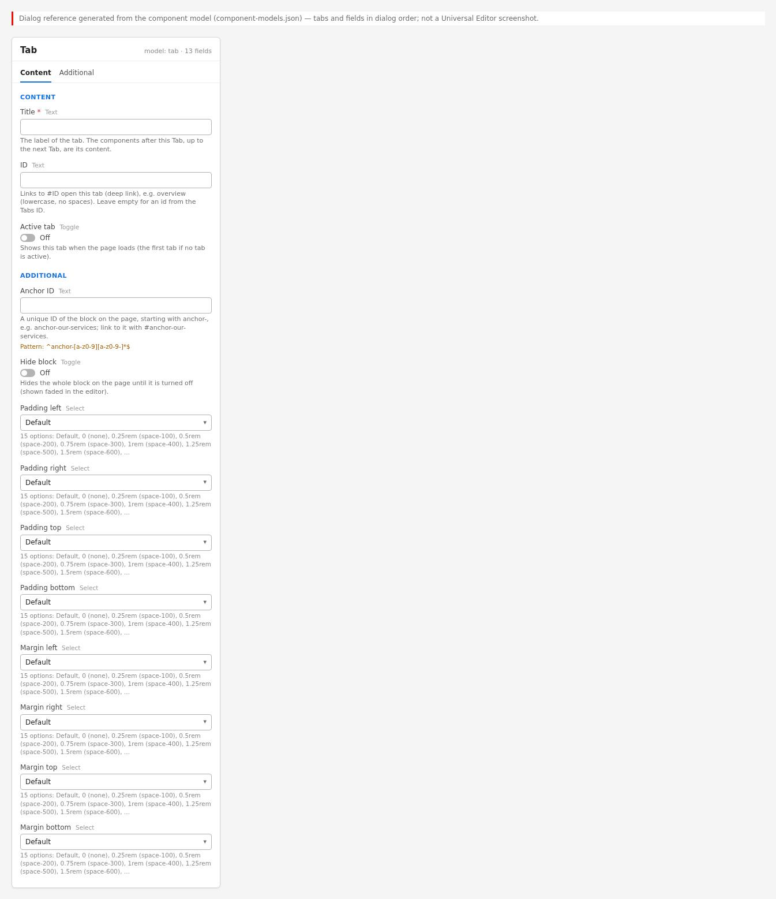{width=100%}

**Properties panel, Tab (model `tab`)**

- **Content:** Title (required); ID; Active tab.
- **Additional:** Anchor ID; Hide block; Padding left / right / top / bottom; Margin left /
  right / top / bottom (no visible effect on the page, see 6.22.6).

### 6.22.5 Authoring Guide

**Step 1 — Open the page in Universal Editor**

**Action:** Open the page that has (or will have) a Tabs Container in Universal Editor.

**Expected Result:** Edit mode; the Tabs Container is visible.

**Steps — Step 1:** The page in Universal Editor with a Tabs Container.

| Step | Where | Field / control | Value / action |
|:--|:----------|:----------|:--------------------|
| 1 | AEM Sites console | Page | Select the page with the Tabs Container |
| 2 | AEM Sites console › Toolbar | Edit | Select Edit |
| 3 | Universal Editor | Mode | Edit (the Tabs Container is visible on the canvas) |

**Step 2 — Select the Tabs Container**

**Action:** Select the Tabs Container in the content tree.

**Expected Result:** Its **+** (Add) button offers Tab, Columns, Title, Text, Image, Button.

**Steps — Step 2:** The Add menu of the Tabs Container listing Tab and the content components.

| Step | Where | Field / control | Value / action |
|:--|:----------|:----------|:--------------------|
| 1 | Universal Editor › Content tree | Select | Tabs Container |
| 2 | Universal Editor › Content tree › Tabs Container | Add (+) | Open the menu: Tab, Columns, Title, Text, Image, Button |

**Step 3 — Add a Tab**

**Action:** Choose **Tab**.

**Expected Result:** A Tab with the default Title "Tab" is added; a new tab button appears.

**Steps — Step 3:** The new Tab chip "Tab" and its tab button.

| Step | Where | Field / control | Value / action |
|:--|:----------|:----------|:--------------------|
| 1 | Universal Editor › Content tree › Tabs Container › Add (+) | Component | Tab |
| 2 | Universal Editor | Canvas | A Tab chip "Tab" and a new tab button "Tab" |

**Step 4 — Enter the Title**

**Action:** In the Content tab, replace the Title with the tab label, e.g. "Consulting".

**Expected Result:** The chip and the tab button show the new Title.

**Steps — Step 4:** Title field "Consulting" and the updated tab button.

| Step | Where | Field / control | Value / action |
|:--|:----------|:----------|:--------------------|
| 1 | Tab › Content | Title | Consulting |
| 2 | Universal Editor | Canvas | The chip and the tab button show "Consulting" |

**Step 5 — Enter the ID (optional)**

**Action:** Enter an ID, e.g. `consulting`.

**Expected Result:** After the Tabs are rendered again (e.g. reload), the panel id is
`consulting`.

**Steps — Step 5:** ID field filled with consulting.

| Step | Where | Field / control | Value / action |
|:--|:----------|:----------|:--------------------|
| 1 | Tab › Content | ID | consulting |

**Step 6 — Set Active tab (optional)**

**Action:** Switch **Active tab** on for the tab to show on load (one Tab only).

**Expected Result:** On the next load the tab is selected.

**Steps — Step 6:** Active tab switched on in the properties panel.

| Step | Where | Field / control | Value / action |
|:--|:----------|:----------|:--------------------|
| 1 | Tab › Content | Active tab | On (on one Tab of the container only) |

**Step 7 — Add the tab's content**

**Action:** With the Tab (or the container) selected, add Columns, Title, Text, Image or Button
components and make sure they are placed after this Tab and before the next one.

**Expected Result:** The components appear in this tab's panel.

**Steps — Step 7:** Content tree: Tab "Consulting", Columns, Text, then Tab "Cloud".

| Step | Where | Field / control | Value / action |
|:--|:----------|:----------|:--------------------|
| 1 | Universal Editor › Content tree › Tabs Container › Add (+) | Component | Columns (placed after the Tab "Consulting") |
| 2 | Universal Editor › Content tree › Tabs Container › Add (+) | Component | Text (after the Columns) |
| 3 | Universal Editor › Content tree | Check | Order: Tab "Consulting", Columns, Text, then Tab "Cloud" |

**Step 8 — Repeat and reorder**

**Action:** Add the next Tab and its components; drag Tabs (with their components) to reorder.

**Expected Result:** The tab order follows the content tree.

**Steps — Step 8:** A Tab dragged above another Tab in the content tree.

| Step | Where | Field / control | Value / action |
|:--|:----------|:----------|:--------------------|
| 1 | Universal Editor › Content tree › Tabs Container › Add (+) | Component | Tab, then set Title Cloud and add its components |
| 2 | Universal Editor › Content tree | Drag | Drag the Tab "Cloud" (and its components) above the Tab "Consulting" |
| 3 | Universal Editor | Canvas | The tab order follows the content tree |

**Step 9 — Preview**

**Action:** Switch to **Preview**.

**Expected Result:** The chips disappear; the tabs work as on the live page.

**Steps — Step 9:** Preview mode without chips.

| Step | Where | Field / control | Value / action |
|:--|:----------|:----------|:--------------------|
| 1 | Universal Editor › Toolbar | Preview | Switch to Preview |
| 2 | Preview | Check | The Tab chips are hidden; the tabs switch as on the live page |

**Step 10 — Validate and publish**

**Action:** Run the checklist below, then publish the page.

**Expected Result:** The live page shows the tabs with the right labels and initial tab.

**Steps — Step 10:** The Publish dialog for the page.

| Step | Where | Field / control | Value / action |
|:--|:----------|:----------|:--------------------|
| 1 | Checklist | Check | Titles, IDs, one Active tab at most |
| 2 | Universal Editor › Toolbar | Publish | Select Publish |
| 3 | Publish dialog | Destination | Publish to Live |
| 4 | Publish dialog | Publish | Confirm |

#### Preview Process

Universal Editor Preview (no chips); Edge Delivery preview on
`https://main--tcs-corp--sradha-tcs.aem.page/{locale}/{path}`; test `#id` links.

#### Publishing Process

Publish the page (the Tab is part of the page; nothing else to publish). Live:
`https://main--tcs-corp--sradha-tcs.aem.live/{locale}/{path}` ([To be confirmed: production
domain and CDN]).

#### Validation Process

- [ ] Every Tab has a Title (no "Tab {n}" fallback labels).
- [ ] The first item in the Tabs Container is a Tab.
- [ ] At most one Tab has Active tab on.
- [ ] IDs are unique on the page, lower case, and `#id` links open the tab.
- [ ] Each Tab is followed by at least one component (no empty panels).
- [ ] In Preview, no chips are visible.

#### Rollback Process

Restore the previous page version and republish; or correct / delete the Tab and republish.

The walkthroughs below repeat the steps above for each variation of chapter 6.22.3, from opening the page to publishing; the values are those of the variation's screenshot.

#### Walkthrough — Variation 1 — Standard Tab

Reproduces the screenshot `screenshots/tab-standard.jpg` of this variation. The Field Entry Table under the screenshot lists every value with its rules.

**Step 1 — Open the page**

**Action:** In AEM Sites, open the locale site (for example `/content/tcs-corp/us/en`), select the page and choose Edit; the page opens in Universal Editor.

**Expected Result:** The page renders on the canvas with the content tree and the properties panel.

**Step 2 — Add the Tabs Container**

**Action:** Choose Add (+) on the page and pick **Tabs Container**.

**Expected Result:** An empty Tabs Container is added with the edit-mode hint.

**Step 3 — Add the Tab**

**Action:** Select the section in the content tree, choose **Add (+)** and pick **Tab**.

**Expected Result:** Three Tabs, each followed by a Title and a Text, are added in order.

**Step 4 — Fill in Tab › Content**

**Action:** Select **Tab** in the content tree and open the **Content** tab of the properties panel. Enter: **Title** (A) = Consulting.

**Expected Result:** Chips and tab buttons read Consulting, Cloud and Cybersecurity.

**Step 5 — Add the Title**

**Action:** Select the section in the content tree, choose **Add (+)** and pick **Title**.

**Expected Result:** Three Tabs, each followed by a Title and a Text, are added in order.

**Step 6 — Fill in Title**

**Action:** Select **Title** in the content tree and enter in the properties panel: **Title** (B) = Business and technology consulting; **Title Type** (C) = h3.

**Expected Result:** Each panel starts with an H3, e.g. Cloud migration and operations.

**Step 7 — Add the Text**

**Action:** Select the section in the content tree, choose **Add (+)** and pick **Text**.

**Expected Result:** Three Tabs, each followed by a Title and a Text, are added in order.

**Step 8 — Fill in Text**

**Action:** Select **Text** in the content tree and enter in the properties panel: **Text** (D) = Strategy, operating model design and change management that turn transformation goals into measurable results.

**Expected Result:** A one-sentence description appears under each panel heading.

**Step 9 — Add the Tab**

**Action:** Select the section in the content tree, choose **Add (+)** and pick **Tab**.

**Expected Result:** Three Tabs, each followed by a Title and a Text, are added in order.

**Step 10 — Fill in Tab › Content**

**Action:** Select **Tab** in the content tree and open the **Content** tab of the properties panel. Enter: **Title** (E) = Cloud.

**Expected Result:** Chips and tab buttons read Consulting, Cloud and Cybersecurity.

**Step 11 — Add the Title**

**Action:** Select the section in the content tree, choose **Add (+)** and pick **Title**.

**Expected Result:** Three Tabs, each followed by a Title and a Text, are added in order.

**Step 12 — Fill in Title**

**Action:** Select **Title** in the content tree and enter in the properties panel: **Title** (F) = Cloud migration and operations; **Title Type** (G) = h3.

**Expected Result:** Each panel starts with an H3, e.g. Cloud migration and operations.

**Step 13 — Add the Text**

**Action:** Select the section in the content tree, choose **Add (+)** and pick **Text**.

**Expected Result:** Three Tabs, each followed by a Title and a Text, are added in order.

**Step 14 — Fill in Text**

**Action:** Select **Text** in the content tree and enter in the properties panel: **Text** (H) = Move, modernise and run workloads on any cloud with automated landing zones and managed operations.

**Expected Result:** A one-sentence description appears under each panel heading.

**Step 15 — Add the Tab**

**Action:** Select the section in the content tree, choose **Add (+)** and pick **Tab**.

**Expected Result:** Three Tabs, each followed by a Title and a Text, are added in order.

**Step 16 — Fill in Tab › Content**

**Action:** Select **Tab** in the content tree and open the **Content** tab of the properties panel. Enter: **Title** (I) = Cybersecurity.

**Expected Result:** Chips and tab buttons read Consulting, Cloud and Cybersecurity.

**Step 17 — Add the Title**

**Action:** Select the section in the content tree, choose **Add (+)** and pick **Title**.

**Expected Result:** Three Tabs, each followed by a Title and a Text, are added in order.

**Step 18 — Fill in Title**

**Action:** Select **Title** in the content tree and enter in the properties panel: **Title** (J) = Cyber defence and resilience; **Title Type** (K) = h3.

**Expected Result:** Each panel starts with an H3, e.g. Cloud migration and operations.

**Step 19 — Add the Text**

**Action:** Select the section in the content tree, choose **Add (+)** and pick **Text**.

**Expected Result:** Three Tabs, each followed by a Title and a Text, are added in order.

**Step 20 — Fill in Text**

**Action:** Select **Text** in the content tree and enter in the properties panel: **Text** (L) = Protect identities, data and operations with managed detection, zero-trust architecture and recovery planning.

**Expected Result:** A one-sentence description appears under each panel heading.

**Step 21 — Fill in Universal Editor**

**Action:** Select **Universal Editor** in the content tree and enter in the properties panel: **Mode** (M) = Edit.

**Expected Result:** In Edit mode each panel shows the dashed chip of its Tab.

**Step 22 — Canvas**

**Action:** Action: Select the Cloud tab button.

**Expected Result:** Selecting the Cloud tab button shows the Cloud panel with the chip Cloud at its top.

**Step 23 — Preview**

**Action:** Choose **Preview** in the Universal Editor toolbar (or open the page on aem.page) and compare it with the screenshot.

**Expected Result:** The Cloud tab underlined; the dashed brand chip Cloud above the panel's H3 and text.

**Step 24 — Publish**

**Action:** Choose **Publish** › Publish to Live (with the referenced pages, fragments and assets that are not yet published).

**Expected Result:** The Tabs are saved with the page; one Publish sends them to aem.page or aem.live.

**Step 25 — Verify**

**Action:** On the live page check: On a fresh load without a hash Consulting, the first tab, is shown.

**Expected Result:** The page matches the screenshot; nothing in the Troubleshooting case above applies.

#### Walkthrough — Variation 2 — Active Tab

Reproduces the screenshot `screenshots/tab-active.jpg` of this variation. The Field Entry Table under the screenshot lists every value with its rules.

**Step 1 — Open the page**

**Action:** In AEM Sites, open the locale site (for example `/content/tcs-corp/us/en`), select the page and choose Edit; the page opens in Universal Editor.

**Expected Result:** The page renders on the canvas with the content tree and the properties panel.

**Step 2 — Add the Tabs Container**

**Action:** Choose Add (+) on the page and pick **Tabs Container**.

**Expected Result:** An empty Tabs Container is added with the edit-mode hint.

**Step 3 — Add the Tab**

**Action:** Select the section in the content tree, choose **Add (+)** and pick **Tab**.

**Expected Result:** Three Tabs and three Columns are added in alternating order.

**Step 4 — Fill in Tab › Content**

**Action:** Select **Tab** in the content tree and open the **Content** tab of the properties panel. Enter: **Title** (A) = Consulting.

**Expected Result:** The tab buttons read Consulting, Cloud and Cybersecurity; with Active tab on, Cybersecurity is selected after the Tabs render again.

**Step 5 — Add the Columns**

**Action:** Select the section in the content tree, choose **Add (+)** and pick **Columns**.

**Expected Result:** Three Tabs and three Columns are added in alternating order.

**Step 6 — Fill in Columns › Content**

**Action:** Select **Columns** in the content tree and open the **Content** tab of the properties panel. Enter: **Columns** (B) = 2; **Rows** (C) = 1.

**Expected Result:** A two-column, one-row Columns appears in each panel.

**Step 7 — Fill in Columns**

**Action:** Select **Columns** in the content tree and enter in the properties panel: **Note** (D) = Column 1: Image photo-1.svg (Alt Text "Consultants in a strategy workshop"); Column 2: Title "Business and technology consulting" (Title Type h3), Text "Strategy, operating model design and change management that turn transformation goals into measurable results.".

**Expected Result:** The Cybersecurity panel shows photo-3.svg and the H3 Cyber defence and resilience.

**Step 8 — Add the Tab**

**Action:** Select the section in the content tree, choose **Add (+)** and pick **Tab**.

**Expected Result:** Three Tabs and three Columns are added in alternating order.

**Step 9 — Fill in Tab › Content**

**Action:** Select **Tab** in the content tree and open the **Content** tab of the properties panel. Enter: **Title** (E) = Cloud.

**Expected Result:** The tab buttons read Consulting, Cloud and Cybersecurity; with Active tab on, Cybersecurity is selected after the Tabs render again.

**Step 10 — Add the Columns**

**Action:** Select the section in the content tree, choose **Add (+)** and pick **Columns**.

**Expected Result:** Three Tabs and three Columns are added in alternating order.

**Step 11 — Fill in Columns › Content**

**Action:** Select **Columns** in the content tree and open the **Content** tab of the properties panel. Enter: **Columns** (F) = 2; **Rows** (G) = 1.

**Expected Result:** A two-column, one-row Columns appears in each panel.

**Step 12 — Fill in Columns**

**Action:** Select **Columns** in the content tree and enter in the properties panel: **Note** (H) = Column 1: Image photo-2.svg (Alt Text "Cloud operations dashboard"); Column 2: Title "Cloud migration and operations" (Title Type h3), Text "Move, modernise and run workloads on any cloud with automated landing zones and managed operations.".

**Expected Result:** The Cybersecurity panel shows photo-3.svg and the H3 Cyber defence and resilience.

**Step 13 — Add the Tab**

**Action:** Select the section in the content tree, choose **Add (+)** and pick **Tab**.

**Expected Result:** Three Tabs and three Columns are added in alternating order.

**Step 14 — Fill in Tab › Content**

**Action:** Select **Tab** in the content tree and open the **Content** tab of the properties panel. Enter: **Title** (I) = Cybersecurity; **Active tab** (J) = On.

**Expected Result:** The tab buttons read Consulting, Cloud and Cybersecurity; with Active tab on, Cybersecurity is selected after the Tabs render again.

**Step 15 — Add the Columns**

**Action:** Select the section in the content tree, choose **Add (+)** and pick **Columns**.

**Expected Result:** Three Tabs and three Columns are added in alternating order.

**Step 16 — Fill in Columns › Content**

**Action:** Select **Columns** in the content tree and open the **Content** tab of the properties panel. Enter: **Columns** (K) = 2; **Rows** (L) = 1.

**Expected Result:** A two-column, one-row Columns appears in each panel.

**Step 17 — Fill in Columns**

**Action:** Select **Columns** in the content tree and enter in the properties panel: **Note** (M) = Column 1: Image photo-3.svg (Alt Text "Security analysts in a cyber defence centre"); Column 2: Title "Cyber defence and resilience" (Title Type h3), Text "Protect identities, data and operations with managed detection, zero-trust architecture and recovery planning.".

**Expected Result:** The Cybersecurity panel shows photo-3.svg and the H3 Cyber defence and resilience.

**Step 18 — Preview**

**Action:** Choose **Preview** in the Universal Editor toolbar (or open the page on aem.page) and compare it with the screenshot.

**Expected Result:** Cybersecurity semibold with the brand underline while Consulting and Cloud are grey; the Cybersecurity Columns below.

**Step 19 — Publish**

**Action:** Choose **Publish** › Publish to Live (with the referenced pages, fragments and assets that are not yet published).

**Expected Result:** Active tab is saved with the page; Publish to aem.page or aem.live. Visitors with a #id in the address still see the linked tab.

**Step 20 — Verify**

**Action:** On the live page check: On a fresh load of aem.page without a hash Cybersecurity is selected.

**Expected Result:** The page matches the screenshot; nothing in the Troubleshooting case above applies.

#### Walkthrough — Variation 3 — Tab with ID (deep link)

Reproduces the screenshot `screenshots/tab-deep-link.jpg` of this variation. The Field Entry Table under the screenshot lists every value with its rules.

**Step 1 — Open the page**

**Action:** In AEM Sites, open the locale site (for example `/content/tcs-corp/us/en`), select the page and choose Edit; the page opens in Universal Editor.

**Expected Result:** The page renders on the canvas with the content tree and the properties panel.

**Step 2 — Add the Title**

**Action:** Select the section in the content tree, choose **Add (+)** and pick **Title**.

**Expected Result:** A Title, a Text and an Image are added to the first section above the tabs.

**Step 3 — Fill in Title**

**Action:** Select **Title** in the content tree and enter in the properties panel: **Title** (A) = Technology services for every stage of transformation; **Title Type** (B) = h1.

**Expected Result:** The H1 Technology services for every stage of transformation opens the page.

**Step 4 — Add the Text**

**Action:** Select the section in the content tree, choose **Add (+)** and pick **Text**.

**Expected Result:** A Title, a Text and an Image are added to the first section above the tabs.

**Step 5 — Fill in Text**

**Action:** Select **Text** in the content tree and enter in the properties panel: **Text** (C) = From strategy to managed operations, our teams help enterprises modernise, grow and stay secure.

**Expected Result:** The introduction text appears under the H1.

**Step 6 — Add the Image**

**Action:** Select the section in the content tree, choose **Add (+)** and pick **Image**.

**Expected Result:** A Title, a Text and an Image are added to the first section above the tabs.

**Step 7 — Fill in Image**

**Action:** Select **Image** in the content tree and enter in the properties panel: **Image** (D) = Select the asset wide.svg (/en/media/wide.svg); **Alt Text** (E) = Abstract illustration of connected services.

**Expected Result:** The wide illustration appears with the alt text Abstract illustration of connected services.

**Step 8 — Add the Tabs Container**

**Action:** Choose Add (+) on the page and pick **Tabs Container**.

**Expected Result:** A Tabs Container is added below the first section with the edit-mode hint.

**Step 9 — Fill in Tabs Container › Accessibility**

**Action:** Select **Tabs Container** in the content tree and open the **Accessibility** tab of the properties panel. Enter: **Label** (F) = Our services.

**Expected Result:** No visible change; the tab list is labelled Our services.

**Step 10 — Add the Tab**

**Action:** Select the section in the content tree, choose **Add (+)** and pick **Tab**.

**Expected Result:** A Title, a Text and an Image are added to the first section above the tabs.

**Step 11 — Fill in Tab › Content**

**Action:** Select **Tab** in the content tree and open the **Content** tab of the properties panel. Enter: **Title** (G) = Consulting; **ID** (H) = consulting.

**Expected Result:** The tab buttons read Consulting, Cloud and Cybersecurity; their panels get the ids consulting, cloud and cybersecurity.

**Step 12 — Add the Columns**

**Action:** Select the section in the content tree, choose **Add (+)** and pick **Columns**.

**Expected Result:** A Title, a Text and an Image are added to the first section above the tabs.

**Step 13 — Fill in Columns › Content**

**Action:** Select **Columns** in the content tree and open the **Content** tab of the properties panel. Enter: **Columns** (I) = 2; **Rows** (J) = 1.

**Expected Result:** A two-column, one-row Columns appears in each panel.

**Step 14 — Fill in Columns**

**Action:** Select **Columns** in the content tree and enter in the properties panel: **Note** (K) = Column 1: Image photo-1.svg (Alt Text "Consultants in a strategy workshop"); Column 2: Title "Business and technology consulting" (Title Type h3), Text "Strategy, operating model design and change management that turn transformation goals into measurable results.".

**Expected Result:** Each panel shows a photo and the H3 with text, e.g. Cloud migration and operations.

**Step 15 — Add the Tab**

**Action:** Select the section in the content tree, choose **Add (+)** and pick **Tab**.

**Expected Result:** A Title, a Text and an Image are added to the first section above the tabs.

**Step 16 — Fill in Tab › Content**

**Action:** Select **Tab** in the content tree and open the **Content** tab of the properties panel. Enter: **Title** (L) = Cloud; **ID** (M) = cloud.

**Expected Result:** The tab buttons read Consulting, Cloud and Cybersecurity; their panels get the ids consulting, cloud and cybersecurity.

**Step 17 — Add the Columns**

**Action:** Select the section in the content tree, choose **Add (+)** and pick **Columns**.

**Expected Result:** A Title, a Text and an Image are added to the first section above the tabs.

**Step 18 — Fill in Columns › Content**

**Action:** Select **Columns** in the content tree and open the **Content** tab of the properties panel. Enter: **Columns** (N) = 2; **Rows** (O) = 1.

**Expected Result:** A two-column, one-row Columns appears in each panel.

**Step 19 — Fill in Columns**

**Action:** Select **Columns** in the content tree and enter in the properties panel: **Note** (P) = Column 1: Image photo-2.svg (Alt Text "Cloud operations dashboard"); Column 2: Title "Cloud migration and operations" (Title Type h3), Text "Move, modernise and run workloads on any cloud with automated landing zones and managed operations.".

**Expected Result:** Each panel shows a photo and the H3 with text, e.g. Cloud migration and operations.

**Step 20 — Add the Tab**

**Action:** Select the section in the content tree, choose **Add (+)** and pick **Tab**.

**Expected Result:** A Title, a Text and an Image are added to the first section above the tabs.

**Step 21 — Fill in Tab › Content**

**Action:** Select **Tab** in the content tree and open the **Content** tab of the properties panel. Enter: **Title** (Q) = Cybersecurity; **ID** (R) = cybersecurity.

**Expected Result:** The tab buttons read Consulting, Cloud and Cybersecurity; their panels get the ids consulting, cloud and cybersecurity.

**Step 22 — Add the Columns**

**Action:** Select the section in the content tree, choose **Add (+)** and pick **Columns**.

**Expected Result:** A Title, a Text and an Image are added to the first section above the tabs.

**Step 23 — Fill in Columns › Content**

**Action:** Select **Columns** in the content tree and open the **Content** tab of the properties panel. Enter: **Columns** (S) = 2; **Rows** (T) = 1.

**Expected Result:** A two-column, one-row Columns appears in each panel.

**Step 24 — Fill in Columns**

**Action:** Select **Columns** in the content tree and enter in the properties panel: **Note** (U) = Column 1: Image photo-3.svg (Alt Text "Security analysts in a cyber defence centre"); Column 2: Title "Cyber defence and resilience" (Title Type h3), Text "Protect identities, data and operations with managed detection, zero-trust architecture and recovery planning.".

**Expected Result:** Each panel shows a photo and the H3 with text, e.g. Cloud migration and operations.

**Step 25 — Fill in Browser**

**Action:** Select **Browser** in the content tree and enter in the properties panel: **Address** (V) = Open the page with #cloud appended (…/g08a-tab-deeplink#cloud).

**Expected Result:** With #cloud appended the page scrolls to the Tabs and the Cloud tab is selected.

**Step 26 — Preview**

**Action:** Choose **Preview** in the Universal Editor toolbar (or open the page on aem.page) and compare it with the screenshot.

**Expected Result:** The Tabs at the top of the viewport below the 4rem header space, Cloud underlined, the Cloud Columns below; the page content above is scrolled out of view.

**Step 27 — Publish**

**Action:** Choose **Publish** › Publish to Live (with the referenced pages, fragments and assets that are not yet published).

**Expected Result:** The IDs are saved with the page; publish it to aem.page or aem.live. Links to page#cloud need no extra publish; links in other pages must be published there.

**Step 28 — Verify**

**Action:** On the live page check: Inspect the panel: id="cloud"; opening the address with #cloud selects Cloud and scrolls to the Tabs.

**Expected Result:** The page matches the screenshot; nothing in the Troubleshooting case above applies.

### 6.22.6 Authorable Field Specification

**Model `tab` (Tab marker)**

| Field Name | Field Type | Mandatory | Multi Value | Default Value | Business Purpose | Author Guidance | Validation Rules | Example Value |
|:------------------------|:---------|:------------|:-------|:-------------|:---------------|:---------------|:------------------------|:-------------------|
| **Tab: Content** | tab | — | — | — | Tab properties | — | — | — |
| Title (`title`) | text | Yes (`required`) | No | "Tab" (new component template) | Tab button label | 1 to 3 words | Enforced: required in the model; empty in content → "Tab {n}" | Consulting |
| ID (`tabId`) | text | No | No | empty (generated) | Panel id for deep links | Lower case, no spaces | Normalised with `toClassName`; de-duplicated `-2`, `-3` | consulting |
| Active tab (`activeTab`) | boolean | No | No | off | Shown when the page loads | At most one per container | Only "true" counts | on |
| **Tab: Additional** | tab | — | — | — | Block options | Not needed on a Tab | — | — |
| Anchor ID (`classes_anchor`) | text | No | No | empty | Id of the (hidden) Tab block | Use ID (Content) for deep links | Enforced: regExp `^anchor-[a-z0-9][a-z0-9-]*$` | anchor-consulting |
| Hide block (`classes_hideblock`) | boolean | No | No | false | Hides the Tab block | Does not remove the tab | None | false |
| Padding left (`classes_paddingleft`) | select | No | No | Default | Spacing of the Tab block | No visible effect on the page | One of 15 options | pl-0 |
| Padding right (`classes_paddingright`) | select | No | No | Default | As above | As above | One of 15 options | pr-0 |
| Padding top (`classes_paddingtop`) | select | No | No | Default | As above | As above | One of 15 options | pt-0 |
| Padding bottom (`classes_paddingbottom`) | select | No | No | Default | As above | As above | One of 15 options | pb-0 |
| Margin left (`classes_marginleft`) | select | No | No | Default | As above | As above | One of 15 options | ml-0 |
| Margin right (`classes_marginright`) | select | No | No | Default | As above | As above | One of 15 options | mr-0 |
| Margin top (`classes_margintop`) | select | No | No | Default | As above | As above | One of 15 options | mt-0 |
| Margin bottom (`classes_marginbottom`) | select | No | No | Default | As above | As above | One of 15 options | mb-0 |

**Field details**

- **Title**
  - Purpose: the tab button text; also `dc:title` of `cmp:show` and the chip text in edit mode.
  - Allowed Values: plain text. Character Limits: none enforced; Recommended: up to 25
    characters (tab labels do not wrap in the horizontal list).
  - Business Rules: required in the model; if the content is empty anyway, the Tabs block uses
    "Tab {n}" (placeholder `tabNumber`). Edits update the tab button immediately in Universal
    Editor (`tabs:tab-update`).
  - Dependency Rules: none. Visibility Rules: always visible. Sample Content: "Consulting".
- **ID**
  - Purpose: the panel `id`; `#id` links open the tab.
  - Allowed Values: any text, normalised to lower case with hyphens. Character Limits: none
    enforced; Recommended: under 30 characters.
  - Business Rules: empty → `{Tabs Container ID}-item-{n}`, else `tabs-{n}-item-{n}`;
    duplicates on the page get `-2`, `-3`. Changes apply when the Tabs are rendered again.
  - Dependency Rules: unique on the page. Visibility Rules: always visible.
  - Sample Content: `consulting`.
- **Active tab**
  - Purpose: initial tab. Allowed Values: on / off.
  - Business Rules: first Active Tab wins; overridden by a deep link and, in Universal Editor,
    by the tab shown before a re-render. Changes apply when the Tabs are rendered again.
  - Dependency Rules: none. Visibility Rules: always visible. Sample Content: on.
- **Additional tab fields**
  - Purpose: the common block options (Anchor ID, Hide block, 15-option padding / margin
    selects: Default; 0 (none); 0.25rem (space-100); 0.5rem (space-200); 0.75rem (space-300);
    1rem (space-400); 1.25rem (space-500); 1.5rem (space-600); 2rem (space-800); 2.5rem
    (space-1000); 3rem (space-1200); 4rem (space-1600); 5rem (space-2000); 6rem (space-2400);
    7.5rem (space-3000)).
  - Business Rules: they apply to the Tab block, which is hidden on the page, so they have no
    visible effect there. Hide block does not remove the tab from the tab list (the Tabs block
    still creates a tab for it). Anchor ID gives the hidden Tab block an id; links to it do
    not open the tab (only panel ids do). Padding / margin affect only the chip in edit mode.
  - Character Limits: Anchor ID: none enforced. Dependency Rules: none. Visibility Rules:
    always visible. Sample Content: leave all at their defaults.

No field of the Tab model has a `condition`.

### 6.22.7 Field Annotation Mapping

| Marker | Field | Purpose |
|:--------|:-------------------------|:-----------------|
| A | Tab chip (Title, ID, Active tab, Additional) | Selects the Tab and its properties |
| B | Title (shown on the tab button) | Tab label |
| C | Following components (not Tab fields) | The tab's content |

### 6.22.8 Component Specification

| Attribute | Value |
|:-----------------|:----------------------------------------|
| Component Name | Tab (`tab`) |
| Version | 1.0 |
| Owner | [To be confirmed: product owner]; technical owner: development team |
| Dependencies | `blocks/tabs`, `scripts/aem.js` (`toClassName`), `utils/properties.js`, block options |
| Component Type | Block used as an item marker inside the Tabs Container section (key-value block) |
| Supported Variants | Standard, Active, with ID (behaviour modes; no styles) |
| Supported Templates | Any page with a Tabs Container |
| Supported Metadata | None |
| Supported Tags | None |
| Supported Personalization | None |
| Caching Considerations | Part of the page HTML (Edge Delivery CDN) |
| Performance Considerations | Tiny script; no requests; loaded with its section after the Tabs block (which reads the Tab first) |
| Accessibility Compliance | Hidden on the page (not exposed); its Title names the tab and panel (WCAG 4.1.2, 2.4.6) |
| SEO Compliance | Marker text hidden; Title is button text, not a heading |

### 6.22.9 Input Model

- **Content Inputs:** Title, ID, Active tab (key-value rows `title`, `tabId`, `activeTab`;
  positional rows, one per field in dialog order, are also accepted).
- **Metadata Inputs:** none. **Tags Inputs:** none.
- **Page Context Inputs:** its position in the Tabs Container (which components follow it).
- **Query Inputs:** none. **Manual Inputs:** all fields.

Authored HTML (illustrative):

```html
<div class="tab" data-aue-resource="urn:.../tab_1" data-aue-model="tab">
  <div><div>title</div><div>Consulting</div></div>
  <div><div>tabId</div><div>consulting</div></div>
  <div><div>activeTab</div><div>true</div></div>
</div>
```

### 6.22.10 Output Model

**Rendered Output:** `div.tab.block` with data attributes `data-tab-title`, `data-tab-id`,
`data-tab-active` (cached values) containing `p.tab-title`; inside the Tabs panel its wrapper
`div.tab-wrapper` is hidden except in edit mode.

**Generated HTML**

```html
<div class="tab-wrapper">
  <div class="tab block" data-block-name="tab" data-tab-title="Consulting"
    data-tab-id="consulting" data-tab-active="true">
    <p class="tab-title">Consulting</p>
  </div>
</div>
```

**Generated JSON:** none. **Generated Metadata:** none.

**DOM events:** `tabs:tab-update` (bubbles) after each decoration, `detail: { title, id,
active }`; the enclosing Tabs updates the tab label.

**Analytics Tracking:** the Tab block is registered in the data layer component state as
`tcs-corp/components/tab` (id `tab-{n}`, or its Anchor ID) with the Tabs block as `parentId`.
It pushes no events; the Tabs block pushes `cmp:show` with the Tab's panel id and Title (see
6.21.10).

**Personalization Output:** none. **Search Index Output:** none.

**Target Personalization Output:** None: Supported Personalization is None (as of this handover). The Tab pushes no events; the Tabs block pushes cmp:show with the Tab's panel id and Title, which future Adobe Target use could read (not implemented).

### 6.22.11 Business Rules

1. Properties are read once and cached on the block as data attributes, so they can be read
   again after the block is decorated.
2. Key-value rows (`title`, `tabid`, `activetab` after normalisation) are used if present;
   otherwise the last cell of each row in dialog order (Title, ID, Active tab).
3. The ID is normalised with `toClassName`.
4. Active tab is on only for the text "true".
5. Decoration replaces the content with `p.tab-title` showing the Title.
6. After decoration a `tabs:tab-update` event tells the Tabs block to update the label.
7. The Tab's wrapper is hidden in Tabs panels except in Universal Editor edit mode.
8. The Tab is allowed only in the Tabs Container (`tabs` filter).
9. A Tab outside a Tabs Container would show its Title as a visible chip (the hiding rule is
   scoped to `.tabs .tabs-panel`).
10. Hide block on a Tab does not remove the tab from the tab list.
11. The Tab emits no console messages.

### 6.22.12 Author Best Practices

- **Recommended Content Length:** Title 1 to 3 words, up to 25 characters; ID under 30
  characters (Recommended).
- **Image Dimensions:** not applicable.
- **CTA Writing Guidelines:** not applicable (no CTA on the Tab; put Buttons after it).
- **Accessibility Guidelines:** unique, descriptive Titles; avoid "Tab 1" style labels.
- **SEO Guidelines:** start the tab's content with a Title (heading) that repeats or extends
  the tab label.
- **Metadata Guidelines:** not applicable.
- **Taxonomy Guidelines:** not applicable.
- **Localization Guidelines:** translate Titles; keep IDs the same across locales.

### 6.22.13 Troubleshooting Guide

#### Issue 1 — The tab label shows "Tab 2" instead of the Title

**Symptoms:** A generic label in the tab list.

**Root Cause:** The Title is empty, or the content before the first Tab created an untitled
tab.

**Diagnosis Steps:** Select the Tab; check Title; check the content tree order.

**Resolution Steps:** Enter the Title; move stray components after a Tab.

**Validation Steps:** All tab labels are the Titles.

**Preventive Measures:** Add the Tab before its components.

#### Issue 2 — The Tab chip is visible on the live page

**Symptoms:** A dashed label appears on the published page.

**Root Cause:** The Tab is not inside a Tabs Container (e.g. moved to a normal section by copy /
paste), so the hiding rule does not apply.

**Diagnosis Steps:** Check whether the section has the class `tabs-section`.

**Resolution Steps:** Move the Tab into a Tabs Container or delete it.

**Validation Steps:** No chip on the page.

**Preventive Measures:** Only add Tabs inside Tabs Containers.

#### Issue 3 — The ID does not work in links

**Symptoms:** `#My Tab` or `#my_tab` links do not open the tab.

**Root Cause:** The ID is normalised (`my-tab`); or duplicated and suffixed (`my-tab-2`).

**Diagnosis Steps:** Inspect the panel id.

**Resolution Steps:** Use lower-case, hyphenated IDs and the same value in links.

**Validation Steps:** The link opens the tab.

**Preventive Measures:** Simple, unique IDs.

#### Issue 4 — Active tab is ignored

**Symptoms:** Another tab is shown on load.

**Root Cause:** An earlier Tab is also Active; a `#id` in the address; Universal Editor keeps
the tab shown before a re-render; or the change was not yet re-rendered.

**Diagnosis Steps:** Check all Tabs; load the page without a hash.

**Resolution Steps:** Leave Active on one Tab only; reload.

**Validation Steps:** The Active tab shows on a fresh load.

**Preventive Measures:** Checklist.

#### Issue 5 — Hiding a Tab does not hide the tab

**Symptoms:** Hide block is on but the tab button and panel remain.

**Root Cause:** Hide block hides the Tab block only, not the tab created from it.

**Diagnosis Steps:** Check the Additional tab.

**Resolution Steps:** Delete the Tab and its components (or move them out) to remove a tab.

**Validation Steps:** The tab is gone.

**Preventive Measures:** Do not use Hide block on Tabs.

#### Issue 6 — A component appears in the wrong tab

**Symptoms:** Content shows under the previous or next tab.

**Root Cause:** The component's position in the content tree is before / after the wrong Tab.

**Diagnosis Steps:** Check the order in the content tree.

**Resolution Steps:** Drag the component after its Tab.

**Validation Steps:** Content in the correct panel.

**Preventive Measures:** Review the content tree before publishing.

### 6.22.14 Support Runbook

**Monitoring Requirements:** covered by the Tabs monitoring (6.21.14); no Tab-specific
monitoring.

**Logs:** no console messages from the Tab; module errors `failed to load block tab`
(`scripts/aem.js`); Admin API page status; AEM author logs.

**Common Errors**

| Error | Likely cause | First action |
|:---------------|:----------------------|:---------------|
| Generic "Tab n" label | Empty Title / content before first Tab | Fill Title / reorder |
| Chip visible on page | Tab outside a Tabs Container | Move or delete |
| Deep link fails | Normalised / duplicated ID | Inspect panel id |
| Active ignored | Several Active / hash / no re-render | Fix and reload |
| Hide block ineffective | By design | Delete the Tab instead |

**Escalation Matrix**

| Level | Who | What they check |
|:-------|:-------------|:--------------------------------|
| L1 | Author support | Title, ID, Active tab, content tree order, publication |
| L2 | AMS / site admin | Page preview / live status, CDN cache |
| L3 | Development team | `tab.js` / `tabs.js` behaviour, console errors |
| L4 | Adobe Support | Universal Editor and Edge Delivery platform issues |

**Recovery Procedures:** restore the page version and republish; code fixes via revert on
`main`.

**Health Checks:** on the page, `document.querySelectorAll('.tabs .tab')` exist but are not
visible; each Title appears as a tab button.

**Operational Procedures:** as for the Tabs (6.21.14).

**Known Limitations:** ID and Active tab changes apply only after the Tabs are rendered again;
Hide block does not hide a tab; Additional options have no visible effect; no icon or badge on
tabs.

### 6.22.15 Common Authoring Mistakes

The mistakes seen most often with this component (each screenshot above also lists the mistakes of its example).

| Error | Root Cause | Resolution |
|:----------|:----------|:----------|
| The tab label shows Tab 2 instead of the Title | Title empty, or content placed before the first Tab | Enter the Title and move stray components after a Tab |
| The dashed chip is visible on the live page | The Tab is outside a Tabs Container | Move it into a Tabs Container or delete it |
| #My Tab links do not open the tab | The ID is normalised to my-tab or suffixed with -2 | Use lower-case, hyphenated, unique IDs and the same value in links |
| Active tab is ignored | An earlier Tab is also Active, the address has a #id, or the Tabs were not rendered again | Leave Active tab on one Tab only and reload without the hash |
| Hide block does not hide the tab | Hide block hides only the Tab block, not the tab built from it | Delete the Tab and its components to remove the tab |
| A component appears in the wrong tab | It sits before or after the wrong Tab in the content tree | Drag it after its Tab |
| An ID change has no effect in the editor | ID and Active tab apply only when the Tabs are rendered again | Reload the page in Universal Editor |
| A link to the Anchor ID does not open the tab | Anchor ID names the hidden Tab block, not the panel | Use the ID field in the Content tab for links |

### 6.22.16 Author Quick Reference Guide

**Mandatory Fields**

- Title — required in the model; empty content falls back to Tab {n} (placeholder tabNumber)

**Recommended Fields**

- ID — stable panel id for #id links, lower case and unique on the page
- Active tab — on for the one Tab to show on load, when it is not the first

**Optional Fields**

- Anchor ID — gives the hidden Tab block an id; links to it do not open the tab
- Hide block — does not remove the tab from the tab list; avoid it
- Padding and Margin — affect only the chip in edit mode

**Authoring Checklist**

1. Add Tabs only inside a Tabs Container (filter tabs)
2. Make a Tab the first item of the Tabs Container
3. Add the Tab before its components; follow every Tab with at least one component
4. Enter a Title of one to three words, up to about 25 characters
5. Enter an ID only when the tab will be linked, and keep it the same in every locale
6. Switch Active tab on for one Tab at most
7. Reorder tabs by dragging the Tab together with its components in the content tree

**Pre-Publish Checklist**

1. Switch to Preview and check that no chip is visible
2. Check every tab button shows its Title, with no Tab {n} label
3. Reload and check the Active tab is shown first
4. Open the page with #id for every Tab with an ID
5. Check each panel holds the components of its Tab

**Post-Publish Validation Checklist**

1. Open the page on aem.live and check the tab labels
2. Test the #id links from other pages and campaigns on the live URL
3. Check the initial tab on a fresh load without a hash
4. Check no dashed chip appears on the live page
5. Check the cmp:show entries carry the expected panel ids

### 6.22.17 Component Execution Example

**Business example:** Deep-linkable Cloud tab on the services page.

**Example Values Entered:**

| Field | Value |
|:--------------------|:------------------------------|
| Component (Section › Add (+)) | Title |
| Title (Title) | Technology services for every stage of transformation |
| Title Type (Title) | h1 |
| Component (Section › Add (+)) | Text |
| Text (Text) | From strategy to managed operations, our teams help enterprises modernise, grow and stay secure. |
| Component (Section › Add (+)) | Image |
| Image (Image) | Select the asset wide.svg (/en/media/wide.svg) |
| Alt Text (Image) | Abstract illustration of connected services |
| Component (Page › Add (+)) | Tabs Container |
| Label (Tabs Container › Accessibility) | Our services |
| Component (Section › Add (+)) | Tab |
| Title (Tab › Content) | Consulting |
| ID (Tab › Content) | consulting |
| Component (Section › Add (+)) | Columns |
| Columns (Columns › Content) | 2 |
| Rows (Columns › Content) | 1 |
| Note (Columns) | Column 1: Image photo-1.svg (Alt Text "Consultants in a strategy workshop"); Column 2: Title "Business and technology consulting" (Title Type h3), Text "Strategy, operating model design and change management that turn transformation goals into measurable results." |
| Component (Section › Add (+)) | Tab |
| Title (Tab › Content) | Cloud |
| ID (Tab › Content) | cloud |
| Component (Section › Add (+)) | Columns |
| Columns (Columns › Content) | 2 |
| Rows (Columns › Content) | 1 |
| Note (Columns) | Column 1: Image photo-2.svg (Alt Text "Cloud operations dashboard"); Column 2: Title "Cloud migration and operations" (Title Type h3), Text "Move, modernise and run workloads on any cloud with automated landing zones and managed operations." |
| Component (Section › Add (+)) | Tab |
| Title (Tab › Content) | Cybersecurity |
| ID (Tab › Content) | cybersecurity |
| Component (Section › Add (+)) | Columns |
| Columns (Columns › Content) | 2 |
| Rows (Columns › Content) | 1 |
| Note (Columns) | Column 1: Image photo-3.svg (Alt Text "Security analysts in a cyber defence centre"); Column 2: Title "Cyber defence and resilience" (Title Type h3), Text "Protect identities, data and operations with managed detection, zero-trust architecture and recovery planning." |
| Address (Browser) | Open the page with #cloud appended (…/g08a-tab-deeplink#cloud) |

All other fields keep their default values.

**Rendered Result:**

![Execution example — The services page at 1440 px after #cloud is added to the address: the page has scrolled past the H1 and image so the Tabs sit just below the header area, with Cloud selected and its Columns (photo-2.svg, the H3 Cloud migration and operations and its text) shown; the footer's floating Ask us a question bar is at the bottom. The address bar itself is not in the screenshot. (Sample content on the preview; callout letters as in the Field Entry Table of this screenshot; file screenshots/tab-deep-link.jpg)](screenshots/tab-deep-link.jpg){width=100%}

**Author Notes**

- Give the three Tabs the IDs consulting, cloud and cybersecurity.
- Leave Active tab off; for linked visitors the address #cloud decides the tab.
- Link to the page with #cloud from navigation or campaigns, exactly as the ID.

**Business Notes**

- Campaigns and emails can send visitors straight to the Cloud offering.
- Stable IDs keep the same links working in every locale.
- Analytics receive cmp:show with the path component.cloud when visitors switch to Cloud.

**Technical Notes**

- The ID is normalised with toClassName and de-duplicated with availableId (-2, -3).
- On hashchange, or once after the load event, a hash naming a panel clicks its tab and scrolls the Tabs into view with scroll-margin-top 4rem.
- The Tab caches Title, ID and Active tab in data-tab-* attributes and renders p.tab-title, hidden on the page.
- The hash is read but not written when visitors change tab.

## 6.23 Modal Block

The Modal block (`blocks/modal`) shows the content of a fragment page in a dialog over the
page. It is the Block Collection modal of Edge Delivery Services, adapted for the TCS
Corporate website: an authored **Modal** block renders a button that opens the dialog; in
addition, any link to a page whose path contains `/modals/` opens as a modal, and other blocks
(the Video block's **Play in a Pop-up**) use its `createModal()` / `openModal()` functions.
The dialog is a native `<dialog>` opened with `showModal()`, named by its first heading,
closable with the close button, the Escape key or a click on the backdrop, and tracked in the
Adobe Client Data Layer (`cmp:show` / `cmp:hide`).

### 6.23.1 Component Purpose

**Business Objective**

Show supplementary content (details, forms, disclaimers, videos) without leaving the page, so
visitors keep their context and return to the same place when they close the dialog.

**Business Use Cases**

- "Read more" details of a service, offer or award.
- Terms, disclaimers or privacy notices linked from a CTA.
- A short sign-up or contact form (Form Variations on the fragment page).
- A video played in a pop-up (Video block, Play in a Pop-up).
- Biographies of leaders opened from a profile listing.

**When To Use**

- The content is short, secondary and self-contained.
- The visitor should return to the same place on the page.

**When Not To Use**

- Primary content or content that must be indexed with the page (the dialog content is loaded
  from another page when opened).
- Long articles (use a page); multi-step processes; content that must be shared by URL.
- Automatic pop-ups on page load: Not implemented (as of this handover); the modal opens only
  on a visitor action.

**Dependencies**

| Dependency | Type | Use |
|:---------------------------------|:-----------|:----------------------------------------|
| `blocks/modal/modal.js` | Block | `decorate` (opener button), `openModal(url)`, `createModal(nodes)`, visible-area tracking in frames |
| `blocks/modal/modal.css` | Block styles | Dialog, backdrop, sticky close button, page scroll lock |
| `blocks/modal/_modal.json` | Model | Definition and model `modal` |
| `blocks/fragment/fragment.js` (`loadFragment`) | Block | Loads and decorates the fragment page |
| `scripts/aem.js` (`buildBlock`, `decorateBlock`, `loadBlock`, `loadCSS`) | Core library | Creates the dialog's block and loads its CSS |
| `scripts/scripts.js` (`moveInstrumentation`, `autolinkModals`) | Shared code | Editor instrumentation; links to `/modals/` pages open as a modal |
| `decorators/button-decorator.js` (`decorateButton`) | Decorator | Opener as a primary button |
| `decorators/icon-button-decorator.js` (`createIconButton`) | Decorator | Close icon button |
| `decorators/data-layer-decorator.js` (`componentIdOf`) | Decorator | Component id; `cmp:hide` on close |
| `utils/analytics.js` (`pushComponentEvent`) | Util | `cmp:show` on open |
| `utils/ids.js` (`uniqueId`) | Util | Id for the heading that names the dialog |
| `utils/placeholders.js` | Util | `open` ("Open"), `close` ("Close"), `dialog` ("Dialog") |
| `icons/close.svg` | Icon | Close button |
| Fragment pages | Content | The dialog content, e.g. under the locale's `modals/` or `references/` folder |

**Related Components**

- Fragment block (same loading mechanism, inline instead of a dialog).
- Video block (Play in a Pop-up uses `createModal`).
- Button (default content): a Button linking to a `/modals/` page also opens a modal.
- Form Variations: a form can be placed on a modal fragment page.

**Applicable Templates**

Any page; the Modal block is allowed in every standard section (`section` filter). Links to
`/modals/` pages work anywhere on the page (including header and footer links).

**Supported Content Types**

Any content of the fragment page (sections, default content and blocks), decorated like a
page.

**Business Problem Solved**

Supplementary content such as award lists, programme terms and privacy notices either pushed the main message down the page or sent visitors to another page, losing their place. The Modal block and auto-linked /modals/ links show a fragment page in an accessible native dialog over the page, maintained once on its own page and reused by every opener.

**Supported Taxonomy**

None: the Modal block has no tag field and reads no page tags or taxonomy (Supported Tags: None); tags on the fragment page are not used.

### 6.23.2 Visual Overview

{width=96%}

**Screenshot Details — Desktop rendering**

| Item | Detail |
|:-----------|:----------------------------------------------|
| Screenshot Name | `screenshots/modal-desktop-view.jpg` |
| Screenshot Purpose | Desktop rendering |
| Screen Description | At 1200 px, after selecting View our awards: the page dimmed by the near-black 75 % backdrop and, centred over it, a white dialog 56.25rem wide with 1rem rounded corners, the close (X) button at the top right, the H2 Awards and recognition, the introduction, four bulleted awards and the link More about us, with 2rem padding. |
| Business Context | A corporate page mentions recognition briefly and keeps the full awards list in a dialog, so visitors read it without leaving the page. |
| Author Objective | Add a Modal block whose button View our awards opens the awards fragment page in a dialog. |

**Field Entry Table** — enter these values in Universal Editor, in this order:

| Callout | Field Name | Example Value | Mandatory | Business Purpose | What Author Should Enter | Validation Rules |
|:--|:----------|:----------|:------|:----------|:----------|:----------|
| — | Component (Section › Add (+)) | Modal | Yes | Adds the Modal to the page | Select the section in the content tree, choose Add (+) and pick Modal | Only components the section allows (section filter) |
| (A) | Modal Content (Modal › Content) | Select the page or enter /en/shots/modals/awards | No (not enforced; required in practice) | The fragment page shown in the dialog | Pick a page, e.g. under `modals/` | None in model; code: must resolve to a site path starting with `/` |
| B | Button Text (Modal › Content) | View our awards | No | Label of the opener button | Verb + object | None in model; empty or equal to the URL → "Open" |
| (C) | Content (Fragment page /en/shots/modals/awards (in AEM a page in the modals folder: /content/tcs-corp/us/en/modals/awards)) | Heading 2 "Awards and recognition", a paragraph, a bulleted list of four awards and the link "More about us" | No | — | — | None |
| — | Screen width (Preview) | 1200 px (desktop) | — | Check on the preview (not stored in the content) | 1200 px (desktop) | — |
| — | Action (Preview) | Select the button "View our awards" | — | Check on the preview (not stored in the content) | Select the button "View our awards" | — |

All other fields keep their default values. Each callout letter marks the field's output on the screenshot. Callouts in brackets, such as (A), have no marker: the field has no visible output of its own on this screenshot (alt text, a setting, an analytics or accessibility label, a link target or collapsed content).

**Expected Page Output**

- **Visual output:** A primary button View our awards on the page; on selection a centred white dialog over a dark 75 % backdrop with the H2 Awards and recognition, a paragraph, four bulleted awards, the link More about us and the close icon at the top right.
- **Rendering behaviour:** From 900 px the dialog is calc(100vw - 4rem) wide up to 56.25rem, with 2rem content padding and at most the visible height minus 2 × 2.5rem; the short awards content needs no inner scrolling. The page behind is locked (body.modal-open) and the fragment loads only when the button is selected.
- **Publishing behaviour:** Publish the page and the fragment page /content/tcs-corp/us/en/modals/awards (offered as a referenced page in the Publish dialog); Publish to Preview updates aem.page, Publish to Live aem.live. The fragment is fetched again at every opening, so republishing it updates every opener.

**Business Rules**

- Modal Content must point to a published page; the block fetches its .plain.html at every click and opens nothing, without a message, if that fails.
- Button Text View our awards labels the button; an empty Button Text, or one equal to the URL, shows Open (placeholder open).
- The first heading of the fragment, Awards and recognition, names the dialog (aria-labelledby); without a heading the name is Dialog.
- The dialog closes with the close button, Escape or a click on the backdrop, and focus returns to View our awards.
- The Additional tab spacing applies to the opener block on the page, not to the dialog.

**Common Authoring Mistakes**

| Error | Root Cause | Resolution |
|:----------|:----------|:----------|
| Selecting the button opens nothing | The fragment page awards is not published, or Modal Content points to a page that does not exist | Publish /content/tcs-corp/us/en/modals/awards and retest on aem.page |
| The button reads Open | Button Text left empty or set to the URL of the fragment | Enter View our awards in Button Text |
| Screen readers announce only Dialog | The fragment page starts with a paragraph instead of a heading | Start the fragment page with the H2 Awards and recognition |

**Troubleshooting**

- **Symptoms:** Selecting View our awards on aem.page shows no dialog and no error message.
- **Cause:** The request /en/shots/modals/awards.plain.html returns 404 because the fragment page was never published to that environment.
- **Resolution:** Publish the fragment page from AEM Sites, or select it as a referenced page in the Publish dialog, then reload the page.
- **Verification Steps:** In the Network tab the .plain.html request returns 200 and the dialog opens with the heading Awards and recognition.

**Desktop (1200px and wider).** The opener is a primary button where the block is placed. When
opened, the page behind is covered with a backdrop of near-black at 75% opacity and stops
scrolling (`body.modal-open`). The dialog is centred vertically in the visible area, `calc(100vw
- 4rem)` wide up to 56.25rem (900px), 1rem corner radius, default background and text colours,
and never taller than the visible area minus 2 × 2.5rem; longer content scrolls inside the
dialog. The close button (tertiary icon button) sticks to the top right (0.5rem from the top)
while the content scrolls. Content padding is 2rem on the sides and bottom (from 900px).

{width=61%}

**Screenshot Details — Tablet rendering**

| Item | Detail |
|:-----------|:----------------------------------------------|
| Screenshot Name | `screenshots/modal-tablet-view.jpg` |
| Screenshot Purpose | Tablet rendering |
| Screen Description | At 768 px, after selecting Read the programme terms and scrolling inside the dialog: a white dialog 1.5rem from each screen edge over the dark backdrop, showing the middle of the programme terms (Heading 3 sections with their paragraphs), with the close (X) button still at the top right. |
| Business Context | A programme page offers its legal terms from a button, so prospective participants read the full conditions without leaving the enrolment page. |
| Author Objective | Add a Modal block that opens a long terms page in a dialog that scrolls inside. |

**Field Entry Table** — enter these values in Universal Editor, in this order:

| Callout | Field Name | Example Value | Mandatory | Business Purpose | What Author Should Enter | Validation Rules |
|:--|:----------|:----------|:------|:----------|:----------|:----------|
| — | Component (Section › Add (+)) | Modal | Yes | Adds the Modal to the page | Select the section in the content tree, choose Add (+) and pick Modal | Only components the section allows (section filter) |
| (A) | Modal Content (Modal › Content) | Select the page or enter /en/shots/modals/terms | No (not enforced; required in practice) | The fragment page shown in the dialog | Pick a page, e.g. under `modals/` | None in model; code: must resolve to a site path starting with `/` |
| B | Button Text (Modal › Content) | Read the programme terms | No | Label of the opener button | Verb + object | None in model; empty or equal to the URL → "Open" |
| (C) | Content (Fragment page /en/shots/modals/terms (in AEM a page in the modals folder: /content/tcs-corp/us/en/modals/terms)) | Heading 2 "Programme terms", an introduction and nine Heading 3 sections with a paragraph each | No | — | — | None |
| — | Screen width (Preview) | 768 px (tablet) | — | Check on the preview (not stored in the content) | 768 px (tablet) | — |
| — | Action (Preview) | Select the button "Read the programme terms", then scroll the dialog content down | — | Check on the preview (not stored in the content) | Select the button "Read the programme terms", then scroll the dialog content down | — |

All other fields keep their default values. Each callout letter marks the field's output on the screenshot. Callouts in brackets, such as (A), have no marker: the field has no visible output of its own on this screenshot (alt text, a setting, an analytics or accessibility label, a link target or collapsed content).

**Expected Page Output**

- **Visual output:** A white dialog almost the full screen width, its long content (Programme terms, the introduction and nine Heading 3 sections) scrolled part way down, the sticky close icon at the top right on a white background.
- **Rendering behaviour:** Below 900 px the dialog is calc(100vw - 3rem) wide with 1.5rem content padding and at most 100dvh minus 3rem high; the longer terms scroll inside the dialog with overscroll contained, while the page behind stays locked.
- **Publishing behaviour:** Publish the page and the fragment page /content/tcs-corp/us/en/modals/terms; later edits to the terms only need the fragment republished, because every opening fetches /en/shots/modals/terms.plain.html again (cached by the Edge Delivery CDN).

**Business Rules**

- Content taller than the visible area scrolls inside the dialog; the page behind does not scroll (body.modal-open).
- The dialog opens scrolled to the top every time; the close button sticks 0.5rem from the top while the terms scroll.
- The H2 Programme terms names the dialog; the nine H3 headings structure it for screen reader navigation.
- Recommended content length is a heading and up to about 300 words; longer terms belong on a page of their own.

**Common Authoring Mistakes**

| Error | Root Cause | Resolution |
|:----------|:----------|:----------|
| The dialog still shows the old terms | Only the page with the button was republished, not the terms fragment | Publish /content/tcs-corp/us/en/modals/terms |
| The dialog shows the terms in another language | Modal Content points to the terms page of another locale | Select the terms page in /content/tcs-corp/us/en/modals |
| Headings in the dialog skip a level | The nine sections were authored as H4 under the H2 | Use H3 for the sections below Programme terms |

**Troubleshooting**

- **Symptoms:** The dialog opens but shows wording that was changed on the terms page.
- **Cause:** The terms fragment was edited but not republished, so /en/shots/modals/terms.plain.html still delivers the previous version.
- **Resolution:** Publish the terms page to the environment being tested (preview or live); the button page itself need not be republished.
- **Verification Steps:** Open /en/shots/modals/terms.plain.html on the same host, check the new wording, then open the dialog again.

**Tablet (600px to 1199px).** From 900px as desktop. Between 600px and 899px the dialog is
`calc(100vw - 3rem)` wide, the vertical gap is 1.5rem and the content padding 1.5rem.

{width=38%}

**Screenshot Details — Mobile rendering**

| Item | Detail |
|:-----------|:----------------------------------------------|
| Screenshot Name | `screenshots/modal-mobile-view.jpg` |
| Screenshot Purpose | Mobile rendering |
| Screen Description | At 375 px, after selecting Read the programme terms: the dialog 1.5rem from each screen edge and as tall as the screen minus 3rem, showing the close (X) button at the top right, the H2 Programme terms, the introduction and the first Heading 3 sections; the rest scrolls inside. |
| Business Context | Visitors on phones read the programme terms in place from the enrolment page and return to the button with Close. |
| Author Objective | Check that the long terms dialog fits the phone screen and scrolls inside. |

**Field Entry Table** — enter these values in Universal Editor, in this order:

| Callout | Field Name | Example Value | Mandatory | Business Purpose | What Author Should Enter | Validation Rules |
|:--|:----------|:----------|:------|:----------|:----------|:----------|
| — | Component (Section › Add (+)) | Modal | Yes | Adds the Modal to the page | Select the section in the content tree, choose Add (+) and pick Modal | Only components the section allows (section filter) |
| (A) | Modal Content (Modal › Content) | Select the page or enter /en/shots/modals/terms | No (not enforced; required in practice) | The fragment page shown in the dialog | Pick a page, e.g. under `modals/` | None in model; code: must resolve to a site path starting with `/` |
| B | Button Text (Modal › Content) | Read the programme terms | No | Label of the opener button | Verb + object | None in model; empty or equal to the URL → "Open" |
| (C) | Content (Fragment page /en/shots/modals/terms (in AEM a page in the modals folder: /content/tcs-corp/us/en/modals/terms)) | Heading 2 "Programme terms", an introduction and nine Heading 3 sections with a paragraph each | No | — | — | None |
| — | Screen width (Preview) | 375 px (mobile) | — | Check on the preview (not stored in the content) | 375 px (mobile) | — |
| — | Action (Preview) | Select the button "Read the programme terms" | — | Check on the preview (not stored in the content) | Select the button "Read the programme terms" | — |

All other fields keep their default values. Each callout letter marks the field's output on the screenshot. Callouts in brackets, such as (A), have no marker: the field has no visible output of its own on this screenshot (alt text, a setting, an analytics or accessibility label, a link target or collapsed content).

**Expected Page Output**

- **Visual output:** A white rounded dialog filling the phone screen except 1.5rem margins, opened at the top with the heading Programme terms, the close icon at the top right and the dark backdrop around it.
- **Rendering behaviour:** Below 600 px the dialog is as on small tablets: 100vw minus 3rem wide, 1.5rem padding, height capped at 100dvh minus 3rem so it adapts when the browser bars show or hide; overscroll does not move the page.
- **Publishing behaviour:** Publish the page and the fragment page /content/tcs-corp/us/en/modals/terms; later edits to the terms only need the fragment republished, because every opening fetches /en/shots/modals/terms.plain.html again (cached by the Edge Delivery CDN).

**Business Rules**

- The dialog always opens at the top of the content (the scroll position is reset).
- The close button is a tertiary icon button labelled Close (placeholder close) and stays visible while the terms scroll.
- Escape and a tap on the backdrop (the 1.5rem margins) also close the dialog.
- The dialog has no size or style options; width and height follow the screen.

**Common Authoring Mistakes**

| Error | Root Cause | Resolution |
|:----------|:----------|:----------|
| Screen readers announce only Dialog | The terms page begins with the introduction paragraph instead of a heading | Put the H2 Programme terms first on the fragment page |
| The button opens nothing | Modal Content entered as a full URL of another site, whose path is not on this site | Pick the terms page with the content picker |
| Visitors cannot share the terms | The dialog content has no URL of its own | Also publish the terms as a regular page when they must be shared |

**Troubleshooting**

- **Symptoms:** On the phone a screen reader announces the open terms only as Dialog.
- **Cause:** The fragment page starts with styled text instead of a heading, so the dialog falls back to aria-label Dialog.
- **Resolution:** Make the first element of the terms page a Title Programme terms with Title Type h2 and publish the fragment.
- **Verification Steps:** Open the dialog and check in developer tools that it has aria-labelledby pointing to the heading id modal-title-N.

**Mobile (below 600px).** Same as small tablet: full width minus 3rem, 1.5rem padding, height
limited to the dynamic viewport height (`100dvh`) minus 3rem; the content scrolls inside the
dialog; overscroll does not scroll the page.

### 6.23.3 Component Variations

#### Variation 1 — Modal block (button opener)

**Variation Name**

Modal block.

**Business Purpose**

Give authors an explicit button that opens a fragment page in a dialog.

**Visual Example**

{width=100%}

**Screenshot Details — Modal block variation**

| Item | Detail |
|:-----------|:----------------------------------------------|
| Screenshot Name | `screenshots/modal-block-button.jpg` |
| Screenshot Purpose | Modal block variation |
| Screen Description | At 1440 px: the section with the H2 Recognised for excellence, the paragraph and the primary button View our awards, dimmed under the dark backdrop, and the awards dialog (56.25rem wide, the H2 Awards and recognition, four bulleted awards and More about us) open over it rather than next to it. |
| Business Context | An awards section introduces recognition in one sentence and offers the full list behind an explicit button. |
| Author Objective | Place a Title, a Text and a Modal block so the button View our awards opens the awards dialog. |

**Field Entry Table** — enter these values in Universal Editor, in this order:

| Callout | Field Name | Example Value | Mandatory | Business Purpose | What Author Should Enter | Validation Rules |
|:--|:----------|:----------|:------|:----------|:----------|:----------|
| — | Component (Section › Add (+)) | Title | Yes | Adds the Title to the page | Select the section in the content tree, choose Add (+) and pick Title | Only components the section allows (section filter) |
| (A) | Title (Title) | Recognised for excellence | Recommended (an empty Title renders an empty heading or nothing) | The heading text | Short, descriptive, sentence case | None in the model |
| (B) | Title Type (Title) | h2 | Recommended | Heading level h1–h6 | Follow the page outline | Enforced: h1, h2, h3, h4, h5, h6 |
| — | Component (Section › Add (+)) | Text | Yes | Adds the Text to the page | Select the section in the content tree, choose Add (+) and pick Text | Only components the section allows (section filter) |
| (C) | Text (Text) | Our teams are recognised every year for the outcomes they deliver with clients in every industry. | No | Card text | 1–3 sentences; lists and links allowed | None |
| — | Component (Section › Add (+)) | Modal | Yes | Adds the Modal to the page | Select the section in the content tree, choose Add (+) and pick Modal | Only components the section allows (section filter) |
| (D) | Modal Content (Modal › Content) | Select the page or enter /en/shots/modals/awards | No (not enforced; required in practice) | The fragment page shown in the dialog | Pick a page, e.g. under `modals/` | None in model; code: must resolve to a site path starting with `/` |
| E | Button Text (Modal › Content) | View our awards | No | Label of the opener button | Verb + object | None in model; empty or equal to the URL → "Open" |
| (F) | Content (Fragment page /en/shots/modals/awards (in AEM a page in the modals folder: /content/tcs-corp/us/en/modals/awards)) | Heading 2 "Awards and recognition", a paragraph, a bulleted list of four awards and the link "More about us" | No | — | — | None |
| — | Action (Preview) | Select the button "View our awards" | — | Check on the preview (not stored in the content) | Select the button "View our awards" | — |

All other fields keep their default values. Each callout letter marks the field's output on the screenshot. Callouts in brackets, such as (A), have no marker: the field has no visible output of its own on this screenshot (alt text, a setting, an analytics or accessibility label, a link target or collapsed content).

**Expected Page Output**

- **Visual output:** The H2 Recognised for excellence and the paragraph above a primary button View our awards; once selected, the centred awards dialog covers the dimmed section.
- **Rendering behaviour:** The opener is a button type=button with aria-haspopup=dialog, styled as a primary button at every width; at 1440 px the dialog is 56.25rem wide (its maximum) with 2rem padding, centred vertically in the viewport.
- **Publishing behaviour:** Publish the page and the fragment page /content/tcs-corp/us/en/modals/awards (offered as a referenced page in the Publish dialog); Publish to Preview updates aem.page, Publish to Live aem.live. The fragment is fetched again at every opening, so republishing it updates every opener.

**Business Rules**

- The block's first link becomes the button; the Title and Text above are default content and stay on the page.
- The opener is a button, not a link, so it also opens the dialog in Universal Editor Preview and crawlers do not follow it.
- A link title different from the text and the URL becomes the button's title attribute.
- The dialog content is not in the page HTML; keep the key message (Recognised for excellence) in the page text.

**Common Authoring Mistakes**

| Error | Root Cause | Resolution |
|:----------|:----------|:----------|
| Nothing appears below the paragraph | Modal Content left empty, so the block has no link and stays empty | Select the awards page in Modal Content |
| Two openers for the same dialog | A Button linking to the awards page was added next to the Modal block | Keep one opener, the Modal block |
| The button is separated from its text | The Modal block was added to another section | Drag the Modal block directly below the Text in the same section |

**Troubleshooting**

- **Symptoms:** The section shows the heading and paragraph, but no View our awards button.
- **Cause:** Modal Content is empty (the block has no link to convert) or Hide block is on in the Additional tab.
- **Resolution:** Select /content/tcs-corp/us/en/modals/awards in Modal Content and switch Hide block off, then publish.
- **Verification Steps:** The primary button View our awards shows below the paragraph and opens the awards dialog.

**Use Cases**

"Learn more", "View terms", "Register interest" buttons.

**Authoring Guidelines**

Add **Modal** to a section; in the Content tab choose **Modal Content** (the fragment page) and
enter **Button Text**.

**Business Rules**

- The block's first link becomes the button; without a link the block is left unchanged.
- Button text: the Button Text; if it is empty or equals the URL, "Open" (placeholder `open`).
- The opener is a `<button>` (not a link), so it also opens the dialog in Universal Editor's
  preview (the editor navigates to the targets of clicked links).
- A failed fragment (missing, not published, path not starting with `/`) opens nothing.

**Rendering Rules**

- `<button type="button" aria-haspopup="dialog" class="button primary">` replaces the block
  content; the link's editor instrumentation moves to the button; a link title different from
  the text and URL becomes the button's `title`.
- On click: the fragment is loaded and decorated, a new dialog is created and shown.

**Responsive Behaviour**

The button follows the site button styles at all widths; the dialog as described in 6.23.2.

**SEO Impact**

The dialog content is not in the page HTML (fetched on click); the opener is a button, so
crawlers do not follow it to the fragment page. Modal fragment pages under `modals/` or
`references/` are excluded from the query index.

**Accessibility Compliance**

Native modal dialog (focus moves into it, the page behind is inert, Escape closes);
`aria-haspopup="dialog"` on the opener; accessible name from the first heading
(`aria-labelledby`) or "Dialog"; close button labelled "Close"; focus returns to the opener
on close.

#### Variation 2 — Link to a /modals/ page (auto-linked modal)

**Variation Name**

Auto-linked modal.

**Business Purpose**

Open dialogs from ordinary links (text links, Buttons, navigation links) without adding a
Modal block.

**Visual Example**

{width=100%}

**Screenshot Details — Auto-linked modal variation**

| Item | Detail |
|:-----------|:----------------------------------------------|
| Screenshot Name | `screenshots/modal-auto-link.jpg` |
| Screenshot Purpose | Auto-linked modal variation |
| Screen Description | At 1440 px: the H2 Stay informed and the paragraph with the inline link privacy notice, dimmed under the backdrop, and over them the dialog opened by that link with the close button, the H2 Privacy notice and three paragraphs. |
| Business Context | A newsletter sign-up text links its privacy notice inline, so visitors check how their data is used without losing the sign-up context. |
| Author Objective | Link to a page in a modals folder from rich text so it opens as a dialog without a Modal block. |

**Field Entry Table** — enter these values in Universal Editor, in this order:

| Callout | Field Name | Example Value | Mandatory | Business Purpose | What Author Should Enter | Validation Rules |
|:--|:----------|:----------|:------|:----------|:----------|:----------|
| — | Component (Section › Add (+)) | Title | Yes | Adds the Title to the page | Select the section in the content tree, choose Add (+) and pick Title | Only components the section allows (section filter) |
| A | Title (Title) | Stay informed | Recommended (an empty Title renders an empty heading or nothing) | The heading text | Short, descriptive, sentence case | None in the model |
| (B) | Title Type (Title) | h2 | Recommended | Heading level h1–h6 | Follow the page outline | Enforced: h1, h2, h3, h4, h5, h6 |
| — | Component (Section › Add (+)) | Text | Yes | Adds the Text to the page | Select the section in the content tree, choose Add (+) and pick Text | Only components the section allows (section filter) |
| C | Text (Text) | Subscribe to our monthly insights on technology and business. Read our privacy notice (link /en/shots/modals/privacy-notice) to learn how we use your data. | No | Card text | 1–3 sentences; lists and links allowed | None |
| D | Content (Fragment page /en/shots/modals/privacy-notice (in AEM a page in the modals folder: /content/tcs-corp/us/en/modals/privacy-notice)) | Heading 2 "Privacy notice" and three paragraphs | No | — | — | None |
| — | Action (Preview) | Select the link "privacy notice" in the paragraph | — | Check on the preview (not stored in the content) | Select the link "privacy notice" in the paragraph | — |

All other fields keep their default values. Each callout letter marks the field's output on the screenshot. Callouts in brackets, such as (B), have no marker: the field has no visible output of its own on this screenshot (alt text, a setting, an analytics or accessibility label, a link target or collapsed content).

**Expected Page Output**

- **Visual output:** A text link privacy notice inside the paragraph; selecting it dims the page and shows a white dialog with the H2 Privacy notice and three paragraphs on data use, storage and consent.
- **Rendering behaviour:** scripts.js (autolinkModals, started in the lazy phase) intercepts clicks on links whose path contains /modals/, imports modal.js on the first click and calls openModal; the dialog has the same sizes as with the Modal block.
- **Publishing behaviour:** Publish the page and the fragment /content/tcs-corp/us/en/modals/privacy-notice. The inline link stays a normal a href that crawlers can follow, while modals pages are excluded from the query index and sitemap.

**Business Rules**

- Any link whose URL path contains /modals/ opens as a dialog, unless another script already handled the click.
- The listener starts in the lazy phase; a click before that follows the link to the fragment page.
- In Universal Editor the editor may handle link clicks as navigation first; test the dialog on aem.page.
- The link has no aria-haspopup; write link text that says what opens, such as privacy notice.
- Keep only dialog content in modals folders: any page there opens as a dialog from every link to it.

**Common Authoring Mistakes**

| Error | Root Cause | Resolution |
|:----------|:----------|:----------|
| The link navigates to the privacy page | The fragment is not in a folder named modals, e.g. /en/legal/privacy-notice | Move the page into the locale's modals folder and update the link |
| A normal content page opens as a dialog | The page was created inside a modals folder | Move content pages out of modals folders |
| Selecting the link in the editor opens the fragment page | Universal Editor handles link clicks as navigation | Test the dialog on the aem.page preview |

**Troubleshooting**

- **Symptoms:** Selecting privacy notice opens the page /en/shots/modals/privacy-notice instead of a dialog.
- **Cause:** The click happened before the lazy phase attached the listener, or the test ran inside Universal Editor where the editor navigates.
- **Resolution:** Reload, wait until the page has loaded and retest on aem.page; for an opener that also works in the editor use a Modal block.
- **Verification Steps:** The link opens the Privacy notice dialog and the address bar stays on the sign-up page.

**Use Cases**

Inline links to terms or disclaimers; Buttons in Hero / Teaser CTAs; footer links.

**Authoring Guidelines**

Create the fragment page in a folder named `modals` (e.g.
`/content/tcs-corp/us/en/modals/privacy-notice`, published as `/en/modals/privacy-notice`)
and link to it from any text, Button or CTA.

**Business Rules**

- Any click on a link whose URL path contains `/modals/` opens it in a modal, unless another
  script already handled the click (`defaultPrevented`).
- The listener is attached in the lazy phase; clicks before that follow the link normally.
- In Universal Editor, link clicks may be handled by the editor (navigation) first.

**Rendering Rules**

`scripts/scripts.js` imports `blocks/modal/modal.js` on the first such click and calls
`openModal(href)` (absolute URLs are reduced to their path).

**Responsive Behaviour**

As Variation 1.

**SEO Impact**

The link is a normal `<a href>`, so crawlers can follow it to the fragment page; `modals/`
pages are excluded from the query index (`/**/modals/**`) and therefore from the sitemap.

**Accessibility Compliance**

As Variation 1, except the opener is a link: it has no `aria-haspopup`; write link text that
says a dialog opens if that matters ("View the privacy notice").

#### Variation 3 — Dialog opened by another component (Video: Play in a Pop-up)

**Variation Name**

Component dialog (`createModal`).

**Business Purpose**

Reuse the same accessible dialog for component features, currently the Video block's **Play in
a Pop-up** option.

**Visual Example**

**Steps — Component dialog variation:** A video playing in the modal dialog over the dimmed page after the visitor selected the play button of a Video block with Play in a Pop-up on.

| Step | Where | Field / control | Value / action |
|:--|:----------|:----------|:--------------------|
| 1 | Section › Add (+) | Component | Video |
| 2 | Video › Video | Video | Select the MP4 video in AEM Assets, e.g. /content/dam/tcs-corp/videos/brand-film.mp4 |
| 3 | Video › Video | Title | Our story in two minutes |
| 4 | Video › Video | Poster Image | Select the asset photo-4.svg (/en/media/photo-4.svg); Poster Image Alt Text: Teams collaborating in a modern office |
| 5 | Video › Playback | Playback | Play button (on the poster image) |
| 6 | Video › Playback | Play in a Pop-up | On |
| 7 | Preview | Action | Select the play button on the poster: the video plays in the modal dialog over the dimmed page |

**Use Cases**

Videos in a pop-up.

**Authoring Guidelines**

Configured in the Video block (Play in a Pop-up = on); no Modal block needed.

**Business Rules**

The calling block supplies the content (no fragment); naming, close behaviour and data layer
events are the same as for the other variations.

**Rendering Rules**

`createModal([content])` then `showModal()`; Video adds `.video-modal-player` styles inside
`.modal`.

**Responsive Behaviour**

As 6.23.2; the video keeps its aspect ratio inside the dialog.

**SEO Impact**

None beyond the Video block.

**Accessibility Compliance**

Named "Dialog" (the content has no heading) unless the content provides a heading; focus
returns to the play button on close.

### 6.23.4 Authoring Experience

{width=100%}

**Screenshot Details — Universal Editor canvas**

| Item | Detail |
|:-----------|:----------------------------------------------|
| Screenshot Name | `screenshots/modal-authoring-view.jpg` |
| Screenshot Purpose | Universal Editor canvas |
| Screen Description | Universal Editor edit mode at 1440 px: the section with the H2 Recognised for excellence, the paragraph and the primary button View our awards; letter A marks the Modal block and B its opener button. No dialog is open. |
| Business Context | Authors maintaining an awards section need to know which canvas element holds the dialog settings and which shows the Button Text. |
| Author Objective | Select the Modal block in the content tree to edit Modal Content and Button Text. |

**Field Entry Table** — enter these values in Universal Editor, in this order:

| Callout | Field Name | Example Value | Mandatory | Business Purpose | What Author Should Enter | Validation Rules |
|:--|:----------|:----------|:------|:----------|:----------|:----------|
| — | Component (Section › Add (+)) | Title | Yes | Adds the Title to the page | Select the section in the content tree, choose Add (+) and pick Title | Only components the section allows (section filter) |
| — | Title (Title) | Recognised for excellence | Recommended (an empty Title renders an empty heading or nothing) | The heading text | Short, descriptive, sentence case | None in the model |
| — | Title Type (Title) | h2 | Recommended | Heading level h1–h6 | Follow the page outline | Enforced: h1, h2, h3, h4, h5, h6 |
| — | Component (Section › Add (+)) | Text | Yes | Adds the Text to the page | Select the section in the content tree, choose Add (+) and pick Text | Only components the section allows (section filter) |
| — | Text (Text) | Our teams are recognised every year for the outcomes they deliver with clients in every industry. | No | Card text | 1–3 sentences; lists and links allowed | None |
| — | Component (Section › Add (+)) | Modal | Yes | Adds the Modal to the page | Select the section in the content tree, choose Add (+) and pick Modal | Only components the section allows (section filter) |
| — | Modal Content (Modal › Content) | Select the page or enter /en/shots/modals/awards | No (not enforced; required in practice) | The fragment page shown in the dialog | Pick a page, e.g. under `modals/` | None in model; code: must resolve to a site path starting with `/` |
| — | Button Text (Modal › Content) | View our awards | No | Label of the opener button | Verb + object | None in model; empty or equal to the URL → "Open" |
| — | Mode (Universal Editor) | Edit; select the Modal block in the content tree | No | — | — | None |

All other fields keep their default values. The letters on this annotated preview follow the chapter's Annotations list.

**Expected Page Output**

- **Visual output:** The section in the editor canvas with the Modal block outlined (A) and its primary button (B) showing View our awards; the dialog content is not on the canvas.
- **Rendering behaviour:** The button carries the link's editor instrumentation, so selecting it selects the Modal block; in Preview mode it opens the dialog, kept in the visible part of the editor frame (hidden until that area is measured).
- **Publishing behaviour:** Panel edits save to AEM at once; Publish sends the page to aem.page or aem.live. The dialog content is edited and published on the fragment page /content/tcs-corp/us/en/modals/awards, not in this block.

**Business Rules**

- A = the Modal block: Modal Content, Button Text and the Additional tab.
- B = the opener button; it shows the Button Text and opens the dialog in Preview mode.
- The dialog content cannot be edited here; open the awards fragment page to change it.
- Hide block on the Modal block dims and outlines it in edit mode and hides it on the published page.

**Common Authoring Mistakes**

| Error | Root Cause | Resolution |
|:----------|:----------|:----------|
| Looking for the awards text in the block panel | The dialog content lives on the fragment page | Open /content/tcs-corp/us/en/modals/awards in Universal Editor and edit it there |
| The dialog does not open while editing | Edit mode selects components on click | Switch to Preview mode to test the button |
| The block is an empty outline | Modal Content not yet selected | Choose the fragment page in Modal Content |

**Troubleshooting**

- **Symptoms:** The Modal block shows on the canvas as an empty outline without a button.
- **Cause:** Modal Content is empty, so the block has no link to turn into a button.
- **Resolution:** Select the block (A), open the Modal Content picker and choose /content/tcs-corp/us/en/modals/awards; enter Button Text.
- **Verification Steps:** The button View our awards (B) appears and opens the dialog in Preview mode.

**Annotations**

- A = Modal block (select it for Modal Content, Button Text and Additional).
- B = Opener button (shows the Button Text; in Preview mode it opens the dialog).

{width=100%}

**Properties panel, Modal (model `modal`)**

- **Content:** Modal Content (content picker for the fragment page; description "A fragment
  page, e.g. under /modals/. Opens in a dialog."); Button Text.
- **Additional:** Anchor ID; Hide block; Padding left / right / top / bottom; Margin left /
  right / top / bottom.

> **Note:** The dialog content is edited on the fragment page itself, not in the Modal block.

### 6.23.5 Authoring Guide

**Step 1 — Create the fragment page**

**Action:** In AEM Sites, create a page for the dialog content in the locale, preferably in a
`modals` folder (e.g. `/content/tcs-corp/us/en/modals/awards`). Start it with a heading (it
names the dialog), add the content and publish it.

**Expected Result:** The fragment page exists and is published.

**Steps — Step 1:** The Sites console with the modals folder and the awards page.

| Step | Where | Field / control | Value / action |
|:--|:----------|:----------|:--------------------|
| 1 | AEM Sites › /content/tcs-corp/us/en | Create › Folder (or Page) | modals |
| 2 | AEM Sites › /content/tcs-corp/us/en/modals | Create › Page | Template: Page; Title: Awards; Name: awards |
| 3 | Universal Editor › awards › Section › Add (+) | Title | Awards and recognition (Title Type h2) |
| 4 | Universal Editor › awards › Section › Add (+) | Text | The introduction paragraph and the bulleted list of awards |
| 5 | Universal Editor toolbar | Publish | Publish the awards page |

**Step 2 — Open the target page in Universal Editor**

**Action:** Open the page where the button should appear.

**Expected Result:** Edit mode.

**Steps — Step 2:** The page open in Universal Editor.

| Step | Where | Field / control | Value / action |
|:--|:----------|:----------|:--------------------|
| 1 | AEM Sites › /content/tcs-corp/us/en | Select the page | about (the page that gets the button) |
| 2 | AEM Sites toolbar | Edit | Opens the page in Universal Editor (edit mode) |

**Step 3 — Add the Modal block**

**Action:** Select a section, **+** (Add), **Modal**.

**Expected Result:** An empty Modal block is added (nothing visible until a link is set).

**Steps — Step 3:** The component picker with Modal and the new block in the content tree.

| Step | Where | Field / control | Value / action |
|:--|:----------|:----------|:--------------------|
| 1 | Universal Editor › Content tree | Section | Select the section for the button |
| 2 | Universal Editor › Content tree | Section › Add (+) | Modal |
| 3 | Universal Editor › Content tree | Section | The new Modal block is listed (empty, nothing visible on the canvas) |

**Step 4 — Choose the Modal Content**

**Action:** In the Content tab, use the **Modal Content** picker to select the fragment page.

**Expected Result:** A button appears (labelled with the Button Text, or "Open").

**Steps — Step 4:** The content picker with the awards page selected.

| Step | Where | Field / control | Value / action |
|:--|:----------|:----------|:--------------------|
| 1 | Modal › Content | Modal Content (content picker) | Open the picker |
| 2 | Content picker | Path | /content/tcs-corp/us/en/modals/awards |
| 3 | Content picker | Select | awards |

**Step 5 — Enter the Button Text**

**Action:** Enter an action-oriented label, e.g. "View our awards".

**Expected Result:** The button shows the text.

**Steps — Step 5:** Button Text field and the updated button.

| Step | Where | Field / control | Value / action |
|:--|:----------|:----------|:--------------------|
| 1 | Modal › Content | Button Text | View our awards |
| 2 | Canvas | Opener button | Shows "View our awards" |

**Step 6 — Set the Additional options (optional)**

**Action:** Set Anchor ID, Hide block, padding or margin.

**Expected Result:** Options applied to the opener block.

**Steps — Step 6:** Additional tab with Margin top set.

| Step | Where | Field / control | Value / action |
|:--|:----------|:----------|:--------------------|
| 1 | Modal › Additional | Margin top | 2rem (space-800) |
| 2 | Modal › Additional | Anchor ID (optional) | anchor-awards |

**Step 7 — Preview and test the dialog**

**Action:** Switch to **Preview**, select the button, scroll the content, close the dialog with
the close button, Escape and a click on the backdrop.

**Expected Result:** The dialog opens with the fragment content, closes in all three ways, and
focus returns to the button.

**Steps — Step 7:** The open dialog in Universal Editor preview, centred in the visible area of the editor frame.

| Step | Where | Field / control | Value / action |
|:--|:----------|:----------|:--------------------|
| 1 | Universal Editor toolbar | Preview | Switch to Preview mode |
| 2 | Canvas | Button "View our awards" | Select it: the dialog opens with the awards content |
| 3 | Dialog | Content | Scroll the content inside the dialog |
| 4 | Dialog | Close (X) | Select it; open again and press Escape; open again and click the backdrop |
| 5 | Canvas | Focus | Returns to the button after each close |

**Step 8 — Validate**

**Action:** Run the checklist below.

**Expected Result:** All checks pass.

**Steps — Step 8:** Browser developer tools showing the dialog's aria-labelledby pointing to its heading.

| Step | Where | Field / control | Value / action |
|:--|:----------|:----------|:--------------------|
| 1 | Preview (aem.page) | Button "View our awards" | Select it to open the dialog |
| 2 | Browser developer tools › Elements | dialog | aria-labelledby = the id of the heading "Awards and recognition" |
| 3 | Browser developer tools › Console | window.adobeDataLayer | cmp:show on open, cmp:hide on close |
| 4 | Device emulation | Screen width | 375 px, 768 px and 1440 px |

**Step 9 — Publish**

**Action:** Publish the fragment page (if changed) and the page.

**Expected Result:** The button opens the dialog on the live site.

**Steps — Step 9:** The Publish dialog listing the page and the referenced fragment page.

| Step | Where | Field / control | Value / action |
|:--|:----------|:----------|:--------------------|
| 1 | Universal Editor toolbar | Publish | Open the Publish dialog |
| 2 | Publish dialog | Pages | The page and the referenced page /content/tcs-corp/us/en/modals/awards (select both) |
| 3 | Publish dialog | Destination | Publish to Live |
| 4 | Publish dialog | Publish | Confirm |

#### Preview Process

1. Universal Editor Preview: the button opens the dialog (the dialog is kept in the visible part
   of the editor frame).
2. Edge Delivery preview: `https://main--tcs-corp--sradha-tcs.aem.page/{locale}/{path}`; the
   fragment must be previewed as well (`/{locale}/modals/{name}.plain.html` must load).
3. Test at mobile, tablet and desktop widths with short and long content.

#### Publishing Process

1. Publish the fragment page first, then the page.
2. Live: `https://main--tcs-corp--sradha-tcs.aem.live/{locale}/{path}` ([To be confirmed:
   production domain and CDN]).

#### Validation Process

- [ ] Modal Content points to an existing, published page in the same locale.
- [ ] Button Text is set and describes the action.
- [ ] The fragment page starts with a heading (dialog name).
- [ ] The dialog opens, scrolls inside when long, and closes with the close button, Escape and
  a backdrop click; focus returns to the button.
- [ ] The page behind does not scroll while the dialog is open.
- [ ] Links in the dialog work.
- [ ] `window.adobeDataLayer` shows `cmp:show` on open and `cmp:hide` on close.
- [ ] Correct layout at below 600px, 600 to 899px and 900px and wider.

#### Rollback Process

1. Restore the previous version of the page and / or the fragment page and republish.
2. Urgent removal of the opener: Hide block on and publish; to stop auto-linked modals,
   change or remove the links, or unpublish the fragment (the dialog then no longer opens).
3. Code regressions: revert on `main`.

The walkthroughs below repeat the steps above for each variation of chapter 6.23.3, from opening the page to publishing; the values are those of the variation's screenshot.

#### Walkthrough — Variation 1 — Modal block (button opener)

Reproduces the screenshot `screenshots/modal-block-button.jpg` of this variation. The Field Entry Table under the screenshot lists every value with its rules.

**Step 1 — Open the page**

**Action:** In AEM Sites, open the locale site (for example `/content/tcs-corp/us/en`), select the page and choose Edit; the page opens in Universal Editor.

**Expected Result:** The page renders on the canvas with the content tree and the properties panel.

**Step 2 — Add the Title**

**Action:** Select the section in the content tree, choose **Add (+)** and pick **Title**.

**Expected Result:** Title, Text and Modal are added to the section in that order and listed in the content tree.

**Step 3 — Fill in Title**

**Action:** Select **Title** in the content tree and enter in the properties panel: **Title** (A) = Recognised for excellence; **Title Type** (B) = h2.

**Expected Result:** The H2 Recognised for excellence shows at the top of the section.

**Step 4 — Add the Text**

**Action:** Select the section in the content tree, choose **Add (+)** and pick **Text**.

**Expected Result:** Title, Text and Modal are added to the section in that order and listed in the content tree.

**Step 5 — Fill in Text**

**Action:** Select **Text** in the content tree and enter in the properties panel: **Text** (C) = Our teams are recognised every year for the outcomes they deliver with clients in every industry.

**Expected Result:** The paragraph about teams recognised every year appears below the heading.

**Step 6 — Add the Modal**

**Action:** Select the section in the content tree, choose **Add (+)** and pick **Modal**.

**Expected Result:** Title, Text and Modal are added to the section in that order and listed in the content tree.

**Step 7 — Fill in Modal › Content**

**Action:** Select **Modal** in the content tree and open the **Content** tab of the properties panel. Enter: **Modal Content** (D) = Select the page or enter /en/shots/modals/awards; **Button Text** (E) = View our awards.

**Expected Result:** The primary button View our awards appears below the paragraph.

**Step 8 — Fill in Fragment page /en/shots/modals/awards (in AEM a page in the modals folder: /content/tcs-corp/us/en/modals/awards)**

**Action:** Select **Fragment page /en/shots/modals/awards (in AEM a page in the modals folder: /content/tcs-corp/us/en/modals/awards)** in the content tree and enter in the properties panel: **Content** (F) = Heading 2 "Awards and recognition", a paragraph, a bulleted list of four awards and the link "More about us".

**Expected Result:** The fragment page holds the H2 Awards and recognition, the introduction, four bulleted awards and More about us.

**Step 9 — Preview**

**Action:** Action: Select the button "View our awards".

**Expected Result:** Selecting View our awards dims the section and opens the awards dialog over it.

**Step 10 — Preview**

**Action:** Choose **Preview** in the Universal Editor toolbar (or open the page on aem.page) and compare it with the screenshot.

**Expected Result:** The H2 Recognised for excellence and the paragraph above a primary button View our awards; once selected, the centred awards dialog covers the dimmed section.

**Step 11 — Publish**

**Action:** Choose **Publish** › Publish to Live (with the referenced pages, fragments and assets that are not yet published).

**Expected Result:** Publish the page and the fragment page /content/tcs-corp/us/en/modals/awards (offered as a referenced page in the Publish dialog); Publish to Preview updates aem.page, Publish to Live aem.live. The fragment is fetched again at every opening, so republishing it updates every opener.

**Step 12 — Verify**

**Action:** On the live page check: The primary button View our awards shows below the paragraph and opens the awards dialog.

**Expected Result:** The page matches the screenshot; nothing in the Troubleshooting case above applies.

#### Walkthrough — Variation 2 — Link to a /modals/ page (auto-linked modal)

Reproduces the screenshot `screenshots/modal-auto-link.jpg` of this variation. The Field Entry Table under the screenshot lists every value with its rules.

**Step 1 — Open the page**

**Action:** In AEM Sites, open the locale site (for example `/content/tcs-corp/us/en`), select the page and choose Edit; the page opens in Universal Editor.

**Expected Result:** The page renders on the canvas with the content tree and the properties panel.

**Step 2 — Add the Title**

**Action:** Select the section in the content tree, choose **Add (+)** and pick **Title**.

**Expected Result:** A Title and a Text component are added to the section, one below the other.

**Step 3 — Fill in Title**

**Action:** Select **Title** in the content tree and enter in the properties panel: **Title** (A) = Stay informed; **Title Type** (B) = h2.

**Expected Result:** The H2 Stay informed shows at the top of the section.

**Step 4 — Add the Text**

**Action:** Select the section in the content tree, choose **Add (+)** and pick **Text**.

**Expected Result:** A Title and a Text component are added to the section, one below the other.

**Step 5 — Fill in Text**

**Action:** Select **Text** in the content tree and enter in the properties panel: **Text** (C) = Subscribe to our monthly insights on technology and business. Read our privacy notice (link /en/shots/modals/privacy-notice) to learn how we use your data.

**Expected Result:** The paragraph with the inline link privacy notice appears below the heading.

**Step 6 — Fill in Fragment page /en/shots/modals/privacy-notice (in AEM a page in the modals folder: /content/tcs-corp/us/en/modals/privacy-notice)**

**Action:** Select **Fragment page /en/shots/modals/privacy-notice (in AEM a page in the modals folder: /content/tcs-corp/us/en/modals/privacy-notice)** in the content tree and enter in the properties panel: **Content** (D) = Heading 2 "Privacy notice" and three paragraphs.

**Expected Result:** The fragment page holds the H2 Privacy notice and three paragraphs that the dialog shows.

**Step 7 — Preview**

**Action:** Action: Select the link "privacy notice" in the paragraph.

**Expected Result:** Selecting the link privacy notice dims the page and opens the Privacy notice dialog.

**Step 8 — Preview**

**Action:** Choose **Preview** in the Universal Editor toolbar (or open the page on aem.page) and compare it with the screenshot.

**Expected Result:** A text link privacy notice inside the paragraph; selecting it dims the page and shows a white dialog with the H2 Privacy notice and three paragraphs on data use, storage and consent.

**Step 9 — Publish**

**Action:** Choose **Publish** › Publish to Live (with the referenced pages, fragments and assets that are not yet published).

**Expected Result:** Publish the page and the fragment /content/tcs-corp/us/en/modals/privacy-notice. The inline link stays a normal a href that crawlers can follow, while modals pages are excluded from the query index and sitemap.

**Step 10 — Verify**

**Action:** On the live page check: The link opens the Privacy notice dialog and the address bar stays on the sign-up page.

**Expected Result:** The page matches the screenshot; nothing in the Troubleshooting case above applies.

### 6.23.6 Authorable Field Specification

**Model `modal` (Modal block)**

| Field Name | Field Type | Mandatory | Multi Value | Default Value | Business Purpose | Author Guidance | Validation Rules | Example Value |
|:------------------------|:-------------|:------------|:-------|:-----------|:-------------------|:--------------|:-------------------------|:----------------------|
| **Tab: Content** | tab | — | — | — | Content | — | — | — |
| Modal Content (`link`) | aem-content | No (not enforced; required in practice) | No | empty | The fragment page shown in the dialog | Pick a page, e.g. under `modals/` | None in model; code: must resolve to a site path starting with `/` | /content/tcs-corp/us/en/modals/awards |
| Button Text (`linkText`) | text | No | No | empty (fallback "Open") | Label of the opener button | Verb + object | None in model; empty or equal to the URL → "Open" | View our awards |
| **Tab: Additional** | tab | — | — | — | Block options | — | — | — |
| Anchor ID (`classes_anchor`) | text | No | No | empty | Block id for `#` links | Start with `anchor-` | Enforced: regExp `^anchor-[a-z0-9][a-z0-9-]*$` | anchor-awards |
| Hide block (`classes_hideblock`) | boolean | No | No | false | Hides the opener | Prepare before release | None | false |
| Padding left (`classes_paddingleft`) | select | No | No | Default | Inner spacing left | Only if needed | One of 15 options | pl-0 |
| Padding right (`classes_paddingright`) | select | No | No | Default | Inner spacing right | As above | One of 15 options | pr-0 |
| Padding top (`classes_paddingtop`) | select | No | No | Default | Inner spacing top | As above | One of 15 options | pt-400 |
| Padding bottom (`classes_paddingbottom`) | select | No | No | Default | Inner spacing bottom | As above | One of 15 options | pb-400 |
| Margin left (`classes_marginleft`) | select | No | No | Default | Outer spacing left | As above | One of 15 options | ml-0 |
| Margin right (`classes_marginright`) | select | No | No | Default | Outer spacing right | As above | One of 15 options | mr-0 |
| Margin top (`classes_margintop`) | select | No | No | Default | Outer spacing top | As above | One of 15 options | mt-600 |
| Margin bottom (`classes_marginbottom`) | select | No | No | Default | Outer spacing bottom | As above | One of 15 options | mb-600 |

**Field details**

- **Modal Content**
  - Purpose: the page whose content fills the dialog.
  - Allowed Values: a site page chosen with the content picker. The model description suggests
    a page under `/modals/`; any page path works for the Modal block.
  - Character Limits: not applicable.
  - Business Rules: the block's first link is used; absolute URLs are reduced to their path;
    the path must start with `/` (not `//`); `.html` / `.plain.html` is stripped and
    `{path}.plain.html` is fetched each time the dialog opens; a failed request opens nothing
    and shows no message.
  - Dependency Rules: the fragment page must be published (live) or previewed (preview site).
  - Visibility Rules: always visible (no `condition`).
  - Sample Content: `/content/tcs-corp/us/en/modals/awards` (published `/en/modals/awards`).
- **Button Text**
  - Purpose: the visible label of the opener.
  - Allowed Values: plain text. Character Limits: none enforced; Recommended: up to 30
    characters.
  - Business Rules: empty or identical to the URL → "Open" (placeholder `open`). With the
    link it forms one link (field collapsing of `link` + `linkText`) that the block converts
    into a button.
  - Dependency Rules: needs Modal Content (without a link no button is rendered).
  - Visibility Rules: always visible. Sample Content: "View our awards".
- **Anchor ID / Hide block / Padding (4) / Margin (4)**
  - Purpose: the common block options; Allowed Values: Anchor ID `anchor-…`; Hide block on /
    off; each spacing select: Default; 0 (none); 0.25rem (space-100); 0.5rem (space-200);
    0.75rem (space-300); 1rem (space-400); 1.25rem (space-500); 1.5rem (space-600); 2rem
    (space-800); 2.5rem (space-1000); 3rem (space-1200); 4rem (space-1600); 5rem (space-2000);
    6rem (space-2400); 7.5rem (space-3000).
  - Character Limits: Anchor ID none enforced (Recommended under 40 characters).
  - Business Rules: they apply to the opener block on the page, not to the dialog. Anchor ID
    becomes the block id (also used as the data layer component id of the opener); duplicates
    get `-2`, `-3`.
  - Dependency Rules: none. Visibility Rules: always visible. Sample Content: Margin top =
    1.5rem (space-600).

### 6.23.7 Field Annotation Mapping

| Marker | Field | Purpose |
|:--------|:---------------------------|:------------|
| A | Modal block (Modal Content, Button Text, Additional) | Block properties |
| B | Button Text (on the opener button) | Opens the dialog |

### 6.23.8 Component Specification

| Attribute | Value |
|:-----------------|:------------------------------------------------------------|
| Component Name | Modal (`modal`) |
| Version | 1.0 |
| Owner | [To be confirmed: product owner]; technical owner: development team |
| Dependencies | `blocks/fragment`, `scripts/aem.js`, `scripts/scripts.js`, `decorators/button-decorator.js`, `decorators/icon-button-decorator.js`, `decorators/data-layer-decorator.js`, `utils/analytics.js`, `utils/ids.js`, `utils/placeholders.js`, `icons/close.svg` |
| Component Type | Block (opener) plus a dialog block created at runtime |
| Supported Variants | Modal block (button); auto-linked `/modals/` links; component dialogs (Video Play in a Pop-up) |
| Supported Templates | Any page |
| Supported Metadata | None |
| Supported Tags | None |
| Supported Personalization | None; `cmp:show` / `cmp:hide` are available for future Adobe Target / Journey Optimizer use (not implemented) |
| Caching Considerations | Fragment `.plain.html` is cached by the Edge Delivery CDN and the browser; republish the fragment to update every opener |
| Performance Considerations | No cost until opened: the fragment, modal CSS and the auto-link module load on click; the fragment is fetched again at each opening |
| Accessibility Compliance | WCAG 2.1 AA: native modal dialog (focus containment, Escape), accessible name (4.1.2), focus return (2.4.3), labelled icon close button (1.1.1, 4.1.2), `aria-haspopup` on the opener |
| SEO Compliance | Content not part of the page HTML; `modals/` and `references/` pages excluded from the query index and sitemap |

### 6.23.9 Input Model

- **Content Inputs:** the Modal Content link and the Button Text (one link); the fragment
  page's content.
- **Metadata Inputs:** none. **Tags Inputs:** none.
- **Page Context Inputs:** whether the page runs in a frame (Universal Editor): then the
  visible area is measured; the locale (placeholders).
- **Query Inputs:** none.
- **Manual Inputs:** both fields; the fragment page content.

Authored HTML received by the block (illustrative; the AEM path is mapped to the published path
on Edge Delivery):

```html
<div class="modal mt-600">
  <div>
    <div>
      <p class="button-container">
        <a href="/en/modals/awards" title="View our awards">View our awards</a>
      </p>
    </div>
  </div>
</div>
```

### 6.23.10 Output Model

**Rendered Output**

- On the page: `div.modal.block` containing `button.button.primary[aria-haspopup=dialog]`.
- When open: a new `div.modal.block` appended to `main`, containing
  `dialog[aria-labelledby | aria-label]` > `button.close-button` (tertiary icon button,
  `aria-label` "Close") and `div.modal-content` (the fragment's sections); `body` gets
  `modal-open`. The dialog block is removed when the dialog closes.

**Generated HTML**

```html
<div class="modal block" data-block-name="modal" data-block-status="loaded">
  <dialog aria-labelledby="modal-title-1" open>
    <button type="button" class="close-button button tertiary" aria-label="Close"
      title="Close"></button>
    <div class="modal-content">
      <div class="section">
        <div class="default-content-wrapper"><h2 id="modal-title-1">Our awards</h2>...</div>
      </div>
    </div>
  </dialog>
</div>
```

**Generated JSON:** none. **Generated Metadata:** none.

**Analytics Tracking**

- Opening pushes `cmp:show` with the dialog block's component id (`modal-{n}`; a new id at
  every opening because a new block is created):

```json
{ "event": "cmp:show", "eventInfo": { "path": "component.modal-2", "interaction": "dialog" } }
```

- Closing (any way) pushes `cmp:hide` (captured `close` event):

```json
{ "event": "cmp:hide", "eventInfo": { "path": "component.modal-2", "interaction": "dialog" } }
```

- The opener button and the close button push `cmp:click` (`interaction` "button",
  `dc:title` the button text / "Close", `xdm:linkType` "other", `breakpoint`); links inside the
  dialog push `cmp:click` with `xdm:linkURL` and `xdm:linkType`.
- Component state: the opener block is registered as `tcs-corp/components/modal`; the dialog
  block may be registered by the delayed `trackBlocks` pass if it is open at that time.

**Personalization Output:** none. **Search Index Output:** none.

**Target Personalization Output:** None in the block today. Opening and closing push cmp:show and cmp:hide (interaction dialog) to the Adobe Client Data Layer, available for future Adobe Target or Journey Optimizer use (not implemented).

### 6.23.11 Business Rules

1. Modal block without a link: nothing is changed.
2. Opener text: link text, else "Open" when the text is empty or equals the URL.
3. The link `title` is copied to the button only if it differs from the text and the URL.
4. The opener is a `<button type="button">` with `aria-haspopup="dialog"`, styled as a primary
   button; the link's editor instrumentation moves to it.
5. Absolute URLs are reduced to their path; fragment paths must start with `/` and not `//`.
6. The fragment is fetched (`{path}.plain.html`) and fully decorated each time the dialog
   opens; a failed fetch silently does nothing.
7. The dialog's name: its first heading (h1 to h6; an id `modal-title-{n}` is added if it has
   none), else `aria-label` "Dialog" (placeholder `dialog`).
8. The close button is labelled "Close" (placeholder `close`).
9. A click on the backdrop (outside the dialog's box) closes the dialog; clicks inside do not.
10. Escape closes the dialog (native `<dialog>`).
11. On close: the page scroll lock is removed, the dialog block is removed from the page and
    focus returns to the element that opened it.
12. On open: the page is locked (`body.modal-open { overflow: hidden }`) and the dialog scrolls
    to the top.
13. In a frame (Universal Editor) the dialog is hidden until the visible area is measured, is
    centred in that area, and wheel scrolling outside it or past its ends is blocked.
14. Links whose URL path contains `/modals/` open as a modal, unless the click was already
    handled; this listener starts in the lazy phase.
15. `cmp:show` on open and `cmp:hide` on close (interaction `dialog`).
16. The dialog is at most 56.25rem wide and never taller than the visible area minus twice the
    gap (1.5rem below 900px, 2.5rem from 900px).

### 6.23.12 Author Best Practices

- **Recommended Content Length:** a heading and up to about 300 words, or a short form; longer
  content belongs on a page (Recommended).
- **Image Dimensions:** the content width is at most about 52rem (56.25rem minus padding);
  images of 1200px width are sufficient; use landscape images (16:9 or 3:2).
- **CTA Writing Guidelines:** Button Text with a verb and object ("View our awards", "Read the
  terms"); avoid "Click here" and "Open".
- **Accessibility Guidelines:** start every modal page with a heading; keep a single purpose
  per dialog; do not open a modal from inside a modal.
- **SEO Guidelines:** keep indexable content on regular pages; use modals for supplementary
  content only.
- **Metadata Guidelines:** modal fragment pages need no SEO metadata (excluded from the index);
  give them a clear Title for authors.
- **Taxonomy Guidelines:** not applicable.
- **Localization Guidelines:** create the modal page in each locale (`/de-de/modals/...`) and
  link the locale's own page; the "Open", "Close" and "Dialog" texts come from the locale's
  placeholders sheet.

### 6.23.13 Troubleshooting Guide

#### Issue 1 — The button does nothing

**Symptoms:** Selecting the opener shows no dialog and no error.

**Root Cause:** The fragment page is not published / previewed, the path is wrong, or the link
is not a site path.

**Diagnosis Steps:** Inspect the button's original link in the authored content; open
`{path}.plain.html` on the same host; check the Network tab for a 404.

**Resolution Steps:** Publish the fragment; correct Modal Content.

**Validation Steps:** The dialog opens.

**Preventive Measures:** Publish fragments with their referencing pages.

#### Issue 2 — No button appears

**Symptoms:** The Modal block is empty on the page.

**Root Cause:** Modal Content is not set (no link), or Hide block is on.

**Diagnosis Steps:** Check both fields.

**Resolution Steps:** Choose the fragment; switch Hide block off.

**Validation Steps:** The button is visible.

**Preventive Measures:** Checklist.

#### Issue 3 — The button says "Open"

**Symptoms:** Generic label.

**Root Cause:** Button Text is empty or the same as the URL.

**Diagnosis Steps:** Check Button Text.

**Resolution Steps:** Enter a descriptive text.

**Validation Steps:** The label is correct.

**Preventive Measures:** Always fill Button Text.

#### Issue 4 — A link opens a dialog instead of navigating (or the reverse)

**Symptoms:** A link unexpectedly opens a modal, or a modal link navigates to the page.

**Root Cause:** Its path contains `/modals/` (auto-link), or the click happened before the lazy
phase / in Universal Editor (editor navigation).

**Diagnosis Steps:** Check the link URL; retest on the preview site after the page loads.

**Resolution Steps:** Move content pages out of `modals` folders; for dialogs use a Modal
block in the editor.

**Validation Steps:** Behaviour as intended on `.aem.page`.

**Preventive Measures:** Reserve `modals` folders for dialog content.

#### Issue 5 — Screen readers announce "Dialog" only

**Symptoms:** Generic dialog name.

**Root Cause:** The fragment page has no heading.

**Diagnosis Steps:** Inspect the dialog for `aria-label="Dialog"`.

**Resolution Steps:** Add a heading at the top of the fragment page.

**Validation Steps:** `aria-labelledby` points to the heading.

**Preventive Measures:** Template for modal pages starting with a heading.

#### Issue 6 — Dialog content looks unstyled or blocks are missing

**Symptoms:** Blocks in the dialog show raw rows.

**Root Cause:** A block on the fragment page failed to load, or a block's styles depend on its
page context.

**Diagnosis Steps:** Console errors `failed to load block …`; open the fragment page on its own.

**Resolution Steps:** Fix the block content; escalate block errors to development.

**Validation Steps:** Content renders like on the fragment page.

**Preventive Measures:** Preview fragment pages before linking them.

#### Issue 7 — No cmp:show / cmp:hide events

**Symptoms:** Analytics shows no dialog interactions.

**Root Cause:** Adobe Tags not yet embedded (events exist but are not sent), or the dialog did
not open.

**Diagnosis Steps:** `window.adobeDataLayer.filter((e) => e.eventInfo?.interaction === 'dialog')`.

**Resolution Steps:** Configure the Adobe Tags rule once embedded; otherwise fix Issue 1.

**Validation Steps:** Events present with `component.modal-{n}` paths.

**Preventive Measures:** Note that the component id changes at every opening; build rules on
`interaction: dialog`.

### 6.23.14 Support Runbook

**Monitoring Requirements**

- 404 monitoring for `/{locale}/modals/*.plain.html` and other fragment requests.
- RUM for pages with modals (INP of the opener).
- [To be confirmed: monitoring tool and thresholds — owner: AMS lead].

**Logs**

- Browser console: the block logs nothing itself; block load errors (`failed to load block
  modal`, or of blocks inside the fragment) come from `scripts/aem.js`.
- Network tab: the `.plain.html` request of the fragment and `blocks/modal/modal.css`.
- Admin API status of the page and the fragment page; AEM author logs for publication errors.

**Common Errors**

| Error | Likely cause | First action |
|:------------|:--------------------|:-------------------|
| Nothing opens | Fragment 404 / wrong path | Open `{path}.plain.html` |
| No button | No link / Hide block | Check fields |
| "Open" label | Empty Button Text | Fill it |
| Unexpected modal | Link path contains `/modals/` | Move the page |
| "Dialog" name | No heading in fragment | Add a heading |
| Page scrolls behind | `modal-open` missing (script error) | Check console |

**Escalation Matrix**

| Level | Who | What they check |
|:-------|:-------------|:-------------------------------------------|
| L1 | Author support | Modal Content, Button Text, fragment publication, heading |
| L2 | AMS / site admin | Fragment URL status (Admin API), CDN cache, redirects, Code Sync |
| L3 | Development team | `modal.js` / `modal.css`, `autolinkModals`, blocks inside fragments, data layer |
| L4 | Adobe Support | Edge Delivery delivery, Universal Editor frame behaviour |

**Recovery Procedures:** restore and republish the fragment or page; Hide block for the
opener; revert code on `main`.

**Health Checks:** opener opens the dialog; Escape, close button and backdrop close it; focus
returns; `document.querySelector('main > .modal')` exists only while open.

**Operational Procedures:** maintain modal pages per locale in `modals/` folders; republish
them after edits; check all openers after renaming or moving a modal page.

**Known Limitations**

- No automatic opening (on load, timer or exit intent); no size or style options.
- The fragment is fetched again at every opening; failures are silent.
- A new dialog block (and data layer id) is created at every opening.
- Dialog content is not part of the page HTML (not indexed with the page).
- Auto-linking depends on `/modals/` in the URL path and starts in the lazy phase.

### 6.23.15 Common Authoring Mistakes

The mistakes seen most often with this component (each screenshot above also lists the mistakes of its example).

| Error | Root Cause | Resolution |
|:----------|:----------|:----------|
| Selecting the button opens nothing | The fragment page is not published to that environment or the path is wrong | Publish the fragment page and check {path}.plain.html returns 200 |
| No button appears | Modal Content is empty or Hide block is on | Choose the fragment page and switch Hide block off |
| The button reads Open | Button Text is empty or equals the URL | Enter a descriptive Button Text |
| Screen readers announce only Dialog | The fragment page has no heading | Start the fragment page with a heading |
| A link opens a dialog unexpectedly | The linked page sits in a modals folder | Move content pages out of modals folders |
| A link to a modal page navigates instead | The click came before the lazy phase or inside Universal Editor | Test on aem.page after load, or use a Modal block |
| The dialog shows outdated content | Only the button page was republished | Republish the fragment page |
| Spacing set on the Modal block does not change the dialog | The Additional tab applies to the opener block only | Change the fragment page content instead; the dialog has no style options |

### 6.23.16 Author Quick Reference Guide

**Mandatory Fields**

- Modal Content — needed for the component to render: without a link no button appears (not required in the model)
- A published fragment page — without it the button opens nothing

**Recommended Fields**

- Button Text — a verb and an object such as View our awards; empty shows Open
- A heading at the top of the fragment page — it names the dialog
- A fragment page in the same locale's modals folder

**Optional Fields**

- Anchor ID — an anchor- id for the opener block
- Hide block — hides the opener without deleting it
- Padding and Margin left, right, top, bottom — spacing of the opener, not of the dialog

**Authoring Checklist**

1. Create and publish the fragment page first, e.g. /content/tcs-corp/us/en/modals/awards
2. Start the fragment page with a heading
3. Add Modal to the section where the button should appear
4. Pick the fragment page in Modal Content with the content picker
5. Enter Button Text with a verb and an object
6. For inline links, link the text to a page in a modals folder instead
7. Keep dialog content to a heading and about 300 words

**Pre-Publish Checklist**

1. Switch to Preview and select the button: the dialog opens
2. Close it with the close button, Escape and a backdrop click; focus returns to the button
3. Check long content scrolls inside the dialog and the page stays still
4. Check the fragment's .plain.html loads on aem.page
5. Test at 375 px, 768 px and 1440 px

**Post-Publish Validation Checklist**

1. Open the page on aem.live and open the dialog
2. Confirm the fragment page is live, not only previewed
3. Check the dialog's aria-labelledby points to the fragment heading
4. Check window.adobeDataLayer shows cmp:show on open and cmp:hide on close
5. After editing the fragment, republish it and recheck every opener

### 6.23.17 Component Execution Example

**Business example:** Awards dialog on the English site.

**Example Values Entered:**

| Field | Value |
|:--------------------|:------------------------------|
| Component (Section › Add (+)) | Title |
| Title (Title) | Recognised for excellence |
| Title Type (Title) | h2 |
| Component (Section › Add (+)) | Text |
| Text (Text) | Our teams are recognised every year for the outcomes they deliver with clients in every industry. |
| Component (Section › Add (+)) | Modal |
| Modal Content (Modal › Content) | Select the page or enter /en/shots/modals/awards |
| Button Text (Modal › Content) | View our awards |
| Content (Fragment page /en/shots/modals/awards (in AEM a page in the modals folder: /content/tcs-corp/us/en/modals/awards)) | Heading 2 "Awards and recognition", a paragraph, a bulleted list of four awards and the link "More about us" |

All other fields keep their default values.

**Rendered Result:**

{width=100%}

**Author Notes**

- The awards list is authored once on /content/tcs-corp/us/en/modals/awards and published before the button page.
- The section holds a Title Recognised for excellence (h2), a Text and the Modal block with Button Text View our awards.
- Modal Content is chosen with the content picker, so the link maps to the published path on Edge Delivery.
- The dialog is tested in Preview mode: open, scroll, close with Close, Escape and the backdrop.

**Business Notes**

- Visitors see the full award list without leaving the page and return to the same place on close.
- One fragment page can serve every opener on the site; updating it updates all dialogs.
- The dialog content is not indexed with the page, so the headline message stays in the page text.

**Technical Notes**

- decorate() replaces the block's first link with button.button.primary[aria-haspopup=dialog] and moves the editor instrumentation to it.
- openModal() fetches {path}.plain.html through loadFragment, decorates it and shows a native dialog with showModal().
- The dialog is named by its first heading (id modal-title-N) and removed from main on close, with focus back on the opener.
- cmp:show is pushed on open and cmp:hide on close with a new component id modal-N at every opening.

## 6.24 Gen Carousel Block

The Gen Carousel (`blocks/gen-carousel`) shows a sequence of slides, one at a time, with
previous / next buttons, dots, swipe and keyboard navigation and an optional autoplay with a
pause / play button. It is a **section-based** component: authors add a **Gen Carousel**
section at the page level and place **Hero** or **Teaser** blocks in it; `scripts/scripts.js`
(`buildCarouselSections`) wraps the section content in a synthetic `gen-carousel` block, and
every child of that block becomes a slide, whatever it contains. The carousel therefore never
depends on the markup of its slides; each Hero or Teaser keeps its own design and authoring.
It follows the WAI-ARIA carousel pattern (region and slide role descriptions from the
placeholders sheet) and pushes a `cmp:show` data layer event for every slide change.

### 6.24.1 Component Purpose

**Business Objective**

Feature several campaigns, stories or offers in the same prominent space (typically the top
of the home page) while keeping each message a full-size Hero or Teaser.

**Business Use Cases**

- Home page hero rotation (brand campaign, latest results, major event).
- Rotating success stories or case studies (Teasers).
- Event or campaign highlights on landing pages.

**When To Use**

- Two to five messages of similar importance that share one space.
- Each message is a complete Hero or Teaser with its own CTA.

**When Not To Use**

- One message only (a carousel with one slide shows no controls; use the Hero or Teaser
  directly).
- Critical information every visitor must see (later slides are often not viewed).
- Lists of many items (cards, news): use the List or Cards block (horizontal scroll layouts).
- Content other than Hero / Teaser: the section only allows these two blocks (filter
  `gen-carousel`).

**Dependencies**

| Dependency | Type | Use |
|:-------------------------------------|:-----------|:---------------------------------------------|
| `blocks/gen-carousel/gen-carousel.js` | Block | Slides, controls, autoplay, keyboard, data layer, editor selection |
| `blocks/gen-carousel/gen-carousel.css` | Block styles | Scroll-snap track, slide sizing, controls and dots |
| `blocks/gen-carousel/_gen-carousel.json` | Model | Section definition `gen-carousel`, model, filter (hero, teaser) |
| `scripts/scripts.js` (`buildCarouselSections`, `wrapSectionContent`) | Shared code | Builds the synthetic block from the section and its options |
| `decorators/button-decorator.js` (`decorateButton`) | Decorator | Pause / play icon switching |
| `decorators/icon-button-decorator.js` (`createIconButton`) | Decorator | Previous, next, pause / play icon buttons |
| `utils/analytics.js` (`pushComponentEvent`) | Util | `cmp:show` per slide change |
| `utils/environment.js` (`isEditing`, `prefersReducedMotion`, `scrollBehavior`) | Util | Editor behaviour; reduced motion |
| `utils/viewport.js` (`watchVisibility`) | Util | Pauses autoplay off screen |
| `utils/ids.js` (`uniqueId`) | Util | Ids `gen-carousel-{n}`, `…-slides`, `…-slide-{i}` |
| `utils/placeholders.js` | Util | `carouselRole`, `carousel`, `slideRole`, `slideOf`, `showSlide`, `pauseSlides`, `playSlides`, `previousSlide`, `nextSlide` |
| `decorators/data-layer-decorator.js` | Decorator | `cmp:click` for controls (`data-cmp-interaction`) |
| `icons/chevron-left.svg`, `chevron-right.svg`, `pause.svg`, `play.svg` | Icons | Control icons |
| Hero and Teaser blocks | Blocks | The slides |

**Related Components**

Hero Block and Teaser Block (the slides); List / Cards (horizontal scroll card lists); Tabs
(switchable content without rotation).

**Applicable Templates**

Any page; added at the page level (the `main` filter allows `section`, `gen-carousel` and
`tabs`). Typical: home template, landing pages.

**Supported Content Types**

Hero and Teaser blocks with their own images, headings, text and CTAs.

**Business Problem Solved**

Home and landing pages need several equally important messages in the space of one banner, and earlier slider implementations depended on the markup of their slides. The Gen Carousel turns a section of Hero or Teaser blocks into accessible slides with arrows, dots, swipe, keyboard and optional autoplay with pause, while each slide keeps its own authoring and design.

**Supported Taxonomy**

None: the Gen Carousel has no tag field and reads no page tags or taxonomy (Supported Tags: None); Teaser slides may display their own tags.

### 6.24.2 Visual Overview

{width=96%}

**Screenshot Details — Desktop rendering**

| Item | Detail |
|:-----------|:----------------------------------------------|
| Screenshot Name | `screenshots/gen-carousel-desktop-view.jpg` |
| Screenshot Purpose | Desktop rendering |
| Screen Description | At 1200 px: slide 1 of a three-Hero carousel at full content width (navy overlay, eyebrow Enterprise AI, H1 Building on belief, the description and the primary button Explore AI services, centred), and 2rem below it the pause button, previous arrow, three dots (the first a wide brand pill) and next arrow. |
| Business Context | A home or landing page rotates three strategic messages (enterprise AI, cloud, sustainability) in the space of one banner. |
| Author Objective | Build a Gen Carousel section with Navigation Manual and Auto, a 7-second interval and three Hero slides. |

**Field Entry Table** — enter these values in Universal Editor, in this order:

| Callout | Field Name | Example Value | Mandatory | Business Purpose | What Author Should Enter | Validation Rules |
|:--|:----------|:----------|:------|:----------|:----------|:----------|
| — | Section (Page › Add (+)) | Gen Carousel | Yes | Adds the Gen Carousel to the page | Choose Add (+) on the page and pick Gen Carousel | Only components the section allows (section filter) |
| (A) | Navigation (Gen Carousel › Content) | Manual and Auto | No | How slides change | Manual unless rotation is required | Manual / Auto / Manual and Auto; unknown values → Manual (code) |
| (B) | Autoplay interval (seconds) (Gen Carousel › Content) | 7 | No | Seconds per slide | 5 to 10 seconds for reading time | Enforced in the dialog: min 2, max 30; code: minimum 2, empty / invalid → 5 |
| — | Component (Section › Add (+)) | Hero | Yes | Adds the Hero to the page | Select the section in the content tree, choose Add (+) and pick Hero | Only components the section allows (section filter) |
| C | Hero Image Path (Hero › Image) | Select the asset wide.svg (/en/media/wide.svg) | No (Recommended) | The background image or animation | Landscape image, or Lottie `.json` for Lotto | None |
| D | Eyebrow (Hero › Content) | Enterprise AI | No | Short context line above the title | Max. about 40 characters (Recommended); only shown with a title | None |
| E | Title (Hero › Content) | Building on belief | No (Recommended) | The headline of the hero and page | About 60 characters or less (Recommended) | None |
| F | Description (Hero › Content) | AI-led services that help enterprises grow with confidence. | No | Supporting text below the title | 1–2 short paragraphs, about 200 characters (Recommended) | None |
| G | CTA Title (Hero › Links › CTA List › Item 1) | Explore AI services | No (Recommended) | Visible text of the CTA | Verb first, 2–4 words, about 25 characters (Recommended) | None |
| H | CTA Link (Hero › Links › CTA List › Item 1) | Select the page or enter /en/services/ai | Yes in practice (an item without a link is not rendered) | Target page or URL | AEM page, external URL or `#anchor-…` | None in the model; items without a link are dropped by the code |
| (I) | CTA view (Hero › Links › CTA List › Item 1) | Primary | No | Text link, primary or secondary button | One Primary per hero | Options: Default, Primary, Secondary |
| (J) | BG Color (Hero › Style) | Dark blue | No | Overlay and text colours | Dark options for white text | Options: Default, Light no overlay, Dark blue, Dark blue (subtle), Black |
| — | Component (Section › Add (+)) | Hero | Yes | Adds the Hero to the page | Select the section in the content tree, choose Add (+) and pick Hero | Only components the section allows (section filter) |
| (K) | Hero Image Path (Hero › Image) | Select the asset photo-2.svg (/en/media/photo-2.svg) | No (Recommended) | The background image or animation | Landscape image, or Lottie `.json` for Lotto | None |
| L | Eyebrow (Hero › Content) | Cloud | No | Short context line above the title | Max. about 40 characters (Recommended); only shown with a title | None |
| (M) | Title (Hero › Content) | Modernise on any cloud | No (Recommended) | The headline of the hero and page | About 60 characters or less (Recommended) | None |
| (N) | Title heading level (Hero › Content) | H2 | No | Semantic heading level of the title | H1 for the first hero, H2 for others | Options: H1, H2 |
| (O) | Description (Hero › Content) | Migrate, modernise and run your workloads with a partner you trust. | No | Supporting text below the title | 1–2 short paragraphs, about 200 characters (Recommended) | None |
| (P) | CTA Title (Hero › Links › CTA List › Item 1) | Discover cloud services | No (Recommended) | Visible text of the CTA | Verb first, 2–4 words, about 25 characters (Recommended) | None |
| (Q) | CTA Link (Hero › Links › CTA List › Item 1) | Select the page or enter /en/services/cloud | Yes in practice (an item without a link is not rendered) | Target page or URL | AEM page, external URL or `#anchor-…` | None in the model; items without a link are dropped by the code |
| (R) | CTA view (Hero › Links › CTA List › Item 1) | Primary | No | Text link, primary or secondary button | One Primary per hero | Options: Default, Primary, Secondary |
| (S) | BG Color (Hero › Style) | Dark blue | No | Overlay and text colours | Dark options for white text | Options: Default, Light no overlay, Dark blue, Dark blue (subtle), Black |
| — | Component (Section › Add (+)) | Hero | Yes | Adds the Hero to the page | Select the section in the content tree, choose Add (+) and pick Hero | Only components the section allows (section filter) |
| (T) | Hero Image Path (Hero › Image) | Select the asset photo-3.svg (/en/media/photo-3.svg) | No (Recommended) | The background image or animation | Landscape image, or Lottie `.json` for Lotto | None |
| (U) | Eyebrow (Hero › Content) | Sustainability | No | Short context line above the title | Max. about 40 characters (Recommended); only shown with a title | None |
| (V) | Title (Hero › Content) | Technology for a greener future | No (Recommended) | The headline of the hero and page | About 60 characters or less (Recommended) | None |
| (W) | Title heading level (Hero › Content) | H2 | No | Semantic heading level of the title | H1 for the first hero, H2 for others | Options: H1, H2 |
| (X) | Description (Hero › Content) | Measure, reduce and report your footprint with data-driven operations. | No | Supporting text below the title | 1–2 short paragraphs, about 200 characters (Recommended) | None |
| (Y) | CTA Title (Hero › Links › CTA List › Item 1) | See how | No (Recommended) | Visible text of the CTA | Verb first, 2–4 words, about 25 characters (Recommended) | None |
| (Z) | CTA Link (Hero › Links › CTA List › Item 1) | Select the page or enter /en/about | Yes in practice (an item without a link is not rendered) | Target page or URL | AEM page, external URL or `#anchor-…` | None in the model; items without a link are dropped by the code |
| (AA) | CTA view (Hero › Links › CTA List › Item 1) | Primary | No | Text link, primary or secondary button | One Primary per hero | Options: Default, Primary, Secondary |
| (AB) | BG Color (Hero › Style) | Dark blue | No | Overlay and text colours | Dark options for white text | Options: Default, Light no overlay, Dark blue, Dark blue (subtle), Black |
| — | Screen width (Preview) | 1200 px (desktop) | — | Check on the preview (not stored in the content) | 1200 px (desktop) | — |

All other fields keep their default values. Each callout letter marks the field's output on the screenshot. Callouts in brackets, such as (A), have no marker: the field has no visible output of its own on this screenshot (alt text, a setting, an analytics or accessibility label, a link target or collapsed content).

**Expected Page Output**

- **Visual output:** One Hero slide filling the width, 53.125rem high from 900 px, with white centred text over the navy overlay; below it one centred row of controls: pause, previous, three dots, next.
- **Rendering behaviour:** Slides sit in a horizontal scroll-snap track; autoplay advances every 7 seconds and pauses on hover, keyboard focus, when less than 25 % is on screen, in a hidden tab and in edit mode. Controls are 2rem below the slides from 900 px.
- **Publishing behaviour:** Publish the page: the slides are part of its HTML (no fragment), so Publish to Preview updates aem.page and Publish to Live aem.live; the control labels come from the locale's placeholders sheet, a separate publish step.

**Business Rules**

- Navigation Manual and Auto gives pause / play, previous, next, dots and swipe together.
- Autoplay interval 7 is used in seconds; values below 2 are raised to 2, and an empty or invalid value gives 5.
- Previous and next wrap around; a button or dot click restarts the interval.
- With reduce motion set in the operating system the carousel starts paused, showing Play.
- Only the first slide uses H1; slides 2 and 3 set Title heading level to H2.

**Common Authoring Mistakes**

| Error | Root Cause | Resolution |
|:----------|:----------|:----------|
| Slides change before visitors can read them | Autoplay interval set to 2 or 3 seconds | Use at least 5 seconds; 7 as in this example |
| Three H1 headings on the page | Title heading level left at the default H1 on every Hero | Set H2 on slides 2 and 3 |
| The Heroes are stacked, no controls | The Heroes were added to a standard section | Add a Gen Carousel section and move the Heroes into it |

**Troubleshooting**

- **Symptoms:** On aem.page the slides do not advance although Navigation is Manual and Auto.
- **Cause:** The pointer rests over the slides, keyboard focus is inside the carousel, or reduce motion is on, so autoplay is paused by design.
- **Resolution:** Move the pointer away, select Play if the button shows Play, and check the operating system motion setting.
- **Verification Steps:** Without interaction the next slide appears after 7 seconds and its dot becomes the brand pill.

**Desktop (1200px and wider).** One slide fills the full width of the section content area;
slides of different blocks are stretched to the same height. Below the slides, the controls
are centred in one row, 2rem below the slides (from 900px), 1rem apart: pause / play (Auto
modes), previous (Manual modes), the dots, next (Manual modes). Each dot has a 1.5rem round hit
area with a 0.5rem dot in the tertiary neutral border colour; the current slide's dot is a
1.5rem wide brand-coloured pill; hovering a dot turns it to the brand hover colour. Slides move
with a smooth horizontal scroll and snap into place.

{width=61%}

**Screenshot Details — Tablet rendering**

| Item | Detail |
|:-----------|:----------------------------------------------|
| Screenshot Name | `screenshots/gen-carousel-tablet-view.jpg` |
| Screenshot Purpose | Tablet rendering |
| Screen Description | At 768 px: slide 1 of a three-Teaser carousel, the photo-4 image above the eyebrow Case study, the H2 A digital core for a European bank, the description and the primary button Read the story, and 1.5rem below it the previous arrow, three dots and next arrow. |
| Business Context | Further down a page, three case studies (banking, retail, manufacturing) share one space as a story rotation the visitor browses. |
| Author Objective | Build a Gen Carousel with three Teaser slides and the default Manual navigation. |

**Field Entry Table** — enter these values in Universal Editor, in this order:

| Callout | Field Name | Example Value | Mandatory | Business Purpose | What Author Should Enter | Validation Rules |
|:--|:----------|:----------|:------|:----------|:----------|:----------|
| — | Section (Page › Add (+)) | Gen Carousel | Yes | Adds the Gen Carousel to the page | Choose Add (+) on the page and pick Gen Carousel | Only components the section allows (section filter) |
| — | Component (Section › Add (+)) | Teaser | Yes | Adds the Teaser to the page | Select the section in the content tree, choose Add (+) and pick Teaser | Only components the section allows (section filter) |
| A | Eyebrow (Teaser › Content) | Case study | No | Kicker above the title | Up to 40 characters (Recommended) | None |
| B | Title (Teaser › Content) | A digital core for a European bank | No (Recommended) | Heading of the teaser | Up to 70 characters (Recommended) | None |
| C | Description (Teaser › Content) | A cloud-native core banking platform launched new products in weeks instead of months. | No | Main text | Up to 300 characters (Recommended) | None |
| D | Image (Teaser › Image) | Select the asset photo-4.svg (/en/media/photo-4.svg) | No | Image or animation | See Layout for placement | None |
| E | Image alt text (Teaser › Image) | Bank employees reviewing a digital dashboard | No | Alt text / animation label | Empty if decorative | None |
| F | Primary CTA Title (Teaser › Links) | Read the story | No | Primary CTA text | Verb first | Shown only with Multiple links off |
| G | Primary CTA Link (Teaser › Links) | Select the page or enter /en/insights/agentic-bank | No | Primary CTA target | Page or URL | Shown only with Multiple links off |
| — | Component (Section › Add (+)) | Teaser | Yes | Adds the Teaser to the page | Select the section in the content tree, choose Add (+) and pick Teaser | Only components the section allows (section filter) |
| (H) | Eyebrow (Teaser › Content) | Case study | No | Kicker above the title | Up to 40 characters (Recommended) | None |
| I | Title (Teaser › Content) | Personalised retail at scale | No (Recommended) | Heading of the teaser | Up to 70 characters (Recommended) | None |
| (J) | Description (Teaser › Content) | AI-driven recommendations lifted online conversion for a global retailer. | No | Main text | Up to 300 characters (Recommended) | None |
| (K) | Image (Teaser › Image) | Select the asset photo-5.svg (/en/media/photo-5.svg) | No | Image or animation | See Layout for placement | None |
| (L) | Image alt text (Teaser › Image) | Store associate using a tablet in a retail store | No | Alt text / animation label | Empty if decorative | None |
| (M) | Primary CTA Title (Teaser › Links) | Read the story | No | Primary CTA text | Verb first | Shown only with Multiple links off |
| (N) | Primary CTA Link (Teaser › Links) | Select the page or enter /en/insights/retail-personalisation | No | Primary CTA target | Page or URL | Shown only with Multiple links off |
| — | Component (Section › Add (+)) | Teaser | Yes | Adds the Teaser to the page | Select the section in the content tree, choose Add (+) and pick Teaser | Only components the section allows (section filter) |
| (O) | Eyebrow (Teaser › Content) | Case study | No | Kicker above the title | Up to 40 characters (Recommended) | None |
| (P) | Title (Teaser › Content) | The connected factory | No (Recommended) | Heading of the teaser | Up to 70 characters (Recommended) | None |
| (Q) | Description (Teaser › Content) | Predictive maintenance cut unplanned downtime across twelve plants. | No | Main text | Up to 300 characters (Recommended) | None |
| (R) | Image (Teaser › Image) | Select the asset photo-6.svg (/en/media/photo-6.svg) | No | Image or animation | See Layout for placement | None |
| (S) | Image alt text (Teaser › Image) | Engineers inspecting a production line | No | Alt text / animation label | Empty if decorative | None |
| (T) | Primary CTA Title (Teaser › Links) | Read the story | No | Primary CTA text | Verb first | Shown only with Multiple links off |
| (U) | Primary CTA Link (Teaser › Links) | Select the page or enter /en/insights/supply-chain-resilience | No | Primary CTA target | Page or URL | Shown only with Multiple links off |
| — | Screen width (Preview) | 768 px (tablet) | — | Check on the preview (not stored in the content) | 768 px (tablet) | — |

All other fields keep their default values. Each callout letter marks the field's output on the screenshot. Callouts in brackets, such as (H), have no marker: the field has no visible output of its own on this screenshot (alt text, a setting, an analytics or accessibility label, a link target or collapsed content).

**Expected Page Output**

- **Visual output:** A Teaser slide at full width with its 10:9 rounded image on top and the text below, then a centred row with the previous arrow, three dots and the next arrow.
- **Rendering behaviour:** Below 900 px the Teaser stacks image and text in one column (two columns from 900 px) and the controls are 1.5rem below the slides; Manual navigation allows swiping one slide at a time with scroll snap.
- **Publishing behaviour:** Publish the page: the slides are part of its HTML (no fragment), so Publish to Preview updates aem.page and Publish to Live aem.live; the control labels come from the locale's placeholders sheet, a separate publish step.

**Business Rules**

- Navigation keeps its default Manual: no autoplay, no pause button and no Autoplay interval field.
- Each Teaser is one slide; slides of different heights are aligned to the tallest one.
- Every Teaser image has its alt text, e.g. Bank employees reviewing a digital dashboard.
- Slides that are not shown are inert, so their Read the story links are not reached with Tab.

**Common Authoring Mistakes**

| Error | Root Cause | Resolution |
|:----------|:----------|:----------|
| Three identical Read the story links confuse screen reader users | All CTAs share the same text | Keep the titles distinct; consider CTA texts naming the story |
| A dot shows an empty slide | A Teaser with Hide block on still counts as a slide | Delete or move the Teaser instead of hiding it |
| Slides jump in height | Teaser images use different Image ratio values | Keep the same Image ratio on all slides |

**Troubleshooting**

- **Symptoms:** Swiping the slides on a tablet does nothing.
- **Cause:** Navigation was changed to Auto, which disables swiping (overflow-x hidden) by design.
- **Resolution:** Set Navigation to Manual, or Manual and Auto if rotation is also wanted, and publish the page.
- **Verification Steps:** A horizontal swipe moves to the next Teaser and the dot of that slide becomes the brand pill.

**Tablet (600px to 1199px).** Same layout. Below 900px the controls are 1.5rem below the
slides. In Manual modes the slides can be swiped horizontally (scroll snap, one slide at a
time).

{width=38%}

**Screenshot Details — Mobile rendering**

| Item | Detail |
|:-----------|:----------------------------------------------|
| Screenshot Name | `screenshots/gen-carousel-mobile-view.jpg` |
| Screenshot Purpose | Mobile rendering |
| Screen Description | At 375 px: slide 1 of a three-Hero carousel in the Hero mobile layout (35rem high, navy overlay, eyebrow Enterprise AI, H1 Building on belief, description and the button Explore AI services, centred), and below it the previous arrow, three dots and next arrow on one line. |
| Business Context | On phones the home page banner keeps its three messages in one screen-high slot that visitors swipe through. |
| Author Objective | Check the three-Hero carousel with Manual navigation on a phone. |

**Field Entry Table** — enter these values in Universal Editor, in this order:

| Callout | Field Name | Example Value | Mandatory | Business Purpose | What Author Should Enter | Validation Rules |
|:--|:----------|:----------|:------|:----------|:----------|:----------|
| — | Section (Page › Add (+)) | Gen Carousel | Yes | Adds the Gen Carousel to the page | Choose Add (+) on the page and pick Gen Carousel | Only components the section allows (section filter) |
| — | Component (Section › Add (+)) | Hero | Yes | Adds the Hero to the page | Select the section in the content tree, choose Add (+) and pick Hero | Only components the section allows (section filter) |
| A | Hero Image Path (Hero › Image) | Select the asset wide.svg (/en/media/wide.svg) | No (Recommended) | The background image or animation | Landscape image, or Lottie `.json` for Lotto | None |
| B | Eyebrow (Hero › Content) | Enterprise AI | No | Short context line above the title | Max. about 40 characters (Recommended); only shown with a title | None |
| C | Title (Hero › Content) | Building on belief | No (Recommended) | The headline of the hero and page | About 60 characters or less (Recommended) | None |
| D | Description (Hero › Content) | AI-led services that help enterprises grow with confidence. | No | Supporting text below the title | 1–2 short paragraphs, about 200 characters (Recommended) | None |
| E | CTA Title (Hero › Links › CTA List › Item 1) | Explore AI services | No (Recommended) | Visible text of the CTA | Verb first, 2–4 words, about 25 characters (Recommended) | None |
| F | CTA Link (Hero › Links › CTA List › Item 1) | Select the page or enter /en/services/ai | Yes in practice (an item without a link is not rendered) | Target page or URL | AEM page, external URL or `#anchor-…` | None in the model; items without a link are dropped by the code |
| (G) | CTA view (Hero › Links › CTA List › Item 1) | Primary | No | Text link, primary or secondary button | One Primary per hero | Options: Default, Primary, Secondary |
| (H) | BG Color (Hero › Style) | Dark blue | No | Overlay and text colours | Dark options for white text | Options: Default, Light no overlay, Dark blue, Dark blue (subtle), Black |
| — | Component (Section › Add (+)) | Hero | Yes | Adds the Hero to the page | Select the section in the content tree, choose Add (+) and pick Hero | Only components the section allows (section filter) |
| (I) | Hero Image Path (Hero › Image) | Select the asset photo-2.svg (/en/media/photo-2.svg) | No (Recommended) | The background image or animation | Landscape image, or Lottie `.json` for Lotto | None |
| J | Eyebrow (Hero › Content) | Cloud | No | Short context line above the title | Max. about 40 characters (Recommended); only shown with a title | None |
| (K) | Title (Hero › Content) | Modernise on any cloud | No (Recommended) | The headline of the hero and page | About 60 characters or less (Recommended) | None |
| (L) | Title heading level (Hero › Content) | H2 | No | Semantic heading level of the title | H1 for the first hero, H2 for others | Options: H1, H2 |
| (M) | Description (Hero › Content) | Migrate, modernise and run your workloads with a partner you trust. | No | Supporting text below the title | 1–2 short paragraphs, about 200 characters (Recommended) | None |
| (N) | CTA Title (Hero › Links › CTA List › Item 1) | Discover cloud services | No (Recommended) | Visible text of the CTA | Verb first, 2–4 words, about 25 characters (Recommended) | None |
| (O) | CTA Link (Hero › Links › CTA List › Item 1) | Select the page or enter /en/services/cloud | Yes in practice (an item without a link is not rendered) | Target page or URL | AEM page, external URL or `#anchor-…` | None in the model; items without a link are dropped by the code |
| (P) | CTA view (Hero › Links › CTA List › Item 1) | Primary | No | Text link, primary or secondary button | One Primary per hero | Options: Default, Primary, Secondary |
| (Q) | BG Color (Hero › Style) | Dark blue | No | Overlay and text colours | Dark options for white text | Options: Default, Light no overlay, Dark blue, Dark blue (subtle), Black |
| — | Component (Section › Add (+)) | Hero | Yes | Adds the Hero to the page | Select the section in the content tree, choose Add (+) and pick Hero | Only components the section allows (section filter) |
| (R) | Hero Image Path (Hero › Image) | Select the asset photo-3.svg (/en/media/photo-3.svg) | No (Recommended) | The background image or animation | Landscape image, or Lottie `.json` for Lotto | None |
| (S) | Eyebrow (Hero › Content) | Sustainability | No | Short context line above the title | Max. about 40 characters (Recommended); only shown with a title | None |
| (T) | Title (Hero › Content) | Technology for a greener future | No (Recommended) | The headline of the hero and page | About 60 characters or less (Recommended) | None |
| (U) | Title heading level (Hero › Content) | H2 | No | Semantic heading level of the title | H1 for the first hero, H2 for others | Options: H1, H2 |
| (V) | Description (Hero › Content) | Measure, reduce and report your footprint with data-driven operations. | No | Supporting text below the title | 1–2 short paragraphs, about 200 characters (Recommended) | None |
| (W) | CTA Title (Hero › Links › CTA List › Item 1) | See how | No (Recommended) | Visible text of the CTA | Verb first, 2–4 words, about 25 characters (Recommended) | None |
| (X) | CTA Link (Hero › Links › CTA List › Item 1) | Select the page or enter /en/about | Yes in practice (an item without a link is not rendered) | Target page or URL | AEM page, external URL or `#anchor-…` | None in the model; items without a link are dropped by the code |
| (Y) | CTA view (Hero › Links › CTA List › Item 1) | Primary | No | Text link, primary or secondary button | One Primary per hero | Options: Default, Primary, Secondary |
| (Z) | BG Color (Hero › Style) | Dark blue | No | Overlay and text colours | Dark options for white text | Options: Default, Light no overlay, Dark blue, Dark blue (subtle), Black |
| — | Screen width (Preview) | 375 px (mobile) | — | Check on the preview (not stored in the content) | 375 px (mobile) | — |

All other fields keep their default values. Each callout letter marks the field's output on the screenshot. Callouts in brackets, such as (G), have no marker: the field has no visible output of its own on this screenshot (alt text, a setting, an analytics or accessibility label, a link target or collapsed content).

**Expected Page Output**

- **Visual output:** A full-width Hero slide 35rem high with centred white text over the navy overlay, and a centred row of previous, three dots and next 1.5rem below.
- **Rendering behaviour:** Each Hero uses its own mobile layout inside the slide; the visitor swipes between slides (scroll snap, one at a time) and the controls wrap onto further lines only if they do not fit.
- **Publishing behaviour:** Publish the page: the slides are part of its HTML (no fragment), so Publish to Preview updates aem.page and Publish to Live aem.live; the control labels come from the locale's placeholders sheet, a separate publish step.

**Business Rules**

- Manual navigation (the default) means no autoplay; visitors swipe or use the arrows and dots.
- Each dot has a 1.5rem round hit area; the current slide's dot is a wider brand pill.
- The slide at least 60 % visible after a swipe becomes the current slide.
- Keep important image areas away from the edges: the Hero image is cropped to cover on mobile.

**Common Authoring Mistakes**

| Error | Root Cause | Resolution |
|:----------|:----------|:----------|
| The headline wraps onto many lines on phones | A long Title such as a full sentence | Keep slide titles short, up to about 60 characters |
| The subject of the image is cut off | Image with the subject near the edge | Use images with the subject centred |
| English control labels on a localised page | Placeholder keys such as previousSlide missing in the locale's sheet | Add the keys to the locale's placeholders sheet and publish it |

**Troubleshooting**

- **Symptoms:** On the phone the second and third messages are never seen in analytics.
- **Cause:** Manual navigation shows only slide 1 unless the visitor swipes; no cmp:show is pushed for the first slide on load.
- **Resolution:** Put the most important message on slide 1, or agree with the business on Manual and Auto with at least 5 seconds.
- **Verification Steps:** window.adobeDataLayer shows cmp:show with position 2 after a swipe to slide 2.

**Mobile (below 600px).** One slide at full width in its own mobile layout (from the Hero /
Teaser CSS); swipe in Manual modes; the controls and dots wrap onto several lines when they do
not fit.

### 6.24.3 Component Variations

#### Variation 1 — Navigation: Manual

**Variation Name**

Manual (`carouselNavigation` = `manual`, default).

**Business Purpose**

The visitor controls the slides; nothing moves on its own (the most accessible option).

**Visual Example**

{width=100%}

**Screenshot Details — Manual navigation**

| Item | Detail |
|:-----------|:----------------------------------------------|
| Screenshot Name | `screenshots/gen-carousel-manual.jpg` |
| Screenshot Purpose | Manual navigation |
| Screen Description | At 1440 px: slide 1 of the three-Hero carousel (navy overlay, Enterprise AI, H1 Building on belief, description, Explore AI services) and centred 2rem below it the previous arrow, three dots and next arrow, with no pause button. |
| Business Context | A landing page presents three messages the visitor reads at their own pace, the most accessible carousel option. |
| Author Objective | Use the default Navigation Manual so the slides change only on visitor action. |

**Field Entry Table** — enter these values in Universal Editor, in this order:

| Callout | Field Name | Example Value | Mandatory | Business Purpose | What Author Should Enter | Validation Rules |
|:--|:----------|:----------|:------|:----------|:----------|:----------|
| — | Section (Page › Add (+)) | Gen Carousel | Yes | Adds the Gen Carousel to the page | Choose Add (+) on the page and pick Gen Carousel | Only components the section allows (section filter) |
| — | Component (Section › Add (+)) | Hero | Yes | Adds the Hero to the page | Select the section in the content tree, choose Add (+) and pick Hero | Only components the section allows (section filter) |
| A | Hero Image Path (Hero › Image) | Select the asset wide.svg (/en/media/wide.svg) | No (Recommended) | The background image or animation | Landscape image, or Lottie `.json` for Lotto | None |
| B | Eyebrow (Hero › Content) | Enterprise AI | No | Short context line above the title | Max. about 40 characters (Recommended); only shown with a title | None |
| C | Title (Hero › Content) | Building on belief | No (Recommended) | The headline of the hero and page | About 60 characters or less (Recommended) | None |
| D | Description (Hero › Content) | AI-led services that help enterprises grow with confidence. | No | Supporting text below the title | 1–2 short paragraphs, about 200 characters (Recommended) | None |
| E | CTA Title (Hero › Links › CTA List › Item 1) | Explore AI services | No (Recommended) | Visible text of the CTA | Verb first, 2–4 words, about 25 characters (Recommended) | None |
| F | CTA Link (Hero › Links › CTA List › Item 1) | Select the page or enter /en/services/ai | Yes in practice (an item without a link is not rendered) | Target page or URL | AEM page, external URL or `#anchor-…` | None in the model; items without a link are dropped by the code |
| (G) | CTA view (Hero › Links › CTA List › Item 1) | Primary | No | Text link, primary or secondary button | One Primary per hero | Options: Default, Primary, Secondary |
| (H) | BG Color (Hero › Style) | Dark blue | No | Overlay and text colours | Dark options for white text | Options: Default, Light no overlay, Dark blue, Dark blue (subtle), Black |
| — | Component (Section › Add (+)) | Hero | Yes | Adds the Hero to the page | Select the section in the content tree, choose Add (+) and pick Hero | Only components the section allows (section filter) |
| (I) | Hero Image Path (Hero › Image) | Select the asset photo-2.svg (/en/media/photo-2.svg) | No (Recommended) | The background image or animation | Landscape image, or Lottie `.json` for Lotto | None |
| J | Eyebrow (Hero › Content) | Cloud | No | Short context line above the title | Max. about 40 characters (Recommended); only shown with a title | None |
| (K) | Title (Hero › Content) | Modernise on any cloud | No (Recommended) | The headline of the hero and page | About 60 characters or less (Recommended) | None |
| (L) | Title heading level (Hero › Content) | H2 | No | Semantic heading level of the title | H1 for the first hero, H2 for others | Options: H1, H2 |
| (M) | Description (Hero › Content) | Migrate, modernise and run your workloads with a partner you trust. | No | Supporting text below the title | 1–2 short paragraphs, about 200 characters (Recommended) | None |
| (N) | CTA Title (Hero › Links › CTA List › Item 1) | Discover cloud services | No (Recommended) | Visible text of the CTA | Verb first, 2–4 words, about 25 characters (Recommended) | None |
| (O) | CTA Link (Hero › Links › CTA List › Item 1) | Select the page or enter /en/services/cloud | Yes in practice (an item without a link is not rendered) | Target page or URL | AEM page, external URL or `#anchor-…` | None in the model; items without a link are dropped by the code |
| (P) | CTA view (Hero › Links › CTA List › Item 1) | Primary | No | Text link, primary or secondary button | One Primary per hero | Options: Default, Primary, Secondary |
| (Q) | BG Color (Hero › Style) | Dark blue | No | Overlay and text colours | Dark options for white text | Options: Default, Light no overlay, Dark blue, Dark blue (subtle), Black |
| — | Component (Section › Add (+)) | Hero | Yes | Adds the Hero to the page | Select the section in the content tree, choose Add (+) and pick Hero | Only components the section allows (section filter) |
| (R) | Hero Image Path (Hero › Image) | Select the asset photo-3.svg (/en/media/photo-3.svg) | No (Recommended) | The background image or animation | Landscape image, or Lottie `.json` for Lotto | None |
| (S) | Eyebrow (Hero › Content) | Sustainability | No | Short context line above the title | Max. about 40 characters (Recommended); only shown with a title | None |
| (T) | Title (Hero › Content) | Technology for a greener future | No (Recommended) | The headline of the hero and page | About 60 characters or less (Recommended) | None |
| (U) | Title heading level (Hero › Content) | H2 | No | Semantic heading level of the title | H1 for the first hero, H2 for others | Options: H1, H2 |
| (V) | Description (Hero › Content) | Measure, reduce and report your footprint with data-driven operations. | No | Supporting text below the title | 1–2 short paragraphs, about 200 characters (Recommended) | None |
| (W) | CTA Title (Hero › Links › CTA List › Item 1) | See how | No (Recommended) | Visible text of the CTA | Verb first, 2–4 words, about 25 characters (Recommended) | None |
| (X) | CTA Link (Hero › Links › CTA List › Item 1) | Select the page or enter /en/about | Yes in practice (an item without a link is not rendered) | Target page or URL | AEM page, external URL or `#anchor-…` | None in the model; items without a link are dropped by the code |
| (Y) | CTA view (Hero › Links › CTA List › Item 1) | Primary | No | Text link, primary or secondary button | One Primary per hero | Options: Default, Primary, Secondary |
| (Z) | BG Color (Hero › Style) | Dark blue | No | Overlay and text colours | Dark options for white text | Options: Default, Light no overlay, Dark blue, Dark blue (subtle), Black |

All other fields keep their default values. Each callout letter marks the field's output on the screenshot. Callouts in brackets, such as (G), have no marker: the field has no visible output of its own on this screenshot (alt text, a setting, an analytics or accessibility label, a link target or collapsed content).

**Expected Page Output**

- **Visual output:** A full-width Hero slide with centred white text over the navy overlay; below it previous, three dots (first as a brand pill) and next, no pause button.
- **Rendering behaviour:** Class manual on the carousel; previous / next wrap around, swipe is enabled and ArrowLeft / ArrowRight move the slides while focus is on the controls, then focus moves to the current dot.
- **Publishing behaviour:** Publish the page: the slides are part of its HTML (no fragment), so Publish to Preview updates aem.page and Publish to Live aem.live; the control labels come from the locale's placeholders sheet, a separate publish step.

**Business Rules**

- Manual is the default; the Autoplay interval field is hidden while it is selected.
- Nothing moves on its own, so no pause control is needed (WCAG 2.2.2 not triggered).
- Slide changes are announced politely (aria-live polite) and off-screen slides are inert.
- Only the first slide uses H1 (Building on belief); slides 2 and 3 set Title heading level to H2.

**Common Authoring Mistakes**

| Error | Root Cause | Resolution |
|:----------|:----------|:----------|
| The interval value has no effect | An Autoplay interval was entered and Navigation set back to Manual | Nothing to fix; choose an Auto mode only if rotation is wanted |
| Arrow keys move slides inside a form | Expectation only; the arrows work only on the controls | Focus a control (arrow or dot) to use ArrowLeft and ArrowRight |
| A one-slide carousel shows no arrows | Only one Hero in the section | Add a second slide or use the Hero on its own |

**Troubleshooting**

- **Symptoms:** The previous and next arrows are missing below the slides.
- **Cause:** Navigation is set to Auto, which shows only the pause button and the dots.
- **Resolution:** Select the Gen Carousel section and set Navigation to Manual (or Manual and Auto), then publish.
- **Verification Steps:** Previous, three dots and next are shown and the next arrow moves to slide 2.

**Use Cases**

Stories the visitor reads at their own pace; most carousels.

**Authoring Guidelines**

Gen Carousel section, Content tab, **Navigation** = Manual. The Autoplay interval field is
hidden.

**Business Rules**

No autoplay; previous / next wrap around (from the last slide, next goes to the first).

**Rendering Rules**

Class `manual`; controls: previous, dots, next; swipe enabled (horizontal scroll with snap);
ArrowLeft / ArrowRight work while focus is on the controls.

**Responsive Behaviour**

Same controls at all widths; swipe on touch devices.

**SEO Impact**

All slides are in the page HTML and indexable; each Hero / Teaser keeps its own headings.

**Accessibility Compliance**

No moving content (WCAG 2.2.2 not triggered); slide changes announced politely
(`aria-live="polite"`); off-screen slides are `inert`.

#### Variation 2 — Navigation: Auto

**Variation Name**

Auto (`carouselNavigation` = `auto`).

**Business Purpose**

Slides advance on their own, like a rotating banner, with a pause button.

**Visual Example**

{width=100%}

**Screenshot Details — Auto navigation**

| Item | Detail |
|:-----------|:----------------------------------------------|
| Screenshot Name | `screenshots/gen-carousel-auto.jpg` |
| Screenshot Purpose | Auto navigation |
| Screen Description | At 1440 px: slide 1 of the three-Hero carousel (Enterprise AI, H1 Building on belief, Explore AI services over the navy overlay) and below it only the pause button and three dots, without previous or next arrows. |
| Business Context | An ambient brand rotation shows three messages in turn where visitor interaction is not expected. |
| Author Objective | Set Navigation to Auto with a 7-second interval so the slides advance on their own. |

**Field Entry Table** — enter these values in Universal Editor, in this order:

| Callout | Field Name | Example Value | Mandatory | Business Purpose | What Author Should Enter | Validation Rules |
|:--|:----------|:----------|:------|:----------|:----------|:----------|
| — | Section (Page › Add (+)) | Gen Carousel | Yes | Adds the Gen Carousel to the page | Choose Add (+) on the page and pick Gen Carousel | Only components the section allows (section filter) |
| (A) | Navigation (Gen Carousel › Content) | Auto | No | How slides change | Manual unless rotation is required | Manual / Auto / Manual and Auto; unknown values → Manual (code) |
| (B) | Autoplay interval (seconds) (Gen Carousel › Content) | 7 | No | Seconds per slide | 5 to 10 seconds for reading time | Enforced in the dialog: min 2, max 30; code: minimum 2, empty / invalid → 5 |
| — | Component (Section › Add (+)) | Hero | Yes | Adds the Hero to the page | Select the section in the content tree, choose Add (+) and pick Hero | Only components the section allows (section filter) |
| C | Hero Image Path (Hero › Image) | Select the asset wide.svg (/en/media/wide.svg) | No (Recommended) | The background image or animation | Landscape image, or Lottie `.json` for Lotto | None |
| D | Eyebrow (Hero › Content) | Enterprise AI | No | Short context line above the title | Max. about 40 characters (Recommended); only shown with a title | None |
| E | Title (Hero › Content) | Building on belief | No (Recommended) | The headline of the hero and page | About 60 characters or less (Recommended) | None |
| F | Description (Hero › Content) | AI-led services that help enterprises grow with confidence. | No | Supporting text below the title | 1–2 short paragraphs, about 200 characters (Recommended) | None |
| G | CTA Title (Hero › Links › CTA List › Item 1) | Explore AI services | No (Recommended) | Visible text of the CTA | Verb first, 2–4 words, about 25 characters (Recommended) | None |
| H | CTA Link (Hero › Links › CTA List › Item 1) | Select the page or enter /en/services/ai | Yes in practice (an item without a link is not rendered) | Target page or URL | AEM page, external URL or `#anchor-…` | None in the model; items without a link are dropped by the code |
| (I) | CTA view (Hero › Links › CTA List › Item 1) | Primary | No | Text link, primary or secondary button | One Primary per hero | Options: Default, Primary, Secondary |
| (J) | BG Color (Hero › Style) | Dark blue | No | Overlay and text colours | Dark options for white text | Options: Default, Light no overlay, Dark blue, Dark blue (subtle), Black |
| — | Component (Section › Add (+)) | Hero | Yes | Adds the Hero to the page | Select the section in the content tree, choose Add (+) and pick Hero | Only components the section allows (section filter) |
| (K) | Hero Image Path (Hero › Image) | Select the asset photo-2.svg (/en/media/photo-2.svg) | No (Recommended) | The background image or animation | Landscape image, or Lottie `.json` for Lotto | None |
| L | Eyebrow (Hero › Content) | Cloud | No | Short context line above the title | Max. about 40 characters (Recommended); only shown with a title | None |
| (M) | Title (Hero › Content) | Modernise on any cloud | No (Recommended) | The headline of the hero and page | About 60 characters or less (Recommended) | None |
| (N) | Title heading level (Hero › Content) | H2 | No | Semantic heading level of the title | H1 for the first hero, H2 for others | Options: H1, H2 |
| (O) | Description (Hero › Content) | Migrate, modernise and run your workloads with a partner you trust. | No | Supporting text below the title | 1–2 short paragraphs, about 200 characters (Recommended) | None |
| (P) | CTA Title (Hero › Links › CTA List › Item 1) | Discover cloud services | No (Recommended) | Visible text of the CTA | Verb first, 2–4 words, about 25 characters (Recommended) | None |
| (Q) | CTA Link (Hero › Links › CTA List › Item 1) | Select the page or enter /en/services/cloud | Yes in practice (an item without a link is not rendered) | Target page or URL | AEM page, external URL or `#anchor-…` | None in the model; items without a link are dropped by the code |
| (R) | CTA view (Hero › Links › CTA List › Item 1) | Primary | No | Text link, primary or secondary button | One Primary per hero | Options: Default, Primary, Secondary |
| (S) | BG Color (Hero › Style) | Dark blue | No | Overlay and text colours | Dark options for white text | Options: Default, Light no overlay, Dark blue, Dark blue (subtle), Black |
| — | Component (Section › Add (+)) | Hero | Yes | Adds the Hero to the page | Select the section in the content tree, choose Add (+) and pick Hero | Only components the section allows (section filter) |
| (T) | Hero Image Path (Hero › Image) | Select the asset photo-3.svg (/en/media/photo-3.svg) | No (Recommended) | The background image or animation | Landscape image, or Lottie `.json` for Lotto | None |
| (U) | Eyebrow (Hero › Content) | Sustainability | No | Short context line above the title | Max. about 40 characters (Recommended); only shown with a title | None |
| (V) | Title (Hero › Content) | Technology for a greener future | No (Recommended) | The headline of the hero and page | About 60 characters or less (Recommended) | None |
| (W) | Title heading level (Hero › Content) | H2 | No | Semantic heading level of the title | H1 for the first hero, H2 for others | Options: H1, H2 |
| (X) | Description (Hero › Content) | Measure, reduce and report your footprint with data-driven operations. | No | Supporting text below the title | 1–2 short paragraphs, about 200 characters (Recommended) | None |
| (Y) | CTA Title (Hero › Links › CTA List › Item 1) | See how | No (Recommended) | Visible text of the CTA | Verb first, 2–4 words, about 25 characters (Recommended) | None |
| (Z) | CTA Link (Hero › Links › CTA List › Item 1) | Select the page or enter /en/about | Yes in practice (an item without a link is not rendered) | Target page or URL | AEM page, external URL or `#anchor-…` | None in the model; items without a link are dropped by the code |
| (AA) | CTA view (Hero › Links › CTA List › Item 1) | Primary | No | Text link, primary or secondary button | One Primary per hero | Options: Default, Primary, Secondary |
| (AB) | BG Color (Hero › Style) | Dark blue | No | Overlay and text colours | Dark options for white text | Options: Default, Light no overlay, Dark blue, Dark blue (subtle), Black |

All other fields keep their default values. Each callout letter marks the field's output on the screenshot. Callouts in brackets, such as (A), have no marker: the field has no visible output of its own on this screenshot (alt text, a setting, an analytics or accessibility label, a link target or collapsed content).

**Expected Page Output**

- **Visual output:** A full-width Hero slide; below it a centred pause icon button followed by three dots, the first a brand pill.
- **Rendering behaviour:** Class auto; the slides advance every 7 seconds, cannot be swiped (overflow-x hidden) and have no arrow-key navigation; the dots stay clickable and aria-live is off while playing.
- **Publishing behaviour:** Publish the page: the slides are part of its HTML (no fragment), so Publish to Preview updates aem.page and Publish to Live aem.live; the control labels come from the locale's placeholders sheet, a separate publish step.

**Business Rules**

- Auto shows the pause / play button and the dots only; previous and next are not rendered.
- The rotation pauses on hover, keyboard focus inside, under 25 % on screen, in a hidden tab and in edit mode.
- Pause switches to Play slides with the play icon; the rotation stays stopped until Play is selected.
- With reduce motion set the carousel starts paused.
- Only the first slide uses H1 (Building on belief); slides 2 and 3 set Title heading level to H2.

**Common Authoring Mistakes**

| Error | Root Cause | Resolution |
|:----------|:----------|:----------|
| Touch users cannot swipe | Auto disables swiping by design | Use Manual and Auto if swiping is required |
| The rotation is too fast | Interval left at 2 or 3 | Set 5 to 10 seconds; 7 here |
| Autoplay never runs while checking in the editor | Autoplay is off in edit mode | Check in Preview mode or on aem.page |

**Troubleshooting**

- **Symptoms:** The slides change every 5 seconds instead of 7.
- **Cause:** Autoplay interval was left empty or holds an invalid value, so the code default of 5 seconds applies.
- **Resolution:** Select the Gen Carousel section, enter 7 in Autoplay interval (seconds) and publish.
- **Verification Steps:** The carousel block has data-interval 7 and slides change every 7 seconds without interaction.

**Use Cases**

Ambient brand rotation where interaction is not expected.

**Authoring Guidelines**

**Navigation** = Auto; set **Autoplay interval (seconds)** (2 to 30, default 5).

**Business Rules**

- Slides advance every interval; the rotation pauses while the pointer is over the slides,
  while keyboard focus is inside the carousel (except on the pause / play button), while less
  than 25% of the carousel is on screen, while the browser tab is hidden, in Universal Editor
  edit mode, and when the visitor selects Pause.
- With "reduce motion" set in the operating system, the carousel starts paused (Play shown).
- Swiping is disabled (the slides cannot be scrolled by hand); dots remain clickable.

**Rendering Rules**

Class `auto`; controls: pause / play button and dots; the track has `overflow-x: hidden`; no
arrow-key navigation.

**Responsive Behaviour**

Same at all widths; no swipe on touch devices.

**SEO Impact**

As Variation 1.

**Accessibility Compliance**

Pause control for moving content (WCAG 2.2.2); while playing, `aria-live` is "off" so automatic
changes are not announced; button label switches between "Pause slides" and "Play slides".

#### Variation 3 — Navigation: Manual and Auto

**Variation Name**

Manual and Auto (`carouselNavigation` = `manual-auto`).

**Business Purpose**

Rotating slides that the visitor can also control.

**Visual Example**

{width=100%}

**Screenshot Details — Manual and Auto navigation**

| Item | Detail |
|:-----------|:----------------------------------------------|
| Screenshot Name | `screenshots/gen-carousel-manual-auto.jpg` |
| Screenshot Purpose | Manual and Auto navigation |
| Screen Description | At 1440 px: slide 1 of the three-Hero carousel (Enterprise AI, H1 Building on belief, Explore AI services over the navy overlay) and centred below it the pause button, previous arrow, three dots and next arrow. |
| Business Context | A home page hero rotation advances on its own but lets visitors go back, skip or stop at any time. |
| Author Objective | Set Navigation to Manual and Auto with a 7-second interval. |

**Field Entry Table** — enter these values in Universal Editor, in this order:

| Callout | Field Name | Example Value | Mandatory | Business Purpose | What Author Should Enter | Validation Rules |
|:--|:----------|:----------|:------|:----------|:----------|:----------|
| — | Section (Page › Add (+)) | Gen Carousel | Yes | Adds the Gen Carousel to the page | Choose Add (+) on the page and pick Gen Carousel | Only components the section allows (section filter) |
| (A) | Navigation (Gen Carousel › Content) | Manual and Auto | No | How slides change | Manual unless rotation is required | Manual / Auto / Manual and Auto; unknown values → Manual (code) |
| (B) | Autoplay interval (seconds) (Gen Carousel › Content) | 7 | No | Seconds per slide | 5 to 10 seconds for reading time | Enforced in the dialog: min 2, max 30; code: minimum 2, empty / invalid → 5 |
| — | Component (Section › Add (+)) | Hero | Yes | Adds the Hero to the page | Select the section in the content tree, choose Add (+) and pick Hero | Only components the section allows (section filter) |
| C | Hero Image Path (Hero › Image) | Select the asset wide.svg (/en/media/wide.svg) | No (Recommended) | The background image or animation | Landscape image, or Lottie `.json` for Lotto | None |
| D | Eyebrow (Hero › Content) | Enterprise AI | No | Short context line above the title | Max. about 40 characters (Recommended); only shown with a title | None |
| E | Title (Hero › Content) | Building on belief | No (Recommended) | The headline of the hero and page | About 60 characters or less (Recommended) | None |
| F | Description (Hero › Content) | AI-led services that help enterprises grow with confidence. | No | Supporting text below the title | 1–2 short paragraphs, about 200 characters (Recommended) | None |
| G | CTA Title (Hero › Links › CTA List › Item 1) | Explore AI services | No (Recommended) | Visible text of the CTA | Verb first, 2–4 words, about 25 characters (Recommended) | None |
| H | CTA Link (Hero › Links › CTA List › Item 1) | Select the page or enter /en/services/ai | Yes in practice (an item without a link is not rendered) | Target page or URL | AEM page, external URL or `#anchor-…` | None in the model; items without a link are dropped by the code |
| (I) | CTA view (Hero › Links › CTA List › Item 1) | Primary | No | Text link, primary or secondary button | One Primary per hero | Options: Default, Primary, Secondary |
| (J) | BG Color (Hero › Style) | Dark blue | No | Overlay and text colours | Dark options for white text | Options: Default, Light no overlay, Dark blue, Dark blue (subtle), Black |
| — | Component (Section › Add (+)) | Hero | Yes | Adds the Hero to the page | Select the section in the content tree, choose Add (+) and pick Hero | Only components the section allows (section filter) |
| (K) | Hero Image Path (Hero › Image) | Select the asset photo-2.svg (/en/media/photo-2.svg) | No (Recommended) | The background image or animation | Landscape image, or Lottie `.json` for Lotto | None |
| L | Eyebrow (Hero › Content) | Cloud | No | Short context line above the title | Max. about 40 characters (Recommended); only shown with a title | None |
| (M) | Title (Hero › Content) | Modernise on any cloud | No (Recommended) | The headline of the hero and page | About 60 characters or less (Recommended) | None |
| (N) | Title heading level (Hero › Content) | H2 | No | Semantic heading level of the title | H1 for the first hero, H2 for others | Options: H1, H2 |
| (O) | Description (Hero › Content) | Migrate, modernise and run your workloads with a partner you trust. | No | Supporting text below the title | 1–2 short paragraphs, about 200 characters (Recommended) | None |
| (P) | CTA Title (Hero › Links › CTA List › Item 1) | Discover cloud services | No (Recommended) | Visible text of the CTA | Verb first, 2–4 words, about 25 characters (Recommended) | None |
| (Q) | CTA Link (Hero › Links › CTA List › Item 1) | Select the page or enter /en/services/cloud | Yes in practice (an item without a link is not rendered) | Target page or URL | AEM page, external URL or `#anchor-…` | None in the model; items without a link are dropped by the code |
| (R) | CTA view (Hero › Links › CTA List › Item 1) | Primary | No | Text link, primary or secondary button | One Primary per hero | Options: Default, Primary, Secondary |
| (S) | BG Color (Hero › Style) | Dark blue | No | Overlay and text colours | Dark options for white text | Options: Default, Light no overlay, Dark blue, Dark blue (subtle), Black |
| — | Component (Section › Add (+)) | Hero | Yes | Adds the Hero to the page | Select the section in the content tree, choose Add (+) and pick Hero | Only components the section allows (section filter) |
| (T) | Hero Image Path (Hero › Image) | Select the asset photo-3.svg (/en/media/photo-3.svg) | No (Recommended) | The background image or animation | Landscape image, or Lottie `.json` for Lotto | None |
| (U) | Eyebrow (Hero › Content) | Sustainability | No | Short context line above the title | Max. about 40 characters (Recommended); only shown with a title | None |
| (V) | Title (Hero › Content) | Technology for a greener future | No (Recommended) | The headline of the hero and page | About 60 characters or less (Recommended) | None |
| (W) | Title heading level (Hero › Content) | H2 | No | Semantic heading level of the title | H1 for the first hero, H2 for others | Options: H1, H2 |
| (X) | Description (Hero › Content) | Measure, reduce and report your footprint with data-driven operations. | No | Supporting text below the title | 1–2 short paragraphs, about 200 characters (Recommended) | None |
| (Y) | CTA Title (Hero › Links › CTA List › Item 1) | See how | No (Recommended) | Visible text of the CTA | Verb first, 2–4 words, about 25 characters (Recommended) | None |
| (Z) | CTA Link (Hero › Links › CTA List › Item 1) | Select the page or enter /en/about | Yes in practice (an item without a link is not rendered) | Target page or URL | AEM page, external URL or `#anchor-…` | None in the model; items without a link are dropped by the code |
| (AA) | CTA view (Hero › Links › CTA List › Item 1) | Primary | No | Text link, primary or secondary button | One Primary per hero | Options: Default, Primary, Secondary |
| (AB) | BG Color (Hero › Style) | Dark blue | No | Overlay and text colours | Dark options for white text | Options: Default, Light no overlay, Dark blue, Dark blue (subtle), Black |

All other fields keep their default values. Each callout letter marks the field's output on the screenshot. Callouts in brackets, such as (A), have no marker: the field has no visible output of its own on this screenshot (alt text, a setting, an analytics or accessibility label, a link target or collapsed content).

**Expected Page Output**

- **Visual output:** A full-width Hero slide; below it one centred row with pause, previous, three dots (the first a brand pill) and next.
- **Rendering behaviour:** Class manual-auto: autoplay every 7 seconds as in Auto, plus previous / next, swipe and arrow keys on the controls; any button or dot click moves the slide and restarts the interval.
- **Publishing behaviour:** Publish the page: the slides are part of its HTML (no fragment), so Publish to Preview updates aem.page and Publish to Live aem.live; the control labels come from the locale's placeholders sheet, a separate publish step.

**Business Rules**

- All four kinds of control are rendered: pause / play, previous, dots and next.
- Pointer clicks on the controls do not pause the rotation; keyboard focus inside the carousel does.
- Selecting Pause stops the rotation until Play is selected.
- Every slide change, including automatic ones, pushes cmp:show with the slide position.
- Only the first slide uses H1 (Building on belief); slides 2 and 3 set Title heading level to H2.

**Common Authoring Mistakes**

| Error | Root Cause | Resolution |
|:----------|:----------|:----------|
| Analytics count many slide views | Autoplay pushes cmp:show at every automatic change | Agree the slide-view definition with the analytics team |
| The interval seems to reset | A click on a dot or arrow restarts the interval | Expected behaviour; no change needed |
| Slides rotate while a visitor reads | Interval too short for the description length | Raise the interval or shorten the slide text |

**Troubleshooting**

- **Symptoms:** The pause button is missing and the slides never rotate.
- **Cause:** Navigation was saved as Manual, so no autoplay and no pause / play button are rendered.
- **Resolution:** Select the Gen Carousel section, set Navigation to Manual and Auto, enter 7 seconds and publish.
- **Verification Steps:** The pause button is first in the controls and slide 2 appears after 7 seconds.

**Use Cases**

Home page hero rotation.

**Authoring Guidelines**

**Navigation** = Manual and Auto; set the Autoplay interval.

**Business Rules**

Autoplay as Variation 2; previous / next / dot clicks move the slide and restart the interval;
swipe enabled.

**Rendering Rules**

Class `manual-auto`; controls: pause / play, previous, dots, next; arrow keys on the controls.

**Responsive Behaviour**

All controls at all widths, wrapping on narrow screens; swipe on touch.

**SEO Impact**

As Variation 1.

**Accessibility Compliance**

As Variations 1 and 2 combined.

#### Variation 4 — Single slide (static)

**Variation Name**

Single slide.

**Business Purpose**

A carousel prepared with one slide (for example while other slides are being produced) shows
as a static block.

**Visual Example**

{width=100%}

**Screenshot Details — Single slide**

| Item | Detail |
|:-----------|:----------------------------------------------|
| Screenshot Name | `screenshots/gen-carousel-single-slide.jpg` |
| Screenshot Purpose | Single slide |
| Screen Description | At 1440 px: a Gen Carousel with a single Hero (navy overlay, eyebrow Enterprise AI, H1 Building on belief, description and Explore AI services, centred) and no controls below it. |
| Business Context | A carousel prepared for a campaign currently holds one message while the other slides are being produced. |
| Author Objective | See how a Gen Carousel with only one Hero renders. |

**Field Entry Table** — enter these values in Universal Editor, in this order:

| Callout | Field Name | Example Value | Mandatory | Business Purpose | What Author Should Enter | Validation Rules |
|:--|:----------|:----------|:------|:----------|:----------|:----------|
| — | Section (Page › Add (+)) | Gen Carousel | Yes | Adds the Gen Carousel to the page | Choose Add (+) on the page and pick Gen Carousel | Only components the section allows (section filter) |
| — | Component (Section › Add (+)) | Hero | Yes | Adds the Hero to the page | Select the section in the content tree, choose Add (+) and pick Hero | Only components the section allows (section filter) |
| A | Hero Image Path (Hero › Image) | Select the asset wide.svg (/en/media/wide.svg) | No (Recommended) | The background image or animation | Landscape image, or Lottie `.json` for Lotto | None |
| B | Eyebrow (Hero › Content) | Enterprise AI | No | Short context line above the title | Max. about 40 characters (Recommended); only shown with a title | None |
| C | Title (Hero › Content) | Building on belief | No (Recommended) | The headline of the hero and page | About 60 characters or less (Recommended) | None |
| D | Description (Hero › Content) | AI-led services that help enterprises grow with confidence. | No | Supporting text below the title | 1–2 short paragraphs, about 200 characters (Recommended) | None |
| E | CTA Title (Hero › Links › CTA List › Item 1) | Explore AI services | No (Recommended) | Visible text of the CTA | Verb first, 2–4 words, about 25 characters (Recommended) | None |
| F | CTA Link (Hero › Links › CTA List › Item 1) | Select the page or enter /en/services/ai | Yes in practice (an item without a link is not rendered) | Target page or URL | AEM page, external URL or `#anchor-…` | None in the model; items without a link are dropped by the code |
| (G) | CTA view (Hero › Links › CTA List › Item 1) | Primary | No | Text link, primary or secondary button | One Primary per hero | Options: Default, Primary, Secondary |
| (H) | BG Color (Hero › Style) | Dark blue | No | Overlay and text colours | Dark options for white text | Options: Default, Light no overlay, Dark blue, Dark blue (subtle), Black |

All other fields keep their default values. Each callout letter marks the field's output on the screenshot. Callouts in brackets, such as (G), have no marker: the field has no visible output of its own on this screenshot (alt text, a setting, an analytics or accessibility label, a link target or collapsed content).

**Expected Page Output**

- **Visual output:** One full-width Hero exactly as on its own, without arrows, dots or a pause button below.
- **Rendering behaviour:** With fewer than two slides the block sets the region and slide roles, marks the slide active and stops: no controls, no autoplay, no keyboard handling and no slide events.
- **Publishing behaviour:** Publish the page: the slides are part of its HTML (no fragment), so Publish to Preview updates aem.page and Publish to Live aem.live; the control labels come from the locale's placeholders sheet, a separate publish step.

**Business Rules**

- One slide renders no div.gen-carousel-controls, whatever Navigation is set to.
- The slide is still announced as a carousel region with the slide label 1 of 1.
- For a permanent single message use the Hero directly instead of a carousel.
- Controls appear automatically once a second Hero or Teaser is added.

**Common Authoring Mistakes**

| Error | Root Cause | Resolution |
|:----------|:----------|:----------|
| No arrows or dots appear | Only one Hero in the section | Add a second Hero or Teaser |
| Screen readers announce a carousel for one banner | A one-slide carousel kept permanently | Replace the carousel with the Hero itself |

**Troubleshooting**

- **Symptoms:** The carousel shows the Hero but no arrows, dots or pause button.
- **Cause:** The Gen Carousel section contains only one block, so the controls are not built.
- **Resolution:** Add the planned slides to the section, or move the Hero to a standard section if it stays alone.
- **Verification Steps:** With two slides the controls appear and the dot count matches the number of slides.

**Use Cases**

Temporary state; seasonal reductions to one campaign.

**Authoring Guidelines**

Place only one Hero or Teaser in the section.

**Business Rules**

With fewer than two slides there are no controls, no autoplay, no keyboard handling and no
slide events; the slide is marked active.

**Rendering Rules**

Region and slide roles are still set; no `div.gen-carousel-controls`.

**Responsive Behaviour**

The slide's own responsive layout.

**SEO Impact**

As Variation 1.

**Accessibility Compliance**

Still announced as a carousel region with "1 of 1"; consider using the Hero directly instead.

#### Variation 5 — Hero slides

**Variation Name**

Hero slides.

**Business Purpose**

Full-impact slides with background image, heading, text and CTAs.

**Visual Example**

{width=100%}

**Screenshot Details — Hero slides**

| Item | Detail |
|:-----------|:----------------------------------------------|
| Screenshot Name | `screenshots/gen-carousel-hero-slides.jpg` |
| Screenshot Purpose | Hero slides |
| Screen Description | At 1440 px: slide 1 of three Hero slides, a full-width photograph under the navy overlay with the eyebrow Enterprise AI, the H1 Building on belief, the description and the primary button Explore AI services, and below it previous, three dots and next. |
| Business Context | The home page top banner of a locale site rotates full-impact Hero messages for AI, cloud and sustainability. |
| Author Objective | Add three Hero blocks to a Gen Carousel section as full-impact slides. |

**Field Entry Table** — enter these values in Universal Editor, in this order:

| Callout | Field Name | Example Value | Mandatory | Business Purpose | What Author Should Enter | Validation Rules |
|:--|:----------|:----------|:------|:----------|:----------|:----------|
| — | Section (Page › Add (+)) | Gen Carousel | Yes | Adds the Gen Carousel to the page | Choose Add (+) on the page and pick Gen Carousel | Only components the section allows (section filter) |
| — | Component (Section › Add (+)) | Hero | Yes | Adds the Hero to the page | Select the section in the content tree, choose Add (+) and pick Hero | Only components the section allows (section filter) |
| A | Hero Image Path (Hero › Image) | Select the asset wide.svg (/en/media/wide.svg) | No (Recommended) | The background image or animation | Landscape image, or Lottie `.json` for Lotto | None |
| B | Eyebrow (Hero › Content) | Enterprise AI | No | Short context line above the title | Max. about 40 characters (Recommended); only shown with a title | None |
| C | Title (Hero › Content) | Building on belief | No (Recommended) | The headline of the hero and page | About 60 characters or less (Recommended) | None |
| D | Description (Hero › Content) | AI-led services that help enterprises grow with confidence. | No | Supporting text below the title | 1–2 short paragraphs, about 200 characters (Recommended) | None |
| E | CTA Title (Hero › Links › CTA List › Item 1) | Explore AI services | No (Recommended) | Visible text of the CTA | Verb first, 2–4 words, about 25 characters (Recommended) | None |
| F | CTA Link (Hero › Links › CTA List › Item 1) | Select the page or enter /en/services/ai | Yes in practice (an item without a link is not rendered) | Target page or URL | AEM page, external URL or `#anchor-…` | None in the model; items without a link are dropped by the code |
| (G) | CTA view (Hero › Links › CTA List › Item 1) | Primary | No | Text link, primary or secondary button | One Primary per hero | Options: Default, Primary, Secondary |
| (H) | BG Color (Hero › Style) | Dark blue | No | Overlay and text colours | Dark options for white text | Options: Default, Light no overlay, Dark blue, Dark blue (subtle), Black |
| — | Component (Section › Add (+)) | Hero | Yes | Adds the Hero to the page | Select the section in the content tree, choose Add (+) and pick Hero | Only components the section allows (section filter) |
| (I) | Hero Image Path (Hero › Image) | Select the asset photo-2.svg (/en/media/photo-2.svg) | No (Recommended) | The background image or animation | Landscape image, or Lottie `.json` for Lotto | None |
| J | Eyebrow (Hero › Content) | Cloud | No | Short context line above the title | Max. about 40 characters (Recommended); only shown with a title | None |
| (K) | Title (Hero › Content) | Modernise on any cloud | No (Recommended) | The headline of the hero and page | About 60 characters or less (Recommended) | None |
| (L) | Title heading level (Hero › Content) | H2 | No | Semantic heading level of the title | H1 for the first hero, H2 for others | Options: H1, H2 |
| (M) | Description (Hero › Content) | Migrate, modernise and run your workloads with a partner you trust. | No | Supporting text below the title | 1–2 short paragraphs, about 200 characters (Recommended) | None |
| (N) | CTA Title (Hero › Links › CTA List › Item 1) | Discover cloud services | No (Recommended) | Visible text of the CTA | Verb first, 2–4 words, about 25 characters (Recommended) | None |
| (O) | CTA Link (Hero › Links › CTA List › Item 1) | Select the page or enter /en/services/cloud | Yes in practice (an item without a link is not rendered) | Target page or URL | AEM page, external URL or `#anchor-…` | None in the model; items without a link are dropped by the code |
| (P) | CTA view (Hero › Links › CTA List › Item 1) | Primary | No | Text link, primary or secondary button | One Primary per hero | Options: Default, Primary, Secondary |
| (Q) | BG Color (Hero › Style) | Dark blue | No | Overlay and text colours | Dark options for white text | Options: Default, Light no overlay, Dark blue, Dark blue (subtle), Black |
| — | Component (Section › Add (+)) | Hero | Yes | Adds the Hero to the page | Select the section in the content tree, choose Add (+) and pick Hero | Only components the section allows (section filter) |
| (R) | Hero Image Path (Hero › Image) | Select the asset photo-3.svg (/en/media/photo-3.svg) | No (Recommended) | The background image or animation | Landscape image, or Lottie `.json` for Lotto | None |
| (S) | Eyebrow (Hero › Content) | Sustainability | No | Short context line above the title | Max. about 40 characters (Recommended); only shown with a title | None |
| (T) | Title (Hero › Content) | Technology for a greener future | No (Recommended) | The headline of the hero and page | About 60 characters or less (Recommended) | None |
| (U) | Title heading level (Hero › Content) | H2 | No | Semantic heading level of the title | H1 for the first hero, H2 for others | Options: H1, H2 |
| (V) | Description (Hero › Content) | Measure, reduce and report your footprint with data-driven operations. | No | Supporting text below the title | 1–2 short paragraphs, about 200 characters (Recommended) | None |
| (W) | CTA Title (Hero › Links › CTA List › Item 1) | See how | No (Recommended) | Visible text of the CTA | Verb first, 2–4 words, about 25 characters (Recommended) | None |
| (X) | CTA Link (Hero › Links › CTA List › Item 1) | Select the page or enter /en/about | Yes in practice (an item without a link is not rendered) | Target page or URL | AEM page, external URL or `#anchor-…` | None in the model; items without a link are dropped by the code |
| (Y) | CTA view (Hero › Links › CTA List › Item 1) | Primary | No | Text link, primary or secondary button | One Primary per hero | Options: Default, Primary, Secondary |
| (Z) | BG Color (Hero › Style) | Dark blue | No | Overlay and text colours | Dark options for white text | Options: Default, Light no overlay, Dark blue, Dark blue (subtle), Black |

All other fields keep their default values. Each callout letter marks the field's output on the screenshot. Callouts in brackets, such as (G), have no marker: the field has no visible output of its own on this screenshot (alt text, a setting, an analytics or accessibility label, a link target or collapsed content).

**Expected Page Output**

- **Visual output:** A Hero slide 53.125rem high with a background image under the navy overlay and centred white text and one primary CTA; the Manual controls below.
- **Rendering behaviour:** Each Hero wrapper becomes the slide content, stretched to the slide height so all slides line up; each Hero keeps its own breakpoints, image cropping and options inside the slide.
- **Publishing behaviour:** Publish the page: the slides are part of its HTML (no fragment), so Publish to Preview updates aem.page and Publish to Live aem.live; the control labels come from the locale's placeholders sheet, a separate publish step.

**Business Rules**

- Each Hero is one slide; its own Image, Content, Links, Style and Additional options apply inside the slide.
- Only slide 1 has the H1 Building on belief; Modernise on any cloud and Technology for a greener future are H2.
- Hero Image alt text is empty in this example; enter one unless the image is decorative.
- CTAs in slides that are not shown are inert until their slide is displayed.

**Common Authoring Mistakes**

| Error | Root Cause | Resolution |
|:----------|:----------|:----------|
| Three H1 headings on the page | Title heading level left at H1 on every Hero | Set H2 on slides 2 and 3 |
| Slides have different heights | Different Hero View or image types per slide | Use the same Hero settings on all slides |
| The first slide loads slowly | A heavy image on slide 1, the LCP element | Use an optimised image from AEM Assets |

**Troubleshooting**

- **Symptoms:** Slide 2 shows its title as H1, giving the page two main headings.
- **Cause:** Title heading level was left at the Hero default H1 on Modernise on any cloud.
- **Resolution:** Select the second Hero, set Title heading level to H2 in Hero › Content and publish.
- **Verification Steps:** The page outline shows one H1 Building on belief and H2s for slides 2 and 3.

**Use Cases**

Home page top banner.

**Authoring Guidelines**

Add **Hero** blocks to the Gen Carousel section; author each Hero as described in the Hero
Block chapter.

**Business Rules**

Each Hero is one slide; its own options (layout, image, CTAs, Additional) apply inside the
slide.

**Rendering Rules**

The Hero's wrapper becomes the slide content and is stretched to the slide height so all slides
line up.

**Responsive Behaviour**

Each Hero follows its own breakpoints within the slide width.

**SEO Impact**

Use one page-level h1 only: if the first Hero has an h1, later Heroes should use h2.

**Accessibility Compliance**

Hero images need alternative text (or be marked decorative); CTAs in hidden slides are not
focusable until their slide is shown (`inert`).

#### Variation 6 — Teaser slides

**Variation Name**

Teaser slides.

**Business Purpose**

Lighter slides (image and text side by side, story teasers) in the same rotation.

**Visual Example**

{width=100%}

**Screenshot Details — Teaser slides**

| Item | Detail |
|:-----------|:----------------------------------------------|
| Screenshot Name | `screenshots/gen-carousel-teaser-slides.jpg` |
| Screenshot Purpose | Teaser slides |
| Screen Description | At 1440 px: slide 1 of three Teaser slides, the rounded photo-4 image on the left and on the right the eyebrow Case study, the H2 A digital core for a European bank, the description and the primary button Read the story, with previous, three dots and next below. |
| Business Context | A services or industry page rotates three case studies as lighter image-and-text slides further down the page. |
| Author Objective | Add three Teaser blocks to a Gen Carousel section as story slides. |

**Field Entry Table** — enter these values in Universal Editor, in this order:

| Callout | Field Name | Example Value | Mandatory | Business Purpose | What Author Should Enter | Validation Rules |
|:--|:----------|:----------|:------|:----------|:----------|:----------|
| — | Section (Page › Add (+)) | Gen Carousel | Yes | Adds the Gen Carousel to the page | Choose Add (+) on the page and pick Gen Carousel | Only components the section allows (section filter) |
| — | Component (Section › Add (+)) | Teaser | Yes | Adds the Teaser to the page | Select the section in the content tree, choose Add (+) and pick Teaser | Only components the section allows (section filter) |
| A | Eyebrow (Teaser › Content) | Case study | No | Kicker above the title | Up to 40 characters (Recommended) | None |
| B | Title (Teaser › Content) | A digital core for a European bank | No (Recommended) | Heading of the teaser | Up to 70 characters (Recommended) | None |
| C | Description (Teaser › Content) | A cloud-native core banking platform launched new products in weeks instead of months. | No | Main text | Up to 300 characters (Recommended) | None |
| D | Image (Teaser › Image) | Select the asset photo-4.svg (/en/media/photo-4.svg) | No | Image or animation | See Layout for placement | None |
| E | Image alt text (Teaser › Image) | Bank employees reviewing a digital dashboard | No | Alt text / animation label | Empty if decorative | None |
| F | Primary CTA Title (Teaser › Links) | Read the story | No | Primary CTA text | Verb first | Shown only with Multiple links off |
| G | Primary CTA Link (Teaser › Links) | Select the page or enter /en/insights/agentic-bank | No | Primary CTA target | Page or URL | Shown only with Multiple links off |
| — | Component (Section › Add (+)) | Teaser | Yes | Adds the Teaser to the page | Select the section in the content tree, choose Add (+) and pick Teaser | Only components the section allows (section filter) |
| (H) | Eyebrow (Teaser › Content) | Case study | No | Kicker above the title | Up to 40 characters (Recommended) | None |
| I | Title (Teaser › Content) | Personalised retail at scale | No (Recommended) | Heading of the teaser | Up to 70 characters (Recommended) | None |
| (J) | Description (Teaser › Content) | AI-driven recommendations lifted online conversion for a global retailer. | No | Main text | Up to 300 characters (Recommended) | None |
| (K) | Image (Teaser › Image) | Select the asset photo-5.svg (/en/media/photo-5.svg) | No | Image or animation | See Layout for placement | None |
| (L) | Image alt text (Teaser › Image) | Store associate using a tablet in a retail store | No | Alt text / animation label | Empty if decorative | None |
| (M) | Primary CTA Title (Teaser › Links) | Read the story | No | Primary CTA text | Verb first | Shown only with Multiple links off |
| (N) | Primary CTA Link (Teaser › Links) | Select the page or enter /en/insights/retail-personalisation | No | Primary CTA target | Page or URL | Shown only with Multiple links off |
| — | Component (Section › Add (+)) | Teaser | Yes | Adds the Teaser to the page | Select the section in the content tree, choose Add (+) and pick Teaser | Only components the section allows (section filter) |
| (O) | Eyebrow (Teaser › Content) | Case study | No | Kicker above the title | Up to 40 characters (Recommended) | None |
| (P) | Title (Teaser › Content) | The connected factory | No (Recommended) | Heading of the teaser | Up to 70 characters (Recommended) | None |
| (Q) | Description (Teaser › Content) | Predictive maintenance cut unplanned downtime across twelve plants. | No | Main text | Up to 300 characters (Recommended) | None |
| (R) | Image (Teaser › Image) | Select the asset photo-6.svg (/en/media/photo-6.svg) | No | Image or animation | See Layout for placement | None |
| (S) | Image alt text (Teaser › Image) | Engineers inspecting a production line | No | Alt text / animation label | Empty if decorative | None |
| (T) | Primary CTA Title (Teaser › Links) | Read the story | No | Primary CTA text | Verb first | Shown only with Multiple links off |
| (U) | Primary CTA Link (Teaser › Links) | Select the page or enter /en/insights/supply-chain-resilience | No | Primary CTA target | Page or URL | Shown only with Multiple links off |

All other fields keep their default values. Each callout letter marks the field's output on the screenshot. Callouts in brackets, such as (H), have no marker: the field has no visible output of its own on this screenshot (alt text, a setting, an analytics or accessibility label, a link target or collapsed content).

**Expected Page Output**

- **Visual output:** A two-column Teaser slide (image left, text right) at full width, and the centred previous arrow, three dots and next arrow 2rem below.
- **Rendering behaviour:** From 900 px each Teaser shows image and text side by side in two equal columns; the slides are stretched to the tallest one; Manual navigation with swipe and arrow keys on the controls.
- **Publishing behaviour:** Publish the page: the slides are part of its HTML (no fragment), so Publish to Preview updates aem.page and Publish to Live aem.live; the control labels come from the locale's placeholders sheet, a separate publish step.

**Business Rules**

- Each Teaser is one slide; Heroes and Teasers can be mixed in the same carousel.
- Teaser titles default to H2, which suits slides below the page H1.
- Each image has its alt text, e.g. Store associate using a tablet in a retail store.
- Each slide links to its own story: agentic-bank, retail-personalisation and supply-chain-resilience.

**Common Authoring Mistakes**

| Error | Root Cause | Resolution |
|:----------|:----------|:----------|
| A slide links to the wrong story | Primary CTA Link copied from another Teaser | Check each Primary CTA Link against its title |
| An empty slide and dot appear | An extra Teaser without content in the section | Delete the empty Teaser |
| Images with different shapes | Image ratio changed on one Teaser | Use the same Image ratio on every slide |

**Troubleshooting**

- **Symptoms:** The three Teasers are shown one below another instead of as slides.
- **Cause:** They were added to a standard section, which has no gen-carousel-section style.
- **Resolution:** Add a Gen Carousel section at page level and drag the three Teasers into it.
- **Verification Steps:** One Teaser is visible with previous, three dots and next below it.

**Use Cases**

Case study or story rotation further down a page.

**Authoring Guidelines**

Add **Teaser** blocks to the section; Heroes and Teasers can be mixed.

**Business Rules**

As Variation 5; slides of different heights are aligned to the tallest one.

**Rendering Rules**

As Variation 5.

**Responsive Behaviour**

The Teaser's own breakpoints within the slide.

**SEO Impact**

As Variation 5.

**Accessibility Compliance**

As Variation 5.

### 6.24.4 Authoring Experience

{width=100%}

**Screenshot Details — Universal Editor canvas**

| Item | Detail |
|:-----------|:----------------------------------------------|
| Screenshot Name | `screenshots/gen-carousel-authoring-view.jpg` |
| Screenshot Purpose | Universal Editor canvas |
| Screen Description | Universal Editor edit mode at 1440 px: a Gen Carousel of Hero, Teaser, Hero showing slide 2, the Teaser A digital core for a European bank, because it is selected; letters A (carousel), B (current slide), C (next button), D (dots) and E (pause button). |
| Business Context | Authors editing a mixed carousel need to reach each slide on the canvas and know which controls are generated. |
| Author Objective | Select the Teaser (slide 2) in the content tree to show and edit it on the canvas. |

**Field Entry Table** — enter these values in Universal Editor, in this order:

| Callout | Field Name | Example Value | Mandatory | Business Purpose | What Author Should Enter | Validation Rules |
|:--|:----------|:----------|:------|:----------|:----------|:----------|
| — | Section (Page › Add (+)) | Gen Carousel | Yes | Adds the Gen Carousel to the page | Choose Add (+) on the page and pick Gen Carousel | Only components the section allows (section filter) |
| — | Navigation (Gen Carousel › Content) | Manual and Auto | No | How slides change | Manual unless rotation is required | Manual / Auto / Manual and Auto; unknown values → Manual (code) |
| — | Autoplay interval (seconds) (Gen Carousel › Content) | 7 | No | Seconds per slide | 5 to 10 seconds for reading time | Enforced in the dialog: min 2, max 30; code: minimum 2, empty / invalid → 5 |
| — | Component (Section › Add (+)) | Hero | Yes | Adds the Hero to the page | Select the section in the content tree, choose Add (+) and pick Hero | Only components the section allows (section filter) |
| — | Hero Image Path (Hero › Image) | Select the asset wide.svg (/en/media/wide.svg) | No (Recommended) | The background image or animation | Landscape image, or Lottie `.json` for Lotto | None |
| — | Eyebrow (Hero › Content) | Enterprise AI | No | Short context line above the title | Max. about 40 characters (Recommended); only shown with a title | None |
| — | Title (Hero › Content) | Building on belief | No (Recommended) | The headline of the hero and page | About 60 characters or less (Recommended) | None |
| — | Description (Hero › Content) | AI-led services that help enterprises grow with confidence. | No | Supporting text below the title | 1–2 short paragraphs, about 200 characters (Recommended) | None |
| — | CTA Title (Hero › Links › CTA List › Item 1) | Explore AI services | No (Recommended) | Visible text of the CTA | Verb first, 2–4 words, about 25 characters (Recommended) | None |
| — | CTA Link (Hero › Links › CTA List › Item 1) | Select the page or enter /en/services/ai | Yes in practice (an item without a link is not rendered) | Target page or URL | AEM page, external URL or `#anchor-…` | None in the model; items without a link are dropped by the code |
| — | CTA view (Hero › Links › CTA List › Item 1) | Primary | No | Text link, primary or secondary button | One Primary per hero | Options: Default, Primary, Secondary |
| — | BG Color (Hero › Style) | Dark blue | No | Overlay and text colours | Dark options for white text | Options: Default, Light no overlay, Dark blue, Dark blue (subtle), Black |
| — | Component (Section › Add (+)) | Teaser | Yes | Adds the Teaser to the page | Select the section in the content tree, choose Add (+) and pick Teaser | Only components the section allows (section filter) |
| — | Eyebrow (Teaser › Content) | Case study | No | Kicker above the title | Up to 40 characters (Recommended) | None |
| — | Title (Teaser › Content) | A digital core for a European bank | No (Recommended) | Heading of the teaser | Up to 70 characters (Recommended) | None |
| — | Description (Teaser › Content) | A cloud-native core banking platform launched new products in weeks instead of months. | No | Main text | Up to 300 characters (Recommended) | None |
| — | Image (Teaser › Image) | Select the asset photo-4.svg (/en/media/photo-4.svg) | No | Image or animation | See Layout for placement | None |
| — | Image alt text (Teaser › Image) | Bank employees reviewing a digital dashboard | No | Alt text / animation label | Empty if decorative | None |
| — | Primary CTA Title (Teaser › Links) | Read the story | No | Primary CTA text | Verb first | Shown only with Multiple links off |
| — | Primary CTA Link (Teaser › Links) | Select the page or enter /en/insights/agentic-bank | No | Primary CTA target | Page or URL | Shown only with Multiple links off |
| — | Component (Section › Add (+)) | Hero | Yes | Adds the Hero to the page | Select the section in the content tree, choose Add (+) and pick Hero | Only components the section allows (section filter) |
| — | Hero Image Path (Hero › Image) | Select the asset photo-2.svg (/en/media/photo-2.svg) | No (Recommended) | The background image or animation | Landscape image, or Lottie `.json` for Lotto | None |
| — | Eyebrow (Hero › Content) | Cloud | No | Short context line above the title | Max. about 40 characters (Recommended); only shown with a title | None |
| — | Title (Hero › Content) | Modernise on any cloud | No (Recommended) | The headline of the hero and page | About 60 characters or less (Recommended) | None |
| — | Title heading level (Hero › Content) | H2 | No | Semantic heading level of the title | H1 for the first hero, H2 for others | Options: H1, H2 |
| — | Description (Hero › Content) | Migrate, modernise and run your workloads with a partner you trust. | No | Supporting text below the title | 1–2 short paragraphs, about 200 characters (Recommended) | None |
| — | CTA Title (Hero › Links › CTA List › Item 1) | Discover cloud services | No (Recommended) | Visible text of the CTA | Verb first, 2–4 words, about 25 characters (Recommended) | None |
| — | CTA Link (Hero › Links › CTA List › Item 1) | Select the page or enter /en/services/cloud | Yes in practice (an item without a link is not rendered) | Target page or URL | AEM page, external URL or `#anchor-…` | None in the model; items without a link are dropped by the code |
| — | CTA view (Hero › Links › CTA List › Item 1) | Primary | No | Text link, primary or secondary button | One Primary per hero | Options: Default, Primary, Secondary |
| — | BG Color (Hero › Style) | Dark blue | No | Overlay and text colours | Dark options for white text | Options: Default, Light no overlay, Dark blue, Dark blue (subtle), Black |
| — | Mode (Universal Editor) | Edit; select the Teaser (slide 2) in the content tree | No | — | — | None |

All other fields keep their default values. The letters on this annotated preview follow the chapter's Annotations list.

**Expected Page Output**

- **Visual output:** The carousel scrolled to the Teaser slide with its image and text, and below it the pause, previous, three dots (the second as a brand pill) and next controls, annotated A to E.
- **Rendering behaviour:** In edit mode autoplay never runs and all slides stay focusable (no inert); selecting a component in the content tree (aue:ui-select) scrolls the carousel to the slide containing it.
- **Publishing behaviour:** Panel edits save to AEM at once; Publish sends the page with all three slides to aem.page or aem.live. The Navigation and interval are section properties and publish with the page.

**Business Rules**

- A = the Gen Carousel section: Style, Navigation, Autoplay interval and Additional.
- B = the current slide, a Hero or Teaser edited with its own properties.
- C, D and E are generated controls: previous / next, dots and pause / play.
- The Additional tab of the Gen Carousel section has no effect on the page (F-22, open).
- The section allows only Hero and Teaser blocks (filter gen-carousel).

**Common Authoring Mistakes**

| Error | Root Cause | Resolution |
|:----------|:----------|:----------|
| Spacing set on the Gen Carousel does nothing | Additional options are not applied to sections | Use the spacing options of the slides |
| Autoplay seems broken in the editor | Autoplay never runs in edit mode | Check rotation in Preview mode |
| Cannot find slide 3 on the canvas | Only the current slide is visible | Select the block in the content tree to scroll to it |

**Troubleshooting**

- **Symptoms:** A Columns or Text component cannot be added to the Gen Carousel section.
- **Cause:** The gen-carousel filter allows only Hero and Teaser blocks as slides.
- **Resolution:** Build the slide content as a Hero or Teaser, or place other content in a standard section.
- **Verification Steps:** The Add (+) menu of the section lists Hero and Teaser and the new slide gets a dot.

**Annotations**

- A = Gen Carousel section (select it for Style, Navigation, Autoplay interval, Additional).
- B = Slide (a Hero or Teaser block; select it to edit it with its own properties).
- C = Previous / next buttons (Manual modes).
- D = Dots (one per slide).
- E = Pause / play button (Auto modes; autoplay never runs in edit mode).

{width=100%}

**Properties panel, Gen Carousel (model `gen-carousel`)**

- **Content:** Style (select, only "Default"); Navigation (Manual / Auto / Manual and Auto);
  Autoplay interval (seconds) (number 2 to 30; shown only when Navigation is not Manual).
- **Additional:** Anchor ID; Hide block; Padding left / right / top / bottom; Margin left /
  right / top / bottom (see the note in 6.24.6: not applied to this section-based component).

In edit mode, selecting a slide (or a component inside it) in the content tree scrolls the
carousel to that slide, and all slides stay focusable (no `inert`).

### 6.24.5 Authoring Guide

**Step 1 — Open the page in Universal Editor**

**Action:** Open the page in Universal Editor.

**Expected Result:** Edit mode with the content tree.

**Steps — Step 1:** The page open in Universal Editor.

| Step | Where | Field / control | Value / action |
|:--|:----------|:----------|:--------------------|
| 1 | AEM Sites › /content/tcs-corp/us/en | Select the page | The page that gets the carousel (e.g. the locale Home page) |
| 2 | AEM Sites toolbar | Edit | Opens the page in Universal Editor (edit mode, content tree on the left) |

**Step 2 — Add the Gen Carousel section**

**Action:** Select the page root (`main`) in the content tree, **+** (Add), **Gen Carousel**.

**Expected Result:** A new section with Style Default, Navigation Manual and interval 5 is
added.

**Steps — Step 2:** The Add menu at page level with Gen Carousel highlighted.

| Step | Where | Field / control | Value / action |
|:--|:----------|:----------|:--------------------|
| 1 | Universal Editor › Content tree | main (page root) | Select it |
| 2 | Universal Editor › Content tree | main › Add (+) | Gen Carousel |
| 3 | Gen Carousel › Content | Defaults | Style: Default; Navigation: Manual; Autoplay interval (seconds): 5 |

**Step 3 — Choose the Navigation**

**Action:** In the Content tab, choose Navigation: Manual, Auto or Manual and Auto.

**Expected Result:** For Auto modes the Autoplay interval field appears.

**Steps — Step 3:** The Navigation select open with its three options.

| Step | Where | Field / control | Value / action |
|:--|:----------|:----------|:--------------------|
| 1 | Gen Carousel › Content | Navigation | Open the select: Manual, Auto, Manual and Auto |
| 2 | Gen Carousel › Content | Navigation | Manual and Auto |
| 3 | Gen Carousel › Content | Autoplay interval (seconds) | The field appears (Navigation is not Manual) |

**Step 4 — Set the Autoplay interval (Auto modes)**

**Action:** Enter the seconds per slide (2 to 30), e.g. 7.

**Expected Result:** The value is accepted only within 2 to 30.

**Steps — Step 4:** Autoplay interval field with the value 7.

| Step | Where | Field / control | Value / action |
|:--|:----------|:----------|:--------------------|
| 1 | Gen Carousel › Content | Autoplay interval (seconds) | 7 |

**Step 5 — Add the slides**

**Action:** Select the Gen Carousel section, **+** (Add), choose **Hero** or **Teaser**; repeat
for each slide.

**Expected Result:** Each block is a slide; dots appear from two slides.

**Steps — Step 5:** Content tree with three Heroes under the Gen Carousel section.

| Step | Where | Field / control | Value / action |
|:--|:----------|:----------|:--------------------|
| 1 | Universal Editor › Content tree | Gen Carousel › Add (+) | Hero |
| 2 | Universal Editor › Content tree | Gen Carousel › Add (+) | Hero |
| 3 | Universal Editor › Content tree | Gen Carousel › Add (+) | Hero |
| 4 | Universal Editor › Content tree | Gen Carousel | Lists Hero, Hero, Hero; the canvas shows the dots from two slides |

**Step 6 — Author each slide**

**Action:** Select each Hero / Teaser and fill its fields (image with alternative text,
heading, text, CTAs) as described in its chapter.

**Expected Result:** The selected slide is shown on the canvas while you edit it.

**Steps — Step 6:** The second Hero selected and displayed, with its properties panel.

| Step | Where | Field / control | Value / action |
|:--|:----------|:----------|:--------------------|
| 1 | Universal Editor › Content tree | Gen Carousel › Hero (2nd) | Select it: the canvas shows slide 2 |
| 2 | Hero › Image | Hero Image Path | Select the asset photo-2.svg (/en/media/photo-2.svg) |
| 3 | Hero › Content | Eyebrow | Cloud |
| 4 | Hero › Content | Title | Modernise on any cloud |
| 5 | Hero › Content | Title heading level | H2 |
| 6 | Hero › Content | Description | Migrate, modernise and run your workloads with a partner you trust. |
| 7 | Hero › Links | CTA List | Item 1: CTA Text = Discover cloud services, CTA Link = /en/services/cloud, Type = Primary |

**Step 7 — Order the slides**

**Action:** Drag the blocks in the content tree.

**Expected Result:** The slide and dot order follows the content tree.

**Steps — Step 7:** A Hero dragged to the first position.

| Step | Where | Field / control | Value / action |
|:--|:----------|:----------|:--------------------|
| 1 | Universal Editor › Content tree | Gen Carousel › Hero (3rd) | Drag it above the first Hero |
| 2 | Canvas | Slides and dots | Follow the new order of the content tree |

**Step 8 — Preview**

**Action:** Switch to **Preview**; use the arrows, dots, swipe, keyboard and pause / play.

**Expected Result:** Navigation works; in Auto modes the slides advance after the interval
(the rotation runs only outside edit mode).

**Steps — Step 8:** Preview mode with the second dot active after selecting next.

| Step | Where | Field / control | Value / action |
|:--|:----------|:----------|:--------------------|
| 1 | Universal Editor toolbar | Preview | Switch to Preview mode |
| 2 | Canvas | Next slide (>) | Select it once: slide 2 shows, the second dot is active |
| 3 | Canvas | Dots / Pause slides | Try a dot, swipe, ArrowLeft / ArrowRight on the controls and pause / play |

**Step 9 — Validate**

**Action:** Run the checklist below.

**Expected Result:** All checks pass.

**Steps — Step 9:** The data layer in the console showing cmp:show entries for slides 2 and 3.

| Step | Where | Field / control | Value / action |
|:--|:----------|:----------|:--------------------|
| 1 | Preview (aem.page) | Next slide (>) | Select it twice |
| 2 | Browser developer tools › Console | window.adobeDataLayer | cmp:show entries for slide 2 (position 2) and slide 3 (position 3) |
| 3 | Browser developer tools | Tab key | Links of hidden slides are not reached |

**Step 10 — Publish**

**Action:** Publish the page.

**Expected Result:** The carousel appears on the live site.

**Steps — Step 10:** The Publish dialog for the page.

| Step | Where | Field / control | Value / action |
|:--|:----------|:----------|:--------------------|
| 1 | Universal Editor toolbar | Publish | Open the Publish dialog |
| 2 | Publish dialog | Destination | Publish to Live |
| 3 | Publish dialog | Publish | Confirm |

#### Preview Process

1. Universal Editor Preview for interaction (autoplay runs in Preview, not in edit mode).
2. Edge Delivery preview: `https://main--tcs-corp--sradha-tcs.aem.page/{locale}/{path}`.
3. Test touch swipe on a phone or device emulation, and reduced motion (the carousel should
   start paused).

#### Publishing Process

Publish the page (slides are part of it). Live:
`https://main--tcs-corp--sradha-tcs.aem.live/{locale}/{path}` ([To be confirmed: production
domain and CDN]).

#### Validation Process

- [ ] Two to five slides; each a Hero or Teaser with heading, image alternative text and CTA.
- [ ] Only one h1 on the page (first slide at most).
- [ ] Navigation mode as agreed; for Auto modes the interval gives enough reading time (at
  least 5 seconds Recommended).
- [ ] Previous / next / dots / swipe / arrow keys (on the controls) work; wrap-around works.
- [ ] Pause stops the rotation and Play resumes it; hovering and keyboard focus pause it.
- [ ] Hidden slides' links cannot be reached with Tab.
- [ ] `window.adobeDataLayer` shows `cmp:show` with `position` on each slide change.
- [ ] Correct at below 600px, 600 to 899px, 900px and wider.

#### Rollback Process

1. Restore the previous page version and republish.
2. To stop a rotation quickly: set Navigation to Manual and publish.
3. To remove a slide quickly: delete or move it (Hide block on a Hero / Teaser hides its
   content, but the empty slide and its dot remain).
4. Code regressions: revert on `main`.

The walkthroughs below repeat the steps above for each variation of chapter 6.24.3, from opening the page to publishing; the values are those of the variation's screenshot.

#### Walkthrough — Variation 1 — Navigation: Manual

Reproduces the screenshot `screenshots/gen-carousel-manual.jpg` of this variation. The Field Entry Table under the screenshot lists every value with its rules.

**Step 1 — Open the page**

**Action:** In AEM Sites, open the locale site (for example `/content/tcs-corp/us/en`), select the page and choose Edit; the page opens in Universal Editor.

**Expected Result:** The page renders on the canvas with the content tree and the properties panel.

**Step 2 — Add the Gen Carousel**

**Action:** Choose Add (+) on the page and pick **Gen Carousel**.

**Expected Result:** A new Gen Carousel section is added to the page with Style Default, Navigation Manual and interval 5.

**Step 3 — Add the Hero**

**Action:** Select the section in the content tree, choose **Add (+)** and pick **Hero**.

**Expected Result:** Three Hero blocks are added to the Gen Carousel section, each becoming one slide with a dot.

**Step 4 — Fill in Hero › Image**

**Action:** Select **Hero** in the content tree and open the **Image** tab of the properties panel. Enter: **Hero Image Path** (A) = Select the asset wide.svg (/en/media/wide.svg).

**Expected Result:** Each slide gets its photograph (wide.svg, photo-2.svg, photo-3.svg) behind the overlay.

**Step 5 — Fill in Hero › Content**

**Action:** Select **Hero** in the content tree and open the **Content** tab of the properties panel. Enter: **Eyebrow** (B) = Enterprise AI; **Title** (C) = Building on belief; **Description** (D) = AI-led services that help enterprises grow with confidence.

**Expected Result:** The eyebrows Enterprise AI, Cloud and Sustainability, the titles and descriptions appear centred; slides 2 and 3 use H2.

**Step 6 — Fill in Hero › Links**

**Action:** Select **Hero** in the content tree and open the **Links** tab of the properties panel. Enter: **CTA List** › Item 1: **CTA Title** (E) = Explore AI services, **CTA Link** (F) = Select the page or enter /en/services/ai, **CTA view** (G) = Primary.

**Expected Result:** Each slide shows one primary CTA: Explore AI services, Discover cloud services and See how.

**Step 7 — Fill in Hero › Style**

**Action:** Select **Hero** in the content tree and open the **Style** tab of the properties panel. Enter: **BG Color** (H) = Dark blue.

**Expected Result:** BG Color Dark blue puts the navy 80 % overlay over each image with white text.

**Step 8 — Add the Hero**

**Action:** Select the section in the content tree, choose **Add (+)** and pick **Hero**.

**Expected Result:** Three Hero blocks are added to the Gen Carousel section, each becoming one slide with a dot.

**Step 9 — Fill in Hero › Image**

**Action:** Select **Hero** in the content tree and open the **Image** tab of the properties panel. Enter: **Hero Image Path** (I) = Select the asset photo-2.svg (/en/media/photo-2.svg).

**Expected Result:** Each slide gets its photograph (wide.svg, photo-2.svg, photo-3.svg) behind the overlay.

**Step 10 — Fill in Hero › Content**

**Action:** Select **Hero** in the content tree and open the **Content** tab of the properties panel. Enter: **Eyebrow** (J) = Cloud; **Title** (K) = Modernise on any cloud; **Title heading level** (L) = H2; **Description** (M) = Migrate, modernise and run your workloads with a partner you trust.

**Expected Result:** The eyebrows Enterprise AI, Cloud and Sustainability, the titles and descriptions appear centred; slides 2 and 3 use H2.

**Step 11 — Fill in Hero › Links**

**Action:** Select **Hero** in the content tree and open the **Links** tab of the properties panel. Enter: **CTA List** › Item 1: **CTA Title** (N) = Discover cloud services, **CTA Link** (O) = Select the page or enter /en/services/cloud, **CTA view** (P) = Primary.

**Expected Result:** Each slide shows one primary CTA: Explore AI services, Discover cloud services and See how.

**Step 12 — Fill in Hero › Style**

**Action:** Select **Hero** in the content tree and open the **Style** tab of the properties panel. Enter: **BG Color** (Q) = Dark blue.

**Expected Result:** BG Color Dark blue puts the navy 80 % overlay over each image with white text.

**Step 13 — Add the Hero**

**Action:** Select the section in the content tree, choose **Add (+)** and pick **Hero**.

**Expected Result:** Three Hero blocks are added to the Gen Carousel section, each becoming one slide with a dot.

**Step 14 — Fill in Hero › Image**

**Action:** Select **Hero** in the content tree and open the **Image** tab of the properties panel. Enter: **Hero Image Path** (R) = Select the asset photo-3.svg (/en/media/photo-3.svg).

**Expected Result:** Each slide gets its photograph (wide.svg, photo-2.svg, photo-3.svg) behind the overlay.

**Step 15 — Fill in Hero › Content**

**Action:** Select **Hero** in the content tree and open the **Content** tab of the properties panel. Enter: **Eyebrow** (S) = Sustainability; **Title** (T) = Technology for a greener future; **Title heading level** (U) = H2; **Description** (V) = Measure, reduce and report your footprint with data-driven operations.

**Expected Result:** The eyebrows Enterprise AI, Cloud and Sustainability, the titles and descriptions appear centred; slides 2 and 3 use H2.

**Step 16 — Fill in Hero › Links**

**Action:** Select **Hero** in the content tree and open the **Links** tab of the properties panel. Enter: **CTA List** › Item 1: **CTA Title** (W) = See how, **CTA Link** (X) = Select the page or enter /en/about, **CTA view** (Y) = Primary.

**Expected Result:** Each slide shows one primary CTA: Explore AI services, Discover cloud services and See how.

**Step 17 — Fill in Hero › Style**

**Action:** Select **Hero** in the content tree and open the **Style** tab of the properties panel. Enter: **BG Color** (Z) = Dark blue.

**Expected Result:** BG Color Dark blue puts the navy 80 % overlay over each image with white text.

**Step 18 — Preview**

**Action:** Choose **Preview** in the Universal Editor toolbar (or open the page on aem.page) and compare it with the screenshot.

**Expected Result:** A full-width Hero slide with centred white text over the navy overlay; below it previous, three dots (first as a brand pill) and next, no pause button.

**Step 19 — Publish**

**Action:** Choose **Publish** › Publish to Live (with the referenced pages, fragments and assets that are not yet published).

**Expected Result:** Publish the page: the slides are part of its HTML (no fragment), so Publish to Preview updates aem.page and Publish to Live aem.live; the control labels come from the locale's placeholders sheet, a separate publish step.

**Step 20 — Verify**

**Action:** On the live page check: Previous, three dots and next are shown and the next arrow moves to slide 2.

**Expected Result:** The page matches the screenshot; nothing in the Troubleshooting case above applies.

#### Walkthrough — Variation 2 — Navigation: Auto

Reproduces the screenshot `screenshots/gen-carousel-auto.jpg` of this variation. The Field Entry Table under the screenshot lists every value with its rules.

**Step 1 — Open the page**

**Action:** In AEM Sites, open the locale site (for example `/content/tcs-corp/us/en`), select the page and choose Edit; the page opens in Universal Editor.

**Expected Result:** The page renders on the canvas with the content tree and the properties panel.

**Step 2 — Add the Gen Carousel**

**Action:** Choose Add (+) on the page and pick **Gen Carousel**.

**Expected Result:** A new Gen Carousel section is added to the page with Style Default, Navigation Manual and interval 5.

**Step 3 — Fill in Gen Carousel › Content**

**Action:** Select **Gen Carousel** in the content tree and open the **Content** tab of the properties panel. Enter: **Navigation** (A) = Auto; **Autoplay interval (seconds)** (B) = 7.

**Expected Result:** Navigation Auto and Autoplay interval (seconds) 7; the interval field appears once Navigation is not Manual.

**Step 4 — Add the Hero**

**Action:** Select the section in the content tree, choose **Add (+)** and pick **Hero**.

**Expected Result:** Three Hero blocks are added to the Gen Carousel section, each becoming one slide with a dot.

**Step 5 — Fill in Hero › Image**

**Action:** Select **Hero** in the content tree and open the **Image** tab of the properties panel. Enter: **Hero Image Path** (C) = Select the asset wide.svg (/en/media/wide.svg).

**Expected Result:** Each slide gets its photograph (wide.svg, photo-2.svg, photo-3.svg) behind the overlay.

**Step 6 — Fill in Hero › Content**

**Action:** Select **Hero** in the content tree and open the **Content** tab of the properties panel. Enter: **Eyebrow** (D) = Enterprise AI; **Title** (E) = Building on belief; **Description** (F) = AI-led services that help enterprises grow with confidence.

**Expected Result:** The eyebrows Enterprise AI, Cloud and Sustainability, the titles and descriptions appear centred; slides 2 and 3 use H2.

**Step 7 — Fill in Hero › Links**

**Action:** Select **Hero** in the content tree and open the **Links** tab of the properties panel. Enter: **CTA List** › Item 1: **CTA Title** (G) = Explore AI services, **CTA Link** (H) = Select the page or enter /en/services/ai, **CTA view** (I) = Primary.

**Expected Result:** Each slide shows one primary CTA: Explore AI services, Discover cloud services and See how.

**Step 8 — Fill in Hero › Style**

**Action:** Select **Hero** in the content tree and open the **Style** tab of the properties panel. Enter: **BG Color** (J) = Dark blue.

**Expected Result:** BG Color Dark blue puts the navy 80 % overlay over each image with white text.

**Step 9 — Add the Hero**

**Action:** Select the section in the content tree, choose **Add (+)** and pick **Hero**.

**Expected Result:** Three Hero blocks are added to the Gen Carousel section, each becoming one slide with a dot.

**Step 10 — Fill in Hero › Image**

**Action:** Select **Hero** in the content tree and open the **Image** tab of the properties panel. Enter: **Hero Image Path** (K) = Select the asset photo-2.svg (/en/media/photo-2.svg).

**Expected Result:** Each slide gets its photograph (wide.svg, photo-2.svg, photo-3.svg) behind the overlay.

**Step 11 — Fill in Hero › Content**

**Action:** Select **Hero** in the content tree and open the **Content** tab of the properties panel. Enter: **Eyebrow** (L) = Cloud; **Title** (M) = Modernise on any cloud; **Title heading level** (N) = H2; **Description** (O) = Migrate, modernise and run your workloads with a partner you trust.

**Expected Result:** The eyebrows Enterprise AI, Cloud and Sustainability, the titles and descriptions appear centred; slides 2 and 3 use H2.

**Step 12 — Fill in Hero › Links**

**Action:** Select **Hero** in the content tree and open the **Links** tab of the properties panel. Enter: **CTA List** › Item 1: **CTA Title** (P) = Discover cloud services, **CTA Link** (Q) = Select the page or enter /en/services/cloud, **CTA view** (R) = Primary.

**Expected Result:** Each slide shows one primary CTA: Explore AI services, Discover cloud services and See how.

**Step 13 — Fill in Hero › Style**

**Action:** Select **Hero** in the content tree and open the **Style** tab of the properties panel. Enter: **BG Color** (S) = Dark blue.

**Expected Result:** BG Color Dark blue puts the navy 80 % overlay over each image with white text.

**Step 14 — Add the Hero**

**Action:** Select the section in the content tree, choose **Add (+)** and pick **Hero**.

**Expected Result:** Three Hero blocks are added to the Gen Carousel section, each becoming one slide with a dot.

**Step 15 — Fill in Hero › Image**

**Action:** Select **Hero** in the content tree and open the **Image** tab of the properties panel. Enter: **Hero Image Path** (T) = Select the asset photo-3.svg (/en/media/photo-3.svg).

**Expected Result:** Each slide gets its photograph (wide.svg, photo-2.svg, photo-3.svg) behind the overlay.

**Step 16 — Fill in Hero › Content**

**Action:** Select **Hero** in the content tree and open the **Content** tab of the properties panel. Enter: **Eyebrow** (U) = Sustainability; **Title** (V) = Technology for a greener future; **Title heading level** (W) = H2; **Description** (X) = Measure, reduce and report your footprint with data-driven operations.

**Expected Result:** The eyebrows Enterprise AI, Cloud and Sustainability, the titles and descriptions appear centred; slides 2 and 3 use H2.

**Step 17 — Fill in Hero › Links**

**Action:** Select **Hero** in the content tree and open the **Links** tab of the properties panel. Enter: **CTA List** › Item 1: **CTA Title** (Y) = See how, **CTA Link** (Z) = Select the page or enter /en/about, **CTA view** (AA) = Primary.

**Expected Result:** Each slide shows one primary CTA: Explore AI services, Discover cloud services and See how.

**Step 18 — Fill in Hero › Style**

**Action:** Select **Hero** in the content tree and open the **Style** tab of the properties panel. Enter: **BG Color** (AB) = Dark blue.

**Expected Result:** BG Color Dark blue puts the navy 80 % overlay over each image with white text.

**Step 19 — Preview**

**Action:** Choose **Preview** in the Universal Editor toolbar (or open the page on aem.page) and compare it with the screenshot.

**Expected Result:** A full-width Hero slide; below it a centred pause icon button followed by three dots, the first a brand pill.

**Step 20 — Publish**

**Action:** Choose **Publish** › Publish to Live (with the referenced pages, fragments and assets that are not yet published).

**Expected Result:** Publish the page: the slides are part of its HTML (no fragment), so Publish to Preview updates aem.page and Publish to Live aem.live; the control labels come from the locale's placeholders sheet, a separate publish step.

**Step 21 — Verify**

**Action:** On the live page check: The carousel block has data-interval 7 and slides change every 7 seconds without interaction.

**Expected Result:** The page matches the screenshot; nothing in the Troubleshooting case above applies.

#### Walkthrough — Variation 3 — Navigation: Manual and Auto

Reproduces the screenshot `screenshots/gen-carousel-manual-auto.jpg` of this variation. The Field Entry Table under the screenshot lists every value with its rules.

**Step 1 — Open the page**

**Action:** In AEM Sites, open the locale site (for example `/content/tcs-corp/us/en`), select the page and choose Edit; the page opens in Universal Editor.

**Expected Result:** The page renders on the canvas with the content tree and the properties panel.

**Step 2 — Add the Gen Carousel**

**Action:** Choose Add (+) on the page and pick **Gen Carousel**.

**Expected Result:** A new Gen Carousel section is added to the page with Style Default, Navigation Manual and interval 5.

**Step 3 — Fill in Gen Carousel › Content**

**Action:** Select **Gen Carousel** in the content tree and open the **Content** tab of the properties panel. Enter: **Navigation** (A) = Manual and Auto; **Autoplay interval (seconds)** (B) = 7.

**Expected Result:** Navigation Manual and Auto and Autoplay interval (seconds) 7; the interval field is shown.

**Step 4 — Add the Hero**

**Action:** Select the section in the content tree, choose **Add (+)** and pick **Hero**.

**Expected Result:** Three Hero blocks are added to the Gen Carousel section, each becoming one slide with a dot.

**Step 5 — Fill in Hero › Image**

**Action:** Select **Hero** in the content tree and open the **Image** tab of the properties panel. Enter: **Hero Image Path** (C) = Select the asset wide.svg (/en/media/wide.svg).

**Expected Result:** Each slide gets its photograph (wide.svg, photo-2.svg, photo-3.svg) behind the overlay.

**Step 6 — Fill in Hero › Content**

**Action:** Select **Hero** in the content tree and open the **Content** tab of the properties panel. Enter: **Eyebrow** (D) = Enterprise AI; **Title** (E) = Building on belief; **Description** (F) = AI-led services that help enterprises grow with confidence.

**Expected Result:** The eyebrows Enterprise AI, Cloud and Sustainability, the titles and descriptions appear centred; slides 2 and 3 use H2.

**Step 7 — Fill in Hero › Links**

**Action:** Select **Hero** in the content tree and open the **Links** tab of the properties panel. Enter: **CTA List** › Item 1: **CTA Title** (G) = Explore AI services, **CTA Link** (H) = Select the page or enter /en/services/ai, **CTA view** (I) = Primary.

**Expected Result:** Each slide shows one primary CTA: Explore AI services, Discover cloud services and See how.

**Step 8 — Fill in Hero › Style**

**Action:** Select **Hero** in the content tree and open the **Style** tab of the properties panel. Enter: **BG Color** (J) = Dark blue.

**Expected Result:** BG Color Dark blue puts the navy 80 % overlay over each image with white text.

**Step 9 — Add the Hero**

**Action:** Select the section in the content tree, choose **Add (+)** and pick **Hero**.

**Expected Result:** Three Hero blocks are added to the Gen Carousel section, each becoming one slide with a dot.

**Step 10 — Fill in Hero › Image**

**Action:** Select **Hero** in the content tree and open the **Image** tab of the properties panel. Enter: **Hero Image Path** (K) = Select the asset photo-2.svg (/en/media/photo-2.svg).

**Expected Result:** Each slide gets its photograph (wide.svg, photo-2.svg, photo-3.svg) behind the overlay.

**Step 11 — Fill in Hero › Content**

**Action:** Select **Hero** in the content tree and open the **Content** tab of the properties panel. Enter: **Eyebrow** (L) = Cloud; **Title** (M) = Modernise on any cloud; **Title heading level** (N) = H2; **Description** (O) = Migrate, modernise and run your workloads with a partner you trust.

**Expected Result:** The eyebrows Enterprise AI, Cloud and Sustainability, the titles and descriptions appear centred; slides 2 and 3 use H2.

**Step 12 — Fill in Hero › Links**

**Action:** Select **Hero** in the content tree and open the **Links** tab of the properties panel. Enter: **CTA List** › Item 1: **CTA Title** (P) = Discover cloud services, **CTA Link** (Q) = Select the page or enter /en/services/cloud, **CTA view** (R) = Primary.

**Expected Result:** Each slide shows one primary CTA: Explore AI services, Discover cloud services and See how.

**Step 13 — Fill in Hero › Style**

**Action:** Select **Hero** in the content tree and open the **Style** tab of the properties panel. Enter: **BG Color** (S) = Dark blue.

**Expected Result:** BG Color Dark blue puts the navy 80 % overlay over each image with white text.

**Step 14 — Add the Hero**

**Action:** Select the section in the content tree, choose **Add (+)** and pick **Hero**.

**Expected Result:** Three Hero blocks are added to the Gen Carousel section, each becoming one slide with a dot.

**Step 15 — Fill in Hero › Image**

**Action:** Select **Hero** in the content tree and open the **Image** tab of the properties panel. Enter: **Hero Image Path** (T) = Select the asset photo-3.svg (/en/media/photo-3.svg).

**Expected Result:** Each slide gets its photograph (wide.svg, photo-2.svg, photo-3.svg) behind the overlay.

**Step 16 — Fill in Hero › Content**

**Action:** Select **Hero** in the content tree and open the **Content** tab of the properties panel. Enter: **Eyebrow** (U) = Sustainability; **Title** (V) = Technology for a greener future; **Title heading level** (W) = H2; **Description** (X) = Measure, reduce and report your footprint with data-driven operations.

**Expected Result:** The eyebrows Enterprise AI, Cloud and Sustainability, the titles and descriptions appear centred; slides 2 and 3 use H2.

**Step 17 — Fill in Hero › Links**

**Action:** Select **Hero** in the content tree and open the **Links** tab of the properties panel. Enter: **CTA List** › Item 1: **CTA Title** (Y) = See how, **CTA Link** (Z) = Select the page or enter /en/about, **CTA view** (AA) = Primary.

**Expected Result:** Each slide shows one primary CTA: Explore AI services, Discover cloud services and See how.

**Step 18 — Fill in Hero › Style**

**Action:** Select **Hero** in the content tree and open the **Style** tab of the properties panel. Enter: **BG Color** (AB) = Dark blue.

**Expected Result:** BG Color Dark blue puts the navy 80 % overlay over each image with white text.

**Step 19 — Preview**

**Action:** Choose **Preview** in the Universal Editor toolbar (or open the page on aem.page) and compare it with the screenshot.

**Expected Result:** A full-width Hero slide; below it one centred row with pause, previous, three dots (the first a brand pill) and next.

**Step 20 — Publish**

**Action:** Choose **Publish** › Publish to Live (with the referenced pages, fragments and assets that are not yet published).

**Expected Result:** Publish the page: the slides are part of its HTML (no fragment), so Publish to Preview updates aem.page and Publish to Live aem.live; the control labels come from the locale's placeholders sheet, a separate publish step.

**Step 21 — Verify**

**Action:** On the live page check: The pause button is first in the controls and slide 2 appears after 7 seconds.

**Expected Result:** The page matches the screenshot; nothing in the Troubleshooting case above applies.

#### Walkthrough — Variation 4 — Single slide (static)

Reproduces the screenshot `screenshots/gen-carousel-single-slide.jpg` of this variation. The Field Entry Table under the screenshot lists every value with its rules.

**Step 1 — Open the page**

**Action:** In AEM Sites, open the locale site (for example `/content/tcs-corp/us/en`), select the page and choose Edit; the page opens in Universal Editor.

**Expected Result:** The page renders on the canvas with the content tree and the properties panel.

**Step 2 — Add the Gen Carousel**

**Action:** Choose Add (+) on the page and pick **Gen Carousel**.

**Expected Result:** A new Gen Carousel section is added to the page with Style Default, Navigation Manual and interval 5.

**Step 3 — Add the Hero**

**Action:** Select the section in the content tree, choose **Add (+)** and pick **Hero**.

**Expected Result:** One Hero block is added to the Gen Carousel section as its only slide.

**Step 4 — Fill in Hero › Image**

**Action:** Select **Hero** in the content tree and open the **Image** tab of the properties panel. Enter: **Hero Image Path** (A) = Select the asset wide.svg (/en/media/wide.svg).

**Expected Result:** The wide.svg photograph fills the slide behind the overlay.

**Step 5 — Fill in Hero › Content**

**Action:** Select **Hero** in the content tree and open the **Content** tab of the properties panel. Enter: **Eyebrow** (B) = Enterprise AI; **Title** (C) = Building on belief; **Description** (D) = AI-led services that help enterprises grow with confidence.

**Expected Result:** The eyebrow Enterprise AI, the H1 Building on belief and the description appear centred.

**Step 6 — Fill in Hero › Links**

**Action:** Select **Hero** in the content tree and open the **Links** tab of the properties panel. Enter: **CTA List** › Item 1: **CTA Title** (E) = Explore AI services, **CTA Link** (F) = Select the page or enter /en/services/ai, **CTA view** (G) = Primary.

**Expected Result:** The primary button Explore AI services appears under the description.

**Step 7 — Fill in Hero › Style**

**Action:** Select **Hero** in the content tree and open the **Style** tab of the properties panel. Enter: **BG Color** (H) = Dark blue.

**Expected Result:** BG Color Dark blue adds the navy 80 % overlay with white text.

**Step 8 — Preview**

**Action:** Choose **Preview** in the Universal Editor toolbar (or open the page on aem.page) and compare it with the screenshot.

**Expected Result:** One full-width Hero exactly as on its own, without arrows, dots or a pause button below.

**Step 9 — Publish**

**Action:** Choose **Publish** › Publish to Live (with the referenced pages, fragments and assets that are not yet published).

**Expected Result:** Publish the page: the slides are part of its HTML (no fragment), so Publish to Preview updates aem.page and Publish to Live aem.live; the control labels come from the locale's placeholders sheet, a separate publish step.

**Step 10 — Verify**

**Action:** On the live page check: With two slides the controls appear and the dot count matches the number of slides.

**Expected Result:** The page matches the screenshot; nothing in the Troubleshooting case above applies.

#### Walkthrough — Variation 5 — Hero slides

Reproduces the screenshot `screenshots/gen-carousel-hero-slides.jpg` of this variation. The Field Entry Table under the screenshot lists every value with its rules.

**Step 1 — Open the page**

**Action:** In AEM Sites, open the locale site (for example `/content/tcs-corp/us/en`), select the page and choose Edit; the page opens in Universal Editor.

**Expected Result:** The page renders on the canvas with the content tree and the properties panel.

**Step 2 — Add the Gen Carousel**

**Action:** Choose Add (+) on the page and pick **Gen Carousel**.

**Expected Result:** A new Gen Carousel section is added to the page with Style Default, Navigation Manual and interval 5.

**Step 3 — Add the Hero**

**Action:** Select the section in the content tree, choose **Add (+)** and pick **Hero**.

**Expected Result:** Three Hero blocks are added to the Gen Carousel section, each becoming one slide with a dot.

**Step 4 — Fill in Hero › Image**

**Action:** Select **Hero** in the content tree and open the **Image** tab of the properties panel. Enter: **Hero Image Path** (A) = Select the asset wide.svg (/en/media/wide.svg).

**Expected Result:** Each slide gets its photograph (wide.svg, photo-2.svg, photo-3.svg) behind the overlay.

**Step 5 — Fill in Hero › Content**

**Action:** Select **Hero** in the content tree and open the **Content** tab of the properties panel. Enter: **Eyebrow** (B) = Enterprise AI; **Title** (C) = Building on belief; **Description** (D) = AI-led services that help enterprises grow with confidence.

**Expected Result:** The eyebrows Enterprise AI, Cloud and Sustainability, the titles and descriptions appear centred; slides 2 and 3 use H2.

**Step 6 — Fill in Hero › Links**

**Action:** Select **Hero** in the content tree and open the **Links** tab of the properties panel. Enter: **CTA List** › Item 1: **CTA Title** (E) = Explore AI services, **CTA Link** (F) = Select the page or enter /en/services/ai, **CTA view** (G) = Primary.

**Expected Result:** Each slide shows one primary CTA: Explore AI services, Discover cloud services and See how.

**Step 7 — Fill in Hero › Style**

**Action:** Select **Hero** in the content tree and open the **Style** tab of the properties panel. Enter: **BG Color** (H) = Dark blue.

**Expected Result:** BG Color Dark blue puts the navy 80 % overlay over each image with white text.

**Step 8 — Add the Hero**

**Action:** Select the section in the content tree, choose **Add (+)** and pick **Hero**.

**Expected Result:** Three Hero blocks are added to the Gen Carousel section, each becoming one slide with a dot.

**Step 9 — Fill in Hero › Image**

**Action:** Select **Hero** in the content tree and open the **Image** tab of the properties panel. Enter: **Hero Image Path** (I) = Select the asset photo-2.svg (/en/media/photo-2.svg).

**Expected Result:** Each slide gets its photograph (wide.svg, photo-2.svg, photo-3.svg) behind the overlay.

**Step 10 — Fill in Hero › Content**

**Action:** Select **Hero** in the content tree and open the **Content** tab of the properties panel. Enter: **Eyebrow** (J) = Cloud; **Title** (K) = Modernise on any cloud; **Title heading level** (L) = H2; **Description** (M) = Migrate, modernise and run your workloads with a partner you trust.

**Expected Result:** The eyebrows Enterprise AI, Cloud and Sustainability, the titles and descriptions appear centred; slides 2 and 3 use H2.

**Step 11 — Fill in Hero › Links**

**Action:** Select **Hero** in the content tree and open the **Links** tab of the properties panel. Enter: **CTA List** › Item 1: **CTA Title** (N) = Discover cloud services, **CTA Link** (O) = Select the page or enter /en/services/cloud, **CTA view** (P) = Primary.

**Expected Result:** Each slide shows one primary CTA: Explore AI services, Discover cloud services and See how.

**Step 12 — Fill in Hero › Style**

**Action:** Select **Hero** in the content tree and open the **Style** tab of the properties panel. Enter: **BG Color** (Q) = Dark blue.

**Expected Result:** BG Color Dark blue puts the navy 80 % overlay over each image with white text.

**Step 13 — Add the Hero**

**Action:** Select the section in the content tree, choose **Add (+)** and pick **Hero**.

**Expected Result:** Three Hero blocks are added to the Gen Carousel section, each becoming one slide with a dot.

**Step 14 — Fill in Hero › Image**

**Action:** Select **Hero** in the content tree and open the **Image** tab of the properties panel. Enter: **Hero Image Path** (R) = Select the asset photo-3.svg (/en/media/photo-3.svg).

**Expected Result:** Each slide gets its photograph (wide.svg, photo-2.svg, photo-3.svg) behind the overlay.

**Step 15 — Fill in Hero › Content**

**Action:** Select **Hero** in the content tree and open the **Content** tab of the properties panel. Enter: **Eyebrow** (S) = Sustainability; **Title** (T) = Technology for a greener future; **Title heading level** (U) = H2; **Description** (V) = Measure, reduce and report your footprint with data-driven operations.

**Expected Result:** The eyebrows Enterprise AI, Cloud and Sustainability, the titles and descriptions appear centred; slides 2 and 3 use H2.

**Step 16 — Fill in Hero › Links**

**Action:** Select **Hero** in the content tree and open the **Links** tab of the properties panel. Enter: **CTA List** › Item 1: **CTA Title** (W) = See how, **CTA Link** (X) = Select the page or enter /en/about, **CTA view** (Y) = Primary.

**Expected Result:** Each slide shows one primary CTA: Explore AI services, Discover cloud services and See how.

**Step 17 — Fill in Hero › Style**

**Action:** Select **Hero** in the content tree and open the **Style** tab of the properties panel. Enter: **BG Color** (Z) = Dark blue.

**Expected Result:** BG Color Dark blue puts the navy 80 % overlay over each image with white text.

**Step 18 — Preview**

**Action:** Choose **Preview** in the Universal Editor toolbar (or open the page on aem.page) and compare it with the screenshot.

**Expected Result:** A Hero slide 53.125rem high with a background image under the navy overlay and centred white text and one primary CTA; the Manual controls below.

**Step 19 — Publish**

**Action:** Choose **Publish** › Publish to Live (with the referenced pages, fragments and assets that are not yet published).

**Expected Result:** Publish the page: the slides are part of its HTML (no fragment), so Publish to Preview updates aem.page and Publish to Live aem.live; the control labels come from the locale's placeholders sheet, a separate publish step.

**Step 20 — Verify**

**Action:** On the live page check: The page outline shows one H1 Building on belief and H2s for slides 2 and 3.

**Expected Result:** The page matches the screenshot; nothing in the Troubleshooting case above applies.

#### Walkthrough — Variation 6 — Teaser slides

Reproduces the screenshot `screenshots/gen-carousel-teaser-slides.jpg` of this variation. The Field Entry Table under the screenshot lists every value with its rules.

**Step 1 — Open the page**

**Action:** In AEM Sites, open the locale site (for example `/content/tcs-corp/us/en`), select the page and choose Edit; the page opens in Universal Editor.

**Expected Result:** The page renders on the canvas with the content tree and the properties panel.

**Step 2 — Add the Gen Carousel**

**Action:** Choose Add (+) on the page and pick **Gen Carousel**.

**Expected Result:** A new Gen Carousel section is added to the page with Style Default, Navigation Manual and interval 5.

**Step 3 — Add the Teaser**

**Action:** Select the section in the content tree, choose **Add (+)** and pick **Teaser**.

**Expected Result:** Three Teaser blocks are added to the Gen Carousel section, each becoming a slide with a dot.

**Step 4 — Fill in Teaser › Content**

**Action:** Select **Teaser** in the content tree and open the **Content** tab of the properties panel. Enter: **Eyebrow** (A) = Case study; **Title** (B) = A digital core for a European bank; **Description** (C) = A cloud-native core banking platform launched new products in weeks instead of months.

**Expected Result:** Each slide shows the eyebrow Case study, its H2 title and its description.

**Step 5 — Fill in Teaser › Image**

**Action:** Select **Teaser** in the content tree and open the **Image** tab of the properties panel. Enter: **Image** (D) = Select the asset photo-4.svg (/en/media/photo-4.svg); **Image alt text** (E) = Bank employees reviewing a digital dashboard.

**Expected Result:** The images photo-4, photo-5 and photo-6 appear on the left with their alt texts.

**Step 6 — Fill in Teaser › Links**

**Action:** Select **Teaser** in the content tree and open the **Links** tab of the properties panel. Enter: **Primary CTA Title** (F) = Read the story; **Primary CTA Link** (G) = Select the page or enter /en/insights/agentic-bank.

**Expected Result:** Each slide shows the primary button Read the story linking to its insights page.

**Step 7 — Add the Teaser**

**Action:** Select the section in the content tree, choose **Add (+)** and pick **Teaser**.

**Expected Result:** Three Teaser blocks are added to the Gen Carousel section, each becoming a slide with a dot.

**Step 8 — Fill in Teaser › Content**

**Action:** Select **Teaser** in the content tree and open the **Content** tab of the properties panel. Enter: **Eyebrow** (H) = Case study; **Title** (I) = Personalised retail at scale; **Description** (J) = AI-driven recommendations lifted online conversion for a global retailer.

**Expected Result:** Each slide shows the eyebrow Case study, its H2 title and its description.

**Step 9 — Fill in Teaser › Image**

**Action:** Select **Teaser** in the content tree and open the **Image** tab of the properties panel. Enter: **Image** (K) = Select the asset photo-5.svg (/en/media/photo-5.svg); **Image alt text** (L) = Store associate using a tablet in a retail store.

**Expected Result:** The images photo-4, photo-5 and photo-6 appear on the left with their alt texts.

**Step 10 — Fill in Teaser › Links**

**Action:** Select **Teaser** in the content tree and open the **Links** tab of the properties panel. Enter: **Primary CTA Title** (M) = Read the story; **Primary CTA Link** (N) = Select the page or enter /en/insights/retail-personalisation.

**Expected Result:** Each slide shows the primary button Read the story linking to its insights page.

**Step 11 — Add the Teaser**

**Action:** Select the section in the content tree, choose **Add (+)** and pick **Teaser**.

**Expected Result:** Three Teaser blocks are added to the Gen Carousel section, each becoming a slide with a dot.

**Step 12 — Fill in Teaser › Content**

**Action:** Select **Teaser** in the content tree and open the **Content** tab of the properties panel. Enter: **Eyebrow** (O) = Case study; **Title** (P) = The connected factory; **Description** (Q) = Predictive maintenance cut unplanned downtime across twelve plants.

**Expected Result:** Each slide shows the eyebrow Case study, its H2 title and its description.

**Step 13 — Fill in Teaser › Image**

**Action:** Select **Teaser** in the content tree and open the **Image** tab of the properties panel. Enter: **Image** (R) = Select the asset photo-6.svg (/en/media/photo-6.svg); **Image alt text** (S) = Engineers inspecting a production line.

**Expected Result:** The images photo-4, photo-5 and photo-6 appear on the left with their alt texts.

**Step 14 — Fill in Teaser › Links**

**Action:** Select **Teaser** in the content tree and open the **Links** tab of the properties panel. Enter: **Primary CTA Title** (T) = Read the story; **Primary CTA Link** (U) = Select the page or enter /en/insights/supply-chain-resilience.

**Expected Result:** Each slide shows the primary button Read the story linking to its insights page.

**Step 15 — Preview**

**Action:** Choose **Preview** in the Universal Editor toolbar (or open the page on aem.page) and compare it with the screenshot.

**Expected Result:** A two-column Teaser slide (image left, text right) at full width, and the centred previous arrow, three dots and next arrow 2rem below.

**Step 16 — Publish**

**Action:** Choose **Publish** › Publish to Live (with the referenced pages, fragments and assets that are not yet published).

**Expected Result:** Publish the page: the slides are part of its HTML (no fragment), so Publish to Preview updates aem.page and Publish to Live aem.live; the control labels come from the locale's placeholders sheet, a separate publish step.

**Step 17 — Verify**

**Action:** On the live page check: One Teaser is visible with previous, three dots and next below it.

**Expected Result:** The page matches the screenshot; nothing in the Troubleshooting case above applies.

### 6.24.6 Authorable Field Specification

**Model `gen-carousel` (Gen Carousel section)**

| Field Name | Field Type | Mandatory | Multi Value | Default Value | Business Purpose | Author Guidance | Validation Rules | Example Value |
|:--------------------------|:---------|:-----------|:-------|:----------------------|:-----------------|:------------------|:----------------------------|:----------------------|
| **Tab: Content** | tab | — | — | — | Carousel options | — | — | — |
| Style (`style`) | select | No (pre-set) | No | Default (`gen-carousel-section`) | Marks the section as a carousel | Leave on Default | One option: Default = `gen-carousel-section` | gen-carousel-section |
| Navigation (`carouselNavigation`) | select | No | No | Manual (`manual`) | How slides change | Manual unless rotation is required | Manual / Auto / Manual and Auto; unknown values → Manual (code) | manual-auto |
| Autoplay interval (seconds) (`carouselInterval`) | number | No | No | 5 | Seconds per slide | 5 to 10 seconds for reading time | Enforced in the dialog: min 2, max 30; code: minimum 2, empty / invalid → 5 | 7 |
| **Tab: Additional** | tab | — | — | — | Block options | See note | — | — |
| Anchor ID (`classes_anchor`) | text | No | No | empty | Anchor (see note) | Not effective here | Enforced: regExp `^anchor-[a-z0-9][a-z0-9-]*$` | anchor-highlights |
| Hide block (`classes_hideblock`) | boolean | No | No | false | Hide (see note) | Not effective here | None | false |
| Padding left (`classes_paddingleft`) | select | No | No | Default | Spacing (see note) | Not effective here | One of 15 options | pl-0 |
| Padding right (`classes_paddingright`) | select | No | No | Default | Spacing (see note) | Not effective here | One of 15 options | pr-0 |
| Padding top (`classes_paddingtop`) | select | No | No | Default | Spacing (see note) | Not effective here | One of 15 options | pt-0 |
| Padding bottom (`classes_paddingbottom`) | select | No | No | Default | Spacing (see note) | Not effective here | One of 15 options | pb-0 |
| Margin left (`classes_marginleft`) | select | No | No | Default | Spacing (see note) | Not effective here | One of 15 options | ml-0 |
| Margin right (`classes_marginright`) | select | No | No | Default | Spacing (see note) | Not effective here | One of 15 options | mr-0 |
| Margin top (`classes_margintop`) | select | No | No | Default | Spacing (see note) | Not effective here | One of 15 options | mt-0 |
| Margin bottom (`classes_marginbottom`) | select | No | No | Default | Spacing (see note) | Not effective here | One of 15 options | mb-0 |

> **Important:** The Gen Carousel is a section. The Additional options are applied only to
> `.block` elements (`decorators/block-options-decorator.js`, `styles/styles.css`), and
> `buildCarouselSections` copies only Navigation and Autoplay interval to the synthetic
> `gen-carousel` block. The Additional tab of the Gen Carousel therefore has no effect on the
> page (as of this handover) [To be confirmed: whether AEM delivers `classes_*` section fields
> at all — owner: development team]. The Hero and Teaser slides have their own Additional tab,
> which does apply to them.

The slide items are Hero and Teaser blocks with their own models (see their chapters).

**Field details**

- **Style**
  - Purpose: the section class `gen-carousel-section` that `buildCarouselSections` looks for.
  - Allowed Values: Default (`gen-carousel-section`). Character Limits: not applicable.
  - Business Rules: without it the section shows its Heroes / Teasers one below another.
  - Dependency Rules: required for Navigation and interval to take effect.
  - Visibility Rules: always visible. Sample Content: Default.
- **Navigation**
  - Purpose: Manual: previous / next buttons, dots and swipe; Auto: slides advance on their
    own with a pause button; Manual and Auto: both (model description).
  - Allowed Values: `manual`, `auto`, `manual-auto`. Character Limits: not applicable.
  - Business Rules: becomes a class on the carousel block; a missing or unknown value is
    treated as Manual.
  - Dependency Rules: controls the visibility of Autoplay interval.
  - Visibility Rules: always visible. Sample Content: Manual and Auto.
- **Autoplay interval (seconds)**
  - Purpose: time each slide is shown before the next one appears.
  - Allowed Values: numbers 2 to 30 (dialog). Character Limits: not applicable.
  - Business Rules: read from the section's `data-carouselinterval`; `Number(value) || 5`;
    values below 2 are raised to 2 in code; there is no upper limit in code (30 is enforced
    by the dialog only).
  - Dependency Rules: used only when Navigation is Auto or Manual and Auto.
  - Visibility Rules: `condition` `{"!==": [{"var": "carouselNavigation"}, "manual"]}` — shown
    only when Navigation is not Manual.
  - Sample Content: 7.
- **Anchor ID / Hide block / Padding (4) / Margin (4)**
  - Purpose and Allowed Values: the common block options (Anchor ID `anchor-…`; Hide block on /
    off; spacing selects with 15 options: Default; 0 (none); 0.25rem (space-100); 0.5rem
    (space-200); 0.75rem (space-300); 1rem (space-400); 1.25rem (space-500); 1.5rem
    (space-600); 2rem (space-800); 2.5rem (space-1000); 3rem (space-1200); 4rem (space-1600);
    5rem (space-2000); 6rem (space-2400); 7.5rem (space-3000)).
  - Character Limits: Anchor ID none enforced.
  - Business Rules: not effective on this section (see the note above).
  - Dependency Rules: none. Visibility Rules: always visible. Sample Content: defaults.

### 6.24.7 Field Annotation Mapping

| Marker | Field | Purpose |
|:--------|:---------------------------------|:------------------|
| A | Gen Carousel section (Style, Navigation, Autoplay interval, Additional) | Carousel options |
| B | Slide (Hero / Teaser block and its own fields) | Slide content |
| C | Previous / next (generated, Manual modes) | Navigation |
| D | Dots (generated) | Direct slide selection and position |
| E | Pause / play (generated, Auto modes) | Stops / resumes autoplay |

### 6.24.8 Component Specification

| Attribute | Value |
|:-----------------|:------------------------------------------------------------|
| Component Name | Gen Carousel (`gen-carousel`) |
| Version | 1.0 |
| Owner | [To be confirmed: product owner]; technical owner: development team |
| Dependencies | `scripts/scripts.js`, `decorators/button-decorator.js`, `decorators/icon-button-decorator.js`, `decorators/data-layer-decorator.js`, `utils/analytics.js`, `utils/environment.js`, `utils/viewport.js`, `utils/ids.js`, `utils/placeholders.js`, Hero, Teaser, icons |
| Component Type | Container section (synthetic block whose children are slides) |
| Supported Variants | Navigation: Manual, Auto, Manual and Auto; single slide; Hero / Teaser slides |
| Supported Templates | Any page (typically home and landing pages) |
| Supported Metadata | None |
| Supported Tags | None |
| Supported Personalization | None; `cmp:show` per slide (with position) is available for future Adobe Target / Journey Optimizer use (not implemented) |
| Caching Considerations | Part of the page HTML (Edge Delivery CDN); no sheets or index read; placeholders sheet loaded once per page |
| Performance Considerations | Loaded with its section (often the first: the first slide's image is the LCP candidate); all slide blocks are decorated with the section; no extra requests apart from placeholders and icons; autoplay timers stop off screen and in hidden tabs |
| Accessibility Compliance | WCAG 2.1 AA: region with `aria-roledescription` "carousel" and label; slides as groups "slide" labelled "n of total"; pause control (2.2.2); labelled controls (4.1.2); `aria-current` on dots; `inert` hidden slides (2.4.3); polite live region when not playing; reduced motion (starts paused, no smooth scroll); 1.5rem dot hit area |
| SEO Compliance | All slides in the page HTML; slide headings follow the Hero / Teaser models |

### 6.24.9 Input Model

- **Content Inputs:** the section's children (Hero / Teaser blocks), each a slide.
- **Metadata Inputs:** none. **Tags Inputs:** none.
- **Page Context Inputs:** Universal Editor edit mode; reduced-motion preference; visibility
  of the carousel and of the browser tab; pointer and focus position; editor selection
  (`aue:ui-select`); locale (placeholders).
- **Query Inputs:** none.
- **Manual Inputs:** Navigation, Autoplay interval; slide content.

Authored HTML of the section (illustrative; the section properties arrive as data attributes):

```html
<div data-aue-model="gen-carousel" data-style="gen-carousel-section"
  data-carouselnavigation="manual-auto" data-carouselinterval="7">
  <div class="hero">...</div>
  <div class="hero">...</div>
  <div class="teaser">...</div>
</div>
```

### 6.24.10 Output Model

**Rendered Output**

- `div.section.gen-carousel-section.gen-carousel-container` > `div.gen-carousel-wrapper` >
  `div.gen-carousel.block.{navigation}` (`role="region"`, `aria-roledescription`,
  `aria-label`, `data-interval`)
  - `div.gen-carousel-slides` (`id="gen-carousel-{n}-slides"`, `aria-live`)
    - `div.gen-carousel-slide` per slide (`id`, `data-cmp-id`, `role="group"`,
      `aria-roledescription="slide"`, `aria-label="{n} of {total}"`, `inert` when not
      current outside edit mode; `gen-carousel-slide-active` on the current one) containing the
      Hero / Teaser wrapper.
  - `div.gen-carousel-controls` (from two slides): `button.gen-carousel-toggle` (Auto
    modes), `button.gen-carousel-prev`, `ul.gen-carousel-dots` > `li` >
    `button.gen-carousel-dot` (`aria-label`, `aria-controls`, `aria-current`),
    `button.gen-carousel-next` (Manual modes).

**Generated HTML**

```html
<div class="gen-carousel manual-auto block" data-interval="7" role="region"
  aria-roledescription="carousel" aria-label="Carousel">
  <div class="gen-carousel-slides" id="gen-carousel-1-slides" aria-live="off">
    <div class="gen-carousel-slide gen-carousel-slide-active" id="gen-carousel-1-slide-1"
      data-cmp-id="gen-carousel-1-slide-1" role="group" aria-roledescription="slide"
      aria-label="1 of 3"><div class="hero-wrapper">...</div></div>
    <div class="gen-carousel-slide" id="gen-carousel-1-slide-2" inert ...>...</div>
  </div>
  <div class="gen-carousel-controls">
    <button class="gen-carousel-toggle button secondary" aria-label="Pause slides"
      data-cmp-interaction="pause" aria-controls="gen-carousel-1-slides"></button>
    <button class="gen-carousel-prev button secondary" aria-label="Previous slide"
      data-cmp-interaction="previous"></button>
    <ul class="gen-carousel-dots">
      <li><button class="gen-carousel-dot" aria-label="Show slide 1 of 3"
        aria-controls="gen-carousel-1-slide-1" aria-current="true"></button></li>
    </ul>
    <button class="gen-carousel-next button secondary" aria-label="Next slide"
      data-cmp-interaction="next"></button>
  </div>
</div>
```

**Generated JSON:** none. **Generated Metadata:** none.

**Analytics Tracking**

- Component state: the carousel block as `tcs-corp/components/gen-carousel` (id
  `gen-carousel-{n}`); the Hero / Teaser blocks with the carousel as `parentId`.
- Every change of slide (buttons, dots, keyboard, swipe, autoplay, editor selection) pushes
  `cmp:show` for the slide (not for the first slide on load):

```json
{
  "event": "cmp:show",
  "eventInfo": { "path": "component.gen-carousel-1-slide-2", "position": 2 }
}
```

- Control clicks push `cmp:click` on the carousel component with `interaction` `previous`,
  `next` or `pause` (the pause / play button, both states), `button` for dots, and `dc:title`
  from the `aria-label`:

```json
{
  "event": "cmp:click",
  "eventInfo": {
    "path": "component.gen-carousel-1",
    "interaction": "next",
    "dc:title": "Next slide",
    "xdm:linkType": "other",
    "breakpoint": "mobile"
  }
}
```

- CTA clicks inside a slide are attributed to the Hero / Teaser block.

**Personalization Output:** none. **Search Index Output:** none.

**Target Personalization Output:** None in the block today. Every slide change pushes cmp:show with the slide id and position, available for future Adobe Target or Journey Optimizer use (not implemented).

### 6.24.11 Business Rules

1. A section becomes a carousel only with the style `gen-carousel-section`, once per section.
2. Navigation and Autoplay interval move from the section data attributes to the carousel block
   (class and `data-interval`).
3. Every child of the carousel block is a slide, whatever it contains.
4. Navigation: the first of `manual`, `auto`, `manual-auto` found in the classes, else Manual;
   Manual modes have previous / next and swipe, Auto modes autoplay and the pause button.
5. Interval: `data-interval` seconds, else 5; at least 2 seconds.
6. Fewer than two slides: no controls, no autoplay, the slide is active.
7. Dots are always shown from two slides; in Auto mode they are the only navigation besides
   pause / play.
8. Previous / next wrap around; a button or dot click restarts the autoplay interval.
9. ArrowLeft / ArrowRight move the slide only when focus is on the controls (widgets inside
   slides keep their keys); focus then moves to the current dot.
10. Swipe / scroll: the slide at least 60% visible in the track becomes current.
11. Autoplay runs only when Navigation includes Auto and the visitor has not paused it, and
    pauses while: the pointer is over the slides; keyboard focus (`:focus-visible`) is inside
    the carousel, except on the pause / play button; less than 25% of the carousel is visible;
    the browser tab is hidden; Universal Editor is in edit mode; the block is removed.
12. Reduced motion: autoplay starts paused; slide scrolling is instant instead of smooth; dot
    transitions are off.
13. Pause / play label and icon switch between "Pause slides" (pause icon) and "Play slides"
    (play icon).
14. Live region: `aria-live="off"` while playing, `"polite"` otherwise.
15. Non-current slides are `inert` (not focusable) except in edit mode.
16. Universal Editor: selecting a component inside a slide shows that slide.
17. A slide change pushes `cmp:show` with the slide id and its 1-based position; the initial
    slide does not.
18. Auto-only carousels cannot be swiped (`overflow-x: hidden`).
19. Region label: an existing `aria-label`, else "Carousel" (no authorable label field).
20. Allowed slide blocks: Hero and Teaser (filter `gen-carousel`).
21. Additional tab options of the section are not applied.
22. The block logs nothing to the console.

### 6.24.12 Author Best Practices

- **Recommended Content Length:** 2 to 5 slides; one message per slide with a short heading
  (up to about 60 characters) and one primary CTA (Recommended).
- **Image Dimensions:** follow the Hero / Teaser image rules; slides are full content width
  (up to 120rem in full-width sections), so use landscape images of at least 2000px width for
  Heroes; keep important image areas away from the edges for mobile cropping; use the same
  aspect ratio on all slides so heights stay consistent.
- **CTA Writing Guidelines:** one action per slide, verb first ("Explore our AI services");
  distinct CTAs across slides.
- **Accessibility Guidelines:** prefer Manual; for Auto use at least 5 seconds; provide image
  alternative texts; one h1 on the page.
- **SEO Guidelines:** put the most important message on slide 1 (it is the only one most
  visitors see and the LCP element).
- **Metadata Guidelines:** not applicable.
- **Taxonomy Guidelines:** not applicable.
- **Localization Guidelines:** translate each slide; check that translated headings fit the
  Hero layout on mobile; control labels ("Previous slide", "Show slide {n} of {total}", ...)
  and role descriptions ("carousel", "slide") are translated in the locale's placeholders sheet
  (keys `carouselRole`, `carousel`, `slideRole`, `slideOf`, `showSlide`, `pauseSlides`,
  `playSlides`, `previousSlide`, `nextSlide`; keep the `{n}` and `{total}` variables).

### 6.24.13 Troubleshooting Guide

#### Issue 1 — Slides appear one below another

**Symptoms:** No carousel; Heroes are stacked.

**Root Cause:** The section is not a Gen Carousel (style `gen-carousel-section` missing), or the
script failed.

**Diagnosis Steps:** Inspect the section class and look for `div.gen-carousel-wrapper`; check
the console.

**Resolution Steps:** Add a Gen Carousel section and move the blocks into it.

**Validation Steps:** One slide visible with controls.

**Preventive Measures:** Always start from the Gen Carousel component.

#### Issue 2 — No controls are shown

**Symptoms:** A single slide without arrows or dots.

**Root Cause:** Only one slide in the section.

**Diagnosis Steps:** Count the blocks in the section.

**Resolution Steps:** Add slides or replace the carousel with the Hero itself.

**Validation Steps:** Controls appear from two slides.

**Preventive Measures:** Plan at least two slides.

#### Issue 3 — Autoplay does not run

**Symptoms:** Slides do not advance.

**Root Cause:** Navigation is Manual; the visitor paused it; reduced motion is on; the pointer
is over the slides; keyboard focus is inside; the carousel is mostly off screen; edit mode in
Universal Editor.

**Diagnosis Steps:** Check the block class (`auto` / `manual-auto`) and the pause / play label;
check the OS reduced-motion setting; test in Preview or on `.aem.page`.

**Resolution Steps:** Set Navigation to Auto or Manual and Auto; select Play.

**Validation Steps:** Slides advance after the interval.

**Preventive Measures:** Test autoplay outside edit mode.

#### Issue 4 — The interval is not the configured value

**Symptoms:** Slides change faster or slower than expected.

**Root Cause:** The value is missing or invalid (5 seconds used) or below 2 (2 seconds used);
user interaction restarts the interval.

**Diagnosis Steps:** Inspect `data-interval` on the carousel block.

**Resolution Steps:** Enter a value between 2 and 30 and publish.

**Validation Steps:** Measured interval matches.

**Preventive Measures:** Use whole seconds within the range.

#### Issue 5 — Swipe does not work on mobile

**Symptoms:** Touch swipe does nothing.

**Root Cause:** Navigation is Auto (swipe disabled by design).

**Diagnosis Steps:** Check the `auto` class.

**Resolution Steps:** Use Manual and Auto if swipe is required.

**Validation Steps:** Swipe changes the slide.

**Preventive Measures:** Choose the mode with the design team.

#### Issue 6 — An empty slide / dot appears

**Symptoms:** A dot leads to a blank slide.

**Root Cause:** A slide block has Hide block on (its content is hidden but it still counts as a
slide), or a block in the section has no content.

**Diagnosis Steps:** Check each Hero / Teaser's Additional tab and content.

**Resolution Steps:** Delete or move the block instead of hiding it; complete its content.

**Validation Steps:** Every dot shows content.

**Preventive Measures:** Do not use Hide block for slides.

#### Issue 7 — Spacing / Hide block of the carousel has no effect

**Symptoms:** Additional options on the Gen Carousel do nothing.

**Root Cause:** The options are not applied to sections.

**Diagnosis Steps:** Inspect the section and carousel block for the classes.

**Resolution Steps:** Adjust the slides' own options, or delete / move the carousel.

**Validation Steps:** Expected result on the page.

**Preventive Measures:** Follow 6.24.6.

#### Issue 8 — Too many cmp:show events

**Symptoms:** Analytics records many slide views.

**Root Cause:** Autoplay pushes `cmp:show` at every automatic change; swipes or smooth scrolls
across several slides may report intermediate slides.

**Diagnosis Steps:** Inspect `window.adobeDataLayer` while autoplay runs.

**Resolution Steps:** Filter on interactions (`cmp:click` with `previous` / `next`) or on
time in Adobe Tags rules once implemented.

**Validation Steps:** Reports match the intended definition of a slide view.

**Preventive Measures:** Agree the analytics definition with the analytics team
[To be confirmed: analytics owner].

### 6.24.14 Support Runbook

**Monitoring Requirements**

- Core Web Vitals (LCP of the first slide, CLS) for pages with a carousel in the first section.
- Once Adobe Tags is embedded, `cmp:show` per slide position and `cmp:click` per control.
- [To be confirmed: monitoring tool and thresholds — owner: AMS lead].

**Logs**

- Browser console: no messages from the block; module errors `failed to load block
  gen-carousel` or of the slide blocks (`scripts/aem.js`).
- Admin API status of the page; AEM author logs for publication errors.
- Placeholders: `/{locale}/placeholders.json` request (labels fall back to English if it
  fails).

**Common Errors**

| Error | Likely cause | First action |
|:----------------|:---------------------|:----------------------|
| Stacked slides | Not a Gen Carousel section | Check `gen-carousel-section` |
| No controls | One slide | Add slides |
| No autoplay | Manual / paused / reduced motion / edit mode | Check mode and Play |
| No swipe | Auto mode | Use Manual and Auto |
| Blank slide | Hidden or empty block | Remove / fill it |
| English labels on a localised page | Placeholder keys missing | Add keys to the locale's sheet |
| Additional options ignored | Section-based component | Use slide options |

**Escalation Matrix**

| Level | Who | What they check |
|:-------|:-------------|:------------------------------------------------|
| L1 | Author support | Section type, Navigation, interval, slide count and content, publication |
| L2 | AMS / site admin | Page status (Admin API), placeholders sheet publication, CDN cache, RUM |
| L3 | Development team | `gen-carousel.js` / `.css`, `buildCarouselSections`, Hero / Teaser compatibility, data layer |
| L4 | Adobe Support | Universal Editor and Edge Delivery platform issues |

**Recovery Procedures:** restore and republish the page; switch Navigation to Manual to stop
rotation; revert code on `main`.

**Health Checks:** `document.querySelectorAll('.gen-carousel-slide').length` equals the number
of slides; exactly one slide has `gen-carousel-slide-active`; next / previous and dots change
`aria-current`; `cmp:show` appears on change.

**Operational Procedures:** content changes via author → preview → publish; translation of
control labels via the placeholders sheet per locale; code changes via PR with preview link and
`npm run lint`.

**Known Limitations**

- Only Hero and Teaser slides; one slide visible at a time (no multi-item view).
- No authorable carousel label (always "Carousel" from the placeholders sheet).
- No Width Type, background or Additional options on the section.
- Auto-only carousels cannot be swiped.
- Autoplay pushes a `cmp:show` per automatic change.
- No slide counter text or thumbnails; no per-slide interval.

### 6.24.15 Common Authoring Mistakes

The mistakes seen most often with this component (each screenshot above also lists the mistakes of its example).

| Error | Root Cause | Resolution |
|:----------|:----------|:----------|
| Slides appear one below another | Blocks were added to a standard section | Add a Gen Carousel section and move the blocks into it |
| No controls are shown | Only one slide in the section | Add a second slide or use the Hero directly |
| Autoplay does not run | Navigation is Manual, paused, reduced motion, or edit mode | Set an Auto mode and test in Preview |
| The interval is 5 instead of the value entered | Autoplay interval empty or invalid | Enter a whole number from 2 to 30 |
| Swipe does not work | Navigation is Auto | Use Manual and Auto |
| An empty slide and dot | A slide has Hide block on or no content | Delete or complete the slide |
| Several H1 headings on the page | Every Hero left at heading level H1 | Use H2 from slide 2 on |
| Spacing or Hide block on the carousel do nothing | Additional options are not applied to the section (F-22) | Use the slides' options |

### 6.24.16 Author Quick Reference Guide

**Mandatory Fields**

- Style Default (gen-carousel-section) — needed for the section to become a carousel (pre-set)
- At least two Hero or Teaser blocks — needed for controls and rotation

**Recommended Fields**

- Navigation — Manual unless rotation is required
- Autoplay interval (seconds) — at least 5 in Auto modes
- Title heading level H2 on every Hero after the first
- Hero Image alt text / Image alt text on every slide

**Optional Fields**

- Additional tab — has no effect on this section (F-22)
- The slides' own Additional options — apply inside each slide

**Authoring Checklist**

1. Add the Gen Carousel at page level (main), not inside a section
2. Choose Navigation before adding slides
3. Set Autoplay interval (seconds) 2 to 30 for Auto modes
4. Add two to five Hero or Teaser blocks as slides
5. One message and one primary CTA per slide
6. Put the key message on slide 1
7. Order the slides by dragging them in the content tree
8. Delete slides instead of using Hide block

**Pre-Publish Checklist**

1. Test arrows, dots, swipe and arrow keys in Preview
2. In Auto modes check the slides advance after the interval and Pause stops them
3. Check only one H1 on the page
4. Check alt text on every slide image
5. Test at 375 px, 768 px and 1440 px

**Post-Publish Validation Checklist**

1. Open the page on aem.live and check slide 1 and its image load
2. Check window.adobeDataLayer shows cmp:show with position on slide changes
3. Check control labels are translated on localised pages
4. Check the first slide image does not slow LCP
5. Recheck the carousel after reordering or removing slides

### 6.24.17 Component Execution Example

**Business example:** Mixed Hero and Teaser carousel on the English site.

**Example Values Entered:**

| Field | Value |
|:--------------------|:------------------------------|
| Component (Page › Add (+)) | Gen Carousel |
| Navigation (Gen Carousel › Content) | Manual and Auto |
| Autoplay interval (seconds) (Gen Carousel › Content) | 7 |
| Component (Section › Add (+)) | Hero |
| Hero Image Path (Hero › Image) | Select the asset wide.svg (/en/media/wide.svg) |
| Eyebrow (Hero › Content) | Enterprise AI |
| Title (Hero › Content) | Building on belief |
| Description (Hero › Content) | AI-led services that help enterprises grow with confidence. |
| CTA Title (Hero › Links › CTA List › Item 1) | Explore AI services |
| CTA Link (Hero › Links › CTA List › Item 1) | Select the page or enter /en/services/ai |
| CTA view (Hero › Links › CTA List › Item 1) | Primary |
| BG Color (Hero › Style) | Dark blue |
| Component (Section › Add (+)) | Teaser |
| Eyebrow (Teaser › Content) | Case study |
| Title (Teaser › Content) | A digital core for a European bank |
| Description (Teaser › Content) | A cloud-native core banking platform launched new products in weeks instead of months. |
| Image (Teaser › Image) | Select the asset photo-4.svg (/en/media/photo-4.svg) |
| Image alt text (Teaser › Image) | Bank employees reviewing a digital dashboard |
| Primary CTA Title (Teaser › Links) | Read the story |
| Primary CTA Link (Teaser › Links) | Select the page or enter /en/insights/agentic-bank |
| Component (Section › Add (+)) | Hero |
| Hero Image Path (Hero › Image) | Select the asset photo-2.svg (/en/media/photo-2.svg) |
| Eyebrow (Hero › Content) | Cloud |
| Title (Hero › Content) | Modernise on any cloud |
| Title heading level (Hero › Content) | H2 |
| Description (Hero › Content) | Migrate, modernise and run your workloads with a partner you trust. |
| CTA Title (Hero › Links › CTA List › Item 1) | Discover cloud services |
| CTA Link (Hero › Links › CTA List › Item 1) | Select the page or enter /en/services/cloud |
| CTA view (Hero › Links › CTA List › Item 1) | Primary |
| BG Color (Hero › Style) | Dark blue |
| Mode (Universal Editor) | Edit; select the Teaser (slide 2) in the content tree |

All other fields keep their default values.

**Rendered Result:**

{width=100%}

**Author Notes**

- The Gen Carousel section is added at page level with Navigation Manual and Auto and a 7-second interval.
- Slides 1 and 3 are Heroes (Building on belief, Modernise on any cloud as H2); slide 2 is the Teaser A digital core for a European bank.
- Selecting the Teaser in the content tree scrolls the canvas to slide 2 for editing.
- Rotation is checked in Preview mode, as autoplay never runs in edit mode.

**Business Notes**

- Three messages share one slot: enterprise AI, a banking case study and cloud.
- Visitors can pause, go back or skip at any time, which meets WCAG 2.2.2.
- Slide 1 is the message most visitors see and the LCP element.

**Technical Notes**

- buildCarouselSections in scripts.js wraps the section content in a synthetic gen-carousel block with class manual-auto and data-interval 7.
- Each child becomes div.gen-carousel-slide (role group, label n of total); non-current slides are inert outside edit mode.
- Controls are built from two slides: pause / play, previous, dots, next, with aria-controls on the track.
- aue:ui-select scrolls to the selected slide; slide changes push cmp:show with position.

## 6.25 Table Block

The Table block presents structured, comparable information (rows and columns) as a native,
accessible HTML `<table>`. It is based on the Edge Delivery Services Block Collection table
(`blocks/table/table.js`, `table.css`, `_table.json`) and adapted for TCS: the first row is the
column header row unless **No Header** is chosen, the first column can be row headers
(**First Column Header**), the heading directly before the table names it, and a table wider than
its container scrolls inside a labelled region that keyboard users can focus.

### 6.25.1 Component Purpose

**Business Objective:** Give authors a simple, accessible way to publish tabular data (facts,
comparisons, schedules, specifications) that is readable on every device, understood by screen
readers and indexable by search engines, without custom code or images of tables.

**Business Use Cases:**

- Service or offering comparisons (for example capability by region, feature by plan).
- Financial or results summaries in press releases and investor-related pages (quarter, revenue,
  growth).
- Event agendas and schedules (time, session, speaker).
- Office or contact directories (city, address, phone), when a Location List is not required.
- Specifications, eligibility criteria and glossaries (term in the first column, definition in
  the others).

**When To Use:**

- The content is genuinely two-dimensional: each value is meaningful in relation to a row and a
  column.
- Up to five columns of short values (the model offers 1 to 5 columns per row).
- The data must remain text (searchable, translatable, accessible), not an image.

**When Not To Use:**

- For page layout or to place content side by side (use Columns or the section layout).
- For a single list of items (use a bulleted list in default content, or the List / Cards
  blocks).
- For more than five columns: the model has no 6+ column row type (Not implemented as of this
  handover).
- For data that needs sorting, filtering, pagination or merged cells (colspan / rowspan): Not
  implemented (as of this handover).
- For content that is maintained in a spreadsheet and changes often: consider the Table List
  block where applicable, or a data sheet, rather than retyping values.

**Dependencies:**

| Type | Dependency | Use |
|:---------|:-------------------------|:------------------------------------------------|
| Code | `scripts/scripts.js` `moveInstrumentation` | Keeps Universal Editor instrumentation on the rendered rows and cells |
| Code | `utils/ids.js` `uniqueId` | Generates an id for the heading before the table (`table-title-1`, …) when it has none |
| Code | `utils/placeholders.js` `getPlaceholders` | Loads the fallback region label `table` ("Table") |
| Code | `decorators/block-options-decorator.js` | Additional tab (Anchor ID, Hide block, padding, margin) |
| Code | `decorators/data-layer-decorator.js` | Component state and `cmp:click` events for links in cells |
| Code | `decorators/content-buttons-decorator.js` | Standalone links in a cell paragraph become link buttons (runs on the whole page before blocks) |
| Browser API | `ResizeObserver` | Detects when the table is wider than its container |
| Sheet | `/{locale}/placeholders.json` | Key `table` (scroll region label when there is no heading before the table) |
| Model | `models/_section.json` | Allows the Table in sections (filter `section`) |

**Related Components:** Table List block (`blocks/table-list`, a different block for list-style
tabular data), Separator (to divide a table from following content), Columns (layout, not data),
List / Cards (collections of items).

**Applicable Templates:** Any page. The block is allowed in every section (`section` filter), so
it can be used on home, article, blog, press-release and standard content pages.

**Supported Content Types:** Rich text in every cell: paragraphs, bold / italic, links, lists and
line breaks. Images in cells are not part of the design (Recommended: text only).

**Business Problem Solved**

Comparisons, results, agendas and facts were published as images or forced into layout blocks, which screen readers, search engines and translators cannot use. The Table block gives authors a native, accessible HTML table with header rows, row headers, stripes or borders, up to five columns and an automatic keyboard-operable scroll region for narrow screens.

**Supported Taxonomy**

None: the Table has no tag field and reads no page tags or taxonomy (Supported Tags: None); tag the page as usual.

### 6.25.2 Visual Overview

{width=100%}

**Screenshot Details — Desktop rendering**

| Item | Detail |
|:-----------|:----------------------------------------------|
| Screenshot Name | `screenshots/table-desktop-view.jpg` |
| Screenshot Purpose | Desktop rendering |
| Screen Description | At 1440 px: the H2 Quarterly results above a full-width 4-column table, the header row Quarter, Revenue, Growth, Margin in semibold with a 2px dark rule below, and four body rows Q1 FY26 to Q4 FY26 separated by light 1px rules, text 1.125rem. |
| Business Context | A results page or press release presents quarterly revenue, growth and margin as comparable figures that stay text, not an image. |
| Author Objective | Add a 4-column Table with a header row and four quarters below the heading Quarterly results. |

**Field Entry Table** — enter these values in Universal Editor, in this order:

| Callout | Field Name | Example Value | Mandatory | Business Purpose | What Author Should Enter | Validation Rules |
|:--|:----------|:----------|:------|:----------|:----------|:----------|
| — | Component (Section › Add (+)) | Title | Yes | Adds the Title to the page | Select the section in the content tree, choose Add (+) and pick Title | Only components the section allows (section filter) |
| A | Title (Title) | Quarterly results | Recommended (an empty Title renders an empty heading or nothing) | The heading text | Short, descriptive, sentence case | None in the model |
| (B) | Title Type (Title) | h2 | Recommended | Heading level h1–h6 | Follow the page outline | Enforced: h1, h2, h3, h4, h5, h6 |
| — | Component (Section › Add (+)) | Table | Yes | Adds the Table to the page | Select the section in the content tree, choose Add (+) and pick Table | Only components the section allows (section filter) |
| (C) | Columns (Table › Content) | 4 Columns | No | Decides which Row type can be added | Choose before adding Rows | Enforced: option list (1–5 Columns) |
| — | Item (Content tree › Table › Add (+)) | Row | Yes | Adds a Row to the Table | Select the Table in the content tree, choose Add (+) and pick Row | Only the item types the Table allows |
| D | Column1 (Row 1) | Quarter | No (Recommended: fill) | The cell value | Replace the template text | None in the model |
| E | Column2 (Row 1) | Revenue | No (Recommended: fill) | Second cell | Value | None |
| F | Column3 (Row 1) | Growth | No (Recommended: fill) | Third cell | Value | None |
| G | Column4 (Row 1) | Margin | No (Recommended: fill) | Fourth cell | Value | None |
| — | Item (Content tree › Table › Add (+)) | Row | Yes | Adds a Row to the Table | Select the Table in the content tree, choose Add (+) and pick Row | Only the item types the Table allows |
| H | Column1 (Row 2) | Q1 FY26 | No (Recommended: fill) | The cell value | Replace the template text | None in the model |
| I | Column2 (Row 2) | USD 7.4 bn | No (Recommended: fill) | Second cell | Value | None |
| J | Column3 (Row 2) | 4.2% | No (Recommended: fill) | Third cell | Value | None |
| K | Column4 (Row 2) | 24.8% | No (Recommended: fill) | Fourth cell | Value | None |
| — | Item (Content tree › Table › Add (+)) | Row | Yes | Adds a Row to the Table | Select the Table in the content tree, choose Add (+) and pick Row | Only the item types the Table allows |
| L | Column1 (Row 3) | Q2 FY26 | No (Recommended: fill) | The cell value | Replace the template text | None in the model |
| M | Column2 (Row 3) | USD 7.6 bn | No (Recommended: fill) | Second cell | Value | None |
| N | Column3 (Row 3) | 5.1% | No (Recommended: fill) | Third cell | Value | None |
| O | Column4 (Row 3) | 25.1% | No (Recommended: fill) | Fourth cell | Value | None |
| — | Item (Content tree › Table › Add (+)) | Row | Yes | Adds a Row to the Table | Select the Table in the content tree, choose Add (+) and pick Row | Only the item types the Table allows |
| P | Column1 (Row 4) | Q3 FY26 | No (Recommended: fill) | The cell value | Replace the template text | None in the model |
| Q | Column2 (Row 4) | USD 7.9 bn | No (Recommended: fill) | Second cell | Value | None |
| R | Column3 (Row 4) | 5.6% | No (Recommended: fill) | Third cell | Value | None |
| S | Column4 (Row 4) | 25.4% | No (Recommended: fill) | Fourth cell | Value | None |
| — | Item (Content tree › Table › Add (+)) | Row | Yes | Adds a Row to the Table | Select the Table in the content tree, choose Add (+) and pick Row | Only the item types the Table allows |
| T | Column1 (Row 5) | Q4 FY26 | No (Recommended: fill) | The cell value | Replace the template text | None in the model |
| U | Column2 (Row 5) | USD 8.1 bn | No (Recommended: fill) | Second cell | Value | None |
| V | Column3 (Row 5) | 6.0% | No (Recommended: fill) | Third cell | Value | None |
| W | Column4 (Row 5) | 25.9% | No (Recommended: fill) | Fourth cell | Value | None |

All other fields keep their default values. Each callout letter marks the field's output on the screenshot. Callouts in brackets, such as (B), have no marker: the field has no visible output of its own on this screenshot (alt text, a setting, an analytics or accessibility label, a link target or collapsed content).

**Expected Page Output**

- **Visual output:** A full-width table with left- and top-aligned text, a semibold header row on a 2px dark rule and four data rows divided by light grey 1px rules.
- **Rendering behaviour:** From 900 px the text is 1.125rem with 0.75rem by 1rem cell padding; the table spans the section content width and fits, so no scroll region is set.
- **Publishing behaviour:** Publish the page: the table is part of its HTML with no fragment or sheet, so Publish to Preview updates aem.page and Publish to Live aem.live; the fallback region label Table comes from the placeholders sheet, a separate publish step.

**Business Rules**

- Row 1 is the column header row (thead, th scope col) because No Header is not selected.
- Columns 4 Columns must be chosen before adding Rows; each Row then has Column1 to Column4.
- The H2 Quarterly results is the last default content before the table, so it names the table.
- Write units in the header or values consistently (USD 7.4 bn, 4.2%); the block does not format numbers.

**Common Authoring Mistakes**

| Error | Root Cause | Resolution |
|:----------|:----------|:----------|
| The first quarter row looks like a header | The header Row was added after the data rows | Drag the Quarter, Revenue, Growth, Margin Row to the top in the content tree |
| Template text Column3 on the page | A new Row was not fully edited | Replace every pre-filled Column text before publishing |
| The table is announced as Table | Another element sits between the heading and the table | Place the H2 Quarterly results directly before the Table |

**Troubleshooting**

- **Symptoms:** Add (+) on the Table offers Rows with only Column1.
- **Cause:** Columns was left at its default 1 Column (filter table) when the first Rows were added.
- **Resolution:** Set Columns to 4 Columns, delete the one-column Rows and add new Rows for the quarters.
- **Verification Steps:** A new Row shows Column1 to Column4 in the properties panel and all rows have four cells.

**Desktop (≥ 1200px):** The table spans the full width of its section content (`width: 100%`).
From 900px the text size is `--body-font-size-m` (1.125rem). Cells have 0.75rem vertical and 1rem
horizontal padding (`--space-300` / `--space-400`), text is left aligned and top aligned. Header
cells (`th`) are semibold. The header row has a 2px bottom border in `--color-border-neutral`
(slate 900, #303030); each body row has a 1px bottom border in `--color-border-default` (grey 200,
#e6e6e6). Paragraphs inside cells have no margin; a second paragraph in a data cell is spaced
0.25rem below the first.

{width=61%}

**Screenshot Details — Tablet rendering**

| Item | Detail |
|:-----------|:----------------------------------------------|
| Screenshot Name | `screenshots/table-tablet-view.jpg` |
| Screenshot Purpose | Tablet rendering |
| Screen Description | At 768 px: the H2 Quarterly results and the same 4-column table (Quarter, Revenue, Growth, Margin; Q1 FY26 to Q4 FY26) still fitting the content width, with the smaller 0.75rem text used below 900 px. |
| Business Context | Investors on tablets read the quarterly figures without zooming or scrolling sideways. |
| Author Objective | Check the quarterly results table at tablet width. |

**Field Entry Table** — enter these values in Universal Editor, in this order:

| Callout | Field Name | Example Value | Mandatory | Business Purpose | What Author Should Enter | Validation Rules |
|:--|:----------|:----------|:------|:----------|:----------|:----------|
| — | Component (Section › Add (+)) | Title | Yes | Adds the Title to the page | Select the section in the content tree, choose Add (+) and pick Title | Only components the section allows (section filter) |
| A | Title (Title) | Quarterly results | Recommended (an empty Title renders an empty heading or nothing) | The heading text | Short, descriptive, sentence case | None in the model |
| (B) | Title Type (Title) | h2 | Recommended | Heading level h1–h6 | Follow the page outline | Enforced: h1, h2, h3, h4, h5, h6 |
| — | Component (Section › Add (+)) | Table | Yes | Adds the Table to the page | Select the section in the content tree, choose Add (+) and pick Table | Only components the section allows (section filter) |
| (C) | Columns (Table › Content) | 4 Columns | No | Decides which Row type can be added | Choose before adding Rows | Enforced: option list (1–5 Columns) |
| — | Item (Content tree › Table › Add (+)) | Row | Yes | Adds a Row to the Table | Select the Table in the content tree, choose Add (+) and pick Row | Only the item types the Table allows |
| D | Column1 (Row 1) | Quarter | No (Recommended: fill) | The cell value | Replace the template text | None in the model |
| E | Column2 (Row 1) | Revenue | No (Recommended: fill) | Second cell | Value | None |
| F | Column3 (Row 1) | Growth | No (Recommended: fill) | Third cell | Value | None |
| G | Column4 (Row 1) | Margin | No (Recommended: fill) | Fourth cell | Value | None |
| — | Item (Content tree › Table › Add (+)) | Row | Yes | Adds a Row to the Table | Select the Table in the content tree, choose Add (+) and pick Row | Only the item types the Table allows |
| H | Column1 (Row 2) | Q1 FY26 | No (Recommended: fill) | The cell value | Replace the template text | None in the model |
| I | Column2 (Row 2) | USD 7.4 bn | No (Recommended: fill) | Second cell | Value | None |
| J | Column3 (Row 2) | 4.2% | No (Recommended: fill) | Third cell | Value | None |
| K | Column4 (Row 2) | 24.8% | No (Recommended: fill) | Fourth cell | Value | None |
| — | Item (Content tree › Table › Add (+)) | Row | Yes | Adds a Row to the Table | Select the Table in the content tree, choose Add (+) and pick Row | Only the item types the Table allows |
| L | Column1 (Row 3) | Q2 FY26 | No (Recommended: fill) | The cell value | Replace the template text | None in the model |
| M | Column2 (Row 3) | USD 7.6 bn | No (Recommended: fill) | Second cell | Value | None |
| N | Column3 (Row 3) | 5.1% | No (Recommended: fill) | Third cell | Value | None |
| O | Column4 (Row 3) | 25.1% | No (Recommended: fill) | Fourth cell | Value | None |
| — | Item (Content tree › Table › Add (+)) | Row | Yes | Adds a Row to the Table | Select the Table in the content tree, choose Add (+) and pick Row | Only the item types the Table allows |
| P | Column1 (Row 4) | Q3 FY26 | No (Recommended: fill) | The cell value | Replace the template text | None in the model |
| Q | Column2 (Row 4) | USD 7.9 bn | No (Recommended: fill) | Second cell | Value | None |
| R | Column3 (Row 4) | 5.6% | No (Recommended: fill) | Third cell | Value | None |
| S | Column4 (Row 4) | 25.4% | No (Recommended: fill) | Fourth cell | Value | None |
| — | Item (Content tree › Table › Add (+)) | Row | Yes | Adds a Row to the Table | Select the Table in the content tree, choose Add (+) and pick Row | Only the item types the Table allows |
| T | Column1 (Row 5) | Q4 FY26 | No (Recommended: fill) | The cell value | Replace the template text | None in the model |
| U | Column2 (Row 5) | USD 8.1 bn | No (Recommended: fill) | Second cell | Value | None |
| V | Column3 (Row 5) | 6.0% | No (Recommended: fill) | Third cell | Value | None |
| W | Column4 (Row 5) | 25.9% | No (Recommended: fill) | Fourth cell | Value | None |
| — | Screen width (Preview) | 768 px (tablet; at 1024 px the text is 1.125rem as on desktop) | — | Check on the preview (not stored in the content) | 768 px (tablet; at 1024 px the text is 1.125rem as on desktop) | — |

All other fields keep their default values. Each callout letter marks the field's output on the screenshot. Callouts in brackets, such as (B), have no marker: the field has no visible output of its own on this screenshot (alt text, a setting, an analytics or accessibility label, a link target or collapsed content).

**Expected Page Output**

- **Visual output:** The four columns shrink to the content width with smaller text; header row semibold on a 2px dark rule, light row separators.
- **Rendering behaviour:** Between 600 and 899 px the text is 0.75rem (--body-font-size-s), from 900 px (for example 1024 px) 1.125rem as on desktop; columns shrink and long words wrap, and the table scrolls only if it cannot shrink further.
- **Publishing behaviour:** Publish the page: the table is part of its HTML with no fragment or sheet, so Publish to Preview updates aem.page and Publish to Live aem.live; the fallback region label Table comes from the placeholders sheet, a separate publish step.

**Business Rules**

- The layout does not stack or turn into cards on smaller screens; rows and columns stay.
- Text size switches at 900 px: 0.75rem below, 1.125rem from 900 px.
- Short values (Q1 FY26, 4.2%) keep four columns readable without a scroll region.
- The scroll region switches on only while the table is wider than the block.

**Common Authoring Mistakes**

| Error | Root Cause | Resolution |
|:----------|:----------|:----------|
| The table scrolls sideways on tablets | Long unbreakable values or URLs in cells | Shorten values and use link text instead of URLs |
| Different number formats per row | Values typed as 7.4bn, USD 7.6 bn and so on | Use one format, e.g. USD 7.4 bn, in every row |

**Troubleshooting**

- **Symptoms:** At 768 px the whole page can be dragged sideways next to the table.
- **Cause:** A large Margin left or right in the Table's Additional tab, or a long URL in a cell, pushes beyond the section.
- **Resolution:** Remove the left and right margins and replace long URLs with descriptive link text, then publish.
- **Verification Steps:** At 768 px only the table area can scroll, or it fits without scrolling.

**Tablet (600–1199px):** Same layout. Between 600px and 899px the text size is
`--body-font-size-s` (0.75rem); from 900px it is 1.125rem. Columns shrink to fit; long words wrap.
If the content cannot shrink further (long unbreakable values, many columns), the table becomes
horizontally scrollable inside the block (`overflow-x: auto`) and the block becomes a focusable
region (see Variation 12).

{width=38%}

**Screenshot Details — Mobile rendering**

| Item | Detail |
|:-----------|:----------------------------------------------|
| Screenshot Name | `screenshots/table-mobile-view.jpg` |
| Screenshot Purpose | Mobile rendering |
| Screen Description | At 390 px: the H2 Industry capabilities and a 5-column table wider than the screen, showing its first columns with the rest reachable by horizontal scrolling, and a 2px brand-blue focus outline around the block after pressing Tab. |
| Business Context | Visitors on phones compare capabilities across four industries in one table without the page breaking its layout. |
| Author Objective | Check the 5-column table scrolls inside the block and can be focused by keyboard on a phone. |

**Field Entry Table** — enter these values in Universal Editor, in this order:

| Callout | Field Name | Example Value | Mandatory | Business Purpose | What Author Should Enter | Validation Rules |
|:--|:----------|:----------|:------|:----------|:----------|:----------|
| — | Component (Section › Add (+)) | Title | Yes | Adds the Title to the page | Select the section in the content tree, choose Add (+) and pick Title | Only components the section allows (section filter) |
| A | Title (Title) | Industry capabilities | Recommended (an empty Title renders an empty heading or nothing) | The heading text | Short, descriptive, sentence case | None in the model |
| (B) | Title Type (Title) | h2 | Recommended | Heading level h1–h6 | Follow the page outline | Enforced: h1, h2, h3, h4, h5, h6 |
| — | Component (Section › Add (+)) | Table | Yes | Adds the Table to the page | Select the section in the content tree, choose Add (+) and pick Table | Only components the section allows (section filter) |
| (C) | Columns (Table › Content) | 5 Columns | No | Decides which Row type can be added | Choose before adding Rows | Enforced: option list (1–5 Columns) |
| — | Item (Content tree › Table › Add (+)) | Row | Yes | Adds a Row to the Table | Select the Table in the content tree, choose Add (+) and pick Row | Only the item types the Table allows |
| D | Column1 (Row 1) | Capability | No (Recommended: fill) | The cell value | Replace the template text | None in the model |
| E | Column2 (Row 1) | Banking | No (Recommended: fill) | Second cell | Value | None |
| F | Column3 (Row 1) | Retail | No (Recommended: fill) | Third cell | Value | None |
| G | Column4 (Row 1) | Manufacturing | No (Recommended: fill) | Fourth cell | Value | None |
| H | Column5 (Row 1) | Insurance | No (Recommended: fill) | Fifth cell | Value | None |
| — | Item (Content tree › Table › Add (+)) | Row | Yes | Adds a Row to the Table | Select the Table in the content tree, choose Add (+) and pick Row | Only the item types the Table allows |
| I | Column1 (Row 2) | Cloud migration | No (Recommended: fill) | The cell value | Replace the template text | None in the model |
| J | Column2 (Row 2) | Core banking | No (Recommended: fill) | Second cell | Value | None |
| K | Column3 (Row 2) | E-commerce platforms | No (Recommended: fill) | Third cell | Value | None |
| L | Column4 (Row 2) | Plant systems | No (Recommended: fill) | Fourth cell | Value | None |
| M | Column5 (Row 2) | Policy administration | No (Recommended: fill) | Fifth cell | Value | None |
| — | Item (Content tree › Table › Add (+)) | Row | Yes | Adds a Row to the Table | Select the Table in the content tree, choose Add (+) and pick Row | Only the item types the Table allows |
| N | Column1 (Row 3) | Enterprise AI | No (Recommended: fill) | The cell value | Replace the template text | None in the model |
| O | Column2 (Row 3) | Fraud detection | No (Recommended: fill) | Second cell | Value | None |
| P | Column3 (Row 3) | Personalisation | No (Recommended: fill) | Third cell | Value | None |
| Q | Column4 (Row 3) | Predictive maintenance | No (Recommended: fill) | Fourth cell | Value | None |
| R | Column5 (Row 3) | Claims automation | No (Recommended: fill) | Fifth cell | Value | None |
| — | Item (Content tree › Table › Add (+)) | Row | Yes | Adds a Row to the Table | Select the Table in the content tree, choose Add (+) and pick Row | Only the item types the Table allows |
| S | Column1 (Row 4) | Cybersecurity | No (Recommended: fill) | The cell value | Replace the template text | None in the model |
| T | Column2 (Row 4) | Identity and access | No (Recommended: fill) | Second cell | Value | None |
| U | Column3 (Row 4) | Payment security | No (Recommended: fill) | Third cell | Value | None |
| V | Column4 (Row 4) | OT security | No (Recommended: fill) | Fourth cell | Value | None |
| W | Column5 (Row 4) | Data protection | No (Recommended: fill) | Fifth cell | Value | None |
| — | Item (Content tree › Table › Add (+)) | Row | Yes | Adds a Row to the Table | Select the Table in the content tree, choose Add (+) and pick Row | Only the item types the Table allows |
| X | Column1 (Row 5) | Consulting | No (Recommended: fill) | The cell value | Replace the template text | None in the model |
| Y | Column2 (Row 5) | Regulatory change | No (Recommended: fill) | Second cell | Value | None |
| Z | Column3 (Row 5) | Store operations | No (Recommended: fill) | Third cell | Value | None |
| AA | Column4 (Row 5) | Supply chain | No (Recommended: fill) | Fourth cell | Value | None |
| AB | Column5 (Row 5) | Distribution models | No (Recommended: fill) | Fifth cell | Value | None |
| — | Screen width (Preview) | 390 px (mobile) | — | Check on the preview (not stored in the content) | 390 px (mobile) | — |
| — | Action (Preview) | Press Tab until the table is focused | — | Check on the preview (not stored in the content) | Press Tab until the table is focused | — |

All other fields keep their default values. Each callout letter marks the field's output on the screenshot. Callouts in brackets, such as (B), have no marker: the field has no visible output of its own on this screenshot (alt text, a setting, an analytics or accessibility label, a link target or collapsed content).

**Expected Page Output**

- **Visual output:** The table at 0.75rem text cut at the right edge of the block, the page itself not scrolling, and the brand outline 0.25rem around the focused block.
- **Rendering behaviour:** A ResizeObserver detects scrollWidth greater than clientWidth + 1 and sets tabindex 0, role region and aria-label Industry capabilities on the block; the block scrolls horizontally (overflow-x auto).
- **Publishing behaviour:** Publish the page: the table is part of its HTML with no fragment or sheet, so Publish to Preview updates aem.page and Publish to Live aem.live; the fallback region label Table comes from the placeholders sheet, a separate publish step.

**Business Rules**

- The scroll region is automatic, not an author option, and is removed again when the table fits.
- The region label is the heading before the table, Industry capabilities, else Table (placeholder table).
- Keyboard users focus the region with Tab and scroll it with the arrow keys.
- The first column is not sticky while scrolling (Not implemented (as of this handover)).

**Common Authoring Mistakes**

| Error | Root Cause | Resolution |
|:----------|:----------|:----------|
| The scroll region is announced as Table | No heading directly before the block | Put the H2 Industry capabilities directly above the Table |
| Visitors miss the right-hand columns | Most important data placed in Column4 and Column5 | Put the key comparison in the first columns |
| Too much scrolling on phones | Long cell values in all five columns | Keep values short, or split into two tables |

**Troubleshooting**

- **Symptoms:** At 390 px Tab skips the table and its hidden columns cannot be reached by keyboard.
- **Cause:** The table fits after a content change, or a script error stopped the ResizeObserver, so no tabindex was set.
- **Resolution:** Check the console for errors and escalate to development; if the table fits, nothing needs reaching.
- **Verification Steps:** The block has tabindex 0, role region and aria-label Industry capabilities while it scrolls.

**Mobile (< 600px):** No stacking or card layout: the table keeps its rows and columns. Text is
0.75rem. Tables with three or more columns usually exceed the viewport and scroll horizontally
within the block; the page itself never scrolls sideways. When the table scrolls, the block gets
`tabindex="0"`, `role="region"` and an `aria-label`, and shows a 2px `--color-border-brand`
outline (offset 0.25rem) when focused with the keyboard.

### 6.25.3 Component Variations

The Table has two option groups in the **Options** multiselect (Border: Striped, Bordered;
Header: No Header, First Column Header), a **Columns** select (1–5 columns, which decides the row
type authors can add) and one automatic behaviour (scroll region). Options in the multiselect can
be combined.

#### Variation 1 — Standard (header row)

**Variation Name:** Standard table with a column header row (no option selected).

**Business Purpose:** The default for most data: the first row names the columns.

**Visual Example:**

{width=100%}

**Screenshot Details — Variation example**

| Item | Detail |
|:-----------|:----------------------------------------------|
| Screenshot Name | `screenshots/table-standard.jpg` |
| Screenshot Purpose | Variation example |
| Screen Description | At 1440 px: the H2 Service availability above a 3-column table with the semibold header row Service, Region, Availability on a 2px dark rule and three body rows (Cloud migration, Enterprise AI platform, Quantum readiness assessment) with light separators. |
| Business Context | A services page shows where each offering is available, the most common table format with titled columns. |
| Author Objective | Add a standard 3-column Table with a header row and no options. |

**Field Entry Table** — enter these values in Universal Editor, in this order:

| Callout | Field Name | Example Value | Mandatory | Business Purpose | What Author Should Enter | Validation Rules |
|:--|:----------|:----------|:------|:----------|:----------|:----------|
| — | Component (Section › Add (+)) | Title | Yes | Adds the Title to the page | Select the section in the content tree, choose Add (+) and pick Title | Only components the section allows (section filter) |
| A | Title (Title) | Service availability | Recommended (an empty Title renders an empty heading or nothing) | The heading text | Short, descriptive, sentence case | None in the model |
| (B) | Title Type (Title) | h2 | Recommended | Heading level h1–h6 | Follow the page outline | Enforced: h1, h2, h3, h4, h5, h6 |
| — | Component (Section › Add (+)) | Table | Yes | Adds the Table to the page | Select the section in the content tree, choose Add (+) and pick Table | Only components the section allows (section filter) |
| (C) | Columns (Table › Content) | 3 Columns | No | Decides which Row type can be added | Choose before adding Rows | Enforced: option list (1–5 Columns) |
| — | Item (Content tree › Table › Add (+)) | Row | Yes | Adds a Row to the Table | Select the Table in the content tree, choose Add (+) and pick Row | Only the item types the Table allows |
| D | Column1 (Row 1) | Service | No (Recommended: fill) | The cell value | Replace the template text | None in the model |
| E | Column2 (Row 1) | Region | No (Recommended: fill) | Second cell | Value | None |
| F | Column3 (Row 1) | Availability | No (Recommended: fill) | Third cell | Value | None |
| — | Item (Content tree › Table › Add (+)) | Row | Yes | Adds a Row to the Table | Select the Table in the content tree, choose Add (+) and pick Row | Only the item types the Table allows |
| G | Column1 (Row 2) | Cloud migration | No (Recommended: fill) | The cell value | Replace the template text | None in the model |
| H | Column2 (Row 2) | Europe | No (Recommended: fill) | Second cell | Value | None |
| I | Column3 (Row 2) | Generally available | No (Recommended: fill) | Third cell | Value | None |
| — | Item (Content tree › Table › Add (+)) | Row | Yes | Adds a Row to the Table | Select the Table in the content tree, choose Add (+) and pick Row | Only the item types the Table allows |
| J | Column1 (Row 3) | Enterprise AI platform | No (Recommended: fill) | The cell value | Replace the template text | None in the model |
| K | Column2 (Row 3) | Americas | No (Recommended: fill) | Second cell | Value | None |
| L | Column3 (Row 3) | Generally available | No (Recommended: fill) | Third cell | Value | None |
| — | Item (Content tree › Table › Add (+)) | Row | Yes | Adds a Row to the Table | Select the Table in the content tree, choose Add (+) and pick Row | Only the item types the Table allows |
| M | Column1 (Row 4) | Quantum readiness assessment | No (Recommended: fill) | The cell value | Replace the template text | None in the model |
| N | Column2 (Row 4) | Europe and Americas | No (Recommended: fill) | Second cell | Value | None |
| O | Column3 (Row 4) | Pilot | No (Recommended: fill) | Third cell | Value | None |

All other fields keep their default values. Each callout letter marks the field's output on the screenshot. Callouts in brackets, such as (B), have no marker: the field has no visible output of its own on this screenshot (alt text, a setting, an analytics or accessibility label, a link target or collapsed content).

**Expected Page Output**

- **Visual output:** A full-width table: header cells semibold, body cells regular, left aligned, rows divided by light grey 1px rules.
- **Rendering behaviour:** Row 1 renders in thead with th scope col cells, the other rows in tbody with td cells; text 1.125rem from 900 px.
- **Publishing behaviour:** Publish the page: the table is part of its HTML with no fragment or sheet, so Publish to Preview updates aem.page and Publish to Live aem.live; the fallback region label Table comes from the placeholders sheet, a separate publish step.

**Business Rules**

- Options left empty gives the standard style: header row, no stripes, no cell borders.
- Every cell of the first Row becomes a column header.
- Never leave a header cell empty; each column needs its title.
- Use the Table for real tabular data, not to place content side by side.

**Common Authoring Mistakes**

| Error | Root Cause | Resolution |
|:----------|:----------|:----------|
| The header row is missing | No Header selected by mistake in Options | Clear No Header in Options |
| Rows end early | Columns changed after Rows were added, mixing Row types | Recreate the short Rows as 3-column Rows |
| Region text is inconsistent | Europe and Americas typed differently in rows | Use the same wording in every row |

**Troubleshooting**

- **Symptoms:** The row Cloud migration shows in semibold as if it were the header.
- **Cause:** The Service, Region, Availability Row was deleted or moved down, so the first remaining Row is treated as header.
- **Resolution:** Add or move the header Row to the top of the Table in the content tree.
- **Verification Steps:** Preview shows Service, Region, Availability as the header and Cloud migration in regular weight.

**Use Cases:** Comparisons, results tables, schedules.

**Authoring Guidelines:** Leave **Options** empty. Select the **Columns** count, then add Rows; the
first Row holds the column titles.

**Business Rules:** The first row is always treated as the header row unless No Header is
selected. Every cell of the first row becomes a column header.

**Rendering Rules:** Row 1 is rendered in `<thead>` with `<th scope="col">` cells; all other rows
in `<tbody>` with `<td>` cells.

**Responsive Behaviour:** Desktop: full width, 1.125rem text. Tablet: 0.75rem text below 900px,
1.125rem from 900px; scrolls if too wide. Mobile: 0.75rem text; scrolls horizontally if too wide.

**SEO Impact:** A native `<table>` with `<th>` header cells is understood by search engines as
structured tabular content.

**Accessibility Compliance:** WCAG 1.3.1 (Info and Relationships): `scope="col"` associates
every data cell with its column header; screen readers announce the header when moving across
cells.

#### Variation 2 — No Header

**Variation Name:** No Header (`no-header` class).

**Business Purpose:** Tables whose first row is data, not titles (for example a simple list of
key facts in two columns).

**Visual Example:**

{width=100%}

**Screenshot Details — Variation example**

| Item | Detail |
|:-----------|:----------------------------------------------|
| Screenshot Name | `screenshots/table-no-header.jpg` |
| Screenshot Purpose | Variation example |
| Screen Description | At 1440 px: the H2 Key facts above a 2-column table without a header row: four rows Founded 1968, Headquarters Mumbai, India, Employees More than 600,000 and Countries 55, all in regular weight, with a 2px dark rule above the first row. |
| Business Context | A company profile lists key facts as label and value pairs where a column header would only repeat the obvious. |
| Author Objective | Add a 2-column Table and select No Header so every Row is data. |

**Field Entry Table** — enter these values in Universal Editor, in this order:

| Callout | Field Name | Example Value | Mandatory | Business Purpose | What Author Should Enter | Validation Rules |
|:--|:----------|:----------|:------|:----------|:----------|:----------|
| — | Component (Section › Add (+)) | Title | Yes | Adds the Title to the page | Select the section in the content tree, choose Add (+) and pick Title | Only components the section allows (section filter) |
| A | Title (Title) | Key facts | Recommended (an empty Title renders an empty heading or nothing) | The heading text | Short, descriptive, sentence case | None in the model |
| (B) | Title Type (Title) | h2 | Recommended | Heading level h1–h6 | Follow the page outline | Enforced: h1, h2, h3, h4, h5, h6 |
| — | Component (Section › Add (+)) | Table | Yes | Adds the Table to the page | Select the section in the content tree, choose Add (+) and pick Table | Only components the section allows (section filter) |
| (C) | Columns (Table › Content) | 2 Columns | No | Decides which Row type can be added | Choose before adding Rows | Enforced: option list (1–5 Columns) |
| — | Item (Content tree › Table › Add (+)) | Row | Yes | Adds a Row to the Table | Select the Table in the content tree, choose Add (+) and pick Row | Only the item types the Table allows |
| D | Column1 (Row 1) | Founded | No (Recommended: fill) | The cell value | Replace the template text | None in the model |
| E | Column2 (Row 1) | 1968 | No (Recommended: fill) | Second cell | Value | None |
| — | Item (Content tree › Table › Add (+)) | Row | Yes | Adds a Row to the Table | Select the Table in the content tree, choose Add (+) and pick Row | Only the item types the Table allows |
| F | Column1 (Row 2) | Headquarters | No (Recommended: fill) | The cell value | Replace the template text | None in the model |
| G | Column2 (Row 2) | Mumbai, India | No (Recommended: fill) | Second cell | Value | None |
| — | Item (Content tree › Table › Add (+)) | Row | Yes | Adds a Row to the Table | Select the Table in the content tree, choose Add (+) and pick Row | Only the item types the Table allows |
| H | Column1 (Row 3) | Employees | No (Recommended: fill) | The cell value | Replace the template text | None in the model |
| I | Column2 (Row 3) | More than 600,000 | No (Recommended: fill) | Second cell | Value | None |
| — | Item (Content tree › Table › Add (+)) | Row | Yes | Adds a Row to the Table | Select the Table in the content tree, choose Add (+) and pick Row | Only the item types the Table allows |
| J | Column1 (Row 4) | Countries | No (Recommended: fill) | The cell value | Replace the template text | None in the model |
| K | Column2 (Row 4) | 55 | No (Recommended: fill) | Second cell | Value | None |
| (L) | Options (Table › Content) | No Header | No | — | — | None |

All other fields keep their default values. Each callout letter marks the field's output on the screenshot. Callouts in brackets, such as (B), have no marker: the field has no visible output of its own on this screenshot (alt text, a setting, an analytics or accessibility label, a link target or collapsed content).

**Expected Page Output**

- **Visual output:** A two-column fact table starting with a 2px dark top rule, regular-weight text in every cell and light separators between rows.
- **Rendering behaviour:** Class no-header: no thead is output, all rows render in tbody with td cells and CSS draws the 2px --color-border-neutral top border on the first row.
- **Publishing behaviour:** Publish the page: the table is part of its HTML with no fragment or sheet, so Publish to Preview updates aem.page and Publish to Live aem.live; the fallback region label Table comes from the placeholders sheet, a separate publish step.

**Business Rules**

- No Header removes the header row: no Row is treated as column titles.
- Without headers, screen readers cannot announce column context.
- For label and value tables prefer No Header with First Column Header (row headers).
- Options are combinable; Striped and Bordered work with No Header.

**Common Authoring Mistakes**

| Error | Root Cause | Resolution |
|:----------|:----------|:----------|
| Labels are not announced with values | Only No Header selected for a key / value table | Also select First Column Header |
| A title row appears as data | A Row with column titles kept at the top while No Header is on | Delete the title Row or clear No Header |

**Troubleshooting**

- **Symptoms:** Founded and 1968 still render in semibold with a thick rule below.
- **Cause:** No Header was not saved in Options, so the first Row is still the header row.
- **Resolution:** Select the Table, open Options, choose No Header in the Header group and publish.
- **Verification Steps:** The table has no thead and the first row has the 2px rule above it.

**Use Cases:** Fact sheets, key / value lists where a header would repeat the obvious.

**Authoring Guidelines:** In **Options**, select **No Header** (Header group).

**Business Rules:** No row is treated as a header; the table has no `<thead>`.

**Rendering Rules:** All rows render in `<tbody>` with `<td>` cells. CSS draws a 2px
`--color-border-neutral` top border on the first body row, so the table still has a clear start.

**Responsive Behaviour:** Same as Standard on all breakpoints.

**SEO Impact:** Neutral; content is plain table data.

**Accessibility Compliance:** Without headers, screen readers cannot announce column context.
Use only when the data is self-explanatory; prefer First Column Header with No Header (Variation 4) for
key / value tables (WCAG 1.3.1).

#### Variation 3 — First Column Header

**Variation Name:** First Column Header (`row-header` class) with the header row.

**Business Purpose:** Matrices in which both the column titles and the first column (row titles)
give context, for example "Capability × Region".

**Visual Example:**

{width=100%}

**Screenshot Details — Variation example**

| Item | Detail |
|:-----------|:----------------------------------------------|
| Screenshot Name | `screenshots/table-first-column-header.jpg` |
| Screenshot Purpose | Variation example |
| Screen Description | At 1440 px: the H2 Capabilities by region above a 4-column matrix: the header row Capability, Europe, Americas, Asia Pacific and, in each body row, the first cell (Cloud operations, Enterprise AI, Cyber defence centre) in semibold as the row title, values Available, Pilot or Planned. |
| Business Context | A capabilities page shows which services run in which region, where both the region columns and the capability rows give context. |
| Author Objective | Add a 4-column Table with a header row and First Column Header for row titles. |

**Field Entry Table** — enter these values in Universal Editor, in this order:

| Callout | Field Name | Example Value | Mandatory | Business Purpose | What Author Should Enter | Validation Rules |
|:--|:----------|:----------|:------|:----------|:----------|:----------|
| — | Component (Section › Add (+)) | Title | Yes | Adds the Title to the page | Select the section in the content tree, choose Add (+) and pick Title | Only components the section allows (section filter) |
| A | Title (Title) | Capabilities by region | Recommended (an empty Title renders an empty heading or nothing) | The heading text | Short, descriptive, sentence case | None in the model |
| (B) | Title Type (Title) | h2 | Recommended | Heading level h1–h6 | Follow the page outline | Enforced: h1, h2, h3, h4, h5, h6 |
| — | Component (Section › Add (+)) | Table | Yes | Adds the Table to the page | Select the section in the content tree, choose Add (+) and pick Table | Only components the section allows (section filter) |
| (C) | Columns (Table › Content) | 4 Columns | No | Decides which Row type can be added | Choose before adding Rows | Enforced: option list (1–5 Columns) |
| — | Item (Content tree › Table › Add (+)) | Row | Yes | Adds a Row to the Table | Select the Table in the content tree, choose Add (+) and pick Row | Only the item types the Table allows |
| D | Column1 (Row 1) | Capability | No (Recommended: fill) | The cell value | Replace the template text | None in the model |
| E | Column2 (Row 1) | Europe | No (Recommended: fill) | Second cell | Value | None |
| F | Column3 (Row 1) | Americas | No (Recommended: fill) | Third cell | Value | None |
| G | Column4 (Row 1) | Asia Pacific | No (Recommended: fill) | Fourth cell | Value | None |
| — | Item (Content tree › Table › Add (+)) | Row | Yes | Adds a Row to the Table | Select the Table in the content tree, choose Add (+) and pick Row | Only the item types the Table allows |
| H | Column1 (Row 2) | Cloud operations | No (Recommended: fill) | The cell value | Replace the template text | None in the model |
| I | Column2 (Row 2) | Available | No (Recommended: fill) | Second cell | Value | None |
| J | Column3 (Row 2) | Available | No (Recommended: fill) | Third cell | Value | None |
| K | Column4 (Row 2) | Available | No (Recommended: fill) | Fourth cell | Value | None |
| — | Item (Content tree › Table › Add (+)) | Row | Yes | Adds a Row to the Table | Select the Table in the content tree, choose Add (+) and pick Row | Only the item types the Table allows |
| L | Column1 (Row 3) | Enterprise AI | No (Recommended: fill) | The cell value | Replace the template text | None in the model |
| M | Column2 (Row 3) | Available | No (Recommended: fill) | Second cell | Value | None |
| N | Column3 (Row 3) | Available | No (Recommended: fill) | Third cell | Value | None |
| O | Column4 (Row 3) | Pilot | No (Recommended: fill) | Fourth cell | Value | None |
| — | Item (Content tree › Table › Add (+)) | Row | Yes | Adds a Row to the Table | Select the Table in the content tree, choose Add (+) and pick Row | Only the item types the Table allows |
| P | Column1 (Row 4) | Cyber defence centre | No (Recommended: fill) | The cell value | Replace the template text | None in the model |
| Q | Column2 (Row 4) | Available | No (Recommended: fill) | Second cell | Value | None |
| R | Column3 (Row 4) | Planned | No (Recommended: fill) | Third cell | Value | None |
| S | Column4 (Row 4) | Available | No (Recommended: fill) | Fourth cell | Value | None |
| (T) | Options (Table › Content) | First Column Header | No | — | — | None |

All other fields keep their default values. Each callout letter marks the field's output on the screenshot. Callouts in brackets, such as (B), have no marker: the field has no visible output of its own on this screenshot (alt text, a setting, an analytics or accessibility label, a link target or collapsed content).

**Expected Page Output**

- **Visual output:** A matrix with a semibold header row on a 2px dark rule and semibold row titles in the first column; other cells regular weight.
- **Rendering behaviour:** Class row-header: header row cells th scope col; in each body row the first cell becomes th scope row (semibold, text-align start) and the others td.
- **Publishing behaviour:** Publish the page: the table is part of its HTML with no fragment or sheet, so Publish to Preview updates aem.page and Publish to Live aem.live; the fallback region label Table comes from the placeholders sheet, a separate publish step.

**Business Rules**

- First Column Header makes the first cell of every body row a row header.
- The top-left cell Capability stays a column header.
- Put the row titles in Column1 of every Row.
- Screen readers announce both the row header and the column header for each value.

**Common Authoring Mistakes**

| Error | Root Cause | Resolution |
|:----------|:----------|:----------|
| The row titles are not bold | First Column Header not selected | Select First Column Header in Options |
| Values appear as row headers | Row titles typed in Column2 instead of Column1 | Move the capability names into Column1 |

**Troubleshooting**

- **Symptoms:** Screen readers read Available without saying which capability it belongs to.
- **Cause:** First Column Header is missing, so Cloud operations and the other names are plain td cells.
- **Resolution:** Select First Column Header in the Header group of Options and publish.
- **Verification Steps:** In developer tools the first cell of each body row is th scope row.

**Use Cases:** Feature matrices, specification tables, pricing or plan comparisons.

**Authoring Guidelines:** In **Options**, select **First Column Header** (Header group). Put the
row titles in the first column (Column1).

**Business Rules:** The first cell of every body row becomes a row header. The top-left cell of
the header row stays a column header.

**Rendering Rules:** Header row: `<th scope="col">` cells. Body rows: first cell
`<th scope="row">` (semibold, `text-align: start`), other cells `<td>`.

**Responsive Behaviour:** Same as Standard; when the table scrolls on small screens the row header
scrolls with the row (it is not sticky: Not implemented as of this handover).

**SEO Impact:** Positive: explicit row and column headers describe the data relationships.

**Accessibility Compliance:** WCAG 1.3.1: screen readers announce both the row header and the
column header for each data cell.

#### Variation 4 — Row headers only (No Header + First Column Header)

**Variation Name:** No Header combined with First Column Header (`no-header row-header`).

**Business Purpose:** Key / value tables where the first column is the label and there is no
column title row (for example "Founded | 1968", "Headquarters | Mumbai").

**Visual Example:**

{width=100%}

**Screenshot Details — Variation example**

| Item | Detail |
|:-----------|:----------------------------------------------|
| Screenshot Name | `screenshots/table-row-headers-only.jpg` |
| Screenshot Purpose | Variation example |
| Screen Description | At 1440 px: the H2 Company facts above a 2-column table without a header row and with a 2px dark rule above the first row; the labels Founded, Headquarters, Employees and Countries in semibold, the values 1968, Mumbai, India, More than 600,000 and 55 in regular weight. |
| Business Context | A company facts box pairs each label with its value so the information is read correctly by every visitor and screen reader. |
| Author Objective | Combine No Header and First Column Header for a 2-column key / value table. |

**Field Entry Table** — enter these values in Universal Editor, in this order:

| Callout | Field Name | Example Value | Mandatory | Business Purpose | What Author Should Enter | Validation Rules |
|:--|:----------|:----------|:------|:----------|:----------|:----------|
| — | Component (Section › Add (+)) | Title | Yes | Adds the Title to the page | Select the section in the content tree, choose Add (+) and pick Title | Only components the section allows (section filter) |
| A | Title (Title) | Company facts | Recommended (an empty Title renders an empty heading or nothing) | The heading text | Short, descriptive, sentence case | None in the model |
| (B) | Title Type (Title) | h2 | Recommended | Heading level h1–h6 | Follow the page outline | Enforced: h1, h2, h3, h4, h5, h6 |
| — | Component (Section › Add (+)) | Table | Yes | Adds the Table to the page | Select the section in the content tree, choose Add (+) and pick Table | Only components the section allows (section filter) |
| (C) | Columns (Table › Content) | 2 Columns | No | Decides which Row type can be added | Choose before adding Rows | Enforced: option list (1–5 Columns) |
| — | Item (Content tree › Table › Add (+)) | Row | Yes | Adds a Row to the Table | Select the Table in the content tree, choose Add (+) and pick Row | Only the item types the Table allows |
| D | Column1 (Row 1) | Founded | No (Recommended: fill) | The cell value | Replace the template text | None in the model |
| E | Column2 (Row 1) | 1968 | No (Recommended: fill) | Second cell | Value | None |
| — | Item (Content tree › Table › Add (+)) | Row | Yes | Adds a Row to the Table | Select the Table in the content tree, choose Add (+) and pick Row | Only the item types the Table allows |
| F | Column1 (Row 2) | Headquarters | No (Recommended: fill) | The cell value | Replace the template text | None in the model |
| G | Column2 (Row 2) | Mumbai, India | No (Recommended: fill) | Second cell | Value | None |
| — | Item (Content tree › Table › Add (+)) | Row | Yes | Adds a Row to the Table | Select the Table in the content tree, choose Add (+) and pick Row | Only the item types the Table allows |
| H | Column1 (Row 3) | Employees | No (Recommended: fill) | The cell value | Replace the template text | None in the model |
| I | Column2 (Row 3) | More than 600,000 | No (Recommended: fill) | Second cell | Value | None |
| — | Item (Content tree › Table › Add (+)) | Row | Yes | Adds a Row to the Table | Select the Table in the content tree, choose Add (+) and pick Row | Only the item types the Table allows |
| J | Column1 (Row 4) | Countries | No (Recommended: fill) | The cell value | Replace the template text | None in the model |
| K | Column2 (Row 4) | 55 | No (Recommended: fill) | Second cell | Value | None |
| (L) | Options (Table › Content) | No Header; First Column Header | No | — | — | None |

All other fields keep their default values. Each callout letter marks the field's output on the screenshot. Callouts in brackets, such as (B), have no marker: the field has no visible output of its own on this screenshot (alt text, a setting, an analytics or accessibility label, a link target or collapsed content).

**Expected Page Output**

- **Visual output:** A two-column table starting with a 2px dark rule; the left column of labels in semibold, the right column of values in regular weight, light separators.
- **Rendering behaviour:** Classes no-header row-header: no thead; every row is in tbody with th scope row as its first cell and td for the value; the top border comes from the No Header style.
- **Publishing behaviour:** Publish the page: the table is part of its HTML with no fragment or sheet, so Publish to Preview updates aem.page and Publish to Live aem.live; the fallback region label Table comes from the placeholders sheet, a separate publish step.

**Business Rules**

- No Header and First Column Header can be combined; the Header group allows both.
- Every row is data and its first cell labels the value.
- Each value is associated with its row label for screen readers (WCAG 1.3.1).
- Use this combination instead of No Header alone for key / value facts.

**Common Authoring Mistakes**

| Error | Root Cause | Resolution |
|:----------|:----------|:----------|
| Labels and values look alike | Only No Header selected | Also select First Column Header |
| Founded appears as a column header | No Header not selected | Select No Header too |

**Troubleshooting**

- **Symptoms:** Founded and 1968 form a header row with a thick rule below.
- **Cause:** Only First Column Header was selected; without No Header the first Row is still the column header row.
- **Resolution:** Add No Header to Options, keeping First Column Header, and publish.
- **Verification Steps:** The table has no thead and each row starts with a th scope row label.

**Use Cases:** Company facts, contact details, document properties.

**Authoring Guidelines:** In **Options**, select both **No Header** and **First Column Header**.

**Business Rules:** No column header row; the first cell of every row is a row header.

**Rendering Rules:** No `<thead>`; every row in `<tbody>` with `<th scope="row">` as first cell;
top border of the first row from the No Header style.

**Responsive Behaviour:** Same as Standard.

**SEO Impact:** Positive: labelled values.

**Accessibility Compliance:** WCAG 1.3.1: each value is associated with its row label.

#### Variation 5 — Striped

**Variation Name:** Striped (`striped` class).

**Business Purpose:** Improves readability of long or wide tables by shading alternate rows.

**Visual Example:**

{width=100%}

**Screenshot Details — Variation example**

| Item | Detail |
|:-----------|:----------------------------------------------|
| Screenshot Name | `screenshots/table-striped.jpg` |
| Screenshot Purpose | Variation example |
| Screen Description | At 1440 px: the H2 Our offices above a 3-column table with the header row Office, Region, Focus and eight body rows from Amsterdam to Toronto; the 1st, 3rd, 5th and 7th body rows (Amsterdam, Frankfurt, Madrid, Paris) on a light grey background. |
| Business Context | A locations page lists offices with their region and industry focus; alternate shading keeps a long list readable. |
| Author Objective | Add a 3-column Table of eight offices with the Striped option. |

**Field Entry Table** — enter these values in Universal Editor, in this order:

| Callout | Field Name | Example Value | Mandatory | Business Purpose | What Author Should Enter | Validation Rules |
|:--|:----------|:----------|:------|:----------|:----------|:----------|
| — | Component (Section › Add (+)) | Title | Yes | Adds the Title to the page | Select the section in the content tree, choose Add (+) and pick Title | Only components the section allows (section filter) |
| A | Title (Title) | Our offices | Recommended (an empty Title renders an empty heading or nothing) | The heading text | Short, descriptive, sentence case | None in the model |
| (B) | Title Type (Title) | h2 | Recommended | Heading level h1–h6 | Follow the page outline | Enforced: h1, h2, h3, h4, h5, h6 |
| — | Component (Section › Add (+)) | Table | Yes | Adds the Table to the page | Select the section in the content tree, choose Add (+) and pick Table | Only components the section allows (section filter) |
| (C) | Columns (Table › Content) | 3 Columns | No | Decides which Row type can be added | Choose before adding Rows | Enforced: option list (1–5 Columns) |
| — | Item (Content tree › Table › Add (+)) | Row | Yes | Adds a Row to the Table | Select the Table in the content tree, choose Add (+) and pick Row | Only the item types the Table allows |
| D | Column1 (Row 1) | Office | No (Recommended: fill) | The cell value | Replace the template text | None in the model |
| E | Column2 (Row 1) | Region | No (Recommended: fill) | Second cell | Value | None |
| F | Column3 (Row 1) | Focus | No (Recommended: fill) | Third cell | Value | None |
| — | Item (Content tree › Table › Add (+)) | Row | Yes | Adds a Row to the Table | Select the Table in the content tree, choose Add (+) and pick Row | Only the item types the Table allows |
| G | Column1 (Row 2) | Amsterdam | No (Recommended: fill) | The cell value | Replace the template text | None in the model |
| H | Column2 (Row 2) | Europe | No (Recommended: fill) | Second cell | Value | None |
| I | Column3 (Row 2) | Banking and insurance | No (Recommended: fill) | Third cell | Value | None |
| — | Item (Content tree › Table › Add (+)) | Row | Yes | Adds a Row to the Table | Select the Table in the content tree, choose Add (+) and pick Row | Only the item types the Table allows |
| J | Column1 (Row 3) | Boston | No (Recommended: fill) | The cell value | Replace the template text | None in the model |
| K | Column2 (Row 3) | Americas | No (Recommended: fill) | Second cell | Value | None |
| L | Column3 (Row 3) | Life sciences | No (Recommended: fill) | Third cell | Value | None |
| — | Item (Content tree › Table › Add (+)) | Row | Yes | Adds a Row to the Table | Select the Table in the content tree, choose Add (+) and pick Row | Only the item types the Table allows |
| M | Column1 (Row 4) | Frankfurt | No (Recommended: fill) | The cell value | Replace the template text | None in the model |
| N | Column2 (Row 4) | Europe | No (Recommended: fill) | Second cell | Value | None |
| O | Column3 (Row 4) | Manufacturing | No (Recommended: fill) | Third cell | Value | None |
| — | Item (Content tree › Table › Add (+)) | Row | Yes | Adds a Row to the Table | Select the Table in the content tree, choose Add (+) and pick Row | Only the item types the Table allows |
| P | Column1 (Row 5) | London | No (Recommended: fill) | The cell value | Replace the template text | None in the model |
| Q | Column2 (Row 5) | Europe | No (Recommended: fill) | Second cell | Value | None |
| R | Column3 (Row 5) | Financial services | No (Recommended: fill) | Third cell | Value | None |
| — | Item (Content tree › Table › Add (+)) | Row | Yes | Adds a Row to the Table | Select the Table in the content tree, choose Add (+) and pick Row | Only the item types the Table allows |
| S | Column1 (Row 6) | Madrid | No (Recommended: fill) | The cell value | Replace the template text | None in the model |
| T | Column2 (Row 6) | Europe | No (Recommended: fill) | Second cell | Value | None |
| U | Column3 (Row 6) | Retail | No (Recommended: fill) | Third cell | Value | None |
| — | Item (Content tree › Table › Add (+)) | Row | Yes | Adds a Row to the Table | Select the Table in the content tree, choose Add (+) and pick Row | Only the item types the Table allows |
| V | Column1 (Row 7) | New York | No (Recommended: fill) | The cell value | Replace the template text | None in the model |
| W | Column2 (Row 7) | Americas | No (Recommended: fill) | Second cell | Value | None |
| X | Column3 (Row 7) | Capital markets | No (Recommended: fill) | Third cell | Value | None |
| — | Item (Content tree › Table › Add (+)) | Row | Yes | Adds a Row to the Table | Select the Table in the content tree, choose Add (+) and pick Row | Only the item types the Table allows |
| Y | Column1 (Row 8) | Paris | No (Recommended: fill) | The cell value | Replace the template text | None in the model |
| Z | Column2 (Row 8) | Europe | No (Recommended: fill) | Second cell | Value | None |
| AA | Column3 (Row 8) | Energy and utilities | No (Recommended: fill) | Third cell | Value | None |
| — | Item (Content tree › Table › Add (+)) | Row | Yes | Adds a Row to the Table | Select the Table in the content tree, choose Add (+) and pick Row | Only the item types the Table allows |
| AB | Column1 (Row 9) | Toronto | No (Recommended: fill) | The cell value | Replace the template text | None in the model |
| AC | Column2 (Row 9) | Americas | No (Recommended: fill) | Second cell | Value | None |
| AD | Column3 (Row 9) | Public services | No (Recommended: fill) | Third cell | Value | None |
| (AE) | Options (Table › Content) | Striped | No | — | — | None |

All other fields keep their default values. Each callout letter marks the field's output on the screenshot. Callouts in brackets, such as (B), have no marker: the field has no visible output of its own on this screenshot (alt text, a setting, an analytics or accessibility label, a link target or collapsed content).

**Expected Page Output**

- **Visual output:** A table with a white header row and alternate light grey (#f5f5f5) body rows, starting with the first body row, plus the light row separators.
- **Rendering behaviour:** Class striped: tbody tr:nth-child(odd) gets --color-bg-secondary; the header row is never shaded; with No Header the first row of the table would be shaded.
- **Publishing behaviour:** Publish the page: the table is part of its HTML with no fragment or sheet, so Publish to Preview updates aem.page and Publish to Live aem.live; the fallback region label Table comes from the placeholders sheet, a separate publish step.

**Business Rules**

- Only body rows are striped, starting with the first body row Amsterdam.
- Striped can be combined with Bordered and with either Header option.
- Stripes are a visual aid only; the text contrast stays that of the default text colour.
- Keep tables to about 20 rows; split longer office lists by region under separate headings.

**Common Authoring Mistakes**

| Error | Root Cause | Resolution |
|:----------|:----------|:----------|
| Stripes start on the wrong row | No Header also selected, shading the first data row | Expected with No Header; clear it if the first Row holds titles |
| Offices are out of order | Rows added in the wrong sequence | Drag the Rows in the content tree into alphabetical order |

**Troubleshooting**

- **Symptoms:** The office rows show no grey stripes on aem.page.
- **Cause:** Striped was not saved in Options, or the page was not republished after selecting it.
- **Resolution:** Select the Table, choose Striped in the Border group of Options and publish the page.
- **Verification Steps:** The block has the class striped and Amsterdam, Frankfurt, Madrid and Paris rows are grey.

**Use Cases:** Long schedules, results tables, directories.

**Authoring Guidelines:** In **Options**, select **Striped** (Border group). Can be combined with
Bordered and with either Header option.

**Business Rules:** Only body rows are striped; the header row is never shaded.

**Rendering Rules:** `tbody tr:nth-child(odd)` gets `--color-bg-secondary` (grey 100, #f5f5f5).
With No Header the first row of the table is shaded.

**Responsive Behaviour:** Same on all breakpoints.

**SEO Impact:** None (visual only).

**Accessibility Compliance:** Stripes are a visual aid only; the text contrast stays that of
`--color-text-default` on a very light background (WCAG 1.4.3 met by the token colours).

#### Variation 6 — Bordered

**Variation Name:** Bordered (`bordered` class).

**Business Purpose:** A grid look for dense numeric data where each cell must be visually
separated.

**Visual Example:**

{width=100%}

**Screenshot Details — Variation example**

| Item | Detail |
|:-----------|:----------------------------------------------|
| Screenshot Name | `screenshots/table-bordered.jpg` |
| Screenshot Purpose | Variation example |
| Screen Description | At 1440 px: the H2 Revenue share by region above a 5-column numeric table, the header row Region, FY22, FY23, FY24, FY25 and four rows (Europe, North America, Asia Pacific, Rest of world) with percentages, a 1px light grey border around every cell. |
| Business Context | An investor page shows revenue share per region over four fiscal years, where each figure must be visually separated. |
| Author Objective | Add a 5-column Table with the Bordered option for dense percentages. |

**Field Entry Table** — enter these values in Universal Editor, in this order:

| Callout | Field Name | Example Value | Mandatory | Business Purpose | What Author Should Enter | Validation Rules |
|:--|:----------|:----------|:------|:----------|:----------|:----------|
| — | Component (Section › Add (+)) | Title | Yes | Adds the Title to the page | Select the section in the content tree, choose Add (+) and pick Title | Only components the section allows (section filter) |
| A | Title (Title) | Revenue share by region | Recommended (an empty Title renders an empty heading or nothing) | The heading text | Short, descriptive, sentence case | None in the model |
| (B) | Title Type (Title) | h2 | Recommended | Heading level h1–h6 | Follow the page outline | Enforced: h1, h2, h3, h4, h5, h6 |
| — | Component (Section › Add (+)) | Table | Yes | Adds the Table to the page | Select the section in the content tree, choose Add (+) and pick Table | Only components the section allows (section filter) |
| (C) | Columns (Table › Content) | 5 Columns | No | Decides which Row type can be added | Choose before adding Rows | Enforced: option list (1–5 Columns) |
| — | Item (Content tree › Table › Add (+)) | Row | Yes | Adds a Row to the Table | Select the Table in the content tree, choose Add (+) and pick Row | Only the item types the Table allows |
| D | Column1 (Row 1) | Region | No (Recommended: fill) | The cell value | Replace the template text | None in the model |
| E | Column2 (Row 1) | FY22 | No (Recommended: fill) | Second cell | Value | None |
| F | Column3 (Row 1) | FY23 | No (Recommended: fill) | Third cell | Value | None |
| G | Column4 (Row 1) | FY24 | No (Recommended: fill) | Fourth cell | Value | None |
| H | Column5 (Row 1) | FY25 | No (Recommended: fill) | Fifth cell | Value | None |
| — | Item (Content tree › Table › Add (+)) | Row | Yes | Adds a Row to the Table | Select the Table in the content tree, choose Add (+) and pick Row | Only the item types the Table allows |
| I | Column1 (Row 2) | Europe | No (Recommended: fill) | The cell value | Replace the template text | None in the model |
| J | Column2 (Row 2) | 31.2% | No (Recommended: fill) | Second cell | Value | None |
| K | Column3 (Row 2) | 31.8% | No (Recommended: fill) | Third cell | Value | None |
| L | Column4 (Row 2) | 32.4% | No (Recommended: fill) | Fourth cell | Value | None |
| M | Column5 (Row 2) | 33.0% | No (Recommended: fill) | Fifth cell | Value | None |
| — | Item (Content tree › Table › Add (+)) | Row | Yes | Adds a Row to the Table | Select the Table in the content tree, choose Add (+) and pick Row | Only the item types the Table allows |
| N | Column1 (Row 3) | North America | No (Recommended: fill) | The cell value | Replace the template text | None in the model |
| O | Column2 (Row 3) | 50.1% | No (Recommended: fill) | Second cell | Value | None |
| P | Column3 (Row 3) | 49.6% | No (Recommended: fill) | Third cell | Value | None |
| Q | Column4 (Row 3) | 49.2% | No (Recommended: fill) | Fourth cell | Value | None |
| R | Column5 (Row 3) | 48.7% | No (Recommended: fill) | Fifth cell | Value | None |
| — | Item (Content tree › Table › Add (+)) | Row | Yes | Adds a Row to the Table | Select the Table in the content tree, choose Add (+) and pick Row | Only the item types the Table allows |
| S | Column1 (Row 4) | Asia Pacific | No (Recommended: fill) | The cell value | Replace the template text | None in the model |
| T | Column2 (Row 4) | 9.6% | No (Recommended: fill) | Second cell | Value | None |
| U | Column3 (Row 4) | 9.8% | No (Recommended: fill) | Third cell | Value | None |
| V | Column4 (Row 4) | 9.9% | No (Recommended: fill) | Fourth cell | Value | None |
| W | Column5 (Row 4) | 10.1% | No (Recommended: fill) | Fifth cell | Value | None |
| — | Item (Content tree › Table › Add (+)) | Row | Yes | Adds a Row to the Table | Select the Table in the content tree, choose Add (+) and pick Row | Only the item types the Table allows |
| X | Column1 (Row 5) | Rest of world | No (Recommended: fill) | The cell value | Replace the template text | None in the model |
| Y | Column2 (Row 5) | 9.1% | No (Recommended: fill) | Second cell | Value | None |
| Z | Column3 (Row 5) | 8.8% | No (Recommended: fill) | Third cell | Value | None |
| AA | Column4 (Row 5) | 8.5% | No (Recommended: fill) | Fourth cell | Value | None |
| AB | Column5 (Row 5) | 8.2% | No (Recommended: fill) | Fifth cell | Value | None |
| (AC) | Options (Table › Content) | Bordered | No | — | — | None |

All other fields keep their default values. Each callout letter marks the field's output on the screenshot. Callouts in brackets, such as (B), have no marker: the field has no visible output of its own on this screenshot (alt text, a setting, an analytics or accessibility label, a link target or collapsed content).

**Expected Page Output**

- **Visual output:** A grid table: every header and body cell framed by a 1px light grey border, the header row semibold, figures such as 31.2% and 50.1% in regular weight.
- **Rendering behaviour:** Class bordered: every th and td gets a 1px --color-border-default border while the standard row rules remain; at 1440 px the five short columns fit without scrolling.
- **Publishing behaviour:** Publish the page: the table is part of its HTML with no fragment or sheet, so Publish to Preview updates aem.page and Publish to Live aem.live; the fallback region label Table comes from the placeholders sheet, a separate publish step.

**Business Rules**

- Bordered applies to header and body cells alike.
- Bordered can be combined with Striped and either Header option.
- Five is the maximum number of columns: no wider Row type exists.
- Keep the decimal format consistent (31.2%) so columns compare at a glance.

**Common Authoring Mistakes**

| Error | Root Cause | Resolution |
|:----------|:----------|:----------|
| A sixth fiscal year cannot be added | The model has no 6-column Row | Split the years into two tables or drop the oldest year |
| Percentages do not add up per column | A value mistyped in one row | Check each FY column sums to 100% |

**Troubleshooting**

- **Symptoms:** The cells show no borders, only the row separators.
- **Cause:** Bordered was not selected in Options; Striped from the same Border group was chosen instead.
- **Resolution:** Select Bordered in the Border group of Options (clear Striped if not wanted) and publish.
- **Verification Steps:** Every cell has a 1px grey border in Preview and the block has the class bordered.

**Use Cases:** Financial figures, specification grids.

**Authoring Guidelines:** In **Options**, select **Bordered**. Can be combined with Striped.

**Business Rules:** Applies to header and body cells.

**Rendering Rules:** Every `th` and `td` gets a 1px `--color-border-default` border (grey 200).
The row borders of the standard style remain.

**Responsive Behaviour:** Same on all breakpoints.

**SEO Impact:** None.

**Accessibility Compliance:** Visual only; borders are not needed to understand the data.

#### Variation 7 — 1 Column

**Variation Name:** Columns: 1 Column (filter `table`, row model `table-row`).

**Business Purpose:** A single-column list with a header (rarely needed).

**Visual Example:**

{width=100%}

**Screenshot Details — Variation example**

| Item | Detail |
|:-----------|:----------------------------------------------|
| Screenshot Name | `screenshots/table-1-column.jpg` |
| Screenshot Purpose | Variation example |
| Screen Description | At 1440 px: the H2 What we offer above a one-column table with the semibold header cell Offerings and four rows Consulting, Cloud, Cybersecurity and Enterprise AI separated by light rules. |
| Business Context | A short titled list of offerings where table semantics are wanted, a rare case. |
| Author Objective | Add a Table with the default 1 Column and five one-cell Rows. |

**Field Entry Table** — enter these values in Universal Editor, in this order:

| Callout | Field Name | Example Value | Mandatory | Business Purpose | What Author Should Enter | Validation Rules |
|:--|:----------|:----------|:------|:----------|:----------|:----------|
| — | Component (Section › Add (+)) | Title | Yes | Adds the Title to the page | Select the section in the content tree, choose Add (+) and pick Title | Only components the section allows (section filter) |
| A | Title (Title) | What we offer | Recommended (an empty Title renders an empty heading or nothing) | The heading text | Short, descriptive, sentence case | None in the model |
| (B) | Title Type (Title) | h2 | Recommended | Heading level h1–h6 | Follow the page outline | Enforced: h1, h2, h3, h4, h5, h6 |
| — | Component (Section › Add (+)) | Table | Yes | Adds the Table to the page | Select the section in the content tree, choose Add (+) and pick Table | Only components the section allows (section filter) |
| — | Item (Content tree › Table › Add (+)) | Row | Yes | Adds a Row to the Table | Select the Table in the content tree, choose Add (+) and pick Row | Only the item types the Table allows |
| C | Column1 (Row 1) | Offerings | No (Recommended: fill) | The cell value | Replace the template text | None in the model |
| — | Item (Content tree › Table › Add (+)) | Row | Yes | Adds a Row to the Table | Select the Table in the content tree, choose Add (+) and pick Row | Only the item types the Table allows |
| D | Column1 (Row 2) | Consulting | No (Recommended: fill) | The cell value | Replace the template text | None in the model |
| — | Item (Content tree › Table › Add (+)) | Row | Yes | Adds a Row to the Table | Select the Table in the content tree, choose Add (+) and pick Row | Only the item types the Table allows |
| E | Column1 (Row 3) | Cloud | No (Recommended: fill) | The cell value | Replace the template text | None in the model |
| — | Item (Content tree › Table › Add (+)) | Row | Yes | Adds a Row to the Table | Select the Table in the content tree, choose Add (+) and pick Row | Only the item types the Table allows |
| F | Column1 (Row 4) | Cybersecurity | No (Recommended: fill) | The cell value | Replace the template text | None in the model |
| — | Item (Content tree › Table › Add (+)) | Row | Yes | Adds a Row to the Table | Select the Table in the content tree, choose Add (+) and pick Row | Only the item types the Table allows |
| G | Column1 (Row 5) | Enterprise AI | No (Recommended: fill) | The cell value | Replace the template text | None in the model |

All other fields keep their default values. Each callout letter marks the field's output on the screenshot. Callouts in brackets, such as (B), have no marker: the field has no visible output of its own on this screenshot (alt text, a setting, an analytics or accessibility label, a link target or collapsed content).

**Expected Page Output**

- **Visual output:** A full-width single column: the header Offerings in semibold on a 2px dark rule and four regular-weight rows below.
- **Rendering behaviour:** With the default Columns 1 Column (filter table) each Row (model table-row) renders one cell; the table never scrolls in practice.
- **Publishing behaviour:** Publish the page: the table is part of its HTML with no fragment or sheet, so Publish to Preview updates aem.page and Publish to Live aem.live; the fallback region label Table comes from the placeholders sheet, a separate publish step.

**Business Rules**

- 1 Column is the default, so Columns needs no change for this example.
- Only Rows with one field, Column1, can be added while 1 Column is selected.
- Row 1, Offerings, is the column header.
- For a simple list a bulleted list in default content is usually the better choice.

**Common Authoring Mistakes**

| Error | Root Cause | Resolution |
|:----------|:----------|:----------|
| Rows have only one field when two were needed | Columns left at the default 1 Column | Choose the column count before adding Rows |
| A list is marked up as a table | Table used for a simple list of offerings | Use a bulleted list in a Text component |

**Troubleshooting**

- **Symptoms:** After changing Columns to 2 Columns the existing rows still have one cell.
- **Cause:** Changing Columns affects only Rows added afterwards; existing table-row Rows keep one column.
- **Resolution:** Delete the one-column Rows and add new Rows of the new type, copying the values.
- **Verification Steps:** Every Row in the properties panel shows the same number of Column fields.

**Use Cases:** A titled list where table semantics are wanted (Recommended: prefer a list in
default content).

**Authoring Guidelines:** Set **Columns** to **1 Column** (the default) before adding Rows. Each
Row has one field, Column1.

**Business Rules:** The block accepts only `Row` items of model `table-row` while this option is
selected.

**Rendering Rules:** Each row renders one cell.

**Responsive Behaviour:** Never scrolls in practice; full width.

**SEO Impact:** Neutral.

**Accessibility Compliance:** As Standard.

#### Variation 8 — 2 Columns

**Variation Name:** Columns: 2 Columns (filter `table-2-columns`, row model `table-col-2`).

**Business Purpose:** Key / value or term / definition tables.

**Visual Example:**

{width=100%}

**Screenshot Details — Variation example**

| Item | Detail |
|:-----------|:----------------------------------------------|
| Screenshot Name | `screenshots/table-2-columns.jpg` |
| Screenshot Purpose | Variation example |
| Screen Description | At 1440 px: the H2 Glossary above a 2-column table with the header row Term, Definition and three rows defining Agentic AI, Hybrid cloud and Zero trust in full sentences. |
| Business Context | An insights page explains technical terms in a glossary that readers scan by term. |
| Author Objective | Add a 2-column Table of terms and definitions with a header row. |

**Field Entry Table** — enter these values in Universal Editor, in this order:

| Callout | Field Name | Example Value | Mandatory | Business Purpose | What Author Should Enter | Validation Rules |
|:--|:----------|:----------|:------|:----------|:----------|:----------|
| — | Component (Section › Add (+)) | Title | Yes | Adds the Title to the page | Select the section in the content tree, choose Add (+) and pick Title | Only components the section allows (section filter) |
| A | Title (Title) | Glossary | Recommended (an empty Title renders an empty heading or nothing) | The heading text | Short, descriptive, sentence case | None in the model |
| (B) | Title Type (Title) | h2 | Recommended | Heading level h1–h6 | Follow the page outline | Enforced: h1, h2, h3, h4, h5, h6 |
| — | Component (Section › Add (+)) | Table | Yes | Adds the Table to the page | Select the section in the content tree, choose Add (+) and pick Table | Only components the section allows (section filter) |
| (C) | Columns (Table › Content) | 2 Columns | No | Decides which Row type can be added | Choose before adding Rows | Enforced: option list (1–5 Columns) |
| — | Item (Content tree › Table › Add (+)) | Row | Yes | Adds a Row to the Table | Select the Table in the content tree, choose Add (+) and pick Row | Only the item types the Table allows |
| D | Column1 (Row 1) | Term | No (Recommended: fill) | The cell value | Replace the template text | None in the model |
| E | Column2 (Row 1) | Definition | No (Recommended: fill) | Second cell | Value | None |
| — | Item (Content tree › Table › Add (+)) | Row | Yes | Adds a Row to the Table | Select the Table in the content tree, choose Add (+) and pick Row | Only the item types the Table allows |
| F | Column1 (Row 2) | Agentic AI | No (Recommended: fill) | The cell value | Replace the template text | None in the model |
| G | Column2 (Row 2) | AI systems that plan and carry out multi-step tasks towards a goal. | No (Recommended: fill) | Second cell | Value | None |
| — | Item (Content tree › Table › Add (+)) | Row | Yes | Adds a Row to the Table | Select the Table in the content tree, choose Add (+) and pick Row | Only the item types the Table allows |
| H | Column1 (Row 3) | Hybrid cloud | No (Recommended: fill) | The cell value | Replace the template text | None in the model |
| I | Column2 (Row 3) | A mix of on-premises, private and public cloud infrastructure managed together. | No (Recommended: fill) | Second cell | Value | None |
| — | Item (Content tree › Table › Add (+)) | Row | Yes | Adds a Row to the Table | Select the Table in the content tree, choose Add (+) and pick Row | Only the item types the Table allows |
| J | Column1 (Row 4) | Zero trust | No (Recommended: fill) | The cell value | Replace the template text | None in the model |
| K | Column2 (Row 4) | A security model in which no user or device is trusted by default. | No (Recommended: fill) | Second cell | Value | None |

All other fields keep their default values. Each callout letter marks the field's output on the screenshot. Callouts in brackets, such as (B), have no marker: the field has no visible output of its own on this screenshot (alt text, a setting, an analytics or accessibility label, a link target or collapsed content).

**Expected Page Output**

- **Visual output:** A two-column table with semibold Term and Definition headers on a 2px dark rule, short terms on the left and longer definitions wrapping on the right.
- **Rendering behaviour:** Columns 2 Columns uses filter table-2-columns and Row model table-col-2; each row renders two cells and the definitions wrap within their column.
- **Publishing behaviour:** Publish the page: the table is part of its HTML with no fragment or sheet, so Publish to Preview updates aem.page and Publish to Live aem.live; the fallback region label Table comes from the placeholders sheet, a separate publish step.

**Business Rules**

- Only table-col-2 Rows can be added while 2 Columns is selected.
- Row 1 Term, Definition is the header row.
- Data cells are recommended up to about 80 characters; the definitions here are close to that limit.
- Consider First Column Header so each definition is announced with its term.

**Common Authoring Mistakes**

| Error | Root Cause | Resolution |
|:----------|:----------|:----------|
| Definitions run very long | Paragraph-length explanations in Column2 | Keep definitions to one sentence and link to an article for more |
| Terms are not alphabetical | Rows added in random order | Drag the Rows into alphabetical order in the content tree |

**Troubleshooting**

- **Symptoms:** A definition cell shows as a button instead of text.
- **Cause:** The cell paragraph contains only a link, which the content buttons decorator turns into a link button.
- **Resolution:** Add text around the link in the same paragraph, or remove bold or italic from the link.
- **Verification Steps:** Preview shows the definition as text with an inline link.

**Use Cases:** Glossaries, facts, contact lists.

**Authoring Guidelines:** Set **Columns** to **2 Columns** before adding Rows; each Row has
Column1 and Column2.

**Business Rules:** Only `table-col-2` rows can be added while this option is selected.

**Rendering Rules:** Two cells per row.

**Responsive Behaviour:** Fits on all breakpoints unless values are very long.

**SEO Impact:** Neutral.

**Accessibility Compliance:** As Standard; combine with First Column Header for key / value data.

#### Variation 9 — 3 Columns

**Variation Name:** Columns: 3 Columns (filter `table-3-columns`, row model `table-col-3`).

**Business Purpose:** Typical comparisons and schedules.

**Visual Example:**

{width=100%}

**Screenshot Details — Variation example**

| Item | Detail |
|:-----------|:----------------------------------------------|
| Screenshot Name | `screenshots/table-3-columns.jpg` |
| Screenshot Purpose | Variation example |
| Screen Description | At 1440 px: the H2 Agenda above a 3-column table with the header row Time, Session, Speaker and three rows: 09:00 Welcome and keynote with Anita Rao, 10:00 Modernising the core on hybrid cloud with Marcus Khan, 11:15 Panel: security by design with Sara Lee. |
| Business Context | An event page shows the programme as a schedule that attendees scan by time and speaker. |
| Author Objective | Add a 3-column agenda Table with a header row. |

**Field Entry Table** — enter these values in Universal Editor, in this order:

| Callout | Field Name | Example Value | Mandatory | Business Purpose | What Author Should Enter | Validation Rules |
|:--|:----------|:----------|:------|:----------|:----------|:----------|
| — | Component (Section › Add (+)) | Title | Yes | Adds the Title to the page | Select the section in the content tree, choose Add (+) and pick Title | Only components the section allows (section filter) |
| A | Title (Title) | Agenda | Recommended (an empty Title renders an empty heading or nothing) | The heading text | Short, descriptive, sentence case | None in the model |
| (B) | Title Type (Title) | h2 | Recommended | Heading level h1–h6 | Follow the page outline | Enforced: h1, h2, h3, h4, h5, h6 |
| — | Component (Section › Add (+)) | Table | Yes | Adds the Table to the page | Select the section in the content tree, choose Add (+) and pick Table | Only components the section allows (section filter) |
| (C) | Columns (Table › Content) | 3 Columns | No | Decides which Row type can be added | Choose before adding Rows | Enforced: option list (1–5 Columns) |
| — | Item (Content tree › Table › Add (+)) | Row | Yes | Adds a Row to the Table | Select the Table in the content tree, choose Add (+) and pick Row | Only the item types the Table allows |
| D | Column1 (Row 1) | Time | No (Recommended: fill) | The cell value | Replace the template text | None in the model |
| E | Column2 (Row 1) | Session | No (Recommended: fill) | Second cell | Value | None |
| F | Column3 (Row 1) | Speaker | No (Recommended: fill) | Third cell | Value | None |
| — | Item (Content tree › Table › Add (+)) | Row | Yes | Adds a Row to the Table | Select the Table in the content tree, choose Add (+) and pick Row | Only the item types the Table allows |
| G | Column1 (Row 2) | 09:00 | No (Recommended: fill) | The cell value | Replace the template text | None in the model |
| H | Column2 (Row 2) | Welcome and keynote: the AI-first enterprise | No (Recommended: fill) | Second cell | Value | None |
| I | Column3 (Row 2) | Anita Rao | No (Recommended: fill) | Third cell | Value | None |
| — | Item (Content tree › Table › Add (+)) | Row | Yes | Adds a Row to the Table | Select the Table in the content tree, choose Add (+) and pick Row | Only the item types the Table allows |
| J | Column1 (Row 3) | 10:00 | No (Recommended: fill) | The cell value | Replace the template text | None in the model |
| K | Column2 (Row 3) | Modernising the core on hybrid cloud | No (Recommended: fill) | Second cell | Value | None |
| L | Column3 (Row 3) | Marcus Khan | No (Recommended: fill) | Third cell | Value | None |
| — | Item (Content tree › Table › Add (+)) | Row | Yes | Adds a Row to the Table | Select the Table in the content tree, choose Add (+) and pick Row | Only the item types the Table allows |
| M | Column1 (Row 4) | 11:15 | No (Recommended: fill) | The cell value | Replace the template text | None in the model |
| N | Column2 (Row 4) | Panel: security by design | No (Recommended: fill) | Second cell | Value | None |
| O | Column3 (Row 4) | Sara Lee | No (Recommended: fill) | Third cell | Value | None |

All other fields keep their default values. Each callout letter marks the field's output on the screenshot. Callouts in brackets, such as (B), have no marker: the field has no visible output of its own on this screenshot (alt text, a setting, an analytics or accessibility label, a link target or collapsed content).

**Expected Page Output**

- **Visual output:** A three-column table with semibold Time, Session and Speaker headers on a 2px dark rule and three agenda rows with light separators.
- **Rendering behaviour:** Columns 3 Columns uses filter table-3-columns and Row model table-col-3; it fits on tablet and desktop and may scroll on mobile with long session titles.
- **Publishing behaviour:** Publish the page: the table is part of its HTML with no fragment or sheet, so Publish to Preview updates aem.page and Publish to Live aem.live; the fallback region label Table comes from the placeholders sheet, a separate publish step.

**Business Rules**

- Only table-col-3 Rows can be added while 3 Columns is selected.
- Row 1 Time, Session, Speaker is the header row.
- Use one time format (09:00) in every row; the block does not format times.
- Add rows in chronological order; the table keeps the authored order.

**Common Authoring Mistakes**

| Error | Root Cause | Resolution |
|:----------|:----------|:----------|
| Sessions appear out of order | Rows added in the wrong sequence | Drag the Rows into time order in the content tree |
| Times in different formats | 9am and 10:00 mixed | Use 09:00 format throughout |

**Troubleshooting**

- **Symptoms:** The speaker column is empty in one row.
- **Cause:** Column3 of that Row was cleared instead of replacing the template text.
- **Resolution:** Select the Row and enter the speaker in Column3, then publish.
- **Verification Steps:** Every agenda row shows a time, a session and a speaker.

**Use Cases:** Agendas, simple comparisons.

**Authoring Guidelines:** Set **Columns** to **3 Columns**; each Row has Column1–Column3.

**Business Rules:** Only `table-col-3` rows can be added while selected.

**Rendering Rules:** Three cells per row.

**Responsive Behaviour:** Usually fits on tablet and desktop; may scroll on mobile with long
values.

**SEO Impact:** Neutral.

**Accessibility Compliance:** As Standard.

#### Variation 10 — 4 Columns

**Variation Name:** Columns: 4 Columns (filter `table-4-columns`, row model `table-col-4`).

**Business Purpose:** Results and multi-attribute comparisons.

**Visual Example:**

{width=100%}

**Screenshot Details — Variation example**

| Item | Detail |
|:-----------|:----------------------------------------------|
| Screenshot Name | `screenshots/table-4-columns.jpg` |
| Screenshot Purpose | Variation example |
| Screen Description | At 1440 px: the H2 Quarterly results above a 4-column table, the header row Quarter, Revenue, Growth, Margin in semibold and four body rows Q1 FY26 to Q4 FY26 with revenue, growth and margin figures. |
| Business Context | A results page compares four attributes per quarter in one table. |
| Author Objective | Add a 4-column Table with a header row and four data rows. |

**Field Entry Table** — enter these values in Universal Editor, in this order:

| Callout | Field Name | Example Value | Mandatory | Business Purpose | What Author Should Enter | Validation Rules |
|:--|:----------|:----------|:------|:----------|:----------|:----------|
| — | Component (Section › Add (+)) | Title | Yes | Adds the Title to the page | Select the section in the content tree, choose Add (+) and pick Title | Only components the section allows (section filter) |
| A | Title (Title) | Quarterly results | Recommended (an empty Title renders an empty heading or nothing) | The heading text | Short, descriptive, sentence case | None in the model |
| (B) | Title Type (Title) | h2 | Recommended | Heading level h1–h6 | Follow the page outline | Enforced: h1, h2, h3, h4, h5, h6 |
| — | Component (Section › Add (+)) | Table | Yes | Adds the Table to the page | Select the section in the content tree, choose Add (+) and pick Table | Only components the section allows (section filter) |
| (C) | Columns (Table › Content) | 4 Columns | No | Decides which Row type can be added | Choose before adding Rows | Enforced: option list (1–5 Columns) |
| — | Item (Content tree › Table › Add (+)) | Row | Yes | Adds a Row to the Table | Select the Table in the content tree, choose Add (+) and pick Row | Only the item types the Table allows |
| D | Column1 (Row 1) | Quarter | No (Recommended: fill) | The cell value | Replace the template text | None in the model |
| E | Column2 (Row 1) | Revenue | No (Recommended: fill) | Second cell | Value | None |
| F | Column3 (Row 1) | Growth | No (Recommended: fill) | Third cell | Value | None |
| G | Column4 (Row 1) | Margin | No (Recommended: fill) | Fourth cell | Value | None |
| — | Item (Content tree › Table › Add (+)) | Row | Yes | Adds a Row to the Table | Select the Table in the content tree, choose Add (+) and pick Row | Only the item types the Table allows |
| H | Column1 (Row 2) | Q1 FY26 | No (Recommended: fill) | The cell value | Replace the template text | None in the model |
| I | Column2 (Row 2) | USD 7.4 bn | No (Recommended: fill) | Second cell | Value | None |
| J | Column3 (Row 2) | 4.2% | No (Recommended: fill) | Third cell | Value | None |
| K | Column4 (Row 2) | 24.8% | No (Recommended: fill) | Fourth cell | Value | None |
| — | Item (Content tree › Table › Add (+)) | Row | Yes | Adds a Row to the Table | Select the Table in the content tree, choose Add (+) and pick Row | Only the item types the Table allows |
| L | Column1 (Row 3) | Q2 FY26 | No (Recommended: fill) | The cell value | Replace the template text | None in the model |
| M | Column2 (Row 3) | USD 7.6 bn | No (Recommended: fill) | Second cell | Value | None |
| N | Column3 (Row 3) | 5.1% | No (Recommended: fill) | Third cell | Value | None |
| O | Column4 (Row 3) | 25.1% | No (Recommended: fill) | Fourth cell | Value | None |
| — | Item (Content tree › Table › Add (+)) | Row | Yes | Adds a Row to the Table | Select the Table in the content tree, choose Add (+) and pick Row | Only the item types the Table allows |
| P | Column1 (Row 4) | Q3 FY26 | No (Recommended: fill) | The cell value | Replace the template text | None in the model |
| Q | Column2 (Row 4) | USD 7.9 bn | No (Recommended: fill) | Second cell | Value | None |
| R | Column3 (Row 4) | 5.6% | No (Recommended: fill) | Third cell | Value | None |
| S | Column4 (Row 4) | 25.4% | No (Recommended: fill) | Fourth cell | Value | None |
| — | Item (Content tree › Table › Add (+)) | Row | Yes | Adds a Row to the Table | Select the Table in the content tree, choose Add (+) and pick Row | Only the item types the Table allows |
| T | Column1 (Row 5) | Q4 FY26 | No (Recommended: fill) | The cell value | Replace the template text | None in the model |
| U | Column2 (Row 5) | USD 8.1 bn | No (Recommended: fill) | Second cell | Value | None |
| V | Column3 (Row 5) | 6.0% | No (Recommended: fill) | Third cell | Value | None |
| W | Column4 (Row 5) | 25.9% | No (Recommended: fill) | Fourth cell | Value | None |

All other fields keep their default values. Each callout letter marks the field's output on the screenshot. Callouts in brackets, such as (B), have no marker: the field has no visible output of its own on this screenshot (alt text, a setting, an analytics or accessibility label, a link target or collapsed content).

**Expected Page Output**

- **Visual output:** A full-width four-column table with the semibold header on a 2px dark rule and four data rows divided by light rules.
- **Rendering behaviour:** Columns 4 Columns uses filter table-4-columns and Row model table-col-4; on desktop it fits, on mobile expect horizontal scrolling in the focusable region.
- **Publishing behaviour:** Publish the page: the table is part of its HTML with no fragment or sheet, so Publish to Preview updates aem.page and Publish to Live aem.live; the fallback region label Table comes from the placeholders sheet, a separate publish step.

**Business Rules**

- Only table-col-4 Rows can be added while 4 Columns is selected.
- Row 1 Quarter, Revenue, Growth, Margin is the header row.
- The heading Quarterly results directly before the table names it.
- Changing Columns later does not convert existing Rows.

**Common Authoring Mistakes**

| Error | Root Cause | Resolution |
|:----------|:----------|:----------|
| Ragged rows | Columns changed after some Rows were added | Recreate the short Rows as 4-column Rows |
| Quarter figures not verified | Values copied from a draft report | Check the figures with the content owner before publishing |

**Troubleshooting**

- **Symptoms:** Some quarter rows have only three cells and the rules do not line up.
- **Cause:** Rows were added while Columns was 3 Columns, then Columns was changed to 4 Columns.
- **Resolution:** Delete the 3-cell Rows, add new Rows with Columns 4 Columns and re-enter the values.
- **Verification Steps:** All five rows have four cells in Preview.

**Use Cases:** Quarterly figures, office directories.

**Authoring Guidelines:** Set **Columns** to **4 Columns**; each Row has Column1–Column4.

**Business Rules:** Only `table-col-4` rows can be added while selected.

**Rendering Rules:** Four cells per row.

**Responsive Behaviour:** Expect horizontal scrolling on mobile.

**SEO Impact:** Neutral.

**Accessibility Compliance:** As Standard; the scroll region (Variation 12) keeps it operable by
keyboard.

#### Variation 11 — 5 Columns

**Variation Name:** Columns: 5 Columns (filter `table-5-columns`, row model `table-col-5`).

**Business Purpose:** The widest supported table.

**Visual Example:**

{width=100%}

**Screenshot Details — Variation example**

| Item | Detail |
|:-----------|:----------------------------------------------|
| Screenshot Name | `screenshots/table-5-columns.jpg` |
| Screenshot Purpose | Variation example |
| Screen Description | At 1440 px: the H2 Industry capabilities above a 5-column table, the header row Capability, Banking, Retail, Manufacturing, Insurance and four rows (Cloud migration, Enterprise AI, Cybersecurity, Consulting), fitting the desktop width without scrolling. |
| Business Context | An industries page compares four capabilities across four industries, the widest table the model supports. |
| Author Objective | Add a 5-column comparison Table with a header row. |

**Field Entry Table** — enter these values in Universal Editor, in this order:

| Callout | Field Name | Example Value | Mandatory | Business Purpose | What Author Should Enter | Validation Rules |
|:--|:----------|:----------|:------|:----------|:----------|:----------|
| — | Component (Section › Add (+)) | Title | Yes | Adds the Title to the page | Select the section in the content tree, choose Add (+) and pick Title | Only components the section allows (section filter) |
| A | Title (Title) | Industry capabilities | Recommended (an empty Title renders an empty heading or nothing) | The heading text | Short, descriptive, sentence case | None in the model |
| (B) | Title Type (Title) | h2 | Recommended | Heading level h1–h6 | Follow the page outline | Enforced: h1, h2, h3, h4, h5, h6 |
| — | Component (Section › Add (+)) | Table | Yes | Adds the Table to the page | Select the section in the content tree, choose Add (+) and pick Table | Only components the section allows (section filter) |
| (C) | Columns (Table › Content) | 5 Columns | No | Decides which Row type can be added | Choose before adding Rows | Enforced: option list (1–5 Columns) |
| — | Item (Content tree › Table › Add (+)) | Row | Yes | Adds a Row to the Table | Select the Table in the content tree, choose Add (+) and pick Row | Only the item types the Table allows |
| D | Column1 (Row 1) | Capability | No (Recommended: fill) | The cell value | Replace the template text | None in the model |
| E | Column2 (Row 1) | Banking | No (Recommended: fill) | Second cell | Value | None |
| F | Column3 (Row 1) | Retail | No (Recommended: fill) | Third cell | Value | None |
| G | Column4 (Row 1) | Manufacturing | No (Recommended: fill) | Fourth cell | Value | None |
| H | Column5 (Row 1) | Insurance | No (Recommended: fill) | Fifth cell | Value | None |
| — | Item (Content tree › Table › Add (+)) | Row | Yes | Adds a Row to the Table | Select the Table in the content tree, choose Add (+) and pick Row | Only the item types the Table allows |
| I | Column1 (Row 2) | Cloud migration | No (Recommended: fill) | The cell value | Replace the template text | None in the model |
| J | Column2 (Row 2) | Core banking | No (Recommended: fill) | Second cell | Value | None |
| K | Column3 (Row 2) | E-commerce platforms | No (Recommended: fill) | Third cell | Value | None |
| L | Column4 (Row 2) | Plant systems | No (Recommended: fill) | Fourth cell | Value | None |
| M | Column5 (Row 2) | Policy administration | No (Recommended: fill) | Fifth cell | Value | None |
| — | Item (Content tree › Table › Add (+)) | Row | Yes | Adds a Row to the Table | Select the Table in the content tree, choose Add (+) and pick Row | Only the item types the Table allows |
| N | Column1 (Row 3) | Enterprise AI | No (Recommended: fill) | The cell value | Replace the template text | None in the model |
| O | Column2 (Row 3) | Fraud detection | No (Recommended: fill) | Second cell | Value | None |
| P | Column3 (Row 3) | Personalisation | No (Recommended: fill) | Third cell | Value | None |
| Q | Column4 (Row 3) | Predictive maintenance | No (Recommended: fill) | Fourth cell | Value | None |
| R | Column5 (Row 3) | Claims automation | No (Recommended: fill) | Fifth cell | Value | None |
| — | Item (Content tree › Table › Add (+)) | Row | Yes | Adds a Row to the Table | Select the Table in the content tree, choose Add (+) and pick Row | Only the item types the Table allows |
| S | Column1 (Row 4) | Cybersecurity | No (Recommended: fill) | The cell value | Replace the template text | None in the model |
| T | Column2 (Row 4) | Identity and access | No (Recommended: fill) | Second cell | Value | None |
| U | Column3 (Row 4) | Payment security | No (Recommended: fill) | Third cell | Value | None |
| V | Column4 (Row 4) | OT security | No (Recommended: fill) | Fourth cell | Value | None |
| W | Column5 (Row 4) | Data protection | No (Recommended: fill) | Fifth cell | Value | None |
| — | Item (Content tree › Table › Add (+)) | Row | Yes | Adds a Row to the Table | Select the Table in the content tree, choose Add (+) and pick Row | Only the item types the Table allows |
| X | Column1 (Row 5) | Consulting | No (Recommended: fill) | The cell value | Replace the template text | None in the model |
| Y | Column2 (Row 5) | Regulatory change | No (Recommended: fill) | Second cell | Value | None |
| Z | Column3 (Row 5) | Store operations | No (Recommended: fill) | Third cell | Value | None |
| AA | Column4 (Row 5) | Supply chain | No (Recommended: fill) | Fourth cell | Value | None |
| AB | Column5 (Row 5) | Distribution models | No (Recommended: fill) | Fifth cell | Value | None |

All other fields keep their default values. Each callout letter marks the field's output on the screenshot. Callouts in brackets, such as (B), have no marker: the field has no visible output of its own on this screenshot (alt text, a setting, an analytics or accessibility label, a link target or collapsed content).

**Expected Page Output**

- **Visual output:** A full-width five-column table with semibold industry headers on a 2px dark rule and four capability rows with light separators.
- **Rendering behaviour:** Columns 5 Columns uses filter table-5-columns and Row model table-col-5; at 1440 px it fits, while on mobile (see the scroll region shot) it scrolls inside the block.
- **Publishing behaviour:** Publish the page: the table is part of its HTML with no fragment or sheet, so Publish to Preview updates aem.page and Publish to Live aem.live; the fallback region label Table comes from the placeholders sheet, a separate publish step.

**Business Rules**

- Five columns is the maximum; there is no wider Row type.
- Only table-col-5 Rows can be added while 5 Columns is selected.
- Keep values short to limit scrolling on mobile.
- Consider First Column Header so capabilities become row titles.

**Common Authoring Mistakes**

| Error | Root Cause | Resolution |
|:----------|:----------|:----------|
| A sixth industry cannot be added | The model stops at 5 columns | Split the comparison into two tables |
| The table scrolls a lot on phones | Long values such as Policy administration in every column | Shorten values where possible |

**Troubleshooting**

- **Symptoms:** On phones visitors do not notice the Insurance column.
- **Cause:** The 5-column table is wider than the screen and scrolls inside the block.
- **Resolution:** Put the most important columns first, keep the heading before the table and shorten long values.
- **Verification Steps:** At 390 px the region is focusable and scrolls to show Insurance.

**Use Cases:** Plan or capability comparisons with five attributes.

**Authoring Guidelines:** Set **Columns** to **5 Columns**; each Row has Column1–Column5.

**Business Rules:** Five is the maximum: there is no wider row model.

**Rendering Rules:** Five cells per row.

**Responsive Behaviour:** Scrolls horizontally on mobile and possibly on tablet.

**SEO Impact:** Neutral.

**Accessibility Compliance:** As Standard; keep values short to limit scrolling.

#### Variation 12 — Scroll region (automatic)

**Variation Name:** Scrollable table region (applied automatically, not an author option).

**Business Purpose:** Tables wider than the screen remain usable without breaking the page
layout.

**Visual Example:**

{width=38%}

**Screenshot Details — Variation example**

| Item | Detail |
|:-----------|:----------------------------------------------|
| Screenshot Name | `screenshots/table-scroll-region.jpg` |
| Screenshot Purpose | Variation example |
| Screen Description | At 390 px: the H2 Industry capabilities and the 5-column table scrolled sideways inside the block to its middle columns, with the 2px brand-blue focus outline around the block after pressing Tab; the page itself does not scroll. |
| Business Context | Wide comparison tables stay usable on phones without breaking the page layout, by touch and by keyboard. |
| Author Objective | Check the automatic scroll region of a 5-column table on a phone. |

**Field Entry Table** — enter these values in Universal Editor, in this order:

| Callout | Field Name | Example Value | Mandatory | Business Purpose | What Author Should Enter | Validation Rules |
|:--|:----------|:----------|:------|:----------|:----------|:----------|
| — | Component (Section › Add (+)) | Title | Yes | Adds the Title to the page | Select the section in the content tree, choose Add (+) and pick Title | Only components the section allows (section filter) |
| A | Title (Title) | Industry capabilities | Recommended (an empty Title renders an empty heading or nothing) | The heading text | Short, descriptive, sentence case | None in the model |
| (B) | Title Type (Title) | h2 | Recommended | Heading level h1–h6 | Follow the page outline | Enforced: h1, h2, h3, h4, h5, h6 |
| — | Component (Section › Add (+)) | Table | Yes | Adds the Table to the page | Select the section in the content tree, choose Add (+) and pick Table | Only components the section allows (section filter) |
| (C) | Columns (Table › Content) | 5 Columns | No | Decides which Row type can be added | Choose before adding Rows | Enforced: option list (1–5 Columns) |
| — | Item (Content tree › Table › Add (+)) | Row | Yes | Adds a Row to the Table | Select the Table in the content tree, choose Add (+) and pick Row | Only the item types the Table allows |
| D | Column1 (Row 1) | Capability | No (Recommended: fill) | The cell value | Replace the template text | None in the model |
| E | Column2 (Row 1) | Banking | No (Recommended: fill) | Second cell | Value | None |
| F | Column3 (Row 1) | Retail | No (Recommended: fill) | Third cell | Value | None |
| G | Column4 (Row 1) | Manufacturing | No (Recommended: fill) | Fourth cell | Value | None |
| H | Column5 (Row 1) | Insurance | No (Recommended: fill) | Fifth cell | Value | None |
| — | Item (Content tree › Table › Add (+)) | Row | Yes | Adds a Row to the Table | Select the Table in the content tree, choose Add (+) and pick Row | Only the item types the Table allows |
| I | Column1 (Row 2) | Cloud migration | No (Recommended: fill) | The cell value | Replace the template text | None in the model |
| J | Column2 (Row 2) | Core banking | No (Recommended: fill) | Second cell | Value | None |
| K | Column3 (Row 2) | E-commerce platforms | No (Recommended: fill) | Third cell | Value | None |
| L | Column4 (Row 2) | Plant systems | No (Recommended: fill) | Fourth cell | Value | None |
| M | Column5 (Row 2) | Policy administration | No (Recommended: fill) | Fifth cell | Value | None |
| — | Item (Content tree › Table › Add (+)) | Row | Yes | Adds a Row to the Table | Select the Table in the content tree, choose Add (+) and pick Row | Only the item types the Table allows |
| N | Column1 (Row 3) | Enterprise AI | No (Recommended: fill) | The cell value | Replace the template text | None in the model |
| O | Column2 (Row 3) | Fraud detection | No (Recommended: fill) | Second cell | Value | None |
| P | Column3 (Row 3) | Personalisation | No (Recommended: fill) | Third cell | Value | None |
| Q | Column4 (Row 3) | Predictive maintenance | No (Recommended: fill) | Fourth cell | Value | None |
| R | Column5 (Row 3) | Claims automation | No (Recommended: fill) | Fifth cell | Value | None |
| — | Item (Content tree › Table › Add (+)) | Row | Yes | Adds a Row to the Table | Select the Table in the content tree, choose Add (+) and pick Row | Only the item types the Table allows |
| S | Column1 (Row 4) | Cybersecurity | No (Recommended: fill) | The cell value | Replace the template text | None in the model |
| T | Column2 (Row 4) | Identity and access | No (Recommended: fill) | Second cell | Value | None |
| U | Column3 (Row 4) | Payment security | No (Recommended: fill) | Third cell | Value | None |
| V | Column4 (Row 4) | OT security | No (Recommended: fill) | Fourth cell | Value | None |
| W | Column5 (Row 4) | Data protection | No (Recommended: fill) | Fifth cell | Value | None |
| — | Item (Content tree › Table › Add (+)) | Row | Yes | Adds a Row to the Table | Select the Table in the content tree, choose Add (+) and pick Row | Only the item types the Table allows |
| X | Column1 (Row 5) | Consulting | No (Recommended: fill) | The cell value | Replace the template text | None in the model |
| Y | Column2 (Row 5) | Regulatory change | No (Recommended: fill) | Second cell | Value | None |
| Z | Column3 (Row 5) | Store operations | No (Recommended: fill) | Third cell | Value | None |
| AA | Column4 (Row 5) | Supply chain | No (Recommended: fill) | Fourth cell | Value | None |
| AB | Column5 (Row 5) | Distribution models | No (Recommended: fill) | Fifth cell | Value | None |
| — | Screen width (Preview) | 390 px (mobile) | — | Check on the preview (not stored in the content) | 390 px (mobile) | — |
| — | Action (Preview) | Scroll the table to the right, then press Tab until the table is focused | — | Check on the preview (not stored in the content) | Scroll the table to the right, then press Tab until the table is focused | — |

All other fields keep their default values. Each callout letter marks the field's output on the screenshot. Callouts in brackets, such as (B), have no marker: the field has no visible output of its own on this screenshot (alt text, a setting, an analytics or accessibility label, a link target or collapsed content).

**Expected Page Output**

- **Visual output:** The table shifted to the left inside its block, showing the middle columns at 0.75rem text, and the brand outline offset 0.25rem around the focused block.
- **Rendering behaviour:** While scrollWidth exceeds clientWidth + 1 the block has tabindex 0, role region and aria-label Industry capabilities; when it fits again (e.g. after rotating the device) these attributes are removed.
- **Publishing behaviour:** Publish the page: the table is part of its HTML with no fragment or sheet, so Publish to Preview updates aem.page and Publish to Live aem.live; the fallback region label Table comes from the placeholders sheet, a separate publish step.

**Business Rules**

- The scroll region is applied automatically; there is nothing to set.
- Its name is the heading directly before the table, else Table from the placeholders sheet.
- Arrow keys scroll the focused region (WCAG 2.1.1); the focus outline is visible (WCAG 2.4.7).
- Place an H2 to H4 heading directly before the table so the region is named.

**Common Authoring Mistakes**

| Error | Root Cause | Resolution |
|:----------|:----------|:----------|
| The region is announced as Table | A Text or image sits between heading and table | Make the heading the last element before the Table |
| The page scrolls sideways too | Large left or right margins in the Additional tab | Remove the margins |
| Heading in another section | The H2 was placed in the previous section | Move the heading into the Table's section |

**Troubleshooting**

- **Symptoms:** After Tab the focused region is announced as Table, not Industry capabilities.
- **Cause:** The heading is not the last default content element directly before the Table, so no heading is found.
- **Resolution:** Move the Title Industry capabilities directly above the Table in the same section and publish.
- **Verification Steps:** The block has aria-label Industry capabilities and the table aria-labelledby the heading id.

**Use Cases:** Any table whose content is wider than its container.

**Authoring Guidelines:** Nothing to set. Place a heading (H2–H4) directly before the table so the
region gets a meaningful name.

**Business Rules:** The region is turned on only while `scrollWidth > clientWidth + 1`; it is
turned off again when the table fits (for example after rotating the device).

**Rendering Rules:** A `ResizeObserver` on the block sets `tabindex="0"`, `role="region"` and
`aria-label` (the text of the heading before the table, else the placeholder `table`, default
"Table") while the table overflows, and removes them when it fits.

**Responsive Behaviour:** Typically active on mobile for 3+ columns; rarely on desktop.

**SEO Impact:** None.

**Accessibility Compliance:** WCAG 2.1.1 (Keyboard): keyboard users can focus the region and
scroll it with the arrow keys; WCAG 2.4.7 (Focus Visible): 2px brand outline; WCAG 4.1.2: the
region has a name; WCAG 1.4.10 (Reflow) exception for data tables that need two-dimensional
layout.

### 6.25.4 Authoring Experience

{width=100%}

**Screenshot Details — Universal Editor canvas**

| Item | Detail |
|:-----------|:----------------------------------------------|
| Screenshot Name | `screenshots/table-authoring-view.jpg` |
| Screenshot Purpose | Universal Editor canvas |
| Screen Description | Universal Editor edit mode at 1440 px: the H2 Client offices (A) above a 3-column Table (B) with the header row Office, Region, Focus (C) and four body rows Amsterdam to London, the second row hovered; D marks a cell, E a body Row. F, the Add (+) of the Table in the content tree, is not on the canvas. |
| Business Context | Authors maintaining office lists need to know which canvas element is the block, a Row or a cell, and where new Rows are added. |
| Author Objective | Select the Table in the content tree and identify its Rows and cells for editing. |

**Field Entry Table** — enter these values in Universal Editor, in this order:

| Callout | Field Name | Example Value | Mandatory | Business Purpose | What Author Should Enter | Validation Rules |
|:--|:----------|:----------|:------|:----------|:----------|:----------|
| — | Component (Section › Add (+)) | Title | Yes | Adds the Title to the page | Select the section in the content tree, choose Add (+) and pick Title | Only components the section allows (section filter) |
| — | Title (Title) | Client offices | Recommended (an empty Title renders an empty heading or nothing) | The heading text | Short, descriptive, sentence case | None in the model |
| — | Title Type (Title) | h2 | Recommended | Heading level h1–h6 | Follow the page outline | Enforced: h1, h2, h3, h4, h5, h6 |
| — | Component (Section › Add (+)) | Table | Yes | Adds the Table to the page | Select the section in the content tree, choose Add (+) and pick Table | Only components the section allows (section filter) |
| — | Columns (Table › Content) | 3 Columns | No | Decides which Row type can be added | Choose before adding Rows | Enforced: option list (1–5 Columns) |
| — | Item (Content tree › Table › Add (+)) | Row | Yes | Adds a Row to the Table | Select the Table in the content tree, choose Add (+) and pick Row | Only the item types the Table allows |
| — | Column1 (Row 1) | Office | No (Recommended: fill) | The cell value | Replace the template text | None in the model |
| — | Column2 (Row 1) | Region | No (Recommended: fill) | Second cell | Value | None |
| — | Column3 (Row 1) | Focus | No (Recommended: fill) | Third cell | Value | None |
| — | Item (Content tree › Table › Add (+)) | Row | Yes | Adds a Row to the Table | Select the Table in the content tree, choose Add (+) and pick Row | Only the item types the Table allows |
| — | Column1 (Row 2) | Amsterdam | No (Recommended: fill) | The cell value | Replace the template text | None in the model |
| — | Column2 (Row 2) | Europe | No (Recommended: fill) | Second cell | Value | None |
| — | Column3 (Row 2) | Banking and insurance | No (Recommended: fill) | Third cell | Value | None |
| — | Item (Content tree › Table › Add (+)) | Row | Yes | Adds a Row to the Table | Select the Table in the content tree, choose Add (+) and pick Row | Only the item types the Table allows |
| — | Column1 (Row 3) | Boston | No (Recommended: fill) | The cell value | Replace the template text | None in the model |
| — | Column2 (Row 3) | Americas | No (Recommended: fill) | Second cell | Value | None |
| — | Column3 (Row 3) | Life sciences | No (Recommended: fill) | Third cell | Value | None |
| — | Item (Content tree › Table › Add (+)) | Row | Yes | Adds a Row to the Table | Select the Table in the content tree, choose Add (+) and pick Row | Only the item types the Table allows |
| — | Column1 (Row 4) | Frankfurt | No (Recommended: fill) | The cell value | Replace the template text | None in the model |
| — | Column2 (Row 4) | Europe | No (Recommended: fill) | Second cell | Value | None |
| — | Column3 (Row 4) | Manufacturing | No (Recommended: fill) | Third cell | Value | None |
| — | Item (Content tree › Table › Add (+)) | Row | Yes | Adds a Row to the Table | Select the Table in the content tree, choose Add (+) and pick Row | Only the item types the Table allows |
| — | Column1 (Row 5) | London | No (Recommended: fill) | The cell value | Replace the template text | None in the model |
| — | Column2 (Row 5) | Europe | No (Recommended: fill) | Second cell | Value | None |
| — | Column3 (Row 5) | Financial services | No (Recommended: fill) | Third cell | Value | None |
| — | Mode (Universal Editor) | Edit; select the Table in the content tree (F, the Add (+) of the Table in the content tree, is not on the canvas) | No | — | — | None |

All other fields keep their default values. The letters on this annotated preview follow the chapter's Annotations list.

**Expected Page Output**

- **Visual output:** The heading and the table in the editor canvas with letters A to E on the heading, block, header row, a cell and a body row; the hovered row outlined.
- **Rendering behaviour:** moveInstrumentation keeps the editor attributes on each tr and td, so Rows and cells stay selectable and cells editable in place after the block becomes a table.
- **Publishing behaviour:** Panel and in-place edits save to AEM at once; Publish sends the page to aem.page or aem.live. The table has no separate assets, so only the page needs publishing.

**Business Rules**

- A = the heading before the block; it names the table but is not part of the Table.
- B = the Table block: Options, Columns and the Additional tab.
- C = the first Row, the header row unless No Header is selected.
- D = a cell (Column1 to Column3), rich text editable in place; E = a body Row.
- F = Add (+) in the content tree, adding a Row of the type chosen in Columns.

**Common Authoring Mistakes**

| Error | Root Cause | Resolution |
|:----------|:----------|:----------|
| Cannot find where to add a Row | Looking for an Add control on the canvas | Use Add (+) on the Table in the content tree (F) |
| Edited the heading inside the Table | The heading is default content, outside the block | Select the Title component above the table |
| Template text Column2 left in a new Row | New Rows are pre-filled | Replace each pre-filled cell |

**Troubleshooting**

- **Symptoms:** Selecting a cell on the canvas does not open its Row in the properties panel.
- **Cause:** The editor instrumentation was not moved after a script error, so the canvas cell is not linked to the Row.
- **Resolution:** Select the Row in the content tree instead and edit its Column fields; report the error to development.
- **Verification Steps:** Selecting the Row highlights it on the canvas and the panel shows Column1 to Column3.

**Annotations:**

- A = Heading in default content directly before the block (names the table; not part of the block)
- B = The Table block (select it to open the block properties: Options, Columns, Additional tab)
- C = The first Row (header row unless No Header is selected)
- D = A cell of a Row (Column1 … Column5, rich text, editable in place)
- E = A body Row (select to edit its columns in the properties panel)
- F = The "Add" (+) control of the block in the content tree, which adds a Row of the type chosen in Columns

{width=100%}

**Properties panel, block (model `table`):**

- **Content tab:** **Options** (multiselect: Border group Striped, Bordered; Header group No Header,
  First Column Header) and **Columns** (select: 1 Column, 2 Columns, 3 Columns, 4 Columns,
  5 Columns), which decides which Row type the block accepts.
- **Additional tab:** Anchor ID, Hide block, Padding left / right / top / bottom, Margin left /
  right / top / bottom.

**Properties panel, Row (models `table-row`, `table-col-2` … `table-col-5`):** one rich-text field
per column, labelled Column1 … Column5. A new Row is pre-filled with the text "Column1",
"Column2", … (the template defaults), which authors replace.

### 6.25.5 Authoring Guide

**Step 1 — Open the page in Universal Editor**

**Action:** In AEM Sites, select the page and choose **Edit** (Universal Editor opens), or open the
page from the Universal Editor start screen.

**Expected Result:** The page renders in the editor canvas in edit mode.

**Steps — Authoring step:** The page opened in Universal Editor in edit mode.

| Step | Where | Field / control | Value / action |
|:--|:----------|:----------|:--------------------|
| 1 | AEM Sites › /content/tcs-corp/us/en | Select the page | The page that gets the table |
| 2 | AEM Sites toolbar | Edit | Opens the page in Universal Editor (edit mode) |

**Step 2 — Add a heading for the table**

**Action:** In the section where the table goes, add a Text / Title component with a heading (for
example H2 "Quarterly results") as the last default content element before the table.

**Expected Result:** The heading shows directly above the place where the table will be.

**Steps — Authoring step:** A heading added in the section, selected in the canvas.

| Step | Where | Field / control | Value / action |
|:--|:----------|:----------|:--------------------|
| 1 | Universal Editor › Content tree | Section › Add (+) | Title |
| 2 | Title › properties | Title | Quarterly results |
| 3 | Title › properties | Title Type | h2 |

**Step 3 — Add the Table block**

**Action:** Select the section in the content tree, choose **Add** (+) and select **Table**.

**Expected Result:** An empty Table block appears below the heading.

**Steps — Authoring step:** The Add component menu with Table highlighted, and the new empty Table in the content tree.

| Step | Where | Field / control | Value / action |
|:--|:----------|:----------|:--------------------|
| 1 | Universal Editor › Content tree | Section | Select the section with the heading |
| 2 | Universal Editor › Content tree | Section › Add (+) | Table |
| 3 | Universal Editor › Content tree | Section | The new, empty Table is listed below the Title |

**Step 4 — Choose the number of columns**

**Action:** With the Table selected, in the properties panel **Content** tab choose **Columns**
(for example "3 Columns"). Do this before adding Rows.

**Expected Result:** The block now accepts Rows with three fields.

**Steps — Authoring step:** The Columns select open with "3 Columns" chosen.

| Step | Where | Field / control | Value / action |
|:--|:----------|:----------|:--------------------|
| 1 | Table › Content | Columns | Open the select: 1 Column, 2 Columns, 3 Columns, 4 Columns, 5 Columns |
| 2 | Table › Content | Columns | 3 Columns |

**Step 5 — Choose the options**

**Action:** In **Options**, select the styles you need: Striped and / or Bordered, and No Header
and / or First Column Header.

**Expected Result:** The canvas updates with the selected styles once rows exist.

**Steps — Authoring step:** The Options multiselect with Striped and First Column Header selected.

| Step | Where | Field / control | Value / action |
|:--|:----------|:----------|:--------------------|
| 1 | Table › Content | Options | Open the multiselect: Border (Striped, Bordered), Header (No Header, First Column Header) |
| 2 | Table › Content | Options | Striped; First Column Header |

**Step 6 — Add the header row**

**Action:** Select the Table in the content tree, choose **Add** (+) and select **Row**. Replace the
pre-filled "Column1", "Column2", "Column3" with the column titles.

**Expected Result:** The first row renders as the semibold header row (unless No Header).

**Steps — Authoring step:** The first Row edited in place with three column titles.

| Step | Where | Field / control | Value / action |
|:--|:----------|:----------|:--------------------|
| 1 | Universal Editor › Content tree | Table › Add (+) | Row |
| 2 | Row 1 (in place on the canvas) | Column1 | Office (replaces "Column1") |
| 3 | Row 1 (in place on the canvas) | Column2 | Region (replaces "Column2") |
| 4 | Row 1 (in place on the canvas) | Column3 | Focus (replaces "Column3") |

**Step 7 — Add the data rows**

**Action:** Add one Row per line of data and type the values in each column, in place or in the
properties panel. Use **Duplicate** on a Row to copy one, and drag Rows in the content tree to
reorder them.

**Expected Result:** Rows appear in order; with Striped, odd body rows are shaded.

**Steps — Authoring step:** Several data Rows in the content tree and rendered in the canvas.

| Step | Where | Field / control | Value / action |
|:--|:----------|:----------|:--------------------|
| 1 | Universal Editor › Content tree | Table › Add (+) | Row |
| 2 | Row 2 | Column1 / Column2 / Column3 | Amsterdam / Europe / Banking and insurance |
| 3 | Universal Editor › Content tree | Row 2 › Duplicate | Row 3 |
| 4 | Row 3 | Column1 / Column2 / Column3 | Boston / Americas / Life sciences |
| 5 | Universal Editor › Content tree | Table › Add (+) | Row |
| 6 | Row 4 | Column1 / Column2 / Column3 | Frankfurt / Europe / Manufacturing |
| 7 | Universal Editor › Content tree | Rows | Drag to reorder if needed |

**Step 8 — Fill the Additional tab (optional)**

**Action:** On the **Additional** tab set an Anchor ID (for example `anchor-results`) if other
pages link to the table, and spacing if the design requires it.

**Expected Result:** The values are accepted; an invalid Anchor ID shows "Start with anchor-, then
lower-case letters, digits and hyphens."

**Steps — Authoring step:** The Additional tab with Anchor ID anchor-results and Margin bottom 2rem.

| Step | Where | Field / control | Value / action |
|:--|:----------|:----------|:--------------------|
| 1 | Table › Additional | Anchor ID | anchor-results |
| 2 | Table › Additional | Margin bottom | 2rem (space-800) |

**Step 9 — Preview**

**Action:** Switch Universal Editor to **Preview** mode, then resize the editor / use the device
emulation to check mobile width.

**Expected Result:** The table renders without editor outlines; on narrow widths it scrolls
horizontally inside the block.

**Steps — Authoring step:** The table in preview mode at mobile width with a horizontal scroll.

| Step | Where | Field / control | Value / action |
|:--|:----------|:----------|:--------------------|
| 1 | Universal Editor toolbar | Preview | Switch to Preview mode |
| 2 | Universal Editor toolbar | Device emulation | Mobile (about 390 px) |
| 3 | Canvas | Table | Scroll horizontally inside the table |

**Step 10 — Validate and publish**

**Action:** Run the Validation Process checklist below, then choose **Publish** in Universal Editor
(or Quick Publish in AEM Sites).

**Expected Result:** The table is visible on the live site after publishing.

**Steps — Authoring step:** The Publish dialog of Universal Editor for the page.

| Step | Where | Field / control | Value / action |
|:--|:----------|:----------|:--------------------|
| 1 | Universal Editor toolbar | Publish | Open the Publish dialog |
| 2 | Publish dialog | Destination | Publish to Live |
| 3 | Publish dialog | Publish | Confirm |

#### Preview Process

1. In Universal Editor use **Preview** mode to see the page without editing outlines.
2. To check the Edge Delivery preview, open the page on
   `https://main--tcs-corp--sradha-tcs.aem.page/{locale}/{path}` after it has been previewed
   (publishing to preview from AEM, or AEM Sidekick **Preview**).
3. Check the table at desktop, tablet (768px) and mobile (390px) widths.

#### Publishing Process

1. Publish the page from Universal Editor (**Publish**) or AEM Sites (Quick Publish / Manage
   Publication).
2. The live page `https://main--tcs-corp--sradha-tcs.aem.live/{locale}/{path}` updates once the
   Edge Delivery CDN cache is refreshed (normally immediately after publishing).
3. A table has no separate assets; only the page needs publishing.

#### Validation Process

- [ ] A heading directly precedes the table (last element of the default content above it).
- [ ] The first row contains column titles (or No Header is selected deliberately).
- [ ] No Row still contains the template text "Column1", "Column2", …
- [ ] Every Row has the same number of columns (rows of different types are not mixed).
- [ ] With First Column Header, the first column holds the row labels.
- [ ] No empty header cells.
- [ ] At 390px width the table scrolls inside the block and the page does not scroll sideways.
- [ ] Tab key focuses the scrolling table (outline visible) and arrow keys scroll it.
- [ ] Links in cells work and have meaningful text.
- [ ] Anchor ID (if set) starts with `anchor-` and `#anchor-…` links jump to the table.
- [ ] Hide block is off (unless intended).

#### Rollback Process

1. In AEM Sites open the page's **Version History** (Timeline / Versions) and restore the previous
   version, or undo the changes in Universal Editor before publishing.
2. Republish the page.
3. To remove the table temporarily without deleting it, turn on **Hide block** (Additional tab)
   and publish; turn it off later to restore it.

The walkthroughs below repeat the steps above for each variation of chapter 6.25.3, from opening the page to publishing; the values are those of the variation's screenshot.

#### Walkthrough — Variation 1 — Standard (header row)

Reproduces the screenshot `screenshots/table-standard.jpg` of this variation. The Field Entry Table under the screenshot lists every value with its rules.

**Step 1 — Open the page**

**Action:** In AEM Sites, open the locale site (for example `/content/tcs-corp/us/en`), select the page and choose Edit; the page opens in Universal Editor.

**Expected Result:** The page renders on the canvas with the content tree and the properties panel.

**Step 2 — Add the Title**

**Action:** Select the section in the content tree, choose **Add (+)** and pick **Title**.

**Expected Result:** A Title and then a Table are added to the section; the empty Table shows nothing until Rows exist.

**Step 3 — Fill in Title**

**Action:** Select **Title** in the content tree and enter in the properties panel: **Title** (A) = Service availability; **Title Type** (B) = h2.

**Expected Result:** The H2 Service availability shows directly above the table and later names it (aria-labelledby).

**Step 4 — Add the Table**

**Action:** Select the section in the content tree, choose **Add (+)** and pick **Table**.

**Expected Result:** A Title and then a Table are added to the section; the empty Table shows nothing until Rows exist.

**Step 5 — Fill in Table › Content**

**Action:** Select **Table** in the content tree and open the **Content** tab of the properties panel. Enter: **Columns** (C) = 3 Columns.

**Expected Result:** Columns is set to 3 Columns, so Add (+) on the Table now offers Rows with 3 column fields.

**Step 6 — Add a Row**

**Action:** Select the Table in the content tree, choose **Add (+)** and pick **Row**.

**Expected Result:** Each Add (+) › Row adds a Row with Column1 to Column3 pre-filled with the template text Column1 and so on, which is then replaced.

**Step 7 — Fill in Row 1**

**Action:** Select **Row 1** in the content tree and enter in the properties panel: **Column1** (D) = Service; **Column2** (E) = Region; **Column3** (F) = Availability.

**Expected Result:** Row 1 becomes the header row Service, Region, Availability in semibold.

**Step 8 — Add a Row**

**Action:** Select the Table in the content tree, choose **Add (+)** and pick **Row**.

**Expected Result:** Each Add (+) › Row adds a Row with Column1 to Column3 pre-filled with the template text Column1 and so on, which is then replaced.

**Step 9 — Fill in Row 2**

**Action:** Select **Row 2** in the content tree and enter in the properties panel: **Column1** (G) = Cloud migration; **Column2** (H) = Europe; **Column3** (I) = Generally available.

**Expected Result:** The row Cloud migration, Europe, Generally available appears below the header.

**Step 10 — Add a Row**

**Action:** Select the Table in the content tree, choose **Add (+)** and pick **Row**.

**Expected Result:** Each Add (+) › Row adds a Row with Column1 to Column3 pre-filled with the template text Column1 and so on, which is then replaced.

**Step 11 — Fill in Row 3**

**Action:** Select **Row 3** in the content tree and enter in the properties panel: **Column1** (J) = Enterprise AI platform; **Column2** (K) = Americas; **Column3** (L) = Generally available.

**Expected Result:** The row Enterprise AI platform, Americas, Generally available follows.

**Step 12 — Add a Row**

**Action:** Select the Table in the content tree, choose **Add (+)** and pick **Row**.

**Expected Result:** Each Add (+) › Row adds a Row with Column1 to Column3 pre-filled with the template text Column1 and so on, which is then replaced.

**Step 13 — Fill in Row 4**

**Action:** Select **Row 4** in the content tree and enter in the properties panel: **Column1** (M) = Quantum readiness assessment; **Column2** (N) = Europe and Americas; **Column3** (O) = Pilot.

**Expected Result:** The last row Quantum readiness assessment, Europe and Americas, Pilot completes the table.

**Step 14 — Preview**

**Action:** Choose **Preview** in the Universal Editor toolbar (or open the page on aem.page) and compare it with the screenshot.

**Expected Result:** A full-width table: header cells semibold, body cells regular, left aligned, rows divided by light grey 1px rules.

**Step 15 — Publish**

**Action:** Choose **Publish** › Publish to Live (with the referenced pages, fragments and assets that are not yet published).

**Expected Result:** Publish the page: the table is part of its HTML with no fragment or sheet, so Publish to Preview updates aem.page and Publish to Live aem.live; the fallback region label Table comes from the placeholders sheet, a separate publish step.

**Step 16 — Verify**

**Action:** On the live page check: Preview shows Service, Region, Availability as the header and Cloud migration in regular weight.

**Expected Result:** The page matches the screenshot; nothing in the Troubleshooting case above applies.

#### Walkthrough — Variation 2 — No Header

Reproduces the screenshot `screenshots/table-no-header.jpg` of this variation. The Field Entry Table under the screenshot lists every value with its rules.

**Step 1 — Open the page**

**Action:** In AEM Sites, open the locale site (for example `/content/tcs-corp/us/en`), select the page and choose Edit; the page opens in Universal Editor.

**Expected Result:** The page renders on the canvas with the content tree and the properties panel.

**Step 2 — Add the Title**

**Action:** Select the section in the content tree, choose **Add (+)** and pick **Title**.

**Expected Result:** A Title and then a Table are added to the section; the empty Table shows nothing until Rows exist.

**Step 3 — Fill in Title**

**Action:** Select **Title** in the content tree and enter in the properties panel: **Title** (A) = Key facts; **Title Type** (B) = h2.

**Expected Result:** The H2 Key facts shows directly above the table and later names it (aria-labelledby).

**Step 4 — Add the Table**

**Action:** Select the section in the content tree, choose **Add (+)** and pick **Table**.

**Expected Result:** A Title and then a Table are added to the section; the empty Table shows nothing until Rows exist.

**Step 5 — Fill in Table › Content**

**Action:** Select **Table** in the content tree and open the **Content** tab of the properties panel. Enter: **Columns** (C) = 2 Columns.

**Expected Result:** Columns 2 Columns and Options No Header are set, so every Row will render as data.

**Step 6 — Add a Row**

**Action:** Select the Table in the content tree, choose **Add (+)** and pick **Row**.

**Expected Result:** Each Add (+) › Row adds a Row with Column1 and Column2 pre-filled with the template text Column1 and so on, which is then replaced.

**Step 7 — Fill in Row 1**

**Action:** Select **Row 1** in the content tree and enter in the properties panel: **Column1** (D) = Founded; **Column2** (E) = 1968.

**Expected Result:** The row Founded and 1968 is the first row of the table, with a 2px dark rule above it.

**Step 8 — Add a Row**

**Action:** Select the Table in the content tree, choose **Add (+)** and pick **Row**.

**Expected Result:** Each Add (+) › Row adds a Row with Column1 and Column2 pre-filled with the template text Column1 and so on, which is then replaced.

**Step 9 — Fill in Row 2**

**Action:** Select **Row 2** in the content tree and enter in the properties panel: **Column1** (F) = Headquarters; **Column2** (G) = Mumbai, India.

**Expected Result:** The row Headquarters and Mumbai, India follows.

**Step 10 — Add a Row**

**Action:** Select the Table in the content tree, choose **Add (+)** and pick **Row**.

**Expected Result:** Each Add (+) › Row adds a Row with Column1 and Column2 pre-filled with the template text Column1 and so on, which is then replaced.

**Step 11 — Fill in Row 3**

**Action:** Select **Row 3** in the content tree and enter in the properties panel: **Column1** (H) = Employees; **Column2** (I) = More than 600,000.

**Expected Result:** The row Employees and More than 600,000 follows.

**Step 12 — Add a Row**

**Action:** Select the Table in the content tree, choose **Add (+)** and pick **Row**.

**Expected Result:** Each Add (+) › Row adds a Row with Column1 and Column2 pre-filled with the template text Column1 and so on, which is then replaced.

**Step 13 — Fill in Row 4**

**Action:** Select **Row 4** in the content tree and enter in the properties panel: **Column1** (J) = Countries; **Column2** (K) = 55.

**Expected Result:** The last row Countries and 55 completes the table.

**Step 14 — Fill in Table › Content**

**Action:** Select **Table** in the content tree and open the **Content** tab of the properties panel. Enter: **Options** (L) = No Header.

**Expected Result:** Columns 2 Columns and Options No Header are set, so every Row will render as data.

**Step 15 — Preview**

**Action:** Choose **Preview** in the Universal Editor toolbar (or open the page on aem.page) and compare it with the screenshot.

**Expected Result:** A two-column fact table starting with a 2px dark top rule, regular-weight text in every cell and light separators between rows.

**Step 16 — Publish**

**Action:** Choose **Publish** › Publish to Live (with the referenced pages, fragments and assets that are not yet published).

**Expected Result:** Publish the page: the table is part of its HTML with no fragment or sheet, so Publish to Preview updates aem.page and Publish to Live aem.live; the fallback region label Table comes from the placeholders sheet, a separate publish step.

**Step 17 — Verify**

**Action:** On the live page check: The table has no thead and the first row has the 2px rule above it.

**Expected Result:** The page matches the screenshot; nothing in the Troubleshooting case above applies.

#### Walkthrough — Variation 3 — First Column Header

Reproduces the screenshot `screenshots/table-first-column-header.jpg` of this variation. The Field Entry Table under the screenshot lists every value with its rules.

**Step 1 — Open the page**

**Action:** In AEM Sites, open the locale site (for example `/content/tcs-corp/us/en`), select the page and choose Edit; the page opens in Universal Editor.

**Expected Result:** The page renders on the canvas with the content tree and the properties panel.

**Step 2 — Add the Title**

**Action:** Select the section in the content tree, choose **Add (+)** and pick **Title**.

**Expected Result:** A Title and then a Table are added to the section; the empty Table shows nothing until Rows exist.

**Step 3 — Fill in Title**

**Action:** Select **Title** in the content tree and enter in the properties panel: **Title** (A) = Capabilities by region; **Title Type** (B) = h2.

**Expected Result:** The H2 Capabilities by region shows directly above the table and later names it (aria-labelledby).

**Step 4 — Add the Table**

**Action:** Select the section in the content tree, choose **Add (+)** and pick **Table**.

**Expected Result:** A Title and then a Table are added to the section; the empty Table shows nothing until Rows exist.

**Step 5 — Fill in Table › Content**

**Action:** Select **Table** in the content tree and open the **Content** tab of the properties panel. Enter: **Columns** (C) = 4 Columns.

**Expected Result:** Columns 4 Columns and Options First Column Header are set, so Column1 becomes the row title.

**Step 6 — Add a Row**

**Action:** Select the Table in the content tree, choose **Add (+)** and pick **Row**.

**Expected Result:** Each Add (+) › Row adds a Row with Column1 to Column4 pre-filled with the template text Column1 and so on, which is then replaced.

**Step 7 — Fill in Row 1**

**Action:** Select **Row 1** in the content tree and enter in the properties panel: **Column1** (D) = Capability; **Column2** (E) = Europe; **Column3** (F) = Americas; **Column4** (G) = Asia Pacific.

**Expected Result:** Row 1 becomes the header row Capability, Europe, Americas, Asia Pacific.

**Step 8 — Add a Row**

**Action:** Select the Table in the content tree, choose **Add (+)** and pick **Row**.

**Expected Result:** Each Add (+) › Row adds a Row with Column1 to Column4 pre-filled with the template text Column1 and so on, which is then replaced.

**Step 9 — Fill in Row 2**

**Action:** Select **Row 2** in the content tree and enter in the properties panel: **Column1** (H) = Cloud operations; **Column2** (I) = Available; **Column3** (J) = Available; **Column4** (K) = Available.

**Expected Result:** The row Cloud operations with Available in all three regions appears, Cloud operations in semibold.

**Step 10 — Add a Row**

**Action:** Select the Table in the content tree, choose **Add (+)** and pick **Row**.

**Expected Result:** Each Add (+) › Row adds a Row with Column1 to Column4 pre-filled with the template text Column1 and so on, which is then replaced.

**Step 11 — Fill in Row 3**

**Action:** Select **Row 3** in the content tree and enter in the properties panel: **Column1** (L) = Enterprise AI; **Column2** (M) = Available; **Column3** (N) = Available; **Column4** (O) = Pilot.

**Expected Result:** The row Enterprise AI with Available, Available and Pilot follows, the title in semibold.

**Step 12 — Add a Row**

**Action:** Select the Table in the content tree, choose **Add (+)** and pick **Row**.

**Expected Result:** Each Add (+) › Row adds a Row with Column1 to Column4 pre-filled with the template text Column1 and so on, which is then replaced.

**Step 13 — Fill in Row 4**

**Action:** Select **Row 4** in the content tree and enter in the properties panel: **Column1** (P) = Cyber defence centre; **Column2** (Q) = Available; **Column3** (R) = Planned; **Column4** (S) = Available.

**Expected Result:** The row Cyber defence centre with Available, Planned and Available completes the matrix.

**Step 14 — Fill in Table › Content**

**Action:** Select **Table** in the content tree and open the **Content** tab of the properties panel. Enter: **Options** (T) = First Column Header.

**Expected Result:** Columns 4 Columns and Options First Column Header are set, so Column1 becomes the row title.

**Step 15 — Preview**

**Action:** Choose **Preview** in the Universal Editor toolbar (or open the page on aem.page) and compare it with the screenshot.

**Expected Result:** A matrix with a semibold header row on a 2px dark rule and semibold row titles in the first column; other cells regular weight.

**Step 16 — Publish**

**Action:** Choose **Publish** › Publish to Live (with the referenced pages, fragments and assets that are not yet published).

**Expected Result:** Publish the page: the table is part of its HTML with no fragment or sheet, so Publish to Preview updates aem.page and Publish to Live aem.live; the fallback region label Table comes from the placeholders sheet, a separate publish step.

**Step 17 — Verify**

**Action:** On the live page check: In developer tools the first cell of each body row is th scope row.

**Expected Result:** The page matches the screenshot; nothing in the Troubleshooting case above applies.

#### Walkthrough — Variation 4 — Row headers only (No Header + First Column Header)

Reproduces the screenshot `screenshots/table-row-headers-only.jpg` of this variation. The Field Entry Table under the screenshot lists every value with its rules.

**Step 1 — Open the page**

**Action:** In AEM Sites, open the locale site (for example `/content/tcs-corp/us/en`), select the page and choose Edit; the page opens in Universal Editor.

**Expected Result:** The page renders on the canvas with the content tree and the properties panel.

**Step 2 — Add the Title**

**Action:** Select the section in the content tree, choose **Add (+)** and pick **Title**.

**Expected Result:** A Title and then a Table are added to the section; the empty Table shows nothing until Rows exist.

**Step 3 — Fill in Title**

**Action:** Select **Title** in the content tree and enter in the properties panel: **Title** (A) = Company facts; **Title Type** (B) = h2.

**Expected Result:** The H2 Company facts shows directly above the table and later names it (aria-labelledby).

**Step 4 — Add the Table**

**Action:** Select the section in the content tree, choose **Add (+)** and pick **Table**.

**Expected Result:** A Title and then a Table are added to the section; the empty Table shows nothing until Rows exist.

**Step 5 — Fill in Table › Content**

**Action:** Select **Table** in the content tree and open the **Content** tab of the properties panel. Enter: **Columns** (C) = 2 Columns.

**Expected Result:** Columns 2 Columns and Options No Header plus First Column Header are set.

**Step 6 — Add a Row**

**Action:** Select the Table in the content tree, choose **Add (+)** and pick **Row**.

**Expected Result:** Each Add (+) › Row adds a Row with Column1 and Column2 pre-filled with the template text Column1 and so on, which is then replaced.

**Step 7 — Fill in Row 1**

**Action:** Select **Row 1** in the content tree and enter in the properties panel: **Column1** (D) = Founded; **Column2** (E) = 1968.

**Expected Result:** The row Founded and 1968 is the first row of the table, with a 2px dark rule above it; Founded in semibold.

**Step 8 — Add a Row**

**Action:** Select the Table in the content tree, choose **Add (+)** and pick **Row**.

**Expected Result:** Each Add (+) › Row adds a Row with Column1 and Column2 pre-filled with the template text Column1 and so on, which is then replaced.

**Step 9 — Fill in Row 2**

**Action:** Select **Row 2** in the content tree and enter in the properties panel: **Column1** (F) = Headquarters; **Column2** (G) = Mumbai, India.

**Expected Result:** The row Headquarters and Mumbai, India follows, the label in semibold.

**Step 10 — Add a Row**

**Action:** Select the Table in the content tree, choose **Add (+)** and pick **Row**.

**Expected Result:** Each Add (+) › Row adds a Row with Column1 and Column2 pre-filled with the template text Column1 and so on, which is then replaced.

**Step 11 — Fill in Row 3**

**Action:** Select **Row 3** in the content tree and enter in the properties panel: **Column1** (H) = Employees; **Column2** (I) = More than 600,000.

**Expected Result:** The row Employees and More than 600,000 follows, the label in semibold.

**Step 12 — Add a Row**

**Action:** Select the Table in the content tree, choose **Add (+)** and pick **Row**.

**Expected Result:** Each Add (+) › Row adds a Row with Column1 and Column2 pre-filled with the template text Column1 and so on, which is then replaced.

**Step 13 — Fill in Row 4**

**Action:** Select **Row 4** in the content tree and enter in the properties panel: **Column1** (J) = Countries; **Column2** (K) = 55.

**Expected Result:** The last row Countries and 55 completes the table, the label in semibold.

**Step 14 — Fill in Table › Content**

**Action:** Select **Table** in the content tree and open the **Content** tab of the properties panel. Enter: **Options** (L) = No Header; First Column Header.

**Expected Result:** Columns 2 Columns and Options No Header plus First Column Header are set.

**Step 15 — Preview**

**Action:** Choose **Preview** in the Universal Editor toolbar (or open the page on aem.page) and compare it with the screenshot.

**Expected Result:** A two-column table starting with a 2px dark rule; the left column of labels in semibold, the right column of values in regular weight, light separators.

**Step 16 — Publish**

**Action:** Choose **Publish** › Publish to Live (with the referenced pages, fragments and assets that are not yet published).

**Expected Result:** Publish the page: the table is part of its HTML with no fragment or sheet, so Publish to Preview updates aem.page and Publish to Live aem.live; the fallback region label Table comes from the placeholders sheet, a separate publish step.

**Step 17 — Verify**

**Action:** On the live page check: The table has no thead and each row starts with a th scope row label.

**Expected Result:** The page matches the screenshot; nothing in the Troubleshooting case above applies.

#### Walkthrough — Variation 5 — Striped

Reproduces the screenshot `screenshots/table-striped.jpg` of this variation. The Field Entry Table under the screenshot lists every value with its rules.

**Step 1 — Open the page**

**Action:** In AEM Sites, open the locale site (for example `/content/tcs-corp/us/en`), select the page and choose Edit; the page opens in Universal Editor.

**Expected Result:** The page renders on the canvas with the content tree and the properties panel.

**Step 2 — Add the Title**

**Action:** Select the section in the content tree, choose **Add (+)** and pick **Title**.

**Expected Result:** A Title and then a Table are added to the section; the empty Table shows nothing until Rows exist.

**Step 3 — Fill in Title**

**Action:** Select **Title** in the content tree and enter in the properties panel: **Title** (A) = Our offices; **Title Type** (B) = h2.

**Expected Result:** The H2 Our offices shows directly above the table and later names it (aria-labelledby).

**Step 4 — Add the Table**

**Action:** Select the section in the content tree, choose **Add (+)** and pick **Table**.

**Expected Result:** A Title and then a Table are added to the section; the empty Table shows nothing until Rows exist.

**Step 5 — Fill in Table › Content**

**Action:** Select **Table** in the content tree and open the **Content** tab of the properties panel. Enter: **Columns** (C) = 3 Columns.

**Expected Result:** Columns 3 Columns and Options Striped are set; odd body rows will be shaded.

**Step 6 — Add a Row**

**Action:** Select the Table in the content tree, choose **Add (+)** and pick **Row**.

**Expected Result:** Each Add (+) › Row adds a Row with Column1 to Column3 pre-filled with the template text Column1 and so on, which is then replaced.

**Step 7 — Fill in Row 1**

**Action:** Select **Row 1** in the content tree and enter in the properties panel: **Column1** (D) = Office; **Column2** (E) = Region; **Column3** (F) = Focus.

**Expected Result:** Row 1 becomes the header row: Office, Region and Focus in semibold.

**Step 8 — Add a Row**

**Action:** Select the Table in the content tree, choose **Add (+)** and pick **Row**.

**Expected Result:** Each Add (+) › Row adds a Row with Column1 to Column3 pre-filled with the template text Column1 and so on, which is then replaced.

**Step 9 — Fill in Row 2**

**Action:** Select **Row 2** in the content tree and enter in the properties panel: **Column1** (G) = Amsterdam; **Column2** (H) = Europe; **Column3** (I) = Banking and insurance.

**Expected Result:** The row Amsterdam, Europe, Banking and insurance appears below the header.

**Step 10 — Add a Row**

**Action:** Select the Table in the content tree, choose **Add (+)** and pick **Row**.

**Expected Result:** Each Add (+) › Row adds a Row with Column1 to Column3 pre-filled with the template text Column1 and so on, which is then replaced.

**Step 11 — Fill in Row 3**

**Action:** Select **Row 3** in the content tree and enter in the properties panel: **Column1** (J) = Boston; **Column2** (K) = Americas; **Column3** (L) = Life sciences.

**Expected Result:** The row Boston, Americas, Life sciences follows.

**Step 12 — Add a Row**

**Action:** Select the Table in the content tree, choose **Add (+)** and pick **Row**.

**Expected Result:** Each Add (+) › Row adds a Row with Column1 to Column3 pre-filled with the template text Column1 and so on, which is then replaced.

**Step 13 — Fill in Row 4**

**Action:** Select **Row 4** in the content tree and enter in the properties panel: **Column1** (M) = Frankfurt; **Column2** (N) = Europe; **Column3** (O) = Manufacturing.

**Expected Result:** The row Frankfurt, Europe, Manufacturing follows.

**Step 14 — Add a Row**

**Action:** Select the Table in the content tree, choose **Add (+)** and pick **Row**.

**Expected Result:** Each Add (+) › Row adds a Row with Column1 to Column3 pre-filled with the template text Column1 and so on, which is then replaced.

**Step 15 — Fill in Row 5**

**Action:** Select **Row 5** in the content tree and enter in the properties panel: **Column1** (P) = London; **Column2** (Q) = Europe; **Column3** (R) = Financial services.

**Expected Result:** The row London, Europe, Financial services follows.

**Step 16 — Add a Row**

**Action:** Select the Table in the content tree, choose **Add (+)** and pick **Row**.

**Expected Result:** Each Add (+) › Row adds a Row with Column1 to Column3 pre-filled with the template text Column1 and so on, which is then replaced.

**Step 17 — Fill in Row 6**

**Action:** Select **Row 6** in the content tree and enter in the properties panel: **Column1** (S) = Madrid; **Column2** (T) = Europe; **Column3** (U) = Retail.

**Expected Result:** The row Madrid, Europe, Retail follows.

**Step 18 — Add a Row**

**Action:** Select the Table in the content tree, choose **Add (+)** and pick **Row**.

**Expected Result:** Each Add (+) › Row adds a Row with Column1 to Column3 pre-filled with the template text Column1 and so on, which is then replaced.

**Step 19 — Fill in Row 7**

**Action:** Select **Row 7** in the content tree and enter in the properties panel: **Column1** (V) = New York; **Column2** (W) = Americas; **Column3** (X) = Capital markets.

**Expected Result:** The row New York, Americas, Capital markets follows.

**Step 20 — Add a Row**

**Action:** Select the Table in the content tree, choose **Add (+)** and pick **Row**.

**Expected Result:** Each Add (+) › Row adds a Row with Column1 to Column3 pre-filled with the template text Column1 and so on, which is then replaced.

**Step 21 — Fill in Row 8**

**Action:** Select **Row 8** in the content tree and enter in the properties panel: **Column1** (Y) = Paris; **Column2** (Z) = Europe; **Column3** (AA) = Energy and utilities.

**Expected Result:** The row Paris, Europe, Energy and utilities follows.

**Step 22 — Add a Row**

**Action:** Select the Table in the content tree, choose **Add (+)** and pick **Row**.

**Expected Result:** Each Add (+) › Row adds a Row with Column1 to Column3 pre-filled with the template text Column1 and so on, which is then replaced.

**Step 23 — Fill in Row 9**

**Action:** Select **Row 9** in the content tree and enter in the properties panel: **Column1** (AB) = Toronto; **Column2** (AC) = Americas; **Column3** (AD) = Public services.

**Expected Result:** The last row Toronto, Americas, Public services completes the table.

**Step 24 — Fill in Table › Content**

**Action:** Select **Table** in the content tree and open the **Content** tab of the properties panel. Enter: **Options** (AE) = Striped.

**Expected Result:** Columns 3 Columns and Options Striped are set; odd body rows will be shaded.

**Step 25 — Preview**

**Action:** Choose **Preview** in the Universal Editor toolbar (or open the page on aem.page) and compare it with the screenshot.

**Expected Result:** A table with a white header row and alternate light grey (#f5f5f5) body rows, starting with the first body row, plus the light row separators.

**Step 26 — Publish**

**Action:** Choose **Publish** › Publish to Live (with the referenced pages, fragments and assets that are not yet published).

**Expected Result:** Publish the page: the table is part of its HTML with no fragment or sheet, so Publish to Preview updates aem.page and Publish to Live aem.live; the fallback region label Table comes from the placeholders sheet, a separate publish step.

**Step 27 — Verify**

**Action:** On the live page check: The block has the class striped and Amsterdam, Frankfurt, Madrid and Paris rows are grey.

**Expected Result:** The page matches the screenshot; nothing in the Troubleshooting case above applies.

#### Walkthrough — Variation 6 — Bordered

Reproduces the screenshot `screenshots/table-bordered.jpg` of this variation. The Field Entry Table under the screenshot lists every value with its rules.

**Step 1 — Open the page**

**Action:** In AEM Sites, open the locale site (for example `/content/tcs-corp/us/en`), select the page and choose Edit; the page opens in Universal Editor.

**Expected Result:** The page renders on the canvas with the content tree and the properties panel.

**Step 2 — Add the Title**

**Action:** Select the section in the content tree, choose **Add (+)** and pick **Title**.

**Expected Result:** A Title and then a Table are added to the section; the empty Table shows nothing until Rows exist.

**Step 3 — Fill in Title**

**Action:** Select **Title** in the content tree and enter in the properties panel: **Title** (A) = Revenue share by region; **Title Type** (B) = h2.

**Expected Result:** The H2 Revenue share by region shows directly above the table and later names it (aria-labelledby).

**Step 4 — Add the Table**

**Action:** Select the section in the content tree, choose **Add (+)** and pick **Table**.

**Expected Result:** A Title and then a Table are added to the section; the empty Table shows nothing until Rows exist.

**Step 5 — Fill in Table › Content**

**Action:** Select **Table** in the content tree and open the **Content** tab of the properties panel. Enter: **Columns** (C) = 5 Columns.

**Expected Result:** Columns 5 Columns and Options Bordered are set; every cell will be framed.

**Step 6 — Add a Row**

**Action:** Select the Table in the content tree, choose **Add (+)** and pick **Row**.

**Expected Result:** Each Add (+) › Row adds a Row with Column1 to Column5 pre-filled with the template text Column1 and so on, which is then replaced.

**Step 7 — Fill in Row 1**

**Action:** Select **Row 1** in the content tree and enter in the properties panel: **Column1** (D) = Region; **Column2** (E) = FY22; **Column3** (F) = FY23; **Column4** (G) = FY24; **Column5** (H) = FY25.

**Expected Result:** Row 1 becomes the header row Region, FY22, FY23, FY24, FY25.

**Step 8 — Add a Row**

**Action:** Select the Table in the content tree, choose **Add (+)** and pick **Row**.

**Expected Result:** Each Add (+) › Row adds a Row with Column1 to Column5 pre-filled with the template text Column1 and so on, which is then replaced.

**Step 9 — Fill in Row 2**

**Action:** Select **Row 2** in the content tree and enter in the properties panel: **Column1** (I) = Europe; **Column2** (J) = 31.2%; **Column3** (K) = 31.8%; **Column4** (L) = 32.4%; **Column5** (M) = 33.0%.

**Expected Result:** The row Europe with 31.2%, 31.8%, 32.4% and 33.0% appears in bordered cells.

**Step 10 — Add a Row**

**Action:** Select the Table in the content tree, choose **Add (+)** and pick **Row**.

**Expected Result:** Each Add (+) › Row adds a Row with Column1 to Column5 pre-filled with the template text Column1 and so on, which is then replaced.

**Step 11 — Fill in Row 3**

**Action:** Select **Row 3** in the content tree and enter in the properties panel: **Column1** (N) = North America; **Column2** (O) = 50.1%; **Column3** (P) = 49.6%; **Column4** (Q) = 49.2%; **Column5** (R) = 48.7%.

**Expected Result:** The row North America with 50.1%, 49.6%, 49.2% and 48.7% follows.

**Step 12 — Add a Row**

**Action:** Select the Table in the content tree, choose **Add (+)** and pick **Row**.

**Expected Result:** Each Add (+) › Row adds a Row with Column1 to Column5 pre-filled with the template text Column1 and so on, which is then replaced.

**Step 13 — Fill in Row 4**

**Action:** Select **Row 4** in the content tree and enter in the properties panel: **Column1** (S) = Asia Pacific; **Column2** (T) = 9.6%; **Column3** (U) = 9.8%; **Column4** (V) = 9.9%; **Column5** (W) = 10.1%.

**Expected Result:** The row Asia Pacific with 9.6%, 9.8%, 9.9% and 10.1% follows.

**Step 14 — Add a Row**

**Action:** Select the Table in the content tree, choose **Add (+)** and pick **Row**.

**Expected Result:** Each Add (+) › Row adds a Row with Column1 to Column5 pre-filled with the template text Column1 and so on, which is then replaced.

**Step 15 — Fill in Row 5**

**Action:** Select **Row 5** in the content tree and enter in the properties panel: **Column1** (X) = Rest of world; **Column2** (Y) = 9.1%; **Column3** (Z) = 8.8%; **Column4** (AA) = 8.5%; **Column5** (AB) = 8.2%.

**Expected Result:** The last row Rest of world with 9.1%, 8.8%, 8.5% and 8.2% completes the table.

**Step 16 — Fill in Table › Content**

**Action:** Select **Table** in the content tree and open the **Content** tab of the properties panel. Enter: **Options** (AC) = Bordered.

**Expected Result:** Columns 5 Columns and Options Bordered are set; every cell will be framed.

**Step 17 — Preview**

**Action:** Choose **Preview** in the Universal Editor toolbar (or open the page on aem.page) and compare it with the screenshot.

**Expected Result:** A grid table: every header and body cell framed by a 1px light grey border, the header row semibold, figures such as 31.2% and 50.1% in regular weight.

**Step 18 — Publish**

**Action:** Choose **Publish** › Publish to Live (with the referenced pages, fragments and assets that are not yet published).

**Expected Result:** Publish the page: the table is part of its HTML with no fragment or sheet, so Publish to Preview updates aem.page and Publish to Live aem.live; the fallback region label Table comes from the placeholders sheet, a separate publish step.

**Step 19 — Verify**

**Action:** On the live page check: Every cell has a 1px grey border in Preview and the block has the class bordered.

**Expected Result:** The page matches the screenshot; nothing in the Troubleshooting case above applies.

#### Walkthrough — Variation 7 — 1 Column

Reproduces the screenshot `screenshots/table-1-column.jpg` of this variation. The Field Entry Table under the screenshot lists every value with its rules.

**Step 1 — Open the page**

**Action:** In AEM Sites, open the locale site (for example `/content/tcs-corp/us/en`), select the page and choose Edit; the page opens in Universal Editor.

**Expected Result:** The page renders on the canvas with the content tree and the properties panel.

**Step 2 — Add the Title**

**Action:** Select the section in the content tree, choose **Add (+)** and pick **Title**.

**Expected Result:** A Title and then a Table are added to the section; the empty Table shows nothing until Rows exist.

**Step 3 — Fill in Title**

**Action:** Select **Title** in the content tree and enter in the properties panel: **Title** (A) = What we offer; **Title Type** (B) = h2.

**Expected Result:** The H2 What we offer shows directly above the table and later names it (aria-labelledby).

**Step 4 — Add the Table**

**Action:** Select the section in the content tree, choose **Add (+)** and pick **Table**.

**Expected Result:** A Title and then a Table are added to the section; the empty Table shows nothing until Rows exist.

**Step 5 — Add a Row**

**Action:** Select the Table in the content tree, choose **Add (+)** and pick **Row**.

**Expected Result:** Each Add (+) › Row adds a one-cell Row pre-filled with Column1, as Columns stays at the default 1 Column.

**Step 6 — Fill in Row 1**

**Action:** Select **Row 1** in the content tree and enter in the properties panel: **Column1** (C) = Offerings.

**Expected Result:** Row 1 becomes the header cell Offerings in semibold.

**Step 7 — Add a Row**

**Action:** Select the Table in the content tree, choose **Add (+)** and pick **Row**.

**Expected Result:** Each Add (+) › Row adds a one-cell Row pre-filled with Column1, as Columns stays at the default 1 Column.

**Step 8 — Fill in Row 2**

**Action:** Select **Row 2** in the content tree and enter in the properties panel: **Column1** (D) = Consulting.

**Expected Result:** The row Consulting appears below the header.

**Step 9 — Add a Row**

**Action:** Select the Table in the content tree, choose **Add (+)** and pick **Row**.

**Expected Result:** Each Add (+) › Row adds a one-cell Row pre-filled with Column1, as Columns stays at the default 1 Column.

**Step 10 — Fill in Row 3**

**Action:** Select **Row 3** in the content tree and enter in the properties panel: **Column1** (E) = Cloud.

**Expected Result:** The row Cloud follows.

**Step 11 — Add a Row**

**Action:** Select the Table in the content tree, choose **Add (+)** and pick **Row**.

**Expected Result:** Each Add (+) › Row adds a one-cell Row pre-filled with Column1, as Columns stays at the default 1 Column.

**Step 12 — Fill in Row 4**

**Action:** Select **Row 4** in the content tree and enter in the properties panel: **Column1** (F) = Cybersecurity.

**Expected Result:** The row Cybersecurity follows.

**Step 13 — Add a Row**

**Action:** Select the Table in the content tree, choose **Add (+)** and pick **Row**.

**Expected Result:** Each Add (+) › Row adds a one-cell Row pre-filled with Column1, as Columns stays at the default 1 Column.

**Step 14 — Fill in Row 5**

**Action:** Select **Row 5** in the content tree and enter in the properties panel: **Column1** (G) = Enterprise AI.

**Expected Result:** The last row Enterprise AI completes the list.

**Step 15 — Preview**

**Action:** Choose **Preview** in the Universal Editor toolbar (or open the page on aem.page) and compare it with the screenshot.

**Expected Result:** A full-width single column: the header Offerings in semibold on a 2px dark rule and four regular-weight rows below.

**Step 16 — Publish**

**Action:** Choose **Publish** › Publish to Live (with the referenced pages, fragments and assets that are not yet published).

**Expected Result:** Publish the page: the table is part of its HTML with no fragment or sheet, so Publish to Preview updates aem.page and Publish to Live aem.live; the fallback region label Table comes from the placeholders sheet, a separate publish step.

**Step 17 — Verify**

**Action:** On the live page check: Every Row in the properties panel shows the same number of Column fields.

**Expected Result:** The page matches the screenshot; nothing in the Troubleshooting case above applies.

#### Walkthrough — Variation 8 — 2 Columns

Reproduces the screenshot `screenshots/table-2-columns.jpg` of this variation. The Field Entry Table under the screenshot lists every value with its rules.

**Step 1 — Open the page**

**Action:** In AEM Sites, open the locale site (for example `/content/tcs-corp/us/en`), select the page and choose Edit; the page opens in Universal Editor.

**Expected Result:** The page renders on the canvas with the content tree and the properties panel.

**Step 2 — Add the Title**

**Action:** Select the section in the content tree, choose **Add (+)** and pick **Title**.

**Expected Result:** A Title and then a Table are added to the section; the empty Table shows nothing until Rows exist.

**Step 3 — Fill in Title**

**Action:** Select **Title** in the content tree and enter in the properties panel: **Title** (A) = Glossary; **Title Type** (B) = h2.

**Expected Result:** The H2 Glossary shows directly above the table and later names it (aria-labelledby).

**Step 4 — Add the Table**

**Action:** Select the section in the content tree, choose **Add (+)** and pick **Table**.

**Expected Result:** A Title and then a Table are added to the section; the empty Table shows nothing until Rows exist.

**Step 5 — Fill in Table › Content**

**Action:** Select **Table** in the content tree and open the **Content** tab of the properties panel. Enter: **Columns** (C) = 2 Columns.

**Expected Result:** Columns is set to 2 Columns, so Add (+) on the Table now offers Rows with 2 column fields.

**Step 6 — Add a Row**

**Action:** Select the Table in the content tree, choose **Add (+)** and pick **Row**.

**Expected Result:** Each Add (+) › Row adds a Row with Column1 and Column2 pre-filled with the template text Column1 and so on, which is then replaced.

**Step 7 — Fill in Row 1**

**Action:** Select **Row 1** in the content tree and enter in the properties panel: **Column1** (D) = Term; **Column2** (E) = Definition.

**Expected Result:** Row 1 becomes the header row Term, Definition in semibold.

**Step 8 — Add a Row**

**Action:** Select the Table in the content tree, choose **Add (+)** and pick **Row**.

**Expected Result:** Each Add (+) › Row adds a Row with Column1 and Column2 pre-filled with the template text Column1 and so on, which is then replaced.

**Step 9 — Fill in Row 2**

**Action:** Select **Row 2** in the content tree and enter in the properties panel: **Column1** (F) = Agentic AI; **Column2** (G) = AI systems that plan and carry out multi-step tasks towards a goal.

**Expected Result:** The row Agentic AI with its definition appears below the header.

**Step 10 — Add a Row**

**Action:** Select the Table in the content tree, choose **Add (+)** and pick **Row**.

**Expected Result:** Each Add (+) › Row adds a Row with Column1 and Column2 pre-filled with the template text Column1 and so on, which is then replaced.

**Step 11 — Fill in Row 3**

**Action:** Select **Row 3** in the content tree and enter in the properties panel: **Column1** (H) = Hybrid cloud; **Column2** (I) = A mix of on-premises, private and public cloud infrastructure managed together.

**Expected Result:** The row Hybrid cloud with its definition follows.

**Step 12 — Add a Row**

**Action:** Select the Table in the content tree, choose **Add (+)** and pick **Row**.

**Expected Result:** Each Add (+) › Row adds a Row with Column1 and Column2 pre-filled with the template text Column1 and so on, which is then replaced.

**Step 13 — Fill in Row 4**

**Action:** Select **Row 4** in the content tree and enter in the properties panel: **Column1** (J) = Zero trust; **Column2** (K) = A security model in which no user or device is trusted by default.

**Expected Result:** The last row Zero trust with its definition completes the glossary.

**Step 14 — Preview**

**Action:** Choose **Preview** in the Universal Editor toolbar (or open the page on aem.page) and compare it with the screenshot.

**Expected Result:** A two-column table with semibold Term and Definition headers on a 2px dark rule, short terms on the left and longer definitions wrapping on the right.

**Step 15 — Publish**

**Action:** Choose **Publish** › Publish to Live (with the referenced pages, fragments and assets that are not yet published).

**Expected Result:** Publish the page: the table is part of its HTML with no fragment or sheet, so Publish to Preview updates aem.page and Publish to Live aem.live; the fallback region label Table comes from the placeholders sheet, a separate publish step.

**Step 16 — Verify**

**Action:** On the live page check: Preview shows the definition as text with an inline link.

**Expected Result:** The page matches the screenshot; nothing in the Troubleshooting case above applies.

#### Walkthrough — Variation 9 — 3 Columns

Reproduces the screenshot `screenshots/table-3-columns.jpg` of this variation. The Field Entry Table under the screenshot lists every value with its rules.

**Step 1 — Open the page**

**Action:** In AEM Sites, open the locale site (for example `/content/tcs-corp/us/en`), select the page and choose Edit; the page opens in Universal Editor.

**Expected Result:** The page renders on the canvas with the content tree and the properties panel.

**Step 2 — Add the Title**

**Action:** Select the section in the content tree, choose **Add (+)** and pick **Title**.

**Expected Result:** A Title and then a Table are added to the section; the empty Table shows nothing until Rows exist.

**Step 3 — Fill in Title**

**Action:** Select **Title** in the content tree and enter in the properties panel: **Title** (A) = Agenda; **Title Type** (B) = h2.

**Expected Result:** The H2 Agenda shows directly above the table and later names it (aria-labelledby).

**Step 4 — Add the Table**

**Action:** Select the section in the content tree, choose **Add (+)** and pick **Table**.

**Expected Result:** A Title and then a Table are added to the section; the empty Table shows nothing until Rows exist.

**Step 5 — Fill in Table › Content**

**Action:** Select **Table** in the content tree and open the **Content** tab of the properties panel. Enter: **Columns** (C) = 3 Columns.

**Expected Result:** Columns is set to 3 Columns, so Add (+) on the Table now offers Rows with 3 column fields.

**Step 6 — Add a Row**

**Action:** Select the Table in the content tree, choose **Add (+)** and pick **Row**.

**Expected Result:** Each Add (+) › Row adds a Row with Column1 to Column3 pre-filled with the template text Column1 and so on, which is then replaced.

**Step 7 — Fill in Row 1**

**Action:** Select **Row 1** in the content tree and enter in the properties panel: **Column1** (D) = Time; **Column2** (E) = Session; **Column3** (F) = Speaker.

**Expected Result:** Row 1 becomes the header row Time, Session, Speaker in semibold.

**Step 8 — Add a Row**

**Action:** Select the Table in the content tree, choose **Add (+)** and pick **Row**.

**Expected Result:** Each Add (+) › Row adds a Row with Column1 to Column3 pre-filled with the template text Column1 and so on, which is then replaced.

**Step 9 — Fill in Row 2**

**Action:** Select **Row 2** in the content tree and enter in the properties panel: **Column1** (G) = 09:00; **Column2** (H) = Welcome and keynote: the AI-first enterprise; **Column3** (I) = Anita Rao.

**Expected Result:** The row 09:00, Welcome and keynote: the AI-first enterprise, Anita Rao appears.

**Step 10 — Add a Row**

**Action:** Select the Table in the content tree, choose **Add (+)** and pick **Row**.

**Expected Result:** Each Add (+) › Row adds a Row with Column1 to Column3 pre-filled with the template text Column1 and so on, which is then replaced.

**Step 11 — Fill in Row 3**

**Action:** Select **Row 3** in the content tree and enter in the properties panel: **Column1** (J) = 10:00; **Column2** (K) = Modernising the core on hybrid cloud; **Column3** (L) = Marcus Khan.

**Expected Result:** The row 10:00, Modernising the core on hybrid cloud, Marcus Khan follows.

**Step 12 — Add a Row**

**Action:** Select the Table in the content tree, choose **Add (+)** and pick **Row**.

**Expected Result:** Each Add (+) › Row adds a Row with Column1 to Column3 pre-filled with the template text Column1 and so on, which is then replaced.

**Step 13 — Fill in Row 4**

**Action:** Select **Row 4** in the content tree and enter in the properties panel: **Column1** (M) = 11:15; **Column2** (N) = Panel: security by design; **Column3** (O) = Sara Lee.

**Expected Result:** The last row 11:15, Panel: security by design, Sara Lee completes the agenda.

**Step 14 — Preview**

**Action:** Choose **Preview** in the Universal Editor toolbar (or open the page on aem.page) and compare it with the screenshot.

**Expected Result:** A three-column table with semibold Time, Session and Speaker headers on a 2px dark rule and three agenda rows with light separators.

**Step 15 — Publish**

**Action:** Choose **Publish** › Publish to Live (with the referenced pages, fragments and assets that are not yet published).

**Expected Result:** Publish the page: the table is part of its HTML with no fragment or sheet, so Publish to Preview updates aem.page and Publish to Live aem.live; the fallback region label Table comes from the placeholders sheet, a separate publish step.

**Step 16 — Verify**

**Action:** On the live page check: Every agenda row shows a time, a session and a speaker.

**Expected Result:** The page matches the screenshot; nothing in the Troubleshooting case above applies.

#### Walkthrough — Variation 10 — 4 Columns

Reproduces the screenshot `screenshots/table-4-columns.jpg` of this variation. The Field Entry Table under the screenshot lists every value with its rules.

**Step 1 — Open the page**

**Action:** In AEM Sites, open the locale site (for example `/content/tcs-corp/us/en`), select the page and choose Edit; the page opens in Universal Editor.

**Expected Result:** The page renders on the canvas with the content tree and the properties panel.

**Step 2 — Add the Title**

**Action:** Select the section in the content tree, choose **Add (+)** and pick **Title**.

**Expected Result:** A Title and then a Table are added to the section; the empty Table shows nothing until Rows exist.

**Step 3 — Fill in Title**

**Action:** Select **Title** in the content tree and enter in the properties panel: **Title** (A) = Quarterly results; **Title Type** (B) = h2.

**Expected Result:** The H2 Quarterly results shows directly above the table and later names it (aria-labelledby).

**Step 4 — Add the Table**

**Action:** Select the section in the content tree, choose **Add (+)** and pick **Table**.

**Expected Result:** A Title and then a Table are added to the section; the empty Table shows nothing until Rows exist.

**Step 5 — Fill in Table › Content**

**Action:** Select **Table** in the content tree and open the **Content** tab of the properties panel. Enter: **Columns** (C) = 4 Columns.

**Expected Result:** Columns is set to 4 Columns, so Add (+) on the Table now offers Rows with 4 column fields.

**Step 6 — Add a Row**

**Action:** Select the Table in the content tree, choose **Add (+)** and pick **Row**.

**Expected Result:** Each Add (+) › Row adds a Row with Column1 to Column4 pre-filled with the template text Column1 and so on, which is then replaced.

**Step 7 — Fill in Row 1**

**Action:** Select **Row 1** in the content tree and enter in the properties panel: **Column1** (D) = Quarter; **Column2** (E) = Revenue; **Column3** (F) = Growth; **Column4** (G) = Margin.

**Expected Result:** Row 1 becomes the header row: Quarter, Revenue, Growth and Margin in semibold with a 2px dark rule below.

**Step 8 — Add a Row**

**Action:** Select the Table in the content tree, choose **Add (+)** and pick **Row**.

**Expected Result:** Each Add (+) › Row adds a Row with Column1 to Column4 pre-filled with the template text Column1 and so on, which is then replaced.

**Step 9 — Fill in Row 2**

**Action:** Select **Row 2** in the content tree and enter in the properties panel: **Column1** (H) = Q1 FY26; **Column2** (I) = USD 7.4 bn; **Column3** (J) = 4.2%; **Column4** (K) = 24.8%.

**Expected Result:** The body row Q1 FY26, USD 7.4 bn, 4.2% and 24.8% appears below the header.

**Step 10 — Add a Row**

**Action:** Select the Table in the content tree, choose **Add (+)** and pick **Row**.

**Expected Result:** Each Add (+) › Row adds a Row with Column1 to Column4 pre-filled with the template text Column1 and so on, which is then replaced.

**Step 11 — Fill in Row 3**

**Action:** Select **Row 3** in the content tree and enter in the properties panel: **Column1** (L) = Q2 FY26; **Column2** (M) = USD 7.6 bn; **Column3** (N) = 5.1%; **Column4** (O) = 25.1%.

**Expected Result:** The row Q2 FY26, USD 7.6 bn, 5.1% and 25.1% follows with a light 1px separator.

**Step 12 — Add a Row**

**Action:** Select the Table in the content tree, choose **Add (+)** and pick **Row**.

**Expected Result:** Each Add (+) › Row adds a Row with Column1 to Column4 pre-filled with the template text Column1 and so on, which is then replaced.

**Step 13 — Fill in Row 4**

**Action:** Select **Row 4** in the content tree and enter in the properties panel: **Column1** (P) = Q3 FY26; **Column2** (Q) = USD 7.9 bn; **Column3** (R) = 5.6%; **Column4** (S) = 25.4%.

**Expected Result:** The row Q3 FY26, USD 7.9 bn, 5.6% and 25.4% follows.

**Step 14 — Add a Row**

**Action:** Select the Table in the content tree, choose **Add (+)** and pick **Row**.

**Expected Result:** Each Add (+) › Row adds a Row with Column1 to Column4 pre-filled with the template text Column1 and so on, which is then replaced.

**Step 15 — Fill in Row 5**

**Action:** Select **Row 5** in the content tree and enter in the properties panel: **Column1** (T) = Q4 FY26; **Column2** (U) = USD 8.1 bn; **Column3** (V) = 6.0%; **Column4** (W) = 25.9%.

**Expected Result:** The last row Q4 FY26, USD 8.1 bn, 6.0% and 25.9% completes the table.

**Step 16 — Preview**

**Action:** Choose **Preview** in the Universal Editor toolbar (or open the page on aem.page) and compare it with the screenshot.

**Expected Result:** A full-width four-column table with the semibold header on a 2px dark rule and four data rows divided by light rules.

**Step 17 — Publish**

**Action:** Choose **Publish** › Publish to Live (with the referenced pages, fragments and assets that are not yet published).

**Expected Result:** Publish the page: the table is part of its HTML with no fragment or sheet, so Publish to Preview updates aem.page and Publish to Live aem.live; the fallback region label Table comes from the placeholders sheet, a separate publish step.

**Step 18 — Verify**

**Action:** On the live page check: All five rows have four cells in Preview.

**Expected Result:** The page matches the screenshot; nothing in the Troubleshooting case above applies.

#### Walkthrough — Variation 11 — 5 Columns

Reproduces the screenshot `screenshots/table-5-columns.jpg` of this variation. The Field Entry Table under the screenshot lists every value with its rules.

**Step 1 — Open the page**

**Action:** In AEM Sites, open the locale site (for example `/content/tcs-corp/us/en`), select the page and choose Edit; the page opens in Universal Editor.

**Expected Result:** The page renders on the canvas with the content tree and the properties panel.

**Step 2 — Add the Title**

**Action:** Select the section in the content tree, choose **Add (+)** and pick **Title**.

**Expected Result:** A Title and then a Table are added to the section; the empty Table shows nothing until Rows exist.

**Step 3 — Fill in Title**

**Action:** Select **Title** in the content tree and enter in the properties panel: **Title** (A) = Industry capabilities; **Title Type** (B) = h2.

**Expected Result:** The H2 Industry capabilities shows directly above the table and later names it (aria-labelledby).

**Step 4 — Add the Table**

**Action:** Select the section in the content tree, choose **Add (+)** and pick **Table**.

**Expected Result:** A Title and then a Table are added to the section; the empty Table shows nothing until Rows exist.

**Step 5 — Fill in Table › Content**

**Action:** Select **Table** in the content tree and open the **Content** tab of the properties panel. Enter: **Columns** (C) = 5 Columns.

**Expected Result:** Columns is set to 5 Columns, so Add (+) on the Table now offers Rows with 5 column fields.

**Step 6 — Add a Row**

**Action:** Select the Table in the content tree, choose **Add (+)** and pick **Row**.

**Expected Result:** Each Add (+) › Row adds a Row with Column1 to Column5 pre-filled with the template text Column1 and so on, which is then replaced.

**Step 7 — Fill in Row 1**

**Action:** Select **Row 1** in the content tree and enter in the properties panel: **Column1** (D) = Capability; **Column2** (E) = Banking; **Column3** (F) = Retail; **Column4** (G) = Manufacturing; **Column5** (H) = Insurance.

**Expected Result:** Row 1 becomes the header row: Capability, Banking, Retail, Manufacturing and Insurance in semibold.

**Step 8 — Add a Row**

**Action:** Select the Table in the content tree, choose **Add (+)** and pick **Row**.

**Expected Result:** Each Add (+) › Row adds a Row with Column1 to Column5 pre-filled with the template text Column1 and so on, which is then replaced.

**Step 9 — Fill in Row 2**

**Action:** Select **Row 2** in the content tree and enter in the properties panel: **Column1** (I) = Cloud migration; **Column2** (J) = Core banking; **Column3** (K) = E-commerce platforms; **Column4** (L) = Plant systems; **Column5** (M) = Policy administration.

**Expected Result:** The row Cloud migration, Core banking, E-commerce platforms, Plant systems and Policy administration appears.

**Step 10 — Add a Row**

**Action:** Select the Table in the content tree, choose **Add (+)** and pick **Row**.

**Expected Result:** Each Add (+) › Row adds a Row with Column1 to Column5 pre-filled with the template text Column1 and so on, which is then replaced.

**Step 11 — Fill in Row 3**

**Action:** Select **Row 3** in the content tree and enter in the properties panel: **Column1** (N) = Enterprise AI; **Column2** (O) = Fraud detection; **Column3** (P) = Personalisation; **Column4** (Q) = Predictive maintenance; **Column5** (R) = Claims automation.

**Expected Result:** The row Enterprise AI, Fraud detection, Personalisation, Predictive maintenance and Claims automation follows.

**Step 12 — Add a Row**

**Action:** Select the Table in the content tree, choose **Add (+)** and pick **Row**.

**Expected Result:** Each Add (+) › Row adds a Row with Column1 to Column5 pre-filled with the template text Column1 and so on, which is then replaced.

**Step 13 — Fill in Row 4**

**Action:** Select **Row 4** in the content tree and enter in the properties panel: **Column1** (S) = Cybersecurity; **Column2** (T) = Identity and access; **Column3** (U) = Payment security; **Column4** (V) = OT security; **Column5** (W) = Data protection.

**Expected Result:** The row Cybersecurity, Identity and access, Payment security, OT security and Data protection follows.

**Step 14 — Add a Row**

**Action:** Select the Table in the content tree, choose **Add (+)** and pick **Row**.

**Expected Result:** Each Add (+) › Row adds a Row with Column1 to Column5 pre-filled with the template text Column1 and so on, which is then replaced.

**Step 15 — Fill in Row 5**

**Action:** Select **Row 5** in the content tree and enter in the properties panel: **Column1** (X) = Consulting; **Column2** (Y) = Regulatory change; **Column3** (Z) = Store operations; **Column4** (AA) = Supply chain; **Column5** (AB) = Distribution models.

**Expected Result:** The last row Consulting, Regulatory change, Store operations, Supply chain and Distribution models completes the table.

**Step 16 — Preview**

**Action:** Choose **Preview** in the Universal Editor toolbar (or open the page on aem.page) and compare it with the screenshot.

**Expected Result:** A full-width five-column table with semibold industry headers on a 2px dark rule and four capability rows with light separators.

**Step 17 — Publish**

**Action:** Choose **Publish** › Publish to Live (with the referenced pages, fragments and assets that are not yet published).

**Expected Result:** Publish the page: the table is part of its HTML with no fragment or sheet, so Publish to Preview updates aem.page and Publish to Live aem.live; the fallback region label Table comes from the placeholders sheet, a separate publish step.

**Step 18 — Verify**

**Action:** On the live page check: At 390 px the region is focusable and scrolls to show Insurance.

**Expected Result:** The page matches the screenshot; nothing in the Troubleshooting case above applies.

#### Walkthrough — Variation 12 — Scroll region (automatic)

Reproduces the screenshot `screenshots/table-scroll-region.jpg` of this variation. The Field Entry Table under the screenshot lists every value with its rules.

**Step 1 — Open the page**

**Action:** In AEM Sites, open the locale site (for example `/content/tcs-corp/us/en`), select the page and choose Edit; the page opens in Universal Editor.

**Expected Result:** The page renders on the canvas with the content tree and the properties panel.

**Step 2 — Add the Title**

**Action:** Select the section in the content tree, choose **Add (+)** and pick **Title**.

**Expected Result:** A Title and then a Table are added to the section; the empty Table shows nothing until Rows exist.

**Step 3 — Fill in Title**

**Action:** Select **Title** in the content tree and enter in the properties panel: **Title** (A) = Industry capabilities; **Title Type** (B) = h2.

**Expected Result:** The H2 Industry capabilities shows directly above the table and later names it (aria-labelledby).

**Step 4 — Add the Table**

**Action:** Select the section in the content tree, choose **Add (+)** and pick **Table**.

**Expected Result:** A Title and then a Table are added to the section; the empty Table shows nothing until Rows exist.

**Step 5 — Fill in Table › Content**

**Action:** Select **Table** in the content tree and open the **Content** tab of the properties panel. Enter: **Columns** (C) = 5 Columns.

**Expected Result:** Columns is set to 5 Columns, so Add (+) on the Table now offers Rows with 5 column fields.

**Step 6 — Add a Row**

**Action:** Select the Table in the content tree, choose **Add (+)** and pick **Row**.

**Expected Result:** Each Add (+) › Row adds a Row with Column1 to Column5 pre-filled with the template text Column1 and so on, which is then replaced.

**Step 7 — Fill in Row 1**

**Action:** Select **Row 1** in the content tree and enter in the properties panel: **Column1** (D) = Capability; **Column2** (E) = Banking; **Column3** (F) = Retail; **Column4** (G) = Manufacturing; **Column5** (H) = Insurance.

**Expected Result:** Row 1 becomes the header row: Capability, Banking, Retail, Manufacturing and Insurance in semibold.

**Step 8 — Add a Row**

**Action:** Select the Table in the content tree, choose **Add (+)** and pick **Row**.

**Expected Result:** Each Add (+) › Row adds a Row with Column1 to Column5 pre-filled with the template text Column1 and so on, which is then replaced.

**Step 9 — Fill in Row 2**

**Action:** Select **Row 2** in the content tree and enter in the properties panel: **Column1** (I) = Cloud migration; **Column2** (J) = Core banking; **Column3** (K) = E-commerce platforms; **Column4** (L) = Plant systems; **Column5** (M) = Policy administration.

**Expected Result:** The row Cloud migration, Core banking, E-commerce platforms, Plant systems and Policy administration appears.

**Step 10 — Add a Row**

**Action:** Select the Table in the content tree, choose **Add (+)** and pick **Row**.

**Expected Result:** Each Add (+) › Row adds a Row with Column1 to Column5 pre-filled with the template text Column1 and so on, which is then replaced.

**Step 11 — Fill in Row 3**

**Action:** Select **Row 3** in the content tree and enter in the properties panel: **Column1** (N) = Enterprise AI; **Column2** (O) = Fraud detection; **Column3** (P) = Personalisation; **Column4** (Q) = Predictive maintenance; **Column5** (R) = Claims automation.

**Expected Result:** The row Enterprise AI, Fraud detection, Personalisation, Predictive maintenance and Claims automation follows.

**Step 12 — Add a Row**

**Action:** Select the Table in the content tree, choose **Add (+)** and pick **Row**.

**Expected Result:** Each Add (+) › Row adds a Row with Column1 to Column5 pre-filled with the template text Column1 and so on, which is then replaced.

**Step 13 — Fill in Row 4**

**Action:** Select **Row 4** in the content tree and enter in the properties panel: **Column1** (S) = Cybersecurity; **Column2** (T) = Identity and access; **Column3** (U) = Payment security; **Column4** (V) = OT security; **Column5** (W) = Data protection.

**Expected Result:** The row Cybersecurity, Identity and access, Payment security, OT security and Data protection follows.

**Step 14 — Add a Row**

**Action:** Select the Table in the content tree, choose **Add (+)** and pick **Row**.

**Expected Result:** Each Add (+) › Row adds a Row with Column1 to Column5 pre-filled with the template text Column1 and so on, which is then replaced.

**Step 15 — Fill in Row 5**

**Action:** Select **Row 5** in the content tree and enter in the properties panel: **Column1** (X) = Consulting; **Column2** (Y) = Regulatory change; **Column3** (Z) = Store operations; **Column4** (AA) = Supply chain; **Column5** (AB) = Distribution models.

**Expected Result:** The last row Consulting, Regulatory change, Store operations, Supply chain and Distribution models completes the table.

**Step 16 — Preview**

**Action:** Screen width: 390 px (mobile).

**Expected Result:** At 390 px the table scrolls sideways inside the block; after Tab the block shows the brand focus outline.

**Step 17 — Preview**

**Action:** Action: Scroll the table to the right, then press Tab until the table is focused.

**Expected Result:** At 390 px the table scrolls sideways inside the block; after Tab the block shows the brand focus outline.

**Step 18 — Preview**

**Action:** Choose **Preview** in the Universal Editor toolbar (or open the page on aem.page) and compare it with the screenshot.

**Expected Result:** The table shifted to the left inside its block, showing the middle columns at 0.75rem text, and the brand outline offset 0.25rem around the focused block.

**Step 19 — Publish**

**Action:** Choose **Publish** › Publish to Live (with the referenced pages, fragments and assets that are not yet published).

**Expected Result:** Publish the page: the table is part of its HTML with no fragment or sheet, so Publish to Preview updates aem.page and Publish to Live aem.live; the fallback region label Table comes from the placeholders sheet, a separate publish step.

**Step 20 — Verify**

**Action:** On the live page check: The block has aria-label Industry capabilities and the table aria-labelledby the heading id.

**Expected Result:** The page matches the screenshot; nothing in the Troubleshooting case above applies.

### 6.25.6 Authorable Field Specification

**Model `table` (the block)**

| Field Name | Field Type | Mandatory | Multi Value | Default Value | Business Purpose | Author Guidance | Validation Rules | Example Value |
|:-----------------------------------|:-------------|:-----------|:-------|:----------|:---------------------|:-------------------------|:-----------------------------|:----------------|
| Options (`classes`) — Content tab | Multiselect (grouped) | No | Yes | None | Visual and header options | Border group: Striped, Bordered; Header group: No Header, First Column Header | Enforced: option list | Striped; First Column Header |
| Columns (`filter`) — Content tab | Select | No | No | 1 Column (`table`) | Decides which Row type can be added | Choose before adding Rows | Enforced: option list (1–5 Columns) | 3 Columns |
| Anchor ID (`classes_anchor`) — Additional tab | Text | No | No | Empty | Target for `#anchor-…` links | Start with `anchor-`; unique on the page | Enforced: regExp `^anchor-[a-z0-9][a-z0-9-]*$`; duplicates get `-2`, `-3` in code | anchor-results |
| Hide block (`classes_hideblock`) — Additional tab | Boolean | No | No | Off | Hide the block without deleting it | Use temporarily | — | Off |
| Padding left (`classes_paddingleft`) — Additional tab | Select | No | No | Default | Extra inner space on the left | Use spacing tokens only | Enforced: option list | 1rem (space-400) |
| Padding right (`classes_paddingright`) — Additional tab | Select | No | No | Default | Extra inner space on the right | As above | Enforced: option list | 1rem (space-400) |
| Padding top (`classes_paddingtop`) — Additional tab | Select | No | No | Default | Extra inner space above | As above | Enforced: option list | 0 (none) |
| Padding bottom (`classes_paddingbottom`) — Additional tab | Select | No | No | Default | Extra inner space below | As above | Enforced: option list | 0 (none) |
| Margin left (`classes_marginleft`) — Additional tab | Select | No | No | Default | Outer space on the left | As above | Enforced: option list | Default |
| Margin right (`classes_marginright`) — Additional tab | Select | No | No | Default | Outer space on the right | As above | Enforced: option list | Default |
| Margin top (`classes_margintop`) — Additional tab | Select | No | No | Default | Outer space above | As above | Enforced: option list | 1.5rem (space-600) |
| Margin bottom (`classes_marginbottom`) — Additional tab | Select | No | No | Default | Outer space below | As above | Enforced: option list | 2rem (space-800) |

**Model `table-row` (Row, 1 column)**

| Field Name | Field Type | Mandatory | Multi Value | Default Value | Business Purpose | Author Guidance | Validation Rules | Example Value |
|:---------------|:---------|:---------------|:--------|:----------------------|:-------------|:-----------------|:--------------|:------------|
| Column1 (`column1text`) | Rich text | No (Recommended: fill) | No | "Column1" (template text of a new Row) | The cell value | Replace the template text | None in the model | Cloud services |

**Model `table-col-2` (Row, 2 columns)**

| Field Name | Field Type | Mandatory | Multi Value | Default Value | Business Purpose | Author Guidance | Validation Rules | Example Value |
|:----------------|:---------|:----------------|:-------|:-----------|:-----------------------|:-----------|:------------|:---------|
| Column1 (`column1text`) | Rich text | No (Recommended: fill) | No | "Column1" | First cell (row label with First Column Header) | Short label | None | Founded |
| Column2 (`column2text`) | Rich text | No (Recommended: fill) | No | "Column2" | Second cell | Value | None | 1968 |

**Model `table-col-3` (Row, 3 columns)**

| Field Name | Field Type | Mandatory | Multi Value | Default Value | Business Purpose | Author Guidance | Validation Rules | Example Value |
|:-----------------|:---------|:----------------|:-------|:-----------|:------------|:------------|:------------|:---------|
| Column1 (`column1text`) | Rich text | No (Recommended: fill) | No | "Column1" | First cell | Short label or value | None | 09:00 |
| Column2 (`column2text`) | Rich text | No (Recommended: fill) | No | "Column2" | Second cell | Value | None | Keynote |
| Column3 (`column3text`) | Rich text | No (Recommended: fill) | No | "Column3" | Third cell | Value | None | CEO |

**Model `table-col-4` (Row, 4 columns)**

| Field Name | Field Type | Mandatory | Multi Value | Default Value | Business Purpose | Author Guidance | Validation Rules | Example Value |
|:-----------------|:---------|:----------------|:-------|:-----------|:-----------|:----------|:------------|:-------------------|
| Column1 (`column1text`) | Rich text | No (Recommended: fill) | No | "Column1" | First cell | Short label | None | Q1 FY27 |
| Column2 (`column2text`) | Rich text | No (Recommended: fill) | No | "Column2" | Second cell | Value | None | [To be confirmed: figure — owner: content owner] |
| Column3 (`column3text`) | Rich text | No (Recommended: fill) | No | "Column3" | Third cell | Value | None | 5.2% |
| Column4 (`column4text`) | Rich text | No (Recommended: fill) | No | "Column4" | Fourth cell | Value | None | 24.1% |

**Model `table-col-5` (Row, 5 columns)**

| Field Name | Field Type | Mandatory | Multi Value | Default Value | Business Purpose | Author Guidance | Validation Rules | Example Value |
|:-----------------|:---------|:-----------------|:-------|:-----------|:-----------|:----------|:------------|:--------------|
| Column1 (`column1text`) | Rich text | No (Recommended: fill) | No | "Column1" | First cell | Short label | None | Mumbai |
| Column2 (`column2text`) | Rich text | No (Recommended: fill) | No | "Column2" | Second cell | Value | None | India |
| Column3 (`column3text`) | Rich text | No (Recommended: fill) | No | "Column3" | Third cell | Value | None | Headquarters |
| Column4 (`column4text`) | Rich text | No (Recommended: fill) | No | "Column4" | Fourth cell | Value | None | +91 … |
| Column5 (`column5text`) | Rich text | No (Recommended: fill) | No | "Column5" | Fifth cell | Value | None | Open |

**Field details**

- **Options (`classes`)** — Purpose: style and header behaviour. Allowed Values: `striped`,
  `bordered`, `no-header`, `row-header` (any combination). Character Limits: n/a. Business Rules:
  options are added as block classes; No Header removes the `<thead>`; First Column Header makes
  the first cell of each body row a row header. Dependency Rules: Striped with No Header shades the
  first row; none. Visibility Rules: always visible (no `condition`). Sample Content: Striped +
  First Column Header.
- **Columns (`filter`)** — Purpose: chooses the Row type the block accepts (`table` → Row with 1
  column, `table-2-columns` … `table-5-columns`). Allowed Values: 1–5 Columns. Character Limits:
  n/a. Business Rules: changing it later does not convert existing Rows; Rows already added keep
  their column count. Dependency Rules: decides the item model for new Rows. Visibility Rules:
  always visible. Sample Content: 4 Columns.
- **Anchor ID (`classes_anchor`)** — Purpose: a stable id for links (`#anchor-results`). Allowed
  Values: `anchor-` followed by lower-case letters, digits and hyphens. Character Limits: none
  enforced (Recommended: under 40 characters). Business Rules: becomes the block's `id`; if the id
  is already used on the page, `-2`, `-3`, … is appended; also used as the data layer component id.
  Dependency Rules: none. Visibility Rules: always visible. Sample Content: `anchor-results`.
- **Hide block (`classes_hideblock`)** — Purpose: hide the block on the published page. Allowed
  Values: on / off. Business Rules: hidden with `display: none` (also its wrapper) outside edit
  mode; shown at 45% opacity with a dashed outline in Universal Editor edit mode. Visibility Rules:
  always visible. Sample Content: off.
- **Padding left / right / top / bottom (`classes_padding*`)** — Purpose: inner spacing from the
  spacing tokens. Allowed Values: Default (none), 0 (none), 0.25rem (space-100), 0.5rem
  (space-200), 0.75rem (space-300), 1rem (space-400), 1.25rem (space-500), 1.5rem (space-600), 2rem
  (space-800), 2.5rem (space-1000), 3rem (space-1200), 4rem (space-1600), 5rem (space-2000), 6rem
  (space-2400), 7.5rem (space-3000); classes `pl-*`, `pr-*`, `pt-*`, `pb-*`. Business Rules: the
  same value on every breakpoint; styled by `styles/styles.css` (`main .section .block.pl-400`,
  …). Visibility Rules: always visible. Sample Content: Default.
- **Margin left / right / top / bottom (`classes_margin*`)** — Purpose: outer spacing. Allowed
  Values: as padding; classes `ml-*`, `mr-*`, `mt-*`, `mb-*`. Business Rules: same on every
  breakpoint. Visibility Rules: always visible. Sample Content: Margin bottom 2rem.
- **Column1 … Column5 (`column{n}text`)** — Purpose: the cell content. Allowed Values: rich text.
  Character Limits: none enforced; Recommended: header cells up to 30 characters, data cells up to
  80 characters. Business Rules: content is moved into the `<th>` / `<td>` as authored; a
  paragraph containing only a link is turned into a link button by the content buttons decorator
  (bold link: primary button). Dependency Rules: the cell type (header / data) depends on the row
  position and the Options. Visibility Rules: always visible. Sample Content: "Revenue (USD bn)".

### 6.25.7 Field Annotation Mapping

| Marker | Field | Purpose |
|:--------|:--------------------------|:---------------------------------|
| A | Heading (default content, outside the block) | Names the table (`aria-labelledby`) and the scroll region |
| B | Table block: Options, Columns, Additional tab fields | Block-level styles, row type and spacing |
| C | First Row: Column1 … ColumnN | Column headers (unless No Header) |
| D | Cell: Column{n} (`column{n}text`) | The value of one cell |
| E | Body Row: Column1 … ColumnN | One line of data (first cell a row header with First Column Header) |
| F | Add (+) Row | Adds a Row of the type selected in Columns |

### 6.25.8 Component Specification

| Attribute | Value |
|:-----------------|:------------------------------------------------------------|
| Component Name | Table (`blocks/table`) |
| Version | 1.0 |
| Owner | [To be confirmed: product owner]; technical owner: development team |
| Dependencies | `scripts/scripts.js` (moveInstrumentation); `utils/ids.js`; `utils/placeholders.js`; block options, data layer and content buttons decorators; ResizeObserver |
| Component Type | Container block (block with Row items) |
| Supported Variants | Standard; No Header; First Column Header; No Header + First Column Header; Striped; Bordered; 1–5 Columns; automatic scroll region |
| Supported Templates | Any page (all templates; any section) |
| Supported Metadata | None (the block reads no page metadata) |
| Supported Tags | None |
| Supported Personalization | None in code; future personalisation via the data layer and Adobe Target (not implemented) |
| Caching Considerations | Rendered from the page HTML, cached by the Edge Delivery CDN with the page; the placeholders sheet is fetched once per page and cached in memory; no other data is fetched |
| Performance Considerations | Small JS and CSS loaded only when the block is on the page; eager if in the first section, else lazy; no images; one ResizeObserver per table; no layout shift (rendered once) |
| Accessibility Compliance | Native table semantics; `scope="col"` / `scope="row"`; `aria-labelledby` to the heading before it; focusable named scroll region with visible focus (WCAG 1.3.1, 2.1.1, 2.4.7, 4.1.2) |
| SEO Compliance | Real `<table>`, `<thead>`, `<th>` markup in the DOM; the text stays crawlable; no images of text |

### 6.25.9 Input Model

**Content Inputs:** The block's Rows, each with 1–5 rich-text cells.

**Metadata Inputs:** None.

**Tags Inputs:** None.

**Page Context Inputs:** The heading directly before the block (the last child of the preceding
`.default-content-wrapper`, or a heading that is the preceding sibling of the block wrapper); the
locale (for the placeholders sheet).

**Query Inputs:** None (no query index or sheet besides placeholders).

**Manual Inputs:** Options (classes), Columns (filter), Additional tab classes.

**Authored HTML received from AEM (example, 3 columns, Striped + First Column Header):**

```html
<div class="table striped row-header">
  <div>
    <div><p>Office</p></div>
    <div><p>Country</p></div>
    <div><p>Type</p></div>
  </div>
  <div>
    <div><p>Mumbai</p></div>
    <div><p>India</p></div>
    <div><p>Headquarters</p></div>
  </div>
</div>
```

### 6.25.10 Output Model

**Rendered Output:** The block content is replaced by one `<table>`: optional `<thead>` with the
first row (`<th scope="col">`), a `<tbody>` with the other rows (`<td>`, or `<th scope="row">` as
first cell with First Column Header). The table gets `aria-labelledby` pointing to the heading
before it (which receives an id `table-title-N` if it has none). When the table overflows, the
block (`div.table.block`) gets `tabindex="0"`, `role="region"` and `aria-label`.

**Generated HTML (example):**

```html
<h2 id="table-title-1">Our offices</h2>
<div class="table-wrapper">
  <div class="table striped row-header block" data-block-name="table"
       tabindex="0" role="region" aria-label="Our offices">
    <table aria-labelledby="table-title-1">
      <thead><tr><th scope="col">Office</th><th scope="col">Country</th>
        <th scope="col">Type</th></tr></thead>
      <tbody><tr><th scope="row">Mumbai</th><td>India</td><td>Headquarters</td></tr></tbody>
    </table>
  </div>
</div>
```

**Generated JSON:** None.

**Generated Metadata:** None.

**Analytics Tracking:** Generic data layer handling (`decorators/data-layer-decorator.js`):

```json
{ "component": { "table-1": { "@type": "tcs-corp/components/table",
  "parentId": "page-1x2y3z" } } }
```

`dc:title` is added only if a heading is inside the block (normally it is left out). The component id
is the Anchor ID when set, else `table-{n}`. Clicks on links in cells push:

```json
{ "event": "cmp:click", "eventInfo": { "path": "component.table-1", "interaction": "link",
  "dc:title": "Annual report", "xdm:linkURL": "https://…/report.pdf",
  "xdm:linkType": "download", "breakpoint": "mobile" } }
```

**Personalization Output:** None.

**Search Index Output:** The query index (`helix-query.yaml`) indexes page metadata columns, not
table content; the table text is part of the page HTML for external search engines.

**Target Personalization Output:** None in code; the table is in the data layer as tcs-corp/components/table and clicks on links in cells push cmp:click, available for future personalisation with Adobe Target (not implemented).

### 6.25.11 Business Rules

1. Every child row of the block becomes a table row, in authored order.
2. The first row is the header row (`<thead>`, `<th scope="col">`) unless the `no-header` class is
   set.
3. With `row-header`, the first cell of every body row is `<th scope="row">`; in the header row
   the first cell stays a column header.
4. `no-header` and `row-header` can be combined; Striped and Bordered can be combined with
   everything.
5. Without a header row no `<thead>` is output; the first body row gets a 2px top border.
6. The number of cells per row is whatever the Row type delivers; the code does not pad rows or
   add colspans, so rows of different Row types produce ragged rows.
7. Cell content is moved as authored (rich text kept); editor instrumentation is moved to the new
   `<tr>` / `<td>` / `<th>` so in-place editing keeps working.
8. The heading before the table is found only if it is the last element of the immediately
   preceding default content wrapper (or the immediately preceding sibling of the block wrapper).
   If found and without an id, it gets `table-title-N`; the table gets `aria-labelledby`.
9. The scroll region is applied only while the content overflows (`scrollWidth >
   clientWidth + 1`) and removed when it fits; its label is the heading text, else the placeholder
   `table` (fallback "Table").
10. Empty block (no Rows): an empty `<table>` with an empty `<tbody>` is rendered (nothing visible).
11. Columns is limited to 1–5; a new Row is pre-filled with "Column1" … "ColumnN".
12. Changing Columns affects only Rows added afterwards.
13. Links alone in a cell paragraph are converted to link buttons by the content buttons decorator
    before the block is decorated (bold → primary button, italic → secondary, per the button
    options).
14. Additional tab: Anchor ID becomes the id (de-duplicated); Hide block hides it outside edit
    mode; padding / margin classes apply the spacing tokens on all breakpoints.
15. Text size: `--body-font-size-s` below 900px, `--body-font-size-m` from 900px.

### 6.25.12 Author Best Practices

**Recommended Content Length:** Up to 5 columns (maximum) and Recommended up to about 20 rows per
table; header cells Recommended ≤ 30 characters; data cells Recommended ≤ 80 characters; split
long tables by topic under separate headings.

**Image Dimensions:** Not applicable; images are not part of the table design (Recommended: no
images in cells).

**CTA Writing Guidelines:** Links in cells should describe the target ("Download the annual
report (PDF)"), not "Click here". Avoid buttons in cells; keep links inline in text where possible.

**Accessibility Guidelines:** Always place a descriptive heading directly before the table; use a
header row (avoid No Header unless the data is obvious); use First Column Header for row labels;
never leave header cells empty; don't use the table for layout; avoid merged meaning across cells;
write units in the header ("Revenue (USD bn)").

**SEO Guidelines:** Use real text, not images of tables; give the heading before the table the
key topic words; keep numbers and labels consistent with the page text.

**Metadata Guidelines:** No block metadata; ensure the page's Title and Description describe the
data's topic.

**Taxonomy Guidelines:** Not applicable to the block; tag the page as usual.

**Localization Guidelines:** Translate all cell text in each locale; check that translated text
(German, French) does not make the table much wider; adapt number and date formats to the locale
(the block doesn't format them); the region label fallback comes from each locale's placeholders
sheet (key `table`).

### 6.25.13 Troubleshooting Guide

#### Issue 1 — The first row of data is shown as a header

**Symptoms:** The first data row appears semibold with a thick rule below it.

**Root Cause:** The first row is always the header unless No Header is selected.

**Diagnosis Steps:** Select the block; check Options for No Header.

**Resolution Steps:** Either add a header Row at the top (and move it first in the content tree)
or select No Header.

**Validation Steps:** Preview: the first row has normal weight (No Header) or column titles.

**Preventive Measures:** Always author the header Row first.

#### Issue 2 — "Add" offers only one-column Rows

**Symptoms:** New Rows have only Column1.

**Root Cause:** Columns is set to 1 Column (default filter `table`).

**Diagnosis Steps:** Select the block; check the Columns value.

**Resolution Steps:** Set Columns to the needed count; delete the one-column Rows and add new ones.

**Validation Steps:** A new Row shows Column1 … ColumnN in the properties panel.

**Preventive Measures:** Choose Columns before adding Rows.

#### Issue 3 — Ragged rows (some rows have fewer cells)

**Symptoms:** Some rows end early; borders and stripes don't line up.

**Root Cause:** Rows of different Row types (column counts) are mixed after Columns was changed.

**Diagnosis Steps:** Select each Row and count its fields in the properties panel.

**Resolution Steps:** Recreate the short Rows with the correct type and copy the values over.

**Validation Steps:** All rows have the same number of cells in preview.

**Preventive Measures:** Don't change Columns once Rows exist.

#### Issue 4 — Text "Column1", "Column2" visible on the page

**Symptoms:** Template text appears in published cells.

**Root Cause:** A new Row is pre-filled with the template values and wasn't edited.

**Diagnosis Steps:** Search the page preview for "Column".

**Resolution Steps:** Replace or clear the text in those cells.

**Validation Steps:** No template text in preview.

**Preventive Measures:** Validation checklist before publishing.

#### Issue 5 — The page scrolls sideways on mobile

**Symptoms:** The whole page can be dragged horizontally.

**Root Cause:** Normally prevented by `overflow-x: auto` on the block; a wide element inside a
cell (for example a very long URL in a link button, or a margin from the Additional tab) or custom
spacing can push beyond the section.

**Diagnosis Steps:** Inspect the page in the browser's device mode; find the element exceeding the
viewport.

**Resolution Steps:** Shorten long unbreakable text (use link text instead of URLs), remove large
left / right margins from the Additional tab.

**Validation Steps:** At 390px only the table scrolls.

**Preventive Measures:** Use descriptive link text; keep cell values short.

#### Issue 6 — Screen readers announce "Table" instead of the table's title

**Symptoms:** The scroll region or the table is announced without the expected name.

**Root Cause:** No heading is directly before the block (another element, or a heading in a
different section), so no `aria-labelledby` and the fallback label "Table" are used.

**Diagnosis Steps:** In DevTools, check that the `<table>` has `aria-labelledby`; check what
precedes the block wrapper.

**Resolution Steps:** Put the heading as the last default content element right before the
table in the same section.

**Validation Steps:** `aria-labelledby` present; region label equals the heading text.

**Preventive Measures:** Always add a heading before a table.

#### Issue 7 — A link in a cell looks like a button

**Symptoms:** A cell link renders as a link button or a filled button.

**Root Cause:** The content buttons decorator turns a link that is alone in its paragraph into a
link button (bold / italic links into buttons).

**Diagnosis Steps:** Check the cell's rich text: is the link the only content of the paragraph,
or bold / italic?

**Resolution Steps:** Add text around the link in the same paragraph, or remove bold / italic.

**Validation Steps:** The link renders inline.

**Preventive Measures:** Write links inside sentences in table cells.

### 6.25.14 Support Runbook

#### Monitoring Requirements

- No runtime service; monitor page availability and Core Web Vitals (RUM / PageSpeed Insights) of
  pages with large tables.
- Check the placeholders sheet of each locale is published (`/{locale}/placeholders.json`).

#### Logs

- Browser console: the block emits no messages of its own. A failure would appear as an error in
  `table.js` (for example in very old browsers without `ResizeObserver`).
- Admin API / AEM Sidekick: preview and publish status of the page (`admin.hlx.page` status).
- AEM author: replication / publication logs for the page.

#### Common Errors

| Error | Likely cause | Fix |
|:---------------|:---------------------|:-----------------|
| Header row missing | No Header selected | Remove No Header |
| Ragged rows | Mixed Row types | Recreate Rows with one type |
| Template text published | New Rows not edited | Replace "ColumnN" |
| No table name | No heading before the block | Add a heading directly before |
| Table not visible | Hide block on | Turn off Hide block |
| Anchor link not jumping | Anchor ID invalid or duplicated (`-2` suffix) | Fix the ID; update links |

#### Escalation Matrix

| Level | Who | Checks |
|:-------|:-------------|:---------------------------------------------------------|
| L1 | Author support | Options, Columns, Row types, template text, heading before table, Hide block, page published |
| L2 | AMS / site admin | Preview vs live HTML (`.plain.html`), CDN cache, placeholders sheet published, publication logs |
| L3 | Development team | `table.js` / `table.css` behaviour, console errors, browser support, code changes in `main` |
| L4 | Adobe Support | Edge Delivery delivery or Universal Editor platform issues (rendering of Rows, instrumentation) |

#### Recovery Procedures

1. Restore the previous page version in AEM and republish.
2. If a code change broke tables, revert the commit on `main` (code sync redeploys
   automatically) and verify on `main--tcs-corp--sradha-tcs.aem.page`.
3. Hide the block temporarily (Hide block) while fixing the content.

#### Health Checks

- Open a page with a table on desktop and mobile; check header semantics in the accessibility
  tree (DevTools > Accessibility).
- Confirm `aria-labelledby` and the region attributes on overflow.

#### Operational Procedures

- New column counts (6+) require a new Row model and filter in `_table.json` and
  `npm run build:json` (development task).
- Placeholder text for `table` is maintained per locale in the placeholders sheet.

#### Known Limitations

- Maximum 5 columns; no merged cells (colspan / rowspan), no sorting, filtering, captions
  (`<caption>`), column alignment options or sticky headers / first column.
- No responsive stacked layout: wide tables scroll horizontally.
- Changing Columns does not convert existing Rows.
- Only the heading immediately before the table names it.

### 6.25.15 Common Authoring Mistakes

The mistakes seen most often with this component (each screenshot above also lists the mistakes of its example).

| Error | Root Cause | Resolution |
|:----------|:----------|:----------|
| The first data row is shown as a header | The first Row is always the header unless No Header | Add a header Row first or select No Header |
| Add offers only one-column Rows | Columns left at 1 Column | Set Columns, then add new Rows |
| Ragged rows | Columns changed after Rows existed | Recreate short Rows with the right type |
| Template text Column1 on the page | New Rows are pre-filled and were not edited | Replace or clear the text |
| The page scrolls sideways on mobile | Long URLs in cells or large left / right margins | Use link text and remove the margins |
| Screen readers announce Table | No heading directly before the block | Put the heading last before the Table in the same section |
| A link in a cell looks like a button | The link is alone in its paragraph | Add text around the link or remove bold / italic |
| Values not announced with their labels | Key / value table without First Column Header | Select First Column Header |

### 6.25.16 Author Quick Reference Guide

**Mandatory Fields**

- At least one Row — needed for anything to render (an empty Table shows nothing)
- Columns — must be chosen before adding Rows (not required in the model; default 1 Column)

**Recommended Fields**

- A heading directly before the table — names the table and the scroll region
- Row 1 with column titles — the header row unless No Header
- Options First Column Header — for row labels and key / value tables

**Optional Fields**

- Options Striped — shades odd body rows
- Options Bordered — borders around every cell
- Options No Header — first Row is data
- Anchor ID — anchor- id for # links
- Hide block — hides the table without deleting it
- Padding and Margin left, right, top, bottom — spacing tokens

**Authoring Checklist**

1. Add a Title with a heading directly before the table
2. Add Table and set Columns before adding Rows
3. Add the header Row first, then one Row per line of data
4. Replace all pre-filled Column1 to ColumnN text
5. Use Options for stripes, borders and header behaviour
6. Keep up to five columns and about 20 rows
7. Keep header cells up to 30 and data cells up to 80 characters
8. Use the same Row type in every row

**Pre-Publish Checklist**

1. Check no template text Column1, Column2 remains
2. Check every row has the same number of cells
3. Check at 390 px the table scrolls inside the block only
4. Tab to the scrolling table and check the outline and arrow-key scrolling
5. Check links in cells work and have meaningful text

**Post-Publish Validation Checklist**

1. Open the page on aem.live and check the table renders
2. Check the table has aria-labelledby pointing to the heading
3. Check #anchor links jump to the table if an Anchor ID is set
4. Check Hide block is off unless intended
5. Check localised versions do not widen the table too much

### 6.25.17 Component Execution Example

**Business example:** Office list on the English site.

**Example Values Entered:**

| Field | Value |
|:--------------------|:------------------------------|
| Component (Section › Add (+)) | Title |
| Title (Title) | Our offices |
| Title Type (Title) | h2 |
| Component (Section › Add (+)) | Table |
| Columns (Table › Content) | 3 Columns |
| Item (Content tree › Table › Add (+)) | Row |
| Column1 (Row 1) | Office |
| Column2 (Row 1) | Region |
| Column3 (Row 1) | Focus |
| Item (Content tree › Table › Add (+)) | Row |
| Column1 (Row 2) | Amsterdam |
| Column2 (Row 2) | Europe |
| Column3 (Row 2) | Banking and insurance |
| Item (Content tree › Table › Add (+)) | Row |
| Column1 (Row 3) | Boston |
| Column2 (Row 3) | Americas |
| Column3 (Row 3) | Life sciences |
| Item (Content tree › Table › Add (+)) | Row |
| Column1 (Row 4) | Frankfurt |
| Column2 (Row 4) | Europe |
| Column3 (Row 4) | Manufacturing |
| Item (Content tree › Table › Add (+)) | Row |
| Column1 (Row 5) | London |
| Column2 (Row 5) | Europe |
| Column3 (Row 5) | Financial services |
| Item (Content tree › Table › Add (+)) | Row |
| Column1 (Row 6) | Madrid |
| Column2 (Row 6) | Europe |
| Column3 (Row 6) | Retail |
| Item (Content tree › Table › Add (+)) | Row |
| Column1 (Row 7) | New York |
| Column2 (Row 7) | Americas |
| Column3 (Row 7) | Capital markets |
| Item (Content tree › Table › Add (+)) | Row |
| Column1 (Row 8) | Paris |
| Column2 (Row 8) | Europe |
| Column3 (Row 8) | Energy and utilities |
| Item (Content tree › Table › Add (+)) | Row |
| Column1 (Row 9) | Toronto |
| Column2 (Row 9) | Americas |
| Column3 (Row 9) | Public services |
| Options (Table › Content) | Striped |

All other fields keep their default values.

**Rendered Result:**

{width=100%}

**Author Notes**

- The Title Our offices (h2) is placed directly before the Table so it names the table.
- Columns 3 Columns is chosen before the first Row is added; Options is set to Striped.
- Row 1 Office, Region, Focus is the header; eight office Rows follow in alphabetical order.
- All pre-filled Column1 to Column3 texts are replaced before publishing.

**Business Notes**

- Visitors scan eight offices by region and focus in one readable list.
- The data stays text: searchable, translatable and readable by screen readers.
- Alternate shading helps reading across the three columns.

**Technical Notes**

- decorate() builds a table: Row 1 in thead with th scope col, the rest in tbody.
- The class striped shades tbody tr:nth-child(odd) with --color-bg-secondary.
- The heading before the block gets an id table-title-N and the table aria-labelledby.
- A ResizeObserver sets tabindex, role region and aria-label only while the table overflows.

## 6.26 Separator Block

The Separator is the Edge Delivery Services implementation of the AEM Core Components
Separator: a horizontal division between pieces of content, rendered as one native `<hr>`
element, with design-system variants, themes, widths, alignment, decorations, spacing,
per-breakpoint (desktop / tablet / mobile) settings, an optional animation, print control and
optional Adobe Client Data Layer state. Files: `blocks/separator/separator.js`,
`separator-config.js` (normalisation of the settings, unit tested in
`test/separator/separator-config.test.mjs`), `separator.css`, `_separator.json` and
`README.md`. It is a key-value block: every dialog field arrives as a `name | value` row.

### 6.26.1 Component Purpose

**Business Objective:** Structure long pages visually and semantically with a consistent,
design-system-controlled divider that authors can configure without CSS, that is accessible
(semantic thematic break or purely decorative) and that never breaks the layout on any device.

**Business Use Cases:**

- Separate two stories, chapters or topics on a long article page (a semantic thematic break).
- Add a light visual rule below a section introduction (decorative).
- Add a short brand-coloured accent under a title (Branded, 25%, Start).
- Divide columns or content areas on desktop only (hidden on tablet / mobile).
- Add controlled vertical space only (Line style None), without a visible line.
- Create edge-to-edge dividers in a section (Full width / Full bleed).

**When To Use:**

- The topic changes within a section (Accessibility mode **Semantic**).
- A visual division between related content helps scanning (**Decorative**, the default).

**When Not To Use:**

- Only to add space when section spacing is enough (or use Line style None deliberately).
- To separate items of a list, cards or table rows (those blocks have their own dividers).
- Several separators in a row.
- As a heading replacement: a separator does not name the next section.

**Dependencies:**

| Type | Dependency | Use |
|:---------|:-----------------------------|:---------------------------------------------------------|
| Code | `blocks/separator/separator-config.js` | Normalises properties (controlled lists, defaults, presets, legacy values) and builds the block classes; validation warnings; data layer entry |
| Code | `utils/properties.js` (`readProperties`, `textOf`) | Reads the key-value rows |
| Code | `utils/environment.js` (`isEditing`, `prefersReducedMotion`) | Editor notes; reduced-motion handling of the animation |
| Code | `utils/ids.js` (`uniqueId`) | Generated ids `separator-1`, `separator-2`, …; duplicate suffixes |
| Code | `utils/placeholders.js` | Editor note texts |
| Code | `utils/analytics.js` (`pushComponents`) | Data layer state when Analytics is on |
| Code | `decorators/block-options-decorator.js` | Additional tab (Anchor ID, Hide block, padding, margin) |
| Browser API | `IntersectionObserver` | Animate on view (only when an animation is set) |
| Sheet | `/{locale}/placeholders.json` | Keys `separatorHidden`, `separatorInvisible` (editor only) |
| Styles | `styles/styles.css` tokens | `--color-border-*`, `--slate-*`, `--brand-*`, `--white-*`, `--black-*`, `--border-width-*`, `--space-*`, `--content-max-width`, `--section-padding-inline` |
| Model | `models/_section.json` | Allows the Separator in sections |

**Related Components:** Section (spacing, and the `dark` / `brand` section styles that Theme
Auto follows), Table, Cards / List (own dividers), Anchor List (in-page navigation by Anchor ID).

**Applicable Templates:** Any page (home, article, blog, press-release, standard pages), in any
section.

**Supported Content Types:** No content of its own: the separator renders no text, links or
images on the published page. An `<hr>` authored inside the block is reused.

**Business Problem Solved**

Long corporate pages need consistent dividers between topics, but hand-made rules or empty paragraphs gave inconsistent colours, widths and spacing, were invisible or noisy for screen readers and broke on mobile. The Separator gives authors one native hr with design-system variants, themes, widths, spacing and per-device settings, without CSS, and lets them choose between a decorative rule and a semantic thematic break.

**Supported Taxonomy**

None: the Separator has no tag field and reads no page tags or taxonomy (Supported Tags: None).

### 6.26.2 Visual Overview

{width=100%}

**Screenshot Details — Desktop rendering**

| Item | Detail |
|:-----------|:----------------------------------------------|
| Screenshot Name | `screenshots/separator-desktop-view.jpg` |
| Screenshot Purpose | Desktop rendering |
| Screen Description | The section at 1440 px: a paragraph, a Default separator (solid 1px slate 400 line across the 1280 px content width), a second paragraph, the H3 Our approach, a Branded separator (2px brand 500 line, 25% wide, at the start edge) below the heading, and the last paragraph. |
| Business Context | An article or service page that needs a neutral break between two service paragraphs and a short brand accent under a sub-heading, without any custom CSS. |
| Author Objective | Add a Default separator between two paragraphs and a Branded 25% start-aligned separator directly under the Our approach heading. |

**Field Entry Table** — enter these values in Universal Editor, in this order:

| Callout | Field Name | Example Value | Mandatory | Business Purpose | What Author Should Enter | Validation Rules |
|:--|:----------|:----------|:------|:----------|:----------|:----------|
| — | Component (Section › Add (+)) | Text | Yes | Adds the Text to the page | Select the section in the content tree, choose Add (+) and pick Text | Only components the section allows (section filter) |
| A | Text (Text) | Our consulting teams help enterprises define a clear technology strategy, align it with business goals and turn it into a roadmap that delivers measurable value. | No | Card text | 1–3 sentences; lists and links allowed | None |
| — | Component (Section › Add (+)) | Separator | Yes | Adds the Separator to the page | Select the section in the content tree, choose Add (+) and pick Separator | Only components the section allows (section filter) |
| — | Component (Section › Add (+)) | Text | Yes | Adds the Text to the page | Select the section in the content tree, choose Add (+) and pick Text | Only components the section allows (section filter) |
| B | Text (Text) | Cloud migration and operations services move, modernise and run workloads on any cloud, with security and cost control built in from day one. | No | Card text | 1–3 sentences; lists and links allowed | None |
| — | Component (Section › Add (+)) | Title | Yes | Adds the Title to the page | Select the section in the content tree, choose Add (+) and pick Title | Only components the section allows (section filter) |
| C | Title (Title) | Our approach | Recommended (an empty Title renders an empty heading or nothing) | The heading text | Short, descriptive, sentence case | None in the model |
| (D) | Title Type (Title) | h3 | Recommended | Heading level h1–h6 | Follow the page outline | Enforced: h1, h2, h3, h4, h5, h6 |
| — | Component (Section › Add (+)) | Separator | Yes | Adds the Separator to the page | Select the section in the content tree, choose Add (+) and pick Separator | Only components the section allows (section filter) |
| (E) | Separator variant (Separator › General) | Branded | No | Preset of style, thickness, colour, width | Pick the closest preset | Enforced: option list |
| (F) | Separator width (Separator › Appearance) | 25% | No | Share of the content width | Use with Alignment | Enforced: option list |
| (G) | Alignment (Separator › Appearance) | Start | No | Position of partial widths | Start / End follow reading direction | Enforced: option list |
| — | Component (Section › Add (+)) | Text | Yes | Adds the Text to the page | Select the section in the content tree, choose Add (+) and pick Text | Only components the section allows (section filter) |
| H | Text (Text) | We bring deep domain knowledge and technology expertise to the industries that shape the global economy. | No | Card text | 1–3 sentences; lists and links allowed | None |

All other fields keep their default values. Each callout letter marks the field's output on the screenshot. Callouts in brackets, such as (D), have no marker: the field has no visible output of its own on this screenshot (alt text, a setting, an analytics or accessibility label, a link target or collapsed content).

**Expected Page Output**

- **Visual output:** A thin light-grey rule across the full content width with 1.5rem space above and below; under Our approach a short, thicker brand-blue line that starts at the left content edge.
- **Rendering behaviour:** From 1200 px the desktop rules apply: the Default line is 100% of the content width, capped at 90rem by Respect content maximum width; the Branded line is 25% of the same width, positioned by Alignment Start (the right edge in right-to-left languages).
- **Publishing behaviour:** The separator has no assets of its own: Publish in Universal Editor sends the page to preview (aem.page) or live (aem.live) and both separators appear with the page. Nothing else needs publishing.

**Business Rules**

- A new Separator is Decorative, Default, Theme Auto, 100% wide and centred with 1.5rem space above and below.
- Branded presets a solid medium (2px) line in the primary colour; Separator width 25% overrides only the preset width.
- Alignment Start and End are logical values: they follow the reading direction of the page.
- Both separators stay decorative (aria-hidden): the H3 Our approach, not the line, names the next part.

**Common Authoring Mistakes**

| Error | Root Cause | Resolution |
|:----------|:----------|:----------|
| The branded accent spans the whole width | Separator width left on As the variant, so the Branded preset width 100% applies | Set Appearance > Separator width to 25% and Alignment to Start |
| The accent is centred under the left-aligned heading | Alignment left on its default Center | Choose Alignment Start on the Appearance tab |
| The accent sits far below the heading | Default 1.5rem top spacing plus the heading's bottom margin | Set Desktop top spacing to None or XS on the Spacing tab |

**Troubleshooting**

- **Symptoms:** The second separator shows as a thin grey line instead of a short blue accent.
- **Cause:** Separator variant was not saved as Branded (still Default), so the default preset with colour default and width 100% applies.
- **Resolution:** Select the separator, set General > Separator variant to Branded and Appearance > Separator width to 25%, then publish again.
- **Verification Steps:** On aem.page at 1440 px the block has the classes variant-branded and width-25-percent and the line is blue and short.

**Desktop (≥ 1200px):** The block is a flex row; the line (`.separator-line` containing the
`<hr class="separator-rule">`) is centred by default (`justify-content` from Alignment). Default
look: a solid 1px (`--border-width-100`) line in the default palette colour
(`--color-border-neutral-tertiary`, slate 400 #b2b2b2) at 100% of the content width, capped at
`--content-max-width` (90rem) because Respect content maximum width is on by default. Space above
and below is padding of 1.5rem (`--space-600`, "24px"). Settings prefixed "Desktop" apply only
here.

{width=82%}

**Screenshot Details — Tablet rendering**

| Item | Detail |
|:-----------|:----------------------------------------------|
| Screenshot Name | `screenshots/separator-tablet-view.jpg` |
| Screenshot Purpose | Tablet rendering |
| Screen Description | The section at 1024 px: four paragraphs; a full-width thin grey separator after the first, a separator at 50% of the content width, centred, after the second, and no separator between the third and fourth paragraphs because Show on tablet is off. |
| Business Context | A long industry overview read on tablets, where one divider should be shorter in the tablet range and another is not wanted there at all. |
| Author Objective | Set one separator to Tablet width 50% and turn Show on tablet off for another, then check both at 1024 px. |

**Field Entry Table** — enter these values in Universal Editor, in this order:

| Callout | Field Name | Example Value | Mandatory | Business Purpose | What Author Should Enter | Validation Rules |
|:--|:----------|:----------|:------|:----------|:----------|:----------|
| — | Component (Section › Add (+)) | Text | Yes | Adds the Text to the page | Select the section in the content tree, choose Add (+) and pick Text | Only components the section allows (section filter) |
| A | Text (Text) | Our consulting teams help enterprises define a clear technology strategy, align it with business goals and turn it into a roadmap that delivers measurable value. | No | Card text | 1–3 sentences; lists and links allowed | None |
| — | Component (Section › Add (+)) | Separator | Yes | Adds the Separator to the page | Select the section in the content tree, choose Add (+) and pick Separator | Only components the section allows (section filter) |
| — | Component (Section › Add (+)) | Text | Yes | Adds the Text to the page | Select the section in the content tree, choose Add (+) and pick Text | Only components the section allows (section filter) |
| B | Text (Text) | Cloud migration and operations services move, modernise and run workloads on any cloud, with security and cost control built in from day one. | No | Card text | 1–3 sentences; lists and links allowed | None |
| — | Component (Section › Add (+)) | Separator | Yes | Adds the Separator to the page | Select the section in the content tree, choose Add (+) and pick Separator | Only components the section allows (section filter) |
| (C) | Tablet width (Separator › Responsive) | 50% | No | Width 600–1199px | — | Enforced: option list |
| — | Component (Section › Add (+)) | Text | Yes | Adds the Text to the page | Select the section in the content tree, choose Add (+) and pick Text | Only components the section allows (section filter) |
| D | Text (Text) | In banking, we modernise core platforms so institutions can launch new products faster and serve customers across every channel. | No | Card text | 1–3 sentences; lists and links allowed | None |
| — | Component (Section › Add (+)) | Separator | Yes | Adds the Separator to the page | Select the section in the content tree, choose Add (+) and pick Separator | Only components the section allows (section filter) |
| (E) | Show on tablet (Separator › Responsive) | Off | No | Visibility 600–1199px | — | — |
| — | Component (Section › Add (+)) | Text | Yes | Adds the Text to the page | Select the section in the content tree, choose Add (+) and pick Text | Only components the section allows (section filter) |
| F | Text (Text) | In retail, connected supply chains and data-driven merchandising help brands respond to demand in real time. | No | Card text | 1–3 sentences; lists and links allowed | None |
| — | Screen width (Preview) | 1024 px (tablet) | — | Check on the preview (not stored in the content) | 1024 px (tablet) | — |
| — | Check (Preview) | The third separator (Show on tablet off) is absent between the last two paragraphs | — | Check on the preview (not stored in the content) | The third separator (Show on tablet off) is absent between the last two paragraphs | — |

All other fields keep their default values. Each callout letter marks the field's output on the screenshot. Callouts in brackets, such as (C), have no marker: the field has no visible output of its own on this screenshot (alt text, a setting, an analytics or accessibility label, a link target or collapsed content).

**Expected Page Output**

- **Visual output:** The first line spans the content width; the second is half as long and centred; between the banking and retail paragraphs there is no line and no extra 1.5rem space.
- **Rendering behaviour:** Tablet values apply only from 600 to 1199 px: at 1024 px the second line is 50% wide and the third separator is display: none; at 1440 px and 390 px both show at 100%.
- **Publishing behaviour:** Publish sends the page to preview or live; the responsive settings are CSS classes on the block, so all widths are served from the same published page with no extra step.

**Business Rules**

- Tablet width overrides the Appearance width only between 600 and 1199 px; As Appearance keeps the Appearance value.
- Show on tablet off removes the separator and its spacing in the tablet range only, also from the accessibility tree.
- The editor canvas shows the settings of the current editor width; check other ranges in Preview.
- A partial tablet width is centred unless Tablet alignment or Alignment says otherwise.

**Common Authoring Mistakes**

| Error | Root Cause | Resolution |
|:----------|:----------|:----------|
| The 50% width also appears on desktop | Separator width 50% set on the Appearance tab instead of Tablet width | Reset Appearance width to As the variant and set Responsive > Tablet width to 50% |
| The hidden separator still shows on the tablet | The tablet is wider than 1199 px (desktop range) in landscape | Use Show on desktop as well or check the device width against the 600 to 1199 px range |

**Troubleshooting**

- **Symptoms:** At 1024 px the third separator is still visible between the banking and retail paragraphs.
- **Cause:** Show on tablet was not saved as off, or the toggle was changed on another separator.
- **Resolution:** Select the third separator, open the Responsive tab, turn Show on tablet off and publish the page.
- **Verification Steps:** At 1024 px the block has the class hide-tablet and no line appears; at 1440 px it is visible.

**Tablet (600–1199px):** Same rendering; Tablet width / thickness / alignment / spacing
overrides and Show on tablet apply only in this range (`@media (600px <= width < 1200px)`). Full
bleed adds 2 × `--section-padding-inline` (2.5rem each side at this size).

{width=38%}

**Screenshot Details — Mobile rendering**

| Item | Detail |
|:-----------|:----------------------------------------------|
| Screenshot Name | `screenshots/separator-mobile-view.jpg` |
| Screenshot Purpose | Mobile rendering |
| Screen Description | The section at 390 px: a thin grey separator directly under the first paragraph (Mobile top spacing None), the second paragraph, then a thin grey full-bleed separator touching both screen edges, and the banking paragraph. |
| Business Context | A mobile reading flow where one divider must sit tight under a paragraph and another should run edge to edge across the phone screen. |
| Author Objective | Remove the top spacing of one separator on mobile and make another separator full bleed, then check both at 390 px. |

**Field Entry Table** — enter these values in Universal Editor, in this order:

| Callout | Field Name | Example Value | Mandatory | Business Purpose | What Author Should Enter | Validation Rules |
|:--|:----------|:----------|:------|:----------|:----------|:----------|
| — | Component (Section › Add (+)) | Text | Yes | Adds the Text to the page | Select the section in the content tree, choose Add (+) and pick Text | Only components the section allows (section filter) |
| A | Text (Text) | Our consulting teams help enterprises define a clear technology strategy, align it with business goals and turn it into a roadmap that delivers measurable value. | No | Card text | 1–3 sentences; lists and links allowed | None |
| — | Component (Section › Add (+)) | Separator | Yes | Adds the Separator to the page | Select the section in the content tree, choose Add (+) and pick Separator | Only components the section allows (section filter) |
| (B) | Mobile top spacing (Separator › Spacing) | None | No | Space above < 600px | — | Enforced: option list |
| — | Component (Section › Add (+)) | Text | Yes | Adds the Text to the page | Select the section in the content tree, choose Add (+) and pick Text | Only components the section allows (section filter) |
| C | Text (Text) | Cloud migration and operations services move, modernise and run workloads on any cloud, with security and cost control built in from day one. | No | Card text | 1–3 sentences; lists and links allowed | None |
| — | Component (Section › Add (+)) | Separator | Yes | Adds the Separator to the page | Select the section in the content tree, choose Add (+) and pick Separator | Only components the section allows (section filter) |
| (D) | Separator width (Separator › Appearance) | Full bleed (section edge to edge) | No | Share of the content width | Use with Alignment | Enforced: option list |
| — | Component (Section › Add (+)) | Text | Yes | Adds the Text to the page | Select the section in the content tree, choose Add (+) and pick Text | Only components the section allows (section filter) |
| E | Text (Text) | In banking, we modernise core platforms so institutions can launch new products faster and serve customers across every channel. | No | Card text | 1–3 sentences; lists and links allowed | None |
| — | Screen width (Preview) | 390 px (mobile) | — | Check on the preview (not stored in the content) | 390 px (mobile) | — |

All other fields keep their default values. Each callout letter marks the field's output on the screenshot. Callouts in brackets, such as (B), have no marker: the field has no visible output of its own on this screenshot (alt text, a setting, an analytics or accessibility label, a link target or collapsed content).

**Expected Page Output**

- **Visual output:** The first line follows the paragraph with only the paragraph's own margin above it; the second line runs the full 390 px from screen edge to screen edge without horizontal scrolling.
- **Rendering behaviour:** Below 600 px Mobile top spacing None sets the top padding to 0; Full bleed adds the 1.5rem section padding on both sides with negative margins, so the line reaches the screen edges.
- **Publishing behaviour:** Publish sends the page to preview or live; the mobile settings are CSS classes delivered with the page, with nothing else to publish.

**Business Rules**

- Mobile top spacing applies only below 600 px; tablet and desktop keep the default 1.5rem.
- Full bleed widens the line by the section's inline padding on each side and never overflows the page.
- Separator width Full bleed on the Appearance tab applies on all breakpoints unless a breakpoint width overrides it.
- None removes only the separator's own padding; the paragraph's margin above remains.

**Common Authoring Mistakes**

| Error | Root Cause | Resolution |
|:----------|:----------|:----------|
| The first line still has a gap above it on the phone | Desktop top spacing set to None instead of Mobile top spacing | Set Spacing > Mobile top spacing to None |
| The full-bleed line stops at the content edge | Separator width set to 100% or Auto instead of Full bleed, or Stretch to container width on | Choose Full bleed (section edge to edge) and leave Stretch off |
| The page scrolls sideways on the phone | Additional tab margin left or right added to the full-bleed separator | Reset the Additional margins to Default |

**Troubleshooting**

- **Symptoms:** At 390 px the full-bleed line stops 1.5rem short of both screen edges.
- **Cause:** Stretch to container width is on, which sets the width to 100% and removes the negative margins of the bleed.
- **Resolution:** Open Advanced, turn Stretch to container width off and publish the page.
- **Verification Steps:** At 390 px the line touches both edges and the page has no horizontal scrollbar.

**Mobile (< 600px):** Same rendering with Mobile overrides and Show on mobile
(`@media (width < 600px)`). Full bleed extends by the mobile section padding (1.5rem each side)
so it reaches the screen edges without causing horizontal scrolling. All responsive behaviour is
CSS; the script reads the settings once and adds no resize listeners.

### 6.26.3 Component Variations

Each variation below is a distinct presentation or behaviour the author can select. Settings
combine: Variant sets line style, thickness, colour and width together, and any Appearance field
other than "As the variant" overrides that part of the preset.

#### Variation 1 — Decorative (default accessibility mode)

**Variation Name:** Accessibility mode: Decorative (visual only) — class `decorative`.

**Business Purpose:** A visual division that assistive technologies ignore.

**Visual Example:**

{width=100%}

**Screenshot Details — Variation example**

| Item | Detail |
|:-----------|:----------------------------------------------|
| Screenshot Name | `screenshots/separator-decorative.jpg` |
| Screenshot Purpose | Variation example |
| Screen Description | The section at 1440 px: the consulting paragraph, a Default Decorative separator (solid 1px slate 400 line across the content width with 1.5rem above and below) and the cloud migration paragraph. The image shows only the page; no accessibility tree is visible. |
| Business Context | Two related service paragraphs where a light visual rule helps scanning but carries no meaning for screen-reader users. |
| Author Objective | Add a separator with the default Decorative accessibility mode between two related paragraphs. |

**Field Entry Table** — enter these values in Universal Editor, in this order:

| Callout | Field Name | Example Value | Mandatory | Business Purpose | What Author Should Enter | Validation Rules |
|:--|:----------|:----------|:------|:----------|:----------|:----------|
| — | Component (Section › Add (+)) | Text | Yes | Adds the Text to the page | Select the section in the content tree, choose Add (+) and pick Text | Only components the section allows (section filter) |
| A | Text (Text) | Our consulting teams help enterprises define a clear technology strategy, align it with business goals and turn it into a roadmap that delivers measurable value. | No | Card text | 1–3 sentences; lists and links allowed | None |
| — | Component (Section › Add (+)) | Separator | Yes | Adds the Separator to the page | Select the section in the content tree, choose Add (+) and pick Separator | Only components the section allows (section filter) |
| — | Component (Section › Add (+)) | Text | Yes | Adds the Text to the page | Select the section in the content tree, choose Add (+) and pick Text | Only components the section allows (section filter) |
| B | Text (Text) | Cloud migration and operations services move, modernise and run workloads on any cloud, with security and cost control built in from day one. | No | Card text | 1–3 sentences; lists and links allowed | None |

All other fields keep their default values. Each callout letter marks the field's output on the screenshot.

**Expected Page Output**

- **Visual output:** A thin light-grey line across the content width between the two paragraphs, centred, with equal space above and below.
- **Rendering behaviour:** The line is `div.separator-line` with `aria-hidden="true"` around `hr.separator-rule`; the look is identical on desktop, tablet and mobile, only the content width changes.
- **Publishing behaviour:** Publish sends the page to preview or live; the decorative separator has no assets or sheets to publish.

**Business Rules**

- Decorative is the default and the fallback for an empty or unknown Accessibility mode.
- A decorative line is hidden from assistive technologies with aria-hidden on the line wrapper.
- Accessible label is hidden in the dialog and ignored in Decorative mode.
- Use Decorative between related content; switch to Semantic only where the topic changes.

**Common Authoring Mistakes**

| Error | Root Cause | Resolution |
|:----------|:----------|:----------|
| Screen readers announce a separator between related paragraphs | Accessibility mode set to Semantic | Set General > Accessibility mode to Decorative (visual only) |
| The Accessible label typed earlier is lost | The label field only exists in Semantic mode and is ignored in Decorative | Use Semantic if the break needs a name, otherwise leave it empty |

**Troubleshooting**

- **Symptoms:** The line is barely visible between the two paragraphs on a bright screen.
- **Cause:** The default colour is slate 400 (#b2b2b2), a light grey chosen for decorative lines.
- **Resolution:** Choose Separator variant Strong or Background contrast High if the line must be clearly perceivable.
- **Verification Steps:** Preview the page at 1440 px and check the line is distinct; the class color-strong or contrast-high is on the block.

**Use Cases:** Rules between related content blocks, visual rhythm in a section.

**Authoring Guidelines:** General tab > Accessibility mode = Decorative (visual only) (the
default for a new block).

**Business Rules:** Default when the field is empty or unknown. Accessible label is ignored (and
hidden in the dialog).

**Rendering Rules:** `<div class="separator-line" aria-hidden="true"><hr class="separator-rule"></div>`.

**Responsive Behaviour:** Same markup on all breakpoints; appearance per the other settings.

**SEO Impact:** None; an `<hr>` carries no ranking value.

**Accessibility Compliance:** WCAG 1.3.1: purely visual content is hidden from assistive
technology so it does not add noise.

#### Variation 2 — Semantic (thematic break)

**Variation Name:** Accessibility mode: Semantic (a thematic break) — class `semantic`.

**Business Purpose:** Marks a real change of topic for screen-reader users, as the `<hr>`
element intends.

**Visual Example:**

{width=100%}

**Screenshot Details — Variation example**

| Item | Detail |
|:-----------|:----------------------------------------------|
| Screenshot Name | `screenshots/separator-semantic.jpg` |
| Screenshot Purpose | Variation example |
| Screen Description | The section at 1440 px: the case study about a European bank, a Default separator in Semantic mode (a thin slate 400 line, visually identical to a decorative one), and the case study about a global retailer. The accessible name End of the story is in the markup, not visible. |
| Business Context | A case-study page with two separate stories, where screen-reader users need to hear that one story ends and the next begins. |
| Author Objective | Mark the change between two case studies as a semantic thematic break named End of the story. |

**Field Entry Table** — enter these values in Universal Editor, in this order:

| Callout | Field Name | Example Value | Mandatory | Business Purpose | What Author Should Enter | Validation Rules |
|:--|:----------|:----------|:------|:----------|:----------|:----------|
| — | Component (Section › Add (+)) | Text | Yes | Adds the Text to the page | Select the section in the content tree, choose Add (+) and pick Text | Only components the section allows (section filter) |
| A | Text (Text) | Case study: a European bank moved 1,200 applications to the cloud in 18 months and cut its infrastructure costs by a third. | No | Card text | 1–3 sentences; lists and links allowed | None |
| — | Component (Section › Add (+)) | Separator | Yes | Adds the Separator to the page | Select the section in the content tree, choose Add (+) and pick Separator | Only components the section allows (section filter) |
| (B) | Accessibility mode (Separator › General) | Semantic (a thematic break) | No | Semantic break or visual only | Semantic for topic changes | Enforced: option list |
| (C) | Accessible label (Separator › General) | End of the story | No | Names a semantic break | Short phrase | Enforced in code: trimmed, max 120 characters; shown only when Semantic |
| — | Component (Section › Add (+)) | Text | Yes | Adds the Text to the page | Select the section in the content tree, choose Add (+) and pick Text | Only components the section allows (section filter) |
| D | Text (Text) | Case study: a global retailer unified its online and in-store inventory, raising on-shelf availability to 98 per cent. | No | Card text | 1–3 sentences; lists and links allowed | None |

All other fields keep their default values. Each callout letter marks the field's output on the screenshot. Callouts in brackets, such as (B), have no marker: the field has no visible output of its own on this screenshot (alt text, a setting, an analytics or accessibility label, a link target or collapsed content).

**Expected Page Output**

- **Visual output:** A thin light-grey line across the content width between the two case-study paragraphs; nothing distinguishes it visually from a decorative separator.
- **Rendering behaviour:** The `hr.separator-rule` is exposed with `aria-label="End of the story"` and no aria-hidden; on every breakpoint where it shows, screen readers announce a separator, most of them with the label.
- **Publishing behaviour:** Publish sends the page to preview or live with the label in the HTML. On translated pages the label must be translated in each locale's copy of the page.

**Business Rules**

- Semantic exposes the native hr as a thematic break; use it only where the topic changes.
- Accessible label appears only in Semantic mode; it is trimmed and cut to 120 characters in code.
- An empty label gives an unnamed separator, which is still valid.
- Semantic with Line style None shows an editor warning: a break that nobody sees.

**Common Authoring Mistakes**

| Error | Root Cause | Resolution |
|:----------|:----------|:----------|
| The Accessible label field is missing in the dialog | Accessibility mode is still Decorative | Choose Semantic (a thematic break) first; the label field then appears |
| The label is read cut off | Label longer than 120 characters | Keep it short, for example End of the story (recommended up to 60 characters) |
| Every divider on the page is announced | Semantic chosen for decorative rules too | Use Semantic only between the stories and Decorative elsewhere |

**Troubleshooting**

- **Symptoms:** A screen reader passes the break without announcing End of the story.
- **Cause:** Some screen readers announce the separator but not its aria-label, a known limitation in the README.
- **Resolution:** Keep the label, and add a visible heading for the next story so the change of topic is conveyed in text as well.
- **Verification Steps:** Inspect the hr in the browser's accessibility tree: role separator with the name End of the story.

**Use Cases:** Between two stories, before an appendix, between chapters.

**Authoring Guidelines:** General tab > Accessibility mode = Semantic; optionally fill
Accessible label (appears only in Semantic mode), for example "End of the case study".

**Business Rules:** The Accessible label is trimmed and cut to 120 characters (Enforced in code);
an empty label means an unnamed separator.

**Rendering Rules:** `<div class="separator-line"><hr class="separator-rule" aria-label="…"></div>`
(no `aria-hidden`; `aria-label` only when a label is set).

**Responsive Behaviour:** Same on all breakpoints; if hidden on a breakpoint (Show on … off) it is
removed from the accessibility tree there too (`display: none`).

**SEO Impact:** Neutral; semantically correct HTML.

**Accessibility Compliance:** WCAG 1.3.1 (the structure is conveyed programmatically); the label
names the break; most screen readers read it, not all (README known limitation).

#### Variation 3 — Spacing only (Decorative + Line style None)

**Variation Name:** Spacing only — Decorative with Line style None (class `line-none`).

**Business Purpose:** Adds controlled vertical space with no visible line.

**Visual Example:**

{width=100%}

**Screenshot Details — Variation example**

| Item | Detail |
|:-----------|:----------------------------------------------|
| Screenshot Name | `screenshots/separator-spacing-only.jpg` |
| Screenshot Purpose | Variation example |
| Screen Description | The section at 1440 px: the consulting paragraph, a gap of 4rem (Desktop top spacing XL, bottom None) with no line, and the cloud migration paragraph. |
| Business Context | A page where one block needs extra breathing room before the next paragraph and section spacing is not enough, without a visible rule. |
| Author Objective | Add a spacing-only separator with Line style None, 4rem above and no space below on desktop. |

**Field Entry Table** — enter these values in Universal Editor, in this order:

| Callout | Field Name | Example Value | Mandatory | Business Purpose | What Author Should Enter | Validation Rules |
|:--|:----------|:----------|:------|:----------|:----------|:----------|
| — | Component (Section › Add (+)) | Text | Yes | Adds the Text to the page | Select the section in the content tree, choose Add (+) and pick Text | Only components the section allows (section filter) |
| A | Text (Text) | Our consulting teams help enterprises define a clear technology strategy, align it with business goals and turn it into a roadmap that delivers measurable value. | No | Card text | 1–3 sentences; lists and links allowed | None |
| — | Component (Section › Add (+)) | Separator | Yes | Adds the Separator to the page | Select the section in the content tree, choose Add (+) and pick Separator | Only components the section allows (section filter) |
| (B) | Line style (Separator › Appearance) | None (spacing only) | No | Solid, dashed, dotted, gradient, none | Override only if needed | Enforced: option list |
| (C) | Desktop top spacing (Separator › Spacing) | XL (64px) | No | Space above ≥ 1200px | — | Enforced: option list |
| (D) | Desktop bottom spacing (Separator › Spacing) | None | No | Space below ≥ 1200px | — | Enforced: option list |
| — | Component (Section › Add (+)) | Text | Yes | Adds the Text to the page | Select the section in the content tree, choose Add (+) and pick Text | Only components the section allows (section filter) |
| E | Text (Text) | Cloud migration and operations services move, modernise and run workloads on any cloud, with security and cost control built in from day one. | No | Card text | 1–3 sentences; lists and links allowed | None |

All other fields keep their default values. Each callout letter marks the field's output on the screenshot. Callouts in brackets, such as (B), have no marker: the field has no visible output of its own on this screenshot (alt text, a setting, an analytics or accessibility label, a link target or collapsed content).

**Expected Page Output**

- **Visual output:** Two paragraphs separated by a larger empty gap; no line, no decoration.
- **Rendering behaviour:** A decorative separator with Line style None renders no hr, only its padding: 4rem top and 0 bottom from 1200 px; tablet and mobile keep the default 1.5rem top and bottom.
- **Publishing behaviour:** Publish sends the page to preview or live; the empty block is delivered with the page and nothing else is published.

**Business Rules**

- Decorative plus Line style None renders no hr at all, only the spacing.
- Decorations are not rendered without a visible line.
- Desktop spacing applies from 1200 px only; set the tablet and mobile values separately.
- Do not combine Line style None with Semantic: the editor warns about an invisible break.

**Common Authoring Mistakes**

| Error | Root Cause | Resolution |
|:----------|:----------|:----------|
| The editor shows Semantic separator without a line | Accessibility mode Semantic with Line style None | Switch Accessibility mode to Decorative |
| The gap is large only on desktop | Only the Desktop spacing fields set | Set Tablet and Mobile top spacing as well if the gap is needed there |
| The gap does not change | Use section padding is on, which removes all own spacing | Turn Use section padding off |

**Troubleshooting**

- **Symptoms:** The gap between the paragraphs is the same as before the change.
- **Cause:** The editor or preview is narrower than 1200 px, so the desktop values do not apply, or Additional Padding top overrides them.
- **Resolution:** Preview at 1440 px, and reset Additional > Padding top to Default.
- **Verification Steps:** The block has the classes line-none and desktop-top-xl and the gap is 4rem at 1440 px.

**Use Cases:** Extra breathing room before a call to action where section spacing is too small.

**Authoring Guidelines:** Accessibility mode = Decorative; Appearance > Line style = None (spacing
only); set the top / bottom spacing on the Spacing tab (for example Desktop top spacing XL).

**Business Rules:** No `<hr>` is rendered for a decorative separator with Line style None;
decorations are not rendered either. Semantic + None renders an invisible `<hr>` and shows the
editor warning "Semantic separator without a line: screen readers announce a break nobody sees"
(placeholder `separatorInvisible`).

**Rendering Rules:** The block keeps only its padding (default 1.5rem top and bottom); no child
elements (except the editor note in edit mode, for semantic + none).

**Responsive Behaviour:** Spacing per breakpoint from the Spacing tab.

**SEO Impact:** None.

**Accessibility Compliance:** Nothing is exposed to assistive technology (decorative). Avoid
Semantic + None (an announced break that nobody sees).

#### Variation 4 — Variant: Default

**Variation Name:** Separator variant: Default (`variant-default`).

**Business Purpose:** The standard neutral rule.

**Visual Example:**

{width=100%}

**Screenshot Details — Variation example**

| Item | Detail |
|:-----------|:----------------------------------------------|
| Screenshot Name | `screenshots/separator-variant-default.jpg` |
| Screenshot Purpose | Variation example |
| Screen Description | The section at 1440 px: the consulting paragraph, a Default separator (solid 1px slate 400 #b2b2b2 line, 100% of the content width, centred) and the cloud migration paragraph. |
| Business Context | The standard neutral divider used between most content on the corporate site. |
| Author Objective | Add a separator with all default settings between two paragraphs. |

**Field Entry Table** — enter these values in Universal Editor, in this order:

| Callout | Field Name | Example Value | Mandatory | Business Purpose | What Author Should Enter | Validation Rules |
|:--|:----------|:----------|:------|:----------|:----------|:----------|
| — | Component (Section › Add (+)) | Text | Yes | Adds the Text to the page | Select the section in the content tree, choose Add (+) and pick Text | Only components the section allows (section filter) |
| A | Text (Text) | Our consulting teams help enterprises define a clear technology strategy, align it with business goals and turn it into a roadmap that delivers measurable value. | No | Card text | 1–3 sentences; lists and links allowed | None |
| — | Component (Section › Add (+)) | Separator | Yes | Adds the Separator to the page | Select the section in the content tree, choose Add (+) and pick Separator | Only components the section allows (section filter) |
| — | Component (Section › Add (+)) | Text | Yes | Adds the Text to the page | Select the section in the content tree, choose Add (+) and pick Text | Only components the section allows (section filter) |
| B | Text (Text) | Cloud migration and operations services move, modernise and run workloads on any cloud, with security and cost control built in from day one. | No | Card text | 1–3 sentences; lists and links allowed | None |

All other fields keep their default values. Each callout letter marks the field's output on the screenshot.

**Expected Page Output**

- **Visual output:** A solid thin light-grey line across the full content width, with 1.5rem space above and below.
- **Rendering behaviour:** Classes variant-default line-solid thickness-thin color-default width-100-percent; the line is capped at 90rem and looks the same on every breakpoint at the available content width.
- **Publishing behaviour:** Publish sends the page to preview or live; the separator has no assets of its own.

**Business Rules**

- Default presets solid, thin (1px), colour default and width 100%.
- Default is also the fallback for an empty or unknown Separator variant.
- The default colour resolves through Theme: slate 400 on light backgrounds.
- Keep the Appearance fields on As the variant to let the preset decide.

**Common Authoring Mistakes**

| Error | Root Cause | Resolution |
|:----------|:----------|:----------|
| The line looks heavier than other dividers | Line thickness or Line colour overridden on the Appearance tab | Reset them to As the variant |
| The line is hard to see | Default is a light decorative grey by design | Use Strong or Background contrast High where the line matters |

**Troubleshooting**

- **Symptoms:** The separator renders much wider than the paragraphs on a very wide screen.
- **Cause:** Respect content maximum width was turned off, so the line is no longer capped at 90rem.
- **Resolution:** Turn Advanced > Respect content maximum width back on and publish.
- **Verification Steps:** The block has the class respect-max and the line is at most 90rem wide.

**Use Cases:** Most dividers.

**Authoring Guidelines:** General tab > Separator variant = Default; leave Appearance fields on
"As the variant".

**Business Rules:** Preset: line style solid, thickness thin, colour default, width 100%. Also the
fallback for an empty or unknown variant.

**Rendering Rules:** Classes `variant-default line-solid thickness-thin color-default
width-100-percent`; colour `--separator-default` of the active palette.

**Responsive Behaviour:** Identical on all breakpoints unless overridden on the Responsive tab.

**SEO Impact:** None.

**Accessibility Compliance:** As per the chosen Accessibility mode. The default colour on white is
a light grey; it is decorative, so WCAG 1.4.11 (non-text contrast) does not require 3:1 for it;
use Strong or High contrast where the line must be perceivable.

#### Variation 5 — Variant: Subtle

**Variation Name:** Separator variant: Subtle (`variant-subtle`).

**Business Purpose:** A very light rule that barely interrupts the reading flow.

**Visual Example:**

{width=100%}

**Screenshot Details — Variation example**

| Item | Detail |
|:-----------|:----------------------------------------------|
| Screenshot Name | `screenshots/separator-variant-subtle.jpg` |
| Screenshot Purpose | Variation example |
| Screen Description | The section at 1440 px: the H2 Industries we serve, the introduction paragraph, a Subtle separator (solid 1px very light grey 200 #e6e6e6 line across the content width) and the banking paragraph. |
| Business Context | An industries overview where the introduction should be set off from the first industry with a rule that barely interrupts the reading flow. |
| Author Objective | Add a Subtle separator between a section introduction and the first industry paragraph. |

**Field Entry Table** — enter these values in Universal Editor, in this order:

| Callout | Field Name | Example Value | Mandatory | Business Purpose | What Author Should Enter | Validation Rules |
|:--|:----------|:----------|:------|:----------|:----------|:----------|
| — | Component (Section › Add (+)) | Title | Yes | Adds the Title to the page | Select the section in the content tree, choose Add (+) and pick Title | Only components the section allows (section filter) |
| A | Title (Title) | Industries we serve | Recommended (an empty Title renders an empty heading or nothing) | The heading text | Short, descriptive, sentence case | None in the model |
| (B) | Title Type (Title) | h2 | Recommended | Heading level h1–h6 | Follow the page outline | Enforced: h1, h2, h3, h4, h5, h6 |
| — | Component (Section › Add (+)) | Text | Yes | Adds the Text to the page | Select the section in the content tree, choose Add (+) and pick Text | Only components the section allows (section filter) |
| C | Text (Text) | We bring deep domain knowledge and technology expertise to the industries that shape the global economy. | No | Card text | 1–3 sentences; lists and links allowed | None |
| — | Component (Section › Add (+)) | Separator | Yes | Adds the Separator to the page | Select the section in the content tree, choose Add (+) and pick Separator | Only components the section allows (section filter) |
| (D) | Separator variant (Separator › General) | Subtle | No | Preset of style, thickness, colour, width | Pick the closest preset | Enforced: option list |
| — | Component (Section › Add (+)) | Text | Yes | Adds the Text to the page | Select the section in the content tree, choose Add (+) and pick Text | Only components the section allows (section filter) |
| E | Text (Text) | In banking, we modernise core platforms so institutions can launch new products faster and serve customers across every channel. | No | Card text | 1–3 sentences; lists and links allowed | None |

All other fields keep their default values. Each callout letter marks the field's output on the screenshot. Callouts in brackets, such as (B), have no marker: the field has no visible output of its own on this screenshot (alt text, a setting, an analytics or accessibility label, a link target or collapsed content).

**Expected Page Output**

- **Visual output:** A very faint grey line across the content width under the introduction, with 1.5rem space above and below.
- **Rendering behaviour:** color-subtle uses --color-border-default (grey 200) on light backgrounds, slate 800 with Theme Dark and brand 300 with Theme Brand; the same on all breakpoints.
- **Publishing behaviour:** Publish sends the page to preview or live; nothing else is published for the separator.

**Business Rules**

- Subtle presets solid, thin, colour subtle, 100% width.
- Its low contrast is intended for decorative use only.
- Keep it Decorative; a semantic break should be perceivable (Strong).
- The H2 Industries we serve names the section, not the separator.

**Common Authoring Mistakes**

| Error | Root Cause | Resolution |
|:----------|:----------|:----------|
| The line disappears on the Highlight section | Grey 200 is close to the light grey section background | Use Default or Strong in Highlight sections |
| The line is too faint for a chapter break | Subtle used for a major break | Use Strong, optionally in Semantic mode |

**Troubleshooting**

- **Symptoms:** No line is visible under the introduction on some screens.
- **Cause:** The grey 200 line has very low contrast against white, especially on bright or low-quality displays.
- **Resolution:** Change the variant to Default, or set Background contrast High if the break must stay visible.
- **Verification Steps:** Preview at 1440 px and 390 px and check the line is visible on the target screens.

**Use Cases:** Under introductions, between closely related paragraphs.

**Authoring Guidelines:** Separator variant = Subtle.

**Business Rules:** Preset: solid, thin, colour subtle, 100%.

**Rendering Rules:** `color-subtle` → `--separator-subtle` (light palette: `--color-border-default`,
grey 200 #e6e6e6; dark: slate 800; brand: brand 300).

**Responsive Behaviour:** Identical on all breakpoints unless overridden.

**SEO Impact:** None.

**Accessibility Compliance:** Low contrast by design; use only decoratively.

#### Variation 6 — Variant: Strong

**Variation Name:** Separator variant: Strong (`variant-strong`).

**Business Purpose:** A clearly visible, heavier rule for major breaks.

**Visual Example:**

{width=100%}

**Screenshot Details — Variation example**

| Item | Detail |
|:-----------|:----------------------------------------------|
| Screenshot Name | `screenshots/separator-variant-strong.jpg` |
| Screenshot Purpose | Variation example |
| Screen Description | The section at 1440 px: the H3 Banking and its paragraph, a Strong separator (solid 2px slate 900 #303030 line across the content width), then the H3 Retail and its paragraph. |
| Business Context | An industries page with one chapter per industry, where a clearly visible rule marks the end of one industry and the start of the next. |
| Author Objective | Separate the Banking and Retail chapters with a Strong separator. |

**Field Entry Table** — enter these values in Universal Editor, in this order:

| Callout | Field Name | Example Value | Mandatory | Business Purpose | What Author Should Enter | Validation Rules |
|:--|:----------|:----------|:------|:----------|:----------|:----------|
| — | Component (Section › Add (+)) | Title | Yes | Adds the Title to the page | Select the section in the content tree, choose Add (+) and pick Title | Only components the section allows (section filter) |
| A | Title (Title) | Banking | Recommended (an empty Title renders an empty heading or nothing) | The heading text | Short, descriptive, sentence case | None in the model |
| (B) | Title Type (Title) | h3 | Recommended | Heading level h1–h6 | Follow the page outline | Enforced: h1, h2, h3, h4, h5, h6 |
| — | Component (Section › Add (+)) | Text | Yes | Adds the Text to the page | Select the section in the content tree, choose Add (+) and pick Text | Only components the section allows (section filter) |
| C | Text (Text) | In banking, we modernise core platforms so institutions can launch new products faster and serve customers across every channel. | No | Card text | 1–3 sentences; lists and links allowed | None |
| — | Component (Section › Add (+)) | Separator | Yes | Adds the Separator to the page | Select the section in the content tree, choose Add (+) and pick Separator | Only components the section allows (section filter) |
| (D) | Separator variant (Separator › General) | Strong | No | Preset of style, thickness, colour, width | Pick the closest preset | Enforced: option list |
| — | Component (Section › Add (+)) | Title | Yes | Adds the Title to the page | Select the section in the content tree, choose Add (+) and pick Title | Only components the section allows (section filter) |
| E | Title (Title) | Retail | Recommended (an empty Title renders an empty heading or nothing) | The heading text | Short, descriptive, sentence case | None in the model |
| (F) | Title Type (Title) | h3 | Recommended | Heading level h1–h6 | Follow the page outline | Enforced: h1, h2, h3, h4, h5, h6 |
| — | Component (Section › Add (+)) | Text | Yes | Adds the Text to the page | Select the section in the content tree, choose Add (+) and pick Text | Only components the section allows (section filter) |
| G | Text (Text) | In retail, connected supply chains and data-driven merchandising help brands respond to demand in real time. | No | Card text | 1–3 sentences; lists and links allowed | None |

All other fields keep their default values. Each callout letter marks the field's output on the screenshot. Callouts in brackets, such as (B), have no marker: the field has no visible output of its own on this screenshot (alt text, a setting, an analytics or accessibility label, a link target or collapsed content).

**Expected Page Output**

- **Visual output:** A dark near-black 2px line across the content width between the banking paragraph and the Retail heading, with 1.5rem space above and below.
- **Rendering behaviour:** thickness-medium (0.125rem) and color-strong (slate 900 on light, slate 200 with Theme Dark, brand 600 with Theme Brand); identical on all breakpoints unless a breakpoint thickness overrides it.
- **Publishing behaviour:** Publish sends the page to preview or live; the separator has nothing else to publish.

**Business Rules**

- Strong presets solid, medium (2px), colour strong, 100% width.
- The strong colour meets 3:1 non-text contrast on white.
- For a real change of topic combine Strong with Accessibility mode Semantic.
- Mobile thickness Thin can soften it on phones without changing desktop.

**Common Authoring Mistakes**

| Error | Root Cause | Resolution |
|:----------|:----------|:----------|
| The Strong line is thin on the phone | Mobile thickness set to Thin on the Responsive tab | Set Mobile thickness to As Appearance |
| The line appears faded | Line opacity below 100% | Set Appearance > Line opacity to 100% |

**Troubleshooting**

- **Symptoms:** The line between Banking and Retail is grey and thin like a default separator.
- **Cause:** Separator variant was left on Default, or Line thickness and Line colour override the Strong preset.
- **Resolution:** Set Separator variant Strong and reset Line thickness and Line colour to As the variant.
- **Verification Steps:** The block has the classes variant-strong thickness-medium color-strong on aem.page.

**Use Cases:** Chapter breaks, the end of a main article before related content.

**Authoring Guidelines:** Separator variant = Strong (often with Semantic mode).

**Business Rules:** Preset: solid, medium (2px), colour strong, 100%.

**Rendering Rules:** `thickness-medium` → `--border-width-200` (0.125rem); `color-strong` →
`--color-border-neutral` (slate 900 #303030) on light, slate 200 on dark, brand 600 on brand.

**Responsive Behaviour:** Identical unless overridden (for example Mobile thickness Thin).

**SEO Impact:** None.

**Accessibility Compliance:** High contrast line (meets 3:1 non-text contrast on white).

#### Variation 7 — Variant: Inset

**Variation Name:** Separator variant: Inset (`variant-inset`).

**Business Purpose:** A rule that stops short of both edges of its area.

**Visual Example:**

{width=100%}

**Screenshot Details — Variation example**

| Item | Detail |
|:-----------|:----------------------------------------------|
| Screenshot Name | `screenshots/separator-variant-inset.jpg` |
| Screenshot Purpose | Variation example |
| Screen Description | The section at 1440 px: the consulting paragraph, an Inset separator (solid 1px slate 400 line that stops 2.5rem short of the left and right content edges) and the cloud migration paragraph. |
| Business Context | A content area where the divider should not touch the edges of the text column, for a lighter framed look. |
| Author Objective | Add an Inset separator between two paragraphs. |

**Field Entry Table** — enter these values in Universal Editor, in this order:

| Callout | Field Name | Example Value | Mandatory | Business Purpose | What Author Should Enter | Validation Rules |
|:--|:----------|:----------|:------|:----------|:----------|:----------|
| — | Component (Section › Add (+)) | Text | Yes | Adds the Text to the page | Select the section in the content tree, choose Add (+) and pick Text | Only components the section allows (section filter) |
| A | Text (Text) | Our consulting teams help enterprises define a clear technology strategy, align it with business goals and turn it into a roadmap that delivers measurable value. | No | Card text | 1–3 sentences; lists and links allowed | None |
| — | Component (Section › Add (+)) | Separator | Yes | Adds the Separator to the page | Select the section in the content tree, choose Add (+) and pick Separator | Only components the section allows (section filter) |
| (B) | Separator variant (Separator › General) | Inset | No | Preset of style, thickness, colour, width | Pick the closest preset | Enforced: option list |
| — | Component (Section › Add (+)) | Text | Yes | Adds the Text to the page | Select the section in the content tree, choose Add (+) and pick Text | Only components the section allows (section filter) |
| C | Text (Text) | Cloud migration and operations services move, modernise and run workloads on any cloud, with security and cost control built in from day one. | No | Card text | 1–3 sentences; lists and links allowed | None |

All other fields keep their default values. Each callout letter marks the field's output on the screenshot. Callouts in brackets, such as (B), have no marker: the field has no visible output of its own on this screenshot (alt text, a setting, an analytics or accessibility label, a link target or collapsed content).

**Expected Page Output**

- **Visual output:** A thin light-grey line that is 5rem shorter than the paragraphs, centred, with 1.5rem space above and below.
- **Rendering behaviour:** variant-inset sets a 2.5rem (--space-1000) inline padding on the line wrapper, the same on all breakpoints; start and end decorations would sit at the inset.
- **Publishing behaviour:** Publish sends the page to preview or live; no assets are involved.

**Business Rules**

- Inset presets solid, thin, colour default and 100% width plus a 2.5rem inset on each side.
- The inset does not change per breakpoint, so on a 390 px phone the line is 5rem shorter than the content.
- Width and Alignment still apply to the inset line.
- Start and end decorations move inwards with the inset.

**Common Authoring Mistakes**

| Error | Root Cause | Resolution |
|:----------|:----------|:----------|
| The line touches the edges | Variant left on Default | Choose Separator variant Inset |
| The line is very short on mobile | Inset combined with a partial width such as 50% | Use 100% width with Inset, or the Default variant with a partial width |

**Troubleshooting**

- **Symptoms:** The inset line still runs edge to edge.
- **Cause:** Stretch to container width is on or a custom width setting hides the effect; or the variant did not save.
- **Resolution:** Check General > Separator variant is Inset and turn Stretch to container width off.
- **Verification Steps:** The block has the class variant-inset and the line starts 2.5rem inside the paragraph edge.

**Use Cases:** Dividers inside content areas that should not touch the edges.

**Authoring Guidelines:** Separator variant = Inset.

**Business Rules:** Preset: solid, thin, default colour, 100%; plus an inline inset.

**Rendering Rules:** `variant-inset` sets `--separator-inset: var(--space-1000)` (2.5rem) as
inline padding of `.separator-line`; start / end decorations are positioned at the inset.

**Responsive Behaviour:** The 2.5rem inset is the same on all breakpoints.

**SEO Impact:** None.

**Accessibility Compliance:** As per mode.

#### Variation 8 — Variant: Full width

**Variation Name:** Separator variant: Full width (`variant-full-width`).

**Business Purpose:** An edge-to-edge divider across the whole section.

**Visual Example:**

{width=100%}

**Screenshot Details — Variation example**

| Item | Detail |
|:-----------|:----------------------------------------------|
| Screenshot Name | `screenshots/separator-variant-full-width.jpg` |
| Screenshot Purpose | Variation example |
| Screen Description | The section at 1440 px: the consulting paragraph, a Full width separator (solid 1px slate 400 line that extends over the 5rem section padding on both sides to the full 1440 px) and the cloud migration paragraph. |
| Business Context | A page that needs a strong structural break running across the whole section rather than only the text column. |
| Author Objective | Add a Full width separator that runs edge to edge across the section. |

**Field Entry Table** — enter these values in Universal Editor, in this order:

| Callout | Field Name | Example Value | Mandatory | Business Purpose | What Author Should Enter | Validation Rules |
|:--|:----------|:----------|:------|:----------|:----------|:----------|
| — | Component (Section › Add (+)) | Text | Yes | Adds the Text to the page | Select the section in the content tree, choose Add (+) and pick Text | Only components the section allows (section filter) |
| A | Text (Text) | Our consulting teams help enterprises define a clear technology strategy, align it with business goals and turn it into a roadmap that delivers measurable value. | No | Card text | 1–3 sentences; lists and links allowed | None |
| — | Component (Section › Add (+)) | Separator | Yes | Adds the Separator to the page | Select the section in the content tree, choose Add (+) and pick Separator | Only components the section allows (section filter) |
| (B) | Separator variant (Separator › General) | Full width | No | Preset of style, thickness, colour, width | Pick the closest preset | Enforced: option list |
| — | Component (Section › Add (+)) | Text | Yes | Adds the Text to the page | Select the section in the content tree, choose Add (+) and pick Text | Only components the section allows (section filter) |
| C | Text (Text) | Cloud migration and operations services move, modernise and run workloads on any cloud, with security and cost control built in from day one. | No | Card text | 1–3 sentences; lists and links allowed | None |

All other fields keep their default values. Each callout letter marks the field's output on the screenshot. Callouts in brackets, such as (B), have no marker: the field has no visible output of its own on this screenshot (alt text, a setting, an analytics or accessibility label, a link target or collapsed content).

**Expected Page Output**

- **Visual output:** A thin light-grey line wider than the paragraphs, reaching the left and right edges of the section.
- **Rendering behaviour:** The Full width preset uses width full bleed: 100% plus 2 x the section inline padding (1.5rem mobile, 2.5rem tablet, 5rem desktop) with negative margins; at 1440 px it is capped at 90rem by Respect content maximum width.
- **Publishing behaviour:** Publish sends the page to preview or live; nothing else needs publishing.

**Business Rules**

- Full width presets solid, thin, colour default and width Full bleed.
- The bleed covers the section's side padding but never makes the page scroll sideways.
- Respect content maximum width (on) still caps the line at 90rem; turn it off for true edge to edge on wider screens.
- Choosing Separator width Auto turns it back into a 100% content-width line.

**Common Authoring Mistakes**

| Error | Root Cause | Resolution |
|:----------|:----------|:----------|
| The line stops at the content edge after a change | Separator width set to Auto (as the variant), which renders 100% | Choose As the variant or Full bleed (section edge to edge) |
| On a 2560 px screen the line does not reach the edges | Respect content maximum width caps it at 90rem | Turn Advanced > Respect content maximum width off |

**Troubleshooting**

- **Symptoms:** The Full width separator is no wider than the paragraphs.
- **Cause:** Stretch to container width is on, which sets the width to 100% and removes the bleed margins.
- **Resolution:** Turn Advanced > Stretch to container width off and publish.
- **Verification Steps:** The block has the class width-full-bleed without stretch and the line covers the section padding at 1440 px.

**Use Cases:** Strong page structure, dividing full-width sections' content.

**Authoring Guidelines:** Separator variant = Full width. To let it reach beyond 90rem on very
wide screens, also turn off Advanced > Respect content maximum width.

**Business Rules:** Preset: solid, thin, default colour, width Full bleed.

**Rendering Rules:** `width-full-bleed` sets `--separator-bleed: 1`: the line's width is
`100% + 2 × --section-padding-inline` with matching negative inline margins, so it covers the
section padding but never overflows the page.

**Responsive Behaviour:** The bleed follows the section padding: 1.5rem (mobile), 2.5rem
(tablet), 5rem (desktop) each side.

**SEO Impact:** None.

**Accessibility Compliance:** As per mode.

#### Variation 9 — Variant: Dotted

**Variation Name:** Separator variant: Dotted (`variant-dotted`).

**Business Purpose:** A lighter, informal break.

**Visual Example:**

{width=100%}

**Screenshot Details — Variation example**

| Item | Detail |
|:-----------|:----------------------------------------------|
| Screenshot Name | `screenshots/separator-variant-dotted.jpg` |
| Screenshot Purpose | Variation example |
| Screen Description | The section at 1440 px: the consulting paragraph, a Dotted separator (a 2px dotted slate 400 line across the content width) and the cloud migration paragraph. |
| Business Context | A less formal page area, for example before footnotes, where a lighter dotted break suits better than a solid rule. |
| Author Objective | Add a Dotted separator between two paragraphs. |

**Field Entry Table** — enter these values in Universal Editor, in this order:

| Callout | Field Name | Example Value | Mandatory | Business Purpose | What Author Should Enter | Validation Rules |
|:--|:----------|:----------|:------|:----------|:----------|:----------|
| — | Component (Section › Add (+)) | Text | Yes | Adds the Text to the page | Select the section in the content tree, choose Add (+) and pick Text | Only components the section allows (section filter) |
| A | Text (Text) | Our consulting teams help enterprises define a clear technology strategy, align it with business goals and turn it into a roadmap that delivers measurable value. | No | Card text | 1–3 sentences; lists and links allowed | None |
| — | Component (Section › Add (+)) | Separator | Yes | Adds the Separator to the page | Select the section in the content tree, choose Add (+) and pick Separator | Only components the section allows (section filter) |
| (B) | Separator variant (Separator › General) | Dotted | No | Preset of style, thickness, colour, width | Pick the closest preset | Enforced: option list |
| — | Component (Section › Add (+)) | Text | Yes | Adds the Text to the page | Select the section in the content tree, choose Add (+) and pick Text | Only components the section allows (section filter) |
| C | Text (Text) | Cloud migration and operations services move, modernise and run workloads on any cloud, with security and cost control built in from day one. | No | Card text | 1–3 sentences; lists and links allowed | None |

All other fields keep their default values. Each callout letter marks the field's output on the screenshot. Callouts in brackets, such as (B), have no marker: the field has no visible output of its own on this screenshot (alt text, a setting, an analytics or accessibility label, a link target or collapsed content).

**Expected Page Output**

- **Visual output:** A row of small grey dots across the content width with 1.5rem space above and below.
- **Rendering behaviour:** line-dotted sets the border style of the hr to dotted at medium thickness (0.125rem); identical on all breakpoints unless overridden.
- **Publishing behaviour:** Publish sends the page to preview or live; nothing else is published.

**Business Rules**

- Dotted presets dotted, medium (2px), colour default, 100% width.
- The dot size follows the thickness: Thin gives very fine dots.
- Line colour and opacity overrides apply to the dots.
- Use it decoratively; a dotted line is not a strong break.

**Common Authoring Mistakes**

| Error | Root Cause | Resolution |
|:----------|:----------|:----------|
| The dots are hardly visible | Line thickness overridden to Thin or opacity lowered | Reset Line thickness to As the variant and opacity to 100% |
| A solid line shows instead of dots | Line style overridden to Solid on the Appearance tab | Reset Line style to As the variant |

**Troubleshooting**

- **Symptoms:** The separator renders as a solid line.
- **Cause:** Line style on the Appearance tab is set to Solid, which overrides the Dotted preset.
- **Resolution:** Set Appearance > Line style to As the variant (or Dotted) and publish.
- **Verification Steps:** The block has the class line-dotted on aem.page and the line shows dots.

**Use Cases:** Between informal content items, footnotes.

**Authoring Guidelines:** Separator variant = Dotted.

**Business Rules:** Preset: dotted, medium, default colour, 100%.

**Rendering Rules:** `line-dotted` sets `--separator-style: dotted` on the `border-block-start`
of the `<hr>`.

**Responsive Behaviour:** Identical unless overridden.

**SEO Impact:** None.

**Accessibility Compliance:** As per mode.

#### Variation 10 — Variant: Dashed

**Variation Name:** Separator variant: Dashed (`variant-dashed`).

**Business Purpose:** A dashed break, e.g. for "continued" or optional content.

**Visual Example:**

{width=100%}

**Screenshot Details — Variation example**

| Item | Detail |
|:-----------|:----------------------------------------------|
| Screenshot Name | `screenshots/separator-variant-dashed.jpg` |
| Screenshot Purpose | Variation example |
| Screen Description | The section at 1440 px: the consulting paragraph, a Dashed separator (a 1px dashed slate 400 line across the content width) and the cloud migration paragraph. |
| Business Context | A page that marks optional or supplementary content, for example a continued story, with a dashed break. |
| Author Objective | Add a Dashed separator between two paragraphs. |

**Field Entry Table** — enter these values in Universal Editor, in this order:

| Callout | Field Name | Example Value | Mandatory | Business Purpose | What Author Should Enter | Validation Rules |
|:--|:----------|:----------|:------|:----------|:----------|:----------|
| — | Component (Section › Add (+)) | Text | Yes | Adds the Text to the page | Select the section in the content tree, choose Add (+) and pick Text | Only components the section allows (section filter) |
| A | Text (Text) | Our consulting teams help enterprises define a clear technology strategy, align it with business goals and turn it into a roadmap that delivers measurable value. | No | Card text | 1–3 sentences; lists and links allowed | None |
| — | Component (Section › Add (+)) | Separator | Yes | Adds the Separator to the page | Select the section in the content tree, choose Add (+) and pick Separator | Only components the section allows (section filter) |
| (B) | Separator variant (Separator › General) | Dashed | No | Preset of style, thickness, colour, width | Pick the closest preset | Enforced: option list |
| — | Component (Section › Add (+)) | Text | Yes | Adds the Text to the page | Select the section in the content tree, choose Add (+) and pick Text | Only components the section allows (section filter) |
| C | Text (Text) | Cloud migration and operations services move, modernise and run workloads on any cloud, with security and cost control built in from day one. | No | Card text | 1–3 sentences; lists and links allowed | None |

All other fields keep their default values. Each callout letter marks the field's output on the screenshot. Callouts in brackets, such as (B), have no marker: the field has no visible output of its own on this screenshot (alt text, a setting, an analytics or accessibility label, a link target or collapsed content).

**Expected Page Output**

- **Visual output:** A thin dashed light-grey line across the content width with 1.5rem space above and below.
- **Rendering behaviour:** line-dashed sets the hr's border style to dashed at thin thickness (0.0625rem); the same on all breakpoints unless overridden.
- **Publishing behaviour:** Publish sends the page to preview or live; the separator needs no other publish step.

**Business Rules**

- Dashed presets dashed, thin (1px), colour default, 100% width.
- Dash length is drawn by the browser from the thickness; it is not configurable.
- Line thickness Medium or Thick makes the dashes heavier.
- Use it for supplementary content, not for the main chapter breaks.

**Common Authoring Mistakes**

| Error | Root Cause | Resolution |
|:----------|:----------|:----------|
| The dashes look like a solid line on a phone | Thin 1px dashes on a high-density screen | Set Line thickness Medium for a clearer dash |
| A dotted line appears instead | Separator variant Dotted chosen | Choose Separator variant Dashed |

**Troubleshooting**

- **Symptoms:** The separator is solid instead of dashed.
- **Cause:** Line style Solid on the Appearance tab overrides the Dashed preset.
- **Resolution:** Reset Appearance > Line style to As the variant and publish.
- **Verification Steps:** The block has the class line-dashed and the line shows dashes at 1440 px.

**Use Cases:** Before optional / supplementary content.

**Authoring Guidelines:** Separator variant = Dashed.

**Business Rules:** Preset: dashed, thin, default colour, 100%.

**Rendering Rules:** `line-dashed` → `--separator-style: dashed`.

**Responsive Behaviour:** Identical unless overridden.

**SEO Impact:** None.

**Accessibility Compliance:** As per mode.

#### Variation 11 — Variant: Gradient

**Variation Name:** Separator variant: Gradient (`variant-gradient`).

**Business Purpose:** A soft brand line that fades out at both ends.

**Visual Example:**

{width=100%}

**Screenshot Details — Variation example**

| Item | Detail |
|:-----------|:----------------------------------------------|
| Screenshot Name | `screenshots/separator-variant-gradient.jpg` |
| Screenshot Purpose | Variation example |
| Screen Description | The section at 1440 px: the consulting paragraph, a Gradient separator (a 2px brand 500 blue line across the content width that fades to transparent at both ends) and the cloud migration paragraph. |
| Business Context | A campaign or premium page where a soft brand line below an introduction looks more refined than a hard rule. |
| Author Objective | Add a Gradient separator between two paragraphs. |

**Field Entry Table** — enter these values in Universal Editor, in this order:

| Callout | Field Name | Example Value | Mandatory | Business Purpose | What Author Should Enter | Validation Rules |
|:--|:----------|:----------|:------|:----------|:----------|:----------|
| — | Component (Section › Add (+)) | Text | Yes | Adds the Text to the page | Select the section in the content tree, choose Add (+) and pick Text | Only components the section allows (section filter) |
| A | Text (Text) | Our consulting teams help enterprises define a clear technology strategy, align it with business goals and turn it into a roadmap that delivers measurable value. | No | Card text | 1–3 sentences; lists and links allowed | None |
| — | Component (Section › Add (+)) | Separator | Yes | Adds the Separator to the page | Select the section in the content tree, choose Add (+) and pick Separator | Only components the section allows (section filter) |
| (B) | Separator variant (Separator › General) | Gradient | No | Preset of style, thickness, colour, width | Pick the closest preset | Enforced: option list |
| — | Component (Section › Add (+)) | Text | Yes | Adds the Text to the page | Select the section in the content tree, choose Add (+) and pick Text | Only components the section allows (section filter) |
| C | Text (Text) | Cloud migration and operations services move, modernise and run workloads on any cloud, with security and cost control built in from day one. | No | Card text | 1–3 sentences; lists and links allowed | None |

All other fields keep their default values. Each callout letter marks the field's output on the screenshot. Callouts in brackets, such as (B), have no marker: the field has no visible output of its own on this screenshot (alt text, a setting, an analytics or accessibility label, a link target or collapsed content).

**Expected Page Output**

- **Visual output:** A brand-blue line, full colour in the middle 60% and fading out towards the left and right ends.
- **Rendering behaviour:** line-gradient draws the hr without border, 0.125rem high, with a linear-gradient from transparent to the colour at 20% and 80% and back to transparent; in Windows high contrast it becomes CanvasText.
- **Publishing behaviour:** Publish sends the page to preview or live; no assets or sheets are involved.

**Business Rules**

- Gradient presets line style gradient, medium (2px), colour primary, 100% width.
- Line colour overrides change the gradient colour, for example Accent.
- The faded ends make a short width look shorter still; prefer 50% or more.
- Forced-colours mode shows the full line in the system text colour.

**Common Authoring Mistakes**

| Error | Root Cause | Resolution |
|:----------|:----------|:----------|
| The line is solid blue without fading | Separator variant Branded chosen instead of Gradient | Choose Separator variant Gradient |
| The gradient line is almost invisible | Line opacity 25% or Subtle colour combined with the fade | Use opacity 100% and the primary colour |

**Troubleshooting**

- **Symptoms:** The gradient separator renders as a solid grey line.
- **Cause:** Line style on the Appearance tab is set to Solid, which replaces the gradient, and Line colour Default replaces the brand colour.
- **Resolution:** Reset Line style and Line colour to As the variant and publish.
- **Verification Steps:** The block has the classes line-gradient color-primary and the line fades at both ends.

**Use Cases:** Premium / campaign pages, below hero-like intros.

**Authoring Guidelines:** Separator variant = Gradient.

**Business Rules:** Preset: gradient, medium, colour primary, 100%.

**Rendering Rules:** `line-gradient`: the `<hr>` has no border; its height is the thickness and
its background is `linear-gradient(90deg, transparent, colour 20%, colour 80%, transparent)`. In
forced-colours mode the background becomes `CanvasText`.

**Responsive Behaviour:** Identical unless overridden.

**SEO Impact:** None.

**Accessibility Compliance:** Visible in Windows high contrast (forced colours) thanks to the
`CanvasText` fallback.

#### Variation 12 — Variant: Branded

**Variation Name:** Separator variant: Branded (`variant-branded`).

**Business Purpose:** A solid brand-colour accent.

**Visual Example:**

{width=100%}

**Screenshot Details — Variation example**

| Item | Detail |
|:-----------|:----------------------------------------------|
| Screenshot Name | `screenshots/separator-variant-branded.jpg` |
| Screenshot Purpose | Variation example |
| Screen Description | The section at 1440 px: the H2 Our approach, directly below it a Branded separator (solid 2px brand 500 #4673db line, 25% of the content width, at the start edge) and the industries paragraph. |
| Business Context | A section opening where a short brand-coloured accent under the heading gives the corporate look without an image. |
| Author Objective | Add a Branded separator at 25% width aligned to the start under the Our approach heading. |

**Field Entry Table** — enter these values in Universal Editor, in this order:

| Callout | Field Name | Example Value | Mandatory | Business Purpose | What Author Should Enter | Validation Rules |
|:--|:----------|:----------|:------|:----------|:----------|:----------|
| — | Component (Section › Add (+)) | Title | Yes | Adds the Title to the page | Select the section in the content tree, choose Add (+) and pick Title | Only components the section allows (section filter) |
| A | Title (Title) | Our approach | Recommended (an empty Title renders an empty heading or nothing) | The heading text | Short, descriptive, sentence case | None in the model |
| (B) | Title Type (Title) | h2 | Recommended | Heading level h1–h6 | Follow the page outline | Enforced: h1, h2, h3, h4, h5, h6 |
| — | Component (Section › Add (+)) | Separator | Yes | Adds the Separator to the page | Select the section in the content tree, choose Add (+) and pick Separator | Only components the section allows (section filter) |
| (C) | Separator variant (Separator › General) | Branded | No | Preset of style, thickness, colour, width | Pick the closest preset | Enforced: option list |
| (D) | Separator width (Separator › Appearance) | 25% | No | Share of the content width | Use with Alignment | Enforced: option list |
| (E) | Alignment (Separator › Appearance) | Start | No | Position of partial widths | Start / End follow reading direction | Enforced: option list |
| — | Component (Section › Add (+)) | Text | Yes | Adds the Text to the page | Select the section in the content tree, choose Add (+) and pick Text | Only components the section allows (section filter) |
| F | Text (Text) | We bring deep domain knowledge and technology expertise to the industries that shape the global economy. | No | Card text | 1–3 sentences; lists and links allowed | None |

All other fields keep their default values. Each callout letter marks the field's output on the screenshot. Callouts in brackets, such as (B), have no marker: the field has no visible output of its own on this screenshot (alt text, a setting, an analytics or accessibility label, a link target or collapsed content).

**Expected Page Output**

- **Visual output:** A short, 2px brand-blue line under the left-aligned heading, followed by the paragraph; 1.5rem space above and below the line.
- **Rendering behaviour:** color-primary resolves to brand 500 on light backgrounds (brand 300 with Theme Dark); the 25% width and start alignment apply on all breakpoints, so on a 390 px phone the line is about 86 px long.
- **Publishing behaviour:** Publish sends the page to preview or live; the separator has nothing else to publish.

**Business Rules**

- Branded presets solid, medium (2px), colour primary, 100% width; 25% and Start are overrides.
- Start aligns with the heading in left-to-right and right-to-left languages alike.
- Keep it Decorative: the H2 names the section.
- For less space under the heading, set Desktop top spacing to None.

**Common Authoring Mistakes**

| Error | Root Cause | Resolution |
|:----------|:----------|:----------|
| The accent is centred under a left-aligned heading | Alignment left on Center | Set Appearance > Alignment to Start |
| The accent becomes a full-width blue line | Separator width not set to 25% | Set Appearance > Separator width to 25% |
| The accent is a long way below the heading | Default 1.5rem top spacing | Set Desktop top spacing to None or XS |

**Troubleshooting**

- **Symptoms:** The accent is short but grey instead of blue.
- **Cause:** Line colour is overridden (for example Default) or Background contrast High replaces the primary colour with the strong colour.
- **Resolution:** Reset Line colour to As the variant and Background contrast to Standard, then publish.
- **Verification Steps:** The block has the class color-primary and no contrast-high; the line is brand blue.

**Use Cases:** Accent under titles (with 25%, Start), branded section breaks.

**Authoring Guidelines:** Separator variant = Branded; typically Width 25% and Alignment Start.

**Business Rules:** Preset: solid, medium, colour primary, 100%.

**Rendering Rules:** `color-primary` → `--color-border-brand` (brand 500 #4673db) on light;
brand 300 on dark; brand 500 on brand.

**Responsive Behaviour:** Identical unless overridden.

**SEO Impact:** None.

**Accessibility Compliance:** Decorative accent normally (Decorative mode).

#### Variation 13 — Variant: Custom

**Variation Name:** Separator variant: Custom (only the Appearance settings) (`variant-custom-design`).

**Business Purpose:** Full control over the look via the Appearance tab.

**Visual Example:**

{width=100%}

**Screenshot Details — Variation example**

| Item | Detail |
|:-----------|:----------------------------------------------|
| Screenshot Name | `screenshots/separator-variant-custom.jpg` |
| Screenshot Purpose | Variation example |
| Screen Description | The section at 1440 px: the consulting paragraph, a Custom separator (a 3px dashed accent-yellow #e8b931 line, 75% of the content width, aligned to the end) and the cloud migration paragraph. |
| Business Context | A campaign layout that needs a divider not covered by any preset, built only from the Appearance settings. |
| Author Objective | Build a separator from the Appearance settings: dashed, thick, accent colour, 75% wide and end aligned. |

**Field Entry Table** — enter these values in Universal Editor, in this order:

| Callout | Field Name | Example Value | Mandatory | Business Purpose | What Author Should Enter | Validation Rules |
|:--|:----------|:----------|:------|:----------|:----------|:----------|
| — | Component (Section › Add (+)) | Text | Yes | Adds the Text to the page | Select the section in the content tree, choose Add (+) and pick Text | Only components the section allows (section filter) |
| A | Text (Text) | Our consulting teams help enterprises define a clear technology strategy, align it with business goals and turn it into a roadmap that delivers measurable value. | No | Card text | 1–3 sentences; lists and links allowed | None |
| — | Component (Section › Add (+)) | Separator | Yes | Adds the Separator to the page | Select the section in the content tree, choose Add (+) and pick Separator | Only components the section allows (section filter) |
| (B) | Separator variant (Separator › General) | Custom (only the Appearance settings) | No | Preset of style, thickness, colour, width | Pick the closest preset | Enforced: option list |
| (C) | Line style (Separator › Appearance) | Dashed | No | Solid, dashed, dotted, gradient, none | Override only if needed | Enforced: option list |
| (D) | Line thickness (Separator › Appearance) | Thick (3px) | No | 1px / 2px / 3px | — | Enforced: option list |
| (E) | Line colour (Separator › Appearance) | Accent | No | Palette colour | — | Enforced: option list |
| (F) | Separator width (Separator › Appearance) | 75% | No | Share of the content width | Use with Alignment | Enforced: option list |
| (G) | Alignment (Separator › Appearance) | End | No | Position of partial widths | Start / End follow reading direction | Enforced: option list |
| — | Component (Section › Add (+)) | Text | Yes | Adds the Text to the page | Select the section in the content tree, choose Add (+) and pick Text | Only components the section allows (section filter) |
| H | Text (Text) | Cloud migration and operations services move, modernise and run workloads on any cloud, with security and cost control built in from day one. | No | Card text | 1–3 sentences; lists and links allowed | None |

All other fields keep their default values. Each callout letter marks the field's output on the screenshot. Callouts in brackets, such as (B), have no marker: the field has no visible output of its own on this screenshot (alt text, a setting, an analytics or accessibility label, a link target or collapsed content).

**Expected Page Output**

- **Visual output:** A thick yellow dashed line covering three quarters of the content width, flush with the right content edge.
- **Rendering behaviour:** Classes variant-custom-design line-dashed thickness-thick color-accent width-75-percent align-end; the accent colour is warning 500 in all themes and the settings apply on every breakpoint.
- **Publishing behaviour:** Publish sends the page to preview or live; there is nothing else to publish.

**Business Rules**

- Custom presets the Default values (solid, thin, default, 100%) for every Appearance field left on As the variant.
- End alignment follows the reading direction: right in English, left in right-to-left languages.
- Contrast is the author's responsibility; yellow on white is decorative only.
- Only the listed options can be chosen; no free colours or CSS.

**Common Authoring Mistakes**

| Error | Root Cause | Resolution |
|:----------|:----------|:----------|
| Only the colour changes, the line stays solid and thin | Line style and Line thickness left on As the variant | Set Line style Dashed and Line thickness Thick explicitly |
| The line sits on the left | Alignment left on Center or set to Start | Set Alignment End |
| The yellow line is too faint on white | Accent colour has low contrast | Use Strong or a darker colour for meaningful breaks |

**Troubleshooting**

- **Symptoms:** The custom line shows yellow but solid and 1px.
- **Cause:** Line style and Line thickness were not saved, so the Custom preset (solid, thin) applies.
- **Resolution:** Set Appearance > Line style Dashed and Line thickness Thick (3px), then publish.
- **Verification Steps:** The block has the classes line-dashed and thickness-thick and the line is a thick dashed yellow rule.

**Use Cases:** Cases not covered by a preset.

**Authoring Guidelines:** Separator variant = Custom; set Line style, Line thickness, Line colour
and Separator width explicitly.

**Business Rules:** Its preset equals Default (solid, thin, default, 100%) for any Appearance
field left on "As the variant".

**Rendering Rules:** Classes from the Appearance values.

**Responsive Behaviour:** As set.

**SEO Impact:** None.

**Accessibility Compliance:** Author responsibility for contrast (prefer Strong / High contrast
for meaningful lines).

#### Variation 14 — Theme: Auto (as the section)

**Variation Name:** Theme Auto (`theme-auto`, default).

**Business Purpose:** The palette follows the section background automatically.

**Visual Example:**

{width=100%}

**Screenshot Details — Variation example**

| Item | Detail |
|:-----------|:----------------------------------------------|
| Screenshot Name | `screenshots/separator-theme-auto.jpg` |
| Screenshot Purpose | Variation example |
| Screen Description | The page at 1440 px: a white section with two paragraphs and a Default separator between them, followed by a Highlight section (light grey background) with the same Default separator between two paragraphs; both lines are the same slate 400 grey. |
| Business Context | Standard pages mix white and Highlight sections; the same separator should be usable in both without changing its settings. |
| Author Objective | Use Theme Auto for separators in a white section and in a Highlight section and compare them. |

**Field Entry Table** — enter these values in Universal Editor, in this order:

| Callout | Field Name | Example Value | Mandatory | Business Purpose | What Author Should Enter | Validation Rules |
|:--|:----------|:----------|:------|:----------|:----------|:----------|
| — | Component (Section › Add (+)) | Text | Yes | Adds the Text to the page | Select the section in the content tree, choose Add (+) and pick Text | Only components the section allows (section filter) |
| A | Text (Text) | Our consulting teams help enterprises define a clear technology strategy, align it with business goals and turn it into a roadmap that delivers measurable value. | No | Card text | 1–3 sentences; lists and links allowed | None |
| — | Component (Section › Add (+)) | Separator | Yes | Adds the Separator to the page | Select the section in the content tree, choose Add (+) and pick Separator | Only components the section allows (section filter) |
| — | Component (Section › Add (+)) | Text | Yes | Adds the Text to the page | Select the section in the content tree, choose Add (+) and pick Text | Only components the section allows (section filter) |
| B | Text (Text) | Cloud migration and operations services move, modernise and run workloads on any cloud, with security and cost control built in from day one. | No | Card text | 1–3 sentences; lists and links allowed | None |
| (C) | Style (Section properties) | Highlight | No | Background style of the band | Choose Highlight for a grey band | Enforced: options list (Highlight) |
| — | Component (Section › Add (+)) | Text | Yes | Adds the Text to the page | Select the section in the content tree, choose Add (+) and pick Text | Only components the section allows (section filter) |
| D | Text (Text) | In banking, we modernise core platforms so institutions can launch new products faster and serve customers across every channel. | No | Card text | 1–3 sentences; lists and links allowed | None |
| — | Component (Section › Add (+)) | Separator | Yes | Adds the Separator to the page | Select the section in the content tree, choose Add (+) and pick Separator | Only components the section allows (section filter) |
| — | Component (Section › Add (+)) | Text | Yes | Adds the Text to the page | Select the section in the content tree, choose Add (+) and pick Text | Only components the section allows (section filter) |
| E | Text (Text) | In retail, connected supply chains and data-driven merchandising help brands respond to demand in real time. | No | Card text | 1–3 sentences; lists and links allowed | None |
| — | Check (Preview) | The same Default separator: slate 400 in the white section, and in the Highlight section below | — | Check on the preview (not stored in the content) | The same Default separator: slate 400 in the white section, and in the Highlight section below | — |

All other fields keep their default values. Each callout letter marks the field's output on the screenshot. Callouts in brackets, such as (C), have no marker: the field has no visible output of its own on this screenshot (alt text, a setting, an analytics or accessibility label, a link target or collapsed content).

**Expected Page Output**

- **Visual output:** Two identical thin grey lines, one on white and one on the light grey Highlight background.
- **Rendering behaviour:** Theme Auto switches palettes only inside .section.dark or .section.brand; Highlight is neither, so both lines use the light palette (slate 400) on all breakpoints.
- **Publishing behaviour:** Publish sends the page, including both sections and their Style, to preview or live; no separate publish step.

**Business Rules**

- Theme Auto is the default and follows only the dark and brand section classes.
- The Section dialog offers only Highlight, so Auto always uses the light palette in authored sections (finding F-21).
- Highlight does not change the separator colour.
- On background images set the Theme explicitly.

**Common Authoring Mistakes**

| Error | Root Cause | Resolution |
|:----------|:----------|:----------|
| The line is too faint on the Highlight section | Highlight grey reduces the contrast of slate 400 | Set Background contrast High or variant Strong |
| The line does not adapt to a dark background image | Auto ignores background images | Set Theme Dark background explicitly |

**Troubleshooting**

- **Symptoms:** The separator in a dark-looking section is still light grey.
- **Cause:** The section gets its dark look from a background image, not from a dark section class, so Auto keeps the light palette.
- **Resolution:** Set the separator's Theme to Dark background (or Brand background) and publish.
- **Verification Steps:** The block has the class theme-dark and the line uses the dark palette.

**Use Cases:** All separators on standard sections.

**Authoring Guidelines:** General tab > Theme = Auto (default).

**Business Rules:** Uses the dark palette inside `.section.dark` and the brand palette inside
`.section.brand`, else the light palette. Note: the Section dialog's Style currently offers only
**Highlight**; the `dark` and `brand` section classes exist in the site CSS but are not selectable
in the section model as of this handover, so Auto resolves to the light palette in authored
sections ([To be confirmed: whether dark / brand section styles will be added — owner: product
owner]).

**Rendering Rules:** `.section.dark .separator.theme-auto` / `.section.brand
.separator.theme-auto` redefine the palette variables.

**Responsive Behaviour:** Same on all breakpoints.

**SEO Impact:** None.

**Accessibility Compliance:** Keeps the line visible against dark / brand backgrounds.

#### Variation 15 — Theme: Light background

**Variation Name:** Theme Light (`theme-light`).

**Business Purpose:** Forces the light palette, for example on a light background image.

**Visual Example:**

{width=100%}

**Screenshot Details — Variation example**

| Item | Detail |
|:-----------|:----------------------------------------------|
| Screenshot Name | `screenshots/separator-theme-light.jpg` |
| Screenshot Purpose | Variation example |
| Screen Description | The section at 1440 px on the light.svg background image: two paragraphs with a separator between them using Theme Light background, a thin slate 400 line across the content width. |
| Business Context | A section with a light background image where the separator must keep the light palette whatever section class is applied. |
| Author Objective | Force the light palette on a separator placed on a light section background image. |

**Field Entry Table** — enter these values in Universal Editor, in this order:

| Callout | Field Name | Example Value | Mandatory | Business Purpose | What Author Should Enter | Validation Rules |
|:--|:----------|:----------|:------|:----------|:----------|:----------|
| A | Background Image (Section properties) | Select the asset light.svg (/en/media/light.svg) | No | Image behind the section | Wide, high-resolution image; important subject in the centre | None |
| — | Component (Section › Add (+)) | Text | Yes | Adds the Text to the page | Select the section in the content tree, choose Add (+) and pick Text | Only components the section allows (section filter) |
| B | Text (Text) | Our consulting teams help enterprises define a clear technology strategy, align it with business goals and turn it into a roadmap that delivers measurable value. | No | Card text | 1–3 sentences; lists and links allowed | None |
| — | Component (Section › Add (+)) | Separator | Yes | Adds the Separator to the page | Select the section in the content tree, choose Add (+) and pick Separator | Only components the section allows (section filter) |
| (C) | Theme (Separator › General) | Light background | No | Palette for the background | Auto unless on an image | Enforced: option list |
| — | Component (Section › Add (+)) | Text | Yes | Adds the Text to the page | Select the section in the content tree, choose Add (+) and pick Text | Only components the section allows (section filter) |
| D | Text (Text) | Cloud migration and operations services move, modernise and run workloads on any cloud, with security and cost control built in from day one. | No | Card text | 1–3 sentences; lists and links allowed | None |

All other fields keep their default values. Each callout letter marks the field's output on the screenshot. Callouts in brackets, such as (C), have no marker: the field has no visible output of its own on this screenshot (alt text, a setting, an analytics or accessibility label, a link target or collapsed content).

**Expected Page Output**

- **Visual output:** A thin grey line between the paragraphs over the pale background image, with 1.5rem space above and below.
- **Rendering behaviour:** theme-light never switches to the dark or brand palette; Default resolves to slate 400 on every breakpoint.
- **Publishing behaviour:** Publish sends the page to preview or live; the background image asset must be published in AEM Assets so the section background shows.

**Business Rules**

- Theme Light always uses the light palette: default slate 400, strong slate 900, primary brand 500.
- A background image does not change the palette by itself.
- Check the line colour against the lightest and darkest parts of the image.
- Use Background contrast High if the image is busy.

**Common Authoring Mistakes**

| Error | Root Cause | Resolution |
|:----------|:----------|:----------|
| The line disappears on part of the image | The image has light and dark areas | Use Background contrast High or a calmer image |
| The background image does not show | The asset is not published | Publish light.svg in AEM Assets and republish the page |

**Troubleshooting**

- **Symptoms:** The section shows a plain white background behind the separator on aem.live.
- **Cause:** The section's Background Image asset is not published, so only the line and paragraphs render.
- **Resolution:** Publish the asset in AEM Assets and publish the page again.
- **Verification Steps:** The image request returns 200 on aem.live and the line shows on the image.

**Use Cases:** Sections whose background image is light.

**Authoring Guidelines:** Theme = Light background.

**Business Rules:** Never switches to the dark / brand palette.

**Rendering Rules:** Light palette: default slate 400, subtle grey 200, neutral slate 600, strong
slate 900, primary brand 500, secondary brand 300, accent warning 500 (#e8b931), inverse white 70%.

**Responsive Behaviour:** Same on all breakpoints.

**SEO Impact:** None.

**Accessibility Compliance:** Choose a colour with enough contrast against the image.

#### Variation 16 — Theme: Dark background

**Variation Name:** Theme Dark (`theme-dark`).

**Business Purpose:** Palette for dark backgrounds (images or dark sections).

**Visual Example:**

{width=100%}

**Screenshot Details — Variation example**

| Item | Detail |
|:-----------|:----------------------------------------------|
| Screenshot Name | `screenshots/separator-theme-dark.jpg` |
| Screenshot Purpose | Variation example |
| Screen Description | The section at 1440 px on the dark photo-1.svg background image: a Strong separator with Theme Dark background, a 2px light grey (slate 200 #e3e3e3) line across the content width with 4rem above and below. |
| Business Context | A section on a dark background image where a standard dark line would vanish and the separator needs the light-on-dark palette. |
| Author Objective | Use a Strong separator with Theme Dark background and XL spacing on a dark background image. |

**Field Entry Table** — enter these values in Universal Editor, in this order:

| Callout | Field Name | Example Value | Mandatory | Business Purpose | What Author Should Enter | Validation Rules |
|:--|:----------|:----------|:------|:----------|:----------|:----------|
| A | Background Image (Section properties) | Select the asset photo-1.svg (/en/media/photo-1.svg) | No | Image behind the section | Wide, high-resolution image; important subject in the centre | None |
| — | Component (Section › Add (+)) | Separator | Yes | Adds the Separator to the page | Select the section in the content tree, choose Add (+) and pick Separator | Only components the section allows (section filter) |
| (B) | Separator variant (Separator › General) | Strong | No | Preset of style, thickness, colour, width | Pick the closest preset | Enforced: option list |
| (C) | Theme (Separator › General) | Dark background | No | Palette for the background | Auto unless on an image | Enforced: option list |
| (D) | Desktop top spacing (Separator › Spacing) | XL (64px) | No | Space above ≥ 1200px | — | Enforced: option list |
| (E) | Desktop bottom spacing (Separator › Spacing) | XL (64px) | No | Space below ≥ 1200px | — | Enforced: option list |
| (F) | Style (Section properties) | No Dark section style is offered (Style lists only Highlight): the background is the section's Background Image, and the separator's Theme is set explicitly | No | — | — | None |

All other fields keep their default values. Each callout letter marks the field's output on the screenshot. Callouts in brackets, such as (B), have no marker: the field has no visible output of its own on this screenshot (alt text, a setting, an analytics or accessibility label, a link target or collapsed content).

**Expected Page Output**

- **Visual output:** A clearly visible light grey 2px line across the dark image, with generous space above and below.
- **Rendering behaviour:** theme-dark switches the palette (strong slate 200, default slate 600, primary brand 300); Desktop top and bottom XL give 4rem padding from 1200 px, tablet and mobile keep 1.5rem.
- **Publishing behaviour:** Publish sends the page to preview or live; the photo-1.svg background asset must be published in AEM Assets.

**Business Rules**

- Theme Dark uses the dark palette regardless of the section.
- No Dark section style is offered (Style lists only Highlight): the background is the section's Background Image (finding F-21).
- Strong on Dark resolves to slate 200, a light line for dark backgrounds.
- XL spacing applies on desktop only; set tablet and mobile spacing separately.

**Common Authoring Mistakes**

| Error | Root Cause | Resolution |
|:----------|:----------|:----------|
| The line is dark and invisible on the photo | Theme left on Auto, which ignores background images | Set Theme to Dark background |
| The spacing is large only on desktop | Only Desktop top and bottom spacing set | Also set Tablet and Mobile spacing if needed |

**Troubleshooting**

- **Symptoms:** The separator cannot be seen on the dark image.
- **Cause:** Theme Auto or Light is used, so Strong resolves to slate 900, a dark line on a dark image.
- **Resolution:** Set General > Theme to Dark background and publish the page.
- **Verification Steps:** The block has the class theme-dark and the line is light grey on the image at 1440 px.

**Use Cases:** Sections with a dark background image.

**Authoring Guidelines:** Theme = Dark background.

**Business Rules:** Uses the dark palette regardless of the section.

**Rendering Rules:** Dark palette: default slate 600, subtle slate 800, neutral slate 500, strong
slate 200, primary brand 300, secondary brand 400, inverse black 70%; accent unchanged.

**Responsive Behaviour:** Same on all breakpoints.

**SEO Impact:** None.

**Accessibility Compliance:** Lighter lines for dark backgrounds.

#### Variation 17 — Theme: Brand background

**Variation Name:** Theme Brand (`theme-brand`).

**Business Purpose:** Palette for brand-coloured backgrounds.

**Visual Example:**

{width=100%}

**Screenshot Details — Variation example**

| Item | Detail |
|:-----------|:----------------------------------------------|
| Screenshot Name | `screenshots/separator-theme-brand.jpg` |
| Screenshot Purpose | Variation example |
| Screen Description | The section at 1440 px on the light.svg background image: two paragraphs with a Default separator in Theme Brand background between them, a thin brand 500 blue line across the content width. |
| Business Context | Campaign sections with brand-coloured backgrounds need a palette where even the default line is in the brand colour. |
| Author Objective | Use Theme Brand background on a Default separator placed on a section background image. |

**Field Entry Table** — enter these values in Universal Editor, in this order:

| Callout | Field Name | Example Value | Mandatory | Business Purpose | What Author Should Enter | Validation Rules |
|:--|:----------|:----------|:------|:----------|:----------|:----------|
| A | Background Image (Section properties) | Select the asset light.svg (/en/media/light.svg) | No | Image behind the section | Wide, high-resolution image; important subject in the centre | None |
| — | Component (Section › Add (+)) | Text | Yes | Adds the Text to the page | Select the section in the content tree, choose Add (+) and pick Text | Only components the section allows (section filter) |
| B | Text (Text) | Our consulting teams help enterprises define a clear technology strategy, align it with business goals and turn it into a roadmap that delivers measurable value. | No | Card text | 1–3 sentences; lists and links allowed | None |
| — | Component (Section › Add (+)) | Separator | Yes | Adds the Separator to the page | Select the section in the content tree, choose Add (+) and pick Separator | Only components the section allows (section filter) |
| (C) | Theme (Separator › General) | Brand background | No | Palette for the background | Auto unless on an image | Enforced: option list |
| — | Component (Section › Add (+)) | Text | Yes | Adds the Text to the page | Select the section in the content tree, choose Add (+) and pick Text | Only components the section allows (section filter) |
| D | Text (Text) | Cloud migration and operations services move, modernise and run workloads on any cloud, with security and cost control built in from day one. | No | Card text | 1–3 sentences; lists and links allowed | None |
| (E) | Style (Section properties) | No Brand section style is offered (Style lists only Highlight): the background is the section's Background Image, and the separator's Theme is set explicitly | No | — | — | None |

All other fields keep their default values. Each callout letter marks the field's output on the screenshot. Callouts in brackets, such as (C), have no marker: the field has no visible output of its own on this screenshot (alt text, a setting, an analytics or accessibility label, a link target or collapsed content).

**Expected Page Output**

- **Visual output:** A thin brand-blue line between the paragraphs over the background image, with 1.5rem space above and below.
- **Rendering behaviour:** theme-brand redefines the palette: default brand 500, subtle brand 300, strong brand 600, inverse white; the same on all breakpoints.
- **Publishing behaviour:** Publish sends the page to preview or live; the light.svg background asset must be published in AEM Assets.

**Business Rules**

- Theme Brand uses the brand palette regardless of the section.
- No Brand section style is offered (Style lists only Highlight): the background comes from the section's Background Image.
- In the brand palette the Default colour is brand 500, not grey.
- Use Strong (brand 600) for meaningful breaks on brand backgrounds.

**Common Authoring Mistakes**

| Error | Root Cause | Resolution |
|:----------|:----------|:----------|
| The line is grey instead of blue | Theme left on Auto | Set Theme to Brand background |
| The blue line blends into a blue background | Default brand 500 on a similar blue | Choose variant Strong for the darker brand 600 |

**Troubleshooting**

- **Symptoms:** The separator stays grey on the brand-styled section.
- **Cause:** Theme Auto only follows a .section.brand class, which the Section dialog cannot set as of this handover.
- **Resolution:** Set General > Theme to Brand background and publish.
- **Verification Steps:** The block has the class theme-brand and the line is brand blue.

**Use Cases:** Campaign sections with brand backgrounds.

**Authoring Guidelines:** Theme = Brand background.

**Business Rules:** Uses the brand palette regardless of the section.

**Rendering Rules:** Brand palette: default brand 500, subtle brand 300, neutral slate 600, strong
brand 600 (#011627), primary brand 500, secondary brand 400, inverse white.

**Responsive Behaviour:** Same on all breakpoints.

**SEO Impact:** None.

**Accessibility Compliance:** Choose Strong for meaningful lines on brand backgrounds.

#### Variation 18 — High background contrast

**Variation Name:** Background contrast: High (stronger line) (`contrast-high`).

**Business Purpose:** Keeps the line visible on busy or tinted backgrounds.

**Visual Example:**

{width=100%}

**Screenshot Details — Variation example**

| Item | Detail |
|:-----------|:----------------------------------------------|
| Screenshot Name | `screenshots/separator-contrast-high.jpg` |
| Screenshot Purpose | Variation example |
| Screen Description | A Highlight section (light grey background) at 1440 px: two paragraphs with a separator in Background contrast High between them, a thin slate 900 #303030 line instead of the default slate 400. |
| Business Context | Tinted Highlight sections reduce the contrast of the default grey line; the break between the paragraphs must remain clearly visible. |
| Author Objective | Make a separator on a Highlight section clearly visible with Background contrast High. |

**Field Entry Table** — enter these values in Universal Editor, in this order:

| Callout | Field Name | Example Value | Mandatory | Business Purpose | What Author Should Enter | Validation Rules |
|:--|:----------|:----------|:------|:----------|:----------|:----------|
| (A) | Style (Section properties) | Highlight | No | Background style of the band | Choose Highlight for a grey band | Enforced: options list (Highlight) |
| — | Component (Section › Add (+)) | Text | Yes | Adds the Text to the page | Select the section in the content tree, choose Add (+) and pick Text | Only components the section allows (section filter) |
| B | Text (Text) | Our consulting teams help enterprises define a clear technology strategy, align it with business goals and turn it into a roadmap that delivers measurable value. | No | Card text | 1–3 sentences; lists and links allowed | None |
| — | Component (Section › Add (+)) | Separator | Yes | Adds the Separator to the page | Select the section in the content tree, choose Add (+) and pick Separator | Only components the section allows (section filter) |
| (C) | Background contrast (Separator › Appearance) | High (stronger line) | No | Stronger line on busy backgrounds | High on images / tints | Enforced: option list |
| — | Component (Section › Add (+)) | Text | Yes | Adds the Text to the page | Select the section in the content tree, choose Add (+) and pick Text | Only components the section allows (section filter) |
| D | Text (Text) | Cloud migration and operations services move, modernise and run workloads on any cloud, with security and cost control built in from day one. | No | Card text | 1–3 sentences; lists and links allowed | None |

All other fields keep their default values. Each callout letter marks the field's output on the screenshot. Callouts in brackets, such as (A), have no marker: the field has no visible output of its own on this screenshot (alt text, a setting, an analytics or accessibility label, a link target or collapsed content).

**Expected Page Output**

- **Visual output:** A thin dark line across the content width on the light grey background, with 1.5rem space above and below.
- **Rendering behaviour:** contrast-high sets the line colour to the palette's strong colour (slate 900 here), overriding Line colour; thickness stays thin and the rule is the same on all breakpoints.
- **Publishing behaviour:** Publish sends the page with the section Style to preview or live; nothing else is needed.

**Business Rules**

- Background contrast High replaces the Line colour with the palette's strong colour.
- It does not change the thickness: combine with Medium if a heavier line is needed.
- It follows the Theme: slate 200 with Dark, brand 600 with Brand.
- Use it for meaningful (semantic) lines on tinted or image backgrounds.

**Common Authoring Mistakes**

| Error | Root Cause | Resolution |
|:----------|:----------|:----------|
| The chosen Line colour Primary is ignored | Background contrast High overrides any Line colour | Set Background contrast Standard to use Primary |
| The line is still faint | Line opacity below 100% | Set Line opacity to 100% |

**Troubleshooting**

- **Symptoms:** The separator on the Highlight section is still light grey.
- **Cause:** Background contrast is still Standard, so the default slate 400 applies.
- **Resolution:** Set Appearance > Background contrast to High (stronger line) and publish.
- **Verification Steps:** The block has the class contrast-high and the line is dark on the grey background.

**Use Cases:** Background images, Highlight sections.

**Authoring Guidelines:** Appearance > Background contrast = High (stronger line).

**Business Rules:** Overrides the Line colour: the line uses the palette's strong colour.

**Rendering Rules:** `.separator.contrast-high { --separator-color: var(--separator-strong) }`
(declared after the colour classes, so it wins).

**Responsive Behaviour:** Same on all breakpoints.

**SEO Impact:** None.

**Accessibility Compliance:** Supports WCAG 1.4.11 for meaningful (semantic) lines.

#### Variation 19 — Line opacity

**Variation Name:** Line opacity 25% / 50% / 75% (`opacity-25`, `opacity-50`, `opacity-75`;
100% default).

**Business Purpose:** Softens any line colour.

**Visual Example:**

{width=100%}

**Screenshot Details — Variation example**

| Item | Detail |
|:-----------|:----------------------------------------------|
| Screenshot Name | `screenshots/separator-opacity.jpg` |
| Screenshot Purpose | Variation example |
| Screen Description | The section at 1440 px: four paragraphs, each followed by a Strong separator (2px slate 900 line across the content width) at Line opacity 100%, 75%, 50% and 25%, getting lighter from top to bottom. |
| Business Context | A brand or strong line can be too heavy in some layouts; opacity softens it while keeping the variant's colour. |
| Author Objective | Compare Strong separators at 100%, 75%, 50% and 25% Line opacity. |

**Field Entry Table** — enter these values in Universal Editor, in this order:

| Callout | Field Name | Example Value | Mandatory | Business Purpose | What Author Should Enter | Validation Rules |
|:--|:----------|:----------|:------|:----------|:----------|:----------|
| — | Component (Section › Add (+)) | Text | Yes | Adds the Text to the page | Select the section in the content tree, choose Add (+) and pick Text | Only components the section allows (section filter) |
| A | Text (Text) | Line opacity 100% | No | Card text | 1–3 sentences; lists and links allowed | None |
| — | Component (Section › Add (+)) | Separator | Yes | Adds the Separator to the page | Select the section in the content tree, choose Add (+) and pick Separator | Only components the section allows (section filter) |
| (B) | Separator variant (Separator › General) | Strong | No | Preset of style, thickness, colour, width | Pick the closest preset | Enforced: option list |
| — | Component (Section › Add (+)) | Text | Yes | Adds the Text to the page | Select the section in the content tree, choose Add (+) and pick Text | Only components the section allows (section filter) |
| C | Text (Text) | Line opacity 75% | No | Card text | 1–3 sentences; lists and links allowed | None |
| — | Component (Section › Add (+)) | Separator | Yes | Adds the Separator to the page | Select the section in the content tree, choose Add (+) and pick Separator | Only components the section allows (section filter) |
| (D) | Separator variant (Separator › General) | Strong | No | Preset of style, thickness, colour, width | Pick the closest preset | Enforced: option list |
| (E) | Line opacity (Separator › Appearance) | 75% | No | Softens the line | Keep 100% for meaningful lines | Enforced: option list |
| — | Component (Section › Add (+)) | Text | Yes | Adds the Text to the page | Select the section in the content tree, choose Add (+) and pick Text | Only components the section allows (section filter) |
| F | Text (Text) | Line opacity 50% | No | Card text | 1–3 sentences; lists and links allowed | None |
| — | Component (Section › Add (+)) | Separator | Yes | Adds the Separator to the page | Select the section in the content tree, choose Add (+) and pick Separator | Only components the section allows (section filter) |
| (G) | Separator variant (Separator › General) | Strong | No | Preset of style, thickness, colour, width | Pick the closest preset | Enforced: option list |
| (H) | Line opacity (Separator › Appearance) | 50% | No | Softens the line | Keep 100% for meaningful lines | Enforced: option list |
| — | Component (Section › Add (+)) | Text | Yes | Adds the Text to the page | Select the section in the content tree, choose Add (+) and pick Text | Only components the section allows (section filter) |
| I | Text (Text) | Line opacity 25% | No | Card text | 1–3 sentences; lists and links allowed | None |
| — | Component (Section › Add (+)) | Separator | Yes | Adds the Separator to the page | Select the section in the content tree, choose Add (+) and pick Separator | Only components the section allows (section filter) |
| (J) | Separator variant (Separator › General) | Strong | No | Preset of style, thickness, colour, width | Pick the closest preset | Enforced: option list |
| (K) | Line opacity (Separator › Appearance) | 25% | No | Softens the line | Keep 100% for meaningful lines | Enforced: option list |

All other fields keep their default values. Each callout letter marks the field's output on the screenshot. Callouts in brackets, such as (B), have no marker: the field has no visible output of its own on this screenshot (alt text, a setting, an analytics or accessibility label, a link target or collapsed content).

**Expected Page Output**

- **Visual output:** Four dark 2px lines of decreasing strength: the last one at 25% is a pale grey.
- **Rendering behaviour:** opacity-75, opacity-50 and opacity-25 set the opacity of the whole line wrapper, including decorations; printing always uses opacity 1. The same on all breakpoints.
- **Publishing behaviour:** Publish sends the page to preview or live; no other publish steps.

**Business Rules**

- Line opacity defaults to 100%; unknown values fall back to 100.
- Opacity applies to the line and its decorations together.
- Lower opacity lowers contrast: keep meaningful lines at 100%.
- Printed separators are always fully opaque.

**Common Authoring Mistakes**

| Error | Root Cause | Resolution |
|:----------|:----------|:----------|
| A semantic break becomes almost invisible | Line opacity 25% on a meaningful line | Keep semantic lines at 100% opacity |
| Decorations look faded too | Opacity applies to the whole line | Accept the faded decoration or keep 100% |

**Troubleshooting**

- **Symptoms:** All four lines look the same.
- **Cause:** Line opacity was set on one separator only, or not saved, so the others keep 100%.
- **Resolution:** Select each separator and set Appearance > Line opacity 75%, 50% and 25% respectively, then publish.
- **Verification Steps:** The blocks have the classes opacity-75, opacity-50 and opacity-25 in that order.

**Use Cases:** Fine-tuning of brand or strong lines.

**Authoring Guidelines:** Appearance > Line opacity.

**Business Rules:** Applies to the whole line including decorations; unknown values fall back to
100.

**Rendering Rules:** `--separator-opacity` on `.separator-line` (0.25 / 0.5 / 0.75 / 1). Print
always uses opacity 1.

**Responsive Behaviour:** Same on all breakpoints.

**SEO Impact:** None.

**Accessibility Compliance:** Lower opacity reduces contrast; keep meaningful lines at 100%.

#### Variation 20 — Partial width (25% / 50% / 75%)

**Variation Name:** Separator width 25%, 50% or 75% (`width-25-percent`, …).

**Business Purpose:** Short accent lines or centred dividers.

**Visual Example:**

{width=100%}

**Screenshot Details — Variation example**

| Item | Detail |
|:-----------|:----------------------------------------------|
| Screenshot Name | `screenshots/separator-partial-width.jpg` |
| Screenshot Purpose | Variation example |
| Screen Description | The section at 1440 px: three paragraphs, each followed by a thin slate 400 separator, centred, at 25%, 50% and 75% of the content width (about 320, 640 and 960 px). |
| Business Context | Pages that want short centred dividers instead of full-width rules, for a lighter rhythm between paragraphs. |
| Author Objective | Add separators at 25%, 50% and 75% width and compare them. |

**Field Entry Table** — enter these values in Universal Editor, in this order:

| Callout | Field Name | Example Value | Mandatory | Business Purpose | What Author Should Enter | Validation Rules |
|:--|:----------|:----------|:------|:----------|:----------|:----------|
| — | Component (Section › Add (+)) | Text | Yes | Adds the Text to the page | Select the section in the content tree, choose Add (+) and pick Text | Only components the section allows (section filter) |
| A | Text (Text) | Separator width 25% | No | Card text | 1–3 sentences; lists and links allowed | None |
| — | Component (Section › Add (+)) | Separator | Yes | Adds the Separator to the page | Select the section in the content tree, choose Add (+) and pick Separator | Only components the section allows (section filter) |
| (B) | Separator width (Separator › Appearance) | 25% | No | Share of the content width | Use with Alignment | Enforced: option list |
| — | Component (Section › Add (+)) | Text | Yes | Adds the Text to the page | Select the section in the content tree, choose Add (+) and pick Text | Only components the section allows (section filter) |
| C | Text (Text) | Separator width 50% | No | Card text | 1–3 sentences; lists and links allowed | None |
| — | Component (Section › Add (+)) | Separator | Yes | Adds the Separator to the page | Select the section in the content tree, choose Add (+) and pick Separator | Only components the section allows (section filter) |
| (D) | Separator width (Separator › Appearance) | 50% | No | Share of the content width | Use with Alignment | Enforced: option list |
| — | Component (Section › Add (+)) | Text | Yes | Adds the Text to the page | Select the section in the content tree, choose Add (+) and pick Text | Only components the section allows (section filter) |
| E | Text (Text) | Separator width 75% | No | Card text | 1–3 sentences; lists and links allowed | None |
| — | Component (Section › Add (+)) | Separator | Yes | Adds the Separator to the page | Select the section in the content tree, choose Add (+) and pick Separator | Only components the section allows (section filter) |
| (F) | Separator width (Separator › Appearance) | 75% | No | Share of the content width | Use with Alignment | Enforced: option list |

All other fields keep their default values. Each callout letter marks the field's output on the screenshot. Callouts in brackets, such as (B), have no marker: the field has no visible output of its own on this screenshot (alt text, a setting, an analytics or accessibility label, a link target or collapsed content).

**Expected Page Output**

- **Visual output:** Three centred grey lines of increasing length, each with 1.5rem above and below.
- **Rendering behaviour:** width-25-percent, width-50-percent and width-75-percent set the share of the block's content width; Alignment Center (default) centres them; per-breakpoint widths can change them.
- **Publishing behaviour:** Publish sends the page to preview or live; nothing else is published.

**Business Rules**

- The percentage is of the content width of the separator's container, not of the screen.
- Alignment (Start, Center, End) positions partial widths; Center is the default.
- Width can be changed per breakpoint on the Responsive tab.
- Stretch to container width would override all three widths.

**Common Authoring Mistakes**

| Error | Root Cause | Resolution |
|:----------|:----------|:----------|
| All three lines are full width | Stretch to container width is on | Turn Advanced > Stretch to container width off |
| A 25% line is too short on the phone | The same percentage applies on mobile | Set Mobile width to 50% or 100% |

**Troubleshooting**

- **Symptoms:** The 75% line is shorter than expected on a wide screen.
- **Cause:** Maximum width (for example Medium 640px) caps the line below 75% of the content width.
- **Resolution:** Set Appearance > Maximum width to None and publish.
- **Verification Steps:** At 1440 px the line measures 75% of the paragraph width.

**Use Cases:** Accent under a title (25%), light division under an intro (50%).

**Authoring Guidelines:** Appearance > Separator width = 25%, 50% or 75%; set Alignment (Start,
Center, End).

**Business Rules:** The share is of the content width of the block's container. Alignment
applies to partial widths; Start and End follow the reading direction (right-to-left languages
too).

**Rendering Rules:** `--separator-width: 25% / 50% / 75%`; `align-start | center | end` sets
`justify-content` (logical values).

**Responsive Behaviour:** Can be changed per breakpoint on the Responsive tab.

**SEO Impact:** None.

**Accessibility Compliance:** Visual only.

#### Variation 21 — Content width

**Variation Name:** Separator width: Content width (`width-content-width`).

**Business Purpose:** Full width, but never wider than the site's content width.

**Visual Example:**

{width=100%}

**Screenshot Details — Variation example**

| Item | Detail |
|:-----------|:----------------------------------------------|
| Screenshot Name | `screenshots/separator-content-width.jpg` |
| Screenshot Purpose | Variation example |
| Screen Description | A full-width section at 2560 px: two paragraphs with a separator in Separator width Content width between them; the thin slate 400 line is capped at 90rem (1440 px) and centred, narrower than the section's 110rem content area. |
| Business Context | On very wide screens a full-width section can be wider than the site's content width; the divider should stay at the content width. |
| Author Objective | Cap a full-width separator at the site's content width and check it on a 2560 px screen. |

**Field Entry Table** — enter these values in Universal Editor, in this order:

| Callout | Field Name | Example Value | Mandatory | Business Purpose | What Author Should Enter | Validation Rules |
|:--|:----------|:----------|:------|:----------|:----------|:----------|
| — | Component (Section › Add (+)) | Text | Yes | Adds the Text to the page | Select the section in the content tree, choose Add (+) and pick Text | Only components the section allows (section filter) |
| A | Text (Text) | Our consulting teams help enterprises define a clear technology strategy, align it with business goals and turn it into a roadmap that delivers measurable value. | No | Card text | 1–3 sentences; lists and links allowed | None |
| — | Component (Section › Add (+)) | Separator | Yes | Adds the Separator to the page | Select the section in the content tree, choose Add (+) and pick Separator | Only components the section allows (section filter) |
| (B) | Separator width (Separator › Appearance) | Content width | No | Share of the content width | Use with Alignment | Enforced: option list |
| — | Component (Section › Add (+)) | Text | Yes | Adds the Text to the page | Select the section in the content tree, choose Add (+) and pick Text | Only components the section allows (section filter) |
| C | Text (Text) | Cloud migration and operations services move, modernise and run workloads on any cloud, with security and cost control built in from day one. | No | Card text | 1–3 sentences; lists and links allowed | None |
| — | Screen width (Preview) | 2560 px (very wide desktop) | — | Check on the preview (not stored in the content) | 2560 px (very wide desktop) | — |

All other fields keep their default values. Each callout letter marks the field's output on the screenshot. Callouts in brackets, such as (B), have no marker: the field has no visible output of its own on this screenshot (alt text, a setting, an analytics or accessibility label, a link target or collapsed content).

**Expected Page Output**

- **Visual output:** A centred thin grey line of 1440 px on a 2560 px screen, with empty space on both sides.
- **Rendering behaviour:** width-content-width keeps 100% width capped by --content-max-width (90rem); below 90rem of available width it looks like 100%. Respect content maximum width (on) applies the same cap to 100% lines.
- **Publishing behaviour:** Publish sends the page to preview or live; no assets or sheets are involved.

**Business Rules**

- Content width is 100% of the container, never wider than 90rem.
- The section content area is at most 120rem minus the 5rem side padding on desktop.
- With Respect content maximum width on (default), 100% is capped the same way.
- Use Full bleed with Respect content maximum width off for edge to edge.

**Common Authoring Mistakes**

| Error | Root Cause | Resolution |
|:----------|:----------|:----------|
| The line is no different from 100% | Respect content maximum width on already caps 100% at 90rem | Expected; Content width matters when Respect content maximum width is off |
| The line spans the whole wide screen | Width Full bleed with Respect content maximum width off | Choose Content width |

**Troubleshooting**

- **Symptoms:** On a 2560 px monitor the line is wider than the text column.
- **Cause:** Separator width is 100% or Full bleed and Respect content maximum width is off.
- **Resolution:** Set Appearance > Separator width to Content width and publish.
- **Verification Steps:** At 2560 px the line measures 1440 px and is centred.

**Use Cases:** Full-width sections on very wide screens.

**Authoring Guidelines:** Appearance > Separator width = Content width.

**Business Rules:** 100% width capped at `--content-max-width` (90rem).

**Rendering Rules:** `--separator-width: 100%`, `--separator-cap: var(--content-max-width)`.

**Responsive Behaviour:** Identical below 90rem of available width.

**SEO Impact:** None.

**Accessibility Compliance:** Visual only.

#### Variation 22 — Full bleed width

**Variation Name:** Separator width: Full bleed (section edge to edge) (`width-full-bleed`).

**Business Purpose:** Edge-to-edge line with any variant.

**Visual Example:**

{width=38%}

**Screenshot Details — Variation example**

| Item | Detail |
|:-----------|:----------------------------------------------|
| Screenshot Name | `screenshots/separator-full-bleed.jpg` |
| Screenshot Purpose | Variation example |
| Screen Description | The section at 390 px: two paragraphs with a Branded separator between them in Separator width Full bleed and Respect content maximum width off; the 2px brand 500 line runs across the full 390 px, over the 1.5rem section padding on both sides. |
| Business Context | A strong brand division on mobile pages, where the line should run from screen edge to screen edge rather than stop at the text column. |
| Author Objective | Make a Branded separator run edge to edge on a phone with Full bleed and no maximum width cap. |

**Field Entry Table** — enter these values in Universal Editor, in this order:

| Callout | Field Name | Example Value | Mandatory | Business Purpose | What Author Should Enter | Validation Rules |
|:--|:----------|:----------|:------|:----------|:----------|:----------|
| — | Component (Section › Add (+)) | Text | Yes | Adds the Text to the page | Select the section in the content tree, choose Add (+) and pick Text | Only components the section allows (section filter) |
| A | Text (Text) | Our consulting teams help enterprises define a clear technology strategy, align it with business goals and turn it into a roadmap that delivers measurable value. | No | Card text | 1–3 sentences; lists and links allowed | None |
| — | Component (Section › Add (+)) | Separator | Yes | Adds the Separator to the page | Select the section in the content tree, choose Add (+) and pick Separator | Only components the section allows (section filter) |
| (B) | Separator variant (Separator › General) | Branded | No | Preset of style, thickness, colour, width | Pick the closest preset | Enforced: option list |
| (C) | Separator width (Separator › Appearance) | Full bleed (section edge to edge) | No | Share of the content width | Use with Alignment | Enforced: option list |
| (D) | Respect content maximum width (Separator › Advanced) | Off | No | Cap at 90rem | Off only for true edge-to-edge on wide screens | — |
| — | Component (Section › Add (+)) | Text | Yes | Adds the Text to the page | Select the section in the content tree, choose Add (+) and pick Text | Only components the section allows (section filter) |
| E | Text (Text) | Cloud migration and operations services move, modernise and run workloads on any cloud, with security and cost control built in from day one. | No | Card text | 1–3 sentences; lists and links allowed | None |
| — | Screen width (Preview) | 390 px (mobile) | — | Check on the preview (not stored in the content) | 390 px (mobile) | — |

All other fields keep their default values. Each callout letter marks the field's output on the screenshot. Callouts in brackets, such as (B), have no marker: the field has no visible output of its own on this screenshot (alt text, a setting, an analytics or accessibility label, a link target or collapsed content).

**Expected Page Output**

- **Visual output:** A brand-blue 2px line touching both screen edges between the two paragraphs, without horizontal scrolling.
- **Rendering behaviour:** width-full-bleed adds 2 x the section inline padding (1.5rem mobile, 2.5rem tablet, 5rem desktop) with negative margins; with Respect content maximum width off the line is not capped at 90rem on very wide screens.
- **Publishing behaviour:** Publish sends the page to preview or live; nothing else needs publishing.

**Business Rules**

- Full bleed works with any variant; here Branded gives the colour and thickness.
- The bleed equals the section's side padding, so it never causes horizontal scrolling.
- Respect content maximum width off is only needed for edge to edge beyond 90rem.
- A breakpoint width other than Full bleed removes the bleed in that range.

**Common Authoring Mistakes**

| Error | Root Cause | Resolution |
|:----------|:----------|:----------|
| The line stops at the text column on mobile | Mobile width set to 100% on the Responsive tab | Set Mobile width to As Appearance or Full bleed |
| The page scrolls sideways | Additional tab margins added to the separator | Reset the Additional margins to Default |
| The line ignores the bleed | Stretch to container width is on | Turn Stretch to container width off |

**Troubleshooting**

- **Symptoms:** At 390 px the blue line leaves a 1.5rem gap at both screen edges.
- **Cause:** Separator width was saved as 100% or Auto, or Stretch to container width removes the bleed.
- **Resolution:** Set Appearance > Separator width to Full bleed (section edge to edge), turn Stretch off and publish.
- **Verification Steps:** The block has the class width-full-bleed and the line touches both edges at 390 px.

**Use Cases:** Strong section divisions on mobile and desktop.

**Authoring Guidelines:** Appearance > Separator width = Full bleed; turn off Respect content
maximum width to exceed 90rem on very wide screens.

**Business Rules:** Same mechanics as the Full width variant (Variation 8).

**Rendering Rules:** `--separator-bleed: 1` (width plus the section's inline padding on both
sides, negative margins).

**Responsive Behaviour:** Bleed 1.5rem / 2.5rem / 5rem per side on mobile / tablet / desktop.

**SEO Impact:** None.

**Accessibility Compliance:** Visual only.

#### Variation 23 — Maximum width

**Variation Name:** Maximum width Small / Medium / Large / Extra large / Content container
(`max-small` 20rem, `max-medium` 40rem, `max-large` 60rem, `max-extra-large` 80rem,
`max-content-container` 90rem).

**Business Purpose:** Caps the line length regardless of the percentage width.

**Visual Example:**

{width=100%}

**Screenshot Details — Variation example**

| Item | Detail |
|:-----------|:----------------------------------------------|
| Screenshot Name | `screenshots/separator-max-width.jpg` |
| Screenshot Purpose | Variation example |
| Screen Description | The section at 1440 px: two paragraphs with a separator at Separator width 100% and Maximum width Medium (640px) between them; the thin slate 400 line is 40rem long and centred. |
| Business Context | On wide desktop layouts a full-percentage divider can be too long; a fixed cap keeps dividers a consistent length. |
| Author Objective | Cap a 100% separator at 40rem with Maximum width Medium. |

**Field Entry Table** — enter these values in Universal Editor, in this order:

| Callout | Field Name | Example Value | Mandatory | Business Purpose | What Author Should Enter | Validation Rules |
|:--|:----------|:----------|:------|:----------|:----------|:----------|
| — | Component (Section › Add (+)) | Text | Yes | Adds the Text to the page | Select the section in the content tree, choose Add (+) and pick Text | Only components the section allows (section filter) |
| A | Text (Text) | Our consulting teams help enterprises define a clear technology strategy, align it with business goals and turn it into a roadmap that delivers measurable value. | No | Card text | 1–3 sentences; lists and links allowed | None |
| — | Component (Section › Add (+)) | Separator | Yes | Adds the Separator to the page | Select the section in the content tree, choose Add (+) and pick Separator | Only components the section allows (section filter) |
| (B) | Separator width (Separator › Appearance) | 100% | No | Share of the content width | Use with Alignment | Enforced: option list |
| (C) | Maximum width (Separator › Appearance) | Medium (640px) | No | Caps the line length | — | Enforced: option list |
| — | Component (Section › Add (+)) | Text | Yes | Adds the Text to the page | Select the section in the content tree, choose Add (+) and pick Text | Only components the section allows (section filter) |
| D | Text (Text) | Cloud migration and operations services move, modernise and run workloads on any cloud, with security and cost control built in from day one. | No | Card text | 1–3 sentences; lists and links allowed | None |

All other fields keep their default values. Each callout letter marks the field's output on the screenshot. Callouts in brackets, such as (B), have no marker: the field has no visible output of its own on this screenshot (alt text, a setting, an analytics or accessibility label, a link target or collapsed content).

**Expected Page Output**

- **Visual output:** A centred thin grey line of 640 px between paragraphs that span the full 1280 px content width.
- **Rendering behaviour:** max-medium sets the line's max-width to 40rem; the effective cap is the smallest of Maximum width, Content width and Respect content maximum width; on a 390 px phone the 100% width (342 px) is shorter than the cap.
- **Publishing behaviour:** Publish sends the page to preview or live; there is nothing else to publish.

**Business Rules**

- Maximum width options are Small 20rem, Medium 40rem, Large 60rem, Extra large 80rem and Content container 90rem.
- The cap applies on every breakpoint; on small screens the percentage usually wins.
- Alignment positions the capped line (Center by default).
- Stretch to container width still respects the cap.

**Common Authoring Mistakes**

| Error | Root Cause | Resolution |
|:----------|:----------|:----------|
| The line is longer than 640 px | Maximum width left on None | Set Appearance > Maximum width to Medium (640px) |
| The capped line sits at the left | Alignment set to Start | Set Alignment Center |

**Troubleshooting**

- **Symptoms:** The separator still spans the full content width.
- **Cause:** Maximum width was not saved, so max-none applies.
- **Resolution:** Set Maximum width to Medium (640px) and publish the page.
- **Verification Steps:** The block has the class max-medium and the line is 40rem wide at 1440 px.

**Use Cases:** Consistent short dividers on wide screens.

**Authoring Guidelines:** Appearance > Maximum width (labels show px: 320 / 640 / 960 / 1280px).

**Business Rules:** The line's max-width is the minimum of Maximum width, the Content width cap
and the Respect content maximum width limit.

**Rendering Rules:** `max-width: min(--separator-max, --separator-cap, --separator-limit)`.

**Responsive Behaviour:** The cap is the same on all breakpoints; on small screens the
percentage width usually wins.

**SEO Impact:** None.

**Accessibility Compliance:** Visual only.

#### Variation 24 — Stretch to container width

**Variation Name:** Stretch to container width (`stretch`).

**Business Purpose:** Forces the line to fill its container on every breakpoint.

**Visual Example:**

{width=100%}

**Screenshot Details — Variation example**

| Item | Detail |
|:-----------|:----------------------------------------------|
| Screenshot Name | `screenshots/separator-stretch.jpg` |
| Screenshot Purpose | Variation example |
| Screen Description | The section at 1440 px: two paragraphs with a separator between them whose Separator width is 25% but Stretch to container width is on, so the thin slate 400 line fills the full content width. |
| Business Context | Stretch is a quick way to make a separator full width on every breakpoint without changing each inherited width field. |
| Author Objective | Show that Stretch to container width overrides a 25% width. |

**Field Entry Table** — enter these values in Universal Editor, in this order:

| Callout | Field Name | Example Value | Mandatory | Business Purpose | What Author Should Enter | Validation Rules |
|:--|:----------|:----------|:------|:----------|:----------|:----------|
| — | Component (Section › Add (+)) | Text | Yes | Adds the Text to the page | Select the section in the content tree, choose Add (+) and pick Text | Only components the section allows (section filter) |
| A | Text (Text) | Our consulting teams help enterprises define a clear technology strategy, align it with business goals and turn it into a roadmap that delivers measurable value. | No | Card text | 1–3 sentences; lists and links allowed | None |
| — | Component (Section › Add (+)) | Separator | Yes | Adds the Separator to the page | Select the section in the content tree, choose Add (+) and pick Separator | Only components the section allows (section filter) |
| (B) | Separator width (Separator › Appearance) | 25% | No | Share of the content width | Use with Alignment | Enforced: option list |
| (C) | Stretch to container width (Separator › Advanced) | On | No | Fill the container always | — | — |
| — | Component (Section › Add (+)) | Text | Yes | Adds the Text to the page | Select the section in the content tree, choose Add (+) and pick Text | Only components the section allows (section filter) |
| D | Text (Text) | Cloud migration and operations services move, modernise and run workloads on any cloud, with security and cost control built in from day one. | No | Card text | 1–3 sentences; lists and links allowed | None |

All other fields keep their default values. Each callout letter marks the field's output on the screenshot. Callouts in brackets, such as (B), have no marker: the field has no visible output of its own on this screenshot (alt text, a setting, an analytics or accessibility label, a link target or collapsed content).

**Expected Page Output**

- **Visual output:** A thin grey line across the full content width, as if no width had been set.
- **Rendering behaviour:** The stretch class sets the line to 100% with no negative margins on all breakpoints, ignoring the width, the breakpoint widths and full bleed; Maximum width caps still apply.
- **Publishing behaviour:** Publish sends the page to preview or live; no other publish step.

**Business Rules**

- Stretch to container width overrides Separator width and Desktop, Tablet and Mobile width.
- It also removes the Full bleed extension.
- Maximum width and Respect content maximum width still cap the line.
- Default is off; turn it on only when the line must always fill its container.

**Common Authoring Mistakes**

| Error | Root Cause | Resolution |
|:----------|:----------|:----------|
| The 25% setting has no effect | Stretch to container width is on | Turn Stretch off if a partial width is wanted |
| Full bleed stopped working | Stretch removes the bleed margins | Turn Stretch off for full-bleed separators |

**Troubleshooting**

- **Symptoms:** An author sets width 25% but the line stays full width.
- **Cause:** Advanced > Stretch to container width is on and overrides every width.
- **Resolution:** Turn Stretch to container width off and publish.
- **Verification Steps:** The block no longer has the class stretch and the line is 25% wide.

**Use Cases:** Overriding widths inherited from a variant without changing each width field.

**Authoring Guidelines:** Advanced > Stretch to container width = on.

**Business Rules:** Ignores width, per-breakpoint widths and full bleed (width 100%, no negative
margins). The maximum width caps still apply.

**Rendering Rules:** `.separator.stretch .separator-line { width: 100%; margin-inline: 0 }`.

**Responsive Behaviour:** 100% on all breakpoints.

**SEO Impact:** None.

**Accessibility Compliance:** Visual only.

#### Variation 25 — Dot decoration

**Variation Name:** Decoration: Dot (start, center and / or end) (`separator-decoration-dot`).

**Business Purpose:** A round ornament on the line.

**Visual Example:**

{width=100%}

**Screenshot Details — Variation example**

| Item | Detail |
|:-----------|:----------------------------------------------|
| Screenshot Name | `screenshots/separator-decoration-dot.jpg` |
| Screenshot Purpose | Variation example |
| Screen Description | The section at 1440 px: two paragraphs with a Default separator between them carrying a Center decoration Dot, a 0.5625rem slate 400 circle centred on the thin line. |
| Business Context | A decorative chapter break where a small ornament on the line gives a more editorial look than a plain rule. |
| Author Objective | Add a dot at the centre of a separator line. |

**Field Entry Table** — enter these values in Universal Editor, in this order:

| Callout | Field Name | Example Value | Mandatory | Business Purpose | What Author Should Enter | Validation Rules |
|:--|:----------|:----------|:------|:----------|:----------|:----------|
| — | Component (Section › Add (+)) | Text | Yes | Adds the Text to the page | Select the section in the content tree, choose Add (+) and pick Text | Only components the section allows (section filter) |
| A | Text (Text) | Our consulting teams help enterprises define a clear technology strategy, align it with business goals and turn it into a roadmap that delivers measurable value. | No | Card text | 1–3 sentences; lists and links allowed | None |
| — | Component (Section › Add (+)) | Separator | Yes | Adds the Separator to the page | Select the section in the content tree, choose Add (+) and pick Separator | Only components the section allows (section filter) |
| (B) | Center decoration (Separator › Appearance) | Dot | No | Shape at the centre | Visual only | Enforced: option list |
| — | Component (Section › Add (+)) | Text | Yes | Adds the Text to the page | Select the section in the content tree, choose Add (+) and pick Text | Only components the section allows (section filter) |
| C | Text (Text) | Cloud migration and operations services move, modernise and run workloads on any cloud, with security and cost control built in from day one. | No | Card text | 1–3 sentences; lists and links allowed | None |

All other fields keep their default values. Each callout letter marks the field's output on the screenshot. Callouts in brackets, such as (B), have no marker: the field has no visible output of its own on this screenshot (alt text, a setting, an analytics or accessibility label, a link target or collapsed content).

**Expected Page Output**

- **Visual output:** A thin grey line across the content width with a small grey dot in the middle.
- **Rendering behaviour:** A span.separator-decoration-center with the dot shape (round) in the line colour, size thickness x 3 + 0.375rem, vertically centred; aria-hidden, CanvasText in forced colours.
- **Publishing behaviour:** Publish sends the page to preview or live; decorations are generated by code and need no assets.

**Business Rules**

- Decorations render only with a visible line, not with Line style None.
- The dot uses the line colour and opacity.
- Its size follows the thickness: 0.5625rem thin, 0.75rem medium, 0.9375rem thick.
- Decorations are hidden from assistive technologies.

**Common Authoring Mistakes**

| Error | Root Cause | Resolution |
|:----------|:----------|:----------|
| The dot does not appear | Line style None (spacing only) chosen | Choose a visible line style |
| The dot is not centred on a short line | Alignment Start or End moves the whole line, and the dot stays at its centre | Use Alignment Center for a centred ornament |

**Troubleshooting**

- **Symptoms:** The separator shows a line but no dot.
- **Cause:** Center decoration was not saved as Dot, or the dot was set as Start or End decoration.
- **Resolution:** Set Appearance > Center decoration Dot and publish.
- **Verification Steps:** The block has the class decorated and contains a span with separator-decoration-center.

**Use Cases:** Decorative chapter breaks.

**Authoring Guidelines:** Appearance > Start / Center / End decoration = Dot.

**Business Rules:** Decorations render only when the line is visible (not with Line style None);
the block gets the `decorated` class.

**Rendering Rules:** `<span class="separator-decoration separator-decoration-{position}
separator-decoration-dot" aria-hidden="true">`, a circle in the line colour, size
`thickness × 3 + 0.375rem` (thin: 0.5625rem; medium: 0.75rem; thick: 0.9375rem), vertically
centred on the line.

**Responsive Behaviour:** Scales with the (per-breakpoint) thickness.

**SEO Impact:** None.

**Accessibility Compliance:** Hidden from assistive technology; forced colours: `CanvasText`.

#### Variation 26 — Square decoration

**Variation Name:** Decoration: Square (`separator-decoration-square`).

**Business Purpose:** A square ornament.

**Visual Example:**

{width=100%}

**Screenshot Details — Variation example**

| Item | Detail |
|:-----------|:----------------------------------------------|
| Screenshot Name | `screenshots/separator-decoration-square.jpg` |
| Screenshot Purpose | Variation example |
| Screen Description | The section at 1440 px: two paragraphs with a Default separator between them carrying Start decoration Square and End decoration Square, small slate 400 squares at both ends of the thin line. |
| Business Context | A structured, technical design accent where the line's ends are marked with square ornaments. |
| Author Objective | Add square decorations at the start and the end of a separator line. |

**Field Entry Table** — enter these values in Universal Editor, in this order:

| Callout | Field Name | Example Value | Mandatory | Business Purpose | What Author Should Enter | Validation Rules |
|:--|:----------|:----------|:------|:----------|:----------|:----------|
| — | Component (Section › Add (+)) | Text | Yes | Adds the Text to the page | Select the section in the content tree, choose Add (+) and pick Text | Only components the section allows (section filter) |
| A | Text (Text) | Our consulting teams help enterprises define a clear technology strategy, align it with business goals and turn it into a roadmap that delivers measurable value. | No | Card text | 1–3 sentences; lists and links allowed | None |
| — | Component (Section › Add (+)) | Separator | Yes | Adds the Separator to the page | Select the section in the content tree, choose Add (+) and pick Separator | Only components the section allows (section filter) |
| (B) | Start decoration (Separator › Appearance) | Square | No | Shape at the start | Visual only | Enforced: option list |
| (C) | End decoration (Separator › Appearance) | Square | No | Shape at the end | Visual only | Enforced: option list |
| — | Component (Section › Add (+)) | Text | Yes | Adds the Text to the page | Select the section in the content tree, choose Add (+) and pick Text | Only components the section allows (section filter) |
| D | Text (Text) | Cloud migration and operations services move, modernise and run workloads on any cloud, with security and cost control built in from day one. | No | Card text | 1–3 sentences; lists and links allowed | None |

All other fields keep their default values. Each callout letter marks the field's output on the screenshot. Callouts in brackets, such as (B), have no marker: the field has no visible output of its own on this screenshot (alt text, a setting, an analytics or accessibility label, a link target or collapsed content).

**Expected Page Output**

- **Visual output:** A thin grey line across the content width with a small grey square at each end.
- **Rendering behaviour:** Two spans (separator-decoration-start and -end, square shape, no radius) positioned at the line's inline start and end; size 0.5625rem for a thin line; RTL-aware.
- **Publishing behaviour:** Publish sends the page to preview or live; decorations need no assets.

**Business Rules**

- Start and End follow the reading direction.
- With Inset, the end decorations sit at the 2.5rem inset.
- Decorations need a visible line.
- Squares use the line colour, so a High contrast line darkens them too.

**Common Authoring Mistakes**

| Error | Root Cause | Resolution |
|:----------|:----------|:----------|
| Only one square appears | End decoration left on None | Set both Start decoration and End decoration to Square |
| The squares are tiny on a phone | Thin line gives the smallest size | Set Line thickness Medium for larger ornaments |

**Troubleshooting**

- **Symptoms:** The squares are missing on the published page.
- **Cause:** Line style was changed to None, which removes the line and all decorations.
- **Resolution:** Set Line style back to As the variant or Solid and publish.
- **Verification Steps:** The block contains two separator-decoration spans with the square class.

**Use Cases:** Technical / structured design accents.

**Authoring Guidelines:** Start / Center / End decoration = Square.

**Business Rules:** As Dot.

**Rendering Rules:** Same span with the square shape (no radius).

**Responsive Behaviour:** Scales with the thickness.

**SEO Impact:** None.

**Accessibility Compliance:** `aria-hidden="true"`.

#### Variation 27 — Diamond decoration

**Variation Name:** Decoration: Diamond (`separator-decoration-diamond`).

**Business Purpose:** A diamond ornament (for example a decorated chapter break).

**Visual Example:**

{width=100%}

**Screenshot Details — Variation example**

| Item | Detail |
|:-----------|:----------------------------------------------|
| Screenshot Name | `screenshots/separator-decoration-diamond.jpg` |
| Screenshot Purpose | Variation example |
| Screen Description | The section at 1440 px: two paragraphs with a separator between them at Line thickness Medium (2px), Separator width 50% (640 px, centred) and Center decoration Diamond, a 0.75rem rotated square at the middle of the line. |
| Business Context | A decorated chapter break, as in the README example, where a diamond on a shorter medium line marks a major change. |
| Author Objective | Add a medium 50% separator with a diamond at its centre. |

**Field Entry Table** — enter these values in Universal Editor, in this order:

| Callout | Field Name | Example Value | Mandatory | Business Purpose | What Author Should Enter | Validation Rules |
|:--|:----------|:----------|:------|:----------|:----------|:----------|
| — | Component (Section › Add (+)) | Text | Yes | Adds the Text to the page | Select the section in the content tree, choose Add (+) and pick Text | Only components the section allows (section filter) |
| A | Text (Text) | Our consulting teams help enterprises define a clear technology strategy, align it with business goals and turn it into a roadmap that delivers measurable value. | No | Card text | 1–3 sentences; lists and links allowed | None |
| — | Component (Section › Add (+)) | Separator | Yes | Adds the Separator to the page | Select the section in the content tree, choose Add (+) and pick Separator | Only components the section allows (section filter) |
| (B) | Line thickness (Separator › Appearance) | Medium (2px) | No | 1px / 2px / 3px | — | Enforced: option list |
| (C) | Separator width (Separator › Appearance) | 50% | No | Share of the content width | Use with Alignment | Enforced: option list |
| (D) | Center decoration (Separator › Appearance) | Diamond | No | Shape at the centre | Visual only | Enforced: option list |
| — | Component (Section › Add (+)) | Text | Yes | Adds the Text to the page | Select the section in the content tree, choose Add (+) and pick Text | Only components the section allows (section filter) |
| E | Text (Text) | Cloud migration and operations services move, modernise and run workloads on any cloud, with security and cost control built in from day one. | No | Card text | 1–3 sentences; lists and links allowed | None |

All other fields keep their default values. Each callout letter marks the field's output on the screenshot. Callouts in brackets, such as (B), have no marker: the field has no visible output of its own on this screenshot (alt text, a setting, an analytics or accessibility label, a link target or collapsed content).

**Expected Page Output**

- **Visual output:** A centred 2px grey line of half the content width with a small grey diamond in the middle.
- **Rendering behaviour:** The centre span is a square rotated 45 degrees and scaled to 0.8, sized thickness x 3 + 0.375rem (0.75rem for medium); it scales with any per-breakpoint thickness.
- **Publishing behaviour:** Publish sends the page to preview or live; no assets are needed.

**Business Rules**

- Line thickness Medium overrides the Default preset's thin line and enlarges the diamond.
- Width 50% keeps the diamond at the centre of the shorter line.
- For a real chapter break combine it with Accessibility mode Semantic.
- The diamond is aria-hidden and visual only.

**Common Authoring Mistakes**

| Error | Root Cause | Resolution |
|:----------|:----------|:----------|
| The diamond looks like a square | Square chosen instead of Diamond | Set Center decoration Diamond |
| The diamond is very small | Line thickness left thin | Set Line thickness Medium (2px) |

**Troubleshooting**

- **Symptoms:** The diamond appears off-centre on the line.
- **Cause:** It was set as Start or End decoration instead of Center decoration.
- **Resolution:** Reset Start and End decoration to None and set Center decoration Diamond, then publish.
- **Verification Steps:** The block contains one span with separator-decoration-center separator-decoration-diamond.

**Use Cases:** "A decorated chapter break: Semantic, Medium, 50%, Center decoration Diamond"
(README example).

**Authoring Guidelines:** Center decoration = Diamond (or start / end).

**Business Rules:** As Dot.

**Rendering Rules:** Square rotated 45° and scaled to 0.8.

**Responsive Behaviour:** Scales with the thickness.

**SEO Impact:** None.

**Accessibility Compliance:** `aria-hidden="true"`.

#### Variation 28 — Hidden on desktop

**Variation Name:** Show on desktop off (`hide-desktop`).

**Business Purpose:** A divider needed only on smaller screens (for example where columns stack).

**Visual Example:**

{width=100%}

**Screenshot Details — Variation example**

| Item | Detail |
|:-----------|:----------------------------------------------|
| Screenshot Name | `screenshots/separator-hidden-desktop.jpg` |
| Screenshot Purpose | Variation example |
| Screen Description | The section at 1440 px: the two paragraphs follow each other with no separator and no extra space between them, because the separator's Show on desktop is off. The screenshot shows only the desktop width. |
| Business Context | A divider needed only where content stacks on smaller screens, for example between columns that sit side by side on desktop. |
| Author Objective | Hide a separator from 1200 px while keeping it on tablet and mobile. |

**Field Entry Table** — enter these values in Universal Editor, in this order:

| Callout | Field Name | Example Value | Mandatory | Business Purpose | What Author Should Enter | Validation Rules |
|:--|:----------|:----------|:------|:----------|:----------|:----------|
| — | Component (Section › Add (+)) | Text | Yes | Adds the Text to the page | Select the section in the content tree, choose Add (+) and pick Text | Only components the section allows (section filter) |
| A | Text (Text) | In banking, we modernise core platforms so institutions can launch new products faster and serve customers across every channel. | No | Card text | 1–3 sentences; lists and links allowed | None |
| — | Component (Section › Add (+)) | Separator | Yes | Adds the Separator to the page | Select the section in the content tree, choose Add (+) and pick Separator | Only components the section allows (section filter) |
| (B) | Show on desktop (Separator › Responsive) | Off | No | Visibility ≥ 1200px | — | — |
| — | Component (Section › Add (+)) | Text | Yes | Adds the Text to the page | Select the section in the content tree, choose Add (+) and pick Text | Only components the section allows (section filter) |
| C | Text (Text) | In retail, connected supply chains and data-driven merchandising help brands respond to demand in real time. | No | Card text | 1–3 sentences; lists and links allowed | None |
| — | Screen width (Preview) | 1440 px (desktop) | — | Check on the preview (not stored in the content) | 1440 px (desktop) | — |
| — | Check (Preview) | No separator between the paragraphs; at 390 px (mobile) and 1024 px (tablet) it shows | — | Check on the preview (not stored in the content) | No separator between the paragraphs; at 390 px (mobile) and 1024 px (tablet) it shows | — |

All other fields keep their default values. Each callout letter marks the field's output on the screenshot. Callouts in brackets, such as (B), have no marker: the field has no visible output of its own on this screenshot (alt text, a setting, an analytics or accessibility label, a link target or collapsed content).

**Expected Page Output**

- **Visual output:** No line and no separator spacing between the paragraphs at desktop width.
- **Rendering behaviour:** hide-desktop sets display: none from 1200 px; at 1024 px and 390 px the line shows with its default 1.5rem spacing.
- **Publishing behaviour:** Publish sends the page to preview or live; the same HTML serves all widths.

**Business Rules**

- Show on desktop off hides the separator and its spacing from 1200 px.
- It is also removed from the accessibility tree there.
- Tablet (600 to 1199 px) and mobile keep the separator.
- The editor at desktop width shows it hidden; check other widths in Preview.

**Common Authoring Mistakes**

| Error | Root Cause | Resolution |
|:----------|:----------|:----------|
| The separator disappears on all devices | All three Show toggles turned off | Turn Show on tablet and Show on mobile back on |
| The separator is missing in the editor | The editor canvas is at desktop width | Expected; check Preview at 1024 px or 390 px |

**Troubleshooting**

- **Symptoms:** The separator still shows on a desktop monitor.
- **Cause:** The browser window is narrower than 1200 px, which is the tablet range.
- **Resolution:** Widen the window to 1200 px or more, or also turn Show on tablet off if it should be hidden there.
- **Verification Steps:** At 1440 px the block has hide-desktop and is not displayed.

**Use Cases:** Separating stacked columns on mobile / tablet.

**Authoring Guidelines:** Responsive > Show on desktop = off.

**Business Rules:** Hidden from 1200px; the spacing disappears too.

**Rendering Rules:** `@media (width >= 1200px) { .separator.hide-desktop { display: none } }`.

**Responsive Behaviour:** Visible on tablet and mobile only.

**SEO Impact:** None.

**Accessibility Compliance:** Removed from the accessibility tree where hidden.

#### Variation 29 — Hidden on tablet

**Variation Name:** Show on tablet off (`hide-tablet`).

**Business Purpose:** Remove a divider in the tablet range.

**Visual Example:**

{width=82%}

**Screenshot Details — Variation example**

| Item | Detail |
|:-----------|:----------------------------------------------|
| Screenshot Name | `screenshots/separator-hidden-tablet.jpg` |
| Screenshot Purpose | Variation example |
| Screen Description | The section at 1024 px: the two paragraphs follow each other without a separator, because Show on tablet is off. The screenshot shows only the tablet width. |
| Business Context | Tablet layouts that look crowded with an extra divider, while desktop and mobile keep it. |
| Author Objective | Hide a separator in the tablet range only. |

**Field Entry Table** — enter these values in Universal Editor, in this order:

| Callout | Field Name | Example Value | Mandatory | Business Purpose | What Author Should Enter | Validation Rules |
|:--|:----------|:----------|:------|:----------|:----------|:----------|
| — | Component (Section › Add (+)) | Text | Yes | Adds the Text to the page | Select the section in the content tree, choose Add (+) and pick Text | Only components the section allows (section filter) |
| A | Text (Text) | In banking, we modernise core platforms so institutions can launch new products faster and serve customers across every channel. | No | Card text | 1–3 sentences; lists and links allowed | None |
| — | Component (Section › Add (+)) | Separator | Yes | Adds the Separator to the page | Select the section in the content tree, choose Add (+) and pick Separator | Only components the section allows (section filter) |
| (B) | Show on tablet (Separator › Responsive) | Off | No | Visibility 600–1199px | — | — |
| — | Component (Section › Add (+)) | Text | Yes | Adds the Text to the page | Select the section in the content tree, choose Add (+) and pick Text | Only components the section allows (section filter) |
| C | Text (Text) | In retail, connected supply chains and data-driven merchandising help brands respond to demand in real time. | No | Card text | 1–3 sentences; lists and links allowed | None |
| — | Screen width (Preview) | 1024 px (tablet) | — | Check on the preview (not stored in the content) | 1024 px (tablet) | — |
| — | Check (Preview) | No separator between the paragraphs; at 1440 px (desktop) and 390 px (mobile) it shows | — | Check on the preview (not stored in the content) | No separator between the paragraphs; at 1440 px (desktop) and 390 px (mobile) it shows | — |

All other fields keep their default values. Each callout letter marks the field's output on the screenshot. Callouts in brackets, such as (B), have no marker: the field has no visible output of its own on this screenshot (alt text, a setting, an analytics or accessibility label, a link target or collapsed content).

**Expected Page Output**

- **Visual output:** No line and no separator spacing between the paragraphs at 1024 px.
- **Rendering behaviour:** hide-tablet sets display: none from 600 to 1199 px; at 1440 px and 390 px the line shows with 1.5rem spacing.
- **Publishing behaviour:** Publish sends the page to preview or live; the same page serves all ranges.

**Business Rules**

- Show on tablet off hides the separator between 600 and 1199 px.
- Desktop from 1200 px and mobile below 600 px keep it.
- A landscape tablet wider than 1199 px is in the desktop range.
- Hidden separators are removed from the accessibility tree in that range.

**Common Authoring Mistakes**

| Error | Root Cause | Resolution |
|:----------|:----------|:----------|
| The separator still shows on a landscape tablet | The device width is 1200 px or more | Also turn Show on desktop off if needed |
| The separator is hidden on phones too | Show on mobile turned off as well | Turn Show on mobile back on |

**Troubleshooting**

- **Symptoms:** At 1024 px the separator is still visible.
- **Cause:** Show on tablet was not saved as off.
- **Resolution:** Open the Responsive tab, turn Show on tablet off and publish.
- **Verification Steps:** The block has the class hide-tablet and no line shows at 1024 px.

**Use Cases:** Layouts that look crowded on tablet.

**Authoring Guidelines:** Responsive > Show on tablet = off.

**Business Rules:** Hidden from 600px to 1199px.

**Rendering Rules:** `display: none` in `@media (600px <= width < 1200px)`.

**Responsive Behaviour:** Visible on desktop and mobile.

**SEO Impact:** None.

**Accessibility Compliance:** Removed where hidden.

#### Variation 30 — Hidden on mobile

**Variation Name:** Show on mobile off (`hide-mobile`).

**Business Purpose:** A desktop / tablet-only divider (for example between two columns).

**Visual Example:**

{width=38%}

**Screenshot Details — Variation example**

| Item | Detail |
|:-----------|:----------------------------------------------|
| Screenshot Name | `screenshots/separator-hidden-mobile.jpg` |
| Screenshot Purpose | Variation example |
| Screen Description | The section at 390 px: the two paragraphs follow each other without a separator, because Show on mobile is off. The screenshot shows only the mobile width. |
| Business Context | A desktop and tablet divider, for example between two columns, that is not wanted when the content stacks on phones. |
| Author Objective | Hide a separator below 600 px. |

**Field Entry Table** — enter these values in Universal Editor, in this order:

| Callout | Field Name | Example Value | Mandatory | Business Purpose | What Author Should Enter | Validation Rules |
|:--|:----------|:----------|:------|:----------|:----------|:----------|
| — | Component (Section › Add (+)) | Text | Yes | Adds the Text to the page | Select the section in the content tree, choose Add (+) and pick Text | Only components the section allows (section filter) |
| A | Text (Text) | In banking, we modernise core platforms so institutions can launch new products faster and serve customers across every channel. | No | Card text | 1–3 sentences; lists and links allowed | None |
| — | Component (Section › Add (+)) | Separator | Yes | Adds the Separator to the page | Select the section in the content tree, choose Add (+) and pick Separator | Only components the section allows (section filter) |
| (B) | Show on mobile (Separator › Responsive) | Off | No | Visibility < 600px | — | — |
| — | Component (Section › Add (+)) | Text | Yes | Adds the Text to the page | Select the section in the content tree, choose Add (+) and pick Text | Only components the section allows (section filter) |
| C | Text (Text) | In retail, connected supply chains and data-driven merchandising help brands respond to demand in real time. | No | Card text | 1–3 sentences; lists and links allowed | None |
| — | Screen width (Preview) | 390 px (mobile) | — | Check on the preview (not stored in the content) | 390 px (mobile) | — |
| — | Check (Preview) | No separator between the paragraphs; at 1440 px (desktop) and 1024 px (tablet) it shows | — | Check on the preview (not stored in the content) | No separator between the paragraphs; at 1440 px (desktop) and 1024 px (tablet) it shows | — |

All other fields keep their default values. Each callout letter marks the field's output on the screenshot. Callouts in brackets, such as (B), have no marker: the field has no visible output of its own on this screenshot (alt text, a setting, an analytics or accessibility label, a link target or collapsed content).

**Expected Page Output**

- **Visual output:** No line and no separator spacing between the two paragraphs on the phone.
- **Rendering behaviour:** hide-mobile sets display: none below 600 px; at 1024 px and 1440 px the line shows with 1.5rem spacing.
- **Publishing behaviour:** Publish sends the page to preview or live; no further steps.

**Business Rules**

- Show on mobile off hides the separator below 600 px.
- Tablet and desktop keep it.
- In the data layer, xdm:visibility then lists desktop,tablet (when Analytics is on).
- Check the result in Preview at 390 px; the editor canvas shows its own width.

**Common Authoring Mistakes**

| Error | Root Cause | Resolution |
|:----------|:----------|:----------|
| The separator is gone everywhere | All three Show toggles off | Turn Show on desktop and tablet back on |
| The extra gap remains on mobile | Spacing comes from the paragraphs, not the separator | Adjust the surrounding content spacing |

**Troubleshooting**

- **Symptoms:** The separator still shows on a phone.
- **Cause:** Show on mobile was not saved as off, or the phone is in landscape at 600 px or wider.
- **Resolution:** Turn Show on mobile off, publish, and test in portrait at 390 px.
- **Verification Steps:** The block has hide-mobile and is not displayed at 390 px.

**Use Cases:** "A desktop-only divider of two columns: Show on tablet / mobile off" (README).

**Authoring Guidelines:** Responsive > Show on mobile = off.

**Business Rules:** Hidden below 600px.

**Rendering Rules:** `display: none` in `@media (width < 600px)`.

**Responsive Behaviour:** Visible on desktop and tablet.

**SEO Impact:** None.

**Accessibility Compliance:** Removed where hidden.

#### Variation 31 — Hidden on all devices

**Variation Name:** Show on desktop, tablet and mobile all off (`hide-desktop hide-tablet
hide-mobile hidden-all`).

**Business Purpose:** Temporarily removing a separator while keeping its settings (normally not
recommended; Hide block on the Additional tab does the same more clearly).

**Visual Example:**

{width=100%}

**Screenshot Details — Variation example**

| Item | Detail |
|:-----------|:----------------------------------------------|
| Screenshot Name | `screenshots/separator-hidden-all.jpg` |
| Screenshot Purpose | Variation example |
| Screen Description | Universal Editor edit mode at 1440 px: between the two paragraphs a dashed outline box containing the thin line and the small grey note Separator hidden on all devices. Preview and the published page show nothing there. |
| Business Context | A separator temporarily switched off on every device must stay selectable in the editor so an author can find and restore it. |
| Author Objective | Turn all three Show toggles off and see how the hidden separator appears in edit mode. |

**Field Entry Table** — enter these values in Universal Editor, in this order:

| Callout | Field Name | Example Value | Mandatory | Business Purpose | What Author Should Enter | Validation Rules |
|:--|:----------|:----------|:------|:----------|:----------|:----------|
| — | Component (Section › Add (+)) | Text | Yes | Adds the Text to the page | Select the section in the content tree, choose Add (+) and pick Text | Only components the section allows (section filter) |
| A | Text (Text) | In banking, we modernise core platforms so institutions can launch new products faster and serve customers across every channel. | No | Card text | 1–3 sentences; lists and links allowed | None |
| — | Component (Section › Add (+)) | Separator | Yes | Adds the Separator to the page | Select the section in the content tree, choose Add (+) and pick Separator | Only components the section allows (section filter) |
| (B) | Show on desktop (Separator › Responsive) | Off | No | Visibility ≥ 1200px | — | — |
| (C) | Show on tablet (Separator › Responsive) | Off | No | Visibility 600–1199px | — | — |
| (D) | Show on mobile (Separator › Responsive) | Off | No | Visibility < 600px | — | — |
| — | Component (Section › Add (+)) | Text | Yes | Adds the Text to the page | Select the section in the content tree, choose Add (+) and pick Text | Only components the section allows (section filter) |
| E | Text (Text) | In retail, connected supply chains and data-driven merchandising help brands respond to demand in real time. | No | Card text | 1–3 sentences; lists and links allowed | None |
| (F) | Mode (Universal Editor) | Edit (the dashed box and note show only here; Preview and the published page show nothing) | No | — | — | None |

All other fields keep their default values. Each callout letter marks the field's output on the screenshot. Callouts in brackets, such as (B), have no marker: the field has no visible output of its own on this screenshot (alt text, a setting, an analytics or accessibility label, a link target or collapsed content).

**Expected Page Output**

- **Visual output:** In edit mode only: a dashed outline around the separator with the centred note Separator hidden on all devices under the line.
- **Rendering behaviour:** hidden-all sets display: none on the site; in edit mode (.adobe-ue-edit) the block is shown with a dashed outline and the note from placeholder separatorHidden.
- **Publishing behaviour:** Publish sends the page to preview or live, where the separator renders nothing. The note text comes from the locale's placeholders sheet, which is published separately.

**Business Rules**

- With Show on desktop, tablet and mobile all off the separator renders nothing on the site.
- The editor note appears only in Universal Editor edit mode, never on aem.page or aem.live.
- Hide block on the Additional tab is the clearer way to hide a block temporarily.
- xdm:visibility is none in the data layer when Analytics is on.

**Common Authoring Mistakes**

| Error | Root Cause | Resolution |
|:----------|:----------|:----------|
| Authors cannot find the separator on the page | All Show toggles off | Select the dashed box in edit mode and turn the needed toggles on |
| The note shows the key separatorHidden or English text | Placeholder missing in the locale's sheet | Add separatorHidden to the placeholders sheet and publish it |

**Troubleshooting**

- **Symptoms:** The separator is missing on the live page although the author expected a line.
- **Cause:** All three Show on toggles are off, which hides the separator on every device.
- **Resolution:** Open the separator in edit mode (the dashed box), turn Show on desktop, tablet and mobile on, and publish.
- **Verification Steps:** The note disappears in edit mode and the line shows in Preview at all widths.

**Use Cases:** Temporary removal.

**Authoring Guidelines:** Turn off all three Show on … toggles.

**Business Rules:** Nothing on the page; in Universal Editor edit mode the block stays visible
with a dashed outline and the note from placeholder `separatorHidden` ("Separator hidden on all
devices").

**Rendering Rules:** `.separator.hidden-all { display: none }`; `.adobe-ue-edit
.separator.hidden-all { display: block; outline: 1px dashed }`; the note is
`<p class="separator-editor-note">`.

**Responsive Behaviour:** Hidden everywhere.

**SEO Impact:** None.

**Accessibility Compliance:** Not exposed.

#### Variation 32 — Desktop overrides (width, thickness, alignment)

**Variation Name:** Desktop width / Desktop thickness / Desktop alignment (`desktop-width-*`,
`desktop-thickness-*`, `desktop-align-*`).

**Business Purpose:** A different look on large screens.

**Visual Example:**

{width=100%}

**Screenshot Details — Variation example**

| Item | Detail |
|:-----------|:----------------------------------------------|
| Screenshot Name | `screenshots/separator-desktop-overrides.jpg` |
| Screenshot Purpose | Variation example |
| Screen Description | The section at 1440 px: two paragraphs with a separator between them using Desktop width 50%, Desktop thickness Medium (2px) and Desktop alignment Start; the slate 400 line is 640 px long at the start edge. |
| Business Context | A shorter, heavier accent line on wide screens while phones keep a simple full-width thin rule. |
| Author Objective | Override width, thickness and alignment for desktop only. |

**Field Entry Table** — enter these values in Universal Editor, in this order:

| Callout | Field Name | Example Value | Mandatory | Business Purpose | What Author Should Enter | Validation Rules |
|:--|:----------|:----------|:------|:----------|:----------|:----------|
| — | Component (Section › Add (+)) | Text | Yes | Adds the Text to the page | Select the section in the content tree, choose Add (+) and pick Text | Only components the section allows (section filter) |
| A | Text (Text) | Our consulting teams help enterprises define a clear technology strategy, align it with business goals and turn it into a roadmap that delivers measurable value. | No | Card text | 1–3 sentences; lists and links allowed | None |
| — | Component (Section › Add (+)) | Separator | Yes | Adds the Separator to the page | Select the section in the content tree, choose Add (+) and pick Separator | Only components the section allows (section filter) |
| (B) | Desktop width (Separator › Responsive) | 50% | No | Width ≥ 1200px | — | Enforced: option list |
| (C) | Desktop thickness (Separator › Responsive) | Medium (2px) | No | Thickness ≥ 1200px | — | Enforced: option list |
| (D) | Desktop alignment (Separator › Responsive) | Start | No | Alignment ≥ 1200px | — | Enforced: option list |
| — | Component (Section › Add (+)) | Text | Yes | Adds the Text to the page | Select the section in the content tree, choose Add (+) and pick Text | Only components the section allows (section filter) |
| E | Text (Text) | Cloud migration and operations services move, modernise and run workloads on any cloud, with security and cost control built in from day one. | No | Card text | 1–3 sentences; lists and links allowed | None |
| — | Screen width (Preview) | 1440 px (desktop) | — | Check on the preview (not stored in the content) | 1440 px (desktop) | — |
| — | Check (Preview) | At 390 px (mobile) the same separator is 100% wide and thin | — | Check on the preview (not stored in the content) | At 390 px (mobile) the same separator is 100% wide and thin | — |

All other fields keep their default values. Each callout letter marks the field's output on the screenshot. Callouts in brackets, such as (B), have no marker: the field has no visible output of its own on this screenshot (alt text, a setting, an analytics or accessibility label, a link target or collapsed content).

**Expected Page Output**

- **Visual output:** A 2px grey line half the content width, starting at the left content edge, with 1.5rem space above and below.
- **Rendering behaviour:** desktop-width-50-percent, desktop-thickness-medium and desktop-align-start apply from 1200 px only; at 390 px the same separator is 100% wide, thin and centred.
- **Publishing behaviour:** Publish sends the page to preview or live; the breakpoint classes are in the published HTML.

**Business Rules**

- Desktop values apply from 1200 px; As Appearance keeps the Appearance value.
- Tablet and mobile keep the Appearance values unless they have their own overrides.
- A desktop width other than Full bleed removes the bleed on desktop.
- Desktop alignment Start follows the reading direction.

**Common Authoring Mistakes**

| Error | Root Cause | Resolution |
|:----------|:----------|:----------|
| The 50% line also shows on phones | Width set on the Appearance tab | Use Responsive > Desktop width instead |
| No change visible on a laptop | The window is under 1200 px wide | Check at 1200 px or wider |

**Troubleshooting**

- **Symptoms:** At 1440 px the line is still full width and thin.
- **Cause:** The Desktop fields were left on As Appearance, or Stretch to container width is on.
- **Resolution:** Set Desktop width 50%, Desktop thickness Medium and Desktop alignment Start, turn Stretch off and publish.
- **Verification Steps:** The block has desktop-width-50-percent desktop-thickness-medium desktop-align-start.

**Use Cases:** Shorter accent lines on wide screens.

**Authoring Guidelines:** Responsive tab: Desktop width (As Appearance, Auto, 25%, 50%, 75%, 100%,
Content width, Full bleed), Desktop thickness (As Appearance, Thin, Medium, Thick), Desktop
alignment (As Appearance, Start, Center, End).

**Business Rules:** "As Appearance" (`inherit`) keeps the Appearance value; a breakpoint width
other than Full bleed removes the bleed.

**Rendering Rules:** Classes set the custom properties inside `@media (width >= 1200px)`.

**Responsive Behaviour:** Applies from 1200px only.

**SEO Impact:** None.

**Accessibility Compliance:** Visual only.

#### Variation 33 — Tablet overrides (width, thickness, alignment)

**Variation Name:** Tablet width / thickness / alignment (`tablet-width-*`, `tablet-thickness-*`,
`tablet-align-*`).

**Business Purpose:** A different look in the tablet range.

**Visual Example:**

{width=82%}

**Screenshot Details — Variation example**

| Item | Detail |
|:-----------|:----------------------------------------------|
| Screenshot Name | `screenshots/separator-tablet-overrides.jpg` |
| Screenshot Purpose | Variation example |
| Screen Description | The section at 1024 px: two paragraphs with a separator between them using Tablet width 75% and Tablet alignment Center; the thin slate 400 line is about 708 px long and centred. Desktop width 50% applies only from 1200 px. |
| Business Context | Tablet layouts often need an intermediate divider length between the short desktop accent and the full-width mobile rule. |
| Author Objective | Give a separator a 75% centred width on tablet while desktop uses 50%. |

**Field Entry Table** — enter these values in Universal Editor, in this order:

| Callout | Field Name | Example Value | Mandatory | Business Purpose | What Author Should Enter | Validation Rules |
|:--|:----------|:----------|:------|:----------|:----------|:----------|
| — | Component (Section › Add (+)) | Text | Yes | Adds the Text to the page | Select the section in the content tree, choose Add (+) and pick Text | Only components the section allows (section filter) |
| A | Text (Text) | Our consulting teams help enterprises define a clear technology strategy, align it with business goals and turn it into a roadmap that delivers measurable value. | No | Card text | 1–3 sentences; lists and links allowed | None |
| — | Component (Section › Add (+)) | Separator | Yes | Adds the Separator to the page | Select the section in the content tree, choose Add (+) and pick Separator | Only components the section allows (section filter) |
| (B) | Desktop width (Separator › Responsive) | 50% | No | Width ≥ 1200px | — | Enforced: option list |
| (C) | Tablet width (Separator › Responsive) | 75% | No | Width 600–1199px | — | Enforced: option list |
| (D) | Tablet alignment (Separator › Responsive) | Center | No | Alignment 600–1199px | — | Enforced: option list |
| — | Component (Section › Add (+)) | Text | Yes | Adds the Text to the page | Select the section in the content tree, choose Add (+) and pick Text | Only components the section allows (section filter) |
| E | Text (Text) | Cloud migration and operations services move, modernise and run workloads on any cloud, with security and cost control built in from day one. | No | Card text | 1–3 sentences; lists and links allowed | None |
| — | Screen width (Preview) | 1024 px (tablet) | — | Check on the preview (not stored in the content) | 1024 px (tablet) | — |
| — | Check (Preview) | At 1440 px (desktop) the same separator is 50% wide | — | Check on the preview (not stored in the content) | At 1440 px (desktop) the same separator is 50% wide | — |

All other fields keep their default values. Each callout letter marks the field's output on the screenshot. Callouts in brackets, such as (B), have no marker: the field has no visible output of its own on this screenshot (alt text, a setting, an analytics or accessibility label, a link target or collapsed content).

**Expected Page Output**

- **Visual output:** A centred thin grey line three quarters of the content width at 1024 px.
- **Rendering behaviour:** tablet-width-75-percent and tablet-align-center apply from 600 to 1199 px; desktop-width-50-percent applies from 1200 px; mobile keeps 100%.
- **Publishing behaviour:** Publish sends the page to preview or live; all breakpoint classes are in the page HTML.

**Business Rules**

- Tablet values apply only between 600 and 1199 px.
- Each breakpoint override is independent: Desktop width does not affect tablet.
- Tablet alignment Center keeps the line centred whatever the Appearance alignment.
- Mobile keeps the Appearance width (100%) here.

**Common Authoring Mistakes**

| Error | Root Cause | Resolution |
|:----------|:----------|:----------|
| The tablet shows the 50% desktop width | Tablet width left on As Appearance and the tablet is 1200 px or wider | Set Tablet width and check the device width |
| The line is at the start on tablet | Appearance alignment Start inherited | Set Tablet alignment Center |

**Troubleshooting**

- **Symptoms:** At 1024 px the line is full width instead of 75%.
- **Cause:** Tablet width was not saved, so in the tablet range the Appearance width (100% from the Default preset) applies; Desktop width 50% only applies from 1200 px.
- **Resolution:** Set Responsive > Tablet width 75% and publish.
- **Verification Steps:** The block has tablet-width-75-percent and the line is 75% wide at 1024 px.

**Use Cases:** Intermediate widths for tablet layouts.

**Authoring Guidelines:** Responsive tab: Tablet width, Tablet thickness, Tablet alignment.

**Business Rules:** As desktop overrides.

**Rendering Rules:** Inside `@media (600px <= width < 1200px)`.

**Responsive Behaviour:** 600–1199px only.

**SEO Impact:** None.

**Accessibility Compliance:** Visual only.

#### Variation 34 — Mobile overrides (width, thickness, alignment)

**Variation Name:** Mobile width / thickness / alignment (`mobile-width-*`, `mobile-thickness-*`,
`mobile-align-*`).

**Business Purpose:** A different look on phones.

**Visual Example:**

{width=38%}

**Screenshot Details — Variation example**

| Item | Detail |
|:-----------|:----------------------------------------------|
| Screenshot Name | `screenshots/separator-mobile-overrides.jpg` |
| Screenshot Purpose | Variation example |
| Screen Description | The section at 390 px: two paragraphs with a separator between them that is a 1px accent-yellow line at 100% of the content width, from Mobile width 100% and Mobile thickness Thin overriding the Appearance values 25% and Medium. |
| Business Context | A short heavy accent works on desktop but looks lost on phones, where a full-width thin line reads better. |
| Author Objective | Keep a 25% medium accent line on larger screens and make it 100% thin on mobile. |

**Field Entry Table** — enter these values in Universal Editor, in this order:

| Callout | Field Name | Example Value | Mandatory | Business Purpose | What Author Should Enter | Validation Rules |
|:--|:----------|:----------|:------|:----------|:----------|:----------|
| — | Component (Section › Add (+)) | Text | Yes | Adds the Text to the page | Select the section in the content tree, choose Add (+) and pick Text | Only components the section allows (section filter) |
| A | Text (Text) | Our consulting teams help enterprises define a clear technology strategy, align it with business goals and turn it into a roadmap that delivers measurable value. | No | Card text | 1–3 sentences; lists and links allowed | None |
| — | Component (Section › Add (+)) | Separator | Yes | Adds the Separator to the page | Select the section in the content tree, choose Add (+) and pick Separator | Only components the section allows (section filter) |
| (B) | Line thickness (Separator › Appearance) | Medium (2px) | No | 1px / 2px / 3px | — | Enforced: option list |
| (C) | Line colour (Separator › Appearance) | Accent | No | Palette colour | — | Enforced: option list |
| (D) | Separator width (Separator › Appearance) | 25% | No | Share of the content width | Use with Alignment | Enforced: option list |
| (E) | Mobile width (Separator › Responsive) | 100% | No | Width < 600px | — | Enforced: option list |
| (F) | Mobile thickness (Separator › Responsive) | Thin (1px) | No | Thickness < 600px | — | Enforced: option list |
| — | Component (Section › Add (+)) | Text | Yes | Adds the Text to the page | Select the section in the content tree, choose Add (+) and pick Text | Only components the section allows (section filter) |
| G | Text (Text) | Cloud migration and operations services move, modernise and run workloads on any cloud, with security and cost control built in from day one. | No | Card text | 1–3 sentences; lists and links allowed | None |
| — | Screen width (Preview) | 390 px (mobile) | — | Check on the preview (not stored in the content) | 390 px (mobile) | — |
| — | Check (Preview) | At 1440 px (desktop) the same separator is a 25% medium accent line | — | Check on the preview (not stored in the content) | At 1440 px (desktop) the same separator is a 25% medium accent line | — |

All other fields keep their default values. Each callout letter marks the field's output on the screenshot. Callouts in brackets, such as (B), have no marker: the field has no visible output of its own on this screenshot (alt text, a setting, an analytics or accessibility label, a link target or collapsed content).

**Expected Page Output**

- **Visual output:** A thin yellow line across the full content width of the phone, with 1.5rem space above and below.
- **Rendering behaviour:** Below 600 px mobile-width-100-percent and mobile-thickness-thin override width-25-percent and thickness-medium; at 1440 px the line is a 25% medium accent line.
- **Publishing behaviour:** Publish sends the page to preview or live; nothing else needs publishing.

**Business Rules**

- Mobile values apply below 600 px only.
- Line colour Accent (warning 500) is not overridable per breakpoint and applies everywhere.
- The Appearance width and thickness stay in force on tablet and desktop.
- Yellow on white is decorative only; contrast is low.

**Common Authoring Mistakes**

| Error | Root Cause | Resolution |
|:----------|:----------|:----------|
| The phone still shows a short line | Mobile width left on As Appearance | Set Mobile width 100% |
| The line is thick on the phone | Mobile thickness not set | Set Mobile thickness Thin (1px) |

**Troubleshooting**

- **Symptoms:** At 390 px the line is a short 25% accent.
- **Cause:** Mobile width was not saved, so the Appearance width 25% applies on mobile too.
- **Resolution:** Set Responsive > Mobile width 100% and publish.
- **Verification Steps:** The block has mobile-width-100-percent and the line is full width at 390 px.

**Use Cases:** Full-width lines on small screens.

**Authoring Guidelines:** Responsive tab: Mobile width, Mobile thickness, Mobile alignment.

**Business Rules:** As desktop overrides.

**Rendering Rules:** Inside `@media (width < 600px)`.

**Responsive Behaviour:** Below 600px only.

**SEO Impact:** None.

**Accessibility Compliance:** Visual only.

#### Variation 35 — Desktop spacing

**Variation Name:** Desktop top / bottom spacing (`desktop-top-*`, `desktop-bottom-*`).

**Business Purpose:** Vertical space around the line on large screens.

**Visual Example:**

{width=100%}

**Screenshot Details — Variation example**

| Item | Detail |
|:-----------|:----------------------------------------------|
| Screenshot Name | `screenshots/separator-desktop-spacing.jpg` |
| Screenshot Purpose | Variation example |
| Screen Description | The section at 1440 px: the H2 Our approach, directly below it a thin slate 400 full-width separator with Desktop top spacing None, then 2.5rem (Large) of space and the paragraph. |
| Business Context | A separator under a heading should sit close to the heading and leave more room before the text, as in the README brand accent example. |
| Author Objective | Remove the space above a separator and set Large space below it on desktop. |

**Field Entry Table** — enter these values in Universal Editor, in this order:

| Callout | Field Name | Example Value | Mandatory | Business Purpose | What Author Should Enter | Validation Rules |
|:--|:----------|:----------|:------|:----------|:----------|:----------|
| — | Component (Section › Add (+)) | Title | Yes | Adds the Title to the page | Select the section in the content tree, choose Add (+) and pick Title | Only components the section allows (section filter) |
| A | Title (Title) | Our approach | Recommended (an empty Title renders an empty heading or nothing) | The heading text | Short, descriptive, sentence case | None in the model |
| (B) | Title Type (Title) | h2 | Recommended | Heading level h1–h6 | Follow the page outline | Enforced: h1, h2, h3, h4, h5, h6 |
| — | Component (Section › Add (+)) | Separator | Yes | Adds the Separator to the page | Select the section in the content tree, choose Add (+) and pick Separator | Only components the section allows (section filter) |
| (C) | Desktop top spacing (Separator › Spacing) | None | No | Space above ≥ 1200px | — | Enforced: option list |
| (D) | Desktop bottom spacing (Separator › Spacing) | Large (40px) | No | Space below ≥ 1200px | — | Enforced: option list |
| — | Component (Section › Add (+)) | Text | Yes | Adds the Text to the page | Select the section in the content tree, choose Add (+) and pick Text | Only components the section allows (section filter) |
| E | Text (Text) | We bring deep domain knowledge and technology expertise to the industries that shape the global economy. | No | Card text | 1–3 sentences; lists and links allowed | None |

All other fields keep their default values. Each callout letter marks the field's output on the screenshot. Callouts in brackets, such as (B), have no marker: the field has no visible output of its own on this screenshot (alt text, a setting, an analytics or accessibility label, a link target or collapsed content).

**Expected Page Output**

- **Visual output:** The line follows the heading with only the heading's own bottom margin; a larger gap separates it from the paragraph below.
- **Rendering behaviour:** desktop-top-none and desktop-bottom-large set the block's top padding to 0 and bottom padding to 2.5rem (--space-1000) from 1200 px; tablet and mobile keep 1.5rem both sides.
- **Publishing behaviour:** Publish sends the page to preview or live; nothing else needs publishing.

**Business Rules**

- Spacing options: Default 1.5rem, None 0, 2XS 0.25rem, XS 0.5rem, Small 1rem, Medium 1.5rem, Large 2.5rem, XL 4rem, 2XL 5rem.
- Spacing is padding, so it never collapses with the heading's margin.
- Desktop values apply from 1200 px only.
- Additional Padding top or bottom would replace these values on that side.

**Common Authoring Mistakes**

| Error | Root Cause | Resolution |
|:----------|:----------|:----------|
| The gap under the heading remains | The heading's own bottom margin is outside the separator | Expected; None removes only the separator's padding |
| The spacing is unchanged on a tablet | Only Desktop spacing set | Set Tablet top and bottom spacing too |

**Troubleshooting**

- **Symptoms:** The spacing settings have no visible effect.
- **Cause:** Use section padding is on, or Additional > Padding top or bottom overrides the Spacing tab.
- **Resolution:** Turn Use section padding off and reset the Additional padding to Default, then publish.
- **Verification Steps:** At 1440 px the block has desktop-top-none desktop-bottom-large and the gaps change.

**Use Cases:** "A brand accent under a title: Desktop top spacing None" (README).

**Authoring Guidelines:** Spacing tab: Desktop top spacing, Desktop bottom spacing (Default, None,
2XS 4px, XS 8px, Small 16px, Medium 24px, Large 40px, XL 64px, 2XL 80px).

**Business Rules:** Default = 1.5rem (24px); values map to `--space-100` (0.25rem), `--space-200`
(0.5rem), `--space-400` (1rem), `--space-600` (1.5rem), `--space-1000` (2.5rem), `--space-1600`
(4rem), `--space-2000` (5rem); None = 0. Spacing is padding, so it does not collapse with
neighbouring margins.

**Rendering Rules:** `--separator-space-top` / `--separator-space-bottom` inside
`@media (width >= 1200px)`.

**Responsive Behaviour:** Desktop only; tablet and mobile keep their own values.

**SEO Impact:** None.

**Accessibility Compliance:** Visual only.

#### Variation 36 — Tablet spacing

**Variation Name:** Tablet top / bottom spacing (`tablet-top-*`, `tablet-bottom-*`).

**Business Purpose:** Vertical space in the tablet range.

**Visual Example:**

{width=82%}

**Screenshot Details — Variation example**

| Item | Detail |
|:-----------|:----------------------------------------------|
| Screenshot Name | `screenshots/separator-tablet-spacing.jpg` |
| Screenshot Purpose | Variation example |
| Screen Description | The section at 1024 px: two paragraphs with a thin slate 400 full-width separator between them and Tablet top and bottom spacing Small, 1rem above and below the line. |
| Business Context | Tablet pages benefit from a tighter rhythm than desktop, so the space around dividers is reduced in that range. |
| Author Objective | Reduce the space around a separator to 1rem in the tablet range. |

**Field Entry Table** — enter these values in Universal Editor, in this order:

| Callout | Field Name | Example Value | Mandatory | Business Purpose | What Author Should Enter | Validation Rules |
|:--|:----------|:----------|:------|:----------|:----------|:----------|
| — | Component (Section › Add (+)) | Text | Yes | Adds the Text to the page | Select the section in the content tree, choose Add (+) and pick Text | Only components the section allows (section filter) |
| A | Text (Text) | Our consulting teams help enterprises define a clear technology strategy, align it with business goals and turn it into a roadmap that delivers measurable value. | No | Card text | 1–3 sentences; lists and links allowed | None |
| — | Component (Section › Add (+)) | Separator | Yes | Adds the Separator to the page | Select the section in the content tree, choose Add (+) and pick Separator | Only components the section allows (section filter) |
| (B) | Tablet top spacing (Separator › Spacing) | Small (16px) | No | Space above 600–1199px | — | Enforced: option list |
| (C) | Tablet bottom spacing (Separator › Spacing) | Small (16px) | No | Space below 600–1199px | — | Enforced: option list |
| — | Component (Section › Add (+)) | Text | Yes | Adds the Text to the page | Select the section in the content tree, choose Add (+) and pick Text | Only components the section allows (section filter) |
| D | Text (Text) | Cloud migration and operations services move, modernise and run workloads on any cloud, with security and cost control built in from day one. | No | Card text | 1–3 sentences; lists and links allowed | None |
| — | Screen width (Preview) | 1024 px (tablet) | — | Check on the preview (not stored in the content) | 1024 px (tablet) | — |

All other fields keep their default values. Each callout letter marks the field's output on the screenshot. Callouts in brackets, such as (B), have no marker: the field has no visible output of its own on this screenshot (alt text, a setting, an analytics or accessibility label, a link target or collapsed content).

**Expected Page Output**

- **Visual output:** A thin grey line with less space above and below than the default, between the two paragraphs.
- **Rendering behaviour:** tablet-top-small and tablet-bottom-small set 1rem (--space-400) padding from 600 to 1199 px; desktop and mobile keep 1.5rem.
- **Publishing behaviour:** Publish sends the page to preview or live; no other publish step.

**Business Rules**

- Tablet spacing applies only between 600 and 1199 px.
- Each breakpoint has its own top and bottom value.
- Labels show px; the CSS uses the equivalent rem tokens.
- Use section padding on would ignore all six spacing fields.

**Common Authoring Mistakes**

| Error | Root Cause | Resolution |
|:----------|:----------|:----------|
| The spacing changes on desktop too | Desktop spacing fields changed instead of Tablet | Set Tablet top and bottom spacing |
| No change in the editor | The editor canvas is at desktop width | Check in Preview at 1024 px |

**Troubleshooting**

- **Symptoms:** At 1024 px the gaps are still 1.5rem.
- **Cause:** Tablet top and bottom spacing were not saved, or Use section padding is on.
- **Resolution:** Set both Tablet spacing fields to Small (16px), check Use section padding is off, and publish.
- **Verification Steps:** The block has tablet-top-small tablet-bottom-small and the gaps are 1rem at 1024 px.

**Use Cases:** Tighter rhythm on tablet.

**Authoring Guidelines:** Spacing tab: Tablet top spacing, Tablet bottom spacing.

**Business Rules:** As desktop spacing.

**Rendering Rules:** Inside `@media (600px <= width < 1200px)`.

**Responsive Behaviour:** 600–1199px only.

**SEO Impact:** None.

**Accessibility Compliance:** Visual only.

#### Variation 37 — Mobile spacing

**Variation Name:** Mobile top / bottom spacing (`mobile-top-*`, `mobile-bottom-*`).

**Business Purpose:** Vertical space on phones.

**Visual Example:**

{width=38%}

**Screenshot Details — Variation example**

| Item | Detail |
|:-----------|:----------------------------------------------|
| Screenshot Name | `screenshots/separator-mobile-spacing.jpg` |
| Screenshot Purpose | Variation example |
| Screen Description | The section at 390 px: two paragraphs with a thin slate 400 full-width separator between them and Mobile top and bottom spacing XS, 0.5rem above and below the line. |
| Business Context | On phones every pixel of height counts; dividers need less whitespace than on desktop. |
| Author Objective | Reduce the space around a separator to 0.5rem on mobile. |

**Field Entry Table** — enter these values in Universal Editor, in this order:

| Callout | Field Name | Example Value | Mandatory | Business Purpose | What Author Should Enter | Validation Rules |
|:--|:----------|:----------|:------|:----------|:----------|:----------|
| — | Component (Section › Add (+)) | Text | Yes | Adds the Text to the page | Select the section in the content tree, choose Add (+) and pick Text | Only components the section allows (section filter) |
| A | Text (Text) | Our consulting teams help enterprises define a clear technology strategy, align it with business goals and turn it into a roadmap that delivers measurable value. | No | Card text | 1–3 sentences; lists and links allowed | None |
| — | Component (Section › Add (+)) | Separator | Yes | Adds the Separator to the page | Select the section in the content tree, choose Add (+) and pick Separator | Only components the section allows (section filter) |
| (B) | Mobile top spacing (Separator › Spacing) | XS (8px) | No | Space above < 600px | — | Enforced: option list |
| (C) | Mobile bottom spacing (Separator › Spacing) | XS (8px) | No | Space below < 600px | — | Enforced: option list |
| — | Component (Section › Add (+)) | Text | Yes | Adds the Text to the page | Select the section in the content tree, choose Add (+) and pick Text | Only components the section allows (section filter) |
| D | Text (Text) | Cloud migration and operations services move, modernise and run workloads on any cloud, with security and cost control built in from day one. | No | Card text | 1–3 sentences; lists and links allowed | None |
| — | Screen width (Preview) | 390 px (mobile) | — | Check on the preview (not stored in the content) | 390 px (mobile) | — |

All other fields keep their default values. Each callout letter marks the field's output on the screenshot. Callouts in brackets, such as (B), have no marker: the field has no visible output of its own on this screenshot (alt text, a setting, an analytics or accessibility label, a link target or collapsed content).

**Expected Page Output**

- **Visual output:** A thin grey line close to both paragraphs, with only small gaps above and below.
- **Rendering behaviour:** mobile-top-xs and mobile-bottom-xs set 0.5rem (--space-200) padding below 600 px; tablet and desktop keep 1.5rem.
- **Publishing behaviour:** Publish sends the page to preview or live; nothing else is needed.

**Business Rules**

- Mobile spacing applies only below 600 px.
- XS is 0.5rem; None removes the separator's own spacing completely.
- Paragraph margins still add to the visible gap.
- Check the result in Preview at 390 px.

**Common Authoring Mistakes**

| Error | Root Cause | Resolution |
|:----------|:----------|:----------|
| The line touches the text | Mobile spacing set to None with paragraphs without margins | Use XS or Small |
| The phone still shows large gaps | Additional Padding top or bottom set | Reset the Additional padding to Default |

**Troubleshooting**

- **Symptoms:** At 390 px the gaps around the line are still 1.5rem.
- **Cause:** Mobile spacing fields were not saved, or Additional Padding top and bottom override them.
- **Resolution:** Set Mobile top and bottom spacing XS (8px), reset the Additional padding, and publish.
- **Verification Steps:** The block has mobile-top-xs mobile-bottom-xs and the gaps are 0.5rem at 390 px.

**Use Cases:** Less whitespace on small screens.

**Authoring Guidelines:** Spacing tab: Mobile top spacing, Mobile bottom spacing.

**Business Rules:** As desktop spacing.

**Rendering Rules:** Inside `@media (width < 600px)`.

**Responsive Behaviour:** Below 600px only.

**SEO Impact:** None.

**Accessibility Compliance:** Visual only.

#### Variation 38 — Use section padding

**Variation Name:** Use section padding (`section-padding`).

**Business Purpose:** Avoids doubled spacing when the section already provides it.

**Visual Example:**

{width=100%}

**Screenshot Details — Variation example**

| Item | Detail |
|:-----------|:----------------------------------------------|
| Screenshot Name | `screenshots/separator-section-padding.jpg` |
| Screenshot Purpose | Variation example |
| Screen Description | A Highlight section (light grey background) at 1440 px: a thin slate 400 full-width separator as the first element with Use section padding on, so the line sits directly at the top of the section content, followed by the H2 Industries we serve and the paragraph. |
| Business Context | A separator at the start of a padded section would add its own 1.5rem on top of the section padding; the section's spacing should be used alone. |
| Author Objective | Place a separator at the top of a Highlight section without extra spacing of its own. |

**Field Entry Table** — enter these values in Universal Editor, in this order:

| Callout | Field Name | Example Value | Mandatory | Business Purpose | What Author Should Enter | Validation Rules |
|:--|:----------|:----------|:------|:----------|:----------|:----------|
| (A) | Style (Section properties) | Highlight | No | Background style of the band | Choose Highlight for a grey band | Enforced: options list (Highlight) |
| — | Component (Section › Add (+)) | Separator | Yes | Adds the Separator to the page | Select the section in the content tree, choose Add (+) and pick Separator | Only components the section allows (section filter) |
| (B) | Use section padding (Separator › Spacing) | On | No | No own spacing | On at the edges of padded sections | — |
| — | Component (Section › Add (+)) | Title | Yes | Adds the Title to the page | Select the section in the content tree, choose Add (+) and pick Title | Only components the section allows (section filter) |
| C | Title (Title) | Industries we serve | Recommended (an empty Title renders an empty heading or nothing) | The heading text | Short, descriptive, sentence case | None in the model |
| (D) | Title Type (Title) | h2 | Recommended | Heading level h1–h6 | Follow the page outline | Enforced: h1, h2, h3, h4, h5, h6 |
| — | Component (Section › Add (+)) | Text | Yes | Adds the Text to the page | Select the section in the content tree, choose Add (+) and pick Text | Only components the section allows (section filter) |
| E | Text (Text) | We bring deep domain knowledge and technology expertise to the industries that shape the global economy. | No | Card text | 1–3 sentences; lists and links allowed | None |

All other fields keep their default values. Each callout letter marks the field's output on the screenshot. Callouts in brackets, such as (A), have no marker: the field has no visible output of its own on this screenshot (alt text, a setting, an analytics or accessibility label, a link target or collapsed content).

**Expected Page Output**

- **Visual output:** On the light grey background the line starts right below the section's top padding, then the heading and the paragraph follow.
- **Rendering behaviour:** section-padding sets the separator's padding-block to 0 on all breakpoints; the section's own padding (7.5rem at 1440 px for Highlight) provides the space.
- **Publishing behaviour:** Publish sends the page with the section Style to preview or live; nothing else is published.

**Business Rules**

- Use section padding removes the separator's top and bottom spacing on all breakpoints.
- All six spacing selects are ignored while it is on.
- Use it for separators at the start or end of a padded section.
- The line still follows Theme Auto, which keeps the light palette on Highlight.

**Common Authoring Mistakes**

| Error | Root Cause | Resolution |
|:----------|:----------|:----------|
| The Spacing tab values are ignored | Use section padding is on | Turn it off to use the spacing selects |
| The gap at the top of the section is doubled | Use section padding off on a first separator | Turn Use section padding on |

**Troubleshooting**

- **Symptoms:** There is a large gap between the section top and the line.
- **Cause:** Use section padding is off, so the separator's 1.5rem adds to the section padding.
- **Resolution:** Turn Spacing > Use section padding on and publish.
- **Verification Steps:** The block has the class section-padding and no padding of its own.

**Use Cases:** A separator as the first or last element of a padded section.

**Authoring Guidelines:** Spacing tab > Use section padding = on.

**Business Rules:** Removes the separator's own top and bottom spacing on all breakpoints; all
six spacing selects are then ignored.

**Rendering Rules:** `.separator.section-padding { padding-block: 0 }`.

**Responsive Behaviour:** All breakpoints.

**SEO Impact:** None.

**Accessibility Compliance:** Visual only.

#### Variation 39 — Animate on view: Fade

**Variation Name:** Animate on view = Fade (`animate-fade`).

**Business Purpose:** A gentle reveal as the user scrolls.

**Visual Example:**

{width=100%}

**Screenshot Details — Variation example**

| Item | Detail |
|:-----------|:----------------------------------------------|
| Screenshot Name | `screenshots/separator-animate-fade.jpg` |
| Screenshot Purpose | Variation example |
| Screen Description | The section at 1440 px: two paragraphs with a separator with Animate on view Fade between them, captured half-way through the fade, the thin slate 400 line at reduced opacity. A single frame is shown. |
| Business Context | Storytelling pages where dividers appear gently as the reader scrolls. |
| Author Objective | Make a separator fade in once when it scrolls into view. |

**Field Entry Table** — enter these values in Universal Editor, in this order:

| Callout | Field Name | Example Value | Mandatory | Business Purpose | What Author Should Enter | Validation Rules |
|:--|:----------|:----------|:------|:----------|:----------|:----------|
| — | Component (Section › Add (+)) | Text | Yes | Adds the Text to the page | Select the section in the content tree, choose Add (+) and pick Text | Only components the section allows (section filter) |
| A | Text (Text) | Manufacturers use our digital twin and smart factory solutions to reduce downtime and improve quality on the shop floor. | No | Card text | 1–3 sentences; lists and links allowed | None |
| — | Component (Section › Add (+)) | Separator | Yes | Adds the Separator to the page | Select the section in the content tree, choose Add (+) and pick Separator | Only components the section allows (section filter) |
| (B) | Animate on view (Separator › Advanced) | Fade | No | One-off reveal | Use sparingly | Enforced: option list |
| — | Component (Section › Add (+)) | Text | Yes | Adds the Text to the page | Select the section in the content tree, choose Add (+) and pick Text | Only components the section allows (section filter) |
| C | Text (Text) | Insurers rely on our AI-led claims platforms to settle routine claims in minutes instead of days. | No | Card text | 1–3 sentences; lists and links allowed | None |
| — | Action (Preview) | Scroll the separator into view | — | Check on the preview (not stored in the content) | Scroll the separator into view | — |
| — | Check (Preview) | The line fades in once (the screenshot shows it half-way) | — | Check on the preview (not stored in the content) | The line fades in once (the screenshot shows it half-way) | — |

All other fields keep their default values. Each callout letter marks the field's output on the screenshot. Callouts in brackets, such as (B), have no marker: the field has no visible output of its own on this screenshot (alt text, a setting, an analytics or accessibility label, a link target or collapsed content).

**Expected Page Output**

- **Visual output:** A thin grey line that is partly transparent in the screenshot and fully visible at the end of the 0.6s fade.
- **Rendering behaviour:** The script adds animate-ready (opacity 0); an IntersectionObserver adds is-visible when 10% of the block is in view, fading to opacity 1 in 0.6s ease-out, once per page view.
- **Publishing behaviour:** Publish sends the page to preview or live; check the fade in Preview or on aem.page by scrolling the separator into view.

**Business Rules**

- The fade runs once, when 10% of the separator is visible.
- Reduced motion fallback Show immediately (default) shows the line without animation for visitors who prefer reduced motion.
- The hidden start state exists only after the script ran, so a script failure never hides the line.
- Without IntersectionObserver the line simply shows.

**Common Authoring Mistakes**

| Error | Root Cause | Resolution |
|:----------|:----------|:----------|
| The fade cannot be seen | The separator is already in view on load and fades immediately | Test with the separator below the fold |
| The line never animates on one device | The device prefers reduced motion with Show immediately | Expected behaviour; choose Short fade if a fade is wanted |

**Troubleshooting**

- **Symptoms:** The line appears at once without fading.
- **Cause:** The operating system's reduced-motion setting is on and the fallback is Show immediately.
- **Resolution:** Expected; test with reduced motion off, or set Reduced motion fallback Short fade.
- **Verification Steps:** With reduced motion off, scrolling the separator into view fades the line in once.

**Use Cases:** Storytelling pages.

**Authoring Guidelines:** Advanced > Animate on view = Fade; Reduced motion fallback (shown only
when an animation is set): Show immediately or Short fade.

**Business Rules:** Runs once, when 10% of the block is in view; for visitors who prefer reduced
motion: Show immediately = no animation, Short fade = fade only. The hidden start state only
exists after the script added `animate-ready`, so a script failure never hides the line.

**Rendering Rules:** `animate-ready` → line opacity 0; `is-visible` added by an
IntersectionObserver (threshold 0.1) → opacity 1 with a 0.6s ease-out transition.

**Responsive Behaviour:** Same on all breakpoints.

**SEO Impact:** None.

**Accessibility Compliance:** Respects the visitor's reduced-motion preference (good practice aligned with WCAG 2.3.3, an AAA criterion); the one-off 0.6s animation is not affected by WCAG 2.2.2. Implemented via
`prefers-reduced-motion`.

#### Variation 40 — Animate on view: Draw from start

**Variation Name:** Animate on view = Draw from start (`animate-draw-from-start`).

**Business Purpose:** The line "draws" itself from the start edge.

**Visual Example:**

{width=100%}

**Screenshot Details — Variation example**

| Item | Detail |
|:-----------|:----------------------------------------------|
| Screenshot Name | `screenshots/separator-animate-draw-start.jpg` |
| Screenshot Purpose | Variation example |
| Screen Description | The section at 1440 px: two paragraphs with a separator with Animate on view Draw from start between them, captured half-way: the thin slate 400 line has grown from the left edge to about 45% of its length. A single frame is shown. |
| Business Context | Chapter starts on long pages where a line drawing itself from the start edge adds emphasis. |
| Author Objective | Make a separator draw itself from the start edge when it scrolls into view. |

**Field Entry Table** — enter these values in Universal Editor, in this order:

| Callout | Field Name | Example Value | Mandatory | Business Purpose | What Author Should Enter | Validation Rules |
|:--|:----------|:----------|:------|:----------|:----------|:----------|
| — | Component (Section › Add (+)) | Text | Yes | Adds the Text to the page | Select the section in the content tree, choose Add (+) and pick Text | Only components the section allows (section filter) |
| A | Text (Text) | Manufacturers use our digital twin and smart factory solutions to reduce downtime and improve quality on the shop floor. | No | Card text | 1–3 sentences; lists and links allowed | None |
| — | Component (Section › Add (+)) | Separator | Yes | Adds the Separator to the page | Select the section in the content tree, choose Add (+) and pick Separator | Only components the section allows (section filter) |
| (B) | Animate on view (Separator › Advanced) | Draw from start | No | One-off reveal | Use sparingly | Enforced: option list |
| — | Component (Section › Add (+)) | Text | Yes | Adds the Text to the page | Select the section in the content tree, choose Add (+) and pick Text | Only components the section allows (section filter) |
| C | Text (Text) | Insurers rely on our AI-led claims platforms to settle routine claims in minutes instead of days. | No | Card text | 1–3 sentences; lists and links allowed | None |
| — | Action (Preview) | Scroll the separator into view | — | Check on the preview (not stored in the content) | Scroll the separator into view | — |
| — | Check (Preview) | The line grows from the left edge (the screenshot shows it half-way) | — | Check on the preview (not stored in the content) | The line grows from the left edge (the screenshot shows it half-way) | — |

All other fields keep their default values. Each callout letter marks the field's output on the screenshot. Callouts in brackets, such as (B), have no marker: the field has no visible output of its own on this screenshot (alt text, a setting, an analytics or accessibility label, a link target or collapsed content).

**Expected Page Output**

- **Visual output:** A grey line partly drawn from the left; it reaches its full width at the end of the 0.6s animation.
- **Rendering behaviour:** The start state is scaleX(0) with the origin left (right on right-to-left pages); is-visible animates it to full length in 0.6s, once; with reduced motion and Short fade it only fades.
- **Publishing behaviour:** Publish sends the page to preview or live; the animation is CSS and needs no assets.

**Business Rules**

- Draw from start follows the reading direction (:dir(rtl) draws from the right).
- It runs once when 10% of the block is in view.
- Reduced motion fallback Show immediately skips the animation; Short fade only fades.
- Do not rely on the animation to convey meaning.

**Common Authoring Mistakes**

| Error | Root Cause | Resolution |
|:----------|:----------|:----------|
| The line draws from the centre | Draw from center chosen | Set Animate on view Draw from start |
| The animation plays in the editor only at load | Animations run once per page view | Reload Preview and scroll to the separator |

**Troubleshooting**

- **Symptoms:** The line shows fully without drawing.
- **Cause:** The separator was in view on load, or the visitor prefers reduced motion with Show immediately.
- **Resolution:** Place the separator below the fold for testing and turn reduced motion off on the test device.
- **Verification Steps:** The block gets animate-ready then is-visible and the line grows from the left.

**Use Cases:** Emphasis at chapter starts.

**Authoring Guidelines:** Animate on view = Draw from start; set the Reduced motion fallback.

**Business Rules:** As Fade; with reduced motion and Short fade, it only fades.

**Rendering Rules:** Start state `transform: scaleX(0)`, origin left (right in right-to-left
pages, `:dir(rtl)`), animated to full width in 0.6s.

**Responsive Behaviour:** Same on all breakpoints.

**SEO Impact:** None.

**Accessibility Compliance:** Respects reduced motion.

#### Variation 41 — Animate on view: Draw from center

**Variation Name:** Animate on view = Draw from center (`animate-draw-from-center`).

**Business Purpose:** The line grows outwards from the centre.

**Visual Example:**

{width=100%}

**Screenshot Details — Variation example**

| Item | Detail |
|:-----------|:----------------------------------------------|
| Screenshot Name | `screenshots/separator-animate-draw-center.jpg` |
| Screenshot Purpose | Variation example |
| Screen Description | The section at 1440 px: two paragraphs with a separator with Animate on view Draw from center between them, captured half-way: the thin slate 400 line has grown from its centre to about 45% of its length. A single frame is shown. |
| Business Context | Centred, symmetrical layouts where a divider growing outwards from the middle suits the design. |
| Author Objective | Make a separator grow from its centre to both ends when it scrolls into view. |

**Field Entry Table** — enter these values in Universal Editor, in this order:

| Callout | Field Name | Example Value | Mandatory | Business Purpose | What Author Should Enter | Validation Rules |
|:--|:----------|:----------|:------|:----------|:----------|:----------|
| — | Component (Section › Add (+)) | Text | Yes | Adds the Text to the page | Select the section in the content tree, choose Add (+) and pick Text | Only components the section allows (section filter) |
| A | Text (Text) | Manufacturers use our digital twin and smart factory solutions to reduce downtime and improve quality on the shop floor. | No | Card text | 1–3 sentences; lists and links allowed | None |
| — | Component (Section › Add (+)) | Separator | Yes | Adds the Separator to the page | Select the section in the content tree, choose Add (+) and pick Separator | Only components the section allows (section filter) |
| (B) | Animate on view (Separator › Advanced) | Draw from center | No | One-off reveal | Use sparingly | Enforced: option list |
| — | Component (Section › Add (+)) | Text | Yes | Adds the Text to the page | Select the section in the content tree, choose Add (+) and pick Text | Only components the section allows (section filter) |
| C | Text (Text) | Insurers rely on our AI-led claims platforms to settle routine claims in minutes instead of days. | No | Card text | 1–3 sentences; lists and links allowed | None |
| — | Action (Preview) | Scroll the separator into view | — | Check on the preview (not stored in the content) | Scroll the separator into view | — |
| — | Check (Preview) | The line grows from its centre to both ends (the screenshot shows it half-way) | — | Check on the preview (not stored in the content) | The line grows from its centre to both ends (the screenshot shows it half-way) | — |

All other fields keep their default values. Each callout letter marks the field's output on the screenshot. Callouts in brackets, such as (B), have no marker: the field has no visible output of its own on this screenshot (alt text, a setting, an analytics or accessibility label, a link target or collapsed content).

**Expected Page Output**

- **Visual output:** A short centred grey line growing equally to both sides until it reaches full width after 0.6s.
- **Rendering behaviour:** Start state scaleX(0) with the default centre origin; is-visible animates it to full width in 0.6s, once per page view; reduced motion follows the fallback.
- **Publishing behaviour:** Publish sends the page to preview or live; no assets are involved.

**Business Rules**

- Draw from center grows the line symmetrically from the middle.
- It runs once, at 10% visibility.
- With reduced motion: Show immediately shows the line; Short fade fades it.
- Use animations sparingly, not on every separator.

**Common Authoring Mistakes**

| Error | Root Cause | Resolution |
|:----------|:----------|:----------|
| Several separators animate at once | Animation set on every separator of the page | Keep animation for key chapter breaks |
| The Reduced motion fallback field is missing | Animate on view is None | Choose an animation first; the field then appears |

**Troubleshooting**

- **Symptoms:** The line is invisible and never appears.
- **Cause:** A script error after animate-ready was added, or a CSS override keeps the start state.
- **Resolution:** Check the console with ?debug=separator and escalate to development if is-visible is never added.
- **Verification Steps:** After scrolling, the block has is-visible and the line is fully drawn.

**Use Cases:** Centred, symmetrical layouts.

**Authoring Guidelines:** Animate on view = Draw from center.

**Business Rules:** As Fade.

**Rendering Rules:** `scaleX(0)` with the default centre origin, animated to full width.

**Responsive Behaviour:** Same on all breakpoints.

**SEO Impact:** None.

**Accessibility Compliance:** Respects reduced motion.

#### Variation 42 — Hide when printed

**Variation Name:** Print = Hide when printed (`print-hide`).

**Business Purpose:** Screen-only dividers don't waste paper.

**Visual Example:**

**Steps — Variation example:** The browser print preview of a page without the separator.

| Step | Where | Field / control | Value / action |
|:--|:----------|:----------|:--------------------|
| 1 | Section › Add (+) | Component | Separator |
| 2 | Separator › Advanced | Print | Hide when printed |
| 3 | Universal Editor toolbar | Publish | Publish to Live |
| 4 | Browser (published page) | File › Print (Ctrl+P / Cmd+P) | Open the print preview |
| 5 | Print preview | Check | The paragraphs follow each other without the separator |

**Use Cases:** Decorative separators on pages that are often printed (press releases).

**Authoring Guidelines:** Advanced > Print = Hide when printed.

**Business Rules:** Default is Show when printed; printed lines are always fully opaque and not
animated.

**Rendering Rules:** `@media print { .separator.print-hide { display: none } }`.

**Responsive Behaviour:** Print only.

**SEO Impact:** None.

**Accessibility Compliance:** Not applicable.

#### Variation 43 — Analytics enabled

**Variation Name:** Analytics on (data attribute `data-analytics="custom"`).

**Business Purpose:** Lets analytics see that a specific separator was rendered (rarely needed).

**Visual Example:**

![Variation example — The section at 1440 px: two paragraphs with a semantic default separator between them, and below a dark console panel showing the data layer entry for separator-chapter-break: @type tcs-corp/components/separator, dc:title Chapter break, xdm:variant default, xdm:accessibilityMode semantic, xdm:theme auto, xdm:lineStyle solid, xdm:visibility desktop,tablet,mobile. (Sample content on the preview; callout letters as in the Field Entry Table; file screenshots/separator-analytics.jpg)](screenshots/separator-analytics.jpg){width=100%}

**Screenshot Details — Variation example**

| Item | Detail |
|:-----------|:----------------------------------------------|
| Screenshot Name | `screenshots/separator-analytics.jpg` |
| Screenshot Purpose | Variation example |
| Screen Description | The section at 1440 px: two paragraphs with a semantic default separator between them, and below a dark console panel showing the data layer entry for separator-chapter-break: @type tcs-corp/components/separator, dc:title Chapter break, xdm:variant default, xdm:accessibilityMode semantic, xdm:theme auto, xdm:lineStyle solid, xdm:visibility desktop,tablet,mobile. |
| Business Context | Design or A/B tests sometimes need to know which separator configuration was rendered on a page, with a stable id for reporting. |
| Author Objective | Turn on Analytics for a semantic separator with a fixed Component ID and an Analytics label, and check its data layer entry. |

**Field Entry Table** — enter these values in Universal Editor, in this order:

| Callout | Field Name | Example Value | Mandatory | Business Purpose | What Author Should Enter | Validation Rules |
|:--|:----------|:----------|:------|:----------|:----------|:----------|
| — | Component (Section › Add (+)) | Text | Yes | Adds the Text to the page | Select the section in the content tree, choose Add (+) and pick Text | Only components the section allows (section filter) |
| A | Text (Text) | Case study: a European bank moved 1,200 applications to the cloud in 18 months and cut its infrastructure costs by a third. | No | Card text | 1–3 sentences; lists and links allowed | None |
| — | Component (Section › Add (+)) | Separator | Yes | Adds the Separator to the page | Select the section in the content tree, choose Add (+) and pick Separator | Only components the section allows (section filter) |
| (B) | Component ID (Separator › General) | separator-chapter-break | No | Stable id for links, CSS, analytics, tests | Leave empty unless needed | Enforced: regExp `^[A-Za-z][A-Za-z0-9_-]*$`; code lower-cases and sanitises; duplicates suffixed |
| (C) | Accessibility mode (Separator › General) | Semantic (a thematic break) | No | Semantic break or visual only | Semantic for topic changes | Enforced: option list |
| (D) | Analytics (Separator › Advanced) | On | No | Data layer state | Only when analysts ask | — |
| (E) | Analytics label (Separator › Advanced) | Chapter break | No | `dc:title` in the data layer | Short, English, stable | Enforced in code: trimmed, max 120 characters; shown only when Analytics on |
| — | Component (Section › Add (+)) | Text | Yes | Adds the Text to the page | Select the section in the content tree, choose Add (+) and pick Text | Only components the section allows (section filter) |
| F | Text (Text) | Case study: a global retailer unified its online and in-store inventory, raising on-shelf availability to 98 per cent. | No | Card text | 1–3 sentences; lists and links allowed | None |
| (G) | Command (Browser DevTools › Console) | window.adobeDataLayer (the separator's component entry is shown below the content in the screenshot) | No | — | — | None |

All other fields keep their default values. Each callout letter marks the field's output on the screenshot. Callouts in brackets, such as (B), have no marker: the field has no visible output of its own on this screenshot (alt text, a setting, an analytics or accessibility label, a link target or collapsed content).

**Expected Page Output**

- **Visual output:** The page shows a normal thin grey line; the console panel below it lists the separator's component entry.
- **Rendering behaviour:** Analytics on sets data-analytics custom and pushes one component state entry keyed by the Component ID; no events are pushed because a separator has no interactions.
- **Publishing behaviour:** Publish sends the page to preview or live with the settings in the HTML. No tag manager is loaded yet (finding F-06), so the entry stays in window.adobeDataLayer until Adobe Tags is added.

**Business Rules**

- Analytics is off by default (data-analytics off: no tracking at all, not even generic state).
- The Component ID is lower-cased and sanitised; a duplicate gets a numeric suffix.
- The Analytics label becomes dc:title, trimmed and cut to 120 characters.
- xdm:visibility lists the breakpoints the separator shows on, or none.

**Common Authoring Mistakes**

| Error | Root Cause | Resolution |
|:----------|:----------|:----------|
| The separator is missing in the data layer | Analytics left off | Turn Advanced > Analytics on |
| The id in the data layer differs from the authored one | Upper case or spaces in Component ID, or a duplicate id | Use a unique lower-case id such as separator-chapter-break |
| The Analytics label field is missing | It only appears when Analytics is on | Turn Analytics on first |

**Troubleshooting**

- **Symptoms:** window.adobeDataLayer has no entry for separator-chapter-break.
- **Cause:** Analytics was not saved as on, or the id was suffixed because another element already uses it.
- **Resolution:** Turn Analytics on, check the Component ID is unique on the page, and publish; use ?debug=separator to see duplicate warnings.
- **Verification Steps:** In the console, window.adobeDataLayer contains a component entry for separator-chapter-break with dc:title Chapter break.

**Use Cases:** A/B or design tests that need the separator's configuration in the data layer.

**Authoring Guidelines:** Advanced > Analytics = on; optionally Analytics label (shown only when
Analytics is on).

**Business Rules:** Off by default (`data-analytics="off"`: no tracking). On: one component state
entry; no events (a separator has no interactions). The label is trimmed and cut to 120
characters (Enforced in code).

**Rendering Rules:** No visual change.

**Responsive Behaviour:** Not applicable; `xdm:visibility` lists the breakpoints it shows on.

**SEO Impact:** None.

**Accessibility Compliance:** Not applicable.

### 6.26.4 Authoring Experience

{width=100%}

**Screenshot Details — Universal Editor canvas**

| Item | Detail |
|:-----------|:----------------------------------------------|
| Screenshot Name | `screenshots/separator-authoring-view.jpg` |
| Screenshot Purpose | Universal Editor canvas |
| Screen Description | An annotated edit-mode view at 1440 px (not a Universal Editor screenshot): a 50% separator with a centre diamond (A block, B rule, C decoration) between two paragraphs, and below it a separator hidden on all devices shown as a dashed box with the note Separator hidden on all devices (D). |
| Business Context | Authors need to recognise the parts of a separator in the editor, including separators that are hidden on the site but must stay selectable. |
| Author Objective | Identify the separator block, its rule, its decoration and the editor note in edit mode. |

**Field Entry Table** — enter these values in Universal Editor, in this order:

| Callout | Field Name | Example Value | Mandatory | Business Purpose | What Author Should Enter | Validation Rules |
|:--|:----------|:----------|:------|:----------|:----------|:----------|
| — | Component (Section › Add (+)) | Text | Yes | Adds the Text to the page | Select the section in the content tree, choose Add (+) and pick Text | Only components the section allows (section filter) |
| — | Text (Text) | Our consulting teams help enterprises define a clear technology strategy, align it with business goals and turn it into a roadmap that delivers measurable value. | No | Card text | 1–3 sentences; lists and links allowed | None |
| — | Component (Section › Add (+)) | Separator | Yes | Adds the Separator to the page | Select the section in the content tree, choose Add (+) and pick Separator | Only components the section allows (section filter) |
| — | Separator width (Separator › Appearance) | 50% | No | Share of the content width | Use with Alignment | Enforced: option list |
| — | Center decoration (Separator › Appearance) | Diamond | No | Shape at the centre | Visual only | Enforced: option list |
| — | Component (Section › Add (+)) | Text | Yes | Adds the Text to the page | Select the section in the content tree, choose Add (+) and pick Text | Only components the section allows (section filter) |
| — | Text (Text) | Cloud migration and operations services move, modernise and run workloads on any cloud, with security and cost control built in from day one. | No | Card text | 1–3 sentences; lists and links allowed | None |
| — | Component (Section › Add (+)) | Separator | Yes | Adds the Separator to the page | Select the section in the content tree, choose Add (+) and pick Separator | Only components the section allows (section filter) |
| — | Show on desktop (Separator › Responsive) | Off | No | Visibility ≥ 1200px | — | — |
| — | Show on tablet (Separator › Responsive) | Off | No | Visibility 600–1199px | — | — |
| — | Show on mobile (Separator › Responsive) | Off | No | Visibility < 600px | — | — |
| — | Component (Section › Add (+)) | Text | Yes | Adds the Text to the page | Select the section in the content tree, choose Add (+) and pick Text | Only components the section allows (section filter) |
| — | Text (Text) | In banking, we modernise core platforms so institutions can launch new products faster and serve customers across every channel. | No | Card text | 1–3 sentences; lists and links allowed | None |
| — | Mode (Universal Editor) | Edit; select the first separator (A) to open its properties | No | — | — | None |

All other fields keep their default values. The letters on this annotated preview follow the chapter's Annotations list.

**Expected Page Output**

- **Visual output:** A centred half-width grey line with a small diamond; further down a dashed outline with the line and a small grey note under it.
- **Rendering behaviour:** In edit mode the hidden-all separator is displayed with a dashed outline and the separatorHidden note; on the site it is display: none and the first separator renders as a 50% line with its diamond.
- **Publishing behaviour:** Publish sends the page to preview or live: the first separator shows, the second renders nothing, and the note never appears outside edit mode.

**Business Rules**

- Select the block (A) to open its properties; the line (B) is styled by variant, theme and Appearance.
- Decorations (C) are visual only and need a visible line.
- The editor note (D) appears only in edit mode, when all devices are off or Semantic has no line.
- Hidden separators stay selectable thanks to the dashed placeholder.

**Common Authoring Mistakes**

| Error | Root Cause | Resolution |
|:----------|:----------|:----------|
| The hidden separator cannot be selected | Hide block on, not the Show toggles | Use the content tree to select it or turn Hide block off |
| An author deletes the dashed box thinking it is an error | The note looks like an error message | Turn the Show toggles on instead if the separator is needed |

**Troubleshooting**

- **Symptoms:** The dashed box with the note appears in edit mode on a separator that should be visible.
- **Cause:** Show on desktop, tablet and mobile are all off.
- **Resolution:** Select the box, open the Responsive tab, turn on the needed Show toggles and publish.
- **Verification Steps:** The note disappears and the line shows in Preview.

**Annotations:**

- A = The Separator block (the line and its top / bottom spacing; select it to open its properties)
- B = The rule (`<hr>`), styled by the variant, theme and Appearance settings
- C = A decoration (start / center / end), when set
- D = The editor note ("Separator hidden on all devices" or "Semantic separator without a line: …"), shown only in edit mode when a warning applies
- E = The block entry "Separator" in the content tree

{width=100%}

**Properties panel tabs:**

- **General:** Component ID; Accessibility mode; Accessible label (only when Semantic);
  Separator variant; Theme.
- **Appearance:** Line style; Line thickness; Line colour; Line opacity; Separator width; Maximum
  width; Alignment; Start decoration; Center decoration; End decoration; Background contrast.
- **Responsive:** Show on desktop; Show on tablet; Show on mobile; Desktop width (help "1200px
  and wider"); Desktop thickness; Desktop alignment; Tablet width ("600 to 1199px"); Tablet
  thickness; Tablet alignment; Mobile width ("up to 599px"); Mobile thickness; Mobile alignment.
- **Spacing:** Desktop / Tablet / Mobile top spacing and bottom spacing; Use section padding.
- **Advanced:** Stretch to container width; Respect content maximum width; Animate on view;
  Reduced motion fallback (only when an animation is set); Print; Analytics; Analytics label (only
  when Analytics is on).
- **Additional:** Anchor ID; Hide block; Padding left / right / top / bottom; Margin left / right /
  top / bottom.

### 6.26.5 Authoring Guide

**Step 1 — Open the page in Universal Editor**

**Action:** Open the page from AEM Sites with **Edit**.

**Expected Result:** The page is shown in the editor in edit mode.

**Steps — Authoring step:** The page open in Universal Editor.

| Step | Where | Field / control | Value / action |
|:--|:----------|:----------|:--------------------|
| 1 | AEM Sites › Pages | Select | The page, e.g. /content/tcs-corp/us/en/insights |
| 2 | AEM Sites toolbar | Edit | The page opens in Universal Editor (edit mode) |

**Step 2 — Add the Separator**

**Action:** Select the section (or the component after which the separator goes), choose
**Add** (+) and select **Separator**.

**Expected Result:** A Default, Decorative, centred, thin full-width line appears with 1.5rem
space above and below.

**Steps — Authoring step:** The Add menu with Separator, and the new separator in the canvas.

| Step | Where | Field / control | Value / action |
|:--|:----------|:----------|:--------------------|
| 1 | Universal Editor › Canvas | Select | The section (or the component after which the separator goes) |
| 2 | Universal Editor › Content tree | Section › Add (+) | Separator |
| 3 | Universal Editor › Canvas | Check | A thin grey full-width line with 1.5rem space above and below |

**Step 3 — General tab**

**Action:** Choose the Accessibility mode (Semantic for a change of topic, else Decorative);
for Semantic, optionally type an Accessible label. Choose a Separator variant and a Theme (Auto
unless the background is an image). Leave Component ID empty unless analytics, tests or links
need a fixed id.

**Expected Result:** The canvas updates with the preset look.

**Steps — Authoring step:** The General tab with Semantic mode and the Accessible label field visible.

| Step | Where | Field / control | Value / action |
|:--|:----------|:----------|:--------------------|
| 1 | Separator › General | Accessibility mode | Semantic (a thematic break) |
| 2 | Separator › General | Accessible label | End of the story |
| 3 | Separator › General | Separator variant | Default |
| 4 | Separator › General | Theme | Auto (as the section) |
| 5 | Separator › General | Component ID | Leave empty |

**Step 4 — Appearance tab (optional)**

**Action:** Override parts of the preset: Line style, thickness, colour, opacity, width, maximum
width, alignment, decorations and background contrast. Keep "As the variant" for what the preset
should decide.

**Expected Result:** The line changes accordingly.

**Steps — Authoring step:** The Appearance tab with Width 25%, Alignment Start and Center decoration Diamond.

| Step | Where | Field / control | Value / action |
|:--|:----------|:----------|:--------------------|
| 1 | Separator › Appearance | Separator width | 25% |
| 2 | Separator › Appearance | Alignment | Start |
| 3 | Separator › Appearance | Center decoration | Diamond |
| 4 | Separator › Appearance | Line style / Line thickness / Line colour | As the variant |

**Step 5 — Responsive tab (optional)**

**Action:** Turn devices on / off and set per-device width, thickness and alignment ("As
Appearance" keeps the Appearance value).

**Expected Result:** The editor shows the setting of the current editor width; check other
widths in Preview.

**Steps — Authoring step:** The Responsive tab with Show on mobile off and Desktop width 50%.

| Step | Where | Field / control | Value / action |
|:--|:----------|:----------|:--------------------|
| 1 | Separator › Responsive | Show on mobile | Off |
| 2 | Separator › Responsive | Desktop width | 50% |

**Step 6 — Spacing tab (optional)**

**Action:** Choose top and bottom spacing per device, or turn on Use section padding.

**Expected Result:** The space around the line changes.

**Steps — Authoring step:** The Spacing tab with Desktop top spacing None.

| Step | Where | Field / control | Value / action |
|:--|:----------|:----------|:--------------------|
| 1 | Separator › Spacing | Desktop top spacing | None |

**Step 7 — Advanced tab (optional)**

**Action:** Set Stretch to container width, Respect content maximum width, Animate on view and its
Reduced motion fallback, Print, and Analytics (with an Analytics label).

**Expected Result:** Settings saved; animation is visible only when scrolling the page in
Preview / on the site.

**Steps — Authoring step:** The Advanced tab with Animate on view Draw from start and the Reduced motion fallback field visible.

| Step | Where | Field / control | Value / action |
|:--|:----------|:----------|:--------------------|
| 1 | Separator › Advanced | Animate on view | Draw from start |
| 2 | Separator › Advanced | Reduced motion fallback | Show immediately |

**Step 8 — Additional tab (optional)**

**Action:** Set an Anchor ID (only if there is no Component ID; Component ID takes precedence),
Hide block, padding or margin.

**Expected Result:** Values accepted; an invalid Anchor ID shows the validation message.

**Steps — Authoring step:** The Additional tab of the separator.

| Step | Where | Field / control | Value / action |
|:--|:----------|:----------|:--------------------|
| 1 | Separator › Additional | Anchor ID | anchor-end-of-story (only when Component ID is empty) |
| 2 | Separator › Additional | Hide block | Off |
| 3 | Separator › Additional | Padding / Margin | Default |

**Step 9 — Preview**

**Action:** Switch to **Preview** and check desktop, tablet and mobile widths, and the animation
by scrolling.

**Expected Result:** The separator renders per breakpoint; editor notes are not shown in Preview.

**Steps — Authoring step:** Preview mode at mobile width.

| Step | Where | Field / control | Value / action |
|:--|:----------|:----------|:--------------------|
| 1 | Universal Editor toolbar | Preview | Switch to Preview mode |
| 2 | Universal Editor toolbar | Emulator | Mobile |
| 3 | Preview | Action | Scroll the page to check the separator and its animation |
| 4 | Preview | Check | Show on mobile is off: no separator at mobile width |

**Step 10 — Validate and publish**

**Action:** Run the Validation Process checklist, then **Publish**.

**Expected Result:** The separator is live.

**Steps — Authoring step:** The Publish dialog.

| Step | Where | Field / control | Value / action |
|:--|:----------|:----------|:--------------------|
| 1 | Validation Process | Checklist | Run the checklist of 6.26 |
| 2 | Universal Editor toolbar | Publish | Publish to Live |
| 3 | Publish dialog | Publish | Confirm |

#### Preview Process

1. Universal Editor Preview mode (no editor notes, no hidden-everywhere placeholder).
2. Edge Delivery preview `https://main--tcs-corp--sradha-tcs.aem.page/{locale}/{path}`; append
   `?debug=separator` to log each separator's configuration and warnings to the browser console
   (`[separator]` debug messages).
3. Check at 390px, 1024px and 1440px; check print preview if Print is set.

#### Publishing Process

Publish the page from Universal Editor or AEM Sites; the live URL
`https://main--tcs-corp--sradha-tcs.aem.live/{locale}/{path}` updates after publication. The block
has no assets of its own.

#### Validation Process

- [ ] Semantic only where the topic changes; Decorative otherwise.
- [ ] No Semantic separator with Line style None (no editor warning visible).
- [ ] Not hidden on all devices (no "Separator hidden on all devices" note).
- [ ] Theme matches the background (Auto for standard sections; Light / Dark / Brand on images).
- [ ] The line is visible enough where it matters (Strong or High contrast).
- [ ] Spacing is not doubled with section padding (use Use section padding where needed).
- [ ] No horizontal page scrolling at 390px (Full bleed is designed not to overflow).
- [ ] Animation (if any) plays once; with reduced motion the line is visible immediately.
- [ ] Component ID (if set) is unique and lower-case (the code lower-cases it).
- [ ] Not several separators in a row.

#### Rollback Process

1. Restore the previous page version in AEM (Version History) and republish.
2. Or delete the separator / turn on Hide block and publish.
3. If analytics rules depend on the Component ID, restore the previous ID.

The walkthroughs below repeat the steps above for each variation of chapter 6.26.3, from opening the page to publishing; the values are those of the variation's screenshot.

#### Walkthrough — Variation 1 — Decorative (default accessibility mode)

Reproduces the screenshot `screenshots/separator-decorative.jpg` of this variation. The Field Entry Table under the screenshot lists every value with its rules.

**Step 1 — Open the page**

**Action:** In AEM Sites, open the locale site (for example `/content/tcs-corp/us/en`), select the page and choose Edit; the page opens in Universal Editor.

**Expected Result:** The page renders on the canvas with the content tree and the properties panel.

**Step 2 — Add the Text**

**Action:** Select the section in the content tree, choose **Add (+)** and pick **Text**.

**Expected Result:** A Text component, a Separator and a second Text component are added; the separator shows a thin grey line between them.

**Step 3 — Fill in Text**

**Action:** Select **Text** in the content tree and enter in the properties panel: **Text** (A) = Our consulting teams help enterprises define a clear technology strategy, align it with business goals and turn it into a roadmap that delivers measurable value.

**Expected Result:** The consulting and cloud migration paragraphs appear above and below the line.

**Step 4 — Add the Separator**

**Action:** Select the section in the content tree, choose **Add (+)** and pick **Separator**.

**Expected Result:** A Text component, a Separator and a second Text component are added; the separator shows a thin grey line between them.

**Step 5 — Add the Text**

**Action:** Select the section in the content tree, choose **Add (+)** and pick **Text**.

**Expected Result:** A Text component, a Separator and a second Text component are added; the separator shows a thin grey line between them.

**Step 6 — Fill in Text**

**Action:** Select **Text** in the content tree and enter in the properties panel: **Text** (B) = Cloud migration and operations services move, modernise and run workloads on any cloud, with security and cost control built in from day one.

**Expected Result:** The consulting and cloud migration paragraphs appear above and below the line.

**Step 7 — Preview**

**Action:** Choose **Preview** in the Universal Editor toolbar (or open the page on aem.page) and compare it with the screenshot.

**Expected Result:** A thin light-grey line across the content width between the two paragraphs, centred, with equal space above and below.

**Step 8 — Publish**

**Action:** Choose **Publish** › Publish to Live (with the referenced pages, fragments and assets that are not yet published).

**Expected Result:** Publish sends the page to preview or live; the decorative separator has no assets or sheets to publish.

**Step 9 — Verify**

**Action:** On the live page check: Preview the page at 1440 px and check the line is distinct; the class color-strong or contrast-high is on the block.

**Expected Result:** The page matches the screenshot; nothing in the Troubleshooting case above applies.

#### Walkthrough — Variation 2 — Semantic (thematic break)

Reproduces the screenshot `screenshots/separator-semantic.jpg` of this variation. The Field Entry Table under the screenshot lists every value with its rules.

**Step 1 — Open the page**

**Action:** In AEM Sites, open the locale site (for example `/content/tcs-corp/us/en`), select the page and choose Edit; the page opens in Universal Editor.

**Expected Result:** The page renders on the canvas with the content tree and the properties panel.

**Step 2 — Add the Text**

**Action:** Select the section in the content tree, choose **Add (+)** and pick **Text**.

**Expected Result:** A Text component, a Separator and a second Text component are added; the separator shows a thin grey line between the two stories.

**Step 3 — Fill in Text**

**Action:** Select **Text** in the content tree and enter in the properties panel: **Text** (A) = Case study: a European bank moved 1,200 applications to the cloud in 18 months and cut its infrastructure costs by a third.

**Expected Result:** The bank and retailer case-study paragraphs appear above and below the line.

**Step 4 — Add the Separator**

**Action:** Select the section in the content tree, choose **Add (+)** and pick **Separator**.

**Expected Result:** A Text component, a Separator and a second Text component are added; the separator shows a thin grey line between the two stories.

**Step 5 — Fill in Separator › General**

**Action:** Select **Separator** in the content tree and open the **General** tab of the properties panel. Enter: **Accessibility mode** (B) = Semantic (a thematic break); **Accessible label** (C) = End of the story.

**Expected Result:** Accessibility mode Semantic shows the Accessible label field; End of the story is entered there and the canvas does not change.

**Step 6 — Add the Text**

**Action:** Select the section in the content tree, choose **Add (+)** and pick **Text**.

**Expected Result:** A Text component, a Separator and a second Text component are added; the separator shows a thin grey line between the two stories.

**Step 7 — Fill in Text**

**Action:** Select **Text** in the content tree and enter in the properties panel: **Text** (D) = Case study: a global retailer unified its online and in-store inventory, raising on-shelf availability to 98 per cent.

**Expected Result:** The bank and retailer case-study paragraphs appear above and below the line.

**Step 8 — Preview**

**Action:** Choose **Preview** in the Universal Editor toolbar (or open the page on aem.page) and compare it with the screenshot.

**Expected Result:** A thin light-grey line across the content width between the two case-study paragraphs; nothing distinguishes it visually from a decorative separator.

**Step 9 — Publish**

**Action:** Choose **Publish** › Publish to Live (with the referenced pages, fragments and assets that are not yet published).

**Expected Result:** Publish sends the page to preview or live with the label in the HTML. On translated pages the label must be translated in each locale's copy of the page.

**Step 10 — Verify**

**Action:** On the live page check: Inspect the hr in the browser's accessibility tree: role separator with the name End of the story.

**Expected Result:** The page matches the screenshot; nothing in the Troubleshooting case above applies.

#### Walkthrough — Variation 3 — Spacing only (Decorative + Line style None)

Reproduces the screenshot `screenshots/separator-spacing-only.jpg` of this variation. The Field Entry Table under the screenshot lists every value with its rules.

**Step 1 — Open the page**

**Action:** In AEM Sites, open the locale site (for example `/content/tcs-corp/us/en`), select the page and choose Edit; the page opens in Universal Editor.

**Expected Result:** The page renders on the canvas with the content tree and the properties panel.

**Step 2 — Add the Text**

**Action:** Select the section in the content tree, choose **Add (+)** and pick **Text**.

**Expected Result:** A Text component, a Separator and a Text component are added; the separator first shows the default thin line.

**Step 3 — Fill in Text**

**Action:** Select **Text** in the content tree and enter in the properties panel: **Text** (A) = Our consulting teams help enterprises define a clear technology strategy, align it with business goals and turn it into a roadmap that delivers measurable value.

**Expected Result:** The consulting and cloud migration paragraphs appear around the separator.

**Step 4 — Add the Separator**

**Action:** Select the section in the content tree, choose **Add (+)** and pick **Separator**.

**Expected Result:** A Text component, a Separator and a Text component are added; the separator first shows the default thin line.

**Step 5 — Fill in Separator › Appearance**

**Action:** Select **Separator** in the content tree and open the **Appearance** tab of the properties panel. Enter: **Line style** (B) = None (spacing only).

**Expected Result:** Line style None (spacing only) removes the line; only the empty space remains.

**Step 6 — Fill in Separator › Spacing**

**Action:** Select **Separator** in the content tree and open the **Spacing** tab of the properties panel. Enter: **Desktop top spacing** (C) = XL (64px); **Desktop bottom spacing** (D) = None.

**Expected Result:** Desktop top spacing XL and bottom None make a 4rem gap above and none below at desktop width.

**Step 7 — Add the Text**

**Action:** Select the section in the content tree, choose **Add (+)** and pick **Text**.

**Expected Result:** A Text component, a Separator and a Text component are added; the separator first shows the default thin line.

**Step 8 — Fill in Text**

**Action:** Select **Text** in the content tree and enter in the properties panel: **Text** (E) = Cloud migration and operations services move, modernise and run workloads on any cloud, with security and cost control built in from day one.

**Expected Result:** The consulting and cloud migration paragraphs appear around the separator.

**Step 9 — Preview**

**Action:** Choose **Preview** in the Universal Editor toolbar (or open the page on aem.page) and compare it with the screenshot.

**Expected Result:** Two paragraphs separated by a larger empty gap; no line, no decoration.

**Step 10 — Publish**

**Action:** Choose **Publish** › Publish to Live (with the referenced pages, fragments and assets that are not yet published).

**Expected Result:** Publish sends the page to preview or live; the empty block is delivered with the page and nothing else is published.

**Step 11 — Verify**

**Action:** On the live page check: The block has the classes line-none and desktop-top-xl and the gap is 4rem at 1440 px.

**Expected Result:** The page matches the screenshot; nothing in the Troubleshooting case above applies.

#### Walkthrough — Variation 4 — Variant: Default

Reproduces the screenshot `screenshots/separator-variant-default.jpg` of this variation. The Field Entry Table under the screenshot lists every value with its rules.

**Step 1 — Open the page**

**Action:** In AEM Sites, open the locale site (for example `/content/tcs-corp/us/en`), select the page and choose Edit; the page opens in Universal Editor.

**Expected Result:** The page renders on the canvas with the content tree and the properties panel.

**Step 2 — Add the Text**

**Action:** Select the section in the content tree, choose **Add (+)** and pick **Text**.

**Expected Result:** A Text component, a Separator with all defaults and a Text component are added; the thin grey line appears between the paragraphs.

**Step 3 — Fill in Text**

**Action:** Select **Text** in the content tree and enter in the properties panel: **Text** (A) = Our consulting teams help enterprises define a clear technology strategy, align it with business goals and turn it into a roadmap that delivers measurable value.

**Expected Result:** The consulting and cloud migration paragraphs appear above and below the line.

**Step 4 — Add the Separator**

**Action:** Select the section in the content tree, choose **Add (+)** and pick **Separator**.

**Expected Result:** A Text component, a Separator with all defaults and a Text component are added; the thin grey line appears between the paragraphs.

**Step 5 — Add the Text**

**Action:** Select the section in the content tree, choose **Add (+)** and pick **Text**.

**Expected Result:** A Text component, a Separator with all defaults and a Text component are added; the thin grey line appears between the paragraphs.

**Step 6 — Fill in Text**

**Action:** Select **Text** in the content tree and enter in the properties panel: **Text** (B) = Cloud migration and operations services move, modernise and run workloads on any cloud, with security and cost control built in from day one.

**Expected Result:** The consulting and cloud migration paragraphs appear above and below the line.

**Step 7 — Preview**

**Action:** Choose **Preview** in the Universal Editor toolbar (or open the page on aem.page) and compare it with the screenshot.

**Expected Result:** A solid thin light-grey line across the full content width, with 1.5rem space above and below.

**Step 8 — Publish**

**Action:** Choose **Publish** › Publish to Live (with the referenced pages, fragments and assets that are not yet published).

**Expected Result:** Publish sends the page to preview or live; the separator has no assets of its own.

**Step 9 — Verify**

**Action:** On the live page check: The block has the class respect-max and the line is at most 90rem wide.

**Expected Result:** The page matches the screenshot; nothing in the Troubleshooting case above applies.

#### Walkthrough — Variation 5 — Variant: Subtle

Reproduces the screenshot `screenshots/separator-variant-subtle.jpg` of this variation. The Field Entry Table under the screenshot lists every value with its rules.

**Step 1 — Open the page**

**Action:** In AEM Sites, open the locale site (for example `/content/tcs-corp/us/en`), select the page and choose Edit; the page opens in Universal Editor.

**Expected Result:** The page renders on the canvas with the content tree and the properties panel.

**Step 2 — Add the Title**

**Action:** Select the section in the content tree, choose **Add (+)** and pick **Title**.

**Expected Result:** A Title, a Text, a Separator and another Text are added in order; the separator shows the default line.

**Step 3 — Fill in Title**

**Action:** Select **Title** in the content tree and enter in the properties panel: **Title** (A) = Industries we serve; **Title Type** (B) = h2.

**Expected Result:** Industries we serve appears as the H2 heading of the section.

**Step 4 — Add the Text**

**Action:** Select the section in the content tree, choose **Add (+)** and pick **Text**.

**Expected Result:** A Title, a Text, a Separator and another Text are added in order; the separator shows the default line.

**Step 5 — Fill in Text**

**Action:** Select **Text** in the content tree and enter in the properties panel: **Text** (C) = We bring deep domain knowledge and technology expertise to the industries that shape the global economy.

**Expected Result:** The introduction and the banking paragraph appear above and below the separator.

**Step 6 — Add the Separator**

**Action:** Select the section in the content tree, choose **Add (+)** and pick **Separator**.

**Expected Result:** A Title, a Text, a Separator and another Text are added in order; the separator shows the default line.

**Step 7 — Fill in Separator › General**

**Action:** Select **Separator** in the content tree and open the **General** tab of the properties panel. Enter: **Separator variant** (D) = Subtle.

**Expected Result:** Separator variant Subtle lightens the line to a very pale grey.

**Step 8 — Add the Text**

**Action:** Select the section in the content tree, choose **Add (+)** and pick **Text**.

**Expected Result:** A Title, a Text, a Separator and another Text are added in order; the separator shows the default line.

**Step 9 — Fill in Text**

**Action:** Select **Text** in the content tree and enter in the properties panel: **Text** (E) = In banking, we modernise core platforms so institutions can launch new products faster and serve customers across every channel.

**Expected Result:** The introduction and the banking paragraph appear above and below the separator.

**Step 10 — Preview**

**Action:** Choose **Preview** in the Universal Editor toolbar (or open the page on aem.page) and compare it with the screenshot.

**Expected Result:** A very faint grey line across the content width under the introduction, with 1.5rem space above and below.

**Step 11 — Publish**

**Action:** Choose **Publish** › Publish to Live (with the referenced pages, fragments and assets that are not yet published).

**Expected Result:** Publish sends the page to preview or live; nothing else is published for the separator.

**Step 12 — Verify**

**Action:** On the live page check: Preview at 1440 px and 390 px and check the line is visible on the target screens.

**Expected Result:** The page matches the screenshot; nothing in the Troubleshooting case above applies.

#### Walkthrough — Variation 6 — Variant: Strong

Reproduces the screenshot `screenshots/separator-variant-strong.jpg` of this variation. The Field Entry Table under the screenshot lists every value with its rules.

**Step 1 — Open the page**

**Action:** In AEM Sites, open the locale site (for example `/content/tcs-corp/us/en`), select the page and choose Edit; the page opens in Universal Editor.

**Expected Result:** The page renders on the canvas with the content tree and the properties panel.

**Step 2 — Add the Title**

**Action:** Select the section in the content tree, choose **Add (+)** and pick **Title**.

**Expected Result:** A Title, a Text, a Separator, a Title and a Text are added in order; the separator first shows the default line.

**Step 3 — Fill in Title**

**Action:** Select **Title** in the content tree and enter in the properties panel: **Title** (A) = Banking; **Title Type** (B) = h3.

**Expected Result:** Banking and Retail appear as H3 headings of the two chapters.

**Step 4 — Add the Text**

**Action:** Select the section in the content tree, choose **Add (+)** and pick **Text**.

**Expected Result:** A Title, a Text, a Separator, a Title and a Text are added in order; the separator first shows the default line.

**Step 5 — Fill in Text**

**Action:** Select **Text** in the content tree and enter in the properties panel: **Text** (C) = In banking, we modernise core platforms so institutions can launch new products faster and serve customers across every channel.

**Expected Result:** The banking and retail paragraphs appear under their headings.

**Step 6 — Add the Separator**

**Action:** Select the section in the content tree, choose **Add (+)** and pick **Separator**.

**Expected Result:** A Title, a Text, a Separator, a Title and a Text are added in order; the separator first shows the default line.

**Step 7 — Fill in Separator › General**

**Action:** Select **Separator** in the content tree and open the **General** tab of the properties panel. Enter: **Separator variant** (D) = Strong.

**Expected Result:** Separator variant Strong turns the line dark and 2px thick.

**Step 8 — Add the Title**

**Action:** Select the section in the content tree, choose **Add (+)** and pick **Title**.

**Expected Result:** A Title, a Text, a Separator, a Title and a Text are added in order; the separator first shows the default line.

**Step 9 — Fill in Title**

**Action:** Select **Title** in the content tree and enter in the properties panel: **Title** (E) = Retail; **Title Type** (F) = h3.

**Expected Result:** Banking and Retail appear as H3 headings of the two chapters.

**Step 10 — Add the Text**

**Action:** Select the section in the content tree, choose **Add (+)** and pick **Text**.

**Expected Result:** A Title, a Text, a Separator, a Title and a Text are added in order; the separator first shows the default line.

**Step 11 — Fill in Text**

**Action:** Select **Text** in the content tree and enter in the properties panel: **Text** (G) = In retail, connected supply chains and data-driven merchandising help brands respond to demand in real time.

**Expected Result:** The banking and retail paragraphs appear under their headings.

**Step 12 — Preview**

**Action:** Choose **Preview** in the Universal Editor toolbar (or open the page on aem.page) and compare it with the screenshot.

**Expected Result:** A dark near-black 2px line across the content width between the banking paragraph and the Retail heading, with 1.5rem space above and below.

**Step 13 — Publish**

**Action:** Choose **Publish** › Publish to Live (with the referenced pages, fragments and assets that are not yet published).

**Expected Result:** Publish sends the page to preview or live; the separator has nothing else to publish.

**Step 14 — Verify**

**Action:** On the live page check: The block has the classes variant-strong thickness-medium color-strong on aem.page.

**Expected Result:** The page matches the screenshot; nothing in the Troubleshooting case above applies.

#### Walkthrough — Variation 7 — Variant: Inset

Reproduces the screenshot `screenshots/separator-variant-inset.jpg` of this variation. The Field Entry Table under the screenshot lists every value with its rules.

**Step 1 — Open the page**

**Action:** In AEM Sites, open the locale site (for example `/content/tcs-corp/us/en`), select the page and choose Edit; the page opens in Universal Editor.

**Expected Result:** The page renders on the canvas with the content tree and the properties panel.

**Step 2 — Add the Text**

**Action:** Select the section in the content tree, choose **Add (+)** and pick **Text**.

**Expected Result:** A Text component, a Separator and a Text component are added; the separator shows a full-width line.

**Step 3 — Fill in Text**

**Action:** Select **Text** in the content tree and enter in the properties panel: **Text** (A) = Our consulting teams help enterprises define a clear technology strategy, align it with business goals and turn it into a roadmap that delivers measurable value.

**Expected Result:** The consulting and cloud migration paragraphs appear around the line.

**Step 4 — Add the Separator**

**Action:** Select the section in the content tree, choose **Add (+)** and pick **Separator**.

**Expected Result:** A Text component, a Separator and a Text component are added; the separator shows a full-width line.

**Step 5 — Fill in Separator › General**

**Action:** Select **Separator** in the content tree and open the **General** tab of the properties panel. Enter: **Separator variant** (B) = Inset.

**Expected Result:** Separator variant Inset pulls the line in by 2.5rem from both content edges.

**Step 6 — Add the Text**

**Action:** Select the section in the content tree, choose **Add (+)** and pick **Text**.

**Expected Result:** A Text component, a Separator and a Text component are added; the separator shows a full-width line.

**Step 7 — Fill in Text**

**Action:** Select **Text** in the content tree and enter in the properties panel: **Text** (C) = Cloud migration and operations services move, modernise and run workloads on any cloud, with security and cost control built in from day one.

**Expected Result:** The consulting and cloud migration paragraphs appear around the line.

**Step 8 — Preview**

**Action:** Choose **Preview** in the Universal Editor toolbar (or open the page on aem.page) and compare it with the screenshot.

**Expected Result:** A thin light-grey line that is 5rem shorter than the paragraphs, centred, with 1.5rem space above and below.

**Step 9 — Publish**

**Action:** Choose **Publish** › Publish to Live (with the referenced pages, fragments and assets that are not yet published).

**Expected Result:** Publish sends the page to preview or live; no assets are involved.

**Step 10 — Verify**

**Action:** On the live page check: The block has the class variant-inset and the line starts 2.5rem inside the paragraph edge.

**Expected Result:** The page matches the screenshot; nothing in the Troubleshooting case above applies.

#### Walkthrough — Variation 8 — Variant: Full width

Reproduces the screenshot `screenshots/separator-variant-full-width.jpg` of this variation. The Field Entry Table under the screenshot lists every value with its rules.

**Step 1 — Open the page**

**Action:** In AEM Sites, open the locale site (for example `/content/tcs-corp/us/en`), select the page and choose Edit; the page opens in Universal Editor.

**Expected Result:** The page renders on the canvas with the content tree and the properties panel.

**Step 2 — Add the Text**

**Action:** Select the section in the content tree, choose **Add (+)** and pick **Text**.

**Expected Result:** A Text component, a Separator and a Text component are added; the separator shows a content-width line.

**Step 3 — Fill in Text**

**Action:** Select **Text** in the content tree and enter in the properties panel: **Text** (A) = Our consulting teams help enterprises define a clear technology strategy, align it with business goals and turn it into a roadmap that delivers measurable value.

**Expected Result:** The consulting and cloud migration paragraphs appear around the line.

**Step 4 — Add the Separator**

**Action:** Select the section in the content tree, choose **Add (+)** and pick **Separator**.

**Expected Result:** A Text component, a Separator and a Text component are added; the separator shows a content-width line.

**Step 5 — Fill in Separator › General**

**Action:** Select **Separator** in the content tree and open the **General** tab of the properties panel. Enter: **Separator variant** (B) = Full width.

**Expected Result:** Separator variant Full width extends the line across the section padding on both sides.

**Step 6 — Add the Text**

**Action:** Select the section in the content tree, choose **Add (+)** and pick **Text**.

**Expected Result:** A Text component, a Separator and a Text component are added; the separator shows a content-width line.

**Step 7 — Fill in Text**

**Action:** Select **Text** in the content tree and enter in the properties panel: **Text** (C) = Cloud migration and operations services move, modernise and run workloads on any cloud, with security and cost control built in from day one.

**Expected Result:** The consulting and cloud migration paragraphs appear around the line.

**Step 8 — Preview**

**Action:** Choose **Preview** in the Universal Editor toolbar (or open the page on aem.page) and compare it with the screenshot.

**Expected Result:** A thin light-grey line wider than the paragraphs, reaching the left and right edges of the section.

**Step 9 — Publish**

**Action:** Choose **Publish** › Publish to Live (with the referenced pages, fragments and assets that are not yet published).

**Expected Result:** Publish sends the page to preview or live; nothing else needs publishing.

**Step 10 — Verify**

**Action:** On the live page check: The block has the class width-full-bleed without stretch and the line covers the section padding at 1440 px.

**Expected Result:** The page matches the screenshot; nothing in the Troubleshooting case above applies.

#### Walkthrough — Variation 9 — Variant: Dotted

Reproduces the screenshot `screenshots/separator-variant-dotted.jpg` of this variation. The Field Entry Table under the screenshot lists every value with its rules.

**Step 1 — Open the page**

**Action:** In AEM Sites, open the locale site (for example `/content/tcs-corp/us/en`), select the page and choose Edit; the page opens in Universal Editor.

**Expected Result:** The page renders on the canvas with the content tree and the properties panel.

**Step 2 — Add the Text**

**Action:** Select the section in the content tree, choose **Add (+)** and pick **Text**.

**Expected Result:** A Text component, a Separator and a Text component are added; the separator shows a solid line.

**Step 3 — Fill in Text**

**Action:** Select **Text** in the content tree and enter in the properties panel: **Text** (A) = Our consulting teams help enterprises define a clear technology strategy, align it with business goals and turn it into a roadmap that delivers measurable value.

**Expected Result:** The consulting and cloud migration paragraphs appear around the line.

**Step 4 — Add the Separator**

**Action:** Select the section in the content tree, choose **Add (+)** and pick **Separator**.

**Expected Result:** A Text component, a Separator and a Text component are added; the separator shows a solid line.

**Step 5 — Fill in Separator › General**

**Action:** Select **Separator** in the content tree and open the **General** tab of the properties panel. Enter: **Separator variant** (B) = Dotted.

**Expected Result:** Separator variant Dotted turns the line into a 2px dotted rule.

**Step 6 — Add the Text**

**Action:** Select the section in the content tree, choose **Add (+)** and pick **Text**.

**Expected Result:** A Text component, a Separator and a Text component are added; the separator shows a solid line.

**Step 7 — Fill in Text**

**Action:** Select **Text** in the content tree and enter in the properties panel: **Text** (C) = Cloud migration and operations services move, modernise and run workloads on any cloud, with security and cost control built in from day one.

**Expected Result:** The consulting and cloud migration paragraphs appear around the line.

**Step 8 — Preview**

**Action:** Choose **Preview** in the Universal Editor toolbar (or open the page on aem.page) and compare it with the screenshot.

**Expected Result:** A row of small grey dots across the content width with 1.5rem space above and below.

**Step 9 — Publish**

**Action:** Choose **Publish** › Publish to Live (with the referenced pages, fragments and assets that are not yet published).

**Expected Result:** Publish sends the page to preview or live; nothing else is published.

**Step 10 — Verify**

**Action:** On the live page check: The block has the class line-dotted on aem.page and the line shows dots.

**Expected Result:** The page matches the screenshot; nothing in the Troubleshooting case above applies.

#### Walkthrough — Variation 10 — Variant: Dashed

Reproduces the screenshot `screenshots/separator-variant-dashed.jpg` of this variation. The Field Entry Table under the screenshot lists every value with its rules.

**Step 1 — Open the page**

**Action:** In AEM Sites, open the locale site (for example `/content/tcs-corp/us/en`), select the page and choose Edit; the page opens in Universal Editor.

**Expected Result:** The page renders on the canvas with the content tree and the properties panel.

**Step 2 — Add the Text**

**Action:** Select the section in the content tree, choose **Add (+)** and pick **Text**.

**Expected Result:** A Text component, a Separator and a Text component are added; the separator shows a solid line.

**Step 3 — Fill in Text**

**Action:** Select **Text** in the content tree and enter in the properties panel: **Text** (A) = Our consulting teams help enterprises define a clear technology strategy, align it with business goals and turn it into a roadmap that delivers measurable value.

**Expected Result:** The consulting and cloud migration paragraphs appear around the line.

**Step 4 — Add the Separator**

**Action:** Select the section in the content tree, choose **Add (+)** and pick **Separator**.

**Expected Result:** A Text component, a Separator and a Text component are added; the separator shows a solid line.

**Step 5 — Fill in Separator › General**

**Action:** Select **Separator** in the content tree and open the **General** tab of the properties panel. Enter: **Separator variant** (B) = Dashed.

**Expected Result:** Separator variant Dashed turns the line into a thin dashed rule.

**Step 6 — Add the Text**

**Action:** Select the section in the content tree, choose **Add (+)** and pick **Text**.

**Expected Result:** A Text component, a Separator and a Text component are added; the separator shows a solid line.

**Step 7 — Fill in Text**

**Action:** Select **Text** in the content tree and enter in the properties panel: **Text** (C) = Cloud migration and operations services move, modernise and run workloads on any cloud, with security and cost control built in from day one.

**Expected Result:** The consulting and cloud migration paragraphs appear around the line.

**Step 8 — Preview**

**Action:** Choose **Preview** in the Universal Editor toolbar (or open the page on aem.page) and compare it with the screenshot.

**Expected Result:** A thin dashed light-grey line across the content width with 1.5rem space above and below.

**Step 9 — Publish**

**Action:** Choose **Publish** › Publish to Live (with the referenced pages, fragments and assets that are not yet published).

**Expected Result:** Publish sends the page to preview or live; the separator needs no other publish step.

**Step 10 — Verify**

**Action:** On the live page check: The block has the class line-dashed and the line shows dashes at 1440 px.

**Expected Result:** The page matches the screenshot; nothing in the Troubleshooting case above applies.

#### Walkthrough — Variation 11 — Variant: Gradient

Reproduces the screenshot `screenshots/separator-variant-gradient.jpg` of this variation. The Field Entry Table under the screenshot lists every value with its rules.

**Step 1 — Open the page**

**Action:** In AEM Sites, open the locale site (for example `/content/tcs-corp/us/en`), select the page and choose Edit; the page opens in Universal Editor.

**Expected Result:** The page renders on the canvas with the content tree and the properties panel.

**Step 2 — Add the Text**

**Action:** Select the section in the content tree, choose **Add (+)** and pick **Text**.

**Expected Result:** A Text component, a Separator and a Text component are added; the separator shows a solid grey line.

**Step 3 — Fill in Text**

**Action:** Select **Text** in the content tree and enter in the properties panel: **Text** (A) = Our consulting teams help enterprises define a clear technology strategy, align it with business goals and turn it into a roadmap that delivers measurable value.

**Expected Result:** The consulting and cloud migration paragraphs appear around the line.

**Step 4 — Add the Separator**

**Action:** Select the section in the content tree, choose **Add (+)** and pick **Separator**.

**Expected Result:** A Text component, a Separator and a Text component are added; the separator shows a solid grey line.

**Step 5 — Fill in Separator › General**

**Action:** Select **Separator** in the content tree and open the **General** tab of the properties panel. Enter: **Separator variant** (B) = Gradient.

**Expected Result:** Separator variant Gradient turns the line into a 2px brand-blue line fading out at both ends.

**Step 6 — Add the Text**

**Action:** Select the section in the content tree, choose **Add (+)** and pick **Text**.

**Expected Result:** A Text component, a Separator and a Text component are added; the separator shows a solid grey line.

**Step 7 — Fill in Text**

**Action:** Select **Text** in the content tree and enter in the properties panel: **Text** (C) = Cloud migration and operations services move, modernise and run workloads on any cloud, with security and cost control built in from day one.

**Expected Result:** The consulting and cloud migration paragraphs appear around the line.

**Step 8 — Preview**

**Action:** Choose **Preview** in the Universal Editor toolbar (or open the page on aem.page) and compare it with the screenshot.

**Expected Result:** A brand-blue line, full colour in the middle 60% and fading out towards the left and right ends.

**Step 9 — Publish**

**Action:** Choose **Publish** › Publish to Live (with the referenced pages, fragments and assets that are not yet published).

**Expected Result:** Publish sends the page to preview or live; no assets or sheets are involved.

**Step 10 — Verify**

**Action:** On the live page check: The block has the classes line-gradient color-primary and the line fades at both ends.

**Expected Result:** The page matches the screenshot; nothing in the Troubleshooting case above applies.

#### Walkthrough — Variation 12 — Variant: Branded

Reproduces the screenshot `screenshots/separator-variant-branded.jpg` of this variation. The Field Entry Table under the screenshot lists every value with its rules.

**Step 1 — Open the page**

**Action:** In AEM Sites, open the locale site (for example `/content/tcs-corp/us/en`), select the page and choose Edit; the page opens in Universal Editor.

**Expected Result:** The page renders on the canvas with the content tree and the properties panel.

**Step 2 — Add the Title**

**Action:** Select the section in the content tree, choose **Add (+)** and pick **Title**.

**Expected Result:** A Title, a Separator and a Text component are added; the separator shows a thin grey full-width line.

**Step 3 — Fill in Title**

**Action:** Select **Title** in the content tree and enter in the properties panel: **Title** (A) = Our approach; **Title Type** (B) = h2.

**Expected Result:** Our approach appears as an H2 heading above the separator.

**Step 4 — Add the Separator**

**Action:** Select the section in the content tree, choose **Add (+)** and pick **Separator**.

**Expected Result:** A Title, a Separator and a Text component are added; the separator shows a thin grey full-width line.

**Step 5 — Fill in Separator › General**

**Action:** Select **Separator** in the content tree and open the **General** tab of the properties panel. Enter: **Separator variant** (C) = Branded.

**Expected Result:** Separator variant Branded turns the line brand blue and 2px thick.

**Step 6 — Fill in Separator › Appearance**

**Action:** Select **Separator** in the content tree and open the **Appearance** tab of the properties panel. Enter: **Separator width** (D) = 25%; **Alignment** (E) = Start.

**Expected Result:** Separator width 25% and Alignment Start make it a short accent at the start edge under the heading.

**Step 7 — Add the Text**

**Action:** Select the section in the content tree, choose **Add (+)** and pick **Text**.

**Expected Result:** A Title, a Separator and a Text component are added; the separator shows a thin grey full-width line.

**Step 8 — Fill in Text**

**Action:** Select **Text** in the content tree and enter in the properties panel: **Text** (F) = We bring deep domain knowledge and technology expertise to the industries that shape the global economy.

**Expected Result:** The industries paragraph appears below the accent.

**Step 9 — Preview**

**Action:** Choose **Preview** in the Universal Editor toolbar (or open the page on aem.page) and compare it with the screenshot.

**Expected Result:** A short, 2px brand-blue line under the left-aligned heading, followed by the paragraph; 1.5rem space above and below the line.

**Step 10 — Publish**

**Action:** Choose **Publish** › Publish to Live (with the referenced pages, fragments and assets that are not yet published).

**Expected Result:** Publish sends the page to preview or live; the separator has nothing else to publish.

**Step 11 — Verify**

**Action:** On the live page check: The block has the class color-primary and no contrast-high; the line is brand blue.

**Expected Result:** The page matches the screenshot; nothing in the Troubleshooting case above applies.

#### Walkthrough — Variation 13 — Variant: Custom

Reproduces the screenshot `screenshots/separator-variant-custom.jpg` of this variation. The Field Entry Table under the screenshot lists every value with its rules.

**Step 1 — Open the page**

**Action:** In AEM Sites, open the locale site (for example `/content/tcs-corp/us/en`), select the page and choose Edit; the page opens in Universal Editor.

**Expected Result:** The page renders on the canvas with the content tree and the properties panel.

**Step 2 — Add the Text**

**Action:** Select the section in the content tree, choose **Add (+)** and pick **Text**.

**Expected Result:** A Text component, a Separator and a Text component are added; the separator shows the default line.

**Step 3 — Fill in Text**

**Action:** Select **Text** in the content tree and enter in the properties panel: **Text** (A) = Our consulting teams help enterprises define a clear technology strategy, align it with business goals and turn it into a roadmap that delivers measurable value.

**Expected Result:** The consulting and cloud migration paragraphs appear around the line.

**Step 4 — Add the Separator**

**Action:** Select the section in the content tree, choose **Add (+)** and pick **Separator**.

**Expected Result:** A Text component, a Separator and a Text component are added; the separator shows the default line.

**Step 5 — Fill in Separator › General**

**Action:** Select **Separator** in the content tree and open the **General** tab of the properties panel. Enter: **Separator variant** (B) = Custom (only the Appearance settings).

**Expected Result:** Separator variant Custom (only the Appearance settings) keeps the default look until the Appearance fields are set.

**Step 6 — Fill in Separator › Appearance**

**Action:** Select **Separator** in the content tree and open the **Appearance** tab of the properties panel. Enter: **Line style** (C) = Dashed; **Line thickness** (D) = Thick (3px); **Line colour** (E) = Accent; **Separator width** (F) = 75%; **Alignment** (G) = End.

**Expected Result:** Dashed, Thick (3px), Accent, 75% and End turn the line into a thick yellow dashed rule at the right.

**Step 7 — Add the Text**

**Action:** Select the section in the content tree, choose **Add (+)** and pick **Text**.

**Expected Result:** A Text component, a Separator and a Text component are added; the separator shows the default line.

**Step 8 — Fill in Text**

**Action:** Select **Text** in the content tree and enter in the properties panel: **Text** (H) = Cloud migration and operations services move, modernise and run workloads on any cloud, with security and cost control built in from day one.

**Expected Result:** The consulting and cloud migration paragraphs appear around the line.

**Step 9 — Preview**

**Action:** Choose **Preview** in the Universal Editor toolbar (or open the page on aem.page) and compare it with the screenshot.

**Expected Result:** A thick yellow dashed line covering three quarters of the content width, flush with the right content edge.

**Step 10 — Publish**

**Action:** Choose **Publish** › Publish to Live (with the referenced pages, fragments and assets that are not yet published).

**Expected Result:** Publish sends the page to preview or live; there is nothing else to publish.

**Step 11 — Verify**

**Action:** On the live page check: The block has the classes line-dashed and thickness-thick and the line is a thick dashed yellow rule.

**Expected Result:** The page matches the screenshot; nothing in the Troubleshooting case above applies.

#### Walkthrough — Variation 14 — Theme: Auto (as the section)

Reproduces the screenshot `screenshots/separator-theme-auto.jpg` of this variation. The Field Entry Table under the screenshot lists every value with its rules.

**Step 1 — Open the page**

**Action:** In AEM Sites, open the locale site (for example `/content/tcs-corp/us/en`), select the page and choose Edit; the page opens in Universal Editor.

**Expected Result:** The page renders on the canvas with the content tree and the properties panel.

**Step 2 — Add the Text**

**Action:** Select the section in the content tree, choose **Add (+)** and pick **Text**.

**Expected Result:** In each of the two sections a Text, a Separator and a Text are added; each separator shows a thin grey line.

**Step 3 — Fill in Text**

**Action:** Select **Text** in the content tree and enter in the properties panel: **Text** (A) = Our consulting teams help enterprises define a clear technology strategy, align it with business goals and turn it into a roadmap that delivers measurable value.

**Expected Result:** The paragraphs appear above and below each separator.

**Step 4 — Add the Separator**

**Action:** Select the section in the content tree, choose **Add (+)** and pick **Separator**.

**Expected Result:** In each of the two sections a Text, a Separator and a Text are added; each separator shows a thin grey line.

**Step 5 — Add the Text**

**Action:** Select the section in the content tree, choose **Add (+)** and pick **Text**.

**Expected Result:** In each of the two sections a Text, a Separator and a Text are added; each separator shows a thin grey line.

**Step 6 — Fill in Text**

**Action:** Select **Text** in the content tree and enter in the properties panel: **Text** (B) = Cloud migration and operations services move, modernise and run workloads on any cloud, with security and cost control built in from day one.

**Expected Result:** The paragraphs appear above and below each separator.

**Step 7 — Fill in Section properties**

**Action:** Select the section in the content tree, open its properties and enter: **Style** (C) = Highlight.

**Expected Result:** Style Highlight gives the second section a light grey background; its separator keeps the same grey.

**Step 8 — Add the Text**

**Action:** Select the section in the content tree, choose **Add (+)** and pick **Text**.

**Expected Result:** In each of the two sections a Text, a Separator and a Text are added; each separator shows a thin grey line.

**Step 9 — Fill in Text**

**Action:** Select **Text** in the content tree and enter in the properties panel: **Text** (D) = In banking, we modernise core platforms so institutions can launch new products faster and serve customers across every channel.

**Expected Result:** The paragraphs appear above and below each separator.

**Step 10 — Add the Separator**

**Action:** Select the section in the content tree, choose **Add (+)** and pick **Separator**.

**Expected Result:** In each of the two sections a Text, a Separator and a Text are added; each separator shows a thin grey line.

**Step 11 — Add the Text**

**Action:** Select the section in the content tree, choose **Add (+)** and pick **Text**.

**Expected Result:** In each of the two sections a Text, a Separator and a Text are added; each separator shows a thin grey line.

**Step 12 — Fill in Text**

**Action:** Select **Text** in the content tree and enter in the properties panel: **Text** (E) = In retail, connected supply chains and data-driven merchandising help brands respond to demand in real time.

**Expected Result:** The paragraphs appear above and below each separator.

**Step 13 — Preview**

**Action:** Check: The same Default separator: slate 400 in the white section, and in the Highlight section below.

**Expected Result:** Both separators show the same slate 400 line, on white and on the Highlight background.

**Step 14 — Preview**

**Action:** Choose **Preview** in the Universal Editor toolbar (or open the page on aem.page) and compare it with the screenshot.

**Expected Result:** Two identical thin grey lines, one on white and one on the light grey Highlight background.

**Step 15 — Publish**

**Action:** Choose **Publish** › Publish to Live (with the referenced pages, fragments and assets that are not yet published).

**Expected Result:** Publish sends the page, including both sections and their Style, to preview or live; no separate publish step.

**Step 16 — Verify**

**Action:** On the live page check: The block has the class theme-dark and the line uses the dark palette.

**Expected Result:** The page matches the screenshot; nothing in the Troubleshooting case above applies.

#### Walkthrough — Variation 15 — Theme: Light background

Reproduces the screenshot `screenshots/separator-theme-light.jpg` of this variation. The Field Entry Table under the screenshot lists every value with its rules.

**Step 1 — Open the page**

**Action:** In AEM Sites, open the locale site (for example `/content/tcs-corp/us/en`), select the page and choose Edit; the page opens in Universal Editor.

**Expected Result:** The page renders on the canvas with the content tree and the properties panel.

**Step 2 — Fill in Section properties**

**Action:** Select the section in the content tree, open its properties and enter: **Background Image** (A) = Select the asset light.svg (/en/media/light.svg).

**Expected Result:** Background Image light.svg puts a pale background image behind the section.

**Step 3 — Add the Text**

**Action:** Select the section in the content tree, choose **Add (+)** and pick **Text**.

**Expected Result:** A Text, a Separator and a Text are added on the image background; the separator shows a grey line.

**Step 4 — Fill in Text**

**Action:** Select **Text** in the content tree and enter in the properties panel: **Text** (B) = Our consulting teams help enterprises define a clear technology strategy, align it with business goals and turn it into a roadmap that delivers measurable value.

**Expected Result:** The paragraphs appear above and below the separator over the image.

**Step 5 — Add the Separator**

**Action:** Select the section in the content tree, choose **Add (+)** and pick **Separator**.

**Expected Result:** A Text, a Separator and a Text are added on the image background; the separator shows a grey line.

**Step 6 — Fill in Separator › General**

**Action:** Select **Separator** in the content tree and open the **General** tab of the properties panel. Enter: **Theme** (C) = Light background.

**Expected Result:** Theme Light background keeps the light palette; the line stays slate 400.

**Step 7 — Add the Text**

**Action:** Select the section in the content tree, choose **Add (+)** and pick **Text**.

**Expected Result:** A Text, a Separator and a Text are added on the image background; the separator shows a grey line.

**Step 8 — Fill in Text**

**Action:** Select **Text** in the content tree and enter in the properties panel: **Text** (D) = Cloud migration and operations services move, modernise and run workloads on any cloud, with security and cost control built in from day one.

**Expected Result:** The paragraphs appear above and below the separator over the image.

**Step 9 — Preview**

**Action:** Choose **Preview** in the Universal Editor toolbar (or open the page on aem.page) and compare it with the screenshot.

**Expected Result:** A thin grey line between the paragraphs over the pale background image, with 1.5rem space above and below.

**Step 10 — Publish**

**Action:** Choose **Publish** › Publish to Live (with the referenced pages, fragments and assets that are not yet published).

**Expected Result:** Publish sends the page to preview or live; the background image asset must be published in AEM Assets so the section background shows.

**Step 11 — Verify**

**Action:** On the live page check: The image request returns 200 on aem.live and the line shows on the image.

**Expected Result:** The page matches the screenshot; nothing in the Troubleshooting case above applies.

#### Walkthrough — Variation 16 — Theme: Dark background

Reproduces the screenshot `screenshots/separator-theme-dark.jpg` of this variation. The Field Entry Table under the screenshot lists every value with its rules.

**Step 1 — Open the page**

**Action:** In AEM Sites, open the locale site (for example `/content/tcs-corp/us/en`), select the page and choose Edit; the page opens in Universal Editor.

**Expected Result:** The page renders on the canvas with the content tree and the properties panel.

**Step 2 — Fill in Section properties**

**Action:** Select the section in the content tree, open its properties and enter: **Background Image** (A) = Select the asset photo-1.svg (/en/media/photo-1.svg).

**Expected Result:** Background Image photo-1.svg sets a dark photograph; Style offers no Dark option, so the background comes only from the image.

**Step 3 — Add the Separator**

**Action:** Select the section in the content tree, choose **Add (+)** and pick **Separator**.

**Expected Result:** A Separator is added to the section; its default line is barely visible on the dark image.

**Step 4 — Fill in Separator › General**

**Action:** Select **Separator** in the content tree and open the **General** tab of the properties panel. Enter: **Separator variant** (B) = Strong; **Theme** (C) = Dark background.

**Expected Result:** Variant Strong and Theme Dark background turn it into a light grey 2px line.

**Step 5 — Fill in Separator › Spacing**

**Action:** Select **Separator** in the content tree and open the **Spacing** tab of the properties panel. Enter: **Desktop top spacing** (D) = XL (64px); **Desktop bottom spacing** (E) = XL (64px).

**Expected Result:** Desktop top and bottom spacing XL (64px) give 4rem of space above and below the line.

**Step 6 — Fill in Section properties**

**Action:** Select the section in the content tree, open its properties and enter: **Style** (F) = No Dark section style is offered (Style lists only Highlight): the background is the section's Background Image, and the separator's Theme is set explicitly.

**Expected Result:** Background Image photo-1.svg sets a dark photograph; Style offers no Dark option, so the background comes only from the image.

**Step 7 — Preview**

**Action:** Choose **Preview** in the Universal Editor toolbar (or open the page on aem.page) and compare it with the screenshot.

**Expected Result:** A clearly visible light grey 2px line across the dark image, with generous space above and below.

**Step 8 — Publish**

**Action:** Choose **Publish** › Publish to Live (with the referenced pages, fragments and assets that are not yet published).

**Expected Result:** Publish sends the page to preview or live; the photo-1.svg background asset must be published in AEM Assets.

**Step 9 — Verify**

**Action:** On the live page check: The block has the class theme-dark and the line is light grey on the image at 1440 px.

**Expected Result:** The page matches the screenshot; nothing in the Troubleshooting case above applies.

#### Walkthrough — Variation 17 — Theme: Brand background

Reproduces the screenshot `screenshots/separator-theme-brand.jpg` of this variation. The Field Entry Table under the screenshot lists every value with its rules.

**Step 1 — Open the page**

**Action:** In AEM Sites, open the locale site (for example `/content/tcs-corp/us/en`), select the page and choose Edit; the page opens in Universal Editor.

**Expected Result:** The page renders on the canvas with the content tree and the properties panel.

**Step 2 — Fill in Section properties**

**Action:** Select the section in the content tree, open its properties and enter: **Background Image** (A) = Select the asset light.svg (/en/media/light.svg).

**Expected Result:** Background Image light.svg sets the section background; Style offers no Brand option.

**Step 3 — Add the Text**

**Action:** Select the section in the content tree, choose **Add (+)** and pick **Text**.

**Expected Result:** A Text, a Separator and a Text are added; the separator shows a grey line.

**Step 4 — Fill in Text**

**Action:** Select **Text** in the content tree and enter in the properties panel: **Text** (B) = Our consulting teams help enterprises define a clear technology strategy, align it with business goals and turn it into a roadmap that delivers measurable value.

**Expected Result:** The paragraphs appear above and below the separator over the background.

**Step 5 — Add the Separator**

**Action:** Select the section in the content tree, choose **Add (+)** and pick **Separator**.

**Expected Result:** A Text, a Separator and a Text are added; the separator shows a grey line.

**Step 6 — Fill in Separator › General**

**Action:** Select **Separator** in the content tree and open the **General** tab of the properties panel. Enter: **Theme** (C) = Brand background.

**Expected Result:** Theme Brand background turns the default line brand blue.

**Step 7 — Add the Text**

**Action:** Select the section in the content tree, choose **Add (+)** and pick **Text**.

**Expected Result:** A Text, a Separator and a Text are added; the separator shows a grey line.

**Step 8 — Fill in Text**

**Action:** Select **Text** in the content tree and enter in the properties panel: **Text** (D) = Cloud migration and operations services move, modernise and run workloads on any cloud, with security and cost control built in from day one.

**Expected Result:** The paragraphs appear above and below the separator over the background.

**Step 9 — Fill in Section properties**

**Action:** Select the section in the content tree, open its properties and enter: **Style** (E) = No Brand section style is offered (Style lists only Highlight): the background is the section's Background Image, and the separator's Theme is set explicitly.

**Expected Result:** Background Image light.svg sets the section background; Style offers no Brand option.

**Step 10 — Preview**

**Action:** Choose **Preview** in the Universal Editor toolbar (or open the page on aem.page) and compare it with the screenshot.

**Expected Result:** A thin brand-blue line between the paragraphs over the background image, with 1.5rem space above and below.

**Step 11 — Publish**

**Action:** Choose **Publish** › Publish to Live (with the referenced pages, fragments and assets that are not yet published).

**Expected Result:** Publish sends the page to preview or live; the light.svg background asset must be published in AEM Assets.

**Step 12 — Verify**

**Action:** On the live page check: The block has the class theme-brand and the line is brand blue.

**Expected Result:** The page matches the screenshot; nothing in the Troubleshooting case above applies.

#### Walkthrough — Variation 18 — High background contrast

Reproduces the screenshot `screenshots/separator-contrast-high.jpg` of this variation. The Field Entry Table under the screenshot lists every value with its rules.

**Step 1 — Open the page**

**Action:** In AEM Sites, open the locale site (for example `/content/tcs-corp/us/en`), select the page and choose Edit; the page opens in Universal Editor.

**Expected Result:** The page renders on the canvas with the content tree and the properties panel.

**Step 2 — Fill in Section properties**

**Action:** Select the section in the content tree, open its properties and enter: **Style** (A) = Highlight.

**Expected Result:** Style Highlight gives the section a light grey background.

**Step 3 — Add the Text**

**Action:** Select the section in the content tree, choose **Add (+)** and pick **Text**.

**Expected Result:** A Text, a Separator and a Text are added; the separator shows a light grey line on the grey background.

**Step 4 — Fill in Text**

**Action:** Select **Text** in the content tree and enter in the properties panel: **Text** (B) = Our consulting teams help enterprises define a clear technology strategy, align it with business goals and turn it into a roadmap that delivers measurable value.

**Expected Result:** The paragraphs appear above and below the separator.

**Step 5 — Add the Separator**

**Action:** Select the section in the content tree, choose **Add (+)** and pick **Separator**.

**Expected Result:** A Text, a Separator and a Text are added; the separator shows a light grey line on the grey background.

**Step 6 — Fill in Separator › Appearance**

**Action:** Select **Separator** in the content tree and open the **Appearance** tab of the properties panel. Enter: **Background contrast** (C) = High (stronger line).

**Expected Result:** Background contrast High (stronger line) darkens the line to slate 900.

**Step 7 — Add the Text**

**Action:** Select the section in the content tree, choose **Add (+)** and pick **Text**.

**Expected Result:** A Text, a Separator and a Text are added; the separator shows a light grey line on the grey background.

**Step 8 — Fill in Text**

**Action:** Select **Text** in the content tree and enter in the properties panel: **Text** (D) = Cloud migration and operations services move, modernise and run workloads on any cloud, with security and cost control built in from day one.

**Expected Result:** The paragraphs appear above and below the separator.

**Step 9 — Preview**

**Action:** Choose **Preview** in the Universal Editor toolbar (or open the page on aem.page) and compare it with the screenshot.

**Expected Result:** A thin dark line across the content width on the light grey background, with 1.5rem space above and below.

**Step 10 — Publish**

**Action:** Choose **Publish** › Publish to Live (with the referenced pages, fragments and assets that are not yet published).

**Expected Result:** Publish sends the page with the section Style to preview or live; nothing else is needed.

**Step 11 — Verify**

**Action:** On the live page check: The block has the class contrast-high and the line is dark on the grey background.

**Expected Result:** The page matches the screenshot; nothing in the Troubleshooting case above applies.

#### Walkthrough — Variation 19 — Line opacity

Reproduces the screenshot `screenshots/separator-opacity.jpg` of this variation. The Field Entry Table under the screenshot lists every value with its rules.

**Step 1 — Open the page**

**Action:** In AEM Sites, open the locale site (for example `/content/tcs-corp/us/en`), select the page and choose Edit; the page opens in Universal Editor.

**Expected Result:** The page renders on the canvas with the content tree and the properties panel.

**Step 2 — Add the Text**

**Action:** Select the section in the content tree, choose **Add (+)** and pick **Text**.

**Expected Result:** Four Text and four Separator components are added alternately; each separator shows a default line.

**Step 3 — Fill in Text**

**Action:** Select **Text** in the content tree and enter in the properties panel: **Text** (A) = Line opacity 100%.

**Expected Result:** The four paragraphs appear, each followed by a separator.

**Step 4 — Add the Separator**

**Action:** Select the section in the content tree, choose **Add (+)** and pick **Separator**.

**Expected Result:** Four Text and four Separator components are added alternately; each separator shows a default line.

**Step 5 — Fill in Separator › General**

**Action:** Select **Separator** in the content tree and open the **General** tab of the properties panel. Enter: **Separator variant** (B) = Strong.

**Expected Result:** Separator variant Strong turns each line dark and 2px thick.

**Step 6 — Add the Text**

**Action:** Select the section in the content tree, choose **Add (+)** and pick **Text**.

**Expected Result:** Four Text and four Separator components are added alternately; each separator shows a default line.

**Step 7 — Fill in Text**

**Action:** Select **Text** in the content tree and enter in the properties panel: **Text** (C) = Line opacity 75%.

**Expected Result:** The four paragraphs appear, each followed by a separator.

**Step 8 — Add the Separator**

**Action:** Select the section in the content tree, choose **Add (+)** and pick **Separator**.

**Expected Result:** Four Text and four Separator components are added alternately; each separator shows a default line.

**Step 9 — Fill in Separator › General**

**Action:** Select **Separator** in the content tree and open the **General** tab of the properties panel. Enter: **Separator variant** (D) = Strong.

**Expected Result:** Separator variant Strong turns each line dark and 2px thick.

**Step 10 — Fill in Separator › Appearance**

**Action:** Select **Separator** in the content tree and open the **Appearance** tab of the properties panel. Enter: **Line opacity** (E) = 75%.

**Expected Result:** Line opacity 75%, 50% and 25% make the second, third and fourth lines progressively lighter.

**Step 11 — Add the Text**

**Action:** Select the section in the content tree, choose **Add (+)** and pick **Text**.

**Expected Result:** Four Text and four Separator components are added alternately; each separator shows a default line.

**Step 12 — Fill in Text**

**Action:** Select **Text** in the content tree and enter in the properties panel: **Text** (F) = Line opacity 50%.

**Expected Result:** The four paragraphs appear, each followed by a separator.

**Step 13 — Add the Separator**

**Action:** Select the section in the content tree, choose **Add (+)** and pick **Separator**.

**Expected Result:** Four Text and four Separator components are added alternately; each separator shows a default line.

**Step 14 — Fill in Separator › General**

**Action:** Select **Separator** in the content tree and open the **General** tab of the properties panel. Enter: **Separator variant** (G) = Strong.

**Expected Result:** Separator variant Strong turns each line dark and 2px thick.

**Step 15 — Fill in Separator › Appearance**

**Action:** Select **Separator** in the content tree and open the **Appearance** tab of the properties panel. Enter: **Line opacity** (H) = 50%.

**Expected Result:** Line opacity 75%, 50% and 25% make the second, third and fourth lines progressively lighter.

**Step 16 — Add the Text**

**Action:** Select the section in the content tree, choose **Add (+)** and pick **Text**.

**Expected Result:** Four Text and four Separator components are added alternately; each separator shows a default line.

**Step 17 — Fill in Text**

**Action:** Select **Text** in the content tree and enter in the properties panel: **Text** (I) = Line opacity 25%.

**Expected Result:** The four paragraphs appear, each followed by a separator.

**Step 18 — Add the Separator**

**Action:** Select the section in the content tree, choose **Add (+)** and pick **Separator**.

**Expected Result:** Four Text and four Separator components are added alternately; each separator shows a default line.

**Step 19 — Fill in Separator › General**

**Action:** Select **Separator** in the content tree and open the **General** tab of the properties panel. Enter: **Separator variant** (J) = Strong.

**Expected Result:** Separator variant Strong turns each line dark and 2px thick.

**Step 20 — Fill in Separator › Appearance**

**Action:** Select **Separator** in the content tree and open the **Appearance** tab of the properties panel. Enter: **Line opacity** (K) = 25%.

**Expected Result:** Line opacity 75%, 50% and 25% make the second, third and fourth lines progressively lighter.

**Step 21 — Preview**

**Action:** Choose **Preview** in the Universal Editor toolbar (or open the page on aem.page) and compare it with the screenshot.

**Expected Result:** Four dark 2px lines of decreasing strength: the last one at 25% is a pale grey.

**Step 22 — Publish**

**Action:** Choose **Publish** › Publish to Live (with the referenced pages, fragments and assets that are not yet published).

**Expected Result:** Publish sends the page to preview or live; no other publish steps.

**Step 23 — Verify**

**Action:** On the live page check: The blocks have the classes opacity-75, opacity-50 and opacity-25 in that order.

**Expected Result:** The page matches the screenshot; nothing in the Troubleshooting case above applies.

#### Walkthrough — Variation 20 — Partial width (25% / 50% / 75%)

Reproduces the screenshot `screenshots/separator-partial-width.jpg` of this variation. The Field Entry Table under the screenshot lists every value with its rules.

**Step 1 — Open the page**

**Action:** In AEM Sites, open the locale site (for example `/content/tcs-corp/us/en`), select the page and choose Edit; the page opens in Universal Editor.

**Expected Result:** The page renders on the canvas with the content tree and the properties panel.

**Step 2 — Add the Text**

**Action:** Select the section in the content tree, choose **Add (+)** and pick **Text**.

**Expected Result:** Three Text and three Separator components are added alternately; each separator shows a full-width line.

**Step 3 — Fill in Text**

**Action:** Select **Text** in the content tree and enter in the properties panel: **Text** (A) = Separator width 25%.

**Expected Result:** The paragraphs appear above each separator.

**Step 4 — Add the Separator**

**Action:** Select the section in the content tree, choose **Add (+)** and pick **Separator**.

**Expected Result:** Three Text and three Separator components are added alternately; each separator shows a full-width line.

**Step 5 — Fill in Separator › Appearance**

**Action:** Select **Separator** in the content tree and open the **Appearance** tab of the properties panel. Enter: **Separator width** (B) = 25%.

**Expected Result:** Separator width 25%, 50% and 75% shorten the three lines, centred under their paragraphs.

**Step 6 — Add the Text**

**Action:** Select the section in the content tree, choose **Add (+)** and pick **Text**.

**Expected Result:** Three Text and three Separator components are added alternately; each separator shows a full-width line.

**Step 7 — Fill in Text**

**Action:** Select **Text** in the content tree and enter in the properties panel: **Text** (C) = Separator width 50%.

**Expected Result:** The paragraphs appear above each separator.

**Step 8 — Add the Separator**

**Action:** Select the section in the content tree, choose **Add (+)** and pick **Separator**.

**Expected Result:** Three Text and three Separator components are added alternately; each separator shows a full-width line.

**Step 9 — Fill in Separator › Appearance**

**Action:** Select **Separator** in the content tree and open the **Appearance** tab of the properties panel. Enter: **Separator width** (D) = 50%.

**Expected Result:** Separator width 25%, 50% and 75% shorten the three lines, centred under their paragraphs.

**Step 10 — Add the Text**

**Action:** Select the section in the content tree, choose **Add (+)** and pick **Text**.

**Expected Result:** Three Text and three Separator components are added alternately; each separator shows a full-width line.

**Step 11 — Fill in Text**

**Action:** Select **Text** in the content tree and enter in the properties panel: **Text** (E) = Separator width 75%.

**Expected Result:** The paragraphs appear above each separator.

**Step 12 — Add the Separator**

**Action:** Select the section in the content tree, choose **Add (+)** and pick **Separator**.

**Expected Result:** Three Text and three Separator components are added alternately; each separator shows a full-width line.

**Step 13 — Fill in Separator › Appearance**

**Action:** Select **Separator** in the content tree and open the **Appearance** tab of the properties panel. Enter: **Separator width** (F) = 75%.

**Expected Result:** Separator width 25%, 50% and 75% shorten the three lines, centred under their paragraphs.

**Step 14 — Preview**

**Action:** Choose **Preview** in the Universal Editor toolbar (or open the page on aem.page) and compare it with the screenshot.

**Expected Result:** Three centred grey lines of increasing length, each with 1.5rem above and below.

**Step 15 — Publish**

**Action:** Choose **Publish** › Publish to Live (with the referenced pages, fragments and assets that are not yet published).

**Expected Result:** Publish sends the page to preview or live; nothing else is published.

**Step 16 — Verify**

**Action:** On the live page check: At 1440 px the line measures 75% of the paragraph width.

**Expected Result:** The page matches the screenshot; nothing in the Troubleshooting case above applies.

#### Walkthrough — Variation 21 — Content width

Reproduces the screenshot `screenshots/separator-content-width.jpg` of this variation. The Field Entry Table under the screenshot lists every value with its rules.

**Step 1 — Open the page**

**Action:** In AEM Sites, open the locale site (for example `/content/tcs-corp/us/en`), select the page and choose Edit; the page opens in Universal Editor.

**Expected Result:** The page renders on the canvas with the content tree and the properties panel.

**Step 2 — Add the Text**

**Action:** Select the section in the content tree, choose **Add (+)** and pick **Text**.

**Expected Result:** A Text, a Separator and a Text are added; the separator shows a thin line.

**Step 3 — Fill in Text**

**Action:** Select **Text** in the content tree and enter in the properties panel: **Text** (A) = Our consulting teams help enterprises define a clear technology strategy, align it with business goals and turn it into a roadmap that delivers measurable value.

**Expected Result:** The paragraphs appear above and below the separator.

**Step 4 — Add the Separator**

**Action:** Select the section in the content tree, choose **Add (+)** and pick **Separator**.

**Expected Result:** A Text, a Separator and a Text are added; the separator shows a thin line.

**Step 5 — Fill in Separator › Appearance**

**Action:** Select **Separator** in the content tree and open the **Appearance** tab of the properties panel. Enter: **Separator width** (B) = Content width.

**Expected Result:** Separator width Content width caps the line at 90rem; at normal editor widths nothing changes.

**Step 6 — Add the Text**

**Action:** Select the section in the content tree, choose **Add (+)** and pick **Text**.

**Expected Result:** A Text, a Separator and a Text are added; the separator shows a thin line.

**Step 7 — Fill in Text**

**Action:** Select **Text** in the content tree and enter in the properties panel: **Text** (C) = Cloud migration and operations services move, modernise and run workloads on any cloud, with security and cost control built in from day one.

**Expected Result:** The paragraphs appear above and below the separator.

**Step 8 — Preview**

**Action:** Screen width: 2560 px (very wide desktop).

**Expected Result:** At 2560 px the line stops at 1440 px, centred in the wide section.

**Step 9 — Preview**

**Action:** Choose **Preview** in the Universal Editor toolbar (or open the page on aem.page) and compare it with the screenshot.

**Expected Result:** A centred thin grey line of 1440 px on a 2560 px screen, with empty space on both sides.

**Step 10 — Publish**

**Action:** Choose **Publish** › Publish to Live (with the referenced pages, fragments and assets that are not yet published).

**Expected Result:** Publish sends the page to preview or live; no assets or sheets are involved.

**Step 11 — Verify**

**Action:** On the live page check: At 2560 px the line measures 1440 px and is centred.

**Expected Result:** The page matches the screenshot; nothing in the Troubleshooting case above applies.

#### Walkthrough — Variation 22 — Full bleed width

Reproduces the screenshot `screenshots/separator-full-bleed.jpg` of this variation. The Field Entry Table under the screenshot lists every value with its rules.

**Step 1 — Open the page**

**Action:** In AEM Sites, open the locale site (for example `/content/tcs-corp/us/en`), select the page and choose Edit; the page opens in Universal Editor.

**Expected Result:** The page renders on the canvas with the content tree and the properties panel.

**Step 2 — Add the Text**

**Action:** Select the section in the content tree, choose **Add (+)** and pick **Text**.

**Expected Result:** A Text, a Separator and a Text are added; the separator shows a thin grey line.

**Step 3 — Fill in Text**

**Action:** Select **Text** in the content tree and enter in the properties panel: **Text** (A) = Our consulting teams help enterprises define a clear technology strategy, align it with business goals and turn it into a roadmap that delivers measurable value.

**Expected Result:** The paragraphs appear above and below the separator.

**Step 4 — Add the Separator**

**Action:** Select the section in the content tree, choose **Add (+)** and pick **Separator**.

**Expected Result:** A Text, a Separator and a Text are added; the separator shows a thin grey line.

**Step 5 — Fill in Separator › General**

**Action:** Select **Separator** in the content tree and open the **General** tab of the properties panel. Enter: **Separator variant** (B) = Branded.

**Expected Result:** Separator variant Branded turns the line brand blue and 2px thick.

**Step 6 — Fill in Separator › Appearance**

**Action:** Select **Separator** in the content tree and open the **Appearance** tab of the properties panel. Enter: **Separator width** (C) = Full bleed (section edge to edge).

**Expected Result:** Full bleed (section edge to edge) extends the line over the section padding.

**Step 7 — Fill in Separator › Advanced**

**Action:** Select **Separator** in the content tree and open the **Advanced** tab of the properties panel. Enter: **Respect content maximum width** (D) = Off.

**Expected Result:** Respect content maximum width Off removes the 90rem cap; the canvas shows no change at normal widths.

**Step 8 — Add the Text**

**Action:** Select the section in the content tree, choose **Add (+)** and pick **Text**.

**Expected Result:** A Text, a Separator and a Text are added; the separator shows a thin grey line.

**Step 9 — Fill in Text**

**Action:** Select **Text** in the content tree and enter in the properties panel: **Text** (E) = Cloud migration and operations services move, modernise and run workloads on any cloud, with security and cost control built in from day one.

**Expected Result:** The paragraphs appear above and below the separator.

**Step 10 — Preview**

**Action:** Screen width: 390 px (mobile).

**Expected Result:** At 390 px the blue line touches both screen edges.

**Step 11 — Preview**

**Action:** Choose **Preview** in the Universal Editor toolbar (or open the page on aem.page) and compare it with the screenshot.

**Expected Result:** A brand-blue 2px line touching both screen edges between the two paragraphs, without horizontal scrolling.

**Step 12 — Publish**

**Action:** Choose **Publish** › Publish to Live (with the referenced pages, fragments and assets that are not yet published).

**Expected Result:** Publish sends the page to preview or live; nothing else needs publishing.

**Step 13 — Verify**

**Action:** On the live page check: The block has the class width-full-bleed and the line touches both edges at 390 px.

**Expected Result:** The page matches the screenshot; nothing in the Troubleshooting case above applies.

#### Walkthrough — Variation 23 — Maximum width

Reproduces the screenshot `screenshots/separator-max-width.jpg` of this variation. The Field Entry Table under the screenshot lists every value with its rules.

**Step 1 — Open the page**

**Action:** In AEM Sites, open the locale site (for example `/content/tcs-corp/us/en`), select the page and choose Edit; the page opens in Universal Editor.

**Expected Result:** The page renders on the canvas with the content tree and the properties panel.

**Step 2 — Add the Text**

**Action:** Select the section in the content tree, choose **Add (+)** and pick **Text**.

**Expected Result:** A Text, a Separator and a Text are added; the separator shows a full-width line.

**Step 3 — Fill in Text**

**Action:** Select **Text** in the content tree and enter in the properties panel: **Text** (A) = Our consulting teams help enterprises define a clear technology strategy, align it with business goals and turn it into a roadmap that delivers measurable value.

**Expected Result:** The paragraphs appear above and below the separator.

**Step 4 — Add the Separator**

**Action:** Select the section in the content tree, choose **Add (+)** and pick **Separator**.

**Expected Result:** A Text, a Separator and a Text are added; the separator shows a full-width line.

**Step 5 — Fill in Separator › Appearance**

**Action:** Select **Separator** in the content tree and open the **Appearance** tab of the properties panel. Enter: **Separator width** (B) = 100%; **Maximum width** (C) = Medium (640px).

**Expected Result:** Separator width 100% with Maximum width Medium (640px) shortens the line to 640 px, centred.

**Step 6 — Add the Text**

**Action:** Select the section in the content tree, choose **Add (+)** and pick **Text**.

**Expected Result:** A Text, a Separator and a Text are added; the separator shows a full-width line.

**Step 7 — Fill in Text**

**Action:** Select **Text** in the content tree and enter in the properties panel: **Text** (D) = Cloud migration and operations services move, modernise and run workloads on any cloud, with security and cost control built in from day one.

**Expected Result:** The paragraphs appear above and below the separator.

**Step 8 — Preview**

**Action:** Choose **Preview** in the Universal Editor toolbar (or open the page on aem.page) and compare it with the screenshot.

**Expected Result:** A centred thin grey line of 640 px between paragraphs that span the full 1280 px content width.

**Step 9 — Publish**

**Action:** Choose **Publish** › Publish to Live (with the referenced pages, fragments and assets that are not yet published).

**Expected Result:** Publish sends the page to preview or live; there is nothing else to publish.

**Step 10 — Verify**

**Action:** On the live page check: The block has the class max-medium and the line is 40rem wide at 1440 px.

**Expected Result:** The page matches the screenshot; nothing in the Troubleshooting case above applies.

#### Walkthrough — Variation 24 — Stretch to container width

Reproduces the screenshot `screenshots/separator-stretch.jpg` of this variation. The Field Entry Table under the screenshot lists every value with its rules.

**Step 1 — Open the page**

**Action:** In AEM Sites, open the locale site (for example `/content/tcs-corp/us/en`), select the page and choose Edit; the page opens in Universal Editor.

**Expected Result:** The page renders on the canvas with the content tree and the properties panel.

**Step 2 — Add the Text**

**Action:** Select the section in the content tree, choose **Add (+)** and pick **Text**.

**Expected Result:** A Text, a Separator and a Text are added; the separator shows a full-width line.

**Step 3 — Fill in Text**

**Action:** Select **Text** in the content tree and enter in the properties panel: **Text** (A) = Our consulting teams help enterprises define a clear technology strategy, align it with business goals and turn it into a roadmap that delivers measurable value.

**Expected Result:** The paragraphs appear above and below the separator.

**Step 4 — Add the Separator**

**Action:** Select the section in the content tree, choose **Add (+)** and pick **Separator**.

**Expected Result:** A Text, a Separator and a Text are added; the separator shows a full-width line.

**Step 5 — Fill in Separator › Appearance**

**Action:** Select **Separator** in the content tree and open the **Appearance** tab of the properties panel. Enter: **Separator width** (B) = 25%.

**Expected Result:** Separator width 25% shortens the line to a quarter, centred.

**Step 6 — Fill in Separator › Advanced**

**Action:** Select **Separator** in the content tree and open the **Advanced** tab of the properties panel. Enter: **Stretch to container width** (C) = On.

**Expected Result:** Stretch to container width On makes the line full width again.

**Step 7 — Add the Text**

**Action:** Select the section in the content tree, choose **Add (+)** and pick **Text**.

**Expected Result:** A Text, a Separator and a Text are added; the separator shows a full-width line.

**Step 8 — Fill in Text**

**Action:** Select **Text** in the content tree and enter in the properties panel: **Text** (D) = Cloud migration and operations services move, modernise and run workloads on any cloud, with security and cost control built in from day one.

**Expected Result:** The paragraphs appear above and below the separator.

**Step 9 — Preview**

**Action:** Choose **Preview** in the Universal Editor toolbar (or open the page on aem.page) and compare it with the screenshot.

**Expected Result:** A thin grey line across the full content width, as if no width had been set.

**Step 10 — Publish**

**Action:** Choose **Publish** › Publish to Live (with the referenced pages, fragments and assets that are not yet published).

**Expected Result:** Publish sends the page to preview or live; no other publish step.

**Step 11 — Verify**

**Action:** On the live page check: The block no longer has the class stretch and the line is 25% wide.

**Expected Result:** The page matches the screenshot; nothing in the Troubleshooting case above applies.

#### Walkthrough — Variation 25 — Dot decoration

Reproduces the screenshot `screenshots/separator-decoration-dot.jpg` of this variation. The Field Entry Table under the screenshot lists every value with its rules.

**Step 1 — Open the page**

**Action:** In AEM Sites, open the locale site (for example `/content/tcs-corp/us/en`), select the page and choose Edit; the page opens in Universal Editor.

**Expected Result:** The page renders on the canvas with the content tree and the properties panel.

**Step 2 — Add the Text**

**Action:** Select the section in the content tree, choose **Add (+)** and pick **Text**.

**Expected Result:** A Text, a Separator and a Text are added; the separator shows a plain line.

**Step 3 — Fill in Text**

**Action:** Select **Text** in the content tree and enter in the properties panel: **Text** (A) = Our consulting teams help enterprises define a clear technology strategy, align it with business goals and turn it into a roadmap that delivers measurable value.

**Expected Result:** The paragraphs appear above and below the separator.

**Step 4 — Add the Separator**

**Action:** Select the section in the content tree, choose **Add (+)** and pick **Separator**.

**Expected Result:** A Text, a Separator and a Text are added; the separator shows a plain line.

**Step 5 — Fill in Separator › Appearance**

**Action:** Select **Separator** in the content tree and open the **Appearance** tab of the properties panel. Enter: **Center decoration** (B) = Dot.

**Expected Result:** Center decoration Dot places a small grey circle at the middle of the line.

**Step 6 — Add the Text**

**Action:** Select the section in the content tree, choose **Add (+)** and pick **Text**.

**Expected Result:** A Text, a Separator and a Text are added; the separator shows a plain line.

**Step 7 — Fill in Text**

**Action:** Select **Text** in the content tree and enter in the properties panel: **Text** (C) = Cloud migration and operations services move, modernise and run workloads on any cloud, with security and cost control built in from day one.

**Expected Result:** The paragraphs appear above and below the separator.

**Step 8 — Preview**

**Action:** Choose **Preview** in the Universal Editor toolbar (or open the page on aem.page) and compare it with the screenshot.

**Expected Result:** A thin grey line across the content width with a small grey dot in the middle.

**Step 9 — Publish**

**Action:** Choose **Publish** › Publish to Live (with the referenced pages, fragments and assets that are not yet published).

**Expected Result:** Publish sends the page to preview or live; decorations are generated by code and need no assets.

**Step 10 — Verify**

**Action:** On the live page check: The block has the class decorated and contains a span with separator-decoration-center.

**Expected Result:** The page matches the screenshot; nothing in the Troubleshooting case above applies.

#### Walkthrough — Variation 26 — Square decoration

Reproduces the screenshot `screenshots/separator-decoration-square.jpg` of this variation. The Field Entry Table under the screenshot lists every value with its rules.

**Step 1 — Open the page**

**Action:** In AEM Sites, open the locale site (for example `/content/tcs-corp/us/en`), select the page and choose Edit; the page opens in Universal Editor.

**Expected Result:** The page renders on the canvas with the content tree and the properties panel.

**Step 2 — Add the Text**

**Action:** Select the section in the content tree, choose **Add (+)** and pick **Text**.

**Expected Result:** A Text, a Separator and a Text are added; the separator shows a plain line.

**Step 3 — Fill in Text**

**Action:** Select **Text** in the content tree and enter in the properties panel: **Text** (A) = Our consulting teams help enterprises define a clear technology strategy, align it with business goals and turn it into a roadmap that delivers measurable value.

**Expected Result:** The paragraphs appear above and below the separator.

**Step 4 — Add the Separator**

**Action:** Select the section in the content tree, choose **Add (+)** and pick **Separator**.

**Expected Result:** A Text, a Separator and a Text are added; the separator shows a plain line.

**Step 5 — Fill in Separator › Appearance**

**Action:** Select **Separator** in the content tree and open the **Appearance** tab of the properties panel. Enter: **Start decoration** (B) = Square; **End decoration** (C) = Square.

**Expected Result:** Start and End decoration Square add a small square at each end of the line.

**Step 6 — Add the Text**

**Action:** Select the section in the content tree, choose **Add (+)** and pick **Text**.

**Expected Result:** A Text, a Separator and a Text are added; the separator shows a plain line.

**Step 7 — Fill in Text**

**Action:** Select **Text** in the content tree and enter in the properties panel: **Text** (D) = Cloud migration and operations services move, modernise and run workloads on any cloud, with security and cost control built in from day one.

**Expected Result:** The paragraphs appear above and below the separator.

**Step 8 — Preview**

**Action:** Choose **Preview** in the Universal Editor toolbar (or open the page on aem.page) and compare it with the screenshot.

**Expected Result:** A thin grey line across the content width with a small grey square at each end.

**Step 9 — Publish**

**Action:** Choose **Publish** › Publish to Live (with the referenced pages, fragments and assets that are not yet published).

**Expected Result:** Publish sends the page to preview or live; decorations need no assets.

**Step 10 — Verify**

**Action:** On the live page check: The block contains two separator-decoration spans with the square class.

**Expected Result:** The page matches the screenshot; nothing in the Troubleshooting case above applies.

#### Walkthrough — Variation 27 — Diamond decoration

Reproduces the screenshot `screenshots/separator-decoration-diamond.jpg` of this variation. The Field Entry Table under the screenshot lists every value with its rules.

**Step 1 — Open the page**

**Action:** In AEM Sites, open the locale site (for example `/content/tcs-corp/us/en`), select the page and choose Edit; the page opens in Universal Editor.

**Expected Result:** The page renders on the canvas with the content tree and the properties panel.

**Step 2 — Add the Text**

**Action:** Select the section in the content tree, choose **Add (+)** and pick **Text**.

**Expected Result:** A Text, a Separator and a Text are added; the separator shows a plain full-width line.

**Step 3 — Fill in Text**

**Action:** Select **Text** in the content tree and enter in the properties panel: **Text** (A) = Our consulting teams help enterprises define a clear technology strategy, align it with business goals and turn it into a roadmap that delivers measurable value.

**Expected Result:** The paragraphs appear above and below the separator.

**Step 4 — Add the Separator**

**Action:** Select the section in the content tree, choose **Add (+)** and pick **Separator**.

**Expected Result:** A Text, a Separator and a Text are added; the separator shows a plain full-width line.

**Step 5 — Fill in Separator › Appearance**

**Action:** Select **Separator** in the content tree and open the **Appearance** tab of the properties panel. Enter: **Line thickness** (B) = Medium (2px); **Separator width** (C) = 50%; **Center decoration** (D) = Diamond.

**Expected Result:** Medium (2px), 50% and Center decoration Diamond make a shorter, thicker line with a diamond at its centre.

**Step 6 — Add the Text**

**Action:** Select the section in the content tree, choose **Add (+)** and pick **Text**.

**Expected Result:** A Text, a Separator and a Text are added; the separator shows a plain full-width line.

**Step 7 — Fill in Text**

**Action:** Select **Text** in the content tree and enter in the properties panel: **Text** (E) = Cloud migration and operations services move, modernise and run workloads on any cloud, with security and cost control built in from day one.

**Expected Result:** The paragraphs appear above and below the separator.

**Step 8 — Preview**

**Action:** Choose **Preview** in the Universal Editor toolbar (or open the page on aem.page) and compare it with the screenshot.

**Expected Result:** A centred 2px grey line of half the content width with a small grey diamond in the middle.

**Step 9 — Publish**

**Action:** Choose **Publish** › Publish to Live (with the referenced pages, fragments and assets that are not yet published).

**Expected Result:** Publish sends the page to preview or live; no assets are needed.

**Step 10 — Verify**

**Action:** On the live page check: The block contains one span with separator-decoration-center separator-decoration-diamond.

**Expected Result:** The page matches the screenshot; nothing in the Troubleshooting case above applies.

#### Walkthrough — Variation 28 — Hidden on desktop

Reproduces the screenshot `screenshots/separator-hidden-desktop.jpg` of this variation. The Field Entry Table under the screenshot lists every value with its rules.

**Step 1 — Open the page**

**Action:** In AEM Sites, open the locale site (for example `/content/tcs-corp/us/en`), select the page and choose Edit; the page opens in Universal Editor.

**Expected Result:** The page renders on the canvas with the content tree and the properties panel.

**Step 2 — Add the Text**

**Action:** Select the section in the content tree, choose **Add (+)** and pick **Text**.

**Expected Result:** A Text, a Separator and a Text are added; the separator shows a thin line.

**Step 3 — Fill in Text**

**Action:** Select **Text** in the content tree and enter in the properties panel: **Text** (A) = In banking, we modernise core platforms so institutions can launch new products faster and serve customers across every channel.

**Expected Result:** The paragraphs appear above and below the separator.

**Step 4 — Add the Separator**

**Action:** Select the section in the content tree, choose **Add (+)** and pick **Separator**.

**Expected Result:** A Text, a Separator and a Text are added; the separator shows a thin line.

**Step 5 — Fill in Separator › Responsive**

**Action:** Select **Separator** in the content tree and open the **Responsive** tab of the properties panel. Enter: **Show on desktop** (B) = Off.

**Expected Result:** Show on desktop Off hides the separator at desktop width, also in the editor canvas.

**Step 6 — Add the Text**

**Action:** Select the section in the content tree, choose **Add (+)** and pick **Text**.

**Expected Result:** A Text, a Separator and a Text are added; the separator shows a thin line.

**Step 7 — Fill in Text**

**Action:** Select **Text** in the content tree and enter in the properties panel: **Text** (C) = In retail, connected supply chains and data-driven merchandising help brands respond to demand in real time.

**Expected Result:** The paragraphs appear above and below the separator.

**Step 8 — Preview**

**Action:** Screen width: 1440 px (desktop).

**Expected Result:** At 1440 px there is no separator between the paragraphs; at 390 px and 1024 px it shows.

**Step 9 — Preview**

**Action:** Check: No separator between the paragraphs; at 390 px (mobile) and 1024 px (tablet) it shows.

**Expected Result:** At 1440 px there is no separator between the paragraphs; at 390 px and 1024 px it shows.

**Step 10 — Preview**

**Action:** Choose **Preview** in the Universal Editor toolbar (or open the page on aem.page) and compare it with the screenshot.

**Expected Result:** No line and no separator spacing between the paragraphs at desktop width.

**Step 11 — Publish**

**Action:** Choose **Publish** › Publish to Live (with the referenced pages, fragments and assets that are not yet published).

**Expected Result:** Publish sends the page to preview or live; the same HTML serves all widths.

**Step 12 — Verify**

**Action:** On the live page check: At 1440 px the block has hide-desktop and is not displayed.

**Expected Result:** The page matches the screenshot; nothing in the Troubleshooting case above applies.

#### Walkthrough — Variation 29 — Hidden on tablet

Reproduces the screenshot `screenshots/separator-hidden-tablet.jpg` of this variation. The Field Entry Table under the screenshot lists every value with its rules.

**Step 1 — Open the page**

**Action:** In AEM Sites, open the locale site (for example `/content/tcs-corp/us/en`), select the page and choose Edit; the page opens in Universal Editor.

**Expected Result:** The page renders on the canvas with the content tree and the properties panel.

**Step 2 — Add the Text**

**Action:** Select the section in the content tree, choose **Add (+)** and pick **Text**.

**Expected Result:** A Text, a Separator and a Text are added; the separator shows a thin line.

**Step 3 — Fill in Text**

**Action:** Select **Text** in the content tree and enter in the properties panel: **Text** (A) = In banking, we modernise core platforms so institutions can launch new products faster and serve customers across every channel.

**Expected Result:** The paragraphs appear above and below the separator.

**Step 4 — Add the Separator**

**Action:** Select the section in the content tree, choose **Add (+)** and pick **Separator**.

**Expected Result:** A Text, a Separator and a Text are added; the separator shows a thin line.

**Step 5 — Fill in Separator › Responsive**

**Action:** Select **Separator** in the content tree and open the **Responsive** tab of the properties panel. Enter: **Show on tablet** (B) = Off.

**Expected Result:** Show on tablet Off hides the separator in the tablet range; the editor at desktop width still shows it.

**Step 6 — Add the Text**

**Action:** Select the section in the content tree, choose **Add (+)** and pick **Text**.

**Expected Result:** A Text, a Separator and a Text are added; the separator shows a thin line.

**Step 7 — Fill in Text**

**Action:** Select **Text** in the content tree and enter in the properties panel: **Text** (C) = In retail, connected supply chains and data-driven merchandising help brands respond to demand in real time.

**Expected Result:** The paragraphs appear above and below the separator.

**Step 8 — Preview**

**Action:** Screen width: 1024 px (tablet).

**Expected Result:** At 1024 px there is no separator between the paragraphs; at 1440 px and 390 px it shows.

**Step 9 — Preview**

**Action:** Check: No separator between the paragraphs; at 1440 px (desktop) and 390 px (mobile) it shows.

**Expected Result:** At 1024 px there is no separator between the paragraphs; at 1440 px and 390 px it shows.

**Step 10 — Preview**

**Action:** Choose **Preview** in the Universal Editor toolbar (or open the page on aem.page) and compare it with the screenshot.

**Expected Result:** No line and no separator spacing between the paragraphs at 1024 px.

**Step 11 — Publish**

**Action:** Choose **Publish** › Publish to Live (with the referenced pages, fragments and assets that are not yet published).

**Expected Result:** Publish sends the page to preview or live; the same page serves all ranges.

**Step 12 — Verify**

**Action:** On the live page check: The block has the class hide-tablet and no line shows at 1024 px.

**Expected Result:** The page matches the screenshot; nothing in the Troubleshooting case above applies.

#### Walkthrough — Variation 30 — Hidden on mobile

Reproduces the screenshot `screenshots/separator-hidden-mobile.jpg` of this variation. The Field Entry Table under the screenshot lists every value with its rules.

**Step 1 — Open the page**

**Action:** In AEM Sites, open the locale site (for example `/content/tcs-corp/us/en`), select the page and choose Edit; the page opens in Universal Editor.

**Expected Result:** The page renders on the canvas with the content tree and the properties panel.

**Step 2 — Add the Text**

**Action:** Select the section in the content tree, choose **Add (+)** and pick **Text**.

**Expected Result:** A Text, a Separator and a Text are added; the separator shows a thin line.

**Step 3 — Fill in Text**

**Action:** Select **Text** in the content tree and enter in the properties panel: **Text** (A) = In banking, we modernise core platforms so institutions can launch new products faster and serve customers across every channel.

**Expected Result:** The paragraphs appear above and below the separator.

**Step 4 — Add the Separator**

**Action:** Select the section in the content tree, choose **Add (+)** and pick **Separator**.

**Expected Result:** A Text, a Separator and a Text are added; the separator shows a thin line.

**Step 5 — Fill in Separator › Responsive**

**Action:** Select **Separator** in the content tree and open the **Responsive** tab of the properties panel. Enter: **Show on mobile** (B) = Off.

**Expected Result:** Show on mobile Off hides the separator at phone widths; the canvas at desktop width still shows it.

**Step 6 — Add the Text**

**Action:** Select the section in the content tree, choose **Add (+)** and pick **Text**.

**Expected Result:** A Text, a Separator and a Text are added; the separator shows a thin line.

**Step 7 — Fill in Text**

**Action:** Select **Text** in the content tree and enter in the properties panel: **Text** (C) = In retail, connected supply chains and data-driven merchandising help brands respond to demand in real time.

**Expected Result:** The paragraphs appear above and below the separator.

**Step 8 — Preview**

**Action:** Screen width: 390 px (mobile).

**Expected Result:** At 390 px there is no separator between the paragraphs; at 1440 px and 1024 px it shows.

**Step 9 — Preview**

**Action:** Check: No separator between the paragraphs; at 1440 px (desktop) and 1024 px (tablet) it shows.

**Expected Result:** At 390 px there is no separator between the paragraphs; at 1440 px and 1024 px it shows.

**Step 10 — Preview**

**Action:** Choose **Preview** in the Universal Editor toolbar (or open the page on aem.page) and compare it with the screenshot.

**Expected Result:** No line and no separator spacing between the two paragraphs on the phone.

**Step 11 — Publish**

**Action:** Choose **Publish** › Publish to Live (with the referenced pages, fragments and assets that are not yet published).

**Expected Result:** Publish sends the page to preview or live; no further steps.

**Step 12 — Verify**

**Action:** On the live page check: The block has hide-mobile and is not displayed at 390 px.

**Expected Result:** The page matches the screenshot; nothing in the Troubleshooting case above applies.

#### Walkthrough — Variation 31 — Hidden on all devices

Reproduces the screenshot `screenshots/separator-hidden-all.jpg` of this variation. The Field Entry Table under the screenshot lists every value with its rules.

**Step 1 — Open the page**

**Action:** In AEM Sites, open the locale site (for example `/content/tcs-corp/us/en`), select the page and choose Edit; the page opens in Universal Editor.

**Expected Result:** The page renders on the canvas with the content tree and the properties panel.

**Step 2 — Add the Text**

**Action:** Select the section in the content tree, choose **Add (+)** and pick **Text**.

**Expected Result:** A Text, a Separator and a Text are added; the separator shows a thin line.

**Step 3 — Fill in Text**

**Action:** Select **Text** in the content tree and enter in the properties panel: **Text** (A) = In banking, we modernise core platforms so institutions can launch new products faster and serve customers across every channel.

**Expected Result:** The paragraphs appear above and below the separator.

**Step 4 — Add the Separator**

**Action:** Select the section in the content tree, choose **Add (+)** and pick **Separator**.

**Expected Result:** A Text, a Separator and a Text are added; the separator shows a thin line.

**Step 5 — Fill in Separator › Responsive**

**Action:** Select **Separator** in the content tree and open the **Responsive** tab of the properties panel. Enter: **Show on desktop** (B) = Off; **Show on tablet** (C) = Off; **Show on mobile** (D) = Off.

**Expected Result:** With Show on desktop, tablet and mobile Off the separator gets a dashed outline and the note Separator hidden on all devices.

**Step 6 — Add the Text**

**Action:** Select the section in the content tree, choose **Add (+)** and pick **Text**.

**Expected Result:** A Text, a Separator and a Text are added; the separator shows a thin line.

**Step 7 — Fill in Text**

**Action:** Select **Text** in the content tree and enter in the properties panel: **Text** (E) = In retail, connected supply chains and data-driven merchandising help brands respond to demand in real time.

**Expected Result:** The paragraphs appear above and below the separator.

**Step 8 — Fill in Universal Editor**

**Action:** Select **Universal Editor** in the content tree and enter in the properties panel: **Mode** (F) = Edit (the dashed box and note show only here; Preview and the published page show nothing).

**Expected Result:** In Edit mode the dashed box and note are visible; in Preview and on the published page nothing shows.

**Step 9 — Preview**

**Action:** Choose **Preview** in the Universal Editor toolbar (or open the page on aem.page) and compare it with the screenshot.

**Expected Result:** In edit mode only: a dashed outline around the separator with the centred note Separator hidden on all devices under the line.

**Step 10 — Publish**

**Action:** Choose **Publish** › Publish to Live (with the referenced pages, fragments and assets that are not yet published).

**Expected Result:** Publish sends the page to preview or live, where the separator renders nothing. The note text comes from the locale's placeholders sheet, which is published separately.

**Step 11 — Verify**

**Action:** On the live page check: The note disappears in edit mode and the line shows in Preview at all widths.

**Expected Result:** The page matches the screenshot; nothing in the Troubleshooting case above applies.

#### Walkthrough — Variation 32 — Desktop overrides (width, thickness, alignment)

Reproduces the screenshot `screenshots/separator-desktop-overrides.jpg` of this variation. The Field Entry Table under the screenshot lists every value with its rules.

**Step 1 — Open the page**

**Action:** In AEM Sites, open the locale site (for example `/content/tcs-corp/us/en`), select the page and choose Edit; the page opens in Universal Editor.

**Expected Result:** The page renders on the canvas with the content tree and the properties panel.

**Step 2 — Add the Text**

**Action:** Select the section in the content tree, choose **Add (+)** and pick **Text**.

**Expected Result:** A Text, a Separator and a Text are added; the separator shows a full-width thin line.

**Step 3 — Fill in Text**

**Action:** Select **Text** in the content tree and enter in the properties panel: **Text** (A) = Our consulting teams help enterprises define a clear technology strategy, align it with business goals and turn it into a roadmap that delivers measurable value.

**Expected Result:** The paragraphs appear above and below the separator.

**Step 4 — Add the Separator**

**Action:** Select the section in the content tree, choose **Add (+)** and pick **Separator**.

**Expected Result:** A Text, a Separator and a Text are added; the separator shows a full-width thin line.

**Step 5 — Fill in Separator › Responsive**

**Action:** Select **Separator** in the content tree and open the **Responsive** tab of the properties panel. Enter: **Desktop width** (B) = 50%; **Desktop thickness** (C) = Medium (2px); **Desktop alignment** (D) = Start.

**Expected Result:** Desktop width 50%, Desktop thickness Medium (2px) and Desktop alignment Start shorten and thicken the line at the start on desktop.

**Step 6 — Add the Text**

**Action:** Select the section in the content tree, choose **Add (+)** and pick **Text**.

**Expected Result:** A Text, a Separator and a Text are added; the separator shows a full-width thin line.

**Step 7 — Fill in Text**

**Action:** Select **Text** in the content tree and enter in the properties panel: **Text** (E) = Cloud migration and operations services move, modernise and run workloads on any cloud, with security and cost control built in from day one.

**Expected Result:** The paragraphs appear above and below the separator.

**Step 8 — Preview**

**Action:** Screen width: 1440 px (desktop).

**Expected Result:** At 1440 px the line is 50%, 2px and at the start; at 390 px it is 100% and thin.

**Step 9 — Preview**

**Action:** Check: At 390 px (mobile) the same separator is 100% wide and thin.

**Expected Result:** At 1440 px the line is 50%, 2px and at the start; at 390 px it is 100% and thin.

**Step 10 — Preview**

**Action:** Choose **Preview** in the Universal Editor toolbar (or open the page on aem.page) and compare it with the screenshot.

**Expected Result:** A 2px grey line half the content width, starting at the left content edge, with 1.5rem space above and below.

**Step 11 — Publish**

**Action:** Choose **Publish** › Publish to Live (with the referenced pages, fragments and assets that are not yet published).

**Expected Result:** Publish sends the page to preview or live; the breakpoint classes are in the published HTML.

**Step 12 — Verify**

**Action:** On the live page check: The block has desktop-width-50-percent desktop-thickness-medium desktop-align-start.

**Expected Result:** The page matches the screenshot; nothing in the Troubleshooting case above applies.

#### Walkthrough — Variation 33 — Tablet overrides (width, thickness, alignment)

Reproduces the screenshot `screenshots/separator-tablet-overrides.jpg` of this variation. The Field Entry Table under the screenshot lists every value with its rules.

**Step 1 — Open the page**

**Action:** In AEM Sites, open the locale site (for example `/content/tcs-corp/us/en`), select the page and choose Edit; the page opens in Universal Editor.

**Expected Result:** The page renders on the canvas with the content tree and the properties panel.

**Step 2 — Add the Text**

**Action:** Select the section in the content tree, choose **Add (+)** and pick **Text**.

**Expected Result:** A Text, a Separator and a Text are added; the separator shows a full-width thin line.

**Step 3 — Fill in Text**

**Action:** Select **Text** in the content tree and enter in the properties panel: **Text** (A) = Our consulting teams help enterprises define a clear technology strategy, align it with business goals and turn it into a roadmap that delivers measurable value.

**Expected Result:** The paragraphs appear above and below the separator.

**Step 4 — Add the Separator**

**Action:** Select the section in the content tree, choose **Add (+)** and pick **Separator**.

**Expected Result:** A Text, a Separator and a Text are added; the separator shows a full-width thin line.

**Step 5 — Fill in Separator › Responsive**

**Action:** Select **Separator** in the content tree and open the **Responsive** tab of the properties panel. Enter: **Desktop width** (B) = 50%; **Tablet width** (C) = 75%; **Tablet alignment** (D) = Center.

**Expected Result:** Desktop width 50%, Tablet width 75% and Tablet alignment Center set different lengths for desktop and tablet.

**Step 6 — Add the Text**

**Action:** Select the section in the content tree, choose **Add (+)** and pick **Text**.

**Expected Result:** A Text, a Separator and a Text are added; the separator shows a full-width thin line.

**Step 7 — Fill in Text**

**Action:** Select **Text** in the content tree and enter in the properties panel: **Text** (E) = Cloud migration and operations services move, modernise and run workloads on any cloud, with security and cost control built in from day one.

**Expected Result:** The paragraphs appear above and below the separator.

**Step 8 — Preview**

**Action:** Screen width: 1024 px (tablet).

**Expected Result:** At 1024 px the line is 75% wide and centred; at 1440 px it is 50%.

**Step 9 — Preview**

**Action:** Check: At 1440 px (desktop) the same separator is 50% wide.

**Expected Result:** At 1024 px the line is 75% wide and centred; at 1440 px it is 50%.

**Step 10 — Preview**

**Action:** Choose **Preview** in the Universal Editor toolbar (or open the page on aem.page) and compare it with the screenshot.

**Expected Result:** A centred thin grey line three quarters of the content width at 1024 px.

**Step 11 — Publish**

**Action:** Choose **Publish** › Publish to Live (with the referenced pages, fragments and assets that are not yet published).

**Expected Result:** Publish sends the page to preview or live; all breakpoint classes are in the page HTML.

**Step 12 — Verify**

**Action:** On the live page check: The block has tablet-width-75-percent and the line is 75% wide at 1024 px.

**Expected Result:** The page matches the screenshot; nothing in the Troubleshooting case above applies.

#### Walkthrough — Variation 34 — Mobile overrides (width, thickness, alignment)

Reproduces the screenshot `screenshots/separator-mobile-overrides.jpg` of this variation. The Field Entry Table under the screenshot lists every value with its rules.

**Step 1 — Open the page**

**Action:** In AEM Sites, open the locale site (for example `/content/tcs-corp/us/en`), select the page and choose Edit; the page opens in Universal Editor.

**Expected Result:** The page renders on the canvas with the content tree and the properties panel.

**Step 2 — Add the Text**

**Action:** Select the section in the content tree, choose **Add (+)** and pick **Text**.

**Expected Result:** A Text, a Separator and a Text are added; the separator shows a full-width thin line.

**Step 3 — Fill in Text**

**Action:** Select **Text** in the content tree and enter in the properties panel: **Text** (A) = Our consulting teams help enterprises define a clear technology strategy, align it with business goals and turn it into a roadmap that delivers measurable value.

**Expected Result:** The paragraphs appear above and below the separator.

**Step 4 — Add the Separator**

**Action:** Select the section in the content tree, choose **Add (+)** and pick **Separator**.

**Expected Result:** A Text, a Separator and a Text are added; the separator shows a full-width thin line.

**Step 5 — Fill in Separator › Appearance**

**Action:** Select **Separator** in the content tree and open the **Appearance** tab of the properties panel. Enter: **Line thickness** (B) = Medium (2px); **Line colour** (C) = Accent; **Separator width** (D) = 25%.

**Expected Result:** Medium (2px), Accent and 25% turn the line into a short thick yellow accent.

**Step 6 — Fill in Separator › Responsive**

**Action:** Select **Separator** in the content tree and open the **Responsive** tab of the properties panel. Enter: **Mobile width** (E) = 100%; **Mobile thickness** (F) = Thin (1px).

**Expected Result:** Mobile width 100% and Mobile thickness Thin (1px) make it full width and thin on phones only.

**Step 7 — Add the Text**

**Action:** Select the section in the content tree, choose **Add (+)** and pick **Text**.

**Expected Result:** A Text, a Separator and a Text are added; the separator shows a full-width thin line.

**Step 8 — Fill in Text**

**Action:** Select **Text** in the content tree and enter in the properties panel: **Text** (G) = Cloud migration and operations services move, modernise and run workloads on any cloud, with security and cost control built in from day one.

**Expected Result:** The paragraphs appear above and below the separator.

**Step 9 — Preview**

**Action:** Screen width: 390 px (mobile).

**Expected Result:** At 390 px the line is full width and thin; at 1440 px it is a 25% medium accent.

**Step 10 — Preview**

**Action:** Check: At 1440 px (desktop) the same separator is a 25% medium accent line.

**Expected Result:** At 390 px the line is full width and thin; at 1440 px it is a 25% medium accent.

**Step 11 — Preview**

**Action:** Choose **Preview** in the Universal Editor toolbar (or open the page on aem.page) and compare it with the screenshot.

**Expected Result:** A thin yellow line across the full content width of the phone, with 1.5rem space above and below.

**Step 12 — Publish**

**Action:** Choose **Publish** › Publish to Live (with the referenced pages, fragments and assets that are not yet published).

**Expected Result:** Publish sends the page to preview or live; nothing else needs publishing.

**Step 13 — Verify**

**Action:** On the live page check: The block has mobile-width-100-percent and the line is full width at 390 px.

**Expected Result:** The page matches the screenshot; nothing in the Troubleshooting case above applies.

#### Walkthrough — Variation 35 — Desktop spacing

Reproduces the screenshot `screenshots/separator-desktop-spacing.jpg` of this variation. The Field Entry Table under the screenshot lists every value with its rules.

**Step 1 — Open the page**

**Action:** In AEM Sites, open the locale site (for example `/content/tcs-corp/us/en`), select the page and choose Edit; the page opens in Universal Editor.

**Expected Result:** The page renders on the canvas with the content tree and the properties panel.

**Step 2 — Add the Title**

**Action:** Select the section in the content tree, choose **Add (+)** and pick **Title**.

**Expected Result:** A Title, a Separator and a Text are added; the separator shows a line with 1.5rem above and below.

**Step 3 — Fill in Title**

**Action:** Select **Title** in the content tree and enter in the properties panel: **Title** (A) = Our approach; **Title Type** (B) = h2.

**Expected Result:** Our approach appears as an H2 heading above the separator.

**Step 4 — Add the Separator**

**Action:** Select the section in the content tree, choose **Add (+)** and pick **Separator**.

**Expected Result:** A Title, a Separator and a Text are added; the separator shows a line with 1.5rem above and below.

**Step 5 — Fill in Separator › Spacing**

**Action:** Select **Separator** in the content tree and open the **Spacing** tab of the properties panel. Enter: **Desktop top spacing** (C) = None; **Desktop bottom spacing** (D) = Large (40px).

**Expected Result:** Desktop top spacing None and bottom spacing Large (40px) move the line up to the heading and add space below.

**Step 6 — Add the Text**

**Action:** Select the section in the content tree, choose **Add (+)** and pick **Text**.

**Expected Result:** A Title, a Separator and a Text are added; the separator shows a line with 1.5rem above and below.

**Step 7 — Fill in Text**

**Action:** Select **Text** in the content tree and enter in the properties panel: **Text** (E) = We bring deep domain knowledge and technology expertise to the industries that shape the global economy.

**Expected Result:** The paragraph appears 2.5rem below the line.

**Step 8 — Preview**

**Action:** Choose **Preview** in the Universal Editor toolbar (or open the page on aem.page) and compare it with the screenshot.

**Expected Result:** The line follows the heading with only the heading's own bottom margin; a larger gap separates it from the paragraph below.

**Step 9 — Publish**

**Action:** Choose **Publish** › Publish to Live (with the referenced pages, fragments and assets that are not yet published).

**Expected Result:** Publish sends the page to preview or live; nothing else needs publishing.

**Step 10 — Verify**

**Action:** On the live page check: At 1440 px the block has desktop-top-none desktop-bottom-large and the gaps change.

**Expected Result:** The page matches the screenshot; nothing in the Troubleshooting case above applies.

#### Walkthrough — Variation 36 — Tablet spacing

Reproduces the screenshot `screenshots/separator-tablet-spacing.jpg` of this variation. The Field Entry Table under the screenshot lists every value with its rules.

**Step 1 — Open the page**

**Action:** In AEM Sites, open the locale site (for example `/content/tcs-corp/us/en`), select the page and choose Edit; the page opens in Universal Editor.

**Expected Result:** The page renders on the canvas with the content tree and the properties panel.

**Step 2 — Add the Text**

**Action:** Select the section in the content tree, choose **Add (+)** and pick **Text**.

**Expected Result:** A Text, a Separator and a Text are added; the separator shows a line with default spacing.

**Step 3 — Fill in Text**

**Action:** Select **Text** in the content tree and enter in the properties panel: **Text** (A) = Our consulting teams help enterprises define a clear technology strategy, align it with business goals and turn it into a roadmap that delivers measurable value.

**Expected Result:** The paragraphs appear above and below the separator.

**Step 4 — Add the Separator**

**Action:** Select the section in the content tree, choose **Add (+)** and pick **Separator**.

**Expected Result:** A Text, a Separator and a Text are added; the separator shows a line with default spacing.

**Step 5 — Fill in Separator › Spacing**

**Action:** Select **Separator** in the content tree and open the **Spacing** tab of the properties panel. Enter: **Tablet top spacing** (B) = Small (16px); **Tablet bottom spacing** (C) = Small (16px).

**Expected Result:** Tablet top and bottom spacing Small (16px) reduce the gaps in the tablet range; the desktop canvas does not change.

**Step 6 — Add the Text**

**Action:** Select the section in the content tree, choose **Add (+)** and pick **Text**.

**Expected Result:** A Text, a Separator and a Text are added; the separator shows a line with default spacing.

**Step 7 — Fill in Text**

**Action:** Select **Text** in the content tree and enter in the properties panel: **Text** (D) = Cloud migration and operations services move, modernise and run workloads on any cloud, with security and cost control built in from day one.

**Expected Result:** The paragraphs appear above and below the separator.

**Step 8 — Preview**

**Action:** Screen width: 1024 px (tablet).

**Expected Result:** At 1024 px the line has 1rem of space above and below.

**Step 9 — Preview**

**Action:** Choose **Preview** in the Universal Editor toolbar (or open the page on aem.page) and compare it with the screenshot.

**Expected Result:** A thin grey line with less space above and below than the default, between the two paragraphs.

**Step 10 — Publish**

**Action:** Choose **Publish** › Publish to Live (with the referenced pages, fragments and assets that are not yet published).

**Expected Result:** Publish sends the page to preview or live; no other publish step.

**Step 11 — Verify**

**Action:** On the live page check: The block has tablet-top-small tablet-bottom-small and the gaps are 1rem at 1024 px.

**Expected Result:** The page matches the screenshot; nothing in the Troubleshooting case above applies.

#### Walkthrough — Variation 37 — Mobile spacing

Reproduces the screenshot `screenshots/separator-mobile-spacing.jpg` of this variation. The Field Entry Table under the screenshot lists every value with its rules.

**Step 1 — Open the page**

**Action:** In AEM Sites, open the locale site (for example `/content/tcs-corp/us/en`), select the page and choose Edit; the page opens in Universal Editor.

**Expected Result:** The page renders on the canvas with the content tree and the properties panel.

**Step 2 — Add the Text**

**Action:** Select the section in the content tree, choose **Add (+)** and pick **Text**.

**Expected Result:** A Text, a Separator and a Text are added; the separator shows a line with default spacing.

**Step 3 — Fill in Text**

**Action:** Select **Text** in the content tree and enter in the properties panel: **Text** (A) = Our consulting teams help enterprises define a clear technology strategy, align it with business goals and turn it into a roadmap that delivers measurable value.

**Expected Result:** The paragraphs appear above and below the separator.

**Step 4 — Add the Separator**

**Action:** Select the section in the content tree, choose **Add (+)** and pick **Separator**.

**Expected Result:** A Text, a Separator and a Text are added; the separator shows a line with default spacing.

**Step 5 — Fill in Separator › Spacing**

**Action:** Select **Separator** in the content tree and open the **Spacing** tab of the properties panel. Enter: **Mobile top spacing** (B) = XS (8px); **Mobile bottom spacing** (C) = XS (8px).

**Expected Result:** Mobile top and bottom spacing XS (8px) reduce the gaps at phone widths; the desktop canvas does not change.

**Step 6 — Add the Text**

**Action:** Select the section in the content tree, choose **Add (+)** and pick **Text**.

**Expected Result:** A Text, a Separator and a Text are added; the separator shows a line with default spacing.

**Step 7 — Fill in Text**

**Action:** Select **Text** in the content tree and enter in the properties panel: **Text** (D) = Cloud migration and operations services move, modernise and run workloads on any cloud, with security and cost control built in from day one.

**Expected Result:** The paragraphs appear above and below the separator.

**Step 8 — Preview**

**Action:** Screen width: 390 px (mobile).

**Expected Result:** At 390 px the line has 0.5rem of space above and below.

**Step 9 — Preview**

**Action:** Choose **Preview** in the Universal Editor toolbar (or open the page on aem.page) and compare it with the screenshot.

**Expected Result:** A thin grey line close to both paragraphs, with only small gaps above and below.

**Step 10 — Publish**

**Action:** Choose **Publish** › Publish to Live (with the referenced pages, fragments and assets that are not yet published).

**Expected Result:** Publish sends the page to preview or live; nothing else is needed.

**Step 11 — Verify**

**Action:** On the live page check: The block has mobile-top-xs mobile-bottom-xs and the gaps are 0.5rem at 390 px.

**Expected Result:** The page matches the screenshot; nothing in the Troubleshooting case above applies.

#### Walkthrough — Variation 38 — Use section padding

Reproduces the screenshot `screenshots/separator-section-padding.jpg` of this variation. The Field Entry Table under the screenshot lists every value with its rules.

**Step 1 — Open the page**

**Action:** In AEM Sites, open the locale site (for example `/content/tcs-corp/us/en`), select the page and choose Edit; the page opens in Universal Editor.

**Expected Result:** The page renders on the canvas with the content tree and the properties panel.

**Step 2 — Fill in Section properties**

**Action:** Select the section in the content tree, open its properties and enter: **Style** (A) = Highlight.

**Expected Result:** Style Highlight gives the section a light grey background and its own padding.

**Step 3 — Add the Separator**

**Action:** Select the section in the content tree, choose **Add (+)** and pick **Separator**.

**Expected Result:** A Separator, a Title and a Text are added; the separator is the first element of the section.

**Step 4 — Fill in Separator › Spacing**

**Action:** Select **Separator** in the content tree and open the **Spacing** tab of the properties panel. Enter: **Use section padding** (B) = On.

**Expected Result:** Use section padding On removes the space above and below the line.

**Step 5 — Add the Title**

**Action:** Select the section in the content tree, choose **Add (+)** and pick **Title**.

**Expected Result:** A Separator, a Title and a Text are added; the separator is the first element of the section.

**Step 6 — Fill in Title**

**Action:** Select **Title** in the content tree and enter in the properties panel: **Title** (C) = Industries we serve; **Title Type** (D) = h2.

**Expected Result:** Industries we serve appears as an H2 below the line.

**Step 7 — Add the Text**

**Action:** Select the section in the content tree, choose **Add (+)** and pick **Text**.

**Expected Result:** A Separator, a Title and a Text are added; the separator is the first element of the section.

**Step 8 — Fill in Text**

**Action:** Select **Text** in the content tree and enter in the properties panel: **Text** (E) = We bring deep domain knowledge and technology expertise to the industries that shape the global economy.

**Expected Result:** The paragraph appears under the heading.

**Step 9 — Preview**

**Action:** Choose **Preview** in the Universal Editor toolbar (or open the page on aem.page) and compare it with the screenshot.

**Expected Result:** On the light grey background the line starts right below the section's top padding, then the heading and the paragraph follow.

**Step 10 — Publish**

**Action:** Choose **Publish** › Publish to Live (with the referenced pages, fragments and assets that are not yet published).

**Expected Result:** Publish sends the page with the section Style to preview or live; nothing else is published.

**Step 11 — Verify**

**Action:** On the live page check: The block has the class section-padding and no padding of its own.

**Expected Result:** The page matches the screenshot; nothing in the Troubleshooting case above applies.

#### Walkthrough — Variation 39 — Animate on view: Fade

Reproduces the screenshot `screenshots/separator-animate-fade.jpg` of this variation. The Field Entry Table under the screenshot lists every value with its rules.

**Step 1 — Open the page**

**Action:** In AEM Sites, open the locale site (for example `/content/tcs-corp/us/en`), select the page and choose Edit; the page opens in Universal Editor.

**Expected Result:** The page renders on the canvas with the content tree and the properties panel.

**Step 2 — Add the Text**

**Action:** Select the section in the content tree, choose **Add (+)** and pick **Text**.

**Expected Result:** A Text, a Separator and a Text are added; the separator shows a thin line.

**Step 3 — Fill in Text**

**Action:** Select **Text** in the content tree and enter in the properties panel: **Text** (A) = Manufacturers use our digital twin and smart factory solutions to reduce downtime and improve quality on the shop floor.

**Expected Result:** The paragraphs appear above and below the separator.

**Step 4 — Add the Separator**

**Action:** Select the section in the content tree, choose **Add (+)** and pick **Separator**.

**Expected Result:** A Text, a Separator and a Text are added; the separator shows a thin line.

**Step 5 — Fill in Separator › Advanced**

**Action:** Select **Separator** in the content tree and open the **Advanced** tab of the properties panel. Enter: **Animate on view** (B) = Fade.

**Expected Result:** Animate on view Fade shows the Reduced motion fallback field; the canvas line stays visible.

**Step 6 — Add the Text**

**Action:** Select the section in the content tree, choose **Add (+)** and pick **Text**.

**Expected Result:** A Text, a Separator and a Text are added; the separator shows a thin line.

**Step 7 — Fill in Text**

**Action:** Select **Text** in the content tree and enter in the properties panel: **Text** (C) = Insurers rely on our AI-led claims platforms to settle routine claims in minutes instead of days.

**Expected Result:** The paragraphs appear above and below the separator.

**Step 8 — Preview**

**Action:** Action: Scroll the separator into view.

**Expected Result:** Scrolling the separator into view fades the line in once; the screenshot shows it half-way.

**Step 9 — Preview**

**Action:** Check: The line fades in once (the screenshot shows it half-way).

**Expected Result:** Scrolling the separator into view fades the line in once; the screenshot shows it half-way.

**Step 10 — Preview**

**Action:** Choose **Preview** in the Universal Editor toolbar (or open the page on aem.page) and compare it with the screenshot.

**Expected Result:** A thin grey line that is partly transparent in the screenshot and fully visible at the end of the 0.6s fade.

**Step 11 — Publish**

**Action:** Choose **Publish** › Publish to Live (with the referenced pages, fragments and assets that are not yet published).

**Expected Result:** Publish sends the page to preview or live; check the fade in Preview or on aem.page by scrolling the separator into view.

**Step 12 — Verify**

**Action:** On the live page check: With reduced motion off, scrolling the separator into view fades the line in once.

**Expected Result:** The page matches the screenshot; nothing in the Troubleshooting case above applies.

#### Walkthrough — Variation 40 — Animate on view: Draw from start

Reproduces the screenshot `screenshots/separator-animate-draw-start.jpg` of this variation. The Field Entry Table under the screenshot lists every value with its rules.

**Step 1 — Open the page**

**Action:** In AEM Sites, open the locale site (for example `/content/tcs-corp/us/en`), select the page and choose Edit; the page opens in Universal Editor.

**Expected Result:** The page renders on the canvas with the content tree and the properties panel.

**Step 2 — Add the Text**

**Action:** Select the section in the content tree, choose **Add (+)** and pick **Text**.

**Expected Result:** A Text, a Separator and a Text are added; the separator shows a thin line.

**Step 3 — Fill in Text**

**Action:** Select **Text** in the content tree and enter in the properties panel: **Text** (A) = Manufacturers use our digital twin and smart factory solutions to reduce downtime and improve quality on the shop floor.

**Expected Result:** The paragraphs appear above and below the separator.

**Step 4 — Add the Separator**

**Action:** Select the section in the content tree, choose **Add (+)** and pick **Separator**.

**Expected Result:** A Text, a Separator and a Text are added; the separator shows a thin line.

**Step 5 — Fill in Separator › Advanced**

**Action:** Select **Separator** in the content tree and open the **Advanced** tab of the properties panel. Enter: **Animate on view** (B) = Draw from start.

**Expected Result:** Animate on view Draw from start shows the Reduced motion fallback field; the canvas line stays visible.

**Step 6 — Add the Text**

**Action:** Select the section in the content tree, choose **Add (+)** and pick **Text**.

**Expected Result:** A Text, a Separator and a Text are added; the separator shows a thin line.

**Step 7 — Fill in Text**

**Action:** Select **Text** in the content tree and enter in the properties panel: **Text** (C) = Insurers rely on our AI-led claims platforms to settle routine claims in minutes instead of days.

**Expected Result:** The paragraphs appear above and below the separator.

**Step 8 — Preview**

**Action:** Action: Scroll the separator into view.

**Expected Result:** Scrolling the separator into view grows the line from the left edge; the screenshot shows it half-way.

**Step 9 — Preview**

**Action:** Check: The line grows from the left edge (the screenshot shows it half-way).

**Expected Result:** Scrolling the separator into view grows the line from the left edge; the screenshot shows it half-way.

**Step 10 — Preview**

**Action:** Choose **Preview** in the Universal Editor toolbar (or open the page on aem.page) and compare it with the screenshot.

**Expected Result:** A grey line partly drawn from the left; it reaches its full width at the end of the 0.6s animation.

**Step 11 — Publish**

**Action:** Choose **Publish** › Publish to Live (with the referenced pages, fragments and assets that are not yet published).

**Expected Result:** Publish sends the page to preview or live; the animation is CSS and needs no assets.

**Step 12 — Verify**

**Action:** On the live page check: The block gets animate-ready then is-visible and the line grows from the left.

**Expected Result:** The page matches the screenshot; nothing in the Troubleshooting case above applies.

#### Walkthrough — Variation 41 — Animate on view: Draw from center

Reproduces the screenshot `screenshots/separator-animate-draw-center.jpg` of this variation. The Field Entry Table under the screenshot lists every value with its rules.

**Step 1 — Open the page**

**Action:** In AEM Sites, open the locale site (for example `/content/tcs-corp/us/en`), select the page and choose Edit; the page opens in Universal Editor.

**Expected Result:** The page renders on the canvas with the content tree and the properties panel.

**Step 2 — Add the Text**

**Action:** Select the section in the content tree, choose **Add (+)** and pick **Text**.

**Expected Result:** A Text, a Separator and a Text are added; the separator shows a thin line.

**Step 3 — Fill in Text**

**Action:** Select **Text** in the content tree and enter in the properties panel: **Text** (A) = Manufacturers use our digital twin and smart factory solutions to reduce downtime and improve quality on the shop floor.

**Expected Result:** The paragraphs appear above and below the separator.

**Step 4 — Add the Separator**

**Action:** Select the section in the content tree, choose **Add (+)** and pick **Separator**.

**Expected Result:** A Text, a Separator and a Text are added; the separator shows a thin line.

**Step 5 — Fill in Separator › Advanced**

**Action:** Select **Separator** in the content tree and open the **Advanced** tab of the properties panel. Enter: **Animate on view** (B) = Draw from center.

**Expected Result:** Animate on view Draw from center shows the Reduced motion fallback field; the canvas line stays visible.

**Step 6 — Add the Text**

**Action:** Select the section in the content tree, choose **Add (+)** and pick **Text**.

**Expected Result:** A Text, a Separator and a Text are added; the separator shows a thin line.

**Step 7 — Fill in Text**

**Action:** Select **Text** in the content tree and enter in the properties panel: **Text** (C) = Insurers rely on our AI-led claims platforms to settle routine claims in minutes instead of days.

**Expected Result:** The paragraphs appear above and below the separator.

**Step 8 — Preview**

**Action:** Action: Scroll the separator into view.

**Expected Result:** Scrolling the separator into view grows the line from its centre; the screenshot shows it half-way.

**Step 9 — Preview**

**Action:** Check: The line grows from its centre to both ends (the screenshot shows it half-way).

**Expected Result:** Scrolling the separator into view grows the line from its centre; the screenshot shows it half-way.

**Step 10 — Preview**

**Action:** Choose **Preview** in the Universal Editor toolbar (or open the page on aem.page) and compare it with the screenshot.

**Expected Result:** A short centred grey line growing equally to both sides until it reaches full width after 0.6s.

**Step 11 — Publish**

**Action:** Choose **Publish** › Publish to Live (with the referenced pages, fragments and assets that are not yet published).

**Expected Result:** Publish sends the page to preview or live; no assets are involved.

**Step 12 — Verify**

**Action:** On the live page check: After scrolling, the block has is-visible and the line is fully drawn.

**Expected Result:** The page matches the screenshot; nothing in the Troubleshooting case above applies.

#### Walkthrough — Variation 43 — Analytics enabled

Reproduces the screenshot `screenshots/separator-analytics.jpg` of this variation. The Field Entry Table under the screenshot lists every value with its rules.

**Step 1 — Open the page**

**Action:** In AEM Sites, open the locale site (for example `/content/tcs-corp/us/en`), select the page and choose Edit; the page opens in Universal Editor.

**Expected Result:** The page renders on the canvas with the content tree and the properties panel.

**Step 2 — Add the Text**

**Action:** Select the section in the content tree, choose **Add (+)** and pick **Text**.

**Expected Result:** A Text, a Separator and a Text are added; the separator shows a thin line.

**Step 3 — Fill in Text**

**Action:** Select **Text** in the content tree and enter in the properties panel: **Text** (A) = Case study: a European bank moved 1,200 applications to the cloud in 18 months and cut its infrastructure costs by a third.

**Expected Result:** The paragraphs appear above and below the separator.

**Step 4 — Add the Separator**

**Action:** Select the section in the content tree, choose **Add (+)** and pick **Separator**.

**Expected Result:** A Text, a Separator and a Text are added; the separator shows a thin line.

**Step 5 — Fill in Separator › General**

**Action:** Select **Separator** in the content tree and open the **General** tab of the properties panel. Enter: **Component ID** (B) = separator-chapter-break; **Accessibility mode** (C) = Semantic (a thematic break).

**Expected Result:** Component ID separator-chapter-break and Accessibility mode Semantic are set; the line looks unchanged.

**Step 6 — Fill in Separator › Advanced**

**Action:** Select **Separator** in the content tree and open the **Advanced** tab of the properties panel. Enter: **Analytics** (D) = On; **Analytics label** (E) = Chapter break.

**Expected Result:** Analytics On shows the Analytics label field, where Chapter break is entered.

**Step 7 — Add the Text**

**Action:** Select the section in the content tree, choose **Add (+)** and pick **Text**.

**Expected Result:** A Text, a Separator and a Text are added; the separator shows a thin line.

**Step 8 — Fill in Text**

**Action:** Select **Text** in the content tree and enter in the properties panel: **Text** (F) = Case study: a global retailer unified its online and in-store inventory, raising on-shelf availability to 98 per cent.

**Expected Result:** The paragraphs appear above and below the separator.

**Step 9 — Fill in Browser DevTools › Console**

**Action:** Select **Browser DevTools** in the content tree and open the **Console** tab of the properties panel. Enter: **Command** (G) = window.adobeDataLayer (the separator's component entry is shown below the content in the screenshot).

**Expected Result:** window.adobeDataLayer shows the separator's component entry with its variant, mode, theme, line style and visibility.

**Step 10 — Preview**

**Action:** Choose **Preview** in the Universal Editor toolbar (or open the page on aem.page) and compare it with the screenshot.

**Expected Result:** The page shows a normal thin grey line; the console panel below it lists the separator's component entry.

**Step 11 — Publish**

**Action:** Choose **Publish** › Publish to Live (with the referenced pages, fragments and assets that are not yet published).

**Expected Result:** Publish sends the page to preview or live with the settings in the HTML. No tag manager is loaded yet (finding F-06), so the entry stays in window.adobeDataLayer until Adobe Tags is added.

**Step 12 — Verify**

**Action:** On the live page check: In the console, window.adobeDataLayer contains a component entry for separator-chapter-break with dc:title Chapter break.

**Expected Result:** The page matches the screenshot; nothing in the Troubleshooting case above applies.

### 6.26.6 Authorable Field Specification

**Model `separator` (key-value block)**

| Field Name | Field Type | Mandatory | Multi Value | Default Value | Business Purpose | Author Guidance | Validation Rules | Example Value |
|:------------------------------------|:---------|:-----------|:-------|:--------------|:------------------------|:----------------|:------------------------------|:------------------|
| Component ID (`componentId`) — General | Text | No | No | Empty (generated `separator-N`) | Stable id for links, CSS, analytics, tests | Leave empty unless needed | Enforced: regExp `^[A-Za-z][A-Za-z0-9_-]*$`; code lower-cases and sanitises; duplicates suffixed | story-end |
| Accessibility mode (`accessibilityMode`) — General | Select | No | No | Decorative | Semantic break or visual only | Semantic for topic changes | Enforced: option list | semantic |
| Accessible label (`accessibleLabel`) — General | Text | No | No | Empty | Names a semantic break | Short phrase | Enforced in code: trimmed, max 120 characters; shown only when Semantic | End of the case study |
| Separator variant (`variant`) — General | Select | No | No | Default | Preset of style, thickness, colour, width | Pick the closest preset | Enforced: option list | branded |
| Theme (`theme`) — General | Select | No | No | Auto (as the section) | Palette for the background | Auto unless on an image | Enforced: option list | auto |
| Line style (`lineStyle`) — Appearance | Select | No | No | As the variant | Solid, dashed, dotted, gradient, none | Override only if needed | Enforced: option list | dashed |
| Line thickness (`lineThickness`) — Appearance | Select | No | No | As the variant | 1px / 2px / 3px | — | Enforced: option list | medium |
| Line colour (`lineColor`) — Appearance | Select | No | No | As the variant | Palette colour | — | Enforced: option list | primary |
| Line opacity (`lineOpacity`) — Appearance | Select | No | No | 100% | Softens the line | Keep 100% for meaningful lines | Enforced: option list | 50 |
| Separator width (`width`) — Appearance | Select | No | No | As the variant | Share of the content width | Use with Alignment | Enforced: option list | 25-percent |
| Maximum width (`maxWidth`) — Appearance | Select | No | No | None | Caps the line length | — | Enforced: option list | medium |
| Alignment (`alignment`) — Appearance | Select | No | No | Center | Position of partial widths | Start / End follow reading direction | Enforced: option list | start |
| Start decoration (`startDecoration`) — Appearance | Select | No | No | None | Shape at the start | Visual only | Enforced: option list | dot |
| Center decoration (`centerDecoration`) — Appearance | Select | No | No | None | Shape at the centre | Visual only | Enforced: option list | diamond |
| End decoration (`endDecoration`) — Appearance | Select | No | No | None | Shape at the end | Visual only | Enforced: option list | dot |
| Background contrast (`contrastMode`) — Appearance | Select | No | No | Standard | Stronger line on busy backgrounds | High on images / tints | Enforced: option list | high |
| Show on desktop (`showDesktop`) — Responsive | Boolean | No | No | On | Visibility ≥ 1200px | — | — | on |
| Show on tablet (`showTablet`) — Responsive | Boolean | No | No | On | Visibility 600–1199px | — | — | on |
| Show on mobile (`showMobile`) — Responsive | Boolean | No | No | On | Visibility < 600px | — | — | off |
| Desktop width (`desktopWidth`) — Responsive | Select | No | No | As Appearance | Width ≥ 1200px | — | Enforced: option list | 50-percent |
| Desktop thickness (`desktopThickness`) — Responsive | Select | No | No | As Appearance | Thickness ≥ 1200px | — | Enforced: option list | medium |
| Desktop alignment (`desktopAlignment`) — Responsive | Select | No | No | As Appearance | Alignment ≥ 1200px | — | Enforced: option list | start |
| Tablet width (`tabletWidth`) — Responsive | Select | No | No | As Appearance | Width 600–1199px | — | Enforced: option list | 75-percent |
| Tablet thickness (`tabletThickness`) — Responsive | Select | No | No | As Appearance | Thickness 600–1199px | — | Enforced: option list | thin |
| Tablet alignment (`tabletAlignment`) — Responsive | Select | No | No | As Appearance | Alignment 600–1199px | — | Enforced: option list | center |
| Mobile width (`mobileWidth`) — Responsive | Select | No | No | As Appearance | Width < 600px | — | Enforced: option list | 100-percent |
| Mobile thickness (`mobileThickness`) — Responsive | Select | No | No | As Appearance | Thickness < 600px | — | Enforced: option list | thin |
| Mobile alignment (`mobileAlignment`) — Responsive | Select | No | No | As Appearance | Alignment < 600px | — | Enforced: option list | center |
| Desktop top spacing (`desktopTopSpacing`) — Spacing | Select | No | No | Default (1.5rem) | Space above ≥ 1200px | — | Enforced: option list | none |
| Desktop bottom spacing (`desktopBottomSpacing`) — Spacing | Select | No | No | Default (1.5rem) | Space below ≥ 1200px | — | Enforced: option list | large |
| Tablet top spacing (`tabletTopSpacing`) — Spacing | Select | No | No | Default (1.5rem) | Space above 600–1199px | — | Enforced: option list | small |
| Tablet bottom spacing (`tabletBottomSpacing`) — Spacing | Select | No | No | Default (1.5rem) | Space below 600–1199px | — | Enforced: option list | small |
| Mobile top spacing (`mobileTopSpacing`) — Spacing | Select | No | No | Default (1.5rem) | Space above < 600px | — | Enforced: option list | xs |
| Mobile bottom spacing (`mobileBottomSpacing`) — Spacing | Select | No | No | Default (1.5rem) | Space below < 600px | — | Enforced: option list | xs |
| Use section padding (`useSectionPadding`) — Spacing | Boolean | No | No | Off | No own spacing | On at the edges of padded sections | — | off |
| Stretch to container width (`stretchToContainer`) — Advanced | Boolean | No | No | Off | Fill the container always | — | — | off |
| Respect content maximum width (`respectMaxWidth`) — Advanced | Boolean | No | No | On | Cap at 90rem | Off only for true edge-to-edge on wide screens | — | on |
| Animate on view (`animateOnView`) — Advanced | Select | No | No | None | One-off reveal | Use sparingly | Enforced: option list | fade |
| Reduced motion fallback (`reducedMotionFallback`) — Advanced | Select | No | No | Show immediately | Behaviour for reduced motion | Show immediately recommended | Enforced: option list; shown only when Animate on view ≠ None | static |
| Print (`printVisibility`) — Advanced | Select | No | No | Show when printed | Print visibility | Hide for screen-only dividers | Enforced: option list | hide |
| Analytics (`analyticsEnabled`) — Advanced | Boolean | No | No | Off | Data layer state | Only when analysts ask | — | off |
| Analytics label (`analyticsLabel`) — Advanced | Text | No | No | Empty | `dc:title` in the data layer | Short, English, stable | Enforced in code: trimmed, max 120 characters; shown only when Analytics on | Story break |
| Anchor ID (`classes_anchor`) — Additional | Text | No | No | Empty | `#anchor-…` target (if no Component ID) | Start with anchor- | Enforced: regExp `^anchor-[a-z0-9][a-z0-9-]*$` | anchor-chapter-2 |
| Hide block (`classes_hideblock`) — Additional | Boolean | No | No | Off | Hide without deleting | — | — | off |
| Padding left (`classes_paddingleft`) — Additional | Select | No | No | Default | Inner space left | Tokens only | Enforced: option list | Default |
| Padding right (`classes_paddingright`) — Additional | Select | No | No | Default | Inner space right | Tokens only | Enforced: option list | Default |
| Padding top (`classes_paddingtop`) — Additional | Select | No | No | Default | Inner space top (overrides the Spacing tab top value) | Prefer the Spacing tab | Enforced: option list | Default |
| Padding bottom (`classes_paddingbottom`) — Additional | Select | No | No | Default | Inner space bottom (overrides the Spacing tab bottom value) | Prefer the Spacing tab | Enforced: option list | Default |
| Margin left (`classes_marginleft`) — Additional | Select | No | No | Default | Outer space left | — | Enforced: option list | Default |
| Margin right (`classes_marginright`) — Additional | Select | No | No | Default | Outer space right | — | Enforced: option list | Default |
| Margin top (`classes_margintop`) — Additional | Select | No | No | Default | Outer space top | — | Enforced: option list | Default |
| Margin bottom (`classes_marginbottom`) — Additional | Select | No | No | Default | Outer space bottom | — | Enforced: option list | Default |

**Field details**

- **Component ID** — Purpose: the block's `id`. Allowed Values: starts with a letter; letters,
  digits, `-`, `_`. Character Limits: none enforced (Recommended ≤ 40). Business Rules: the code
  lower-cases it, replaces other characters with `-`, trims leading / trailing `-` / `_`, and
  prefixes `separator-` if it does not start with a letter; if the id is already on the page, a
  suffix is added (`story-end-1`, …). Empty: the Anchor ID if set, else `separator-1`,
  `separator-2`, … in page order. Dependency Rules: takes precedence over the Anchor ID. Visibility
  Rules: always. Sample: `story-end`.
- **Accessibility mode** — Allowed Values: `decorative`, `semantic`. Business Rules: decorative
  hides the line from assistive technology; semantic exposes the `<hr>`. Visibility: always.
  Sample: Semantic.
- **Accessible label** — Character Limits: 120 (Enforced by truncation in code). Visibility Rules:
  `condition` `accessibilityMode === "semantic"`. Business Rules: ignored in Decorative mode.
  Sample: "End of the case study".
- **Separator variant** — Allowed Values: default, subtle, strong, inset, full-width, dotted,
  dashed, gradient, branded, custom-design. Business Rules: presets — Default solid/thin/default/
  100%; Subtle solid/thin/subtle/100%; Strong solid/medium/strong/100%; Inset solid/thin/default/
  100% + 2.5rem inset; Full width solid/thin/default/full bleed; Dotted dotted/medium/default/100%;
  Dashed dashed/thin/default/100%; Gradient gradient/medium/primary/100%; Branded solid/medium/
  primary/100%; Custom solid/thin/default/100%. Unknown values → Default.
- **Theme** — Allowed Values: auto, light, dark, brand. Business Rules: Auto follows `.section.dark`
  / `.section.brand` (not selectable in the section dialog as of this handover). Sample: Auto.
- **Line style** — Allowed Values: As the variant (empty), solid, dashed, dotted, gradient, none.
  Business Rules: None + Decorative renders no `<hr>` (spacing only); None + Semantic triggers the
  editor warning. The dialog help text explains this. Sample: Dashed.
- **Line thickness** — Allowed Values: As the variant, thin (1px, 0.0625rem), medium (2px,
  0.125rem), thick (3px, 0.1875rem).
- **Line colour** — Allowed Values: As the variant, default, subtle, neutral, strong, primary
  (brand), secondary (light brand), accent, inverse (on dark). Business Rules: resolved through the
  active theme palette; overridden by High contrast.
- **Line opacity** — Allowed Values: 25, 50, 75, 100 (%). Default 100.
- **Separator width** — Allowed Values: As the variant, auto, 25-percent, 50-percent, 75-percent,
  100-percent, content-width, full-bleed. Business Rules: legacy values such as "50%" are accepted
  by the code. Note: "Auto (as the variant)" renders as 100% of the content width (class
  `width-auto`); to keep the variant's own width (for example Full width's full bleed) choose "As
  the variant".
- **Maximum width** — Allowed Values: none, small (20rem / 320px), medium (40rem / 640px), large
  (60rem / 960px), extra-large (80rem / 1280px), content-container (90rem).
- **Alignment** — Allowed Values: start, center, end. Default center. Logical (RTL aware).
- **Start / Center / End decoration** — Allowed Values: none, dot, square, diamond. Business
  Rules: not rendered without a visible line.
- **Background contrast** — Allowed Values: standard, high. High uses the palette's strong colour.
- **Show on desktop / tablet / mobile** — Booleans, default on (template and code default).
  Business Rules: all three off = hidden everywhere (editor placeholder and note).
- **Desktop / Tablet / Mobile width** — Allowed Values: As Appearance (`inherit`) plus the widths.
  Business Rules: apply only in their range; help text shows the range.
- **Desktop / Tablet / Mobile thickness** — Allowed Values: As Appearance, thin, medium, thick.
- **Desktop / Tablet / Mobile alignment** — Allowed Values: As Appearance, start, center, end.
- **Top / bottom spacing (6 fields)** — Allowed Values: default (1.5rem), none (0), 2xs (0.25rem),
  xs (0.5rem), small (1rem), medium (1.5rem), large (2.5rem), xl (4rem), 2xl (5rem). Labels show
  px equivalents. Business Rules: padding of the block; ignored when Use section padding is on;
  the Additional tab's Padding top / bottom override them.
- **Use section padding** — Boolean, default off. Removes all own vertical spacing.
- **Stretch to container width** — Boolean, default off. Line always 100%, no bleed.
- **Respect content maximum width** — Boolean, default on. Caps at `--content-max-width` (90rem),
  also for full bleed.
- **Animate on view** — Allowed Values: none, fade, draw-from-start, draw-from-center. Once per
  page view, threshold 10% visible.
- **Reduced motion fallback** — Allowed Values: static (Show immediately), fade (Short fade).
  Visibility Rules: `condition` `animateOnView !== "none"`.
- **Print** — Allowed Values: show, hide.
- **Analytics** — Boolean, default off. On: data layer state entry; off: `data-analytics="off"`.
- **Analytics label** — Character Limits: 120 (Enforced by truncation). Visibility Rules:
  `condition` `analyticsEnabled === true`.
- **Additional tab fields** — as described for every block: Anchor ID regExp
  `^anchor-[a-z0-9][a-z0-9-]*$` (message "Start with anchor-, then lower-case letters, digits and
  hyphens."), de-duplicated with `-2`, `-3`; Hide block hides outside edit mode; padding / margin
  options Default, 0, 0.25rem, 0.5rem, 0.75rem, 1rem, 1.25rem, 1.5rem, 2rem, 2.5rem, 3rem, 4rem,
  5rem, 6rem, 7.5rem (`--space-*` tokens). Business Rule specific to the Separator: Additional
  Padding top / bottom (`pt-*`, `pb-*`, higher specificity) replace the separator's own spacing on
  that side.

### 6.26.7 Field Annotation Mapping

| Marker | Field | Purpose |
|:--------|:------------------------------------------------|:--------------------------------|
| A | Separator block (all tabs) | Select to configure; spacing from the Spacing tab |
| B | Variant, Theme, Line style / thickness / colour / opacity, Width, Maximum width, Alignment, Background contrast; Responsive overrides | The look of the rule |
| C | Start / Center / End decoration | Ornaments on the line |
| D | Show on desktop / tablet / mobile; Accessibility mode + Line style | Trigger the editor notes (hidden everywhere; invisible semantic break) |
| E | Content tree entry | Selecting, moving, deleting the block |

### 6.26.8 Component Specification

| Attribute | Value |
|:-----------------|:------------------------------------------------------------|
| Component Name | Separator (`blocks/separator`) |
| Version | 1.0 |
| Owner | [To be confirmed: product owner]; technical owner: development team |
| Dependencies | `separator-config.js`; utils properties, environment, ids, placeholders, analytics; block options decorator; IntersectionObserver (animation only) |
| Component Type | Block (key-value, no items) |
| Supported Variants | 10 variants; 4 themes; 2 accessibility modes; line styles incl. none; widths, max widths, alignment, decorations, contrast, opacity; per-breakpoint visibility, width, thickness, alignment and spacing; animations; print; analytics |
| Supported Templates | Any page, any section |
| Supported Metadata | None |
| Supported Tags | None |
| Supported Personalization | None; its state can be in the data layer (Analytics on) for future Adobe Target / Analytics use |
| Caching Considerations | Rendered from page HTML cached by the Edge Delivery CDN; placeholders fetched only in Universal Editor edit mode when a warning exists |
| Performance Considerations | No images or network calls on the live site; no resize listeners (CSS only); IntersectionObserver only with an animation (not for reduced motion with Show immediately); eager in the first section, else lazy; no layout shift (padding fixed by classes) |
| Accessibility Compliance | Semantic `<hr>` or `aria-hidden` decoration; optional accessible name; decorations hidden; reduced motion respected; forced-colours support (`CanvasText`); RTL-aware alignment and draw origin |
| SEO Compliance | Native `<hr>`; no hidden text; no impact on ranking |

### 6.26.9 Input Model

**Content Inputs:** None besides the settings; an `<hr>` authored in the block is reused (other
rows ignored).

**Metadata Inputs:** None.

**Tags Inputs:** None.

**Page Context Inputs:** The section classes (`dark`, `brand`) for Theme Auto; the reading
direction (`:dir(rtl)`) for alignment and draw-from-start; the viewport width (CSS media
queries); `prefers-reduced-motion`; Universal Editor edit mode (`html.adobe-ue-edit`); the URL
query `?debug=separator`.

**Query Inputs:** None.

**Manual Inputs:** All dialog fields, delivered as key-value rows; the Additional tab fields as
block classes.

**Authored HTML received from AEM (example, abridged):**

```html
<div class="separator anchor-chapter-2">
  <div><div>accessibilityMode</div><div>semantic</div></div>
  <div><div>accessibleLabel</div><div>End of the case study</div></div>
  <div><div>variant</div><div>branded</div></div>
  <div><div>width</div><div>25-percent</div></div>
  <div><div>alignment</div><div>start</div></div>
  <div><div>showMobile</div><div>false</div></div>
</div>
```

Keys are matched case- and separator-insensitively (`accessibilityMode` → `accessibilitymode`);
values are matched case-insensitively, spaces / underscores become hyphens, "50%" becomes
`50-percent`, and booleans accept true / yes / on / 1 / y and false / no / off / 0 / n. Any unknown
value falls back to its default.

### 6.26.10 Output Model

**Rendered Output:** The rows are replaced by `div.separator-line` containing
`hr.separator-rule` and optional `span.separator-decoration` elements, plus (edit mode only, with a
warning) `p.separator-editor-note`. The block gets its id and classes: mode, `variant-*`,
`theme-*`, `line-*`, `thickness-*`, `color-*`, `opacity-*`, `width-*`, `max-*`, `align-*`, and when
applicable `contrast-high`, `section-padding`, `stretch`, `respect-max`, `print-hide`, `decorated`,
`hide-{bp}`, `{bp}-width-*`, `{bp}-thickness-*`, `{bp}-align-*`, `{bp}-top-*`, `{bp}-bottom-*`,
`hidden-all`, `animate-*`, `motion-*`, and at runtime `animate-ready`, `reduced-motion`,
`is-visible`. Data attributes: `data-separator-ready="true"`, `data-analytics="off|custom"`.

**Generated HTML (example: Semantic, Branded, 25%, Start, hidden on mobile):**

```html
<div class="separator anchor-chapter-2 block semantic variant-branded theme-auto line-solid
  thickness-medium color-primary opacity-100 width-25-percent max-none align-start
  respect-max hide-mobile" id="anchor-chapter-2" data-separator-ready="true"
  data-analytics="off">
  <div class="separator-line">
    <hr class="separator-rule" aria-label="End of the case study">
  </div>
</div>
```

**Generated JSON:** None.

**Generated Metadata:** None.

**Analytics Tracking:** The generic data layer decorator skips the separator (it always has a
`data-analytics` attribute). With Analytics on, the separator pushes its own state:

```json
{ "component": { "story-end": {
  "@type": "tcs-corp/components/separator", "dc:title": "Story break",
  "xdm:variant": "branded", "xdm:accessibilityMode": "semantic", "xdm:theme": "auto",
  "xdm:lineStyle": "solid", "xdm:visibility": "desktop,tablet" } } }
```

`xdm:visibility` is `none` when hidden everywhere. No events are pushed (no interactions).

**Personalization Output:** None.

**Search Index Output:** None (not indexed; no text).

**Target Personalization Output:** None: Supported Personalization is None. With Analytics on, the separator's state (tcs-corp/components/separator, variant, mode, theme, line style, visibility) is in window.adobeDataLayer for future Adobe Target or Analytics use; no tag manager is loaded yet (F-06). Not implemented (as of this handover).

### 6.26.11 Business Rules

1. The block decorates once (`data-separator-ready`).
2. Only two-cell rows are read as properties; an authored `<hr>` is reused (its attributes other
   than class removed); extra `<hr>` elements and other content are dropped.
3. Every value comes from a controlled list; unknown values fall back to defaults: mode
   decorative, variant default, theme auto, opacity 100, max width none, alignment center,
   decorations none, contrast standard, show on all devices, responsive values inherit, spacing
   default, use section padding off, stretch off, respect max width on, animation none, reduced
   motion fallback static, print show, analytics off.
4. Line style, thickness, colour and width fall back to the variant preset when empty ("As the
   variant").
5. Accessible label is used only in Semantic mode and cut to 120 characters; Analytics label is
   cut to 120 characters.
6. Id: sanitised Component ID; if already used on the page, a numeric suffix; empty → the Anchor
   ID (Additional tab) if present, else `separator-N`. A Component ID replaces the Anchor ID.
7. Decorative + Line style None → no `<hr>` (spacing only). Semantic always renders an `<hr>`.
8. Decorations render only when the line style is not None.
9. Warnings (edit mode only, from placeholders): hidden on all devices (`separatorHidden`);
   semantic without a line (`separatorInvisible`). Never on the published page.
10. Hidden on all devices: `display: none` on the site, dashed placeholder in the editor.
11. Responsive values apply only within their breakpoint range; "inherit" keeps the Appearance
    value; breakpoint widths other than Full bleed reset the bleed.
12. High contrast overrides the Line colour.
13. Stretch to container overrides all widths and bleed; maximum width caps still apply.
14. Use section padding removes all own vertical spacing (all breakpoints).
15. Respect content maximum width (default on) caps the line at 90rem including full bleed.
16. Animation: once, at 10% visibility; not prepared at all if IntersectionObserver is missing or
    for reduced motion with Show immediately; with reduced motion and Short fade only opacity
    animates; errors remove `animate-ready` so the line is never left hidden.
17. Print: shown (opacity 1, no transform) unless Hide when printed.
18. Forced colours: line, gradient and decorations use `CanvasText`.
19. Analytics: off → `data-analytics="off"` (no tracking, not even generic state); on →
    `data-analytics="custom"` and one state entry; errors never affect rendering.
20. `?debug=separator` logs the configuration, warnings and duplicate Component IDs via
    `console.debug`.

### 6.26.12 Author Best Practices

**Recommended Content Length:** Accessible label Recommended ≤ 60 characters (Enforced maximum
120); Analytics label Recommended ≤ 40 characters (Enforced maximum 120).

**Image Dimensions:** Not applicable (no images).

**CTA Writing Guidelines:** Not applicable (no links or buttons).

**Accessibility Guidelines:** Use Semantic only for real topic changes; give important breaks an
Accessible label; never use Semantic with Line style None; keep meaningful lines at Strong colour
or High contrast and 100% opacity; prefer Show immediately as the reduced motion fallback; do not
use separators instead of headings.

**SEO Guidelines:** No SEO effect; structure the page with headings, not separators.

**Metadata Guidelines:** None.

**Taxonomy Guidelines:** None.

**Localization Guidelines:** Translate the Accessible label per locale; keep the Analytics label
and Component ID identical across locales (stable for reporting); Start / End alignment adapts
automatically to right-to-left languages; editor note texts come from each locale's
placeholders sheet.

### 6.26.13 Troubleshooting Guide

#### Issue 1 — The separator doesn't appear on the page

**Symptoms:** Nothing visible on the published page.

**Root Cause:** All Show on … toggles off, Hide block on, Decorative + Line style None, or very
low opacity / subtle colour on a light background.

**Diagnosis Steps:** Open the block in Universal Editor edit mode: a dashed placeholder with
"Separator hidden on all devices" means all devices are off; check Hide block; check Line style;
use `?debug=separator` on preview.

**Resolution Steps:** Turn on the needed devices, turn off Hide block, choose a visible line
style / colour.

**Validation Steps:** The line shows in Preview at all intended widths.

**Preventive Measures:** Validation checklist.

#### Issue 2 — Editor warning "Semantic separator without a line"

**Symptoms:** A note under the separator in edit mode.

**Root Cause:** Accessibility mode Semantic with Line style None (screen readers announce an
invisible break).

**Diagnosis Steps:** Check General > Accessibility mode and Appearance > Line style.

**Resolution Steps:** Switch to Decorative (spacing only) or choose a visible line style.

**Validation Steps:** The note disappears.

**Preventive Measures:** Use Decorative for spacing-only separators.

#### Issue 3 — Theme Auto doesn't adapt to a dark background

**Symptoms:** A light-palette line on a dark background image.

**Root Cause:** Auto follows only `.section.dark` / `.section.brand`; a background image doesn't
change the palette, and the section dialog has no dark / brand style as of this handover.

**Diagnosis Steps:** Inspect the section's classes.

**Resolution Steps:** Set Theme to Dark (or Brand) explicitly; consider High contrast.

**Validation Steps:** The line is visible on the image.

**Preventive Measures:** Choose the theme explicitly on image backgrounds.

#### Issue 4 — Double spacing around the separator

**Symptoms:** Large gaps above / below.

**Root Cause:** The separator's 1.5rem default spacing adds to section spacing or block margins.

**Diagnosis Steps:** Inspect padding of `.separator` and neighbouring margins.

**Resolution Steps:** Turn on Use section padding, or set top / bottom spacing to None / smaller
per device.

**Validation Steps:** Gaps match the design at each breakpoint.

**Preventive Measures:** Use section spacing as the primary rhythm.

#### Issue 5 — Spacing settings have no effect

**Symptoms:** Changing Desktop top spacing doesn't change the gap.

**Root Cause:** Use section padding is on, or the Additional tab Padding top / bottom override
the separator's spacing, or the editor is not at desktop width (desktop values apply ≥ 1200px).

**Diagnosis Steps:** Check Spacing > Use section padding, Additional > Padding top / bottom, and
the editor width.

**Resolution Steps:** Turn off Use section padding / reset the Additional padding to Default;
preview at the right width.

**Validation Steps:** The gap changes at the intended breakpoint.

**Preventive Measures:** Use only the Spacing tab for vertical space of separators.

#### Issue 6 — Width "Auto" doesn't keep the Full width look

**Symptoms:** A Full width variant becomes content-width after choosing "Auto (as the variant)".

**Root Cause:** `auto` renders as 100% (class `width-auto`), not the variant's preset; only the
empty value "As the variant" uses the preset.

**Diagnosis Steps:** Check Appearance > Separator width and the block class `width-auto`.

**Resolution Steps:** Choose "As the variant" or "Full bleed".

**Validation Steps:** The line bleeds to the section edges.

**Preventive Measures:** Use "As the variant" to keep presets.

#### Issue 7 — Anchor links to the separator break

**Symptoms:** `#anchor-…` links don't jump.

**Root Cause:** A Component ID is set (it replaces the Anchor ID), or the Component ID was
lower-cased / suffixed because of a duplicate.

**Diagnosis Steps:** Inspect the block's `id`; check `?debug=separator` for "component id … is
used twice".

**Resolution Steps:** Link to the actual id, or clear the Component ID to use the Anchor ID; make
ids unique.

**Validation Steps:** The link scrolls to the separator.

**Preventive Measures:** Use one id mechanism; keep ids lower-case and unique.

#### Issue 8 — Animation doesn't play

**Symptoms:** The line just appears.

**Root Cause:** The visitor prefers reduced motion (fallback Show immediately), the separator was
already in view when loaded (it animates immediately once), or the browser lacks
IntersectionObserver.

**Diagnosis Steps:** Check the OS reduced-motion setting; check classes `animate-ready` /
`is-visible`.

**Resolution Steps:** Expected behaviour for reduced motion; test with reduced motion off and the
separator below the fold.

**Validation Steps:** The animation plays when scrolling into view.

**Preventive Measures:** Don't rely on animation to convey meaning.

### 6.26.14 Support Runbook

#### Monitoring Requirements

- No runtime service. Monitor visual regressions after CSS / token changes and the unit tests
  (`npm test`, `test/separator/separator-config.test.mjs`) in CI.
- If Analytics is used, verify the data layer entries in Adobe Tags once Tags is implemented.

#### Logs

- Browser console: `[separator]` debug messages only with `?debug=separator` (configuration,
  warnings, duplicate Component ID). No errors are logged in normal operation; analytics errors
  are swallowed.
- Admin API / AEM Sidekick: page preview / publish status.
- AEM author: publication logs.

#### Common Errors

| Error | Likely cause | Fix |
|:----------------------|:------------------------|:--------------------|
| Invisible separator | All devices off / Hide block / Line style None | Re-enable / choose a line |
| Editor note "Semantic separator without a line" | Semantic + None | Decorative or visible line |
| Wrong colour on dark image | Theme Auto | Theme Dark / Brand, High contrast |
| Double spacing | Own spacing + section spacing | Use section padding / None |
| Id differs from authored | Lower-casing, sanitising, duplicate suffix | Use lower-case unique ids |
| Not in data layer | Analytics off (default) | Turn on Analytics |
| Validation error on Component ID | Starts with a digit or has spaces | Start with a letter; use `-` / `_` |

#### Escalation Matrix

| Level | Who | Checks |
|:-------|:-------------|:--------------------------------------------------|
| L1 | Author support | Mode, line style, devices, theme, spacing, Hide block, Component / Anchor ID; editor notes |
| L2 | AMS / site admin | `?debug=separator` output, preview vs live HTML, CDN cache, placeholders sheet |
| L3 | Development team | `separator-config.js` normalisation, CSS classes, unit tests, browser support |
| L4 | Adobe Support | Universal Editor key-value rendering, Edge Delivery delivery issues |

#### Recovery Procedures

1. Restore the previous page version and republish.
2. For code regressions, revert the commit on `main`; run `npm test` to confirm the configuration
   logic.
3. Temporarily hide the separator with Hide block.

#### Health Checks

- Check a page with separators at 390 / 1024 / 1440px; verify no horizontal page scroll.
- Check the accessibility tree: decorative separators hidden, semantic ones exposed with label.
- Check forced-colours (Windows high contrast) and print preview.

#### Operational Procedures

- A new variant is an extension: add a preset to `VARIANT_PRESETS` in `separator-config.js`, the
  option in `_separator.json`, its CSS class, run `npm run build:json` and `npm test`.
- Maintain `separatorHidden` and `separatorInvisible` in each locale's placeholders sheet.

#### Known Limitations

- Visual presentation uses site tokens until the Figma designs are applied (README).
- No brand-icon decoration (needs an approved icon asset); dot, square and diamond only.
- No free-form CSS classes or colours (controlled options only).
- An Accessible label is read as the separator's name by most screen readers, not all.
- Theme Auto depends on `dark` / `brand` section classes that the section dialog doesn't offer
  as of this handover.
- Width "Auto (as the variant)" renders 100%, not the variant's preset width.
- Dialog labels show px values (for example "XL (64px)"); the CSS uses the equivalent rem tokens.

### 6.26.15 Common Authoring Mistakes

The mistakes seen most often with this component (each screenshot above also lists the mistakes of its example).

| Error | Root Cause | Resolution |
|:----------|:----------|:----------|
| The separator does not appear on the page | All Show toggles off, Hide block on, or Decorative with Line style None | Turn the needed devices on, turn Hide block off or choose a visible line style |
| Editor note Semantic separator without a line | Semantic mode with Line style None | Switch to Decorative or choose a visible line style |
| Light line on a dark background image | Theme Auto ignores background images | Set Theme Dark background or Brand background |
| Double spacing around the separator | The 1.5rem default adds to the section spacing | Turn Use section padding on or set spacing to None |
| Spacing settings have no effect | Use section padding on, Additional Padding override, or wrong preview width | Turn Use section padding off, reset Additional padding, preview at the right width |
| Full width variant loses its bleed | Separator width set to Auto, which renders 100% | Choose As the variant or Full bleed |
| Anchor link to the separator does not jump | A Component ID replaces the Anchor ID or was suffixed as duplicate | Link to the actual id or clear the Component ID |
| Partial width ignored | Stretch to container width is on | Turn Stretch to container width off |
| Animation does not play | Reduced motion with Show immediately, or already in view on load | Expected; test below the fold with reduced motion off |

### 6.26.16 Author Quick Reference Guide

**Mandatory Fields**

- None: no field is required in the model; a Separator with all defaults renders a Decorative, Default, centred full-width line

**Recommended Fields**

- Accessibility mode: Semantic only where the topic changes, else Decorative
- Accessible label: a short name such as End of the story for semantic breaks
- Separator variant: the preset closest to the design (Default, Strong, Branded, ...)
- Theme: Dark background or Brand background on background images, as Auto ignores images
- Desktop, Tablet and Mobile top and bottom spacing, or Use section padding at section edges

**Optional Fields**

- Component ID: only for analytics, tests or links; lower-case and unique
- Line style, Line thickness, Line colour, Line opacity, Separator width, Maximum width, Alignment
- Start, Center and End decoration; Background contrast
- Show on desktop, tablet and mobile; Desktop, Tablet and Mobile width, thickness and alignment
- Stretch to container width, Respect content maximum width, Animate on view, Reduced motion fallback, Print
- Analytics and Analytics label
- Additional tab: Anchor ID, Hide block, padding and margins

**Authoring Checklist**

1. Add the Separator from Add (+) in the section, after the component it follows
2. Choose Accessibility mode first: Semantic for a change of topic, Decorative otherwise
3. Pick a Separator variant and leave Appearance fields on As the variant unless an override is needed
4. Use Separator width As the variant, not Auto, to keep a variant's preset width
5. Set Theme explicitly on sections with a background image
6. Use the Responsive tab for per-device width, thickness, alignment and visibility
7. Use the Spacing tab for vertical space; avoid Additional Padding top and bottom on separators
8. Never use several separators in a row or a separator instead of a heading

**Pre-Publish Checklist**

1. Preview at 390 px, 1024 px and 1440 px
2. No editor note Separator hidden on all devices or Semantic separator without a line remains
3. The line is visible on its background (Strong or Background contrast High where it matters)
4. Spacing is not doubled with section padding
5. No horizontal scrolling at 390 px with Full bleed separators
6. Animations play once when scrolled into view; reduced motion shows the line
7. A Component ID, if set, is unique and lower-case

**Post-Publish Validation Checklist**

1. Open the page on aem.live and check each separator at the three widths
2. Check semantic separators in the accessibility tree with their label
3. Check anchor links to separators jump to the right place
4. If Analytics is on, check window.adobeDataLayer for the separator's entry
5. Check the print preview where Print is set to Hide when printed
6. Ask L2 to check ?debug=separator output if a separator looks wrong

### 6.26.17 Component Execution Example

**Business example:** Service page with a neutral break and a brand accent.

**Example Values Entered:**

| Field | Value |
|:--------------------|:------------------------------|
| Component (Section › Add (+)) | Text |
| Text (Text) | Our consulting teams help enterprises define a clear technology strategy, align it with business goals and turn it into a roadmap that delivers measurable value. |
| Component (Section › Add (+)) | Separator |
| Component (Section › Add (+)) | Text |
| Text (Text) | Cloud migration and operations services move, modernise and run workloads on any cloud, with security and cost control built in from day one. |
| Component (Section › Add (+)) | Title |
| Title (Title) | Our approach |
| Title Type (Title) | h3 |
| Component (Section › Add (+)) | Separator |
| Separator variant (Separator › General) | Branded |
| Separator width (Separator › Appearance) | 25% |
| Alignment (Separator › Appearance) | Start |
| Component (Section › Add (+)) | Text |
| Text (Text) | We bring deep domain knowledge and technology expertise to the industries that shape the global economy. |

All other fields keep their default values.

**Rendered Result:**

{width=100%}

**Author Notes**

- The first separator keeps all defaults: Decorative, Default, Auto, 100%, centred
- The second uses Separator variant Branded with Separator width 25% and Alignment Start
- The H3 Our approach names the part; the separators stay decorative
- Preview at 1024 px and 390 px to confirm both lines on smaller screens

**Business Notes**

- Neutral dividers make the long service description easier to scan
- The brand accent under the heading carries the corporate look without an image
- Both separators use site tokens, so a design change updates every page

**Technical Notes**

- Key-value block: each dialog field arrives as a row and becomes a block class
- Classes variant-branded color-primary thickness-medium width-25-percent align-start on the second block
- Decorative lines are aria-hidden; the hr is native and has no text
- All responsive behaviour is CSS with breakpoints at 600 px and 1200 px

## 6.27 Embed Block

The Embed block places third-party content from a URL on the page: YouTube and Vimeo videos,
Twitter / X posts, or any other URL as a generic iframe. It is based on the Edge Delivery
Services Block Collection embed (`blocks/embed/embed.js`, `embed.css`, `_embed.json`), adapted
so that players are built with DOM APIs by the media decorator (no authored URL in HTML strings),
the Play button comes from the button decorator, frames are named from the placeholders, and
keyboard focus moves into the player after Play. Without a placeholder image the embed loads
when it scrolls into view; with a placeholder image it loads only when the visitor selects Play
(click-to-load).

### 6.27.1 Component Purpose

**Business Objective:** Let authors include video and social content hosted on external
platforms with minimal performance cost (lazy or click-to-load) and accessible naming.

**Business Use Cases:**

- A YouTube video of a keynote, customer story or product demo on a campaign or article page.
- A Vimeo-hosted brand film.
- An official TCS post on Twitter / X embedded in a press release or news page.
- An approved third-party widget or page shown in an iframe (for example an interactive report),
  where the provider allows framing.

**When To Use:**

- The content is hosted on YouTube, Vimeo or Twitter / X, or is an iframe-able URL.
- A simple embed without playback options is enough.

**When Not To Use:**

- For videos stored in AEM Assets (MP4 / WebM), background videos, captions files, autoplay,
  pop-up playback or privacy-enhanced YouTube: use the **Video** block (6.28), which supports
  these options. The Embed block always uses `www.youtube.com` (not the privacy-enhanced
  `youtube-nocookie.com` host).
- For providers not listed (Instagram, LinkedIn, Facebook posts): no dedicated handler (Not
  implemented as of this handover); a generic iframe of such URLs is usually blocked by the
  provider.
- For forms or content requiring interaction tracking (interactions inside iframes are not
  visible to the site's data layer).

**Dependencies:**

| Type | Dependency | Use |
|:--------|:----------------------------------------|:-----------------------------|
| Code | `decorators/media-decorator.js` (`createFrame`, `createYoutubeFrame`, `createVimeoFrame`) | Builds the iframes |
| Code | `utils/media.js` (`isYoutube`, `isVimeo`, `youtubeEmbedUrl`, `vimeoEmbedUrl`) | Recognises providers and builds player URLs |
| Code | `decorators/icon-button-decorator.js` (`createIconButton`) | Play button (primary icon button, icon `icons/play.svg`) |
| Code | `utils/viewport.js` (`onVisible`) | Loads the embed when it enters the viewport |
| Code | `utils/placeholders.js` | Labels `play`, `contentFrom` |
| Code | `scripts/aem.js` (`loadScript`) | Loads the Twitter widget script |
| Code | `decorators/block-options-decorator.js`, `decorators/data-layer-decorator.js` | Additional tab; data layer |
| Third party | `https://platform.twitter.com/widgets.js` | Renders Twitter / X posts |
| Third party | `www.youtube.com/embed/…`, `player.vimeo.com/video/…` | Video players |
| Sheet | `/{locale}/placeholders.json` | Keys `play` ("Play"), `contentFrom` ("Content from {source}") |
| Model | `models/_section.json` | Allows the Embed in sections |

**Related Components:** Video block (richer video options), Modal (used by the Video block's
pop-up), Hero / Teaser (Lottie animations, not embeds).

**Applicable Templates:** Any page (home, article, blog, press-release, standard pages), in any
section.

**Supported Content Types:** YouTube (watch, `youtu.be`, `/embed/`, `/shorts/`, `/live/` URLs);
Vimeo (`vimeo.com/{id}`); Twitter / X post URLs (`twitter.com`, `x.com`, with or without
`www.`); any other `https` URL as an iframe; an optional placeholder image from AEM Assets.

**Business Problem Solved**

Pages need videos and posts hosted on YouTube, Vimeo or X and approved partner pages, but pasting provider embed code is unsafe, heavy and inaccessible. The Embed builds the player from a URL with DOM APIs, names the frame, loads it only when visible or after Play on a branded placeholder image, and moves keyboard focus into the player.

**Supported Taxonomy**

None: the Embed has no tag field and reads no page tags or taxonomy (Supported Tags: None).

### 6.27.2 Visual Overview

{width=75%}

**Screenshot Details — Desktop rendering**

| Item | Detail |
|:-----------|:----------------------------------------------|
| Screenshot Name | `screenshots/embed-desktop-view.jpg` |
| Screenshot Purpose | Desktop rendering |
| Screen Description | The Embed at 1440 px: the placeholder image photo-2.svg in a 16:9 frame 900 px wide (56.25rem), centred, with 1rem rounded corners, and the round primary Play button in its centre. The YouTube player is not loaded yet. |
| Business Context | A campaign or article page that shows a YouTube video of how enterprises scale AI, without loading YouTube until the visitor wants to watch. |
| Author Objective | Add an Embed with a YouTube URI, a placeholder image and its alt text for click-to-load. |

**Field Entry Table** — enter these values in Universal Editor, in this order:

| Callout | Field Name | Example Value | Mandatory | Business Purpose | What Author Should Enter | Validation Rules |
|:--|:----------|:----------|:------|:----------|:----------|:----------|
| — | Component (Section › Add (+)) | Embed | Yes | Adds the Embed to the page | Select the section in the content tree, choose Add (+) and pick Embed | Only components the section allows (section filter) |
| A | Placeholder Image (Embed › Content) | Select the asset photo-2.svg (/en/media/photo-2.svg) | No | Click-to-load preview image | 16:9, from AEM Assets | None in the model |
| B | Placeholder Image Alt Text (Embed › Content) | Video: how enterprises scale AI with confidence | No | Alt text of the placeholder | Describe the image | None |
| (C) | URI (Embed › Content) | https://www.youtube.com/watch?v=Xk3pQ7vT9mA | No (block renders nothing without it) | Address of the content | Full https URL | None in the model; the code needs a link |

All other fields keep their default values. Each callout letter marks the field's output on the screenshot. Callouts in brackets, such as (C), have no marker: the field has no visible output of its own on this screenshot (alt text, a setting, an analytics or accessibility label, a link target or collapsed content).

**Expected Page Output**

- **Visual output:** A 16:9 image with rounded corners centred in the section and a round brand-blue Play button over its middle.
- **Rendering behaviour:** The block is centred with max-width 56.25rem; the image covers the 16:9 area (object-fit: cover) and the Play button is a 2.75rem primary icon button scaled x1.4. Nothing from youtube.com loads until Play.
- **Publishing behaviour:** Publish sends the page to preview or live; the placeholder asset photo-2.svg must be published in AEM Assets. The YouTube player is fetched by the visitor's browser after Play.

**Business Rules**

- With a Placeholder Image the embed loads only when the visitor selects Play.
- YouTube is recognised from youtube.com or youtu.be; the id comes from watch?v=Xk3pQ7vT9mA.
- After Play the iframe is www.youtube.com/embed/Xk3pQ7vT9mA?rel=0 with autoplay, titled Content from youtube.com.
- The alt text Video: how enterprises scale AI with confidence describes the placeholder image.

**Common Authoring Mistakes**

| Error | Root Cause | Resolution |
|:----------|:----------|:----------|
| The block renders nothing | URI empty or not delivered as a link | Paste the full https URL into URI |
| Faces in the placeholder are cut off | The image is not 16:9 and is cropped by object-fit cover | Use a 16:9 image with the subject centred |
| The YouTube player starts with sound or shows its own play button | The block sends muted=1, which YouTube ignores (finding F-26) | Expected; use the Video block for controlled playback |

**Troubleshooting**

- **Symptoms:** The Play button shows on a grey area without the image on aem.live.
- **Cause:** The placeholder asset photo-2.svg is not published, so the image request fails.
- **Resolution:** Publish the asset in AEM Assets and publish the page again.
- **Verification Steps:** The image request returns 200 on aem.live and the placeholder shows under the Play button.

**Desktop (≥ 1200px):** The block is centred with a maximum width of 56.25rem (900px). Video and
iframe embeds are 16:9 (`aspect-ratio: 16 / 9`) with 1rem rounded corners (`--radius-l`) and the
iframe filling the frame without a border. With a placeholder image, the image covers the 16:9
area (`object-fit: cover`) and the Play button (a primary icon button, 2.75rem, scaled ×1.4) is
centred on it. Twitter / X posts are centred and take the height the widget renders.

{width=58%}

**Screenshot Details — Tablet rendering**

| Item | Detail |
|:-----------|:----------------------------------------------|
| Screenshot Name | `screenshots/embed-tablet-view.jpg` |
| Screenshot Purpose | Tablet rendering |
| Screen Description | The Embed at 768 px: the placeholder image photo-4.svg at the full content width (about 688 px) in a 16:9 frame with rounded corners and the Play button centred; the Vimeo player loads only after Play. |
| Business Context | A brand film hosted on Vimeo about cloud migration in practice, shown on a tablet-sized screen. |
| Author Objective | Embed a Vimeo video with a placeholder image and check it at 768 px. |

**Field Entry Table** — enter these values in Universal Editor, in this order:

| Callout | Field Name | Example Value | Mandatory | Business Purpose | What Author Should Enter | Validation Rules |
|:--|:----------|:----------|:------|:----------|:----------|:----------|
| — | Component (Section › Add (+)) | Embed | Yes | Adds the Embed to the page | Select the section in the content tree, choose Add (+) and pick Embed | Only components the section allows (section filter) |
| A | Placeholder Image (Embed › Content) | Select the asset photo-4.svg (/en/media/photo-4.svg) | No | Click-to-load preview image | 16:9, from AEM Assets | None in the model |
| B | Placeholder Image Alt Text (Embed › Content) | Video: cloud migration in practice | No | Alt text of the placeholder | Describe the image | None |
| (C) | URI (Embed › Content) | https://vimeo.com/824517390 | No (block renders nothing without it) | Address of the content | Full https URL | None in the model; the code needs a link |
| — | Screen width (Preview) | 768 px (tablet) | — | Check on the preview (not stored in the content) | 768 px (tablet) | — |
| — | Note (Preview) | Shown with its placeholder image: the Vimeo player itself loads only after Play | — | Check on the preview (not stored in the content) | Shown with its placeholder image: the Vimeo player itself loads only after Play | — |

All other fields keep their default values. Each callout letter marks the field's output on the screenshot. Callouts in brackets, such as (C), have no marker: the field has no visible output of its own on this screenshot (alt text, a setting, an analytics or accessibility label, a link target or collapsed content).

**Expected Page Output**

- **Visual output:** A 16:9 rounded image filling the content width with the round Play button over its middle.
- **Rendering behaviour:** Below 900 px of available width the embed fills the content width and keeps 16:9; embed.css has no breakpoint rules. After Play the iframe is player.vimeo.com/video/824517390 with autoplay and muted.
- **Publishing behaviour:** Publish sends the page to preview or live; photo-4.svg must be published in AEM Assets. Vimeo content is loaded by the visitor's browser after Play.

**Business Rules**

- Vimeo is recognised from vimeo.com; the id is the first path segment (824517390).
- Only vimeo.com/{id} URLs work; channel, showcase or private-hash URLs give a wrong player URL (finding F-26).
- The frame is titled Content from vimeo.com from the contentFrom placeholder.
- The placeholder keeps the page free of Vimeo requests until Play.

**Common Authoring Mistakes**

| Error | Root Cause | Resolution |
|:----------|:----------|:----------|
| Vimeo shows Sorry, this video does not exist | A showcase or player.vimeo.com URL was pasted | Use https://vimeo.com/824517390 |
| The alt text describes the video platform | Alt text written as Vimeo video | Describe the image, for example Video: cloud migration in practice |

**Troubleshooting**

- **Symptoms:** After Play the Vimeo frame shows an error.
- **Cause:** The URI is not in the form vimeo.com/{id}, so the first path segment is not the video id.
- **Resolution:** Replace the URI with the canonical https://vimeo.com/{numeric id} and publish.
- **Verification Steps:** The iframe src is player.vimeo.com/video/824517390 and the video plays.

**Tablet (600–1199px):** Same layout; below 900px of available width the embed fills the content
width and keeps 16:9. There are no breakpoint-specific rules in `embed.css`.

{width=38%}

**Screenshot Details — Mobile rendering**

| Item | Detail |
|:-----------|:----------------------------------------------|
| Screenshot Name | `screenshots/embed-mobile-view.jpg` |
| Screenshot Purpose | Mobile rendering |
| Screen Description | The Embed at 390 px: the placeholder image photo-2.svg at the full content width (about 342 px) in a 16:9 frame with rounded corners and the Play button centred. No X post is part of this example. |
| Business Context | Mobile visitors see the YouTube video about scaling AI as a light image first and load the player only if they want to watch. |
| Author Objective | Check the YouTube embed with its placeholder image at 390 px. |

**Field Entry Table** — enter these values in Universal Editor, in this order:

| Callout | Field Name | Example Value | Mandatory | Business Purpose | What Author Should Enter | Validation Rules |
|:--|:----------|:----------|:------|:----------|:----------|:----------|
| — | Component (Section › Add (+)) | Embed | Yes | Adds the Embed to the page | Select the section in the content tree, choose Add (+) and pick Embed | Only components the section allows (section filter) |
| A | Placeholder Image (Embed › Content) | Select the asset photo-2.svg (/en/media/photo-2.svg) | No | Click-to-load preview image | 16:9, from AEM Assets | None in the model |
| B | Placeholder Image Alt Text (Embed › Content) | Video: how enterprises scale AI with confidence | No | Alt text of the placeholder | Describe the image | None |
| (C) | URI (Embed › Content) | https://www.youtube.com/watch?v=Xk3pQ7vT9mA | No (block renders nothing without it) | Address of the content | Full https URL | None in the model; the code needs a link |
| — | Screen width (Preview) | 390 px (mobile) | — | Check on the preview (not stored in the content) | 390 px (mobile) | — |

All other fields keep their default values. Each callout letter marks the field's output on the screenshot. Callouts in brackets, such as (C), have no marker: the field has no visible output of its own on this screenshot (alt text, a setting, an analytics or accessibility label, a link target or collapsed content).

**Expected Page Output**

- **Visual output:** A compact 16:9 rounded image across the phone's content width with the round Play button in the middle.
- **Rendering behaviour:** The same layout at full content width; the Play button stays centred and scaled x1.4; the page does not shift because the 16:9 area is fixed.
- **Publishing behaviour:** Publish sends the page to preview or live; the placeholder asset must be published. The image is delivered optimised by Edge Delivery.

**Business Rules**

- The embed has no mobile-specific rules; it fills the content width below 900 px.
- The Play button is a native button with the accessible name Play.
- After Play, keyboard focus moves into the YouTube iframe.
- Mobile browsers may block autoplay; the YouTube player then shows its own play button.

**Common Authoring Mistakes**

| Error | Root Cause | Resolution |
|:----------|:----------|:----------|
| Two taps are needed on the phone | Mobile autoplay policies block playback after the first tap | Expected; tap the player's own button |
| The page scrolls sideways | Additional margin left or right set on the Embed | Reset the Additional margins to Default |

**Troubleshooting**

- **Symptoms:** On the phone, Play replaces the image but the video does not start.
- **Cause:** The browser blocks autoplay; the block sends muted=1, which YouTube does not recognise as mute (F-26).
- **Resolution:** Expected behaviour; the visitor taps the YouTube play button. For muted autoplay control use the Video block.
- **Verification Steps:** The YouTube player is shown in the 16:9 frame and plays after its own button is tapped.

**Mobile (< 600px):** Same layout at full content width. Before an embed without placeholder
loads, the block reserves a 16:9 area to avoid layout shift (`.embed:not(.embed-is-loaded,
:has(.embed-placeholder))`).

### 6.27.3 Component Variations

The provider is chosen automatically from the URI; the placeholder image switches the block to
click-to-load.

#### Variation 1 — YouTube

**Variation Name:** YouTube embed (`embed-youtube` class after loading).

**Business Purpose:** Show a YouTube video in the page.

**Visual Example:**

**Steps — Variation example:** A YouTube player in a 16:9 rounded frame, centred, 900px wide.

| Step | Where | Field / control | Value / action |
|:--|:----------|:----------|:--------------------|
| 1 | Section › Add (+) | Component | Embed |
| 2 | Embed › Content | URI | https://www.youtube.com/watch?v=Xk3pQ7vT9mA |
| 3 | Preview | Check | The YouTube player loads when the block scrolls into view: a 16:9 rounded frame, centred, 900 px wide |

**Use Cases:** Keynotes, customer stories, product videos published on the TCS YouTube channel.

**Authoring Guidelines:** Paste a YouTube URL into **URI** (for example
`https://www.youtube.com/watch?v=VIDEO_ID` or `https://youtu.be/VIDEO_ID`); leave Placeholder
Image empty for lazy loading, or set it for click-to-load (Variation 5).

**Business Rules:** Recognised when the URL contains `youtube.com` or `youtu.be`. The video id
comes from `youtu.be/{id}`, `/embed/{id}`, `/shorts/{id}`, `/live/{id}` or `?v={id}`. Other URL
parameters (for example a start time `t=`) are not carried over.

**Rendering Rules:** `div.embed-frame > iframe` with `src` `https://www.youtube.com/embed/{id}?rel=0`,
`title` "Content from youtube.com" (placeholder `contentFrom`), `loading="lazy"`,
`allow="autoplay; fullscreen; picture-in-picture; encrypted-media; accelerometer; gyroscope"`,
`allowfullscreen`. Loaded when the block enters the viewport.

**Responsive Behaviour:** 16:9 at max 900px on desktop; full content width on tablet / mobile.

**SEO Impact:** The video is in a third-party iframe; its content isn't part of the page's text.
Describe the video in the surrounding text for search engines.

**Accessibility Compliance:** The iframe has a title (WCAG 4.1.2); captions and keyboard control
come from the YouTube player (WCAG 1.2.2 depends on captions on YouTube).

#### Variation 2 — Vimeo

**Variation Name:** Vimeo embed (`embed-vimeo`).

**Business Purpose:** Show a Vimeo-hosted video.

**Visual Example:**

**Steps — Variation example:** A Vimeo player in a 16:9 rounded frame.

| Step | Where | Field / control | Value / action |
|:--|:----------|:----------|:--------------------|
| 1 | Section › Add (+) | Component | Embed |
| 2 | Embed › Content | URI | https://vimeo.com/824517390 |
| 3 | Preview | Check | The Vimeo player in a 16:9 rounded frame |

**Use Cases:** Brand films hosted on Vimeo.

**Authoring Guidelines:** Paste `https://vimeo.com/{id}` into URI.

**Business Rules:** Recognised when the URL contains `vimeo.com`. The video id is the first path
segment of the URL, so only `vimeo.com/{id}` URLs work; channel, showcase, private-hash or
`player.vimeo.com/video/{id}` URLs produce a wrong player URL.

**Rendering Rules:** iframe `src` `https://player.vimeo.com/video/{id}`, title "Content from
vimeo.com", `allow="autoplay; fullscreen; picture-in-picture; encrypted-media"`, lazy.

**Responsive Behaviour:** As YouTube.

**SEO Impact:** As YouTube.

**Accessibility Compliance:** Iframe title; captions and controls from the Vimeo player.

#### Variation 3 — Twitter / X post

**Variation Name:** Twitter / X embed (`embed-twitter`).

**Business Purpose:** Show an official social post with its native rendering.

**Visual Example:**

**Steps — Variation example:** An embedded X post centred in the content column, with the post's own card design.

| Step | Where | Field / control | Value / action |
|:--|:----------|:----------|:--------------------|
| 1 | Section › Add (+) | Component | Embed |
| 2 | Embed › Content | URI | https://x.com/example/status/1780000000000000000 |
| 3 | Preview | Check | The X post, centred in the content column, in the post's own card design |

**Use Cases:** Press releases and news quoting an official post.

**Authoring Guidelines:** Paste the post URL (`https://x.com/{account}/status/{id}` or
`https://twitter.com/...`) into URI.

**Business Rules:** Recognised when the host is `twitter.com`, `x.com`, `www.twitter.com` or
`www.x.com`. `x.com` URLs are rewritten to `twitter.com` for the widget. The widget script
`https://platform.twitter.com/widgets.js` is loaded (once per page) when the embed loads.

**Rendering Rules:** `<blockquote class="twitter-tweet"><a href="…">…URL…</a></blockquote>`; the
widget replaces it with its own iframe (`.twitter-tweet-rendered`, centred). If the script does
not load (blocked, offline), the post's URL remains as a link.

**Responsive Behaviour:** Width and height from the widget; centred on all breakpoints.

**SEO Impact:** The fallback link is in the HTML; the rendered post is third-party content.

**Accessibility Compliance:** The fallback is a real link; the widget's accessibility is
provided by the platform. Third-party cookies may be set by the platform (see Known
Limitations).

#### Variation 4 — Generic iframe

**Variation Name:** Generic iframe (no provider class).

**Business Purpose:** Embed any other URL that allows framing.

**Visual Example:**

{width=74%}

**Screenshot Details — Variation example**

| Item | Detail |
|:-----------|:----------------------------------------------|
| Screenshot Name | `screenshots/embed-generic-iframe.jpg` |
| Screenshot Purpose | Variation example |
| Screen Description | The Embed at 1440 px: a 16:9 iframe 900 px wide with rounded corners showing a partner's Market explorer page with Region and Industry filters and the figures +6.4% digital spend growth, 38% cloud adoption and 2.1x AI investment since 2022. The capture uses a local stand-in page for the partner URL. |
| Business Context | An insights page that shows an approved interactive partner report directly in the page instead of linking away. |
| Author Objective | Embed a partner page by its URL as a generic iframe. |

**Field Entry Table** — enter these values in Universal Editor, in this order:

| Callout | Field Name | Example Value | Mandatory | Business Purpose | What Author Should Enter | Validation Rules |
|:--|:----------|:----------|:------|:----------|:----------|:----------|
| — | Component (Section › Add (+)) | Embed | Yes | Adds the Embed to the page | Select the section in the content tree, choose Add (+) and pick Embed | Only components the section allows (section filter) |
| (A) | URI (Embed › Content) | https://partners.example.com/market-explorer | No (block renders nothing without it) | Address of the content | Full https URL | None in the model; the code needs a link |

All other fields keep their default values. Callouts in brackets, such as (A), have no marker: the field has no visible output of its own on this screenshot (alt text, a setting, an analytics or accessibility label, a link target or collapsed content).

**Expected Page Output**

- **Visual output:** A rounded 16:9 frame centred in the section with the framed Market explorer page inside it.
- **Rendering behaviour:** Without a placeholder the iframe is created when the block enters the viewport; src is the URL, title Content from partners.example.com, loading lazy, allow encrypted-media, allowfullscreen; always 16:9 and cropped or letterboxed if the page needs more.
- **Publishing behaviour:** Publish sends the page to preview or live; the framed page is served by the partner, so it must allow framing and use https.

**Business Rules**

- Any URL not recognised as YouTube, Vimeo or Twitter / X becomes a generic iframe.
- There is no domain allow-list in code: [To be confirmed: approved embed domains — owner: site admin / security].
- The partner must allow framing (no X-Frame-Options deny or frame-ancestors block).
- The frame is always 16:9; there is no height option.

**Common Authoring Mistakes**

| Error | Root Cause | Resolution |
|:----------|:----------|:----------|
| The frame shows refused to connect | The partner forbids framing | Use the provider's embed URL or link to the page instead |
| The frame stays blank | An http URL on an https page (mixed content) | Use the https URL |
| The report is cut off at the bottom | The page needs more height than 16:9 | Ask the partner for a 16:9 embed view |

**Troubleshooting**

- **Symptoms:** The iframe shows the browser's refused to connect page.
- **Cause:** partners.example.com sends X-Frame-Options or a frame-ancestors policy that forbids framing on the TCS domain.
- **Resolution:** Ask the partner to allow framing or provide an embeddable URL; otherwise replace the Embed with a link.
- **Verification Steps:** The console shows no X-Frame-Options or CSP error and the Market explorer displays in the frame.

**Use Cases:** Approved interactive content, maps or reports from partners.

**Authoring Guidelines:** Paste the URL into URI. Confirm with the provider that the page may be
framed.

**Business Rules:** Any URL not recognised as YouTube, Vimeo or Twitter / X. There is no
allow-list of domains in code: governance of which URLs are embedded is editorial
([To be confirmed: approved embed domains — owner: site admin / security]).

**Rendering Rules:** `div.embed-frame > iframe` with `src` = the URL, `title` "Content from
{host}", `loading="lazy"`, `allow="encrypted-media"`, `allowfullscreen`. The frame is always 16:9.

**Responsive Behaviour:** 16:9 frame; the framed page must be responsive itself.

**SEO Impact:** The framed content is not part of the page.

**Accessibility Compliance:** Iframe title from the host name; the framed page's own
accessibility is the provider's responsibility. Content that needs another aspect ratio is
cropped or letterboxed.

#### Variation 5 — Placeholder image with Play (click-to-load)

**Variation Name:** Placeholder image with Play button (`.embed-placeholder`).

**Business Purpose:** Better performance and privacy: nothing from the provider loads until the
visitor chooses Play; a branded image replaces the provider's preview.

**Visual Example:**

{width=75%}

**Screenshot Details — Variation example**

| Item | Detail |
|:-----------|:----------------------------------------------|
| Screenshot Name | `screenshots/embed-placeholder-play.jpg` |
| Screenshot Purpose | Variation example |
| Screen Description | The Embed at 1440 px: the placeholder image photo-3.svg in a centred 900 px 16:9 frame with rounded corners and the round primary Play button in the centre. Only the state before Play is shown; the YouTube player is not in the screenshot. |
| Business Context | A page with several videos keeps loading fast and free of YouTube requests by showing a branded image until the visitor chooses Play. |
| Author Objective | Set up click-to-load for a YouTube video with a placeholder image and test Play. |

**Field Entry Table** — enter these values in Universal Editor, in this order:

| Callout | Field Name | Example Value | Mandatory | Business Purpose | What Author Should Enter | Validation Rules |
|:--|:----------|:----------|:------|:----------|:----------|:----------|
| — | Component (Section › Add (+)) | Embed | Yes | Adds the Embed to the page | Select the section in the content tree, choose Add (+) and pick Embed | Only components the section allows (section filter) |
| A | Placeholder Image (Embed › Content) | Select the asset photo-3.svg (/en/media/photo-3.svg) | No | Click-to-load preview image | 16:9, from AEM Assets | None in the model |
| B | Placeholder Image Alt Text (Embed › Content) | Video: building resilient supply chains | No | Alt text of the placeholder | Describe the image | None |
| (C) | URI (Embed › Content) | https://www.youtube.com/watch?v=Xk3pQ7vT9mA | No (block renders nothing without it) | Address of the content | Full https URL | None in the model; the code needs a link |
| — | Check (Preview) | Selecting Play replaces the image with the YouTube player (needs the network; not in the screenshot) | — | Check on the preview (not stored in the content) | Selecting Play replaces the image with the YouTube player (needs the network; not in the screenshot) | — |

All other fields keep their default values. Each callout letter marks the field's output on the screenshot. Callouts in brackets, such as (C), have no marker: the field has no visible output of its own on this screenshot (alt text, a setting, an analytics or accessibility label, a link target or collapsed content).

**Expected Page Output**

- **Visual output:** A rounded 16:9 image about supply chains with a large round Play button in the middle.
- **Rendering behaviour:** Before Play: div.embed-placeholder with the picture and button.embed-placeholder-play (aria-label Play). On Play the placeholder is replaced by the YouTube iframe with autoplay parameters, the block gets embed-is-loaded and focus moves into the iframe.
- **Publishing behaviour:** Publish sends the page to preview or live; photo-3.svg must be published in AEM Assets. Play clicks are pushed to the data layer as cmp:click with interaction play.

**Business Rules**

- The provider loads only after Play, which helps performance and privacy.
- The Play label comes from the placeholder play; translate it per locale.
- Keyboard users reach Play with Tab and start it with Enter; focus then moves into the player.
- The embed loads only once (embed-is-loaded guard).

**Common Authoring Mistakes**

| Error | Root Cause | Resolution |
|:----------|:----------|:----------|
| The video loads without Play | No Placeholder Image set | Select a Placeholder Image to switch to click-to-load |
| Screen readers read a file name | Placeholder Image Alt Text left empty for an informative image | Enter Video: building resilient supply chains |
| The Play button reads in English on a German page | play missing in the locale's placeholders sheet | Add play to the sheet and publish it |

**Troubleshooting**

- **Symptoms:** Selecting Play shows YouTube Video unavailable.
- **Cause:** The video is private or embedding is disabled by the owner, or the id could not be read from the URL.
- **Resolution:** Use a watch?v= or youtu.be URL of a public video and ask the channel owner to allow embedding.
- **Verification Steps:** Opening https://www.youtube.com/embed/Xk3pQ7vT9mA in a browser plays the video, and Play on the page loads it.

**Use Cases:** Above-the-fold videos, pages with several videos, campaign pages with branded
thumbnails.

**Authoring Guidelines:** Set **Placeholder Image** (from AEM Assets) and **Placeholder Image Alt
Text** (describe the image, or leave empty if it is decorative), plus the URI.

**Business Rules:** The provider content loads only on Play; YouTube and Vimeo are requested with
`autoplay=1` and `muted=1` (Vimeo's mute parameter; YouTube's own parameter is `mute`, so YouTube
ignores it, and browsers that block autoplay with sound will show the YouTube play button
instead). Twitter / X and generic iframes ignore autoplay. After loading, keyboard focus moves to
the iframe (or the post link).

**Rendering Rules:** `div.embed-placeholder` (grid, 16:9, rounded) with the `<picture>` covering
it and `button.embed-placeholder-play` (primary icon button, `aria-label` "Play" from placeholder
`play`, `data-cmp-interaction="play"`). On click, the placeholder is replaced by the embed and the
block gets `embed-is-loaded`.

**Responsive Behaviour:** 16:9 image at max 900px; full width on tablet / mobile; the Play button
stays centred.

**SEO Impact:** The image is in the page HTML (with alt text if set); faster pages benefit Core
Web Vitals.

**Accessibility Compliance:** The Play button is a native `<button>` with an accessible name
(WCAG 4.1.2, 2.1.1); focus moves into the player after loading (WCAG 2.4.3); alt text on the
image (WCAG 1.1.1).

### 6.27.4 Authoring Experience

{width=100%}

**Screenshot Details — Universal Editor canvas**

| Item | Detail |
|:-----------|:----------------------------------------------|
| Screenshot Name | `screenshots/embed-authoring-view.jpg` |
| Screenshot Purpose | Universal Editor canvas |
| Screen Description | An annotated edit-mode view at 1440 px (not a Universal Editor screenshot): the H2 Watch: AI at enterprise scale above the Embed block (A) with the placeholder image photo-2.svg (B) and the generated Play button (C) centred on it. No properties panel is shown. |
| Business Context | Authors need to see which parts of the Embed they author (image, alt text, URI) and which are generated (the Play button). |
| Author Objective | Identify the Embed block, its placeholder image and the generated Play button in edit mode. |

**Field Entry Table** — enter these values in Universal Editor, in this order:

| Callout | Field Name | Example Value | Mandatory | Business Purpose | What Author Should Enter | Validation Rules |
|:--|:----------|:----------|:------|:----------|:----------|:----------|
| — | Component (Section › Add (+)) | Title | Yes | Adds the Title to the page | Select the section in the content tree, choose Add (+) and pick Title | Only components the section allows (section filter) |
| — | Title (Title) | Watch: AI at enterprise scale | Recommended (an empty Title renders an empty heading or nothing) | The heading text | Short, descriptive, sentence case | None in the model |
| — | Title Type (Title) | h2 | Recommended | Heading level h1–h6 | Follow the page outline | Enforced: h1, h2, h3, h4, h5, h6 |
| — | Component (Section › Add (+)) | Embed | Yes | Adds the Embed to the page | Select the section in the content tree, choose Add (+) and pick Embed | Only components the section allows (section filter) |
| — | Placeholder Image (Embed › Content) | Select the asset photo-2.svg (/en/media/photo-2.svg) | No | Click-to-load preview image | 16:9, from AEM Assets | None in the model |
| — | Placeholder Image Alt Text (Embed › Content) | Video: how enterprises scale AI with confidence | No | Alt text of the placeholder | Describe the image | None |
| — | URI (Embed › Content) | https://www.youtube.com/watch?v=Xk3pQ7vT9mA | No (block renders nothing without it) | Address of the content | Full https URL | None in the model; the code needs a link |
| — | Mode (Universal Editor) | Edit; select the Embed block (A) to open its properties on the Content tab | No | — | — | None |

All other fields keep their default values. The letters on this annotated preview follow the chapter's Annotations list.

**Expected Page Output**

- **Visual output:** A heading above a rounded 16:9 image with a round Play button; letters A to C mark the block, the image and the button.
- **Rendering behaviour:** In edit mode the block renders like on the site: the placeholder with the Play button; the player is not loaded until Play is selected in Preview.
- **Publishing behaviour:** Publish sends the page to preview or live; the referenced image must be published too. The heading is part of the page and publishes with it.

**Business Rules**

- Select the block (A) to open the Content tab with Placeholder Image, Placeholder Image Alt Text and URI.
- The image (B) is the Placeholder Image with its alt text.
- The Play button (C) is generated; its label comes from the placeholders sheet.
- A heading such as Watch: AI at enterprise scale names the video for all visitors.

**Common Authoring Mistakes**

| Error | Root Cause | Resolution |
|:----------|:----------|:----------|
| Authors look for a Play label field | The Play button is generated | Change the label in the placeholders sheet (key play) |
| The block shows nothing in the editor | URI empty | Enter the full YouTube URL in URI |

**Troubleshooting**

- **Symptoms:** The selected Embed shows an empty area in the editor.
- **Cause:** The URI field is empty or holds text that is not delivered as a link, so the block clears itself.
- **Resolution:** Paste the full https URL into URI and check the page's .plain.html has an a href in the embed.
- **Verification Steps:** The placeholder with the Play button appears in edit mode and Preview.

**Annotations:**

- A = The Embed block (select it to edit its fields)
- B = The placeholder image (Placeholder Image, with its alt text)
- C = The Play button (generated, not authorable; label from the placeholders sheet)
- D = The player area (the embed loaded from the URI after Play, or on scroll without a placeholder)

{width=100%}

**Properties panel tabs:**

- **Content:** Placeholder Image (asset picker, single image); Placeholder Image Alt Text (text);
  URI (text: the URL of the video, post or page).
- **Additional:** Anchor ID; Hide block; Padding left / right / top / bottom; Margin left / right /
  top / bottom.

### 6.27.5 Authoring Guide

**Step 1 — Open the page in Universal Editor**

**Action:** Open the page with **Edit** from AEM Sites.

**Expected Result:** The page is in edit mode.

**Steps — Authoring step:** The page open in Universal Editor.

| Step | Where | Field / control | Value / action |
|:--|:----------|:----------|:--------------------|
| 1 | AEM Sites › Pages | Select | The page, e.g. /content/tcs-corp/us/en/insights |
| 2 | AEM Sites toolbar | Edit | The page opens in Universal Editor (edit mode) |

**Step 2 — Add the Embed block**

**Action:** Select the section, choose **Add** (+), select **Embed**.

**Expected Result:** An empty Embed block is added (nothing renders until a URI is set).

**Steps — Authoring step:** The Add menu with Embed, and the empty block in the content tree.

| Step | Where | Field / control | Value / action |
|:--|:----------|:----------|:--------------------|
| 1 | Universal Editor › Canvas | Select | The section |
| 2 | Universal Editor › Content tree | Section › Add (+) | Embed |
| 3 | Universal Editor › Content tree | Check | An empty Embed entry in the section (nothing renders until a URI is set) |

**Step 3 — Enter the URI**

**Action:** In the Content tab, paste the full URL (starting with `https://`) into **URI**.

**Expected Result:** After saving, the embed renders in the canvas when visible (or the
placeholder shows if an image is set).

**Steps — Authoring step:** The URI field with a YouTube URL.

| Step | Where | Field / control | Value / action |
|:--|:----------|:----------|:--------------------|
| 1 | Embed › Content | URI | https://www.youtube.com/watch?v=Xk3pQ7vT9mA |

**Step 4 — Add a placeholder image (optional, recommended for videos)**

**Action:** Choose **Placeholder Image** from AEM Assets (16:9 recommended) and type the
**Placeholder Image Alt Text** (or leave it empty if the image is decorative and the surrounding
text names the video).

**Expected Result:** The image shows with the Play button.

**Steps — Authoring step:** The asset picker and the rendered placeholder with the Play button.

| Step | Where | Field / control | Value / action |
|:--|:----------|:----------|:--------------------|
| 1 | Embed › Content | Placeholder Image | Select the asset photo-2.svg (16:9) in the asset picker |
| 2 | Embed › Content | Placeholder Image Alt Text | Video: how enterprises scale AI with confidence |
| 3 | Universal Editor › Canvas | Check | The image shows with the round Play button |

**Step 5 — Additional tab (optional)**

**Action:** Set an Anchor ID, Hide block or spacing if required.

**Expected Result:** Values accepted.

**Steps — Authoring step:** The Additional tab of the Embed block.

| Step | Where | Field / control | Value / action |
|:--|:----------|:----------|:--------------------|
| 1 | Embed › Additional | Anchor ID | anchor-ai-video (optional) |
| 2 | Embed › Additional | Hide block | Off |
| 3 | Embed › Additional | Padding / Margin | Default |

**Step 6 — Preview and test playback**

**Action:** Switch to **Preview**; select Play (if a placeholder is used) and check playback;
check mobile width.

**Expected Result:** The player loads and plays; the page doesn't shift while loading.

**Steps — Authoring step:** The video playing in preview mode after Play.

| Step | Where | Field / control | Value / action |
|:--|:----------|:----------|:--------------------|
| 1 | Universal Editor toolbar | Preview | Switch to Preview mode |
| 2 | Preview | Play | Select Play on the placeholder image (or Tab to it and press Enter) |
| 3 | Preview | Check | The YouTube player loads in place and plays; the page does not shift |
| 4 | Universal Editor toolbar | Emulator | Mobile (check the mobile width) |

**Step 7 — Validate and publish**

**Action:** Run the Validation Process checklist, then **Publish** the page (and make sure the
placeholder image asset is published with it).

**Expected Result:** The embed works on the live site.

**Steps — Authoring step:** The Publish dialog listing the page and its referenced image.

| Step | Where | Field / control | Value / action |
|:--|:----------|:----------|:--------------------|
| 1 | Validation Process | Checklist | Run the checklist of 6.27 |
| 2 | Universal Editor toolbar | Publish | Publish to Live |
| 3 | Publish dialog | References | Keep the placeholder image asset (photo-2.svg) selected |
| 4 | Publish dialog | Publish | Confirm |

#### Preview Process

1. Universal Editor **Preview** mode; test Play and keyboard use (Tab to Play, Enter).
2. Edge Delivery preview `https://main--tcs-corp--sradha-tcs.aem.page/{locale}/{path}`.
3. Check `{path}.plain.html` if the block renders nothing: the URI must arrive as a link (`<a>`).

#### Publishing Process

Publish the page; the placeholder image is delivered through Edge Delivery media optimisation.
Third-party content is fetched by the visitor's browser from the provider.

#### Validation Process

- [ ] URI is a full `https://` URL of the intended provider.
- [ ] YouTube URL contains the video id (`watch?v=`, `youtu.be/`, `/shorts/`, `/live/`,
  `/embed/`).
- [ ] Vimeo URL has the form `vimeo.com/{id}`.
- [ ] The video has captions on its platform (YouTube / Vimeo).
- [ ] Placeholder image is 16:9 and has alt text (or is intentionally decorative).
- [ ] Play button works with mouse and keyboard; focus moves into the player.
- [ ] Generic iframe URL is approved and allows framing (no "refused to connect").
- [ ] Surrounding text names / describes the embedded content.
- [ ] No horizontal page scroll at 390px.

#### Rollback Process

1. Restore the previous page version and republish, or
2. turn on Hide block and publish, or
3. replace the URI with the previous URL.

The walkthroughs below repeat the steps above for each variation of chapter 6.27.3, from opening the page to publishing; the values are those of the variation's screenshot.

#### Walkthrough — Variation 4 — Generic iframe

Reproduces the screenshot `screenshots/embed-generic-iframe.jpg` of this variation. The Field Entry Table under the screenshot lists every value with its rules.

**Step 1 — Open the page**

**Action:** In AEM Sites, open the locale site (for example `/content/tcs-corp/us/en`), select the page and choose Edit; the page opens in Universal Editor.

**Expected Result:** The page renders on the canvas with the content tree and the properties panel.

**Step 2 — Add the Embed**

**Action:** Select the section in the content tree, choose **Add (+)** and pick **Embed**.

**Expected Result:** An empty Embed block is added; nothing renders until a URI is set.

**Step 3 — Fill in Embed › Content**

**Action:** Select **Embed** in the content tree and open the **Content** tab of the properties panel. Enter: **URI** (A) = https://partners.example.com/market-explorer.

**Expected Result:** The URI https://partners.example.com/market-explorer makes the block load the page in a 16:9 iframe once it scrolls into view.

**Step 4 — Preview**

**Action:** Choose **Preview** in the Universal Editor toolbar (or open the page on aem.page) and compare it with the screenshot.

**Expected Result:** A rounded 16:9 frame centred in the section with the framed Market explorer page inside it.

**Step 5 — Publish**

**Action:** Choose **Publish** › Publish to Live (with the referenced pages, fragments and assets that are not yet published).

**Expected Result:** Publish sends the page to preview or live; the framed page is served by the partner, so it must allow framing and use https.

**Step 6 — Verify**

**Action:** On the live page check: The console shows no X-Frame-Options or CSP error and the Market explorer displays in the frame.

**Expected Result:** The page matches the screenshot; nothing in the Troubleshooting case above applies.

#### Walkthrough — Variation 5 — Placeholder image with Play (click-to-load)

Reproduces the screenshot `screenshots/embed-placeholder-play.jpg` of this variation. The Field Entry Table under the screenshot lists every value with its rules.

**Step 1 — Open the page**

**Action:** In AEM Sites, open the locale site (for example `/content/tcs-corp/us/en`), select the page and choose Edit; the page opens in Universal Editor.

**Expected Result:** The page renders on the canvas with the content tree and the properties panel.

**Step 2 — Add the Embed**

**Action:** Select the section in the content tree, choose **Add (+)** and pick **Embed**.

**Expected Result:** An empty Embed block is added; nothing renders until a URI is set.

**Step 3 — Fill in Embed › Content**

**Action:** Select **Embed** in the content tree and open the **Content** tab of the properties panel. Enter: **Placeholder Image** (A) = Select the asset photo-3.svg (/en/media/photo-3.svg); **Placeholder Image Alt Text** (B) = Video: building resilient supply chains; **URI** (C) = https://www.youtube.com/watch?v=Xk3pQ7vT9mA.

**Expected Result:** The placeholder image, its alt text and the YouTube URI show the image with the Play button.

**Step 4 — Preview**

**Action:** Check: Selecting Play replaces the image with the YouTube player (needs the network; not in the screenshot).

**Expected Result:** Selecting Play replaces the image with the YouTube player (needs the network; not in the screenshot).

**Step 5 — Preview**

**Action:** Choose **Preview** in the Universal Editor toolbar (or open the page on aem.page) and compare it with the screenshot.

**Expected Result:** A rounded 16:9 image about supply chains with a large round Play button in the middle.

**Step 6 — Publish**

**Action:** Choose **Publish** › Publish to Live (with the referenced pages, fragments and assets that are not yet published).

**Expected Result:** Publish sends the page to preview or live; photo-3.svg must be published in AEM Assets. Play clicks are pushed to the data layer as cmp:click with interaction play.

**Step 7 — Verify**

**Action:** On the live page check: Opening https://www.youtube.com/embed/Xk3pQ7vT9mA in a browser plays the video, and Play on the page loads it.

**Expected Result:** The page matches the screenshot; nothing in the Troubleshooting case above applies.

### 6.27.6 Authorable Field Specification

**Model `embed`**

| Field Name | Field Type | Mandatory | Multi Value | Default Value | Business Purpose | Author Guidance | Validation Rules | Example Value |
|:-----------------------------------|:-----------|:------------|:-------|:---------|:------------------------|:------------|:----------------------|:----------------------|
| Placeholder Image (`embed_placeholder`) — Content | Reference (image) | No | No | Empty | Click-to-load preview image | 16:9, from AEM Assets | None in the model | /content/dam/tcs-corp/video-thumb.jpg |
| Placeholder Image Alt Text (`embed_placeholderAlt`) — Content | Text | No | No | Empty | Alt text of the placeholder | Describe the image | None | Keynote speaker on stage |
| URI (`embed_uri`) — Content | Text | No (block renders nothing without it) | No | Empty | Address of the content | Full https URL | None in the model; the code needs a link | https://www.youtube.com/watch?v=VIDEO_ID |
| Anchor ID (`classes_anchor`) — Additional | Text | No | No | Empty | `#anchor-…` target | Start with anchor- | Enforced: regExp `^anchor-[a-z0-9][a-z0-9-]*$` | anchor-keynote |
| Hide block (`classes_hideblock`) — Additional | Boolean | No | No | Off | Hide without deleting | — | — | off |
| Padding left (`classes_paddingleft`) — Additional | Select | No | No | Default | Inner space left | Tokens | Enforced: option list | Default |
| Padding right (`classes_paddingright`) — Additional | Select | No | No | Default | Inner space right | Tokens | Enforced: option list | Default |
| Padding top (`classes_paddingtop`) — Additional | Select | No | No | Default | Inner space top | Tokens | Enforced: option list | Default |
| Padding bottom (`classes_paddingbottom`) — Additional | Select | No | No | Default | Inner space bottom | Tokens | Enforced: option list | Default |
| Margin left (`classes_marginleft`) — Additional | Select | No | No | Default | Outer space left (replaces the centring auto margin) | Avoid unless intended | Enforced: option list | Default |
| Margin right (`classes_marginright`) — Additional | Select | No | No | Default | Outer space right (replaces the centring auto margin) | Avoid unless intended | Enforced: option list | Default |
| Margin top (`classes_margintop`) — Additional | Select | No | No | Default | Outer space top | Tokens | Enforced: option list | 2rem (space-800) |
| Margin bottom (`classes_marginbottom`) — Additional | Select | No | No | Default | Outer space bottom | Tokens | Enforced: option list | 2rem (space-800) |

**Field details**

- **Placeholder Image** — Purpose: switches the block to click-to-load and shows a branded
  image. Allowed Values: one image from AEM Assets. Character Limits: n/a. Business Rules: the
  first `<picture>` in the block is used; it is displayed with `object-fit: cover` in 16:9.
  Dependency Rules: requires a URI (without URI nothing renders). Visibility Rules: always.
  Sample: a 1920 × 1080 still of the video.
- **Placeholder Image Alt Text** — Purpose: describes the image. Allowed Values: text. Character
  Limits: none enforced; Recommended ≤ 125 characters. Business Rules: written into the image's
  alt by AEM's field collapsing (`…Alt` suffix); the block code doesn't change it. Dependency:
  only meaningful with a Placeholder Image. Visibility: always. Sample: "TCS CEO presenting at the
  AI summit".
- **URI** — Purpose: the content to embed. Allowed Values: a URL; the block reads the first link
  (`<a href>`) in the block, so the value must be delivered as a link (paste a full URL). Character
  Limits: none. Business Rules: provider detection — YouTube (`youtube.com`, `youtu.be` in the
  URL), Vimeo (`vimeo.com` in the URL), Twitter / X (host `twitter.com` / `x.com`, optionally
  `www.`), otherwise generic iframe. Visibility: always. Sample:
  `https://vimeo.com/123456789`.
- **Additional tab fields** — Anchor ID (regExp `^anchor-[a-z0-9][a-z0-9-]*$`, de-duplicated
  `-2`, `-3`), Hide block (hidden outside edit mode, faded in edit mode), Padding / Margin (Default,
  0, 0.25rem … 7.5rem `--space-*` tokens, same on all breakpoints). Note: the block is centred with
  `margin: 0 auto`; Margin left / right replace that side's auto margin, so the block is no longer
  centred.

### 6.27.7 Field Annotation Mapping

| Marker | Field | Purpose |
|:--------|:---------------------|:----------------------|
| A | Embed block (all fields) | Selection and Additional tab |
| B | Placeholder Image + Placeholder Image Alt Text | Click-to-load image |
| C | (generated) Play button | Starts loading; label from placeholder `play` |
| D | URI | The embedded content |

### 6.27.8 Component Specification

| Attribute | Value |
|:-----------------|:------------------------------------------------------------|
| Component Name | Embed (`blocks/embed`) |
| Version | 1.0 |
| Owner | [To be confirmed: product owner]; technical owner: development team |
| Dependencies | Media decorator, media utils, icon button decorator, viewport utils, placeholders, `loadScript`; third-party YouTube, Vimeo, Twitter / X |
| Component Type | Block (single cell of grouped fields) |
| Supported Variants | YouTube; Vimeo; Twitter / X; generic iframe; placeholder with Play |
| Supported Templates | Any page, any section |
| Supported Metadata | None |
| Supported Tags | None |
| Supported Personalization | None; Play clicks are in the data layer for future Adobe Analytics / Target use |
| Caching Considerations | Page HTML and placeholder image cached by the Edge Delivery CDN; third-party players are cached by their providers; the Twitter script is loaded once per page |
| Performance Considerations | No provider request until the block is in the viewport (no placeholder) or until Play (placeholder); iframes `loading="lazy"`; 16:9 reserved space avoids layout shift; a placeholder image in the first section can be the LCP element |
| Accessibility Compliance | Iframe `title` "Content from {host}"; native Play `<button>` with accessible name; focus moved into the player; alt text for the placeholder; captions depend on the platform |
| SEO Compliance | Embedded content isn't page text; provide a textual description near the embed |

### 6.27.9 Input Model

**Content Inputs:** URI (link), optional placeholder image (picture with alt).

**Metadata Inputs:** None.

**Tags Inputs:** None.

**Page Context Inputs:** The locale (placeholders), visibility in the viewport.

**Query Inputs:** None.

**Manual Inputs:** Additional tab classes.

**Authored HTML received from AEM (example):**

```html
<div class="embed">
  <div>
    <div>
      <picture></picture>
      <p><a href="https://www.youtube.com/watch?v=VIDEO_ID">
        https://www.youtube.com/watch?v=VIDEO_ID</a></p>
    </div>
  </div>
</div>
```

### 6.27.10 Output Model

**Rendered Output:** Before loading: `div.embed-placeholder` (picture + `button.embed-placeholder-play`)
or an empty block reserving 16:9. After loading: `div.embed-frame > iframe` (YouTube, Vimeo,
generic) or `blockquote.twitter-tweet` (Twitter / X); the block gets `embed-is-loaded` and
`embed-youtube` / `embed-vimeo` / `embed-twitter`.

**Generated HTML (YouTube after Play):**

```html
<div class="embed block embed-youtube embed-is-loaded" data-block-name="embed">
  <div class="embed-frame">
    <iframe src="https://www.youtube.com/embed/VIDEO_ID?rel=0&amp;muted=1&amp;autoplay=1"
      title="Content from youtube.com" loading="lazy" allowfullscreen
      allow="autoplay; fullscreen; picture-in-picture; encrypted-media; accelerometer;
      gyroscope">
    </iframe>
  </div>
</div>
```

**Generated JSON:** None.

**Generated Metadata:** None.

**Analytics Tracking:** Component state (generic): `{ "component": { "embed-1": { "@type":
"tcs-corp/components/embed", "parentId": "page-…" } } }` (id = Anchor ID if set). Play click:

```json
{ "event": "cmp:click", "eventInfo": { "path": "component.embed-1",
  "interaction": "play", "dc:title": "Play", "xdm:linkType": "other",
  "breakpoint": "desktop" } }
```

Interactions inside the third-party iframes (play / pause in the YouTube player, clicks in a post)
are not visible to the page and are not tracked. A click on the Twitter fallback link (before the
widget renders) is tracked as `cmp:click` with `xdm:linkType` `exit`.

**Personalization Output:** None.

**Search Index Output:** None (the query index stores page metadata, not embeds).

**Target Personalization Output:** None: Supported Personalization is None. Play clicks are in the data layer (cmp:click, interaction play) for future Adobe Analytics or Target use; no tag manager is loaded yet (F-06). Not implemented (as of this handover).

### 6.27.11 Business Rules

1. The block reads the first `<picture>` (placeholder) and the first `<a>` (URI) and clears its
   content.
2. No link → the block stays empty (nothing renders, also in the editor).
3. Provider detection order: YouTube (`youtube.com` / `youtu.be` anywhere in the URL), Vimeo
   (`vimeo.com` anywhere in the URL), Twitter / X (host match), else generic iframe.
4. With a placeholder: the embed loads only after Play, with autoplay parameters for YouTube /
   Vimeo (`muted=1`, `autoplay=1`), and focus moves into the loaded iframe / link.
5. Without a placeholder: the embed loads once the block enters the viewport (IntersectionObserver,
   no margin), without autoplay.
6. The embed loads only once (`embed-is-loaded` guard).
7. Iframe title: placeholder `contentFrom` "Content from {source}", source = host name without
   `www.`.
8. YouTube: `https://www.youtube.com/embed/{id}?rel=0` (+ autoplay parameters); no privacy host;
   other URL parameters dropped; unrecognised URL shapes use the URL path on www.youtube.com.
9. Vimeo: `https://player.vimeo.com/video/{first path segment}`.
10. Twitter / X: `x.com` rewritten to `twitter.com`; widget script loaded; the link stays as the
    fallback.
11. Generic iframe: `allow="encrypted-media"`, `allowfullscreen`, lazy, 16:9.
12. Before loading (no placeholder), the block reserves 16:9 space; after loading, Twitter posts
    take the widget's height.
13. The block is centred with max width 56.25rem; Additional margin left / right override the
    centring.
14. Additional tab rules (Anchor ID, Hide block, spacing) as for every block.

### 6.27.12 Author Best Practices

**Recommended Content Length:** Placeholder alt text Recommended ≤ 125 characters; add a heading
and a one- or two-sentence description near the embed.

**Image Dimensions:** Placeholder image 16:9 (the area is 16:9, `object-fit: cover`), Recommended
at least 1800 × 1012px for the 900px maximum width on high-density screens (for example
1920 × 1080); keep the subject centred because edges may be cropped.

**CTA Writing Guidelines:** The Play label is generic ("Play"); name the video in the heading or
text before the block so the context is clear.

**Accessibility Guidelines:** Ensure captions on YouTube / Vimeo; provide a transcript link in the
text where the video carries important information (or use the Video block's Transcript field);
write alt text describing the placeholder image; don't embed autoplaying third-party content
without a placeholder.

**SEO Guidelines:** Describe the video in page text (title, key points); use the official video
URL; avoid embedding the same video several times on a page.

**Metadata Guidelines:** None at block level.

**Taxonomy Guidelines:** None.

**Localization Guidelines:** Use locale-appropriate videos or videos with captions in the locale's
language; translate the alt text; "Play" and "Content from {source}" are translated in each
locale's placeholders sheet (keep the `{source}` variable).

### 6.27.13 Troubleshooting Guide

#### Issue 1 — The block renders nothing

**Symptoms:** Empty space or nothing where the embed should be.

**Root Cause:** No URI, or the URI is not delivered as a link (`<a>`) in the block HTML.

**Diagnosis Steps:** Check the URI field; open `{page}.plain.html` on the preview host and look for
an `<a href>` inside `div.embed`.

**Resolution Steps:** Paste the complete URL starting with `https://`; republish.

**Validation Steps:** The embed or placeholder renders.

**Preventive Measures:** Always paste full URLs.

#### Issue 2 — "Video unavailable" in the YouTube player

**Symptoms:** The YouTube frame loads with an error.

**Root Cause:** The video id could not be extracted (unsupported URL shape, playlist URL), the video
is private, or embedding is disabled by the owner.

**Diagnosis Steps:** Inspect the iframe `src`; open the URL `https://www.youtube.com/embed/{id}` in a
browser.

**Resolution Steps:** Use a `watch?v=` or `youtu.be/` URL; ask the channel owner to allow embedding.

**Validation Steps:** The video plays.

**Preventive Measures:** Test embeds in preview before publishing.

#### Issue 3 — Vimeo shows "Sorry, this video does not exist"

**Symptoms:** Vimeo error inside the frame.

**Root Cause:** The URL is not `vimeo.com/{id}` (for example a channel, showcase,
`player.vimeo.com` or private-hash URL), so the first path segment is not the id.

**Diagnosis Steps:** Inspect the iframe `src` (`player.vimeo.com/video/{segment}`).

**Resolution Steps:** Use `https://vimeo.com/{numeric id}`; for unlisted videos, consider the
Video block or ask development (private hash not supported).

**Validation Steps:** The video plays.

**Preventive Measures:** Use canonical Vimeo URLs.

#### Issue 4 — Twitter / X post shows only a link

**Symptoms:** A plain URL instead of the post card.

**Root Cause:** `platform.twitter.com/widgets.js` blocked (content blocker, consent tool, network
policy) or the post was deleted / is protected.

**Diagnosis Steps:** Browser DevTools > Network: check the widgets.js request; open the post URL.

**Resolution Steps:** Confirm the post is public; check consent / CSP settings with the site admin.

**Validation Steps:** The post card renders.

**Preventive Measures:** Use screenshots plus link for critical posts if the widget may be blocked.

#### Issue 5 — Generic iframe "refused to connect"

**Symptoms:** Browser error page inside the frame.

**Root Cause:** The target site forbids framing (`X-Frame-Options` / `frame-ancestors`) or the URL is
`http://` on an `https` page (mixed content).

**Diagnosis Steps:** Console messages about X-Frame-Options / Content-Security-Policy / mixed content.

**Resolution Steps:** Use an embeddable URL from the provider (often an "embed" link) over https, or
link to the content instead.

**Validation Steps:** The framed page displays.

**Preventive Measures:** Check embeddability before authoring.

#### Issue 6 — YouTube video starts with sound or doesn't start after Play

**Symptoms:** After Play, the player shows its own play button, or plays with sound.

**Root Cause:** The block requests autoplay with `muted=1`, which YouTube ignores (its parameter is
`mute`); browser autoplay policies then decide.

**Diagnosis Steps:** Inspect the iframe `src` parameters; test in different browsers.

**Resolution Steps:** Expected behaviour; for precise control (muted, controls, start / end), use
the Video block.

**Validation Steps:** Video plays after one or two clicks.

**Preventive Measures:** Use the Video block for videos needing playback control.

#### Issue 7 — Placeholder image cropped badly

**Symptoms:** Faces or text cut off.

**Root Cause:** The image isn't 16:9; it is cropped by `object-fit: cover`.

**Diagnosis Steps:** Check the asset's dimensions.

**Resolution Steps:** Use a 16:9 rendition with the subject centred.

**Validation Steps:** The image displays fully at all widths.

**Preventive Measures:** Prepare 16:9 thumbnails.

### 6.27.14 Support Runbook

#### Monitoring Requirements

- Availability of third-party providers (YouTube, Vimeo, X) affects the block; no internal
  monitoring exists.
- Core Web Vitals of pages with embeds (CLS should be ~0 thanks to the reserved area).

#### Logs

- Browser console: the block logs nothing itself; errors come from third-party frames (CSP,
  X-Frame-Options, mixed content, widget errors).
- Network panel: requests to `youtube.com`, `player.vimeo.com`, `platform.twitter.com`.
- Admin API / Sidekick: page status; AEM author: publication logs of the page and placeholder
  image.

#### Common Errors

| Error | Likely cause | Fix |
|:-----------------|:------------------|:----------------|
| Empty block | No / non-link URI | Full https URL |
| YouTube "Video unavailable" | Wrong id / embedding disabled | Correct URL / owner setting |
| Vimeo "does not exist" | Non-canonical Vimeo URL | `vimeo.com/{id}` |
| Post shows link only | Widget script blocked | Check consent / CSP |
| Refused to connect | Framing forbidden / http | Embeddable https URL |
| Broken placeholder image | Asset not published | Publish the asset |

#### Escalation Matrix

| Level | Who | Checks |
|:-------|:-------------|:-------------------------------------------------------|
| L1 | Author support | URI format, provider permissions, placeholder image and alt, Hide block, page / asset published |
| L2 | AMS / site admin | `.plain.html` markup, CDN cache, CSP / consent tooling, blocked third-party domains |
| L3 | Development team | `embed.js`, media utils (id parsing), media decorator, console errors |
| L4 | Adobe Support | Edge Delivery delivery or Universal Editor issues; third-party provider support for their platforms |

#### Recovery Procedures

1. Replace or remove the URI; restore the previous page version.
2. Hide the block while a provider is unavailable.
3. Revert code changes on `main` if a regression is identified.

#### Health Checks

- Load a page with each provider type; check the iframe `title`, the Play button and focus
  behaviour.
- Check that no provider request happens before Play (placeholder) in the Network panel.

#### Operational Procedures

- New providers require a new entry in the `EMBEDS` list of `embed.js` (development task).
- Translate `play` and `contentFrom` in each locale's placeholders sheet.

#### Known Limitations

- No privacy-enhanced YouTube host and no consent integration (third-party cookies may be set
  when the embed loads) — [To be confirmed: consent management requirement — owner: privacy /
  legal].
- No start time, playlist or other YouTube URL parameters; Vimeo only `vimeo.com/{id}`.
- No dedicated handlers for Instagram, LinkedIn, Facebook, TikTok (Not implemented as of this
  handover).
- Generic iframes are always 16:9; no height or aspect ratio option.
- No domain allow-list for generic iframes.
- Interactions inside iframes are not tracked in the data layer.

### 6.27.15 Common Authoring Mistakes

The mistakes seen most often with this component (each screenshot above also lists the mistakes of its example).

| Error | Root Cause | Resolution |
|:----------|:----------|:----------|
| The block renders nothing | URI empty or not delivered as a link | Paste the full https URL into URI and check .plain.html |
| YouTube Video unavailable | Unsupported URL shape, private video or embedding disabled | Use watch?v= or youtu.be of a public, embeddable video |
| Vimeo says the video does not exist | Not a vimeo.com/{id} URL | Use https://vimeo.com/{numeric id} |
| X post shows only a link | widgets.js blocked or the post is protected or deleted | Check the post is public and the consent or CSP settings |
| Generic iframe refused to connect | The site forbids framing or uses http | Use an embeddable https URL or link instead |
| Placeholder image cropped badly | The image is not 16:9 | Use a 16:9 rendition with the subject centred |
| The video starts with sound or needs a second click | muted=1 is ignored by YouTube and autoplay policies apply | Expected; use the Video block for playback control |
| The embed is no longer centred | Additional Margin left or right replaces the auto margin | Reset the margins to Default |

### 6.27.16 Author Quick Reference Guide

**Mandatory Fields**

- URI: not required in the model, but needed to render; without a link the block renders nothing

**Recommended Fields**

- Placeholder Image: a 16:9 image from AEM Assets to switch to click-to-load
- Placeholder Image Alt Text: describes the image, for example Video: how enterprises scale AI with confidence
- A Title or Text before the block that names and describes the video

**Optional Fields**

- Anchor ID: anchor- followed by lower-case letters, digits and hyphens
- Hide block: hides the Embed without deleting it
- Padding and Margin: spacing tokens; Margin left or right removes the centring

**Authoring Checklist**

1. Add the Embed from Add (+) in the section
2. Paste the full https URL into URI: youtube.com/watch?v= or youtu.be, vimeo.com/{id}, an X post or an embeddable page
3. Set a 16:9 Placeholder Image for videos, with the subject centred
4. Write Placeholder Image Alt Text describing the image
5. Put a heading and a short description of the video before the block
6. Confirm with the partner that a generic iframe URL may be framed
7. Use the Video block for AEM Assets videos, captions files, autoplay or privacy-enhanced YouTube

**Pre-Publish Checklist**

1. Preview at 390 px, 768 px and 1440 px
2. Select Play with mouse and keyboard; focus moves into the player
3. The video plays and has captions on its platform
4. The generic iframe shows its page without refused to connect
5. No horizontal scrolling at 390 px
6. The placeholder image asset is published

**Post-Publish Validation Checklist**

1. Open the page on aem.live and play the video
2. Check the placeholder image loads (request 200)
3. Check in the Network panel that no provider request happens before Play
4. Check X posts render as cards and not only as links
5. Check the Play click in window.adobeDataLayer if analytics is in scope

### 6.27.17 Component Execution Example

**Business example:** Keynote video with a branded placeholder.

**Example Values Entered:**

| Field | Value |
|:--------------------|:------------------------------|
| Component (Section › Add (+)) | Title |
| Title (Title) | Watch: AI at enterprise scale |
| Title Type (Title) | h2 |
| Component (Section › Add (+)) | Embed |
| Placeholder Image (Embed › Content) | Select the asset photo-2.svg (/en/media/photo-2.svg) |
| Placeholder Image Alt Text (Embed › Content) | Video: how enterprises scale AI with confidence |
| URI (Embed › Content) | https://www.youtube.com/watch?v=Xk3pQ7vT9mA |
| Mode (Universal Editor) | Edit; select the Embed block (A) to open its properties on the Content tab |

All other fields keep their default values.

**Rendered Result:**

{width=100%}

**Author Notes**

- The H2 Watch: AI at enterprise scale names the video before the block
- URI holds the YouTube watch URL; Placeholder Image photo-2.svg switches to click-to-load
- The alt text describes the image; the Play button is generated
- Test Play in Preview; the player is not loaded in the editor canvas

**Business Notes**

- The page stays fast: YouTube loads only for visitors who choose Play
- A branded image replaces YouTube's own thumbnail
- No YouTube cookies are set before Play; privacy-enhanced YouTube is not used (F-26)

**Technical Notes**

- The block reads the first picture and the first link and clears itself
- After Play the iframe is www.youtube.com/embed/Xk3pQ7vT9mA?rel=0 with muted=1 and autoplay=1, titled Content from youtube.com
- YouTube ignores muted=1 (it expects mute), an open finding F-26
- 16:9, max 56.25rem, centred; the Play click is pushed as cmp:click with interaction play

## 6.28 Video Block

The Video block plays a video file from AEM Assets (MP4, WebM) in a native HTML5 `<video>`
player, or a YouTube or Vimeo video in the provider's player, with authorable playback (play
button on a poster image, autoplay when in view, background video), sound, loop, controls, start
and end times, pop-up playback, pause when out of view, WebVTT captions, caption text, transcript
link, aspect ratio, size, alignment, rounded corners and a privacy-enhanced mode. It is based on
the Edge Delivery Services Block Collection video block (`blocks/video/video.js`, `video.css`,
`_video.json`) and is a key-value block. The model has 38 entries: 6 tabs (Video, Playback,
Captions, Display, Privacy, Additional) and 32 fields. Videos never autoplay for visitors who
prefer reduced motion; a video that plays on its own without controls always gets a pause / stop
button (WCAG 2.2.2).

### 6.28.1 Component Purpose

**Business Objective:** Present brand, product and thought-leadership videos with full control
over playback, accessibility (captions, transcript, names, pause control), privacy and
performance (poster first, load on demand), from AEM Assets or YouTube / Vimeo.

**Business Use Cases:**

- A product or service explainer video with a branded poster and play button.
- A decorative, silent, looping background video (for example an ambient office scene).
- A keynote from YouTube played in a pop-up dialog over the page.
- A muted autoplay teaser that starts when scrolled into view.
- A vertical (9:16) social-style clip or a square (1:1) video.
- A captioned corporate film hosted in AEM Assets with a transcript link.

**When To Use:**

- Any video that needs more than a simple embed: AEM Assets files, captions, transcript, pop-up,
  autoplay / background, start / end times, privacy mode, sizes and aspect ratios.

**When Not To Use:**

- Social posts (Twitter / X) or arbitrary iframes: use the Embed block (6.27).
- Lottie animations: use the Lotto (Lottie) image type of Hero / Teaser.
- Very large uncompressed video files: provide web-optimised MP4 / WebM renditions (see 6.28.12).

**Dependencies:**

| Type | Dependency | Use |
|:---------|:-------------------------------------------|:--------------------------------------|
| Code | `decorators/media-decorator.js` (`createVideoElement`, `createYoutubeFrame`, `createVimeoFrame`) | Builds the players |
| Code | `utils/media.js` (`isYoutube`, `isVimeo`, `youtubeId`, `videoType`) | Provider detection, ids, MIME type |
| Code | `decorators/icon-button-decorator.js`, `decorators/button-decorator.js` | Play button, pause / stop toggle |
| Code | `decorators/content-decorator.js` (`fromCell`) | Caption with editor instrumentation |
| Code | `decorators/image-decorator.js` (`pictureOf`) | Poster image with alt text |
| Code | `utils/properties.js`, `utils/links.js` | Reading key-value fields and links |
| Code | `utils/environment.js` (`prefersReducedMotion`) | No autoplay for reduced motion |
| Code | `utils/viewport.js` (`onVisible`, `watchVisibility`) | Load when visible; pause off screen |
| Code | `utils/site.js` (`getLocale`) | Default captions language |
| Code | `utils/placeholders.js` | UI labels |
| Code | `blocks/modal/modal.js` (`createModal`, loaded on demand) | Play in a Pop-up |
| Code | Block options and data layer decorators | Additional tab; `cmp:media`, `cmp:click` |
| Content | AEM Assets (`/content/dam/tcs-corp/…`, published via `paths.json` includes) | Video files, poster, captions (.vtt), transcript documents |
| Third party | `www.youtube-nocookie.com` / `www.youtube.com`, `player.vimeo.com` | Provider players |
| Sheet | `/{locale}/placeholders.json` | `video`, `playVideo`, `playVideoTitle`, `pauseVideo`, `stopVideo`, `readTheTranscript`; modal: `dialog`, `close` |
| Model | `models/_section.json` | Allows the Video in sections |

**Related Components:** Embed (simple third-party embeds), Modal (pop-up), Hero / Teaser
(media in larger compositions), Separator.

**Applicable Templates:** Any page (home, article, blog, press-release, standard), any section.

**Supported Content Types:** MP4 and WebM files (any file URL; the MIME type is derived from the
extension), YouTube URLs (watch, `youtu.be`, `/embed/`, `/shorts/`, `/live/`), Vimeo URLs
(`vimeo.com/{id}`), poster image, WebVTT captions, transcript page or document, rich-text caption.

**Business Problem Solved**

Videos were placed as bare embeds or links, without posters, captions, transcripts or a way to stop moving content, and every YouTube embed set cookies on page load. The Video block plays AEM Assets files, YouTube and Vimeo from one dialog with a poster-first Play button (no player until requested), autoplay and background modes that are always muted, pausable and switched off for reduced motion, WebVTT captions, a transcript link, privacy-enhanced players and fixed aspect ratios that prevent layout shift.

**Supported Taxonomy**

None: the Video block has no tag field and reads no page tags or taxonomy. Video, poster and captions assets can be tagged in AEM Assets as per DAM governance, but the block does not use those tags.

### 6.28.2 Visual Overview

{width=75%}

**Screenshot Details — Desktop rendering**

| Item | Detail |
|:-----------|:----------------------------------------------|
| Screenshot Name | `screenshots/video-desktop-view.jpg` |
| Screenshot Purpose | Desktop rendering |
| Screen Description | The Video block at 1440 px: a Large (900 px) 16:9 media area, centred, with 1rem rounded corners, showing the poster photo-1.svg and the round brand-blue Play button in the centre; below it the grey caption How our people and partners use technology to help enterprises grow and transform. and the link Read the transcript. |
| Business Context | The brand film on the English About page: visitors see a branded poster first and choose to start the film, with a caption and a transcript for those who cannot or do not want to watch. |
| Author Objective | Add a Video from AEM Assets with a Title, a Caption, a Transcript link and a Poster Image with alt text, keeping Playback on Play button. |

**Field Entry Table** — enter these values in Universal Editor, in this order:

| Callout | Field Name | Example Value | Mandatory | Business Purpose | What Author Should Enter | Validation Rules |
|:--|:----------|:----------|:------|:----------|:----------|:----------|
| — | Component (Section › Add (+)) | Video | Yes | Adds the Video to the page | Select the section in the content tree, choose Add (+) and pick Video | Only components the section allows (section filter) |
| (A) | Video (Video › Video) | Select the page or enter /content/dam/tcs-corp/videos/tcs-brand-film.mp4 | Yes | The video | MP4 / WebM asset, or YouTube / Vimeo URL | Enforced: `required` in the model; nothing renders without it |
| (B) | Title (Video › Video) | Building on belief: the TCS brand film | No (Recommended) | Accessible name; Play label | Describe the video | None |
| C | Caption (Video › Video) | How our people and partners use technology to help enterprises grow and transform. | No | Text below the video | One or two sentences | None |
| D | Transcript (Video › Video) | Select the page or enter /en/about/brand-film-transcript | No | Link to a transcript | Page or PDF | None |
| E | Poster Image (Video › Video) | Select the asset photo-1.svg (/en/media/photo-1.svg) | No (Recommended) | Image before playback | Same ratio as the video | None |
| F | Poster Image Alt Text (Video › Video) | Engineers collaborating in a modern office | No | Alt text of the poster | Describe, or leave empty if decorative | None |

All other fields keep their default values. Each callout letter marks the field's output on the screenshot. Callouts in brackets, such as (A), have no marker: the field has no visible output of its own on this screenshot (alt text, a setting, an analytics or accessibility label, a link target or collapsed content).

**Expected Page Output**

- **Visual output:** A 900 px wide rounded 16:9 poster with a centred Play button; the Title Building on belief: the TCS brand film is not shown but names the button (Play video: Building on belief: the TCS brand film); the caption in small grey text and the Read the transcript link sit below.
- **Rendering behaviour:** No player is built until Play is pressed; then the native video element is added with autoplay and sound, hidden until it can play, and the poster gives way. Below 900 px of content width the video fills the column; the 16:9 area is reserved so the page does not shift.
- **Publishing behaviour:** Publish in Universal Editor sends the page to aem.page (preview) or aem.live (live). The MP4 and the poster are AEM Assets and must be published with the page (Manage Publication with references); the transcript page /en/about/brand-film-transcript is a separate page and must be published itself.

**Business Rules**

- Video is the only required field; without it the block is emptied and nothing renders.
- Title is not displayed; it is the player's accessible name and the Play button label Play video: {Title}.
- The transcript link shows Read the transcript (placeholder readTheTranscript) because the authored link text is a path.
- The caption is shown only when it has text and uses --color-text-secondary (#999, about 2.8:1, below WCAG AA, finding F-27 open).
- Size Large (56.25rem), Aspect Ratio 16:9, Alignment Center and Rounded Corners on are the defaults and need no change.

**Common Authoring Mistakes**

| Error | Root Cause | Resolution |
|:----------|:----------|:----------|
| The caption is used as the video heading | The headline was entered in Caption, which renders as small grey text | Put a heading above the block as a Title component; keep Caption for one or two sentences of context |
| The link below the video reads as a raw URL | None; the code replaces path-like link text | Nothing to fix; to use a specific text enter it as the link text of Transcript, not a URL |
| The poster appears without a description for screen readers | Poster Image Alt Text left empty | Enter a short description of the poster, e.g. Engineers collaborating in a modern office |

**Troubleshooting**

- **Symptoms:** The Play button works on aem.page but on aem.live the area stays black after pressing Play.
- **Cause:** The MP4 /content/dam/tcs-corp/videos/tcs-brand-film.mp4 was not published, so the request returns 404.
- **Resolution:** Publish the asset in AEM Assets (or the page with its references) and republish the page.
- **Verification Steps:** Open the MP4 URL on the live host (200), then press Play on aem.live: the film plays in place of the poster.

**Desktop (≥ 1200px):** The block's maximum width depends on Size (Large 56.25rem default, Medium
40rem, Small 26.25rem, Full width none) and its position on Alignment (centre default; left /
right for sizes other than full width). The media area keeps the chosen aspect ratio (default
16:9), has a black background (`--color-bg-neutral`), clips its content and has rounded corners
(1rem, `--radius-l`) unless Rounded Corners is off. The poster covers the area with the Play button
(primary icon button, scaled ×1.4) centred. Video files fill the area (`object-fit: cover`).
Below: caption (0.75rem top margin, `--color-text-secondary`, small body size) and the transcript
link (0.5rem top margin, small body size).

{width=61%}

**Screenshot Details — Tablet rendering**

| Item | Detail |
|:-----------|:----------------------------------------------|
| Screenshot Name | `screenshots/video-tablet-view.jpg` |
| Screenshot Purpose | Tablet rendering |
| Screen Description | Two Video blocks at 768 px: the brand film poster photo-1.svg with the Play button filling the content width, its caption below; then the full-width background video Innovation hub ambience showing its poster photo-4.svg with the round pause button in the bottom-right corner. |
| Business Context | A tablet visitor on a section that combines a click-to-play brand film with a decorative ambient video; the check is that both keep their aspect ratio when the column is narrower than 900 px. |
| Author Objective | Add a click-to-play Video with caption and poster, and a full-width Background video with a poster, then check them at 768 px. |

**Field Entry Table** — enter these values in Universal Editor, in this order:

| Callout | Field Name | Example Value | Mandatory | Business Purpose | What Author Should Enter | Validation Rules |
|:--|:----------|:----------|:------|:----------|:----------|:----------|
| — | Component (Section › Add (+)) | Video | Yes | Adds the Video to the page | Select the section in the content tree, choose Add (+) and pick Video | Only components the section allows (section filter) |
| (A) | Video (Video › Video) | Select the page or enter /content/dam/tcs-corp/videos/tcs-brand-film.mp4 | Yes | The video | MP4 / WebM asset, or YouTube / Vimeo URL | Enforced: `required` in the model; nothing renders without it |
| (B) | Title (Video › Video) | Building on belief: the TCS brand film | No (Recommended) | Accessible name; Play label | Describe the video | None |
| C | Caption (Video › Video) | How our people and partners use technology to help enterprises grow and transform. | No | Text below the video | One or two sentences | None |
| D | Poster Image (Video › Video) | Select the asset photo-1.svg (/en/media/photo-1.svg) | No (Recommended) | Image before playback | Same ratio as the video | None |
| E | Poster Image Alt Text (Video › Video) | Engineers collaborating in a modern office | No | Alt text of the poster | Describe, or leave empty if decorative | None |
| — | Component (Section › Add (+)) | Video | Yes | Adds the Video to the page | Select the section in the content tree, choose Add (+) and pick Video | Only components the section allows (section filter) |
| (F) | Video (Video › Video) | Select the page or enter /content/dam/tcs-corp/videos/tcs-brand-film.mp4 | Yes | The video | MP4 / WebM asset, or YouTube / Vimeo URL | Enforced: `required` in the model; nothing renders without it |
| (G) | Title (Video › Video) | Innovation hub ambience | No (Recommended) | Accessible name; Play label | Describe the video | None |
| H | Poster Image (Video › Video) | Select the asset photo-4.svg (/en/media/photo-4.svg) | No (Recommended) | Image before playback | Same ratio as the video | None |
| (I) | Playback (Video › Playback) | Background video (autoplay, muted, loop, no controls) | No | How the video starts | Play button for most videos | Enforced: option list |
| (J) | Size (Video › Display) | Full width | No | Maximum width | — | Enforced: option list |
| — | Screen width (Preview) | 768 px (tablet) | — | Check on the preview (not stored in the content) | 768 px (tablet) | — |

All other fields keep their default values. Each callout letter marks the field's output on the screenshot. Callouts in brackets, such as (A), have no marker: the field has no visible output of its own on this screenshot (alt text, a setting, an analytics or accessibility label, a link target or collapsed content).

**Expected Page Output**

- **Visual output:** The first video fills the column at 16:9 with the centred Play button and the grey caption below; the second, also 16:9 and rounded, shows only its poster and the pause toggle; no transcript link because Transcript is not set.
- **Rendering behaviour:** video.css has no breakpoint rules: both videos take the content width because it is below their maximum (Large 56.25rem, Full width none). The background video is built when it scrolls into view, muted, looping, without controls and with aria-hidden; its poster stays until the file can play.
- **Publishing behaviour:** Publish sends the page to aem.page or aem.live; the MP4 and both posters must be published as assets. The pause button label (Pause video) comes from the locale's placeholders sheet, which is published separately.

**Business Rules**

- Background video always plays muted and looping without controls, whatever Muted, Loop and Show Player Controls say.
- A background video always gets the pause / play toggle (WCAG 2.2.2).
- The background poster needs no alt text: the player is hidden from assistive technology as decorative.
- Below the Size maximum the video fills the content width; the aspect ratio is kept at every width.

**Common Authoring Mistakes**

| Error | Root Cause | Resolution |
|:----------|:----------|:----------|
| The ambient video plays with sound | Not possible: Background video is always muted | Use Play button playback if the audio matters |
| The background video shows only a black area on tablets | No Poster Image, and the file has not loaded yet | Always set a Poster Image for background videos |
| Controls were expected on the background video | Background video never shows controls | Choose Autoplay when in view with Show Player Controls on instead |

**Troubleshooting**

- **Symptoms:** On the tablet the background video does not move; only its poster and the pause button show.
- **Cause:** The device has Reduce motion on (then Playback is treated as Play button), or the file is not published or still loading.
- **Resolution:** Expected with reduced motion; otherwise publish the MP4 and check the Network panel for the file request.
- **Verification Steps:** With reduced motion off, scroll the block into view on aem.page: the poster gives way to the looping video.

**Tablet (600–1199px):** Same rules; when the content width is less than the Size maximum, the
video fills the content width. There are no breakpoint-specific rules in `video.css`; the body
font size of caption and transcript steps up at 900px (global tokens).

{width=38%}

**Screenshot Details — Mobile rendering**

| Item | Detail |
|:-----------|:----------------------------------------------|
| Screenshot Name | `screenshots/video-mobile-view.jpg` |
| Screenshot Purpose | Mobile rendering |
| Screen Description | Two Video blocks at 390 px: a 9:16 vertical video Client story in 60 seconds (poster tall.svg, Size Small) filling the content width with the Play button, partly under the sticky header; below it the 16:9 brand film poster with the Play button and the grey caption. |
| Business Context | A mobile visitor scrolling a client story section: a vertical social-style clip and the brand film must both fit the phone width without layout shift. |
| Author Objective | Add a 9:16 Size Small Video with a poster and a 16:9 Video with a caption, then check them at 390 px. |

**Field Entry Table** — enter these values in Universal Editor, in this order:

| Callout | Field Name | Example Value | Mandatory | Business Purpose | What Author Should Enter | Validation Rules |
|:--|:----------|:----------|:------|:----------|:----------|:----------|
| — | Component (Section › Add (+)) | Video | Yes | Adds the Video to the page | Select the section in the content tree, choose Add (+) and pick Video | Only components the section allows (section filter) |
| (A) | Video (Video › Video) | Select the page or enter /content/dam/tcs-corp/videos/tcs-brand-film.mp4 | Yes | The video | MP4 / WebM asset, or YouTube / Vimeo URL | Enforced: `required` in the model; nothing renders without it |
| (B) | Title (Video › Video) | Client story in 60 seconds | No (Recommended) | Accessible name; Play label | Describe the video | None |
| C | Poster Image (Video › Video) | Select the asset tall.svg (/en/media/tall.svg) | No (Recommended) | Image before playback | Same ratio as the video | None |
| D | Poster Image Alt Text (Video › Video) | Consultant presenting to a client team | No | Alt text of the poster | Describe, or leave empty if decorative | None |
| (E) | Aspect Ratio (Video › Display) | 9:16 (vertical) | No | Shape of the media area | Match the video | Enforced: option list |
| (F) | Size (Video › Display) | Small (420px) | No | Maximum width | — | Enforced: option list |
| — | Component (Section › Add (+)) | Video | Yes | Adds the Video to the page | Select the section in the content tree, choose Add (+) and pick Video | Only components the section allows (section filter) |
| (G) | Video (Video › Video) | Select the page or enter /content/dam/tcs-corp/videos/tcs-brand-film.mp4 | Yes | The video | MP4 / WebM asset, or YouTube / Vimeo URL | Enforced: `required` in the model; nothing renders without it |
| (H) | Title (Video › Video) | Building on belief: the TCS brand film | No (Recommended) | Accessible name; Play label | Describe the video | None |
| I | Caption (Video › Video) | How our people and partners use technology to help enterprises grow and transform. | No | Text below the video | One or two sentences | None |
| J | Poster Image (Video › Video) | Select the asset photo-1.svg (/en/media/photo-1.svg) | No (Recommended) | Image before playback | Same ratio as the video | None |
| K | Poster Image Alt Text (Video › Video) | Engineers collaborating in a modern office | No | Alt text of the poster | Describe, or leave empty if decorative | None |
| — | Screen width (Preview) | 390 px (mobile) | — | Check on the preview (not stored in the content) | 390 px (mobile) | — |

All other fields keep their default values. Each callout letter marks the field's output on the screenshot. Callouts in brackets, such as (A), have no marker: the field has no visible output of its own on this screenshot (alt text, a setting, an analytics or accessibility label, a link target or collapsed content).

**Expected Page Output**

- **Visual output:** A tall purple vertical poster with the centred Play button spanning the column, followed directly by the rounded 16:9 brand film poster with its Play button and the two-line grey caption.
- **Rendering behaviour:** At 390 px the content width is below Small (26.25rem), so both fill the column; the 9:16 area becomes about 1.8 times as tall as it is wide. Video files play inline (playsinline), not in the phone's full-screen player.
- **Publishing behaviour:** Publish sends the page to aem.page or aem.live; the MP4 and the posters tall.svg and photo-1.svg must be published as assets.

**Business Rules**

- Aspect Ratio 9:16 keeps the vertical shape at every width; limit it with Size Small (or Medium).
- Size Small sets a 420 px maximum; on phones the column is narrower, so the video fills it.
- The poster is cropped to the chosen ratio (object-fit: cover); use a vertical poster for 9:16.
- Without a Transcript no link is shown; the caption is still rendered.

**Common Authoring Mistakes**

| Error | Root Cause | Resolution |
|:----------|:----------|:----------|
| The vertical video fills most of the desktop screen | Aspect Ratio 9:16 left on Size Large | Set Size to Small (420px) for 9:16 videos |
| The vertical poster shows a cropped landscape image | A 16:9 poster was used with Aspect Ratio 9:16 | Use a poster in the same ratio, e.g. 1080 x 1920 |
| The two videos touch each other | Both blocks are in one section with no spacing set | Use Margin top on the Additional tab, or place the videos in separate sections |

**Troubleshooting**

- **Symptoms:** On the phone the vertical video is taller than the screen.
- **Cause:** At full content width a 9:16 area is about 1.8 times its width; Size has no effect below 420 px.
- **Resolution:** Expected for 9:16; keep important content of the poster in its centre or use 1:1 for mobile-first clips.
- **Verification Steps:** Preview at 390 px and check the Play button and poster subject are visible without scrolling far.

**Mobile (< 600px):** Full content width for all sizes; aspect ratio kept (a 9:16 video becomes
tall: limit its Size to Small or Medium). Video files play inline (`playsinline`), not in the
phone's full-screen player, unless the visitor chooses full screen.

### 6.28.3 Component Variations

#### Variation 1 — Video file from AEM Assets

**Variation Name:** Video source: file (native `<video>` player).

**Business Purpose:** Self-hosted brand videos without third-party players or cookies.

**Visual Example:**

**Steps — Variation example:** A native HTML5 video player with browser controls (play, timeline, volume, captions, full screen) inside the rounded 16:9 area.

| Step | Where | Field / control | Value / action |
|:--|:----------|:----------|:--------------------|
| 1 | Section › Add (+) | Component | Video |
| 2 | Video › Video | Video | Select the asset or page /content/dam/tcs-corp/videos/tcs-brand-film.mp4 |
| 3 | Video › Video | Title | Building on belief: the TCS brand film |
| 4 | Video › Playback | Show Player Controls | On (default, keep) |
| 5 | Preview | Action | Scroll to the video: the native player shows play, timeline, volume, captions and full screen controls |

**Use Cases:** Corporate films, product demos, captioned content.

**Authoring Guidelines:** Video tab > **Video**: select an MP4 or WebM file from AEM Assets.

**Business Rules:** Any URL not recognised as YouTube or Vimeo is played as a file; the MIME type
is `video/{extension}` (`video/mp4`, `video/webm`). The asset must be published (AEM Assets under
`/content/dam/tcs-corp/` is included in `paths.json`).

**Rendering Rules:** `<video>` with `controls` (unless off / background), `controlslist="nodownload"`,
right-click menu suppressed, `playsinline`, `preload="metadata"` (or `auto` when autoplaying),
`poster` from the Poster Image, `aria-label` = Title, `<source src="…#t=start,end" type="video/mp4">`
and an optional captions `<track>`.

**Responsive Behaviour:** Fills the media area (`object-fit: cover`) on all breakpoints.

**SEO Impact:** The file URL is in the DOM after decoration; no video structured data is generated
(Not implemented as of this handover).

**Accessibility Compliance:** Native keyboard-operable controls; accessible name from Title;
captions track (WCAG 1.2.2) when provided; Download option hidden.

#### Variation 2 — YouTube

**Variation Name:** Video source: YouTube (`iframe` in `div.video-frame`).

**Business Purpose:** Play videos published on the TCS YouTube channel.

**Visual Example:**

**Steps — Variation example:** The YouTube player inside the rounded 16:9 area, privacy-enhanced (youtube-nocookie.com).

| Step | Where | Field / control | Value / action |
|:--|:----------|:----------|:--------------------|
| 1 | Section › Add (+) | Component | Video |
| 2 | Video › Video | Video | https://www.youtube.com/watch?v={video ID} |
| 3 | Video › Video | Title | TCS keynote: the future of enterprise AI |
| 4 | Video › Privacy | Privacy-enhanced Mode | On (default, keep) |
| 5 | Preview | Result | The YouTube player (www.youtube-nocookie.com) fills the rounded 16:9 area |

**Use Cases:** Keynotes, campaigns, interviews.

**Authoring Guidelines:** Video tab > **Video**: paste the YouTube URL.

**Business Rules:** Recognised when the URL contains `youtube.com` or `youtu.be`. Player
parameters: `rel=0`, `autoplay` 0 / 1, `mute` 0 / 1, `controls` 0 / 1, `playsinline=1`; Loop adds
`loop=1&playlist={id}`; background adds `disablekb=1`; Start At / End At add `start` / `end`
(whole seconds). Privacy-enhanced Mode (default on) uses `www.youtube-nocookie.com`. Captions file
fields are ignored (use YouTube's captions).

**Rendering Rules:** `div.video-frame > iframe` with `title` = Title, lazy, `allow="autoplay;
fullscreen; picture-in-picture; encrypted-media; accelerometer; gyroscope"`, `allowfullscreen`.

**Responsive Behaviour:** Frame fills the media area; YouTube letterboxes inside it.

**SEO Impact:** Third-party iframe; describe the video in text.

**Accessibility Compliance:** Iframe title; captions and controls from YouTube.

#### Variation 3 — Vimeo

**Variation Name:** Video source: Vimeo.

**Business Purpose:** Play Vimeo-hosted videos.

**Visual Example:**

**Steps — Variation example:** The Vimeo player in the rounded media area.

| Step | Where | Field / control | Value / action |
|:--|:----------|:----------|:--------------------|
| 1 | Section › Add (+) | Component | Video |
| 2 | Video › Video | Video | https://vimeo.com/{video ID} |
| 3 | Video › Video | Title | Brand film on Vimeo |
| 4 | Preview | Result | The Vimeo player fills the rounded media area |

**Use Cases:** Brand films hosted on Vimeo.

**Authoring Guidelines:** Paste `https://vimeo.com/{id}` into **Video**.

**Business Rules:** Recognised when the URL contains `vimeo.com`; the id is the first path
segment. Parameters: `autoplay`, `muted`, `loop`, `controls` (0 / 1), `playsinline=1`;
`background=1` for background videos; `dnt=1` (do not track) with Privacy-enhanced Mode; Start
At as `#t={seconds}s`. End At is not applied to Vimeo (Not implemented as of this handover).

**Rendering Rules:** `div.video-frame > iframe` (`player.vimeo.com/video/{id}`), title = Title,
`allow="autoplay; fullscreen; picture-in-picture; encrypted-media"`.

**Responsive Behaviour:** As YouTube.

**SEO Impact:** As YouTube.

**Accessibility Compliance:** Iframe title; captions and controls from Vimeo.

#### Variation 4 — Play button on the poster image (inline)

**Variation Name:** Playback = Play button (on the poster image), with a Poster Image (`placeholder`
class).

**Business Purpose:** Fast page (no player until requested) with a branded first impression.

**Visual Example:**

{width=75%}

**Screenshot Details — Variation example**

| Item | Detail |
|:-----------|:----------------------------------------------|
| Screenshot Name | `screenshots/video-play-button-poster.jpg` |
| Screenshot Purpose | Variation example |
| Screen Description | The Video block at 1440 px: a Large 16:9 rounded media area with the poster photo-2.svg (data centre corridor) and the round brand-blue Play button in the centre; no caption or transcript. The second state, the film playing in place after Play, is not captured. |
| Business Context | A service page explainer that should not cost page speed: the poster is the first impression and the player is only loaded when the visitor asks for it. |
| Author Objective | Add a Video with a Title and a Poster Image with alt text, keeping Playback on Play button (on the poster image). |

**Field Entry Table** — enter these values in Universal Editor, in this order:

| Callout | Field Name | Example Value | Mandatory | Business Purpose | What Author Should Enter | Validation Rules |
|:--|:----------|:----------|:------|:----------|:----------|:----------|
| — | Component (Section › Add (+)) | Video | Yes | Adds the Video to the page | Select the section in the content tree, choose Add (+) and pick Video | Only components the section allows (section filter) |
| (A) | Video (Video › Video) | Select the page or enter /content/dam/tcs-corp/videos/tcs-brand-film.mp4 | Yes | The video | MP4 / WebM asset, or YouTube / Vimeo URL | Enforced: `required` in the model; nothing renders without it |
| (B) | Title (Video › Video) | Building on belief: the TCS brand film | No (Recommended) | Accessible name; Play label | Describe the video | None |
| C | Poster Image (Video › Video) | Select the asset photo-2.svg (/en/media/photo-2.svg) | No (Recommended) | Image before playback | Same ratio as the video | None |
| D | Poster Image Alt Text (Video › Video) | Data centre corridor with server racks | No | Alt text of the poster | Describe, or leave empty if decorative | None |
| (E) | Playback (Video › Playback) | Play button (on the poster image) (default, keep) | No | — | — | None |
| — | Action (Preview) | Press Play: the video plays in place of the poster (second frame, not captured) | — | Check on the preview (not stored in the content) | Press Play: the video plays in place of the poster (second frame, not captured) | — |

All other fields keep their default values. Each callout letter marks the field's output on the screenshot. Callouts in brackets, such as (A), have no marker: the field has no visible output of its own on this screenshot (alt text, a setting, an analytics or accessibility label, a link target or collapsed content).

**Expected Page Output**

- **Visual output:** A 900 px wide rounded poster with the centred Play button (primary icon button scaled 1.4 times); nothing below the media area.
- **Rendering behaviour:** Only the poster and the button are rendered; pressing Play builds the native player with autoplay and sound (Muted off), keeps it hidden until it can play, then hides the poster and moves keyboard focus into the player.
- **Publishing behaviour:** Publish sends the page to aem.page or aem.live; the MP4 and photo-2.svg must be published as assets. The button labels come from the locale's placeholders sheet (playVideoTitle).

**Business Rules**

- Play button is the default Playback; with a Poster Image the block gets the placeholder class and shows poster plus button.
- The button is labelled Play video: Building on belief: the TCS brand film from the Title.
- After Play the video plays with sound unless Muted is on, because the visitor started it.
- The poster alt text Data centre corridor with server racks is read out on the poster image.

**Common Authoring Mistakes**

| Error | Root Cause | Resolution |
|:----------|:----------|:----------|
| The button only says Play video | Title left empty, so it falls back to Video | Enter a Title; the button reads Play video: {Title} |
| The poster is cut off at the sides | The poster's ratio differs from Aspect Ratio 16:9 | Use a 16:9 poster such as 1920 x 1080 |
| The page shows the browser's own player instead of the poster | Poster Image left empty | Select a Poster Image to get the poster with the Play button |

**Troubleshooting**

- **Symptoms:** Pressing Play hides nothing; the poster stays and the video never appears.
- **Cause:** The player is kept hidden until the file can play; the MP4 returns 404 or is not a supported format.
- **Resolution:** Publish the asset or select a web-optimised MP4 / WebM rendition; republish the page.
- **Verification Steps:** Press Play on aem.page: the poster disappears, the film plays and focus is on the player.

**Use Cases:** Most content videos.

**Authoring Guidelines:** Playback = Play button (default); set Poster Image and its alt text.

**Business Rules:** On Play, the player is built with autoplay; it plays with sound unless Muted
is on (the visitor started it). Keyboard focus moves into the player once it can play / has
loaded.

**Rendering Rules:** `div.video-placeholder` (poster picture + `button.video-placeholder-play`,
label "Play video: {Title}" from `playVideoTitle`, or "Play video" without a Title). The player is
appended behind the poster and hidden until it can play (`data-embed-loaded="false"`), then the
poster is hidden (`data-embed-loaded="true"`).

**Responsive Behaviour:** Same on all breakpoints.

**SEO Impact:** Poster image in the page; good for Core Web Vitals.

**Accessibility Compliance:** Native button with a descriptive name; focus management (WCAG
2.4.3); poster alt text (WCAG 1.1.1).

#### Variation 5 — Click to play without a poster

**Variation Name:** Playback = Play button, no Poster Image, no pop-up.

**Business Purpose:** The provider's / browser's own player with its first frame and play button.

**Visual Example:**

**Steps — Variation example:** A native video player showing the first frame and its own play control (or the YouTube thumbnail).

| Step | Where | Field / control | Value / action |
|:--|:----------|:----------|:--------------------|
| 1 | Section › Add (+) | Component | Video |
| 2 | Video › Video | Video | Select the asset or page /content/dam/tcs-corp/videos/tcs-brand-film.mp4 |
| 3 | Video › Video | Title | Building on belief: the TCS brand film |
| 4 | Video › Video | Poster Image | Leave empty |
| 5 | Video › Playback | Play in a Pop-up | Off (default, keep) |
| 6 | Preview | Result | The native player shows the first frame and its own play control |

**Use Cases:** Quick additions where no poster exists.

**Authoring Guidelines:** Playback = Play button; leave Poster Image empty; Play in a Pop-up off.

**Business Rules:** The player loads when the block enters the viewport, without autoplay; Muted,
Loop, controls and times apply.

**Rendering Rules:** `video-media` contains only the player (no `placeholder` class).

**Responsive Behaviour:** Same on all breakpoints.

**SEO Impact:** Neutral.

**Accessibility Compliance:** Player's native controls.

#### Variation 6 — Play in a Pop-up

**Variation Name:** Play in a Pop-up (modal dialog).

**Business Purpose:** Large, focused viewing without leaving the page.

**Visual Example:**

{width=100%}

**Screenshot Details — Variation example**

| Item | Detail |
|:-----------|:----------------------------------------------|
| Screenshot Name | `screenshots/video-popup.jpg` |
| Screenshot Purpose | Variation example |
| Screen Description | The page at 1440 px after pressing Play on a Video with Play in a Pop-up on: the page dimmed behind a white dialog with the Close (x) button at the top right and the native player showing the poster photo-3.svg and its controls; the player is clipped at the dialog's right edge. |
| Business Context | A keynote teaser in a compact layout: the poster stays small on the page and the film opens large over the page without leaving it. |
| Author Objective | Add a Video with a poster and alt text and turn on Play in a Pop-up. |

**Field Entry Table** — enter these values in Universal Editor, in this order:

| Callout | Field Name | Example Value | Mandatory | Business Purpose | What Author Should Enter | Validation Rules |
|:--|:----------|:----------|:------|:----------|:----------|:----------|
| — | Component (Section › Add (+)) | Video | Yes | Adds the Video to the page | Select the section in the content tree, choose Add (+) and pick Video | Only components the section allows (section filter) |
| (A) | Video (Video › Video) | Select the page or enter /content/dam/tcs-corp/videos/tcs-brand-film.mp4 | Yes | The video | MP4 / WebM asset, or YouTube / Vimeo URL | Enforced: `required` in the model; nothing renders without it |
| (B) | Title (Video › Video) | Building on belief: the TCS brand film | No (Recommended) | Accessible name; Play label | Describe the video | None |
| C | Poster Image (Video › Video) | Select the asset photo-3.svg (/en/media/photo-3.svg) | No (Recommended) | Image before playback | Same ratio as the video | None |
| D | Poster Image Alt Text (Video › Video) | Team reviewing a cloud migration plan | No | Alt text of the poster | Describe, or leave empty if decorative | None |
| (E) | Play in a Pop-up (Video › Playback) | On | No | Play in a dialog | With Play button playback | — |
| — | Action (Preview) | Press the Play button on the poster | — | Check on the preview (not stored in the content) | Press the Play button on the poster | — |

All other fields keep their default values. Each callout letter marks the field's output on the screenshot. Callouts in brackets, such as (A), have no marker: the field has no visible output of its own on this screenshot (alt text, a setting, an analytics or accessibility label, a link target or collapsed content).

**Expected Page Output**

- **Visual output:** A dark backdrop over the header and page, a white rounded dialog, a close icon and the video player with play button, time 0:00 and timeline.
- **Rendering behaviour:** Play loads the Modal block on demand and opens a native dialog with the player autoplaying with sound (Muted off), sized min(90vw, 75rem, 80vh x ratio). Close, Esc or a backdrop click removes the dialog and the video and returns focus to the Play button.
- **Publishing behaviour:** Publish sends the page to aem.page or aem.live; the MP4 and photo-3.svg must be published as assets; the dialog labels dialog and close come from the published placeholders sheet.

**Business Rules**

- Play in a Pop-up works only with Playback = Play button; it is ignored for autoplay and background.
- Without a poster the media area shows only the Play button on a black background.
- Closing the dialog stops the video; it starts again from Start At when reopened.
- Opening and closing push cmp:show and cmp:hide to the data layer.

**Common Authoring Mistakes**

| Error | Root Cause | Resolution |
|:----------|:----------|:----------|
| The pop-up never opens | Playback is Autoplay or Background video | Set Playback to Play button (on the poster image) |
| The pop-up shows a black area with only a Play button on the page | Poster Image left empty | Add a Poster Image |

**Troubleshooting**

- **Symptoms:** The player in the dialog is cut off at the right edge.
- **Cause:** The player width (up to 75rem) is wider than the dialog's content area at 1440 px.
- **Resolution:** Report to development (modal and video.css sizing); meanwhile check the video is still playable.
- **Verification Steps:** Open the pop-up on aem.page at 1440 px and check the whole player, including its right-hand controls, is visible.

**Use Cases:** Teaser images that open a keynote; compact layouts.

**Authoring Guidelines:** Playback = Play button; Playback tab > **Play in a Pop-up** = on;
recommended with a Poster Image.

**Business Rules:** Only with Playback = Play button (ignored for autoplay / background). The play
button opens a dialog (the Modal block is loaded on demand) with the player autoplaying (sound
unless Muted). Closing the dialog (Close button, Esc, click on the backdrop) removes it and stops
the video; focus returns to the Play button. Without a poster, the black media area shows only
the Play button.

**Rendering Rules:** `dialog` with `aria-label` "Dialog" (placeholder `dialog`), Close button
(placeholder `close`), `div.video-modal-player` sized `min(90vw, 75rem, 80vh × aspect ratio)` with
the chosen aspect ratio.

**Responsive Behaviour:** The player scales to the viewport (90% width, max 75rem, height ≤ 80vh).

**SEO Impact:** Neutral.

**Accessibility Compliance:** Native `<dialog>` (focus trapped by the browser, Esc closes); focus
returned on close; data layer `cmp:show` / `cmp:hide`.

#### Variation 7 — Autoplay when in view (with controls)

**Variation Name:** Playback = Autoplay when in view (muted), Show Player Controls on.

**Business Purpose:** Attract attention with motion while letting visitors control playback.

**Visual Example:**

**Steps — Variation example:** A muted video playing as the section scrolls into view, with native controls visible.

| Step | Where | Field / control | Value / action |
|:--|:----------|:----------|:--------------------|
| 1 | Section › Add (+) | Component | Video |
| 2 | Video › Video | Video | Select the asset or page /content/dam/tcs-corp/videos/tcs-brand-film.mp4 |
| 3 | Video › Video | Title | Building on belief: the TCS brand film |
| 4 | Video › Playback | Playback | Autoplay when in view (muted) |
| 5 | Video › Playback | Show Player Controls | On (default, keep) |
| 6 | Preview | Action | Scroll the video into view: it starts muted with the native controls |

**Use Cases:** Product teasers, highlight reels.

**Authoring Guidelines:** Playback = Autoplay when in view; keep Show Player Controls on.

**Business Rules:** Starts muted (always, regardless of Muted) when the block enters the
viewport; the poster (if any) shows without a play button until the video can play. For video
files, Pause When Out of View (default on) pauses it off screen and resumes it when back (unless
the visitor paused it). Reduced motion → behaves as Play button.

**Rendering Rules:** Player with autoplay, muted, controls; no toggle (controls allow pausing).

**Responsive Behaviour:** Same on all breakpoints.

**SEO Impact:** Neutral; preload `auto` for files increases data usage.

**Accessibility Compliance:** WCAG 2.2.2: visible controls allow pause; no sound without user
action (WCAG 1.4.2).

#### Variation 8 — Autoplay without controls (with playback toggle)

**Variation Name:** Playback = Autoplay when in view, Show Player Controls off.

**Business Purpose:** A clean, controls-free autoplaying video that still can be paused.

**Visual Example:**

{width=75%}

**Screenshot Details — Variation example**

| Item | Detail |
|:-----------|:----------------------------------------------|
| Screenshot Name | `screenshots/video-autoplay-no-controls.jpg` |
| Screenshot Purpose | Variation example |
| Screen Description | The Video block at 1440 px: a Large 16:9 rounded media area showing the poster photo-5.svg (wind turbines) without a Play button, and the round pause button in the bottom-right corner; in the capture the poster is still shown, not the playing video. |
| Business Context | A sustainability story section where the motion of a short clip draws attention without player chrome, while visitors can still stop it. |
| Author Objective | Add a Video that autoplays muted when scrolled into view, without player controls, with a poster and its alt text. |

**Field Entry Table** — enter these values in Universal Editor, in this order:

| Callout | Field Name | Example Value | Mandatory | Business Purpose | What Author Should Enter | Validation Rules |
|:--|:----------|:----------|:------|:----------|:----------|:----------|
| — | Component (Section › Add (+)) | Video | Yes | Adds the Video to the page | Select the section in the content tree, choose Add (+) and pick Video | Only components the section allows (section filter) |
| (A) | Video (Video › Video) | Select the page or enter /content/dam/tcs-corp/videos/tcs-brand-film.mp4 | Yes | The video | MP4 / WebM asset, or YouTube / Vimeo URL | Enforced: `required` in the model; nothing renders without it |
| (B) | Title (Video › Video) | Building on belief: the TCS brand film | No (Recommended) | Accessible name; Play label | Describe the video | None |
| C | Poster Image (Video › Video) | Select the asset photo-5.svg (/en/media/photo-5.svg) | No (Recommended) | Image before playback | Same ratio as the video | None |
| D | Poster Image Alt Text (Video › Video) | Wind turbines monitored by a digital twin | No | Alt text of the poster | Describe, or leave empty if decorative | None |
| (E) | Playback (Video › Playback) | Autoplay when in view (muted) | No | How the video starts | Play button for most videos | Enforced: option list |
| (F) | Show Player Controls (Video › Playback) | Off | No | Player controls | Keep on except for design-led autoplay | — |

All other fields keep their default values. Each callout letter marks the field's output on the screenshot. Callouts in brackets, such as (A), have no marker: the field has no visible output of its own on this screenshot (alt text, a setting, an analytics or accessibility label, a link target or collapsed content).

**Expected Page Output**

- **Visual output:** The rounded 900 px poster with no centre button and a small round secondary pause icon button 0.75rem from the bottom and right edges.
- **Rendering behaviour:** When the block enters the viewport the player is built muted and autoplaying without controls; the poster shows until the file can play. Because controls are off a toggle is added (Pause video / Play video for files), and the file pauses when scrolled away (Pause When Out of View, default on).
- **Publishing behaviour:** Publish sends the page to aem.page or aem.live; the MP4 and photo-5.svg must be published as assets; the toggle labels pauseVideo and playVideo come from the published placeholders sheet.

**Business Rules**

- Autoplay when in view always starts muted, whatever Muted says.
- Show Player Controls off adds the pause / play toggle; with controls on there is no toggle.
- With Reduce motion on the visitor sees the poster with a Play button instead (no autoplay).
- Pause When Out of View resumes the file only if scrolling, not the visitor, paused it.

**Common Authoring Mistakes**

| Error | Root Cause | Resolution |
|:----------|:----------|:----------|
| The clip autoplays for some visitors and not for others | Visitors with Reduce motion get Play button playback by design | Expected; make sure the poster is meaningful |
| Visitors cannot unmute the clip | Controls are off, and autoplay is always muted | Turn Show Player Controls on if the audio matters |
| The poster flashes away and leaves a black area | No poster for a slow-loading file | Keep a Poster Image so the area is not empty while loading |

**Troubleshooting**

- **Symptoms:** The poster stays and the clip never starts, although the pause button shows.
- **Cause:** The file cannot play (not published, 404, or an unsupported format), or the browser blocked autoplay in power saving mode.
- **Resolution:** Publish the MP4 and use an H.264 MP4 rendition; check the console for a rejected play() promise.
- **Verification Steps:** Scroll the block into view on aem.page with Reduce motion off: the poster gives way and the clip plays muted.

**Use Cases:** Visual storytelling sections.

**Authoring Guidelines:** Playback = Autoplay when in view; Show Player Controls = off.

**Business Rules:** A pause / play toggle is added (files: "Pause video" / "Play video"; YouTube /
Vimeo: "Stop video" removes the frame, "Play video" rebuilds it and restarts from the start time).

**Rendering Rules:** `button.video-toggle` (secondary icon button, `pause` / `play` icon,
`data-cmp-interaction="playback"`), positioned 0.75rem from the bottom and inline end.

**Responsive Behaviour:** Toggle in the same corner on all breakpoints (left corner in
right-to-left pages, logical positioning).

**SEO Impact:** Neutral.

**Accessibility Compliance:** WCAG 2.2.2 (Pause, Stop, Hide) met by the toggle; its label updates
with the state.

#### Variation 9 — Background video

**Variation Name:** Playback = Background video (autoplay, muted, loop, no controls).

**Business Purpose:** A decorative, ambient moving image.

**Visual Example:**

{width=100%}

**Screenshot Details — Variation example**

| Item | Detail |
|:-----------|:----------------------------------------------|
| Screenshot Name | `screenshots/video-background.jpg` |
| Screenshot Purpose | Variation example |
| Screen Description | The Video block at 1440 px in Size Full width: a rounded 16:9 area across the section's full content width (1280 px) showing the poster photo-6.svg (Sample image 6) with only the round pause button in the bottom-right corner. |
| Business Context | The opening of a campus campaign page, where a silent looping ambient video sets the atmosphere without competing with the content. |
| Author Objective | Add a Background video, Size Full width, with the Title Campus ambience and a Poster Image. |

**Field Entry Table** — enter these values in Universal Editor, in this order:

| Callout | Field Name | Example Value | Mandatory | Business Purpose | What Author Should Enter | Validation Rules |
|:--|:----------|:----------|:------|:----------|:----------|:----------|
| — | Component (Section › Add (+)) | Video | Yes | Adds the Video to the page | Select the section in the content tree, choose Add (+) and pick Video | Only components the section allows (section filter) |
| (A) | Video (Video › Video) | Select the page or enter /content/dam/tcs-corp/videos/tcs-brand-film.mp4 | Yes | The video | MP4 / WebM asset, or YouTube / Vimeo URL | Enforced: `required` in the model; nothing renders without it |
| (B) | Title (Video › Video) | Campus ambience | No (Recommended) | Accessible name; Play label | Describe the video | None |
| C | Poster Image (Video › Video) | Select the asset photo-6.svg (/en/media/photo-6.svg) | No (Recommended) | Image before playback | Same ratio as the video | None |
| (D) | Playback (Video › Playback) | Background video (autoplay, muted, loop, no controls) | No | How the video starts | Play button for most videos | Enforced: option list |
| (E) | Size (Video › Display) | Full width | No | Maximum width | — | Enforced: option list |

All other fields keep their default values. Each callout letter marks the field's output on the screenshot. Callouts in brackets, such as (A), have no marker: the field has no visible output of its own on this screenshot (alt text, a setting, an analytics or accessibility label, a link target or collapsed content).

**Expected Page Output**

- **Visual output:** A wide rounded 16:9 poster spanning the content width, no Play button, no caption, and the small pause icon button in the corner.
- **Rendering behaviour:** Built when in view: muted, looping, autoplaying, without controls, aria-hidden and out of the tab order for iframes; a pause / play toggle is always added. The poster shows until the file can play; the file pauses off screen with Pause When Out of View.
- **Publishing behaviour:** Publish sends the page to aem.page or aem.live; the MP4 and photo-6.svg must be published as assets. Keep the file short and small, as it is loaded automatically for every visitor.

**Business Rules**

- Background video overrides Muted, Loop and Show Player Controls: always muted, looping and without controls.
- The player is decorative (aria-hidden), so the Title Campus ambience is not announced and no poster alt text is needed.
- Size Full width removes the maximum width; Alignment has no effect.
- Reduce motion turns it into a poster with a Play button.

**Common Authoring Mistakes**

| Error | Root Cause | Resolution |
|:----------|:----------|:----------|
| Important information is placed only in the background video | The player is hidden from assistive technology | Put the message in page text; keep the video decorative |
| The page loads slowly on mobile | A long or high-bitrate file is downloaded automatically | Use a short (about 30 seconds) web-optimised loop |
| Corners are rounded although an edge-to-edge look was wanted | Rounded Corners defaults to on | Turn Rounded Corners off on the Display tab |

**Troubleshooting**

- **Symptoms:** The pause button is hard to see on the dark poster.
- **Cause:** The toggle is a secondary icon button with a thin brand-blue outline on the video.
- **Resolution:** Choose a poster and video with a lighter bottom-right corner; a darker toggle style is a development change.
- **Verification Steps:** Check on aem.page that the pause button is visible and toggles to Play video when pressed.

**Use Cases:** Atmosphere at the top of campaign pages.

**Authoring Guidelines:** Playback = Background video; usually Size Full width; set a Poster Image.

**Business Rules:** Always muted, looping, without controls (Show Player Controls and Muted / Loop
are overridden); the player is hidden from assistive technology (`aria-hidden="true"`; iframes
`tabindex="-1"`); a pause / stop toggle is always added; YouTube adds `disablekb=1`, Vimeo
`background=1`. Files pause off screen with Pause When Out of View. Reduced motion → behaves as
Play button.

**Rendering Rules:** As Variation 8 plus `aria-hidden`.

**Responsive Behaviour:** Same on all breakpoints; consider data usage on mobile.

**SEO Impact:** None (decorative).

**Accessibility Compliance:** Decorative (hidden), pausable (WCAG 2.2.2), no sound.

#### Variation 10 — Muted

**Variation Name:** Muted = on.

**Business Purpose:** Start without sound even when the visitor presses Play.

**Visual Example:**

**Steps — Variation example:** A video playing after Play with the volume control showing muted.

| Step | Where | Field / control | Value / action |
|:--|:----------|:----------|:--------------------|
| 1 | Section › Add (+) | Component | Video |
| 2 | Video › Video | Video | Select the asset or page /content/dam/tcs-corp/videos/tcs-brand-film.mp4 |
| 3 | Video › Video | Title | Building on belief: the TCS brand film |
| 4 | Video › Video | Poster Image | Select the asset photo-1.svg (/en/media/photo-1.svg) |
| 5 | Video › Playback | Muted | On |
| 6 | Preview | Action | Press Play: the video plays with the volume control showing muted |

**Use Cases:** Videos without important audio; office environments.

**Authoring Guidelines:** Playback tab > Muted = on.

**Business Rules:** Default off. Always on for autoplay and background (help text: "always on for
autoplay and background videos").

**Rendering Rules:** Files: `muted` property and attribute; YouTube `mute=1`; Vimeo `muted=1`.

**Responsive Behaviour:** All breakpoints.

**SEO Impact:** None.

**Accessibility Compliance:** Visitors can unmute via controls (if shown).

#### Variation 11 — Loop

**Variation Name:** Loop = on.

**Business Purpose:** Repeat short clips.

**Visual Example:**

**Steps — Variation example:** A short clip restarting at its end (two frames).

| Step | Where | Field / control | Value / action |
|:--|:----------|:----------|:--------------------|
| 1 | Section › Add (+) | Component | Video |
| 2 | Video › Video | Video | Select the asset or page /content/dam/tcs-corp/videos/tcs-brand-film.mp4 |
| 3 | Video › Video | Title | Product loop |
| 4 | Video › Playback | Loop | On |
| 5 | Preview | Action | Play the clip to its end: it restarts from the beginning |

**Use Cases:** Short product loops.

**Authoring Guidelines:** Playback tab > Loop = on.

**Business Rules:** Default off; always on for background.

**Rendering Rules:** Files `loop`; YouTube `loop=1&playlist={id}`; Vimeo `loop=1`.

**Responsive Behaviour:** All breakpoints.

**SEO Impact:** None.

**Accessibility Compliance:** Looping content that plays on its own must be pausable (controls or
toggle are provided).

#### Variation 12 — Start At / End At

**Variation Name:** Start At (seconds) / End At (seconds).

**Business Purpose:** Play an excerpt of a longer video.

**Visual Example:**

**Steps — Variation example:** A player whose timeline starts at 0:30 after Play.

| Step | Where | Field / control | Value / action |
|:--|:----------|:----------|:--------------------|
| 1 | Section › Add (+) | Component | Video |
| 2 | Video › Video | Video | Select the asset or page /content/dam/tcs-corp/videos/tcs-brand-film.mp4 |
| 3 | Video › Video | Title | Building on belief: the TCS brand film |
| 4 | Video › Playback | Start At (seconds) | 30 |
| 5 | Video › Playback | End At (seconds) | 90 |
| 6 | Preview | Action | Press Play: the timeline starts at 0:30 and stops at 1:30 |

**Use Cases:** Highlighting one answer in an interview.

**Authoring Guidelines:** Playback tab > Start At (e.g. 30), End At (e.g. 90).

**Business Rules:** Empty → 0 (from the start / to the end); negative or non-numeric values → 0.
YouTube: whole seconds (`start`, `end`); Vimeo: start only (`#t=30s`); files: media fragment
`#t=30,90`. End before Start is not validated.

**Rendering Rules:** As above.

**Responsive Behaviour:** All breakpoints.

**SEO Impact:** None.

**Accessibility Compliance:** None specific.

#### Variation 13 — Pause When Out of View

**Variation Name:** Pause When Out of View (default on).

**Business Purpose:** Saves CPU / battery and avoids distraction.

**Visual Example:**

**Steps — Variation example:** An autoplaying video paused after scrolling away, resuming when scrolled back.

| Step | Where | Field / control | Value / action |
|:--|:----------|:----------|:--------------------|
| 1 | Section › Add (+) | Component | Video |
| 2 | Video › Video | Video | Select the asset or page /content/dam/tcs-corp/videos/tcs-brand-film.mp4 |
| 3 | Video › Video | Title | Building on belief: the TCS brand film |
| 4 | Video › Playback | Playback | Autoplay when in view (muted) |
| 5 | Video › Playback | Pause When Out of View | On (default, keep) |
| 6 | Preview | Action | Scroll the playing video out of view (it pauses), then back (it resumes) |

**Use Cases:** Autoplay and background video files.

**Authoring Guidelines:** Playback tab > Pause When Out of View on (default) / off.

**Business Rules:** Only for video files in Autoplay or Background mode; resumes only if it was
paused by scrolling (not by the visitor). Not applied to YouTube / Vimeo.

**Rendering Rules:** `watchVisibility` IntersectionObserver on the `<video>`.

**Responsive Behaviour:** All breakpoints.

**SEO Impact:** None.

**Accessibility Compliance:** Reduces motion off screen.

#### Variation 14 — Captions (WebVTT)

**Variation Name:** Captions File (WebVTT) with language and name.

**Business Purpose:** Accessible, translatable subtitles for self-hosted videos.

**Visual Example:**

**Steps — Variation example:** A native player showing subtitles and the captions menu listing "English".

| Step | Where | Field / control | Value / action |
|:--|:----------|:----------|:--------------------|
| 1 | Section › Add (+) | Component | Video |
| 2 | Video › Video | Video | Select the asset or page /content/dam/tcs-corp/videos/tcs-brand-film.mp4 |
| 3 | Video › Video | Title | Building on belief: the TCS brand film |
| 4 | Video › Captions | Captions File (WebVTT) | Select the asset or page /content/dam/tcs-corp/videos/tcs-brand-film-en.vtt |
| 5 | Video › Captions | Captions Language | en |
| 6 | Video › Captions | Captions Name | English |
| 7 | Preview | Action | Play the video and open the captions menu of the player: "English" is listed and subtitles show |

**Use Cases:** Every video file with speech.

**Authoring Guidelines:** Captions tab: Captions File (WebVTT) (a `.vtt` from AEM Assets), Captions
Language (e.g. `en`, `de`, `ja`), Captions Name (e.g. "English").

**Business Rules:** Only for video files (YouTube / Vimeo use their own captions). Language
defaults to the page's language (for example `de` on `/de-de`); name defaults to the language
code. One track; it is the default track.

**Rendering Rules:** `<track kind="captions" src="…" srclang="en" label="English" default>`.

**Responsive Behaviour:** Rendered by the browser.

**SEO Impact:** None directly (captions aren't indexed from the track); provide a transcript.

**Accessibility Compliance:** WCAG 1.2.2 (Captions, Prerecorded).

#### Variation 15 — Caption text and Transcript link

**Variation Name:** Caption (rich text) and Transcript (link) below the video.

**Business Purpose:** Context and a text alternative.

**Visual Example:**

{width=55%}

**Screenshot Details — Variation example**

| Item | Detail |
|:-----------|:----------------------------------------------|
| Screenshot Name | `screenshots/video-caption-transcript.jpg` |
| Screenshot Purpose | Variation example |
| Screen Description | The Video block at 1440 px in Size Medium (640 px): the rounded 16:9 poster photo-3.svg with the Play button, then the grey caption How our people and partners use technology to help enterprises grow and transform. and the blue link Read the transcript. |
| Business Context | A corporate film that carries information, so the page gives context in a caption and a text alternative through a transcript page. |
| Author Objective | Add a Medium Video with a Caption, a Transcript link to /en/about/brand-film-transcript and a poster with alt text. |

**Field Entry Table** — enter these values in Universal Editor, in this order:

| Callout | Field Name | Example Value | Mandatory | Business Purpose | What Author Should Enter | Validation Rules |
|:--|:----------|:----------|:------|:----------|:----------|:----------|
| — | Component (Section › Add (+)) | Video | Yes | Adds the Video to the page | Select the section in the content tree, choose Add (+) and pick Video | Only components the section allows (section filter) |
| (A) | Video (Video › Video) | Select the page or enter /content/dam/tcs-corp/videos/tcs-brand-film.mp4 | Yes | The video | MP4 / WebM asset, or YouTube / Vimeo URL | Enforced: `required` in the model; nothing renders without it |
| (B) | Title (Video › Video) | Building on belief: the TCS brand film | No (Recommended) | Accessible name; Play label | Describe the video | None |
| C | Caption (Video › Video) | How our people and partners use technology to help enterprises grow and transform. | No | Text below the video | One or two sentences | None |
| D | Transcript (Video › Video) | Select the page or enter /en/about/brand-film-transcript | No | Link to a transcript | Page or PDF | None |
| E | Poster Image (Video › Video) | Select the asset photo-3.svg (/en/media/photo-3.svg) | No (Recommended) | Image before playback | Same ratio as the video | None |
| F | Poster Image Alt Text (Video › Video) | Team reviewing a cloud migration plan | No | Alt text of the poster | Describe, or leave empty if decorative | None |
| (G) | Size (Video › Display) | Medium (640px) | No | Maximum width | — | Enforced: option list |

All other fields keep their default values. Each callout letter marks the field's output on the screenshot. Callouts in brackets, such as (A), have no marker: the field has no visible output of its own on this screenshot (alt text, a setting, an analytics or accessibility label, a link target or collapsed content).

**Expected Page Output**

- **Visual output:** A 640 px centred rounded poster with the Play button; 0.75rem below it the small grey caption; 0.5rem below that the small blue Read the transcript link.
- **Rendering behaviour:** The caption is a div.video-caption after the media area and the transcript a paragraph with a.video-transcript; both are always visible, before and after Play. Text uses the small body size, stepping up at 900 px.
- **Publishing behaviour:** Publish sends the page to aem.page or aem.live; the transcript page is a separate page and must be published too, or the link returns 404; the MP4 and poster are published as assets.

**Business Rules**

- Caption is rendered only when it has text.
- The transcript link text is the authored link text, unless it looks like a URL or path, then Read the transcript.
- Size Medium limits the block to 40rem and centres it (Alignment Center).
- The caption colour (#999) is below WCAG AA contrast (F-27, open).

**Common Authoring Mistakes**

| Error | Root Cause | Resolution |
|:----------|:----------|:----------|
| The transcript link leads to a 404 page | The transcript page was not published | Publish /en/about/brand-film-transcript, then recheck the link |
| The caption is long and wraps over many lines | Full descriptions entered in Caption | Keep Caption to about 200 characters; put details on the transcript page |
| A captions track was expected from the Transcript | Transcript is a link only | Add a WebVTT file on the Captions tab for subtitles |

**Troubleshooting**

- **Symptoms:** The caption does not appear below the video.
- **Cause:** The Caption field contains only empty paragraphs or whitespace, so it has no text.
- **Resolution:** Enter the caption text in Caption and save; republish the page.
- **Verification Steps:** On aem.page the grey caption shows directly below the media area.

**Use Cases:** Interviews, keynotes, any video with information.

**Authoring Guidelines:** Video tab: Caption (rich text); Transcript (select a page or document).

**Business Rules:** Caption shown only if it has text. Transcript link text: the authored link
text, unless it looks like a URL or path, then "Read the transcript" (placeholder
`readTheTranscript`).

**Rendering Rules:** `div.video-caption` after the media; `<p><a class="video-transcript">` after
the caption.

**Responsive Behaviour:** Text wraps; small body size (steps up at 900px).

**SEO Impact:** Positive: caption and transcript are indexable text / links.

**Accessibility Compliance:** WCAG 1.2.1 / 1.2.3 (text alternative / media alternative) via
transcript.

#### Variation 16 — Aspect ratio 16:9 (widescreen)

**Variation Name:** Aspect Ratio = 16:9 (default).

**Business Purpose:** Standard widescreen video.

**Visual Example:**

{width=75%}

**Screenshot Details — Variation example**

| Item | Detail |
|:-----------|:----------------------------------------------|
| Screenshot Name | `screenshots/video-ratio-16-9.jpg` |
| Screenshot Purpose | Variation example |
| Screen Description | The Video block at 1440 px: the default 16:9 widescreen media area, 900 px wide (Size Large), rounded, with the poster photo-1.svg and the centred Play button. |
| Business Context | A standard widescreen film on a content page; the default ratio matches most corporate video renditions. |
| Author Objective | Add a Video with a Title and a 16:9 poster, keeping Aspect Ratio on 16:9 (widescreen). |

**Field Entry Table** — enter these values in Universal Editor, in this order:

| Callout | Field Name | Example Value | Mandatory | Business Purpose | What Author Should Enter | Validation Rules |
|:--|:----------|:----------|:------|:----------|:----------|:----------|
| — | Component (Section › Add (+)) | Video | Yes | Adds the Video to the page | Select the section in the content tree, choose Add (+) and pick Video | Only components the section allows (section filter) |
| (A) | Video (Video › Video) | Select the page or enter /content/dam/tcs-corp/videos/tcs-brand-film.mp4 | Yes | The video | MP4 / WebM asset, or YouTube / Vimeo URL | Enforced: `required` in the model; nothing renders without it |
| (B) | Title (Video › Video) | Building on belief: the TCS brand film | No (Recommended) | Accessible name; Play label | Describe the video | None |
| C | Poster Image (Video › Video) | Select the asset photo-1.svg (/en/media/photo-1.svg) | No (Recommended) | Image before playback | Same ratio as the video | None |
| D | Poster Image Alt Text (Video › Video) | Engineers collaborating in a modern office | No | Alt text of the poster | Describe, or leave empty if decorative | None |
| (E) | Aspect Ratio (Video › Display) | 16:9 (widescreen) (default, keep) | No | — | — | None |

All other fields keep their default values. Each callout letter marks the field's output on the screenshot. Callouts in brackets, such as (A), have no marker: the field has no visible output of its own on this screenshot (alt text, a setting, an analytics or accessibility label, a link target or collapsed content).

**Expected Page Output**

- **Visual output:** A 900 x 506 px rounded poster area with the Play button in its centre.
- **Rendering behaviour:** The block sets --video-aspect-ratio: 16 / 9 and the media area keeps it at all widths, reserving the space before the player loads (no layout shift).
- **Publishing behaviour:** Publish sends the page to aem.page or aem.live; the MP4 and photo-1.svg must be published as assets.

**Business Rules**

- 16:9 is the default and the fallback for unknown values.
- Choose the ratio of the video file; files are cropped to fill the area (object-fit: cover).
- The poster is cropped the same way; use a 16:9 poster such as 1920 x 1080.
- YouTube and Vimeo letterbox inside the frame instead of cropping.

**Common Authoring Mistakes**

| Error | Root Cause | Resolution |
|:----------|:----------|:----------|
| The top and bottom of a 4:3 film are cut off | 16:9 kept for a 4:3 file | Set Aspect Ratio to the file's ratio |
| The poster subject is cropped | A square or vertical poster in a 16:9 area | Use a poster in the same ratio |

**Troubleshooting**

- **Symptoms:** Black bars appear above and below a YouTube video.
- **Cause:** The YouTube video is not 16:9; providers letterbox inside the frame.
- **Resolution:** Set Aspect Ratio to the video's own ratio.
- **Verification Steps:** On aem.page the provider player fills the area without bars.

**Use Cases:** Most videos.

**Authoring Guidelines:** Display tab > Aspect Ratio = 16:9 (widescreen).

**Business Rules:** Also the fallback for unknown values.

**Rendering Rules:** `--video-aspect-ratio: 16 / 9` on the block; media area `aspect-ratio`.

**Responsive Behaviour:** Kept at all widths.

**SEO Impact:** None.

**Accessibility Compliance:** Reserved space prevents layout shift.

#### Variation 17 — Aspect ratio 4:3

**Variation Name:** Aspect Ratio = 4:3.

**Business Purpose:** Legacy or presentation-format videos.

**Visual Example:**

{width=75%}

**Screenshot Details — Variation example**

| Item | Detail |
|:-----------|:----------------------------------------------|
| Screenshot Name | `screenshots/video-ratio-4-3.jpg` |
| Screenshot Purpose | Variation example |
| Screen Description | The Video block at 1440 px: a 4:3 media area, 900 px wide (Size Large), rounded, with the poster photo-2.svg cropped to fill it and the centred Play button. |
| Business Context | Archive footage or a slide recording in the older presentation format on a content page. |
| Author Objective | Add a Video with a poster and set Aspect Ratio to 4:3. |

**Field Entry Table** — enter these values in Universal Editor, in this order:

| Callout | Field Name | Example Value | Mandatory | Business Purpose | What Author Should Enter | Validation Rules |
|:--|:----------|:----------|:------|:----------|:----------|:----------|
| — | Component (Section › Add (+)) | Video | Yes | Adds the Video to the page | Select the section in the content tree, choose Add (+) and pick Video | Only components the section allows (section filter) |
| (A) | Video (Video › Video) | Select the page or enter /content/dam/tcs-corp/videos/tcs-brand-film.mp4 | Yes | The video | MP4 / WebM asset, or YouTube / Vimeo URL | Enforced: `required` in the model; nothing renders without it |
| (B) | Title (Video › Video) | Building on belief: the TCS brand film | No (Recommended) | Accessible name; Play label | Describe the video | None |
| C | Poster Image (Video › Video) | Select the asset photo-2.svg (/en/media/photo-2.svg) | No (Recommended) | Image before playback | Same ratio as the video | None |
| D | Poster Image Alt Text (Video › Video) | Data centre corridor with server racks | No | Alt text of the poster | Describe, or leave empty if decorative | None |
| (E) | Aspect Ratio (Video › Display) | 4:3 | No | Shape of the media area | Match the video | Enforced: option list |

All other fields keep their default values. Each callout letter marks the field's output on the screenshot. Callouts in brackets, such as (A), have no marker: the field has no visible output of its own on this screenshot (alt text, a setting, an analytics or accessibility label, a link target or collapsed content).

**Expected Page Output**

- **Visual output:** A taller rounded 900 x 675 px poster area; the sides of the 16:9 sample poster are cropped (its label is cut at the left edge), with the Play button centred.
- **Rendering behaviour:** The block sets --video-aspect-ratio: 4 / 3; files and posters fill the area with object-fit: cover, so content outside 4:3 is cropped.
- **Publishing behaviour:** Publish sends the page to aem.page or aem.live; the MP4 and photo-2.svg must be published as assets.

**Business Rules**

- Choose the ratio of the video itself; a 16:9 file in a 4:3 area loses its sides.
- The poster is cropped the same way: use a 4:3 poster such as 1600 x 1200.
- The ratio is kept at all widths.
- Size Large (900 px) makes a 4:3 video 675 px tall; consider Medium.

**Common Authoring Mistakes**

| Error | Root Cause | Resolution |
|:----------|:----------|:----------|
| The poster's left and right edges are cut off | A 16:9 poster used with Aspect Ratio 4:3 | Use a 4:3 poster |
| The video pushes the following content far down | 4:3 at Size Large is 675 px tall | Use Size Medium (640px) |

**Troubleshooting**

- **Symptoms:** People at the edges of the film are cut off after Play.
- **Cause:** The file is 16:9 but Aspect Ratio is 4:3 (object-fit: cover crops it).
- **Resolution:** Set Aspect Ratio back to 16:9, or use a 4:3 rendition.
- **Verification Steps:** Play the video on aem.page and check the full frame is visible.

**Use Cases:** Archive footage, slide recordings.

**Authoring Guidelines:** Aspect Ratio = 4:3.

**Business Rules:** Choose the ratio of the video itself: files are cropped to fill the area
(`object-fit: cover`).

**Rendering Rules:** `--video-aspect-ratio: 4 / 3`.

**Responsive Behaviour:** Kept at all widths.

**SEO Impact:** None.

**Accessibility Compliance:** As 16:9.

#### Variation 18 — Aspect ratio 1:1 (square)

**Variation Name:** Aspect Ratio = 1:1 (square).

**Business Purpose:** Square social-style videos.

**Visual Example:**

{width=100%}

**Screenshot Details — Variation example**

| Item | Detail |
|:-----------|:----------------------------------------------|
| Screenshot Name | `screenshots/video-ratio-1-1.jpg` |
| Screenshot Purpose | Variation example |
| Screen Description | The Video block at 1440 px: a square 1:1 media area, Size Medium (640 px), centred in the section, rounded, with the poster square-1.svg and the centred Play button. |
| Business Context | A square social cut-down reused on a product page, presented at a moderate size so it does not dominate the section. |
| Author Objective | Add a Video with a square poster, Aspect Ratio 1:1 (square) and Size Medium (640px). |

**Field Entry Table** — enter these values in Universal Editor, in this order:

| Callout | Field Name | Example Value | Mandatory | Business Purpose | What Author Should Enter | Validation Rules |
|:--|:----------|:----------|:------|:----------|:----------|:----------|
| — | Component (Section › Add (+)) | Video | Yes | Adds the Video to the page | Select the section in the content tree, choose Add (+) and pick Video | Only components the section allows (section filter) |
| (A) | Video (Video › Video) | Select the page or enter /content/dam/tcs-corp/videos/tcs-brand-film.mp4 | Yes | The video | MP4 / WebM asset, or YouTube / Vimeo URL | Enforced: `required` in the model; nothing renders without it |
| (B) | Title (Video › Video) | Building on belief: the TCS brand film | No (Recommended) | Accessible name; Play label | Describe the video | None |
| C | Poster Image (Video › Video) | Select the asset square-1.svg (/en/media/square-1.svg) | No (Recommended) | Image before playback | Same ratio as the video | None |
| D | Poster Image Alt Text (Video › Video) | Product designer sketching an app screen | No | Alt text of the poster | Describe, or leave empty if decorative | None |
| (E) | Aspect Ratio (Video › Display) | 1:1 (square) | No | Shape of the media area | Match the video | Enforced: option list |
| (F) | Size (Video › Display) | Medium (640px) | No | Maximum width | — | Enforced: option list |

All other fields keep their default values. Each callout letter marks the field's output on the screenshot. Callouts in brackets, such as (A), have no marker: the field has no visible output of its own on this screenshot (alt text, a setting, an analytics or accessibility label, a link target or collapsed content).

**Expected Page Output**

- **Visual output:** A 640 x 640 px rounded square poster centred in the section with the Play button in the middle.
- **Rendering behaviour:** The block sets --video-aspect-ratio: 1 / 1 and a 40rem maximum width; below 640 px of content width it fills the column and stays square, so it becomes tall on phones.
- **Publishing behaviour:** Publish sends the page to aem.page or aem.live; the MP4 and square-1.svg must be published as assets.

**Business Rules**

- Size Medium or Small is recommended for 1:1 videos.
- Use a square poster such as 1200 x 1200; others are cropped.
- Alignment Center (default) centres the 640 px block in the section.
- The poster alt text Product designer sketching an app screen describes the poster.

**Common Authoring Mistakes**

| Error | Root Cause | Resolution |
|:----------|:----------|:----------|
| The square video fills the whole screen height | 1:1 left at Size Large or Full width | Use Size Medium or Small |
| A widescreen file shows only its middle | Aspect Ratio 1:1 set for a 16:9 file | Use 1:1 only for square renditions |

**Troubleshooting**

- **Symptoms:** The square video is not centred but sticks to one side.
- **Cause:** Margin left or Margin right is set on the Additional tab; margins override Alignment.
- **Resolution:** Clear Margin left / right, keep Alignment Center.
- **Verification Steps:** On aem.page the 640 px square is centred in the section.

**Use Cases:** Social cut-downs.

**Authoring Guidelines:** Aspect Ratio = 1:1; Size Medium or Small recommended.

**Business Rules:** As 4:3.

**Rendering Rules:** `--video-aspect-ratio: 1 / 1`.

**Responsive Behaviour:** Kept; becomes tall on mobile at full width.

**SEO Impact:** None.

**Accessibility Compliance:** As 16:9.

#### Variation 19 — Aspect ratio 21:9 (cinema)

**Variation Name:** Aspect Ratio = 21:9 (cinema).

**Business Purpose:** Cinematic, wide banners.

**Visual Example:**

{width=100%}

**Screenshot Details — Variation example**

| Item | Detail |
|:-----------|:----------------------------------------------|
| Screenshot Name | `screenshots/video-ratio-21-9.jpg` |
| Screenshot Purpose | Variation example |
| Screen Description | The Video block at 1440 px: a shallow 21:9 cinema-format background video at Full width across the section's content width, rounded, showing the poster wide.svg with only the pause button in the bottom-right corner. |
| Business Context | A cinematic ambient banner at the top of a campaign page, where a wide, shallow strip of motion sets the mood above the content. |
| Author Objective | Add a Background video with the Title Campus ambience, Aspect Ratio 21:9 (cinema) and Size Full width. |

**Field Entry Table** — enter these values in Universal Editor, in this order:

| Callout | Field Name | Example Value | Mandatory | Business Purpose | What Author Should Enter | Validation Rules |
|:--|:----------|:----------|:------|:----------|:----------|:----------|
| — | Component (Section › Add (+)) | Video | Yes | Adds the Video to the page | Select the section in the content tree, choose Add (+) and pick Video | Only components the section allows (section filter) |
| (A) | Video (Video › Video) | Select the page or enter /content/dam/tcs-corp/videos/tcs-brand-film.mp4 | Yes | The video | MP4 / WebM asset, or YouTube / Vimeo URL | Enforced: `required` in the model; nothing renders without it |
| (B) | Title (Video › Video) | Campus ambience | No (Recommended) | Accessible name; Play label | Describe the video | None |
| C | Poster Image (Video › Video) | Select the asset wide.svg (/en/media/wide.svg) | No (Recommended) | Image before playback | Same ratio as the video | None |
| (D) | Playback (Video › Playback) | Background video (autoplay, muted, loop, no controls) | No | How the video starts | Play button for most videos | Enforced: option list |
| (E) | Aspect Ratio (Video › Display) | 21:9 (cinema) | No | Shape of the media area | Match the video | Enforced: option list |
| (F) | Size (Video › Display) | Full width | No | Maximum width | — | Enforced: option list |

All other fields keep their default values. Each callout letter marks the field's output on the screenshot. Callouts in brackets, such as (A), have no marker: the field has no visible output of its own on this screenshot (alt text, a setting, an analytics or accessibility label, a link target or collapsed content).

**Expected Page Output**

- **Visual output:** A wide, low rounded poster (about 1280 x 549 px) without a Play button, and the round pause icon button in its corner.
- **Rendering behaviour:** The block sets --video-aspect-ratio: 21 / 9 and no maximum width; the background video starts muted and looping when in view, aria-hidden, with the toggle. On mobile the strip becomes very shallow.
- **Publishing behaviour:** Publish sends the page to aem.page or aem.live; the MP4 and wide.svg must be published as assets.

**Business Rules**

- Background video is always muted, looping and without controls; a pause toggle is always added.
- 21:9 crops a 16:9 file at top and bottom; use a 21:9 rendition and poster (e.g. 2520 x 1080).
- Size Full width ignores Alignment.
- No poster alt text is needed: the background player is decorative.

**Common Authoring Mistakes**

| Error | Root Cause | Resolution |
|:----------|:----------|:----------|
| Heads of people in the video are cut off | A 16:9 file shown at 21:9 | Frame the subject in the centre band or use a 21:9 rendition |
| The banner is too shallow on phones | 21:9 at the phone width is only about 150 px tall | Accept it for decoration, or use 16:9 |

**Troubleshooting**

- **Symptoms:** The 21:9 strip shows a play button instead of moving.
- **Cause:** The visitor has Reduce motion on, so Playback is treated as Play button.
- **Resolution:** Expected; keep a meaningful wide poster.
- **Verification Steps:** With Reduce motion off on the test device, the strip plays muted when scrolled into view.

**Use Cases:** Background videos at the top of a page.

**Authoring Guidelines:** Aspect Ratio = 21:9; often Size Full width.

**Business Rules:** As 4:3.

**Rendering Rules:** `--video-aspect-ratio: 21 / 9`.

**Responsive Behaviour:** Kept; shallow on mobile.

**SEO Impact:** None.

**Accessibility Compliance:** As 16:9.

#### Variation 20 — Aspect ratio 9:16 (vertical)

**Variation Name:** Aspect Ratio = 9:16 (vertical).

**Business Purpose:** Vertical / short-form videos.

**Visual Example:**

{width=100%}

**Screenshot Details — Variation example**

| Item | Detail |
|:-----------|:----------------------------------------------|
| Screenshot Name | `screenshots/video-ratio-9-16.jpg` |
| Screenshot Purpose | Variation example |
| Screen Description | The Video block at 1440 px: a vertical 9:16 media area, Size Small (420 px), centred in the section, rounded, with the poster tall.svg and the centred Play button. |
| Business Context | A 60-second client story produced for social channels, shown in its vertical format on a case study page. |
| Author Objective | Add a Video Client story in 60 seconds with a vertical poster, Aspect Ratio 9:16 (vertical) and Size Small (420px). |

**Field Entry Table** — enter these values in Universal Editor, in this order:

| Callout | Field Name | Example Value | Mandatory | Business Purpose | What Author Should Enter | Validation Rules |
|:--|:----------|:----------|:------|:----------|:----------|:----------|
| — | Component (Section › Add (+)) | Video | Yes | Adds the Video to the page | Select the section in the content tree, choose Add (+) and pick Video | Only components the section allows (section filter) |
| (A) | Video (Video › Video) | Select the page or enter /content/dam/tcs-corp/videos/tcs-brand-film.mp4 | Yes | The video | MP4 / WebM asset, or YouTube / Vimeo URL | Enforced: `required` in the model; nothing renders without it |
| (B) | Title (Video › Video) | Client story in 60 seconds | No (Recommended) | Accessible name; Play label | Describe the video | None |
| C | Poster Image (Video › Video) | Select the asset tall.svg (/en/media/tall.svg) | No (Recommended) | Image before playback | Same ratio as the video | None |
| D | Poster Image Alt Text (Video › Video) | Consultant presenting to a client team | No | Alt text of the poster | Describe, or leave empty if decorative | None |
| (E) | Aspect Ratio (Video › Display) | 9:16 (vertical) | No | Shape of the media area | Match the video | Enforced: option list |
| (F) | Size (Video › Display) | Small (420px) | No | Maximum width | — | Enforced: option list |

All other fields keep their default values. Each callout letter marks the field's output on the screenshot. Callouts in brackets, such as (A), have no marker: the field has no visible output of its own on this screenshot (alt text, a setting, an analytics or accessibility label, a link target or collapsed content).

**Expected Page Output**

- **Visual output:** A narrow, tall rounded poster (420 x 747 px) centred in the section with the Play button in the middle.
- **Rendering behaviour:** The block sets --video-aspect-ratio: 9 / 16 and a 26.25rem maximum width; on phones it fills the column and becomes very tall.
- **Publishing behaviour:** Publish sends the page to aem.page or aem.live; the MP4 and tall.svg must be published as assets.

**Business Rules**

- Use Size Small for 9:16; larger sizes become taller than the screen.
- Use a vertical poster such as 1080 x 1920.
- YouTube Shorts URLs (/shorts/) are recognised as YouTube.
- Alignment Center (default) centres the 420 px block.

**Common Authoring Mistakes**

| Error | Root Cause | Resolution |
|:----------|:----------|:----------|
| The vertical video is cut off at the bottom of the screen | 9:16 at Size Large is 1600 px tall | Set Size to Small (420px) |
| The poster shows only a narrow slice of a landscape image | A 16:9 poster with Aspect Ratio 9:16 | Use a vertical poster |

**Troubleshooting**

- **Symptoms:** A YouTube Short shows black bars around a small picture.
- **Cause:** Aspect Ratio is still 16:9, so the vertical video is letterboxed inside a wide frame.
- **Resolution:** Set Aspect Ratio to 9:16 (vertical) and Size Small.
- **Verification Steps:** On aem.page the Short fills the narrow vertical area.

**Use Cases:** YouTube Shorts, social clips.

**Authoring Guidelines:** Aspect Ratio = 9:16; Size Small recommended.

**Business Rules:** As 4:3.

**Rendering Rules:** `--video-aspect-ratio: 9 / 16`.

**Responsive Behaviour:** Very tall at full width; limit with Size Small (26.25rem).

**SEO Impact:** None.

**Accessibility Compliance:** As 16:9.

#### Variation 21 — Size Full width

**Variation Name:** Size = Full width (`video-size-full`).

**Business Purpose:** Maximum impact.

**Visual Example:**

{width=100%}

**Screenshot Details — Variation example**

| Item | Detail |
|:-----------|:----------------------------------------------|
| Screenshot Name | `screenshots/video-size-full.jpg` |
| Screenshot Purpose | Variation example |
| Screen Description | The Video block at 1440 px in Size Full width: a rounded 16:9 media area across the section's full content width (1280 px), showing the poster wide.svg with the centred Play button. |
| Business Context | A hero-like brand film on a landing page section, given maximum impact by using the whole content width. |
| Author Objective | Add a Video with a poster and alt text and set Size to Full width. |

**Field Entry Table** — enter these values in Universal Editor, in this order:

| Callout | Field Name | Example Value | Mandatory | Business Purpose | What Author Should Enter | Validation Rules |
|:--|:----------|:----------|:------|:----------|:----------|:----------|
| — | Component (Section › Add (+)) | Video | Yes | Adds the Video to the page | Select the section in the content tree, choose Add (+) and pick Video | Only components the section allows (section filter) |
| (A) | Video (Video › Video) | Select the page or enter /content/dam/tcs-corp/videos/tcs-brand-film.mp4 | Yes | The video | MP4 / WebM asset, or YouTube / Vimeo URL | Enforced: `required` in the model; nothing renders without it |
| (B) | Title (Video › Video) | Building on belief: the TCS brand film | No (Recommended) | Accessible name; Play label | Describe the video | None |
| C | Poster Image (Video › Video) | Select the asset wide.svg (/en/media/wide.svg) | No (Recommended) | Image before playback | Same ratio as the video | None |
| D | Poster Image Alt Text (Video › Video) | Aerial view of a technology campus | No | Alt text of the poster | Describe, or leave empty if decorative | None |
| (E) | Size (Video › Display) | Full width | No | Maximum width | — | Enforced: option list |

All other fields keep their default values. Each callout letter marks the field's output on the screenshot. Callouts in brackets, such as (A), have no marker: the field has no visible output of its own on this screenshot (alt text, a setting, an analytics or accessibility label, a link target or collapsed content).

**Expected Page Output**

- **Visual output:** A 1280 x 720 px rounded poster with the Play button in the centre; the wide poster is cropped at its sides to 16:9.
- **Rendering behaviour:** Size Full width sets --video-max-width: none, so the block always takes the section's content width at every breakpoint; the media area keeps 16:9.
- **Publishing behaviour:** Publish sends the page to aem.page or aem.live; the MP4 and wide.svg must be published as assets.

**Business Rules**

- Full width means the section's content width, not the browser width (sections are limited to 90rem with side padding).
- Alignment has no effect at Full width.
- A 16:9 video at 1280 px is 720 px tall; it may fill most of a laptop screen.
- Play button playback still applies: no player loads until Play.

**Common Authoring Mistakes**

| Error | Root Cause | Resolution |
|:----------|:----------|:----------|
| The video does not reach the browser edges | Full width is limited to the section's content width | Expected; edge-to-edge layouts are not supported by the block |
| Alignment Left has no effect | Alignment applies only to sizes other than Full width | Choose Large, Medium or Small to align |

**Troubleshooting**

- **Symptoms:** The poster looks blurred at full width.
- **Cause:** The poster rendition is smaller than the 1280 px display width.
- **Resolution:** Select a poster of at least 1920 x 1080.
- **Verification Steps:** On aem.page at 1440 px the poster looks sharp.

**Use Cases:** Background videos, hero-like videos.

**Authoring Guidelines:** Display tab > Size = Full width.

**Business Rules:** Alignment has no effect.

**Rendering Rules:** `--video-max-width: none`.

**Responsive Behaviour:** Always the full content width.

**SEO Impact:** None.

**Accessibility Compliance:** None specific.

#### Variation 22 — Size Large (900px)

**Variation Name:** Size = Large (`video-size-large`, default).

**Business Purpose:** Standard content video.

**Visual Example:**

{width=100%}

**Screenshot Details — Variation example**

| Item | Detail |
|:-----------|:----------------------------------------------|
| Screenshot Name | `screenshots/video-size-large.jpg` |
| Screenshot Purpose | Variation example |
| Screen Description | The Video block at 1440 px with the default Size Large (900 px): a rounded 16:9 poster photo-7.svg with the centred Play button, centred in the section with white space on both sides. |
| Business Context | A standard content video in an article or service page, the size used for most videos. |
| Author Objective | Add a Video with a poster and alt text, keeping Size on Large (900px). |

**Field Entry Table** — enter these values in Universal Editor, in this order:

| Callout | Field Name | Example Value | Mandatory | Business Purpose | What Author Should Enter | Validation Rules |
|:--|:----------|:----------|:------|:----------|:----------|:----------|
| — | Component (Section › Add (+)) | Video | Yes | Adds the Video to the page | Select the section in the content tree, choose Add (+) and pick Video | Only components the section allows (section filter) |
| (A) | Video (Video › Video) | Select the page or enter /content/dam/tcs-corp/videos/tcs-brand-film.mp4 | Yes | The video | MP4 / WebM asset, or YouTube / Vimeo URL | Enforced: `required` in the model; nothing renders without it |
| (B) | Title (Video › Video) | Building on belief: the TCS brand film | No (Recommended) | Accessible name; Play label | Describe the video | None |
| C | Poster Image (Video › Video) | Select the asset photo-7.svg (/en/media/photo-7.svg) | No (Recommended) | Image before playback | Same ratio as the video | None |
| D | Poster Image Alt Text (Video › Video) | Operations centre with large displays | No | Alt text of the poster | Describe, or leave empty if decorative | None |
| (E) | Size (Video › Display) | Large (900px) (default, keep) | No | — | — | None |

All other fields keep their default values. Each callout letter marks the field's output on the screenshot. Callouts in brackets, such as (A), have no marker: the field has no visible output of its own on this screenshot (alt text, a setting, an analytics or accessibility label, a link target or collapsed content).

**Expected Page Output**

- **Visual output:** A 900 x 506 px rounded grey-toned poster with the Play button, centred in the 1280 px section.
- **Rendering behaviour:** Size Large sets a 56.25rem maximum width; below 900 px of content width (tablet and mobile) the video fills the column.
- **Publishing behaviour:** Publish sends the page to aem.page or aem.live; the MP4 and photo-7.svg must be published as assets.

**Business Rules**

- Large is the default and the fallback for unknown size values.
- Alignment Center (default) centres the block; Left / Right move it within the section.
- The poster alt text Operations centre with large displays describes the poster.
- The 16:9 area is reserved before loading, so there is no layout shift.

**Common Authoring Mistakes**

| Error | Root Cause | Resolution |
|:----------|:----------|:----------|
| The video looks smaller than the text column on tablets | None; below 900 px it fills the column | Nothing to fix |
| Large was chosen for a 9:16 clip | A vertical video at 900 px is 1600 px tall | Use Small for vertical videos |

**Troubleshooting**

- **Symptoms:** The video is narrower than 900 px on a wide desktop.
- **Cause:** Padding left / right set on the Additional tab reduces the block's content width.
- **Resolution:** Clear the padding values on the Additional tab.
- **Verification Steps:** On aem.page at 1440 px the media area measures 900 px wide.

**Use Cases:** Most videos.

**Authoring Guidelines:** Size = Large (900px).

**Business Rules:** Default and fallback.

**Rendering Rules:** Max width 56.25rem.

**Responsive Behaviour:** Full width below 900px of content width.

**SEO Impact:** None.

**Accessibility Compliance:** None specific.

#### Variation 23 — Size Medium (640px)

**Variation Name:** Size = Medium (`video-size-medium`).

**Business Purpose:** Secondary videos.

**Visual Example:**

{width=100%}

**Screenshot Details — Variation example**

| Item | Detail |
|:-----------|:----------------------------------------------|
| Screenshot Name | `screenshots/video-size-medium.jpg` |
| Screenshot Purpose | Variation example |
| Screen Description | The Video block at 1440 px in Size Medium (640 px): a rounded 16:9 poster photo-8.svg (red tones) with the centred Play button, centred in the section. |
| Business Context | A supporting clip within an article, kept smaller so it sits with the text rather than dominating the page. |
| Author Objective | Add a Video with a poster and alt text and set Size to Medium (640px). |

**Field Entry Table** — enter these values in Universal Editor, in this order:

| Callout | Field Name | Example Value | Mandatory | Business Purpose | What Author Should Enter | Validation Rules |
|:--|:----------|:----------|:------|:----------|:----------|:----------|
| — | Component (Section › Add (+)) | Video | Yes | Adds the Video to the page | Select the section in the content tree, choose Add (+) and pick Video | Only components the section allows (section filter) |
| (A) | Video (Video › Video) | Select the page or enter /content/dam/tcs-corp/videos/tcs-brand-film.mp4 | Yes | The video | MP4 / WebM asset, or YouTube / Vimeo URL | Enforced: `required` in the model; nothing renders without it |
| (B) | Title (Video › Video) | Building on belief: the TCS brand film | No (Recommended) | Accessible name; Play label | Describe the video | None |
| C | Poster Image (Video › Video) | Select the asset photo-8.svg (/en/media/photo-8.svg) | No (Recommended) | Image before playback | Same ratio as the video | None |
| D | Poster Image Alt Text (Video › Video) | Retail analytics dashboard on a tablet | No | Alt text of the poster | Describe, or leave empty if decorative | None |
| (E) | Size (Video › Display) | Medium (640px) | No | Maximum width | — | Enforced: option list |

All other fields keep their default values. Each callout letter marks the field's output on the screenshot. Callouts in brackets, such as (A), have no marker: the field has no visible output of its own on this screenshot (alt text, a setting, an analytics or accessibility label, a link target or collapsed content).

**Expected Page Output**

- **Visual output:** A 640 x 360 px rounded poster with the Play button, centred with wide white margins.
- **Rendering behaviour:** Size Medium sets a 40rem maximum width; on mobile the video fills the column; the ratio is kept.
- **Publishing behaviour:** Publish sends the page to aem.page or aem.live; the MP4 and photo-8.svg must be published as assets.

**Business Rules**

- Medium works with Alignment (Center by default).
- Margin left / right on the Additional tab override Alignment.
- The poster alt text Retail analytics dashboard on a tablet describes the poster.
- Below 640 px of content width the video fills the column.

**Common Authoring Mistakes**

| Error | Root Cause | Resolution |
|:----------|:----------|:----------|
| The video and the text around it are not aligned | Medium video centred under left-aligned text | Set Alignment to Left to line it up with the text |
| The video should sit beside the text | The block does not wrap text | Use the Columns block for side-by-side layouts |

**Troubleshooting**

- **Symptoms:** The Medium video renders at 900 px.
- **Cause:** The Size change was not saved, or the page was not republished after the change.
- **Resolution:** Set Size to Medium (640px) again and publish the page.
- **Verification Steps:** On aem.page the block has the class video-size-medium and is 640 px wide.

**Use Cases:** Supporting clips in articles.

**Authoring Guidelines:** Size = Medium (640px).

**Business Rules:** Works with Alignment.

**Rendering Rules:** Max width 40rem.

**Responsive Behaviour:** Full width on mobile.

**SEO Impact:** None.

**Accessibility Compliance:** None specific.

#### Variation 24 — Size Small (420px)

**Variation Name:** Size = Small (`video-size-small`).

**Business Purpose:** Compact or vertical videos.

**Visual Example:**

{width=100%}

**Screenshot Details — Variation example**

| Item | Detail |
|:-----------|:----------------------------------------------|
| Screenshot Name | `screenshots/video-size-small.jpg` |
| Screenshot Purpose | Variation example |
| Screen Description | The Video block at 1440 px in Size Small (420 px), Aspect Ratio 9:16 and Alignment Left: a tall rounded vertical poster tall.svg with the Play button at the left edge of the section's content. |
| Business Context | A vertical client story clip placed at the start of the column, as in editorial layouts where media lines up with the text. |
| Author Objective | Add a vertical Video, Size Small (420px), Aspect Ratio 9:16 (vertical), aligned Left. |

**Field Entry Table** — enter these values in Universal Editor, in this order:

| Callout | Field Name | Example Value | Mandatory | Business Purpose | What Author Should Enter | Validation Rules |
|:--|:----------|:----------|:------|:----------|:----------|:----------|
| — | Component (Section › Add (+)) | Video | Yes | Adds the Video to the page | Select the section in the content tree, choose Add (+) and pick Video | Only components the section allows (section filter) |
| (A) | Video (Video › Video) | Select the page or enter /content/dam/tcs-corp/videos/tcs-brand-film.mp4 | Yes | The video | MP4 / WebM asset, or YouTube / Vimeo URL | Enforced: `required` in the model; nothing renders without it |
| (B) | Title (Video › Video) | Client story in 60 seconds | No (Recommended) | Accessible name; Play label | Describe the video | None |
| C | Poster Image (Video › Video) | Select the asset tall.svg (/en/media/tall.svg) | No (Recommended) | Image before playback | Same ratio as the video | None |
| D | Poster Image Alt Text (Video › Video) | Consultant presenting to a client team | No | Alt text of the poster | Describe, or leave empty if decorative | None |
| (E) | Aspect Ratio (Video › Display) | 9:16 (vertical) | No | Shape of the media area | Match the video | Enforced: option list |
| (F) | Size (Video › Display) | Small (420px) | No | Maximum width | — | Enforced: option list |
| (G) | Alignment (Video › Display) | Left | No | Horizontal position | For sizes other than Full width | Enforced: option list |

All other fields keep their default values. Each callout letter marks the field's output on the screenshot. Callouts in brackets, such as (A), have no marker: the field has no visible output of its own on this screenshot (alt text, a setting, an analytics or accessibility label, a link target or collapsed content).

**Expected Page Output**

- **Visual output:** A 420 x 747 px rounded vertical poster with the Play button, at the left of the section, with empty space to its right.
- **Rendering behaviour:** Size Small sets a 26.25rem maximum width and Left sets margin-inline: 0 auto (in right-to-left pages it aligns to the start side); below 420 px of content width it fills the column.
- **Publishing behaviour:** Publish sends the page to aem.page or aem.live; the MP4 and tall.svg must be published as assets.

**Business Rules**

- Small is recommended for 9:16 and 1:1 videos.
- Alignment Left uses logical margins: start side, so the right in right-to-left pages.
- Text is not wrapped around the video; the space beside it stays empty.
- The poster alt text Consultant presenting to a client team describes the poster.

**Common Authoring Mistakes**

| Error | Root Cause | Resolution |
|:----------|:----------|:----------|
| Text was expected to flow beside the video | The Video block does not float | Use the Columns block to put text beside a video |
| The video is centred instead of left | Alignment left on Center | Set Alignment to Left |

**Troubleshooting**

- **Symptoms:** On a phone the vertical video is centred and fills the column, not on the left.
- **Cause:** The content width is below 420 px, so the Small video fills it; Alignment has no visible effect.
- **Resolution:** Expected behaviour; nothing to change for phones.
- **Verification Steps:** Preview at 390 px and at 1440 px: full column on the phone, left-aligned 420 px on desktop.

**Use Cases:** 9:16 and 1:1 clips.

**Authoring Guidelines:** Size = Small (420px).

**Business Rules:** Works with Alignment.

**Rendering Rules:** Max width 26.25rem.

**Responsive Behaviour:** Full width only below 420px of content width.

**SEO Impact:** None.

**Accessibility Compliance:** None specific.

#### Variation 25 — Alignment Center

**Variation Name:** Alignment = Center (`video-align-center`, default).

**Business Purpose:** Balanced layout.

**Visual Example:**

{width=100%}

**Screenshot Details — Variation example**

| Item | Detail |
|:-----------|:----------------------------------------------|
| Screenshot Name | `screenshots/video-align-center.jpg` |
| Screenshot Purpose | Variation example |
| Screen Description | A section at 1440 px: the H2 Inside our innovation labs and a line of body text, left-aligned, and below them a Size Medium (640 px) 16:9 Video with the poster photo-2.svg and Play button, centred in the section. |
| Business Context | An innovation lab section where a heading and short introduction lead into a supporting video placed in the middle of the column. |
| Author Objective | Add a Title, a Text and a Medium Video below them, keeping Alignment on Center. |

**Field Entry Table** — enter these values in Universal Editor, in this order:

| Callout | Field Name | Example Value | Mandatory | Business Purpose | What Author Should Enter | Validation Rules |
|:--|:----------|:----------|:------|:----------|:----------|:----------|
| — | Component (Section › Add (+)) | Title | Yes | Adds the Title to the page | Select the section in the content tree, choose Add (+) and pick Title | Only components the section allows (section filter) |
| A | Title (Title) | Inside our innovation labs | Recommended (an empty Title renders an empty heading or nothing) | The heading text | Short, descriptive, sentence case | None in the model |
| (B) | Title Type (Title) | h2 | Recommended | Heading level h1–h6 | Follow the page outline | Enforced: h1, h2, h3, h4, h5, h6 |
| — | Component (Section › Add (+)) | Text | Yes | Adds the Text to the page | Select the section in the content tree, choose Add (+) and pick Text | Only components the section allows (section filter) |
| C | Text (Text) | Our research teams prototype AI-led services with clients, from first idea to production, and share what they learn across industries. | No | Card text | 1–3 sentences; lists and links allowed | None |
| — | Component (Section › Add (+)) | Video | Yes | Adds the Video to the page | Select the section in the content tree, choose Add (+) and pick Video | Only components the section allows (section filter) |
| (D) | Video (Video › Video) | Select the page or enter /content/dam/tcs-corp/videos/tcs-brand-film.mp4 | Yes | The video | MP4 / WebM asset, or YouTube / Vimeo URL | Enforced: `required` in the model; nothing renders without it |
| (E) | Title (Video › Video) | Building on belief: the TCS brand film | No (Recommended) | Accessible name; Play label | Describe the video | None |
| F | Poster Image (Video › Video) | Select the asset photo-2.svg (/en/media/photo-2.svg) | No (Recommended) | Image before playback | Same ratio as the video | None |
| G | Poster Image Alt Text (Video › Video) | Data centre corridor with server racks | No | Alt text of the poster | Describe, or leave empty if decorative | None |
| (H) | Size (Video › Display) | Medium (640px) | No | Maximum width | — | Enforced: option list |
| (I) | Alignment (Video › Display) | Center (default, keep) | No | — | — | None |

All other fields keep their default values. Each callout letter marks the field's output on the screenshot. Callouts in brackets, such as (B), have no marker: the field has no visible output of its own on this screenshot (alt text, a setting, an analytics or accessibility label, a link target or collapsed content).

**Expected Page Output**

- **Visual output:** The left-aligned heading and paragraph, then the 640 x 360 px rounded poster with the Play button centred under them.
- **Rendering behaviour:** Alignment Center keeps margin: 0 auto, visible because the Medium video is narrower than the 1280 px section; on mobile the video fills the column.
- **Publishing behaviour:** Publish sends the page to aem.page or aem.live; the Title and Text are part of the page; the MP4 and photo-2.svg must be published as assets.

**Business Rules**

- Center is the default Alignment and the fallback for unknown values.
- Alignment applies only to sizes other than Full width.
- The Title component's H2 is the heading of the section; the Video's Title is not displayed.
- Margin left / right on the Additional tab override Alignment.

**Common Authoring Mistakes**

| Error | Root Cause | Resolution |
|:----------|:----------|:----------|
| The video heading is missing on the page | The heading was entered in the Video's Title field | Add a Title component above the Video for a visible heading |
| The centred video looks detached from the left-aligned text | Center kept under left-aligned text | Use Alignment Left to line up with the text |

**Troubleshooting**

- **Symptoms:** The video is not centred but at the left.
- **Cause:** Margin right is set on the Additional tab, which overrides the centring margins.
- **Resolution:** Clear Margin left / right.
- **Verification Steps:** On aem.page the 640 px video has equal space on both sides.

**Use Cases:** Default.

**Authoring Guidelines:** Display tab > Alignment = Center.

**Business Rules:** For sizes other than Full width.

**Rendering Rules:** `margin: 0 auto`.

**Responsive Behaviour:** Visible only when the video is narrower than the content.

**SEO Impact:** None.

**Accessibility Compliance:** None specific.

#### Variation 26 — Alignment Left

**Variation Name:** Alignment = Left (`video-align-left`).

**Business Purpose:** Align with left-aligned text.

**Visual Example:**

{width=100%}

**Screenshot Details — Variation example**

| Item | Detail |
|:-----------|:----------------------------------------------|
| Screenshot Name | `screenshots/video-align-left.jpg` |
| Screenshot Purpose | Variation example |
| Screen Description | A section at 1440 px: the H2 Inside our innovation labs and body text, then a Size Small (420 px) 16:9 Video with the poster photo-3.svg and Play button aligned with the left edge of the text. |
| Business Context | An editorial layout where the video lines up with the start of the text column above it. |
| Author Objective | Add a Title, a Text and a Small Video below them with Alignment Left. |

**Field Entry Table** — enter these values in Universal Editor, in this order:

| Callout | Field Name | Example Value | Mandatory | Business Purpose | What Author Should Enter | Validation Rules |
|:--|:----------|:----------|:------|:----------|:----------|:----------|
| — | Component (Section › Add (+)) | Title | Yes | Adds the Title to the page | Select the section in the content tree, choose Add (+) and pick Title | Only components the section allows (section filter) |
| A | Title (Title) | Inside our innovation labs | Recommended (an empty Title renders an empty heading or nothing) | The heading text | Short, descriptive, sentence case | None in the model |
| (B) | Title Type (Title) | h2 | Recommended | Heading level h1–h6 | Follow the page outline | Enforced: h1, h2, h3, h4, h5, h6 |
| — | Component (Section › Add (+)) | Text | Yes | Adds the Text to the page | Select the section in the content tree, choose Add (+) and pick Text | Only components the section allows (section filter) |
| C | Text (Text) | Our research teams prototype AI-led services with clients, from first idea to production, and share what they learn across industries. | No | Card text | 1–3 sentences; lists and links allowed | None |
| — | Component (Section › Add (+)) | Video | Yes | Adds the Video to the page | Select the section in the content tree, choose Add (+) and pick Video | Only components the section allows (section filter) |
| (D) | Video (Video › Video) | Select the page or enter /content/dam/tcs-corp/videos/tcs-brand-film.mp4 | Yes | The video | MP4 / WebM asset, or YouTube / Vimeo URL | Enforced: `required` in the model; nothing renders without it |
| (E) | Title (Video › Video) | Building on belief: the TCS brand film | No (Recommended) | Accessible name; Play label | Describe the video | None |
| F | Poster Image (Video › Video) | Select the asset photo-3.svg (/en/media/photo-3.svg) | No (Recommended) | Image before playback | Same ratio as the video | None |
| G | Poster Image Alt Text (Video › Video) | Team reviewing a cloud migration plan | No | Alt text of the poster | Describe, or leave empty if decorative | None |
| (H) | Size (Video › Display) | Small (420px) | No | Maximum width | — | Enforced: option list |
| (I) | Alignment (Video › Display) | Left | No | Horizontal position | For sizes other than Full width | Enforced: option list |

All other fields keep their default values. Each callout letter marks the field's output on the screenshot. Callouts in brackets, such as (B), have no marker: the field has no visible output of its own on this screenshot (alt text, a setting, an analytics or accessibility label, a link target or collapsed content).

**Expected Page Output**

- **Visual output:** The heading and paragraph, then a 420 x 236 px rounded poster with the Play button at the left, empty space to the right.
- **Rendering behaviour:** Alignment Left sets margin-inline: 0 auto (start side); below 420 px of content width the video fills the column.
- **Publishing behaviour:** Publish sends the page to aem.page or aem.live; the MP4 and photo-3.svg must be published as assets.

**Business Rules**

- Left aligns to the start side; in right-to-left pages that is the right.
- Alignment applies only to Large, Medium and Small.
- The poster alt text Team reviewing a cloud migration plan describes the poster.
- Text does not wrap beside the video.

**Common Authoring Mistakes**

| Error | Root Cause | Resolution |
|:----------|:----------|:----------|
| The small video leaves a large gap to its right | Small and Left chosen for a wide section | Accept it, or use Columns for text beside the video |
| Left alignment shows centred | Size is Full width, where Alignment has no effect | Choose Small, Medium or Large |

**Troubleshooting**

- **Symptoms:** The video starts a little right of the text edge.
- **Cause:** Margin left or Padding left is set on the Additional tab.
- **Resolution:** Clear Margin left and Padding left.
- **Verification Steps:** On aem.page the video's left edge lines up with the heading.

**Use Cases:** Editorial layouts.

**Authoring Guidelines:** Alignment = Left.

**Business Rules:** For sizes other than Full width; uses logical margins, so in right-to-left
pages "Left" aligns to the start (right) side.

**Rendering Rules:** `margin-inline: 0 auto`.

**Responsive Behaviour:** As above.

**SEO Impact:** None.

**Accessibility Compliance:** None specific.

#### Variation 27 — Alignment Right

**Variation Name:** Alignment = Right (`video-align-right`).

**Business Purpose:** Align to the end of the column.

**Visual Example:**

{width=100%}

**Screenshot Details — Variation example**

| Item | Detail |
|:-----------|:----------------------------------------------|
| Screenshot Name | `screenshots/video-align-right.jpg` |
| Screenshot Purpose | Variation example |
| Screen Description | A section at 1440 px: the H2 Inside our innovation labs and body text, then a Size Small (420 px) 16:9 Video with the poster photo-5.svg (green) and Play button aligned to the right edge of the section's content. |
| Business Context | An editorial layout where the supporting video is placed at the end of the column, balancing left-aligned text. |
| Author Objective | Add a Title, a Text and a Small Video below them with Alignment Right. |

**Field Entry Table** — enter these values in Universal Editor, in this order:

| Callout | Field Name | Example Value | Mandatory | Business Purpose | What Author Should Enter | Validation Rules |
|:--|:----------|:----------|:------|:----------|:----------|:----------|
| — | Component (Section › Add (+)) | Title | Yes | Adds the Title to the page | Select the section in the content tree, choose Add (+) and pick Title | Only components the section allows (section filter) |
| A | Title (Title) | Inside our innovation labs | Recommended (an empty Title renders an empty heading or nothing) | The heading text | Short, descriptive, sentence case | None in the model |
| (B) | Title Type (Title) | h2 | Recommended | Heading level h1–h6 | Follow the page outline | Enforced: h1, h2, h3, h4, h5, h6 |
| — | Component (Section › Add (+)) | Text | Yes | Adds the Text to the page | Select the section in the content tree, choose Add (+) and pick Text | Only components the section allows (section filter) |
| C | Text (Text) | Our research teams prototype AI-led services with clients, from first idea to production, and share what they learn across industries. | No | Card text | 1–3 sentences; lists and links allowed | None |
| — | Component (Section › Add (+)) | Video | Yes | Adds the Video to the page | Select the section in the content tree, choose Add (+) and pick Video | Only components the section allows (section filter) |
| (D) | Video (Video › Video) | Select the page or enter /content/dam/tcs-corp/videos/tcs-brand-film.mp4 | Yes | The video | MP4 / WebM asset, or YouTube / Vimeo URL | Enforced: `required` in the model; nothing renders without it |
| (E) | Title (Video › Video) | Building on belief: the TCS brand film | No (Recommended) | Accessible name; Play label | Describe the video | None |
| F | Poster Image (Video › Video) | Select the asset photo-5.svg (/en/media/photo-5.svg) | No (Recommended) | Image before playback | Same ratio as the video | None |
| G | Poster Image Alt Text (Video › Video) | Wind turbines monitored by a digital twin | No | Alt text of the poster | Describe, or leave empty if decorative | None |
| (H) | Size (Video › Display) | Small (420px) | No | Maximum width | — | Enforced: option list |
| (I) | Alignment (Video › Display) | Right | No | Horizontal position | For sizes other than Full width | Enforced: option list |

All other fields keep their default values. Each callout letter marks the field's output on the screenshot. Callouts in brackets, such as (B), have no marker: the field has no visible output of its own on this screenshot (alt text, a setting, an analytics or accessibility label, a link target or collapsed content).

**Expected Page Output**

- **Visual output:** The heading and paragraph on the left, then a 420 x 236 px rounded poster with the Play button at the right edge.
- **Rendering behaviour:** Alignment Right sets margin-inline: auto 0 (end side); below 420 px of content width the video fills the column.
- **Publishing behaviour:** Publish sends the page to aem.page or aem.live; the MP4 and photo-5.svg must be published as assets.

**Business Rules**

- Right aligns to the end side; in right-to-left pages that is the left.
- Alignment applies only to Large, Medium and Small.
- The poster alt text Wind turbines monitored by a digital twin describes the poster.
- Margin right on the Additional tab moves the video in from the edge and overrides the alignment margin.

**Common Authoring Mistakes**

| Error | Root Cause | Resolution |
|:----------|:----------|:----------|
| The right-aligned video is far from the text it illustrates | Text left, video right in one column | Use Center or Left, or Columns for a side-by-side layout |
| Alignment Right has no effect | Size is Full width | Choose Small, Medium or Large |

**Troubleshooting**

- **Symptoms:** The video sits at the left in a right-to-left locale preview.
- **Cause:** Alignment uses logical margins: Right means the end side, the left in right-to-left pages.
- **Resolution:** Expected; choose Left if the video must be on the right in right-to-left pages.
- **Verification Steps:** Check the page in its locale on aem.page.

**Use Cases:** Editorial layouts.

**Authoring Guidelines:** Alignment = Right.

**Business Rules:** As Left (logical: end side).

**Rendering Rules:** `margin-inline: auto 0`.

**Responsive Behaviour:** As above.

**SEO Impact:** None.

**Accessibility Compliance:** None specific.

#### Variation 28 — Rounded corners

**Variation Name:** Rounded Corners = on (`video-rounded`, default).

**Business Purpose:** Site design language (1rem radius).

**Visual Example:**

{width=75%}

**Screenshot Details — Variation example**

| Item | Detail |
|:-----------|:----------------------------------------------|
| Screenshot Name | `screenshots/video-rounded.jpg` |
| Screenshot Purpose | Variation example |
| Screen Description | The Video block at 1440 px: a Large 16:9 poster photo-4.svg (purple) with the centred Play button and the default 1rem rounded corners. |
| Business Context | A standard content video following the site's design language of softly rounded media. |
| Author Objective | Add a Video with a poster and alt text, keeping Rounded Corners on. |

**Field Entry Table** — enter these values in Universal Editor, in this order:

| Callout | Field Name | Example Value | Mandatory | Business Purpose | What Author Should Enter | Validation Rules |
|:--|:----------|:----------|:------|:----------|:----------|:----------|
| — | Component (Section › Add (+)) | Video | Yes | Adds the Video to the page | Select the section in the content tree, choose Add (+) and pick Video | Only components the section allows (section filter) |
| (A) | Video (Video › Video) | Select the page or enter /content/dam/tcs-corp/videos/tcs-brand-film.mp4 | Yes | The video | MP4 / WebM asset, or YouTube / Vimeo URL | Enforced: `required` in the model; nothing renders without it |
| (B) | Title (Video › Video) | Building on belief: the TCS brand film | No (Recommended) | Accessible name; Play label | Describe the video | None |
| C | Poster Image (Video › Video) | Select the asset photo-4.svg (/en/media/photo-4.svg) | No (Recommended) | Image before playback | Same ratio as the video | None |
| D | Poster Image Alt Text (Video › Video) | Developers pair programming | No | Alt text of the poster | Describe, or leave empty if decorative | None |
| (E) | Rounded Corners (Video › Display) | On (default, keep) | No | — | — | None |

All other fields keep their default values. Each callout letter marks the field's output on the screenshot. Callouts in brackets, such as (A), have no marker: the field has no visible output of its own on this screenshot (alt text, a setting, an analytics or accessibility label, a link target or collapsed content).

**Expected Page Output**

- **Visual output:** A 900 x 506 px poster with 1rem (16 px) rounded corners and the Play button.
- **Rendering behaviour:** Rounded Corners on adds the class video-rounded, which sets --video-radius: var(--radius-l) on the media area; the poster and player are clipped to it at all breakpoints.
- **Publishing behaviour:** Publish sends the page to aem.page or aem.live; the MP4 and photo-4.svg must be published as assets.

**Business Rules**

- Rounded Corners is on by default.
- The radius applies to the media area only; caption and transcript are below it.
- The radius is the same on all breakpoints.
- The poster alt text Developers pair programming describes the poster.

**Common Authoring Mistakes**

| Error | Root Cause | Resolution |
|:----------|:----------|:----------|
| Corners appear square in the YouTube player | None; the media area clips the frame to the radius | Nothing to fix; check the page was republished |
| Square corners were wanted for an edge-to-edge layout | Rounded Corners left on | Turn Rounded Corners off |

**Troubleshooting**

- **Symptoms:** The corners are square on the published page.
- **Cause:** Rounded Corners was turned off on the Display tab, or the page was not republished after turning it back on.
- **Resolution:** Turn Rounded Corners on and republish.
- **Verification Steps:** On aem.page the block has the class video-rounded.

**Use Cases:** Default.

**Authoring Guidelines:** Display tab > Rounded Corners on.

**Business Rules:** Default on.

**Rendering Rules:** `--video-radius: var(--radius-l)` on the media area.

**Responsive Behaviour:** Same radius on all breakpoints.

**SEO Impact:** None.

**Accessibility Compliance:** None specific.

#### Variation 29 — Square corners

**Variation Name:** Rounded Corners = off.

**Business Purpose:** Edge-to-edge or technical layouts.

**Visual Example:**

{width=100%}

**Screenshot Details — Variation example**

| Item | Detail |
|:-----------|:----------------------------------------------|
| Screenshot Name | `screenshots/video-square-corners.jpg` |
| Screenshot Purpose | Variation example |
| Screen Description | The Video block at 1440 px: a full-width 16:9 background video with square corners across the section's content width, showing the poster photo-6.svg and the pause button in the bottom-right corner. |
| Business Context | An ambient campus video at the top of a campaign section, with square edges for a technical, edge-to-edge look. |
| Author Objective | Add a Background video, Size Full width, with Rounded Corners off. |

**Field Entry Table** — enter these values in Universal Editor, in this order:

| Callout | Field Name | Example Value | Mandatory | Business Purpose | What Author Should Enter | Validation Rules |
|:--|:----------|:----------|:------|:----------|:----------|:----------|
| — | Component (Section › Add (+)) | Video | Yes | Adds the Video to the page | Select the section in the content tree, choose Add (+) and pick Video | Only components the section allows (section filter) |
| (A) | Video (Video › Video) | Select the page or enter /content/dam/tcs-corp/videos/tcs-brand-film.mp4 | Yes | The video | MP4 / WebM asset, or YouTube / Vimeo URL | Enforced: `required` in the model; nothing renders without it |
| (B) | Title (Video › Video) | Campus ambience | No (Recommended) | Accessible name; Play label | Describe the video | None |
| C | Poster Image (Video › Video) | Select the asset photo-6.svg (/en/media/photo-6.svg) | No (Recommended) | Image before playback | Same ratio as the video | None |
| (D) | Playback (Video › Playback) | Background video (autoplay, muted, loop, no controls) | No | How the video starts | Play button for most videos | Enforced: option list |
| (E) | Size (Video › Display) | Full width | No | Maximum width | — | Enforced: option list |
| (F) | Rounded Corners (Video › Display) | Off | No | 1rem radius | — | — |

All other fields keep their default values. Each callout letter marks the field's output on the screenshot. Callouts in brackets, such as (A), have no marker: the field has no visible output of its own on this screenshot (alt text, a setting, an analytics or accessibility label, a link target or collapsed content).

**Expected Page Output**

- **Visual output:** A 1280 x 720 px poster with square corners, no Play button and the round pause toggle in the corner.
- **Rendering behaviour:** Without video-rounded the media area keeps --video-radius: 0. The background video starts muted and looping when in view, aria-hidden, with the toggle; the poster shows until the file can play.
- **Publishing behaviour:** Publish sends the page to aem.page or aem.live; the MP4 and photo-6.svg must be published as assets.

**Business Rules**

- Rounded Corners off gives square corners on all breakpoints.
- Background video is always muted, looping and without controls, with a pause toggle.
- Size Full width ignores Alignment.
- No poster alt text is needed for the decorative background player.

**Common Authoring Mistakes**

| Error | Root Cause | Resolution |
|:----------|:----------|:----------|
| The square video still has a gap to the browser edges | Full width is the section's content width | Expected; the block does not go edge to edge |
| Rounded Corners off was expected to affect the caption | The radius applies only to the media area | Nothing to fix |

**Troubleshooting**

- **Symptoms:** Corners stay rounded after turning the option off.
- **Cause:** The page was not republished, or the cached version is still served.
- **Resolution:** Publish the page again and reload without cache.
- **Verification Steps:** On aem.page the block has no video-rounded class and square corners.

**Use Cases:** Full-width background videos.

**Authoring Guidelines:** Rounded Corners off.

**Business Rules:** —

**Rendering Rules:** `--video-radius: 0`.

**Responsive Behaviour:** All breakpoints.

**SEO Impact:** None.

**Accessibility Compliance:** None specific.

#### Variation 30 — Privacy-enhanced mode on

**Variation Name:** Privacy-enhanced Mode = on (default).

**Business Purpose:** Reduce tracking by video providers.

**Visual Example:**

**Steps — Variation example:** DevTools showing the iframe src on www.youtube-nocookie.com.

| Step | Where | Field / control | Value / action |
|:--|:----------|:----------|:--------------------|
| 1 | Section › Add (+) | Component | Video |
| 2 | Video › Video | Video | https://www.youtube.com/watch?v={video ID} |
| 3 | Video › Video | Title | TCS keynote: the future of enterprise AI |
| 4 | Video › Privacy | Privacy-enhanced Mode | On (default, keep) |
| 5 | Preview › Developer tools (Elements) | Inspect | The iframe in div.video-frame: src starts with https://www.youtube-nocookie.com/embed/ |

**Use Cases:** Default for all YouTube / Vimeo videos.

**Authoring Guidelines:** Privacy tab > Privacy-enhanced Mode on.

**Business Rules:** YouTube: `www.youtube-nocookie.com` (no cookies until the video plays, per the
help text); Vimeo: `dnt=1`. No effect on files.

**Rendering Rules:** Player URL host / parameter.

**Responsive Behaviour:** n/a.

**SEO Impact:** None.

**Accessibility Compliance:** n/a. Privacy: supports data-protection requirements; consent
management is not implemented ([To be confirmed: consent requirements — owner: privacy / legal]).

#### Variation 31 — Privacy-enhanced mode off

**Variation Name:** Privacy-enhanced Mode = off.

**Business Purpose:** Standard player behaviour (for example when YouTube features need the
regular host).

**Visual Example:**

**Steps — Variation example:** DevTools showing the iframe src on www.youtube.com.

| Step | Where | Field / control | Value / action |
|:--|:----------|:----------|:--------------------|
| 1 | Section › Add (+) | Component | Video |
| 2 | Video › Video | Video | https://www.youtube.com/watch?v={video ID} |
| 3 | Video › Video | Title | TCS keynote: the future of enterprise AI |
| 4 | Video › Privacy | Privacy-enhanced Mode | Off |
| 5 | Preview › Developer tools (Elements) | Inspect | The iframe in div.video-frame: src starts with https://www.youtube.com/embed/ |

**Use Cases:** Exceptions approved by privacy owners.

**Authoring Guidelines:** Privacy-enhanced Mode off.

**Business Rules:** YouTube `www.youtube.com`; Vimeo without `dnt`.

**Rendering Rules:** As above.

**Responsive Behaviour:** n/a.

**SEO Impact:** None.

**Accessibility Compliance:** n/a.

#### Variation 32 — Reduced motion (automatic)

**Variation Name:** Reduced motion fallback (not an author option).

**Business Purpose:** Respect visitors who ask the system to reduce motion.

**Visual Example:**

{width=75%}

**Screenshot Details — Variation example**

| Item | Detail |
|:-----------|:----------------------------------------------|
| Screenshot Name | `screenshots/video-reduced-motion.jpg` |
| Screenshot Purpose | Variation example |
| Screen Description | The Video block at 1440 px, set to Background video, as seen with the operating system's Reduce motion on: a Large 16:9 rounded poster photo-7.svg with the centred Play button instead of a playing video. |
| Business Context | Visitors who asked their system to reduce motion must not get moving video on their own; the same block still offers the video on request. |
| Author Objective | See how a Background video with a poster renders for a visitor with Reduce motion on. |

**Field Entry Table** — enter these values in Universal Editor, in this order:

| Callout | Field Name | Example Value | Mandatory | Business Purpose | What Author Should Enter | Validation Rules |
|:--|:----------|:----------|:------|:----------|:----------|:----------|
| — | Component (Section › Add (+)) | Video | Yes | Adds the Video to the page | Select the section in the content tree, choose Add (+) and pick Video | Only components the section allows (section filter) |
| (A) | Video (Video › Video) | Select the page or enter /content/dam/tcs-corp/videos/tcs-brand-film.mp4 | Yes | The video | MP4 / WebM asset, or YouTube / Vimeo URL | Enforced: `required` in the model; nothing renders without it |
| (B) | Title (Video › Video) | Campus ambience | No (Recommended) | Accessible name; Play label | Describe the video | None |
| C | Poster Image (Video › Video) | Select the asset photo-7.svg (/en/media/photo-7.svg) | No (Recommended) | Image before playback | Same ratio as the video | None |
| D | Poster Image Alt Text (Video › Video) | Operations centre with large displays | No | Alt text of the poster | Describe, or leave empty if decorative | None |
| (E) | Playback (Video › Playback) | Background video (autoplay, muted, loop, no controls) | No | How the video starts | Play button for most videos | Enforced: option list |
| (F) | Reduce motion (operating system setting) (Visitor's device) | On | No | — | — | None |

All other fields keep their default values. Each callout letter marks the field's output on the screenshot. Callouts in brackets, such as (A), have no marker: the field has no visible output of its own on this screenshot (alt text, a setting, an analytics or accessibility label, a link target or collapsed content).

**Expected Page Output**

- **Visual output:** The rounded 900 px poster with the brand-blue Play button, no pause toggle, exactly like Play button playback.
- **Rendering behaviour:** prefersReducedMotion() turns the Playback into Play button: with a poster the poster and Play button show. Play then builds a normal player with controls and sound (Muted and Loop as set, both off here); without a poster the player loads without autoplay.
- **Publishing behaviour:** Nothing to publish beyond the page and its assets; the behaviour depends only on the visitor's device setting.

**Business Rules**

- Reduced motion is automatic; there is no author option.
- Always set a Poster Image for autoplay and background videos so this view looks meaningful.
- The poster alt text Operations centre with large displays is read out in this view.
- The Title Campus ambience names the Play button (Play video: Campus ambience).

**Common Authoring Mistakes**

| Error | Root Cause | Resolution |
|:----------|:----------|:----------|
| Testers report the background video is broken | Their device has Reduce motion on | Expected; test with the setting off |
| A black area with only a Play button shows | No Poster Image on the background video | Add a Poster Image |

**Troubleshooting**

- **Symptoms:** The background video never moves on one tester's laptop.
- **Cause:** Reduce motion (or Remove animations) is on in the operating system.
- **Resolution:** Expected behaviour; turn the setting off to test autoplay.
- **Verification Steps:** With the setting off, reload the page: the poster gives way to the playing video and the pause toggle shows.

**Use Cases:** All autoplay and background videos.

**Authoring Guidelines:** Nothing to set; always provide a Poster Image for autoplay / background
videos so the reduced-motion view looks good.

**Business Rules:** With `prefers-reduced-motion: reduce`, Playback is treated as Play button
(with a poster or pop-up: poster + Play; else the player without autoplay).

**Rendering Rules:** As Variations 4–6.

**Responsive Behaviour:** All breakpoints.

**SEO Impact:** None.

**Accessibility Compliance:** WCAG 2.2.2 / 2.3.3 good practice.

#### Variation 33 — Blocks authored with an earlier model (compatibility)

**Variation Name:** Legacy Video blocks (link + picture + "autoplay" option, or one row per field).

**Business Purpose:** Existing pages keep working after the model became key-value.

**Visual Example:**

{width=75%}

**Screenshot Details — Variation example**

| Item | Detail |
|:-----------|:----------------------------------------------|
| Screenshot Name | `screenshots/video-legacy.jpg` |
| Screenshot Purpose | Variation example |
| Screen Description | A Video block authored with the earlier model at 1440 px: a Large 16:9 rounded poster photo-8.svg (red tones) with the centred Play button, rendered like the current Play button playback. |
| Business Context | Pages created before the Video model became key-value keep working, so existing content does not need to be re-authored after the upgrade. |
| Author Objective | Confirm an existing Video block (link, placeholder image, no Auto Play option) renders correctly without re-authoring. |

**Field Entry Table** — enter these values in Universal Editor, in this order:

| Callout | Field Name | Example Value | Mandatory | Business Purpose | What Author Should Enter | Validation Rules |
|:--|:----------|:----------|:------|:----------|:----------|:----------|
| (A) | Component (Existing page (block created before the current model)) | Video | No | — | — | None |
| (B) | Video (Video (earlier model)) | Select the asset /content/dam/tcs-corp/videos/tcs-brand-film.mp4 | No | — | — | None |
| (C) | Options (Video (earlier model)) | none (Auto Play not selected) | No | — | — | None |
| (D) | Placeholder Image (Video (earlier model)) | Select the asset photo-8.svg (/en/media/photo-8.svg) | No | — | — | None |
| (E) | Placeholder Image Alt Text (Video (earlier model)) | Retail analytics dashboard on a tablet | No | — | — | None |
| — | Result (Preview) | Renders as Playback = Play button with the poster (no re-authoring needed) | — | Check on the preview (not stored in the content) | Renders as Playback = Play button with the poster (no re-authoring needed) | — |

All other fields keep their default values. Callouts in brackets, such as (A), have no marker: the field has no visible output of its own on this screenshot (alt text, a setting, an analytics or accessibility label, a link target or collapsed content).

**Expected Page Output**

- **Visual output:** The same poster with Play button as a current block: 900 px, 16:9, rounded, centred.
- **Rendering behaviour:** With no uri property the first link is the video and the first picture the poster; without the autoplay class Playback is Play button. Display options take the current defaults (16:9, Large, Center, rounded), and Title falls back to Video.
- **Publishing behaviour:** Nothing changes on publish; re-opening and saving the block in Universal Editor moves it to the current fields, after which it must be published again.

**Business Rules**

- No uri property: the first link is the video and the first picture the poster.
- The earlier Auto Play option (autoplay class) becomes Background video; without it, Play button.
- Blocks saved one row per field are read by position when the Playback row is click, autoplay or background.
- The Play button reads Play video, because the earlier model had no Title.

**Common Authoring Mistakes**

| Error | Root Cause | Resolution |
|:----------|:----------|:----------|
| An old block autoplays muted and loops unexpectedly | Auto Play was selected in the earlier model and now means Background video | Re-open the block, choose the Playback wanted and save |
| Caption or transcript cannot be added to an old block | The earlier model has no such fields in the delivered content | Re-open and save the block to use the current fields |

**Troubleshooting**

- **Symptoms:** An old Video block shows nothing after the upgrade.
- **Cause:** Its content has neither a link nor a uri row, for example the link was removed.
- **Resolution:** Open the block and select the video in Video; save and publish.
- **Verification Steps:** On aem.page the poster and Play button render.

**Use Cases:** Pages created before the current model.

**Authoring Guidelines:** Re-open and save the block to move to the current fields when convenient.

**Business Rules:** If no `uri` property exists: the first link is the video, the first picture
the poster, and an `autoplay` block class means Background video (else Play button). Blocks
delivered as one row per field (in dialog order) are read positionally when the Playback row
holds click / autoplay / background.

**Rendering Rules:** As the current model.

**Responsive Behaviour:** As the current model.

**SEO Impact:** None.

**Accessibility Compliance:** As the current model (Title defaults to "Video").

### 6.28.4 Authoring Experience

{width=75%}

**Screenshot Details — Universal Editor canvas**

| Item | Detail |
|:-----------|:----------------------------------------------|
| Screenshot Name | `screenshots/video-authoring-view.jpg` |
| Screenshot Purpose | Universal Editor canvas |
| Screen Description | The Video block in Universal Editor edit mode at 1440 px with sample content: the poster photo-1.svg, the Play button (C), the media area (D), the caption (E) and the Read the transcript link (F), outlined with red dashed boxes; markers A, B and G are not drawn. |
| Business Context | Authors editing the brand film on the English About page select the block on the canvas to open its properties. |
| Author Objective | Select the Video block in edit mode and see which canvas parts come from which fields. |

**Field Entry Table** — enter these values in Universal Editor, in this order:

| Callout | Field Name | Example Value | Mandatory | Business Purpose | What Author Should Enter | Validation Rules |
|:--|:----------|:----------|:------|:----------|:----------|:----------|
| — | Component (Section › Add (+)) | Video | Yes | Adds the Video to the page | Select the section in the content tree, choose Add (+) and pick Video | Only components the section allows (section filter) |
| — | Video (Video › Video) | Select the page or enter /content/dam/tcs-corp/videos/tcs-brand-film.mp4 | Yes | The video | MP4 / WebM asset, or YouTube / Vimeo URL | Enforced: `required` in the model; nothing renders without it |
| — | Title (Video › Video) | Building on belief: the TCS brand film | No (Recommended) | Accessible name; Play label | Describe the video | None |
| — | Caption (Video › Video) | How our people and partners use technology to help enterprises grow and transform. | No | Text below the video | One or two sentences | None |
| — | Transcript (Video › Video) | Select the page or enter /en/about/brand-film-transcript | No | Link to a transcript | Page or PDF | None |
| — | Poster Image (Video › Video) | Select the asset photo-1.svg (/en/media/photo-1.svg) | No (Recommended) | Image before playback | Same ratio as the video | None |
| — | Poster Image Alt Text (Video › Video) | Engineers collaborating in a modern office | No | Alt text of the poster | Describe, or leave empty if decorative | None |
| — | Mode (Universal Editor) | Edit; select the Video block (properties panel on the Video tab) | No | — | — | None |

All other fields keep their default values. The letters on this annotated preview follow the chapter's Annotations list.

**Expected Page Output**

- **Visual output:** The rounded 16:9 poster with the Play button, the grey caption and the transcript link, each with a lettered red marker.
- **Rendering behaviour:** In the editor the caption keeps its rich-text instrumentation (fromCell) so it can be edited; the Play button and the transcript text are generated by the code and cannot be edited on the canvas.
- **Publishing behaviour:** Edits are saved to the page in AEM; Publish sends it to aem.page or aem.live. The poster, video and transcript page are published separately as assets and page.

**Business Rules**

- Select the block to open its properties on the Video tab; all tabs are always visible (no conditions).
- Fields that do not apply to the source or playback are ignored by the code, not hidden.
- The Play button label and the transcript link text are generated, not authored.
- Video is required in the dialog.

**Common Authoring Mistakes**

| Error | Root Cause | Resolution |
|:----------|:----------|:----------|
| The author tries to type over the Play button label | The button is generated from the Title | Change the Title field instead |
| Captions file set but not visible in the editor | Captions only show in the player after Play | Preview and play the video to check captions |

**Troubleshooting**

- **Symptoms:** On the canvas the media area is black with only the Play button; no poster shows.
- **Cause:** Poster Image is empty (only Poster Image Alt Text was filled) or the selected asset was moved or deleted.
- **Resolution:** Select the asset again in Poster Image on the Video tab and save.
- **Verification Steps:** The canvas shows the poster photo-1.svg behind the Play button and Preview shows the same.

**Annotations:**

- A = The Video block (select to open its properties)
- B = The poster image (Poster Image + Poster Image Alt Text)
- C = The Play button (generated; its label uses the Title)
- D = The media area (shows the player after Play / when in view; aspect ratio, size, alignment and corners from the Display tab)
- E = The caption (Caption, rich text)
- F = The transcript link (Transcript)
- G = The pause / stop toggle (generated for autoplay without controls and background videos)

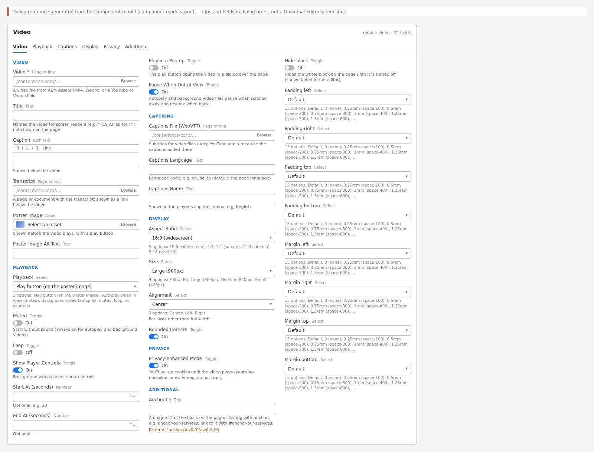{width=100%}

**Properties panel tabs:**

- **Video:** Video (required: asset or link); Title; Caption (rich text); Transcript (page or
  document); Poster Image; Poster Image Alt Text.
- **Playback:** Playback (Play button (on the poster image) / Autoplay when in view (muted) /
  Background video (autoplay, muted, loop, no controls)); Muted; Loop; Show Player Controls; Start
  At (seconds); End At (seconds); Play in a Pop-up; Pause When Out of View.
- **Captions:** Captions File (WebVTT); Captions Language; Captions Name.
- **Display:** Aspect Ratio (16:9, 4:3, 1:1, 21:9, 9:16); Size (Full width, Large (900px), Medium
  (640px), Small (420px)); Alignment (Center, Left, Right); Rounded Corners.
- **Privacy:** Privacy-enhanced Mode.
- **Additional:** Anchor ID; Hide block; Padding left / right / top / bottom; Margin left / right /
  top / bottom.

None of the fields has a `condition`: all are always visible; fields that don't apply to the
chosen source or playback are ignored by the code (see Field details).

### 6.28.5 Authoring Guide

**Step 1 — Open the page in Universal Editor**

**Action:** Open the page with **Edit** from AEM Sites.

**Expected Result:** The page is in edit mode.

**Steps — Authoring step:** The page open in Universal Editor.

| Step | Where | Field / control | Value / action |
|:--|:----------|:----------|:--------------------|
| 1 | AEM Sites console | Navigate | /content/tcs-corp/us/en › the page |
| 2 | AEM Sites console | Select the page | Check the page card |
| 3 | AEM Sites toolbar | Edit | Opens the page in Universal Editor (edit mode) |

**Step 2 — Upload or locate the assets**

**Action:** In AEM Assets, upload the web-optimised video (MP4 / WebM), the poster image and, for
files, the `.vtt` captions under `/content/dam/tcs-corp/…` (skip for YouTube / Vimeo except the
poster).

**Expected Result:** The assets are available in the asset picker.

**Steps — Authoring step:** AEM Assets folder with the MP4, the poster JPG and the VTT file.

| Step | Where | Field / control | Value / action |
|:--|:----------|:----------|:--------------------|
| 1 | AEM Assets › Files | Navigate | /content/dam/tcs-corp/videos |
| 2 | AEM Assets toolbar | Upload | tcs-brand-film.mp4 (web-optimised MP4 or WebM) |
| 3 | AEM Assets toolbar | Upload | tcs-brand-film-poster.jpg (poster image) |
| 4 | AEM Assets toolbar | Upload | tcs-brand-film-en.vtt (captions, video files only) |

**Step 3 — Add the Video block**

**Action:** Select the section, choose **Add** (+), select **Video**.

**Expected Result:** A Video block with defaults (Play button, controls on, 16:9, Large, Center,
rounded, privacy on) is added; nothing renders until Video is set.

**Steps — Authoring step:** The Add menu with Video and the new block in the content tree.

| Step | Where | Field / control | Value / action |
|:--|:----------|:----------|:--------------------|
| 1 | Universal Editor › Content tree | Section | Select the section |
| 2 | Universal Editor › Content tree | Section › Add (+) | Video |
| 3 | Universal Editor › Content tree | New item | Video (with the defaults: Play button, controls on, 16:9, Large, Center, rounded, privacy on) |

**Step 4 — Video tab**

**Action:** Set **Video** (pick the asset or paste the YouTube / Vimeo URL); type a **Title**
(names the video for screen readers); optionally a **Caption** and a **Transcript**; choose a
**Poster Image** and its **Alt Text**.

**Expected Result:** The poster with the Play button renders (or the player, without poster).

**Steps — Authoring step:** The Video tab filled in.

| Step | Where | Field / control | Value / action |
|:--|:----------|:----------|:--------------------|
| 1 | Video › Video | Video | Select the asset /content/dam/tcs-corp/videos/tcs-brand-film.mp4 (or paste the YouTube / Vimeo URL) |
| 2 | Video › Video | Title | Building on belief: the TCS brand film |
| 3 | Video › Video | Caption | How our people and partners use technology to help enterprises grow and transform. |
| 4 | Video › Video | Transcript | Select the page /en/about/brand-film-transcript |
| 5 | Video › Video | Poster Image | Select the asset tcs-brand-film-poster.jpg |
| 6 | Video › Video | Poster Image Alt Text | Engineers collaborating in a modern office |

**Step 5 — Playback tab**

**Action:** Choose **Playback**; set Muted, Loop, Show Player Controls, Start At / End At, Play in a
Pop-up and Pause When Out of View as needed.

**Expected Result:** Settings saved; autoplay behaviour is visible in Preview.

**Steps — Authoring step:** The Playback tab with Playback set to Background video.

| Step | Where | Field / control | Value / action |
|:--|:----------|:----------|:--------------------|
| 1 | Video › Playback | Playback | Background video (autoplay, muted, loop, no controls) |
| 2 | Video › Playback | Muted | Off (always on for background videos) |
| 3 | Video › Playback | Loop | Off (always on for background videos) |
| 4 | Video › Playback | Show Player Controls | On (ignored for background videos) |
| 5 | Video › Playback | Start At (seconds) / End At (seconds) | Leave empty |
| 6 | Video › Playback | Play in a Pop-up | Off |
| 7 | Video › Playback | Pause When Out of View | On |

**Step 6 — Captions tab (video files)**

**Action:** Select the **Captions File (WebVTT)**; enter **Captions Language** (e.g. `en`) and
**Captions Name** (e.g. "English").

**Expected Result:** The captions option appears in the native player.

**Steps — Authoring step:** The Captions tab filled in.

| Step | Where | Field / control | Value / action |
|:--|:----------|:----------|:--------------------|
| 1 | Video › Captions | Captions File (WebVTT) | Select the asset /content/dam/tcs-corp/videos/tcs-brand-film-en.vtt |
| 2 | Video › Captions | Captions Language | en |
| 3 | Video › Captions | Captions Name | English |

**Step 7 — Display tab**

**Action:** Choose **Aspect Ratio** (match the video), **Size**, **Alignment** and **Rounded
Corners**.

**Expected Result:** The media area changes shape and size.

**Steps — Authoring step:** The Display tab with 9:16 and Small.

| Step | Where | Field / control | Value / action |
|:--|:----------|:----------|:--------------------|
| 1 | Video › Display | Aspect Ratio | 9:16 (vertical) |
| 2 | Video › Display | Size | Small (420px) |
| 3 | Video › Display | Alignment | Center |
| 4 | Video › Display | Rounded Corners | On |

**Step 8 — Privacy tab**

**Action:** Keep **Privacy-enhanced Mode** on unless an exception is approved.

**Expected Result:** YouTube uses youtube-nocookie.com; Vimeo gets do-not-track.

**Steps — Authoring step:** The Privacy tab.

| Step | Where | Field / control | Value / action |
|:--|:----------|:----------|:--------------------|
| 1 | Video › Privacy | Privacy-enhanced Mode | On (keep, unless an exception is approved) |

**Step 9 — Additional tab (optional)**

**Action:** Set Anchor ID, Hide block, padding or margin.

**Expected Result:** Values accepted.

**Steps — Authoring step:** The Additional tab.

| Step | Where | Field / control | Value / action |
|:--|:----------|:----------|:--------------------|
| 1 | Video › Additional | Anchor ID | anchor-brand-film |
| 2 | Video › Additional | Hide block | Off |
| 3 | Video › Additional | Padding / Margin | Default |

**Step 10 — Preview and test**

**Action:** Switch to **Preview**; play the video with mouse and keyboard; test the pop-up, the
pause toggle, captions; check mobile width.

**Expected Result:** Playback works as configured.

**Steps — Authoring step:** The video playing in preview with captions on.

| Step | Where | Field / control | Value / action |
|:--|:----------|:----------|:--------------------|
| 1 | Universal Editor toolbar | Preview | Switch to Preview mode |
| 2 | Preview | Play button | Click (or Tab to it and press Enter) |
| 3 | Preview › Player | Captions | Turn on English |
| 4 | Preview | Screen width | Check at mobile width |

**Step 11 — Validate and publish**

**Action:** Run the Validation Process checklist; **Publish** the page together with the
referenced assets (video, poster, captions, transcript).

**Expected Result:** The video plays on the live site.

**Steps — Authoring step:** The Publish dialog listing the page and its referenced assets.

| Step | Where | Field / control | Value / action |
|:--|:----------|:----------|:--------------------|
| 1 | Universal Editor toolbar | Publish | Open the Publish dialog |
| 2 | Publish dialog | Items | The page and its references: tcs-brand-film.mp4, tcs-brand-film-poster.jpg, tcs-brand-film-en.vtt, the transcript page |
| 3 | Publish dialog | Destination | Publish to Live |
| 4 | Publish dialog | Publish | Confirm |

#### Preview Process

1. Universal Editor **Preview** mode.
2. Edge Delivery preview `https://main--tcs-corp--sradha-tcs.aem.page/{locale}/{path}`; check that
   the video file URL loads (Network panel) — assets must be published / previewed with the page.
3. Test with the OS reduced-motion setting on (autoplay / background become Play button).

#### Publishing Process

Publish the page and its referenced assets from Universal Editor / AEM Sites (Manage Publication
lists references). AEM Assets under `/content/dam/tcs-corp/` are delivered at their own path
(included in `paths.json`).

#### Validation Process

- [ ] Video set (required) and playing in preview on desktop and mobile.
- [ ] Title set (descriptive, not "Video").
- [ ] Poster image set (mandatory in practice for autoplay / background and pop-up) with alt text
  or intentionally decorative.
- [ ] Aspect Ratio matches the video (no unwanted cropping of files).
- [ ] Video files have a WebVTT captions file with correct language; YouTube / Vimeo have captions
  on the platform.
- [ ] Transcript provided for videos with important information.
- [ ] Autoplay / background videos are muted and show the pause / stop toggle (or controls).
- [ ] Start At / End At correct (End after Start; End not available for Vimeo).
- [ ] Privacy-enhanced Mode on (unless an approved exception).
- [ ] Pop-up opens, plays, closes with Esc / Close, and focus returns.
- [ ] Assets published.

#### Rollback Process

1. Restore the previous page version and republish.
2. Turn on Hide block while fixing.
3. Replace the asset with the previous version in AEM Assets (asset versioning) and republish the
   asset.

The walkthroughs below repeat the steps above for each variation of chapter 6.28.3, from opening the page to publishing; the values are those of the variation's screenshot.

#### Walkthrough — Variation 4 — Play button on the poster image (inline)

Reproduces the screenshot `screenshots/video-play-button-poster.jpg` of this variation. The Field Entry Table under the screenshot lists every value with its rules.

**Step 1 — Open the page**

**Action:** In AEM Sites, open the locale site (for example `/content/tcs-corp/us/en`), select the page and choose Edit; the page opens in Universal Editor.

**Expected Result:** The page renders on the canvas with the content tree and the properties panel.

**Step 2 — Add the Video**

**Action:** Select the section in the content tree, choose **Add (+)** and pick **Video**.

**Expected Result:** An empty Video block is added to the section.

**Step 3 — Fill in Video › Video**

**Action:** Select **Video** in the content tree and open the **Video** tab of the properties panel. Enter: **Video** (A) = Select the page or enter /content/dam/tcs-corp/videos/tcs-brand-film.mp4; **Title** (B) = Building on belief: the TCS brand film; **Poster Image** (C) = Select the asset photo-2.svg (/en/media/photo-2.svg); **Poster Image Alt Text** (D) = Data centre corridor with server racks.

**Expected Result:** The poster photo-2.svg fills the 16:9 area with the Play button in its centre.

**Step 4 — Fill in Video › Playback**

**Action:** Select **Video** in the content tree and open the **Playback** tab of the properties panel. Enter: **Playback** (E) = Play button (on the poster image) (default, keep).

**Expected Result:** Playback stays on Play button (on the poster image); the canvas does not change.

**Step 5 — Preview**

**Action:** Action: Press Play: the video plays in place of the poster (second frame, not captured).

**Expected Result:** Pressing Play replaces the poster with the playing film and moves focus into the player.

**Step 6 — Preview**

**Action:** Choose **Preview** in the Universal Editor toolbar (or open the page on aem.page) and compare it with the screenshot.

**Expected Result:** A 900 px wide rounded poster with the centred Play button (primary icon button scaled 1.4 times); nothing below the media area.

**Step 7 — Publish**

**Action:** Choose **Publish** › Publish to Live (with the referenced pages, fragments and assets that are not yet published).

**Expected Result:** Publish sends the page to aem.page or aem.live; the MP4 and photo-2.svg must be published as assets. The button labels come from the locale's placeholders sheet (playVideoTitle).

**Step 8 — Verify**

**Action:** On the live page check: Press Play on aem.page: the poster disappears, the film plays and focus is on the player.

**Expected Result:** The page matches the screenshot; nothing in the Troubleshooting case above applies.

#### Walkthrough — Variation 6 — Play in a Pop-up

Reproduces the screenshot `screenshots/video-popup.jpg` of this variation. The Field Entry Table under the screenshot lists every value with its rules.

**Step 1 — Open the page**

**Action:** In AEM Sites, open the locale site (for example `/content/tcs-corp/us/en`), select the page and choose Edit; the page opens in Universal Editor.

**Expected Result:** The page renders on the canvas with the content tree and the properties panel.

**Step 2 — Add the Video**

**Action:** Select the section in the content tree, choose **Add (+)** and pick **Video**.

**Expected Result:** An empty Video block is added to the section.

**Step 3 — Fill in Video › Video**

**Action:** Select **Video** in the content tree and open the **Video** tab of the properties panel. Enter: **Video** (A) = Select the page or enter /content/dam/tcs-corp/videos/tcs-brand-film.mp4; **Title** (B) = Building on belief: the TCS brand film; **Poster Image** (C) = Select the asset photo-3.svg (/en/media/photo-3.svg); **Poster Image Alt Text** (D) = Team reviewing a cloud migration plan.

**Expected Result:** The poster photo-3.svg appears with the Play button.

**Step 4 — Fill in Video › Playback**

**Action:** Select **Video** in the content tree and open the **Playback** tab of the properties panel. Enter: **Play in a Pop-up** (E) = On.

**Expected Result:** Play in a Pop-up on does not change the canvas; the poster and Play button stay.

**Step 5 — Preview**

**Action:** Action: Press the Play button on the poster.

**Expected Result:** Pressing Play dims the page and opens the dialog with the playing video and a Close button.

**Step 6 — Preview**

**Action:** Choose **Preview** in the Universal Editor toolbar (or open the page on aem.page) and compare it with the screenshot.

**Expected Result:** A dark backdrop over the header and page, a white rounded dialog, a close icon and the video player with play button, time 0:00 and timeline.

**Step 7 — Publish**

**Action:** Choose **Publish** › Publish to Live (with the referenced pages, fragments and assets that are not yet published).

**Expected Result:** Publish sends the page to aem.page or aem.live; the MP4 and photo-3.svg must be published as assets; the dialog labels dialog and close come from the published placeholders sheet.

**Step 8 — Verify**

**Action:** On the live page check: Open the pop-up on aem.page at 1440 px and check the whole player, including its right-hand controls, is visible.

**Expected Result:** The page matches the screenshot; nothing in the Troubleshooting case above applies.

#### Walkthrough — Variation 8 — Autoplay without controls (with playback toggle)

Reproduces the screenshot `screenshots/video-autoplay-no-controls.jpg` of this variation. The Field Entry Table under the screenshot lists every value with its rules.

**Step 1 — Open the page**

**Action:** In AEM Sites, open the locale site (for example `/content/tcs-corp/us/en`), select the page and choose Edit; the page opens in Universal Editor.

**Expected Result:** The page renders on the canvas with the content tree and the properties panel.

**Step 2 — Add the Video**

**Action:** Select the section in the content tree, choose **Add (+)** and pick **Video**.

**Expected Result:** An empty Video block is added to the section.

**Step 3 — Fill in Video › Video**

**Action:** Select **Video** in the content tree and open the **Video** tab of the properties panel. Enter: **Video** (A) = Select the page or enter /content/dam/tcs-corp/videos/tcs-brand-film.mp4; **Title** (B) = Building on belief: the TCS brand film; **Poster Image** (C) = Select the asset photo-5.svg (/en/media/photo-5.svg); **Poster Image Alt Text** (D) = Wind turbines monitored by a digital twin.

**Expected Result:** The poster photo-5.svg appears with the centred Play button.

**Step 4 — Fill in Video › Playback**

**Action:** Select **Video** in the content tree and open the **Playback** tab of the properties panel. Enter: **Playback** (E) = Autoplay when in view (muted); **Show Player Controls** (F) = Off.

**Expected Result:** The Play button disappears; the round pause toggle appears in the bottom-right corner and the clip starts muted when in view.

**Step 5 — Preview**

**Action:** Choose **Preview** in the Universal Editor toolbar (or open the page on aem.page) and compare it with the screenshot.

**Expected Result:** The rounded 900 px poster with no centre button and a small round secondary pause icon button 0.75rem from the bottom and right edges.

**Step 6 — Publish**

**Action:** Choose **Publish** › Publish to Live (with the referenced pages, fragments and assets that are not yet published).

**Expected Result:** Publish sends the page to aem.page or aem.live; the MP4 and photo-5.svg must be published as assets; the toggle labels pauseVideo and playVideo come from the published placeholders sheet.

**Step 7 — Verify**

**Action:** On the live page check: Scroll the block into view on aem.page with Reduce motion off: the poster gives way and the clip plays muted.

**Expected Result:** The page matches the screenshot; nothing in the Troubleshooting case above applies.

#### Walkthrough — Variation 9 — Background video

Reproduces the screenshot `screenshots/video-background.jpg` of this variation. The Field Entry Table under the screenshot lists every value with its rules.

**Step 1 — Open the page**

**Action:** In AEM Sites, open the locale site (for example `/content/tcs-corp/us/en`), select the page and choose Edit; the page opens in Universal Editor.

**Expected Result:** The page renders on the canvas with the content tree and the properties panel.

**Step 2 — Add the Video**

**Action:** Select the section in the content tree, choose **Add (+)** and pick **Video**.

**Expected Result:** An empty Video block is added to the section.

**Step 3 — Fill in Video › Video**

**Action:** Select **Video** in the content tree and open the **Video** tab of the properties panel. Enter: **Video** (A) = Select the page or enter /content/dam/tcs-corp/videos/tcs-brand-film.mp4; **Title** (B) = Campus ambience; **Poster Image** (C) = Select the asset photo-6.svg (/en/media/photo-6.svg).

**Expected Result:** The poster photo-6.svg appears with the centred Play button at the default 900 px size.

**Step 4 — Fill in Video › Playback**

**Action:** Select **Video** in the content tree and open the **Playback** tab of the properties panel. Enter: **Playback** (D) = Background video (autoplay, muted, loop, no controls).

**Expected Result:** The Play button is replaced by the pause toggle in the corner and the video starts muted and looping when in view.

**Step 5 — Fill in Video › Display**

**Action:** Select **Video** in the content tree and open the **Display** tab of the properties panel. Enter: **Size** (E) = Full width.

**Expected Result:** Size Full width widens the video to the section's whole content width.

**Step 6 — Preview**

**Action:** Choose **Preview** in the Universal Editor toolbar (or open the page on aem.page) and compare it with the screenshot.

**Expected Result:** A wide rounded 16:9 poster spanning the content width, no Play button, no caption, and the small pause icon button in the corner.

**Step 7 — Publish**

**Action:** Choose **Publish** › Publish to Live (with the referenced pages, fragments and assets that are not yet published).

**Expected Result:** Publish sends the page to aem.page or aem.live; the MP4 and photo-6.svg must be published as assets. Keep the file short and small, as it is loaded automatically for every visitor.

**Step 8 — Verify**

**Action:** On the live page check: Check on aem.page that the pause button is visible and toggles to Play video when pressed.

**Expected Result:** The page matches the screenshot; nothing in the Troubleshooting case above applies.

#### Walkthrough — Variation 15 — Caption text and Transcript link

Reproduces the screenshot `screenshots/video-caption-transcript.jpg` of this variation. The Field Entry Table under the screenshot lists every value with its rules.

**Step 1 — Open the page**

**Action:** In AEM Sites, open the locale site (for example `/content/tcs-corp/us/en`), select the page and choose Edit; the page opens in Universal Editor.

**Expected Result:** The page renders on the canvas with the content tree and the properties panel.

**Step 2 — Add the Video**

**Action:** Select the section in the content tree, choose **Add (+)** and pick **Video**.

**Expected Result:** An empty Video block is added to the section.

**Step 3 — Fill in Video › Video**

**Action:** Select **Video** in the content tree and open the **Video** tab of the properties panel. Enter: **Video** (A) = Select the page or enter /content/dam/tcs-corp/videos/tcs-brand-film.mp4; **Title** (B) = Building on belief: the TCS brand film; **Caption** (C) = How our people and partners use technology to help enterprises grow and transform; **Transcript** (D) = Select the page or enter /en/about/brand-film-transcript; **Poster Image** (E) = Select the asset photo-3.svg (/en/media/photo-3.svg); **Poster Image Alt Text** (F) = Team reviewing a cloud migration plan.

**Expected Result:** The poster with the Play button appears at 900 px with the grey caption and the Read the transcript link below.

**Step 4 — Fill in Video › Display**

**Action:** Select **Video** in the content tree and open the **Display** tab of the properties panel. Enter: **Size** (G) = Medium (640px).

**Expected Result:** Size Medium narrows the block to 640 px, centred, with the caption and link below it.

**Step 5 — Preview**

**Action:** Choose **Preview** in the Universal Editor toolbar (or open the page on aem.page) and compare it with the screenshot.

**Expected Result:** A 640 px centred rounded poster with the Play button; 0.75rem below it the small grey caption; 0.5rem below that the small blue Read the transcript link.

**Step 6 — Publish**

**Action:** Choose **Publish** › Publish to Live (with the referenced pages, fragments and assets that are not yet published).

**Expected Result:** Publish sends the page to aem.page or aem.live; the transcript page is a separate page and must be published too, or the link returns 404; the MP4 and poster are published as assets.

**Step 7 — Verify**

**Action:** On the live page check: On aem.page the grey caption shows directly below the media area.

**Expected Result:** The page matches the screenshot; nothing in the Troubleshooting case above applies.

#### Walkthrough — Variation 16 — Aspect ratio 16:9 (widescreen)

Reproduces the screenshot `screenshots/video-ratio-16-9.jpg` of this variation. The Field Entry Table under the screenshot lists every value with its rules.

**Step 1 — Open the page**

**Action:** In AEM Sites, open the locale site (for example `/content/tcs-corp/us/en`), select the page and choose Edit; the page opens in Universal Editor.

**Expected Result:** The page renders on the canvas with the content tree and the properties panel.

**Step 2 — Add the Video**

**Action:** Select the section in the content tree, choose **Add (+)** and pick **Video**.

**Expected Result:** An empty Video block is added to the section.

**Step 3 — Fill in Video › Video**

**Action:** Select **Video** in the content tree and open the **Video** tab of the properties panel. Enter: **Video** (A) = Select the page or enter /content/dam/tcs-corp/videos/tcs-brand-film.mp4; **Title** (B) = Building on belief: the TCS brand film; **Poster Image** (C) = Select the asset photo-1.svg (/en/media/photo-1.svg); **Poster Image Alt Text** (D) = Engineers collaborating in a modern office.

**Expected Result:** The poster photo-1.svg appears in a 16:9 area with the Play button.

**Step 4 — Fill in Video › Display**

**Action:** Select **Video** in the content tree and open the **Display** tab of the properties panel. Enter: **Aspect Ratio** (E) = 16:9 (widescreen) (default, keep).

**Expected Result:** Aspect Ratio stays on 16:9 (widescreen); the area keeps its 16:9 shape.

**Step 5 — Preview**

**Action:** Choose **Preview** in the Universal Editor toolbar (or open the page on aem.page) and compare it with the screenshot.

**Expected Result:** A 900 x 506 px rounded poster area with the Play button in its centre.

**Step 6 — Publish**

**Action:** Choose **Publish** › Publish to Live (with the referenced pages, fragments and assets that are not yet published).

**Expected Result:** Publish sends the page to aem.page or aem.live; the MP4 and photo-1.svg must be published as assets.

**Step 7 — Verify**

**Action:** On the live page check: On aem.page the provider player fills the area without bars.

**Expected Result:** The page matches the screenshot; nothing in the Troubleshooting case above applies.

#### Walkthrough — Variation 17 — Aspect ratio 4:3

Reproduces the screenshot `screenshots/video-ratio-4-3.jpg` of this variation. The Field Entry Table under the screenshot lists every value with its rules.

**Step 1 — Open the page**

**Action:** In AEM Sites, open the locale site (for example `/content/tcs-corp/us/en`), select the page and choose Edit; the page opens in Universal Editor.

**Expected Result:** The page renders on the canvas with the content tree and the properties panel.

**Step 2 — Add the Video**

**Action:** Select the section in the content tree, choose **Add (+)** and pick **Video**.

**Expected Result:** An empty Video block is added to the section.

**Step 3 — Fill in Video › Video**

**Action:** Select **Video** in the content tree and open the **Video** tab of the properties panel. Enter: **Video** (A) = Select the page or enter /content/dam/tcs-corp/videos/tcs-brand-film.mp4; **Title** (B) = Building on belief: the TCS brand film; **Poster Image** (C) = Select the asset photo-2.svg (/en/media/photo-2.svg); **Poster Image Alt Text** (D) = Data centre corridor with server racks.

**Expected Result:** The poster photo-2.svg appears in the default 16:9 area with the Play button.

**Step 4 — Fill in Video › Display**

**Action:** Select **Video** in the content tree and open the **Display** tab of the properties panel. Enter: **Aspect Ratio** (E) = 4:3.

**Expected Result:** The area becomes 4:3, taller at the same 900 px width, and the poster is cropped at the sides.

**Step 5 — Preview**

**Action:** Choose **Preview** in the Universal Editor toolbar (or open the page on aem.page) and compare it with the screenshot.

**Expected Result:** A taller rounded 900 x 675 px poster area; the sides of the 16:9 sample poster are cropped (its label is cut at the left edge), with the Play button centred.

**Step 6 — Publish**

**Action:** Choose **Publish** › Publish to Live (with the referenced pages, fragments and assets that are not yet published).

**Expected Result:** Publish sends the page to aem.page or aem.live; the MP4 and photo-2.svg must be published as assets.

**Step 7 — Verify**

**Action:** On the live page check: Play the video on aem.page and check the full frame is visible.

**Expected Result:** The page matches the screenshot; nothing in the Troubleshooting case above applies.

#### Walkthrough — Variation 18 — Aspect ratio 1:1 (square)

Reproduces the screenshot `screenshots/video-ratio-1-1.jpg` of this variation. The Field Entry Table under the screenshot lists every value with its rules.

**Step 1 — Open the page**

**Action:** In AEM Sites, open the locale site (for example `/content/tcs-corp/us/en`), select the page and choose Edit; the page opens in Universal Editor.

**Expected Result:** The page renders on the canvas with the content tree and the properties panel.

**Step 2 — Add the Video**

**Action:** Select the section in the content tree, choose **Add (+)** and pick **Video**.

**Expected Result:** An empty Video block is added to the section.

**Step 3 — Fill in Video › Video**

**Action:** Select **Video** in the content tree and open the **Video** tab of the properties panel. Enter: **Video** (A) = Select the page or enter /content/dam/tcs-corp/videos/tcs-brand-film.mp4; **Title** (B) = Building on belief: the TCS brand film; **Poster Image** (C) = Select the asset square-1.svg (/en/media/square-1.svg); **Poster Image Alt Text** (D) = Product designer sketching an app screen.

**Expected Result:** The poster square-1.svg appears in a 900 px 16:9 area, cropped, with the Play button.

**Step 4 — Fill in Video › Display**

**Action:** Select **Video** in the content tree and open the **Display** tab of the properties panel. Enter: **Aspect Ratio** (E) = 1:1 (square); **Size** (F) = Medium (640px).

**Expected Result:** The area becomes a 640 px square, centred, showing the whole square poster.

**Step 5 — Preview**

**Action:** Choose **Preview** in the Universal Editor toolbar (or open the page on aem.page) and compare it with the screenshot.

**Expected Result:** A 640 x 640 px rounded square poster centred in the section with the Play button in the middle.

**Step 6 — Publish**

**Action:** Choose **Publish** › Publish to Live (with the referenced pages, fragments and assets that are not yet published).

**Expected Result:** Publish sends the page to aem.page or aem.live; the MP4 and square-1.svg must be published as assets.

**Step 7 — Verify**

**Action:** On the live page check: On aem.page the 640 px square is centred in the section.

**Expected Result:** The page matches the screenshot; nothing in the Troubleshooting case above applies.

#### Walkthrough — Variation 19 — Aspect ratio 21:9 (cinema)

Reproduces the screenshot `screenshots/video-ratio-21-9.jpg` of this variation. The Field Entry Table under the screenshot lists every value with its rules.

**Step 1 — Open the page**

**Action:** In AEM Sites, open the locale site (for example `/content/tcs-corp/us/en`), select the page and choose Edit; the page opens in Universal Editor.

**Expected Result:** The page renders on the canvas with the content tree and the properties panel.

**Step 2 — Add the Video**

**Action:** Select the section in the content tree, choose **Add (+)** and pick **Video**.

**Expected Result:** An empty Video block is added to the section.

**Step 3 — Fill in Video › Video**

**Action:** Select **Video** in the content tree and open the **Video** tab of the properties panel. Enter: **Video** (A) = Select the page or enter /content/dam/tcs-corp/videos/tcs-brand-film.mp4; **Title** (B) = Campus ambience; **Poster Image** (C) = Select the asset wide.svg (/en/media/wide.svg).

**Expected Result:** The poster wide.svg appears in a 900 px 16:9 area with the Play button.

**Step 4 — Fill in Video › Playback**

**Action:** Select **Video** in the content tree and open the **Playback** tab of the properties panel. Enter: **Playback** (D) = Background video (autoplay, muted, loop, no controls).

**Expected Result:** The Play button is replaced by the pause toggle in the corner; the video starts muted when in view.

**Step 5 — Fill in Video › Display**

**Action:** Select **Video** in the content tree and open the **Display** tab of the properties panel. Enter: **Aspect Ratio** (E) = 21:9 (cinema); **Size** (F) = Full width.

**Expected Result:** The video spans the content width as a shallow 21:9 strip.

**Step 6 — Preview**

**Action:** Choose **Preview** in the Universal Editor toolbar (or open the page on aem.page) and compare it with the screenshot.

**Expected Result:** A wide, low rounded poster (about 1280 x 549 px) without a Play button, and the round pause icon button in its corner.

**Step 7 — Publish**

**Action:** Choose **Publish** › Publish to Live (with the referenced pages, fragments and assets that are not yet published).

**Expected Result:** Publish sends the page to aem.page or aem.live; the MP4 and wide.svg must be published as assets.

**Step 8 — Verify**

**Action:** On the live page check: With Reduce motion off on the test device, the strip plays muted when scrolled into view.

**Expected Result:** The page matches the screenshot; nothing in the Troubleshooting case above applies.

#### Walkthrough — Variation 20 — Aspect ratio 9:16 (vertical)

Reproduces the screenshot `screenshots/video-ratio-9-16.jpg` of this variation. The Field Entry Table under the screenshot lists every value with its rules.

**Step 1 — Open the page**

**Action:** In AEM Sites, open the locale site (for example `/content/tcs-corp/us/en`), select the page and choose Edit; the page opens in Universal Editor.

**Expected Result:** The page renders on the canvas with the content tree and the properties panel.

**Step 2 — Add the Video**

**Action:** Select the section in the content tree, choose **Add (+)** and pick **Video**.

**Expected Result:** An empty Video block is added to the section.

**Step 3 — Fill in Video › Video**

**Action:** Select **Video** in the content tree and open the **Video** tab of the properties panel. Enter: **Video** (A) = Select the page or enter /content/dam/tcs-corp/videos/tcs-brand-film.mp4; **Title** (B) = Client story in 60 seconds; **Poster Image** (C) = Select the asset tall.svg (/en/media/tall.svg); **Poster Image Alt Text** (D) = Consultant presenting to a client team.

**Expected Result:** The poster tall.svg appears cropped in a 900 px 16:9 area with the Play button.

**Step 4 — Fill in Video › Display**

**Action:** Select **Video** in the content tree and open the **Display** tab of the properties panel. Enter: **Aspect Ratio** (E) = 9:16 (vertical); **Size** (F) = Small (420px).

**Expected Result:** The area becomes a 420 px wide vertical 9:16 rectangle, centred, showing the whole vertical poster.

**Step 5 — Preview**

**Action:** Choose **Preview** in the Universal Editor toolbar (or open the page on aem.page) and compare it with the screenshot.

**Expected Result:** A narrow, tall rounded poster (420 x 747 px) centred in the section with the Play button in the middle.

**Step 6 — Publish**

**Action:** Choose **Publish** › Publish to Live (with the referenced pages, fragments and assets that are not yet published).

**Expected Result:** Publish sends the page to aem.page or aem.live; the MP4 and tall.svg must be published as assets.

**Step 7 — Verify**

**Action:** On the live page check: On aem.page the Short fills the narrow vertical area.

**Expected Result:** The page matches the screenshot; nothing in the Troubleshooting case above applies.

#### Walkthrough — Variation 21 — Size Full width

Reproduces the screenshot `screenshots/video-size-full.jpg` of this variation. The Field Entry Table under the screenshot lists every value with its rules.

**Step 1 — Open the page**

**Action:** In AEM Sites, open the locale site (for example `/content/tcs-corp/us/en`), select the page and choose Edit; the page opens in Universal Editor.

**Expected Result:** The page renders on the canvas with the content tree and the properties panel.

**Step 2 — Add the Video**

**Action:** Select the section in the content tree, choose **Add (+)** and pick **Video**.

**Expected Result:** An empty Video block is added to the section.

**Step 3 — Fill in Video › Video**

**Action:** Select **Video** in the content tree and open the **Video** tab of the properties panel. Enter: **Video** (A) = Select the page or enter /content/dam/tcs-corp/videos/tcs-brand-film.mp4; **Title** (B) = Building on belief: the TCS brand film; **Poster Image** (C) = Select the asset wide.svg (/en/media/wide.svg); **Poster Image Alt Text** (D) = Aerial view of a technology campus.

**Expected Result:** The poster wide.svg appears in a 900 px 16:9 area with the Play button.

**Step 4 — Fill in Video › Display**

**Action:** Select **Video** in the content tree and open the **Display** tab of the properties panel. Enter: **Size** (E) = Full width.

**Expected Result:** Size Full width widens the video to the section's whole content width.

**Step 5 — Preview**

**Action:** Choose **Preview** in the Universal Editor toolbar (or open the page on aem.page) and compare it with the screenshot.

**Expected Result:** A 1280 x 720 px rounded poster with the Play button in the centre; the wide poster is cropped at its sides to 16:9.

**Step 6 — Publish**

**Action:** Choose **Publish** › Publish to Live (with the referenced pages, fragments and assets that are not yet published).

**Expected Result:** Publish sends the page to aem.page or aem.live; the MP4 and wide.svg must be published as assets.

**Step 7 — Verify**

**Action:** On the live page check: On aem.page at 1440 px the poster looks sharp.

**Expected Result:** The page matches the screenshot; nothing in the Troubleshooting case above applies.

#### Walkthrough — Variation 22 — Size Large (900px)

Reproduces the screenshot `screenshots/video-size-large.jpg` of this variation. The Field Entry Table under the screenshot lists every value with its rules.

**Step 1 — Open the page**

**Action:** In AEM Sites, open the locale site (for example `/content/tcs-corp/us/en`), select the page and choose Edit; the page opens in Universal Editor.

**Expected Result:** The page renders on the canvas with the content tree and the properties panel.

**Step 2 — Add the Video**

**Action:** Select the section in the content tree, choose **Add (+)** and pick **Video**.

**Expected Result:** An empty Video block is added to the section.

**Step 3 — Fill in Video › Video**

**Action:** Select **Video** in the content tree and open the **Video** tab of the properties panel. Enter: **Video** (A) = Select the page or enter /content/dam/tcs-corp/videos/tcs-brand-film.mp4; **Title** (B) = Building on belief: the TCS brand film; **Poster Image** (C) = Select the asset photo-7.svg (/en/media/photo-7.svg); **Poster Image Alt Text** (D) = Operations centre with large displays.

**Expected Result:** The poster photo-7.svg appears 900 px wide at 16:9 with the Play button.

**Step 4 — Fill in Video › Display**

**Action:** Select **Video** in the content tree and open the **Display** tab of the properties panel. Enter: **Size** (E) = Large (900px) (default, keep).

**Expected Result:** Size stays Large (900px); the canvas does not change.

**Step 5 — Preview**

**Action:** Choose **Preview** in the Universal Editor toolbar (or open the page on aem.page) and compare it with the screenshot.

**Expected Result:** A 900 x 506 px rounded grey-toned poster with the Play button, centred in the 1280 px section.

**Step 6 — Publish**

**Action:** Choose **Publish** › Publish to Live (with the referenced pages, fragments and assets that are not yet published).

**Expected Result:** Publish sends the page to aem.page or aem.live; the MP4 and photo-7.svg must be published as assets.

**Step 7 — Verify**

**Action:** On the live page check: On aem.page at 1440 px the media area measures 900 px wide.

**Expected Result:** The page matches the screenshot; nothing in the Troubleshooting case above applies.

#### Walkthrough — Variation 23 — Size Medium (640px)

Reproduces the screenshot `screenshots/video-size-medium.jpg` of this variation. The Field Entry Table under the screenshot lists every value with its rules.

**Step 1 — Open the page**

**Action:** In AEM Sites, open the locale site (for example `/content/tcs-corp/us/en`), select the page and choose Edit; the page opens in Universal Editor.

**Expected Result:** The page renders on the canvas with the content tree and the properties panel.

**Step 2 — Add the Video**

**Action:** Select the section in the content tree, choose **Add (+)** and pick **Video**.

**Expected Result:** An empty Video block is added to the section.

**Step 3 — Fill in Video › Video**

**Action:** Select **Video** in the content tree and open the **Video** tab of the properties panel. Enter: **Video** (A) = Select the page or enter /content/dam/tcs-corp/videos/tcs-brand-film.mp4; **Title** (B) = Building on belief: the TCS brand film; **Poster Image** (C) = Select the asset photo-8.svg (/en/media/photo-8.svg); **Poster Image Alt Text** (D) = Retail analytics dashboard on a tablet.

**Expected Result:** The poster photo-8.svg appears 900 px wide with the Play button.

**Step 4 — Fill in Video › Display**

**Action:** Select **Video** in the content tree and open the **Display** tab of the properties panel. Enter: **Size** (E) = Medium (640px).

**Expected Result:** The video narrows to 640 px and stays centred.

**Step 5 — Preview**

**Action:** Choose **Preview** in the Universal Editor toolbar (or open the page on aem.page) and compare it with the screenshot.

**Expected Result:** A 640 x 360 px rounded poster with the Play button, centred with wide white margins.

**Step 6 — Publish**

**Action:** Choose **Publish** › Publish to Live (with the referenced pages, fragments and assets that are not yet published).

**Expected Result:** Publish sends the page to aem.page or aem.live; the MP4 and photo-8.svg must be published as assets.

**Step 7 — Verify**

**Action:** On the live page check: On aem.page the block has the class video-size-medium and is 640 px wide.

**Expected Result:** The page matches the screenshot; nothing in the Troubleshooting case above applies.

#### Walkthrough — Variation 24 — Size Small (420px)

Reproduces the screenshot `screenshots/video-size-small.jpg` of this variation. The Field Entry Table under the screenshot lists every value with its rules.

**Step 1 — Open the page**

**Action:** In AEM Sites, open the locale site (for example `/content/tcs-corp/us/en`), select the page and choose Edit; the page opens in Universal Editor.

**Expected Result:** The page renders on the canvas with the content tree and the properties panel.

**Step 2 — Add the Video**

**Action:** Select the section in the content tree, choose **Add (+)** and pick **Video**.

**Expected Result:** An empty Video block is added to the section.

**Step 3 — Fill in Video › Video**

**Action:** Select **Video** in the content tree and open the **Video** tab of the properties panel. Enter: **Video** (A) = Select the page or enter /content/dam/tcs-corp/videos/tcs-brand-film.mp4; **Title** (B) = Client story in 60 seconds; **Poster Image** (C) = Select the asset tall.svg (/en/media/tall.svg); **Poster Image Alt Text** (D) = Consultant presenting to a client team.

**Expected Result:** The poster tall.svg appears cropped in a 900 px 16:9 area with the Play button.

**Step 4 — Fill in Video › Display**

**Action:** Select **Video** in the content tree and open the **Display** tab of the properties panel. Enter: **Aspect Ratio** (E) = 9:16 (vertical); **Size** (F) = Small (420px); **Alignment** (G) = Left.

**Expected Result:** The video becomes a 420 px vertical 9:16 area at the left of the section.

**Step 5 — Preview**

**Action:** Choose **Preview** in the Universal Editor toolbar (or open the page on aem.page) and compare it with the screenshot.

**Expected Result:** A 420 x 747 px rounded vertical poster with the Play button, at the left of the section, with empty space to its right.

**Step 6 — Publish**

**Action:** Choose **Publish** › Publish to Live (with the referenced pages, fragments and assets that are not yet published).

**Expected Result:** Publish sends the page to aem.page or aem.live; the MP4 and tall.svg must be published as assets.

**Step 7 — Verify**

**Action:** On the live page check: Preview at 390 px and at 1440 px: full column on the phone, left-aligned 420 px on desktop.

**Expected Result:** The page matches the screenshot; nothing in the Troubleshooting case above applies.

#### Walkthrough — Variation 25 — Alignment Center

Reproduces the screenshot `screenshots/video-align-center.jpg` of this variation. The Field Entry Table under the screenshot lists every value with its rules.

**Step 1 — Open the page**

**Action:** In AEM Sites, open the locale site (for example `/content/tcs-corp/us/en`), select the page and choose Edit; the page opens in Universal Editor.

**Expected Result:** The page renders on the canvas with the content tree and the properties panel.

**Step 2 — Add the Title**

**Action:** Select the section in the content tree, choose **Add (+)** and pick **Title**.

**Expected Result:** A Title, a Text and a Video are added to the section one after the other.

**Step 3 — Fill in Title**

**Action:** Select **Title** in the content tree and enter in the properties panel: **Title** (A) = Inside our innovation labs; **Title Type** (B) = h2.

**Expected Result:** The H2 Inside our innovation labs appears at the top of the section.

**Step 4 — Add the Text**

**Action:** Select the section in the content tree, choose **Add (+)** and pick **Text**.

**Expected Result:** A Title, a Text and a Video are added to the section one after the other.

**Step 5 — Fill in Text**

**Action:** Select **Text** in the content tree and enter in the properties panel: **Text** (C) = Our research teams prototype AI-led services with clients, from first idea to production, and share what they learn across industries.

**Expected Result:** The paragraph about the research teams appears below the heading.

**Step 6 — Add the Video**

**Action:** Select the section in the content tree, choose **Add (+)** and pick **Video**.

**Expected Result:** A Title, a Text and a Video are added to the section one after the other.

**Step 7 — Fill in Video › Video**

**Action:** Select **Video** in the content tree and open the **Video** tab of the properties panel. Enter: **Video** (D) = Select the page or enter /content/dam/tcs-corp/videos/tcs-brand-film.mp4; **Title** (E) = Building on belief: the TCS brand film; **Poster Image** (F) = Select the asset photo-2.svg (/en/media/photo-2.svg); **Poster Image Alt Text** (G) = Data centre corridor with server racks.

**Expected Result:** The poster photo-2.svg appears 900 px wide with the Play button under the text.

**Step 8 — Fill in Video › Display**

**Action:** Select **Video** in the content tree and open the **Display** tab of the properties panel. Enter: **Size** (H) = Medium (640px); **Alignment** (I) = Center (default, keep).

**Expected Result:** Size Medium narrows the video to 640 px; Alignment stays Center, so it is centred.

**Step 9 — Preview**

**Action:** Choose **Preview** in the Universal Editor toolbar (or open the page on aem.page) and compare it with the screenshot.

**Expected Result:** The left-aligned heading and paragraph, then the 640 x 360 px rounded poster with the Play button centred under them.

**Step 10 — Publish**

**Action:** Choose **Publish** › Publish to Live (with the referenced pages, fragments and assets that are not yet published).

**Expected Result:** Publish sends the page to aem.page or aem.live; the Title and Text are part of the page; the MP4 and photo-2.svg must be published as assets.

**Step 11 — Verify**

**Action:** On the live page check: On aem.page the 640 px video has equal space on both sides.

**Expected Result:** The page matches the screenshot; nothing in the Troubleshooting case above applies.

#### Walkthrough — Variation 26 — Alignment Left

Reproduces the screenshot `screenshots/video-align-left.jpg` of this variation. The Field Entry Table under the screenshot lists every value with its rules.

**Step 1 — Open the page**

**Action:** In AEM Sites, open the locale site (for example `/content/tcs-corp/us/en`), select the page and choose Edit; the page opens in Universal Editor.

**Expected Result:** The page renders on the canvas with the content tree and the properties panel.

**Step 2 — Add the Title**

**Action:** Select the section in the content tree, choose **Add (+)** and pick **Title**.

**Expected Result:** A Title, a Text and a Video are added to the section.

**Step 3 — Fill in Title**

**Action:** Select **Title** in the content tree and enter in the properties panel: **Title** (A) = Inside our innovation labs; **Title Type** (B) = h2.

**Expected Result:** The H2 Inside our innovation labs appears at the top of the section.

**Step 4 — Add the Text**

**Action:** Select the section in the content tree, choose **Add (+)** and pick **Text**.

**Expected Result:** A Title, a Text and a Video are added to the section.

**Step 5 — Fill in Text**

**Action:** Select **Text** in the content tree and enter in the properties panel: **Text** (C) = Our research teams prototype AI-led services with clients, from first idea to production, and share what they learn across industries.

**Expected Result:** The paragraph appears below the heading.

**Step 6 — Add the Video**

**Action:** Select the section in the content tree, choose **Add (+)** and pick **Video**.

**Expected Result:** A Title, a Text and a Video are added to the section.

**Step 7 — Fill in Video › Video**

**Action:** Select **Video** in the content tree and open the **Video** tab of the properties panel. Enter: **Video** (D) = Select the page or enter /content/dam/tcs-corp/videos/tcs-brand-film.mp4; **Title** (E) = Building on belief: the TCS brand film; **Poster Image** (F) = Select the asset photo-3.svg (/en/media/photo-3.svg); **Poster Image Alt Text** (G) = Team reviewing a cloud migration plan.

**Expected Result:** The poster photo-3.svg appears 900 px wide, centred, with the Play button.

**Step 8 — Fill in Video › Display**

**Action:** Select **Video** in the content tree and open the **Display** tab of the properties panel. Enter: **Size** (H) = Small (420px); **Alignment** (I) = Left.

**Expected Result:** The video shrinks to 420 px and moves to the left edge of the content.

**Step 9 — Preview**

**Action:** Choose **Preview** in the Universal Editor toolbar (or open the page on aem.page) and compare it with the screenshot.

**Expected Result:** The heading and paragraph, then a 420 x 236 px rounded poster with the Play button at the left, empty space to the right.

**Step 10 — Publish**

**Action:** Choose **Publish** › Publish to Live (with the referenced pages, fragments and assets that are not yet published).

**Expected Result:** Publish sends the page to aem.page or aem.live; the MP4 and photo-3.svg must be published as assets.

**Step 11 — Verify**

**Action:** On the live page check: On aem.page the video's left edge lines up with the heading.

**Expected Result:** The page matches the screenshot; nothing in the Troubleshooting case above applies.

#### Walkthrough — Variation 27 — Alignment Right

Reproduces the screenshot `screenshots/video-align-right.jpg` of this variation. The Field Entry Table under the screenshot lists every value with its rules.

**Step 1 — Open the page**

**Action:** In AEM Sites, open the locale site (for example `/content/tcs-corp/us/en`), select the page and choose Edit; the page opens in Universal Editor.

**Expected Result:** The page renders on the canvas with the content tree and the properties panel.

**Step 2 — Add the Title**

**Action:** Select the section in the content tree, choose **Add (+)** and pick **Title**.

**Expected Result:** A Title, a Text and a Video are added to the section.

**Step 3 — Fill in Title**

**Action:** Select **Title** in the content tree and enter in the properties panel: **Title** (A) = Inside our innovation labs; **Title Type** (B) = h2.

**Expected Result:** The H2 Inside our innovation labs appears at the top of the section.

**Step 4 — Add the Text**

**Action:** Select the section in the content tree, choose **Add (+)** and pick **Text**.

**Expected Result:** A Title, a Text and a Video are added to the section.

**Step 5 — Fill in Text**

**Action:** Select **Text** in the content tree and enter in the properties panel: **Text** (C) = Our research teams prototype AI-led services with clients, from first idea to production, and share what they learn across industries.

**Expected Result:** The paragraph appears below the heading.

**Step 6 — Add the Video**

**Action:** Select the section in the content tree, choose **Add (+)** and pick **Video**.

**Expected Result:** A Title, a Text and a Video are added to the section.

**Step 7 — Fill in Video › Video**

**Action:** Select **Video** in the content tree and open the **Video** tab of the properties panel. Enter: **Video** (D) = Select the page or enter /content/dam/tcs-corp/videos/tcs-brand-film.mp4; **Title** (E) = Building on belief: the TCS brand film; **Poster Image** (F) = Select the asset photo-5.svg (/en/media/photo-5.svg); **Poster Image Alt Text** (G) = Wind turbines monitored by a digital twin.

**Expected Result:** The poster photo-5.svg appears 900 px wide, centred, with the Play button.

**Step 8 — Fill in Video › Display**

**Action:** Select **Video** in the content tree and open the **Display** tab of the properties panel. Enter: **Size** (H) = Small (420px); **Alignment** (I) = Right.

**Expected Result:** The video shrinks to 420 px and moves to the right edge of the content.

**Step 9 — Preview**

**Action:** Choose **Preview** in the Universal Editor toolbar (or open the page on aem.page) and compare it with the screenshot.

**Expected Result:** The heading and paragraph on the left, then a 420 x 236 px rounded poster with the Play button at the right edge.

**Step 10 — Publish**

**Action:** Choose **Publish** › Publish to Live (with the referenced pages, fragments and assets that are not yet published).

**Expected Result:** Publish sends the page to aem.page or aem.live; the MP4 and photo-5.svg must be published as assets.

**Step 11 — Verify**

**Action:** On the live page check: Check the page in its locale on aem.page.

**Expected Result:** The page matches the screenshot; nothing in the Troubleshooting case above applies.

#### Walkthrough — Variation 28 — Rounded corners

Reproduces the screenshot `screenshots/video-rounded.jpg` of this variation. The Field Entry Table under the screenshot lists every value with its rules.

**Step 1 — Open the page**

**Action:** In AEM Sites, open the locale site (for example `/content/tcs-corp/us/en`), select the page and choose Edit; the page opens in Universal Editor.

**Expected Result:** The page renders on the canvas with the content tree and the properties panel.

**Step 2 — Add the Video**

**Action:** Select the section in the content tree, choose **Add (+)** and pick **Video**.

**Expected Result:** An empty Video block is added to the section.

**Step 3 — Fill in Video › Video**

**Action:** Select **Video** in the content tree and open the **Video** tab of the properties panel. Enter: **Video** (A) = Select the page or enter /content/dam/tcs-corp/videos/tcs-brand-film.mp4; **Title** (B) = Building on belief: the TCS brand film; **Poster Image** (C) = Select the asset photo-4.svg (/en/media/photo-4.svg); **Poster Image Alt Text** (D) = Developers pair programming.

**Expected Result:** The poster photo-4.svg appears with the Play button and rounded corners.

**Step 4 — Fill in Video › Display**

**Action:** Select **Video** in the content tree and open the **Display** tab of the properties panel. Enter: **Rounded Corners** (E) = On (default, keep).

**Expected Result:** Rounded Corners stays on; the corners keep their 1rem radius.

**Step 5 — Preview**

**Action:** Choose **Preview** in the Universal Editor toolbar (or open the page on aem.page) and compare it with the screenshot.

**Expected Result:** A 900 x 506 px poster with 1rem (16 px) rounded corners and the Play button.

**Step 6 — Publish**

**Action:** Choose **Publish** › Publish to Live (with the referenced pages, fragments and assets that are not yet published).

**Expected Result:** Publish sends the page to aem.page or aem.live; the MP4 and photo-4.svg must be published as assets.

**Step 7 — Verify**

**Action:** On the live page check: On aem.page the block has the class video-rounded.

**Expected Result:** The page matches the screenshot; nothing in the Troubleshooting case above applies.

#### Walkthrough — Variation 29 — Square corners

Reproduces the screenshot `screenshots/video-square-corners.jpg` of this variation. The Field Entry Table under the screenshot lists every value with its rules.

**Step 1 — Open the page**

**Action:** In AEM Sites, open the locale site (for example `/content/tcs-corp/us/en`), select the page and choose Edit; the page opens in Universal Editor.

**Expected Result:** The page renders on the canvas with the content tree and the properties panel.

**Step 2 — Add the Video**

**Action:** Select the section in the content tree, choose **Add (+)** and pick **Video**.

**Expected Result:** An empty Video block is added to the section.

**Step 3 — Fill in Video › Video**

**Action:** Select **Video** in the content tree and open the **Video** tab of the properties panel. Enter: **Video** (A) = Select the page or enter /content/dam/tcs-corp/videos/tcs-brand-film.mp4; **Title** (B) = Campus ambience; **Poster Image** (C) = Select the asset photo-6.svg (/en/media/photo-6.svg).

**Expected Result:** The poster photo-6.svg appears with the Play button at 900 px.

**Step 4 — Fill in Video › Playback**

**Action:** Select **Video** in the content tree and open the **Playback** tab of the properties panel. Enter: **Playback** (D) = Background video (autoplay, muted, loop, no controls).

**Expected Result:** The Play button is replaced by the pause toggle; the video plays muted and looping when in view.

**Step 5 — Fill in Video › Display**

**Action:** Select **Video** in the content tree and open the **Display** tab of the properties panel. Enter: **Size** (E) = Full width; **Rounded Corners** (F) = Off.

**Expected Result:** The video spans the content width and its corners become square.

**Step 6 — Preview**

**Action:** Choose **Preview** in the Universal Editor toolbar (or open the page on aem.page) and compare it with the screenshot.

**Expected Result:** A 1280 x 720 px poster with square corners, no Play button and the round pause toggle in the corner.

**Step 7 — Publish**

**Action:** Choose **Publish** › Publish to Live (with the referenced pages, fragments and assets that are not yet published).

**Expected Result:** Publish sends the page to aem.page or aem.live; the MP4 and photo-6.svg must be published as assets.

**Step 8 — Verify**

**Action:** On the live page check: On aem.page the block has no video-rounded class and square corners.

**Expected Result:** The page matches the screenshot; nothing in the Troubleshooting case above applies.

#### Walkthrough — Variation 32 — Reduced motion (automatic)

Reproduces the screenshot `screenshots/video-reduced-motion.jpg` of this variation. The Field Entry Table under the screenshot lists every value with its rules.

**Step 1 — Open the page**

**Action:** In AEM Sites, open the locale site (for example `/content/tcs-corp/us/en`), select the page and choose Edit; the page opens in Universal Editor.

**Expected Result:** The page renders on the canvas with the content tree and the properties panel.

**Step 2 — Add the Video**

**Action:** Select the section in the content tree, choose **Add (+)** and pick **Video**.

**Expected Result:** An empty Video block is added to the section.

**Step 3 — Fill in Video › Video**

**Action:** Select **Video** in the content tree and open the **Video** tab of the properties panel. Enter: **Video** (A) = Select the page or enter /content/dam/tcs-corp/videos/tcs-brand-film.mp4; **Title** (B) = Campus ambience; **Poster Image** (C) = Select the asset photo-7.svg (/en/media/photo-7.svg); **Poster Image Alt Text** (D) = Operations centre with large displays.

**Expected Result:** The poster photo-7.svg appears with the Play button.

**Step 4 — Fill in Video › Playback**

**Action:** Select **Video** in the content tree and open the **Playback** tab of the properties panel. Enter: **Playback** (E) = Background video (autoplay, muted, loop, no controls).

**Expected Result:** With Background video the Play button gives way to the pause toggle on a normal device.

**Step 5 — Fill in Visitor's device**

**Action:** Select **Visitor's device** in the content tree and enter in the properties panel: **Reduce motion (operating system setting)** (F) = On.

**Expected Result:** With Reduce motion on, the poster and Play button return and the video does not start by itself.

**Step 6 — Preview**

**Action:** Choose **Preview** in the Universal Editor toolbar (or open the page on aem.page) and compare it with the screenshot.

**Expected Result:** The rounded 900 px poster with the brand-blue Play button, no pause toggle, exactly like Play button playback.

**Step 7 — Publish**

**Action:** Choose **Publish** › Publish to Live (with the referenced pages, fragments and assets that are not yet published).

**Expected Result:** Nothing to publish beyond the page and its assets; the behaviour depends only on the visitor's device setting.

**Step 8 — Verify**

**Action:** On the live page check: With the setting off, reload the page: the poster gives way to the playing video and the pause toggle shows.

**Expected Result:** The page matches the screenshot; nothing in the Troubleshooting case above applies.

#### Walkthrough — Variation 33 — Blocks authored with an earlier model (compatibility)

Reproduces the screenshot `screenshots/video-legacy.jpg` of this variation. The Field Entry Table under the screenshot lists every value with its rules.

**Step 1 — Open the page**

**Action:** In AEM Sites, open the locale site (for example `/content/tcs-corp/us/en`), select the page and choose Edit; the page opens in Universal Editor.

**Expected Result:** The page renders on the canvas with the content tree and the properties panel.

**Step 2 — Fill in Existing page (block created before the current model)**

**Action:** Select **Existing page (block created before the current model)** in the content tree and enter in the properties panel: **Component** (A) = Video.

**Expected Result:** The existing page shows the Video block as before, without any change by the author.

**Step 3 — Fill in Video (earlier model)**

**Action:** Select **Video (earlier model)** in the content tree and enter in the properties panel: **Video** (B) = Select the asset /content/dam/tcs-corp/videos/tcs-brand-film.mp4; **Options** (C) = none (Auto Play not selected); **Placeholder Image** (D) = Select the asset photo-8.svg (/en/media/photo-8.svg); **Placeholder Image Alt Text** (E) = Retail analytics dashboard on a tablet.

**Expected Result:** The block holds a video link, a placeholder image with alt text and no Auto Play option.

**Step 4 — Preview**

**Action:** Result: Renders as Playback = Play button with the poster (no re-authoring needed).

**Expected Result:** The poster photo-8.svg renders with the Play button, as Playback = Play button.

**Step 5 — Preview**

**Action:** Choose **Preview** in the Universal Editor toolbar (or open the page on aem.page) and compare it with the screenshot.

**Expected Result:** The same poster with Play button as a current block: 900 px, 16:9, rounded, centred.

**Step 6 — Publish**

**Action:** Choose **Publish** › Publish to Live (with the referenced pages, fragments and assets that are not yet published).

**Expected Result:** Nothing changes on publish; re-opening and saving the block in Universal Editor moves it to the current fields, after which it must be published again.

**Step 7 — Verify**

**Action:** On the live page check: On aem.page the poster and Play button render.

**Expected Result:** The page matches the screenshot; nothing in the Troubleshooting case above applies.

### 6.28.6 Authorable Field Specification

**Model `video` (key-value block)**

| Field Name | Field Type | Mandatory | Multi Value | Default Value | Business Purpose | Author Guidance | Validation Rules | Example Value |
|:--------------------------------|:------------|:---------------|:-------|:-----------|:---------------------|:------------------|:----------------------|:----------------------|
| Video (`uri`) — Video | AEM content (asset / link) | Yes | No | Empty | The video | MP4 / WebM asset, or YouTube / Vimeo URL | Enforced: `required` in the model; nothing renders without it | /content/dam/tcs-corp/videos/ai-lab.mp4 |
| Title (`label`) — Video | Text | No (Recommended) | No | Empty → "Video" | Accessible name; Play label | Describe the video | None | TCS AI lab tour |
| Caption (`caption`) — Video | Rich text | No | No | Empty | Text below the video | One or two sentences | None | Inside the TCS AI lab in Pune. |
| Transcript (`transcript`) — Video | AEM content (page / document) | No | No | Empty | Link to a transcript | Page or PDF | None | /content/tcs-corp/us/en/ai-lab-transcript |
| Poster Image (`placeholder_image`) — Video | Reference (image) | No (Recommended) | No | Empty | Image before playback | Same ratio as the video | None | /content/dam/tcs-corp/videos/ai-lab-poster.jpg |
| Poster Image Alt Text (`placeholder_imageAlt`) — Video | Text | No | No | Empty | Alt text of the poster | Describe, or leave empty if decorative | None | Engineers at a robotics bench |
| Playback (`playback`) — Playback | Select | No | No | Play button (`click`) | How the video starts | Play button for most videos | Enforced: option list | background |
| Muted (`muted`) — Playback | Boolean | No | No | Off | Start without sound | Always on for autoplay / background | — | off |
| Loop (`loop`) — Playback | Boolean | No | No | Off | Repeat | Short clips only | — | off |
| Show Player Controls (`controls`) — Playback | Boolean | No | No | On | Player controls | Keep on except for design-led autoplay | — | on |
| Start At (seconds) (`startTime`) — Playback | Number | No | No | Empty (0) | Start position | Whole seconds | Model: number; code: negative / invalid → 0 | 30 |
| End At (seconds) (`endTime`) — Playback | Number | No | No | Empty (to the end) | End position | After Start; not for Vimeo | Model: number; code: negative / invalid → 0 (no end) | 90 |
| Play in a Pop-up (`openInModal`) — Playback | Boolean | No | No | Off | Play in a dialog | With Play button playback | — | on |
| Pause When Out of View (`pauseOffscreen`) — Playback | Boolean | No | No | On | Pause autoplay / background files off screen | Keep on | — | on |
| Captions File (WebVTT) (`captions`) — Captions | AEM content (.vtt) | No (Recommended for files with speech) | No | Empty | Subtitles for files | `.vtt` from AEM Assets | None | /content/dam/tcs-corp/videos/ai-lab-en.vtt |
| Captions Language (`captionsLanguage`) — Captions | Text | No | No | Empty → page language | `srclang` of the track | ISO code (en, de, ja) | None | en |
| Captions Name (`captionsLabel`) — Captions | Text | No | No | Empty → the language code | Name in the captions menu | Language name in that language | None | English |
| Aspect Ratio (`aspectRatio`) — Display | Select | No | No | 16:9 | Shape of the media area | Match the video | Enforced: option list | 9-16 |
| Size (`size`) — Display | Select | No | No | Large (900px) | Maximum width | — | Enforced: option list | medium |
| Alignment (`alignment`) — Display | Select | No | No | Center | Horizontal position | For sizes other than Full width | Enforced: option list | left |
| Rounded Corners (`rounded`) — Display | Boolean | No | No | On | 1rem radius | — | — | on |
| Privacy-enhanced Mode (`privacyMode`) — Privacy | Boolean | No | No | On | youtube-nocookie / Vimeo dnt | Keep on | — | on |
| Anchor ID (`classes_anchor`) — Additional | Text | No | No | Empty | `#anchor-…` target | Start with anchor- | Enforced: regExp `^anchor-[a-z0-9][a-z0-9-]*$` | anchor-lab-tour |
| Hide block (`classes_hideblock`) — Additional | Boolean | No | No | Off | Hide without deleting | — | — | off |
| Padding left (`classes_paddingleft`) — Additional | Select | No | No | Default | Inner space left | Tokens | Enforced: option list | Default |
| Padding right (`classes_paddingright`) — Additional | Select | No | No | Default | Inner space right | Tokens | Enforced: option list | Default |
| Padding top (`classes_paddingtop`) — Additional | Select | No | No | Default | Inner space top | Tokens | Enforced: option list | Default |
| Padding bottom (`classes_paddingbottom`) — Additional | Select | No | No | Default | Inner space bottom | Tokens | Enforced: option list | Default |
| Margin left (`classes_marginleft`) — Additional | Select | No | No | Default | Outer space left (overrides alignment margins) | Avoid; use Alignment | Enforced: option list | Default |
| Margin right (`classes_marginright`) — Additional | Select | No | No | Default | Outer space right (overrides alignment margins) | Avoid; use Alignment | Enforced: option list | Default |
| Margin top (`classes_margintop`) — Additional | Select | No | No | Default | Outer space top | Tokens | Enforced: option list | 2rem (space-800) |
| Margin bottom (`classes_marginbottom`) — Additional | Select | No | No | Default | Outer space bottom | Tokens | Enforced: option list | 2rem (space-800) |

**Field details**

- **Video (`uri`)** — Purpose: the video source. Allowed Values: an AEM Assets video (MP4 / WebM)
  or a YouTube / Vimeo URL. Character Limits: n/a. Business Rules: YouTube if the URL contains
  `youtube.com` / `youtu.be`; Vimeo if it contains `vimeo.com`; otherwise a file. Dependency
  Rules: decides which other fields apply (captions only for files; End At not for Vimeo).
  Visibility: always; `required: true` (Enforced). Sample: `https://youtu.be/VIDEO_ID`.
- **Title (`label`)** — Purpose: accessible name (`aria-label` on `<video>`, `title` on iframes) and
  the Play button label ("Play video: {Title}"). Not shown on the page. Character Limits: none
  enforced; Recommended ≤ 80. Business Rules: empty → placeholder `video` ("Video") and Play label
  "Play video". Sample: "TCS AI lab tour".
- **Caption (`caption`)** — Purpose: visible text below the video. Allowed Values: rich text.
  Character Limits: none; Recommended ≤ 200. Business Rules: rendered only if it has text; keeps
  editor instrumentation. Sample: "Inside the TCS AI lab."
- **Transcript (`transcript`)** — Purpose: text alternative. Allowed Values: page or document link.
  Business Rules: link text = the authored text unless it starts with `http(s):` or `/`, then "Read
  the transcript" (placeholder `readTheTranscript`). Sample: a transcript page.
- **Poster Image (`placeholder_image`)** — Purpose: image before playback; for files also the
  `<video poster>`. Business Rules: with Play button playback it shows the Play button; with
  autoplay / background it shows (without button) until the video can play; empty alt text marks
  it decorative. Sample: a 1920 × 1080 still.
- **Poster Image Alt Text (`placeholder_imageAlt`)** — Purpose: alt text. Character Limits:
  Recommended ≤ 125. Business Rules: applied by the image decorator (`pictureOf`); empty → `alt=""`.
- **Playback (`playback`)** — Allowed Values: `click`, `autoplay`, `background`. Business Rules:
  reduced motion forces `click`; also read from block classes (legacy). Default click.
- **Muted** — Boolean, default off; forced on for autoplay and background.
- **Loop** — Boolean, default off; forced on for background.
- **Show Player Controls** — Boolean, default on; forced off for background; off with autoplay adds
  the pause / stop toggle.
- **Start At / End At** — Numbers (seconds), parsed with `parseFloat`, minimum 0; YouTube uses
  whole seconds; Vimeo start only; files as media fragment. No validation that End > Start.
- **Play in a Pop-up** — Boolean, default off; only with Play button playback.
- **Pause When Out of View** — Boolean, default on; only video files in autoplay / background.
- **Captions File / Language / Name** — files only; language default = page language (from the
  locale: `en`, `de`, `fr`, `es`, `pt`, `nl`, `sv`, `da`, `no`, `zh`, `ja`, `ko`); name default =
  the language code; one default captions track.
- **Aspect Ratio** — `16-9`, `4-3`, `1-1`, `21-9`, `9-16`; unknown → 16:9; also read from block
  classes (legacy).
- **Size** — `full`, `large`, `medium`, `small`; unknown → large.
- **Alignment** — `center`, `left`, `right`; unknown → center; help text "For sizes other than full
  width".
- **Rounded Corners** — Boolean, default on.
- **Privacy-enhanced Mode** — Boolean, default on.
- **Additional tab fields** — Anchor ID (regExp, de-duplicated), Hide block, Padding / Margin
  (`--space-*` tokens). Margin left / right replace the alignment margins of the block.

### 6.28.7 Field Annotation Mapping

| Marker | Field | Purpose |
|:--------|:---------------------------|:----------------------|
| A | Video block (all tabs) | Selection and configuration |
| B | Poster Image + Poster Image Alt Text | Image before playback |
| C | (generated) Play button; Title | Starts playback; label "Play video: {Title}" |
| D | Video (`uri`); Display tab; Playback tab | The player, its shape and behaviour |
| E | Caption | Text below the video |
| F | Transcript | Transcript link |
| G | (generated) pause / stop toggle; Playback + Show Player Controls | WCAG 2.2.2 control |

### 6.28.8 Component Specification

| Attribute | Value |
|:-----------------|:------------------------------------------------------------|
| Component Name | Video (`blocks/video`) |
| Version | 1.0 |
| Owner | [To be confirmed: product owner]; technical owner: development team |
| Dependencies | Media, icon button, button, content and image decorators; properties, links, media, environment, viewport, site and placeholders utils; Modal block (on demand); YouTube / Vimeo players |
| Component Type | Block (key-value) |
| Supported Variants | File / YouTube / Vimeo; Play button (with / without poster), pop-up, autoplay (with / without controls), background; muted, loop, start / end, pause off screen; captions; caption and transcript; 5 aspect ratios; 4 sizes; 3 alignments; rounded / square; privacy on / off |
| Supported Templates | Any page, any section |
| Supported Metadata | None (page language used as the captions default) |
| Supported Tags | None |
| Supported Personalization | None; `cmp:media` / `cmp:click` data layer events available for future Adobe Analytics / Target |
| Caching Considerations | Page HTML and assets cached by the Edge Delivery CDN; video files served from AEM Assets delivery path; placeholders loaded once per page |
| Performance Considerations | No player until in view or until Play; `preload="metadata"` for click-to-play files; reserved aspect-ratio area (no CLS); Modal code loaded only on demand; a poster in the first section may be the LCP image; background / autoplay files use `preload="auto"` (bandwidth) |
| Accessibility Compliance | Accessible names (Title); native button controls with labels; focus management; WCAG 2.2.2 pause / stop toggle; background videos hidden from assistive technology; captions track; transcript link; reduced motion respected; no download control |
| SEO Compliance | Caption and transcript are indexable; no VideoObject structured data (Not implemented as of this handover) |

### 6.28.9 Input Model

**Content Inputs:** Video URL (asset path or link), Title, Caption, Transcript, Poster Image + alt,
Captions file, language and name.

**Metadata Inputs:** None directly; the locale (from the URL) provides the default captions
language.

**Tags Inputs:** None.

**Page Context Inputs:** Viewport visibility; `prefers-reduced-motion`; page locale.

**Query Inputs:** None.

**Manual Inputs:** Playback, Display and Privacy settings; Additional tab classes.

**Authored HTML received from AEM (example, key-value rows, abridged):**

```html
<div class="video">
  <div><div>uri</div>
    <div><a href="/content/dam/tcs-corp/videos/ai-lab.mp4">ai-lab.mp4</a></div></div>
  <div><div>label</div><div>TCS AI lab tour</div></div>
  <div><div>placeholder</div>
    <div><picture></picture></div></div>
  <div><div>playback</div><div>click</div></div>
  <div><div>aspectRatio</div><div>16-9</div></div>
  <div><div>size</div><div>large</div></div>
</div>
```

The poster fields `placeholder_image` / `placeholder_imageAlt` are an element group: they arrive
as one `placeholder` row with the alt text on the image (separately keyed `placeholder_image` /
`placeholder_imageAlt` rows are read too). Keys are matched case- and separator-insensitively. Blocks authored with the earlier model (a
link and a picture) or delivered as one row per field are also read (Variation 33).

### 6.28.10 Output Model

**Rendered Output:** The block gets `video-size-{size}`, `video-align-{alignment}`, optionally
`video-rounded` and `placeholder`, the custom property `--video-aspect-ratio` and
`data-embed-loaded` (`false` → `true` when the player can play). Content: `div.video-media`
(poster `div.video-placeholder` with `button.video-placeholder-play`, the player `<video>` or
`div.video-frame > iframe`, and optionally `button.video-toggle`), then `div.video-caption` and
`<p><a class="video-transcript"></a></p>`.

**Generated HTML (file, Play button, after Play):**

```html
<div class="video block video-size-large video-align-center video-rounded placeholder"
  style="--video-aspect-ratio: 16 / 9;" data-embed-loaded="true">
  <div class="video-media">
    <div class="video-placeholder"><picture>…</picture>
      <button class="video-placeholder-play button primary icon-button"
        aria-label="Play video: TCS AI lab tour" title="Play video: TCS AI lab tour"></button>
    </div>
    <video controls controlslist="nodownload" playsinline preload="auto" autoplay
      aria-label="TCS AI lab tour" poster="…/media_9f.jpg">
      <source src="/content/dam/tcs-corp/videos/ai-lab.mp4" type="video/mp4">
      <track kind="captions" src="…/ai-lab-en.vtt" srclang="en" label="English" default>
    </video>
  </div>
  <div class="video-caption">Inside the TCS AI lab.</div>
  <p><a class="video-transcript" href="/en/ai-lab-transcript">Read the transcript</a></p>
</div>
```

**Generated JSON:** None.

**Generated Metadata:** None.

**Analytics Tracking:**

- Component state (generic): `{ "component": { "video-1": { "@type":
  "tcs-corp/components/video", "parentId": "page-…" } } }` (id = Anchor ID if set).
- Play button: `cmp:click` with `interaction` `button` and `dc:title` "Play video: …".
- Pause / stop toggle: `cmp:click` with `interaction` `playback`.
- Video files: `cmp:media` on play, pause and ended (not for muted, looping videos without
  controls, i.e. background videos):

```json
{ "event": "cmp:media", "eventInfo": { "path": "component.video-1",
  "interaction": "play", "xdm:mediaURL": "https://…/ai-lab.mp4", "position": 0 } }
```

- Pop-up: `cmp:show` (`interaction` `dialog`) when opened and `cmp:hide` when closed, on the
  modal component; media events inside the dialog are attributed to the modal block.
- YouTube / Vimeo: player interactions inside the iframe are not tracked.

**Personalization Output:** None.

**Search Index Output:** None (the query index indexes page metadata only).

**Target Personalization Output:** None in the block today. The block is in the Adobe Client Data Layer as tcs-corp/components/video; native video files push cmp:media (play, pause, ended) and the toggle and pop-up are described with data-cmp-interaction and cmp:show / cmp:hide, so Adobe Target could use them once Adobe Tags is installed (Not implemented (as of this handover)). YouTube and Vimeo player interactions are not tracked.

### 6.28.11 Business Rules

1. No Video (`uri`, or a link for legacy blocks) → the block is emptied and nothing renders.
2. Source detection: YouTube (`youtube.com` / `youtu.be`), Vimeo (`vimeo.com`), else a file with
   MIME type `video/{extension}`.
3. Title empty → "Video" (placeholder `video`); Play label "Play video" without a Title, else
   "Play video: {Title}" (`playVideoTitle`).
4. Reduced motion → Playback treated as Play button.
5. Play button with a poster or the pop-up → poster with Play button; click builds the player with
   autoplay (sound unless Muted) or opens the pop-up.
6. Play button without poster and without pop-up → the player loads when visible, without
   autoplay.
7. Autoplay / background → the poster (if any) without button until the video can play; the
   player loads when visible, always muted, autoplaying.
8. Background → loop, muted, no controls, `aria-hidden`, iframe not focusable, toggle always.
9. Autoplay with controls off → toggle; with controls on → no toggle.
10. Toggle: files pause / play; YouTube / Vimeo frames are removed (stop) and rebuilt (play,
    restarting at Start At); labels `pauseVideo`, `stopVideo`, `playVideo`.
11. Pause When Out of View (default on) only for files in autoplay / background; resumes only if
    paused by scrolling.
12. Start / End: `max(0, parseFloat(value))`; YouTube whole seconds (`start`, `end`); Vimeo start
    only (`#t=Ns`); files media fragment `#t=start,end`.
13. YouTube Loop needs `playlist={id}` (added automatically).
14. Privacy (default on): YouTube `youtube-nocookie.com`; Vimeo `dnt=1`.
15. Captions only for files; one default track; language default from the page locale; label
    default = language.
16. Transcript text replaced by "Read the transcript" when it looks like a URL / path.
17. Caption rendered only if it has text.
18. Poster stays visible until the player can play (`canplay` for files, iframe `load`), then is
    hidden; until then the player is hidden.
19. After Play, focus moves into the player.
20. Pop-up: Modal loaded on demand; closing removes the dialog (and the video); focus returns.
21. Files: no download control (`controlslist="nodownload"`), context menu suppressed,
    `playsinline`, `preload` `metadata` / `auto`.
22. Aspect ratio unknown → 16:9; size unknown → large; alignment unknown → center.
23. Legacy model: no `uri` property → first link and picture; `autoplay` class → background.
24. Additional tab rules as for every block; Margin left / right override Alignment.

### 6.28.12 Author Best Practices

**Recommended Content Length:** Title ≤ 80 characters; Caption ≤ 200 characters; poster alt text
≤ 125 characters; background videos Recommended ≤ 30 seconds and loop seamlessly.

**Image Dimensions:** Poster in the same aspect ratio as the chosen Aspect Ratio (it is cropped
with `object-fit: cover`): 16:9 e.g. 1920 × 1080; 4:3 e.g. 1600 × 1200; 1:1 e.g. 1200 × 1200;
21:9 e.g. 2520 × 1080; 9:16 e.g. 1080 × 1920. Video files: web-optimised H.264 MP4 (or WebM),
resolution matched to the Size (Large 900px → 1080p is ample); keep files small
([To be confirmed: maximum asset size for delivery — owner: AEM administrator]).

**CTA Writing Guidelines:** The Play button is generated; give the video a clear Title so the
button reads "Play video: {Title}". Transcript link text: "Read the transcript" or a specific text
(not a URL).

**Accessibility Guidelines:** Always set a Title; provide captions (WebVTT for files, platform
captions for YouTube / Vimeo); provide a transcript for informative videos; avoid autoplay with
sound (not possible by design); keep controls on unless the toggle is enough; set posters for
autoplay / background videos so reduced-motion visitors see a meaningful image; note the caption
text colour (`--color-text-secondary`, #999 on white, about 2.8:1 contrast) is below the WCAG AA
4.5:1 minimum for small text ([To be confirmed: design review of the caption colour — owner:
design]).

**SEO Guidelines:** Describe the video in the page text and Caption; link a transcript page;
use descriptive file names for assets.

**Metadata Guidelines:** None at block level.

**Taxonomy Guidelines:** Tag the video assets in AEM Assets as per DAM governance; the block does
not read tags.

**Localization Guidelines:** Provide a captions file per locale (Captions Language and Name in
that language), localised poster images if they contain text, translated Title, Caption and
transcript; UI labels come from each locale's placeholders sheet (`video`, `playVideo`,
`playVideoTitle` with `{title}`, `pauseVideo`, `stopVideo`, `readTheTranscript`, `dialog`, `close`).

### 6.28.13 Troubleshooting Guide

#### Issue 1 — Nothing renders

**Symptoms:** The block area is empty.

**Root Cause:** Video (`uri`) empty or not delivered as a link / path.

**Diagnosis Steps:** Check the Video field; open `{page}.plain.html` and look for the `uri` row.

**Resolution Steps:** Select the asset or paste the URL; republish.

**Validation Steps:** Poster or player renders.

**Preventive Measures:** Video is required in the dialog; fill it first.

#### Issue 2 — Video file doesn't play on the live site (404)

**Symptoms:** Black area; Network panel shows 404 for the MP4.

**Root Cause:** The asset isn't published, or was moved / renamed after authoring.

**Diagnosis Steps:** Open the file URL directly; check its publication status in AEM Assets.

**Resolution Steps:** Publish the asset (Manage Publication with references); re-select moved
assets.

**Validation Steps:** The URL returns the video; playback works.

**Preventive Measures:** Publish pages with their references.

#### Issue 3 — Autoplay video doesn't start

**Symptoms:** Poster stays; no motion.

**Root Cause:** The visitor prefers reduced motion (by design → Play button), the block isn't in
view yet, or the browser blocked autoplay (power saving).

**Diagnosis Steps:** Check the OS reduced-motion setting; scroll the block into view; check the
console for play() promise rejections.

**Resolution Steps:** Expected for reduced motion; ensure the poster is meaningful.

**Validation Steps:** Plays with reduced motion off.

**Preventive Measures:** Never rely on autoplay for essential information.

#### Issue 4 — The video is cropped

**Symptoms:** Edges of the picture are cut off.

**Root Cause:** Aspect Ratio doesn't match the file (files use `object-fit: cover`).

**Diagnosis Steps:** Compare the file's dimensions with the Aspect Ratio.

**Resolution Steps:** Set the matching Aspect Ratio.

**Validation Steps:** The full frame is visible.

**Preventive Measures:** Check the ratio when authoring.

#### Issue 5 — Captions don't show

**Symptoms:** No CC option in the native player.

**Root Cause:** The source is YouTube / Vimeo (captions file ignored), the VTT isn't published, or
the file isn't valid WebVTT.

**Diagnosis Steps:** Check the source type; open the `.vtt` URL; validate it starts with `WEBVTT`.

**Resolution Steps:** Upload captions to YouTube / Vimeo, or publish / fix the VTT.

**Validation Steps:** Captions appear and are labelled correctly.

**Preventive Measures:** Test captions in preview.

#### Issue 6 — End At doesn't stop a Vimeo video

**Symptoms:** The Vimeo video plays to the end.

**Root Cause:** End At is not applied to Vimeo (only YouTube and files).

**Diagnosis Steps:** Check the source.

**Resolution Steps:** Edit the video on Vimeo, or host the excerpt as a file.

**Validation Steps:** Playback stops at the intended time.

**Preventive Measures:** Use End At only with YouTube or files.

#### Issue 7 — Pop-up doesn't open

**Symptoms:** Play does nothing, or the dialog is empty.

**Root Cause:** Playback isn't Play button (pop-up ignored for autoplay / background), the Modal
code failed to load, or the source URL is wrong.

**Diagnosis Steps:** Check Playback; console / Network for `blocks/modal/modal.js` and
`modal.css`.

**Resolution Steps:** Set Playback to Play button; escalate loading errors to development.

**Validation Steps:** Dialog opens and plays; Esc closes it.

**Preventive Measures:** Test pop-ups in preview.

#### Issue 8 — Vimeo / YouTube shows an error

**Symptoms:** "Video unavailable" / "does not exist".

**Root Cause:** Unsupported URL shape (Vimeo id must be the first path segment), private video,
embedding disabled.

**Diagnosis Steps:** Inspect the iframe `src`.

**Resolution Steps:** Use `vimeo.com/{id}` / a YouTube watch or share URL; allow embedding.

**Validation Steps:** The player loads.

**Preventive Measures:** Use canonical URLs.

### 6.28.14 Support Runbook

#### Monitoring Requirements

- Asset availability (video, poster, VTT) on the live host; Core Web Vitals (LCP of posters,
  data usage of autoplay / background videos).
- Once Adobe Tags is implemented, `cmp:media` events can feed video reporting.

#### Logs

- Browser console: the block logs nothing itself; autoplay rejections are caught silently;
  errors may come from the Modal import or third-party players.
- Network panel: video file, VTT, poster requests; youtube-nocookie.com / player.vimeo.com.
- Admin API / Sidekick: page and asset status; AEM author: publication logs, asset processing.

#### Common Errors

| Error | Likely cause | Fix |
|:------------|:------------------|:----------------|
| Empty block | No Video | Fill Video |
| 404 on MP4 / VTT | Asset not published | Publish references |
| No autoplay | Reduced motion / browser policy | Expected; set a poster |
| Cropped video | Wrong Aspect Ratio | Match the ratio |
| No captions | YouTube / Vimeo source or bad VTT | Platform captions / fix VTT |
| Vimeo end ignored | Not supported | Edit on Vimeo / use file |
| Pop-up not opening | Playback not Play button | Set Play button |

#### Escalation Matrix

| Level | Who | Checks |
|:-------|:-------------|:------------------------------------------------------------|
| L1 | Author support | Video, Title, poster, playback settings, aspect ratio, captions, publication of page and assets, Hide block |
| L2 | AMS / site admin | Asset delivery (`/content/dam/tcs-corp/` in `paths.json` includes), CDN cache, file sizes and formats, CSP for third-party players |
| L3 | Development team | `video.js`, media decorator / utils, Modal block, console errors |
| L4 | Adobe Support | AEM Assets delivery, Edge Delivery, Universal Editor issues |

#### Recovery Procedures

1. Restore the previous page version; republish with references.
2. Restore the previous asset version in AEM Assets and republish it.
3. Hide the block (Hide block) during an outage of a provider.
4. Revert code changes on `main` if a regression is identified.

#### Health Checks

- Play one file, one YouTube and one Vimeo video on a test page (desktop and mobile).
- Check the pause toggle and `aria-hidden` on a background video.
- Check the pop-up opens, plays and closes with focus returned.
- With reduced motion on, check autoplay videos show the Play button.

#### Operational Procedures

- Maintain the video placeholders (`video`, `playVideo`, `playVideoTitle`, `pauseVideo`,
  `stopVideo`, `readTheTranscript`) and modal placeholders (`dialog`, `close`) in each locale's
  placeholders sheet.
- Follow DAM governance for video renditions and captions files.

#### Known Limitations

- One captions track per video; no audio description track.
- End At not supported for Vimeo; Vimeo URLs must be `vimeo.com/{id}`.
- The YouTube / Vimeo stop toggle restarts the video when played again.
- No VideoObject structured data, no chapters, no playlists.
- No consent management for third-party players ([To be confirmed: consent requirements — owner:
  privacy / legal]).
- Files are cropped to the chosen aspect ratio (`object-fit: cover`).
- Caption text colour contrast below AA (see 6.28.12).
- Interactions inside YouTube / Vimeo players aren't tracked.

### 6.28.15 Common Authoring Mistakes

The mistakes seen most often with this component (each screenshot above also lists the mistakes of its example).

| Error | Root Cause | Resolution |
|:----------|:----------|:----------|
| Nothing renders where the video should be | Video left empty | Select the asset or paste the URL in Video and republish |
| The video plays on aem.page but not on aem.live | The MP4 asset is not published | Publish the asset with the page's references |
| The Play button says only Play video | Title left empty | Enter a Title |
| The picture is cropped at the edges | Aspect Ratio does not match the file (object-fit: cover) | Set the file's ratio and use a poster in the same ratio |
| The vertical video is taller than the screen | 9:16 at Size Large | Use Size Small (420px) |
| The pop-up does not open | Playback is Autoplay or Background video | Set Playback to Play button (on the poster image) |
| No captions in a YouTube video | The Captions File field is ignored for YouTube and Vimeo | Add captions on YouTube or Vimeo |
| End At does not stop a Vimeo video | End At is not applied to Vimeo | Edit the video on Vimeo or host the excerpt as a file |
| Autoplay does not start for some testers | Reduce motion is on, so Playback becomes Play button | Expected; keep a meaningful poster |
| The caption is hard to read | The caption colour #999 is below WCAG AA (F-27, open) | Keep key information in page text until the colour is fixed |

### 6.28.16 Author Quick Reference Guide

**Mandatory Fields**

- Video — required in the model: an MP4 / WebM from AEM Assets, or a YouTube or Vimeo URL; without it the block renders nothing

**Recommended Fields**

- Title — names the player and the Play button (Play video: {Title}); falls back to Video
- Poster Image — the first impression for Play button playback, and the reduced-motion view of autoplay and background videos
- Poster Image Alt Text — describes the poster (not needed for background videos)
- Captions File (WebVTT) — subtitles for video files with speech (WCAG 1.2.2)
- Transcript — a page or document with the text alternative for informative videos

**Optional Fields**

- Caption — short rich text below the video
- Playback — Play button (default), Autoplay when in view (muted) or Background video
- Muted, Loop, Show Player Controls — playback details (overridden for background)
- Start At / End At (seconds) — an excerpt; End At not applied to Vimeo
- Play in a Pop-up — opens the video in a dialog (Play button playback only)
- Pause When Out of View — video files in autoplay and background modes
- Captions Language, Captions Name — default to the page language
- Aspect Ratio, Size, Alignment, Rounded Corners — Display tab
- Privacy-enhanced Mode — on by default for YouTube and Vimeo
- Anchor ID, Hide block, Padding and Margin — Additional tab

**Authoring Checklist**

1. Select the video in Video first; paste YouTube or Vimeo URLs as watch, share or vimeo.com/{id} links
2. Always enter a Title so the Play button and player have a meaningful name
3. Set Aspect Ratio to the ratio of the file and use a poster in the same ratio
4. Use Size Small for 9:16 and Medium or Small for 1:1 videos
5. Use Background video only for decorative clips; put information in page text
6. Set a Poster Image for every autoplay and background video
7. Use Play in a Pop-up only with Playback = Play button
8. Add a WebVTT file and a Transcript for videos with speech

**Pre-Publish Checklist**

1. Preview on aem.page at 1440, 768 and 390 px and check size, ratio and alignment
2. Press Play and check the video plays in place (or in the pop-up) with sound unless Muted
3. Check autoplay and background videos show the pause toggle and that it works
4. Check captions in the player's captions menu for video files
5. Check the transcript link opens the published transcript page
6. Publish the MP4, poster and VTT assets with the page (Manage Publication with references)
7. Check the placeholder keys video, playVideo, playVideoTitle, pauseVideo, stopVideo and readTheTranscript exist in the locale sheet

**Post-Publish Validation Checklist**

1. Open the page on aem.live and check the poster and the Play button load
2. Play the video on the live host; the MP4 and VTT requests must return 200
3. Check a YouTube video loads from www.youtube-nocookie.com when Privacy-enhanced Mode is on
4. Turn on Reduce motion on a test device and check autoplay videos show the Play button
5. Check the pop-up opens, closes with Esc and returns focus to the Play button
6. Check the page's Core Web Vitals (poster LCP, no layout shift)

### 6.28.17 Component Execution Example

**Business example:** Brand film on the English About page.

**Example Values Entered:**

| Field | Value |
|:--------------------|:------------------------------|
| Component (Section › Add (+)) | Video |
| Video (Video › Video) | Select the page or enter /content/dam/tcs-corp/videos/tcs-brand-film.mp4 |
| Title (Video › Video) | Building on belief: the TCS brand film |
| Caption (Video › Video) | How our people and partners use technology to help enterprises grow and transform. |
| Transcript (Video › Video) | Select the page or enter /en/about/brand-film-transcript |
| Poster Image (Video › Video) | Select the asset photo-1.svg (/en/media/photo-1.svg) |
| Poster Image Alt Text (Video › Video) | Engineers collaborating in a modern office |

All other fields keep their default values.

**Rendered Result:**

{width=75%}

**Author Notes**

- Video points to /content/dam/tcs-corp/videos/tcs-brand-film.mp4; Playback stays on Play button
- Title Building on belief: the TCS brand film names the Play button and the player
- Caption gives one line of context; Transcript links /en/about/brand-film-transcript, shown as Read the transcript
- Poster Image photo-1.svg with the alt text Engineers collaborating in a modern office

**Business Notes**

- Visitors see a branded poster first and choose to watch, keeping the page fast
- The caption and transcript serve visitors who cannot or do not want to play the film
- The film is self-hosted, so no third-party player or cookies are involved

**Technical Notes**

- No player is built until Play; then a native video element with autoplay and sound replaces the poster on canplay
- Defaults apply: Large (56.25rem), 16:9, centred, rounded (--radius-l), controls on
- The poster is read from the grouped placeholder cell with its alt text (F-44 fixed in 1.4)
- cmp:media events are pushed for play, pause and ended of the file

## 6.29 Form Variations Block

The Form Variations block builds an accessible, validated web form from child field items that
authors add in Universal Editor: text inputs (Text, Email, Tel), dropdowns, a textarea with a
character counter, a consent checkbox, contact cards and one or more submit buttons. Fields,
contact cards and buttons can be made conditional ("Show only if dropdown value equals"), so one
form can route visitors, for example by region, to the right contact. The block lives in
`blocks/form-variations/` (`form-variations.js`, `form-variations.css`, `_form-variations.json`).

> **Important:** there is **no submit endpoint**. A valid submit dispatches a bubbling
> `form-variations:submit` DOM event on the block with the form data, resets the form and shows
> the success message "Thank you, your details were sent." The data is **not** sent anywhere
> unless a script on the page listens for that event and forwards it. Any connection to
> Salesforce, Marketo, an email service or an API is Not implemented (as of this handover).
> [To be confirmed: form back end — owner: product owner / solution architect]

### 6.29.1 Component Purpose

**Business Objective:** Let authors create contact, enquiry and feedback forms without developer
involvement, with consistent TCS styling, built-in client-side validation, WCAG 2.1 AA
accessibility (labels, inline errors, live status message, input purpose) and conditional
content that routes visitors to the right regional contact.

**Business Use Cases:**

- "Contact us" / "Talk to an expert" enquiry forms (name, email, company, message, consent).
- Regional enquiry routing: a Region dropdown that reveals the matching regional contact card
  (name, emails, phone numbers) and, optionally, region-specific fields or submit buttons.
- Sector- or topic-specific questions: a dropdown that reveals extra fields only for one value
  (for example "Other" reveals a free-text field).
- Feedback forms (textarea with a character limit and live counter).
- Newsletter or event-interest capture (email plus a mandatory consent checkbox) — subject to
  the back end being connected.

**When To Use:**

- A form with up to a few dozen simple fields (text, email, phone, dropdown, long text,
  single consent checkbox).
- When contact details must change with a visitor's choice (contact cards).
- When the data is handled by a script listening for `form-variations:submit` (once a back end
  integration exists).

**When Not To Use:**

- When the data must actually reach a system today: Not implemented (as of this handover); use a
  plain email link or contact card until the back end is connected.
- File uploads, date pickers, radio-button groups, multi-select lists, number fields, multiple
  checkboxes as a group, multi-step (wizard) forms, CAPTCHA, server-side validation: Not
  implemented (as of this handover).
- For site search or "Ask us a question" experiences (use the Conversation Canvas, 6.30).
- For content that needs no input (use Teaser, Cards or default content).

**Dependencies:**

| Type | Dependency | Use |
|:--------|:-------------------------------|:------------------------------------------------------------|
| Code | `scripts/scripts.js` `moveInstrumentation` | Keeps Universal Editor instrumentation on the rendered fields, labels, options and buttons |
| Code | `decorators/button-decorator.js` `decorateButton` | Styles the submit button as a primary button (view `button`, type `primary`) |
| Code | `decorators/content-decorator.js` `fromCell` | Moves the rich-text Form Description into `.form-variations-description` |
| Code | `decorators/heading-decorator.js` `buildHeading` | Builds the form title as an `h2` (or the heading level found in the cell) |
| Code | `utils/environment.js` `isInEditor` | Detects Universal Editor (edit and preview mode): conditional items stay visible |
| Code | `utils/properties.js` `textOf` | Reads trimmed cell text |
| Code | `utils/ids.js` `createIdFactory`, `uniqueId` | Unique ids per form instance (`form-variations-1-firstname`, ...) |
| Code | `utils/placeholders.js` `getPlaceholders`, `fillPlaceholder` | UI text (errors, success, required note, select prompt) with English fallbacks |
| Code | `decorators/block-options-decorator.js` | Additional tab: Anchor ID becomes the block id; Hide block, padding and margin classes |
| Code | `decorators/data-layer-decorator.js` | Component state, `cmp:click` on the submit button, `cmp:submit` with field names |
| Styles | `styles/styles.css` | Design tokens, primary button styles, `.hideblock`, spacing classes |
| Data | Locale placeholders sheet `/{locale}/placeholders.json` | Keys `fieldRequired`, `fieldEmail`, `fieldFormat`, `fieldTooLong`, `selectAnOption`, `send`, `shownWhenValue`, `requiredNote`, `formSuccess` |
| Data | None other | The block reads no data sheet, query index, metadata or taxonomy |
| Back end | None | No endpoint; `form-variations:submit` event only |

**Related Components:** Modal (can show a page that contains a form in a pop-up), Fragment
(reuse one form on many pages by placing it on a reference page), Conversation Canvas (6.30, the
search / question entry point, not a data-capture form), Page Header and Teaser (CTAs that link
to the page or anchor holding the form; use the form's Anchor ID).

**Applicable Templates:** Any page. The block is in the section filter (`models/_section.json`),
so it can be added to any section of home, article, blog, press-release or generic pages. No
template adds it automatically.

**Supported Content Types:** Contact and enquiry pages, landing pages, campaign pages, event
pages, career or partner interest pages. The block does not read the page's `content-type`
metadata; it works the same on every content type.

**Business Problem Solved**

Authors needed contact, enquiry and feedback forms without developer work, with consistent TCS styling, accessible labels and errors, and a way to route visitors to the right regional contact. Form Variations builds the form from child items (text, email and phone inputs, dropdowns, a textarea with a counter, a consent checkbox, contact cards and submit buttons) with client-side validation and conditional items; however the data is not sent anywhere yet, as there is no submit endpoint (F-01, open).

**Supported Taxonomy**

None: the block has no tag field and reads no page tags, taxonomy, metadata or sheets. Region or sector values are plain comma-separated Options text, not AEM tags.

### 6.29.2 Visual Overview

![Desktop rendering — The Form Variations block at 1280 px, Default theme, 45rem wide: the H2 Contact us and its grey description, the note * Required fields, the Region dropdown on Select an option, First name and Last name side by side, Email, the How can we help you? textarea with the counter 0/1500, the consent checkbox with the underlined Privacy Notice link and the black Send button with an arrow. (Sample content on the preview; callout letters as in the Field Entry Table; file screenshots/form-variations-desktop-view.jpg)](screenshots/form-variations-desktop-view.jpg){width=61%}

**Screenshot Details — Desktop rendering**

| Item | Detail |
|:-----------|:----------------------------------------------|
| Screenshot Name | `screenshots/form-variations-desktop-view.jpg` |
| Screenshot Purpose | Desktop rendering |
| Screen Description | The Form Variations block at 1280 px, Default theme, 45rem wide: the H2 Contact us and its grey description, the note * Required fields, the Region dropdown on Select an option, First name and Last name side by side, Email, the How can we help you? textarea with the counter 0/1500, the consent checkbox with the underlined Privacy Notice link and the black Send button with an arrow. |
| Business Context | The enquiry form of the English Contact us page, where prospects describe a business challenge and choose their region so the request can be routed. |
| Author Objective | Build a contact form with a title, a description, a mandatory Region dropdown, three mandatory text inputs, a message textarea, a mandatory consent checkbox and a Send button. |

**Field Entry Table** — enter these values in Universal Editor, in this order:

| Callout | Field Name | Example Value | Mandatory | Business Purpose | What Author Should Enter | Validation Rules |
|:--|:----------|:----------|:------|:----------|:----------|:----------|
| — | Component (Section › Add (+)) | Form Variations | Yes | Adds the Form Variations to the page | Select the section in the content tree, choose Add (+) and pick Form Variations | Only components the section allows (section filter) |
| A | Form Title / Heading (Form Variations › Content) | Contact us | No | Names the form (h2) and labels it for screen readers | Short, action-oriented title | None in the model; no title means no header and no accessible name for the form |
| B | Form Description (Form Variations › Content) | Tell us about your business challenge and our experts will get back to you within two business days. | No | Explains the purpose of the form | One or two sentences; links allowed | None; shown only when it has text |
| — | Item (Content tree › Form Variations › Add (+)) | Dropdown / Select Field | Yes | Adds a Dropdown / Select Field to the Form Variations | Select the Form Variations in the content tree, choose Add (+) and pick Dropdown / Select Field | Only the item types the Form Variations allows |
| C | Dropdown Name / ID (Dropdown / Select Field 1) | region | Yes (dialog) | Key of the value in the submitted data; drives width and autocomplete | camelCase, unique in the form; contains "name" = half width | Required in the dialog; code fallback `text` |
| (D) | Dropdown Label (Dropdown / Select Field 1) | Region | Yes (dialog) | Visible label | Short noun phrase | Required in the dialog; code fallback = the name |
| (E) | Mandatory Field (*) (Dropdown / Select Field 1) | On | No | Makes the field required | Only what is truly needed | Only `true` turns it on |
| (F) | Options (Dropdown / Select Field 1) | Asia Pacific, Europe, India, North America | No | The choices (text = value) | Separate with commas; no commas inside an option | Split on commas, trimmed, empty entries dropped |
| — | Item (Content tree › Form Variations › Add (+)) | Text Input Field | Yes | Adds a Text Input Field to the Form Variations | Select the Form Variations in the content tree, choose Add (+) and pick Text Input Field | Only the item types the Form Variations allows |
| (G) | Field Name / ID (Text Input Field 2) | firstName | Yes (dialog) | Key of the value in the submitted data; drives width and autocomplete | camelCase, unique in the form; contains "name" = half width | Required in the dialog; code fallback `text` |
| H | Field Label (Text Input Field 2) | First name | Yes (dialog) | Visible label | Short noun phrase | Required in the dialog; code fallback = the name |
| (I) | Mandatory Field (*) (Text Input Field 2) | On | No | Makes the field required | Only what is truly needed | Only `true` turns it on |
| — | Item (Content tree › Form Variations › Add (+)) | Text Input Field | Yes | Adds a Text Input Field to the Form Variations | Select the Form Variations in the content tree, choose Add (+) and pick Text Input Field | Only the item types the Form Variations allows |
| (J) | Field Name / ID (Text Input Field 3) | lastName | Yes (dialog) | Key of the value in the submitted data; drives width and autocomplete | camelCase, unique in the form; contains "name" = half width | Required in the dialog; code fallback `text` |
| K | Field Label (Text Input Field 3) | Last name | Yes (dialog) | Visible label | Short noun phrase | Required in the dialog; code fallback = the name |
| (L) | Mandatory Field (*) (Text Input Field 3) | On | No | Makes the field required | Only what is truly needed | Only `true` turns it on |
| — | Item (Content tree › Form Variations › Add (+)) | Text Input Field | Yes | Adds a Text Input Field to the Form Variations | Select the Form Variations in the content tree, choose Add (+) and pick Text Input Field | Only the item types the Form Variations allows |
| M | Field Name / ID (Text Input Field 4) | email | Yes (dialog) | Key of the value in the submitted data; drives width and autocomplete | camelCase, unique in the form; contains "name" = half width | Required in the dialog; code fallback `text` |
| (N) | Field Label (Text Input Field 4) | Email | Yes (dialog) | Visible label | Short noun phrase | Required in the dialog; code fallback = the name |
| (O) | Input Type (Text Input Field 4) | Email | No | Input type and keyboard | Email for emails, Tel for phones | Options: Text (`text`), Email (`email`), Tel (`tel`); unknown = text |
| (P) | Mandatory Field (*) (Text Input Field 4) | On | No | Makes the field required | Only what is truly needed | Only `true` turns it on |
| — | Item (Content tree › Form Variations › Add (+)) | Textarea Field | Yes | Adds a Textarea Field to the Form Variations | Select the Form Variations in the content tree, choose Add (+) and pick Textarea Field | Only the item types the Form Variations allows |
| (Q) | Field Name / ID (Textarea Field 5) | message | Yes (dialog) | Key of the value in the submitted data; drives width and autocomplete | camelCase, unique in the form; contains "name" = half width | Required in the dialog; code fallback `text` |
| R | Field Label (Textarea Field 5) | How can we help you? | Yes (dialog) | Visible label | Short noun phrase | Required in the dialog; code fallback = the name |
| — | Item (Content tree › Form Variations › Add (+)) | Consent Checkbox Field | Yes | Adds a Consent Checkbox Field to the Form Variations | Select the Form Variations in the content tree, choose Add (+) and pick Consent Checkbox Field | Only the item types the Form Variations allows |
| (S) | Checkbox Name / ID (Consent Checkbox Field 6) | consent | Yes (dialog) | Key of the value in the submitted data; drives width and autocomplete | camelCase, unique in the form; contains "name" = half width | Required in the dialog; code fallback `text` |
| T | Consent Text / Disclaimer (Consent Checkbox Field 6) | I agree to the processing of my personal data as described in the Privacy Notice (link /en/privacy-notice). | Yes (dialog) | Visible label | Short noun phrase | Required in the dialog; code fallback = the name |
| (U) | Mandatory Field (*) (Consent Checkbox Field 6) | On | No | Makes the field required | Only what is truly needed | Only `true` turns it on |
| — | Item (Content tree › Form Variations › Add (+)) | Submit Button | Yes | Adds a Submit Button to the Form Variations | Select the Form Variations in the content tree, choose Add (+) and pick Submit Button | Only the item types the Form Variations allows |
| — | Screen width (Preview) | 1280 px (desktop) | — | Check on the preview (not stored in the content) | 1280 px (desktop) | — |

All other fields keep their default values. Each callout letter marks the field's output on the screenshot. Callouts in brackets, such as (D), have no marker: the field has no visible output of its own on this screenshot (alt text, a setting, an analytics or accessibility label, a link target or collapsed content).

**Expected Page Output**

- **Visual output:** A centred 720 px light form: heading and description, the small grey required note, labelled inputs with red asterisks on the mandatory ones, the two name fields in one row, a four-row textarea with a right-aligned counter, the consent row and the left-aligned primary button.
- **Rendering behaviour:** At 900 px and above the form is a two-column grid: firstName and lastName contain name, so they are half width; every other item spans both columns. The textarea limit is the default 1500. Validation runs only on Send; errors appear under the fields.
- **Publishing behaviour:** Publish sends the page to aem.page or aem.live; error, prompt and success texts come from the locale's placeholders sheet, a separate publish step. The submitted data is not sent anywhere: there is no endpoint (F-01, open, P1).

**Business Rules**

- There is no submit endpoint; a valid Send only dispatches the form-variations:submit event and shows Thank you, your details were sent. (F-01).
- Text Input names containing name are half width on desktop; there is no width field.
- The * Required fields note appears because at least one field is mandatory.
- Field Name / ID is the submitted key (region, firstName, lastName, email, message, consent).
- The Submit Button has no label set, so it shows the placeholder send (Send).

**Common Authoring Mistakes**

| Error | Root Cause | Resolution |
|:----------|:----------|:----------|
| The form is published on a live contact page and enquiries are lost | No back end is connected; the success message still shows | Do not publish forms for live data capture until development connects a back end |
| Email sits next to First name | The email field was named emailName or similar, which contains name | Use a name without name, e.g. email |
| The Region dropdown accepts no choice | Mandatory on and the visitor left Select an option | Expected; the field shows This field is required. until a region is chosen |

**Troubleshooting**

- **Symptoms:** Visitors see Thank you, your details were sent. but the sales team receives nothing.
- **Cause:** By design the block has no submit endpoint; it only dispatches form-variations:submit on the page.
- **Resolution:** Hide or unpublish the form, or route visitors to a contact card or email link, until development adds a back end.
- **Verification Steps:** After the integration, submit a test enquiry on aem.page and confirm it arrives in the target system.


**Desktop (>= 900 px, including >= 1200 px):** The block is centred with a maximum width of
45rem (720 px) in the Default theme. A header (title, `h2`, and the description in the muted
text colour) sits above the form with 2rem space below it. The form is a two-column CSS grid
(gap 1.5rem vertical, 1rem horizontal). Text input fields whose **Field Name / ID** contains
"name" (`half-width`) take one column, so "firstName" and "lastName" sit side by side; all other
items (`full-width`) span both columns. Labels use the label font size, medium weight, secondary
neutral colour; a red asterisk follows mandatory labels. Inputs are full width, 0.75rem/1rem
padding, 1 px tertiary border, 0.5rem radius; focus shows a 2 px brand outline. The textarea is
at least 7.5rem tall and resizable vertically, with a right-aligned "n/limit" counter. The
consent checkbox (1.25rem) sits left of its small consent text. Contact cards have a top
divider, the contact name in the brand colour (heading size M) and a vertical list of mail and
phone links. The submit button is the site primary button (black, white text, trailing arrow),
left-aligned. The status message appears below the form in the brand colour after a successful
submit.

{width=58%}

**Screenshot Details — Tablet rendering**

| Item | Detail |
|:-----------|:----------------------------------------------|
| Screenshot Name | `screenshots/form-variations-tablet-view.jpg` |
| Screenshot Purpose | Tablet rendering |
| Screen Description | The same Contact us form at 768 px: title, description, * Required fields, Region, then First name, Last name and Email each on their own full-width row, the textarea with 0/1500 below it, the consent checkbox and the left-aligned Send button. |
| Business Context | A prospect on a tablet completing the Contact us enquiry form; the single column keeps the fields easy to tap. |
| Author Objective | Check the Contact us form at 768 px, where every field stacks in one column. |

**Field Entry Table** — enter these values in Universal Editor, in this order:

| Callout | Field Name | Example Value | Mandatory | Business Purpose | What Author Should Enter | Validation Rules |
|:--|:----------|:----------|:------|:----------|:----------|:----------|
| — | Component (Section › Add (+)) | Form Variations | Yes | Adds the Form Variations to the page | Select the section in the content tree, choose Add (+) and pick Form Variations | Only components the section allows (section filter) |
| A | Form Title / Heading (Form Variations › Content) | Contact us | No | Names the form (h2) and labels it for screen readers | Short, action-oriented title | None in the model; no title means no header and no accessible name for the form |
| B | Form Description (Form Variations › Content) | Tell us about your business challenge and our experts will get back to you within two business days. | No | Explains the purpose of the form | One or two sentences; links allowed | None; shown only when it has text |
| — | Item (Content tree › Form Variations › Add (+)) | Dropdown / Select Field | Yes | Adds a Dropdown / Select Field to the Form Variations | Select the Form Variations in the content tree, choose Add (+) and pick Dropdown / Select Field | Only the item types the Form Variations allows |
| C | Dropdown Name / ID (Dropdown / Select Field 1) | region | Yes (dialog) | Key of the value in the submitted data; drives width and autocomplete | camelCase, unique in the form; contains "name" = half width | Required in the dialog; code fallback `text` |
| (D) | Dropdown Label (Dropdown / Select Field 1) | Region | Yes (dialog) | Visible label | Short noun phrase | Required in the dialog; code fallback = the name |
| (E) | Mandatory Field (*) (Dropdown / Select Field 1) | On | No | Makes the field required | Only what is truly needed | Only `true` turns it on |
| (F) | Options (Dropdown / Select Field 1) | Asia Pacific, Europe, India, North America | No | The choices (text = value) | Separate with commas; no commas inside an option | Split on commas, trimmed, empty entries dropped |
| — | Item (Content tree › Form Variations › Add (+)) | Text Input Field | Yes | Adds a Text Input Field to the Form Variations | Select the Form Variations in the content tree, choose Add (+) and pick Text Input Field | Only the item types the Form Variations allows |
| (G) | Field Name / ID (Text Input Field 2) | firstName | Yes (dialog) | Key of the value in the submitted data; drives width and autocomplete | camelCase, unique in the form; contains "name" = half width | Required in the dialog; code fallback `text` |
| H | Field Label (Text Input Field 2) | First name | Yes (dialog) | Visible label | Short noun phrase | Required in the dialog; code fallback = the name |
| (I) | Mandatory Field (*) (Text Input Field 2) | On | No | Makes the field required | Only what is truly needed | Only `true` turns it on |
| — | Item (Content tree › Form Variations › Add (+)) | Text Input Field | Yes | Adds a Text Input Field to the Form Variations | Select the Form Variations in the content tree, choose Add (+) and pick Text Input Field | Only the item types the Form Variations allows |
| (J) | Field Name / ID (Text Input Field 3) | lastName | Yes (dialog) | Key of the value in the submitted data; drives width and autocomplete | camelCase, unique in the form; contains "name" = half width | Required in the dialog; code fallback `text` |
| K | Field Label (Text Input Field 3) | Last name | Yes (dialog) | Visible label | Short noun phrase | Required in the dialog; code fallback = the name |
| (L) | Mandatory Field (*) (Text Input Field 3) | On | No | Makes the field required | Only what is truly needed | Only `true` turns it on |
| — | Item (Content tree › Form Variations › Add (+)) | Text Input Field | Yes | Adds a Text Input Field to the Form Variations | Select the Form Variations in the content tree, choose Add (+) and pick Text Input Field | Only the item types the Form Variations allows |
| M | Field Name / ID (Text Input Field 4) | email | Yes (dialog) | Key of the value in the submitted data; drives width and autocomplete | camelCase, unique in the form; contains "name" = half width | Required in the dialog; code fallback `text` |
| (N) | Field Label (Text Input Field 4) | Email | Yes (dialog) | Visible label | Short noun phrase | Required in the dialog; code fallback = the name |
| (O) | Input Type (Text Input Field 4) | Email | No | Input type and keyboard | Email for emails, Tel for phones | Options: Text (`text`), Email (`email`), Tel (`tel`); unknown = text |
| (P) | Mandatory Field (*) (Text Input Field 4) | On | No | Makes the field required | Only what is truly needed | Only `true` turns it on |
| — | Item (Content tree › Form Variations › Add (+)) | Textarea Field | Yes | Adds a Textarea Field to the Form Variations | Select the Form Variations in the content tree, choose Add (+) and pick Textarea Field | Only the item types the Form Variations allows |
| (Q) | Field Name / ID (Textarea Field 5) | message | Yes (dialog) | Key of the value in the submitted data; drives width and autocomplete | camelCase, unique in the form; contains "name" = half width | Required in the dialog; code fallback `text` |
| R | Field Label (Textarea Field 5) | How can we help you? | Yes (dialog) | Visible label | Short noun phrase | Required in the dialog; code fallback = the name |
| — | Item (Content tree › Form Variations › Add (+)) | Consent Checkbox Field | Yes | Adds a Consent Checkbox Field to the Form Variations | Select the Form Variations in the content tree, choose Add (+) and pick Consent Checkbox Field | Only the item types the Form Variations allows |
| (S) | Checkbox Name / ID (Consent Checkbox Field 6) | consent | Yes (dialog) | Key of the value in the submitted data; drives width and autocomplete | camelCase, unique in the form; contains "name" = half width | Required in the dialog; code fallback `text` |
| T | Consent Text / Disclaimer (Consent Checkbox Field 6) | I agree to the processing of my personal data as described in the Privacy Notice (link /en/privacy-notice). | Yes (dialog) | Visible label | Short noun phrase | Required in the dialog; code fallback = the name |
| (U) | Mandatory Field (*) (Consent Checkbox Field 6) | On | No | Makes the field required | Only what is truly needed | Only `true` turns it on |
| — | Item (Content tree › Form Variations › Add (+)) | Submit Button | Yes | Adds a Submit Button to the Form Variations | Select the Form Variations in the content tree, choose Add (+) and pick Submit Button | Only the item types the Form Variations allows |
| — | Screen width (Preview) | 768 px (tablet) | — | Check on the preview (not stored in the content) | 768 px (tablet) | — |

All other fields keep their default values. Each callout letter marks the field's output on the screenshot. Callouts in brackets, such as (D), have no marker: the field has no visible output of its own on this screenshot (alt text, a setting, an analytics or accessibility label, a link target or collapsed content).

**Expected Page Output**

- **Visual output:** A single column of full-width labelled inputs under the heading and description, with the counter right-aligned under the textarea and the black Send button.
- **Rendering behaviour:** Below 900 px the grid has one column, so the half-width name fields are full width; the block stays limited to 45rem and centred. The form's only breakpoints are 600 px and 900 px.
- **Publishing behaviour:** Publish sends the page to aem.page or aem.live; placeholders are a separate publish step; no data is sent on submit (F-01, open).

**Business Rules**

- Half-width applies only at 900 px and above; on tablets every item is full width.
- The tab and reading order follow the item order in the content tree.
- Mandatory fields show a red asterisk that is hidden from screen readers; the required state is native.
- Errors appear under each field on Send, and focus moves to the first invalid field.

**Common Authoring Mistakes**

| Error | Root Cause | Resolution |
|:----------|:----------|:----------|
| The name fields were expected side by side on tablets | Half width starts at 900 px | Expected behaviour |
| The tab order jumps around | Items were added in an illogical order in the content tree | Reorder the items in the content tree |

**Troubleshooting**

- **Symptoms:** On the tablet the consent text wraps into a narrow column beside the checkbox.
- **Cause:** The consent row places the 1.25rem checkbox and the label side by side at every width.
- **Resolution:** Keep the consent text short and put details on the linked Privacy Notice page.
- **Verification Steps:** Preview at 768 px and 375 px and check the text reads well next to the box.


**Tablet (600–899 px):** One column: every item, including half-width name fields, is full
width. The block is still limited to 45rem and centred. In the Dark theme the panel padding grows
to 3rem top/bottom and 2.5rem left/right. Between 900 and 1199 px the desktop two-column grid
already applies (the form's only breakpoints are 600 px and 900 px).

{width=38%}

**Screenshot Details — Mobile rendering**

| Item | Detail |
|:-----------|:----------------------------------------------|
| Screenshot Name | `screenshots/form-variations-mobile-view.jpg` |
| Screenshot Purpose | Mobile rendering |
| Screen Description | The Contact us form at 375 px after a successful Send: single column, every field empty again (reset), the consent text wrapped beside the checkbox, the Send button and below it the blue message Thank you, your details were sent.; the sticky header covers the description in the capture. |
| Business Context | A prospect on a phone completing the Contact us enquiry and getting confirmation that the request went through. |
| Author Objective | Complete the form on a phone (Region Europe, Anita Rao, email, consent) and press Send. |

**Field Entry Table** — enter these values in Universal Editor, in this order:

| Callout | Field Name | Example Value | Mandatory | Business Purpose | What Author Should Enter | Validation Rules |
|:--|:----------|:----------|:------|:----------|:----------|:----------|
| — | Component (Section › Add (+)) | Form Variations | Yes | Adds the Form Variations to the page | Select the section in the content tree, choose Add (+) and pick Form Variations | Only components the section allows (section filter) |
| A | Form Title / Heading (Form Variations › Content) | Contact us | No | Names the form (h2) and labels it for screen readers | Short, action-oriented title | None in the model; no title means no header and no accessible name for the form |
| B | Form Description (Form Variations › Content) | Tell us about your business challenge and our experts will get back to you within two business days. | No | Explains the purpose of the form | One or two sentences; links allowed | None; shown only when it has text |
| — | Item (Content tree › Form Variations › Add (+)) | Dropdown / Select Field | Yes | Adds a Dropdown / Select Field to the Form Variations | Select the Form Variations in the content tree, choose Add (+) and pick Dropdown / Select Field | Only the item types the Form Variations allows |
| C | Dropdown Name / ID (Dropdown / Select Field 1) | region | Yes (dialog) | Key of the value in the submitted data; drives width and autocomplete | camelCase, unique in the form; contains "name" = half width | Required in the dialog; code fallback `text` |
| (D) | Dropdown Label (Dropdown / Select Field 1) | Region | Yes (dialog) | Visible label | Short noun phrase | Required in the dialog; code fallback = the name |
| (E) | Mandatory Field (*) (Dropdown / Select Field 1) | On | No | Makes the field required | Only what is truly needed | Only `true` turns it on |
| (F) | Options (Dropdown / Select Field 1) | Asia Pacific, Europe, India, North America | No | The choices (text = value) | Separate with commas; no commas inside an option | Split on commas, trimmed, empty entries dropped |
| — | Item (Content tree › Form Variations › Add (+)) | Text Input Field | Yes | Adds a Text Input Field to the Form Variations | Select the Form Variations in the content tree, choose Add (+) and pick Text Input Field | Only the item types the Form Variations allows |
| (G) | Field Name / ID (Text Input Field 2) | firstName | Yes (dialog) | Key of the value in the submitted data; drives width and autocomplete | camelCase, unique in the form; contains "name" = half width | Required in the dialog; code fallback `text` |
| H | Field Label (Text Input Field 2) | First name | Yes (dialog) | Visible label | Short noun phrase | Required in the dialog; code fallback = the name |
| (I) | Mandatory Field (*) (Text Input Field 2) | On | No | Makes the field required | Only what is truly needed | Only `true` turns it on |
| — | Item (Content tree › Form Variations › Add (+)) | Text Input Field | Yes | Adds a Text Input Field to the Form Variations | Select the Form Variations in the content tree, choose Add (+) and pick Text Input Field | Only the item types the Form Variations allows |
| (J) | Field Name / ID (Text Input Field 3) | lastName | Yes (dialog) | Key of the value in the submitted data; drives width and autocomplete | camelCase, unique in the form; contains "name" = half width | Required in the dialog; code fallback `text` |
| K | Field Label (Text Input Field 3) | Last name | Yes (dialog) | Visible label | Short noun phrase | Required in the dialog; code fallback = the name |
| (L) | Mandatory Field (*) (Text Input Field 3) | On | No | Makes the field required | Only what is truly needed | Only `true` turns it on |
| — | Item (Content tree › Form Variations › Add (+)) | Text Input Field | Yes | Adds a Text Input Field to the Form Variations | Select the Form Variations in the content tree, choose Add (+) and pick Text Input Field | Only the item types the Form Variations allows |
| M | Field Name / ID (Text Input Field 4) | email | Yes (dialog) | Key of the value in the submitted data; drives width and autocomplete | camelCase, unique in the form; contains "name" = half width | Required in the dialog; code fallback `text` |
| (N) | Field Label (Text Input Field 4) | Email | Yes (dialog) | Visible label | Short noun phrase | Required in the dialog; code fallback = the name |
| (O) | Input Type (Text Input Field 4) | Email | No | Input type and keyboard | Email for emails, Tel for phones | Options: Text (`text`), Email (`email`), Tel (`tel`); unknown = text |
| (P) | Mandatory Field (*) (Text Input Field 4) | On | No | Makes the field required | Only what is truly needed | Only `true` turns it on |
| — | Item (Content tree › Form Variations › Add (+)) | Textarea Field | Yes | Adds a Textarea Field to the Form Variations | Select the Form Variations in the content tree, choose Add (+) and pick Textarea Field | Only the item types the Form Variations allows |
| (Q) | Field Name / ID (Textarea Field 5) | message | Yes (dialog) | Key of the value in the submitted data; drives width and autocomplete | camelCase, unique in the form; contains "name" = half width | Required in the dialog; code fallback `text` |
| R | Field Label (Textarea Field 5) | How can we help you? | Yes (dialog) | Visible label | Short noun phrase | Required in the dialog; code fallback = the name |
| — | Item (Content tree › Form Variations › Add (+)) | Consent Checkbox Field | Yes | Adds a Consent Checkbox Field to the Form Variations | Select the Form Variations in the content tree, choose Add (+) and pick Consent Checkbox Field | Only the item types the Form Variations allows |
| (S) | Checkbox Name / ID (Consent Checkbox Field 6) | consent | Yes (dialog) | Key of the value in the submitted data; drives width and autocomplete | camelCase, unique in the form; contains "name" = half width | Required in the dialog; code fallback `text` |
| T | Consent Text / Disclaimer (Consent Checkbox Field 6) | I agree to the processing of my personal data as described in the Privacy Notice (link /en/privacy-notice). | Yes (dialog) | Visible label | Short noun phrase | Required in the dialog; code fallback = the name |
| (U) | Mandatory Field (*) (Consent Checkbox Field 6) | On | No | Makes the field required | Only what is truly needed | Only `true` turns it on |
| — | Item (Content tree › Form Variations › Add (+)) | Submit Button | Yes | Adds a Submit Button to the Form Variations | Select the Form Variations in the content tree, choose Add (+) and pick Submit Button | Only the item types the Form Variations allows |
| — | Screen width (Preview) | 375 px (mobile) | — | Check on the preview (not stored in the content) | 375 px (mobile) | — |
| — | Action (Preview) | Select Region Europe, type First name Anita, Last name Rao, Email anita.rao@example.com, check the consent box, press Send | — | Check on the preview (not stored in the content) | Select Region Europe, type First name Anita, Last name Rao, Email anita.rao@example.com, check the consent box, press Send | — |

All other fields keep their default values. Each callout letter marks the field's output on the screenshot. Callouts in brackets, such as (D), have no marker: the field has no visible output of its own on this screenshot (alt text, a setting, an analytics or accessibility label, a link target or collapsed content).

**Expected Page Output**

- **Visual output:** A one-column form with full-width controls, the counter back at 0/1500, the unchecked consent box and the brand-blue status message under the Send button.
- **Rendering behaviour:** On Send the visible fields are validated; being valid, the form-variations:submit event is dispatched with the data, the form is reset, conditional items re-evaluated and the role=status message receives focus so it is announced.
- **Publishing behaviour:** Publish sends the page to aem.page or aem.live. The success text is the placeholder formSuccess; the data is not sent to any system (F-01, open, P1).

**Business Rules**

- The success message appears for every valid submit, although nothing is sent (F-01).
- The form is reset after a valid submit; the status message is cleared on the next input.
- The data layer receives cmp:submit with the field names only, never the values.
- The consent box submits true only when checked; unchecked boxes are left out of the data.

**Common Authoring Mistakes**

| Error | Root Cause | Resolution |
|:----------|:----------|:----------|
| Visitors submit twice because the fields are empty again | The form resets after a valid submit | Expected; the status message confirms the submission |
| Testers believe the form works end to end | The success message does not prove delivery | Check the receiving system once a back end exists |

**Troubleshooting**

- **Symptoms:** Pressing Send shows no success message and the page jumps up to the Region dropdown.
- **Cause:** Region is mandatory and still on Select an option; validation focuses the first invalid field and shows This field is required.
- **Resolution:** Choose a region (here Europe) and press Send again.
- **Verification Steps:** After a valid submit the fields are cleared and Thank you, your details were sent. appears under the button.


**Mobile (< 600 px):** One column (`grid-template-columns: minmax(0, 1fr)`), full-width
controls, the same font sizes as on tablet. In the Dark theme the panel has 2.5rem top/bottom and
1.5rem left/right padding with a 1rem radius.

### 6.29.3 Component Variations

The block has one author-selectable style option (**Theme**: Default / Dark). The other
variations below are layout and behaviour modes produced by the item types and their settings.
Each is described separately.

#### Variation 1 — Default theme

**Variation Name:** Default (Theme = Default, no class).

**Business Purpose:** The standard light form for content pages, sitting on the page
background.

**Visual Example:**

{width=61%}

**Screenshot Details — Default theme**

| Item | Detail |
|:-----------|:----------------------------------------------|
| Screenshot Name | `screenshots/form-variations-default-theme.jpg` |
| Screenshot Purpose | Default theme |
| Screen Description | A Default theme form at 1280 px: the H2 Request a call back, the description Leave your details and a specialist will call you., First name and Last name side by side, Email, the black Send button and, after Send, the blue message Thank you, your details were sent. |
| Business Context | A call-back request in a service page section, using the standard light form on the white page background. |
| Author Objective | Add a short call-back form with three optional text inputs and a Send button, keeping Theme on Default. |

**Field Entry Table** — enter these values in Universal Editor, in this order:

| Callout | Field Name | Example Value | Mandatory | Business Purpose | What Author Should Enter | Validation Rules |
|:--|:----------|:----------|:------|:----------|:----------|:----------|
| — | Component (Section › Add (+)) | Form Variations | Yes | Adds the Form Variations to the page | Select the section in the content tree, choose Add (+) and pick Form Variations | Only components the section allows (section filter) |
| A | Form Title / Heading (Form Variations › Content) | Request a call back | No | Names the form (h2) and labels it for screen readers | Short, action-oriented title | None in the model; no title means no header and no accessible name for the form |
| B | Form Description (Form Variations › Content) | Leave your details and a specialist will call you. | No | Explains the purpose of the form | One or two sentences; links allowed | None; shown only when it has text |
| — | Item (Content tree › Form Variations › Add (+)) | Text Input Field | Yes | Adds a Text Input Field to the Form Variations | Select the Form Variations in the content tree, choose Add (+) and pick Text Input Field | Only the item types the Form Variations allows |
| (C) | Field Name / ID (Text Input Field 1) | firstName | Yes (dialog) | Key of the value in the submitted data; drives width and autocomplete | camelCase, unique in the form; contains "name" = half width | Required in the dialog; code fallback `text` |
| D | Field Label (Text Input Field 1) | First name | Yes (dialog) | Visible label | Short noun phrase | Required in the dialog; code fallback = the name |
| — | Item (Content tree › Form Variations › Add (+)) | Text Input Field | Yes | Adds a Text Input Field to the Form Variations | Select the Form Variations in the content tree, choose Add (+) and pick Text Input Field | Only the item types the Form Variations allows |
| (E) | Field Name / ID (Text Input Field 2) | lastName | Yes (dialog) | Key of the value in the submitted data; drives width and autocomplete | camelCase, unique in the form; contains "name" = half width | Required in the dialog; code fallback `text` |
| F | Field Label (Text Input Field 2) | Last name | Yes (dialog) | Visible label | Short noun phrase | Required in the dialog; code fallback = the name |
| — | Item (Content tree › Form Variations › Add (+)) | Text Input Field | Yes | Adds a Text Input Field to the Form Variations | Select the Form Variations in the content tree, choose Add (+) and pick Text Input Field | Only the item types the Form Variations allows |
| G | Field Name / ID (Text Input Field 3) | email | Yes (dialog) | Key of the value in the submitted data; drives width and autocomplete | camelCase, unique in the form; contains "name" = half width | Required in the dialog; code fallback `text` |
| (H) | Field Label (Text Input Field 3) | Email | Yes (dialog) | Visible label | Short noun phrase | Required in the dialog; code fallback = the name |
| (I) | Input Type (Text Input Field 3) | Email | No | Input type and keyboard | Email for emails, Tel for phones | Options: Text (`text`), Email (`email`), Tel (`tel`); unknown = text |
| — | Item (Content tree › Form Variations › Add (+)) | Submit Button | Yes | Adds a Submit Button to the Form Variations | Select the Form Variations in the content tree, choose Add (+) and pick Submit Button | Only the item types the Form Variations allows |
| (J) | Theme (Form Variations › Content) | Default (default, keep) | No | — | — | None |
| — | Action (Preview) | Type Email anita.rao@example.com and press Send | — | Check on the preview (not stored in the content) | Type Email anita.rao@example.com and press Send | — |

All other fields keep their default values. Each callout letter marks the field's output on the screenshot. Callouts in brackets, such as (C), have no marker: the field has no visible output of its own on this screenshot (alt text, a setting, an analytics or accessibility label, a link target or collapsed content).

**Expected Page Output**

- **Visual output:** Dark text on white, grey-bordered inputs with 0.5rem radius, the two name inputs in one row, the black primary button with arrow and the brand-blue status line below.
- **Rendering behaviour:** Default adds no class: the block is limited to 45rem and centred; inputs use the default background and tertiary border; no * Required fields note because no field is mandatory. Pressing Send with valid input resets the form and shows the status message.
- **Publishing behaviour:** Publish sends the page to aem.page or aem.live; the status text comes from the published placeholders sheet; no data is delivered (F-01, open).

**Business Rules**

- Theme Default is the model default and adds no class.
- No field is mandatory, so there is no required note and an empty form can be sent.
- The Email input still checks the address format when it is filled.
- The error colour #c8102e is hard-coded (no error token yet) and always comes with error text.

**Common Authoring Mistakes**

| Error | Root Cause | Resolution |
|:----------|:----------|:----------|
| Empty call-back requests are accepted | No field has Mandatory Field (*) on | Turn Mandatory on for the fields the specialist needs |
| The form looks lost on a grey section | Default theme inputs use the page background colour | Use a white section, or Theme Dark for a framed panel |

**Troubleshooting**

- **Symptoms:** Send shows the success message although the form is empty.
- **Cause:** No field is mandatory, so the empty form is valid.
- **Resolution:** Set Mandatory Field (*) on First name and Email at least.
- **Verification Steps:** Press Send on the empty form on aem.page: This field is required. appears under the mandatory fields.


**Use Cases:** Contact pages, enquiry sections in articles and landing pages.

**Authoring Guidelines:** In the block's **Content** tab leave **Theme** on **Default**.

**Business Rules:** Default is the model default (`value: ""`); no class is added.

**Rendering Rules:** Block max width 45rem, centred (`margin-inline: auto`); text colour
`--color-text-default`; inputs on `--color-bg-default` with `--color-border-tertiary` borders;
error colour `#c8102e` (hard-coded, there is no error colour token yet).

**Responsive Behaviour:** Desktop (>= 900 px): two-column grid with half-width name fields.
Tablet (600–899 px): one column. Mobile (< 600 px): one column.

**SEO Impact:** The form title is an `h2`, contributing to the page outline; form controls are
not indexed content. No structured data is generated.

**Accessibility Compliance:** Labels linked with `for`/`id`; required marked by the native
`required` attribute (the visual asterisk is `aria-hidden` and explained once by "* Required
fields"); the red error colour (`#c8102e` on white) is used together with error text, never
colour alone (WCAG 1.4.1).

#### Variation 2 — Dark theme

**Variation Name:** Dark (Theme = Dark, class `dark`).

**Business Purpose:** A high-contrast, framed form panel that stands out on a light page, for
campaign or conversion sections.

**Visual Example:**

![Dark theme — A Dark theme form at 1280 px: a black panel with 1rem rounded corners across the section, the content centred at 45rem: the white H2 Talk to our experts, the description, Region set to India, First name and Last name side by side, Email, a divider, the India media relations card in light blue with two email addresses and +91 00 0000 0000, and the white Send button. (Sample content on the preview; callout letters as in the Field Entry Table; file screenshots/form-variations-dark-theme.jpg)](screenshots/form-variations-dark-theme.jpg){width=93%}

**Screenshot Details — Dark theme**

| Item | Detail |
|:-----------|:----------------------------------------------|
| Screenshot Name | `screenshots/form-variations-dark-theme.jpg` |
| Screenshot Purpose | Dark theme |
| Screen Description | A Dark theme form at 1280 px: a black panel with 1rem rounded corners across the section, the content centred at 45rem: the white H2 Talk to our experts, the description, Region set to India, First name and Last name side by side, Email, a divider, the India media relations card in light blue with two email addresses and +91 00 0000 0000, and the white Send button. |
| Business Context | A Talk to our experts panel at the end of a campaign page that stands out from the light page and shows the visitor's regional contact as soon as a region is chosen. |
| Author Objective | Add a Dark theme form with a Region dropdown, three text inputs, an India contact card and a Send button. |

**Field Entry Table** — enter these values in Universal Editor, in this order:

| Callout | Field Name | Example Value | Mandatory | Business Purpose | What Author Should Enter | Validation Rules |
|:--|:----------|:----------|:------|:----------|:----------|:----------|
| — | Component (Section › Add (+)) | Form Variations | Yes | Adds the Form Variations to the page | Select the section in the content tree, choose Add (+) and pick Form Variations | Only components the section allows (section filter) |
| A | Form Title / Heading (Form Variations › Content) | Talk to our experts | No | Names the form (h2) and labels it for screen readers | Short, action-oriented title | None in the model; no title means no header and no accessible name for the form |
| B | Form Description (Form Variations › Content) | Choose your region to see your local contact, or send us a message. | No | Explains the purpose of the form | One or two sentences; links allowed | None; shown only when it has text |
| (C) | Theme (Form Variations › Content) | Dark | No | Light or dark presentation | Dark for framed conversion panels | Options: Default (`""`), Dark (`dark`) |
| — | Item (Content tree › Form Variations › Add (+)) | Dropdown / Select Field | Yes | Adds a Dropdown / Select Field to the Form Variations | Select the Form Variations in the content tree, choose Add (+) and pick Dropdown / Select Field | Only the item types the Form Variations allows |
| D | Dropdown Name / ID (Dropdown / Select Field 1) | region | Yes (dialog) | Key of the value in the submitted data; drives width and autocomplete | camelCase, unique in the form; contains "name" = half width | Required in the dialog; code fallback `text` |
| (E) | Dropdown Label (Dropdown / Select Field 1) | Region | Yes (dialog) | Visible label | Short noun phrase | Required in the dialog; code fallback = the name |
| (F) | Options (Dropdown / Select Field 1) | Asia Pacific, Europe, India, North America | No | The choices (text = value) | Separate with commas; no commas inside an option | Split on commas, trimmed, empty entries dropped |
| — | Item (Content tree › Form Variations › Add (+)) | Text Input Field | Yes | Adds a Text Input Field to the Form Variations | Select the Form Variations in the content tree, choose Add (+) and pick Text Input Field | Only the item types the Form Variations allows |
| (G) | Field Name / ID (Text Input Field 2) | firstName | Yes (dialog) | Key of the value in the submitted data; drives width and autocomplete | camelCase, unique in the form; contains "name" = half width | Required in the dialog; code fallback `text` |
| H | Field Label (Text Input Field 2) | First name | Yes (dialog) | Visible label | Short noun phrase | Required in the dialog; code fallback = the name |
| — | Item (Content tree › Form Variations › Add (+)) | Text Input Field | Yes | Adds a Text Input Field to the Form Variations | Select the Form Variations in the content tree, choose Add (+) and pick Text Input Field | Only the item types the Form Variations allows |
| (I) | Field Name / ID (Text Input Field 3) | lastName | Yes (dialog) | Key of the value in the submitted data; drives width and autocomplete | camelCase, unique in the form; contains "name" = half width | Required in the dialog; code fallback `text` |
| J | Field Label (Text Input Field 3) | Last name | Yes (dialog) | Visible label | Short noun phrase | Required in the dialog; code fallback = the name |
| — | Item (Content tree › Form Variations › Add (+)) | Text Input Field | Yes | Adds a Text Input Field to the Form Variations | Select the Form Variations in the content tree, choose Add (+) and pick Text Input Field | Only the item types the Form Variations allows |
| K | Field Name / ID (Text Input Field 4) | email | Yes (dialog) | Key of the value in the submitted data; drives width and autocomplete | camelCase, unique in the form; contains "name" = half width | Required in the dialog; code fallback `text` |
| (L) | Field Label (Text Input Field 4) | Email | Yes (dialog) | Visible label | Short noun phrase | Required in the dialog; code fallback = the name |
| (M) | Input Type (Text Input Field 4) | Email | No | Input type and keyboard | Email for emails, Tel for phones | Options: Text (`text`), Email (`email`), Tel (`tel`); unknown = text |
| — | Item (Content tree › Form Variations › Add (+)) | Contact Card Output | Yes | Adds a Contact Card Output to the Form Variations | Select the Form Variations in the content tree, choose Add (+) and pick Contact Card Output | Only the item types the Form Variations allows |
| N | Show when dropdown value equals (Contact Card Output 5) | India | Yes (dialog) | The value that shows the card | Exact option text | Required in the dialog; one value |
| O | Contact Name (Contact Card Output 5) | India media relations | Yes (dialog) | Name shown in brand colour | Person or team name | Required in the dialog |
| (P) | Emails (Contact Card Output 5) | media.india@example.com, press.india@example.com | No | `mailto:` links | Business addresses only | Split on commas; no format check |
| Q | Phones (Contact Card Output 5) | +91 00 0000 0000 | No | `tel:` links | International format with + | Split on commas; link keeps digits and + only |
| — | Item (Content tree › Form Variations › Add (+)) | Submit Button | Yes | Adds a Submit Button to the Form Variations | Select the Form Variations in the content tree, choose Add (+) and pick Submit Button | Only the item types the Form Variations allows |
| — | Action (Preview) | Select Region India | — | Check on the preview (not stored in the content) | Select Region India | — |

All other fields keep their default values. Each callout letter marks the field's output on the screenshot. Callouts in brackets, such as (C), have no marker: the field has no visible output of its own on this screenshot (alt text, a setting, an analytics or accessibility label, a link target or collapsed content).

**Expected Page Output**

- **Visual output:** White text and transparent inputs with light borders on black; the contact name in the light brand colour, the contact links in white, and the inverted white primary button with dark text.
- **Rendering behaviour:** Theme Dark adds the class dark: the block loses its width limit, each child is limited to 45rem and centred, with 4rem panel padding at 900 px and above. The contact card is hidden until a dropdown has the value India.
- **Publishing behaviour:** Publish sends the page to aem.page or aem.live; the contact details are published with the page and can be crawled once shown, so use approved business contacts only.

**Business Rules**

- A Contact Card Output is always conditional: it shows only when a dropdown value equals its Show when dropdown value equals.
- Emails become mailto: links and phones tel: links (only digits and + kept in the link).
- Dark theme inverts the primary button to white with dark text.
- Contrast of the light overlay text and the error colour #ff6b6b is [To be confirmed: contrast audit of the Dark theme — owner: accessibility lead].

**Common Authoring Mistakes**

| Error | Root Cause | Resolution |
|:----------|:----------|:----------|
| The India card never appears | Show when dropdown value equals is India region but the option is India | Copy the exact option text, e.g. India |
| Both cards are visible in the editor | Universal Editor keeps conditional items visible with a note | Check the behaviour on aem.page |
| A personal mobile number is published | Contact cards are public page content | Use approved business contact data only |

**Troubleshooting**

- **Symptoms:** Selecting India shows no contact card on aem.page.
- **Cause:** The card's value differs from the option text (spelling or extra words); the comparison is trimmed and case-insensitive only.
- **Resolution:** Set Show when dropdown value equals to exactly India and publish.
- **Verification Steps:** On aem.page select India: the divider and India media relations card appear below Email.


**Use Cases:** "Get in touch" end-of-page panels, campaign landing pages, event registration
interest sections.

**Authoring Guidelines:** In the **Content** tab set **Theme** to **Dark**.

**Business Rules:** Class `dark` on the block. The block's width limit is removed
(`max-width: none`) and moved to its children (each direct child max 45rem, centred).

**Rendering Rules:** Background `--color-bg-neutral` (black), text `--color-text-on-neutral`,
1rem radius (`--radius-l`). Labels and muted text use `--color-text-light-overlay`; inputs have
a transparent background with `--color-border-neutral-secondary` borders; dropdown options use a
`--grey-900` background. Error colour `#ff6b6b`. The primary button is inverted (white
background, dark text; hover `--color-bg-secondary-hover`). Contact name and status message use
`--color-bg-brand-secondary`.

**Responsive Behaviour:** Desktop (>= 900 px): panel padding 4rem on all sides, two-column grid.
Tablet (600–899 px): padding 3rem / 2.5rem, one column. Mobile (< 600 px): padding 2.5rem /
1.5rem, one column.

**SEO Impact:** None beyond Variation 1.

**Accessibility Compliance:** Same structure as Default. Contrast of the light overlay text and
the `#ff6b6b` error colour on black should be verified with the final design tokens during the
accessibility audit ([To be confirmed: contrast audit of the Dark theme — owner: accessibility
lead]).

#### Variation 3 — Two-column layout with half-width name fields

**Variation Name:** Half-width fields (automatic, class `half-width`).

**Business Purpose:** Shorter, more scannable forms on desktop by placing First name and Last
name side by side, matching the TCS design.

**Visual Example:**

{width=61%}

**Screenshot Details — Half-width name fields**

| Item | Detail |
|:-----------|:----------------------------------------------|
| Screenshot Name | `screenshots/form-variations-half-width.jpg` |
| Screenshot Purpose | Half-width name fields |
| Screen Description | A Default theme form at 1280 px: the H2 Subscribe to our insights, First name and Last name side by side in two columns, a full-width Email input below them and the black Subscribe button with an arrow. |
| Business Context | A newsletter sign-up on an insights page where a compact two-column name row keeps the form short. |
| Author Objective | Add a form with firstName and lastName text inputs side by side, an Email input and a Subscribe button. |

**Field Entry Table** — enter these values in Universal Editor, in this order:

| Callout | Field Name | Example Value | Mandatory | Business Purpose | What Author Should Enter | Validation Rules |
|:--|:----------|:----------|:------|:----------|:----------|:----------|
| — | Component (Section › Add (+)) | Form Variations | Yes | Adds the Form Variations to the page | Select the section in the content tree, choose Add (+) and pick Form Variations | Only components the section allows (section filter) |
| A | Form Title / Heading (Form Variations › Content) | Subscribe to our insights | No | Names the form (h2) and labels it for screen readers | Short, action-oriented title | None in the model; no title means no header and no accessible name for the form |
| — | Item (Content tree › Form Variations › Add (+)) | Text Input Field | Yes | Adds a Text Input Field to the Form Variations | Select the Form Variations in the content tree, choose Add (+) and pick Text Input Field | Only the item types the Form Variations allows |
| (B) | Field Name / ID (Text Input Field 1) | firstName | Yes (dialog) | Key of the value in the submitted data; drives width and autocomplete | camelCase, unique in the form; contains "name" = half width | Required in the dialog; code fallback `text` |
| C | Field Label (Text Input Field 1) | First name | Yes (dialog) | Visible label | Short noun phrase | Required in the dialog; code fallback = the name |
| — | Item (Content tree › Form Variations › Add (+)) | Text Input Field | Yes | Adds a Text Input Field to the Form Variations | Select the Form Variations in the content tree, choose Add (+) and pick Text Input Field | Only the item types the Form Variations allows |
| (D) | Field Name / ID (Text Input Field 2) | lastName | Yes (dialog) | Key of the value in the submitted data; drives width and autocomplete | camelCase, unique in the form; contains "name" = half width | Required in the dialog; code fallback `text` |
| E | Field Label (Text Input Field 2) | Last name | Yes (dialog) | Visible label | Short noun phrase | Required in the dialog; code fallback = the name |
| — | Item (Content tree › Form Variations › Add (+)) | Text Input Field | Yes | Adds a Text Input Field to the Form Variations | Select the Form Variations in the content tree, choose Add (+) and pick Text Input Field | Only the item types the Form Variations allows |
| F | Field Name / ID (Text Input Field 3) | email | Yes (dialog) | Key of the value in the submitted data; drives width and autocomplete | camelCase, unique in the form; contains "name" = half width | Required in the dialog; code fallback `text` |
| (G) | Field Label (Text Input Field 3) | Email | Yes (dialog) | Visible label | Short noun phrase | Required in the dialog; code fallback = the name |
| (H) | Input Type (Text Input Field 3) | Email | No | Input type and keyboard | Email for emails, Tel for phones | Options: Text (`text`), Email (`email`), Tel (`tel`); unknown = text |
| — | Item (Content tree › Form Variations › Add (+)) | Submit Button | Yes | Adds a Submit Button to the Form Variations | Select the Form Variations in the content tree, choose Add (+) and pick Submit Button | Only the item types the Form Variations allows |
| I | Button Label (Submit Button 4) | Subscribe | Yes (dialog) | Visible label | Short noun phrase | Required in the dialog; code fallback = the name |

All other fields keep their default values. Each callout letter marks the field's output on the screenshot. Callouts in brackets, such as (B), have no marker: the field has no visible output of its own on this screenshot (alt text, a setting, an analytics or accessibility label, a link target or collapsed content).

**Expected Page Output**

- **Visual output:** Two equal 352 px inputs in one row, the 720 px Email input under them and the left-aligned Subscribe button; no required note.
- **Rendering behaviour:** At 900 px and above firstName and lastName contain name, so they get half-width and fill the two grid columns in source order; email gets full-width. Below 900 px all three stack.
- **Publishing behaviour:** Publish sends the page to aem.page or aem.live; no subscription is created because there is no back end (F-01, open).

**Business Rules**

- Width is automatic: a Text Input Field whose Field Name / ID contains name (any case) is half width.
- Names such as companyName or username also become half width.
- Place two half-width fields one after the other so they pair up.
- A mandatory field adds the * Required fields note, which takes one grid column and can push a following half-width field out of its pair (F-32, open).

**Common Authoring Mistakes**

| Error | Root Cause | Resolution |
|:----------|:----------|:----------|
| Last name drops to its own row | A mandatory field adds the required note as the first grid item, beside First name | Start the form with a full-width item, or ask development to span the note (F-32) |
| Company sits half width next to Email | The field was named companyName | Rename it company |

**Troubleshooting**

- **Symptoms:** First name sits next to * Required fields and Last name moves to the next row.
- **Cause:** The note is the first grid item and occupies one column at 900 px and above (F-32).
- **Resolution:** Put a full-width item such as Email or a dropdown first.
- **Verification Steps:** On aem.page at 1280 px First name and Last name share one row.


**Use Cases:** First / last name pairs; any pair of short text inputs.

**Authoring Guidelines:** Add two **Text Input Field** items whose **Field Name / ID** contains
the letters "name" (any case), for example `firstName` and `lastName`, one after the other.
There is no explicit width field.

**Business Rules:** Enforced by code: a Text Input Field whose name includes "name"
(case-insensitive) gets `half-width`; every other item gets `full-width`. This also applies to
names such as `companyName` or `username`, which therefore become half width too. Dropdowns,
textareas, checkboxes, contact cards and buttons are always full width.

**Rendering Rules:** At >= 900 px `.form-variations-group.full-width` spans `1 / -1`; half-width
groups take one of the two grid columns in source order.

**Responsive Behaviour:** Desktop (>= 900 px): side by side. Tablet and mobile: stacked, full
width.

**SEO Impact:** None.

**Accessibility Compliance:** Reading and tab order follow the source order (left, then right),
so the visual order and the focus order match (WCAG 1.3.2, 2.4.3).

> **Note:** when the form has any mandatory field, the "* Required fields" note is the first
> grid item and, at >= 900 px, occupies one column. A half-width field that directly follows it
> therefore sits next to the note, and its partner field moves to the next row (checked with the
> repository CSS at 1280 px). Start the form with a full-width item (for example Email or a
> dropdown) or ask the development team to make the note span both columns.

#### Variation 4 — Single-column (full-width) layout

**Variation Name:** Full-width fields (automatic, class `full-width`).

**Business Purpose:** A simple single-column form, easiest to complete on every device.

**Visual Example:**

{width=61%}

**Screenshot Details — Single-column form**

| Item | Detail |
|:-----------|:----------------------------------------------|
| Screenshot Name | `screenshots/form-variations-full-width.jpg` |
| Screenshot Purpose | Single-column form |
| Screen Description | A Default theme form at 1280 px: the H2 Share your feedback and four full-width fields one below the other, Full name, Email, Phone and the Message textarea with the counter 0/1500, then the black Send button. |
| Business Context | A feedback form on a service page that is easiest to complete as a single column on every device. |
| Author Objective | Add a single-column feedback form whose field names avoid name: contactPerson, email, phone and message. |

**Field Entry Table** — enter these values in Universal Editor, in this order:

| Callout | Field Name | Example Value | Mandatory | Business Purpose | What Author Should Enter | Validation Rules |
|:--|:----------|:----------|:------|:----------|:----------|:----------|
| — | Component (Section › Add (+)) | Form Variations | Yes | Adds the Form Variations to the page | Select the section in the content tree, choose Add (+) and pick Form Variations | Only components the section allows (section filter) |
| A | Form Title / Heading (Form Variations › Content) | Share your feedback | No | Names the form (h2) and labels it for screen readers | Short, action-oriented title | None in the model; no title means no header and no accessible name for the form |
| — | Item (Content tree › Form Variations › Add (+)) | Text Input Field | Yes | Adds a Text Input Field to the Form Variations | Select the Form Variations in the content tree, choose Add (+) and pick Text Input Field | Only the item types the Form Variations allows |
| (B) | Field Name / ID (Text Input Field 1) | contactPerson | Yes (dialog) | Key of the value in the submitted data; drives width and autocomplete | camelCase, unique in the form; contains "name" = half width | Required in the dialog; code fallback `text` |
| C | Field Label (Text Input Field 1) | Full name | Yes (dialog) | Visible label | Short noun phrase | Required in the dialog; code fallback = the name |
| — | Item (Content tree › Form Variations › Add (+)) | Text Input Field | Yes | Adds a Text Input Field to the Form Variations | Select the Form Variations in the content tree, choose Add (+) and pick Text Input Field | Only the item types the Form Variations allows |
| D | Field Name / ID (Text Input Field 2) | email | Yes (dialog) | Key of the value in the submitted data; drives width and autocomplete | camelCase, unique in the form; contains "name" = half width | Required in the dialog; code fallback `text` |
| (E) | Field Label (Text Input Field 2) | Email | Yes (dialog) | Visible label | Short noun phrase | Required in the dialog; code fallback = the name |
| (F) | Input Type (Text Input Field 2) | Email | No | Input type and keyboard | Email for emails, Tel for phones | Options: Text (`text`), Email (`email`), Tel (`tel`); unknown = text |
| — | Item (Content tree › Form Variations › Add (+)) | Text Input Field | Yes | Adds a Text Input Field to the Form Variations | Select the Form Variations in the content tree, choose Add (+) and pick Text Input Field | Only the item types the Form Variations allows |
| G | Field Name / ID (Text Input Field 3) | phone | Yes (dialog) | Key of the value in the submitted data; drives width and autocomplete | camelCase, unique in the form; contains "name" = half width | Required in the dialog; code fallback `text` |
| (H) | Field Label (Text Input Field 3) | Phone | Yes (dialog) | Visible label | Short noun phrase | Required in the dialog; code fallback = the name |
| (I) | Input Type (Text Input Field 3) | Tel | No | Input type and keyboard | Email for emails, Tel for phones | Options: Text (`text`), Email (`email`), Tel (`tel`); unknown = text |
| — | Item (Content tree › Form Variations › Add (+)) | Textarea Field | Yes | Adds a Textarea Field to the Form Variations | Select the Form Variations in the content tree, choose Add (+) and pick Textarea Field | Only the item types the Form Variations allows |
| J | Field Name / ID (Textarea Field 4) | message | Yes (dialog) | Key of the value in the submitted data; drives width and autocomplete | camelCase, unique in the form; contains "name" = half width | Required in the dialog; code fallback `text` |
| (K) | Field Label (Textarea Field 4) | Message | Yes (dialog) | Visible label | Short noun phrase | Required in the dialog; code fallback = the name |
| — | Item (Content tree › Form Variations › Add (+)) | Submit Button | Yes | Adds a Submit Button to the Form Variations | Select the Form Variations in the content tree, choose Add (+) and pick Submit Button | Only the item types the Form Variations allows |

All other fields keep their default values. Each callout letter marks the field's output on the screenshot. Callouts in brackets, such as (B), have no marker: the field has no visible output of its own on this screenshot (alt text, a setting, an analytics or accessibility label, a link target or collapsed content).

**Expected Page Output**

- **Visual output:** A 720 px column of labelled inputs with no pairing, the four-row textarea with its counter and the left-aligned Send button.
- **Rendering behaviour:** contactPerson, email and phone do not contain name, so every item gets full-width and spans both grid columns at 900 px and above; the layout is the same at all widths.
- **Publishing behaviour:** Publish sends the page to aem.page or aem.live; the feedback is not delivered anywhere (F-01, open).

**Business Rules**

- The label Full name is free text; only the Field Name / ID decides the width.
- contactPerson avoids name, so the field is full width; fullName would be half width.
- Phone with Input Type Tel gets no format check, only Mandatory if set.
- The textarea limit is the default 1500.

**Common Authoring Mistakes**

| Error | Root Cause | Resolution |
|:----------|:----------|:----------|
| Full name sits alone in half a row | The field was named fullName, which contains name | Use a name without name, e.g. contactPerson |
| Invalid phone numbers are accepted | Tel inputs are not validated | Expected; ask development for a pattern if needed |

**Troubleshooting**

- **Symptoms:** The Full name field takes only half the width on desktop.
- **Cause:** Its Field Name / ID contains name.
- **Resolution:** Rename the field, e.g. contactPerson, and check that the receiving system expects the new key.
- **Verification Steps:** On aem.page at 1280 px the field spans the full 720 px.


**Use Cases:** Short forms, feedback forms, forms with a single "fullName" field.

**Authoring Guidelines:** Use field names that do not contain "name" (for example `email`,
`phone`, `message`), or a single text field such as `fullname` placed where it can stand alone.

**Business Rules:** Every non-"name" item is `full-width`. A lone half-width field still takes
only one column on desktop, leaving the other column empty.

**Rendering Rules:** Grid item spanning both columns at >= 900 px.

**Responsive Behaviour:** Full width at every breakpoint.

**SEO Impact:** None.

**Accessibility Compliance:** Single-column forms are the most robust for zoom (WCAG 1.4.10
reflow) and screen magnifiers.

#### Variation 5 — Text input, input type Text

**Variation Name:** Text Input Field, Input Type = Text (`type="text"`).

**Business Purpose:** Free short text such as names, company, job title, city.

**Visual Example:**

{width=61%}

**Screenshot Details — Text input**

| Item | Detail |
|:-----------|:----------------------------------------------|
| Screenshot Name | `screenshots/form-variations-input-text.jpg` |
| Screenshot Purpose | Text input |
| Screen Description | A form at 1280 px with a single mandatory Text input: the note * Required fields, the label Company with a red asterisk and an empty full-width single-line input. |
| Business Context | A company field in an enquiry form, so the team knows which organisation the request comes from. |
| Author Objective | Add a mandatory Text Input Field named company with the label Company. |

**Field Entry Table** — enter these values in Universal Editor, in this order:

| Callout | Field Name | Example Value | Mandatory | Business Purpose | What Author Should Enter | Validation Rules |
|:--|:----------|:----------|:------|:----------|:----------|:----------|
| — | Component (Section › Add (+)) | Form Variations | Yes | Adds the Form Variations to the page | Select the section in the content tree, choose Add (+) and pick Form Variations | Only components the section allows (section filter) |
| — | Item (Content tree › Form Variations › Add (+)) | Text Input Field | Yes | Adds a Text Input Field to the Form Variations | Select the Form Variations in the content tree, choose Add (+) and pick Text Input Field | Only the item types the Form Variations allows |
| A | Field Name / ID (Text Input Field 1) | company | Yes (dialog) | Key of the value in the submitted data; drives width and autocomplete | camelCase, unique in the form; contains "name" = half width | Required in the dialog; code fallback `text` |
| (B) | Field Label (Text Input Field 1) | Company | Yes (dialog) | Visible label | Short noun phrase | Required in the dialog; code fallback = the name |
| (C) | Mandatory Field (*) (Text Input Field 1) | On | No | Makes the field required | Only what is truly needed | Only `true` turns it on |

All other fields keep their default values. Each callout letter marks the field's output on the screenshot. Callouts in brackets, such as (B), have no marker: the field has no visible output of its own on this screenshot (alt text, a setting, an analytics or accessibility label, a link target or collapsed content).

**Expected Page Output**

- **Visual output:** A small grey required note, the medium-weight label Company followed by a red asterisk and a grey-bordered input below it.
- **Rendering behaviour:** The input is type text with autocomplete organization (from the name company) and the native required attribute; the full-width group spans both columns.
- **Publishing behaviour:** Publish sends the page to aem.page or aem.live; the required note text is the placeholder requiredNote.

**Business Rules**

- Input Type defaults to Text; unknown values also become text.
- The autocomplete hint comes from the name: company gives organization.
- Only Mandatory Field (*) on makes the field required; the asterisk is hidden from screen readers.
- This example has no Submit Button item; add one so visitors have a button to send the form.

**Common Authoring Mistakes**

| Error | Root Cause | Resolution |
|:----------|:----------|:----------|
| The browser does not suggest the company | The name has no recognised pattern, e.g. employer | Use company or organisation |
| The form has no button | No Submit Button item was added | Add a Submit Button item at the end |

**Troubleshooting**

- **Symptoms:** The label shows company in lower case instead of Company.
- **Cause:** Field Label is empty, so the Field Name / ID is used as the label.
- **Resolution:** Enter Company in Field Label.
- **Verification Steps:** On aem.page the label reads Company with the asterisk.

**Use Cases:** First name, last name, company, job title, country, city, postal code.

**Authoring Guidelines:** Add **Text Input Field**; set **Field Name / ID** (for example
`company`), **Field Label** ("Company"), **Input Type** = Text, and **Mandatory Field** as needed.

**Business Rules:** Input Type defaults to Text (template `inputKind: text`). Any unknown value
also falls back to `text`. The browser autocomplete hint is derived from the name (see 6.29.11).

**Rendering Rules:** `<input class="form-variations-control" type="text">` inside a
`.form-variations-group.field-text` with a `<label>`; `autocomplete` set when the name matches
first/given, last/surname/family, name/full name, company/organisation, job/designation/
position, country, city/town, zip/postal/post code.

**Responsive Behaviour:** Half or full width on desktop (Variation 3/4); full width on tablet and
mobile.

**SEO Impact:** None.

**Accessibility Compliance:** Visible label linked to the input; `autocomplete` identifies the
input purpose (WCAG 1.3.5); required state exposed by the native attribute.

#### Variation 6 — Text input, input type Email

**Variation Name:** Text Input Field, Input Type = Email (`type="email"`).

**Business Purpose:** Collect a valid email address with browser and code validation.

**Visual Example:**

{width=61%}

**Screenshot Details — Email input with error**

| Item | Detail |
|:-----------|:----------------------------------------------|
| Screenshot Name | `screenshots/form-variations-input-email.jpg` |
| Screenshot Purpose | Email input with error |
| Screen Description | A form at 1280 px after Send with an invalid address: * Required fields, the label Business email with an asterisk, the input with anita.rao.example.com and a red border, the red error Enter a valid email address. below it and the black Send button. |
| Business Context | A business email field in an enquiry form, where a mistyped address would make the enquiry unanswerable. |
| Author Objective | Add a mandatory Email input and see the error when an address without @ is submitted. |

**Field Entry Table** — enter these values in Universal Editor, in this order:

| Callout | Field Name | Example Value | Mandatory | Business Purpose | What Author Should Enter | Validation Rules |
|:--|:----------|:----------|:------|:----------|:----------|:----------|
| — | Component (Section › Add (+)) | Form Variations | Yes | Adds the Form Variations to the page | Select the section in the content tree, choose Add (+) and pick Form Variations | Only components the section allows (section filter) |
| — | Item (Content tree › Form Variations › Add (+)) | Text Input Field | Yes | Adds a Text Input Field to the Form Variations | Select the Form Variations in the content tree, choose Add (+) and pick Text Input Field | Only the item types the Form Variations allows |
| A | Field Name / ID (Text Input Field 1) | email | Yes (dialog) | Key of the value in the submitted data; drives width and autocomplete | camelCase, unique in the form; contains "name" = half width | Required in the dialog; code fallback `text` |
| (B) | Field Label (Text Input Field 1) | Business email | Yes (dialog) | Visible label | Short noun phrase | Required in the dialog; code fallback = the name |
| (C) | Input Type (Text Input Field 1) | Email | No | Input type and keyboard | Email for emails, Tel for phones | Options: Text (`text`), Email (`email`), Tel (`tel`); unknown = text |
| (D) | Mandatory Field (*) (Text Input Field 1) | On | No | Makes the field required | Only what is truly needed | Only `true` turns it on |
| — | Item (Content tree › Form Variations › Add (+)) | Submit Button | Yes | Adds a Submit Button to the Form Variations | Select the Form Variations in the content tree, choose Add (+) and pick Submit Button | Only the item types the Form Variations allows |
| — | Action (Preview) | Type anita.rao.example.com in Business email and press Send | — | Check on the preview (not stored in the content) | Type anita.rao.example.com in Business email and press Send | — |

All other fields keep their default values. Each callout letter marks the field's output on the screenshot. Callouts in brackets, such as (B), have no marker: the field has no visible output of its own on this screenshot (alt text, a setting, an analytics or accessibility label, a link target or collapsed content).

**Expected Page Output**

- **Visual output:** The red-bordered input with the typed value, the small red medium-weight error text under it and the Send button.
- **Rendering behaviour:** On Send the browser's email check fails, so the field gets aria-invalid=true, the error p linked with aria-describedby and focus; the error disappears as soon as the value becomes valid while typing.
- **Publishing behaviour:** Publish sends the page to aem.page or aem.live; the error text is the placeholder fieldEmail, published with the placeholders sheet.

**Business Rules**

- Validation runs only on Send; the native browser messages are turned off.
- Input Type Email checks the format only; it does not verify the mailbox or block free-mail domains.
- An empty mandatory email shows This field is required. instead.
- Autocomplete is always email for Email inputs.

**Common Authoring Mistakes**

| Error | Root Cause | Resolution |
|:----------|:----------|:----------|
| The address format is not checked | Input Type left on Text | Set Input Type to Email |
| The error text is in English on /de-de/ | fieldEmail is missing in the German placeholders sheet | Add the translation and publish the sheet |

**Troubleshooting**

- **Symptoms:** A valid business address is rejected.
- **Cause:** A space or a non-standard character was typed or pasted into the field.
- **Resolution:** Remove the spaces; the browser's standard check accepts name@domain addresses.
- **Verification Steps:** Enter anita.rao@example.com and press Send: the error disappears and the form is sent.


**Use Cases:** Business email, contact email.

**Authoring Guidelines:** Set **Input Type** = Email and a name such as `email`.

**Business Rules:** Enforced on submit: an invalid address shows "Enter a valid email address."
(placeholder `fieldEmail`); empty and mandatory shows "This field is required."
(`fieldRequired`). Autocomplete is always `email`. The format check is the browser's standard
email check (it does not verify that the mailbox exists or block free-mail domains).

**Rendering Rules:** `<input type="email" autocomplete="email">`; mobile keyboards show the email
layout.

**Responsive Behaviour:** As Variation 5.

**SEO Impact:** None.

**Accessibility Compliance:** Error text is linked with `aria-describedby` and the field gets
`aria-invalid="true"` (WCAG 3.3.1); focus moves to the first invalid field.

#### Variation 7 — Text input, input type Tel

**Variation Name:** Text Input Field, Input Type = Tel (`type="tel"`).

**Business Purpose:** Collect a phone number with the telephone keypad on mobile devices.

**Visual Example:**

{width=38%}

**Screenshot Details — Phone input**

| Item | Detail |
|:-----------|:----------------------------------------------|
| Screenshot Name | `screenshots/form-variations-input-tel.jpg` |
| Screenshot Purpose | Phone input |
| Screen Description | A form at 375 px with a mandatory Tel input: * Required fields, the label Phone number with a red asterisk and the full-width input focused with the 2 px brand-blue outline; the telephone keypad that opens on the phone is not part of the capture. |
| Business Context | A phone number field for call-back requests, where mobile visitors should get the numeric telephone keypad. |
| Author Objective | Add a mandatory Text Input Field named phone with Input Type Tel. |

**Field Entry Table** — enter these values in Universal Editor, in this order:

| Callout | Field Name | Example Value | Mandatory | Business Purpose | What Author Should Enter | Validation Rules |
|:--|:----------|:----------|:------|:----------|:----------|:----------|
| — | Component (Section › Add (+)) | Form Variations | Yes | Adds the Form Variations to the page | Select the section in the content tree, choose Add (+) and pick Form Variations | Only components the section allows (section filter) |
| — | Item (Content tree › Form Variations › Add (+)) | Text Input Field | Yes | Adds a Text Input Field to the Form Variations | Select the Form Variations in the content tree, choose Add (+) and pick Text Input Field | Only the item types the Form Variations allows |
| A | Field Name / ID (Text Input Field 1) | phone | Yes (dialog) | Key of the value in the submitted data; drives width and autocomplete | camelCase, unique in the form; contains "name" = half width | Required in the dialog; code fallback `text` |
| (B) | Field Label (Text Input Field 1) | Phone number | Yes (dialog) | Visible label | Short noun phrase | Required in the dialog; code fallback = the name |
| (C) | Input Type (Text Input Field 1) | Tel | No | Input type and keyboard | Email for emails, Tel for phones | Options: Text (`text`), Email (`email`), Tel (`tel`); unknown = text |
| (D) | Mandatory Field (*) (Text Input Field 1) | On | No | Makes the field required | Only what is truly needed | Only `true` turns it on |
| — | Screen width (Preview) | 375 px (mobile) | — | Check on the preview (not stored in the content) | 375 px (mobile) | — |
| — | Action (Preview (phone)) | Tap Phone number: the telephone keypad opens (the keypad itself is not part of the capture) | — | Check on the preview (not stored in the content) | Tap Phone number: the telephone keypad opens (the keypad itself is not part of the capture) | — |

All other fields keep their default values. Each callout letter marks the field's output on the screenshot. Callouts in brackets, such as (B), have no marker: the field has no visible output of its own on this screenshot (alt text, a setting, an analytics or accessibility label, a link target or collapsed content).

**Expected Page Output**

- **Visual output:** The small grey note, the label with asterisk and a focused input with a blue outline across the phone width.
- **Rendering behaviour:** The input is type tel with autocomplete tel, so phones open the telephone keypad and can offer the visitor's number; no pattern or length check is applied.
- **Publishing behaviour:** Publish sends the page to aem.page or aem.live; nothing else to publish for this field.

**Business Rules**

- Input Type Tel gives the telephone keypad on mobile devices and autocomplete tel.
- Phone numbers are not validated for format or length; only Mandatory is enforced.
- An empty mandatory phone shows This field is required. on Send.
- The name phone also matches the tel autocomplete pattern.

**Common Authoring Mistakes**

| Error | Root Cause | Resolution |
|:----------|:----------|:----------|
| The letter keyboard opens for the phone number | Input Type left on Text | Set Input Type to Tel |
| Letters are accepted as a phone number | Tel inputs have no format check | Expected; ask development for a pattern if the back end needs one |

**Troubleshooting**

- **Symptoms:** On the phone the full keyboard opens instead of the keypad.
- **Cause:** Input Type is Text, or the change was not published.
- **Resolution:** Set Input Type to Tel and publish the page.
- **Verification Steps:** On aem.page, tap Phone number on a phone: the telephone keypad opens.


**Use Cases:** Phone or mobile number.

**Authoring Guidelines:** Set **Input Type** = Tel and a name such as `phone`.

**Business Rules:** No format or length validation is applied to phone numbers (browsers do not
validate `type="tel"`, and the block sets no pattern); only Mandatory is enforced. Autocomplete
is `tel`.

**Rendering Rules:** `<input type="tel" autocomplete="tel">`.

**Responsive Behaviour:** As Variation 5.

**SEO Impact:** None.

**Accessibility Compliance:** Same as Variation 5.

#### Variation 8 — Dropdown / Select field

**Variation Name:** Dropdown / Select Field (`field-select`).

**Business Purpose:** Let the visitor choose one value from a fixed list; the chosen value also
drives conditional fields and contact cards.

**Visual Example:**

{width=61%}

**Screenshot Details — Dropdown field**

| Item | Detail |
|:-----------|:----------------------------------------------|
| Screenshot Name | `screenshots/form-variations-dropdown.jpg` |
| Screenshot Purpose | Dropdown field |
| Screen Description | A form at 1280 px with the Region dropdown open: the native list shows the greyed prompt Select an option and the options Asia Pacific, Europe, India and North America; the label has no asterisk because the field is optional. |
| Business Context | A region choice in an enquiry form, used both as submitted data and to reveal regional contact cards or fields. |
| Author Objective | Add a Dropdown / Select Field named region with four comma-separated options. |

**Field Entry Table** — enter these values in Universal Editor, in this order:

| Callout | Field Name | Example Value | Mandatory | Business Purpose | What Author Should Enter | Validation Rules |
|:--|:----------|:----------|:------|:----------|:----------|:----------|
| — | Component (Section › Add (+)) | Form Variations | Yes | Adds the Form Variations to the page | Select the section in the content tree, choose Add (+) and pick Form Variations | Only components the section allows (section filter) |
| — | Item (Content tree › Form Variations › Add (+)) | Dropdown / Select Field | Yes | Adds a Dropdown / Select Field to the Form Variations | Select the Form Variations in the content tree, choose Add (+) and pick Dropdown / Select Field | Only the item types the Form Variations allows |
| A | Dropdown Name / ID (Dropdown / Select Field 1) | region | Yes (dialog) | Key of the value in the submitted data; drives width and autocomplete | camelCase, unique in the form; contains "name" = half width | Required in the dialog; code fallback `text` |
| (B) | Dropdown Label (Dropdown / Select Field 1) | Region | Yes (dialog) | Visible label | Short noun phrase | Required in the dialog; code fallback = the name |
| (C) | Options (Dropdown / Select Field 1) | Asia Pacific, Europe, India, North America | No | The choices (text = value) | Separate with commas; no commas inside an option | Split on commas, trimmed, empty entries dropped |
| — | Action (Preview) | Open the Region dropdown | — | Check on the preview (not stored in the content) | Open the Region dropdown | — |

All other fields keep their default values. Each callout letter marks the field's output on the screenshot. Callouts in brackets, such as (B), have no marker: the field has no visible output of its own on this screenshot (alt text, a setting, an analytics or accessibility label, a link target or collapsed content).

**Expected Page Output**

- **Visual output:** A full-width native select with the browser's arrow, opened to show the disabled prompt and the four options in authored order.
- **Rendering behaviour:** Options are split on commas and trimmed; the option text is also the submitted value. The prompt Select an option (placeholder selectAnOption) is added first, disabled and pre-selected, with an empty value.
- **Publishing behaviour:** Publish sends the page to aem.page or aem.live; the prompt text comes from the published placeholders sheet.

**Business Rules**

- An option cannot contain a comma; empty entries are dropped.
- The prompt cannot be chosen again once an option is selected.
- A mandatory dropdown left on the prompt fails with This field is required.
- Conditional items and contact cards compare their value with the selected option text, trimmed and case-insensitively.

**Common Authoring Mistakes**

| Error | Root Cause | Resolution |
|:----------|:----------|:----------|
| An option Asia, Pacific splits into two | A comma inside the option text | Write the option without a comma, e.g. Asia Pacific |
| Options appear as one long entry | Options separated by semicolons or line breaks | Separate options with commas |

**Troubleshooting**

- **Symptoms:** The dropdown shows the condition text as an option.
- **Cause:** Item cells are read by position; a never-saved field shifted the cells (O-18).
- **Resolution:** Open the item in Universal Editor, set every field (toggle Mandatory on and off) and save.
- **Verification Steps:** On aem.page the dropdown lists only Asia Pacific, Europe, India and North America.


**Use Cases:** Sector, region, country, topic of enquiry, "How did you hear about us?".

**Authoring Guidelines:** Add **Dropdown / Select Field**; set **Dropdown Name / ID** (`region`),
**Dropdown Label** ("Region"), **Options** as a comma-separated list ("Asia Pacific, Europe,
India, North America"), **Mandatory Field** as needed.

**Business Rules:** Options are split on commas and trimmed; empty entries are dropped; an option
cannot contain a comma. The option text is also the submitted value. A disabled, pre-selected
first option "Select an option" (placeholder `selectAnOption`) is always added; it has an empty
value, so a mandatory dropdown left on it fails with "This field is required.". The dropdown has
no Show-only-if limit on how many conditions refer to it.

**Rendering Rules:** Native `<select class="form-variations-control">` with the browser's own
arrow (`appearance: auto`), full width.

**Responsive Behaviour:** Full width at all breakpoints; the native picker is used on mobile.

**SEO Impact:** None.

**Accessibility Compliance:** Native select (fully keyboard and screen reader accessible),
visible label; the prompt option cannot be re-selected.

#### Variation 9 — Textarea with character counter

**Variation Name:** Textarea Field (`field-textarea`).

**Business Purpose:** Longer free-text messages with a visible character limit.

**Visual Example:**

{width=61%}

**Screenshot Details — Textarea with counter**

| Item | Detail |
|:-----------|:----------------------------------------------|
| Screenshot Name | `screenshots/form-variations-textarea.jpg` |
| Screenshot Purpose | Textarea with counter |
| Screen Description | A form at 1280 px with the textarea How can we help you? focused (brand outline), holding the typed text We are planning to move our customer analytics platform to the cloud and would like to discuss options, timelines and costs. and the counter 124/1500 right-aligned below it. |
| Business Context | The free-text part of an enquiry, where prospects describe their project in their own words within a limit the team can handle. |
| Author Objective | Add a Textarea Field named message with the default 1500 character limit. |

**Field Entry Table** — enter these values in Universal Editor, in this order:

| Callout | Field Name | Example Value | Mandatory | Business Purpose | What Author Should Enter | Validation Rules |
|:--|:----------|:----------|:------|:----------|:----------|:----------|
| — | Component (Section › Add (+)) | Form Variations | Yes | Adds the Form Variations to the page | Select the section in the content tree, choose Add (+) and pick Form Variations | Only components the section allows (section filter) |
| — | Item (Content tree › Form Variations › Add (+)) | Textarea Field | Yes | Adds a Textarea Field to the Form Variations | Select the Form Variations in the content tree, choose Add (+) and pick Textarea Field | Only the item types the Form Variations allows |
| (A) | Field Name / ID (Textarea Field 1) | message | Yes (dialog) | Key of the value in the submitted data; drives width and autocomplete | camelCase, unique in the form; contains "name" = half width | Required in the dialog; code fallback `text` |
| B | Field Label (Textarea Field 1) | How can we help you? | Yes (dialog) | Visible label | Short noun phrase | Required in the dialog; code fallback = the name |
| — | Action (Preview) | Type in the textarea: "We are planning to move our customer analytics platform to the cloud and would like to discuss options, timelines and costs." | — | Check on the preview (not stored in the content) | Type in the textarea: "We are planning to move our customer analytics platform to the cloud and would like to discuss options, timelines and costs." | — |

All other fields keep their default values. Each callout letter marks the field's output on the screenshot. Callouts in brackets, such as (A), have no marker: the field has no visible output of its own on this screenshot (alt text, a setting, an analytics or accessibility label, a link target or collapsed content).

**Expected Page Output**

- **Visual output:** A four-row, vertically resizable textarea with two lines of text and the small grey counter at its bottom right.
- **Rendering behaviour:** The textarea has maxlength 1500 (Max Character Limit default) and rows 4, at least 7.5rem tall; the counter updates on every input and after a reset and is the textarea's description (aria-describedby).
- **Publishing behaviour:** Publish sends the page to aem.page or aem.live; the typed text is not sent anywhere (F-01, open).

**Business Rules**

- The limit is the authored number when it is a positive whole number, else 1500.
- The browser stops typing at the limit.
- The counter shows {typed}/{limit} and is not re-announced on every keystroke.
- The textarea is always full width.

**Common Authoring Mistakes**

| Error | Root Cause | Resolution |
|:----------|:----------|:----------|
| The counter shows /1500 although 500 was wanted | Max Character Limit left at 1500 or entered as text | Enter 500 as a whole number |
| Long messages are cut off | A low limit, e.g. 100 | Choose a limit that fits the expected answers |

**Troubleshooting**

- **Symptoms:** Visitors cannot type more although the message is incomplete.
- **Cause:** The maxlength limit from Max Character Limit is reached.
- **Resolution:** Raise Max Character Limit, e.g. to 1500, and publish.
- **Verification Steps:** On aem.page the counter shows the new limit after the slash.


**Use Cases:** Message, feedback, project description.

**Authoring Guidelines:** Add **Textarea Field**; set **Field Name / ID** (`message`), **Field
Label**, **Max Character Limit** (default 1500), **Mandatory Field** as needed.

**Business Rules:** Enforced: the browser stops typing at the limit (`maxlength`). The limit is
the authored number when it is a positive whole number, else 1500. The counter shows
"{typed}/{limit}" and updates on every input and after a reset.

**Rendering Rules:** `<textarea rows="4" maxlength="…">`, minimum height 7.5rem, vertical resize
only; counter `.form-variations-counter` (extra small, muted) linked with `aria-describedby`.

**Responsive Behaviour:** Full width at every breakpoint.

**SEO Impact:** None.

**Accessibility Compliance:** The counter is the textarea's description, so screen readers
announce the limit; it is not a live region, so the count is not re-announced on every
keystroke.

#### Variation 10 — Consent checkbox

**Variation Name:** Consent Checkbox Field (`field-checkbox`).

**Business Purpose:** Capture explicit consent (privacy notice, marketing opt-in) with
authorable rich text including links.

**Visual Example:**

{width=61%}

**Screenshot Details — Consent checkbox**

| Item | Detail |
|:-----------|:----------------------------------------------|
| Screenshot Name | `screenshots/form-variations-consent-checkbox.jpg` |
| Screenshot Purpose | Consent checkbox |
| Screen Description | A form at 1280 px with a mandatory consent checkbox: * Required fields, then a 1.25rem checkbox followed by the small text I agree to the processing of my personal data as described in the Privacy Notice, with Privacy Notice underlined as a link, and a red asterisk. |
| Business Context | The privacy acknowledgement of an enquiry form, required before personal data can be processed. |
| Author Objective | Add a mandatory Consent Checkbox Field named consent with rich-text consent including a Privacy Notice link. |

**Field Entry Table** — enter these values in Universal Editor, in this order:

| Callout | Field Name | Example Value | Mandatory | Business Purpose | What Author Should Enter | Validation Rules |
|:--|:----------|:----------|:------|:----------|:----------|:----------|
| — | Component (Section › Add (+)) | Form Variations | Yes | Adds the Form Variations to the page | Select the section in the content tree, choose Add (+) and pick Form Variations | Only components the section allows (section filter) |
| — | Item (Content tree › Form Variations › Add (+)) | Consent Checkbox Field | Yes | Adds a Consent Checkbox Field to the Form Variations | Select the Form Variations in the content tree, choose Add (+) and pick Consent Checkbox Field | Only the item types the Form Variations allows |
| (A) | Checkbox Name / ID (Consent Checkbox Field 1) | consent | Yes (dialog) | Key of the value in the submitted data; drives width and autocomplete | camelCase, unique in the form; contains "name" = half width | Required in the dialog; code fallback `text` |
| B | Consent Text / Disclaimer (Consent Checkbox Field 1) | I agree to the processing of my personal data as described in the Privacy Notice (link /en/privacy-notice). | Yes (dialog) | Visible label | Short noun phrase | Required in the dialog; code fallback = the name |
| (C) | Mandatory Field (*) (Consent Checkbox Field 1) | On | No | Makes the field required | Only what is truly needed | Only `true` turns it on |

All other fields keep their default values. Each callout letter marks the field's output on the screenshot. Callouts in brackets, such as (A), have no marker: the field has no visible output of its own on this screenshot (alt text, a setting, an analytics or accessibility label, a link target or collapsed content).

**Expected Page Output**

- **Visual output:** The checkbox on the left and the wrapped small consent text on its right, the link underlined in the text colour and the asterisk after the last word.
- **Rendering behaviour:** The whole consent text is the checkbox's label, so clicking it toggles the box (a click on the link opens the link). Checked, the field submits consent=true; unchecked it is left out of the data.
- **Publishing behaviour:** Publish sends the page to aem.page or aem.live; the linked Privacy Notice page must be published itself.

**Business Rules**

- Mandatory and unchecked shows This field is required. on Send.
- The error appears in the same row, to the right of the consent text, not below it (F-32, open).
- If the consent text is empty, the name consent is shown as the label.
- Checked, the box submits consent=true; an unchecked box is not included in the data at all.

**Common Authoring Mistakes**

| Error | Root Cause | Resolution |
|:----------|:----------|:----------|
| Visitors can send without consenting | Mandatory Field (*) left off | Turn Mandatory on for the consent box |
| The link opens instead of ticking the box | Links inside the label navigate | Keep the link short and descriptive; visitors tick the box itself |

**Troubleshooting**

- **Symptoms:** The required error appears beside the consent text, squeezing it.
- **Cause:** The checkbox row does not wrap, so the error is placed in the same row (F-32).
- **Resolution:** Keep the consent text short; the layout fix is a development change.
- **Verification Steps:** Press Send with the box unticked on aem.page and check the error is readable.


**Use Cases:** Privacy notice acknowledgement, marketing opt-in, terms acceptance.

**Authoring Guidelines:** Add **Consent Checkbox Field**; set **Checkbox Name / ID** (`consent`),
**Consent Text / Disclaimer** (rich text, links allowed), **Mandatory Field** on for a required
acknowledgement.

**Business Rules:** Submitted value is `"true"` when checked; an unchecked box is not included in
the data at all. Mandatory and unchecked shows "This field is required.". If the consent text is
empty, the name is shown as the label.

**Rendering Rules:** Row layout: 1.25rem checkbox (brand accent colour) then the label with the
rich text kept (`.form-variations-consent`, last paragraph inline so the asterisk follows the
text); links in the text are underlined and inherit the text colour.

**Responsive Behaviour:** Same row layout at all breakpoints; the text wraps.

**SEO Impact:** Links in the consent text are normal links (crawlable).

**Accessibility Compliance:** The whole text is the checkbox's label (clicking it toggles the
box). Placing links inside a label is allowed but means a click on the link navigates rather
than toggling; keep link text descriptive.

> **Note:** an inline error on the checkbox is placed in the same row, to the right of the
> consent text, not below it (the row has no wrapping; checked with the repository CSS). It is
> still announced through `aria-describedby`.

#### Variation 11 — Conditional fields ("Show only if dropdown value equals")

**Variation Name:** Conditional item (`data-depends-on`).

**Business Purpose:** Ask only relevant questions: show extra fields, buttons or text for one
dropdown answer.

**Visual Example:**

{width=61%}

**Screenshot Details — Conditional field shown**

| Item | Detail |
|:-----------|:----------------------------------------------|
| Screenshot Name | `screenshots/form-variations-conditional-fields.jpg` |
| Screenshot Purpose | Conditional field shown |
| Screen Description | A form at 1280 px after choosing Other: * Required fields, the mandatory Sector dropdown set to Other and, below it, the newly shown mandatory text input Please specify your sector. |
| Business Context | A sector question in an enquiry form that asks for a free-text sector only when none of the listed sectors fits. |
| Author Objective | Add a mandatory Sector dropdown and a mandatory text input that shows only when Sector is Other. |

**Field Entry Table** — enter these values in Universal Editor, in this order:

| Callout | Field Name | Example Value | Mandatory | Business Purpose | What Author Should Enter | Validation Rules |
|:--|:----------|:----------|:------|:----------|:----------|:----------|
| — | Component (Section › Add (+)) | Form Variations | Yes | Adds the Form Variations to the page | Select the section in the content tree, choose Add (+) and pick Form Variations | Only components the section allows (section filter) |
| — | Item (Content tree › Form Variations › Add (+)) | Dropdown / Select Field | Yes | Adds a Dropdown / Select Field to the Form Variations | Select the Form Variations in the content tree, choose Add (+) and pick Dropdown / Select Field | Only the item types the Form Variations allows |
| A | Dropdown Name / ID (Dropdown / Select Field 1) | sector | Yes (dialog) | Key of the value in the submitted data; drives width and autocomplete | camelCase, unique in the form; contains "name" = half width | Required in the dialog; code fallback `text` |
| B | Dropdown Label (Dropdown / Select Field 1) | Sector | Yes (dialog) | Visible label | Short noun phrase | Required in the dialog; code fallback = the name |
| (C) | Mandatory Field (*) (Dropdown / Select Field 1) | On | No | Makes the field required | Only what is truly needed | Only `true` turns it on |
| (D) | Options (Dropdown / Select Field 1) | Banking, Retail, Manufacturing, Other | No | The choices (text = value) | Separate with commas; no commas inside an option | Split on commas, trimmed, empty entries dropped |
| — | Item (Content tree › Form Variations › Add (+)) | Text Input Field | Yes | Adds a Text Input Field to the Form Variations | Select the Form Variations in the content tree, choose Add (+) and pick Text Input Field | Only the item types the Form Variations allows |
| (E) | Field Name / ID (Text Input Field 2) | sectorOther | Yes (dialog) | Key of the value in the submitted data; drives width and autocomplete | camelCase, unique in the form; contains "name" = half width | Required in the dialog; code fallback `text` |
| (F) | Field Label (Text Input Field 2) | Please specify your sector | Yes (dialog) | Visible label | Short noun phrase | Required in the dialog; code fallback = the name |
| (G) | Mandatory Field (*) (Text Input Field 2) | On | No | Makes the field required | Only what is truly needed | Only `true` turns it on |
| H | Show only if dropdown value equals (Text Input Field 2) | Other | No | Conditional display | Exact option text; empty = always shown | One value, case-insensitive match |
| — | Action (Preview) | Select Sector Other: "Please specify your sector" appears | — | Check on the preview (not stored in the content) | Select Sector Other: "Please specify your sector" appears | — |

All other fields keep their default values. Each callout letter marks the field's output on the screenshot. Callouts in brackets, such as (C), have no marker: the field has no visible output of its own on this screenshot (alt text, a setting, an analytics or accessibility label, a link target or collapsed content).

**Expected Page Output**

- **Visual output:** The Sector dropdown showing Other and the full-width input Please specify your sector with its asterisk directly under it.
- **Rendering behaviour:** The input group has data-depends-on Other and is hidden and disabled until any enabled dropdown of the form has the value Other; then it is shown, enabled and required. The check runs on load, on every dropdown change and after a reset.
- **Publishing behaviour:** Publish sends the page to aem.page or aem.live; in Universal Editor the conditional input is always visible with a dashed border and a note.

**Business Rules**

- One value per item: a comma-separated list is treated as one value and will not match.
- The comparison is trimmed and case-insensitive.
- Hidden items are not validated, not required and not submitted, so sectorOther is only required when shown.
- Place the conditional item directly after its dropdown; no announcement is made when it appears.

**Common Authoring Mistakes**

| Error | Root Cause | Resolution |
|:----------|:----------|:----------|
| The specify field never appears | Show only if dropdown value equals is Others while the option is Other | Copy the exact option text Other |
| Visitors who chose Other are not asked to specify | Mandatory Field (*) left off on the conditional input | Turn Mandatory on; it applies only while the field is shown |
| The field shows for two sectors only in one case | Retail, Other entered as the condition | Add a second conditional item per value |

**Troubleshooting**

- **Symptoms:** In Universal Editor both the dropdown and Please specify your sector are always visible.
- **Cause:** The editor keeps conditional items visible with the note Shown when a dropdown value is Other.
- **Resolution:** Expected; test the condition on aem.page.
- **Verification Steps:** On aem.page the input appears only after selecting Other.


**Use Cases:** "Other — please specify"; region-specific consent texts; a different submit
button per region; extra questions for one sector.

**Authoring Guidelines:** On a Text, Dropdown, Textarea, Checkbox or Submit item, type the exact
dropdown option text in **Show only if dropdown value equals** (for example `Other`). Leave it
empty to always show the item.

**Business Rules:** Enforced by code: the item is visible when **any** dropdown of the same form
currently has that value (compared trimmed and case-insensitively). One value per item only (a
comma-separated list is treated as one value and will not match). Hidden items are disabled: they
are not validated, not required and not submitted. Conditions can chain (a conditional dropdown
can control further items); the code repeats the check until nothing changes. A hidden dropdown's
value does not count. In Universal Editor (edit and preview mode) every conditional item stays
visible with an italic note "Shown when a dropdown value is "{value}"" and a dashed border.

**Rendering Rules:** `hidden` attribute on the group (`display: none`); evaluated on load, on
every dropdown `change` and after a successful submit (reset).

**Responsive Behaviour:** Same at every breakpoint.

**SEO Impact:** None.

**Accessibility Compliance:** Hidden items are removed from the accessibility tree; newly shown
items appear after the dropdown in reading order. No announcement is made when items appear
(Recommended: place conditional items directly after their dropdown).

#### Variation 12 — Contact card output (region routing)

**Variation Name:** Contact Card Output (`contact-card`).

**Business Purpose:** Show the right contact person and their email addresses and phone numbers
for the visitor's selection, without submitting anything.

**Visual Example:**

{width=61%}

**Screenshot Details — Contact card shown for a region**

| Item | Detail |
|:-----------|:----------------------------------------------|
| Screenshot Name | `screenshots/form-variations-contact-card.jpg` |
| Screenshot Purpose | Contact card shown for a region |
| Screen Description | A form at 1280 px with Region set to India: below the dropdown, after a thin divider, the contact name India media relations in brand blue and the links media.india@example.com, press.india@example.com and +91 00 0000 0000 listed vertically; the Europe card stays hidden. |
| Business Context | Media enquiries routed by region: journalists choose their region and immediately see the right press office without submitting anything. |
| Author Objective | Add a Region dropdown and two Contact Card Output items, one for India and one for Europe. |

**Field Entry Table** — enter these values in Universal Editor, in this order:

| Callout | Field Name | Example Value | Mandatory | Business Purpose | What Author Should Enter | Validation Rules |
|:--|:----------|:----------|:------|:----------|:----------|:----------|
| — | Component (Section › Add (+)) | Form Variations | Yes | Adds the Form Variations to the page | Select the section in the content tree, choose Add (+) and pick Form Variations | Only components the section allows (section filter) |
| — | Item (Content tree › Form Variations › Add (+)) | Dropdown / Select Field | Yes | Adds a Dropdown / Select Field to the Form Variations | Select the Form Variations in the content tree, choose Add (+) and pick Dropdown / Select Field | Only the item types the Form Variations allows |
| A | Dropdown Name / ID (Dropdown / Select Field 1) | region | Yes (dialog) | Key of the value in the submitted data; drives width and autocomplete | camelCase, unique in the form; contains "name" = half width | Required in the dialog; code fallback `text` |
| (B) | Dropdown Label (Dropdown / Select Field 1) | Region | Yes (dialog) | Visible label | Short noun phrase | Required in the dialog; code fallback = the name |
| (C) | Options (Dropdown / Select Field 1) | Asia Pacific, Europe, India, North America | No | The choices (text = value) | Separate with commas; no commas inside an option | Split on commas, trimmed, empty entries dropped |
| — | Item (Content tree › Form Variations › Add (+)) | Contact Card Output | Yes | Adds a Contact Card Output to the Form Variations | Select the Form Variations in the content tree, choose Add (+) and pick Contact Card Output | Only the item types the Form Variations allows |
| D | Show when dropdown value equals (Contact Card Output 2) | India | Yes (dialog) | The value that shows the card | Exact option text | Required in the dialog; one value |
| E | Contact Name (Contact Card Output 2) | India media relations | Yes (dialog) | Name shown in brand colour | Person or team name | Required in the dialog |
| (F) | Emails (Contact Card Output 2) | media.india@example.com, press.india@example.com | No | `mailto:` links | Business addresses only | Split on commas; no format check |
| G | Phones (Contact Card Output 2) | +91 00 0000 0000 | No | `tel:` links | International format with + | Split on commas; link keeps digits and + only |
| — | Item (Content tree › Form Variations › Add (+)) | Contact Card Output | Yes | Adds a Contact Card Output to the Form Variations | Select the Form Variations in the content tree, choose Add (+) and pick Contact Card Output | Only the item types the Form Variations allows |
| (H) | Show when dropdown value equals (Contact Card Output 3) | Europe | Yes (dialog) | The value that shows the card | Exact option text | Required in the dialog; one value |
| I | Contact Name (Contact Card Output 3) | Europe media relations | Yes (dialog) | Name shown in brand colour | Person or team name | Required in the dialog |
| (J) | Emails (Contact Card Output 3) | media.europe@example.com | No | `mailto:` links | Business addresses only | Split on commas; no format check |
| (K) | Phones (Contact Card Output 3) | +44 20 7946 0000 | No | `tel:` links | International format with + | Split on commas; link keeps digits and + only |
| — | Action (Preview) | Select Region India: the India contact card appears | — | Check on the preview (not stored in the content) | Select Region India: the India contact card appears | — |

All other fields keep their default values. Each callout letter marks the field's output on the screenshot. Callouts in brackets, such as (B), have no marker: the field has no visible output of its own on this screenshot (alt text, a setting, an analytics or accessibility label, a link target or collapsed content).

**Expected Page Output**

- **Visual output:** The Region dropdown on India, a divider line, the brand-coloured name at heading size M and three plain links that underline on hover.
- **Rendering behaviour:** Each card is hidden until a dropdown value equals its Show when dropdown value equals; emails become mailto: links and the phone a tel: link with only digits and + kept (tel:+910000000000), the visible text as typed.
- **Publishing behaviour:** Publish sends the page to aem.page or aem.live; the contact details are page content, crawlable once shown, so only approved business contacts belong here.

**Business Rules**

- Show when dropdown value equals is mandatory: a contact card is always conditional.
- Several cards may share a value; all of them are shown.
- Emails and Phones are comma-separated and not validated.
- The contact name is a paragraph, not a heading; the card submits nothing.

**Common Authoring Mistakes**

| Error | Root Cause | Resolution |
|:----------|:----------|:----------|
| The Europe card never shows | The card value is Europe region while the option text is Europe | Use exactly the option text Europe |
| The phone link dials a wrong number | Extension text such as ext 12 was typed in Phones | Enter only the number; digits and + form the link |

**Troubleshooting**

- **Symptoms:** The email link opens nothing on the visitor's laptop.
- **Cause:** mailto: links need an email program configured on the device.
- **Resolution:** Expected; the address is visible so visitors can copy it.
- **Verification Steps:** On aem.page click media.india@example.com on a device with a mail client: a new message opens.


**Use Cases:** Regional media, sales or partner contacts; office contacts per country.

**Authoring Guidelines:** Add **Contact Card Output**; set **Show when dropdown value equals**
(mandatory, e.g. `India`), **Contact Name**, **Emails** and **Phones** (comma-separated).

**Business Rules:** A contact card is always conditional (its region is its condition); with no
matching dropdown value it is hidden. Emails become `mailto:` links; phones become `tel:` links
with every character except digits and `+` removed from the link (the visible text is kept as
typed). No email or phone format validation. Several cards can share a value (all are shown).

**Rendering Rules:** `.form-variations-group.form-variations-contact-card.full-width` with a top
divider, `p.form-variations-contact-name` (brand colour, heading size M, medium weight), and a
`ul.form-variations-contact-links` of `li.form-variations-contact-email` / `-phone` links.

**Responsive Behaviour:** Full width at every breakpoint.

**SEO Impact:** Contact names, emails and phone numbers are in the page HTML (hidden until
selected); they can be crawled. Publish only business contact data approved for the web.

**Accessibility Compliance:** Real links (keyboard operable); the name is a paragraph, not a
heading. The card has no content of its own to submit.

#### Variation 13 — Submit button (always shown or conditional)

**Variation Name:** Submit Button (`field-submit`).

**Business Purpose:** Submits the form; can be shown for one dropdown value only (for example a
region-specific call to action).

**Visual Example:**

{width=61%}

**Screenshot Details — Submit button and success message**

| Item | Detail |
|:-----------|:----------------------------------------------|
| Screenshot Name | `screenshots/form-variations-submit-button.jpg` |
| Screenshot Purpose | Submit button and success message |
| Screen Description | A form at 1280 px after a valid Send: the label Email above an empty input (reset), the black primary Send button with a trailing arrow, and below the form the brand-blue message Thank you, your details were sent. |
| Business Context | The final step of a short email sign-up, where the visitor needs confirmation that the request was accepted. |
| Author Objective | Add an Email input and a Submit Button with the default label, then send a valid address. |

**Field Entry Table** — enter these values in Universal Editor, in this order:

| Callout | Field Name | Example Value | Mandatory | Business Purpose | What Author Should Enter | Validation Rules |
|:--|:----------|:----------|:------|:----------|:----------|:----------|
| — | Component (Section › Add (+)) | Form Variations | Yes | Adds the Form Variations to the page | Select the section in the content tree, choose Add (+) and pick Form Variations | Only components the section allows (section filter) |
| — | Item (Content tree › Form Variations › Add (+)) | Text Input Field | Yes | Adds a Text Input Field to the Form Variations | Select the Form Variations in the content tree, choose Add (+) and pick Text Input Field | Only the item types the Form Variations allows |
| A | Field Name / ID (Text Input Field 1) | email | Yes (dialog) | Key of the value in the submitted data; drives width and autocomplete | camelCase, unique in the form; contains "name" = half width | Required in the dialog; code fallback `text` |
| (B) | Field Label (Text Input Field 1) | Email | Yes (dialog) | Visible label | Short noun phrase | Required in the dialog; code fallback = the name |
| (C) | Input Type (Text Input Field 1) | Email | No | Input type and keyboard | Email for emails, Tel for phones | Options: Text (`text`), Email (`email`), Tel (`tel`); unknown = text |
| — | Item (Content tree › Form Variations › Add (+)) | Submit Button | Yes | Adds a Submit Button to the Form Variations | Select the Form Variations in the content tree, choose Add (+) and pick Submit Button | Only the item types the Form Variations allows |
| — | Action (Preview) | Type Email anita.rao@example.com and press Send | — | Check on the preview (not stored in the content) | Type Email anita.rao@example.com and press Send | — |

All other fields keep their default values. Each callout letter marks the field's output on the screenshot. Callouts in brackets, such as (B), have no marker: the field has no visible output of its own on this screenshot (alt text, a setting, an analytics or accessibility label, a link target or collapsed content).

**Expected Page Output**

- **Visual output:** The left-aligned primary button at its content width and the medium-weight status line in the brand colour under the form.
- **Rendering behaviour:** The button is type submit, styled by the button decorator (primary, arrow). A valid submit dispatches form-variations:submit, resets the form and fills the role=status message, which receives focus so it is announced.
- **Publishing behaviour:** Publish sends the page to aem.page or aem.live; the labels send and formSuccess come from the published placeholders sheet; no data reaches any system (F-01, open, P1).

**Business Rules**

- An empty Button Label falls back to the placeholder send (Send); the model default is Send.
- Several Submit Buttons are allowed; each submits the whole form.
- If every Submit Button is conditional and no matching value is selected, there is no button.
- cmp:submit is pushed on every submit attempt, including invalid ones.

**Common Authoring Mistakes**

| Error | Root Cause | Resolution |
|:----------|:----------|:----------|
| Analytics counts more submits than enquiries | cmp:submit is pushed for invalid attempts too | Combine with a success signal once implemented |
| The form has no visible button | The only Submit Button has a Show only if dropdown value equals | Add an unconditional Submit Button or clear the condition |

**Troubleshooting**

- **Symptoms:** The success message appears but no confirmation email arrives.
- **Cause:** There is no submit endpoint; the message only confirms the client-side validation (F-01).
- **Resolution:** Escalate to development to connect a back end before live use.
- **Verification Steps:** After the integration, a test submission on aem.page reaches the target system.


**Use Cases:** "Send", "Submit enquiry", "Request a call back".

**Authoring Guidelines:** Add **Submit Button**; set **Button Label** (default "Send"); optionally
**Show only if dropdown value equals**.

**Business Rules:** Empty label falls back to the placeholder `send` ("Send"). Several submit
buttons are allowed; each submits the whole form. If every submit button is conditional and no
matching value is selected, the visitor has no button to submit with. After a valid submit the
form is reset, so a conditional button may disappear; focus then moves to the status message.

**Rendering Rules:** `<button type="submit" class="button primary">` from the button decorator
(trailing arrow icon); in the Dark theme inverted to white. Left-aligned
(`align-items: flex-start`).

**Responsive Behaviour:** Same at every breakpoint; the button keeps its content width.

**SEO Impact:** None.

**Accessibility Compliance:** Native button; the success message is a `role="status"` live
region that also receives focus (`tabindex="-1"`), so it is announced (WCAG 4.1.3).

### 6.29.4 Authoring Experience

![Universal Editor canvas — The Contact us form in Universal Editor edit mode at 1280 px with sample content and red dashed markers A to J: title, description, required note (one column wide), First name, Region, the textarea, the consent row, the India contact card with its italic condition note in a dashed box, and the Send button. (Annotated preview in editor mode with sample content; letters as in the annotations list, not a Universal Editor screenshot; file screenshots/form-variations-authoring-view.jpg)](screenshots/form-variations-authoring-view.jpg){width=61%}

**Screenshot Details — Universal Editor canvas**

| Item | Detail |
|:-----------|:----------------------------------------------|
| Screenshot Name | `screenshots/form-variations-authoring-view.jpg` |
| Screenshot Purpose | Universal Editor canvas |
| Screen Description | The Contact us form in Universal Editor edit mode at 1280 px with sample content and red dashed markers A to J: title, description, required note (one column wide), First name, Region, the textarea, the consent row, the India contact card with its italic condition note in a dashed box, and the Send button. |
| Business Context | Authors maintaining the Contact us form select the block and its items in the content tree to edit labels, options and conditions. |
| Author Objective | Select the Form Variations block in edit mode and identify which items render which parts of the form. |

**Field Entry Table** — enter these values in Universal Editor, in this order:

| Callout | Field Name | Example Value | Mandatory | Business Purpose | What Author Should Enter | Validation Rules |
|:--|:----------|:----------|:------|:----------|:----------|:----------|
| — | Component (Section › Add (+)) | Form Variations | Yes | Adds the Form Variations to the page | Select the section in the content tree, choose Add (+) and pick Form Variations | Only components the section allows (section filter) |
| — | Form Title / Heading (Form Variations › Content) | Contact us | No | Names the form (h2) and labels it for screen readers | Short, action-oriented title | None in the model; no title means no header and no accessible name for the form |
| — | Form Description (Form Variations › Content) | Tell us about your business challenge and our experts will get back to you within two business days. | No | Explains the purpose of the form | One or two sentences; links allowed | None; shown only when it has text |
| — | Item (Content tree › Form Variations › Add (+)) | Dropdown / Select Field | Yes | Adds a Dropdown / Select Field to the Form Variations | Select the Form Variations in the content tree, choose Add (+) and pick Dropdown / Select Field | Only the item types the Form Variations allows |
| — | Dropdown Name / ID (Dropdown / Select Field 1) | region | Yes (dialog) | Key of the value in the submitted data; drives width and autocomplete | camelCase, unique in the form; contains "name" = half width | Required in the dialog; code fallback `text` |
| — | Dropdown Label (Dropdown / Select Field 1) | Region | Yes (dialog) | Visible label | Short noun phrase | Required in the dialog; code fallback = the name |
| — | Mandatory Field (*) (Dropdown / Select Field 1) | On | No | Makes the field required | Only what is truly needed | Only `true` turns it on |
| — | Options (Dropdown / Select Field 1) | Asia Pacific, Europe, India, North America | No | The choices (text = value) | Separate with commas; no commas inside an option | Split on commas, trimmed, empty entries dropped |
| — | Item (Content tree › Form Variations › Add (+)) | Text Input Field | Yes | Adds a Text Input Field to the Form Variations | Select the Form Variations in the content tree, choose Add (+) and pick Text Input Field | Only the item types the Form Variations allows |
| — | Field Name / ID (Text Input Field 2) | firstName | Yes (dialog) | Key of the value in the submitted data; drives width and autocomplete | camelCase, unique in the form; contains "name" = half width | Required in the dialog; code fallback `text` |
| — | Field Label (Text Input Field 2) | First name | Yes (dialog) | Visible label | Short noun phrase | Required in the dialog; code fallback = the name |
| — | Mandatory Field (*) (Text Input Field 2) | On | No | Makes the field required | Only what is truly needed | Only `true` turns it on |
| — | Item (Content tree › Form Variations › Add (+)) | Text Input Field | Yes | Adds a Text Input Field to the Form Variations | Select the Form Variations in the content tree, choose Add (+) and pick Text Input Field | Only the item types the Form Variations allows |
| — | Field Name / ID (Text Input Field 3) | lastName | Yes (dialog) | Key of the value in the submitted data; drives width and autocomplete | camelCase, unique in the form; contains "name" = half width | Required in the dialog; code fallback `text` |
| — | Field Label (Text Input Field 3) | Last name | Yes (dialog) | Visible label | Short noun phrase | Required in the dialog; code fallback = the name |
| — | Mandatory Field (*) (Text Input Field 3) | On | No | Makes the field required | Only what is truly needed | Only `true` turns it on |
| — | Item (Content tree › Form Variations › Add (+)) | Text Input Field | Yes | Adds a Text Input Field to the Form Variations | Select the Form Variations in the content tree, choose Add (+) and pick Text Input Field | Only the item types the Form Variations allows |
| — | Field Name / ID (Text Input Field 4) | email | Yes (dialog) | Key of the value in the submitted data; drives width and autocomplete | camelCase, unique in the form; contains "name" = half width | Required in the dialog; code fallback `text` |
| — | Field Label (Text Input Field 4) | Email | Yes (dialog) | Visible label | Short noun phrase | Required in the dialog; code fallback = the name |
| — | Input Type (Text Input Field 4) | Email | No | Input type and keyboard | Email for emails, Tel for phones | Options: Text (`text`), Email (`email`), Tel (`tel`); unknown = text |
| — | Mandatory Field (*) (Text Input Field 4) | On | No | Makes the field required | Only what is truly needed | Only `true` turns it on |
| — | Item (Content tree › Form Variations › Add (+)) | Textarea Field | Yes | Adds a Textarea Field to the Form Variations | Select the Form Variations in the content tree, choose Add (+) and pick Textarea Field | Only the item types the Form Variations allows |
| — | Field Name / ID (Textarea Field 5) | message | Yes (dialog) | Key of the value in the submitted data; drives width and autocomplete | camelCase, unique in the form; contains "name" = half width | Required in the dialog; code fallback `text` |
| — | Field Label (Textarea Field 5) | How can we help you? | Yes (dialog) | Visible label | Short noun phrase | Required in the dialog; code fallback = the name |
| — | Item (Content tree › Form Variations › Add (+)) | Consent Checkbox Field | Yes | Adds a Consent Checkbox Field to the Form Variations | Select the Form Variations in the content tree, choose Add (+) and pick Consent Checkbox Field | Only the item types the Form Variations allows |
| — | Checkbox Name / ID (Consent Checkbox Field 6) | consent | Yes (dialog) | Key of the value in the submitted data; drives width and autocomplete | camelCase, unique in the form; contains "name" = half width | Required in the dialog; code fallback `text` |
| — | Consent Text / Disclaimer (Consent Checkbox Field 6) | I agree to the processing of my personal data as described in the Privacy Notice (link /en/privacy-notice). | Yes (dialog) | Visible label | Short noun phrase | Required in the dialog; code fallback = the name |
| — | Mandatory Field (*) (Consent Checkbox Field 6) | On | No | Makes the field required | Only what is truly needed | Only `true` turns it on |
| — | Item (Content tree › Form Variations › Add (+)) | Contact Card Output | Yes | Adds a Contact Card Output to the Form Variations | Select the Form Variations in the content tree, choose Add (+) and pick Contact Card Output | Only the item types the Form Variations allows |
| — | Show when dropdown value equals (Contact Card Output 7) | India | Yes (dialog) | The value that shows the card | Exact option text | Required in the dialog; one value |
| — | Contact Name (Contact Card Output 7) | India media relations | Yes (dialog) | Name shown in brand colour | Person or team name | Required in the dialog |
| — | Emails (Contact Card Output 7) | media.india@example.com, press.india@example.com | No | `mailto:` links | Business addresses only | Split on commas; no format check |
| — | Phones (Contact Card Output 7) | +91 00 0000 0000 | No | `tel:` links | International format with + | Split on commas; link keeps digits and + only |
| — | Item (Content tree › Form Variations › Add (+)) | Submit Button | Yes | Adds a Submit Button to the Form Variations | Select the Form Variations in the content tree, choose Add (+) and pick Submit Button | Only the item types the Form Variations allows |
| — | Mode (Universal Editor) | Edit; select the Form Variations block (content tree shows its items) | No | — | — | None |

All other fields keep their default values. The letters on this annotated preview follow the chapter's Annotations list.

**Expected Page Output**

- **Visual output:** The full form with every item visible, including the India card that is hidden on the live page, each part outlined and lettered.
- **Rendering behaviour:** In the editor every conditional item stays visible with Shown when a dropdown value is India and a dashed border, so it can be selected; on aem.page the card shows only after selecting India.
- **Publishing behaviour:** Edits are saved in AEM; Publish sends the page to aem.page or aem.live. Placeholder texts are maintained and published in the locale's placeholders sheet.

**Business Rules**

- Items are added only from the content tree under the block; the filter allows the six item types.
- The Field type of each item is read-only and decides how the item renders.
- Item fields are read by position; set every field once and save so no cell is missing (O-18).
- The required note C and the condition note I are generated and cannot be edited.

**Common Authoring Mistakes**

| Error | Root Cause | Resolution |
|:----------|:----------|:----------|
| The contact card looks always visible to the author | The editor shows conditional items on purpose | Check the condition on aem.page |
| An item was added outside the block | A component was added to the section instead of the block | Add items from the content tree under Form Variations |

**Troubleshooting**

- **Symptoms:** A newly added field shows wrong values, e.g. its label as the type.
- **Cause:** Never-saved fields leave cells missing, so the positional reading shifts (O-18).
- **Resolution:** Open the item, set each field (toggle Mandatory on and off) and save.
- **Verification Steps:** The canvas shows the label, input and asterisk as authored.


**Annotations:**

- A = Form Title / Heading (block property, rendered as the `h2`)
- B = Form Description (rich text)
- C = "* Required fields" note (generated when any field is mandatory; not editable)
- D = Text Input Field item (label, input; half width when the name contains "name")
- E = Dropdown / Select Field item (label, options)
- F = Textarea Field item (label, textarea, counter)
- G = Consent Checkbox Field item (consent rich text)
- H = Contact Card Output item (contact name, emails, phones)
- I = Condition note on a conditional item ("Shown when a dropdown value is "India""; editor only)
- J = Submit Button item (button label)

{width=100%}
> Additional tabs, and, side by side, the panel of a Text Input Field item.

**Block properties panel:**

- **Content** tab: **Form Title / Heading** (text), **Form Description** (rich text), **Theme**
  (select: Default, Dark).
- **Additional** tab: **Anchor ID** (text, validated `^anchor-[a-z0-9][a-z0-9-]*$`), **Hide
  block** (toggle), **Padding left / right / top / bottom** and **Margin left / right / top /
  bottom** (selects: Default, 0 (none), 0.25rem … 7.5rem from the spacing tokens).

**Item properties panels** (no tabs):

- **Text Input Field:** Field type (read-only `field-text`), Field Name / ID*, Field Label*,
  Input Type (Text, Email, Tel), Mandatory Field (*), Show only if dropdown value equals.
- **Dropdown / Select Field:** Field type (read-only `field-select`), Dropdown Name / ID*,
  Dropdown Label*, Mandatory Field (*), Options, Show only if dropdown value equals.
- **Textarea Field:** Field type (read-only `field-textarea`), Field Name / ID*, Field Label*,
  Max Character Limit (number, 1500), Mandatory Field (*), Show only if dropdown value equals.
- **Consent Checkbox Field:** Field type (read-only `field-checkbox`), Checkbox Name / ID*,
  Consent Text / Disclaimer* (rich text), Mandatory Field (*), Show only if dropdown value
  equals.
- **Contact Card Output:** Field type (read-only `contact-card`), Show when dropdown value
  equals*, Contact Name*, Emails, Phones.
- **Submit Button:** Field type (read-only `field-submit`), Button Label ("Send"), Show only if
  dropdown value equals.

(* = required in the dialog.) The **Add** menu of the block offers exactly these six item types
(filter `form-variations`).

### 6.29.5 Authoring Guide

**Step 1 — Open the page in Universal Editor**

**Action:** In AEM Sites, open the locale site (for example `/content/tcs-corp/us/en`), select the
page and choose **Edit** to open it in Universal Editor.

**Expected Result:** The page opens in the Universal Editor canvas in edit mode.

**Steps — Open the page:** AEM Sites console with the page selected and the Edit action highlighted.

| Step | Where | Field / control | Value / action |
|:--|:----------|:----------|:--------------------|
| 1 | AEM Sites console | Navigate | /content/tcs-corp/us/en |
| 2 | AEM Sites console | Select the page | Check the contact page card |
| 3 | AEM Sites toolbar | Edit | Opens the page in Universal Editor (edit mode) |

**Step 2 — Add the Form Variations block**

**Action:** Select the section that should hold the form, choose **Add** (+) and pick **Form
Variations**.

**Expected Result:** An empty Form Variations block appears; the properties panel shows the
Content tab.

**Steps — Add the block:** The Add menu of a section with "Form Variations" highlighted.

| Step | Where | Field / control | Value / action |
|:--|:----------|:----------|:--------------------|
| 1 | Universal Editor › Content tree | Section | Select the section for the form |
| 2 | Universal Editor › Content tree | Section › Add (+) | Form Variations |

**Step 3 — Fill the Content tab**

**Action:** Type the **Form Title / Heading** (for example "Contact us"), add an optional **Form
Description** (rich text; links allowed), and choose the **Theme** (Default or Dark).

**Expected Result:** The title appears as a heading and the description below it; Dark shows
the black panel.

**Steps — Content tab:** Content tab with Form Title "Contact us", a description and Theme = Dark.

| Step | Where | Field / control | Value / action |
|:--|:----------|:----------|:--------------------|
| 1 | Form Variations › Content | Form Title / Heading | Contact us |
| 2 | Form Variations › Content | Form Description | Tell us about your business challenge and our experts will get back to you within two business days. |
| 3 | Form Variations › Content | Theme | Dark |

**Step 4 — Fill the Additional tab (optional)**

**Action:** Open **Additional**. Set an **Anchor ID** such as `anchor-contact-form` if CTAs
should jump to the form; adjust padding or margin only when the design requires it; leave
**Hide block** off.

**Expected Result:** The block gets the id `anchor-contact-form` on the page (links
`#anchor-contact-form` scroll to it); spacing classes are applied.

**Steps — Additional tab:** Additional tab with Anchor ID "anchor-contact-form" and default spacing.

| Step | Where | Field / control | Value / action |
|:--|:----------|:----------|:--------------------|
| 1 | Form Variations › Additional | Anchor ID | anchor-contact-form |
| 2 | Form Variations › Additional | Hide block | Off |
| 3 | Form Variations › Additional | Padding / Margin (all) | Default |

**Step 5 — Add text input fields**

**Action:** With the block selected, choose **Add** > **Text Input Field**. Set **Field Name /
ID** (`firstName`), **Field Label** ("First name"), **Input Type** (Text), **Mandatory Field**
on. Repeat for `lastName`, `email` (Input Type Email), `company`, `phone` (Input Type Tel).

**Expected Result:** Each field appears with its label; mandatory fields show a red asterisk;
"* Required fields" appears at the top of the form; first and last name sit side by side on
desktop.

**Steps — Text fields added:** Canvas with First name, Last name, Email and Phone fields and the Text Input Field panel open.

| Step | Where | Field / control | Value / action |
|:--|:----------|:----------|:--------------------|
| 1 | Universal Editor › Content tree › Form Variations › Add (+) | Item | Text Input Field |
| 2 | Text Input Field 1 | Field Name / ID | firstName |
| 3 | Text Input Field 1 | Field Label | First name |
| 4 | Text Input Field 1 | Input Type | Text (default) |
| 5 | Text Input Field 1 | Mandatory Field (*) | On |
| 6 | Universal Editor › Content tree › Form Variations › Add (+) | Item | Text Input Field (repeat) |
| 7 | Text Input Fields 2–4 | Field Name / ID, Field Label, Input Type, Mandatory Field (*) | lastName, Last name, Text, On; email, Email, Email, On; phone, Phone, Tel, Off |

**Step 6 — Add a dropdown**

**Action:** **Add** > **Dropdown / Select Field**. Set **Dropdown Name / ID** (`region`),
**Dropdown Label** ("Region"), **Options** ("Asia Pacific, Europe, India, North America"), and
**Mandatory Field** as needed.

**Expected Result:** A dropdown with the prompt "Select an option" and the four options.

**Steps — Dropdown added:** Dropdown item panel with the comma-separated Options field filled.

| Step | Where | Field / control | Value / action |
|:--|:----------|:----------|:--------------------|
| 1 | Universal Editor › Content tree › Form Variations › Add (+) | Item | Dropdown / Select Field |
| 2 | Dropdown / Select Field | Dropdown Name / ID | region |
| 3 | Dropdown / Select Field | Dropdown Label | Region |
| 4 | Dropdown / Select Field | Mandatory Field (*) | On |
| 5 | Dropdown / Select Field | Options | Asia Pacific, Europe, India, North America |

**Step 7 — Add a textarea**

**Action:** **Add** > **Textarea Field**. Set **Field Name / ID** (`message`), **Field Label**
("How can we help you?"), **Max Character Limit** (keep 1500 or set another positive number).

**Expected Result:** A four-row textarea with the counter "0/1500".

**Steps — Textarea added:** Textarea with its counter and the panel showing Max Character Limit 1500.

| Step | Where | Field / control | Value / action |
|:--|:----------|:----------|:--------------------|
| 1 | Universal Editor › Content tree › Form Variations › Add (+) | Item | Textarea Field |
| 2 | Textarea Field | Field Name / ID | message |
| 3 | Textarea Field | Field Label | How can we help you? |
| 4 | Textarea Field | Max Character Limit | 1500 (default) |

**Step 8 — Add the consent checkbox**

**Action:** **Add** > **Consent Checkbox Field**. Set **Checkbox Name / ID** (`consent`), write
the **Consent Text / Disclaimer** with a link to the locale's privacy notice, and turn
**Mandatory Field** on if consent is required.

**Expected Result:** A checkbox with the consent text and link.

**Steps — Consent added:** Consent checkbox with rich-text disclaimer and a linked Privacy Notice.

| Step | Where | Field / control | Value / action |
|:--|:----------|:----------|:--------------------|
| 1 | Universal Editor › Content tree › Form Variations › Add (+) | Item | Consent Checkbox Field |
| 2 | Consent Checkbox Field | Checkbox Name / ID | consent |
| 3 | Consent Checkbox Field | Consent Text / Disclaimer | I agree to the processing of my personal data as described in the Privacy Notice. |
| 4 | Consent Checkbox Field › Rich text toolbar | Link | Select "Privacy Notice" and link it to /en/privacy-notice |
| 5 | Consent Checkbox Field | Mandatory Field (*) | On |

**Step 9 — Add contact cards (optional)**

**Action:** **Add** > **Contact Card Output** once per dropdown value. Set **Show when dropdown
value equals** to the exact option text (`India`), **Contact Name**, **Emails** and **Phones**
(comma-separated).

**Expected Result:** In the editor every card is visible with the note "Shown when a dropdown
value is "India""; on the published page it appears only when India is selected.

**Steps — Contact cards added:** Two contact cards with dashed borders and their condition notes.

| Step | Where | Field / control | Value / action |
|:--|:----------|:----------|:--------------------|
| 1 | Universal Editor › Content tree › Form Variations › Add (+) | Item | Contact Card Output |
| 2 | Contact Card Output 1 | Show when dropdown value equals | India |
| 3 | Contact Card Output 1 | Contact Name | India media relations |
| 4 | Contact Card Output 1 | Emails | media.india@example.com, press.india@example.com |
| 5 | Contact Card Output 1 | Phones | +91 00 0000 0000 |
| 6 | Universal Editor › Content tree › Form Variations › Add (+) | Item | Contact Card Output |
| 7 | Contact Card Output 2 | Show when dropdown value equals | Europe |
| 8 | Contact Card Output 2 | Contact Name | Europe media relations |

**Step 10 — Make fields conditional (optional)**

**Action:** On any Text, Dropdown, Textarea, Checkbox or Submit item, type the dropdown value in
**Show only if dropdown value equals** (for example `Other`).

**Expected Result:** The item shows a dashed border and condition note in the editor.

**Steps — Conditional item:** A text field panel with "Show only if dropdown value equals" set to "Other".

| Step | Where | Field / control | Value / action |
|:--|:----------|:----------|:--------------------|
| 1 | Universal Editor › Content tree › Form Variations › Add (+) | Item | Text Input Field |
| 2 | Text Input Field | Field Name / ID | sectorOther |
| 3 | Text Input Field | Field Label | Please specify your sector |
| 4 | Text Input Field | Show only if dropdown value equals | Other |

**Step 11 — Add the submit button**

**Action:** **Add** > **Submit Button**. Keep or change the **Button Label** ("Send").

**Expected Result:** A black primary button with an arrow at the end of the form.

**Steps — Submit button added:** The Submit Button item selected with its Button Label panel.

| Step | Where | Field / control | Value / action |
|:--|:----------|:----------|:--------------------|
| 1 | Universal Editor › Content tree › Form Variations › Add (+) | Item | Submit Button |
| 2 | Submit Button | Button Label | Send (default, keep or change) |
| 3 | Submit Button | Show only if dropdown value equals | Leave empty (always shown) |

**Step 12 — Order the items**

**Action:** In the content tree, drag the items into the visible order: dropdowns before the
items that depend on them, the submit button last. Start with a full-width item if the first
fields are half-width name fields (see the note in Variation 3).

**Expected Result:** The canvas shows the items in the new order.

**Steps — Reorder items:** Content tree with the form items being dragged into order.

| Step | Where | Field / control | Value / action |
|:--|:----------|:----------|:--------------------|
| 1 | Universal Editor › Content tree › Form Variations | Drag | Region (Dropdown / Select Field) first |
| 2 | Universal Editor › Content tree › Form Variations | Drag | First name, Last name, Email, Phone next |
| 3 | Universal Editor › Content tree › Form Variations | Drag | Contact cards directly after the Region dropdown |
| 4 | Universal Editor › Content tree › Form Variations | Drag | Message, Consent, then Submit Button last |

**Step 13 — Preview**

**Action:** Switch Universal Editor to **Preview**, then open the page preview
(`https://main--tcs-corp--sradha-tcs.aem.page/{locale}/{page}`) with AEM Sidekick or the
publish-to-preview action.

**Expected Result:** In the Universal Editor preview, conditional items are still visible (the
page is still instrumented). On the `.aem.page` preview, conditional items are hidden until their
value is selected.

**Steps — Preview:** The form on the aem.page preview with conditional fields hidden.

| Step | Where | Field / control | Value / action |
|:--|:----------|:----------|:--------------------|
| 1 | Universal Editor toolbar | Preview | Switch to Preview mode (conditional items still visible) |
| 2 | AEM Sidekick | Preview | Open https://main--tcs-corp--sradha-tcs.aem.page/en/contact |
| 3 | .aem.page preview | Check | Conditional items and contact cards are hidden until their value is selected |

**Step 14 — Test the form**

**Action:** On the `.aem.page` preview: submit empty; enter an invalid email; select each
dropdown value; type up to the textarea limit; finally submit a complete form.

**Expected Result:** Inline errors appear under the invalid fields and focus moves to the first;
conditional items and contact cards appear per value; a valid submit resets the form and shows
"Thank you, your details were sent.".

**Steps — Test validation:** Form with inline errors under First name and Email after an empty submit.

| Step | Where | Field / control | Value / action |
|:--|:----------|:----------|:--------------------|
| 1 | .aem.page preview | Send | Press with every field empty: errors under First name, Email and the other mandatory fields |
| 2 | .aem.page preview | Email | Type anita.rao.example.com and press Send: "Enter a valid email address." |
| 3 | .aem.page preview | Region | Select each value: the matching contact card appears |
| 4 | .aem.page preview | How can we help you? | Type up to the limit: the counter stops at 1500/1500 |
| 5 | .aem.page preview | Send | Complete the form and press Send: "Thank you, your details were sent." |

**Step 15 — Publish**

**Action:** In Universal Editor choose **Publish** (or use AEM Sites / Sidekick) to publish the
page to live.

**Expected Result:** The form is live at `https://main--tcs-corp--sradha-tcs.aem.live/{locale}/
{page}` (production domain: [To be confirmed: production domain and CDN]).

**Steps — Publish:** The Universal Editor Publish dialog with the page selected.

| Step | Where | Field / control | Value / action |
|:--|:----------|:----------|:--------------------|
| 1 | Universal Editor toolbar | Publish | Open the Publish dialog |
| 2 | Publish dialog | Items | The page |
| 3 | Publish dialog | Destination | Publish to Live |
| 4 | Publish dialog | Publish | Confirm |

#### Preview Process

1. Save all item changes in Universal Editor (changes save automatically on field blur).
2. Publish to preview and open the `.aem.page` URL; hard-refresh to bypass the browser cache.
3. Check the form on desktop (>= 900 px), tablet (600–899 px) and mobile (< 600 px) widths.
4. Remember that conditional items are always visible inside Universal Editor; judge the
   conditional behaviour only on `.aem.page` / `.aem.live`.

#### Publishing Process

1. Confirm with the development team that a listener for `form-variations:submit` exists on the
   page or site, or that the business accepts that submissions are not stored ([To be confirmed:
   form back end — owner: product owner]).
2. Publish the page; if the form sits on a fragment / reference page, publish that page too.
3. Publish the locale's placeholders sheet if UI texts were translated or changed.
4. Verify the live URL once the CDN cache has refreshed.

#### Validation Process

- [ ] Every item has a unique, meaningful **Name / ID** (camelCase, no spaces), e.g. `email`.
- [ ] Every field has a visible label; consent text is complete and links to the locale's
  privacy notice.
- [ ] Mandatory fields are marked and an empty submit shows "This field is required." under each.
- [ ] Email fields use Input Type Email; an invalid address shows "Enter a valid email address.".
- [ ] Dropdown options are spelled exactly like the conditions that refer to them.
- [ ] Each condition shows its items on `.aem.page` only for its value; hidden fields are not
  required.
- [ ] Contact cards show correct names, working `mailto:` and `tel:` links.
- [ ] Textarea counter shows the intended limit.
- [ ] At least one submit button is visible in every state of the form.
- [ ] A valid submit shows the success message and resets the form.
- [ ] Half-width name fields line up as intended on desktop (see Variation 3 note).
- [ ] UI texts appear in the locale's language (placeholders sheet).
- [ ] The business has confirmed where submissions go (no back end by default).

#### Rollback Process

1. To remove a faulty form quickly, turn on **Hide block** (Additional tab) and publish: the
   block and its wrapper are hidden on the site and shown faded in the editor.
2. To restore an earlier version, use AEM **Timeline / Versions** on the page, restore the
   version and republish.
3. To take the page offline, **Unpublish** it in AEM Sites (consider a redirect in the locale's
   redirects sheet and the redirect mechanism, see Part 4).
4. Code issues are rolled back by the development team by reverting the commit on `main`
   (Edge Delivery Code Sync deploys the revert).

The walkthroughs below repeat the steps above for each variation of chapter 6.29.3, from opening the page to publishing; the values are those of the variation's screenshot.

#### Walkthrough — Variation 1 — Default theme

Reproduces the screenshot `screenshots/form-variations-default-theme.jpg` of this variation. The Field Entry Table under the screenshot lists every value with its rules.

**Step 1 — Open the page**

**Action:** In AEM Sites, open the locale site (for example `/content/tcs-corp/us/en`), select the page and choose Edit; the page opens in Universal Editor.

**Expected Result:** The page renders on the canvas with the content tree and the properties panel.

**Step 2 — Add the Form Variations**

**Action:** Select the section in the content tree, choose **Add (+)** and pick **Form Variations**.

**Expected Result:** An empty Form Variations block is added to the section.

**Step 3 — Fill in Form Variations › Content**

**Action:** Select **Form Variations** in the content tree and open the **Content** tab of the properties panel. Enter: **Form Title / Heading** (A) = Request a call back; **Form Description** (B) = Leave your details and a specialist will call you.

**Expected Result:** The H2 Request a call back and the description appear; Theme stays Default, so the form is light.

**Step 4 — Add a Text Input Field**

**Action:** Select the Form Variations in the content tree, choose **Add (+)** and pick **Text Input Field**.

**Expected Result:** The four items appear in the content tree and on the canvas.

**Step 5 — Fill in Text Input Field 1**

**Action:** Select **Text Input Field 1** in the content tree and enter in the properties panel: **Field Name / ID** (C) = firstName; **Field Label** (D) = First name.

**Expected Result:** The First name input appears in the left column.

**Step 6 — Add a Text Input Field**

**Action:** Select the Form Variations in the content tree, choose **Add (+)** and pick **Text Input Field**.

**Expected Result:** The four items appear in the content tree and on the canvas.

**Step 7 — Fill in Text Input Field 2**

**Action:** Select **Text Input Field 2** in the content tree and enter in the properties panel: **Field Name / ID** (E) = lastName; **Field Label** (F) = Last name.

**Expected Result:** The Last name input appears beside it.

**Step 8 — Add a Text Input Field**

**Action:** Select the Form Variations in the content tree, choose **Add (+)** and pick **Text Input Field**.

**Expected Result:** The four items appear in the content tree and on the canvas.

**Step 9 — Fill in Text Input Field 3**

**Action:** Select **Text Input Field 3** in the content tree and enter in the properties panel: **Field Name / ID** (G) = email; **Field Label** (H) = Email; **Input Type** (I) = Email.

**Expected Result:** The full-width Email input appears below the names.

**Step 10 — Add a Submit Button**

**Action:** Select the Form Variations in the content tree, choose **Add (+)** and pick **Submit Button**.

**Expected Result:** The four items appear in the content tree and on the canvas.

**Step 11 — Fill in Form Variations › Content**

**Action:** Select **Form Variations** in the content tree and open the **Content** tab of the properties panel. Enter: **Theme** (J) = Default (default, keep).

**Expected Result:** The H2 Request a call back and the description appear; Theme stays Default, so the form is light.

**Step 12 — Preview**

**Action:** Action: Type Email anita.rao@example.com and press Send.

**Expected Result:** After typing the email and pressing Send the form is cleared and Thank you, your details were sent. appears.

**Step 13 — Preview**

**Action:** Choose **Preview** in the Universal Editor toolbar (or open the page on aem.page) and compare it with the screenshot.

**Expected Result:** Dark text on white, grey-bordered inputs with 0.5rem radius, the two name inputs in one row, the black primary button with arrow and the brand-blue status line below.

**Step 14 — Publish**

**Action:** Choose **Publish** › Publish to Live (with the referenced pages, fragments and assets that are not yet published).

**Expected Result:** Publish sends the page to aem.page or aem.live; the status text comes from the published placeholders sheet; no data is delivered (F-01, open).

**Step 15 — Verify**

**Action:** On the live page check: Press Send on the empty form on aem.page: This field is required. appears under the mandatory fields.

**Expected Result:** The page matches the screenshot; nothing in the Troubleshooting case above applies.

#### Walkthrough — Variation 2 — Dark theme

Reproduces the screenshot `screenshots/form-variations-dark-theme.jpg` of this variation. The Field Entry Table under the screenshot lists every value with its rules.

**Step 1 — Open the page**

**Action:** In AEM Sites, open the locale site (for example `/content/tcs-corp/us/en`), select the page and choose Edit; the page opens in Universal Editor.

**Expected Result:** The page renders on the canvas with the content tree and the properties panel.

**Step 2 — Add the Form Variations**

**Action:** Select the section in the content tree, choose **Add (+)** and pick **Form Variations**.

**Expected Result:** An empty Form Variations block is added to the section.

**Step 3 — Fill in Form Variations › Content**

**Action:** Select **Form Variations** in the content tree and open the **Content** tab of the properties panel. Enter: **Form Title / Heading** (A) = Talk to our experts; **Form Description** (B) = Choose your region to see your local contact, or send us a message; **Theme** (C) = Dark.

**Expected Result:** The title and description appear and Theme Dark turns the block into a black rounded panel.

**Step 4 — Add a Dropdown / Select Field**

**Action:** Select the Form Variations in the content tree, choose **Add (+)** and pick **Dropdown / Select Field**.

**Expected Result:** The six items appear in the content tree and on the canvas.

**Step 5 — Fill in Dropdown / Select Field 1**

**Action:** Select **Dropdown / Select Field 1** in the content tree and enter in the properties panel: **Dropdown Name / ID** (D) = region; **Dropdown Label** (E) = Region; **Options** (F) = Asia Pacific, Europe, India, North America.

**Expected Result:** The Region dropdown appears on Select an option, with dark option backgrounds.

**Step 6 — Add a Text Input Field**

**Action:** Select the Form Variations in the content tree, choose **Add (+)** and pick **Text Input Field**.

**Expected Result:** The six items appear in the content tree and on the canvas.

**Step 7 — Fill in Text Input Field 2**

**Action:** Select **Text Input Field 2** in the content tree and enter in the properties panel: **Field Name / ID** (G) = firstName; **Field Label** (H) = First name.

**Expected Result:** The First name input appears in the left column.

**Step 8 — Add a Text Input Field**

**Action:** Select the Form Variations in the content tree, choose **Add (+)** and pick **Text Input Field**.

**Expected Result:** The six items appear in the content tree and on the canvas.

**Step 9 — Fill in Text Input Field 3**

**Action:** Select **Text Input Field 3** in the content tree and enter in the properties panel: **Field Name / ID** (I) = lastName; **Field Label** (J) = Last name.

**Expected Result:** The Last name input appears beside it.

**Step 10 — Add a Text Input Field**

**Action:** Select the Form Variations in the content tree, choose **Add (+)** and pick **Text Input Field**.

**Expected Result:** The six items appear in the content tree and on the canvas.

**Step 11 — Fill in Text Input Field 4**

**Action:** Select **Text Input Field 4** in the content tree and enter in the properties panel: **Field Name / ID** (K) = email; **Field Label** (L) = Email; **Input Type** (M) = Email.

**Expected Result:** The full-width Email input appears.

**Step 12 — Add a Contact Card Output**

**Action:** Select the Form Variations in the content tree, choose **Add (+)** and pick **Contact Card Output**.

**Expected Result:** The six items appear in the content tree and on the canvas.

**Step 13 — Fill in Contact Card Output 5**

**Action:** Select **Contact Card Output 5** in the content tree and enter in the properties panel: **Show when dropdown value equals** (N) = India; **Contact Name** (O) = India media relations; **Emails** (P) = media.india@example.com, press.india@example.com; **Phones** (Q) = +91 00 0000 0000.

**Expected Result:** In the editor the India card shows with the note Shown when a dropdown value is India and a dashed border.

**Step 14 — Add a Submit Button**

**Action:** Select the Form Variations in the content tree, choose **Add (+)** and pick **Submit Button**.

**Expected Result:** The six items appear in the content tree and on the canvas.

**Step 15 — Preview**

**Action:** Action: Select Region India.

**Expected Result:** Selecting India reveals the India media relations card above the white Send button.

**Step 16 — Preview**

**Action:** Choose **Preview** in the Universal Editor toolbar (or open the page on aem.page) and compare it with the screenshot.

**Expected Result:** White text and transparent inputs with light borders on black; the contact name in the light brand colour, the contact links in white, and the inverted white primary button with dark text.

**Step 17 — Publish**

**Action:** Choose **Publish** › Publish to Live (with the referenced pages, fragments and assets that are not yet published).

**Expected Result:** Publish sends the page to aem.page or aem.live; the contact details are published with the page and can be crawled once shown, so use approved business contacts only.

**Step 18 — Verify**

**Action:** On the live page check: On aem.page select India: the divider and India media relations card appear below Email.

**Expected Result:** The page matches the screenshot; nothing in the Troubleshooting case above applies.

#### Walkthrough — Variation 3 — Two-column layout with half-width name fields

Reproduces the screenshot `screenshots/form-variations-half-width.jpg` of this variation. The Field Entry Table under the screenshot lists every value with its rules.

**Step 1 — Open the page**

**Action:** In AEM Sites, open the locale site (for example `/content/tcs-corp/us/en`), select the page and choose Edit; the page opens in Universal Editor.

**Expected Result:** The page renders on the canvas with the content tree and the properties panel.

**Step 2 — Add the Form Variations**

**Action:** Select the section in the content tree, choose **Add (+)** and pick **Form Variations**.

**Expected Result:** An empty Form Variations block is added to the section.

**Step 3 — Fill in Form Variations › Content**

**Action:** Select **Form Variations** in the content tree and open the **Content** tab of the properties panel. Enter: **Form Title / Heading** (A) = Subscribe to our insights.

**Expected Result:** The H2 Subscribe to our insights appears above the form.

**Step 4 — Add a Text Input Field**

**Action:** Select the Form Variations in the content tree, choose **Add (+)** and pick **Text Input Field**.

**Expected Result:** The four items appear in the content tree and on the canvas.

**Step 5 — Fill in Text Input Field 1**

**Action:** Select **Text Input Field 1** in the content tree and enter in the properties panel: **Field Name / ID** (B) = firstName; **Field Label** (C) = First name.

**Expected Result:** The First name input appears in the left column.

**Step 6 — Add a Text Input Field**

**Action:** Select the Form Variations in the content tree, choose **Add (+)** and pick **Text Input Field**.

**Expected Result:** The four items appear in the content tree and on the canvas.

**Step 7 — Fill in Text Input Field 2**

**Action:** Select **Text Input Field 2** in the content tree and enter in the properties panel: **Field Name / ID** (D) = lastName; **Field Label** (E) = Last name.

**Expected Result:** The Last name input appears beside it in the right column.

**Step 8 — Add a Text Input Field**

**Action:** Select the Form Variations in the content tree, choose **Add (+)** and pick **Text Input Field**.

**Expected Result:** The four items appear in the content tree and on the canvas.

**Step 9 — Fill in Text Input Field 3**

**Action:** Select **Text Input Field 3** in the content tree and enter in the properties panel: **Field Name / ID** (F) = email; **Field Label** (G) = Email; **Input Type** (H) = Email.

**Expected Result:** The full-width Email input appears below the names.

**Step 10 — Add a Submit Button**

**Action:** Select the Form Variations in the content tree, choose **Add (+)** and pick **Submit Button**.

**Expected Result:** The four items appear in the content tree and on the canvas.

**Step 11 — Fill in Submit Button 4**

**Action:** Select **Submit Button 4** in the content tree and enter in the properties panel: **Button Label** (I) = Subscribe.

**Expected Result:** The button label changes from Send to Subscribe.

**Step 12 — Preview**

**Action:** Choose **Preview** in the Universal Editor toolbar (or open the page on aem.page) and compare it with the screenshot.

**Expected Result:** Two equal 352 px inputs in one row, the 720 px Email input under them and the left-aligned Subscribe button; no required note.

**Step 13 — Publish**

**Action:** Choose **Publish** › Publish to Live (with the referenced pages, fragments and assets that are not yet published).

**Expected Result:** Publish sends the page to aem.page or aem.live; no subscription is created because there is no back end (F-01, open).

**Step 14 — Verify**

**Action:** On the live page check: On aem.page at 1280 px First name and Last name share one row.

**Expected Result:** The page matches the screenshot; nothing in the Troubleshooting case above applies.

#### Walkthrough — Variation 4 — Single-column (full-width) layout

Reproduces the screenshot `screenshots/form-variations-full-width.jpg` of this variation. The Field Entry Table under the screenshot lists every value with its rules.

**Step 1 — Open the page**

**Action:** In AEM Sites, open the locale site (for example `/content/tcs-corp/us/en`), select the page and choose Edit; the page opens in Universal Editor.

**Expected Result:** The page renders on the canvas with the content tree and the properties panel.

**Step 2 — Add the Form Variations**

**Action:** Select the section in the content tree, choose **Add (+)** and pick **Form Variations**.

**Expected Result:** An empty Form Variations block is added to the section.

**Step 3 — Fill in Form Variations › Content**

**Action:** Select **Form Variations** in the content tree and open the **Content** tab of the properties panel. Enter: **Form Title / Heading** (A) = Share your feedback.

**Expected Result:** The H2 Share your feedback appears above the form.

**Step 4 — Add a Text Input Field**

**Action:** Select the Form Variations in the content tree, choose **Add (+)** and pick **Text Input Field**.

**Expected Result:** The five items appear in the content tree and on the canvas.

**Step 5 — Fill in Text Input Field 1**

**Action:** Select **Text Input Field 1** in the content tree and enter in the properties panel: **Field Name / ID** (B) = contactPerson; **Field Label** (C) = Full name.

**Expected Result:** The Full name input appears across the full width.

**Step 6 — Add a Text Input Field**

**Action:** Select the Form Variations in the content tree, choose **Add (+)** and pick **Text Input Field**.

**Expected Result:** The five items appear in the content tree and on the canvas.

**Step 7 — Fill in Text Input Field 2**

**Action:** Select **Text Input Field 2** in the content tree and enter in the properties panel: **Field Name / ID** (D) = email; **Field Label** (E) = Email; **Input Type** (F) = Email.

**Expected Result:** The full-width Email input appears.

**Step 8 — Add a Text Input Field**

**Action:** Select the Form Variations in the content tree, choose **Add (+)** and pick **Text Input Field**.

**Expected Result:** The five items appear in the content tree and on the canvas.

**Step 9 — Fill in Text Input Field 3**

**Action:** Select **Text Input Field 3** in the content tree and enter in the properties panel: **Field Name / ID** (G) = phone; **Field Label** (H) = Phone; **Input Type** (I) = Tel.

**Expected Result:** The full-width Phone input appears.

**Step 10 — Add a Textarea Field**

**Action:** Select the Form Variations in the content tree, choose **Add (+)** and pick **Textarea Field**.

**Expected Result:** The five items appear in the content tree and on the canvas.

**Step 11 — Fill in Textarea Field 4**

**Action:** Select **Textarea Field 4** in the content tree and enter in the properties panel: **Field Name / ID** (J) = message; **Field Label** (K) = Message.

**Expected Result:** The Message textarea appears with the counter 0/1500.

**Step 12 — Add a Submit Button**

**Action:** Select the Form Variations in the content tree, choose **Add (+)** and pick **Submit Button**.

**Expected Result:** The five items appear in the content tree and on the canvas.

**Step 13 — Preview**

**Action:** Choose **Preview** in the Universal Editor toolbar (or open the page on aem.page) and compare it with the screenshot.

**Expected Result:** A 720 px column of labelled inputs with no pairing, the four-row textarea with its counter and the left-aligned Send button.

**Step 14 — Publish**

**Action:** Choose **Publish** › Publish to Live (with the referenced pages, fragments and assets that are not yet published).

**Expected Result:** Publish sends the page to aem.page or aem.live; the feedback is not delivered anywhere (F-01, open).

**Step 15 — Verify**

**Action:** On the live page check: On aem.page at 1280 px the field spans the full 720 px.

**Expected Result:** The page matches the screenshot; nothing in the Troubleshooting case above applies.

#### Walkthrough — Variation 5 — Text input, input type Text

Reproduces the screenshot `screenshots/form-variations-input-text.jpg` of this variation. The Field Entry Table under the screenshot lists every value with its rules.

**Step 1 — Open the page**

**Action:** In AEM Sites, open the locale site (for example `/content/tcs-corp/us/en`), select the page and choose Edit; the page opens in Universal Editor.

**Expected Result:** The page renders on the canvas with the content tree and the properties panel.

**Step 2 — Add the Form Variations**

**Action:** Select the section in the content tree, choose **Add (+)** and pick **Form Variations**.

**Expected Result:** An empty Form Variations block is added to the section.

**Step 3 — Add a Text Input Field**

**Action:** Select the Form Variations in the content tree, choose **Add (+)** and pick **Text Input Field**.

**Expected Result:** A Text Input Field item appears in the content tree and an input on the canvas.

**Step 4 — Fill in Text Input Field 1**

**Action:** Select **Text Input Field 1** in the content tree and enter in the properties panel: **Field Name / ID** (A) = company; **Field Label** (B) = Company; **Mandatory Field (*)** (C) = On.

**Expected Result:** The label Company with a red asterisk and the * Required fields note appear.

**Step 5 — Preview**

**Action:** Choose **Preview** in the Universal Editor toolbar (or open the page on aem.page) and compare it with the screenshot.

**Expected Result:** A small grey required note, the medium-weight label Company followed by a red asterisk and a grey-bordered input below it.

**Step 6 — Publish**

**Action:** Choose **Publish** › Publish to Live (with the referenced pages, fragments and assets that are not yet published).

**Expected Result:** Publish sends the page to aem.page or aem.live; the required note text is the placeholder requiredNote.

**Step 7 — Verify**

**Action:** On the live page check: On aem.page the label reads Company with the asterisk.

**Expected Result:** The page matches the screenshot; nothing in the Troubleshooting case above applies.

#### Walkthrough — Variation 6 — Text input, input type Email

Reproduces the screenshot `screenshots/form-variations-input-email.jpg` of this variation. The Field Entry Table under the screenshot lists every value with its rules.

**Step 1 — Open the page**

**Action:** In AEM Sites, open the locale site (for example `/content/tcs-corp/us/en`), select the page and choose Edit; the page opens in Universal Editor.

**Expected Result:** The page renders on the canvas with the content tree and the properties panel.

**Step 2 — Add the Form Variations**

**Action:** Select the section in the content tree, choose **Add (+)** and pick **Form Variations**.

**Expected Result:** An empty Form Variations block is added to the section.

**Step 3 — Add a Text Input Field**

**Action:** Select the Form Variations in the content tree, choose **Add (+)** and pick **Text Input Field**.

**Expected Result:** A Text Input Field and a Submit Button appear in the content tree and on the canvas.

**Step 4 — Fill in Text Input Field 1**

**Action:** Select **Text Input Field 1** in the content tree and enter in the properties panel: **Field Name / ID** (A) = email; **Field Label** (B) = Business email; **Input Type** (C) = Email; **Mandatory Field (*)** (D) = On.

**Expected Result:** The mandatory Business email input appears with the * Required fields note.

**Step 5 — Add a Submit Button**

**Action:** Select the Form Variations in the content tree, choose **Add (+)** and pick **Submit Button**.

**Expected Result:** A Text Input Field and a Submit Button appear in the content tree and on the canvas.

**Step 6 — Preview**

**Action:** Action: Type anita.rao.example.com in Business email and press Send.

**Expected Result:** Sending anita.rao.example.com shows the red border and Enter a valid email address. below the field.

**Step 7 — Preview**

**Action:** Choose **Preview** in the Universal Editor toolbar (or open the page on aem.page) and compare it with the screenshot.

**Expected Result:** The red-bordered input with the typed value, the small red medium-weight error text under it and the Send button.

**Step 8 — Publish**

**Action:** Choose **Publish** › Publish to Live (with the referenced pages, fragments and assets that are not yet published).

**Expected Result:** Publish sends the page to aem.page or aem.live; the error text is the placeholder fieldEmail, published with the placeholders sheet.

**Step 9 — Verify**

**Action:** On the live page check: Enter anita.rao@example.com and press Send: the error disappears and the form is sent.

**Expected Result:** The page matches the screenshot; nothing in the Troubleshooting case above applies.

#### Walkthrough — Variation 7 — Text input, input type Tel

Reproduces the screenshot `screenshots/form-variations-input-tel.jpg` of this variation. The Field Entry Table under the screenshot lists every value with its rules.

**Step 1 — Open the page**

**Action:** In AEM Sites, open the locale site (for example `/content/tcs-corp/us/en`), select the page and choose Edit; the page opens in Universal Editor.

**Expected Result:** The page renders on the canvas with the content tree and the properties panel.

**Step 2 — Add the Form Variations**

**Action:** Select the section in the content tree, choose **Add (+)** and pick **Form Variations**.

**Expected Result:** An empty Form Variations block is added to the section.

**Step 3 — Add a Text Input Field**

**Action:** Select the Form Variations in the content tree, choose **Add (+)** and pick **Text Input Field**.

**Expected Result:** A Text Input Field item appears in the content tree and an input on the canvas.

**Step 4 — Fill in Text Input Field 1**

**Action:** Select **Text Input Field 1** in the content tree and enter in the properties panel: **Field Name / ID** (A) = phone; **Field Label** (B) = Phone number; **Input Type** (C) = Tel; **Mandatory Field (*)** (D) = On.

**Expected Result:** The mandatory Phone number input appears with the * Required fields note.

**Step 5 — Preview**

**Action:** Screen width: 375 px (mobile).

**Expected Result:** At 375 px the input fills the phone width.

**Step 6 — Preview (phone)**

**Action:** Action: Tap Phone number: the telephone keypad opens (the keypad itself is not part of the capture).

**Expected Result:** Tapping Phone number focuses it with the blue outline and opens the telephone keypad.

**Step 7 — Preview**

**Action:** Choose **Preview** in the Universal Editor toolbar (or open the page on aem.page) and compare it with the screenshot.

**Expected Result:** The small grey note, the label with asterisk and a focused input with a blue outline across the phone width.

**Step 8 — Publish**

**Action:** Choose **Publish** › Publish to Live (with the referenced pages, fragments and assets that are not yet published).

**Expected Result:** Publish sends the page to aem.page or aem.live; nothing else to publish for this field.

**Step 9 — Verify**

**Action:** On the live page check: On aem.page, tap Phone number on a phone: the telephone keypad opens.

**Expected Result:** The page matches the screenshot; nothing in the Troubleshooting case above applies.

#### Walkthrough — Variation 8 — Dropdown / Select field

Reproduces the screenshot `screenshots/form-variations-dropdown.jpg` of this variation. The Field Entry Table under the screenshot lists every value with its rules.

**Step 1 — Open the page**

**Action:** In AEM Sites, open the locale site (for example `/content/tcs-corp/us/en`), select the page and choose Edit; the page opens in Universal Editor.

**Expected Result:** The page renders on the canvas with the content tree and the properties panel.

**Step 2 — Add the Form Variations**

**Action:** Select the section in the content tree, choose **Add (+)** and pick **Form Variations**.

**Expected Result:** An empty Form Variations block is added to the section.

**Step 3 — Add a Dropdown / Select Field**

**Action:** Select the Form Variations in the content tree, choose **Add (+)** and pick **Dropdown / Select Field**.

**Expected Result:** A Dropdown / Select Field item appears in the content tree and a select on the canvas.

**Step 4 — Fill in Dropdown / Select Field 1**

**Action:** Select **Dropdown / Select Field 1** in the content tree and enter in the properties panel: **Dropdown Name / ID** (A) = region; **Dropdown Label** (B) = Region; **Options** (C) = Asia Pacific, Europe, India, North America.

**Expected Result:** The Region label and a dropdown on Select an option appear.

**Step 5 — Preview**

**Action:** Action: Open the Region dropdown.

**Expected Result:** Opening the dropdown shows the prompt and the four regions.

**Step 6 — Preview**

**Action:** Choose **Preview** in the Universal Editor toolbar (or open the page on aem.page) and compare it with the screenshot.

**Expected Result:** A full-width native select with the browser's arrow, opened to show the disabled prompt and the four options in authored order.

**Step 7 — Publish**

**Action:** Choose **Publish** › Publish to Live (with the referenced pages, fragments and assets that are not yet published).

**Expected Result:** Publish sends the page to aem.page or aem.live; the prompt text comes from the published placeholders sheet.

**Step 8 — Verify**

**Action:** On the live page check: On aem.page the dropdown lists only Asia Pacific, Europe, India and North America.

**Expected Result:** The page matches the screenshot; nothing in the Troubleshooting case above applies.

#### Walkthrough — Variation 9 — Textarea with character counter

Reproduces the screenshot `screenshots/form-variations-textarea.jpg` of this variation. The Field Entry Table under the screenshot lists every value with its rules.

**Step 1 — Open the page**

**Action:** In AEM Sites, open the locale site (for example `/content/tcs-corp/us/en`), select the page and choose Edit; the page opens in Universal Editor.

**Expected Result:** The page renders on the canvas with the content tree and the properties panel.

**Step 2 — Add the Form Variations**

**Action:** Select the section in the content tree, choose **Add (+)** and pick **Form Variations**.

**Expected Result:** An empty Form Variations block is added to the section.

**Step 3 — Add a Textarea Field**

**Action:** Select the Form Variations in the content tree, choose **Add (+)** and pick **Textarea Field**.

**Expected Result:** A Textarea Field item appears in the content tree and on the canvas.

**Step 4 — Fill in Textarea Field 1**

**Action:** Select **Textarea Field 1** in the content tree and enter in the properties panel: **Field Name / ID** (A) = message; **Field Label** (B) = How can we help you?.

**Expected Result:** The label How can we help you? and an empty textarea with the counter 0/1500 appear.

**Step 5 — Preview**

**Action:** Action: Type in the textarea: "We are planning to move our customer analytics platform to the cloud and would like to discuss options, timelines and costs.".

**Expected Result:** Typing the sample message updates the counter to 124/1500.

**Step 6 — Preview**

**Action:** Choose **Preview** in the Universal Editor toolbar (or open the page on aem.page) and compare it with the screenshot.

**Expected Result:** A four-row, vertically resizable textarea with two lines of text and the small grey counter at its bottom right.

**Step 7 — Publish**

**Action:** Choose **Publish** › Publish to Live (with the referenced pages, fragments and assets that are not yet published).

**Expected Result:** Publish sends the page to aem.page or aem.live; the typed text is not sent anywhere (F-01, open).

**Step 8 — Verify**

**Action:** On the live page check: On aem.page the counter shows the new limit after the slash.

**Expected Result:** The page matches the screenshot; nothing in the Troubleshooting case above applies.

#### Walkthrough — Variation 10 — Consent checkbox

Reproduces the screenshot `screenshots/form-variations-consent-checkbox.jpg` of this variation. The Field Entry Table under the screenshot lists every value with its rules.

**Step 1 — Open the page**

**Action:** In AEM Sites, open the locale site (for example `/content/tcs-corp/us/en`), select the page and choose Edit; the page opens in Universal Editor.

**Expected Result:** The page renders on the canvas with the content tree and the properties panel.

**Step 2 — Add the Form Variations**

**Action:** Select the section in the content tree, choose **Add (+)** and pick **Form Variations**.

**Expected Result:** An empty Form Variations block is added to the section.

**Step 3 — Add a Consent Checkbox Field**

**Action:** Select the Form Variations in the content tree, choose **Add (+)** and pick **Consent Checkbox Field**.

**Expected Result:** A Consent Checkbox Field item appears in the content tree and on the canvas.

**Step 4 — Fill in Consent Checkbox Field 1**

**Action:** Select **Consent Checkbox Field 1** in the content tree and enter in the properties panel: **Checkbox Name / ID** (A) = consent; **Consent Text / Disclaimer** (B) = I agree to the processing of my personal data as described in the Privacy Notice (link /en/privacy-notice); **Mandatory Field (*)** (C) = On.

**Expected Result:** The checkbox with the consent text, the Privacy Notice link, a red asterisk and the * Required fields note appear.

**Step 5 — Preview**

**Action:** Choose **Preview** in the Universal Editor toolbar (or open the page on aem.page) and compare it with the screenshot.

**Expected Result:** The checkbox on the left and the wrapped small consent text on its right, the link underlined in the text colour and the asterisk after the last word.

**Step 6 — Publish**

**Action:** Choose **Publish** › Publish to Live (with the referenced pages, fragments and assets that are not yet published).

**Expected Result:** Publish sends the page to aem.page or aem.live; the linked Privacy Notice page must be published itself.

**Step 7 — Verify**

**Action:** On the live page check: Press Send with the box unticked on aem.page and check the error is readable.

**Expected Result:** The page matches the screenshot; nothing in the Troubleshooting case above applies.

#### Walkthrough — Variation 11 — Conditional fields ("Show only if dropdown value equals")

Reproduces the screenshot `screenshots/form-variations-conditional-fields.jpg` of this variation. The Field Entry Table under the screenshot lists every value with its rules.

**Step 1 — Open the page**

**Action:** In AEM Sites, open the locale site (for example `/content/tcs-corp/us/en`), select the page and choose Edit; the page opens in Universal Editor.

**Expected Result:** The page renders on the canvas with the content tree and the properties panel.

**Step 2 — Add the Form Variations**

**Action:** Select the section in the content tree, choose **Add (+)** and pick **Form Variations**.

**Expected Result:** An empty Form Variations block is added to the section.

**Step 3 — Add a Dropdown / Select Field**

**Action:** Select the Form Variations in the content tree, choose **Add (+)** and pick **Dropdown / Select Field**.

**Expected Result:** A Dropdown / Select Field and a Text Input Field appear in the content tree and on the canvas.

**Step 4 — Fill in Dropdown / Select Field 1**

**Action:** Select **Dropdown / Select Field 1** in the content tree and enter in the properties panel: **Dropdown Name / ID** (A) = sector; **Dropdown Label** (B) = Sector; **Mandatory Field (*)** (C) = On; **Options** (D) = Banking, Retail, Manufacturing, Other.

**Expected Result:** The mandatory Sector dropdown with Banking, Retail, Manufacturing and Other appears with the * Required fields note.

**Step 5 — Add a Text Input Field**

**Action:** Select the Form Variations in the content tree, choose **Add (+)** and pick **Text Input Field**.

**Expected Result:** A Dropdown / Select Field and a Text Input Field appear in the content tree and on the canvas.

**Step 6 — Fill in Text Input Field 2**

**Action:** Select **Text Input Field 2** in the content tree and enter in the properties panel: **Field Name / ID** (E) = sectorOther; **Field Label** (F) = Please specify your sector; **Mandatory Field (*)** (G) = On; **Show only if dropdown value equals** (H) = Other.

**Expected Result:** In the editor the input shows with a dashed border and the note Shown when a dropdown value is Other.

**Step 7 — Preview**

**Action:** Action: Select Sector Other: "Please specify your sector" appears.

**Expected Result:** Choosing Other in Sector reveals the mandatory Please specify your sector input.

**Step 8 — Preview**

**Action:** Choose **Preview** in the Universal Editor toolbar (or open the page on aem.page) and compare it with the screenshot.

**Expected Result:** The Sector dropdown showing Other and the full-width input Please specify your sector with its asterisk directly under it.

**Step 9 — Publish**

**Action:** Choose **Publish** › Publish to Live (with the referenced pages, fragments and assets that are not yet published).

**Expected Result:** Publish sends the page to aem.page or aem.live; in Universal Editor the conditional input is always visible with a dashed border and a note.

**Step 10 — Verify**

**Action:** On the live page check: On aem.page the input appears only after selecting Other.

**Expected Result:** The page matches the screenshot; nothing in the Troubleshooting case above applies.

#### Walkthrough — Variation 12 — Contact card output (region routing)

Reproduces the screenshot `screenshots/form-variations-contact-card.jpg` of this variation. The Field Entry Table under the screenshot lists every value with its rules.

**Step 1 — Open the page**

**Action:** In AEM Sites, open the locale site (for example `/content/tcs-corp/us/en`), select the page and choose Edit; the page opens in Universal Editor.

**Expected Result:** The page renders on the canvas with the content tree and the properties panel.

**Step 2 — Add the Form Variations**

**Action:** Select the section in the content tree, choose **Add (+)** and pick **Form Variations**.

**Expected Result:** An empty Form Variations block is added to the section.

**Step 3 — Add a Dropdown / Select Field**

**Action:** Select the Form Variations in the content tree, choose **Add (+)** and pick **Dropdown / Select Field**.

**Expected Result:** The dropdown and two Contact Card Output items appear in the content tree.

**Step 4 — Fill in Dropdown / Select Field 1**

**Action:** Select **Dropdown / Select Field 1** in the content tree and enter in the properties panel: **Dropdown Name / ID** (A) = region; **Dropdown Label** (B) = Region; **Options** (C) = Asia Pacific, Europe, India, North America.

**Expected Result:** The Region dropdown with Asia Pacific, Europe, India and North America appears.

**Step 5 — Add a Contact Card Output**

**Action:** Select the Form Variations in the content tree, choose **Add (+)** and pick **Contact Card Output**.

**Expected Result:** The dropdown and two Contact Card Output items appear in the content tree.

**Step 6 — Fill in Contact Card Output 2**

**Action:** Select **Contact Card Output 2** in the content tree and enter in the properties panel: **Show when dropdown value equals** (D) = India; **Contact Name** (E) = India media relations; **Emails** (F) = media.india@example.com, press.india@example.com; **Phones** (G) = +91 00 0000 0000.

**Expected Result:** In the editor the India media relations card appears with the note Shown when a dropdown value is India.

**Step 7 — Add a Contact Card Output**

**Action:** Select the Form Variations in the content tree, choose **Add (+)** and pick **Contact Card Output**.

**Expected Result:** The dropdown and two Contact Card Output items appear in the content tree.

**Step 8 — Fill in Contact Card Output 3**

**Action:** Select **Contact Card Output 3** in the content tree and enter in the properties panel: **Show when dropdown value equals** (H) = Europe; **Contact Name** (I) = Europe media relations; **Emails** (J) = media.europe@example.com; **Phones** (K) = +44 20 7946 0000.

**Expected Result:** The Europe media relations card with its email and +44 20 7946 0000 appears below, also with its note.

**Step 9 — Preview**

**Action:** Action: Select Region India: the India contact card appears.

**Expected Result:** Choosing India shows only the India card below the dropdown.

**Step 10 — Preview**

**Action:** Choose **Preview** in the Universal Editor toolbar (or open the page on aem.page) and compare it with the screenshot.

**Expected Result:** The Region dropdown on India, a divider line, the brand-coloured name at heading size M and three plain links that underline on hover.

**Step 11 — Publish**

**Action:** Choose **Publish** › Publish to Live (with the referenced pages, fragments and assets that are not yet published).

**Expected Result:** Publish sends the page to aem.page or aem.live; the contact details are page content, crawlable once shown, so only approved business contacts belong here.

**Step 12 — Verify**

**Action:** On the live page check: On aem.page click media.india@example.com on a device with a mail client: a new message opens.

**Expected Result:** The page matches the screenshot; nothing in the Troubleshooting case above applies.

#### Walkthrough — Variation 13 — Submit button (always shown or conditional)

Reproduces the screenshot `screenshots/form-variations-submit-button.jpg` of this variation. The Field Entry Table under the screenshot lists every value with its rules.

**Step 1 — Open the page**

**Action:** In AEM Sites, open the locale site (for example `/content/tcs-corp/us/en`), select the page and choose Edit; the page opens in Universal Editor.

**Expected Result:** The page renders on the canvas with the content tree and the properties panel.

**Step 2 — Add the Form Variations**

**Action:** Select the section in the content tree, choose **Add (+)** and pick **Form Variations**.

**Expected Result:** An empty Form Variations block is added to the section.

**Step 3 — Add a Text Input Field**

**Action:** Select the Form Variations in the content tree, choose **Add (+)** and pick **Text Input Field**.

**Expected Result:** A Text Input Field and a Submit Button appear in the content tree and on the canvas.

**Step 4 — Fill in Text Input Field 1**

**Action:** Select **Text Input Field 1** in the content tree and enter in the properties panel: **Field Name / ID** (A) = email; **Field Label** (B) = Email; **Input Type** (C) = Email.

**Expected Result:** The Email input appears above the black Send button.

**Step 5 — Add a Submit Button**

**Action:** Select the Form Variations in the content tree, choose **Add (+)** and pick **Submit Button**.

**Expected Result:** A Text Input Field and a Submit Button appear in the content tree and on the canvas.

**Step 6 — Preview**

**Action:** Action: Type Email anita.rao@example.com and press Send.

**Expected Result:** Sending anita.rao@example.com clears the field and shows Thank you, your details were sent. below the form.

**Step 7 — Preview**

**Action:** Choose **Preview** in the Universal Editor toolbar (or open the page on aem.page) and compare it with the screenshot.

**Expected Result:** The left-aligned primary button at its content width and the medium-weight status line in the brand colour under the form.

**Step 8 — Publish**

**Action:** Choose **Publish** › Publish to Live (with the referenced pages, fragments and assets that are not yet published).

**Expected Result:** Publish sends the page to aem.page or aem.live; the labels send and formSuccess come from the published placeholders sheet; no data reaches any system (F-01, open, P1).

**Step 9 — Verify**

**Action:** On the live page check: After the integration, a test submission on aem.page reaches the target system.

**Expected Result:** The page matches the screenshot; nothing in the Troubleshooting case above applies.

### 6.29.6 Authorable Field Specification

**Block model `form-variations` — Content tab**

| Field Name | Field Type | Mandatory | Multi Value | Default Value | Business Purpose | Author Guidance | Validation Rules | Example Value |
|:---------------------|:----------|:-----------|:-------|:----------|:---------------------------|:-----------------------|:-------------------------------------|:-------------------------|
| Form Title / Heading (`formHeading`) | text | No | No | (empty) | Names the form (h2) and labels it for screen readers | Short, action-oriented title | None in the model; no title means no header and no accessible name for the form | Contact us |
| Form Description (`formDescription`) | richtext | No | No | (empty) | Explains the purpose of the form | One or two sentences; links allowed | None; shown only when it has text | Tell us about your project and our experts will get back to you. |
| Theme (`classes`) | select | No | No | Default (`""`) | Light or dark presentation | Dark for framed conversion panels | Options: Default (`""`), Dark (`dark`) | Dark |

**Block model `form-variations` — Additional tab**

| Field Name | Field Type | Mandatory | Multi Value | Default Value | Business Purpose | Author Guidance | Validation Rules | Example Value |
|:--------------------------|:---------|:-----------|:-------|:------------|:-----------------------|:----------------------|:------------------------------------------------|:---------------------|
| Anchor ID (`classes_anchor`) | text | No | No | (empty) | Makes the block a jump target (`#anchor-…`) | Unique per page, starts with `anchor-` | Enforced regExp `^anchor-[a-z0-9][a-z0-9-]*$`; message "Start with anchor-, then lower-case letters, digits and hyphens."; duplicates get `-2`, `-3` in code | anchor-contact-form |
| Hide block (`classes_hideblock`) | boolean | No | No | false | Temporarily hides the block | Use for staged launches or quick rollback | None | false |
| Padding left (`classes_paddingleft`) | select | No | No | Default (`""`) | Extra inner space on the left | Only when the design requires it | 15 options: Default, `pl-0`, `pl-100` … `pl-3000` | pl-400 |
| Padding right (`classes_paddingright`) | select | No | No | Default (`""`) | Extra inner space on the right | As above | Default, `pr-0` … `pr-3000` | pr-400 |
| Padding top (`classes_paddingtop`) | select | No | No | Default (`""`) | Extra inner space above | As above | Default, `pt-0` … `pt-3000` | pt-800 |
| Padding bottom (`classes_paddingbottom`) | select | No | No | Default (`""`) | Extra inner space below | As above | Default, `pb-0` … `pb-3000` | pb-800 |
| Margin left (`classes_marginleft`) | select | No | No | Default (`""`) | Outer space on the left | Rarely needed (the block is centred) | Default, `ml-0` … `ml-3000` | ml-0 |
| Margin right (`classes_marginright`) | select | No | No | Default (`""`) | Outer space on the right | Rarely needed | Default, `mr-0` … `mr-3000` | mr-0 |
| Margin top (`classes_margintop`) | select | No | No | Default (`""`) | Outer space above | To separate from previous content | Default, `mt-0` … `mt-3000` | mt-1200 |
| Margin bottom (`classes_marginbottom`) | select | No | No | Default (`""`) | Outer space below | To separate from following content | Default, `mb-0` … `mb-3000` | mb-1200 |

The 15 spacing options of every padding / margin select are: Default (`""`), 0 (none) (`-0`),
0.25rem space-100 (`-100`), 0.5rem space-200 (`-200`), 0.75rem space-300 (`-300`), 1rem
space-400 (`-400`), 1.25rem space-500 (`-500`), 1.5rem space-600 (`-600`), 2rem space-800
(`-800`), 2.5rem space-1000 (`-1000`), 3rem space-1200 (`-1200`), 4rem space-1600 (`-1600`), 5rem
space-2000 (`-2000`), 6rem space-2400 (`-2400`), 7.5rem space-3000 (`-3000`), each prefixed with
`pl`, `pr`, `pt`, `pb`, `ml`, `mr`, `mt` or `mb`.

**Item model `field-text` — Text Input Field**

| Field Name | Field Type | Mandatory | Multi Value | Default Value | Business Purpose | Author Guidance | Validation Rules | Example Value |
|:------------------------|:-----------|:-----------|:-------|:------------|:-----------------------------|:---------------------------|:--------------------------------|:------------|
| Field type (`classes`) | text, read-only | — | No | `field-text` | Identifies the item type (first cell) | Do not change | Read-only | field-text |
| Field Name / ID (`name`) | text | Yes (dialog) | No | (empty) | Key of the value in the submitted data; drives width and autocomplete | camelCase, unique in the form; contains "name" = half width | Required in the dialog; code fallback `text` | firstName |
| Field Label (`label`) | text | Yes (dialog) | No | (empty) | Visible label | Short noun phrase | Required in the dialog; code fallback = the name | First name |
| Input Type (`inputKind`) | select | No | No | Text (`text`) | Input type and keyboard | Email for emails, Tel for phones | Options: Text (`text`), Email (`email`), Tel (`tel`); unknown = text | email |
| Mandatory Field (*) (`required`) | boolean | No | No | false | Makes the field required | Only what is truly needed | Only `true` turns it on | true |
| Show only if dropdown value equals (`dependsOn`) | text | No | No | (empty) | Conditional display | Exact option text; empty = always shown | One value, case-insensitive match | Other |

**Item model `field-select` — Dropdown / Select Field**

| Field Name | Field Type | Mandatory | Multi Value | Default Value | Business Purpose | Author Guidance | Validation Rules | Example Value |
|:------------------------|:-----------|:-----------|:-----------------|:--------------|:-------------------|:-----------------------|:------------------------|:----------------|
| Field type (`classes`) | text, read-only | — | No | `field-select` | Item type | Do not change | Read-only | field-select |
| Dropdown Name / ID (`name`) | text | Yes (dialog) | No | (empty) | Data key | camelCase, unique | Required in the dialog; fallback `select` | region |
| Dropdown Label (`label`) | text | Yes (dialog) | No | (empty) | Visible label | Short noun | Required in the dialog; fallback = name | Region |
| Mandatory Field (*) (`required`) | boolean | No | No | false | Requires a choice | On when the choice routes the enquiry | Only `true` turns it on | true |
| Options (`options`) | text | No | Comma-separated list | (empty) | The choices (text = value) | Separate with commas; no commas inside an option | Split on commas, trimmed, empty entries dropped | Asia Pacific, Europe, India, North America |
| Show only if dropdown value equals (`dependsOn`) | text | No | No | (empty) | Conditional display (chained dropdowns) | Exact value of another dropdown | One value | Other |

**Item model `field-textarea` — Textarea Field**

| Field Name | Field Type | Mandatory | Multi Value | Default Value | Business Purpose | Author Guidance | Validation Rules | Example Value |
|:-------------------------|:-----------|:-----------|:-------|:----------------|:-------------|:--------------------|:-------------------------------|:----------------|
| Field type (`classes`) | text, read-only | — | No | `field-textarea` | Item type | Do not change | Read-only | field-textarea |
| Field Name / ID (`name`) | text | Yes (dialog) | No | (empty) | Data key | camelCase | Required in the dialog; fallback `message` | message |
| Field Label (`label`) | text | Yes (dialog) | No | (empty) | Visible label | A question works well | Required in the dialog; fallback = name | How can we help you? |
| Max Character Limit (`maxLength`) | number | No | No | 1500 | Maximum characters | Keep 1500 unless the receiving system needs less | Positive whole number, else 1500 (code); enforced in the browser via `maxlength` | 1000 |
| Mandatory Field (*) (`required`) | boolean | No | No | false | Requires text | — | Only `true` | false |
| Show only if dropdown value equals (`dependsOn`) | text | No | No | (empty) | Conditional display | Exact option text | One value | Other |

**Item model `field-checkbox` — Consent Checkbox Field**

| Field Name | Field Type | Mandatory | Multi Value | Default Value | Business Purpose | Author Guidance | Validation Rules | Example Value |
|:--------------------------|:-----------|:-----------|:-------|:----------------|:------------------|:-----------------------------|:---------------------|:-------------------------|
| Field type (`classes`) | text, read-only | — | No | `field-checkbox` | Item type | Do not change | Read-only | field-checkbox |
| Checkbox Name / ID (`name`) | text | Yes (dialog) | No | (empty) | Data key | e.g. consent, marketingOptIn | Required in the dialog; fallback `consent` | consent |
| Consent Text / Disclaimer (`label`) | richtext | Yes (dialog) | No | (empty) | The consent wording, with links | Approved legal wording per locale | Required in the dialog; fallback = name | I agree to the processing of my data as described in the Privacy Notice. |
| Mandatory Field (*) (`required`) | boolean | No | No | false | Requires the box to be checked | On for required acknowledgements; off for optional marketing opt-ins | Only `true` | true |
| Show only if dropdown value equals (`dependsOn`) | text | No | No | (empty) | Region-specific consent | Exact option text | One value | Europe |

**Item model `contact-card` — Contact Card Output**

| Field Name | Field Type | Mandatory | Multi Value | Default Value | Business Purpose | Author Guidance | Validation Rules | Example Value |
|:---------------------|:-----------|:-----------|:-----------------|:--------------|:-----------------|:-----------------|:------------------------|:----------------------|
| Field type (`classes`) | text, read-only | — | No | `contact-card` | Item type | Do not change | Read-only | contact-card |
| Show when dropdown value equals (`region`) | text | Yes (dialog) | No | (empty) | The value that shows the card | Exact option text | Required in the dialog; one value | India |
| Contact Name (`contactName`) | text | Yes (dialog) | No | (empty) | Name shown in brand colour | Person or team name | Required in the dialog | Iris Tham |
| Emails (`emails`) | text | No | Comma-separated list | (empty) | `mailto:` links | Business addresses only | Split on commas; no format check | media.india@example.com |
| Phones (`phones`) | text | No | Comma-separated list | (empty) | `tel:` links | International format with + | Split on commas; link keeps digits and + only | +91 00 0000 0000 |

**Item model `field-submit` — Submit Button**

| Field Name | Field Type | Mandatory | Multi Value | Default Value | Business Purpose | Author Guidance | Validation Rules | Example Value |
|:------------------------|:-----------|:-----------|:-------|:--------------|:-------------|:-------------------|:-----------------|:--------------|
| Field type (`classes`) | text, read-only | — | No | `field-submit` | Item type | Do not change | Read-only | field-submit |
| Button Label (`label`) | text | No | No | Send | Button text | Verb, 1–3 words | Empty = placeholder `send` ("Send") | Submit enquiry |
| Show only if dropdown value equals (`dependsOn`) | text | No | No | (empty) | Conditional button | Ensure some button is always visible | One value | North America |

> **Note:** the example email and phone values above are illustrative formats, not verified TCS
> contacts.

**Field details**

- **Form Title / Heading** — Purpose: the form's heading and accessible name
  (`aria-labelledby`). Allowed values: plain text. Character limits: none enforced; Recommended
  up to 60 characters. Business rules: rendered as `h2` (or the heading level present in the
  cell); id `form-variations-{n}-title`. Dependency rules: none. Visibility rules: no model
  condition; the header is omitted when title and description are empty. Sample: "Contact us".
- **Form Description** — Purpose: context and expectations (response time, privacy). Allowed
  values: rich text (paragraphs, bold, italic, links, lists). Character limits: none enforced;
  Recommended up to 300 characters. Business rules: shown only when it contains text; rich text
  kept. Dependency rules: none. Visibility rules: none. Sample: "Tell us about your project."
- **Theme** — Purpose: Default or Dark presentation. Allowed values: Default (`""`), Dark
  (`dark`). Character limits: n/a. Business rules: becomes a block class. Dependency rules:
  none. Visibility rules: none. Sample: Dark.
- **Anchor ID** — Purpose: jump target. Allowed values: `anchor-` followed by lower-case
  letters, digits and hyphens. Character limits: none enforced; Recommended up to 40. Business
  rules: Enforced pattern in the dialog; the block-options decorator sets it as the block id,
  adding `-2`, `-3` … if the id is already used on the page. Dependency rules: none. Visibility
  rules: none. Sample: `anchor-contact-form`.
- **Hide block** — Purpose: hide without deleting. Allowed values: on / off. Business rules:
  hidden on the site and in Universal Editor preview; shown at 45% opacity with a dashed outline
  in edit mode; applies inside `main` only. Dependency / visibility rules: none. Sample: off.
- **Padding left / right / top / bottom** — Purpose: extra inner spacing from the spacing
  tokens. Allowed values: the 15 options listed above. Business rules: classes
  `main .section .block.p?-{token}` outrank the block's own spacing; apply inside `main` only.
  Dependency / visibility rules: none. Sample: Padding top 2rem (`pt-800`).
- **Margin left / right / top / bottom** — Purpose: outer spacing from the tokens. Allowed
  values: the 15 options. Business rules: as padding; a left / right margin overrides the
  block's automatic centring (`margin-inline: auto`). Dependency / visibility rules: none.
  Sample: Margin bottom 3rem (`mb-1200`).
- **Field type (all items)** — Purpose: the item type the code reads from the first cell (or
  the Universal Editor model). Allowed values: fixed per item. Business rules: read-only; rows
  whose type is not one of the six types are ignored (before the first item they are block
  properties). Dependency / visibility rules: none.
- **Field Name / ID (text, textarea, checkbox) and Dropdown Name / ID** — Purpose: the key in
  the submitted data, the base of the element id and, for text inputs, the width and
  autocomplete hint. Allowed values: any text; Recommended camelCase letters and digits.
  Character limits: Recommended up to 40. Business rules: two fields with the same name are
  submitted as an array; for Text Input Fields "name" anywhere in the name gives half width.
  Dependency rules: none. Visibility rules: none. Sample: `email`.
- **Field Label / Dropdown Label** — Purpose: visible label. Allowed values: plain text.
  Character limits: Recommended up to 40. Business rules: a red `*` is appended when mandatory.
  Sample: "Business email".
- **Input Type** — Purpose: `text`, `email` or `tel` input. Allowed values: Text, Email, Tel.
  Business rules: Email adds format validation and `autocomplete="email"`; Tel adds
  `autocomplete="tel"` and no validation. Sample: Email.
- **Mandatory Field (*)** — Purpose: required input. Allowed values: on / off. Business rules:
  only the value `true` counts; a hidden conditional field is never required. Sample: on.
- **Show only if dropdown value equals / Show when dropdown value equals** — Purpose:
  conditional display. Allowed values: one dropdown option text. Character limits: n/a.
  Business rules: case-insensitive, trimmed exact match against the current value of any
  enabled dropdown in the same form. Dependency rules: requires a dropdown with that option in
  the same block. Visibility rules (model): none — the field is always shown in the dialog; the
  condition is evaluated by the code at runtime. Sample: "India".
- **Options** — Purpose: dropdown choices. Allowed values: comma-separated text. Character
  limits: none enforced. Business rules: the text is the value; a disabled "Select an option"
  prompt is added first. Sample: "Technology, Sport, Asia Pacific, India" (the dialog's own
  example).
- **Max Character Limit** — Purpose: textarea limit. Allowed values: whole numbers > 0.
  Business rules: invalid or empty values fall back to 1500; enforced by `maxlength`. Sample:
  1500.
- **Consent Text / Disclaimer** — Purpose: consent wording. Allowed values: rich text with
  links. Character limits: Recommended up to 400. Business rules: markup kept; last paragraph
  inline. Sample: "I agree to the Privacy Notice."
- **Contact Name** — Purpose: name on the card. Character limits: Recommended up to 50.
  Sample: "Iris Tham" (the dialog's example).
- **Emails / Phones** — Purpose: contact links. Allowed values: comma-separated addresses /
  numbers. Business rules: no validation; `tel:` links keep digits and `+`. Sample:
  "+65 0000 0000" (illustrative).
- **Button Label** — Purpose: submit text. Character limits: Recommended up to 25. Business
  rules: empty = "Send" (placeholder `send`). Sample: "Send".

### 6.29.7 Field Annotation Mapping

| Marker | Field | Purpose |
|:--------|:---------------------------------------|:---------------------------------|
| A | Form Title / Heading (`formHeading`) | Form heading (h2) and accessible name of the form |
| B | Form Description (`formDescription`) | Introductory rich text under the title |
| C | (generated) "* Required fields" note | Explains the asterisk; placeholder `requiredNote`; not authorable in the block |
| D | Text Input Field: Field Label, Field Name / ID, Input Type, Mandatory | Single-line input |
| E | Dropdown / Select Field: Dropdown Label, Options | Choice list that also drives conditions |
| F | Textarea Field: Field Label, Max Character Limit | Long text with counter |
| G | Consent Checkbox Field: Consent Text / Disclaimer | Consent checkbox label |
| H | Contact Card Output: Contact Name, Emails, Phones, Show when dropdown value equals | Conditional contact details |
| I | Show only if dropdown value equals (any item) | Editor-only condition note; condition evaluated on the site |
| J | Submit Button: Button Label | Submits the form |

### 6.29.8 Component Specification

| Attribute | Value |
|:-----------------|:------------------------------------------------------------|
| Component Name | Form Variations (`form-variations`) |
| Version | 1.0 |
| Owner | [To be confirmed: product owner]; technical owner: development team |
| Dependencies | scripts.js `moveInstrumentation`; button, content, heading, block-options and data-layer decorators; utils environment, properties, ids, placeholders; locale placeholders sheet |
| Component Type | Container block with six item types (`field-text`, `field-select`, `field-textarea`, `field-checkbox`, `contact-card`, `field-submit`) |
| Supported Variants | Theme Default / Dark; half-width and full-width layout; input types Text / Email / Tel; conditional items; contact cards |
| Supported Templates | Any page (allowed in every section) |
| Supported Metadata | None read |
| Supported Tags | None |
| Supported Personalization | None. Future: data layer (`cmp:submit`) can feed Adobe Target / Journey Optimizer once Adobe Tags is installed (not implemented) |
| Caching Considerations | Page HTML cached by the Edge Delivery CDN; the placeholders sheet is fetched once per page view (in-memory promise); no form data is cached |
| Performance Considerations | Block JS/CSS loaded when its section loads (eager only if in the first section); no images, no third-party scripts; waits for the placeholders sheet before rendering |
| Accessibility Compliance | Labels with `for`; native `required`; `aria-invalid` and `aria-describedby` errors; focus to first error; `role="status"` success message that receives focus; `autocomplete` per input purpose (1.3.5); asterisk `aria-hidden` and explained once; visible focus outline |
| SEO Compliance | One `h2`; no structured data; contact card text present in HTML; form submits nowhere (no crawlable endpoint) |

### 6.29.9 Input Model

**Content Inputs:** Form Title, Form Description (block properties: the first rows before any
item), and the item rows: each starts with its type cell followed by its fields in model order.

**Metadata Inputs:** None.

**Tags Inputs:** None.

**Page Context Inputs:** Universal Editor detection (`data-aue-resource` on an ancestor) keeps
conditional items visible; the locale (from the URL) selects the placeholders sheet.

**Query Inputs:** None (no query index, no sheets other than placeholders).

**Manual Inputs:** Everything is authored manually in the dialog.

**Authored HTML received from AEM (simplified):**

```html
<div class="form-variations dark">
  <div><div><p>Contact us</p></div></div>
  <div><div><p>Tell us about your project.</p></div></div>
  <div>
    <div>field-text</div><div>firstName</div><div>First name</div>
    <div>text</div><div>true</div><div></div>
  </div>
  <div>
    <div>field-select</div><div>region</div><div>Region</div>
    <div>true</div><div>Asia Pacific, Europe, India</div><div></div>
  </div>
  <div>
    <div>contact-card</div><div>India</div><div>Iris Tham</div>
    <div>contact@example.com</div><div>+91 00 0000 0000</div>
  </div>
  <div><div>field-submit</div><div>Send</div><div></div></div>
</div>
```

> **Note:** the code reads item cells **by position** (it does not use `utils/cells.js`). If a
> field in the middle of an item was never saved and AEM leaves its cell out, the following
> values shift (for example a Dropdown's condition could be read as its options). Open each item
> and set its fields, including the toggles, before publishing. [To be confirmed: whether AEM
> omits never-set item fields for this model — owner: development team]

### 6.29.10 Output Model

**Rendered Output:** The block is replaced by up to three children: `.form-variations-header`
(title and description, omitted when both are empty), the `form.form-variations-form`
(`novalidate`, `aria-labelledby` = title id) and `p.form-variations-status` (`role="status"`,
`tabindex="-1"`). In the form: the optional `p.form-variations-required-note`, then one
`.form-variations-group` per item with the type class (`field-text`, `field-select`,
`field-textarea`, `field-checkbox`, `form-variations-contact-card`, `field-submit`) and
`half-width` / `full-width`; conditional groups carry `data-depends-on` and `hidden` when not
matched. Errors are added on submit as `p.form-variations-error` inside the group.

**Generated HTML (simplified, after an invalid submit):**

```html
<div class="form-variations block" data-block-name="form-variations">
  <div class="form-variations-header">
    <h2 class="form-variations-title" id="form-variations-1-title">Contact us</h2>
  </div>
  <form class="form-variations-form" novalidate aria-labelledby="form-variations-1-title">
    <p class="form-variations-required-note">* Required fields</p>
    <div class="form-variations-group field-text full-width">
      <label class="form-variations-label" for="form-variations-1-email">
        <span>Business email</span>
        <span class="form-variations-required" aria-hidden="true">*</span>
      </label>
      <input class="form-variations-control" type="email" id="form-variations-1-email"
        name="email" autocomplete="email" required data-required="true"
        aria-invalid="true" aria-describedby="form-variations-1-email-error">
      <p class="form-variations-error" id="form-variations-1-email-error">
        Enter a valid email address.</p>
    </div>
    <div class="form-variations-group form-variations-contact-card full-width"
      data-depends-on="India" hidden>
      <p class="form-variations-contact-name">Iris Tham</p>
      <ul class="form-variations-contact-links">
        <li class="form-variations-contact-email">
          <a href="mailto:contact@example.com">contact@example.com</a></li>
      </ul>
    </div>
    <div class="form-variations-group field-submit full-width">
      <button type="submit" class="button primary">Send</button>
    </div>
  </form>
  <p class="form-variations-status" role="status" tabindex="-1"></p>
</div>
```

**Generated JSON:** No JSON is sent to a server. A valid submit dispatches:

```js
// fired on the block element, bubbles to document
new CustomEvent('form-variations:submit', {
  bubbles: true,
  detail: {
    data: {
      firstName: 'Asha', lastName: 'Rao', email: 'asha@example.com',
      region: 'India', message: 'We need help with...', consent: 'true',
    },
  },
});
```

Values are strings; repeated names become arrays; hidden (disabled) conditional fields and
unchecked checkboxes are absent. A future integration listens for it, for example:

```js
document.addEventListener('form-variations:submit', (e) => {
  // e.target is the .form-variations block; e.detail.data holds the values
  // send to the agreed back end here (not implemented as of this handover)
});
```

**Generated Metadata:** None.

**Analytics Tracking (Adobe Client Data Layer):**

- Component state (lazy phase, once): `{ component: { 'form-variations-1': { '@type':
  'tcs-corp/components/form-variations', parentId: 'page-…', 'dc:title': 'Contact us' } } }`
  (the id is the Anchor ID when set).
- `cmp:click` on the submit button (and on contact-card links: `xdm:linkType` `exit` for
  `mailto:` / `tel:` links, because their origin differs from the site):

```json
{ "event": "cmp:click", "eventInfo": { "path": "component.form-variations-1",
  "interaction": "button", "dc:title": "Send", "xdm:linkType": "other",
  "breakpoint": "desktop" } }
```

- `cmp:submit` with the field **names only** (never values):

```json
{ "event": "cmp:submit", "eventInfo": { "path": "component.form-variations-1",
  "dc:title": "form-variations",
  "fields": ["firstName", "lastName", "email", "region", "message", "consent"] } }
```

> **Important:** the data layer listens to `submit` in the capture phase, before the block's
> own validation. `cmp:submit` is therefore pushed on **every submit attempt, including invalid
> ones**, and `fields` lists all named controls, including hidden conditional fields.
> `dc:title` is the block name because the form has no `aria-label` or id. Analytics rules for
> "successful leads" must not rely on `cmp:submit` alone; a success signal (for example a
> data-layer push from the future `form-variations:submit` handler) is Not implemented (as of
> this handover).

**Personalization Output:** None.

**Search Index Output:** None. The query index (`helix-query.yaml`) indexes page metadata only;
form fields are not indexed.

**Target Personalization Output:** None in the block today. The block is in the Adobe Client Data Layer as tcs-corp/components/form-variations; the submit button pushes cmp:click and every submit attempt cmp:submit with the form id and field names (no values), which Adobe Target could use once Adobe Tags is installed (Not implemented (as of this handover)). The selected region or sector is not stored or used for personalisation.

### 6.29.11 Business Rules

1. Rows are read in order; rows before the first item are block properties: the first is the
   Form Title, the second the Form Description. Rows after the first item that are not items
   are ignored.
2. An item's type is the text of its first cell when it is one of the six types, else its
   Universal Editor model (`data-aue-model`); rows of unknown type are not rendered.
3. Item cells are read by position in model order (type cell excluded).
4. Name fallbacks when empty: Text `text`, Dropdown `select`, Textarea `message`, Checkbox
   `consent`. Label fallback: the name.
5. Element ids are `form-variations-{n}-{name}` (lower-cased, hyphenated, de-duplicated with
   `-2`, `-3`); `{n}` is the form's instance number on the page.
6. Text Input Field width: half width when the name contains "name" (any case), else full width;
   all other items are full width. Two columns only at >= 900 px.
7. Input Type: `text`, `email` or `tel`; anything else becomes `text`.
8. Autocomplete: Email type `email`; Tel type `tel`; otherwise by name pattern — first/given
   `given-name`; last/surname/family `family-name`; `name` / `fullname` / `full-name` /
   `full_name` / `full name` `name`; e-mail/email `email`; phone/mobile/tel `tel`;
   company/organisation/organization `organization`; job/designation/position
   `organization-title`; country `country-name`; city/town `address-level2`; zip/postal/
   postcode `postal-code`. First match wins in that order; no match = no attribute.
9. Mandatory: only the value `true` (case-insensitive) makes a field required.
10. Dropdown options: comma-separated, trimmed, empty entries dropped; a disabled, pre-selected
    "Select an option" prompt with an empty value comes first.
11. Textarea limit: the authored number if > 0, else 1500; enforced with `maxlength`; counter
    "{length}/{limit}" updates on input and after reset.
12. Checkbox value is `"true"`; unchecked boxes are not submitted. Empty consent text shows the
    name.
13. Contact cards: the region value is the condition; emails `mailto:`, phones `tel:` with only
    digits and `+` in the link; no list when both are empty.
14. Submit label fallback: placeholder `send` ("Send"); primary button style.
15. Conditional items: shown when any enabled dropdown of the same form has the item's value
    (trimmed, case-insensitive); hidden items are `hidden`, their controls `disabled` and not
    required; re-evaluated on dropdown change and after reset; repeated until stable for
    chained conditions.
16. Editor-only: inside Universal Editor (edit and preview), all conditional items stay visible
    and enabled with the note "Shown when a dropdown value is "{value}"" (placeholder
    `shownWhenValue`) and a dashed border.
17. "* Required fields" (placeholder `requiredNote`) is added at the top of the form when any
    field is mandatory (including conditional ones).
18. Validation runs on submit only (the native validation UI is turned off with `novalidate`):
    every enabled input, select and textarea is checked; errors appear in the field's group; the
    first invalid field receives focus.
19. Error messages: missing value `fieldRequired` "This field is required."; invalid email
    `fieldEmail` "Enter a valid email address."; other type / pattern mismatch `fieldFormat`
    "Enter a valid value."; too long `fieldTooLong` "This text is too long."; anything else the
    browser's own message.
20. An error is removed as soon as the field becomes valid while typing (`input` event), or on the
    next submit.
21. On a valid submit: the `form-variations:submit` event is dispatched with `{ data }`, the form
    is reset, counters and conditional visibility are updated, the status shows `formSuccess`
    "Thank you, your details were sent." and receives focus. The message is shown whether or not
    any listener handled the data.
22. The status message is cleared on the next input or submit.
23. No submit endpoint, no network request, no storage of form data, no spam protection.
24. Placeholders: texts come from the locale's placeholders sheet; missing or empty keys use the
    English fallbacks above; the block waits for the sheet before rendering.
25. The form is labelled by the title only when a title exists.
26. Additional tab: Anchor ID becomes the block id (unique on the page); Hide block hides the
    block and its wrapper outside edit mode; spacing classes apply inside `main`.

### 6.29.12 Author Best Practices

**Recommended Content Length:** Title up to 60 characters; description up to 300; labels up to
40; consent text up to 400; button label 1–3 words (up to 25 characters); 3–8 fields for lead
forms (each extra field lowers completion). All Recommended, not enforced.

**Image Dimensions:** Not applicable — the block has no image fields.

**CTA Writing Guidelines:** Use a specific verb on the submit button ("Send enquiry", "Request a
call back"), not "Click here". Keep one primary action; avoid several visible submit buttons
unless each is conditional.

**Accessibility Guidelines:** Give every field a clear visible label (do not rely on the
description); mark only genuinely required fields; use Input Type Email / Tel so the right
keyboard and autocomplete apply; use names that match the autocomplete patterns (`firstName`,
`lastName`, `email`, `phone`, `company`, `jobTitle`, `country`, `city`, `postalCode`); place
conditional items directly after the dropdown that controls them; write descriptive link text
in the consent text.

**SEO Guidelines:** Use a meaningful title (it is an `h2` in the page outline); keep the
page's main `h1` in the Page Header; do not put essential content only inside contact cards
(hidden until selected).

**Metadata Guidelines:** The block reads no metadata. Set the page's own title and description
for the contact page as usual.

**Taxonomy Guidelines:** Not applicable; dropdown options are free text, not tags. Keep option
wording consistent with the taxonomy where the values must match a downstream system.

**Localization Guidelines:** Author labels, options, consent text and contact cards in each
locale's copy of the page. Translate the UI keys (`fieldRequired`, `fieldEmail`, `fieldFormat`,
`fieldTooLong`, `selectAnOption`, `send`, `shownWhenValue`, `requiredNote`, `formSuccess`) in
each locale's placeholders sheet. Keep **Field Name / ID** values identical across locales (they
are data keys, not visible text), and remember that conditions must match the **translated**
option text of that locale.

### 6.29.13 Troubleshooting Guide

#### Issue 1 — Visitors see "Thank you" but nobody receives the submission

**Symptoms:** The success message appears; no email, CRM record or log entry exists.

**Root Cause:** By design there is no submit endpoint; the block only dispatches
`form-variations:submit`.

**Diagnosis Steps:** In the browser console run
`document.addEventListener('form-variations:submit', (e) => console.log(e.detail))` and submit;
the data is logged. Check `scripts/delayed.js` and the site code for a listener (none exists as
of this handover).

**Resolution Steps:** Do not use the form for live data capture until the development team adds
the agreed integration ([To be confirmed: form back end — owner: solution architect]). Meanwhile
show a contact card or an email link.

**Validation Steps:** After an integration, submit a test entry on `.aem.page` and confirm it in
the target system.

**Preventive Measures:** Include "back end connected?" in the publishing checklist.

#### Issue 2 — A conditional field or contact card never appears

**Symptoms:** Selecting the dropdown value does not show the item on `.aem.page`.

**Root Cause:** The condition text differs from the option text (spelling, extra words, a
comma-separated list), or the controlling dropdown is itself hidden.

**Diagnosis Steps:** Compare **Show only if dropdown value equals** with the option exactly;
inspect the group's `data-depends-on` attribute in the browser's developer tools.

**Resolution Steps:** Copy the option text into the condition; use one value per item (add a
second item for a second value).

**Validation Steps:** Re-test on `.aem.page` for every option.

**Preventive Measures:** Keep a list of options and their dependent items per form.

#### Issue 3 — All conditional fields are visible

**Symptoms:** Every contact card and conditional field shows at once.

**Root Cause:** The page is viewed in Universal Editor (edit or preview mode), where conditional
items stay visible on purpose.

**Diagnosis Steps:** Check whether the URL is the AEM author / Universal Editor URL; look for
the italic condition notes.

**Resolution Steps:** Test on `https://main--tcs-corp--sradha-tcs.aem.page/…` instead.

**Validation Steps:** On `.aem.page` only unconditional items show initially.

**Preventive Measures:** Train authors that conditional behaviour is visible only outside the
editor.

#### Issue 4 — The form cannot be submitted (no button)

**Symptoms:** No Send button is visible.

**Root Cause:** Every Submit Button item has a condition and no matching value is selected, or
no Submit Button item exists.

**Diagnosis Steps:** Check the submit items for **Show only if dropdown value equals**.

**Resolution Steps:** Add an unconditional Submit Button or clear the condition.

**Validation Steps:** A button is visible before and after selecting each value.

**Preventive Measures:** Validation checklist item "at least one button always visible".

#### Issue 5 — Fields are misaligned on desktop

**Symptoms:** "First name" sits next to "* Required fields" and "Last name" drops to the next
row; or a lone field takes only half the width; or a "companyName" field is half width.

**Root Cause:** Width is automatic: Text Input names containing "name" are half width, and the
required note occupies one grid column at >= 900 px.

**Diagnosis Steps:** Check the field names; check whether the first item is half width.

**Resolution Steps:** Put a full-width item first or pair half-width fields; rename fields that
should be full width (for example `company` instead of `companyName`). A permanent fix for the
note is a CSS change by the development team.

**Validation Steps:** View at 1280 px and 900 px.

**Preventive Measures:** Follow the naming guidance in 6.29.12.

#### Issue 6 — Values appear in the wrong field (options show the condition text, etc.)

**Symptoms:** A dropdown shows its condition as an option, or a checkbox is unexpectedly
mandatory.

**Root Cause:** Item cells are read by position; a missing cell for a never-saved field shifts
the later values (see the note in 6.29.9).

**Diagnosis Steps:** Open `{page}.plain.html` on `.aem.page` and count the cells of the item row.

**Resolution Steps:** Open the item in Universal Editor, set every field (toggle Mandatory on and
off if needed) and republish.

**Validation Steps:** The item row has one cell per field; the field renders correctly.

**Preventive Measures:** Report to the development team so the block can use `utils/cells.js`.

#### Issue 7 — Error or button texts are in English on a translated site

**Symptoms:** "This field is required." on `/de-de/`.

**Root Cause:** The key is missing or empty in the locale's placeholders sheet, or the sheet is
not published.

**Diagnosis Steps:** Open `/{locale}/placeholders.json` and look for the key.

**Resolution Steps:** Add the key and translation; publish the sheet.

**Validation Steps:** Reload the page; the translated text appears.

**Preventive Measures:** Copy all form keys when creating a new locale's sheet.

#### Issue 8 — Analytics shows more "submits" than real enquiries

**Symptoms:** `cmp:submit` counts exceed successful submissions.

**Root Cause:** `cmp:submit` is pushed on every submit attempt, including invalid ones (capture
listener before validation).

**Diagnosis Steps:** In the console, inspect `window.adobeDataLayer` after an empty submit.

**Resolution Steps:** Analytics rules should combine with a success signal once implemented;
the development team can add one in the submit handler.

**Validation Steps:** An invalid submit no longer counts as a lead in reports.

**Preventive Measures:** Document the event semantics in the analytics solution design.

### 6.29.14 Support Runbook

#### Monitoring Requirements

- No server-side monitoring exists (no endpoint). Monitor page availability of the form pages
  (`.aem.live` URL returns 200) and, once Adobe Tags is installed, `cmp:submit` volumes.
- After any integration is built: monitor the integration's error rate and delivery
  ([To be confirmed: monitoring tool and SLA — owner: AMS lead]).

#### Logs

- Browser console: the block emits **no** console messages of its own. JavaScript errors in the
  console (for example a failed `form-variations.js` load) indicate code problems.
- Network: `/{locale}/placeholders.json` (200 expected; a 404 only means English fallbacks).
- Admin API: preview / publish status of the page via AEM Sidekick or
  `https://admin.hlx.page/status/sradha-tcs/tcs-corp/main/{path}`.
- Author logs: AEM author publication logs (replication) for the page.

#### Common Errors

| Error | Cause | Fix |
|:-------------------------|:----------------------------------------|:--------------------------|
| Success message but no data received | No back end (by design) | Connect an integration; meanwhile use contact cards |
| "This field is required." on a hidden field | Not possible on the site (hidden fields are disabled); in the editor all fields are visible and enabled | Test on `.aem.page` |
| Conditional item never shows | Condition text does not match option | Match spelling exactly, one value per item |
| No submit button | All buttons conditional | Add an unconditional button |
| English UI texts on a locale | Placeholder key missing | Add keys to the locale's placeholders sheet |
| Form empty on the site but fine in the editor | Item rows lack their type cell (type read from the editor model only) | Re-save items; escalate to development |
| Duplicate id warnings in audits | Two fields with the same name in one form | Use unique names |

#### Escalation Matrix

| Level | Who | Checks |
|:---------|:---------------|:------------------------------------------------------------|
| L1 | Author support / content lead | Field names, labels, conditions, options spelling, button presence, placeholders translations, publish status |
| L2 | AMS / site admin | Page and placeholders sheet published, `.aem.live` reachable, CDN cache, Sidekick status, user permissions |
| L3 | Development team | Console errors, `form-variations.js` behaviour, cell order in `.plain.html`, data-layer events, any back-end listener |
| Adobe Support | Adobe | Edge Delivery delivery or Universal Editor platform issues (rendering of item rows, publishing failures) |

#### Recovery Procedures

1. Faulty form on a live page: turn on **Hide block**, publish (immediate mitigation).
2. Wrong content: restore the previous page version in AEM and republish.
3. Code regression: development team reverts the commit on `main`; verify on `.aem.page`.
4. After recovery, purge or wait for the CDN cache and re-run the validation checklist.

#### Health Checks

- Load each form page on `.aem.live`: form renders, no console errors.
- Submit empty: inline errors appear; submit valid: success message appears.
- Select each dropdown value: correct conditional items and contact cards.
- Check `window.adobeDataLayer` contains the component entry and `cmp:submit`.

#### Operational Procedures

- New form: follow 6.29.5; get legal approval of consent text per locale.
- New locale: copy the form keys to the new placeholders sheet.
- Back-end integration (future): the development team adds a listener for
  `form-variations:submit` (for example in a block-independent script) and a success
  data-layer event; update this runbook.

#### Known Limitations

- No submit endpoint, storage, email notification, CRM/marketing automation connection, spam
  protection or server-side validation (Not implemented as of this handover).
- The success message is shown even if nothing handled the data.
- `cmp:submit` fires on invalid attempts and lists hidden field names.
- No radio groups, multi-select, file upload, date, number or multi-step forms.
- One value per condition; conditions match any dropdown in the form, not a specific one.
- No phone format validation.
- Width is derived from field names (no width field); the required note takes one grid column
  at >= 900 px; the checkbox error sits beside the consent text.
- Item cells are read by position.
- Error colours are hard-coded (`#c8102e`, `#ff6b6b`), not tokens.

### 6.29.15 Common Authoring Mistakes

The mistakes seen most often with this component (each screenshot above also lists the mistakes of its example).

| Error | Root Cause | Resolution |
|:----------|:----------|:----------|
| Visitors see Thank you but nobody receives the enquiry | There is no submit endpoint (F-01) | Do not use the form for live capture until development connects a back end |
| A conditional field or contact card never appears | The condition text differs from the option text | Copy the exact option text; one value per item |
| All conditional items are visible | The page is viewed in Universal Editor | Test on aem.page |
| No Send button is visible | Every Submit Button is conditional and no value is selected | Add an unconditional Submit Button |
| First name sits next to * Required fields | The note takes one grid column (F-32) | Start the form with a full-width item |
| Company or Full name is half width | The Field Name / ID contains name | Rename the field, e.g. company or contactPerson |
| A dropdown shows its condition as an option | A never-saved field shifted the positional cells (O-18) | Set every field of the item and save |
| Error texts are English on /de-de/ | Keys missing in the German placeholders sheet | Add the translations and publish the sheet |
| The email format is not checked | Input Type left on Text | Set Input Type to Email |
| Analytics counts more submits than enquiries | cmp:submit is pushed for invalid attempts too | Combine with a success signal once implemented |

### 6.29.16 Author Quick Reference Guide

**Mandatory Fields**

- At least one item — the form is built only from child items
- Field Name / ID (and Dropdown / Checkbox Name / ID) — required in each item model; the submitted key
- Field Label / Dropdown Label — required in the model; without it the name is shown
- Consent Text / Disclaimer — required for a Consent Checkbox Field
- Show when dropdown value equals and Contact Name — required for a Contact Card Output
- A Submit Button item — needed so visitors have a button to send the form

**Recommended Fields**

- Form Title / Heading — the h2 that labels the form
- Form Description — one or two sentences on what happens after sending
- Mandatory Field (*) — on for the fields the team needs
- Input Type — Email for addresses, Tel for phone numbers
- Options — comma-separated, the exact text used by conditions

**Optional Fields**

- Theme — Default or Dark
- Max Character Limit — the textarea limit (default 1500)
- Show only if dropdown value equals — conditional fields and buttons
- Emails, Phones — comma-separated contact card links
- Button Label — default Send
- Anchor ID, Hide block, Padding and Margin — Additional tab

**Authoring Checklist**

1. Do not publish the form for live data capture until a back end is connected (F-01)
2. Add items from the content tree under the block, in the order visitors should fill them
3. Name text inputs firstName / lastName to pair them; avoid name in other field names
4. Start the form with a full-width item when any field is mandatory (F-32)
5. Copy dropdown option text exactly into Show only if dropdown value equals and contact card values
6. Set every item field once and save, so positional reading is not shifted (O-18)
7. Use one value per conditional item; add another item for a second value
8. Publish only approved business contact data in contact cards

**Pre-Publish Checklist**

1. Test on aem.page, not in Universal Editor, where conditional items are always visible
2. Press Send on the empty form and check every mandatory field shows This field is required.
3. Enter an address without @ and check Enter a valid email address.
4. Select each dropdown value and check the matching fields and contact cards appear
5. Check the layout at 1280, 768 and 375 px
6. Check the placeholder keys fieldRequired, fieldEmail, fieldFormat, fieldTooLong, selectAnOption, send, requiredNote and formSuccess in the locale sheet
7. Confirm with the product owner where the data goes (F-01)

**Post-Publish Validation Checklist**

1. Open the page on aem.live and complete the form once
2. Check the success message Thank you, your details were sent. appears and the form resets
3. Check the submission arrives in the receiving system, once one is connected
4. Check mailto: and tel: links of contact cards on a phone
5. Check cmp:submit events in the data layer carry field names only

### 6.29.17 Component Execution Example

**Business example:** Contact us form with regional contact card on the English site.

**Example Values Entered:**

| Field | Value |
|:--------------------|:------------------------------|
| Component (Section › Add (+)) | Form Variations |
| Form Title / Heading (Form Variations › Content) | Contact us |
| Form Description (Form Variations › Content) | Tell us about your business challenge and our experts will get back to you within two business days. |
| Item (Content tree › Form Variations › Add (+)) | Dropdown / Select Field |
| Dropdown Name / ID (Dropdown / Select Field 1) | region |
| Dropdown Label (Dropdown / Select Field 1) | Region |
| Mandatory Field (*) (Dropdown / Select Field 1) | On |
| Options (Dropdown / Select Field 1) | Asia Pacific, Europe, India, North America |
| Item (Content tree › Form Variations › Add (+)) | Text Input Field |
| Field Name / ID (Text Input Field 2) | firstName |
| Field Label (Text Input Field 2) | First name |
| Mandatory Field (*) (Text Input Field 2) | On |
| Item (Content tree › Form Variations › Add (+)) | Text Input Field |
| Field Name / ID (Text Input Field 3) | lastName |
| Field Label (Text Input Field 3) | Last name |
| Mandatory Field (*) (Text Input Field 3) | On |
| Item (Content tree › Form Variations › Add (+)) | Text Input Field |
| Field Name / ID (Text Input Field 4) | email |
| Field Label (Text Input Field 4) | Email |
| Input Type (Text Input Field 4) | Email |
| Mandatory Field (*) (Text Input Field 4) | On |
| Item (Content tree › Form Variations › Add (+)) | Textarea Field |
| Field Name / ID (Textarea Field 5) | message |
| Field Label (Textarea Field 5) | How can we help you? |
| Item (Content tree › Form Variations › Add (+)) | Consent Checkbox Field |
| Checkbox Name / ID (Consent Checkbox Field 6) | consent |
| Consent Text / Disclaimer (Consent Checkbox Field 6) | I agree to the processing of my personal data as described in the Privacy Notice (link /en/privacy-notice). |
| Mandatory Field (*) (Consent Checkbox Field 6) | On |
| Item (Content tree › Form Variations › Add (+)) | Contact Card Output |
| Show when dropdown value equals (Contact Card Output 7) | India |
| Contact Name (Contact Card Output 7) | India media relations |
| Emails (Contact Card Output 7) | media.india@example.com, press.india@example.com |
| Phones (Contact Card Output 7) | +91 00 0000 0000 |
| Item (Content tree › Form Variations › Add (+)) | Submit Button |
| Mode (Universal Editor) | Edit; select the Form Variations block (content tree shows its items) |

All other fields keep their default values.

**Rendered Result:**

{width=61%}

**Author Notes**

- Form Title / Heading Contact us and a Form Description sit on the block's Content tab
- Eight items in order: Region dropdown, First name, Last name, Email, textarea, consent, India contact card, Submit Button
- Region, the names, Email and consent are mandatory, so the * Required fields note appears
- The India card has Show when dropdown value equals India and is shown in the editor with its condition note

**Business Notes**

- Prospects describe their challenge and choose a region in one form
- Choosing India shows the India media relations contacts at once, without sending anything
- Submissions are not delivered until a back end is connected (F-01, P1)

**Technical Notes**

- Item rows are read by position after the type cell; the first rows are the block properties
- firstName and lastName contain name, so they are half width in the two-column grid at 900 px and above
- Validation runs on submit (novalidate) with errors linked by aria-describedby; focus moves to the first invalid field
- A valid submit dispatches form-variations:submit with the data, resets the form and focuses the role=status message

## 6.30 Conversation Canvas Block

The Conversation Canvas is the TCS "ask us a question" entry point: an optional icon, eyebrow,
title and text, a search row (round menu button with a pop-up site menu, a search field with
voice input and a submit icon button) and an optional list of buttons. It has three styles:
**Default**, **Secondary** (with a filter-tag list filled by script) and **Primary (sticky)**, a
dock that floats at the bottom of the viewport with the search pill and, on desktop, a
pill-based site navigation built from the query index. The block lives in
`blocks/conversation-canvas/` (`conversation-canvas.js`, `.css`, `_conversation-canvas.json`)
and is also used inside the site footer (the Footer's **Conversation Canvas Page**).

> **Important:** no search or conversational (AI) service is connected. Submitting a query
> dispatches a bubbling `conversation-canvas:search` DOM event with `{ detail: { query } }` on
> the block; nothing else happens unless a script on the page listens for it. Suggestions and
> filter tags can be supplied by scripts through `setConversationCanvasSuggestions()` and
> `setConversationCanvasFilters()`; no such script exists as of this handover.
> [To be confirmed: search / conversational back end — owner: product owner / solution architect]

### 6.30.1 Component Purpose

**Business Objective:** Give every page a consistent, prominent invitation to ask a question or
search, plus quick access to the site structure, ready to be connected to a search or
conversational service without changing the authored content.

**Business Use Cases:**

- Hero-like "How can we help?" panel on home and landing pages (Default style).
- Topic exploration panel with filter tags supplied by a personalisation or search service
  (Secondary style).
- A persistent floating search and section navigation dock that follows the visitor down the
  page until the footer (Primary (sticky) style).
- The "Ask us a question" area at the top of the site footer (footer canvas page).
- Entry point for a future AI assistant: suggestions and the search event are the integration
  points.

**When To Use:**

- When the page should invite free-text questions or searches.
- When visitors need quick navigation through a section of the site (menu from the query index).
- At most one Primary (sticky) canvas per page.

**When Not To Use:**

- To collect personal data (use Form Variations, 6.29).
- As the only route to content while no search service is connected: the query goes nowhere.
- As a replacement for the site header navigation (the header remains the main navigation;
  on mobile the Primary dock shows only the search pill).
- Several canvases on one page (only one can float; repeated search rows confuse visitors).

**Dependencies:**

| Type | Dependency | Use |
|:---------|:-------------------------------------|:---------------------------------------------|
| Code | `scripts/aem.js` `toClassName` | Normalises the BG Style value into a class |
| Code | `scripts/scripts.js` `moveInstrumentation` | Keeps editor instrumentation on button items |
| Code | `decorators/responsive-image-decorator.js` `buildImage` | Builds background, icon and audio images from URLs (site media optimized) |
| Code | `decorators/a11y-decorator.js` `hideVisually` | Visually hidden label of the search input |
| Code | `decorators/button-decorator.js` `createButton` | Button List items |
| Code | `decorators/icon-button-decorator.js` `createIconButton` | Search submit icon button (arrow-right) |
| Code | `utils/buttons.js` | Button views, types, alignments and `readButtonOptions` |
| Code | `utils/properties.js` `normalizeKey`, `textOf` | Reads the key-value property rows |
| Code | `utils/query-index.js` `getPages` | Pages of the current locale for the menu and dock navigation |
| Code | `utils/site.js` `getLocale` | Default menu root (the locale root, e.g. `/de-de`) |
| Code | `utils/urls.js` `toSitePath` | Converts the Menu root path (AEM path) to the published path |
| Code | `utils/metadata.js` `getPageTags` | The page's tags as default suggestions (Primary) |
| Code | `utils/taxonomy.js` `resolveTags` | Tag labels for the suggestions from the locale's taxonomy |
| Code | `utils/ids.js` `uniqueId` | Ids per instance (`conversation-canvas-1-q`, `-menu`, `-nav`, `-panel`) |
| Code | `utils/placeholders.js` | UI text with English fallbacks |
| Code | `decorators/block-options-decorator.js`, `decorators/data-layer-decorator.js` | Additional tab; data layer (`cmp:click`, `cmp:search`) |
| Data | `/query-index.json` (`helix-query.yaml`) | `path` and `title` of pages for the menu / navigation |
| Data | `/{locale}/taxonomy.json` | Suggestion labels |
| Data | `/{locale}/placeholders.json` | Keys `menu`, `back`, `noPagesFound`, `siteNavigation`, `suggestions`, `searchPlaceholder`, `searchByVoice`, `submit` |
| Browser | Web Speech API (`SpeechRecognition` / `webkitSpeechRecognition`) | Voice input, only where supported |
| Icons | `icons/menu.svg`, `mic.svg`, `arrow-right.svg`, `arrow-left.svg`, `chevron-down.svg` | CSS masks and the submit icon |
| Item model | `models/_button.json` `button` | Conversation Canvas Button items |

**Related Components:** Footer (see the Header / Footer chapter: the Footer block's Conversation
Canvas Page loads a page with this block as a fragment), Header (main navigation), List and
Filter List (also use the query index), Form Variations (data capture), Teaser / Hero (other
hero-like entry points).

**Applicable Templates:** Any page (the block is in the section filter). Typical: home and
landing pages (Default / Secondary), any page (Primary), and the footer reference page
(`references/footer-conversation-canvas` in the English sample content).

**Supported Content Types:** All; the block does not read `content-type`. The Primary dock reads
the page's tags (suggestions) and its position in the site tree.

**Business Problem Solved**

TCS pages had no consistent, authorable place that invites visitors to ask a question in their own words and offers quick routes into the site structure. The Conversation Canvas gives pages and the footer one ask-us panel (Default, Secondary) or a floating search and section dock (Primary (sticky)), built from the query index, that a search or conversational service can later use through the conversation-canvas:search event without re-authoring.

**Supported Taxonomy**

The block has no tag field. Only the Primary (sticky) style reads the page's tags (article:tag, else the tags metadata) and shows them as suggestion pills on pages without sub-pages, labelled from /{locale}/taxonomy.json (labels derived from the tag ID when untranslated). Secondary filter tags come from a script, not from the taxonomy.

### 6.30.2 Visual Overview

![Desktop rendering — The Default canvas at 1440 px: a white rounded panel with blue and yellow glows at the bottom, the chat icon, the eyebrow Ask TCS, the h2 How can we help you today?, the intro text, the search row (round menu button, pill field Ask us a question with microphone and blue arrow) and the buttons Contact us (primary) and Explore services (secondary), all centred. (Sample content on the preview; callout letters as in the Field Entry Table; file screenshots/conversation-canvas-desktop-view.jpg)](screenshots/conversation-canvas-desktop-view.jpg){width=100%}

**Screenshot Details — Desktop rendering**

| Item | Detail |
|:-----------|:----------------------------------------------|
| Screenshot Name | `screenshots/conversation-canvas-desktop-view.jpg` |
| Screenshot Purpose | Desktop rendering |
| Screen Description | The Default canvas at 1440 px: a white rounded panel with blue and yellow glows at the bottom, the chat icon, the eyebrow Ask TCS, the h2 How can we help you today?, the intro text, the search row (round menu button, pill field Ask us a question with microphone and blue arrow) and the buttons Contact us (primary) and Explore services (secondary), all centred. |
| Business Context | The opening ask-us panel of the English home or help page: visitors type a question, browse the site menu or go straight to contact or services. |
| Author Objective | Add a Default Conversation Canvas with icon, eyebrow, title, text, a two-level site menu and two buttons. |

**Field Entry Table** — enter these values in Universal Editor, in this order:

| Callout | Field Name | Example Value | Mandatory | Business Purpose | What Author Should Enter | Validation Rules |
|:--|:----------|:----------|:------|:----------|:----------|:----------|
| — | Component (Section › Add (+)) | Conversation Canvas | Yes | Adds the Conversation Canvas to the page | Select the section in the content tree, choose Add (+) and pick Conversation Canvas | Only components the section allows (section filter) |
| A | Icon (Conversation Canvas › Content) | Select the asset chat-icon.svg (/en/shots/g11/chat-icon.svg) | No | Small icon above the eyebrow | SVG or PNG, square | Single asset; shown at 2.5rem; not used by Primary |
| B | Eyebrow (Conversation Canvas › Content) | Ask TCS | No | Small label above the title | 1–4 words | Plain text; dialog placeholder "Infrastructure to Intelligence"; not used by Primary |
| C | Title (Conversation Canvas › Content) | How can we help you today? | No | Main heading (h2) | Short question or promise | Plain text; dialog placeholder "Statistic"; not used by Primary |
| D | Text (Conversation Canvas › Content) | Ask about our services, industries and insights, or browse the site from the menu. | No | Supporting text | 1–2 sentences | Rich text kept; not used by Primary |
| (E) | Menu root path (Conversation Canvas › Content) | Select the page or enter /content/tcs-corp/us/en | No | Root of the menu / navigation tree | A page in the same locale | Converted to the published path; empty = `getLocale().root` (e.g. `/en`) |
| (F) | Menu depth (Conversation Canvas › Content) | 2 | No | Levels below the root | 1 for sections only, 2–3 for deeper menus | Enforced in the dialog: min 1, max 3; code: invalid = 1, minimum 1 |
| G | Search bar water mark (Conversation Canvas › Content) | Ask us a question | No | Placeholder and hidden label of the search field | A short invitation | Plain text; dialog placeholder "Ask us a question" |
| H | Search bar button icon type hover text (Conversation Canvas › Content) | Submit | No | Accessible name and tooltip of the submit button | A verb such as "Submit" or "Ask" | Plain text; dialog placeholder "Submit" |
| — | Item (Content tree › Conversation Canvas › Add (+)) | Conversation Canvas Button | Yes | Adds a Conversation Canvas Button to the Conversation Canvas | Select the Conversation Canvas in the content tree, choose Add (+) and pick Conversation Canvas Button | Only the item types the Conversation Canvas allows |
| I | Link (Conversation Canvas Button 1) | Select the page or enter /en/contact | No (a row without a link is ignored) | Destination | Page picker or URL | Required in practice: rows without `a[href]` are skipped |
| (J) | Text (Conversation Canvas Button 1) | Contact us | No | Visible text / accessible name | Action verb + object | None |
| — | Item (Content tree › Conversation Canvas › Add (+)) | Conversation Canvas Button | Yes | Adds a Conversation Canvas Button to the Conversation Canvas | Select the Conversation Canvas in the content tree, choose Add (+) and pick Conversation Canvas Button | Only the item types the Conversation Canvas allows |
| K | Link (Conversation Canvas Button 2) | Select the page or enter /en/services | No (a row without a link is ignored) | Destination | Page picker or URL | Required in practice: rows without `a[href]` are skipped |
| (L) | Text (Conversation Canvas Button 2) | Explore services | No | Visible text / accessible name | Action verb + object | None |
| (M) | Type (Conversation Canvas Button 2) | Secondary | No | Emphasis | One primary per canvas | Options: Primary, Secondary, Tertiary; condition: shown when Views is empty, Button or Icon |

All other fields keep their default values. Each callout letter marks the field's output on the screenshot. Callouts in brackets, such as (E), have no marker: the field has no visible output of its own on this screenshot (alt text, a setting, an analytics or accessibility label, a link target or collapsed content).

**Expected Page Output**

- **Visual output:** A centred column on the 1.25rem-rounded panel: the 2.5rem chat icon, the eyebrow in brand blue, the 4rem title, the 1.125rem text, the search row up to 42.875rem wide and two pill buttons side by side, 1.5rem apart.
- **Rendering behaviour:** From 1200 px the panel has 7.5rem top and 5rem side and bottom padding and a 5rem content gap. The menu (pages below /en, two levels) is built from the query index the first time the menu button is opened and opens above the search row.
- **Publishing behaviour:** Publish to preview shows the canvas on aem.page and Publish to live copies it to aem.live. The menu reads /query-index.json, so pages appear in it only once published and indexed; the placeholders sheet (menu, submit, searchByVoice) is published separately.

**Business Rules**

- The title is always an h2; keep the page h1 in the Page Header above the canvas.
- Icon Alt Text is left empty, so the chat icon is decorative (alt="").
- Menu root path /content/tcs-corp/us/en is converted to /en; Menu depth 2 lists the sections and their sub-pages.
- Button 1 has no Type, so it renders as Primary; Button 2 is Secondary; Alignment is ignored because the buttons are always centred.
- Submitting a question only dispatches the conversation-canvas:search event; no search service is connected (Not implemented (as of this handover)).

**Common Authoring Mistakes**

| Error | Root Cause | Resolution |
|:----------|:----------|:----------|
| The menu shows No pages found | The menu was opened inside Universal Editor, where /query-index.json is not available | Check the menu on aem.page after publishing |
| Screen readers announce the icon by its file name | Icon Alt Text filled with chat-icon.svg | Leave Icon Alt Text empty for the decorative chat icon |
| Both buttons look the same | Type left on Primary for Explore services | Set Conversation Canvas Button 2 Type to Secondary |

**Troubleshooting**

- **Symptoms:** The menu button opens a list that only reads No pages found.
- **Cause:** No published, indexed pages exist below /en, or the Menu root path points to another locale.
- **Resolution:** Publish the section pages under /content/tcs-corp/us/en and keep the Menu root path in the page's own locale.
- **Verification Steps:** Open the page on aem.page, click the menu button and check that the sections and their sub-pages are listed.


**Desktop (>= 1200 px):** A rounded (1.25rem) panel with centred text and 7.5rem top / 5rem side
and bottom padding (Secondary: 10rem / 5rem). Without a background image two soft radial glows
(blue and yellow) are drawn at the bottom (`::before`). Content is a centred column (max 80rem,
gap 5rem; Secondary 2.5rem): icon 2.5rem, eyebrow 1rem semibold in brand colour, title 4rem
medium (Bigger 5rem, Medium 2.5rem), text 1.125rem medium (max 50.75rem). The search row is up
to 42.875rem wide: a 3.6875rem round outlined menu button and a pill-shaped field (2 px dark
outline, translucent white, brand border on focus) containing the input, the microphone button
(where supported) and the arrow submit icon button. The pop-up menu opens **above** the search
row (min 15rem, max 22.5rem wide, max 60 % of the viewport height, scrolls). Buttons are
centred, wrapping, 1.5rem apart. The Primary dock is described in Variation 3.

{width=58%}

**Screenshot Details — Tablet rendering**

| Item | Detail |
|:-----------|:----------------------------------------------|
| Screenshot Name | `screenshots/conversation-canvas-tablet-view.jpg` |
| Screenshot Purpose | Tablet rendering |
| Screen Description | The same Default canvas at 768 px: chat icon, Ask TCS, the title How can we help you today? on two lines at 3.125rem, the intro text on two lines, the search row filling the width with menu button, microphone and arrow, and Contact us and Explore services side by side. |
| Business Context | The home page canvas checked on a tablet, where visitors often browse portrait and use the menu instead of the header. |
| Author Objective | Check that the Default canvas with icon, eyebrow, title, text, menu and two buttons reads well at tablet width. |

**Field Entry Table** — enter these values in Universal Editor, in this order:

| Callout | Field Name | Example Value | Mandatory | Business Purpose | What Author Should Enter | Validation Rules |
|:--|:----------|:----------|:------|:----------|:----------|:----------|
| — | Component (Section › Add (+)) | Conversation Canvas | Yes | Adds the Conversation Canvas to the page | Select the section in the content tree, choose Add (+) and pick Conversation Canvas | Only components the section allows (section filter) |
| A | Icon (Conversation Canvas › Content) | Select the asset chat-icon.svg (/en/shots/g11/chat-icon.svg) | No | Small icon above the eyebrow | SVG or PNG, square | Single asset; shown at 2.5rem; not used by Primary |
| B | Eyebrow (Conversation Canvas › Content) | Ask TCS | No | Small label above the title | 1–4 words | Plain text; dialog placeholder "Infrastructure to Intelligence"; not used by Primary |
| C | Title (Conversation Canvas › Content) | How can we help you today? | No | Main heading (h2) | Short question or promise | Plain text; dialog placeholder "Statistic"; not used by Primary |
| D | Text (Conversation Canvas › Content) | Ask about our services, industries and insights, or browse the site from the menu. | No | Supporting text | 1–2 sentences | Rich text kept; not used by Primary |
| (E) | Menu root path (Conversation Canvas › Content) | Select the page or enter /content/tcs-corp/us/en | No | Root of the menu / navigation tree | A page in the same locale | Converted to the published path; empty = `getLocale().root` (e.g. `/en`) |
| (F) | Menu depth (Conversation Canvas › Content) | 2 | No | Levels below the root | 1 for sections only, 2–3 for deeper menus | Enforced in the dialog: min 1, max 3; code: invalid = 1, minimum 1 |
| G | Search bar water mark (Conversation Canvas › Content) | Ask us a question | No | Placeholder and hidden label of the search field | A short invitation | Plain text; dialog placeholder "Ask us a question" |
| H | Search bar button icon type hover text (Conversation Canvas › Content) | Submit | No | Accessible name and tooltip of the submit button | A verb such as "Submit" or "Ask" | Plain text; dialog placeholder "Submit" |
| — | Item (Content tree › Conversation Canvas › Add (+)) | Conversation Canvas Button | Yes | Adds a Conversation Canvas Button to the Conversation Canvas | Select the Conversation Canvas in the content tree, choose Add (+) and pick Conversation Canvas Button | Only the item types the Conversation Canvas allows |
| I | Link (Conversation Canvas Button 1) | Select the page or enter /en/contact | No (a row without a link is ignored) | Destination | Page picker or URL | Required in practice: rows without `a[href]` are skipped |
| (J) | Text (Conversation Canvas Button 1) | Contact us | No | Visible text / accessible name | Action verb + object | None |
| — | Item (Content tree › Conversation Canvas › Add (+)) | Conversation Canvas Button | Yes | Adds a Conversation Canvas Button to the Conversation Canvas | Select the Conversation Canvas in the content tree, choose Add (+) and pick Conversation Canvas Button | Only the item types the Conversation Canvas allows |
| K | Link (Conversation Canvas Button 2) | Select the page or enter /en/services | No (a row without a link is ignored) | Destination | Page picker or URL | Required in practice: rows without `a[href]` are skipped |
| (L) | Text (Conversation Canvas Button 2) | Explore services | No | Visible text / accessible name | Action verb + object | None |
| (M) | Type (Conversation Canvas Button 2) | Secondary | No | Emphasis | One primary per canvas | Options: Primary, Secondary, Tertiary; condition: shown when Views is empty, Button or Icon |
| — | Screen width (Preview) | 768 px (tablet) | — | Check on the preview (not stored in the content) | 768 px (tablet) | — |

All other fields keep their default values. Each callout letter marks the field's output on the screenshot. Callouts in brackets, such as (E), have no marker: the field has no visible output of its own on this screenshot (alt text, a setting, an analytics or accessibility label, a link target or collapsed content).

**Expected Page Output**

- **Visual output:** The centred column and the glows are kept; the title wraps to two lines, the search row is full width up to 42.875rem and both buttons stay on one row.
- **Rendering behaviour:** Between 600 and 1199 px the panel has 5rem top and bottom and 2.5rem side padding, a 2.5rem content gap, a 0.875rem eyebrow and 1.125rem text; the search row has a 1.25rem gap and the field 0.75rem / 1.5rem padding.
- **Publishing behaviour:** Nothing is published per breakpoint: the same page published to aem.page or aem.live renders the tablet layout from CSS. Check it in the preview before publishing to live.

**Business Rules**

- The tablet layout comes from the block CSS; there is no tablet-specific field.
- Long titles wrap; keep Title under about 60 characters so it stays on two lines here.
- The menu button and the microphone stay visible at this width (the microphone only where the browser supports speech input).
- A Primary dock on the same page would switch to its desktop form only from 900 px.

**Common Authoring Mistakes**

| Error | Root Cause | Resolution |
|:----------|:----------|:----------|
| The title breaks into three or more lines | A long sentence entered in Title | Shorten Title and move detail into Text |
| The buttons wrap onto two lines | Long button texts such as full sentences | Keep button Text to about 25 characters |

**Troubleshooting**

- **Symptoms:** At 768 px the search field is too narrow and the watermark is cut off.
- **Cause:** A long Search bar water mark that doesn't fit next to the microphone and arrow buttons.
- **Resolution:** Shorten Search bar water mark to about 40 characters, for example Ask us a question.
- **Verification Steps:** Resize the aem.page preview to 768 px and check that the whole watermark is visible.


**Tablet (600–1199 px):** Padding 5rem top/bottom, 2.5rem sides; content gap 2.5rem; eyebrow
0.875rem; title 3.125rem (Bigger 4rem, Medium 2rem); text 1.125rem; search row gap 1.25rem; the
field has 0.75rem / 1.5rem padding. The Primary dock shows its desktop form from 900 px.

{width=38%}

**Screenshot Details — Mobile rendering**

| Item | Detail |
|:-----------|:----------------------------------------------|
| Screenshot Name | `screenshots/conversation-canvas-mobile-view.jpg` |
| Screenshot Purpose | Mobile rendering |
| Screen Description | The same Default canvas at 375 px: chat icon, Ask TCS, the 2.5rem title How can we help you today? on three lines, the intro text, the round menu button beside a narrow search pill with microphone and arrow, and the buttons Contact us and Explore services stacked below each other. |
| Business Context | The home page canvas on a phone, where the question field is the quickest route into the site for mobile visitors. |
| Author Objective | Check that the Default canvas stays usable at mobile width. |

**Field Entry Table** — enter these values in Universal Editor, in this order:

| Callout | Field Name | Example Value | Mandatory | Business Purpose | What Author Should Enter | Validation Rules |
|:--|:----------|:----------|:------|:----------|:----------|:----------|
| — | Component (Section › Add (+)) | Conversation Canvas | Yes | Adds the Conversation Canvas to the page | Select the section in the content tree, choose Add (+) and pick Conversation Canvas | Only components the section allows (section filter) |
| A | Icon (Conversation Canvas › Content) | Select the asset chat-icon.svg (/en/shots/g11/chat-icon.svg) | No | Small icon above the eyebrow | SVG or PNG, square | Single asset; shown at 2.5rem; not used by Primary |
| B | Eyebrow (Conversation Canvas › Content) | Ask TCS | No | Small label above the title | 1–4 words | Plain text; dialog placeholder "Infrastructure to Intelligence"; not used by Primary |
| C | Title (Conversation Canvas › Content) | How can we help you today? | No | Main heading (h2) | Short question or promise | Plain text; dialog placeholder "Statistic"; not used by Primary |
| D | Text (Conversation Canvas › Content) | Ask about our services, industries and insights, or browse the site from the menu. | No | Supporting text | 1–2 sentences | Rich text kept; not used by Primary |
| (E) | Menu root path (Conversation Canvas › Content) | Select the page or enter /content/tcs-corp/us/en | No | Root of the menu / navigation tree | A page in the same locale | Converted to the published path; empty = `getLocale().root` (e.g. `/en`) |
| (F) | Menu depth (Conversation Canvas › Content) | 2 | No | Levels below the root | 1 for sections only, 2–3 for deeper menus | Enforced in the dialog: min 1, max 3; code: invalid = 1, minimum 1 |
| G | Search bar water mark (Conversation Canvas › Content) | Ask us a question | No | Placeholder and hidden label of the search field | A short invitation | Plain text; dialog placeholder "Ask us a question" |
| H | Search bar button icon type hover text (Conversation Canvas › Content) | Submit | No | Accessible name and tooltip of the submit button | A verb such as "Submit" or "Ask" | Plain text; dialog placeholder "Submit" |
| — | Item (Content tree › Conversation Canvas › Add (+)) | Conversation Canvas Button | Yes | Adds a Conversation Canvas Button to the Conversation Canvas | Select the Conversation Canvas in the content tree, choose Add (+) and pick Conversation Canvas Button | Only the item types the Conversation Canvas allows |
| I | Link (Conversation Canvas Button 1) | Select the page or enter /en/contact | No (a row without a link is ignored) | Destination | Page picker or URL | Required in practice: rows without `a[href]` are skipped |
| (J) | Text (Conversation Canvas Button 1) | Contact us | No | Visible text / accessible name | Action verb + object | None |
| — | Item (Content tree › Conversation Canvas › Add (+)) | Conversation Canvas Button | Yes | Adds a Conversation Canvas Button to the Conversation Canvas | Select the Conversation Canvas in the content tree, choose Add (+) and pick Conversation Canvas Button | Only the item types the Conversation Canvas allows |
| K | Link (Conversation Canvas Button 2) | Select the page or enter /en/services | No (a row without a link is ignored) | Destination | Page picker or URL | Required in practice: rows without `a[href]` are skipped |
| (L) | Text (Conversation Canvas Button 2) | Explore services | No | Visible text / accessible name | Action verb + object | None |
| (M) | Type (Conversation Canvas Button 2) | Secondary | No | Emphasis | One primary per canvas | Options: Primary, Secondary, Tertiary; condition: shown when Views is empty, Button or Icon |
| — | Screen width (Preview) | 375 px (mobile) | — | Check on the preview (not stored in the content) | 375 px (mobile) | — |

All other fields keep their default values. Each callout letter marks the field's output on the screenshot. Callouts in brackets, such as (E), have no marker: the field has no visible output of its own on this screenshot (alt text, a setting, an analytics or accessibility label, a link target or collapsed content).

**Expected Page Output**

- **Visual output:** A compact panel with the centred column: smaller eyebrow and title, the menu button and the search pill on one row, the two buttons wrapped onto separate lines.
- **Rendering behaviour:** Below 600 px the panel has 4rem top and bottom and 1.5rem side padding, a 2.5rem gap, a 0.75rem eyebrow, 1rem text and a 0.75rem gap in the search row; the buttons wrap. The menu button stays visible here (it is hidden on mobile only in the footer canvas).
- **Publishing behaviour:** The mobile layout is CSS only: the published page renders it on aem.page and aem.live without separate content. Test the menu on a phone-width preview before publishing to live.

**Business Rules**

- Keep Search bar water mark short (about 40 characters): the pill is narrow beside the menu button and the two icon buttons.
- The pop-up menu opens above the search row, at most 22.5rem wide and 60 % of the viewport high, and scrolls.
- The buttons keep their order: Contact us first, Explore services second.
- The search row floats at the bottom of the screen once it is scrolled above the viewport.

**Common Authoring Mistakes**

| Error | Root Cause | Resolution |
|:----------|:----------|:----------|
| The watermark is cut off on phones | A long Search bar water mark | Use a short invitation such as Ask us a question |
| The menu covers the title when opened | Expected behaviour: it opens above the search row | Close it with Escape, a click outside or by tabbing away |

**Troubleshooting**

- **Symptoms:** On a phone the menu opens partly off screen above the search row.
- **Cause:** The canvas sits at the very top of the viewport, so the menu above the row has little room.
- **Resolution:** Scroll the canvas down a little or place a Page Header above it; the menu scrolls within 60 % of the viewport.
- **Verification Steps:** Open the menu at 375 px on aem.page and check that all entries can be scrolled to.


**Mobile (< 600 px):** Padding 4rem top/bottom, 1.5rem sides; content gap 2.5rem; eyebrow
0.75rem; title 2.5rem (Bigger 2.75rem, Medium 1.75rem); text 1rem; search row gap 0.75rem. The
menu button stays visible in the block (it is hidden on mobile only in the footer canvas). The
Primary dock shows only the search pill (no menu button, no navigation).

### 6.30.3 Component Variations

#### Variation 1 — Default style

**Variation Name:** Default (Canvas Style = Default, no style class).

**Business Purpose:** A prominent in-page "ask or search" panel.

**Visual Example:**

{width=100%}

**Screenshot Details — Default style**

| Item | Detail |
|:-----------|:----------------------------------------------|
| Screenshot Name | `screenshots/conversation-canvas-default.jpg` |
| Screenshot Purpose | Default style |
| Screen Description | The Default canvas at 1440 px without icon or eyebrow: the h2 How can we help you today?, the text Ask a question in your own words or explore our services and industries., the search row and the buttons Contact us (primary) and Explore services (secondary) on a white panel with blue (left) and yellow (right) glows. |
| Business Context | A help or contact hub where the question field and two routes (contact, services) are the main entry points. |
| Author Objective | Add a Default canvas with title, text, a two-level menu and two buttons. |

**Field Entry Table** — enter these values in Universal Editor, in this order:

| Callout | Field Name | Example Value | Mandatory | Business Purpose | What Author Should Enter | Validation Rules |
|:--|:----------|:----------|:------|:----------|:----------|:----------|
| — | Component (Section › Add (+)) | Conversation Canvas | Yes | Adds the Conversation Canvas to the page | Select the section in the content tree, choose Add (+) and pick Conversation Canvas | Only components the section allows (section filter) |
| A | Title (Conversation Canvas › Content) | How can we help you today? | No | Main heading (h2) | Short question or promise | Plain text; dialog placeholder "Statistic"; not used by Primary |
| B | Text (Conversation Canvas › Content) | Ask a question in your own words or explore our services and industries. | No | Supporting text | 1–2 sentences | Rich text kept; not used by Primary |
| (C) | Menu root path (Conversation Canvas › Content) | Select the page or enter /content/tcs-corp/us/en | No | Root of the menu / navigation tree | A page in the same locale | Converted to the published path; empty = `getLocale().root` (e.g. `/en`) |
| (D) | Menu depth (Conversation Canvas › Content) | 2 | No | Levels below the root | 1 for sections only, 2–3 for deeper menus | Enforced in the dialog: min 1, max 3; code: invalid = 1, minimum 1 |
| E | Search bar water mark (Conversation Canvas › Content) | Ask us a question | No | Placeholder and hidden label of the search field | A short invitation | Plain text; dialog placeholder "Ask us a question" |
| F | Search bar button icon type hover text (Conversation Canvas › Content) | Submit | No | Accessible name and tooltip of the submit button | A verb such as "Submit" or "Ask" | Plain text; dialog placeholder "Submit" |
| — | Item (Content tree › Conversation Canvas › Add (+)) | Conversation Canvas Button | Yes | Adds a Conversation Canvas Button to the Conversation Canvas | Select the Conversation Canvas in the content tree, choose Add (+) and pick Conversation Canvas Button | Only the item types the Conversation Canvas allows |
| G | Link (Conversation Canvas Button 1) | Select the page or enter /en/contact | No (a row without a link is ignored) | Destination | Page picker or URL | Required in practice: rows without `a[href]` are skipped |
| (H) | Text (Conversation Canvas Button 1) | Contact us | No | Visible text / accessible name | Action verb + object | None |
| — | Item (Content tree › Conversation Canvas › Add (+)) | Conversation Canvas Button | Yes | Adds a Conversation Canvas Button to the Conversation Canvas | Select the Conversation Canvas in the content tree, choose Add (+) and pick Conversation Canvas Button | Only the item types the Conversation Canvas allows |
| I | Link (Conversation Canvas Button 2) | Select the page or enter /en/services | No (a row without a link is ignored) | Destination | Page picker or URL | Required in practice: rows without `a[href]` are skipped |
| (J) | Text (Conversation Canvas Button 2) | Explore services | No | Visible text / accessible name | Action verb + object | None |
| (K) | Type (Conversation Canvas Button 2) | Secondary | No | Emphasis | One primary per canvas | Options: Primary, Secondary, Tertiary; condition: shown when Views is empty, Button or Icon |

All other fields keep their default values. Each callout letter marks the field's output on the screenshot. Callouts in brackets, such as (C), have no marker: the field has no visible output of its own on this screenshot (alt text, a setting, an analytics or accessibility label, a link target or collapsed content).

**Expected Page Output**

- **Visual output:** A rounded white panel with soft radial glows at the bottom; title, text, search row and the two pill buttons in one centred column.
- **Rendering behaviour:** Canvas Style Default adds no style class; the block gets conversation-canvas-bg-default. Without icon or eyebrow the title starts the intro with no extra space above it. The menu loads on first open.
- **Publishing behaviour:** Publish to preview (aem.page), then to live (aem.live). Menu entries come from the query index after the pages below /en are published; the button targets /en/contact and /en/services must be published too.

**Business Rules**

- Canvas Style is left on Default: no style class, glows drawn by the block's ::before.
- Intro elements render only when filled: here only the title and the text.
- The search row is always rendered and floats at the bottom once scrolled past (Variation 17).
- Button 1 keeps the default Type Primary; only one primary button per canvas.

**Common Authoring Mistakes**

| Error | Root Cause | Resolution |
|:----------|:----------|:----------|
| The canvas floats over the page unexpectedly | Every Default canvas's search row floats once scrolled past | Use only one canvas per page; there is no setting to switch floating off |
| Explore services leads to a 404 | The target page /en/services is not published | Publish the linked page or select an existing one |
| The title appears in bold body text | Title left empty and the question typed into Text | Enter the question in Title; Text is for one supporting sentence |

**Troubleshooting**

- **Symptoms:** Typing a question and pressing Enter does nothing.
- **Cause:** By design: no search service is connected; the block only dispatches conversation-canvas:search.
- **Resolution:** Tell stakeholders the limitation; the development team connects a listener ([To be confirmed: search / conversational back end]).
- **Verification Steps:** In the console, listen for conversation-canvas:search, submit a question and check that the query is logged.


**Use Cases:** Home page, landing pages, help / contact hubs.

**Authoring Guidelines:** Leave **Canvas Style** on **Default**; fill Eyebrow, Title, Text,
Menu and Search bar fields; add buttons with **Add** > **Conversation Canvas Button**.

**Business Rules:** Intro elements render only when they have a value. The search row is always
rendered. The menu loads the site tree the first time it is opened. When the search row is
scrolled out of view above the viewport, it floats at the bottom (Variation 17).

**Rendering Rules:** `.conversation-canvas.conversation-canvas-bg-default` with
`.conversation-canvas-content` > `.conversation-canvas-intro`, `.conversation-canvas-search-slot`
> `.conversation-canvas-search`, `ul.conversation-canvas-buttons`.

**Responsive Behaviour:** Desktop (>= 1200 px): 7.5rem / 5rem padding, 4rem title. Tablet
(600–1199 px): 5rem / 2.5rem, 3.125rem title. Mobile (< 600 px): 4rem / 1.5rem, 2.5rem title.

**SEO Impact:** The title is an `h2`; text and button links are crawlable. The menu links are
built only when opened (not in the initial HTML).

**Accessibility Compliance:** Search input with a visually hidden label (the placeholder text);
menu button with `aria-label`, `aria-controls`, `aria-expanded`; menu is a `nav` with
`aria-label`; Escape closes the menu and returns focus to the button; clicking or tabbing
outside closes it.

#### Variation 2 — Secondary style

**Variation Name:** Secondary (Canvas Style = Secondary, class `secondary`).

**Business Purpose:** An exploration panel with filter tags that a script can supply (for
example popular topics from a personalisation or search service).

**Visual Example:**

{width=100%}

**Screenshot Details — Secondary style**

| Item | Detail |
|:-----------|:----------------------------------------------|
| Screenshot Name | `screenshots/conversation-canvas-secondary.jpg` |
| Screenshot Purpose | Secondary style |
| Screen Description | The Secondary canvas at 1440 px: the eyebrow Explore topics, the h2 What would you like to explore?, the text, the search row and five script-supplied filter pills: Cloud (active, filled brand blue), AI and data, Cybersecurity, Consulting and Banking, on a panel with a yellow glow left and a blue glow right. |
| Business Context | A services or topic hub where a personalisation or search service suggests topics below the question field. |
| Author Objective | Add a Secondary canvas whose filter tags the development team fills by script. |

**Field Entry Table** — enter these values in Universal Editor, in this order:

| Callout | Field Name | Example Value | Mandatory | Business Purpose | What Author Should Enter | Validation Rules |
|:--|:----------|:----------|:------|:----------|:----------|:----------|
| — | Component (Section › Add (+)) | Conversation Canvas | Yes | Adds the Conversation Canvas to the page | Select the section in the content tree, choose Add (+) and pick Conversation Canvas | Only components the section allows (section filter) |
| (A) | Canvas Style (Conversation Canvas › Content) | Secondary | No | Chooses Default, Primary (sticky) or Secondary | One Primary per page | Options: Default (`""`), Primary (sticky) (`primary`), Secondary (`secondary`) |
| B | Eyebrow (Conversation Canvas › Content) | Explore topics | No | Small label above the title | 1–4 words | Plain text; dialog placeholder "Infrastructure to Intelligence"; not used by Primary |
| C | Title (Conversation Canvas › Content) | What would you like to explore? | No | Main heading (h2) | Short question or promise | Plain text; dialog placeholder "Statistic"; not used by Primary |
| D | Text (Conversation Canvas › Content) | Ask a question in your own words or explore our services and industries. | No | Supporting text | 1–2 sentences | Rich text kept; not used by Primary |
| (E) | Menu root path (Conversation Canvas › Content) | Select the page or enter /content/tcs-corp/us/en | No | Root of the menu / navigation tree | A page in the same locale | Converted to the published path; empty = `getLocale().root` (e.g. `/en`) |
| (F) | Menu depth (Conversation Canvas › Content) | 2 | No | Levels below the root | 1 for sections only, 2–3 for deeper menus | Enforced in the dialog: min 1, max 3; code: invalid = 1, minimum 1 |
| G | Search bar water mark (Conversation Canvas › Content) | Ask us a question | No | Placeholder and hidden label of the search field | A short invitation | Plain text; dialog placeholder "Ask us a question" |
| H | Search bar button icon type hover text (Conversation Canvas › Content) | Submit | No | Accessible name and tooltip of the submit button | A verb such as "Submit" or "Ask" | Plain text; dialog placeholder "Submit" |
| — | setConversationCanvasFilters(block, tags) (Page script (development team)) | Filter tags: Cloud (active) (link /en/services/cloud), AI and data (link /en/services/ai), Cybersecurity (link /en/services/cybersecurity), Consulting (link /en/services/consulting), Banking (link /en/industries/banking); filter tags can't be authored | — | Check on the preview (not stored in the content) | Filter tags: Cloud (active) (link /en/services/cloud), AI and data (link /en/services/ai), Cybersecurity (link /en/services/cybersecurity), Consulting (link /en/services/consulting), Banking (link /en/industries/banking); filter tags can't be authored | — |

All other fields keep their default values. Each callout letter marks the field's output on the screenshot. Callouts in brackets, such as (A), have no marker: the field has no visible output of its own on this screenshot (alt text, a setting, an analytics or accessibility label, a link target or collapsed content).

**Expected Page Output**

- **Visual output:** Larger top space, the intro elements 2.5rem apart, the search row and below it a centred, wrapping row of pill tags up to 56.25rem wide, the active one in brand blue.
- **Rendering behaviour:** From 1200 px the Secondary panel has 10rem top and 5rem side padding and a 2.5rem content gap. The filter list is hidden while empty; here setConversationCanvasFilters filled it after load with links, Cloud marked aria-current="true".
- **Publishing behaviour:** Publish sends the canvas to aem.page and aem.live; the filter tags are not page content and appear only where the page script runs, which is deployed with the code, not published with the page.

**Business Rules**

- Filter tags cannot be authored; only setConversationCanvasFilters(block, tags) fills them, and no such script exists as of this handover.
- Tags with a link render as a.tag.tag-filter; tags without one render as toggle buttons with aria-pressed that get no behaviour from the block.
- Each tag carries data-cmp-interaction="filter" and data-cmp-value (its label) for the data layer.
- Canvas Style Secondary adds the class secondary: swapped glows, larger top padding and 2.5rem gaps in the intro.

**Common Authoring Mistakes**

| Error | Root Cause | Resolution |
|:----------|:----------|:----------|
| No filter pills appear | Secondary chosen but no script supplies the tags | Agree the integration with the development team; filters are script-only |
| Topics typed into Text expecting pills | Text is rich text below the title, not a tag list | Keep Text to one sentence; the topics come from the script |
| A floating dock was expected | Secondary chosen instead of Primary (sticky) | Choose the Canvas Style that matches the placement |

**Troubleshooting**

- **Symptoms:** The Secondary canvas shows the search row but no filter pills.
- **Cause:** The filter list stays empty and hidden until a script calls setConversationCanvasFilters.
- **Resolution:** Ask the development team to add the script or connect the personalisation service for this page.
- **Verification Steps:** Reload the page on aem.page and check that ul.conversation-canvas-filters contains the pills.


**Use Cases:** Topic or industry hubs, insights landing pages.

**Authoring Guidelines:** Set **Canvas Style** = **Secondary**. Filter tags cannot be authored;
they are supplied by code.

**Business Rules:** An empty `ul.conversation-canvas-filters` (`aria-label` "Suggestions") is
added after the search row and hidden while empty. `setConversationCanvasFilters(block, tags)`
fills it with `{ label, href?, active? }` items: with `href` a link `a.tag.tag-filter`
(`aria-current="true"` when active), without `href` a `button` with `aria-pressed`. The buttons
get no click behaviour from the block; the calling script must add it. Each tag carries
`data-cmp-interaction="filter"` and `data-cmp-value` (label) for analytics.

**Rendering Rules:** Different glow positions; intro gap 2.5rem; at >= 1200 px padding 10rem /
5rem and content gap 2.5rem. Filters wrap, centred, gap 0.75rem, max 56.25rem.

**Responsive Behaviour:** Desktop (>= 1200 px): 10rem / 5rem padding. Tablet: 5rem / 2.5rem.
Mobile: 4rem / 1.5rem.

**SEO Impact:** Filter tags are added by script after load (not in the initial HTML).

**Accessibility Compliance:** Filter list labelled; active state conveyed by `aria-current` /
`aria-pressed` and colour.

```js
import { setConversationCanvasFilters }
  from '/blocks/conversation-canvas/conversation-canvas.js';

const block = document.querySelector('.conversation-canvas.secondary');
setConversationCanvasFilters(block, [
  { label: 'Cloud', href: '/en/what-we-do/services/cloud', active: true },
  { label: 'AI' },
]);
```

#### Variation 3 — Primary (sticky) dock

**Variation Name:** Primary (sticky) (Canvas Style = Primary (sticky), class `primary`).

**Business Purpose:** A persistent floating search pill and, on desktop, contextual section
navigation that stays available while the visitor scrolls.

**Visual Example:**

{width=100%}

**Screenshot Details — Primary (sticky) dock on desktop**

| Item | Detail |
|:-----------|:----------------------------------------------|
| Screenshot Name | `screenshots/conversation-canvas-primary-dock.jpg` |
| Screenshot Purpose | Primary (sticky) dock on desktop |
| Screen Description | The bottom of /en/services/consulting at 1440 px, scrolled down: the Primary dock floats over a white fade with the round menu button and the search pill Ask us a question (microphone, blue arrow) and, below it, the pills Back (arrow), AI and data, Cloud (with chevron), Consulting (current, blue outline) and Cybersecurity. |
| Business Context | A long services page where search and the Services section navigation should stay within reach while the visitor reads. |
| Author Objective | Add a Primary (sticky) canvas in its own section with the menu root /en and Menu depth 3. |

**Field Entry Table** — enter these values in Universal Editor, in this order:

| Callout | Field Name | Example Value | Mandatory | Business Purpose | What Author Should Enter | Validation Rules |
|:--|:----------|:----------|:------|:----------|:----------|:----------|
| — | Component (Section › Add (+)) | Conversation Canvas | Yes | Adds the Conversation Canvas to the page | Select the section in the content tree, choose Add (+) and pick Conversation Canvas | Only components the section allows (section filter) |
| (A) | Canvas Style (Conversation Canvas › Content) | Primary (sticky) | No | Chooses Default, Primary (sticky) or Secondary | One Primary per page | Options: Default (`""`), Primary (sticky) (`primary`), Secondary (`secondary`) |
| (B) | Menu root path (Conversation Canvas › Content) | Select the page or enter /content/tcs-corp/us/en | No | Root of the menu / navigation tree | A page in the same locale | Converted to the published path; empty = `getLocale().root` (e.g. `/en`) |
| (C) | Menu depth (Conversation Canvas › Content) | 3 | No | Levels below the root | 1 for sections only, 2–3 for deeper menus | Enforced in the dialog: min 1, max 3; code: invalid = 1, minimum 1 |
| D | Search bar water mark (Conversation Canvas › Content) | Ask us a question | No | Placeholder and hidden label of the search field | A short invitation | Plain text; dialog placeholder "Ask us a question" |
| E | Search bar button icon type hover text (Conversation Canvas › Content) | Submit | No | Accessible name and tooltip of the submit button | A verb such as "Submit" or "Ask" | Plain text; dialog placeholder "Submit" |
| — | Page (Preview) | A page without sub-pages below the menu root, e.g. /en/services/consulting (no Tags): the dock shows its parent section Services | — | Check on the preview (not stored in the content) | A page without sub-pages below the menu root, e.g. /en/services/consulting (no Tags): the dock shows its parent section Services | — |
| — | Action (Preview) | Scroll down the page (the footer out of view): the dock floats at the bottom | — | Check on the preview (not stored in the content) | Scroll down the page (the footer out of view): the dock floats at the bottom | — |
| — | Screen width (Preview) | 1440 px (desktop; the navigation pills and the menu button show from 900 px) | — | Check on the preview (not stored in the content) | 1440 px (desktop; the navigation pills and the menu button show from 900 px) | — |

All other fields keep their default values. Each callout letter marks the field's output on the screenshot. Callouts in brackets, such as (A), have no marker: the field has no visible output of its own on this screenshot (alt text, a setting, an analytics or accessibility label, a link target or collapsed content).

**Expected Page Output**

- **Visual output:** A fixed bar at the bottom of the viewport: the page text fades out behind a white gradient, the search row is up to 37.9375rem wide and the 3rem pills sit centred below it.
- **Rendering behaviour:** The dock fades and slides in (0.3 s) while no footer and no in-place canvas search row is in view, and is inert otherwise. From 900 px it shows the menu button and pills, below 900 px only the search pill. Consulting has no sub-pages or tags, so its parent's section Services is shown.
- **Publishing behaviour:** Publish to aem.page and aem.live; the pills are built from /query-index.json, so new service pages appear after they are published and indexed. Pill labels come from og:title with any suffix after a vertical bar removed.

**Business Rules**

- Only the dock renders: Eyebrow, Title, Text, Icon, Background image and buttons are ignored in this style.
- At most one Primary canvas per page, in a section of its own, which then gets no margin or padding.
- Menu depth 3 lets the sub-pages of /en/services/cloud make Cloud a toggle pill that opens a panel in place of the search row.
- Back goes up one level (Services to the top-level sections); the menu button switches between the full menu and this view (aria-pressed).
- If the page had tags, suggestion pills would replace the sibling pills on this leaf page.

**Common Authoring Mistakes**

| Error | Root Cause | Resolution |
|:----------|:----------|:----------|
| The dock never appears | The page is short, so the footer is always in view, or another canvas's search row is in view | Use Primary on long pages only, with one canvas per page |
| The pills show the top-level sections instead of Services | The current page is deeper than Menu depth or outside the Menu root path | Raise Menu depth (maximum 3) or change the root |
| The authored title and buttons are missing | Primary ignores the intro fields and button items | Use Default or Secondary for an in-page panel |
| Extra empty space at the end of the page | Padding or margin set on the Additional tab of the Primary canvas | Leave spacing on Default for the Primary style |

**Troubleshooting**

- **Symptoms:** Scrolling down the page shows no dock at the bottom.
- **Cause:** The footer or a Default / Secondary canvas's search row is in view, so the dock stays hidden and inert.
- **Resolution:** Remove the other canvas from the page or use the Primary canvas on a longer page.
- **Verification Steps:** On aem.page scroll down: the dock fades in, and it hides again when the footer comes into view.


**Use Cases:** Long content pages, section landing pages, articles that should keep search and
navigation in reach.

**Authoring Guidelines:** Set **Canvas Style** = **Primary (sticky)**. Set **Menu root path**
(default: the locale's Home) and **Menu depth** (1–3) and the **Search bar** fields. Eyebrow,
Title, Text, Icon, Background image and buttons are **not rendered** in this style. Place it in
its own section (that section then gets no margin or padding).

**Business Rules:**

- Only the dock is rendered; it is fixed to the bottom of the viewport and is visible (and
  reachable by keyboard) only while floating: when no footer is in view, no Default /
  Secondary canvas's search row is in view in its place, and no canvas registered before it
  (higher on the page) is already floating. Otherwise it is hidden and `inert`.
- The site tree loads immediately from the query index (pages below the root, up to the depth),
  together with the page's tag labels (suggestions).
- The navigation shows one of three views, chosen from the current page's place in the tree:

| Current page | Default view | Pills |
|:---------------------------|:------------------|:----------------------------------------|
| The menu root (Home) or a page not in the tree | Root | Links to the top-level sections |
| A page with sub-pages | Section | Its sub-pages; sub-pages that have their own children are toggle pills that open a panel |
| A page without sub-pages, with suggestions | Suggestions | One button per suggestion (page tags or script-supplied); clicking one searches for it |
| A page without sub-pages, no suggestions | Parent's section (root if the parent is Home) | Its siblings |

- A **Back** button (arrow-left, `aria-label` "Back") appears in every view except Root and goes
  up one level (suggestions to the parent's section, a section to its parent's section, then
  Root).
- The **menu button**: when the default view is Root, it shows / hides the navigation
  (`aria-expanded`); otherwise it switches between the full menu (Root) and the default view
  (`aria-pressed`).
- Toggle pills (section view) open a panel listing the sub-pages **in place of the search row**;
  6 or more sub-pages use two balanced columns (wider panel). Escape or a click outside closes
  the panel and returns focus to its pill.
- Pills for the current page or its ancestors are outlined in blue (`aria-current="page"` for
  the page itself, `"true"` for ancestors).
- Page titles in pills and panel drop anything after a `|` (e.g. "Cloud | TCS" shows "Cloud").
- `setConversationCanvasSuggestions(block, [...])` replaces the suggestions (for example prompts
  from a personalisation service) and re-renders; suggestion text has surrounding quotes
  stripped before it is submitted.

**Rendering Rules:** `.conversation-canvas.primary > .conversation-canvas-dock` containing
`.conversation-canvas-nav-panel`, `.conversation-canvas-search` (menu toggle and form) and
`nav.conversation-canvas-nav` (`aria-label` "Site"). The block wrapper is `display: contents`.
The dock fades and slides in (0.3 s; no transition with reduced motion).

**Responsive Behaviour:** Desktop and tablet >= 900 px: 5rem top padding over a white gradient
fade, search row up to 37.9375rem with the menu button, navigation pills (3rem tall, 1.125rem
text, blue `#4e84ff` active border) and the panel. Below 900 px: only the search pill (up to
21.25rem wide, grey translucent, blurred), no menu button, navigation or panel (the site header
provides navigation).

**SEO Impact:** Navigation links are created by script after the query index loads; they are
not in the initial HTML. No heading is rendered.

**Accessibility Compliance:** Hidden dock is `inert` (not focusable, not announced); `nav` with
label; current page marked with `aria-current`; panel toggles with `aria-expanded` and
`aria-controls`; Escape closes the panel. The panel container has an `aria-label` but no role
(Known limitation).

```js
import { setConversationCanvasSuggestions }
  from '/blocks/conversation-canvas/conversation-canvas.js';

const dock = document.querySelector('.conversation-canvas.primary');
setConversationCanvasSuggestions(dock, ['"What is agentic AI?"', 'Cloud migration']);
```

#### Variation 4 — Title Type: Default

**Variation Name:** Title Type = Default (no class).

**Business Purpose:** Standard title size for the canvas.

**Visual Example:**

{width=100%}

**Screenshot Details — Default title size**

| Item | Detail |
|:-----------|:----------------------------------------------|
| Screenshot Name | `screenshots/conversation-canvas-title-default.jpg` |
| Screenshot Purpose | Default title size |
| Screen Description | A Default canvas at 1440 px with the eyebrow Ask TCS, the h2 How can we help you today? at 4rem and the search row (menu button, Ask us a question field with microphone and blue arrow); no text or buttons. |
| Business Context | A compact canvas lower on a landing page, where the standard title size balances the question against the surrounding content. |
| Author Objective | Add a canvas with an eyebrow and a title at the Default title size. |

**Field Entry Table** — enter these values in Universal Editor, in this order:

| Callout | Field Name | Example Value | Mandatory | Business Purpose | What Author Should Enter | Validation Rules |
|:--|:----------|:----------|:------|:----------|:----------|:----------|
| — | Component (Section › Add (+)) | Conversation Canvas | Yes | Adds the Conversation Canvas to the page | Select the section in the content tree, choose Add (+) and pick Conversation Canvas | Only components the section allows (section filter) |
| A | Eyebrow (Conversation Canvas › Content) | Ask TCS | No | Small label above the title | 1–4 words | Plain text; dialog placeholder "Infrastructure to Intelligence"; not used by Primary |
| B | Title (Conversation Canvas › Content) | How can we help you today? | No | Main heading (h2) | Short question or promise | Plain text; dialog placeholder "Statistic"; not used by Primary |
| C | Search bar water mark (Conversation Canvas › Content) | Ask us a question | No | Placeholder and hidden label of the search field | A short invitation | Plain text; dialog placeholder "Ask us a question" |
| D | Search bar button icon type hover text (Conversation Canvas › Content) | Submit | No | Accessible name and tooltip of the submit button | A verb such as "Submit" or "Ask" | Plain text; dialog placeholder "Submit" |

All other fields keep their default values. Each callout letter marks the field's output on the screenshot.

**Expected Page Output**

- **Visual output:** The blue Ask TCS eyebrow, 1.5rem of extra space, the 4rem medium-weight title and the search row centred on the glowing panel.
- **Rendering behaviour:** Title Type Default adds no class: the title is 2.5rem below 600 px, 3.125rem from 600 px and 4rem from 1200 px, line height 1.2, with letter-spacing scaled to each size.
- **Publishing behaviour:** Publish to preview shows the canvas on aem.page and Publish to live on aem.live; the title is part of the page HTML and needs no other publish step.

**Business Rules**

- The title is always an h2; Title Type only changes its size.
- Text and button items are empty, so they are not rendered.
- The eyebrow is plain text in brand colour; keep it to 1–4 words such as Ask TCS.
- The title is plain text: formatting typed into it is not kept.

**Common Authoring Mistakes**

| Error | Root Cause | Resolution |
|:----------|:----------|:----------|
| The title wraps to three lines | A full sentence entered in Title | Keep Title under about 60 characters and put detail in Text |
| The eyebrow appears as part of the title | Ask TCS typed into Title | Enter Ask TCS in Eyebrow |

**Troubleshooting**

- **Symptoms:** An accessibility check reports a wrong heading order around the canvas.
- **Cause:** The canvas title is fixed at h2 and sits above the page's h1 or inside an h3 context.
- **Resolution:** Keep the Page Header h1 above the canvas, or move the canvas to where an h2 fits the outline.
- **Verification Steps:** Check the heading outline of the page on aem.page with a browser accessibility tool.

**Use Cases:** Most canvases.

**Authoring Guidelines:** Leave **Title Type** on **Default**.

**Business Rules:** The title is always an `h2`; Title Type changes only its size.

**Rendering Rules:** 2.5rem / line height 1.2 / -0.05rem letter-spacing (mobile); 3.125rem /
-0.0625rem (>= 600 px); 4rem / -0.08rem (>= 1200 px). 1.5rem extra space after an icon or
eyebrow.

**Responsive Behaviour:** As above per breakpoint.

**SEO Impact:** One `h2`.

**Accessibility Compliance:** Heading level is fixed at 2; check the page outline (Page Header
`h1` above it).

#### Variation 5 — Title Type: Bigger

**Variation Name:** Title Type = Bigger Title (class `conversation-canvas-title-bigger`).

**Business Purpose:** A hero-scale statement title.

**Visual Example:**

{width=100%}

**Screenshot Details — Bigger title**

| Item | Detail |
|:-----------|:----------------------------------------------|
| Screenshot Name | `screenshots/conversation-canvas-title-bigger.jpg` |
| Screenshot Purpose | Bigger title |
| Screen Description | A Default canvas at 1440 px with the eyebrow Ask TCS and the h2 Building on belief at 5rem (Title Type Bigger Title) above the search row; no text or buttons. |
| Business Context | A home or campaign page where a short brand statement opens the ask-us panel. |
| Author Objective | Add a canvas with a short statement title at the Bigger Title size. |

**Field Entry Table** — enter these values in Universal Editor, in this order:

| Callout | Field Name | Example Value | Mandatory | Business Purpose | What Author Should Enter | Validation Rules |
|:--|:----------|:----------|:------|:----------|:----------|:----------|
| — | Component (Section › Add (+)) | Conversation Canvas | Yes | Adds the Conversation Canvas to the page | Select the section in the content tree, choose Add (+) and pick Conversation Canvas | Only components the section allows (section filter) |
| A | Eyebrow (Conversation Canvas › Content) | Ask TCS | No | Small label above the title | 1–4 words | Plain text; dialog placeholder "Infrastructure to Intelligence"; not used by Primary |
| B | Title (Conversation Canvas › Content) | Building on belief | No | Main heading (h2) | Short question or promise | Plain text; dialog placeholder "Statistic"; not used by Primary |
| (C) | Title Type (Conversation Canvas › Content) | Bigger Title | No | Title size | Bigger for hero use, Medium lower on the page | Options: Default (`""`), Bigger Title (`bigger`), Medium Title (`medium`) |
| D | Search bar water mark (Conversation Canvas › Content) | Ask us a question | No | Placeholder and hidden label of the search field | A short invitation | Plain text; dialog placeholder "Ask us a question" |
| E | Search bar button icon type hover text (Conversation Canvas › Content) | Submit | No | Accessible name and tooltip of the submit button | A verb such as "Submit" or "Ask" | Plain text; dialog placeholder "Submit" |

All other fields keep their default values. Each callout letter marks the field's output on the screenshot. Callouts in brackets, such as (C), have no marker: the field has no visible output of its own on this screenshot (alt text, a setting, an analytics or accessibility label, a link target or collapsed content).

**Expected Page Output**

- **Visual output:** The short title in large medium-weight type dominates the panel; the eyebrow and the search row are unchanged.
- **Rendering behaviour:** Bigger Title adds conversation-canvas-title-bigger: 2.75rem below 600 px, 4rem from 600 px, 5rem from 1200 px, letter-spacing -0.03 of the size.
- **Publishing behaviour:** Publish to preview (aem.page) and to live (aem.live); Title Type is a class on the block and needs no other publish step.

**Business Rules**

- Bigger Title suits short statements of up to about 40 characters, such as Building on belief.
- The title stays an h2; Bigger Title does not make it the page heading.
- Title Type has no effect in the Primary (sticky) style, which renders no title.

**Common Authoring Mistakes**

| Error | Root Cause | Resolution |
|:----------|:----------|:----------|
| A long question breaks into many lines on phones | Bigger Title used for a full sentence | Shorten the title or use Title Type Default |
| The canvas is expected to be the page h1 | Bigger Title only changes the size | Keep the h1 in the Page Header |

**Troubleshooting**

- **Symptoms:** At 375 px the title wraps almost word by word.
- **Cause:** The title is longer than about 40 characters for Bigger Title.
- **Resolution:** Shorten the title or switch Title Type to Default.
- **Verification Steps:** Preview the page at 375 px and at 1440 px on aem.page.

**Use Cases:** Home page canvas, campaign pages.

**Authoring Guidelines:** Set **Title Type** = **Bigger Title**; keep the title short (up to
about 40 characters).

**Business Rules:** Class only; still an `h2`.

**Rendering Rules:** 2.75rem / -0.0825rem (mobile); 4rem / -0.12rem (>= 600 px); 5rem / -0.15rem
(>= 1200 px).

**Responsive Behaviour:** As above.

**SEO Impact:** None beyond the `h2`.

**Accessibility Compliance:** Large text; ensure it reflows at 400 % zoom (short titles).

#### Variation 6 — Title Type: Medium

**Variation Name:** Title Type = Medium Title (class `conversation-canvas-title-medium`).

**Business Purpose:** A smaller title for secondary placements (for example lower on the page).

**Visual Example:**

{width=100%}

**Screenshot Details — Medium title**

| Item | Detail |
|:-----------|:----------------------------------------------|
| Screenshot Name | `screenshots/conversation-canvas-title-medium.jpg` |
| Screenshot Purpose | Medium title |
| Screen Description | A Default canvas at 1440 px with the eyebrow Ask TCS and the h2 Questions about our services? Ask us directly. at 2.5rem with line height 1.4 (Title Type Medium Title) above the search row; no text or buttons. |
| Business Context | A mid-page or footer-adjacent canvas where a longer question must not compete with the page's main heading. |
| Author Objective | Add a canvas with a longer question title at the Medium Title size. |

**Field Entry Table** — enter these values in Universal Editor, in this order:

| Callout | Field Name | Example Value | Mandatory | Business Purpose | What Author Should Enter | Validation Rules |
|:--|:----------|:----------|:------|:----------|:----------|:----------|
| — | Component (Section › Add (+)) | Conversation Canvas | Yes | Adds the Conversation Canvas to the page | Select the section in the content tree, choose Add (+) and pick Conversation Canvas | Only components the section allows (section filter) |
| A | Eyebrow (Conversation Canvas › Content) | Ask TCS | No | Small label above the title | 1–4 words | Plain text; dialog placeholder "Infrastructure to Intelligence"; not used by Primary |
| B | Title (Conversation Canvas › Content) | Questions about our services? Ask us directly. | No | Main heading (h2) | Short question or promise | Plain text; dialog placeholder "Statistic"; not used by Primary |
| (C) | Title Type (Conversation Canvas › Content) | Medium Title | No | Title size | Bigger for hero use, Medium lower on the page | Options: Default (`""`), Bigger Title (`bigger`), Medium Title (`medium`) |
| D | Search bar water mark (Conversation Canvas › Content) | Ask us a question | No | Placeholder and hidden label of the search field | A short invitation | Plain text; dialog placeholder "Ask us a question" |
| E | Search bar button icon type hover text (Conversation Canvas › Content) | Submit | No | Accessible name and tooltip of the submit button | A verb such as "Submit" or "Ask" | Plain text; dialog placeholder "Submit" |

All other fields keep their default values. Each callout letter marks the field's output on the screenshot. Callouts in brackets, such as (C), have no marker: the field has no visible output of its own on this screenshot (alt text, a setting, an analytics or accessibility label, a link target or collapsed content).

**Expected Page Output**

- **Visual output:** A modest one-line title under the blue eyebrow, with the search row below it in the same centred column.
- **Rendering behaviour:** Medium Title adds conversation-canvas-title-medium: 1.75rem below 600 px, 2rem from 600 px, 2.5rem from 1200 px, line height 1.4 at every size.
- **Publishing behaviour:** Publish to preview (aem.page) and to live (aem.live); the size is a block class and needs no separate publish step.

**Business Rules**

- Medium Title suits longer questions such as Questions about our services? Ask us directly.
- The title stays an h2; only its size and line height change.
- Title Type is ignored in the Primary (sticky) style.

**Common Authoring Mistakes**

| Error | Root Cause | Resolution |
|:----------|:----------|:----------|
| The canvas looks weaker than the section headings around it | Medium Title used for the main page canvas | Use Default or Bigger Title for the main canvas of the page |
| Two sentences in Title read like body text | Supporting copy entered in Title | Keep the question in Title and move the rest to Text |

**Troubleshooting**

- **Symptoms:** The title shows at the default 4rem instead of the medium size.
- **Cause:** Title Type was left on Default or the change was not published.
- **Resolution:** Set Title Type to Medium Title and publish the page again.
- **Verification Steps:** On aem.page check that the block has the class conversation-canvas-title-medium and a 2.5rem title at 1440 px.

**Use Cases:** Mid-page canvases, footer-adjacent panels.

**Authoring Guidelines:** Set **Title Type** = **Medium Title**.

**Business Rules:** Class only; still an `h2`.

**Rendering Rules:** 1.75rem / line height 1.4 / -0.0438rem (mobile); 2rem / -0.05rem
(>= 600 px); 2.5rem / -0.0625rem (>= 1200 px).

**Responsive Behaviour:** As above.

**SEO Impact:** None beyond the `h2`.

**Accessibility Compliance:** As Variation 4.

#### Variation 7 — BG Style: Default (glow)

**Variation Name:** BG Style = Default (class `conversation-canvas-bg-default`), no background
image.

**Business Purpose:** The brand's soft gradient look without an image.

**Visual Example:**

{width=100%}

**Screenshot Details — Default background glow**

| Item | Detail |
|:-----------|:----------------------------------------------|
| Screenshot Name | `screenshots/conversation-canvas-bg-default.jpg` |
| Screenshot Purpose | Default background glow |
| Screen Description | A Default canvas at 1440 px with the h2 Ask us a question, the text Ask a question in your own words or explore our services and industries. and the search row on a white panel with a blue glow rising from the bottom left and a yellow glow from the bottom right. |
| Business Context | Any canvas without photography, where the brand gradient gives the panel its look. |
| Author Objective | Add a canvas with BG Style Default and no background image to get the brand glow. |

**Field Entry Table** — enter these values in Universal Editor, in this order:

| Callout | Field Name | Example Value | Mandatory | Business Purpose | What Author Should Enter | Validation Rules |
|:--|:----------|:----------|:------|:----------|:----------|:----------|
| — | Component (Section › Add (+)) | Conversation Canvas | Yes | Adds the Conversation Canvas to the page | Select the section in the content tree, choose Add (+) and pick Conversation Canvas | Only components the section allows (section filter) |
| A | Title (Conversation Canvas › Content) | Ask us a question | No | Main heading (h2) | Short question or promise | Plain text; dialog placeholder "Statistic"; not used by Primary |
| B | Text (Conversation Canvas › Content) | Ask a question in your own words or explore our services and industries. | No | Supporting text | 1–2 sentences | Rich text kept; not used by Primary |
| C | Search bar water mark (Conversation Canvas › Content) | Ask us a question | No | Placeholder and hidden label of the search field | A short invitation | Plain text; dialog placeholder "Ask us a question" |
| D | Search bar button icon type hover text (Conversation Canvas › Content) | Submit | No | Accessible name and tooltip of the submit button | A verb such as "Submit" or "Ask" | Plain text; dialog placeholder "Submit" |

All other fields keep their default values. Each callout letter marks the field's output on the screenshot.

**Expected Page Output**

- **Visual output:** A rounded white panel with two soft radial glows at its bottom edge behind the centred title, text and search row.
- **Rendering behaviour:** The glows are the block's ::before: two radial gradients (blue rgb(70 115 219 / 22%), yellow rgb(232 185 49 / 22%)) that scale with the panel at every breakpoint.
- **Publishing behaviour:** Publish to preview and live; the glow is CSS and needs no asset. Nothing else has to be published.

**Business Rules**

- BG Style has one option, Default; it adds the class conversation-canvas-bg-default, which has no CSS of its own today.
- The glow shows only while BG Background Image is empty.
- Text renders as rich text with its paragraph margins removed, up to 50.75rem wide.

**Common Authoring Mistakes**

| Error | Root Cause | Resolution |
|:----------|:----------|:----------|
| The glow is missing | An image was selected in BG Background Image | Clear BG Background Image to get the glow |
| Authors look for other BG Style options | BG Style has only Default (F-33 open) | Leave BG Style on Default |

**Troubleshooting**

- **Symptoms:** The canvas shows a flat white panel without glows.
- **Cause:** The page shows an old cached version, or a background image was set and removed without publishing.
- **Resolution:** Check that BG Background Image is empty and publish the page again.
- **Verification Steps:** On aem.page the block has no conversation-canvas-has-background class and the glows are visible.


**Use Cases:** Any canvas without photography.

**Authoring Guidelines:** Leave **BG Style** = **Default** (the only option) and **BG Background
Image** empty.

**Business Rules:** BG Style has one option; the class `conversation-canvas-bg-{value}` is always
added (`default` when empty) but has no CSS of its own today — it is a hook for future styles.

**Rendering Rules:** `::before` with two radial gradients (blue `rgb(70 115 219 / 22%)`, yellow
`rgb(232 185 49 / 22%)`; Secondary 25 % with swapped positions) on `--color-bg-default`.

**Responsive Behaviour:** The glow scales with the panel at every breakpoint.

**SEO Impact:** None.

**Accessibility Compliance:** Decorative; text contrast is on the white background.

#### Variation 8 — Background image

**Variation Name:** BG Background Image set (class `conversation-canvas-has-background`).

**Business Purpose:** A photographic or illustrated canvas.

**Visual Example:**

{width=100%}

**Screenshot Details — Background image**

| Item | Detail |
|:-----------|:----------------------------------------------|
| Screenshot Name | `screenshots/conversation-canvas-background-image.jpg` |
| Screenshot Purpose | Background image |
| Screen Description | A Default canvas at 1440 px with the light abstract image light.svg (pale blue panel with large white and blue circles) filling the rounded panel behind the h2 Ask us a question, the text and the search row; no glow. |
| Business Context | A campaign or event canvas where an illustration replaces the standard glow. |
| Author Objective | Add a canvas with a decorative background image behind its title, text and search row. |

**Field Entry Table** — enter these values in Universal Editor, in this order:

| Callout | Field Name | Example Value | Mandatory | Business Purpose | What Author Should Enter | Validation Rules |
|:--|:----------|:----------|:------|:----------|:----------|:----------|
| — | Component (Section › Add (+)) | Conversation Canvas | Yes | Adds the Conversation Canvas to the page | Select the section in the content tree, choose Add (+) and pick Conversation Canvas | Only components the section allows (section filter) |
| A | BG Background Image (Conversation Canvas › Content) | Select the asset light.svg (/en/media/light.svg) | No | Decorative background image | Light, low-detail image | Single asset; not used by Primary |
| B | Title (Conversation Canvas › Content) | Ask us a question | No | Main heading (h2) | Short question or promise | Plain text; dialog placeholder "Statistic"; not used by Primary |
| C | Text (Conversation Canvas › Content) | Ask a question in your own words or explore our services and industries. | No | Supporting text | 1–2 sentences | Rich text kept; not used by Primary |
| D | Search bar water mark (Conversation Canvas › Content) | Ask us a question | No | Placeholder and hidden label of the search field | A short invitation | Plain text; dialog placeholder "Ask us a question" |
| E | Search bar button icon type hover text (Conversation Canvas › Content) | Submit | No | Accessible name and tooltip of the submit button | A verb such as "Submit" or "Ask" | Plain text; dialog placeholder "Submit" |

All other fields keep their default values. Each callout letter marks the field's output on the screenshot.

**Expected Page Output**

- **Visual output:** The image covers the whole panel, clipped to the 1.25rem corners; dark text and the outlined search row sit on top of it.
- **Rendering behaviour:** The block gets conversation-canvas-has-background, which removes the glow; the image is placed absolutely behind the content with object-fit cover. Site media is optimised to a responsive picture; other URLs such as this SVG are used as is with lazy loading, even in the first section.
- **Publishing behaviour:** The asset light.svg must be published in AEM Assets before or with the page; then Publish to preview and live shows it on aem.page and aem.live.

**Business Rules**

- The background image is decorative: alt="" unless the asset already carries alt text.
- Choose a light, low-detail image: the text stays dark and the code adds no overlay.
- The image replaces the glow; it is not rendered in the Primary (sticky) style.
- Cropping changes with the panel height, so keep the important part of the image centred.

**Common Authoring Mistakes**

| Error | Root Cause | Resolution |
|:----------|:----------|:----------|
| The title is hard to read | A dark or busy image behind the dark text | Pick a light image and check 4.5:1 contrast |
| The image is missing on aem.live | The asset is not published | Publish light.svg in AEM Assets and republish the page |
| The image appears cut off | Important content at the image edges | Use an image with its focus in the centre |

**Troubleshooting**

- **Symptoms:** The panel shows neither the image nor the glow.
- **Cause:** The image URL returns 404 because the asset isn't published, while the has-background class already hides the glow.
- **Resolution:** Publish the asset, re-select it in BG Background Image and publish the page.
- **Verification Steps:** On aem.page check that the image request returns 200 and the image fills the panel.


**Use Cases:** Campaign or event canvases.

**Authoring Guidelines:** Pick an image in **BG Background Image** from AEM Assets. Choose a
light, low-contrast image (the text colour stays dark).

**Business Rules:** The image is decorative (`alt=""` unless the asset already has one); the
glow is removed. Site media (`/media_` URLs) is optimized to a responsive `<picture>`; other
URLs are used as is with `loading="lazy"`. Not rendered in the Primary style.

**Rendering Rules:** `.conversation-canvas-background` absolutely positioned behind the content,
`object-fit: cover`, clipped to the 1.25rem radius.

**Responsive Behaviour:** Covers the panel at every breakpoint; cropping changes with the panel
height.

**SEO Impact:** Decorative image, no alt text value for SEO.

**Accessibility Compliance:** Verify text contrast (WCAG 1.4.3, 4.5:1) over the image; the code
does not add an overlay.

#### Variation 9 — Search button icon type: Primary

**Variation Name:** Search bar button icon type = Primary.

**Business Purpose:** The default, most prominent submit button.

**Visual Example:**

{width=57%}

**Screenshot Details — Primary search button**

| Item | Detail |
|:-----------|:----------------------------------------------|
| Screenshot Name | `screenshots/conversation-canvas-search-primary.jpg` |
| Screenshot Purpose | Primary search button |
| Screen Description | The search row of a canvas at 1440 px, cropped: the round menu button and the pill field Ask us a question with the microphone and a filled brand-blue round arrow button (Search bar button icon type Primary). |
| Business Context | The standard look of the submit button on most canvases. |
| Author Objective | Keep the default Primary submit button with the hover text Submit. |

**Field Entry Table** — enter these values in Universal Editor, in this order:

| Callout | Field Name | Example Value | Mandatory | Business Purpose | What Author Should Enter | Validation Rules |
|:--|:----------|:----------|:------|:----------|:----------|:----------|
| — | Component (Section › Add (+)) | Conversation Canvas | Yes | Adds the Conversation Canvas to the page | Select the section in the content tree, choose Add (+) and pick Conversation Canvas | Only components the section allows (section filter) |
| A | Title (Conversation Canvas › Content) | Ask us a question | No | Main heading (h2) | Short question or promise | Plain text; dialog placeholder "Statistic"; not used by Primary |
| (B) | Search bar water mark (Conversation Canvas › Content) | Ask us a question | No | Placeholder and hidden label of the search field | A short invitation | Plain text; dialog placeholder "Ask us a question" |
| C | Search bar button icon type hover text (Conversation Canvas › Content) | Submit | No | Accessible name and tooltip of the submit button | A verb such as "Submit" or "Ask" | Plain text; dialog placeholder "Submit" |

All other fields keep their default values. Each callout letter marks the field's output on the screenshot. Callouts in brackets, such as (B), have no marker: the field has no visible output of its own on this screenshot (alt text, a setting, an analytics or accessibility label, a link target or collapsed content).

**Expected Page Output**

- **Visual output:** A 2.75rem round button with a brand-blue fill and a white arrow at the right end of the pill; the microphone sits to its left.
- **Rendering behaviour:** The submit is an icon button from the button decorator (button.button.icon-button.primary, arrow-right icon); it takes the brand hover colour and the same size at every breakpoint.
- **Publishing behaviour:** Publish to preview and live; the hover text is page content, while the fallback label Submit comes from the placeholders sheet (key submit), published separately.

**Business Rules**

- Primary is the default Search bar button icon type; unknown values also fall back to primary.
- The hover text Submit becomes the button's aria-label and title tooltip.
- An empty hover text uses the placeholder submit (Submit in English).
- An empty question does nothing; a filled one dispatches conversation-canvas:search.

**Common Authoring Mistakes**

| Error | Root Cause | Resolution |
|:----------|:----------|:----------|
| The tooltip shows a test word | A test value in Search bar button icon type hover text (as in the English footer sample, F-33) | Enter Submit or clear the field |
| Screen readers announce the button as arrow | Hover text filled with an icon name | Use a verb such as Submit or Ask |

**Troubleshooting**

- **Symptoms:** Hovering the arrow shows an unexpected word.
- **Cause:** Search bar button icon type hover text holds a test value.
- **Resolution:** Set the hover text to Submit (or clear it) and publish the page or the footer canvas page.
- **Verification Steps:** On aem.page hover the arrow: the tooltip and the accessible name read Submit.

**Use Cases:** Most canvases.

**Authoring Guidelines:** **Search bar** > **Search bar button icon type** = **Primary**
(default).

**Business Rules:** Icon button (arrow-right) of type primary; its accessible name and tooltip
is **Search bar button icon type hover text**, else "Submit".

**Rendering Rules:** `button.button.icon-button.primary` (2.75rem, brand background, white
icon; hover brand-hover).

**Responsive Behaviour:** Same size at every breakpoint.

**SEO Impact:** None.

**Accessibility Compliance:** `aria-label` and `title` from the hover text; visible focus style.

#### Variation 10 — Search button icon type: Secondary

**Variation Name:** Search bar button icon type = Secondary.

**Business Purpose:** A lighter, outlined submit button.

**Visual Example:**

{width=57%}

**Screenshot Details — Secondary search button**

| Item | Detail |
|:-----------|:----------------------------------------------|
| Screenshot Name | `screenshots/conversation-canvas-search-secondary.jpg` |
| Screenshot Purpose | Secondary search button |
| Screen Description | The search row of a canvas at 1440 px, cropped: the round menu button and the pill field Ask us a question with the microphone and a round arrow button with a brand-blue outline and no fill (Search bar button icon type Secondary). |
| Business Context | A canvas on a background image or a busy page where a filled submit button would be too heavy. |
| Author Objective | Set the submit button to the outlined Secondary type. |

**Field Entry Table** — enter these values in Universal Editor, in this order:

| Callout | Field Name | Example Value | Mandatory | Business Purpose | What Author Should Enter | Validation Rules |
|:--|:----------|:----------|:------|:----------|:----------|:----------|
| — | Component (Section › Add (+)) | Conversation Canvas | Yes | Adds the Conversation Canvas to the page | Select the section in the content tree, choose Add (+) and pick Conversation Canvas | Only components the section allows (section filter) |
| A | Title (Conversation Canvas › Content) | Ask us a question | No | Main heading (h2) | Short question or promise | Plain text; dialog placeholder "Statistic"; not used by Primary |
| (B) | Search bar water mark (Conversation Canvas › Content) | Ask us a question | No | Placeholder and hidden label of the search field | A short invitation | Plain text; dialog placeholder "Ask us a question" |
| (C) | Search bar button icon type (Conversation Canvas › Content) | Secondary | No | Submit button style | Primary unless the design asks otherwise | Options: Primary, Secondary, Tertiary; unknown = primary |
| D | Search bar button icon type hover text (Conversation Canvas › Content) | Submit | No | Accessible name and tooltip of the submit button | A verb such as "Submit" or "Ask" | Plain text; dialog placeholder "Submit" |

All other fields keep their default values. Each callout letter marks the field's output on the screenshot. Callouts in brackets, such as (B), have no marker: the field has no visible output of its own on this screenshot (alt text, a setting, an analytics or accessibility label, a link target or collapsed content).

**Expected Page Output**

- **Visual output:** A 2.75rem round outlined button with a brand-blue arrow on the translucent pill.
- **Rendering behaviour:** button.button.icon-button.secondary: brand border, transparent background, brand icon; it takes the secondary hover colours and keeps its size at every breakpoint.
- **Publishing behaviour:** Publish to preview and live; the button type is page content and needs no other publish step.

**Business Rules**

- Search bar button icon type Secondary only changes the style; label and behaviour are as Primary.
- The hover text Submit is the accessible name and tooltip.
- The type applies in every Canvas Style, including the Primary dock.

**Common Authoring Mistakes**

| Error | Root Cause | Resolution |
|:----------|:----------|:----------|
| The button looks disabled | Secondary on a light image with low contrast | Use Primary on light backgrounds with little contrast |
| The setting seems ignored | The value was changed but the page was not published | Publish the page and reload aem.page |

**Troubleshooting**

- **Symptoms:** The submit stays filled blue after choosing Secondary.
- **Cause:** The preview still shows the cached published version.
- **Resolution:** Publish the page again to preview and reload it.
- **Verification Steps:** On aem.page the submit button has the classes icon-button secondary.

**Use Cases:** Canvases on image backgrounds where a filled button is too heavy.

**Authoring Guidelines:** Set **Search bar button icon type** = **Secondary**.

**Business Rules:** As Variation 9 with type secondary.

**Rendering Rules:** `icon-button.secondary`: brand border, transparent background, brand icon;
hover secondary brand colours.

**Responsive Behaviour:** Same at every breakpoint.

**SEO Impact:** None.

**Accessibility Compliance:** As Variation 9.

#### Variation 11 — Search button icon type: Tertiary

**Variation Name:** Search bar button icon type = Tertiary.

**Business Purpose:** A minimal icon-only submit.

**Visual Example:**

{width=57%}

**Screenshot Details — Tertiary search button**

| Item | Detail |
|:-----------|:----------------------------------------------|
| Screenshot Name | `screenshots/conversation-canvas-search-tertiary.jpg` |
| Screenshot Purpose | Tertiary search button |
| Screen Description | The search row of a canvas at 1440 px, cropped: the round menu button and the pill field Ask us a question with the microphone and a plain brand-blue arrow without fill or border (Search bar button icon type Tertiary). |
| Business Context | A minimal canvas design where the submit is only an arrow inside the field. |
| Author Objective | Set the submit button to the icon-only Tertiary type. |

**Field Entry Table** — enter these values in Universal Editor, in this order:

| Callout | Field Name | Example Value | Mandatory | Business Purpose | What Author Should Enter | Validation Rules |
|:--|:----------|:----------|:------|:----------|:----------|:----------|
| — | Component (Section › Add (+)) | Conversation Canvas | Yes | Adds the Conversation Canvas to the page | Select the section in the content tree, choose Add (+) and pick Conversation Canvas | Only components the section allows (section filter) |
| A | Title (Conversation Canvas › Content) | Ask us a question | No | Main heading (h2) | Short question or promise | Plain text; dialog placeholder "Statistic"; not used by Primary |
| (B) | Search bar water mark (Conversation Canvas › Content) | Ask us a question | No | Placeholder and hidden label of the search field | A short invitation | Plain text; dialog placeholder "Ask us a question" |
| (C) | Search bar button icon type (Conversation Canvas › Content) | Tertiary | No | Submit button style | Primary unless the design asks otherwise | Options: Primary, Secondary, Tertiary; unknown = primary |
| D | Search bar button icon type hover text (Conversation Canvas › Content) | Submit | No | Accessible name and tooltip of the submit button | A verb such as "Submit" or "Ask" | Plain text; dialog placeholder "Submit" |

All other fields keep their default values. Each callout letter marks the field's output on the screenshot. Callouts in brackets, such as (B), have no marker: the field has no visible output of its own on this screenshot (alt text, a setting, an analytics or accessibility label, a link target or collapsed content).

**Expected Page Output**

- **Visual output:** Only a brand-blue arrow at the right end of the pill, next to the microphone.
- **Rendering behaviour:** button.button.icon-button.tertiary: brand icon colour only, no fill or border; same size at every breakpoint. The focus outline marks the otherwise invisible button boundary.
- **Publishing behaviour:** Publish to preview and live; no other publish step is needed.

**Business Rules**

- Tertiary keeps the accessible name and tooltip from the hover text Submit.
- Any value other than Primary, Secondary or Tertiary falls back to primary.
- The button boundary is barely visible, so keep the focus outline intact in custom CSS.

**Common Authoring Mistakes**

| Error | Root Cause | Resolution |
|:----------|:----------|:----------|
| Visitors don't find the submit | Tertiary used where the arrow is the only cue | Use Primary when the canvas is the page's main entry point |
| The arrow is unreadable on the background image | Tertiary blue arrow on a blue image area | Use Primary or a lighter image |

**Troubleshooting**

- **Symptoms:** Keyboard users can't see which control has focus at the end of the field.
- **Cause:** The Tertiary button has no fill or border and a custom style removed its focus outline.
- **Resolution:** Ask the development team to restore the focus-visible style, or use the Primary type.
- **Verification Steps:** Tab through the search row on aem.page and check that the arrow shows a visible focus outline.

**Use Cases:** Minimal designs.

**Authoring Guidelines:** Set **Search bar button icon type** = **Tertiary**.

**Business Rules:** As Variation 9 with type tertiary; any unknown value falls back to primary.

**Rendering Rules:** `icon-button.tertiary`: brand icon colour only.

**Responsive Behaviour:** Same at every breakpoint.

**SEO Impact:** None.

**Accessibility Compliance:** As Variation 9; the button boundary is less visible, so the focus
outline is important.

#### Variation 12 — Voice input with the default microphone

**Variation Name:** Audio button, default icon (class `conversation-canvas-audio-default`).

**Business Purpose:** Let visitors dictate their question.

**Visual Example:**

{width=57%}

**Screenshot Details — Voice input**

| Item | Detail |
|:-----------|:----------------------------------------------|
| Screenshot Name | `screenshots/conversation-canvas-voice-default.jpg` |
| Screenshot Purpose | Voice input |
| Screen Description | The search row of a canvas at 1440 px, cropped: the menu button and the pill Ask us a question with the default microphone button in its listening state (brand blue with a round outline, aria-pressed="true") next to the filled blue arrow. |
| Business Context | Visitors on phones or with motor impairments dictate their question instead of typing it. |
| Author Objective | Keep the default microphone and name the voice button Search by voice. |

**Field Entry Table** — enter these values in Universal Editor, in this order:

| Callout | Field Name | Example Value | Mandatory | Business Purpose | What Author Should Enter | Validation Rules |
|:--|:----------|:----------|:------|:----------|:----------|:----------|
| — | Component (Section › Add (+)) | Conversation Canvas | Yes | Adds the Conversation Canvas to the page | Select the section in the content tree, choose Add (+) and pick Conversation Canvas | Only components the section allows (section filter) |
| A | Title (Conversation Canvas › Content) | Ask us a question | No | Main heading (h2) | Short question or promise | Plain text; dialog placeholder "Statistic"; not used by Primary |
| (B) | Search bar water mark (Conversation Canvas › Content) | Ask us a question | No | Placeholder and hidden label of the search field | A short invitation | Plain text; dialog placeholder "Ask us a question" |
| C | Search bar audio icon alt text (Conversation Canvas › Content) | Search by voice | No | Accessible name of the voice button | Describe the action | Plain text |
| D | Search bar button icon type hover text (Conversation Canvas › Content) | Submit | No | Accessible name and tooltip of the submit button | A verb such as "Submit" or "Ask" | Plain text; dialog placeholder "Submit" |
| — | Browser (Preview) | One with the Web Speech API (e.g. Chrome, Edge, Safari); the audio button is hidden elsewhere | — | Check on the preview (not stored in the content) | One with the Web Speech API (e.g. Chrome, Edge, Safari); the audio button is hidden elsewhere | — |
| — | Action (Preview) | Click the microphone button (listening: brand blue with an outline) | — | Check on the preview (not stored in the content) | Click the microphone button (listening: brand blue with an outline) | — |

All other fields keep their default values. Each callout letter marks the field's output on the screenshot. Callouts in brackets, such as (B), have no marker: the field has no visible output of its own on this screenshot (alt text, a setting, an analytics or accessibility label, a link target or collapsed content).

**Expected Page Output**

- **Visual output:** A 2rem round microphone button with a 1.5rem mic icon; while listening it turns brand blue with a 2 px outline.
- **Rendering behaviour:** The button shows only where the browser has the Web Speech API (for example Chrome, Edge, Safari) and is hidden elsewhere (for example Firefox). Recognition uses the page language (html lang, else en); the first result fills the field and focuses it without submitting.
- **Publishing behaviour:** Publish to preview and live; the fallback name Search by voice comes from the placeholders sheet (key searchByVoice), published separately per locale.

**Business Rules**

- Since version 1.4 the voice button is named by the audio icon's alt text (collapsed into the image); a separate alt row is read too.
- Without a Search bar audio icon the name falls back to the placeholder searchByVoice, also Search by voice. [To be confirmed: whether the alt text is delivered without an icon image]
- A second click stops listening; the end of speech or an error resets the button.
- Browsers may send the audio to the vendor's speech service ([To be confirmed: privacy review of voice input — owner: data protection officer]).

**Common Authoring Mistakes**

| Error | Root Cause | Resolution |
|:----------|:----------|:----------|
| The microphone is missing in testing | Tested in Firefox, which has no Web Speech API | Test in Chrome, Edge or Safari |
| Speaking fills the field but nothing happens | By design the result is not submitted | Press Enter or the arrow after speaking |
| Dictation is recognised in English on a German page | The page's html lang is wrong | Check the page language metadata of the locale |

**Troubleshooting**

- **Symptoms:** The microphone button doesn't appear in the search row.
- **Cause:** The browser does not support SpeechRecognition or webkitSpeechRecognition.
- **Resolution:** None needed: test in a supporting browser such as Chrome.
- **Verification Steps:** Open aem.page in Chrome, click the microphone, allow access and check that it turns blue and fills the field.


**Use Cases:** All canvases (automatic).

**Authoring Guidelines:** Leave **Search bar audio icon** empty; optionally set **Search bar
audio icon alt text** (the button's name, default "Search by voice").

**Business Rules:** Shown only where the browser supports the Web Speech API (for example
Chromium-based browsers and Safari); hidden elsewhere (for example Firefox). A click starts
recognition in the page language (`<html lang>`, else `en`); the first result is written into
the field and the field is focused — the query is **not** submitted automatically. A second
click stops listening. Errors or the end of speech reset the button. Browsers may process the
audio with the vendor's online speech service (privacy statement review recommended: [To be
confirmed: privacy review of voice input — owner: data protection officer]).

**Rendering Rules:** 2rem round button with a 1.5rem `mic.svg` mask; `aria-pressed="true"` while
listening (brand colour and outline).

**Responsive Behaviour:** Same at every breakpoint.

**SEO Impact:** None.

**Accessibility Compliance:** Toggle button with `aria-label` and `aria-pressed`; the browser
asks for microphone permission.

#### Variation 13 — Voice input with a custom audio icon

**Variation Name:** Audio button with **Search bar audio icon** set.

**Business Purpose:** Brand-specific microphone artwork.

**Visual Example:**

{width=57%}

**Screenshot Details — Custom audio icon**

| Item | Detail |
|:-----------|:----------------------------------------------|
| Screenshot Name | `screenshots/conversation-canvas-voice-custom-icon.jpg` |
| Screenshot Purpose | Custom audio icon |
| Screen Description | The search row of a canvas at 1440 px, cropped: the menu button and the pill Ask us a question with the custom audio icon audio-icon.svg (five blue sound bars, 1.5rem) in place of the microphone, next to the filled blue arrow. |
| Business Context | A campaign canvas whose icon set includes its own voice artwork. |
| Author Objective | Replace the default microphone with a custom audio icon and name the button Search by voice. |

**Field Entry Table** — enter these values in Universal Editor, in this order:

| Callout | Field Name | Example Value | Mandatory | Business Purpose | What Author Should Enter | Validation Rules |
|:--|:----------|:----------|:------|:----------|:----------|:----------|
| — | Component (Section › Add (+)) | Conversation Canvas | Yes | Adds the Conversation Canvas to the page | Select the section in the content tree, choose Add (+) and pick Conversation Canvas | Only components the section allows (section filter) |
| A | Title (Conversation Canvas › Content) | Ask us a question | No | Main heading (h2) | Short question or promise | Plain text; dialog placeholder "Statistic"; not used by Primary |
| (B) | Search bar water mark (Conversation Canvas › Content) | Ask us a question | No | Placeholder and hidden label of the search field | A short invitation | Plain text; dialog placeholder "Ask us a question" |
| C | Search bar audio icon (Conversation Canvas › Content) | Select the asset audio-icon.svg (/en/shots/g11/audio-icon.svg) | No | Custom microphone image | 24 x 24 icon | Single asset |
| D | Search bar audio icon alt text (Conversation Canvas › Content) | Search by voice | No | Accessible name of the voice button | Describe the action | Plain text |
| E | Search bar button icon type hover text (Conversation Canvas › Content) | Submit | No | Accessible name and tooltip of the submit button | A verb such as "Submit" or "Ask" | Plain text; dialog placeholder "Submit" |
| — | Browser (Preview) | One with the Web Speech API (e.g. Chrome, Edge, Safari); the audio button is hidden elsewhere | — | Check on the preview (not stored in the content) | One with the Web Speech API (e.g. Chrome, Edge, Safari); the audio button is hidden elsewhere | — |

All other fields keep their default values. Each callout letter marks the field's output on the screenshot. Callouts in brackets, such as (B), have no marker: the field has no visible output of its own on this screenshot (alt text, a setting, an analytics or accessibility label, a link target or collapsed content).

**Expected Page Output**

- **Visual output:** The blue sound-bar icon sits inside the 2rem round audio button at the right of the field, before the arrow.
- **Rendering behaviour:** The image is placed as an img inside the audio button at 1.5rem with alt=""; the button's aria-label is the icon's alt text Search by voice. It shows only in browsers with the Web Speech API; while listening only the outline changes, not the icon colour.
- **Publishing behaviour:** Publish audio-icon.svg in AEM Assets with the page; then Publish to preview and live shows it on aem.page and aem.live.

**Business Rules**

- Search bar audio icon alt text collapses into the icon image and names the button (F-45 fixed in 1.4); the icon itself is decorative.
- Use a square SVG or PNG; it renders at 1.5rem (24 px).
- Same browser support rules as the default microphone: hidden where speech input is unsupported.
- An empty alt text gives the button the placeholder name Search by voice.

**Common Authoring Mistakes**

| Error | Root Cause | Resolution |
|:----------|:----------|:----------|
| Screen readers read Five blue bars for the voice button | The alt text describes the picture, but it names the button | Describe the action instead: Search by voice |
| The custom icon doesn't change colour while listening | Images don't follow the pressed colour; only the outline does | Use an icon that reads well in both states |
| The icon is missing on aem.live | audio-icon.svg isn't published | Publish the asset and republish the page |

**Troubleshooting**

- **Symptoms:** The default microphone shows instead of the custom icon.
- **Cause:** Search bar audio icon is empty or its asset can't be loaded.
- **Resolution:** Select audio-icon.svg in Search bar audio icon, publish the asset and the page.
- **Verification Steps:** On aem.page in Chrome the audio button contains the sound-bar image and is named Search by voice.


**Use Cases:** Campaigns with their own icon set.

**Authoring Guidelines:** Pick an SVG or PNG in **Search bar audio icon**; set **Search bar audio
icon alt text** to describe the action ("Search by voice").

**Business Rules:** The image is decorative (`alt=""`); the button's name is the alt text field.
Same browser support rules as Variation 12.

**Rendering Rules:** `` 1.5rem inside the audio button.

**Responsive Behaviour:** Same at every breakpoint.

**SEO Impact:** None.

**Accessibility Compliance:** As Variation 12; the icon colour does not follow the pressed state
(only the outline does).

#### Variation 14 — Canvas button, Views = Button

**Variation Name:** Conversation Canvas Button with **Views** = Button.

**Business Purpose:** Calls to action below the search row.

**Visual Example:**

{width=100%}

**Screenshot Details — Button items**

| Item | Detail |
|:-----------|:----------------------------------------------|
| Screenshot Name | `screenshots/conversation-canvas-button-view.jpg` |
| Screenshot Purpose | Button items |
| Screen Description | A Default canvas at 1440 px with the h2 Ask us a question, the search row and two centred pill buttons below it: a black primary Contact us and an outlined secondary Explore services, each with a trailing arrow. |
| Business Context | A canvas that offers direct routes next to the question field, such as contacting TCS or browsing its services. |
| Author Objective | Add two Conversation Canvas Button items with Views Button, one Primary and one Secondary. |

**Field Entry Table** — enter these values in Universal Editor, in this order:

| Callout | Field Name | Example Value | Mandatory | Business Purpose | What Author Should Enter | Validation Rules |
|:--|:----------|:----------|:------|:----------|:----------|:----------|
| — | Component (Section › Add (+)) | Conversation Canvas | Yes | Adds the Conversation Canvas to the page | Select the section in the content tree, choose Add (+) and pick Conversation Canvas | Only components the section allows (section filter) |
| A | Title (Conversation Canvas › Content) | Ask us a question | No | Main heading (h2) | Short question or promise | Plain text; dialog placeholder "Statistic"; not used by Primary |
| B | Search bar water mark (Conversation Canvas › Content) | Ask us a question | No | Placeholder and hidden label of the search field | A short invitation | Plain text; dialog placeholder "Ask us a question" |
| C | Search bar button icon type hover text (Conversation Canvas › Content) | Submit | No | Accessible name and tooltip of the submit button | A verb such as "Submit" or "Ask" | Plain text; dialog placeholder "Submit" |
| — | Item (Content tree › Conversation Canvas › Add (+)) | Conversation Canvas Button | Yes | Adds a Conversation Canvas Button to the Conversation Canvas | Select the Conversation Canvas in the content tree, choose Add (+) and pick Conversation Canvas Button | Only the item types the Conversation Canvas allows |
| D | Link (Conversation Canvas Button 1) | Select the page or enter /en/contact | No (a row without a link is ignored) | Destination | Page picker or URL | Required in practice: rows without `a[href]` are skipped |
| (E) | Text (Conversation Canvas Button 1) | Contact us | No | Visible text / accessible name | Action verb + object | None |
| — | Item (Content tree › Conversation Canvas › Add (+)) | Conversation Canvas Button | Yes | Adds a Conversation Canvas Button to the Conversation Canvas | Select the Conversation Canvas in the content tree, choose Add (+) and pick Conversation Canvas Button | Only the item types the Conversation Canvas allows |
| F | Link (Conversation Canvas Button 2) | Select the page or enter /en/services | No (a row without a link is ignored) | Destination | Page picker or URL | Required in practice: rows without `a[href]` are skipped |
| (G) | Text (Conversation Canvas Button 2) | Explore services | No | Visible text / accessible name | Action verb + object | None |
| (H) | Type (Conversation Canvas Button 2) | Secondary | No | Emphasis | One primary per canvas | Options: Primary, Secondary, Tertiary; condition: shown when Views is empty, Button or Icon |

All other fields keep their default values. Each callout letter marks the field's output on the screenshot. Callouts in brackets, such as (E), have no marker: the field has no visible output of its own on this screenshot (alt text, a setting, an analytics or accessibility label, a link target or collapsed content).

**Expected Page Output**

- **Visual output:** Two pill buttons 1.5rem apart, centred under the search row: the primary filled black with white text, the secondary outlined with dark text.
- **Rendering behaviour:** Each item becomes li > a.button.{type} from the button decorator inside ul.conversation-canvas-buttons; the buttons wrap and stay centred at every breakpoint (in the footer canvas they stack on mobile).
- **Publishing behaviour:** Publish to preview and live; the linked pages /en/contact and /en/services are separate pages and must be published themselves, or the buttons lead to a 404.

**Business Rules**

- Views defaults to Button and Type to Primary; Type is shown for Button and Icon (model condition).
- Alignment has no effect here: the buttons are always centred (F-33 open).
- A Title equal to the Text is dropped; items without a Link are ignored.
- Buttons are not rendered in the Primary (sticky) style.
- Use one primary button per canvas, as with Contact us here.

**Common Authoring Mistakes**

| Error | Root Cause | Resolution |
|:----------|:----------|:----------|
| Alignment Left has no effect | The canvas always centres its buttons | Leave Alignment as it is |
| A button item doesn't appear | Link left empty | Select the page in Link, for example /en/contact |
| Two black buttons side by side | Type left on Primary for both items | Set the second item's Type to Secondary |

**Troubleshooting**

- **Symptoms:** The buttons are visible in the editor but missing on aem.page.
- **Cause:** The Canvas Style was switched to Primary (sticky), which ignores button items.
- **Resolution:** Set Canvas Style back to Default or Secondary and publish the page.
- **Verification Steps:** On aem.page check that ul.conversation-canvas-buttons holds Contact us and Explore services.


**Use Cases:** "Contact us", "Explore our services".

**Authoring Guidelines:** **Add** > **Conversation Canvas Button**; set **Link**, **Text**,
optional **Title**, **Views** = Button, **Type** (Primary / Secondary / Tertiary).

**Business Rules:** The Type field is shown when Views is Button or Icon (model condition).
**Alignment** has no effect here (buttons are always centred). A Title equal to the text is
dropped. Rows without a link are ignored. Not rendered in the Primary style.

**Rendering Rules:** `ul.conversation-canvas-buttons > li > a.button.{type}` from the button
decorator.

**Responsive Behaviour:** Wrap and centre at every breakpoint (in the footer canvas they stack
in a column on mobile).

**SEO Impact:** Crawlable links; use descriptive text.

**Accessibility Compliance:** Real links; the title attribute is a tooltip only.

#### Variation 15 — Canvas button, Views = Icon

**Variation Name:** Conversation Canvas Button with **Views** = Icon.

**Business Purpose:** Compact icon-only action (for example a search or arrow shortcut).

**Visual Example:**

{width=100%}

**Screenshot Details — Icon button item**

| Item | Detail |
|:-----------|:----------------------------------------------|
| Screenshot Name | `screenshots/conversation-canvas-icon-view.jpg` |
| Screenshot Purpose | Icon button item |
| Screen Description | A Default canvas at 1440 px with the h2 Ask us a question, the search row and below it one round brand-blue icon button with a white chevron-right (Views Icon, Icon Chevron right); its text Explore our services is not visible. |
| Business Context | A compact shortcut below the search row where the context makes a visible label unnecessary. |
| Author Objective | Add one Conversation Canvas Button shown as an icon-only button. |

**Field Entry Table** — enter these values in Universal Editor, in this order:

| Callout | Field Name | Example Value | Mandatory | Business Purpose | What Author Should Enter | Validation Rules |
|:--|:----------|:----------|:------|:----------|:----------|:----------|
| — | Component (Section › Add (+)) | Conversation Canvas | Yes | Adds the Conversation Canvas to the page | Select the section in the content tree, choose Add (+) and pick Conversation Canvas | Only components the section allows (section filter) |
| A | Title (Conversation Canvas › Content) | Ask us a question | No | Main heading (h2) | Short question or promise | Plain text; dialog placeholder "Statistic"; not used by Primary |
| B | Search bar water mark (Conversation Canvas › Content) | Ask us a question | No | Placeholder and hidden label of the search field | A short invitation | Plain text; dialog placeholder "Ask us a question" |
| C | Search bar button icon type hover text (Conversation Canvas › Content) | Submit | No | Accessible name and tooltip of the submit button | A verb such as "Submit" or "Ask" | Plain text; dialog placeholder "Submit" |
| — | Item (Content tree › Conversation Canvas › Add (+)) | Conversation Canvas Button | Yes | Adds a Conversation Canvas Button to the Conversation Canvas | Select the Conversation Canvas in the content tree, choose Add (+) and pick Conversation Canvas Button | Only the item types the Conversation Canvas allows |
| D | Link (Conversation Canvas Button 1) | Select the page or enter /en/services | No (a row without a link is ignored) | Destination | Page picker or URL | Required in practice: rows without `a[href]` are skipped |
| (E) | Text (Conversation Canvas Button 1) | Explore our services | No | Visible text / accessible name | Action verb + object | None |
| (F) | Views (Conversation Canvas Button 1) | Icon | No | Button, icon-only or text link | Button for CTAs | Options: Button, Icon, Link |
| (G) | Icon (Conversation Canvas Button 1) | Chevron right | No | Icon of the Icon view | — | Options: Arrow right, Chevron right, Chevron down, Search; condition: shown when Views = Icon |

All other fields keep their default values. Each callout letter marks the field's output on the screenshot. Callouts in brackets, such as (E), have no marker: the field has no visible output of its own on this screenshot (alt text, a setting, an analytics or accessibility label, a link target or collapsed content).

**Expected Page Output**

- **Visual output:** A single round filled brand-blue button with a white chevron, centred under the search row.
- **Rendering behaviour:** Rendered as a.button.icon-button.primary with the chevron as a CSS mask; the text Explore our services stays in the HTML, visually hidden, and becomes the aria-label and title tooltip.
- **Publishing behaviour:** Publish to preview and live; the target /en/services must be published itself. Icons are part of the code (icons folder), so nothing else is published.

**Business Rules**

- The Icon field shows only when Views is Icon; its options are Arrow right, Chevron right, Chevron down and Search.
- Type is not set, so the icon button renders as Primary.
- The Text is the button's accessible name and tooltip; write it as the action, such as Explore our services.
- Use an icon-only button only where the surrounding content explains where it leads.

**Common Authoring Mistakes**

| Error | Root Cause | Resolution |
|:----------|:----------|:----------|
| Visitors don't understand the round button | Icon view used for the main call to action | Use Views Button for important routes |
| Screen readers announce a web address | Text left empty, so the URL becomes the name | Enter Text, for example Explore our services |
| No icon shows in the button | Views Icon chosen without an Icon value | Select an Icon such as Chevron right |

**Troubleshooting**

- **Symptoms:** The icon button appears as a text button with the words Explore our services.
- **Cause:** Views was left on Button, so the Icon field was ignored.
- **Resolution:** Set Views to Icon, choose Chevron right in Icon and publish.
- **Verification Steps:** On aem.page the link has the class icon-button and the aria-label Explore our services.


**Use Cases:** Secondary shortcuts.

**Authoring Guidelines:** Set **Views** = Icon, choose **Icon** (Arrow right, Chevron right,
Chevron down, Search) and **Type**; the **Text** becomes the accessible name.

**Business Rules:** The Icon field is shown only when Views is Icon (model condition).

**Rendering Rules:** `a.button.icon-button.{type}` with the icon as a CSS mask; the text is kept
for screen readers.

**Responsive Behaviour:** Same at every breakpoint.

**SEO Impact:** The link text stays in the HTML (hidden with CSS) and becomes the `aria-label`.

**Accessibility Compliance:** `aria-label` and title from the text.

#### Variation 16 — Canvas button, Views = Link

**Variation Name:** Conversation Canvas Button with **Views** = Link.

**Business Purpose:** A low-emphasis text link.

**Visual Example:**

{width=100%}

**Screenshot Details — Link item**

| Item | Detail |
|:-----------|:----------------------------------------------|
| Screenshot Name | `screenshots/conversation-canvas-link-view.jpg` |
| Screenshot Purpose | Link item |
| Screen Description | A Default canvas at 1440 px with the h2 Ask us a question, the search row and below it the centred text link View all FAQs with a trailing chevron (Views Link). |
| Business Context | A low-emphasis route below the question field, such as the FAQ page for visitors who prefer to browse answers. |
| Author Objective | Add one Conversation Canvas Button shown as a text link. |

**Field Entry Table** — enter these values in Universal Editor, in this order:

| Callout | Field Name | Example Value | Mandatory | Business Purpose | What Author Should Enter | Validation Rules |
|:--|:----------|:----------|:------|:----------|:----------|:----------|
| — | Component (Section › Add (+)) | Conversation Canvas | Yes | Adds the Conversation Canvas to the page | Select the section in the content tree, choose Add (+) and pick Conversation Canvas | Only components the section allows (section filter) |
| A | Title (Conversation Canvas › Content) | Ask us a question | No | Main heading (h2) | Short question or promise | Plain text; dialog placeholder "Statistic"; not used by Primary |
| B | Search bar water mark (Conversation Canvas › Content) | Ask us a question | No | Placeholder and hidden label of the search field | A short invitation | Plain text; dialog placeholder "Ask us a question" |
| C | Search bar button icon type hover text (Conversation Canvas › Content) | Submit | No | Accessible name and tooltip of the submit button | A verb such as "Submit" or "Ask" | Plain text; dialog placeholder "Submit" |
| — | Item (Content tree › Conversation Canvas › Add (+)) | Conversation Canvas Button | Yes | Adds a Conversation Canvas Button to the Conversation Canvas | Select the Conversation Canvas in the content tree, choose Add (+) and pick Conversation Canvas Button | Only the item types the Conversation Canvas allows |
| D | Link (Conversation Canvas Button 1) | Select the page or enter /en/about/faqs | No (a row without a link is ignored) | Destination | Page picker or URL | Required in practice: rows without `a[href]` are skipped |
| (E) | Text (Conversation Canvas Button 1) | View all FAQs | No | Visible text / accessible name | Action verb + object | None |
| (F) | Views (Conversation Canvas Button 1) | Link | No | Button, icon-only or text link | Button for CTAs | Options: Button, Icon, Link |

All other fields keep their default values. Each callout letter marks the field's output on the screenshot. Callouts in brackets, such as (E), have no marker: the field has no visible output of its own on this screenshot (alt text, a setting, an analytics or accessibility label, a link target or collapsed content).

**Expected Page Output**

- **Visual output:** A small dark text link with a chevron, centred below the search row, without a button shape.
- **Rendering behaviour:** Rendered as a.link-button with no type class; the chevron and hover style come from the site's link-button styles at every breakpoint.
- **Publishing behaviour:** Publish to preview and live; the FAQ page /en/about/faqs must be published itself.

**Business Rules**

- With Views Link the Type and Icon fields are hidden and not used.
- Write link text that names the destination, such as View all FAQs.
- The link is a real, crawlable a element in the page HTML.

**Common Authoring Mistakes**

| Error | Root Cause | Resolution |
|:----------|:----------|:----------|
| The link looks like a button | Views left on Button | Set Views to Link |
| The link reads Click here | Unspecific Text | Name the destination: View all FAQs |

**Troubleshooting**

- **Symptoms:** View all FAQs leads to a 404 page.
- **Cause:** The page /en/about/faqs is not published or the Link points to a moved page.
- **Resolution:** Re-select the FAQ page in Link and publish it and the canvas page.
- **Verification Steps:** Click View all FAQs on aem.page and check that the FAQ page opens.

**Use Cases:** "View all FAQs", "Browse topics".

**Authoring Guidelines:** Set **Views** = Link (Type and Icon are hidden).

**Business Rules:** Rendered as a link button (no type).

**Rendering Rules:** `a.link-button`.

**Responsive Behaviour:** Same at every breakpoint.

**SEO Impact:** Crawlable link.

**Accessibility Compliance:** Underline / chevron convey a link.

#### Variation 17 — Floating search row (Default and Secondary)

**Variation Name:** Floating search row (class `conversation-canvas-floating` on the row).

**Business Purpose:** Keep the search reachable after the visitor scrolls past the canvas.

**Visual Example:**

{width=100%}

**Screenshot Details — Floating search row**

| Item | Detail |
|:-----------|:----------------------------------------------|
| Screenshot Name | `screenshots/conversation-canvas-floating-row.jpg` |
| Screenshot Purpose | Floating search row |
| Screen Description | The floating-row page at 1440 px scrolled past its canvas: the sections Industries we serve, Research and insights and Consulting that delivers outcomes, with the canvas's menu button and Ask us a question pill (microphone, blue arrow) floating centred 1.5rem above the viewport bottom, translucent white with shadow and blur. |
| Business Context | A long landing page where the question field stays in reach after the visitor has scrolled past the canvas at the top. |
| Author Objective | Add a Default canvas at the top of a long page and check that its search row floats when scrolled past. |

**Field Entry Table** — enter these values in Universal Editor, in this order:

| Callout | Field Name | Example Value | Mandatory | Business Purpose | What Author Should Enter | Validation Rules |
|:--|:----------|:----------|:------|:----------|:----------|:----------|
| — | Component (Section › Add (+)) | Conversation Canvas | Yes | Adds the Conversation Canvas to the page | Select the section in the content tree, choose Add (+) and pick Conversation Canvas | Only components the section allows (section filter) |
| A | Title (Conversation Canvas › Content) | How can we help you today? | No | Main heading (h2) | Short question or promise | Plain text; dialog placeholder "Statistic"; not used by Primary |
| B | Text (Conversation Canvas › Content) | Ask a question in your own words or explore our services and industries. | No | Supporting text | 1–2 sentences | Rich text kept; not used by Primary |
| (C) | Menu root path (Conversation Canvas › Content) | Select the page or enter /content/tcs-corp/us/en | No | Root of the menu / navigation tree | A page in the same locale | Converted to the published path; empty = `getLocale().root` (e.g. `/en`) |
| (D) | Menu depth (Conversation Canvas › Content) | 2 | No | Levels below the root | 1 for sections only, 2–3 for deeper menus | Enforced in the dialog: min 1, max 3; code: invalid = 1, minimum 1 |
| E | Search bar water mark (Conversation Canvas › Content) | Ask us a question | No | Placeholder and hidden label of the search field | A short invitation | Plain text; dialog placeholder "Ask us a question" |
| F | Search bar button icon type hover text (Conversation Canvas › Content) | Submit | No | Accessible name and tooltip of the submit button | A verb such as "Submit" or "Ask" | Plain text; dialog placeholder "Submit" |
| — | Item (Content tree › Conversation Canvas › Add (+)) | Conversation Canvas Button | Yes | Adds a Conversation Canvas Button to the Conversation Canvas | Select the Conversation Canvas in the content tree, choose Add (+) and pick Conversation Canvas Button | Only the item types the Conversation Canvas allows |
| G | Link (Conversation Canvas Button 1) | Select the page or enter /en/contact | No (a row without a link is ignored) | Destination | Page picker or URL | Required in practice: rows without `a[href]` are skipped |
| (H) | Text (Conversation Canvas Button 1) | Contact us | No | Visible text / accessible name | Action verb + object | None |
| — | Item (Content tree › Conversation Canvas › Add (+)) | Conversation Canvas Button | Yes | Adds a Conversation Canvas Button to the Conversation Canvas | Select the Conversation Canvas in the content tree, choose Add (+) and pick Conversation Canvas Button | Only the item types the Conversation Canvas allows |
| I | Link (Conversation Canvas Button 2) | Select the page or enter /en/services | No (a row without a link is ignored) | Destination | Page picker or URL | Required in practice: rows without `a[href]` are skipped |
| (J) | Text (Conversation Canvas Button 2) | Explore services | No | Visible text / accessible name | Action verb + object | None |
| (K) | Type (Conversation Canvas Button 2) | Secondary | No | Emphasis | One primary per canvas | Options: Primary, Secondary, Tertiary; condition: shown when Views is empty, Button or Icon |
| — | Action (Preview) | Scroll down past the canvas (the footer out of view): its search row floats at the bottom | — | Check on the preview (not stored in the content) | Scroll down past the canvas (the footer out of view): its search row floats at the bottom | — |

All other fields keep their default values. Each callout letter marks the field's output on the screenshot. Callouts in brackets, such as (C), have no marker: the field has no visible output of its own on this screenshot (alt text, a setting, an analytics or accessibility label, a link target or collapsed content).

**Expected Page Output**

- **Visual output:** Only the search row floats over the page text; the canvas's title, text and buttons scroll away with the page.
- **Rendering behaviour:** When its place is above the viewport and no other in-place canvas row is visible, the row gets conversation-canvas-floating: fixed, bottom 1.5rem, width min(42.875rem, 100vw - 3rem), a 0.3 s float-in (none with reduced motion). Its place keeps its height, so the page doesn't jump.
- **Publishing behaviour:** Floating is code behaviour: publishing the page to aem.page and aem.live is enough. It can only be checked in the preview, not while editing.

**Business Rules**

- There is no setting: every Default and Secondary canvas's search row floats once scrolled past.
- At most one canvas floats per page: the first registered (highest) one that qualifies.
- While the footer canvas or another canvas's search row is in view in its place, no row floats.
- The floating row is the same element, so the focus order is kept and the menu still opens above it.

**Common Authoring Mistakes**

| Error | Root Cause | Resolution |
|:----------|:----------|:----------|
| The floating row covers text at the bottom of the screen | Expected floating behaviour of every Default canvas | Leave enough space at the end of sections; use one canvas per page |
| The lower of two canvases was expected to float | The first registered canvas wins | Keep only one Default or Secondary canvas on the page |
| A Primary dock and a floating row compete | Primary and Default canvases on the same page | Use either a Primary canvas or a Default canvas, not both |

**Troubleshooting**

- **Symptoms:** The search row stays in place and never floats after scrolling past the canvas.
- **Cause:** Another canvas's search row, for example in the footer, is in view, or the page is too short to scroll past.
- **Resolution:** Remove the extra canvas or test on a longer page.
- **Verification Steps:** Scroll down on aem.page: the row gets conversation-canvas-floating and returns to its place when scrolled back up.


**Use Cases:** Automatic for every Default / Secondary canvas.

**Authoring Guidelines:** No setting. To avoid it, do not place a canvas high on very long pages
or use only one canvas per page.

**Business Rules:** Across all canvases on a page at most one floats: the first registered
canvas that qualifies. A Default / Secondary row floats when its place has scrolled above the
viewport and no other Default / Secondary row is visible in place (for example the footer
canvas). The row's place keeps its height, so the page does not jump. Positions are updated on
scroll, resize and body size changes.

**Rendering Rules:** `position: fixed; bottom: 1.5rem;` centred, width
`min(42.875rem, 100vw - 3rem)`, 90 % white with blur and shadow, 0.3 s float-in animation (off
with reduced motion).

**Responsive Behaviour:** Same at every breakpoint (narrower on mobile).

**SEO Impact:** None.

**Accessibility Compliance:** The floating row keeps its focus order (it is the same element);
the menu opens above it.

#### Variation 18 — Footer canvas placement

**Variation Name:** Conversation Canvas in the footer (inside `.footer-canvas`).

**Business Purpose:** The "Ask us a question" area at the top of the site footer, shared by all
pages that use the footer.

**Visual Example:**

![Footer canvas — The site footer at 1440 px: the h2 Have a question? Ask us. at 6rem on two lines, the search row (menu button, Ask us a question, microphone, arrow; 38.0625rem wide), Contact us (primary) and About TCS (secondary) side by side, then © TATA Consultancy Services 2027 with Privacy policy, Cookie policy and Terms of use, and the LinkedIn, X, YouTube and Instagram icons. (Sample content on the preview; callout letters as in the Field Entry Table; file screenshots/conversation-canvas-footer.jpg)](screenshots/conversation-canvas-footer.jpg){width=100%}

**Screenshot Details — Footer canvas**

| Item | Detail |
|:-----------|:----------------------------------------------|
| Screenshot Name | `screenshots/conversation-canvas-footer.jpg` |
| Screenshot Purpose | Footer canvas |
| Screen Description | The site footer at 1440 px: the h2 Have a question? Ask us. at 6rem on two lines, the search row (menu button, Ask us a question, microphone, arrow; 38.0625rem wide), Contact us (primary) and About TCS (secondary) side by side, then © TATA Consultancy Services 2027 with Privacy policy, Cookie policy and Terms of use, and the LinkedIn, X, YouTube and Instagram icons. |
| Business Context | The ask-us area at the top of the footer, shared by every English page that uses the locale's footer. |
| Author Objective | Create the footer canvas reference page and select it in the Footer block's Conversation Canvas Page. |

**Field Entry Table** — enter these values in Universal Editor, in this order:

| Callout | Field Name | Example Value | Mandatory | Business Purpose | What Author Should Enter | Validation Rules |
|:--|:----------|:----------|:------|:----------|:----------|:----------|
| (A) | Create › Page (AEM Sites › /content/tcs-corp/us/en/references) | footer-conversation-canvas | No | — | — | None |
| (B) | Component (footer-conversation-canvas › Section › Add (+)) | Conversation Canvas | No | — | — | None |
| C | Title (Conversation Canvas › Content) | Have a question? Ask us. | No | — | — | None |
| (D) | Menu root path / Menu depth (Conversation Canvas › Content › Menu) | Select the page or enter /content/tcs-corp/us/en; 2 | No | — | — | None |
| (E) | Search bar water mark / button icon type hover text (Conversation Canvas › Content › Search bar) | Ask us a question; Submit | No | — | — | None |
| (F) | Link, Text, Views, Type (Conversation Canvas Button 1 / 2) | /en/contact, Contact us, Button, Primary; /en/about, About TCS, Button, Secondary | No | — | — | None |
| — | Conversation Canvas Page / Copyright Text / Link List (references/footer › Footer › Content) | Select the page or enter /content/tcs-corp/us/en/references/footer-conversation-canvas; © TATA Consultancy Services 2027; Privacy policy, Cookie policy, Terms of use | — | Check on the preview (not stored in the content) | Select the page or enter /content/tcs-corp/us/en/references/footer-conversation-canvas; © TATA Consultancy Services 2027; Privacy policy, Cookie policy, Terms of use | — |
| (G) | Footer (Page properties) | Leave empty: the locale's references/footer is used (inherited) | No | — | — | None |

All other fields keep their default values. Each callout letter marks the field's output on the screenshot. Callouts in brackets, such as (A), have no marker: the field has no visible output of its own on this screenshot (alt text, a setting, an analytics or accessibility label, a link target or collapsed content).

**Expected Page Output**

- **Visual output:** The canvas sits without its own panel, glow or padding on the footer's glow; title, search row and buttons are centred above the copyright and links bar and the social icons.
- **Rendering behaviour:** The Footer loads the canvas page as a fragment into .footer-canvas. Title 3.25rem below 600 px and 6rem from 600 px, balanced; the menu button is hidden below 600 px; the buttons stack on mobile and sit in a row from 600 px.
- **Publishing behaviour:** references/footer-conversation-canvas and references/footer are separate pages and must both be published; pages using the footer then show it without being republished. The Social Links sheet is published separately.

**Business Rules**

- The canvas on the reference page uses the Default style; the footer removes its surface, glow and padding.
- Additional tab spacing and Hide block don't apply in the footer (they are scoped to main).
- While the footer canvas is in view no other canvas floats, and a Primary dock hides when the footer appears.
- Copyright Text supports {year} for the current year; the hard-coded 2027 of this example must be changed by hand.
- Leave a content page's Footer property empty to inherit the locale's references/footer.

**Common Authoring Mistakes**

| Error | Root Cause | Resolution |
|:----------|:----------|:----------|
| The footer shows no ask-us area | The canvas page isn't published or Conversation Canvas Page is empty | Publish references/footer-conversation-canvas and select it in the Footer |
| The arrow tooltip reads sradha | Test value in the English footer canvas sample (F-33) | Set the hover text to Submit and publish the canvas page |
| Spacing set on the footer canvas has no effect | Additional tab options apply only inside main | Ask the development team to adjust the footer CSS |
| The copyright year is out of date | The year typed as a number | Write © Tata Consultancy Services {year} |

**Troubleshooting**

- **Symptoms:** Pages show the copyright and links bar but no Have a question? Ask us. area.
- **Cause:** The Footer's Conversation Canvas Page is empty or points to an unpublished page, so the fragment loads nothing.
- **Resolution:** Select references/footer-conversation-canvas in the Footer block and publish both pages.
- **Verification Steps:** Open any English page on aem.page, scroll to the footer and check the title, search row and buttons.


**Use Cases:** Site-wide footer entry point.

**Authoring Guidelines:** Create a page in the locale's `references/` folder (the English sample
is `references/footer-conversation-canvas`) with a Default-style canvas; select it in the
Footer block's **Conversation Canvas Page** on the footer page; publish both.

**Business Rules:** The footer loads the page as a fragment and removes the canvas surface,
glow and padding; the menu button is hidden below 600 px (`--footer-menu-display`). Additional
tab spacing and Hide block do not apply here (they are scoped to `main`). While the footer canvas
is in view, no other canvas floats.

**Rendering Rules:** Footer CSS overrides title size (3.25rem, max 20rem, balanced), gaps and
search widths (see the Footer chapter).

**Responsive Behaviour:** Mobile: no menu button, buttons stacked; >= 600 px: menu button shown;
>= 1200 px: footer desktop sizes.

**SEO Impact:** The footer canvas text appears on every page using that footer.

**Accessibility Compliance:** As Default; the title is an `h2` inside `footer`.

### 6.30.4 Authoring Experience

![Universal Editor canvas — An annotated editor-mode preview at 1440 px (not a Universal Editor screenshot) of the Default canvas with chat icon, Ask TCS, How can we help you today?, text, search row, Contact us and Explore services, with markers A (block) to I (buttons) on icon, eyebrow, title, text, menu button, search field and submit button. (Annotated preview in editor mode with sample content; letters as in the annotations list, not a Universal Editor screenshot; file screenshots/conversation-canvas-authoring-view.jpg)](screenshots/conversation-canvas-authoring-view.jpg){width=100%}

**Screenshot Details — Universal Editor canvas**

| Item | Detail |
|:-----------|:----------------------------------------------|
| Screenshot Name | `screenshots/conversation-canvas-authoring-view.jpg` |
| Screenshot Purpose | Universal Editor canvas |
| Screen Description | An annotated editor-mode preview at 1440 px (not a Universal Editor screenshot) of the Default canvas with chat icon, Ask TCS, How can we help you today?, text, search row, Contact us and Explore services, with markers A (block) to I (buttons) on icon, eyebrow, title, text, menu button, search field and submit button. |
| Business Context | The reference view authors use to match the canvas elements on the page with the fields of the properties panel. |
| Author Objective | Select the canvas in Universal Editor and relate each element to its field. |

**Field Entry Table** — enter these values in Universal Editor, in this order:

| Callout | Field Name | Example Value | Mandatory | Business Purpose | What Author Should Enter | Validation Rules |
|:--|:----------|:----------|:------|:----------|:----------|:----------|
| — | Component (Section › Add (+)) | Conversation Canvas | Yes | Adds the Conversation Canvas to the page | Select the section in the content tree, choose Add (+) and pick Conversation Canvas | Only components the section allows (section filter) |
| — | Icon (Conversation Canvas › Content) | Select the asset chat-icon.svg (/en/shots/g11/chat-icon.svg) | No | Small icon above the eyebrow | SVG or PNG, square | Single asset; shown at 2.5rem; not used by Primary |
| — | Eyebrow (Conversation Canvas › Content) | Ask TCS | No | Small label above the title | 1–4 words | Plain text; dialog placeholder "Infrastructure to Intelligence"; not used by Primary |
| — | Title (Conversation Canvas › Content) | How can we help you today? | No | Main heading (h2) | Short question or promise | Plain text; dialog placeholder "Statistic"; not used by Primary |
| — | Text (Conversation Canvas › Content) | Ask about our services, industries and insights, or browse the site from the menu. | No | Supporting text | 1–2 sentences | Rich text kept; not used by Primary |
| — | Menu root path (Conversation Canvas › Content) | Select the page or enter /content/tcs-corp/us/en | No | Root of the menu / navigation tree | A page in the same locale | Converted to the published path; empty = `getLocale().root` (e.g. `/en`) |
| — | Menu depth (Conversation Canvas › Content) | 2 | No | Levels below the root | 1 for sections only, 2–3 for deeper menus | Enforced in the dialog: min 1, max 3; code: invalid = 1, minimum 1 |
| — | Search bar water mark (Conversation Canvas › Content) | Ask us a question | No | Placeholder and hidden label of the search field | A short invitation | Plain text; dialog placeholder "Ask us a question" |
| — | Search bar button icon type hover text (Conversation Canvas › Content) | Submit | No | Accessible name and tooltip of the submit button | A verb such as "Submit" or "Ask" | Plain text; dialog placeholder "Submit" |
| — | Item (Content tree › Conversation Canvas › Add (+)) | Conversation Canvas Button | Yes | Adds a Conversation Canvas Button to the Conversation Canvas | Select the Conversation Canvas in the content tree, choose Add (+) and pick Conversation Canvas Button | Only the item types the Conversation Canvas allows |
| — | Link (Conversation Canvas Button 1) | Select the page or enter /en/contact | No (a row without a link is ignored) | Destination | Page picker or URL | Required in practice: rows without `a[href]` are skipped |
| — | Text (Conversation Canvas Button 1) | Contact us | No | Visible text / accessible name | Action verb + object | None |
| — | Item (Content tree › Conversation Canvas › Add (+)) | Conversation Canvas Button | Yes | Adds a Conversation Canvas Button to the Conversation Canvas | Select the Conversation Canvas in the content tree, choose Add (+) and pick Conversation Canvas Button | Only the item types the Conversation Canvas allows |
| — | Link (Conversation Canvas Button 2) | Select the page or enter /en/services | No (a row without a link is ignored) | Destination | Page picker or URL | Required in practice: rows without `a[href]` are skipped |
| — | Text (Conversation Canvas Button 2) | Explore services | No | Visible text / accessible name | Action verb + object | None |
| — | Type (Conversation Canvas Button 2) | Secondary | No | Emphasis | One primary per canvas | Options: Primary, Secondary, Tertiary; condition: shown when Views is empty, Button or Icon |
| — | Select (Universal Editor) | The Conversation Canvas block on the canvas | No | — | — | None |

All other fields keep their default values. The letters on this annotated preview follow the chapter's Annotations list.

**Expected Page Output**

- **Visual output:** The canvas outlined as selected, red letter markers on the panel (A), icon (B), eyebrow (C), title (D), text (E), menu button (F), search field (G), submit button (H) and button list (I).
- **Rendering behaviour:** In the editor the canvas renders as on the page, but the menu shows No pages found because /query-index.json isn't available there; the Primary dock only appears when scrolling in the preview.
- **Publishing behaviour:** Editing saves to AEM at once; visitors see changes only after Publish to preview (aem.page) or live (aem.live).

**Business Rules**

- A = BG Background Image or the default glow; B = Icon with Icon Alt Text; C = Eyebrow; D = Title with Title Type.
- E = Text; F = Menu root path and Menu depth; G = Search bar water mark.
- H = the audio and submit buttons (Search bar audio icon and alt text, button icon type and hover text); I = Conversation Canvas Button items.
- The dialog shows every field for every Canvas Style; fields the chosen style doesn't use are ignored.

**Common Authoring Mistakes**

| Error | Root Cause | Resolution |
|:----------|:----------|:----------|
| The menu is judged broken in the editor | No query index inside Universal Editor | Check the menu on aem.page |
| Fields filled for a Primary canvas don't show | Primary ignores intro fields and buttons | Use Default or Secondary for an in-page panel |

**Troubleshooting**

- **Symptoms:** Clicking the canvas selects the section instead of the block.
- **Cause:** The click landed on the section padding outside the rounded panel.
- **Resolution:** Select Conversation Canvas in the content tree instead.
- **Verification Steps:** The properties panel shows the Content tab with Canvas Style and the Menu and Search bar groups.


**Annotations:**

- A = Background (BG Background Image or the default glow)
- B = Icon (with Icon Alt Text)
- C = Eyebrow
- D = Title (size from Title Type)
- E = Text (rich text)
- F = Menu button (menu from Menu root path / Menu depth)
- G = Search field (Search bar water mark)
- H = Audio button (Search bar audio icon / alt text) and submit icon button (button icon type /
  hover text)
- I = Conversation Canvas Button items

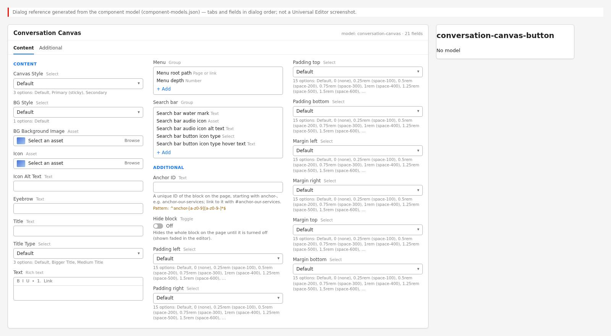{width=100%}
> texts, collapsible Menu and Search bar groups) and the Additional tab.

**Content tab:** Canvas Style (Default, Primary (sticky), Secondary); BG Style (Default); BG
Background Image (asset picker); Icon (asset picker); Icon Alt Text; Eyebrow (placeholder text
"Infrastructure to Intelligence"); Title (placeholder "Statistic"); Title Type (Default, Bigger
Title, Medium Title); Text (rich text); **Menu** group (collapsible): Menu root path (page
picker), Menu depth (number 1–3, default 1); **Search bar** group (collapsible): Search bar water
mark (placeholder "Ask us a question"), Search bar audio icon (asset picker), Search bar audio
icon alt text, Search bar button icon type (Primary, Secondary, Tertiary), Search bar button
icon type hover text (placeholder "Submit").

**Additional tab:** Anchor ID, Hide block, Padding left / right / top / bottom, Margin left /
right / top / bottom.

**Conversation Canvas Button item (model `button`):** Link (page picker / URL), Text, Title,
Views (Button, Icon, Link), Type (Primary, Secondary, Tertiary; shown for Button and Icon), Icon
(Arrow right, Chevron right, Chevron down, Search; shown for Icon), Alignment (Left, Center,
Right; not used by this block).

> **Note:** the dialog shows every field for every Canvas Style (there are no model
> `condition`s on the block fields); fields not used by the chosen style are ignored (see
> 6.30.6).

### 6.30.5 Authoring Guide

**Step 1 — Open the page in Universal Editor**

**Action:** In AEM Sites open the page (for example under `/content/tcs-corp/us/en`) and choose
**Edit**.

**Expected Result:** The page opens in Universal Editor.

**Steps — Open the page:** AEM Sites console with the page selected and Edit highlighted.

| Step | Where | Field / control | Value / action |
|:--|:----------|:----------|:--------------------|
| 1 | AEM Sites console | Navigate to | /content/tcs-corp/us/en and the page to edit |
| 2 | AEM Sites console | Select | The page (check its thumbnail or row) |
| 3 | AEM Sites console toolbar | Edit | The page opens in Universal Editor |

**Step 2 — Add the block**

**Action:** Select a section, choose **Add** (+) > **Conversation Canvas**. For the Primary
style, add a new section for it.

**Expected Result:** A canvas with an empty search row appears.

**Steps — Add the block:** Section Add menu with "Conversation Canvas" highlighted.

| Step | Where | Field / control | Value / action |
|:--|:----------|:----------|:--------------------|
| 1 | Universal Editor › Content tree | Section | Select the section for the canvas |
| 2 | Universal Editor › Content tree | Section › Add (+) | Conversation Canvas |
| 3 | Universal Editor › Content tree | Main › Add (+) | Section (only for the Primary (sticky) style: a section of its own, then add the canvas to it) |

**Step 3 — Choose the style and background**

**Action:** In **Content** choose **Canvas Style**; keep **BG Style** = Default; optionally pick
a **BG Background Image**.

**Expected Result:** The panel changes to the chosen style; Primary shows only the dock (visible
when scrolling, see Step 9).

**Steps — Style:** Canvas Style select open with Default, Primary (sticky), Secondary.

| Step | Where | Field / control | Value / action |
|:--|:----------|:----------|:--------------------|
| 1 | Conversation Canvas › Content | Canvas Style | Default (or Primary (sticky), Secondary) |
| 2 | Conversation Canvas › Content | BG Style | Default |
| 3 | Conversation Canvas › Content | BG Background Image | Optional: select an asset, e.g. light.svg (/en/media/light.svg) |

**Step 4 — Fill the intro**

**Action:** Pick an **Icon** and enter **Icon Alt Text** (empty for a decorative icon); enter
**Eyebrow**, **Title**, **Title Type** and **Text**.

**Expected Result:** The intro appears centred above the search row.

**Steps — Intro fields:** Canvas with icon, eyebrow, title and text filled.

| Step | Where | Field / control | Value / action |
|:--|:----------|:----------|:--------------------|
| 1 | Conversation Canvas › Content | Icon | Select the asset chat-icon.svg (/en/shots/g11/chat-icon.svg) |
| 2 | Conversation Canvas › Content | Icon Alt Text | Leave empty (decorative icon) |
| 3 | Conversation Canvas › Content | Eyebrow | Ask TCS |
| 4 | Conversation Canvas › Content | Title | How can we help you today? |
| 5 | Conversation Canvas › Content | Title Type | Default |
| 6 | Conversation Canvas › Content | Text | Ask about our services, industries and insights, or browse the site from the menu. |

**Step 5 — Configure the menu**

**Action:** Open the **Menu** group; select the **Menu root path** page (leave empty for the
locale Home) and set **Menu depth** (1–3).

**Expected Result:** On the published page the menu lists the pages below the root.

**Steps — Menu settings:** Menu group with root path /content/tcs-corp/us/en and depth 2.

| Step | Where | Field / control | Value / action |
|:--|:----------|:----------|:--------------------|
| 1 | Conversation Canvas › Content | Menu | Expand the group |
| 2 | Conversation Canvas › Content › Menu | Menu root path | Select the page /content/tcs-corp/us/en (or leave empty for the locale Home) |
| 3 | Conversation Canvas › Content › Menu | Menu depth | 2 |

**Step 6 — Configure the search bar**

**Action:** Open **Search bar**: water mark text, optional audio icon and its alt text, button
icon type and hover text.

**Expected Result:** The field shows the water mark; the arrow button's tooltip shows the hover
text.

**Steps — Search bar settings:** Search bar group with water mark "Ask us a question" and hover text "Submit".

| Step | Where | Field / control | Value / action |
|:--|:----------|:----------|:--------------------|
| 1 | Conversation Canvas › Content | Search bar | Expand the group |
| 2 | Conversation Canvas › Content › Search bar | Search bar water mark | Ask us a question |
| 3 | Conversation Canvas › Content › Search bar | Search bar audio icon | Leave empty (default microphone) |
| 4 | Conversation Canvas › Content › Search bar | Search bar audio icon alt text | Search by voice |
| 5 | Conversation Canvas › Content › Search bar | Search bar button icon type | Primary |
| 6 | Conversation Canvas › Content › Search bar | Search bar button icon type hover text | Submit |

**Step 7 — Add buttons**

**Action:** With the block selected, **Add** > **Conversation Canvas Button**; set Link, Text,
Views, Type (and Icon for the Icon view). Repeat as needed.

**Expected Result:** Buttons appear centred below the search row (not in Primary).

**Steps — Buttons:** Two button items in the content tree and on the canvas.

| Step | Where | Field / control | Value / action |
|:--|:----------|:----------|:--------------------|
| 1 | Universal Editor › Content tree | Conversation Canvas › Add (+) | Conversation Canvas Button |
| 2 | Conversation Canvas Button 1 | Link / Text | /en/contact; Contact us |
| 3 | Conversation Canvas Button 1 | Views / Type | Button; Primary |
| 4 | Universal Editor › Content tree | Conversation Canvas › Add (+) | Conversation Canvas Button |
| 5 | Conversation Canvas Button 2 | Link / Text | /en/services; Explore services |
| 6 | Conversation Canvas Button 2 | Views / Type | Button; Secondary |

**Step 8 — Fill the Additional tab (optional)**

**Action:** Set an **Anchor ID** if links should jump to the canvas; leave spacing on Default
for the Primary style.

**Expected Result:** The block id is set on the page.

**Steps — Additional tab:** Additional tab with Anchor ID "anchor-ask-us".

| Step | Where | Field / control | Value / action |
|:--|:----------|:----------|:--------------------|
| 1 | Conversation Canvas › Additional | Anchor ID | anchor-ask-us |
| 2 | Conversation Canvas › Additional | Padding / Margin | Leave on Default (always for the Primary (sticky) style) |

**Step 9 — Preview**

**Action:** Publish to preview and open `https://main--tcs-corp--sradha-tcs.aem.page/{path}`.
Open the menu, scroll down and up, and resize below and above 900 px.

**Expected Result:** The menu lists pages (the query index is not available inside the editor,
where it may show "No pages found"); the search row floats after scrolling past it; a Primary
dock appears while the footer is out of view.

**Steps — Preview:** Preview page with the menu open above the search row.

| Step | Where | Field / control | Value / action |
|:--|:----------|:----------|:--------------------|
| 1 | Universal Editor toolbar | Publish | Publish to Preview |
| 2 | Browser | Address | https://main--tcs-corp--sradha-tcs.aem.page/{path} |
| 3 | Preview › Conversation Canvas | Menu button | Click: the menu opens above the search row |
| 4 | Preview | Scroll | Down past the canvas and back up: the search row floats, then returns to its place |
| 5 | Preview | Window width | Resize below and above 900 px (Primary dock: search pill only / with menu button and navigation) |

**Step 10 — Validate the search hand-off**

**Action:** Type a question and press Enter; in the browser console, a listener for
`conversation-canvas:search` (development team) receives the query.

**Expected Result:** No navigation happens (no search service); the event carries the query.

**Steps — Search event:** Browser console showing the conversation-canvas:search event detail.

| Step | Where | Field / control | Value / action |
|:--|:----------|:----------|:--------------------|
| 1 | Browser developer tools › Console | Enter | document.addEventListener('conversation-canvas:search', (e) => console.log(e.detail)) |
| 2 | Preview › Conversation Canvas | Search field | Type: How do you migrate to the cloud? |
| 3 | Preview › Conversation Canvas | Keyboard | Press Enter |
| 4 | Browser developer tools › Console | Result | { query: "How do you migrate to the cloud?" } is logged; the page does not navigate |

**Step 11 — Publish**

**Action:** Publish the page (and the footer and canvas reference pages if changed).

**Expected Result:** The canvas is live on `.aem.live`.

**Steps — Publish:** Universal Editor Publish dialog.

| Step | Where | Field / control | Value / action |
|:--|:----------|:----------|:--------------------|
| 1 | Universal Editor toolbar | Publish | Publish to Live |
| 2 | Publish dialog | Items | The page (plus references/footer and references/footer-conversation-canvas if changed) |
| 3 | Publish dialog | Publish | Confirm |

#### Preview Process

1. Publish to preview; open the `.aem.page` URL (the menu and dock need `/query-index.json`,
   which is not served inside Universal Editor).
2. Check desktop (>= 1200 px), tablet (600–1199 px; the Primary dock switches at 900 px) and
   mobile (< 600 px).
3. Scroll to the footer: the floating row or dock must hide when the footer appears.

#### Publishing Process

1. Publish the page; newly published pages appear in the menu only after the query index has
   been updated for them (automatic on publish).
2. For the footer canvas, publish the canvas reference page and the footer page.
3. Publish the taxonomy and placeholders sheets if suggestion labels or UI texts changed.

#### Validation Process

- [ ] Style is correct; at most one Primary canvas on the page.
- [ ] Title is concise; Title Type suits the placement; only one `h1` on the page (the canvas
  title is an `h2`).
- [ ] Icon alt text set only if the icon conveys meaning.
- [ ] Background image keeps the dark text readable (4.5:1).
- [ ] Menu root path is in the same locale; Menu depth 1–3; the menu lists the expected pages.
- [ ] Water mark and hover text are meaningful and localised (no test values).
- [ ] Buttons have descriptive text and working links.
- [ ] Primary: dock appears on scroll, hides at the footer; desktop pills reflect the page's
  place; Back works; panels open and close with Escape.
- [ ] Voice button appears in supporting browsers and fills the field.
- [ ] Stakeholders know that queries are not answered until a search service is connected.

#### Rollback Process

1. Turn on **Hide block** and publish (inside `main`; for the footer canvas, clear the Footer's
   Conversation Canvas Page or unpublish the canvas page).
2. Restore a previous page version in AEM and republish.
3. Code issues: the development team reverts the commit on `main`.

The walkthroughs below repeat the steps above for each variation of chapter 6.30.3, from opening the page to publishing; the values are those of the variation's screenshot.

#### Walkthrough — Variation 1 — Default style

Reproduces the screenshot `screenshots/conversation-canvas-default.jpg` of this variation. The Field Entry Table under the screenshot lists every value with its rules.

**Step 1 — Open the page**

**Action:** In AEM Sites, open the locale site (for example `/content/tcs-corp/us/en`), select the page and choose Edit; the page opens in Universal Editor.

**Expected Result:** The page renders on the canvas with the content tree and the properties panel.

**Step 2 — Add the Conversation Canvas**

**Action:** Select the section in the content tree, choose **Add (+)** and pick **Conversation Canvas**.

**Expected Result:** An empty Default canvas appears with only its search row: the menu button and the Ask us a question field.

**Step 3 — Fill in Conversation Canvas › Content**

**Action:** Select **Conversation Canvas** in the content tree and open the **Content** tab of the properties panel. Enter: **Title** (A) = How can we help you today?; **Text** (B) = Ask a question in your own words or explore our services and industries; **Menu root path** (C) = Select the page or enter /content/tcs-corp/us/en; **Menu depth** (D) = 2; **Search bar water mark** (E) = Ask us a question; **Search bar button icon type hover text** (F) = Submit.

**Expected Result:** The title and the text appear centred above the search row; the field shows the Ask us a question watermark.

**Step 4 — Add a Conversation Canvas Button**

**Action:** Select the Conversation Canvas in the content tree, choose **Add (+)** and pick **Conversation Canvas Button**.

**Expected Result:** A Conversation Canvas Button item is added under the canvas in the content tree.

**Step 5 — Fill in Conversation Canvas Button 1**

**Action:** Select **Conversation Canvas Button 1** in the content tree and enter in the properties panel: **Link** (G) = Select the page or enter /en/contact; **Text** (H) = Contact us.

**Expected Result:** A black primary Contact us button appears centred below the search row.

**Step 6 — Add a Conversation Canvas Button**

**Action:** Select the Conversation Canvas in the content tree, choose **Add (+)** and pick **Conversation Canvas Button**.

**Expected Result:** A Conversation Canvas Button item is added under the canvas in the content tree.

**Step 7 — Fill in Conversation Canvas Button 2**

**Action:** Select **Conversation Canvas Button 2** in the content tree and enter in the properties panel: **Link** (I) = Select the page or enter /en/services; **Text** (J) = Explore services; **Type** (K) = Secondary.

**Expected Result:** An outlined secondary Explore services button appears next to Contact us.

**Step 8 — Preview**

**Action:** Choose **Preview** in the Universal Editor toolbar (or open the page on aem.page) and compare it with the screenshot.

**Expected Result:** A rounded white panel with soft radial glows at the bottom; title, text, search row and the two pill buttons in one centred column.

**Step 9 — Publish**

**Action:** Choose **Publish** › Publish to Live (with the referenced pages, fragments and assets that are not yet published).

**Expected Result:** Publish to preview (aem.page), then to live (aem.live). Menu entries come from the query index after the pages below /en are published; the button targets /en/contact and /en/services must be published too.

**Step 10 — Verify**

**Action:** On the live page check: In the console, listen for conversation-canvas:search, submit a question and check that the query is logged.

**Expected Result:** The page matches the screenshot; nothing in the Troubleshooting case above applies.

#### Walkthrough — Variation 2 — Secondary style

Reproduces the screenshot `screenshots/conversation-canvas-secondary.jpg` of this variation. The Field Entry Table under the screenshot lists every value with its rules.

**Step 1 — Open the page**

**Action:** In AEM Sites, open the locale site (for example `/content/tcs-corp/us/en`), select the page and choose Edit; the page opens in Universal Editor.

**Expected Result:** The page renders on the canvas with the content tree and the properties panel.

**Step 2 — Add the Conversation Canvas**

**Action:** Select the section in the content tree, choose **Add (+)** and pick **Conversation Canvas**.

**Expected Result:** An empty canvas appears in the section with only its search row.

**Step 3 — Fill in Conversation Canvas › Content**

**Action:** Select **Conversation Canvas** in the content tree and open the **Content** tab of the properties panel. Enter: **Canvas Style** (A) = Secondary; **Eyebrow** (B) = Explore topics; **Title** (C) = What would you like to explore?; **Text** (D) = Ask a question in your own words or explore our services and industries; **Menu root path** (E) = Select the page or enter /content/tcs-corp/us/en; **Menu depth** (F) = 2; **Search bar water mark** (G) = Ask us a question; **Search bar button icon type hover text** (H) = Submit.

**Expected Result:** Canvas Style Secondary swaps the glows and enlarges the top padding; Explore topics, the title and the text appear above the search row.

**Step 4 — Page script (development team)**

**Action:** setConversationCanvasFilters(block, tags): Filter tags: Cloud (active) (link /en/services/cloud), AI and data (link /en/services/ai), Cybersecurity (link /en/services/cybersecurity), Consulting (link /en/services/consulting), Banking (link /en/industries/banking); filter tags can't be authored.

**Expected Result:** Once the script runs, five filter pills appear below the search row, with Cloud filled in brand blue.

**Step 5 — Preview**

**Action:** Choose **Preview** in the Universal Editor toolbar (or open the page on aem.page) and compare it with the screenshot.

**Expected Result:** Larger top space, the intro elements 2.5rem apart, the search row and below it a centred, wrapping row of pill tags up to 56.25rem wide, the active one in brand blue.

**Step 6 — Publish**

**Action:** Choose **Publish** › Publish to Live (with the referenced pages, fragments and assets that are not yet published).

**Expected Result:** Publish sends the canvas to aem.page and aem.live; the filter tags are not page content and appear only where the page script runs, which is deployed with the code, not published with the page.

**Step 7 — Verify**

**Action:** On the live page check: Reload the page on aem.page and check that ul.conversation-canvas-filters contains the pills.

**Expected Result:** The page matches the screenshot; nothing in the Troubleshooting case above applies.

#### Walkthrough — Variation 3 — Primary (sticky) dock

Reproduces the screenshot `screenshots/conversation-canvas-primary-dock.jpg` of this variation. The Field Entry Table under the screenshot lists every value with its rules.

**Step 1 — Open the page**

**Action:** In AEM Sites, open the locale site (for example `/content/tcs-corp/us/en`), select the page and choose Edit; the page opens in Universal Editor.

**Expected Result:** The page renders on the canvas with the content tree and the properties panel.

**Step 2 — Add the Conversation Canvas**

**Action:** Select the section in the content tree, choose **Add (+)** and pick **Conversation Canvas**.

**Expected Result:** An empty canvas is added; for the Primary style it sits in a new section of its own.

**Step 3 — Fill in Conversation Canvas › Content**

**Action:** Select **Conversation Canvas** in the content tree and open the **Content** tab of the properties panel. Enter: **Canvas Style** (A) = Primary (sticky); **Menu root path** (B) = Select the page or enter /content/tcs-corp/us/en; **Menu depth** (C) = 3; **Search bar water mark** (D) = Ask us a question; **Search bar button icon type hover text** (E) = Submit.

**Expected Result:** With Canvas Style Primary (sticky) the panel leaves the page flow; only the hidden dock with the Ask us a question pill remains.

**Step 4 — Preview**

**Action:** Page: A page without sub-pages below the menu root, e.g. /en/services/consulting (no Tags): the dock shows its parent section Services.

**Expected Result:** On /en/services/consulting, scrolled down at 1440 px, the dock floats with the Services pills and Consulting outlined in blue.

**Step 5 — Preview**

**Action:** Action: Scroll down the page (the footer out of view): the dock floats at the bottom.

**Expected Result:** On /en/services/consulting, scrolled down at 1440 px, the dock floats with the Services pills and Consulting outlined in blue.

**Step 6 — Preview**

**Action:** Screen width: 1440 px (desktop; the navigation pills and the menu button show from 900 px).

**Expected Result:** On /en/services/consulting, scrolled down at 1440 px, the dock floats with the Services pills and Consulting outlined in blue.

**Step 7 — Preview**

**Action:** Choose **Preview** in the Universal Editor toolbar (or open the page on aem.page) and compare it with the screenshot.

**Expected Result:** A fixed bar at the bottom of the viewport: the page text fades out behind a white gradient, the search row is up to 37.9375rem wide and the 3rem pills sit centred below it.

**Step 8 — Publish**

**Action:** Choose **Publish** › Publish to Live (with the referenced pages, fragments and assets that are not yet published).

**Expected Result:** Publish to aem.page and aem.live; the pills are built from /query-index.json, so new service pages appear after they are published and indexed. Pill labels come from og:title with any suffix after a vertical bar removed.

**Step 9 — Verify**

**Action:** On the live page check: On aem.page scroll down: the dock fades in, and it hides again when the footer comes into view.

**Expected Result:** The page matches the screenshot; nothing in the Troubleshooting case above applies.

#### Walkthrough — Variation 4 — Title Type: Default

Reproduces the screenshot `screenshots/conversation-canvas-title-default.jpg` of this variation. The Field Entry Table under the screenshot lists every value with its rules.

**Step 1 — Open the page**

**Action:** In AEM Sites, open the locale site (for example `/content/tcs-corp/us/en`), select the page and choose Edit; the page opens in Universal Editor.

**Expected Result:** The page renders on the canvas with the content tree and the properties panel.

**Step 2 — Add the Conversation Canvas**

**Action:** Select the section in the content tree, choose **Add (+)** and pick **Conversation Canvas**.

**Expected Result:** An empty Default canvas appears with only its search row.

**Step 3 — Fill in Conversation Canvas › Content**

**Action:** Select **Conversation Canvas** in the content tree and open the **Content** tab of the properties panel. Enter: **Eyebrow** (A) = Ask TCS; **Title** (B) = How can we help you today?; **Search bar water mark** (C) = Ask us a question; **Search bar button icon type hover text** (D) = Submit.

**Expected Result:** Ask TCS and How can we help you today? appear centred above the search row at the default title size.

**Step 4 — Preview**

**Action:** Choose **Preview** in the Universal Editor toolbar (or open the page on aem.page) and compare it with the screenshot.

**Expected Result:** The blue Ask TCS eyebrow, 1.5rem of extra space, the 4rem medium-weight title and the search row centred on the glowing panel.

**Step 5 — Publish**

**Action:** Choose **Publish** › Publish to Live (with the referenced pages, fragments and assets that are not yet published).

**Expected Result:** Publish to preview shows the canvas on aem.page and Publish to live on aem.live; the title is part of the page HTML and needs no other publish step.

**Step 6 — Verify**

**Action:** On the live page check: Check the heading outline of the page on aem.page with a browser accessibility tool.

**Expected Result:** The page matches the screenshot; nothing in the Troubleshooting case above applies.

#### Walkthrough — Variation 5 — Title Type: Bigger

Reproduces the screenshot `screenshots/conversation-canvas-title-bigger.jpg` of this variation. The Field Entry Table under the screenshot lists every value with its rules.

**Step 1 — Open the page**

**Action:** In AEM Sites, open the locale site (for example `/content/tcs-corp/us/en`), select the page and choose Edit; the page opens in Universal Editor.

**Expected Result:** The page renders on the canvas with the content tree and the properties panel.

**Step 2 — Add the Conversation Canvas**

**Action:** Select the section in the content tree, choose **Add (+)** and pick **Conversation Canvas**.

**Expected Result:** An empty Default canvas appears with only its search row.

**Step 3 — Fill in Conversation Canvas › Content**

**Action:** Select **Conversation Canvas** in the content tree and open the **Content** tab of the properties panel. Enter: **Eyebrow** (A) = Ask TCS; **Title** (B) = Building on belief; **Title Type** (C) = Bigger Title; **Search bar water mark** (D) = Ask us a question; **Search bar button icon type hover text** (E) = Submit.

**Expected Result:** Building on belief appears under Ask TCS at the bigger title size, above the search row.

**Step 4 — Preview**

**Action:** Choose **Preview** in the Universal Editor toolbar (or open the page on aem.page) and compare it with the screenshot.

**Expected Result:** The short title in large medium-weight type dominates the panel; the eyebrow and the search row are unchanged.

**Step 5 — Publish**

**Action:** Choose **Publish** › Publish to Live (with the referenced pages, fragments and assets that are not yet published).

**Expected Result:** Publish to preview (aem.page) and to live (aem.live); Title Type is a class on the block and needs no other publish step.

**Step 6 — Verify**

**Action:** On the live page check: Preview the page at 375 px and at 1440 px on aem.page.

**Expected Result:** The page matches the screenshot; nothing in the Troubleshooting case above applies.

#### Walkthrough — Variation 6 — Title Type: Medium

Reproduces the screenshot `screenshots/conversation-canvas-title-medium.jpg` of this variation. The Field Entry Table under the screenshot lists every value with its rules.

**Step 1 — Open the page**

**Action:** In AEM Sites, open the locale site (for example `/content/tcs-corp/us/en`), select the page and choose Edit; the page opens in Universal Editor.

**Expected Result:** The page renders on the canvas with the content tree and the properties panel.

**Step 2 — Add the Conversation Canvas**

**Action:** Select the section in the content tree, choose **Add (+)** and pick **Conversation Canvas**.

**Expected Result:** An empty Default canvas appears with only its search row.

**Step 3 — Fill in Conversation Canvas › Content**

**Action:** Select **Conversation Canvas** in the content tree and open the **Content** tab of the properties panel. Enter: **Eyebrow** (A) = Ask TCS; **Title** (B) = Questions about our services? Ask us directly; **Title Type** (C) = Medium Title; **Search bar water mark** (D) = Ask us a question; **Search bar button icon type hover text** (E) = Submit.

**Expected Result:** Ask TCS and the question appear above the search row at the medium title size.

**Step 4 — Preview**

**Action:** Choose **Preview** in the Universal Editor toolbar (or open the page on aem.page) and compare it with the screenshot.

**Expected Result:** A modest one-line title under the blue eyebrow, with the search row below it in the same centred column.

**Step 5 — Publish**

**Action:** Choose **Publish** › Publish to Live (with the referenced pages, fragments and assets that are not yet published).

**Expected Result:** Publish to preview (aem.page) and to live (aem.live); the size is a block class and needs no separate publish step.

**Step 6 — Verify**

**Action:** On the live page check: On aem.page check that the block has the class conversation-canvas-title-medium and a 2.5rem title at 1440 px.

**Expected Result:** The page matches the screenshot; nothing in the Troubleshooting case above applies.

#### Walkthrough — Variation 7 — BG Style: Default (glow)

Reproduces the screenshot `screenshots/conversation-canvas-bg-default.jpg` of this variation. The Field Entry Table under the screenshot lists every value with its rules.

**Step 1 — Open the page**

**Action:** In AEM Sites, open the locale site (for example `/content/tcs-corp/us/en`), select the page and choose Edit; the page opens in Universal Editor.

**Expected Result:** The page renders on the canvas with the content tree and the properties panel.

**Step 2 — Add the Conversation Canvas**

**Action:** Select the section in the content tree, choose **Add (+)** and pick **Conversation Canvas**.

**Expected Result:** An empty Default canvas appears with its search row on the glowing panel.

**Step 3 — Fill in Conversation Canvas › Content**

**Action:** Select **Conversation Canvas** in the content tree and open the **Content** tab of the properties panel. Enter: **Title** (A) = Ask us a question; **Text** (B) = Ask a question in your own words or explore our services and industries; **Search bar water mark** (C) = Ask us a question; **Search bar button icon type hover text** (D) = Submit.

**Expected Result:** Ask us a question and the text appear centred above the search row over the blue and yellow glows.

**Step 4 — Preview**

**Action:** Choose **Preview** in the Universal Editor toolbar (or open the page on aem.page) and compare it with the screenshot.

**Expected Result:** A rounded white panel with two soft radial glows at its bottom edge behind the centred title, text and search row.

**Step 5 — Publish**

**Action:** Choose **Publish** › Publish to Live (with the referenced pages, fragments and assets that are not yet published).

**Expected Result:** Publish to preview and live; the glow is CSS and needs no asset. Nothing else has to be published.

**Step 6 — Verify**

**Action:** On the live page check: On aem.page the block has no conversation-canvas-has-background class and the glows are visible.

**Expected Result:** The page matches the screenshot; nothing in the Troubleshooting case above applies.

#### Walkthrough — Variation 8 — Background image

Reproduces the screenshot `screenshots/conversation-canvas-background-image.jpg` of this variation. The Field Entry Table under the screenshot lists every value with its rules.

**Step 1 — Open the page**

**Action:** In AEM Sites, open the locale site (for example `/content/tcs-corp/us/en`), select the page and choose Edit; the page opens in Universal Editor.

**Expected Result:** The page renders on the canvas with the content tree and the properties panel.

**Step 2 — Add the Conversation Canvas**

**Action:** Select the section in the content tree, choose **Add (+)** and pick **Conversation Canvas**.

**Expected Result:** An empty Default canvas appears with its search row on the glowing panel.

**Step 3 — Fill in Conversation Canvas › Content**

**Action:** Select **Conversation Canvas** in the content tree and open the **Content** tab of the properties panel. Enter: **BG Background Image** (A) = Select the asset light.svg (/en/media/light.svg); **Title** (B) = Ask us a question; **Text** (C) = Ask a question in your own words or explore our services and industries; **Search bar water mark** (D) = Ask us a question; **Search bar button icon type hover text** (E) = Submit.

**Expected Result:** light.svg fills the panel instead of the glow, with the title, the text and the search row on top.

**Step 4 — Preview**

**Action:** Choose **Preview** in the Universal Editor toolbar (or open the page on aem.page) and compare it with the screenshot.

**Expected Result:** The image covers the whole panel, clipped to the 1.25rem corners; dark text and the outlined search row sit on top of it.

**Step 5 — Publish**

**Action:** Choose **Publish** › Publish to Live (with the referenced pages, fragments and assets that are not yet published).

**Expected Result:** The asset light.svg must be published in AEM Assets before or with the page; then Publish to preview and live shows it on aem.page and aem.live.

**Step 6 — Verify**

**Action:** On the live page check: On aem.page check that the image request returns 200 and the image fills the panel.

**Expected Result:** The page matches the screenshot; nothing in the Troubleshooting case above applies.

#### Walkthrough — Variation 9 — Search button icon type: Primary

Reproduces the screenshot `screenshots/conversation-canvas-search-primary.jpg` of this variation. The Field Entry Table under the screenshot lists every value with its rules.

**Step 1 — Open the page**

**Action:** In AEM Sites, open the locale site (for example `/content/tcs-corp/us/en`), select the page and choose Edit; the page opens in Universal Editor.

**Expected Result:** The page renders on the canvas with the content tree and the properties panel.

**Step 2 — Add the Conversation Canvas**

**Action:** Select the section in the content tree, choose **Add (+)** and pick **Conversation Canvas**.

**Expected Result:** An empty Default canvas appears with its search row.

**Step 3 — Fill in Conversation Canvas › Content**

**Action:** Select **Conversation Canvas** in the content tree and open the **Content** tab of the properties panel. Enter: **Title** (A) = Ask us a question; **Search bar water mark** (B) = Ask us a question; **Search bar button icon type hover text** (C) = Submit.

**Expected Result:** The title appears and the search row ends with a filled blue arrow button whose tooltip reads Submit.

**Step 4 — Preview**

**Action:** Choose **Preview** in the Universal Editor toolbar (or open the page on aem.page) and compare it with the screenshot.

**Expected Result:** A 2.75rem round button with a brand-blue fill and a white arrow at the right end of the pill; the microphone sits to its left.

**Step 5 — Publish**

**Action:** Choose **Publish** › Publish to Live (with the referenced pages, fragments and assets that are not yet published).

**Expected Result:** Publish to preview and live; the hover text is page content, while the fallback label Submit comes from the placeholders sheet (key submit), published separately.

**Step 6 — Verify**

**Action:** On the live page check: On aem.page hover the arrow: the tooltip and the accessible name read Submit.

**Expected Result:** The page matches the screenshot; nothing in the Troubleshooting case above applies.

#### Walkthrough — Variation 10 — Search button icon type: Secondary

Reproduces the screenshot `screenshots/conversation-canvas-search-secondary.jpg` of this variation. The Field Entry Table under the screenshot lists every value with its rules.

**Step 1 — Open the page**

**Action:** In AEM Sites, open the locale site (for example `/content/tcs-corp/us/en`), select the page and choose Edit; the page opens in Universal Editor.

**Expected Result:** The page renders on the canvas with the content tree and the properties panel.

**Step 2 — Add the Conversation Canvas**

**Action:** Select the section in the content tree, choose **Add (+)** and pick **Conversation Canvas**.

**Expected Result:** An empty Default canvas appears with its search row.

**Step 3 — Fill in Conversation Canvas › Content**

**Action:** Select **Conversation Canvas** in the content tree and open the **Content** tab of the properties panel. Enter: **Title** (A) = Ask us a question; **Search bar water mark** (B) = Ask us a question; **Search bar button icon type** (C) = Secondary; **Search bar button icon type hover text** (D) = Submit.

**Expected Result:** The submit button at the end of the pill becomes a round brand-blue outline with a blue arrow.

**Step 4 — Preview**

**Action:** Choose **Preview** in the Universal Editor toolbar (or open the page on aem.page) and compare it with the screenshot.

**Expected Result:** A 2.75rem round outlined button with a brand-blue arrow on the translucent pill.

**Step 5 — Publish**

**Action:** Choose **Publish** › Publish to Live (with the referenced pages, fragments and assets that are not yet published).

**Expected Result:** Publish to preview and live; the button type is page content and needs no other publish step.

**Step 6 — Verify**

**Action:** On the live page check: On aem.page the submit button has the classes icon-button secondary.

**Expected Result:** The page matches the screenshot; nothing in the Troubleshooting case above applies.

#### Walkthrough — Variation 11 — Search button icon type: Tertiary

Reproduces the screenshot `screenshots/conversation-canvas-search-tertiary.jpg` of this variation. The Field Entry Table under the screenshot lists every value with its rules.

**Step 1 — Open the page**

**Action:** In AEM Sites, open the locale site (for example `/content/tcs-corp/us/en`), select the page and choose Edit; the page opens in Universal Editor.

**Expected Result:** The page renders on the canvas with the content tree and the properties panel.

**Step 2 — Add the Conversation Canvas**

**Action:** Select the section in the content tree, choose **Add (+)** and pick **Conversation Canvas**.

**Expected Result:** An empty Default canvas appears with its search row.

**Step 3 — Fill in Conversation Canvas › Content**

**Action:** Select **Conversation Canvas** in the content tree and open the **Content** tab of the properties panel. Enter: **Title** (A) = Ask us a question; **Search bar water mark** (B) = Ask us a question; **Search bar button icon type** (C) = Tertiary; **Search bar button icon type hover text** (D) = Submit.

**Expected Result:** The submit at the end of the pill becomes a plain blue arrow without fill or border.

**Step 4 — Preview**

**Action:** Choose **Preview** in the Universal Editor toolbar (or open the page on aem.page) and compare it with the screenshot.

**Expected Result:** Only a brand-blue arrow at the right end of the pill, next to the microphone.

**Step 5 — Publish**

**Action:** Choose **Publish** › Publish to Live (with the referenced pages, fragments and assets that are not yet published).

**Expected Result:** Publish to preview and live; no other publish step is needed.

**Step 6 — Verify**

**Action:** On the live page check: Tab through the search row on aem.page and check that the arrow shows a visible focus outline.

**Expected Result:** The page matches the screenshot; nothing in the Troubleshooting case above applies.

#### Walkthrough — Variation 12 — Voice input with the default microphone

Reproduces the screenshot `screenshots/conversation-canvas-voice-default.jpg` of this variation. The Field Entry Table under the screenshot lists every value with its rules.

**Step 1 — Open the page**

**Action:** In AEM Sites, open the locale site (for example `/content/tcs-corp/us/en`), select the page and choose Edit; the page opens in Universal Editor.

**Expected Result:** The page renders on the canvas with the content tree and the properties panel.

**Step 2 — Add the Conversation Canvas**

**Action:** Select the section in the content tree, choose **Add (+)** and pick **Conversation Canvas**.

**Expected Result:** An empty Default canvas appears with its search row and the default microphone.

**Step 3 — Fill in Conversation Canvas › Content**

**Action:** Select **Conversation Canvas** in the content tree and open the **Content** tab of the properties panel. Enter: **Title** (A) = Ask us a question; **Search bar water mark** (B) = Ask us a question; **Search bar audio icon alt text** (C) = Search by voice; **Search bar button icon type hover text** (D) = Submit.

**Expected Result:** The title appears above the row; the microphone keeps its default icon and is named Search by voice.

**Step 4 — Preview**

**Action:** Browser: One with the Web Speech API (e.g. Chrome, Edge, Safari); the audio button is hidden elsewhere.

**Expected Result:** In Chrome a click on the microphone turns it brand blue with an outline while it listens.

**Step 5 — Preview**

**Action:** Action: Click the microphone button (listening: brand blue with an outline).

**Expected Result:** In Chrome a click on the microphone turns it brand blue with an outline while it listens.

**Step 6 — Preview**

**Action:** Choose **Preview** in the Universal Editor toolbar (or open the page on aem.page) and compare it with the screenshot.

**Expected Result:** A 2rem round microphone button with a 1.5rem mic icon; while listening it turns brand blue with a 2 px outline.

**Step 7 — Publish**

**Action:** Choose **Publish** › Publish to Live (with the referenced pages, fragments and assets that are not yet published).

**Expected Result:** Publish to preview and live; the fallback name Search by voice comes from the placeholders sheet (key searchByVoice), published separately per locale.

**Step 8 — Verify**

**Action:** On the live page check: Open aem.page in Chrome, click the microphone, allow access and check that it turns blue and fills the field.

**Expected Result:** The page matches the screenshot; nothing in the Troubleshooting case above applies.

#### Walkthrough — Variation 13 — Voice input with a custom audio icon

Reproduces the screenshot `screenshots/conversation-canvas-voice-custom-icon.jpg` of this variation. The Field Entry Table under the screenshot lists every value with its rules.

**Step 1 — Open the page**

**Action:** In AEM Sites, open the locale site (for example `/content/tcs-corp/us/en`), select the page and choose Edit; the page opens in Universal Editor.

**Expected Result:** The page renders on the canvas with the content tree and the properties panel.

**Step 2 — Add the Conversation Canvas**

**Action:** Select the section in the content tree, choose **Add (+)** and pick **Conversation Canvas**.

**Expected Result:** An empty Default canvas appears with its search row and the default microphone.

**Step 3 — Fill in Conversation Canvas › Content**

**Action:** Select **Conversation Canvas** in the content tree and open the **Content** tab of the properties panel. Enter: **Title** (A) = Ask us a question; **Search bar water mark** (B) = Ask us a question; **Search bar audio icon** (C) = Select the asset audio-icon.svg (/en/shots/g11/audio-icon.svg); **Search bar audio icon alt text** (D) = Search by voice; **Search bar button icon type hover text** (E) = Submit.

**Expected Result:** The sound-bar icon replaces the microphone in the field; the button is named Search by voice.

**Step 4 — Preview**

**Action:** Browser: One with the Web Speech API (e.g. Chrome, Edge, Safari); the audio button is hidden elsewhere.

**Expected Result:** In a browser with the Web Speech API the custom audio button is visible next to the arrow.

**Step 5 — Preview**

**Action:** Choose **Preview** in the Universal Editor toolbar (or open the page on aem.page) and compare it with the screenshot.

**Expected Result:** The blue sound-bar icon sits inside the 2rem round audio button at the right of the field, before the arrow.

**Step 6 — Publish**

**Action:** Choose **Publish** › Publish to Live (with the referenced pages, fragments and assets that are not yet published).

**Expected Result:** Publish audio-icon.svg in AEM Assets with the page; then Publish to preview and live shows it on aem.page and aem.live.

**Step 7 — Verify**

**Action:** On the live page check: On aem.page in Chrome the audio button contains the sound-bar image and is named Search by voice.

**Expected Result:** The page matches the screenshot; nothing in the Troubleshooting case above applies.

#### Walkthrough — Variation 14 — Canvas button, Views = Button

Reproduces the screenshot `screenshots/conversation-canvas-button-view.jpg` of this variation. The Field Entry Table under the screenshot lists every value with its rules.

**Step 1 — Open the page**

**Action:** In AEM Sites, open the locale site (for example `/content/tcs-corp/us/en`), select the page and choose Edit; the page opens in Universal Editor.

**Expected Result:** The page renders on the canvas with the content tree and the properties panel.

**Step 2 — Add the Conversation Canvas**

**Action:** Select the section in the content tree, choose **Add (+)** and pick **Conversation Canvas**.

**Expected Result:** An empty Default canvas appears with only its search row.

**Step 3 — Fill in Conversation Canvas › Content**

**Action:** Select **Conversation Canvas** in the content tree and open the **Content** tab of the properties panel. Enter: **Title** (A) = Ask us a question; **Search bar water mark** (B) = Ask us a question; **Search bar button icon type hover text** (C) = Submit.

**Expected Result:** Ask us a question appears as the title above the search row.

**Step 4 — Add a Conversation Canvas Button**

**Action:** Select the Conversation Canvas in the content tree, choose **Add (+)** and pick **Conversation Canvas Button**.

**Expected Result:** A Conversation Canvas Button item is added under the canvas in the content tree.

**Step 5 — Fill in Conversation Canvas Button 1**

**Action:** Select **Conversation Canvas Button 1** in the content tree and enter in the properties panel: **Link** (D) = Select the page or enter /en/contact; **Text** (E) = Contact us.

**Expected Result:** A black primary Contact us button with a trailing arrow appears below the search row.

**Step 6 — Add a Conversation Canvas Button**

**Action:** Select the Conversation Canvas in the content tree, choose **Add (+)** and pick **Conversation Canvas Button**.

**Expected Result:** A Conversation Canvas Button item is added under the canvas in the content tree.

**Step 7 — Fill in Conversation Canvas Button 2**

**Action:** Select **Conversation Canvas Button 2** in the content tree and enter in the properties panel: **Link** (F) = Select the page or enter /en/services; **Text** (G) = Explore services; **Type** (H) = Secondary.

**Expected Result:** An outlined secondary Explore services button appears next to Contact us.

**Step 8 — Preview**

**Action:** Choose **Preview** in the Universal Editor toolbar (or open the page on aem.page) and compare it with the screenshot.

**Expected Result:** Two pill buttons 1.5rem apart, centred under the search row: the primary filled black with white text, the secondary outlined with dark text.

**Step 9 — Publish**

**Action:** Choose **Publish** › Publish to Live (with the referenced pages, fragments and assets that are not yet published).

**Expected Result:** Publish to preview and live; the linked pages /en/contact and /en/services are separate pages and must be published themselves, or the buttons lead to a 404.

**Step 10 — Verify**

**Action:** On the live page check: On aem.page check that ul.conversation-canvas-buttons holds Contact us and Explore services.

**Expected Result:** The page matches the screenshot; nothing in the Troubleshooting case above applies.

#### Walkthrough — Variation 15 — Canvas button, Views = Icon

Reproduces the screenshot `screenshots/conversation-canvas-icon-view.jpg` of this variation. The Field Entry Table under the screenshot lists every value with its rules.

**Step 1 — Open the page**

**Action:** In AEM Sites, open the locale site (for example `/content/tcs-corp/us/en`), select the page and choose Edit; the page opens in Universal Editor.

**Expected Result:** The page renders on the canvas with the content tree and the properties panel.

**Step 2 — Add the Conversation Canvas**

**Action:** Select the section in the content tree, choose **Add (+)** and pick **Conversation Canvas**.

**Expected Result:** An empty Default canvas appears with only its search row.

**Step 3 — Fill in Conversation Canvas › Content**

**Action:** Select **Conversation Canvas** in the content tree and open the **Content** tab of the properties panel. Enter: **Title** (A) = Ask us a question; **Search bar water mark** (B) = Ask us a question; **Search bar button icon type hover text** (C) = Submit.

**Expected Result:** Ask us a question appears as the title above the search row.

**Step 4 — Add a Conversation Canvas Button**

**Action:** Select the Conversation Canvas in the content tree, choose **Add (+)** and pick **Conversation Canvas Button**.

**Expected Result:** A Conversation Canvas Button item is added under the canvas in the content tree.

**Step 5 — Fill in Conversation Canvas Button 1**

**Action:** Select **Conversation Canvas Button 1** in the content tree and enter in the properties panel: **Link** (D) = Select the page or enter /en/services; **Text** (E) = Explore our services; **Views** (F) = Icon; **Icon** (G) = Chevron right.

**Expected Result:** A round blue button with a white chevron appears below the search row, named Explore our services.

**Step 6 — Preview**

**Action:** Choose **Preview** in the Universal Editor toolbar (or open the page on aem.page) and compare it with the screenshot.

**Expected Result:** A single round filled brand-blue button with a white chevron, centred under the search row.

**Step 7 — Publish**

**Action:** Choose **Publish** › Publish to Live (with the referenced pages, fragments and assets that are not yet published).

**Expected Result:** Publish to preview and live; the target /en/services must be published itself. Icons are part of the code (icons folder), so nothing else is published.

**Step 8 — Verify**

**Action:** On the live page check: On aem.page the link has the class icon-button and the aria-label Explore our services.

**Expected Result:** The page matches the screenshot; nothing in the Troubleshooting case above applies.

#### Walkthrough — Variation 16 — Canvas button, Views = Link

Reproduces the screenshot `screenshots/conversation-canvas-link-view.jpg` of this variation. The Field Entry Table under the screenshot lists every value with its rules.

**Step 1 — Open the page**

**Action:** In AEM Sites, open the locale site (for example `/content/tcs-corp/us/en`), select the page and choose Edit; the page opens in Universal Editor.

**Expected Result:** The page renders on the canvas with the content tree and the properties panel.

**Step 2 — Add the Conversation Canvas**

**Action:** Select the section in the content tree, choose **Add (+)** and pick **Conversation Canvas**.

**Expected Result:** An empty Default canvas appears with only its search row.

**Step 3 — Fill in Conversation Canvas › Content**

**Action:** Select **Conversation Canvas** in the content tree and open the **Content** tab of the properties panel. Enter: **Title** (A) = Ask us a question; **Search bar water mark** (B) = Ask us a question; **Search bar button icon type hover text** (C) = Submit.

**Expected Result:** Ask us a question appears as the title above the search row.

**Step 4 — Add a Conversation Canvas Button**

**Action:** Select the Conversation Canvas in the content tree, choose **Add (+)** and pick **Conversation Canvas Button**.

**Expected Result:** A Conversation Canvas Button item is added under the canvas in the content tree.

**Step 5 — Fill in Conversation Canvas Button 1**

**Action:** Select **Conversation Canvas Button 1** in the content tree and enter in the properties panel: **Link** (D) = Select the page or enter /en/about/faqs; **Text** (E) = View all FAQs; **Views** (F) = Link.

**Expected Result:** The text link View all FAQs with a chevron appears centred below the search row.

**Step 6 — Preview**

**Action:** Choose **Preview** in the Universal Editor toolbar (or open the page on aem.page) and compare it with the screenshot.

**Expected Result:** A small dark text link with a chevron, centred below the search row, without a button shape.

**Step 7 — Publish**

**Action:** Choose **Publish** › Publish to Live (with the referenced pages, fragments and assets that are not yet published).

**Expected Result:** Publish to preview and live; the FAQ page /en/about/faqs must be published itself.

**Step 8 — Verify**

**Action:** On the live page check: Click View all FAQs on aem.page and check that the FAQ page opens.

**Expected Result:** The page matches the screenshot; nothing in the Troubleshooting case above applies.

#### Walkthrough — Variation 17 — Floating search row (Default and Secondary)

Reproduces the screenshot `screenshots/conversation-canvas-floating-row.jpg` of this variation. The Field Entry Table under the screenshot lists every value with its rules.

**Step 1 — Open the page**

**Action:** In AEM Sites, open the locale site (for example `/content/tcs-corp/us/en`), select the page and choose Edit; the page opens in Universal Editor.

**Expected Result:** The page renders on the canvas with the content tree and the properties panel.

**Step 2 — Add the Conversation Canvas**

**Action:** Select the section in the content tree, choose **Add (+)** and pick **Conversation Canvas**.

**Expected Result:** An empty Default canvas appears with only its search row.

**Step 3 — Fill in Conversation Canvas › Content**

**Action:** Select **Conversation Canvas** in the content tree and open the **Content** tab of the properties panel. Enter: **Title** (A) = How can we help you today?; **Text** (B) = Ask a question in your own words or explore our services and industries; **Menu root path** (C) = Select the page or enter /content/tcs-corp/us/en; **Menu depth** (D) = 2; **Search bar water mark** (E) = Ask us a question; **Search bar button icon type hover text** (F) = Submit.

**Expected Result:** The title and the text appear centred above the search row.

**Step 4 — Add a Conversation Canvas Button**

**Action:** Select the Conversation Canvas in the content tree, choose **Add (+)** and pick **Conversation Canvas Button**.

**Expected Result:** A Conversation Canvas Button item is added under the canvas in the content tree.

**Step 5 — Fill in Conversation Canvas Button 1**

**Action:** Select **Conversation Canvas Button 1** in the content tree and enter in the properties panel: **Link** (G) = Select the page or enter /en/contact; **Text** (H) = Contact us.

**Expected Result:** A black primary Contact us button appears below the search row.

**Step 6 — Add a Conversation Canvas Button**

**Action:** Select the Conversation Canvas in the content tree, choose **Add (+)** and pick **Conversation Canvas Button**.

**Expected Result:** A Conversation Canvas Button item is added under the canvas in the content tree.

**Step 7 — Fill in Conversation Canvas Button 2**

**Action:** Select **Conversation Canvas Button 2** in the content tree and enter in the properties panel: **Link** (I) = Select the page or enter /en/services; **Text** (J) = Explore services; **Type** (K) = Secondary.

**Expected Result:** An outlined secondary Explore services button appears next to Contact us.

**Step 8 — Preview**

**Action:** Action: Scroll down past the canvas (the footer out of view): its search row floats at the bottom.

**Expected Result:** After scrolling past the canvas, its search row floats centred at the bottom of the viewport.

**Step 9 — Preview**

**Action:** Choose **Preview** in the Universal Editor toolbar (or open the page on aem.page) and compare it with the screenshot.

**Expected Result:** Only the search row floats over the page text; the canvas's title, text and buttons scroll away with the page.

**Step 10 — Publish**

**Action:** Choose **Publish** › Publish to Live (with the referenced pages, fragments and assets that are not yet published).

**Expected Result:** Floating is code behaviour: publishing the page to aem.page and aem.live is enough. It can only be checked in the preview, not while editing.

**Step 11 — Verify**

**Action:** On the live page check: Scroll down on aem.page: the row gets conversation-canvas-floating and returns to its place when scrolled back up.

**Expected Result:** The page matches the screenshot; nothing in the Troubleshooting case above applies.

#### Walkthrough — Variation 18 — Footer canvas placement

Reproduces the screenshot `screenshots/conversation-canvas-footer.jpg` of this variation. The Field Entry Table under the screenshot lists every value with its rules.

**Step 1 — Open the page**

**Action:** In AEM Sites, open the locale site (for example `/content/tcs-corp/us/en`), select the page and choose Edit; the page opens in Universal Editor.

**Expected Result:** The page renders on the canvas with the content tree and the properties panel.

**Step 2 — Fill in AEM Sites › /content/tcs-corp/us/en/references**

**Action:** Select **AEM Sites** in the content tree and open the **/content/tcs-corp/us/en/references** tab of the properties panel. Enter: **Create › Page** (A) = footer-conversation-canvas.

**Expected Result:** The new page footer-conversation-canvas appears in the references folder of the English site.

**Step 3 — Fill in footer-conversation-canvas › Section › Add (+)**

**Action:** Select **footer-conversation-canvas** in the content tree and open the **Section › Add (+)** tab of the properties panel. Enter: **Component** (B) = Conversation Canvas.

**Expected Result:** An empty Default canvas with its search row appears on the reference page.

**Step 4 — Fill in Conversation Canvas › Content**

**Action:** Select **Conversation Canvas** in the content tree and open the **Content** tab of the properties panel. Enter: **Title** (C) = Have a question? Ask us.

**Expected Result:** Have a question? Ask us. appears as the canvas title on the reference page.

**Step 5 — Fill in Conversation Canvas › Content › Menu**

**Action:** Select **Conversation Canvas** in the content tree and open the **Content › Menu** tab of the properties panel. Enter: **Menu root path / Menu depth** (D) = Select the page or enter /content/tcs-corp/us/en; 2.

**Expected Result:** The menu is set to the pages below /en, two levels deep; it shows when the menu button is opened.

**Step 6 — Fill in Conversation Canvas › Content › Search bar**

**Action:** Select **Conversation Canvas** in the content tree and open the **Content › Search bar** tab of the properties panel. Enter: **Search bar water mark / button icon type hover text** (E) = Ask us a question; Submit.

**Expected Result:** The field shows Ask us a question and the arrow's tooltip reads Submit.

**Step 7 — Fill in Conversation Canvas Button 1 / 2**

**Action:** Select **Conversation Canvas Button 1 / 2** in the content tree and enter in the properties panel: **Link, Text, Views, Type** (F) = /en/contact, Contact us, Button, Primary; /en/about, About TCS, Button, Secondary.

**Expected Result:** Contact us (primary) and About TCS (secondary) appear below the search row.

**Step 8 — references/footer › Footer › Content**

**Action:** Conversation Canvas Page / Copyright Text / Link List: Select the page or enter /content/tcs-corp/us/en/references/footer-conversation-canvas; © TATA Consultancy Services 2027; Privacy policy, Cookie policy, Terms of use.

**Expected Result:** On the footer page the canvas appears above the copyright text and the three policy links.

**Step 9 — Fill in Page properties**

**Action:** Open the page properties of the page (Universal Editor › Page properties) and enter: **Footer** (G) = Leave empty: the locale's references/footer is used (inherited).

**Expected Result:** With Footer left empty the page inherits references/footer and shows the canvas in its footer.

**Step 10 — Preview**

**Action:** Choose **Preview** in the Universal Editor toolbar (or open the page on aem.page) and compare it with the screenshot.

**Expected Result:** The canvas sits without its own panel, glow or padding on the footer's glow; title, search row and buttons are centred above the copyright and links bar and the social icons.

**Step 11 — Publish**

**Action:** Choose **Publish** › Publish to Live (with the referenced pages, fragments and assets that are not yet published).

**Expected Result:** references/footer-conversation-canvas and references/footer are separate pages and must both be published; pages using the footer then show it without being republished. The Social Links sheet is published separately.

**Step 12 — Verify**

**Action:** On the live page check: Open any English page on aem.page, scroll to the footer and check the title, search row and buttons.

**Expected Result:** The page matches the screenshot; nothing in the Troubleshooting case above applies.

### 6.30.6 Authorable Field Specification

**Block model `conversation-canvas` — Content tab** (a key-value block: each field is one
`name | value` row)

| Field Name | Field Type | Mandatory | Multi Value | Default Value | Business Purpose | Author Guidance | Validation Rules | Example Value |
|:-----------------------------|:-------------|:-----------|:-------|:--------------------|:-------------------------|:----------------------|:-----------------------------------------|:----------------------|
| Canvas Style (`classes`) | select | No | No | Default (`""`) | Chooses Default, Primary (sticky) or Secondary | One Primary per page | Options: Default (`""`), Primary (sticky) (`primary`), Secondary (`secondary`) | primary |
| BG Style (`bgStyle`) | select | No | No | Default (`default`) | Background style hook | Leave Default | One option: Default (`default`); becomes class `conversation-canvas-bg-default` | default |
| BG Background Image (`backgroundImage`) | reference (asset) | No | No | (empty) | Decorative background image | Light, low-detail image | Single asset; not used by Primary | /content/dam/tcs/canvas-bg.jpg |
| Icon (`icon`) | reference (asset) | No | No | (empty) | Small icon above the eyebrow | SVG or PNG, square | Single asset; shown at 2.5rem; not used by Primary | /content/dam/tcs/icons/spark.svg |
| Icon Alt Text (`iconAlt`) | text | No | No | (empty) | Alternative text of the icon | Empty when decorative | None | (empty) |
| Eyebrow (`eyebrow`) | text | No | No | (empty) | Small label above the title | 1–4 words | Plain text; dialog placeholder "Infrastructure to Intelligence"; not used by Primary | Infrastructure to Intelligence |
| Title (`title`) | text | No | No | (empty) | Main heading (h2) | Short question or promise | Plain text; dialog placeholder "Statistic"; not used by Primary | How can we help you today? |
| Title Type (`titleSize`) | select | No | No | Default (`""`) | Title size | Bigger for hero use, Medium lower on the page | Options: Default (`""`), Bigger Title (`bigger`), Medium Title (`medium`) | bigger |
| Text (`text`) | richtext | No | No | (empty) | Supporting text | 1–2 sentences | Rich text kept; not used by Primary | Ask about our services, industries or insights. |
| Menu root path (`menuRootPath`, group Menu) | aem-content | No | No | (empty = locale Home) | Root of the menu / navigation tree | A page in the same locale | Converted to the published path; empty = `getLocale().root` (e.g. `/en`) | /content/tcs-corp/us/en |
| Menu depth (`menuDepth`, group Menu) | number | No | No | 1 | Levels below the root | 1 for sections only, 2–3 for deeper menus | Enforced in the dialog: min 1, max 3; code: invalid = 1, minimum 1 | 2 |
| Search bar water mark (`searchPlaceholder`, group Search bar) | text | No | No | (empty = placeholder `searchPlaceholder`) | Placeholder and hidden label of the search field | A short invitation | Plain text; dialog placeholder "Ask us a question" | Ask us a question |
| Search bar audio icon (`searchAudioIcon`) | reference (asset) | No | No | (empty = mic icon) | Custom microphone image | 24 x 24 icon | Single asset | /content/dam/tcs/icons/mic.svg |
| Search bar audio icon alt text (`searchAudioIconAlt`) | text | No | No | (empty = placeholder `searchByVoice`) | Accessible name of the voice button | Describe the action | Plain text | Search by voice |
| Search bar button icon type (`searchButtonStyle`) | select | No | No | Primary (`primary`) | Submit button style | Primary unless the design asks otherwise | Options: Primary, Secondary, Tertiary; unknown = primary | primary |
| Search bar button icon type hover text (`searchButtonLabel`) | text | No | No | (empty = placeholder `submit`) | Accessible name and tooltip of the submit button | A verb such as "Submit" or "Ask" | Plain text; dialog placeholder "Submit" | Submit |

**Block model `conversation-canvas` — Additional tab**

| Field Name | Field Type | Mandatory | Multi Value | Default Value | Business Purpose | Author Guidance | Validation Rules | Example Value |
|:--------------------------|:---------|:-----------|:-------|:---------|:---------------|:-----------------|:-------------------------|:---------------|
| Anchor ID (`classes_anchor`) | text | No | No | (empty) | Jump target | Unique, starts with `anchor-` | Enforced regExp `^anchor-[a-z0-9][a-z0-9-]*$` | anchor-ask-us |
| Hide block (`classes_hideblock`) | boolean | No | No | false | Hide without deleting | Quick rollback | None; applies inside `main` | false |
| Padding left (`classes_paddingleft`) | select | No | No | Default | Inner space left | Avoid on Primary | Default, `pl-0` … `pl-3000` (15 options) | pl-0 |
| Padding right (`classes_paddingright`) | select | No | No | Default | Inner space right | Avoid on Primary | Default, `pr-0` … `pr-3000` | pr-0 |
| Padding top (`classes_paddingtop`) | select | No | No | Default | Inner space top | Avoid on Primary | Default, `pt-0` … `pt-3000` | pt-1600 |
| Padding bottom (`classes_paddingbottom`) | select | No | No | Default | Inner space bottom | Avoid on Primary | Default, `pb-0` … `pb-3000` | pb-1600 |
| Margin left (`classes_marginleft`) | select | No | No | Default | Outer space left | Rarely needed | Default, `ml-0` … `ml-3000` | ml-0 |
| Margin right (`classes_marginright`) | select | No | No | Default | Outer space right | Rarely needed | Default, `mr-0` … `mr-3000` | mr-0 |
| Margin top (`classes_margintop`) | select | No | No | Default | Outer space top | Separate from previous block | Default, `mt-0` … `mt-3000` | mt-1200 |
| Margin bottom (`classes_marginbottom`) | select | No | No | Default | Outer space bottom | Separate from next block | Default, `mb-0` … `mb-3000` | mb-1200 |

The spacing options are the same 15 values as in 6.29.6 (Default, 0, 0.25rem … 7.5rem from
`--space-100` … `--space-3000`).

**Item model `button` — Conversation Canvas Button** (`models/_button.json`)

| Field Name | Field Type | Mandatory | Multi Value | Default Value | Business Purpose | Author Guidance | Validation Rules | Example Value |
|:-------------------|:-------------|:-------------|:-------|:------------|:------------------|:----------------|:------------------------------------------|:----------------------|
| Link (`link`) | aem-content | No (a row without a link is ignored) | No | (empty) | Destination | Page picker or URL | Required in practice: rows without `a[href]` are skipped | /content/tcs-corp/us/en/contact-us |
| Text (`linkText`) | text | No | No | (empty = the URL) | Visible text / accessible name | Action verb + object | None | Contact us |
| Title (`linkTitle`) | text | No | No | (empty) | Tooltip | Only if it adds information | Dropped when equal to the text | Talk to our experts |
| Views (`buttonView`) | select | No | No | Button (`button`) | Button, icon-only or text link | Button for CTAs | Options: Button, Icon, Link | button |
| Type (`linkType`) | select | No | No | Primary (`primary`) | Emphasis | One primary per canvas | Options: Primary, Secondary, Tertiary; condition: shown when Views is empty, Button or Icon | secondary |
| Icon (`buttonIcon`) | select | No | No | (none) | Icon of the Icon view | — | Options: Arrow right, Chevron right, Chevron down, Search; condition: shown when Views = Icon | arrow-right |
| Alignment (`buttonAlignment`) | select | No | No | Left (`left`) | Alignment (not used by this block) | Leave as is | Options: Left, Center, Right; ignored, buttons are centred | left |

**Fields used per style**

| Field | Default | Secondary | Primary (sticky) |
|:------------------------------|:---------|:----------------------|:----------------------|
| BG Background Image, Icon, Icon Alt Text, Eyebrow, Title, Title Type, Text | Used | Used | Ignored |
| Menu root path, Menu depth | Pop-up menu | Pop-up menu | Dock navigation |
| Search bar fields | Used | Used | Used |
| Conversation Canvas Button items | Used | Used | Ignored |
| Filter tags (script only) | — | `setConversationCanvasFilters` | — |
| Suggestions (page tags or script) | — | — | `setConversationCanvasSuggestions` |

**Field details**

- **Canvas Style** — Purpose: behaviour and layout mode. Allowed values: Default, Primary
  (sticky), Secondary. Character limits: n/a. Business rules: Primary renders only the dock;
  Secondary adds the filter list. Dependency rules: Primary ignores intro and buttons.
  Visibility rules: no model condition. Sample: Default.
- **BG Style** — Purpose: future background variants. Allowed values: Default only. Business
  rules: class `conversation-canvas-bg-default` (no CSS yet). Sample: default.
- **BG Background Image** — Purpose: decorative background. Allowed values: one image asset (or
  a URL). Business rules: replaces the glow; optimized when served as site media; `alt=""`.
  Dependency: not used in Primary. Sample: a light abstract image.
- **Icon** — Purpose: small visual cue. Allowed values: one image. Business rules: 2.5rem,
  `object-fit: contain`. Dependency: alt from Icon Alt Text. Sample: a spark icon.
- **Icon Alt Text** — Purpose: text alternative. Character limits: Recommended up to 80.
  Business rules: applied only when not empty; else the icon is decorative. Sample: empty.
- **Eyebrow** — Purpose: context label. Character limits: Recommended up to 40. Business
  rules: plain text paragraph in brand colour. Sample: "Infrastructure to Intelligence".
- **Title** — Purpose: main heading. Character limits: Recommended up to 60 (Bigger: up to 40).
  Business rules: always `h2`, plain text (formatting is not kept). Sample: "How can we help
  you today?".
- **Title Type** — Purpose: size. Allowed values: Default, Bigger Title, Medium Title. Business
  rules: class `conversation-canvas-title-{bigger|medium}`. Sample: Default.
- **Text** — Purpose: supporting copy. Character limits: Recommended up to 200. Business rules:
  rich text moved as is, margins removed, max width 50.75rem. Sample: one sentence.
- **Menu root path** — Purpose: tree root. Allowed values: a page of the same locale. Business
  rules: AEM path converted with `toSitePath` (for example `/content/tcs-corp/us/en` to `/en`);
  pages are read from the query index filtered to the **current** locale, so a root in another
  locale gives "No pages found". Sample: `/content/tcs-corp/us/en/what-we-do`.
- **Menu depth** — Purpose: levels below the root. Allowed values: 1–3 (Enforced in the dialog).
  Business rules: pages deeper than the depth are not listed; a page whose parent is not in the
  index is skipped. Sample: 2.
- **Search bar water mark** — Purpose: input placeholder and its hidden label. Character
  limits: Recommended up to 40 (the field is narrow on mobile). Business rules: empty = "Ask us
  a question" (`searchPlaceholder`). Sample: "Ask us a question".
- **Search bar audio icon / alt text** — Purpose: voice button artwork and name. Business
  rules: alt text empty = "Search by voice" (`searchByVoice`); the image itself is decorative.
  Sample: empty (default mic).
- **Search bar button icon type** — Purpose: submit style. Allowed values: Primary, Secondary,
  Tertiary. Sample: Primary.
- **Search bar button icon type hover text** — Purpose: submit accessible name and tooltip.
  Character limits: Recommended up to 20. Business rules: empty = "Submit" (`submit`). Sample:
  "Submit".
- **Anchor ID, Hide block, Padding, Margin** — as described in 6.29.6; in the Primary style,
  padding or margin only add empty space (the dock is fixed and takes no room) and should stay
  Default; inside the footer these options have no effect.
- **Button item fields** — Link (destination; required in practice), Text (Recommended up to
  25 characters), Title (tooltip), Views, Type (condition: Views empty / Button / Icon), Icon
  (condition: Views = Icon), Alignment (no effect in this block).

### 6.30.7 Field Annotation Mapping

| Marker | Field | Purpose |
|:--------|:---------------------------------|:-----------------------|
| A | BG Background Image (`backgroundImage`) / BG Style | Background image or default glow |
| B | Icon (`icon`), Icon Alt Text (`iconAlt`) | Small icon above the eyebrow |
| C | Eyebrow (`eyebrow`) | Context label |
| D | Title (`title`), Title Type (`titleSize`) | Main `h2` heading and its size |
| E | Text (`text`) | Supporting rich text |
| F | Menu root path (`menuRootPath`), Menu depth (`menuDepth`) | Menu button and pop-up menu / dock navigation |
| G | Search bar water mark (`searchPlaceholder`) | Search field placeholder and label |
| H | Search bar audio icon / alt text; button icon type / hover text | Voice and submit buttons |
| I | Conversation Canvas Button items (`button` model) | Calls to action |

### 6.30.8 Component Specification

| Attribute | Value |
|:-----------------|:------------------------------------------------------------|
| Component Name | Conversation Canvas (`conversation-canvas`) |
| Version | 1.0 |
| Owner | [To be confirmed: product owner]; technical owner: development team |
| Dependencies | aem.js, scripts.js; responsive-image, a11y, button, icon-button, block-options, data-layer decorators; utils buttons, properties, query-index, site, urls, metadata, taxonomy, ids, placeholders; query index, taxonomy and placeholders sheets; Web Speech API |
| Component Type | Container block (key-value properties) with `button` items (Conversation Canvas Button) |
| Supported Variants | Canvas Style Default / Secondary / Primary (sticky); Title Type Default / Bigger / Medium; BG glow or image; search button Primary / Secondary / Tertiary; voice input; button views Button / Icon / Link; footer placement |
| Supported Templates | Any page; the footer canvas reference page |
| Supported Metadata | Page tags (`article:tag` meta, else `tags` metadata) for Primary suggestions; query index `path` and `title` (og:title) |
| Supported Tags | Page tags, labelled from `/{locale}/taxonomy.json` (Primary suggestions) |
| Supported Personalization | Script APIs `setConversationCanvasSuggestions` and `setConversationCanvasFilters` for a personalisation service (none connected); data layer `cmp:search` for Adobe Target / Journey Optimizer in future (Adobe Tags not installed) |
| Caching Considerations | Page HTML cached by the CDN; `/query-index.json` fetched in pages of 500 rows once per page view and cached in memory; taxonomy and placeholders loaded once per page view; menu changes appear after the query index updates on publish |
| Performance Considerations | Default / Secondary: the query index loads only when the menu is first opened; Primary: loads the index and taxonomy at decoration; images use `createOptimizedPicture` with lazy loading (a background image in the first section is not eager); listeners on scroll (passive, one animation frame per update), resize and a body ResizeObserver, shared by all canvases |
| Accessibility Compliance | Hidden label on the search input; labelled menu toggle with `aria-expanded` / `aria-controls`; labelled `nav`; Escape and click-outside close; `aria-pressed` voice and menu toggles; `aria-current` on the current page; hidden dock `inert`; reduced-motion support; icon buttons with `aria-label` and title |
| SEO Compliance | One `h2` (not in Primary); menu and dock links are created by script; buttons are crawlable links; no structured data |

### 6.30.9 Input Model

**Content Inputs:** Key-value property rows (`name | value`) for every set field (empty fields
are omitted), plus one row per Conversation Canvas Button (a link and its option cells). If no
row has a known key, the code falls back to one property per single-cell row in model order.

**Metadata Inputs:** The page's tags (`meta[property="article:tag"]`, else the `tags` meta) for
Primary suggestions.

**Tags Inputs:** Tag IDs resolved to labels via `/{locale}/taxonomy.json`; unknown IDs are
labelled from the ID.

**Page Context Inputs:** `window.location.pathname` (locale, current page in the tree), the
document language (voice recognition), viewport position of the footer and other canvases, and
the editor context for the query index (empty inside Universal Editor).

**Query Inputs:** `/query-index.json` rows of the current locale (`path`, `title`), filtered to
the menu root and depth, sorted by level and path.

**Manual Inputs:** All dialog fields; scripts may add suggestions and filter tags.

**Authored HTML received from AEM** (the English footer canvas sample,
`content/en/references/footer-conversation-canvas.plain.html`, simplified):

```html
<div class="conversation-canvas">
  <div><div>bgStyle</div><div>default</div></div>
  <div><div>menuRootPath</div><div><a href="/en/">/content/tcs-corp/us/en</a></div></div>
  <div><div>menuDepth</div><div>2</div></div>
  <div><div>searchPlaceholder</div><div>Ask us a question</div></div>
  <div><div>searchButtonStyle</div><div>primary</div></div>
  <div><div>searchButtonLabel</div><div>sradha</div></div>
</div>
```

> **Warning:** in this sample the **Search bar button icon type hover text** is "sradha", a test
> value that becomes the submit button's accessible name and tooltip. [To be confirmed: the live
> English footer canvas uses a real label such as "Submit" — owner: content lead]

### 6.30.10 Output Model

**Rendered Output (Default / Secondary):** The block keeps its classes and gets
`conversation-canvas-bg-{style}`, optional `conversation-canvas-title-{size}` and
`conversation-canvas-has-background`. Children: optional `.conversation-canvas-background`, then
`.conversation-canvas-content` with `.conversation-canvas-intro` (`.conversation-canvas-icon`,
`p.conversation-canvas-eyebrow`, `h2.conversation-canvas-title`, `.conversation-canvas-text`),
`.conversation-canvas-search-slot` > `.conversation-canvas-search` (menu toggle,
`nav.conversation-canvas-menu`, `form.conversation-canvas-search-form`), `ul.conversation-canvas-filters`
(Secondary) and `ul.conversation-canvas-buttons`.

**Rendered Output (Primary):** Only `.conversation-canvas-dock` with
`.conversation-canvas-nav-panel`, `.conversation-canvas-search` (menu toggle, form) and
`nav.conversation-canvas-nav` > `ul.conversation-canvas-nav-list`.

**Generated HTML (Default, simplified, menu opened):**

```html
<div class="conversation-canvas block conversation-canvas-bg-default"
  data-block-name="conversation-canvas">
  <div class="conversation-canvas-content">
    <div class="conversation-canvas-intro">
      <p class="conversation-canvas-eyebrow">Infrastructure to Intelligence</p>
      <h2 class="conversation-canvas-title">How can we help you today?</h2>
    </div>
    <div class="conversation-canvas-search-slot">
      <div class="conversation-canvas-search">
        <button type="button" class="conversation-canvas-menu-toggle" aria-label="Menu"
          aria-controls="conversation-canvas-1-menu" aria-expanded="true"></button>
        <nav class="conversation-canvas-menu" id="conversation-canvas-1-menu"
          aria-label="Menu">
          <ul><li><a href="/en/what-we-do">What we do</a><ul>…</ul></li></ul>
        </nav>
        <form class="conversation-canvas-search-form">
          <label class="visually-hidden" for="conversation-canvas-1-q">
            Ask us a question</label>
          <input type="search" name="q" id="conversation-canvas-1-q"
            placeholder="Ask us a question" autocomplete="off">
          <button type="button"
            class="conversation-canvas-audio conversation-canvas-audio-default"
            aria-label="Search by voice" aria-pressed="false"></button>
          <button type="submit" class="button primary icon-button" aria-label="Submit"
            title="Submit"></button>
        </form>
      </div>
    </div>
    <ul class="conversation-canvas-buttons">
      <li><a href="/en/contact-us" class="button primary">Contact us</a></li>
    </ul>
  </div>
</div>
```

**Generated HTML (Primary, section view, simplified):**

```html
<div class="conversation-canvas block primary conversation-canvas-bg-default">
  <div class="conversation-canvas-dock conversation-canvas-floating">
    <div class="conversation-canvas-nav-panel" id="conversation-canvas-1-panel" hidden></div>
    <div class="conversation-canvas-search">
      <button type="button" class="conversation-canvas-menu-toggle" aria-label="Menu"
        aria-controls="conversation-canvas-1-nav" aria-pressed="false"></button>
      <form class="conversation-canvas-search-form">…</form>
    </div>
    <nav class="conversation-canvas-nav" id="conversation-canvas-1-nav" aria-label="Site">
      <ul class="conversation-canvas-nav-list">
        <li><button type="button" class="conversation-canvas-nav-back"
          aria-label="Back"></button></li>
        <li><button type="button" class="conversation-canvas-nav-item
          conversation-canvas-nav-toggle" aria-expanded="false"
          aria-controls="conversation-canvas-1-panel">Services</button></li>
        <li><a class="conversation-canvas-nav-item conversation-canvas-nav-current"
          href="/en/what-we-do/industries" aria-current="page">Industries</a></li>
      </ul>
    </nav>
  </div>
</div>
```

**Generated JSON / events:** No JSON is requested from a service. A non-empty submit (Enter,
the arrow button, or a suggestion pill) dispatches:

```js
new CustomEvent('conversation-canvas:search', {
  bubbles: true,
  detail: { query: 'How do you support cloud migration?' },
});
```

A future search integration listens for it:

```js
document.addEventListener('conversation-canvas:search', (e) => {
  const { query } = e.detail; // e.target is the canvas block
  // open the search / assistant experience here (not implemented as of this handover)
});
```

Public functions exported by `conversation-canvas.js`:

| Function | Arguments | Effect |
|:------------------------------|:---------------------------|:------------------------------------------|
| `setConversationCanvasSuggestions(block, suggestions)` | Primary block; array of strings | Replaces the suggestion pills (shown on pages without sub-pages) and re-renders |
| `setConversationCanvasFilters(block, tags)` | Secondary block; array of `{ label, href?, active? }` | Renders filter tags (links or toggle buttons); no-op on other styles |

**Generated Metadata:** None.

**Analytics Tracking (Adobe Client Data Layer):**

- Component state (once): `{ component: { 'conversation-canvas-1': { '@type':
  'tcs-corp/components/conversation-canvas', parentId: 'page-…', 'dc:title': 'How can we help
  you today?' } } }` (no `dc:title` for Primary, which has no heading). Footer canvases are
  added in the delayed phase.
- `cmp:click` for the menu toggle ("Menu"), menu and pill links (`interaction: link`,
  `xdm:linkURL`), Back, toggles, voice, submit and suggestion buttons (`interaction: button`),
  canvas buttons, and filter tags (`interaction: filter`, `value` = label).
- `cmp:search` on every submit of the search form:

```json
{ "event": "cmp:search", "eventInfo": { "path": "component.conversation-canvas-1",
  "xdm:searchTerm": "How do you support cloud migration?" } }
```

> **Note:** `cmp:search` is pushed even when the field is empty (`xdm:searchTerm: ""`), because
> the data layer listens before the block ignores empty queries; the term is trimmed and cut to
> 100 characters. Visitors may type personal data into a free-text question; the analytics
> design should review whether search terms may be collected ([To be confirmed: privacy review
> of search term tracking — owner: data protection officer]).

**Personalization Output:** None by default. Script-supplied suggestions and filters are the
intended personalization outputs.

**Search Index Output:** The block is not indexed; it reads `/query-index.json`. Its own text
(title, text, buttons) is part of the page HTML.

**Target Personalization Output:** Not implemented (as of this handover): no personalisation or search service is connected. The intended outputs are setConversationCanvasSuggestions (Primary suggestion pills) and setConversationCanvasFilters (Secondary filter tags); the data layer cmp:search and cmp:click events are ready for Adobe Target or Journey Optimizer once Adobe Tags is installed.

### 6.30.11 Business Rules

1. Properties are read from two-cell rows whose key (normalised: lower-case, no separators)
   is a known field; other rows with a link are button items; if no keyed row exists, single-cell
   rows are mapped to the fields in model order (Canvas Style excluded).
2. Canvas Style: `primary` or `secondary` (from the row or the block classes); anything else is
   Default.
3. BG Style adds `conversation-canvas-bg-{value}` (`default` when empty).
4. Title Type `bigger` / `medium` adds a size class; anything else is Default.
5. Primary renders only the dock; intro, background, buttons and filters are not rendered.
6. Images: `<picture>` / `` in the cell is used, else the cell's link or text is built into
   an image (site `/media_` URLs optimized, others lazy ``); the background is decorative;
   the icon takes Icon Alt Text when set.
7. Eyebrow, title (always `h2`) and text render only when not empty; the intro is omitted when
   empty.
8. Search: input `type="search"`, `name="q"`, `autocomplete="off"`; placeholder and hidden label
   = water mark, else `searchPlaceholder` ("Ask us a question").
9. Submit icon button: arrow-right, type from Search bar button icon type (unknown = primary),
   label = hover text, else `submit` ("Submit").
10. A submit with an empty (trimmed) query does nothing in the block; a non-empty one dispatches
    `conversation-canvas:search` with `{ query }`. No navigation or request.
11. Voice: shown only if `SpeechRecognition` / `webkitSpeechRecognition` exists; language =
    `<html lang>` or `en`; first result fills the field and focuses it; click again to stop;
    `aria-pressed` reflects listening; start errors reset it.
12. Menu root: the Menu root path converted to a published path, else the locale root; depth =
    the Menu depth, minimum 1 (dialog 1–3).
13. Tree: query-index pages of the current locale under the root, levels 1..depth, sorted by
    level then path; pages whose parent is not in the index are skipped; titles fall back to the
    last path segment with hyphens as spaces; an index error gives an empty tree.
14. Default / Secondary menu: loaded on first open; nested lists by level; empty tree shows
    `noPagesFound` ("No pages found"); closes on Escape (focus back to the button), outside
    click or focus leaving the row.
15. The pop-up menu titles are shown in full; dock pills and panel links drop text after `|`.
16. Primary views: Root on the menu root or when the page is not in the tree; Section for a page
    with sub-pages; Suggestions for a leaf page when suggestions exist; otherwise the parent's
    section (Root if the parent is the root).
17. Primary suggestions: the page's tag labels, unless a script set suggestions first;
    `setConversationCanvasSuggestions` replaces them. Clicking a suggestion strips surrounding
    straight or curly quotes, fills the field and submits.
18. Primary toggles: only in Section view; sub-pages with children become toggles; the panel
    replaces the search row on desktop; 6+ items use two balanced columns.
19. Primary menu button: on Root-default pages it shows / hides the navigation
    (`aria-expanded`); elsewhere it switches between Root and the default view (`aria-pressed`).
20. Primary Back: suggestions to parent section; section to its parent section; then Root.
21. Floating: at most one canvas floats; Primary floats while no footer and no in-place
    Default / Secondary search row is in view; Default / Secondary rows float after scrolling
    past their place; the first registered qualifying canvas wins; a non-floating dock is
    `inert`.
22. Primary on < 900 px: search pill only; >= 900 px: menu button, navigation and panel.
23. Secondary filter list: empty and hidden until `setConversationCanvasFilters` fills it; links
    when `href`, otherwise toggle buttons without behaviour.
24. Button items: link required; view / type / icon from the item's option cells or link
    formatting, defaults button / primary; alignment ignored; title dropped when equal to the
    text.
25. Placeholders keys with English fallbacks: `menu`, `back`, `noPagesFound`,
    `siteNavigation` ("Site"), `suggestions`, `searchPlaceholder`, `searchByVoice`, `submit`.
26. Additional tab applies in `main` only (not in the footer); spacing on Primary only adds
    empty space.

### 6.30.12 Author Best Practices

**Recommended Content Length:** Eyebrow up to 40 characters; title up to 60 (Bigger up to 40);
text up to 200; water mark up to 40; hover text up to 20; button text up to 25; 1–3 buttons.
All Recommended.

**Image Dimensions:** Background: landscape, at least 1920 x 1080 for full-width panels
(rendered with `object-fit: cover`, so keep important content centred; the panel height varies
with the content). Icon: square (rendered 2.5rem / 40 px; supply at least 80 x 80 or SVG). Audio
icon: square, rendered 1.5rem / 24 px (SVG preferred). There is no fixed aspect ratio in the
CSS.

**CTA Writing Guidelines:** Use clear verbs ("Contact us", "Explore services"); one primary
button; use the Title only to add information; keep the water mark inviting ("Ask us a
question").

**Accessibility Guidelines:** Leave Icon Alt Text empty for decorative icons; keep text readable
over background images; make the hover text meaningful (it is the submit button's name); avoid
more than one canvas per page; check that the canvas title fits the page's heading order.

**SEO Guidelines:** The title is an `h2`; keep the page `h1` in the Page Header. Do not rely on
the menu or dock for internal linking (script-generated); keep important links in content or
buttons.

**Metadata Guidelines:** For good Primary pills, give pages concise `og:title` values (anything
after `|` is dropped in the dock) and correct tags (suggestions).

**Taxonomy Guidelines:** Tags used as suggestions should have translated titles in each
locale's taxonomy; otherwise ID-derived labels are shown.

**Localization Guidelines:** Author the water mark, alt texts, hover text and buttons per locale;
point the Menu root path to a page of the same locale; translate the canvas placeholder keys in
each locale's placeholders sheet; voice input uses the page language (`<html lang>`).

### 6.30.13 Troubleshooting Guide

#### Issue 1 — Pressing Enter or the arrow does nothing

**Symptoms:** The query stays in the field; no results.

**Root Cause:** By design: no search service; only `conversation-canvas:search` is dispatched.

**Diagnosis Steps:** In the console add a listener for `conversation-canvas:search` and submit;
check `window.adobeDataLayer` for `cmp:search`.

**Resolution Steps:** Connect a search or assistant integration (development, [To be confirmed:
search back end]).

**Validation Steps:** After integration, a query opens the results experience.

**Preventive Measures:** Communicate the limitation to stakeholders before launch.

#### Issue 2 — The menu shows "No pages found"

**Symptoms:** The pop-up menu or dock navigation is empty.

**Root Cause:** Viewed inside Universal Editor (no query index), Menu root path in another
locale, pages not yet indexed, or intermediate pages missing from the index (their children are
skipped).

**Diagnosis Steps:** Open `/query-index.json` on `.aem.page` and look for the root's child paths;
check the root path's locale.

**Resolution Steps:** Test on `.aem.page`; use a root in the same locale; publish missing
parent pages; check the `helix-query.yaml` exclusions.

**Validation Steps:** The menu lists the expected pages.

**Preventive Measures:** Keep a published page at every folder level.

#### Issue 3 — The Primary dock never appears

**Symptoms:** No floating bar while scrolling.

**Root Cause:** The footer is always in view (short page); another canvas's search row is in
view or floating first; Hide block is on; the page is narrow and the dock shows only the search
pill.

**Diagnosis Steps:** Scroll on a long page; check for other canvases; inspect the dock for
`conversation-canvas-floating`.

**Resolution Steps:** Use Primary on long pages only; keep one canvas per page.

**Validation Steps:** The dock fades in after scrolling and hides at the footer.

**Preventive Measures:** Validation checklist (one Primary per page).

#### Issue 4 — Dock pills show the wrong level or titles with "| TCS"

**Symptoms:** Unexpected pills, or long titles.

**Root Cause:** The current page is not in the tree (deeper than the Menu depth or outside the
root), so Root is shown; titles come from `og:title`; only text after `|` is removed.

**Diagnosis Steps:** Compare the URL with the root and depth; check the page's `og:title`.

**Resolution Steps:** Increase Menu depth (max 3) or change the root; shorten titles.

**Validation Steps:** Reload: the expected view and labels appear.

**Preventive Measures:** Plan root / depth with the information architecture.

#### Issue 5 — The microphone button is missing

**Symptoms:** No voice button.

**Root Cause:** The browser does not support the Web Speech API (for example Firefox).

**Diagnosis Steps:** Check `window.SpeechRecognition || window.webkitSpeechRecognition` in the
console.

**Resolution Steps:** None needed; test in a supporting browser.

**Validation Steps:** The button appears in Chrome or Edge.

**Preventive Measures:** Document supported browsers for stakeholders.

#### Issue 6 — Voice input fills the field but does not search

**Symptoms:** The spoken text appears; nothing else happens.

**Root Cause:** By design the result is not auto-submitted; the visitor presses Enter or the
arrow.

**Diagnosis Steps:** Observe that the field receives focus after speaking.

**Resolution Steps:** None (or change the behaviour in code on request).

**Validation Steps:** Pressing Enter dispatches the search event.

**Preventive Measures:** Mention in user guidance if needed.

#### Issue 7 — The submit button tooltip shows an odd word

**Symptoms:** Hovering the arrow shows a test word (for example "sradha" in the English footer
sample).

**Root Cause:** **Search bar button icon type hover text** contains a test value.

**Diagnosis Steps:** Open the canvas (or the footer canvas reference page) and check the field.

**Resolution Steps:** Set a real label ("Submit") or clear it to use the placeholder; publish.

**Validation Steps:** Tooltip and screen reader name read "Submit".

**Preventive Measures:** Review test values before go-live.

#### Issue 8 — Filter tags or suggestions never show

**Symptoms:** Secondary shows no filters; Primary shows no suggestion pills.

**Root Cause:** Filters are script-only (no script supplies them); suggestions need page tags or
a script, and only appear on pages without sub-pages.

**Diagnosis Steps:** Check the page's tags; check whether the page has sub-pages in the tree.

**Resolution Steps:** Tag the page or implement the supplying script (development).

**Validation Steps:** Pills appear on a tagged leaf page.

**Preventive Measures:** Agree the personalisation integration before relying on these
features.

### 6.30.14 Support Runbook

#### Monitoring Requirements

- Availability of `/query-index.json` (the menu and dock depend on it) and of the locale's
  `taxonomy.json` and `placeholders.json`.
- Once Adobe Tags is installed: `cmp:search` volumes and top terms (subject to privacy review).

#### Logs

- Browser console: the block emits no messages of its own; index or taxonomy failures are
  swallowed (empty menu / labels). Check the Network tab for `/query-index.json?offset=0&limit=500`
  (200 expected) and the taxonomy / placeholders sheets.
- Admin API / Sidekick: preview and publish status of the page, the footer and the canvas
  reference page; index status of pages.
- AEM author logs: publication of the pages.

#### Common Errors

| Error | Cause | Fix |
|:------------------|:------------------------|:--------------------------|
| Search does nothing | No search service (by design) | Integrate a listener for `conversation-canvas:search` |
| "No pages found" | Editor context, wrong locale root, unindexed pages | Test on `.aem.page`; fix root; publish pages |
| Dock not visible | Short page, other canvas, Hide block | Use on long pages; one canvas |
| Intro or buttons missing | Canvas Style is Primary | Use Default or Secondary |
| Voice button missing | Unsupported browser | Use Chrome / Edge / Safari |
| English UI labels on a locale | Placeholder keys missing | Add keys to the locale sheet |
| Test word as button tooltip | Hover text test value | Correct the field |

#### Escalation Matrix

| Level | Who | Checks |
|:---------|:---------------|:-----------------------------------------------------------|
| L1 | Author support / content lead | Style, fields, root path locale, depth, test values, tags, publish status |
| L2 | AMS / site admin | Query index content and freshness, sheet publication, CDN cache, footer configuration |
| L3 | Development team | Console / network errors, floating logic, tree building, data layer, integrations for search, suggestions and filters |
| Adobe Support | Adobe | Query index generation, Edge Delivery delivery or Universal Editor platform issues |

#### Recovery Procedures

1. Faulty canvas in a page: Hide block and publish; or restore a page version.
2. Faulty footer canvas: clear the Footer's Conversation Canvas Page (or fix the reference page)
   and publish the footer page.
3. Empty menus across the site: check and re-index (`/query-index.json`) via the Admin API with
   the site admin.
4. Code regression: revert on `main`.

#### Health Checks

- On `.aem.live`: canvas renders; menu lists pages; search submit dispatches the event; dock
  appears on scroll on a long page and hides at the footer; voice button works in Chrome.
- `window.adobeDataLayer` contains the component entry and `cmp:search` after a query.

#### Operational Procedures

- New section of the site: publish it so it appears in menus and dock pills after indexing.
- New locale: translate the canvas placeholder keys; create the footer canvas reference page.
- Search integration (future): add a listener for `conversation-canvas:search`, optionally call
  the two exported functions; update this runbook.

#### Known Limitations

- No search or conversational service; empty queries are ignored by the block but still tracked
  as `cmp:search` with an empty term.
- Filters and suggestions require scripts (none exist); filter buttons have no behaviour.
- Menu and dock exclude nothing beyond the query index exclusions (for example `hide-in-nav`
  and `robots` are not checked); depth max 3 in the dialog.
- Menus are built from the current locale's index only; the index is not available in the
  editor.
- BG Style has one option and no styles.
- Button Alignment is ignored.
- Hide block and spacing do not apply in the footer; spacing on Primary adds empty space.
- The pop-up menu titles keep the "| …" suffix (only the dock removes it).
- The dock panel has an `aria-label` without a landmark role.
- With unkeyed (single-cell) property rows, a row containing a link (for example the menu root)
  is read as a button item; authored content from Universal Editor uses keyed rows, so this
  affects only hand-made markup.
- Background images load lazily even in the first section (possible LCP impact).

### 6.30.15 Common Authoring Mistakes

The mistakes seen most often with this component (each screenshot above also lists the mistakes of its example).

| Error | Root Cause | Resolution |
|:----------|:----------|:----------|
| The menu shows No pages found | Opened inside Universal Editor, or Menu root path in another locale, or pages not indexed | Check on aem.page, use a root in the same locale and publish the pages |
| Title, text and buttons are missing | Canvas Style is Primary (sticky), which renders only the dock | Use Default or Secondary for an in-page panel |
| The Primary dock never appears | Short page with the footer always in view, or another canvas's search row in view | Use Primary on long pages with no other canvas |
| Submitting a question does nothing | By design: only the conversation-canvas:search event is dispatched | Connect a search integration (development team) |
| The submit tooltip shows a test word | Test value in Search bar button icon type hover text (sradha in the English footer sample, F-33) | Enter Submit or clear the field and publish |
| No microphone button | Browser without the Web Speech API, for example Firefox | Test in Chrome, Edge or Safari |
| Secondary shows no filter pills | Filter tags are script-only and no script exists | Agree the integration with the development team |
| Dock pills show the top-level sections on a deep page | The page is deeper than Menu depth or outside the root | Raise Menu depth (maximum 3) or change the root |
| Alignment or BG Style changes have no visible effect | Both options are not used by the block (F-33 open) | Leave them on their defaults |
| Background image makes the title unreadable | Dark or busy image behind dark text, no overlay | Choose a light, low-detail image and check 4.5:1 contrast |

### 6.30.16 Author Quick Reference Guide

**Mandatory Fields**

- Link (Conversation Canvas Button) — not required in the model, but an item without a link is not rendered
- No block field is required in the model: the search row always renders, even when every field is empty

**Recommended Fields**

- Title — the h2 question or promise; the canvas has no heading without it (not used by Primary)
- Search bar water mark — placeholder and hidden label of the field; empty uses the placeholder searchPlaceholder
- Search bar button icon type hover text — the submit button's name and tooltip, for example Submit
- Menu root path — a page of the same locale; empty uses the locale Home
- Menu depth — 1 to 3 levels; 2 for a section menu, 3 for the Primary dock with toggle pills
- Text (Conversation Canvas Button) — the visible label and accessible name, up to about 25 characters

**Optional Fields**

- Canvas Style — Default, Primary (sticky) or Secondary
- BG Style — one option, Default
- BG Background Image — light decorative image instead of the glow
- Icon and Icon Alt Text — alt text only when the icon conveys meaning
- Eyebrow — 1 to 4 words above the title
- Title Type — Default, Bigger Title or Medium Title
- Text — one or two supporting sentences
- Search bar audio icon and Search bar audio icon alt text — custom voice artwork and the button's name
- Search bar button icon type — Primary, Secondary or Tertiary
- Views, Type, Icon and Title (Conversation Canvas Button)
- Anchor ID, Hide block, Padding and Margin (Additional tab; leave spacing on Default for Primary)

**Authoring Checklist**

1. Use at most one canvas per page, and at most one Primary (sticky) canvas
2. Put a Primary (sticky) canvas in a section of its own; it ignores intro fields and buttons
3. Keep the Page Header h1 above the canvas: the canvas title is always an h2
4. Point Menu root path to a page of the same locale and set Menu depth to 1–3
5. Write the water mark, hover text and button texts in the page's language
6. Leave Icon Alt Text empty for decorative icons; set Search bar audio icon alt text to the action (Search by voice)
7. Choose light background images: the text stays dark and no overlay is added
8. Use one primary button; Alignment has no effect in this block
9. Don't promise answers: queries are not answered until a search service is connected

**Pre-Publish Checklist**

1. Preview on aem.page: the menu needs /query-index.json, which the editor doesn't serve
2. Open the menu and check that it lists the expected pages and not No pages found
3. Check desktop (1200 px and wider), tablet (600–1199 px, Primary switches at 900 px) and mobile (below 600 px)
4. Scroll past the canvas: the search row floats; scroll to the footer: the row or dock hides
5. Check the hover text and water mark for test values such as sradha
6. Check text contrast over the background image (4.5:1)
7. Test voice input in Chrome, Edge or Safari

**Post-Publish Validation Checklist**

1. Open the page on aem.live and check the canvas, menu and buttons
2. Check that new pages appear in the menu or dock after the query index has been updated
3. Publish references/footer-conversation-canvas and references/footer when the footer canvas changed
4. Publish the placeholders and taxonomy sheets when UI texts or suggestion labels changed
5. Submit a question and check window.adobeDataLayer for cmp:search
6. Check that the linked button targets are published (no 404)

### 6.30.17 Component Execution Example

**Business example:** Ask-us panel on the English home page.

**Example Values Entered:**

| Field | Value |
|:--------------------|:------------------------------|
| Component (Section › Add (+)) | Conversation Canvas |
| Icon (Conversation Canvas › Content) | Select the asset chat-icon.svg (/en/shots/g11/chat-icon.svg) |
| Eyebrow (Conversation Canvas › Content) | Ask TCS |
| Title (Conversation Canvas › Content) | How can we help you today? |
| Text (Conversation Canvas › Content) | Ask about our services, industries and insights, or browse the site from the menu. |
| Menu root path (Conversation Canvas › Content) | Select the page or enter /content/tcs-corp/us/en |
| Menu depth (Conversation Canvas › Content) | 2 |
| Search bar water mark (Conversation Canvas › Content) | Ask us a question |
| Search bar button icon type hover text (Conversation Canvas › Content) | Submit |
| Item (Content tree › Conversation Canvas › Add (+)) | Conversation Canvas Button |
| Link (Conversation Canvas Button 1) | Select the page or enter /en/contact |
| Text (Conversation Canvas Button 1) | Contact us |
| Item (Content tree › Conversation Canvas › Add (+)) | Conversation Canvas Button |
| Link (Conversation Canvas Button 2) | Select the page or enter /en/services |
| Text (Conversation Canvas Button 2) | Explore services |
| Type (Conversation Canvas Button 2) | Secondary |

All other fields keep their default values.

**Rendered Result:**

![Execution example — The Default canvas at 1440 px: a white rounded panel with blue and yellow glows at the bottom, the chat icon, the eyebrow Ask TCS, the h2 How can we help you today?, the intro text, the search row (round menu button, pill field Ask us a question with microphone and blue arrow) and the buttons Contact us (primary) and Explore services (secondary), all centred. (Sample content on the preview; callout letters as in the Field Entry Table of this screenshot; file screenshots/conversation-canvas-desktop-view.jpg)](screenshots/conversation-canvas-desktop-view.jpg){width=100%}

**Author Notes**

- Canvas Style stays Default; the chat icon is decorative, so Icon Alt Text stays empty.
- Ask TCS, How can we help you today? and one sentence of text form the intro above the search row.
- Menu root path /content/tcs-corp/us/en with Menu depth 2 gives a menu of the English sections and their sub-pages.
- Two button items: Contact us (Type left on Primary) and Explore services (Type Secondary).

**Business Notes**

- The panel invites free-text questions and offers contact and services as direct routes.
- No search or conversational service is connected: queries are not answered yet ([To be confirmed: search / conversational back end — owner: product owner / solution architect]).
- Search terms may contain personal data; their tracking awaits a privacy review ([To be confirmed: privacy review of search term tracking — owner: data protection officer]).

**Technical Notes**

- decorate() builds .conversation-canvas-content with the intro, the search slot and ul.conversation-canvas-buttons; the title is an h2.
- The menu is built from getPages() (query index of the current locale) on first open, filtered to /en and two levels.
- Submit dispatches conversation-canvas:search with { query }; the data layer pushes cmp:search for every submit, even empty ones (F-03 open).
- The search row registers for floating: it becomes fixed at the bottom once scrolled past and no other in-place row is in view.

## 6.31 Interactive Dashboard Block

The Interactive Dashboard block is a **placeholder** reserved for a future interactive data
dashboard. Its design, content model and logic have not been defined yet. As of this handover
the block renders **nothing** on the site; in Universal Editor edit mode it shows a dashed,
selectable box labelled "Interactive Dashboard (placeholder)". The block lives in
`blocks/interactive-dashboard/` (`interactive-dashboard.js`, 13 lines; `interactive-dashboard.css`,
19 lines; `_interactive-dashboard.json`, which has only the Additional tab).

> **Important:** do not use this block on live pages. Charts, data sources, filters, data
> refresh and any interactivity are Not implemented (as of this handover). [To be confirmed:
> dashboard requirements, data source and design — owner: product owner]

### 6.31.1 Component Purpose

**Business Objective:** Reserve a component name and a place in the section filter for a future
dashboard (for example interactive figures or KPIs), so that the authoring palette, the data
layer and the Additional options are already in place when it is built. [To be confirmed:
business objective and KPIs of the dashboard — owner: product owner]

**Business Use Cases:** None today. Possible future use cases are not specified in the code or
the repository ([To be confirmed: use cases — owner: product owner]).

**When To Use:** Only on test or block-library pages, to reserve a position for the future
dashboard in a draft layout.

**When Not To Use:** On any published page: it shows nothing to visitors and may leave an empty
section.

**Dependencies:**

| Type | Dependency | Use |
|:--------|:----------------------------|:-------------------------------------------|
| Code | `blocks/interactive-dashboard/interactive-dashboard.js` | Empties the block and sets `data-placeholder="Interactive Dashboard"` |
| Code | `blocks/interactive-dashboard/interactive-dashboard.css` | Hides the empty block; shows the labelled box in edit mode |
| Code | `decorators/block-options-decorator.js` | Additional tab: Anchor ID becomes the block id; Hide block / spacing classes |
| Code | `decorators/data-layer-decorator.js` | Adds the block to the data layer like any block |
| Styles | `styles/styles.css` | Tokens used by the placeholder box; `.hideblock` and spacing classes |
| Data | None | No sheets, query index, metadata, taxonomy or placeholders |

**Related Components:** Table and Table List (tabular data available today), Cards / List
(statistic-style cards), Embed (an external dashboard could be embedded where the Embed block
supports the provider).

**Applicable Templates:** Technically any page (the block is in the section filter); not used by
any template.

**Supported Content Types:** Not applicable (placeholder).

**Business Problem Solved**

A future interactive data dashboard (for example KPIs from the annual report) needs a component name, a place in the section filter, the Additional options and a data layer entry before its design and logic exist. The Interactive Dashboard block reserves this: it renders nothing for visitors and a labelled placeholder box in the editor. Charts, data sources and interactivity are Not implemented (as of this handover) [To be confirmed: dashboard requirements, data source and design — owner: product owner].

**Supported Taxonomy**

None: the placeholder has no tag field and reads no page tags, taxonomy, metadata, sheets or placeholders.

### 6.31.2 Visual Overview

{width=100%}

**Screenshot Details — Desktop rendering**

| Item | Detail |
|:-----------|:----------------------------------------------|
| Screenshot Name | `screenshots/interactive-dashboard-desktop-view.jpg` |
| Screenshot Purpose | Desktop rendering |
| Screen Description | A page on aem.page at 1440 px: the H2 Performance insights with the line Key figures from our latest annual report, updated every quarter., empty space where the Interactive Dashboard section is, then the H2 Read the full report and its line about downloading the report. |
| Business Context | A draft annual report page where a position is reserved for a future interactive KPI dashboard between the introduction and the report download. |
| Author Objective | Place the Interactive Dashboard placeholder in its own section between two Title and Text sections and check that visitors see nothing. |

**Field Entry Table** — enter these values in Universal Editor, in this order:

| Callout | Field Name | Example Value | Mandatory | Business Purpose | What Author Should Enter | Validation Rules |
|:--|:----------|:----------|:------|:----------|:----------|:----------|
| — | Component (Section › Add (+)) | Title | Yes | Adds the Title to the page | Select the section in the content tree, choose Add (+) and pick Title | Only components the section allows (section filter) |
| A | Title (Title) | Performance insights | Recommended (an empty Title renders an empty heading or nothing) | The heading text | Short, descriptive, sentence case | None in the model |
| (B) | Title Type (Title) | h2 | Recommended | Heading level h1–h6 | Follow the page outline | Enforced: h1, h2, h3, h4, h5, h6 |
| — | Component (Section › Add (+)) | Text | Yes | Adds the Text to the page | Select the section in the content tree, choose Add (+) and pick Text | Only components the section allows (section filter) |
| C | Text (Text) | Key figures from our latest annual report, updated every quarter. | No | Card text | 1–3 sentences; lists and links allowed | None |
| — | Component (Section › Add (+)) | Interactive Dashboard | Yes | Adds the Interactive Dashboard to the page | Select the section in the content tree, choose Add (+) and pick Interactive Dashboard | Only components the section allows (section filter) |
| — | Component (Section › Add (+)) | Title | Yes | Adds the Title to the page | Select the section in the content tree, choose Add (+) and pick Title | Only components the section allows (section filter) |
| D | Title (Title) | Read the full report | Recommended (an empty Title renders an empty heading or nothing) | The heading text | Short, descriptive, sentence case | None in the model |
| (E) | Title Type (Title) | h2 | Recommended | Heading level h1–h6 | Follow the page outline | Enforced: h1, h2, h3, h4, h5, h6 |
| — | Component (Section › Add (+)) | Text | Yes | Adds the Text to the page | Select the section in the content tree, choose Add (+) and pick Text | Only components the section allows (section filter) |
| F | Text (Text) | Download the report for the detailed figures by industry and region. | No | Card text | 1–3 sentences; lists and links allowed | None |
| — | Result (Preview (.aem.page)) | Nothing renders between the two sections (the block is empty and hidden) | — | Check on the preview (not stored in the content) | Nothing renders between the two sections (the block is empty and hidden) | — |

All other fields keep their default values. Each callout letter marks the field's output on the screenshot. Callouts in brackets, such as (B), have no marker: the field has no visible output of its own on this screenshot (alt text, a setting, an analytics or accessibility label, a link target or collapsed content).

**Expected Page Output**

- **Visual output:** Two short heading-and-text groups separated only by blank space; no dashboard, box or label appears.
- **Rendering behaviour:** The code empties the block and sets data-placeholder; .interactive-dashboard:empty is display: none, so nothing renders at any width. The wrapper and section remain, so the section's own spacing shows as a gap.
- **Publishing behaviour:** Publishing is not recommended: the block shows nothing on aem.page or aem.live and can leave an empty gap. Remove it before publishing a live page.

**Business Rules**

- The block is a placeholder: charts, data sources, filters and interactivity are Not implemented (as of this handover).
- Do not use the block on live pages; keep it to test or block-library pages.
- Any content in the block is removed by the code.
- A section containing only this block appears as empty space.

**Common Authoring Mistakes**

| Error | Root Cause | Resolution |
|:----------|:----------|:----------|
| A gap appears between Performance insights and Read the full report | The block sits in its own section, whose padding remains | Delete the block and its section before publishing |
| Authors expect to enter KPI figures | The block has no Content tab, only Additional | Use Table or Cards for figures today |

**Troubleshooting**

- **Symptoms:** The live page shows an unexplained blank band between two sections.
- **Cause:** An Interactive Dashboard block, empty and hidden, keeps its section and wrapper spacing.
- **Resolution:** Delete the block (and the empty section) in Universal Editor and republish the page.
- **Verification Steps:** On aem.live the two sections follow each other with the normal section spacing.


**Desktop (>= 1200 px):** Nothing is rendered: the block is empty and `display: none`
(`.interactive-dashboard:empty`). Its wrapper and section remain, so a section containing only
this block appears as empty space (the section's padding / margin).

{width=61%}

**Screenshot Details — Tablet rendering**

| Item | Detail |
|:-----------|:----------------------------------------------|
| Screenshot Name | `screenshots/interactive-dashboard-tablet-view.jpg` |
| Screenshot Purpose | Tablet rendering |
| Screen Description | The same draft page at 768 px: Performance insights with its line, blank space where the hidden Interactive Dashboard section is, then Read the full report and its line; no dashboard is visible. |
| Business Context | A tablet check of the draft annual report page to confirm the reserved dashboard position is invisible to visitors. |
| Author Objective | Check at 768 px that the Interactive Dashboard placeholder renders nothing. |

**Field Entry Table** — enter these values in Universal Editor, in this order:

| Callout | Field Name | Example Value | Mandatory | Business Purpose | What Author Should Enter | Validation Rules |
|:--|:----------|:----------|:------|:----------|:----------|:----------|
| — | Component (Section › Add (+)) | Title | Yes | Adds the Title to the page | Select the section in the content tree, choose Add (+) and pick Title | Only components the section allows (section filter) |
| A | Title (Title) | Performance insights | Recommended (an empty Title renders an empty heading or nothing) | The heading text | Short, descriptive, sentence case | None in the model |
| (B) | Title Type (Title) | h2 | Recommended | Heading level h1–h6 | Follow the page outline | Enforced: h1, h2, h3, h4, h5, h6 |
| — | Component (Section › Add (+)) | Text | Yes | Adds the Text to the page | Select the section in the content tree, choose Add (+) and pick Text | Only components the section allows (section filter) |
| C | Text (Text) | Key figures from our latest annual report, updated every quarter. | No | Card text | 1–3 sentences; lists and links allowed | None |
| — | Component (Section › Add (+)) | Interactive Dashboard | Yes | Adds the Interactive Dashboard to the page | Select the section in the content tree, choose Add (+) and pick Interactive Dashboard | Only components the section allows (section filter) |
| — | Component (Section › Add (+)) | Title | Yes | Adds the Title to the page | Select the section in the content tree, choose Add (+) and pick Title | Only components the section allows (section filter) |
| D | Title (Title) | Read the full report | Recommended (an empty Title renders an empty heading or nothing) | The heading text | Short, descriptive, sentence case | None in the model |
| (E) | Title Type (Title) | h2 | Recommended | Heading level h1–h6 | Follow the page outline | Enforced: h1, h2, h3, h4, h5, h6 |
| — | Component (Section › Add (+)) | Text | Yes | Adds the Text to the page | Select the section in the content tree, choose Add (+) and pick Text | Only components the section allows (section filter) |
| F | Text (Text) | Download the report for the detailed figures by industry and region. | No | Card text | 1–3 sentences; lists and links allowed | None |
| — | Screen width (Preview) | 768 px (tablet) | — | Check on the preview (not stored in the content) | 768 px (tablet) | — |

All other fields keep their default values. Each callout letter marks the field's output on the screenshot. Callouts in brackets, such as (B), have no marker: the field has no visible output of its own on this screenshot (alt text, a setting, an analytics or accessibility label, a link target or collapsed content).

**Expected Page Output**

- **Visual output:** The two heading-and-text groups with only white space between them.
- **Rendering behaviour:** The block CSS has no breakpoints: the empty block is display: none at every width; only the section spacing remains.
- **Publishing behaviour:** Not recommended for live pages; if the page must be published, check the section leaves no visible gap.

**Business Rules**

- Nothing renders on tablets, as on desktop and mobile.
- Padding and margin from the Additional tab have no visible effect on the hidden block.
- Hide block additionally hides the wrapper outside edit mode.
- The block is still listed in the data layer like any block.

**Common Authoring Mistakes**

| Error | Root Cause | Resolution |
|:----------|:----------|:----------|
| Margin settings were used to close the gap | The block itself is not displayed, so its margins have no effect | Remove the block or its section |
| The empty band is reported as a layout bug | The block is a placeholder by design | Remove it from pages that are published |

**Troubleshooting**

- **Symptoms:** On the tablet the gap between the sections is larger than elsewhere.
- **Cause:** The section holding only the hidden block keeps its padding.
- **Resolution:** Delete the section with the block, or turn Hide block on so the wrapper is hidden too.
- **Verification Steps:** Preview at 768 px: the gap matches the normal section spacing.

**Tablet (600–1199 px):** Same as desktop: nothing rendered; there are no breakpoints in the
block CSS.

{width=38%}

**Screenshot Details — Mobile rendering**

| Item | Detail |
|:-----------|:----------------------------------------------|
| Screenshot Name | `screenshots/interactive-dashboard-mobile-view.jpg` |
| Screenshot Purpose | Mobile rendering |
| Screen Description | The draft page at 375 px: the H2 Performance insights and Key figures from our latest annual report, updated every quarter., then directly the H2 Read the full report and Download the report for the detailed figures by industry and region.; no dashboard appears. |
| Business Context | A mobile check of the draft annual report page, where an empty band would be most noticeable. |
| Author Objective | Check at 375 px that the Interactive Dashboard placeholder renders nothing. |

**Field Entry Table** — enter these values in Universal Editor, in this order:

| Callout | Field Name | Example Value | Mandatory | Business Purpose | What Author Should Enter | Validation Rules |
|:--|:----------|:----------|:------|:----------|:----------|:----------|
| — | Component (Section › Add (+)) | Title | Yes | Adds the Title to the page | Select the section in the content tree, choose Add (+) and pick Title | Only components the section allows (section filter) |
| A | Title (Title) | Performance insights | Recommended (an empty Title renders an empty heading or nothing) | The heading text | Short, descriptive, sentence case | None in the model |
| (B) | Title Type (Title) | h2 | Recommended | Heading level h1–h6 | Follow the page outline | Enforced: h1, h2, h3, h4, h5, h6 |
| — | Component (Section › Add (+)) | Text | Yes | Adds the Text to the page | Select the section in the content tree, choose Add (+) and pick Text | Only components the section allows (section filter) |
| C | Text (Text) | Key figures from our latest annual report, updated every quarter. | No | Card text | 1–3 sentences; lists and links allowed | None |
| — | Component (Section › Add (+)) | Interactive Dashboard | Yes | Adds the Interactive Dashboard to the page | Select the section in the content tree, choose Add (+) and pick Interactive Dashboard | Only components the section allows (section filter) |
| — | Component (Section › Add (+)) | Title | Yes | Adds the Title to the page | Select the section in the content tree, choose Add (+) and pick Title | Only components the section allows (section filter) |
| D | Title (Title) | Read the full report | Recommended (an empty Title renders an empty heading or nothing) | The heading text | Short, descriptive, sentence case | None in the model |
| (E) | Title Type (Title) | h2 | Recommended | Heading level h1–h6 | Follow the page outline | Enforced: h1, h2, h3, h4, h5, h6 |
| — | Component (Section › Add (+)) | Text | Yes | Adds the Text to the page | Select the section in the content tree, choose Add (+) and pick Text | Only components the section allows (section filter) |
| F | Text (Text) | Download the report for the detailed figures by industry and region. | No | Card text | 1–3 sentences; lists and links allowed | None |
| — | Screen width (Preview) | 375 px (mobile) | — | Check on the preview (not stored in the content) | 375 px (mobile) | — |

All other fields keep their default values. Each callout letter marks the field's output on the screenshot. Callouts in brackets, such as (B), have no marker: the field has no visible output of its own on this screenshot (alt text, a setting, an analytics or accessibility label, a link target or collapsed content).

**Expected Page Output**

- **Visual output:** Two heading-and-text groups stacked in one column with section spacing between them.
- **Rendering behaviour:** Same as desktop and tablet: the emptied block is display: none; no breakpoint changes it.
- **Publishing behaviour:** Not recommended for live pages; remove the block before publishing.

**Business Rules**

- Nothing renders on mobile.
- The block reads no sheets, query index, metadata, taxonomy or placeholders.
- An Anchor ID link to the block does not scroll, because the block is hidden.
- Dashboard requirements are [To be confirmed: dashboard requirements, data source and design — owner: product owner].

**Common Authoring Mistakes**

| Error | Root Cause | Resolution |
|:----------|:----------|:----------|
| A CTA links to #anchor-dashboard and does nothing | The anchored block is hidden | Do not link to the placeholder |
| The block was added to a site-global template page | Every page copied from the template gets an invisible block | Remove it from the template page |

**Troubleshooting**

- **Symptoms:** A Teaser CTA to the dashboard anchor does not move the page.
- **Cause:** The Interactive Dashboard has the Anchor ID but is display: none.
- **Resolution:** Remove the link or point it to visible content such as the Read the full report section.
- **Verification Steps:** Tap the CTA on aem.page at 375 px: the page scrolls to the visible target.

**Mobile (< 600 px):** Same: nothing rendered.

### 6.31.3 Component Variations

The block has no style, layout or content options. Its two rendering modes depend on where it is
viewed.

#### Variation 1 — Editor placeholder (Universal Editor edit mode)

**Variation Name:** Placeholder box (`html.adobe-ue-edit`).

**Business Purpose:** Let authors see, select, move or delete the reserved block.

**Visual Example:**

**Steps — Editor placeholder:** Universal Editor canvas with a dashed, rounded grey box at least 10rem tall, centred text "Interactive Dashboard (placeholder)".

| Step | Where | Field / control | Value / action |
|:--|:----------|:----------|:--------------------|
| 1 | Section › Add (+) | Component | Interactive Dashboard |
| 2 | Universal Editor | Mode | Edit |
| 3 | Universal Editor canvas | Result | Dashed, rounded grey box (at least 10rem tall) with "Interactive Dashboard (placeholder)" |

**Use Cases:** Draft layouts, block library pages.

**Authoring Guidelines:** Add the block; nothing can be configured except the Additional tab.

**Business Rules:** Shown only in Universal Editor **edit** mode (class `adobe-ue-edit` on
`<html>`). Any authored content in the block is removed by the code.

**Rendering Rules:** `display: grid; place-items: center; min-height: 10rem;` dashed 2 px border
(`--color-border-secondary`), 1rem radius, secondary text colour, body font size M; text from
`attr(data-placeholder)` + " (placeholder)" via `::before`.

**Responsive Behaviour:** The box fills the section width at every breakpoint; no breakpoints.

**SEO Impact:** None (editor only).

**Accessibility Compliance:** Editor-only visual; the label is CSS-generated content (not part
of the published DOM text).

#### Variation 2 — Published and preview rendering (empty)

**Variation Name:** Empty block (`.interactive-dashboard:empty { display: none; }`).

**Business Purpose:** Ensure visitors never see an unfinished component.

**Visual Example:**

**Steps — Published rendering:** The `.aem.page` page with developer tools open, showing the empty `div.interactive-dashboard` with `display: none` and `data-placeholder`.

| Step | Where | Field / control | Value / action |
|:--|:----------|:----------|:--------------------|
| 1 | Section › Add (+) | Component | Interactive Dashboard |
| 2 | AEM Sidekick | Preview | Open the page on .aem.page |
| 3 | Browser developer tools › Elements | Inspect | div.interactive-dashboard: empty, data-placeholder="Interactive Dashboard", display: none |

**Use Cases:** Applies automatically on `.aem.page`, `.aem.live` and in Universal Editor preview
mode.

**Authoring Guidelines:** None.

**Business Rules:** The block is emptied and hidden. Hide block, padding and margin have no
visible effect (the block is not displayed).

**Rendering Rules:** Empty `div` with `data-placeholder="Interactive Dashboard"`.

**Responsive Behaviour:** Hidden at every breakpoint.

**SEO Impact:** None (no content).

**Accessibility Compliance:** Not exposed to assistive technology (`display: none`).

### 6.31.4 Authoring Experience

{width=100%}

**Screenshot Details — Universal Editor canvas**

| Item | Detail |
|:-----------|:----------------------------------------------|
| Screenshot Name | `screenshots/interactive-dashboard-authoring-view.jpg` |
| Screenshot Purpose | Universal Editor canvas |
| Screen Description | The draft page in Universal Editor edit mode at 1440 px: Performance insights and its line, then a dashed, rounded grey box with the centred text Interactive Dashboard (placeholder) and marker A, then Read the full report and its line. |
| Business Context | Authors arranging the draft annual report page see the reserved dashboard position and can select, move or delete it. |
| Author Objective | Select the Interactive Dashboard block in edit mode and see its placeholder box and properties. |

**Field Entry Table** — enter these values in Universal Editor, in this order:

| Callout | Field Name | Example Value | Mandatory | Business Purpose | What Author Should Enter | Validation Rules |
|:--|:----------|:----------|:------|:----------|:----------|:----------|
| — | Component (Section › Add (+)) | Title | Yes | Adds the Title to the page | Select the section in the content tree, choose Add (+) and pick Title | Only components the section allows (section filter) |
| — | Title (Title) | Performance insights | Recommended (an empty Title renders an empty heading or nothing) | The heading text | Short, descriptive, sentence case | None in the model |
| — | Title Type (Title) | h2 | Recommended | Heading level h1–h6 | Follow the page outline | Enforced: h1, h2, h3, h4, h5, h6 |
| — | Component (Section › Add (+)) | Text | Yes | Adds the Text to the page | Select the section in the content tree, choose Add (+) and pick Text | Only components the section allows (section filter) |
| — | Text (Text) | Key figures from our latest annual report, updated every quarter. | No | Card text | 1–3 sentences; lists and links allowed | None |
| — | Component (Section › Add (+)) | Interactive Dashboard | Yes | Adds the Interactive Dashboard to the page | Select the section in the content tree, choose Add (+) and pick Interactive Dashboard | Only components the section allows (section filter) |
| — | Component (Section › Add (+)) | Title | Yes | Adds the Title to the page | Select the section in the content tree, choose Add (+) and pick Title | Only components the section allows (section filter) |
| — | Title (Title) | Read the full report | Recommended (an empty Title renders an empty heading or nothing) | The heading text | Short, descriptive, sentence case | None in the model |
| — | Title Type (Title) | h2 | Recommended | Heading level h1–h6 | Follow the page outline | Enforced: h1, h2, h3, h4, h5, h6 |
| — | Component (Section › Add (+)) | Text | Yes | Adds the Text to the page | Select the section in the content tree, choose Add (+) and pick Text | Only components the section allows (section filter) |
| — | Text (Text) | Download the report for the detailed figures by industry and region. | No | Card text | 1–3 sentences; lists and links allowed | None |
| — | Mode (Universal Editor) | Edit; select the Interactive Dashboard block | No | — | — | None |

All other fields keep their default values. The letters on this annotated preview follow the chapter's Annotations list.

**Expected Page Output**

- **Visual output:** A 10rem tall dashed box with a 1rem radius across the section width, the grey label centred, between the two text groups.
- **Rendering behaviour:** Only with the adobe-ue-edit class (edit mode) the empty block is shown as a grid with a dashed 2 px border and the label from data-placeholder plus (placeholder) via ::before; in preview mode it is hidden.
- **Publishing behaviour:** Edits are saved in AEM; publishing the page is not recommended while the block is on it.

**Business Rules**

- The properties panel has only the Additional tab: Anchor ID, Hide block, padding and margin.
- There is no Content tab and no Add menu for child items.
- The label is CSS-generated, hard-coded English, not from the placeholders sheet.
- With Hide block on, the placeholder is shown faded in edit mode.

**Common Authoring Mistakes**

| Error | Root Cause | Resolution |
|:----------|:----------|:----------|
| The author looks for fields to configure the dashboard | The model has only the Additional tab | Nothing to configure; the dashboard is Not implemented (as of this handover) |
| The box is visible in the editor, so the author expects it live | The box is editor-only | Check aem.page: nothing is shown there |

**Troubleshooting**

- **Symptoms:** The placeholder box disappears when switching the editor to Preview.
- **Cause:** The box is shown only in edit mode (adobe-ue-edit); preview mode renders the hidden block.
- **Resolution:** Expected; switch back to Edit to select the block.
- **Verification Steps:** In Edit mode the dashed box with Interactive Dashboard (placeholder) is selectable again.

**Annotations:**

- A = The placeholder box (the block itself; it has no authorable elements on the canvas)

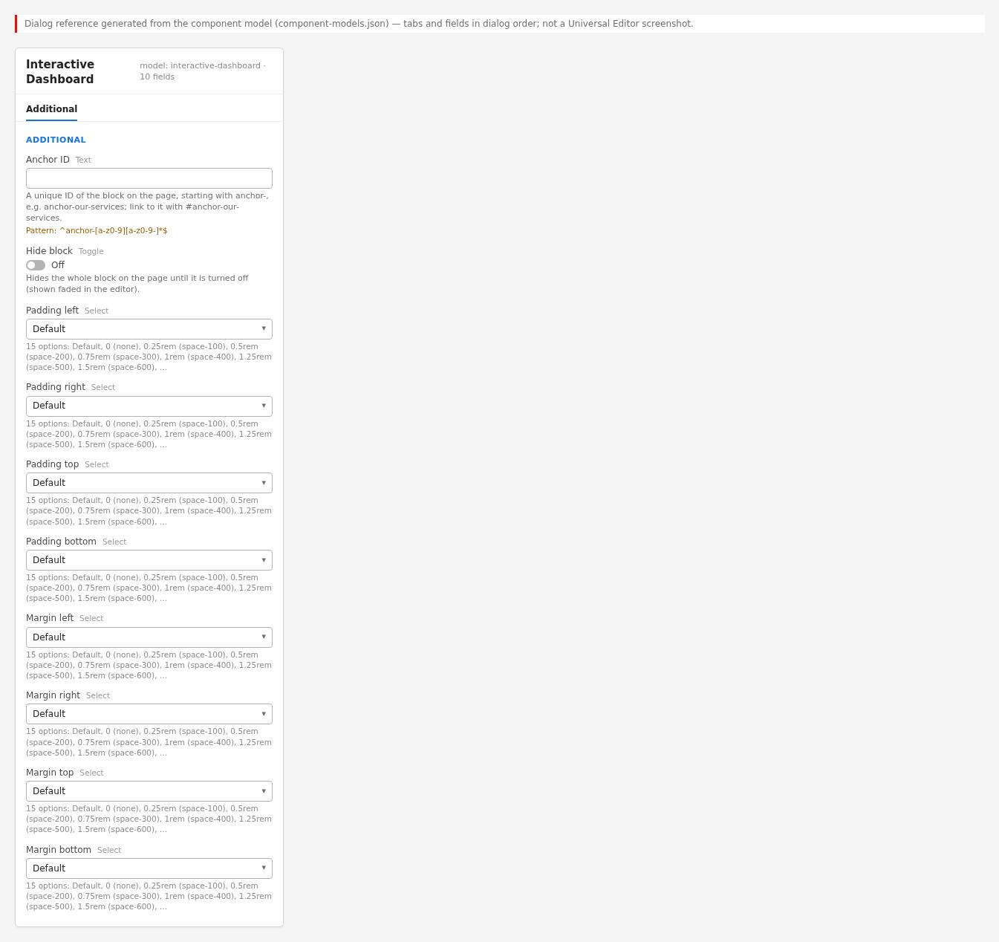{width=100%}

**Properties panel:** One tab, **Additional**: Anchor ID (text, validated
`^anchor-[a-z0-9][a-z0-9-]*$`), Hide block (toggle), Padding left / right / top / bottom and
Margin left / right / top / bottom (selects with the 15 spacing options). There is no Content
tab and no **Add** menu for child items (the block has no filter).

### 6.31.5 Authoring Guide

**Step 1 — Open the page in Universal Editor**

**Action:** Open a test or block-library page in Universal Editor.

**Expected Result:** The page opens in edit mode.

**Steps — Open the page:** AEM Sites console with a block-library page selected and Edit highlighted.

| Step | Where | Field / control | Value / action |
|:--|:----------|:----------|:--------------------|
| 1 | AEM Sites console | Navigate | /content/tcs-corp/us/en/block-library |
| 2 | AEM Sites console | Select the page | Check the block-library page card |
| 3 | AEM Sites toolbar | Edit | Opens the page in Universal Editor (edit mode) |

**Step 2 — Add the block**

**Action:** Select a section, **Add** (+) > **Interactive Dashboard**.

**Expected Result:** The dashed "Interactive Dashboard (placeholder)" box appears.

**Steps — Add the block:** Section Add menu with "Interactive Dashboard" highlighted.

| Step | Where | Field / control | Value / action |
|:--|:----------|:----------|:--------------------|
| 1 | Universal Editor › Content tree | Section | Select the section |
| 2 | Universal Editor › Content tree | Section › Add (+) | Interactive Dashboard |

**Step 3 — Fill the Additional tab (optional)**

**Action:** Set an Anchor ID if the reserved position must be addressable later; leave the other
options on their defaults.

**Expected Result:** The block id is set; no visible change on the site.

**Steps — Additional tab:** Additional tab with Anchor ID "anchor-dashboard".

| Step | Where | Field / control | Value / action |
|:--|:----------|:----------|:--------------------|
| 1 | Interactive Dashboard › Additional | Anchor ID | anchor-dashboard |
| 2 | Interactive Dashboard › Additional | Hide block / Padding / Margin | Keep the defaults |

**Step 4 — Preview**

**Action:** Switch to Preview or open the `.aem.page` URL.

**Expected Result:** Nothing is shown where the block is.

**Steps — Preview:** The preview page without any dashboard content.

| Step | Where | Field / control | Value / action |
|:--|:----------|:----------|:--------------------|
| 1 | Universal Editor toolbar | Preview | Switch to Preview (or open the .aem.page URL) |
| 2 | Preview | Check | Nothing shows where the block is; no unwanted gap |

**Step 5 — Do not publish to live**

**Action:** Remove the block (or keep it only on unpublished block-library pages) before
publishing a live page.

**Expected Result:** No empty section on the live page.

**Steps — Remove before publishing:** The block selected with the Delete action highlighted.

| Step | Where | Field / control | Value / action |
|:--|:----------|:----------|:--------------------|
| 1 | Universal Editor › Content tree | Interactive Dashboard | Select the block |
| 2 | Universal Editor toolbar | Delete | Remove the block before publishing a live page |

#### Preview Process

Preview shows nothing for this block; confirm only that the surrounding layout has no unwanted
gap.

#### Publishing Process

Not recommended. If a page containing the block must be published, confirm that the section
does not leave visible empty space.

#### Validation Process

- [ ] The block is not on any live page (search the locale sites for it before go-live).
- [ ] If present on a draft, its section has other content or no visible gap.
- [ ] No Anchor ID links point to it from live content.

#### Rollback Process

Delete the block from the page and republish, or restore the previous page version.

### 6.31.6 Authorable Field Specification

**Block model `interactive-dashboard` — Additional tab** (the only tab)

| Field Name | Field Type | Mandatory | Multi Value | Default Value | Business Purpose | Author Guidance | Validation Rules | Example Value |
|:--------------------------|:---------|:-----------|:-------|:---------|:-----------------|:---------------|:----------------------------------------------|:------------------|
| Anchor ID (`classes_anchor`) | text | No | No | (empty) | Id for future `#` links | Starts with `anchor-` | Enforced regExp `^anchor-[a-z0-9][a-z0-9-]*$`; message "Start with anchor-, then lower-case letters, digits and hyphens."; duplicates get `-2`, `-3` | anchor-dashboard |
| Hide block (`classes_hideblock`) | boolean | No | No | false | Hides the block and its wrapper | Not needed (already hidden) | None | false |
| Padding left (`classes_paddingleft`) | select | No | No | Default | Inner space left | Leave Default | Default, `pl-0` … `pl-3000` (15 options) | (Default) |
| Padding right (`classes_paddingright`) | select | No | No | Default | Inner space right | Leave Default | Default, `pr-0` … `pr-3000` | (Default) |
| Padding top (`classes_paddingtop`) | select | No | No | Default | Inner space top | Leave Default | Default, `pt-0` … `pt-3000` | (Default) |
| Padding bottom (`classes_paddingbottom`) | select | No | No | Default | Inner space bottom | Leave Default | Default, `pb-0` … `pb-3000` | (Default) |
| Margin left (`classes_marginleft`) | select | No | No | Default | Outer space left | Leave Default | Default, `ml-0` … `ml-3000` | (Default) |
| Margin right (`classes_marginright`) | select | No | No | Default | Outer space right | Leave Default | Default, `mr-0` … `mr-3000` | (Default) |
| Margin top (`classes_margintop`) | select | No | No | Default | Outer space top | Leave Default | Default, `mt-0` … `mt-3000` | (Default) |
| Margin bottom (`classes_marginbottom`) | select | No | No | Default | Outer space bottom | Leave Default | Default, `mb-0` … `mb-3000` | (Default) |

The spacing options are the 15 values listed in 6.29.6.

**Field details**

- **Anchor ID** — Purpose: block id. Allowed values: `anchor-` + lower-case letters, digits,
  hyphens. Character limits: none enforced (Recommended up to 40). Business rules: set as the id
  by the block-options decorator; a link to it does not scroll, because the block is hidden.
  Dependency / visibility rules: none. Sample: `anchor-dashboard`.
- **Hide block** — Purpose: hide. Business rules: on the site the block is already hidden;
  the option additionally hides the wrapper (removing a possible wrapper gap) outside edit mode;
  in edit mode the placeholder is shown faded. Sample: off.
- **Padding left / right / top / bottom, Margin left / right / top / bottom** — Purpose:
  spacing. Allowed values: the 15 options. Business rules: visible only on the editor
  placeholder (the published block is `display: none`). Sample: Default.

There are no content fields and no item models.

### 6.31.7 Field Annotation Mapping

| Marker | Field | Purpose |
|:--------|:-----------|:--------------------------------|
| A | (block, no field) | The editor placeholder box; select it to reach the Additional tab |

### 6.31.8 Component Specification

| Attribute | Value |
|:-----------------|:---------------------------------------------------|
| Component Name | Interactive Dashboard (`interactive-dashboard`) |
| Version | 1.0 (placeholder) |
| Owner | [To be confirmed: product owner]; technical owner: development team |
| Dependencies | block-options and data-layer decorators; `styles/styles.css` tokens |
| Component Type | Block (placeholder; no items) |
| Supported Variants | None (editor placeholder; empty on the site) |
| Supported Templates | Any page technically; not recommended on live pages |
| Supported Metadata | None |
| Supported Tags | None |
| Supported Personalization | None |
| Caching Considerations | Only the page HTML (CDN); no data is loaded |
| Performance Considerations | Negligible: the block's JS and CSS are loaded when its section loads (two small files) |
| Accessibility Compliance | Not exposed on the site (`display: none`); future implementation must meet WCAG 2.1 AA (text alternatives for charts, keyboard operation, non-colour encoding) |
| SEO Compliance | No content |

### 6.31.9 Input Model

**Content Inputs:** None (any rows are discarded).

**Metadata Inputs:** None.

**Tags Inputs:** None.

**Page Context Inputs:** Universal Editor edit mode (`html.adobe-ue-edit`) for the placeholder.

**Query Inputs:** None.

**Manual Inputs:** Additional tab only (as block classes).

**Authored HTML received from AEM (simplified):**

```html
<div class="interactive-dashboard anchor-dashboard"></div>
```

### 6.31.10 Output Model

**Rendered Output:** The same `div`, emptied, with `data-placeholder="Interactive Dashboard"`;
the block-options decorator turns an `anchor-…` class into its id.

**Generated HTML:**

```html
<div class="interactive-dashboard anchor-dashboard block" id="anchor-dashboard"
  data-block-name="interactive-dashboard" data-block-status="loaded"
  data-placeholder="Interactive Dashboard"></div>
```

**Generated JSON:** None.

**Generated Metadata:** None.

**Analytics Tracking:** The data layer still adds a component entry (lazy phase):

```json
{ "component": { "anchor-dashboard": {
  "@type": "tcs-corp/components/interactive-dashboard", "parentId": "page-…" } } }
```

No events (nothing to click).

**Personalization Output:** None.

**Search Index Output:** None.

**Target Personalization Output:** None. The empty block is added to the Adobe Client Data Layer as tcs-corp/components/interactive-dashboard like any block, but it has no content or interactions to personalise or track (Not implemented (as of this handover)).

### 6.31.11 Business Rules

1. The block removes all of its children (`block.replaceChildren()`); authored content is never
   shown.
2. It sets `data-placeholder="Interactive Dashboard"`.
3. On the site and in Universal Editor preview mode the empty block is `display: none`.
4. In Universal Editor edit mode it is a dashed box, at least 10rem tall, labelled
   "Interactive Dashboard (placeholder)" (the label text is fixed in CSS / JS, not a
   placeholder key, and is not translated).
5. The model has only the Additional tab; there is no filter, so no child items can be added.
6. The Anchor ID becomes the block id (unique on the page); links to it do not scroll.
7. Hide block hides the block's wrapper too (outside edit mode); in edit mode the placeholder is
   faded with a dashed outline.
8. The block is added to the data layer like any other block.

### 6.31.12 Author Best Practices

**Recommended Content Length:** Not applicable.

**Image Dimensions:** Not applicable.

**CTA Writing Guidelines:** Not applicable.

**Accessibility Guidelines:** Do not reference the block from live content (for example "see
the dashboard below").

**SEO Guidelines:** Do not publish pages that rely on the dashboard for content.

**Metadata Guidelines:** Not applicable.

**Taxonomy Guidelines:** Not applicable.

**Localization Guidelines:** Not applicable; the placeholder label is English and editor-only.

### 6.31.13 Troubleshooting Guide

#### Issue 1 — The dashboard does not appear on the published page

**Symptoms:** Nothing is visible where the block was added.

**Root Cause:** By design: the block is a placeholder and renders nothing.

**Diagnosis Steps:** Inspect the page: an empty `div.interactive-dashboard` with
`data-placeholder`.

**Resolution Steps:** Remove the block; use Table, Cards or Embed for current needs.

**Validation Steps:** The page shows the intended alternative content.

**Preventive Measures:** Communicate the block's status to authors (the Authoring Guide lists it
as a placeholder).

#### Issue 2 — The placeholder box is not visible in Universal Editor

**Symptoms:** The block cannot be found on the canvas.

**Root Cause:** Universal Editor is in Preview mode (the box is shown only in edit mode).

**Diagnosis Steps:** Check the editor mode toggle.

**Resolution Steps:** Switch to edit mode, or select the block in the content tree.

**Validation Steps:** The dashed box appears.

**Preventive Measures:** Use the content tree to locate hidden or empty blocks.

#### Issue 3 — Authored text disappears

**Symptoms:** Content pasted into the block is gone.

**Root Cause:** The code empties the block; the model has no content fields.

**Diagnosis Steps:** Check the model: only the Additional tab.

**Resolution Steps:** Place content in other blocks or default content.

**Validation Steps:** Content shows in the chosen block.

**Preventive Measures:** Do not use the placeholder for content.

#### Issue 4 — An empty gap appears on the page

**Symptoms:** Extra white space in a section.

**Root Cause:** The section (or its wrapper) remains with its own spacing although the block is
hidden.

**Diagnosis Steps:** Inspect the section containing the block.

**Resolution Steps:** Delete the block, or turn on Hide block (hides the wrapper), or remove the
empty section.

**Validation Steps:** The gap is gone on `.aem.page`.

**Preventive Measures:** Validation checklist in 6.31.5.

#### Issue 5 — A link to the dashboard anchor does not scroll

**Symptoms:** `#anchor-dashboard` links do nothing.

**Root Cause:** The target exists but is `display: none`.

**Diagnosis Steps:** Check the target id in the page.

**Resolution Steps:** Remove such links until the dashboard exists.

**Validation Steps:** No links to the anchor remain.

**Preventive Measures:** Do not link to placeholder blocks.

#### Issue 6 — Analytics reports an "interactive-dashboard" component

**Symptoms:** The data layer contains a component entry for the dashboard.

**Root Cause:** Every block is tracked, including empty ones.

**Diagnosis Steps:** Inspect `window.adobeDataLayer`.

**Resolution Steps:** Remove the block from the page; or ignore the component type in reports.

**Validation Steps:** The entry no longer appears.

**Preventive Measures:** Keep the placeholder off live pages.

### 6.31.14 Support Runbook

#### Monitoring Requirements

None. Optionally check before releases that no live page contains the block (search the AEM
content or the published HTML for `interactive-dashboard`).

#### Logs

The block emits no console messages and makes no requests. Admin API / Sidekick status and AEM
author publication logs apply as for any page.

#### Common Errors

| Error | Cause | Fix |
|:---------------|:-------------|:-------------------|
| Nothing on the page | Placeholder by design | Remove the block |
| Box missing in the editor | Preview mode | Switch to edit mode |
| Empty gap | Section remains | Delete the block or section; Hide block |
| Anchor link does nothing | Target hidden | Remove the link |

#### Escalation Matrix

| Level | Who | Checks |
|:---------|:---------------|:----------------------------------|
| L1 | Author support / content lead | Block present on live pages? Remove it |
| L2 | AMS / site admin | Publish status; content audit for the block |
| L3 | Development team | Future implementation (requirements, data source, design) |
| Adobe Support | Adobe | Not expected (no platform features used beyond standard blocks) |

#### Recovery Procedures

Delete the block and republish, or restore a previous page version.

#### Health Checks

Not applicable beyond confirming that live pages do not include the block.

#### Operational Procedures

When the dashboard is commissioned: define requirements, data source and design ([To be
confirmed — owner: product owner]); the development team replaces the placeholder code and model
and updates this chapter.

#### Known Limitations

- Placeholder only: no content model, no rendering, no data, no interactivity (Not implemented as
  of this handover).
- The editor label is fixed English text.
- The block is still tracked in the data layer and its section may leave empty space.

### 6.31.15 Common Authoring Mistakes

The mistakes seen most often with this component (each screenshot above also lists the mistakes of its example).

| Error | Root Cause | Resolution |
|:----------|:----------|:----------|
| A blank band appears on the live page | The block's section keeps its spacing | Delete the block and its section and republish |
| Authors look for dashboard fields | The model has only the Additional tab | Nothing to configure; the dashboard is Not implemented (as of this handover) |
| The box shows in the editor but not on aem.page | The placeholder is editor-only by design | Expected behaviour |
| A link to #anchor-dashboard does not scroll | The anchored block is display: none | Link to visible content instead |
| Padding or margin settings change nothing on the site | The block is not displayed | Remove the block, or Hide block to hide the wrapper |
| Content pasted into the block disappears | The code removes any content of the block | Use another block for the content |

### 6.31.16 Author Quick Reference Guide

**Mandatory Fields**

- None: every field has a default or is optional.

**Recommended Fields**

- None — keep the block off live pages; it renders nothing

**Optional Fields**

- Anchor ID — reserves an id for future links (a link to it does not scroll today)
- Hide block — also hides the wrapper outside edit mode
- Padding left / right / top / bottom — visible only on the editor placeholder
- Margin left / right / top / bottom — visible only on the editor placeholder

**Authoring Checklist**

1. Use the block only on test or block-library pages
2. Add it from a section's Add (+) menu; the dashed Interactive Dashboard (placeholder) box appears
3. Do not expect fields: the model has only the Additional tab
4. Do not add it to site-global templates
5. Use Table, Table List or Cards for figures that must be shown today
6. Remove the block before publishing a live page

**Pre-Publish Checklist**

1. Search the locale pages for the block before go-live
2. Preview on aem.page and check the section leaves no unwanted gap
3. Check no CTA or Anchor List links point to its Anchor ID
4. If the block must stay on a draft, turn Hide block on
5. Delete an otherwise empty section that holds only the block

**Post-Publish Validation Checklist**

1. Open the page on aem.live and check no blank band appears
2. Check the data layer lists no unexpected interactive-dashboard component on live pages
3. If a gap appears, delete the block and republish the page
4. Restore the previous page version if removing the block broke the layout
5. Report dashboard requests to the product owner for requirements

### 6.31.17 Component Execution Example

**Business example:** Reserved dashboard position on a draft annual report page.

**Example Values Entered:**

| Field | Value |
|:--------------------|:------------------------------|
| Component (Section › Add (+)) | Title |
| Title (Title) | Performance insights |
| Title Type (Title) | h2 |
| Component (Section › Add (+)) | Text |
| Text (Text) | Key figures from our latest annual report, updated every quarter. |
| Component (Section › Add (+)) | Interactive Dashboard |
| Component (Section › Add (+)) | Title |
| Title (Title) | Read the full report |
| Title Type (Title) | h2 |
| Component (Section › Add (+)) | Text |
| Text (Text) | Download the report for the detailed figures by industry and region. |

All other fields keep their default values.

**Rendered Result:**

{width=100%}

**Author Notes**

- The block is added in its own section between Performance insights and Read the full report
- There are no fields to fill; only the Additional tab exists
- In edit mode the position shows as a dashed Interactive Dashboard (placeholder) box

**Business Notes**

- The page layout can be drafted before the dashboard is designed
- Visitors see nothing, so the page must not be published with the block
- Requirements are [To be confirmed: dashboard requirements, data source and design — owner: product owner]

**Technical Notes**

- decorate() empties the block and sets data-placeholder to Interactive Dashboard
- .interactive-dashboard:empty is display: none; only .adobe-ue-edit shows the 10rem dashed box
- The wrapper and section remain, so a section with only this block becomes empty space

# Part 7 — Taxonomy Documentation

This part describes how tags (the taxonomy) are structured, published, resolved into labels and
used by the TCS Corporate Website. It covers the AEM side (the Tagging console, the taxonomy
page per locale) and the Edge Delivery side (the published `taxonomy.json`, the query index, the
blocks that read tags and the Adobe Client Data Layer).

> **Note:** Everything in this part was checked against the code in the `main` branch
> (`utils/taxonomy.js`, `utils/tags.js`, `utils/metadata.js`, `utils/query-index.js`,
> `blocks/list/list-data.js`, `blocks/filter-list/filter-list.js`, `blocks/teaser/teaser.js`,
> `blocks/page-header/page-header.js`, `blocks/cards/cards.js`,
> `blocks/conversation-canvas/conversation-canvas.js`, `decorators/tag-decorator.js`,
> `decorators/card-list-decorator.js`, `decorators/data-layer-decorator.js`, `helix-query.yaml`,
> `paths.json`) and, where stated, against the published site on 13 October 2026.

## 7.1 Taxonomy Structure

### 7.1.1 AEM Tags and Tag IDs

Tags are created and maintained in AEM as a Cloud Service, in the **Tagging** console
(Tools → General → Tagging). Every tag has:

| Property | Description | Example |
|:-------------|:-------------------------------------------------------|:----------------------|
| Namespace | The top level of a tag tree. Its ID ends with a colon. | `tcs-corp:` |
| Tag ID | The namespace, a colon and the tag's path below the namespace. This is the value stored on pages and in block fields. | `tcs-corp:industry/banking` |
| Title | The label shown to visitors. Can be translated per language in AEM (tag localisation). | `Banking` |
| Path | The repository location of the tag (below `/content/cq:tags`). | `/content/cq:tags/tcs-corp/industry/banking` |
| Description | Optional text for authors (not used by the site code). | `Banking and financial services` |

The website code works **only with tag IDs** and turns them into labels at runtime. Universal
Editor also stores tag IDs: every tag field in the block models is an `aem-tag` field, which
saves the selected tag IDs (for example `tcs-corp:region/europe`) in the component's properties.

Tag fields that exist in the component models (verified in `blocks/*/_*.json`):

| Component | Field (name) | Model file | Multi value | Visible when |
|:-----------|:---------------------------|:-----------------------|:------------|:-----------------|
| Teaser | Tags (`tags`) | `blocks/teaser/_teaser.json` | Yes | Display Tags is on |
| List | Tags (`tags`) | `blocks/list/_list.json` | Yes | List source = Tagged pages (`tags`) |
| List Item | Tags (`tags`), "Overrides the page tags." | `blocks/list/_list.json` | Yes | Always |
| Card (Cards block) | Tags (`tags`) | `blocks/cards/_cards.json` | Yes | Always |
| Filter List | Primary filter category (`primaryCategory`) | `blocks/filter-list/_filter-list.json` | No | Always (Filters tab) |
| Filter List | Primary filter tags → Tag Id (`tagId`) | `blocks/filter-list/_filter-list.json` | Container, multi | Always (Filters tab) |
| Filter List | Advanced filter categories → Taxonomy root (`taxonomyRoot`) | `blocks/filter-list/_filter-list.json` | Container, multi | Always (Advanced tab) |

> **Note:** None of the `aem-tag` fields restricts the tag picker to a namespace or root path:
> authors can pick any tag of any namespace. Keeping to the agreed namespaces is a governance
> rule (see 7.4), not something the editor enforces.

The **page tags** are not a field of the Universal Editor page properties model
(`models/_page.json` has Title, Description, Keywords, Page Type, Navigation, Footer and 404 Page
only). Page tags are set either in the standard AEM page properties (Sites console → Properties →
Basic → Tags, stored as `cq:tags`) or in a `tags` column of the locale's bulk metadata sheet.
See 7.8.1 for how the code reads them and an open point about the published meta name.

### 7.1.2 Namespaces in Use

Two sets of tag IDs appear in the project, and they are not the same:

| Where | Namespace and tags | Status |
|:---------------------------------|:------------------------------------------------------------|:-------------------------------------------------|
| Published taxonomy `/en/taxonomy.json` (checked 13 October 2026) | `tcs-corp:` (title "TCS Corp") with three trees: `tcs-corp:content-type` (Case Study, Article, Blog, Press Release, Whitepaper, Research, Webinar, Event), `tcs-corp:industry` (no child tags yet), `tcs-corp:region` (Americas, Europe, Asia Pacific, Middle East Africa) | The real taxonomy in AEM |
| Code comments, field descriptions and unit tests | `tcs:` — `tcs:industry`, `tcs-corp:industry/banking`, `tcs-corp:topic/ai`, `tcs-corp:topic/ai/genai`, `tcs-corp:topic/cloud`, `tcs-corp:topic/cloud`, `tcs-corp:topic/artificial-intelligence` | Illustrative examples only (test fixtures in `test/list/fixtures.mjs`, descriptions such as "A tag root, e.g. tcs:industry") |

The published `tcs-corp:` tree (16 rows) is:

```text
tcs-corp:                               TCS Corp
├── tcs-corp:content-type               Content Type
│   ├── tcs-corp:content-type/article        Article
│   ├── tcs-corp:content-type/blog           Blog
│   ├── tcs-corp:content-type/case-study     Case Study
│   ├── tcs-corp:content-type/event          Event
│   ├── tcs-corp:content-type/press-release  Press Release
│   ├── tcs-corp:content-type/research       Research
│   ├── tcs-corp:content-type/webinar        Webinar
│   └── tcs-corp:content-type/whitepaper     Whitepaper
├── tcs-corp:industry                   Industry          (no child tags yet)
└── tcs-corp:region                     Region
    ├── tcs-corp:region/americas             Americas
    ├── tcs-corp:region/asia-pacific         Asia Pacific
    ├── tcs-corp:region/europe               Europe
    └── tcs-corp:region/middle-east-africa   Middle East Africa
```

> **Important:** When an author follows a field description literally (for example types
> `tcs:industry` as a Filter List Primary filter category), nothing matches, because the real
> namespace is `tcs-corp:`. Always pick tags with the tag picker instead of typing IDs.

The code is namespace-agnostic. A value is treated as a tag ID when:

- `utils/taxonomy.js` `resolveTags`: it contains a colon or a slash (`/[:/]/`);
- `blocks/filter-list/filter-list.js` `isTagId`: it matches `^[\w-]+:[\w/-]*$` (namespace of
  letters, digits, `_` or `-`, a colon, then an optional path), so `tcs-corp:industry/banking`
  and the bare namespace `tcs-corp:` both qualify.

### 7.1.3 The Taxonomy Page and /{locale}/taxonomy.json

AEM exposes tag titles to Edge Delivery Services through a **taxonomy page**: a page created from
the AEM *Taxonomy* template whose page properties select the tags or namespaces to include. The
page content is generated by AEM from the selected tags and is read-only. When published, it is
delivered as a spreadsheet JSON with the columns `tag` and `title`.

Each of the 13 locale sites has its own taxonomy page at
`/content/tcs-corp/{country}/{language}/taxonomy`. `paths.json` (generated by
`npm run build:paths` from `LOCALES` in `utils/site.js`) maps each of them to a JSON resource:

| AEM taxonomy page | Published as |
|:---------------------------|:----------------------|
| `/content/tcs-corp/us/en/taxonomy` | `/en/taxonomy.json` |
| `/content/tcs-corp/de/de-de/taxonomy` | `/de-de/taxonomy.json` |
| `/content/tcs-corp/fr/fr-fr/taxonomy` | `/fr-fr/taxonomy.json` |
| `/content/tcs-corp/ca/fr-ca/taxonomy` | `/fr-ca/taxonomy.json` |
| `/content/tcs-corp/es/es-es/taxonomy` | `/es-es/taxonomy.json` |
| `/content/tcs-corp/pt/pt-pt/taxonomy` | `/pt-pt/taxonomy.json` |
| `/content/tcs-corp/nl/nl-nl/taxonomy` | `/nl-nl/taxonomy.json` |
| `/content/tcs-corp/se/sv-se/taxonomy` | `/sv-se/taxonomy.json` |
| `/content/tcs-corp/dk/da-dk/taxonomy` | `/da-dk/taxonomy.json` |
| `/content/tcs-corp/no/no-no/taxonomy` | `/no-no/taxonomy.json` |
| `/content/tcs-corp/cn/zh-cn/taxonomy` | `/zh-cn/taxonomy.json` |
| `/content/tcs-corp/jp/ja-jp/taxonomy` | `/ja-jp/taxonomy.json` |
| `/content/tcs-corp/kr/ko-kr/taxonomy` | `/ko-kr/taxonomy.json` |

A published taxonomy row looks like this (from `/en/taxonomy.json`):

```json
{
  "total": 16,
  "offset": 0,
  "limit": 16,
  "data": [
    { "tag": "tcs-corp:", "title": "TCS Corp" },
    { "tag": "tcs-corp:region", "title": "Region" },
    { "tag": "tcs-corp:region/europe", "title": "Europe" }
  ],
  "columns": ["tag", "title"],
  ":type": "sheet"
}
```

> **Note:** On 13 October 2026 only `/en/taxonomy.json` was published; the other 12 locale
> taxonomy URLs returned 404. Until a locale's taxonomy page is published, its pages show labels
> derived from the tag IDs (see 7.1.4).
> [To be confirmed: publication of the 12 remaining locale taxonomy pages — owner: content operations lead]

**Steps — Configuring a locale taxonomy page:** AEM Sites console, page properties of `/content/tcs-corp/us/en/taxonomy`, with the Tags field listing the `tcs-corp:` namespace (or the `content-type`, `industry` and `region` trees) that the taxonomy publishes.

| Step | Where | Field / control | Value / action |
|:--|:----------|:----------|:--------------------|
| 1 | AEM Sites console | Select | /content/tcs-corp/us/en/taxonomy |
| 2 | AEM Sites console toolbar | Properties | Open Page Properties |
| 3 | Page Properties › Basic | Tags | TCS Corp (tcs-corp:), or the Content Type, Industry and Region trees |
| 4 | Page Properties | Save & Close | Save, then Quick Publish the taxonomy page |

### 7.1.4 How Tag Labels Are Resolved

Labels are resolved in the browser by `utils/taxonomy.js` and `utils/tags.js`:

```text
tag values (IDs or titles)
   |  e.g. from the page head, a block field or the query index
   v
resolveTags(values)                                   utils/taxonomy.js
   |
   +-- loadTaxonomy()  -> fetch {locale root}/taxonomy.json   (once per page view)
   |      rows of the language sheet (multi-sheet) or the only sheet
   |      Map: tag ID (trimmed) -> title (trimmed)
   |
   +-- for each value:
         1. Map has a non-empty title       -> { id, label: title }
         2. value contains ":" or "/"       -> parseTag(value)        utils/tags.js
              last path segment, "-" and "_" become spaces, first letter upper case
              tcs-corp:industry/financial-services -> "Financial services"
         3. otherwise (an authored title)   -> { id: value, label: value }
```

Precise behaviour (from the code):

1. `loadTaxonomy()` fetches `localeSheetPath('taxonomy')`, that is `{root}/taxonomy.json` of the
   current locale (`/de-de/taxonomy.json` on a German page; `/en/taxonomy.json` on pages outside
   a locale, such as drafts). The request is made **once per page view**: the promise is kept in
   a module variable and shared by every block on the page.
2. Rows without a `tag` value are ignored. Tag IDs and titles are trimmed.
3. A non-OK response (404, 500) or a network error gives an **empty map** — the page still
   renders, with ID-derived labels. No error is shown to the visitor.
4. A taxonomy row with an empty `title` counts as missing (the ID-derived label is used).
5. `parseTag` uses only the **last segment** of the ID: `tcs-corp:content-type/case-study` becomes
   "Case study" (sentence case, not the AEM title "Case Study"). A bare namespace (`tcs-corp:`)
   gives an empty label.
6. Values that contain neither `:` nor `/` are treated as titles typed by an author and shown as
   typed.
7. The Filter List keeps a second fallback: `labels.get(tag) || taxonomy.get(tag) || tag`.
   The List and Cards use `labels.get(tag) || tag`. Because `resolveTags` always returns a label,
   these fallbacks only apply in edge cases (for example an empty ID-derived label).

### 7.1.5 Language Sheets and Fallbacks

When tag titles are translated in AEM, the taxonomy JSON can contain one sheet per language
(a multi-sheet JSON, `":type": "multi-sheet"`). `utils/site.js` `sheetRows(json, sheet)` picks:

1. the sheet named after the locale's **ISO 639-1 language** (`getLocale().language`: `en`, `de`,
   `fr`, `es`, `pt`, `nl`, `sv`, `da`, `no`, `zh`, `ja`, `ko`) — `fr-fr` and `fr-ca` both use `fr`;
2. else the sheet named `default`;
3. else the first sheet listed in `:names`.

For a single-sheet JSON (the current state of `/en/taxonomy.json`) its `data` rows are used.

| Situation | Label shown |
|:---------------------------------------|:----------------------------|
| Tag in the locale's taxonomy, title present (language sheet or single sheet) | The taxonomy title, e.g. "Asia Pacific" |
| Multi-sheet taxonomy without the language sheet | The `default` sheet's title, else the first sheet's |
| Tag not in the taxonomy (not included in the taxonomy page, or deleted) | ID-derived label, e.g. "Middle east africa" |
| Taxonomy JSON not published (404) or not reachable | ID-derived label for every tag |
| Authored text without `:` or `/` | The text as authored |

> **Note:** The code requests `taxonomy.json` without a `sheet` parameter and relies on the
> response containing the language sheets. The aem.live documentation describes reading a
> language with `?sheet={language}`. When translated tag titles are introduced, check the
> published JSON of a locale taxonomy page: if it returns only one sheet, the translated titles
> will not be picked up.
> [To be confirmed: shape of a translated taxonomy JSON — owner: development team]

> **Tip:** Because each locale has its own taxonomy page, a locale can also show translated
> labels by publishing a taxonomy whose single sheet already holds the titles of its language.
> [To be confirmed: which approach AEM produces for this site — owner: development team]

### 7.1.6 Reading Tag Values from Fields

`utils/tags.js` `readTagValues(cell)` reads a multi-value tag property as Universal Editor renders
it: the text of each `<li>` when the values are a list, else the cell text split on commas.
Values are trimmed and empty values dropped. The result is the list of tag IDs **as authored**
(no validation, no de-duplication). `readTags(cell)` returns them with ID-derived labels (no
taxonomy lookup); it is exported but not used by any block today.

Page tags are read by `utils/metadata.js` `getPageTags()`: the `content` of every
`<meta property="article:tag">` in the page head, else a comma-separated `<meta name="tags">`;
trimmed, empty values removed, **de-duplicated**.

## 7.2 Tag Hierarchy

### 7.2.1 The Hierarchy Model

AEM tags form trees: a namespace contains tags, which can contain child tags to any depth. The
tag ID encodes the hierarchy as a path: `tcs-corp:region/europe` is a child of
`tcs-corp:region`, which is a child of the namespace `tcs-corp:`. The code derives parent-child
relationships **only from the ID string** — it never reads the AEM tag tree, the taxonomy order
or tag properties.

### 7.2.2 Child Tags Match Parent Filters (hasTag)

The List and the Filter List both use the same rule (two identical implementations):

```js
// blocks/list/list-data.js (exported, unit tested)
export const hasTag = (tags, tag) => tags.some((id) => id === tag || id.startsWith(`${tag}/`));

// blocks/filter-list/filter-list.js
const hasTag = (page, tag) => page.tags.some((id) => id === tag || id.startsWith(`${tag}/`));
```

A page matches a filter tag when it carries the tag itself **or any descendant** of it, at any
depth. The comparison is exact and case-sensitive on the ID; the slash boundary prevents partial
matches (`tcs-corp:region/europe` does not match `tcs-corp:region/euro`).

| Filter tag | Page tag | Match? | Why |
|:----------------------|:----------------------|:--------|:--------------------------------------|
| `tcs-corp:region` | `tcs-corp:region/europe` | Yes | Child tag |
| `tcs-corp:industry` | `tcs-corp:industry/banking/retail` | Yes | Grandchild tag (any depth) |
| `tcs-corp:region/europe` | `tcs-corp:region` | No | A parent does not match a child filter |
| `tcs-corp:region/europe` | `tcs-corp:region/europe` | Yes | Same tag |
| `tcs-corp:region/euro` | `tcs-corp:region/europe` | No | Not a path boundary |
| `tcs-corp:content-type` | `tcs-corp:region/europe` | No | Different tree |
| `tcs-corp:` | `tcs-corp:region/europe` | No | `tcs-corp:/` is not a prefix of `tcs-corp:region/…`; a namespace alone matches only pages tagged with the bare namespace |

> **Warning:** Selecting a bare namespace (for example `tcs-corp:`) as a List tag or a Filter
> List Primary filter tag does **not** match the tags below it, because the code looks for
> `tcs-corp:/`. Use a tag tree root such as `tcs-corp:region` instead.

### 7.2.3 Where the Hierarchy Is Used

| Feature | Rule | Code |
|:--------------------------------|:-------------------------------------------------------|:----------------------|
| List, source Tagged pages, Match = Any | A page matches when it has at least one of the List's tags or a descendant of one | `applyTagMatching` in `blocks/list/list-data.js` |
| List, source Tagged pages, Match = All | A page matches when, for every List tag, it has that tag or a descendant | `applyTagMatching` |
| Filter List pills (single select) | Pages with the selected pill's tag or a descendant | `matches()` in `filter-list.js` |
| Filter List pills (Allow multi select on) | Pages that match **every** selected pill (AND) | `matches()` |
| Filter List Advanced filter options, Filter logic AND / OR | Pages with every / any checked option tag or a descendant | `matches()` |
| Filter List pills from Primary filter category | The pills are all descendants (any depth) of the category used by the listed pages: tags that start with `{category}/` | `used(root)` in `filter-list.js` |
| Filter List Advanced filter category options | The options are the descendants of the Taxonomy root used by the listed pages, sorted by label | `used(root)` |

The unit tests (`test/list/list-data.test.mjs`, fixtures in `test/list/fixtures.mjs`) confirm the
behaviour: `tcs-corp:topic/ai` matches a page tagged `tcs-corp:topic/ai/genai`; "all" of `tcs-corp:topic/ai` and
`tcs-corp:topic/cloud` matches only the page carrying both; a page with `hide-in-nav = yes` is never
listed even if its tags match; no tags, or tags with no matches, give no cards.

## 7.3 Business Taxonomy

### 7.3.1 Current State

The only namespace published is `tcs-corp:` with the trees `content-type`, `industry` (empty) and
`region` (see 7.1.2). No topic, service or audience tags exist yet.

> **Note:** "Content type" exists twice in the implementation: as a **tag tree**
> (`tcs-corp:content-type/*`, usable in the List and the Filter List tag filters and shown as tag
> labels) and as the **`content-type` metadata** (free text, shown as the card eyebrow / meta and
> the Page Header eyebrow, filtered by the Filter List *Content types* field). The two are not
> connected by code. Keep them aligned: use the taxonomy title (for example `Case Study`) as the
> `content-type` metadata value and tag the page with the matching `tcs-corp:content-type/…` tag.

### 7.3.2 Proposed Business Taxonomy

[To be confirmed: business taxonomy (namespaces, trees and tag lists) — owner: digital marketing / content strategy lead]

The following structure is **proposed**. It stays inside the existing `tcs-corp:` namespace,
uses lower-case, hyphenated tag names (as the published tags do), and keeps every tree two or
three levels deep so that the parent-child matching in 7.2 is useful.

| Tree (tag root) | Purpose | Proposed child tags (examples) | Used by |
|:----------------------|:------------------------|:------------------------------------------------------------|:----------------------------------------------------|
| `tcs-corp:industry` | The industries TCS serves | `banking`, `financial-services`, `insurance`, `capital-markets`, `retail`, `consumer-packaged-goods`, `manufacturing`, `life-sciences`, `healthcare`, `communications-media`, `energy-utilities`, `travel-hospitality`, `public-services` | Filter List (Primary filter category, Advanced category "Industry"); List tag source; Teaser / Page Header labels |
| `tcs-corp:service` | Service lines and offerings | `consulting`, `cloud`, `cybersecurity`, `data-analytics`, `artificial-intelligence`, `enterprise-solutions`, `iot-digital-engineering`, `cognitive-business-operations` | Filter List Advanced category "Service"; List tag source |
| `tcs-corp:topic` | Editorial themes across industries | `agentic-ai`, `generative-ai`, `sustainability`, `future-of-work`, `customer-experience`; children allowed, e.g. `artificial-intelligence/generative-ai` | Filter List pills; List "related insights" by topic |
| `tcs-corp:content-type` | The kind of content (exists) | `article`, `blog`, `case-study`, `event`, `press-release`, `research`, `webinar`, `whitepaper`; proposed additions `report`, `podcast`, `video`, `news` (to align with the Filter List Content types options) | Filter List Advanced category "Content type"; kept aligned with the `content-type` metadata |
| `tcs-corp:region` | Geography of the content (exists) | `americas`, `europe`, `asia-pacific`, `middle-east-africa`; children for countries if needed, e.g. `europe/uk` | Filter List Advanced category "Region"; List by region |
| `tcs-corp:audience` | Target audience (optional) | `cxo`, `it-leaders`, `investors`, `analysts`, `job-seekers`, `media` | Future personalisation; List / Filter List |
| `tcs-corp:campaign` | Marketing campaigns (optional, time-bound) | One tag per campaign, e.g. `campaign/agentic-bank-2026` | Campaign landing lists; to be retired after the campaign (see 7.6) |

> **Note:** The `region` tag tree and the `region` **metadata** (free text used by the
> press-release template to filter Media Contacts) are different things. If both are used, keep
> their values consistent (see 8.2, `region`).

### 7.3.3 Tags Versus Metadata

| Need | Use a tag | Use metadata |
|:--------------------------------|:-----------------------|:---------------------------------|
| Filter or list pages by a classification | Yes (List Tagged pages, Filter List pills and Advanced filter) | Only page type and content type (Filter List Page types / Content types) |
| Translated label shown to visitors | Yes (taxonomy titles per locale) | No (metadata is shown as authored) |
| Hierarchical matching (parent matches children) | Yes | No |
| Single value per page that drives layout or code | No | Yes (`page-type`, `content-type`, `featured`, `priority`, `hide-in-nav`) |
| Values read by templates (author, region of media contacts) | No | Yes (`author-id`, `region`) |

## 7.4 Tag Governance

Tag governance keeps the taxonomy small, consistent across the 13 locales and safe to change.
Nothing below is enforced by the code or the models unless marked **Enforced**.

### 7.4.1 Governance Rules

| No. | Rule | Type | Reason |
|:-----|:------------------------------------------------------------|:-------------|:------------------------------------------------------------|
| 1 | Create tags only in the `tcs-corp:` namespace (no new namespaces without approval). | Recommended | The code and the taxonomy pages are set up for one namespace; the tag picker does not restrict namespaces. |
| 2 | Tag names (the last ID segment) are lower case, words separated by hyphens, ASCII only, no spaces. | Recommended | `parseTag` builds fallback labels from the name; Filter List `isTagId` accepts only `[\w-]` in the namespace and `[\w/-]` in the path. |
| 3 | Every tag has a Title in English; titles are translated for every locale language before the tag is used on that locale. | Recommended | Without a title, visitors see the ID-derived label. |
| 4 | Pick tags with the tag picker; never type IDs into fields. | Recommended | Typed IDs (for example the `tcs:` examples in field descriptions) match nothing. |
| 5 | A page carries the most specific tags that apply, not their parents as well. | Recommended | Parents match their children automatically (7.2); duplicates add noise to card labels. |
| 6 | At most 3 tags per page should be "display" tags (the first ones in the tag list). | Recommended | List and Cards show up to 3 tags on image and feature cards; the Filter List shows up to 2 (`MAX_CARD_TAGS`). **Enforced** truncation in code. |
| 7 | Tag trees stay at most 3 levels below the namespace. | Recommended | Deep trees are hard to curate and to translate; matching works at any depth. |
| 8 | Changes to tag IDs (move, rename of the name, merge, delete) go through a change request (7.6). | Recommended | IDs are stored on pages, in block fields and in the query index. |
| 9 | After any tag or title change, republish the taxonomy page of every affected locale. | Recommended | The taxonomy JSON only changes when its page is published. |
| 10 | The taxonomy page of each locale includes the whole `tcs-corp:` namespace (or every tree in use). | Recommended | A tag missing from the taxonomy page has no title on the site. |
| 11 | `content-type` metadata values match the `tcs-corp:content-type` titles. | Recommended | Keeps eyebrows, filters and tag labels consistent (7.3.1). |
| 12 | Deprecated tags are not removed until no page, block field or index row uses them. | Recommended | See 7.6.4. |

### 7.4.2 Review Cadence

| Activity | Frequency | Responsible |
|:------------------------------------|:-----------------------------|:-------------------|
| Review new tag requests | [To be confirmed: frequency — owner: taxonomy owner] | Taxonomy owner |
| Check for unused and duplicate tags (AEM Tagging console usage count, query index) | [To be confirmed: frequency — owner: taxonomy owner] | Taxonomy owner with content operations |
| Translation check of tag titles for 13 locales | Before a tag is used on a locale | Localisation team |
| Republish all locale taxonomy pages | After every taxonomy change | Content operations |

## 7.5 Tag Ownership

| Role | Responsibilities | Named owner |
|:-----------------------|:------------------------------------------------------------|:----------------------------------------|
| Taxonomy owner | Approves new tags, structure changes, merges and deletions; keeps the business taxonomy (7.3) | [To be confirmed: taxonomy owner — owner: digital marketing lead] |
| Tree owners (industry, service, topic, content type, region) | Curate the tags of their tree; propose changes | [To be confirmed: tree owners per business unit — owner: taxonomy owner] |
| Localisation team | Translates tag titles for each locale language in AEM | [To be confirmed: localisation contact — owner: content operations lead] |
| Content operations | Creates tags in the Tagging console after approval; publishes the 13 taxonomy pages; checks the published JSON | [To be confirmed: content operations contact — owner: content operations lead] |
| Authors | Tag pages and blocks with approved tags; request new tags | All authors |
| Development team | Code that reads tags (`utils/taxonomy.js`, `utils/tags.js`, List, Filter List), the query index definition, `paths.json` mappings | Development team |
| AEM administrators | Permissions on `/content/cq:tags` (who can create, move, delete tags) | [To be confirmed: AEM administrator — owner: platform owner] |

> **Tip:** Restrict create / move / delete permissions on `/content/cq:tags/tcs-corp` to the
> taxonomy owner and content operations through an AEM user group, so authors can only apply tags.
> [To be confirmed: tag permission groups — owner: AEM administrator]

## 7.6 Tag Lifecycle

```text
 request --> review --> create (EN title) --> translate titles --> publish taxonomy pages
                                                                         |
                                                                         v
                                                     in use on pages / block fields
                                                                         |
        +----------------------------+-----------------------------------+
        v                            v                                   v
   deprecate                       merge                               delete
 (stop using, keep)       (move references to target)     (only when no references remain)
```

### 7.6.1 Create

1. The author or tree owner requests the tag (name, English title, parent, reason).
2. The taxonomy owner approves it (checks for duplicates and the naming rules in 7.4.1).
3. Content operations creates the tag in AEM: Tools → General → Tagging → select the parent →
   Create Tag; enter the Title and the Name (lower case, hyphenated).
4. Republish the taxonomy page of every locale (`/content/tcs-corp/{country}/{language}/taxonomy`)
   so the title is in `/{locale}/taxonomy.json`.
5. Check the published JSON, for example `https://main--tcs-corp--sradha-tcs.aem.live/en/taxonomy.json`.

**Impact:** none on existing pages. Until step 4, the tag shows an ID-derived label.

**Steps — Managing tags in AEM:** The AEM Tagging console (Tools → General → Tagging) in column view with the `TCS Corp` namespace open, showing the Content Type, Industry and Region trees and the toolbar actions Create, Edit, Move, Merge, Delete and Publish.

| Step | Where | Field / control | Value / action |
|:--|:----------|:----------|:--------------------|
| 1 | AEM | Tools › General › Tagging | Open the Tagging console |
| 2 | Tagging console | View | Column view |
| 3 | Tagging console | Select | TCS Corp (namespace tcs-corp) |
| 4 | TCS Corp | Children | Content Type, Industry, Region |
| 5 | Tagging console toolbar | Actions | Create, Edit, Move, Merge, Delete, Publish |

**Steps — Creating a tag:** The Create Tag dialog below `TCS Corp > Industry`, with Title "Banking", Name "banking" and an optional Description filled in.

| Step | Where | Field / control | Value / action |
|:--|:----------|:----------|:--------------------|
| 1 | Tagging console | Select | TCS Corp › Industry |
| 2 | Tagging console toolbar | Create | Create Tag |
| 3 | Create Tag | Title | Banking |
| 4 | Create Tag | Name | banking |
| 5 | Create Tag | Description | Banks and financial services (optional) |
| 6 | Create Tag | Submit | Creates tcs-corp:industry/banking; then republish the taxonomy pages |

### 7.6.2 Translate

1. In the Tagging console select the tag → Edit (or Properties) → Localization: add the title
   for each language used by the locales (de, fr, es, pt, nl, sv, da, no, zh, ja, ko).
2. Republish the affected locale taxonomy pages.
3. Check a page of that locale: the tag label is translated.

**Impact:** labels only. Tag IDs, matching, the query index and the data layer (`xdm:tags` holds
IDs) are unchanged. See the open point in 7.1.5 about how translated titles are published.

**Steps — Translating tag titles:** The tag edit dialog of `tcs-corp:region/europe` with the Localization section listing translated titles (German "Europa", French "Europe", Japanese "ヨーロッパ").

| Step | Where | Field / control | Value / action |
|:--|:----------|:----------|:--------------------|
| 1 | Tagging console | Select | TCS Corp › Region › Europe (tcs-corp:region/europe) |
| 2 | Tagging console toolbar | Edit | Open the tag |
| 3 | Edit › Localization | German | Europa |
| 4 | Edit › Localization | French | Europe |
| 5 | Edit › Localization | Japanese | ヨーロッパ |
| 6 | Edit | Save | Save, then republish the taxonomy pages of the locales |

### 7.6.3 Deprecate

1. Agree a replacement tag (if any) and a removal date.
2. Prefix the English title with a marker for authors, for example "(Deprecated) …", **or**
   keep the title and announce the deprecation.
   [To be confirmed: deprecation marker convention — owner: taxonomy owner]
3. Remove the tag from pages and block fields over time (the Tagging console shows where a tag is
   used through its references; the published `/query-index.json` `tags` column shows published
   pages that still carry it).

**Impact:** none until pages change. Note that a title marker would also be visible to visitors
(the title is the label), so a separate communication is usually preferable.

### 7.6.4 Merge

1. In the Tagging console select the tag to remove → Merge → choose the target tag.
2. AEM replaces the references in page content with the target tag on author.
   [To be confirmed: whether tag references stored in Universal Editor block properties (List Tags, List Item Tags, Card Tags, Teaser Tags, Filter List tag fields) are updated by a merge — owner: development team]
3. Republish every page whose tags changed (page tags drive the query index) and every page whose
   blocks reference the tag; republish the taxonomy pages.

**Impact:**

| Area | Until pages are republished | After republishing |
|:---------------------------------|:------------------------------------|:------------------------------|
| Page head (`article:tag`), Page Header and Conversation Canvas labels | Old ID; label falls back to the ID-derived label once the taxonomy no longer contains it | New ID and title |
| Query index `tags` column | Old ID on the published row | New ID |
| List (Tagged pages) / Filter List filters on the new tag | Pages with the old ID are not found | Found |
| Filter List pills defined with the old tag | Match only pages not yet republished | Must be re-selected if the block property was not updated |
| Data layer `xdm:tags` | Old ID | New ID; analytics reports split across both IDs for the transition period |

### 7.6.5 Move or Rename

Moving a tag or changing its **name** changes its ID (for example
`tcs-corp:topic/ai` → `tcs-corp:topic/artificial-intelligence`), with the same impact as a merge.
Changing only the **title** keeps the ID: republish the taxonomy pages and nothing else is needed.

### 7.6.6 Delete

1. Make sure no page, block field or query index row uses the tag (see 7.6.3 step 3).
2. Delete the tag in the Tagging console and republish the taxonomy pages.

**Impact if references remain:** published pages keep the ID; the label becomes ID-derived;
List / Filter List filters that use the tag keep working on the remaining pages; the data layer
keeps sending the ID.

### 7.6.7 Lifecycle Impact Summary

| Change | Republish taxonomy pages | Republish tagged pages | Update block fields | Query index | Analytics |
|:-------------|:-----------|:-----------|:------------|:------------------|:-------------|
| Create tag | Yes | No | No | No change | No change |
| Change title / translate | Yes | No | No | No change | No change (IDs) |
| Move / rename name | Yes | Yes | Check and re-select | Rows change on republish | New ID from then on |
| Merge | Yes | Yes | Check and re-select | Rows change on republish | New ID from then on |
| Deprecate | Optional | Over time | Over time | Changes as pages are edited | Gradual |
| Delete | Yes | Before deleting | Before deleting | Must contain no rows with the ID | Old ID stops |

## 7.7 Parent-Child Relationships

### 7.7.1 How Relationships Are Derived

- A tag's parents are the prefixes of its ID at `/` boundaries:
  `tcs-corp:industry/banking/retail` → `tcs-corp:industry/banking` → `tcs-corp:industry`.
- The bare namespace (`tcs-corp:`) is not treated as a parent by the matching code (7.2.2).
- No code walks the tree downwards from the AEM tag tree; the Filter List finds children by
  looking at the tags **used by the listed pages** (`used(root)`): unused child tags never appear
  as pills or options.

### 7.7.2 Rules for Authors

| Situation | What to do | Result |
|:-----------------------------|:-----------------------------------|:---------------------------------------|
| A page is about retail banking | Tag `tcs-corp:industry/banking/retail` only | Found by filters on `…/banking/retail`, `…/banking` and `tcs-corp:industry` |
| A List should show all industry pages | List Tags = `tcs-corp:industry` | Every page with any industry tag |
| A Filter List should offer one pill per industry | Primary filter category = `tcs-corp:industry` (no Primary filter tags) | One pill per industry tag used by the listed pages, sorted by label |
| A Filter List should offer exactly three pills | Primary filter tags = the three tags, in order | Exactly those pills, in the authored order |
| A parent tag should be shown as a card label | Add the parent tag to the page as well | The parent label appears (if within the first 2 or 3 tags) |

### 7.7.3 Label Order and Display

Tag labels are shown in the order the tags are stored on the page or in the field (the order of
the `article:tag` elements or of the query index array). Parents are not shown automatically, and
labels are not sorted except for Filter List pills and options built from a category or taxonomy
root (sorted with `localeCompare` on the label).

## 7.8 Usage Examples

### 7.8.1 Page Tags

**Where they are set:** AEM page properties (Basic → Tags) or a `tags` column in the locale's
bulk metadata sheet (one row per URL pattern; several tags separated by commas).

**What the code reads:** `getPageTags()` reads `<meta property="article:tag">` (Edge Delivery
publishes one such element per value of a `tags` metadata property), else `<meta name="tags">`.

```html
<meta property="article:tag" content="tcs-corp:industry/banking">
<meta property="article:tag" content="tcs-corp:region/europe">
```

**Used by:** Page Header (tag list), Conversation Canvas (suggestion pills), the data layer page
entry (`xdm:tags`) and, through the query index `tags` column, the List and the Filter List.

> **Important:** The aem.live documentation states that AEM publishes the page property Tags
> (`cq:tags`) as `<meta name="cq-tags">` (a comma-separated list of tag IDs). The code and
> `helix-query.yaml` do not read `cq-tags`. Verify on a published page with tags which meta
> elements are present. If only `cq-tags` is present, page tags set in page properties will not
> reach the Page Header, the query index (List, Filter List) or the data layer; use the bulk
> metadata `tags` column, or extend `getPageTags()` and `helix-query.yaml` to read `cq-tags`.
> [To be confirmed: published meta name of page tags set in AEM page properties — owner: development team]

**Steps — Tagging a page:** AEM Sites console page properties of an insights article, Basic tab, with the Tags field showing "TCS Corp : Industry / Banking" and "TCS Corp : Region / Europe".

| Step | Where | Field / control | Value / action |
|:--|:----------|:----------|:--------------------|
| 1 | AEM Sites console | Select | /content/tcs-corp/us/en/insights/agentic-bank |
| 2 | AEM Sites console toolbar | Properties | Open Page Properties |
| 3 | Page Properties › Basic | Tags | TCS Corp : Industry / Banking (tcs-corp:industry/banking) |
| 4 | Page Properties › Basic | Tags | TCS Corp : Region / Europe (tcs-corp:region/europe) |
| 5 | Page Properties | Save & Close | Save, then publish the page |

### 7.8.2 List Block — Tagged Pages

| Field | Value | Effect |
|:------------------|:---------------------------------|:-------------------|
| List source | Tagged pages (`tags`) | Pages from the query index |
| Search root | `/en/insights` (empty with "Use the current page when empty" on: the current page) | Only pages below the root |
| Tags | `tcs-corp:industry/banking`, `tcs-corp:region/europe` | The tags to match |
| Match | Any of the tags / All of the tags | OR / AND (each with child tags) |
| Include descendant pages / Maximum search depth | On / 0 | All levels below the root |

Pages with `hide-in-nav = yes` are skipped. In the editor, a Tagged pages list without tags shows
the hint `tags-missing` (placeholder `listEditorHint`). Card kickers show the tag labels (see
7.8.6). List Items (Fixed list) can override a page's tags with their own Tags field.

**Steps — Tag picker in Universal Editor:** Universal Editor properties panel of a List block with List source "Tagged pages"; the Tags field's tag picker dialog is open, browsing TCS Corp > Industry with "Banking" selected.

| Step | Where | Field / control | Value / action |
|:--|:----------|:----------|:--------------------|
| 1 | Universal Editor › Content tree | Select | List |
| 2 | List › Source | List source | Tagged pages |
| 3 | List › Source | Search root | /en/insights |
| 4 | List › Source | Tags | Open the tag picker |
| 5 | Tag picker | Browse | TCS Corp › Industry |
| 6 | Tag picker | Select | Banking, and confirm (tcs-corp:industry/banking) |

### 7.8.3 Filter List Block — Filters

| Field (tab) | Example | Effect |
|:-----------------------|:------------------------|:----------------------------------------|
| Primary filter category (Filters) | `tcs-corp:industry` | Without Primary filter tags: one pill per industry tag used by the listed pages |
| Primary filter tags → Tag Id (Filters) | `tcs-corp:industry/banking`, `tcs-corp:industry/insurance` | Exactly these pills, in this order; labels from the taxonomy |
| Show All filter (Filters) | On (default) | An "All" pill (placeholder `all`) |
| Allow multi select (Filters) | Off (default) | One pill at a time; on: pages with every selected pill |
| Enable advanced filter (Filters) | On (default) | The filter button opens the Advanced filter panel |
| Advanced filter categories (Advanced) | Category label "Region", Taxonomy root `tcs-corp:region` | A fieldset "Region" with one checkbox per region tag used by the pages |
| Filter logic (Advanced) | AND (default) / OR | Every / any checked option |
| Tag source (Mapping) | `tags` (default) | The index column whose first 2 tags are shown on cards |

Filtering always uses the pages' `tags` index column (whatever the Tag source mapping); the Tag
source only changes which column's tags are shown on the cards. Lists made before the Primary
filter tags field (legacy "filters" with a Tag title and Tags) are still read.

**Steps — Configuring tag filters:** Universal Editor properties panel of a Filter List, Filters tab, with Primary filter category `TCS Corp : Industry`, two Primary filter tags, Show All filter on and Allow multi select off.

| Step | Where | Field / control | Value / action |
|:--|:----------|:----------|:--------------------|
| 1 | Universal Editor › Content tree | Select | Filter List |
| 2 | Filter List › Filters | Primary filter category | TCS Corp : Industry (tcs-corp:industry) |
| 3 | Filter List › Filters › Primary filter tags | Add | Item 1: Tag Id = tcs-corp:industry/banking |
| 4 | Filter List › Filters › Primary filter tags | Add | Item 2: Tag Id = tcs-corp:industry/insurance |
| 5 | Filter List › Filters | Show All filter | On (default) |
| 6 | Filter List › Filters | Allow multi select | Off (default) |

{width=100%}

**Screenshot Details — Tag filters on the page**

| Item | Detail |
|:-----------|:----------------------------------------------|
| Screenshot Name | `screenshots/filter-list-tag-pills.jpg` |
| Screenshot Purpose | Tag filters on the page |
| Screen Description | The Insights Filter List at 1440 px: the Filters label with the pills All, Banking and Insurance, Banking pressed; the filter button with the badge 1; the open Advanced filters panel with Clear all and a Region fieldset with Europe checked and Americas; below it the card of the only page tagged both Banking and Europe, The agentic bank. |
| Business Context | The Insights hub lets visitors narrow the articles by industry with pills and by region in the advanced panel, using the AEM tags on the article pages. |
| Author Objective | Add a Filter List below /en/insights with the industry pills Banking and Insurance and a Region advanced category, and tag four insight pages with a region. |

**Field Entry Table** — enter these values in Universal Editor, in this order:

| Callout | Field Name | Example Value | Mandatory | Business Purpose | What Author Should Enter | Validation Rules |
|:--|:----------|:----------|:------|:----------|:----------|:----------|
| — | Component (Section › Add (+)) | Filter List | Yes | Adds the Filter List to the page | Select the section in the content tree, choose Add (+) and pick Filter List | Only components the section allows (section filter) |
| A | Title (Filter List › Content) | Insights | Recommended (an empty Title renders an empty heading or nothing) | The heading text | Short, descriptive, sentence case | None in the model |
| (B) | Root path (Filter List › Source) | Select the page or enter /en/insights | No | Root of the tagged pages | The locale or a section | Shown when source = tags |
| (C) | Primary filter category (Filter List › Filters) | Add the tags tcs-corp:industry | No | Pills from the tags below this tag | Use when the pills should follow the content; ignored when Primary filter tags are set | A tag below a namespace |
| (D) | Tag Id (Filter List › Filters › Primary filter tags › Item 1) | Add the tags tcs-corp:industry/banking | No | One pill | Pick a tag the listed pages use | Must be a tag ID (namespace:path); other values are ignored |
| (E) | Tag Id (Filter List › Filters › Primary filter tags › Item 2) | Add the tags tcs-corp:industry/insurance | No | One pill | Pick a tag the listed pages use | Must be a tag ID (namespace:path); other values are ignored |
| F | Category label (Filter List › Advanced › Advanced filter categories › Item 1) | Region | No | The category heading (legend) in the panel | Short noun, e.g. Industry | Empty: the taxonomy title of the root is used |
| (G) | Taxonomy root (Filter List › Advanced › Advanced filter categories › Item 1) | Add the tags tcs-corp:region | No | Options are the tags below it | A tag below the namespace | Without a root the item is ignored |
| (H) | Tags (added) (Page properties of /en/insights/agentic-bank and /en/insights/cloud-at-scale) | tcs-corp:region/europe | No | — | — | None |
| (I) | Tags (added) (Page properties of /en/insights/insurance-claims and /en/insights/supply-chain-resilience) | tcs-corp:region/americas | No | — | — | None |
| — | Action (Preview) | Select the Banking pill, select the filter button, check Europe | — | Check on the preview (not stored in the content) | Select the Banking pill, select the filter button, check Europe | — |

All other fields keep their default values. Each callout letter marks the field's output on the screenshot. Callouts in brackets, such as (B), have no marker: the field has no visible output of its own on this screenshot (alt text, a setting, an analytics or accessibility label, a link target or collapsed content).

**Expected Page Output**

- **Visual output:** The H2 Insights, a Filters label with the pills All, Banking and Insurance with Banking pressed, the filter button with a count badge, and the open Advanced filters panel with a Region fieldset of Americas and Europe checkboxes, Europe checked, above the matching cards.
- **Rendering behaviour:** Pills are buttons with aria-pressed; with Allow multi select off one pill is active at a time. The Region options are the child tags of tcs-corp:region used by the listed pages, labelled from the taxonomy; with Filter logic AND a card must match the pill and every checked option.
- **Publishing behaviour:** Publish the hub page to aem.page or aem.live; the four tagged insight pages must be published too and appear in the Filter List only after the query index is updated. The tags reach the index only through the published page metadata.

**Business Rules**

- Filtering always uses the pages’ tags index column, whatever the Tag source mapping.
- Primary filter tags fix the pills and their order; without them each industry tag used by the pages becomes a pill.
- Show All filter (on by default) adds the All pill (placeholder all).
- Tag IDs use the tcs-corp: namespace; tcs: values match nothing (F-08).
- Page tags may be published as cq-tags, which the index doesn’t read [To be confirmed: published meta name of page tags set in AEM page properties] (F-07).

**Common Authoring Mistakes**

| Error | Root Cause | Resolution |
|:----------|:----------|:----------|
| The Region panel is empty | None of the listed pages has a tcs-corp:region tag in the index | Tag the pages, publish them and wait for the index update |
| The Insurance pill shows no results | No page below /en/insights has tcs-corp:industry/insurance | Tag the insurance pages or remove the pill |
| The Banking pill never shows results | Its Tag Id was typed as tcs-corp:industry/banking, which matches no page (F-08) | Pick the tag so the ID is tcs-corp:industry/banking |

**Troubleshooting**

- **Symptoms:** Selecting Banking shows No resources found. although banking articles exist below /en/insights.
- **Cause:** The pages’ tags aren’t in the query index: the tags are published as cq-tags only, or the index wasn’t updated (F-07, F-10).
- **Resolution:** Check /query-index.json for the pages’ tags; if missing, set tags in the metadata sheet tags column, republish and have the site re-indexed.
- **Verification Steps:** /query-index.json lists tcs-corp:industry/banking for the articles and the Banking pill shows them.

### 7.8.4 Teaser Block — Tag List

Turn on **Display Tags**; the **Tags** field appears (model `condition`). The Teaser renders
`<ul class="teaser-tags">` with one `<li data-tag="{ID}">{label}</li>` per tag, labels from the
taxonomy, in the authored order (no maximum).

### 7.8.5 Page Header Block — Tag List

The Page Header has no tag field: it shows the **page tags** (7.8.1) as
`<ul class="page-header-tags">`, labels from the taxonomy:

| Layout | Where the tags appear |
|:------------------|:---------------------------------|
| Article (default for most page types) | In the meta row, before the content type |
| Display | As the eyebrow above the title |
| Landing / Secondary | As the eyebrow only when the page has no `content-type` metadata |

### 7.8.6 Card Kickers (List and Cards)

The List and the Cards blocks share `decorators/card-list-decorator.js`. With **Show tags** on
(default):

| Card | Tags shown |
|:------------------|:-------------------------------------|
| Image card | Eyebrow, up to 3 tag labels, then the reading time (`{n}m`, placeholder `minutesShort`) |
| Feature card (First card as feature) | Up to 3 tag labels and the reading time |
| Panel card | The eyebrow, else the first tag label |
| Row (Display as teaser off) | Eyebrow (or content type) and the first tag label |
| Report and Statistic cards | No tags |

In the Cards block each Card has its own Tags field; in the List the tags come from the page's
index row or the List Item's Tags override.

### 7.8.7 Filter List Cards

Standard, compact and featured cards show up to **2** tag labels of the Tag source column plus the
reading time; the dark (image-less) card of the Mixed style shows the first tag label only.

### 7.8.8 Conversation Canvas

The canvas uses the labels of the page tags as its suggestion pills when no other suggestions
have been supplied (`setConversationCanvasSuggestions`).

{width=100%}

**Screenshot Details — Tag labels on the site**

| Item | Detail |
|:-----------|:----------------------------------------------|
| Screenshot Name | `screenshots/tag-labels-rendered.jpg` |
| Screenshot Purpose | Tag labels on the site |
| Screen Description | A page at 1440 px: the Article-layout Page Header with Banking, Europe, Report, Published 18/09/26 and 16 min read; Related insights with three image cards of pages tagged Artificial intelligence, each kicker showing eyebrow, tag labels and its own reading time such as 25m (not 16m); and the Teaser Banking in Europe with the tag list Banking and Europe. |
| Business Context | Tags set once on a page or a card show as readable labels in several places: the Page Header meta row, List card kickers and the Teaser tag list. |
| Author Objective | Tag the outlook page through the metadata sheet, then add a Page Header, a Tagged pages List and a Teaser with Display Tags on. |

**Field Entry Table** — enter these values in Universal Editor, in this order:

| Callout | Field Name | Example Value | Mandatory | Business Purpose | What Author Should Enter | Validation Rules |
|:--|:----------|:----------|:------|:----------|:----------|:----------|
| (A) | tags (Metadata sheet (row of this page)) | tcs-corp:industry/banking, tcs-corp:region/europe | No | Topic tags | 1–3 tags (Recommended) | AEM tag picker |
| B | content-type (Metadata sheet (row of this page)) | Report | No | Eyebrow / collection | One short term | None |
| (C) | publish-date (Metadata sheet (row of this page)) | 2026-09-18 | No | Published date (Article) | YYYY-MM-DD | Non-ISO text shown as is |
| D | reading-time (Metadata sheet (row of this page)) | 16 | No | Reading time (Article) | Minutes as a number | Digits → "{n} min read"; other text as is |
| — | Component (Section › Add (+)) | Page Header | Yes | Adds the Page Header to the page | Select the section in the content tree, choose Add (+) and pick Page Header | Only components the section allows (section filter) |
| — | Component (Section › Add (+)) | List | Yes | Adds the List to the page | Select the section in the content tree, choose Add (+) and pick List | Only components the section allows (section filter) |
| E | Title (List › Content) | Related insights | No | Heading of the list | Short and descriptive; up to 60 characters (Recommended) | None |
| (F) | List source (List › Source) | Tagged pages | Yes | What is listed | Child pages, Fixed list or Tagged pages | parent, fixed, tags (invalid: fixed) |
| (G) | Search root (List › Source) | Select the page or enter /en/insights | No | Root of the tagged pages | The locale or a section | Shown when source = tags |
| H | Tags (List › Source) | Add the tags tcs-corp:topic/ai | No (needed) | Tags to match | 1–3 tags | Tag IDs; child tags match; source = tags |
| (I) | Maximum items (List › Source) | 3 | No | Limit | e.g. 4, 8 | Model 0–200; code: 0, empty, negative or invalid = all |
| (J) | Desktop columns (List › Layout) | 3 | No | Grid columns on desktop | 2–4 typical | Enforced 1–6 (model and code, rounded); grid only |
| — | Component (Section › Add (+)) | Teaser | Yes | Adds the Teaser to the page | Select the section in the content tree, choose Add (+) and pick Teaser | Only components the section allows (section filter) |
| K | Eyebrow (Teaser › Content) | Industry focus | No | Kicker above the title | Up to 40 characters (Recommended) | None |
| L | Title (Teaser › Content) | Banking in Europe | No (Recommended) | Heading of the teaser | Up to 70 characters (Recommended) | None |
| M | Description (Teaser › Content) | How European banks balance growth, regulation and new technology. | No | Main text | Up to 300 characters (Recommended) | None |
| (N) | Display Tags (Teaser › Content) | On | No | Show the tags | On to show Tags | None |
| O | Tags (Teaser › Content) | Add the tags tcs-corp:industry/banking, tcs-corp:region/europe | No | Topic tags | 1–3 tags (Recommended) | AEM tag picker |
| P | Image (Teaser › Image) | Select the asset photo-1.svg (/en/media/photo-1.svg) | No | Image or animation | See Layout for placement | None |
| Q | Primary CTA Title (Teaser › Links) | Read the outlook | No | Primary CTA text | Verb first | Shown only with Multiple links off |
| R | Primary CTA Link (Teaser › Links) | Select the page or enter /en/insights/agentic-bank | No | Primary CTA target | Page or URL | Shown only with Multiple links off |
| (S) | Title (Page properties) | Banking in Europe: the 2026 outlook | No | — | — | None |
| T | Description (Page properties) | Growth, regulation and technology priorities for European banks. | No | — | — | None |

All other fields keep their default values. Each callout letter marks the field's output on the screenshot. Callouts in brackets, such as (A), have no marker: the field has no visible output of its own on this screenshot (alt text, a setting, an analytics or accessibility label, a link target or collapsed content).

**Expected Page Output**

- **Visual output:** A collage: the Page Header meta row with Banking and Europe, Report, Published 18/09/26 and 16 min read; List image card kickers with eyebrow, tag labels and each listed page’s own reading time such as 25m; and the Teaser Banking in Europe with the tag list Banking and Europe.
- **Rendering behaviour:** Labels come from /en/taxonomy.json; tag IDs not in it (the industry and topic tags today) show a label derived from the last segment, for example Banking. List image cards show the eyebrow, up to 3 tag labels and the reading time as {n}m (placeholder minutesShort).
- **Publishing behaviour:** The metadata sheet is a separate publish step and applies only once listed in metadata.source; List cards come from the query index and appear after it is updated; the taxonomy page is published separately per locale.

**Business Rules**

- The Page Header has no tag field; it shows the page tags in the Article layout meta row before the content type.
- The Teaser shows its own Tags only with Display Tags on, in the authored order.
- List cards take tags from the listed pages’ index rows, not from this page.
- A tag ID missing from the taxonomy shows a label derived from its ID.
- Only the English taxonomy is published; other locales show derived labels (F-09).

**Common Authoring Mistakes**

| Error | Root Cause | Resolution |
|:----------|:----------|:----------|
| A tag shows as Banking financial instead of its proper title | The tag ID isn’t in /en/taxonomy.json, so a label is derived from its last segment | Add the tag to the taxonomy page’s tags and republish the taxonomy page |
| The Teaser shows no tags | Display Tags was left off | Turn Display Tags on, then pick the tags |
| The Related insights List is empty | No page below /en/insights has tcs-corp:topic/ai in the index | Tag the pages, publish them and wait for the index update |

**Troubleshooting**

- **Symptoms:** The Page Header of the outlook page shows no Banking and Europe labels.
- **Cause:** The tags column of the metadata sheet doesn’t apply: the sheet isn’t published, its URL pattern doesn’t match, or it isn’t listed in metadata.source.
- **Resolution:** Fix the row’s URL pattern, publish /en/metadata and ask the site administrator to list it in metadata.source.
- **Verification Steps:** The page source has meta property article:tag for both tags and the meta row shows Banking and Europe.

## 7.9 Tags in the Query Index and Analytics

### 7.9.1 Query Index

`helix-query.yaml` indexes the page tags as a multi-value column:

```yaml
tags:
  select: head > meta[property="article:tag"]
  values: attribute(el, "content")
```

- The index stores tag **IDs**, never titles; a page's row changes only when the page is
  republished (and re-indexed).
- `utils/query-index.js` `getPages()` loads `/query-index.json` once per page view, 500 rows per
  request, keeps the rows of the current locale (paths below `/{locale}`), and turns `tags` into
  an array with `listOf` (a JSON array, a JSON string or a comma-separated list).
- Excluded from the index: each locale's `references/`, `error-pages/`, `data/`, `nav`, `footer`,
  block libraries, `site-global-templates`, `fragments` and `modals` paths and JSON resources.
- The List and the Filter List filter the index in the browser; no repository query runs.

> **Warning:** On 13 October 2026 the published `/query-index.json` listed columns that differ
> from `helix-query.yaml` in the repository (it contained earlier columns such as `pageCategory`,
> `storyTags`, `timeToRead`, and lacked `author`, `cardTitle`, `cardDescription`, `cardImage`,
> `cardImageAlt`, `imageAlt`, `eyebrow`, `category`, `hideInNav`, `featureCard`,
> `featuredPriority`). The `tags` column was present. Check which index definition is active in
> the site configuration and re-index after aligning it.
> [To be confirmed: active query index definition — owner: development team / site administrator]

### 7.9.2 Data Layer Page Entry

`decorators/data-layer-decorator.js` `trackPage()` pushes the page once per page view (on load,
in the eager phase) to `window.adobeDataLayer`:

```json
{
  "page": {
    "page-1x2y3z": {
      "@type": "tcs-corp/components/page",
      "dc:title": "The agentic bank",
      "xdm:language": "en-US",
      "xdm:template": "article",
      "xdm:tags": ["tcs-corp:industry/banking", "tcs-corp:region/europe"],
      "repo:path": "/en/insights/agentic-bank"
    }
  }
}
```

`xdm:tags` is `getPageTags()`: the page tag **IDs** (not labels), trimmed and de-duplicated, in
page order. IDs are language-independent, so reports aggregate the same tag across all 13 locales;
map IDs to labels in the analytics tool (for example a classification based on
`/en/taxonomy.json`).
[To be confirmed: analytics classification of tag IDs — owner: analytics lead]

### 7.9.3 Tag Interactions

| Interaction | Event | Values |
|:---------------------|:------------|:-----------------------------------------------|
| Filter List pill click | `cmp:click` | `interaction: "filter"`, `value`: the pill's tag ID or `all`, `dc:title`: the label |
| Filter List Advanced filter checkbox | `cmp:change` | `interaction: "filter-option"`, `value`: the tag ID, `checked`: true / false |
| List / Cards card click | `cmp:click` | The card's component id (`data-cmp-id`), link URL and type; tags are not sent |

> **Note:** No tag manager is loaded yet (`scripts/delayed.js` is empty), so these data layer
> entries are collected in `window.adobeDataLayer` but not sent to Adobe Analytics, Customer
> Journey Analytics or Adobe Experience Platform. Personalisation by tag (for example Adobe
> Target audiences) is not implemented (as of this handover).

# Part 8 — Metadata Documentation

This part explains where page metadata comes from, how it reaches the published HTML, which
code reads each value, and how metadata feeds search (query index, sitemap), analytics (data
layer) and future personalisation. Section 8.2 is the field-by-field reference; 8.3 is a one-page
cheat sheet.

## 8.1 How Metadata Works

### 8.1.1 Sources of Metadata

| Source | Where authors set it | Fields | Published as |
|:------------------------------------|:---------------------------------------------|:------------------------------------------------------------|:------------------------------------------------------------|
| Universal Editor page properties (model `page-metadata` in `models/_page.json`) | Universal Editor → page properties panel (also the AEM Sites console page properties) | Title (`jcr:title`), Description (`jcr:description`), Keywords (`keywords`, multi), Page Type (`page-type`), Navigation (`nav`), Footer (`footer`), 404 Page (`error-page`) | `<title>` / `og:title` / `twitter:title`, `description` / `og:description` / `twitter:description`, `keywords`, `<meta name="page-type">`, `nav`, `footer`, `error-page` |
| Standard AEM page properties | AEM Sites console → Properties | Tags (`cq:tags`); other standard properties (for example robots, canonical) as supported by AEM | Per the aem.live documentation: `cq-tags` (comma-separated IDs); see 7.8.1 |
| Values added by AEM / Edge Delivery automatically | — | Last modification and publication times, the page image | `modified-time`, `published-time`, `og:image`, `og:image:secure_url`, `twitter:image`, `twitter:card` (default `summary_large_image`), `og:url` |
| Bulk metadata sheet of the locale | AEM spreadsheet `/content/tcs-corp/{country}/{language}/metadata`, published as `/{locale}/metadata.json` | One row per URL pattern (`url` column); one column per metadata name (39 columns in AGENTS.md, see 8.2) | `<meta name="{column}">` for every non-empty cell of the matching rows (`tags` as `article:tag`) |

> **Important:** The bulk metadata sheets only apply once **all 13** are listed in the site
> configuration's `metadata.source`
> (`POST https://admin.hlx.page/config/{org}/sites/{site}/metadata.json` with
> `{"source": ["/en/metadata.json", "/de-de/metadata.json", …]}`). Until then no bulk metadata
> applies. Each sheet's URL patterns must start with its locale (for example `/de-de/**`).
> [To be confirmed: metadata.source configured for the 13 locales — owner: site administrator]

> **Note:** On 13 October 2026 `/en/metadata.json` was published with 29 columns (`url` to
> `priority`) and no rows; the columns `listen-link`, `author`, `card-title`, `card-description`,
> `card-image`, `card-image-alt`, `image-alt`, `eyebrow`, `category` and `hide-in-nav` were not yet
> in the sheet, and `/de-de/metadata.json` returned 404. Add the missing columns to the sheets
> before using them in bulk.
> [To be confirmed: column set of the 13 bulk metadata sheets — owner: content operations lead]

{width=100%}

**Steps — The bulk metadata sheet:** The AEM spreadsheet editor for `/content/tcs-corp/us/en/metadata` showing the header row (url, page-type, meta-title, …, hide-in-nav) and example rows `/en/newsroom/**` → `press-release` and `/en/insights/**` → `article`.

| Step | Where | Field / control | Value / action |
|:--|:----------|:----------|:--------------------|
| 1 | AEM Sites console | Navigation | Open TCS Corp › us › en |
| 2 | AEM Sites console | Select | Select the metadata spreadsheet, then Edit |
| 3 | Spreadsheet editor | Header row | url, page-type, meta-title, meta-description, …, hide-in-nav |
| 4 | Spreadsheet editor | Row 1 | url = /en/newsroom/**, page-type = press-release |
| 5 | Spreadsheet editor | Row 2 | url = /en/insights/**, page-type = article |

### 8.1.2 Precedence

1. **Page-level values win over bulk metadata.** A page property (for example Page Type) overrides
   the bulk sheet's column for that page (the Page Type help text states this; page-level metadata
   taking precedence is standard Edge Delivery behaviour).
2. **Bulk rows are evaluated top to bottom.** Put site-wide rows (`/en/**`) before more specific
   rows (`/en/insights/**`); a later matching row overrides values of an earlier one.
3. **Code fallbacks** apply on top (see each field in 8.2): for example `og-title` → `meta-title`
   → Title; `card-title` → Title; `page-type` → `template`; `publish-date` → `publication-date`.

### 8.1.3 From AEM to the Browser

```text
 AEM author                  Edge Delivery Services           Browser (code)
 ----------                  ----------------------           --------------
 page properties --publish-> page HTML <head>:                scripts.js loadEager:
 (Title, Page Type, nav)     <title>, <meta name="page-type">  - decorateHead() (SEO)
                             + bulk metadata of matching rows  - trackInteractions()
 metadata sheet  --publish-> <meta name="{column}">              -> trackPage() (ACDL)
 (/{locale}/metadata.json)                                     - decoratePageType()
                             query index (helix-query.yaml)    - loadTemplate()
                             /query-index.json <- the <head>  blocks: getPageMetadata(),
                             sitemap.xml <- the query index   getPages() (index)
```

Every metadata value is a `<meta>` element in the head of the published HTML. Code reads it with
`getMetadata(name)` from `scripts/aem.js` (meta `name`, or `property` for names with a colon).
The query index reads the **server-delivered** head, so changes made by JavaScript (for example
the SEO decorator) are **not** in the index.

### 8.1.4 Inherited Properties: Navigation, Footer and 404 Page

`utils/inherited-metadata.js` `getInheritedMetadata(name)` emulates AEM's inherited page
properties for `nav`, `footer` and `error-page` (`INHERITED_METADATA`):

1. The page's own value (page property, or the `nav` / `footer` / `error-page` column of the bulk
   sheet).
2. Else the nearest parent page's value, up to the locale's Home page (`utils/site.js`
   `getParentPages`: for `/de-de/insights/blogs/x` → `/de-de/insights/blogs`, `/de-de/insights`,
   `/de-de/`). The parents' published HTML is fetched **in parallel** and their `nav`, `footer`
   and `error-page` metas are read. Values are cached in `sessionStorage` (key
   `tcs-inherited-metadata`) for the browser session: a changed parent value shows in a new
   session.
3. Else the default: `references/nav`, `references/footer` of the locale (header and footer), and
   for the 404 page `/{locale}/error-pages/404`, then `/en/error-pages/404`, then built-in content
   (`scripts.js` `loadErrorPage`).

Values can be AEM paths, published paths or paths relative to the locale root
(`references/nav-careers`); `utils/site.js` `resolvePagePath` normalises them. On the published
Home page `/en/` (checked 13 October 2026) the head contains
`<meta name="nav" content="/en/references/nav">`, `footer` `/en/references/footer` and
`error-page` `/en/error-pages/404`.

### 8.1.5 SEO Decorator Mapping

`decorators/seo-decorator.js` `decorateHead()` runs first in `loadEager` and writes the bulk
metadata SEO and social columns to the standard head tags. It only sets a tag when a value exists
(otherwise the tag delivered by Edge Delivery stays).

| Column(s) | Head element set | Fallback chain |
|:---------------------|:--------------------------|:---------------------------------------|
| `language` (via `getPageLanguage`) | `<html lang>` | `language` if it is a language code (`^[a-z]{2,3}(-[a-z0-9]{2,8})*$`), else the locale's tag (`en-US`, `de-DE`, …) |
| `meta-title` | `document.title` | Not set: the Title stays |
| `meta-description` | `<meta name="description">` | Not set: the Description stays |
| `meta-keywords` | `<meta name="keywords">` | Not set: the Keywords stay |
| `og-title` | `<meta property="og:title">` | `og-title` → `meta-title` → (unchanged) |
| `og-description` | `og:description` | `og-description` → `meta-description` → (unchanged) |
| `og-image` | `og:image` (made absolute) | (unchanged) |
| `og-type` | `og:type` | (not set) |
| `twitter-card` | `<meta name="twitter:card">` | (unchanged: `summary_large_image`) |
| `twitter-title` | `twitter:title` | `twitter-title` → `og-title` → `meta-title` |
| `twitter-description` | `twitter:description` | `twitter-description` → `og-description` → `meta-description` |
| `twitter-image` | `twitter:image` (absolute) | `twitter-image` → `og-image` |
| `canonical-url` | `<link rel="canonical">` and `og:url` (absolute) | (unchanged) |
| `robots` | — (standard name, applied by Edge Delivery in the delivered HTML) | — |

> **Warning:** The SEO decorator changes the head **in the browser**. Search engines that render
> JavaScript see the result; social network crawlers and other clients that do not run
> JavaScript see only the values delivered by Edge Delivery (from Title, Description, Keywords and
> the page image). `og:image:secure_url` is not updated by the decorator. For values that must be
> present without JavaScript, prefer the standard names Edge Delivery handles on the server
> (`title`, `description`, `image`, `canonical`, `robots`).

### 8.1.6 Page Type and Templates

- `scripts.js` `decoratePageType()` adds the class-name form of `page-type` to `<body>` (for
  example `press-release`).
- `loadTemplate()` uses `page-type`, else the standard `template` metadata; when the value is one
  of `TEMPLATES` (`home`, `article`, `blog`, `press-release`), `templates/{name}/{name}.js` and
  `.css` load before the page is decorated (see templates/README.md).
- The Page Header uses Page Type for its default layout: `landing` for page types `landing` and
  `listing`, else `article` (an authored Layout wins).
- The data layer page entry sends it as `xdm:template`.

### 8.1.7 getPageMetadata() Naming

`utils/metadata.js` `getPageMetadata()` returns typed values with camelCase keys:

| Key | Read from (first non-empty) | Type / conversion |
|:----------------|:--------------------------|:--------------------------|
| `title` | `og:title` meta at module load (the authored Title), else `document.title` | string; read before the SEO decorator runs, so it is never `meta-title` |
| `description` | `description` meta at module load | string; never `meta-description` |
| `image` | `featured-image`, `og:image` | string (not used by blocks) |
| `pageType` | `page-type`, `template` | string as authored |
| `contentType` | `content-type` | string |
| `category` | `category` | string (not used by blocks) |
| `tags` | `getPageTags()` | string[] of IDs |
| `authorId` | `author-id` | string |
| `author` | `author` | string |
| `publishDate` | `publish-date`, `publication-date` | string (YYYY-MM-DD expected) |
| `modifiedDate` | `modified-date` | string (not used by blocks) |
| `readingTime` | `reading-time` | string |
| `listenLink` | `listen-link` | string (URL) |
| `thumbnailImage` | `thumbnail-image` | string (not used by blocks) |
| `featuredImage` | `featured-image` | string |
| `region` | `region` | string |
| `country` | `country`, else the locale's country folder (`us`, `de`, …) | string (not used by blocks) |
| `language` | `getPageLanguage()` | string |
| `persona` | `persona` | string (not used by blocks) |
| `campaignId` | `campaign-id` | string (not used by blocks) |
| `featured` | `featured` | boolean: true for `yes`, `true`, `1`, `on`, `y` (case-insensitive) |
| `priority` | `priority` | number (`parseFloat`), else `null` |

Users of `getPageMetadata()`: Page Header (`blocks/page-header/page-header.js`), the article
template (`authorId`), the press-release template (`region`), the data layer page entry (`title`,
`pageType`).

### 8.1.8 Query Index Columns

`helix-query.yaml` builds `/query-index.json` from the published heads. The index columns use
camelCase names; `utils/query-index.js` `columnOf(page, name)` converts metadata names
(`featured-image`) to index names (`featuredImage`), so block Mapping fields accept either.

| Index column | Selector (server head) | Read by |
|:-------------------------|:-----------------------------|:---------------------------------|
| `path` | (page path) | List, Filter List, Conversation Canvas |
| `lastModified` | `last-modified` response header | List (date and sort fallback), Filter List (sort tie-break) |
| `robots` | `meta[name="robots"]` | Sitemap (noindex pages excluded) |
| `title` | `meta[property="og:title"]` | List, Filter List, Conversation Canvas menu |
| `description` | `meta[name="description"]` | List, Filter List |
| `image` | `meta[property="og:image"]` (path only) | List (card image, 2nd choice; the site's default image is ignored) |
| `tags` | `meta[property="article:tag"]` (multi-value) | List, Filter List |
| `metaTitle`, `metaDescription` | `meta-title`, `meta-description` | Not read by code (available to mappings) |
| `pageType` | `page-type` | Filter List (Page types) |
| `contentType` | `content-type` | List, Filter List, card kind (report) |
| `author`, `authorId` | `author`, `author-id` | Filter List (author lockup), List (feature card author) |
| `publishDate`, `modifiedDate` | `publish-date`, `modified-date` | Filter List (date, Latest sort), List (date, last modified) |
| `readingTime` | `reading-time` | List, Filter List |
| `thumbnailImage`, `featuredImage` | `thumbnail-image`, `featured-image` | List (image 3rd / 4th choice), Filter List (image source and fallback) |
| `region`, `country`, `language`, `persona`, `campaignId` | same names | Not read by code |
| `featured`, `priority` | `featured`, `priority` | Filter List (featured / hero cards, sorts) |
| `featureCard`, `featuredPriority` | `feature-card`, `featured-priority` | Filter List fallbacks for `featured` / `priority` |
| `cardTitle`, `cardDescription`, `cardImage`, `cardImageAlt`, `imageAlt` | `card-title`, `card-description`, `card-image`, `card-image-alt`, `image-alt` | List |
| `eyebrow`, `category` | `eyebrow`, `category` | List (eyebrow, then category) |
| `hideInNav` | `hide-in-nav` | List (page skipped when yes) |

> **Warning:** See 7.9.1: on 13 October 2026 the published index did not match this definition
> (no `author`, card, `eyebrow`, `category`, `hideInNav`, `featureCard`, `featuredPriority`
> columns). Until it does, those values have no effect on the List and the Filter List.

### 8.1.9 Sitemap

`helix-sitemap.yaml` generates `/sitemap.xml` from `/query-index.json` with `lastmod`
(`YYYY-MM-DD`, from `lastModified`), origin `https://main--tcs-corp--sradha-tcs.aem.live` until a
production domain is configured. Because the index includes `robots`, pages with
`robots: noindex` are left out of the sitemap. Pages excluded from the index (references, error
pages, data, block libraries, templates) are not in the sitemap. No other metadata affects the
sitemap. [To be confirmed: production domain and CDN]

### 8.1.10 Data Layer Page Entry

| Data layer field | Metadata source |
|:--------------|:---------------------------------|
| `dc:title` | Title (authored, `getPageMetadata().title`), else `document.title` |
| `xdm:language` | `language` metadata if a language code, else the locale's tag |
| `xdm:template` | `page-type`, else `template`; omitted when empty |
| `xdm:tags` | page tags (IDs) |
| `repo:path` | the page path (not metadata) |

No other metadata (author, content type, region, persona, campaign, dates) is in the data layer
today. Adding them is a change to `trackPage()` in `decorators/data-layer-decorator.js`.

### 8.1.11 Personalisation

No personalisation is implemented (as of this handover): no Adobe Target or Adobe Journey
Optimizer is loaded, and `scripts/delayed.js` is empty. Metadata that could feed audiences later
(`persona`, `campaign-id`, `region`, `country`, `content-type`, tags) is published in the head,
partly indexed, and available through `getPageMetadata()`; only page type, language and tags
reach the data layer. The Teaser's **Personalization** toggle only adds a marker class and
`data-personalization="true"` for a future script.

## 8.2 Metadata Field Reference

Each field below lists where it is set, what it does and which code reads it. "Used By" entries
were verified by searching the code for the meta name and its camelCase index name.

> **Note:** No metadata field is validated by the models or the code (there are no `required`
> or `validation` rules in `models/_page.json`, and the bulk sheet is free text). "Mandatory"
> therefore means **Recommended** unless marked otherwise. Yes / no fields accept `yes`, `true`,
> `1`, `on`, `y` (case-insensitive) as yes; anything else is no.

Fields 8.2.1 to 8.2.8 are page properties (the Universal Editor page properties model, and Tags
from the standard AEM page properties). Fields 8.2.9 to 8.2.46 are the bulk metadata columns in
the order of AGENTS.md (page-type is described once, in 8.2.5). Fields 8.2.47 and 8.2.48 are
legacy names read as fallbacks.

### 8.2.1 title — Title

- **Field Name:** Page property **Title** (`jcr:title`, `models/_page.json`); published as
  `<title>`, `og:title` and `twitter:title`. Can also be set as bulk metadata `title`.
- **Purpose:** The page's name: browser tab title, the Page Header heading (`h1`), the default
  card title in lists and the title sent to analytics.
- **Mandatory:** Recommended for every page (not enforced). Without it the List derives a title
  from the last path segment (`agentic-bank` → "agentic bank").
- **Allowed Values:** Plain text.
- **Business Rules:** `meta-title` replaces the browser title in the browser but **not** the
  Page Header heading, the index `title` or `dc:title` (those keep the authored Title). The List
  prefers `card-title`. Recommended: unique per locale, up to about 60 characters.
- **Used By Components:** Page Header (`getPageMetadata().title` → `h1.page-header-title`; also the
  title of the share action); List (index `title`, after `card-title`; Order by Title);
  Filter List (Title source default `title`; Alphabetical sort); Conversation Canvas (menu labels
  from the index `title`).
- **Used By Search:** Query index `title` (from `og:title`); search result title for engines
  (unless `meta-title` is set and the engine renders JavaScript).
- **Used By Personalization:** None (not implemented).
- **Used By Analytics:** `dc:title` of the page entry.
- **Example Values:** `The agentic bank`, `Banking and financial services`.

### 8.2.2 description — Description

- **Field Name:** Page property **Description** (`jcr:description`); published as
  `<meta name="description">`, `og:description`, `twitter:description`.
- **Purpose:** Summary of the page for search results, social previews, the Page Header and
  cards.
- **Mandatory:** Recommended (not enforced).
- **Allowed Values:** Plain text.
- **Business Rules:** `meta-description` replaces the head description in the browser; the Page
  Header, the index and the cards keep the authored Description. The List prefers
  `card-description`. Recommended: 120–160 characters.
- **Used By Components:** Page Header (`.page-header-description`); List (index `description`,
  after `card-description`); Filter List (Description source default `description`; shown on
  default, featured, report, dark and hero cards).
- **Used By Search:** Query index `description` (from the server `description` meta).
- **Used By Personalization:** None.
- **Used By Analytics:** None.
- **Example Values:** `Banking is entering a new era of autonomous, AI-driven operations.`

### 8.2.3 keywords — Keywords

- **Field Name:** Page property **Keywords** (`keywords`, multi value); published as
  `<meta name="keywords">`.
- **Purpose:** Keyword list in the page head.
- **Mandatory:** No.
- **Allowed Values:** One or more words or phrases.
- **Business Rules:** `meta-keywords` overrides it in the browser. Major search engines ignore the
  keywords meta; keep it short or empty.
- **Used By Components:** None.
- **Used By Search:** Not indexed (no `keywords` column in `helix-query.yaml`).
- **Used By Personalization:** None.
- **Used By Analytics:** None.
- **Example Values:** `agentic AI, banking`.

### 8.2.4 tags — Tags

- **Field Name:** Standard AEM page property **Tags** (`cq:tags`, Sites console → Properties →
  Basic) or bulk metadata column `tags` (comma-separated). Read from
  `<meta property="article:tag">`, else `<meta name="tags">`.
- **Purpose:** Classifies the page with taxonomy tags (Part 7).
- **Mandatory:** Recommended for content pages that appear in lists or filters.
- **Allowed Values:** Tag IDs from the `tcs-corp:` namespace, e.g. `tcs-corp:region/europe`.
  Titles without `:` or `/` are accepted and shown as typed (not recommended).
- **Business Rules:** De-duplicated and trimmed by `getPageTags()`; order kept. Child tags match
  parent filters (7.2). Up to 3 labels on List / Cards image and feature cards, 2 on Filter List
  cards. See the open point on `cq-tags` in 7.8.1.
- **Used By Components:** Page Header (tag list), Conversation Canvas (suggestion pills), List
  and Filter List (index `tags`).
- **Used By Search:** Query index `tags` (multi-value, from `article:tag`).
- **Used By Personalization:** None (not implemented).
- **Used By Analytics:** `xdm:tags` of the page entry (IDs).
- **Example Values:** `tcs-corp:industry/banking`, `tcs-corp:content-type/article`.

### 8.2.5 page-type — Page Type

- **Field Name:** Page property **Page Type** (`page-type`, select) and bulk column `page-type`.
  Fallback: the standard `template` metadata.
- **Purpose:** Selects the Site Global Template (layout and template code) and classifies the
  page.
- **Mandatory:** No (Default = empty: no template).
- **Allowed Values:** Page property select: Default (empty), `home`, `article`, `blog`,
  `press-release`. Bulk sheet: any value; values with code effects are `home`, `article`, `blog`,
  `press-release` (templates), `landing` and `listing` (Page Header Landing layout) and the
  Filter List Page types options `article`, `blog`, `report`, `case-study`, `news`, `event`.
- **Business Rules:** The page property overrides the sheet. The class-name form is added to
  `<body>`. Only `home`, `article`, `blog`, `press-release` load template code
  (`TEMPLATES` in `scripts/scripts.js`); the blog template reuses the article template. The
  Filter List compares class-name forms (`Case Study` matches `case-study`). Note the mismatch:
  the Page Type select cannot set `report`, `case-study`, `news`, `event`, `landing` or `listing`
  (sheet only), and the Filter List Page types field cannot select `press-release` or `home`.
- **Used By Components:** `scripts.js` (`decoratePageType`, `loadTemplate`); templates `home`,
  `article`, `blog`, `press-release`; Page Header (default layout); Filter List (Page types).
- **Used By Search:** Query index `pageType`.
- **Used By Personalization:** None.
- **Used By Analytics:** `xdm:template` of the page entry.
- **Example Values:** `article`, `press-release`; sheet row `/en/newsroom/**` → `press-release`.

### 8.2.6 nav — Navigation

- **Field Name:** Page property **Navigation** (`nav`, aem-content) and bulk column `nav`.
- **Purpose:** The header (nav) fragment of the page and, unless they set their own, its child
  pages.
- **Mandatory:** No. Empty: inherited (8.1.4), else `/{locale}/references/nav`.
- **Allowed Values:** A page path: AEM path, published path or a path relative to the locale root
  (`references/nav-careers`).
- **Business Rules:** Inherited from the nearest parent up to the locale Home page; parent values
  cached per browser session.
- **Used By Components:** Header (`blocks/header/header.js` via `getInheritedMetadata('nav')`).
- **Used By Search:** Not indexed; `/*/nav` and `/*/references/**` pages are excluded from the
  index and sitemap.
- **Used By Personalization:** None (a different nav per section is possible by authoring).
- **Used By Analytics:** None.
- **Example Values:** `/content/tcs-corp/us/en/references/nav`, `references/nav-careers`.

### 8.2.7 footer — Footer

- **Field Name:** Page property **Footer** (`footer`, aem-content) and bulk column `footer`.
- **Purpose:** The footer fragment of the page and its child pages.
- **Mandatory:** No. Empty: inherited, else `/{locale}/references/footer`.
- **Allowed Values:** As Navigation.
- **Business Rules:** As Navigation.
- **Used By Components:** Footer (`blocks/footer/footer.js` via `getInheritedMetadata('footer')`).
- **Used By Search:** Not indexed; footer pages excluded.
- **Used By Personalization:** None.
- **Used By Analytics:** None.
- **Example Values:** `/content/tcs-corp/de/de-de/references/footer`.

### 8.2.8 error-page — 404 Page

- **Field Name:** Page property **404 Page** (`error-page`, aem-content) and bulk column
  `error-page`.
- **Purpose:** The page shown when a page below this one is not found.
- **Mandatory:** No. Empty: inherited, else `/{locale}/error-pages/404`, else `/en/error-pages/404`,
  else built-in content.
- **Allowed Values:** As Navigation.
- **Business Rules:** For a missing page the lookup starts at its nearest existing parent; a
  configured page that fails to load falls through to the next option; content from another
  locale gets that locale's `lang`.
- **Used By Components:** `404.html` → `scripts.js` `loadErrorPage`.
- **Used By Search:** Error pages are excluded from the index and sitemap.
- **Used By Personalization:** None.
- **Used By Analytics:** None specific (the 404 page sends its own page entry).
- **Example Values:** `/content/tcs-corp/us/en/error-pages/404`.

### 8.2.9 url — URL Pattern (bulk sheet only)

- **Field Name:** Bulk metadata column `url`.
- **Purpose:** The pages a row applies to.
- **Mandatory:** Yes, for every sheet row (a row without a pattern applies to nothing).
- **Allowed Values:** A published path or pattern with `*` / `**` wildcards, starting with the
  locale: `/en/**`, `/de-de/insights/**`, `/en/newsroom/2026/*`.
- **Business Rules:** Rows are evaluated top to bottom; general rows first, specific rows later.
  Patterns use published paths (`/de-de/…`), not AEM paths. The `url` value is the row key, not
  page metadata used by code.
- **Used By Components:** None (the platform applies the rows).
- **Used By Search:** None directly.
- **Used By Personalization:** None.
- **Used By Analytics:** None.
- **Example Values:** `/en/insights/**`.

### 8.2.10 meta-title — SEO Title

- **Field Name:** Bulk column `meta-title`.
- **Purpose:** A search-optimised browser title different from the Title.
- **Mandatory:** No.
- **Allowed Values:** Plain text; Recommended up to about 60 characters.
- **Business Rules:** Applied in the browser by the SEO decorator (`document.title`); fallback for
  `og:title` and `twitter:title`. Not used for the Page Header, cards or `dc:title`.
- **Used By Components:** SEO decorator (`decorators/seo-decorator.js`).
- **Used By Search:** Query index `metaTitle` (not read by code); search engines that render
  JavaScript.
- **Used By Personalization:** None.
- **Used By Analytics:** None.
- **Example Values:** `Agentic AI in Banking – TCS`.

### 8.2.11 meta-description — SEO Description

- **Field Name:** Bulk column `meta-description`.
- **Purpose:** A search-optimised description.
- **Mandatory:** No.
- **Allowed Values:** Plain text; Recommended 120–160 characters.
- **Business Rules:** Replaces `<meta name="description">` in the browser; fallback for
  `og:description` and `twitter:description`.
- **Used By Components:** SEO decorator.
- **Used By Search:** Query index `metaDescription` (not read by code).
- **Used By Personalization:** None.
- **Used By Analytics:** None.
- **Example Values:** `How agentic AI changes operations, risk and customer service in banking.`

### 8.2.12 meta-keywords — SEO Keywords

- **Field Name:** Bulk column `meta-keywords`.
- **Purpose:** Replaces the keywords meta.
- **Mandatory:** No.
- **Allowed Values:** Comma-separated words.
- **Business Rules:** Applied in the browser; ignored by major search engines.
- **Used By Components:** SEO decorator.
- **Used By Search:** Not indexed.
- **Used By Personalization:** None.
- **Used By Analytics:** None.
- **Example Values:** `agentic AI, banking, automation`.

### 8.2.13 author-id — Author ID

- **Field Name:** Bulk column `author-id` (or page metadata `author-id`).
- **Purpose:** Links the page to an entry of the locale's Authors sheet
  (`/{locale}/data/authors.json`: author-id, name, designation, bio, image, linkedin, region).
- **Mandatory:** Recommended for articles and blogs.
- **Allowed Values:** An `author-id` value of the Authors sheet.
- **Business Rules:** The Page Header and article template match the ID case-insensitively
  (`getAuthor`); the List and Filter List match it exactly. When no Authors row matches, the Page
  Header shows the `author` metadata as the name (no image or designation) and the article
  template adds no "About the author".
- **Used By Components:** Page Header (author lockup: name linked to LinkedIn, image,
  designation and region); article and blog templates ("About the author", placeholder
  `aboutTheAuthor`); List (feature card author, when First card as feature is on); Filter List
  (hero and featured spotlight cards, when the Author source column has no match).
- **Used By Search:** Query index `authorId`.
- **Used By Personalization:** None.
- **Used By Analytics:** None.
- **Example Values:** `jdoe`, `author-0042`.

### 8.2.14 publish-date — Publish Date

- **Field Name:** Bulk column `publish-date`; fallback `publication-date`.
- **Purpose:** The publication date shown to visitors and used for "latest" ordering.
- **Mandatory:** Recommended for articles, blogs, press releases and insights.
- **Allowed Values:** `YYYY-MM-DD` (an ISO date-time also works: the first 10 characters are
  used).
- **Business Rules:** Other formats are shown as typed, without a machine-readable `datetime`,
  and sort incorrectly in the Filter List (string comparison). Not the AEM `published-time`.
- **Used By Components:** Page Header (article layout: "Published dd/mm/yy", placeholder
  `published`); Filter List (card meta `dd Mmm yy`; Latest sort, then last modified); List
  (card date when `modified-date` is empty; Order by last modified uses `modified-date`, else the
  publication time).
- **Used By Search:** Query index `publishDate`.
- **Used By Personalization:** None.
- **Used By Analytics:** None (List / Cards items send `repo:modifyDate` from the card date).
- **Example Values:** `2026-09-04`.

### 8.2.15 modified-date — Modified Date

- **Field Name:** Bulk column `modified-date`.
- **Purpose:** An editorial "last updated" date.
- **Mandatory:** No.
- **Allowed Values:** `YYYY-MM-DD`.
- **Business Rules:** In the List it is the **first** choice for the card date (before
  `publish-date`) and the value of Order by last modified (else the page's last publication).
  Not shown by the Page Header.
- **Used By Components:** List (`PAGE_MAPPING.date`, `lastModified`).
- **Used By Search:** Query index `modifiedDate`.
- **Used By Personalization:** None.
- **Used By Analytics:** Indirectly: `repo:modifyDate` of List items (the card date).
- **Example Values:** `2026-10-01`.

### 8.2.16 reading-time — Reading Time

- **Field Name:** Bulk column `reading-time`.
- **Purpose:** Estimated reading time.
- **Mandatory:** No.
- **Allowed Values:** Whole minutes (`16`) or any text (`2 hours`).
- **Business Rules:** A number is formatted: Page Header "16 min read" (placeholder `minRead`),
  cards "16m" (placeholder `minutesShort`); text is shown as typed.
- **Used By Components:** Page Header (article layout); List and Cards (kicker of image and
  feature cards, with Show tags on); Filter List (tag row of cards).
- **Used By Search:** Query index `readingTime`.
- **Used By Personalization:** None.
- **Used By Analytics:** None.
- **Example Values:** `16`, `6`.

### 8.2.17 og-title — Social Title

- **Field Name:** Bulk column `og-title`.
- **Purpose:** The title of social link previews.
- **Mandatory:** No.
- **Allowed Values:** Plain text.
- **Business Rules:** Sets `og:title` in the browser; fallback `meta-title`; also the fallback of
  `twitter:title`. The server-delivered `og:title` (from the Title) is what the query index and
  non-JavaScript crawlers read.
- **Used By Components:** SEO decorator.
- **Used By Search:** Not indexed under this name (the index `title` reads the server `og:title`).
- **Used By Personalization:** None.
- **Used By Analytics:** None.
- **Example Values:** `The agentic bank — TCS perspective`.

### 8.2.18 og-description — Social Description

- **Field Name:** Bulk column `og-description`.
- **Purpose:** The description of social link previews.
- **Mandatory:** No.
- **Allowed Values:** Plain text.
- **Business Rules:** Sets `og:description`; fallback `meta-description`; fallback of
  `twitter:description`.
- **Used By Components:** SEO decorator.
- **Used By Search:** Not indexed.
- **Used By Personalization:** None.
- **Used By Analytics:** None.
- **Example Values:** `Five shifts every bank leader should plan for.`

### 8.2.19 og-image — Social Image

- **Field Name:** Bulk column `og-image`.
- **Purpose:** The image of social link previews.
- **Mandatory:** No.
- **Allowed Values:** An image URL or site path (made absolute).
- **Business Rules:** Sets `og:image` in the browser (not `og:image:secure_url`); fallback of
  `twitter:image`. An invalid URL is ignored. The index `image` column is the server `og:image`
  (the page image), not this column.
- **Used By Components:** SEO decorator.
- **Used By Search:** Not indexed.
- **Used By Personalization:** None.
- **Used By Analytics:** None.
- **Example Values:** `/en/media/agentic-bank-social.jpg`.

### 8.2.20 og-type — Open Graph Type

- **Field Name:** Bulk column `og-type`.
- **Purpose:** The Open Graph object type.
- **Mandatory:** No.
- **Allowed Values:** Open Graph types, e.g. `website`, `article`.
- **Business Rules:** Set only when present; no default.
- **Used By Components:** SEO decorator.
- **Used By Search:** Not indexed.
- **Used By Personalization:** None.
- **Used By Analytics:** None.
- **Example Values:** `article`.

### 8.2.21 twitter-card — Twitter / X Card Type

- **Field Name:** Bulk column `twitter-card`.
- **Purpose:** The card layout on X (Twitter).
- **Mandatory:** No (Edge Delivery delivers `summary_large_image`).
- **Allowed Values:** `summary`, `summary_large_image`, `app`, `player`.
- **Business Rules:** Overrides the delivered value in the browser.
- **Used By Components:** SEO decorator.
- **Used By Search:** Not indexed.
- **Used By Personalization:** None.
- **Used By Analytics:** None.
- **Example Values:** `summary`.

### 8.2.22 twitter-title — Twitter / X Title

- **Field Name:** Bulk column `twitter-title`.
- **Purpose:** The title on X cards.
- **Mandatory:** No.
- **Allowed Values:** Plain text.
- **Business Rules:** Fallbacks `og-title`, then `meta-title`.
- **Used By Components:** SEO decorator.
- **Used By Search:** Not indexed.
- **Used By Personalization:** None.
- **Used By Analytics:** None.
- **Example Values:** `The agentic bank`.

### 8.2.23 twitter-description — Twitter / X Description

- **Field Name:** Bulk column `twitter-description`.
- **Purpose:** The description on X cards.
- **Mandatory:** No.
- **Allowed Values:** Plain text.
- **Business Rules:** Fallbacks `og-description`, then `meta-description`.
- **Used By Components:** SEO decorator.
- **Used By Search:** Not indexed.
- **Used By Personalization:** None.
- **Used By Analytics:** None.
- **Example Values:** `Five shifts every bank leader should plan for.`

### 8.2.24 twitter-image — Twitter / X Image

- **Field Name:** Bulk column `twitter-image`.
- **Purpose:** The image on X cards.
- **Mandatory:** No.
- **Allowed Values:** An image URL or site path (made absolute).
- **Business Rules:** Fallback `og-image`.
- **Used By Components:** SEO decorator.
- **Used By Search:** Not indexed.
- **Used By Personalization:** None.
- **Used By Analytics:** None.
- **Example Values:** `/en/media/agentic-bank-x.jpg`.

### 8.2.25 canonical-url — Canonical URL

- **Field Name:** Bulk column `canonical-url`.
- **Purpose:** The preferred URL of duplicate or syndicated content.
- **Mandatory:** No.
- **Allowed Values:** An absolute URL or a site path (made absolute).
- **Business Rules:** Sets `<link rel="canonical">` and `og:url` in the browser; an invalid URL is
  ignored. Edge Delivery also supports the standard `canonical` metadata on the server, which is
  visible without JavaScript (Recommended for critical cases).
- **Used By Components:** SEO decorator.
- **Used By Search:** Not indexed; affects search engines that render JavaScript.
- **Used By Personalization:** None.
- **Used By Analytics:** None.
- **Example Values:** `https://[To be confirmed: production domain]/en/insights/agentic-bank`.

### 8.2.26 robots — Robots

- **Field Name:** Bulk column `robots` (standard metadata).
- **Purpose:** Instructs search engines whether to index the page and follow links.
- **Mandatory:** No (no value: indexable).
- **Allowed Values:** `index`, `noindex`, `follow`, `nofollow` and combinations, e.g.
  `noindex, nofollow`.
- **Business Rules:** Delivered by Edge Delivery in the HTML (no code needed). Pages with
  `noindex` are left out of the sitemap because the index includes `robots`; they still appear in
  the List and the Filter List (no code checks `robots`).
- **Used By Components:** None.
- **Used By Search:** Query index `robots`; sitemap exclusion; search engines.
- **Used By Personalization:** None.
- **Used By Analytics:** None.
- **Example Values:** `noindex, nofollow` (campaign test pages).

### 8.2.27 region — Region

- **Field Name:** Bulk column `region`.
- **Purpose:** The region the page belongs to; selects the Media Contacts of press releases.
- **Mandatory:** Recommended for press releases.
- **Allowed Values:** A value of the `region` column of the locale's Media Contacts sheet
  (`/{locale}/data/media-contacts.json`).
  [To be confirmed: list of region values — owner: corporate communications]
- **Business Rules:** The press-release template shows the contacts whose region matches
  (case-insensitive); when none match, or the page has no region, all contacts are shown. Free
  text, not a tag: keep it consistent with the `tcs-corp:region` titles if both are used.
- **Used By Components:** Press-release template (`templates/press-release/press-release.js`,
  `inRegion`).
- **Used By Search:** Query index `region` (not read by code).
- **Used By Personalization:** None (candidate for future regional targeting).
- **Used By Analytics:** None.
- **Example Values:** `Europe`, `Americas`.

### 8.2.28 country — Country

- **Field Name:** Bulk column `country`.
- **Purpose:** The country of the page's content.
- **Mandatory:** No.
- **Allowed Values:** Free text; Recommended ISO 3166-1 alpha-2 codes in lower case (as the
  locale folders: `us`, `de`, `fr`, …).
- **Business Rules:** `getPageMetadata().country` falls back to the locale's country folder; no
  block reads it.
- **Used By Components:** None.
- **Used By Search:** Query index `country` (not read by code).
- **Used By Personalization:** None (available for the future).
- **Used By Analytics:** None.
- **Example Values:** `de`, `jp`.

### 8.2.29 language — Language

- **Field Name:** Bulk column `language`.
- **Purpose:** Overrides the page language (`<html lang>`).
- **Mandatory:** No (default: the locale's language tag, e.g. `de-DE`).
- **Allowed Values:** A BCP 47 language code matching `^[a-z]{2,3}(-[a-z0-9]{2,8})*$`
  (case-insensitive), e.g. `en`, `en-GB`. Other values are ignored.
- **Business Rules:** Use only for pages whose content differs from the locale language (for
  example an English page on `/ja-jp/`). It also changes the sort collation of the List and the
  Filter List (`document.documentElement.lang`).
- **Used By Components:** SEO decorator (`<html lang>`); `getPageLanguage()`; data layer.
- **Used By Search:** Query index `language`; search engines (language detection).
- **Used By Personalization:** None.
- **Used By Analytics:** `xdm:language` of the page entry.
- **Example Values:** `en-GB`.

### 8.2.30 persona — Persona

- **Field Name:** Bulk column `persona`.
- **Purpose:** The target persona of the page.
- **Mandatory:** No.
- **Allowed Values:** Free text. [To be confirmed: persona list — owner: digital marketing lead]
- **Business Rules:** Published and indexed; no code uses it.
- **Used By Components:** None (`getPageMetadata().persona` exists but is not read).
- **Used By Search:** Query index `persona`.
- **Used By Personalization:** None today; intended for future audiences (Adobe Target / Journey
  Optimizer, not implemented).
- **Used By Analytics:** None (not in the data layer).
- **Example Values:** `cxo`, `it-leader`.

### 8.2.31 thumbnail-image — Thumbnail Image

- **Field Name:** Bulk column `thumbnail-image`.
- **Purpose:** A small image for cards.
- **Mandatory:** No.
- **Allowed Values:** An image path or URL (AEM Assets / site media).
- **Business Rules:** List card image order: `card-image`, page image (`og:image`, except the
  site's default image), `thumbnail-image`, `featured-image`. Filter List: the Fallback image
  column (default `thumbnail-image`) when the Image source (default `featured-image`) is empty.
- **Used By Components:** List; Filter List.
- **Used By Search:** Query index `thumbnailImage`.
- **Used By Personalization:** None.
- **Used By Analytics:** None.
- **Example Values:** `/en/media/agentic-bank-thumb.jpg`.

### 8.2.32 featured-image — Featured Image

- **Field Name:** Bulk column `featured-image`.
- **Purpose:** The large image of the page: the Page Header Landing image and the default
  Filter List card image.
- **Mandatory:** Recommended for landing pages and for pages listed by Filter Lists.
- **Allowed Values:** An image path or URL.
- **Business Rules:** Page Header Landing layout loads it eagerly with high fetch priority (the
  page's LCP candidate), widths 1200 (≥ 900px) / 750. Filter List Image source default; List
  fourth choice.
- **Used By Components:** Page Header (Landing); Filter List (cards, hero and featured
  spotlights); List.
- **Used By Search:** Query index `featuredImage`.
- **Used By Personalization:** None.
- **Used By Analytics:** None.
- **Example Values:** `/en/media/agentic-bank-hero.jpg`.

### 8.2.33 campaign-id — Campaign ID

- **Field Name:** Bulk column `campaign-id`.
- **Purpose:** The marketing campaign the page belongs to.
- **Mandatory:** No.
- **Allowed Values:** Campaign codes. [To be confirmed: campaign code format — owner: marketing operations]
- **Business Rules:** Published and indexed; no code uses it.
- **Used By Components:** None (`getPageMetadata().campaignId` is not read).
- **Used By Search:** Query index `campaignId`.
- **Used By Personalization:** None today (future campaign targeting).
- **Used By Analytics:** None today (not in the data layer; would need `trackPage()` changes).
- **Example Values:** `cmp-2026-agentic-bank`.

### 8.2.34 content-type — Content Type

- **Field Name:** Bulk column `content-type`.
- **Purpose:** The kind of content (Article, Case Study, Report …) shown as a label.
- **Mandatory:** Recommended for every page listed by a List or Filter List.
- **Allowed Values:** Free text; Recommended: the titles of the `tcs-corp:content-type` tags
  (7.3.1). The Filter List Content types options are `article`, `blog`, `report`, `case-study`,
  `news`, `event`, `whitepaper`, `podcast`, `video`.
- **Business Rules:** Filter List Content types compares class-name forms (`Case Study` =
  `case-study`). A value containing "report" makes the card a **report card** in the Mixed card
  style (List / Cards `kindOf`; Filter List when the eyebrow column contains "report").
- **Used By Components:** Page Header (eyebrow in Landing and Secondary; label in the Article
  meta row); List (image card meta, report kicker, row eyebrow fallback, card kind); Filter List
  (Eyebrow source default; Content types filter; report cards).
- **Used By Search:** Query index `contentType`.
- **Used By Personalization:** None.
- **Used By Analytics:** None.
- **Example Values:** `Article`, `Case Study`, `Report`.

### 8.2.35 featured — Featured

- **Field Name:** Bulk column `featured`; fallback `feature-card` (8.2.47).
- **Purpose:** Marks a page for Filter List spotlight cards.
- **Mandatory:** No.
- **Allowed Values:** Yes / no (yes: `yes`, `true`, `1`, `on`, `y`).
- **Business Rules:** Filter List: Featured rule `featured` takes featured pages sorted by
  priority (if there are none, pages with priority ≤ 3); Hero rule `featured` takes the top
  featured page (else the latest); Sort by Featured puts featured pages first.
- **Used By Components:** Filter List.
- **Used By Search:** Query index `featured`.
- **Used By Personalization:** None.
- **Used By Analytics:** None.
- **Example Values:** `yes`.

### 8.2.36 priority — Priority

- **Field Name:** Bulk column `priority`; fallback `featured-priority` (8.2.48).
- **Purpose:** Ranks pages in the Filter List.
- **Mandatory:** No.
- **Allowed Values:** A number; lower is more important. Empty = lowest.
- **Business Rules:** Sort by Priority (ascending, ties: latest); Featured rule `priority`:
  pages with priority ≤ 3 (`FEATURED_PRIORITY`), up to the Featured card count.
- **Used By Components:** Filter List.
- **Used By Search:** Query index `priority`.
- **Used By Personalization:** None.
- **Used By Analytics:** None.
- **Example Values:** `1`, `2.5`.

### 8.2.37 listen-link — Listen Link

- **Field Name:** Bulk column `listen-link`.
- **Purpose:** An audio version of the page.
- **Mandatory:** No.
- **Allowed Values:** A URL of an audio file or player page.
- **Business Rules:** Adds the Listen action to the Page Header (Article layout only); without it
  only Download and Share are shown.
- **Used By Components:** Page Header.
- **Used By Search:** Not indexed.
- **Used By Personalization:** None.
- **Used By Analytics:** The Listen link click is a `cmp:click` of the Page Header.
- **Example Values:** `/en/media/agentic-bank.mp3`.

### 8.2.38 author — Author

- **Field Name:** Bulk column `author` (standard Author metadata).
- **Purpose:** The author's name for pages without an Authors sheet entry, and the default
  Filter List Author source.
- **Mandatory:** No.
- **Allowed Values:** A name, or an author ID of the Authors sheet (Filter List).
- **Business Rules:** Page Header: shown when `author-id` has no Authors entry. Filter List: the
  Author source value (default column `author`) is looked up in the Authors sheet, else
  `author-id`, else shown as a name.
- **Used By Components:** Page Header; Filter List (hero and featured cards).
- **Used By Search:** Query index `author`.
- **Used By Personalization:** None.
- **Used By Analytics:** None.
- **Example Values:** `Jane Doe`.

### 8.2.39 card-title — Card Title

- **Field Name:** Bulk column `card-title`.
- **Purpose:** A shorter title for List cards.
- **Mandatory:** No.
- **Allowed Values:** Plain text.
- **Business Rules:** List first choice (then Title); a List Item's Headline overrides it.
- **Used By Components:** List (`PAGE_MAPPING.title`).
- **Used By Search:** Query index `cardTitle`.
- **Used By Personalization:** None.
- **Used By Analytics:** `dc:title` of List items (unless an Analytics label is set).
- **Example Values:** `Cloud, at scale`.

### 8.2.40 card-description — Card Description

- **Field Name:** Bulk column `card-description`.
- **Purpose:** A shorter description for List cards.
- **Mandatory:** No.
- **Allowed Values:** Plain text.
- **Business Rules:** List first choice (then Description).
- **Used By Components:** List.
- **Used By Search:** Query index `cardDescription`.
- **Used By Personalization:** None.
- **Used By Analytics:** None.
- **Example Values:** `How the cloud scales.`

### 8.2.41 card-image — Card Image

- **Field Name:** Bulk column `card-image`.
- **Purpose:** A dedicated image for List cards.
- **Mandatory:** No.
- **Allowed Values:** An image path or URL.
- **Business Rules:** List first choice (then the page image, `thumbnail-image`,
  `featured-image`).
- **Used By Components:** List.
- **Used By Search:** Query index `cardImage`.
- **Used By Personalization:** None.
- **Used By Analytics:** None.
- **Example Values:** `/en/media/cloud-card.jpg`.

### 8.2.42 card-image-alt — Card Image Alt Text

- **Field Name:** Bulk column `card-image-alt`.
- **Purpose:** Alternative text of the List card image.
- **Mandatory:** Recommended when the image conveys information.
- **Allowed Values:** Plain text.
- **Business Rules:** List first choice, then `image-alt`; empty: the image is decorative
  (`alt=""`, the title is next to it).
- **Used By Components:** List.
- **Used By Search:** Query index `cardImageAlt`.
- **Used By Personalization:** None.
- **Used By Analytics:** None.
- **Example Values:** `A data centre`.

### 8.2.43 image-alt — Image Alt Text

- **Field Name:** Bulk column `image-alt`.
- **Purpose:** Alternative text of the page image used on cards.
- **Mandatory:** No.
- **Allowed Values:** Plain text.
- **Business Rules:** List fallback after `card-image-alt`.
- **Used By Components:** List.
- **Used By Search:** Query index `imageAlt`.
- **Used By Personalization:** None.
- **Used By Analytics:** None.
- **Example Values:** `Bank employees reviewing an AI dashboard`.

### 8.2.44 eyebrow — Eyebrow

- **Field Name:** Bulk column `eyebrow`.
- **Purpose:** The small label above the List card title.
- **Mandatory:** No.
- **Allowed Values:** Plain text.
- **Business Rules:** List first choice, then `category`; shown with Show eyebrow on. The Filter
  List uses it only if its Eyebrow source is set to `eyebrow`.
- **Used By Components:** List (image card kicker, panel card, rows, statistic); Filter List
  (optional mapping).
- **Used By Search:** Query index `eyebrow`.
- **Used By Personalization:** None.
- **Used By Analytics:** None.
- **Example Values:** `Perspective`.

### 8.2.45 category — Category

- **Field Name:** Bulk column `category`.
- **Purpose:** A category label, the fallback eyebrow of List cards.
- **Mandatory:** No.
- **Allowed Values:** Plain text.
- **Business Rules:** Used only when `eyebrow` is empty. Not the Filter List "Primary filter
  category" (a tag field of the block).
- **Used By Components:** List.
- **Used By Search:** Query index `category`.
- **Used By Personalization:** None.
- **Used By Analytics:** None.
- **Example Values:** `Banking`.

### 8.2.46 hide-in-nav — Hide in Navigation

- **Field Name:** Bulk column `hide-in-nav`.
- **Purpose:** Keeps a page out of automatic lists.
- **Mandatory:** No.
- **Allowed Values:** Yes / no.
- **Business Rules:** The List (Child pages and Tagged pages sources) skips the page. It does
  **not** hide the page from the header navigation (authored), the Filter List, the Conversation
  Canvas menu, a Fixed list item, the sitemap or search engines.
- **Used By Components:** List (`isListable`).
- **Used By Search:** Query index `hideInNav`.
- **Used By Personalization:** None.
- **Used By Analytics:** None.
- **Example Values:** `yes`.

### 8.2.47 feature-card — Feature Card (legacy)

- **Field Name:** Bulk column `feature-card` (an earlier name of `featured`).
- **Purpose:** Read as a fallback so pages tagged with the earlier name stay featured.
- **Mandatory:** No. Not in the AGENTS.md column list; prefer `featured`.
- **Allowed Values:** Yes / no.
- **Business Rules:** A page is featured when `featured` **or** `feature-card` is yes.
- **Used By Components:** Filter List (through `utils/query-index.js`).
- **Used By Search:** Query index `featureCard`.
- **Used By Personalization:** None.
- **Used By Analytics:** None.
- **Example Values:** `true`.

### 8.2.48 featured-priority — Featured Priority (legacy)

- **Field Name:** Bulk column `featured-priority` (an earlier name of `priority`).
- **Purpose:** Read as a fallback for `priority`.
- **Mandatory:** No; prefer `priority`.
- **Allowed Values:** A number.
- **Business Rules:** Used only when `priority` is empty or not a number.
- **Used By Components:** Filter List (through `utils/query-index.js`).
- **Used By Search:** Query index `featuredPriority`.
- **Used By Personalization:** None.
- **Used By Analytics:** None.
- **Example Values:** `2`.

## 8.3 Metadata Cheat Sheet

| Field | Where to set | Used by | Example |
|:---------------------|:---------------|:-------------------------------------|:----------------------|
| `title` | Page property Title | Page Header h1; List / Filter List titles; index `title`; `dc:title` | `The agentic bank` |
| `description` | Page property Description | Page Header; List / Filter List; index `description` | `Banking is entering a new era.` |
| `keywords` | Page property Keywords | Head only | `agentic AI, banking` |
| `tags` | AEM page properties Tags, or sheet `tags` | Page Header; Conversation Canvas; List / Filter List (index); `xdm:tags` | `tcs-corp:industry/banking` |
| `page-type` | Page property Page Type, or sheet | Body class; templates; Page Header layout; Filter List Page types; `xdm:template` | `article` |
| `nav` | Page property Navigation, or sheet | Header (inherited) | `references/nav-careers` |
| `footer` | Page property Footer, or sheet | Footer (inherited) | `/en/references/footer` |
| `error-page` | Page property 404 Page, or sheet | 404 page (inherited) | `/en/error-pages/404` |
| `url` | Sheet | Row pattern | `/en/insights/**` |
| `meta-title` | Sheet | SEO decorator (title, og / twitter fallback) | `Agentic AI in Banking – TCS` |
| `meta-description` | Sheet | SEO decorator | `How agentic AI changes banking.` |
| `meta-keywords` | Sheet | SEO decorator | `agentic AI, banking` |
| `author-id` | Sheet | Page Header author; article / blog "About the author"; List feature card; Filter List spotlights | `jdoe` |
| `publish-date` | Sheet | Page Header date; Filter List date and Latest sort; List date fallback | `2026-09-04` |
| `modified-date` | Sheet | List date and Order by last modified | `2026-10-01` |
| `reading-time` | Sheet | Page Header; List / Cards and Filter List kickers | `16` |
| `og-title` | Sheet | SEO decorator `og:title` | `The agentic bank — TCS` |
| `og-description` | Sheet | SEO decorator `og:description` | `Five shifts for bank leaders.` |
| `og-image` | Sheet | SEO decorator `og:image` | `/en/media/social.jpg` |
| `og-type` | Sheet | SEO decorator `og:type` | `article` |
| `twitter-card` | Sheet | SEO decorator `twitter:card` | `summary` |
| `twitter-title` | Sheet | SEO decorator `twitter:title` | `The agentic bank` |
| `twitter-description` | Sheet | SEO decorator `twitter:description` | `Five shifts for bank leaders.` |
| `twitter-image` | Sheet | SEO decorator `twitter:image` | `/en/media/x.jpg` |
| `canonical-url` | Sheet | SEO decorator canonical link and `og:url` | `https://…/en/insights/agentic-bank` |
| `robots` | Sheet | Search engines; index `robots`; sitemap exclusion | `noindex, nofollow` |
| `region` | Sheet | Press-release Media Contacts; index | `Europe` |
| `country` | Sheet | Index only | `de` |
| `language` | Sheet | `<html lang>`; `xdm:language`; sort collation | `en-GB` |
| `persona` | Sheet | Index only (future personalisation) | `cxo` |
| `thumbnail-image` | Sheet | List image; Filter List fallback image | `/en/media/thumb.jpg` |
| `featured-image` | Sheet | Page Header Landing image (LCP); Filter List image; List image | `/en/media/hero.jpg` |
| `campaign-id` | Sheet | Index only | `cmp-2026-agentic-bank` |
| `content-type` | Sheet | Page Header eyebrow / label; List meta and report cards; Filter List eyebrow and Content types | `Case Study` |
| `featured` | Sheet | Filter List featured / hero cards, Featured sort | `yes` |
| `priority` | Sheet | Filter List Priority sort, featured rule (≤ 3) | `1` |
| `listen-link` | Sheet | Page Header Listen action (Article layout) | `/en/media/page.mp3` |
| `author` | Sheet | Page Header name fallback; Filter List Author source | `Jane Doe` |
| `card-title` | Sheet | List card title | `Cloud, at scale` |
| `card-description` | Sheet | List card description | `How the cloud scales.` |
| `card-image` | Sheet | List card image | `/en/media/card.jpg` |
| `card-image-alt` | Sheet | List card image alt | `A data centre` |
| `image-alt` | Sheet | List image alt fallback | `Bank employees` |
| `eyebrow` | Sheet | List eyebrow; Filter List (if mapped) | `Perspective` |
| `category` | Sheet | List eyebrow fallback | `Banking` |
| `hide-in-nav` | Sheet | List: page not listed (Child pages, Tagged pages) | `yes` |
| `feature-card` | Sheet (legacy) | Filter List fallback for `featured` | `true` |
| `featured-priority` | Sheet (legacy) | Filter List fallback for `priority` | `2` |

> **Tip:** Changes to page properties take effect when the page is published; changes to the
> bulk metadata sheet when the sheet is published (and only once `metadata.source` lists it).
> Lists and filters reflect metadata only after the affected pages are republished and
> re-indexed, because they read `/query-index.json`.

## 8.4 Metadata Field Usage Matrix

This matrix puts every metadata field of the site on one row: the page properties (8.2.1–8.2.8),
the bulk metadata columns of AGENTS.md (8.2.9–8.2.46), the legacy names read as fallbacks
(8.2.47–8.2.48) and the two standard names the code reads as fallbacks (`template`,
`publication-date`, 8.1.2). The detail of each field (who reads it, exact fallbacks) is in 8.2; the
short form for authors is 8.3.

How to read the columns:

- **Mandatory:** no field is validated by the models or the code (8.2 note). "Recommended" means the
  feature that uses the field shows nothing or a fallback without it; "Yes" is used only where the
  platform needs the value; "No" means optional.
- **Search Usage:** the query index column (`helix-query.yaml` → `/query-index.json`, camelCase name)
  and the SEO head tags. "Server" tags are delivered by Edge Delivery in the HTML; "browser" tags
  are set by `decorators/seo-decorator.js` and are seen only by clients that run JavaScript (8.1.5).
  Columns marked F-10 are defined in `helix-query.yaml` but were not in the live index on
  13 October 2026.
- **Analytics Usage:** the Adobe Client Data Layer properties that carry the value today, as pushed by
  `decorators/data-layer-decorator.js` (page entry: `dc:title`, `xdm:language`, `xdm:template`,
  `xdm:tags`, `repo:path`) and `decorators/card-list-decorator.js` (List / Cards item state:
  `dc:title`, `xdm:linkURL`, `xdm:position`, `repo:modifyDate`). Nothing is sent to an analytics
  server yet (11.1.1).
- **Personalization Usage:** what Adobe Target (through the Web SDK, once Adobe Tags is added, 11.7.7)
  could use. No personalisation is implemented (as of this handover); every entry is therefore "Not
  implemented", followed by the candidate use where one exists. Values that are not in the data layer
  today would first need to be added to `trackPage()` (8.1.10). The Teaser's Personalization toggle
  only adds the `personalization` class and `data-personalization="true"` as a marker (8.1.11).
- Bulk metadata applies only once all 13 sheets are listed in `metadata.source` (8.1.1; F-11), and
  page tags may be published as `cq-tags` instead of `article:tag` (F-07).

### 8.4.1 Page Properties

| Field | Purpose | Mandatory | Business Rules | Allowed Values | Search Usage | Analytics Usage | Personalization Usage | Example Value |
|:------------|:--------------------|:----------|:------------------------------|:--------------------|:--------------------|:--------------------|:--------------------|:--------------|
| `title` (Title, `jcr:title`) | Page name: browser tab, Page Header `h1`, default card title, analytics title | Recommended (not enforced) | `meta-title` replaces only the browser title; the Page Header, index `title` and `dc:title` keep the Title; List prefers `card-title`; without a Title the List derives one from the path; about 60 characters, unique per locale | Plain text | Index `title` (from server `og:title`); server `<title>`, `og:title`, `twitter:title` | Page `dc:title`; List item `dc:title` when there is no `card-title` or Analytics label | Not implemented; not a targeting attribute (useful as the page name in activity reports) | `The agentic bank` |
| `description` (Description, `jcr:description`) | Summary for search results, social previews, Page Header and cards | Recommended (not enforced) | `meta-description` replaces the head description in the browser only; Page Header, index and cards keep the Description; List prefers `card-description`; 120–160 characters | Plain text | Index `description`; server `description`, `og:description`, `twitter:description` | None | Not implemented; no candidate use | `Banking is entering a new era of autonomous, AI-driven operations.` |
| `keywords` (Keywords, multi) | Keyword list in the head | No | `meta-keywords` overrides it in the browser; ignored by major search engines | One or more words or phrases | Not indexed; server `<meta name="keywords">` | None | Not implemented; no candidate use | `agentic AI, banking` |
| `tags` (Tags, `cq:tags`, or sheet `tags`) | Taxonomy classification (Part 7) | Recommended for pages in lists and filters | Read from `article:tag`, else the comma-separated `tags` meta; de-duplicated, order kept; child tags match parent filters; up to 3 labels on List / Cards cards, 2 on Filter List cards; labels from `/{locale}/taxonomy.json` | Tag IDs of the `tcs-corp:` namespace (titles without `:` or `/` are shown as typed) | Index `tags` (multi-value, from `article:tag`); server `article:tag` | Page `xdm:tags` (IDs) | Not implemented; candidate: interest audiences (industry, service, topic affinity) from `xdm:tags` | `tcs-corp:industry/banking` |
| `page-type` (Page Type, or sheet) | Selects the Site Global Template and classifies the page | No (Default: no template) | Page property overrides the sheet; class-name form added to `<body>`; only `home`, `article`, `blog`, `press-release` load template code; `landing` / `listing` give the Page Header Landing layout (sheet only); Filter List compares class-name forms (F-12) | Page property: Default, `home`, `article`, `blog`, `press-release`; sheet: any (code effects for the values above and `report`, `case-study`, `news`, `event`) | Index `pageType` | Page `xdm:template` (omitted when empty) | Not implemented; candidate: activity scope by template (for example all `article` pages) | `press-release` |
| `nav` (Navigation, or sheet) | Header fragment of the page and its children | No (empty: inherited, else `/{locale}/references/nav`) | Inherited from the nearest parent up to the locale Home page; parent values cached per browser session; AEM, published or locale-relative paths | A page path (`references/nav-careers`) | Not indexed; nav pages excluded from index and sitemap | None (the header is tracked as component `header`) | Not implemented; a different header per site section is possible by authoring only | `/content/tcs-corp/us/en/references/nav` |
| `footer` (Footer, or sheet) | Footer fragment of the page and its children | No (empty: inherited, else `/{locale}/references/footer`) | As `nav` | A page path | Not indexed; footer pages excluded | None (the footer is tracked as component `footer`) | Not implemented; no candidate use | `/content/tcs-corp/de/de-de/references/footer` |
| `error-page` (404 Page, or sheet) | Page shown when a page below this one is not found | No (empty: inherited, else `/{locale}/error-pages/404`, `/en/error-pages/404`, built-in) | Lookup starts at the missing page's nearest parent; a page that fails to load falls through; foreign-locale content gets that locale's `lang` | A page path | Not indexed; error pages excluded from index and sitemap | None specific (the 404 view pushes its own page entry; RUM `404` checkpoint) | Not implemented; no candidate use | `/content/tcs-corp/us/en/error-pages/404` |

### 8.4.2 Bulk Metadata Columns

| Field | Purpose | Mandatory | Business Rules | Allowed Values | Search Usage | Analytics Usage | Personalization Usage | Example Value |
|:------------|:--------------------|:----------|:------------------------------|:--------------------|:--------------------|:--------------------|:--------------------|:--------------|
| `url` | The pages a sheet row applies to | Yes, for every sheet row | Rows evaluated top to bottom (general first, specific later); published paths starting with the sheet's locale; row key, not page metadata | Path or pattern with `*` / `**` | None | None | Not implemented; no candidate use | `/en/insights/**` |
| `meta-title` | Search-optimised browser title | No | Set as `document.title` in the browser; fallback of `og:title` / `twitter:title`; not used for Page Header, cards or `dc:title`; about 60 characters | Plain text | Index `metaTitle` (not read by code); browser `<title>` | None | Not implemented; no candidate use | `Agentic AI in Banking – TCS` |
| `meta-description` | Search-optimised description | No | Replaces `<meta name="description">` in the browser; fallback of `og:description` / `twitter:description`; 120–160 characters | Plain text | Index `metaDescription` (not read by code); browser `description` | None | Not implemented; no candidate use | `How agentic AI changes operations, risk and customer service in banking.` |
| `meta-keywords` | Replaces the keywords meta | No | Applied in the browser; ignored by major search engines | Comma-separated words | Not indexed; browser `keywords` | None | Not implemented; no candidate use | `agentic AI, banking, automation` |
| `author-id` | Links the page to the locale's Authors sheet | Recommended for articles and blogs | Page Header and article template match case-insensitively; List and Filter List match exactly (F-30); no match: Page Header shows `author`, no "About the author" | An `author-id` of `/{locale}/data/authors.json` | Index `authorId` | None (not in the data layer) | Not implemented; candidate: author affinity audiences (needs a `trackPage()` change) | `jdoe` |
| `publish-date` | Visible publication date and "latest" ordering | Recommended for articles, blogs, press releases, insights | First 10 characters used; other formats shown as typed and sorted as text in the Filter List; not the AEM `published-time` | `YYYY-MM-DD` (ISO date-time accepted) | Index `publishDate` | List item `repo:modifyDate` when `modified-date` is empty | Not implemented; candidate: freshness rules (recent content) | `2026-09-04` |
| `modified-date` | Editorial "last updated" date | No | List: first choice for the card date and the value of Order by last modified (else the last publication); not shown by the Page Header | `YYYY-MM-DD` | Index `modifiedDate` | List item `repo:modifyDate` (the card date) | Not implemented; no candidate use | `2026-10-01` |
| `reading-time` | Estimated reading time | No | A number is formatted ("16 min read", placeholder `minRead`; "16m", `minutesShort`); text shown as typed | Whole minutes or text | Index `readingTime` | None | Not implemented; candidate: content-length preferences | `16` |
| `og-title` | Title of social link previews | No | Sets `og:title` in the browser; fallback `meta-title`; fallback of `twitter:title`; crawlers without JavaScript see the server `og:title` (Title) | Plain text | Not indexed under this name; browser `og:title` | None | Not applicable (head tag only) | `The agentic bank — TCS perspective` |
| `og-description` | Description of social link previews | No | Sets `og:description`; fallback `meta-description`; fallback of `twitter:description` | Plain text | Not indexed; browser `og:description` | None | Not applicable (head tag only) | `Five shifts every bank leader should plan for.` |
| `og-image` | Image of social link previews | No | Sets `og:image` (made absolute; not `og:image:secure_url`); invalid URLs ignored; fallback of `twitter:image`; index `image` is the server page image, not this column | Image URL or site path | Not indexed; browser `og:image` | None | Not applicable (head tag only) | `/en/media/agentic-bank-social.jpg` |
| `og-type` | Open Graph object type | No | Set only when present; no default | `website`, `article`, other Open Graph types | Not indexed; browser `og:type` | None | Not applicable (head tag only) | `article` |
| `twitter-card` | X (Twitter) card layout | No (server delivers `summary_large_image`) | Overrides the delivered value in the browser | `summary`, `summary_large_image`, `app`, `player` | Not indexed; browser `twitter:card` | None | Not applicable (head tag only) | `summary` |
| `twitter-title` | Title on X cards | No | Fallbacks `og-title`, then `meta-title` | Plain text | Not indexed; browser `twitter:title` | None | Not applicable (head tag only) | `The agentic bank` |
| `twitter-description` | Description on X cards | No | Fallbacks `og-description`, then `meta-description` | Plain text | Not indexed; browser `twitter:description` | None | Not applicable (head tag only) | `Five shifts every bank leader should plan for.` |
| `twitter-image` | Image on X cards | No | Fallback `og-image`; made absolute | Image URL or site path | Not indexed; browser `twitter:image` | None | Not applicable (head tag only) | `/en/media/agentic-bank-x.jpg` |
| `canonical-url` | Preferred URL of duplicate or syndicated content | No | Sets `<link rel="canonical">` and `og:url` in the browser; invalid URLs ignored; the standard `canonical` metadata works on the server (preferred for critical cases) | Absolute URL or site path | Not indexed; browser canonical link and `og:url` | None | Not applicable (head tag only) | `https://[To be confirmed: production domain]/en/insights/agentic-bank` |
| `robots` | Indexing and link-following instructions | No (empty: indexable) | Delivered by Edge Delivery in the HTML; `noindex` pages left out of the sitemap but still in List and Filter List | `index`, `noindex`, `follow`, `nofollow` and combinations | Index `robots`; sitemap exclusion; server `<meta name="robots">` | None | Not applicable | `noindex, nofollow` |
| `region` | Region of the page; selects press-release Media Contacts | Recommended for press releases | Contacts whose `region` matches (case-insensitive), else all contacts; free text, keep consistent with `tcs-corp:region` titles | A `region` value of `/{locale}/data/media-contacts.json` [To be confirmed: list of region values — owner: Corporate Communications] | Index `region` (not read by code) | None (not in the data layer) | Not implemented; candidate: regional audiences and offers (needs a `trackPage()` change) | `Europe` |
| `country` | Country of the content | No | `getPageMetadata().country` falls back to the locale's country folder; no block reads it | Free text; lower-case ISO 3166-1 alpha-2 recommended | Index `country` (not read by code) | None (not in the data layer) | Not implemented; candidate: country audiences (needs a `trackPage()` change) | `de` |
| `language` | Overrides the page language | No (default: the locale's tag, for example `de-DE`) | Only valid language codes are used; also changes List / Filter List sort collation; use only for content in another language than the locale | BCP 47 code matching `^[a-z]{2,3}(-[a-z0-9]{2,8})*$` | Index `language`; browser `<html lang>` | Page `xdm:language` | Not implemented; candidate: language-specific offers | `en-GB` |
| `persona` | Target persona of the page | No | Published and indexed; no code uses it (F-40) | Free text [To be confirmed: persona list — owner: Digital Marketing Lead] | Index `persona` | None (not in the data layer) | Not implemented; intended for persona audiences in Adobe Target / Journey Optimizer (needs a `trackPage()` change) | `cxo` |
| `thumbnail-image` | Small card image | No | List image order: `card-image`, page image, `thumbnail-image`, `featured-image`; Filter List Fallback image (default) | Image path or URL | Index `thumbnailImage` | None | Not implemented; candidate: thumbnail of a Target Recommendations entity | `/en/media/agentic-bank-thumb.jpg` |
| `featured-image` | Large page image: Page Header Landing image, default Filter List card image | Recommended for landing pages and Filter List pages | Page Header Landing loads it eagerly with high fetch priority (LCP); widths 1200 (≥ 900 px) / 750; not same-origin media is lazy-loaded (F-14) | Image path or URL | Index `featuredImage` | None | Not implemented; candidate: image of a Target Recommendations entity | `/en/media/agentic-bank-hero.jpg` |
| `campaign-id` | Marketing campaign of the page | No | Published and indexed; no code uses it (F-40) | Campaign codes [To be confirmed: campaign code format — owner: Marketing Operations] | Index `campaignId` | None (not in the data layer; needs a `trackPage()` change) | Not implemented; candidate: campaign audiences and attribution | `cmp-2026-agentic-bank` |
| `content-type` | Kind of content shown as a label | Recommended for pages in lists and filters | Filter List Content types compares class-name forms; a value containing "report" makes a report card (Mixed style) | Free text; recommended the `tcs-corp:content-type` titles; Filter List options `article`, `blog`, `report`, `case-study`, `news`, `event`, `whitepaper`, `podcast`, `video` | Index `contentType` | None (not in the data layer) | Not implemented; candidate: content-format affinity audiences | `Case Study` |
| `featured` | Marks a page for Filter List spotlight cards | No | Featured rule takes featured pages by priority (none: priority ≤ 3); Hero rule takes the top featured page (else the latest); Sort by Featured | Yes / no (`yes`, `true`, `1`, `on`, `y`) | Index `featured` | None | Not implemented; no candidate use (editorial ordering) | `yes` |
| `priority` | Ranks pages in the Filter List | No | Ascending (lower first, ties: latest); Featured rule `priority` takes pages with priority ≤ 3; empty = lowest | A number | Index `priority` | None | Not implemented; no candidate use (editorial ordering) | `1` |
| `listen-link` | Audio version of the page | No | Adds Listen to the Page Header (Article layout only) | URL of an audio file or player page | Not indexed | `cmp:click` of the Page Header (`interaction` `listen`, `xdm:linkURL` the link) | Not implemented; no candidate use | `/en/media/agentic-bank.mp3` |
| `author` | Author name without an Authors entry; default Filter List Author source | No | Page Header shows it when `author-id` has no match; Filter List looks the value up in the Authors sheet, else `author-id`, else shows it as a name | A name, or an author ID (Filter List) | Index `author` (F-10); server `author` | None | Not implemented; no candidate use | `Jane Doe` |
| `card-title` | Shorter title for List cards | No | List first choice, then Title; a List Item Headline overrides it | Plain text | Index `cardTitle` (F-10) | List item `dc:title` (unless an Analytics label is set) | Not implemented; candidate: name of a Target Recommendations entity | `Cloud, at scale` |
| `card-description` | Shorter description for List cards | No | List first choice, then Description | Plain text | Index `cardDescription` (F-10) | None | Not implemented; no candidate use | `How the cloud scales.` |
| `card-image` | Dedicated List card image | No | List first choice, then page image, `thumbnail-image`, `featured-image` | Image path or URL | Index `cardImage` (F-10) | None | Not implemented; candidate: image of a Target Recommendations entity | `/en/media/cloud-card.jpg` |
| `card-image-alt` | Alternative text of the List card image | Recommended when the image conveys information | First choice, then `image-alt`; empty: decorative (`alt=""`) | Plain text | Index `cardImageAlt` (F-10) | None | Not applicable | `A data centre` |
| `image-alt` | Alternative text of the page image on cards | No | List fallback after `card-image-alt` | Plain text | Index `imageAlt` (F-10) | None | Not applicable | `Bank employees reviewing an AI dashboard` |
| `eyebrow` | Small label above the List card title | No | List first choice, then `category`; shown with Show eyebrow on; Filter List only if its Eyebrow source is `eyebrow` | Plain text | Index `eyebrow` (F-10) | None | Not implemented; no candidate use | `Perspective` |
| `category` | Category label, fallback eyebrow of List cards | No | Used only when `eyebrow` is empty; not the Filter List "Primary filter category" | Plain text | Index `category` (F-10) | None | Not implemented; candidate: category of a Target Recommendations entity | `Banking` |
| `hide-in-nav` | Keeps a page out of automatic lists | No | List (Child pages, Tagged pages) skips the page; not the header, Filter List (F-30), Conversation Canvas menu (F-33), Fixed list, sitemap or search engines | Yes / no | Index `hideInNav` (F-10); no effect on the sitemap | None | Not applicable | `yes` |

### 8.4.3 Legacy and Fallback Names

| Field | Purpose | Mandatory | Business Rules | Allowed Values | Search Usage | Analytics Usage | Personalization Usage | Example Value |
|:------------|:--------------------|:----------|:------------------------------|:--------------------|:--------------------|:--------------------|:--------------------|:--------------|
| `feature-card` (legacy) | Earlier name of `featured`, read as a fallback | No; prefer `featured` (not in the AGENTS.md list) | A page is featured when `featured` or `feature-card` is yes | Yes / no | Index `featureCard` (F-10) | None | Not implemented; no candidate use | `true` |
| `featured-priority` (legacy) | Earlier name of `priority`, read as a fallback | No; prefer `priority` | Used only when `priority` is empty or not a number | A number | Index `featuredPriority` (F-10) | None | Not implemented; no candidate use | `2` |
| `template` (standard) | Fallback of `page-type` | No; prefer Page Type | Used by `loadTemplate()` and `getPageMetadata().pageType` only when `page-type` is empty; added as a body class by `decorateTemplateAndTheme()` | As `page-type` | Not indexed | Page `xdm:template` when `page-type` is empty | Not implemented; as `page-type` | `article` |
| `publication-date` (standard) | Fallback of `publish-date` | No; prefer `publish-date` | Read by `getPageMetadata().publishDate` only when `publish-date` is empty | `YYYY-MM-DD` | Not indexed (the index reads `publish-date` only) | None | Not implemented; no candidate use | `2026-09-04` |

### 8.4.4 Usage Summary

| Usage | Fields |
|:----------------------------|:--------------------------------------------------------------------------|
| In the query index (`helix-query.yaml`) | `title`, `description`, `tags`, `robots`, `page-type`, `meta-title`, `meta-description`, `author`, `author-id`, `publish-date`, `modified-date`, `reading-time`, `thumbnail-image`, `featured-image`, `region`, `country`, `language`, `persona`, `campaign-id`, `featured`, `priority`, `feature-card`, `featured-priority`, `card-title`, `card-description`, `card-image`, `card-image-alt`, `image-alt`, `eyebrow`, `category`, `hide-in-nav` (plus `lastModified` and the page `image`) |
| Indexed but read by no code | `meta-title`, `meta-description`, `region` (read from the page head by the press-release template, not from the index), `country`, `language`, `persona`, `campaign-id` |
| SEO head tags set on the server | `title`, `description`, `keywords`, `tags` (`article:tag`), `robots`, `author` and the page image (`og:image`, `twitter:image`) |
| SEO head tags set in the browser only | `meta-title`, `meta-description`, `meta-keywords`, `og-title`, `og-description`, `og-image`, `og-type`, `twitter-card`, `twitter-title`, `twitter-description`, `twitter-image`, `canonical-url`, `language` (`<html lang>`) |
| In the data layer page entry | `title` (`dc:title`), `language` (`xdm:language`), `page-type` / `template` (`xdm:template`), `tags` (`xdm:tags`) |
| In List item state or events | `card-title` / `title` (`dc:title`), `modified-date` / `publish-date` (`repo:modifyDate`), `listen-link` (Page Header `cmp:click`) |
| Personalisation candidates that need a `trackPage()` change first | `persona`, `region`, `country`, `campaign-id`, `content-type`, `author-id` |
| Not read by any block, template or decorator | `keywords` (head only), `persona`, `campaign-id`, `country` (only the `getPageMetadata()` fallback), `url` (row key) |

# Part 9 — Data Sheets Documentation

This part documents every spreadsheet (and the taxonomy page) that the TCS Corporate Website reads. All sheets exist **once per locale**: they are authored in AEM as a Cloud Service under the locale folder and published as JSON at the locale's language-only path, mapped in `paths.json`.

| Locale (AEM folder) | Published root | Locale (AEM folder) | Published root |
|:------------|:-----------|:-----------|:-----------|
| `us/en` | `/en` | `se/sv-se` | `/sv-se` |
| `de/de-de` | `/de-de` | `dk/da-dk` | `/da-dk` |
| `fr/fr-fr` | `/fr-fr` | `no/no-no` | `/no-no` |
| `ca/fr-ca` | `/fr-ca` | `cn/zh-cn` | `/zh-cn` |
| `es/es-es` | `/es-es` | `jp/ja-jp` | `/ja-jp` |
| `pt/pt-pt` | `/pt-pt` | `kr/ko-kr` | `/ko-kr` |
| `nl/nl-nl` | `/nl-nl` | | |

| Sheet | AEM path (below `/content/tcs-corp/{country}/{language}/`) | Published URL | `paths.json` mapping (example de-de) |
|:--------------|:-----------------------|:-----------------------|:--------------------------------------|
| Placeholders | `placeholders` | `/{locale}/placeholders.json` | `/content/tcs-corp/de/de-de/placeholders:/de-de/placeholders` |
| Metadata | `metadata` | `/{locale}/metadata.json` | `/content/tcs-corp/de/de-de/metadata:/de-de/metadata` |
| Taxonomy | `taxonomy` (taxonomy page) | `/{locale}/taxonomy.json` | `/content/tcs-corp/de/de-de/taxonomy:/de-de/taxonomy.json` |
| Redirects | `redirects` | `/{locale}/redirects.json` | `/content/tcs-corp/de/de-de/redirects:/de-de/redirects` |
| Authors | `data/authors` | `/{locale}/data/authors.json` | `/content/tcs-corp/de/de-de/data/authors:/de-de/data/authors` |
| Locations | `data/locations` | `/{locale}/data/locations.json` | `.../data/locations:/de-de/data/locations` |
| Partners | `data/partners` | `/{locale}/data/partners.json` | `.../data/partners:/de-de/data/partners` |
| Social Links | `data/social-links` | `/{locale}/data/social-links.json` | `.../data/social-links:/de-de/data/social-links` |
| Media Contacts | `data/media-contacts` | `/{locale}/data/media-contacts.json` | `.../data/media-contacts:/de-de/data/media-contacts` |

Spreadsheet mappings get `.json` appended by the platform; the taxonomy page mapping carries `.json` explicitly.

**Status on 13 October 2026 (preview `main--tcs-corp--sradha-tcs.aem.page`):** for `/en/`, all nine are published: the placeholders sheet has one row, the taxonomy 16 tags, and the other sheets have their column headers but no rows. None of the other 12 locales has published sheets yet (404).

**Common rules for every sheet (enforced by code):**

- The code finds a sheet by its **exact page name and location**; a sheet with another name, or in another folder, is ignored.
- Each sheet is loaded **at most once per page view** (the request is shared by all components; there is no cross-page cache in code). The browser and the Edge Delivery CDN cache the JSON; publishing a sheet updates it.
- A missing, unpublished or invalid sheet never breaks a page: the code continues with an empty list (or empty map) and its fallbacks.
- Multi-sheet JSON (`:type` = `multi-sheet`) is supported by `sheetRows()`: the requested sheet, else `default`, else the first sheet. Only the taxonomy uses a requested sheet (the language); other sheets read `default` / the first sheet.
- Values are read as text and trimmed by `utils/data.js`; column headers must be written exactly as documented (lower case with hyphens, except Placeholders `Key` / `Text` and Redirects `Source` / `Destination`, which accept both cases).

**Common authoring procedure (AEM as a Cloud Service with Edge Delivery Services):**

1. In AEM, open **Sites** and navigate to the locale folder (for example `TCS Corp > us > en`, or `... > en > data` for a data sheet; create the `data` folder page first, left empty).
2. Select **Create > Page** and choose the spreadsheet template for the sheet (Placeholders, Metadata, Redirects, Taxonomy, or the general Spreadsheet template for the data sheets), as listed in each chapter.
3. Enter the **Name** exactly as documented (lower case, hyphens). The Title is free.
4. Define the columns (headers) exactly as documented, then open the sheet and add the rows.
5. Publish the sheet: to **Preview** first (Manage Publication, destination Preview), check it, then **Publish** (live).
6. Verify the JSON at `https://main--tcs-corp--sradha-tcs.aem.page/{locale}/{sheet}.json` (preview) and `https://main--tcs-corp--sradha-tcs.aem.live/{locale}/{sheet}.json` (live): the `columns` array must list the headers and `data` the rows.

> **Note:** The names of the AEM spreadsheet page templates (Placeholders, Metadata, Redirects, Taxonomy, Spreadsheet) are those offered by the site's AEM templates. [To be confirmed: template names as shown in the AEM Create Page wizard of this environment — owner: AEM administrator]

## 9.1 Placeholders

### 9.1.1 Purpose

The user-interface text of all components (labels, accessible names, messages, counters) for the locale, so that every visible or announced text can be translated without a code change. See 4.5 for the full list of keys.

### 9.1.2 Ownership

[To be confirmed: business owner of UI text — owner: Localization / content operations lead]. Each locale's content manager or translator maintains that locale's sheet; the development team adds new keys (with an English fallback in code) and documents them.

### 9.1.3 Published path (per locale)

`/{locale}/placeholders.json`: `/en/placeholders.json`; `/de-de/placeholders.json`; `/fr-fr/placeholders.json`; `/fr-ca/placeholders.json`; `/es-es/placeholders.json`; `/pt-pt/placeholders.json`; `/nl-nl/placeholders.json`; `/sv-se/placeholders.json`; `/da-dk/placeholders.json`; `/no-no/placeholders.json`; `/zh-cn/placeholders.json`; `/ja-jp/placeholders.json`; `/ko-kr/placeholders.json`. AEM: `/content/tcs-corp/{country}/{language}/placeholders`.

### 9.1.4 Columns

| Column | Type | Mandatory | Description | Example |
|:-------------|:------|:-------------------------|:------------------------------------------------------------|:--------------------|
| `Key` | text | Yes (rows without a Key are ignored) | The placeholder key. Matched without case and separators (`read-more` = `readMore` = `Read More`). `key` (lower case header) is accepted. | `nextSlide` |
| `Text` | text | Recommended (empty Text uses the English fallback) | The translated text. May contain `{variables}` that the code fills; keep them as written. `text` (lower case header) is accepted. | `Nächste Folie` |
| `Description` | text | No (not read by code) | Where and how the text appears, for translators. | `Accessible name of the carousel's next button` |
| `Category` | text | No (not read by code) | A grouping for authors (for example CTA, Navigation, Carousel, Forms, Filter List, Editor). | `Carousel` |

### 9.1.5 Relationships

- Keys correspond one-to-one to the `t('key', 'fallback')` calls in the code (4.5.3).
- Each locale's sheet is independent; there is no inheritance from the English sheet.

### 9.1.6 Dependencies

`utils/placeholders.js` (`loadPlaceholders`, `getPlaceholders`, `fillPlaceholder`), used by: Anchor List, Cards, Conversation Canvas, Embed, Filter List, Footer, Form Variations, Gen Carousel, Header, List, Modal, Page Header, Separator, Table, Table List, Tabs, Teaser, Video, Hero (Lottie toggle), `decorators/animation-decorator.js`, `decorators/article-meta-decorator.js`, `decorators/card-list-decorator.js`, the Article / Blog and Press Release templates.

### 9.1.7 Examples

| Key | Text | Description | Category |
|:---------------|:--------------|:------------------------|:----------|
| `read-more` | Read More | CTA label | CTA |
| `nextSlide` | Next slide | Accessible name of the carousel's next button | Carousel |
| `showingCount` | Showing {n} of {total} | Filter List status under the results | Filter List |
| `followUsOn` | Follow us on {platform} | Accessible name of each footer social icon | Footer |
| `fieldRequired` | This field is required. | Form validation message | Forms |

The first row is the row currently published in `/en/placeholders.json`; the others are illustrative.

### 9.1.8 Business Rules

1. Missing sheet, missing key or empty Text: the English fallback from the code is shown (enforced).
2. Key matching ignores case and every character other than letters and digits (enforced).
3. Duplicate keys (after normalisation): the last row wins (enforced).
4. `{name}` tokens are replaced only with the values the code passes; unknown tokens stay visible (enforced).
5. Loaded once per page view and shared by all components (enforced).
6. Recommended: the English sheet lists every key of 4.5.3 with Description and Category; other locales copy it and translate the Text column.
7. Recommended: keep translations short enough for the component (button labels, pills); there is no enforced length.

### 9.1.9 Authoring steps

**Step 1 — Create the sheet.** In Sites, open the locale folder (for example `/content/tcs-corp/de/de-de`), select **Create > Page**, choose the **Placeholders** template, set the Name `placeholders` and create it.

**Steps — Creating the placeholders sheet:** The AEM Create Page wizard in /content/tcs-corp/de/de-de with the Placeholders template selected and the Name field set to `placeholders`.

| Step | Where | Field / control | Value / action |
|:--|:----------|:----------|:--------------------|
| 1 | AEM Sites console | Navigate | TCS Corp › de › de-de |
| 2 | AEM Sites console toolbar | Create › Page | Open the Create Page wizard |
| 3 | Create Page › Template | Template | Placeholders |
| 4 | Create Page › Properties | Name | placeholders |
| 5 | Create Page | Create | Create the sheet |

**Step 2 — Add the rows.** Open the sheet, check the headers `Key`, `Text`, `Description`, `Category`, and add one row per key (copy the English sheet and translate the Text column).

**Steps — Editing placeholders:** The placeholders sheet editor showing the four columns and rows such as `nextSlide` / Nächste Folie / Accessible name of the carousel's next button / Carousel.

| Step | Where | Field / control | Value / action |
|:--|:----------|:----------|:--------------------|
| 1 | Sheet /content/tcs-corp/de/de-de/placeholders | Columns | Key, Text, Description, Category |
| 2 | Sheet /content/tcs-corp/de/de-de/placeholders › Row 1 | Key / Text / Description / Category | nextSlide / Nächste Folie / Accessible name of the carousel's next button / Carousel |
| 3 | Sheet /content/tcs-corp/de/de-de/placeholders › Row 2 | Key / Text / Description / Category | read-more / Mehr erfahren / CTA label / CTA |
| 4 | Sheet /content/tcs-corp/de/de-de/placeholders › Row 3 | Key / Text / Description / Category | showingCount / {n} von {total} werden angezeigt / Filter List status under the results / Filter List |
| 5 | Sheet /content/tcs-corp/de/de-de/placeholders › Row 4 | Key / Text / Description / Category | followUsOn / Folgen Sie uns auf {platform} / Accessible name of each footer social icon / Footer |
| 6 | Sheet /content/tcs-corp/de/de-de/placeholders › Row 5 | Key / Text / Description / Category | fieldRequired / Dieses Feld ist erforderlich. / Form validation message / Forms |

**Step 3 — Publish.** Publish to Preview, check, then publish to live.

**Steps — Publishing the sheet:** The Sites console with the `placeholders` sheet selected and the Manage Publication dialog open with the Preview destination.

| Step | Where | Field / control | Value / action |
|:--|:----------|:----------|:--------------------|
| 1 | AEM Sites console | Select | /content/tcs-corp/de/de-de/placeholders |
| 2 | AEM Sites console toolbar | Manage Publication | Open the dialog |
| 3 | Manage Publication › Options | Destination | Preview |
| 4 | Manage Publication | Publish | Confirm; after checking, repeat with the destination Publish (live) |

**Step 4 — Verify.** Open `https://main--tcs-corp--sradha-tcs.aem.page/de-de/placeholders.json`: the JSON lists `"columns":["Key","Text","Description","Category"]` and the rows in `data`. Then open a German page with a carousel and check the button labels (browser developer tools, accessibility tree).

**Steps — Verifying the published JSON:** The browser showing /de-de/placeholders.json with the columns array and the translated rows.

| Step | Where | Field / control | Value / action |
|:--|:----------|:----------|:--------------------|
| 1 | Browser | Address | https://main--tcs-corp--sradha-tcs.aem.page/de-de/placeholders.json |
| 2 | JSON | columns | ["Key", "Text", "Description", "Category"] |
| 3 | JSON | data | One object per row, e.g. { "Key": "nextSlide", "Text": "Nächste Folie", ... } |

## 9.2 Metadata

### 9.2.1 Purpose

The **bulk metadata** sheet of a locale: page-level values (page type, SEO and social overrides, author, dates, card overrides, featured flags, region, inherited Navigation / Footer / 404 Page) applied to all pages whose URL matches a row's pattern. It is the only place for page-level values other than the seven page properties (4.3).

### 9.2.2 Ownership

[To be confirmed: owner of the metadata sheets — owner: SEO lead with the web content lead]. The site administrator lists the sheets in the site configuration (`metadata.source`).

### 9.2.3 Published path (per locale)

`/{locale}/metadata.json`: `/en/metadata.json`; `/de-de/metadata.json`; `/fr-fr/metadata.json`; `/fr-ca/metadata.json`; `/es-es/metadata.json`; `/pt-pt/metadata.json`; `/nl-nl/metadata.json`; `/sv-se/metadata.json`; `/da-dk/metadata.json`; `/no-no/metadata.json`; `/zh-cn/metadata.json`; `/ja-jp/metadata.json`; `/ko-kr/metadata.json`. AEM: `/content/tcs-corp/{country}/{language}/metadata`.

> **Important:** The platform applies these sheets only when **all 13** are listed in the site configuration's `metadata.source` (`POST https://admin.hlx.page/config/sradha-tcs/sites/tcs-corp/metadata.json` with `{"source": ["/en/metadata.json", "/de-de/metadata.json", ...]}`). Until then no bulk metadata applies. There is no root `/metadata.json`. [To be confirmed: metadata.source configured — owner: site administrator]

### 9.2.4 Columns

Every column is published on the matching pages as `<meta name="{column}" content="...">`. "Read by" names the code that uses the value. Dates are `YYYY-MM-DD`. "yes" values accept yes / true / 1 / on / y (case-insensitive).

| Column | Type | Mandatory | Description | Example |
|:---------------------|:-------------------|:---------------|:------------------------------------------------------------|:----------------------|
| `url` | URL pattern | Yes | The pages the row applies to; must start with the locale root; `**` matches any depth. | `/en/newsroom/**` |
| `page-type` | text (class name) | No | Page Type when the page property is empty: template (`home`, `article`, `blog`, `press-release`), Page Header default layout (`landing`, `listing`), Filter List page type filter; body class; index `pageType`; data layer `xdm:template`. | `press-release` |
| `meta-title` | text | No | `<title>` in the browser (SEO decorator); also `og:title` / `twitter:title` fallback; index `metaTitle`. | `Q3 results 2026 - TCS` |
| `meta-description` | text | No | `<meta name="description">` (SEO decorator); `og:description` / `twitter:description` fallback; index `metaDescription`. | `Highlights of the third quarter.` |
| `meta-keywords` | text (comma-separated) | No | `<meta name="keywords">` (SEO decorator). | `results, finance` |
| `author-id` | text (ID) | Recommended for article, blog | The Authors sheet entry (9.5): Page Header author, "About the author", List / Filter List author lockups; index `authorId`. | `example-author-1` |
| `publish-date` | date | Recommended for article, blog, press-release | Page Header "Published" date; Filter List sort (Latest) and card date; List / Cards date (when no `modified-date`); index `publishDate`. | `2026-09-04` |
| `modified-date` | date | No | List / Cards card date (preferred over `publish-date`); index `modifiedDate`. | `2026-09-10` |
| `reading-time` | number (minutes) or text | No | Page Header "{n} min read"; List / Cards / Filter List "{n}m"; non-numeric text shown as written; index `readingTime`. | `6` |
| `og-title` | text | No | `og:title` (SEO decorator); `twitter:title` fallback. | `Q3 results 2026` |
| `og-description` | text | No | `og:description`; `twitter:description` fallback. | `Revenue and highlights.` |
| `og-image` | image URL | No | `og:image` (made absolute); `twitter:image` fallback. | `/en/newsroom/media_1a2b.jpg` |
| `og-type` | text | No | `og:type`. | `article` |
| `twitter-card` | text | No | `twitter:card`. | `summary_large_image` |
| `twitter-title` | text | No | `twitter:title`. | `Q3 results 2026` |
| `twitter-description` | text | No | `twitter:description`. | `Revenue and highlights.` |
| `twitter-image` | image URL | No | `twitter:image` (made absolute). | `/en/newsroom/media_1a2b.jpg` |
| `canonical-url` | URL | No | `<link rel="canonical">` and `og:url` (made absolute). | `https://main--tcs-corp--sradha-tcs.aem.live/en/newsroom/q3` |
| `robots` | text | No | Standard robots meta, applied server side; index `robots`. | `noindex, nofollow` |
| `region` | text | No | Press Release media contacts by region; `getPageMetadata().region`; index `region`. | `Europe` |
| `country` | text | No | `getPageMetadata().country` (else the locale's country); index `country`. No component reads it (as of this handover). | `de` |
| `language` | language code | No | `<html lang>` when a valid code (else the locale's tag); data layer `xdm:language`; index `language`. | `en-GB` |
| `persona` | text | No | `getPageMetadata().persona`; index `persona`. No component reads it (as of this handover). | `investor` |
| `thumbnail-image` | image URL | No | List card image fallback; Filter List fallback image; index `thumbnailImage`. | `/en/insights/media_3c4d.jpg` |
| `featured-image` | image URL | No | Page Header Landing image; Filter List card image (default Image source); List image fallback; index `featuredImage`. | `/en/insights/media_5e6f.jpg` |
| `campaign-id` | text | No | `getPageMetadata().campaignId`; index `campaignId`. No component reads it (as of this handover). | `cmp-2026-q4` |
| `content-type` | text | Recommended for listed pages | The editorial label (4.2): Page Header eyebrow / meta row; List / Cards label and report cards; Filter List Content types filter and eyebrow; index `contentType`. | `Report` |
| `featured` | yes / no | No | Filter List hero (Featured rule) and featured cards; Sort "Featured First"; index `featured`. | `yes` |
| `priority` | number | No | Filter List order (lower first); featured cards fallback (priority 3 or lower); index `priority`. | `1` |
| `listen-link` | URL | No | Page Header Listen action (audio version). Not indexed. | `/content/dam/tcs-corp/audio/q3.mp3` |
| `author` | text | No | Author name when there is no `author-id` (Page Header); Filter List author source (matched to an Authors ID, else shown as the name); index `author`. | `TCS Newsroom` |
| `card-title` | text | No | List card title (else the page title); index `cardTitle`. | `Q3 at a glance` |
| `card-description` | text | No | List card description (else the page description); index `cardDescription`. | `Revenue up, margins stable.` |
| `card-image` | image URL | No | List card image (first choice); index `cardImage`. | `/en/newsroom/media_7a8b.jpg` |
| `card-image-alt` | text | No | List card image alt text (first choice); index `cardImageAlt`. | `Chart of quarterly revenue` |
| `image-alt` | text | No | List card image alt text (fallback); index `imageAlt`. | `Office building` |
| `eyebrow` | text | No | List card eyebrow (first choice); index `eyebrow`. | `Investor relations` |
| `category` | text | No | List card eyebrow fallback; `getPageMetadata().category`; index `category`. | `Financials` |
| `hide-in-nav` | yes / no | No | `yes`: the page is left out of List results; index `hideInNav`. | `yes` |

**Additional metadata names read by the code (not in the standard column list; can be added as columns):**

| Column | Type | Mandatory | Description | Example |
|:-------------------|:-------------------|:-----------|:------------------------------------------|:----------------------|
| `nav` | page path | No | Navigation (inherited by child pages); AEM path, published path or relative to the locale root. | `references/nav-careers` |
| `footer` | page path | No | Footer (inherited). | `references/footer-campaign` |
| `error-page` | page path | No | 404 Page (inherited). | `error-pages/404-careers` |
| `tags` | text (comma-separated) | No | Page tags fallback when the page has no `article:tag` tags. | `tcs-corp:region/europe, tcs-corp:industry` |
| `template` | text | No | Page Type fallback for template loading (standard metadata). | `article` |
| `publication-date` | date | No | Publish date fallback. | `2026-09-04` |
| `feature-card` | yes / no | No | Earlier name of `featured` (index fallback `featureCard`). | `yes` |
| `featured-priority` | number | No | Earlier name of `priority` (index fallback `featuredPriority`). | `2` |

> **Note:** The published `/en/metadata.json` (13 October 2026) has the columns `url` to `priority` (29 columns); `listen-link`, `author`, `card-title`, `card-description`, `card-image`, `card-image-alt`, `image-alt`, `eyebrow`, `category` and `hide-in-nav` still need to be added as columns where they are used. Every field is specified in detail in Part 8.

### 9.2.5 Relationships

- `author-id` references `author-id` in the locale's Authors sheet (9.5).
- `region` should use the same values as `region` in the Media Contacts (9.9) and Authors sheets, and the titles of the `tcs-corp:region/*` tags.
- `content-type` values should align with the Filter List options and the `tcs-corp:content-type/*` tags (4.2).
- `nav`, `footer` and `error-page` reference pages under the locale's `references/` and `error-pages/`.
- The query index (`helix-query.yaml`) reads the published meta tags; listings (List, Filter List) depend on it.

### 9.2.6 Dependencies

The platform (applies the rows to pages); `decorators/seo-decorator.js`; `utils/metadata.js`; `utils/inherited-metadata.js`; `scripts/scripts.js` (Page Type, templates); Page Header; templates; List; Filter List (the Cards block is authored manually and reads no page metadata); `decorators/data-layer-decorator.js`; `helix-query.yaml`; `helix-sitemap.yaml` (via the index and `robots`).

### 9.2.7 Examples

| url | page-type | content-type | author-id | publish-date | reading-time | region | robots |
|:----------------------|:---------------|:--------------|:------------------|:--------------|:--------------|:--------|:-----------|
| `/en/references/**` | | | | | | | noindex, nofollow |
| `/en/error-pages/**` | | | | | | | noindex, nofollow |
| `/en/data/**` | | | | | | | noindex, nofollow |
| `/en/newsroom/**` | press-release | Press Release | | | | | |
| `/en/insights/cloud-outlook-2026` | article | Report | example-author-1 | 2026-09-04 | 6 | Europe | |

Illustrative values; the `/en/` sheet currently has no rows.

### 9.2.8 Business Rules

1. The sheets apply only after all 13 are listed in `metadata.source` (platform).
2. A row's pattern must start with the locale's root; a row whose pattern points to another locale's pages has no effect in practice and must be maintained in that locale's sheet instead (platform: only pages whose URL matches the pattern receive values).
3. Page properties win over sheet values (platform).
4. Several rows can match a page; each contributes its non-empty columns (platform behaviour for bulk metadata). [To be confirmed: precedence between overlapping rows in this configuration — owner: development team]
5. SEO / social columns are applied in the browser by the SEO decorator; `robots` works server side (code).
6. Page Type values outside `home`, `article`, `blog`, `press-release` load no template (code).
7. `featured` accepts yes / true / 1 / on / y; `priority` must be a number (else ignored) (code).
8. `hide-in-nav` = yes removes the page from List results (code); it does not hide the page from the header navigation, which is authored.
9. Changes need a republish of the sheet; pages show the new values after the CDN refresh, and listings after the page is re-indexed (republish the affected pages).

### 9.2.9 Authoring steps

**Step 1 — Create the sheet.** In the locale folder select **Create > Page**, choose the **Metadata** template, Name `metadata`.

**Steps — Creating the metadata sheet:** The AEM Create Page wizard in /content/tcs-corp/us/en with the Metadata template selected and the Name `metadata`.

| Step | Where | Field / control | Value / action |
|:--|:----------|:----------|:--------------------|
| 1 | AEM Sites console | Navigate | TCS Corp › us › en |
| 2 | AEM Sites console toolbar | Create › Page | Open the Create Page wizard |
| 3 | Create Page › Template | Template | Metadata |
| 4 | Create Page › Properties | Name | metadata |
| 5 | Create Page | Create | Create the sheet |

**Step 2 — Add the columns and rows.** Add `url` and the needed columns (9.2.4), then one row per URL pattern; start every pattern with the locale root (`/en/`).

**Steps — Editing bulk metadata:** The metadata sheet editor showing the url, page-type, content-type, author-id, publish-date and robots columns with the example rows of 9.2.7.

| Step | Where | Field / control | Value / action |
|:--|:----------|:----------|:--------------------|
| 1 | Sheet /content/tcs-corp/us/en/metadata | Columns | url, page-type, content-type, author-id, publish-date, reading-time, region, robots |
| 2 | Sheet /content/tcs-corp/us/en/metadata › Row 1 | url / page-type / content-type / author-id / publish-date / reading-time / region / robots | /en/references/** / (empty) / (empty) / (empty) / (empty) / (empty) / (empty) / noindex, nofollow |
| 3 | Sheet /content/tcs-corp/us/en/metadata › Row 2 | url / page-type / content-type / author-id / publish-date / reading-time / region / robots | /en/error-pages/** / (empty) / (empty) / (empty) / (empty) / (empty) / (empty) / noindex, nofollow |
| 4 | Sheet /content/tcs-corp/us/en/metadata › Row 3 | url / page-type / content-type / author-id / publish-date / reading-time / region / robots | /en/data/** / (empty) / (empty) / (empty) / (empty) / (empty) / (empty) / noindex, nofollow |
| 5 | Sheet /content/tcs-corp/us/en/metadata › Row 4 | url / page-type / content-type / author-id / publish-date / reading-time / region / robots | /en/newsroom/** / press-release / Press Release / (empty) / (empty) / (empty) / (empty) / (empty) |
| 6 | Sheet /content/tcs-corp/us/en/metadata › Row 5 | url / page-type / content-type / author-id / publish-date / reading-time / region / robots | /en/insights/cloud-outlook-2026 / article / Report / example-author-1 / 2026-09-04 / 6 / Europe / (empty) |

**Step 3 — Publish.** Publish to Preview, check, then publish to live. Ask the site administrator to confirm the sheet is listed in `metadata.source`.

**Steps — Publishing the sheet:** The Manage Publication dialog for the `metadata` sheet with Preview selected.

| Step | Where | Field / control | Value / action |
|:--|:----------|:----------|:--------------------|
| 1 | AEM Sites console | Select | /content/tcs-corp/us/en/metadata |
| 2 | AEM Sites console toolbar | Manage Publication | Open the dialog |
| 3 | Manage Publication › Options | Destination | Preview |
| 4 | Manage Publication | Publish | Confirm; after checking, repeat with the destination Publish (live) |
| 5 | Site administrator | metadata.source | Confirm that /en/metadata.json is listed (with the other 12 sheets) |

**Step 4 — Verify.** Open `/en/metadata.json` on `.aem.page`: the `columns` and `data` arrays show the headers and rows. Then open a matching page, view the page source and check the `<meta name="...">` tags (for example `<meta name="page-type" content="press-release">`).

**Steps — Verifying the applied metadata:** The page source of /en/newsroom/q3-results with the `page-type`, `content-type` and `robots` meta tags highlighted.

| Step | Where | Field / control | Value / action |
|:--|:----------|:----------|:--------------------|
| 1 | Browser | Address | view-source:https://main--tcs-corp--sradha-tcs.aem.page/en/newsroom/q3-results |
| 2 | Page source › head | page-type | <meta name="page-type" content="press-release"> |
| 3 | Page source › head | content-type | <meta name="content-type" content="Press Release"> |
| 4 | Page source › head | robots | Only on pages of a row with robots (e.g. /en/references/nav: noindex, nofollow) |

## 9.3 Taxonomy

### 9.3.1 Purpose

The labels of the AEM tags for the locale: maps each tag ID (`tcs-corp:region/europe`) to its title (Europe), in the locale's language. Components show these labels instead of tag IDs.

### 9.3.2 Ownership

[To be confirmed: taxonomy owner — owner: Content strategy / taxonomy manager]. Tags are created and translated in the AEM Tagging console; the taxonomy page of each locale is republished after every change.

### 9.3.3 Published path (per locale)

`/{locale}/taxonomy.json`: `/en/taxonomy.json`; `/de-de/taxonomy.json`; `/fr-fr/taxonomy.json`; `/fr-ca/taxonomy.json`; `/es-es/taxonomy.json`; `/pt-pt/taxonomy.json`; `/nl-nl/taxonomy.json`; `/sv-se/taxonomy.json`; `/da-dk/taxonomy.json`; `/no-no/taxonomy.json`; `/zh-cn/taxonomy.json`; `/ja-jp/taxonomy.json`; `/ko-kr/taxonomy.json`. AEM: `/content/tcs-corp/{country}/{language}/taxonomy` (a taxonomy page, not a spreadsheet).

### 9.3.4 Columns

| Column | Type | Mandatory | Description | Example |
|:--------|:------|:----------------------------------|:-----------------------------------------|:----------------------|
| `tag` | tag ID | Yes (rows without `tag` are ignored) | The AEM tag ID (`namespace:path`); generated from the tags selected for the taxonomy page. | `tcs-corp:region/europe` |
| `title` | text | Recommended (an empty title falls back to a label derived from the ID) | The tag title in the sheet's language. | `Europe` |

With translated titles the JSON is a multi-sheet: one sheet per language, named by the ISO 639-1 code (`de`, `fr`, `ja`, ...), plus `default`. The code reads `{language}`, else `default`, else the first sheet.

### 9.3.5 Relationships

- Page tags (`<meta property="article:tag">`, index column `tags`), Teaser and List / Cards tag fields and Filter List filter tags all hold tag IDs that are resolved here.
- Filter List: **Primary filter category** and **Advanced filter categories** are tag roots (for example `tcs-corp:industry`); their child tags used by the pages become the filter options, labelled from this sheet.
- `tcs-corp:content-type/*` and `tcs-corp:region/*` tags relate to the `content-type` and `region` metadata values (4.2, 9.2.5), but the code does not link them.

### 9.3.6 Dependencies

`utils/taxonomy.js` (`loadTaxonomy`, `resolveTags`), `utils/tags.js` (`parseTag`, `readTagValues`), `decorators/tag-decorator.js`; used by Page Header, Teaser, List, Cards, Filter List, Conversation Canvas.

### 9.3.7 Examples

Rows of the published `/en/taxonomy.json` (13 October 2026, 16 rows in total):

| tag | title |
|:----------------------|:----------|
| `tcs-corp:` | TCS Corp |
| `tcs-corp:content-type` | Content Type |
| `tcs-corp:content-type/case-study` | Case Study |
| `tcs-corp:industry` | Industry |
| `tcs-corp:region/asia-pacific` | Asia Pacific |

The full current list: `tcs-corp:` (TCS Corp); `tcs-corp:content-type` (Content Type) with `article` (Article), `blog` (Blog), `case-study` (Case Study), `event` (Event), `press-release` (Press Release), `research` (Research), `webinar` (Webinar), `whitepaper` (Whitepaper); `tcs-corp:industry` (Industry, no child tags yet); `tcs-corp:region` (Region) with `americas` (Americas), `asia-pacific` (Asia Pacific), `europe` (Europe), `middle-east-africa` (Middle East Africa).

### 9.3.8 Business Rules

1. Loaded once per page view; a missing taxonomy gives an empty map (code).
2. A tag ID in the taxonomy shows its title; a tag ID not in the taxonomy shows a label derived from its last segment (hyphens and underscores become spaces, first letter upper case: `tcs-corp:industry/banking-financial` gives "Banking financial"); a value without `:` or `/` is shown as written (code).
3. The language sheet is chosen by the locale's ISO 639-1 language; `fr-fr` and `fr-ca` share `fr` (code).
4. Matching is exact on the tag ID (after trimming) (code).
5. Recommended: republish the taxonomy page of every locale after creating, renaming or translating tags.

### 9.3.9 Authoring steps

**Step 1 — Create or update the tags.** In AEM **Tools > General > Tagging**, create the tags in the `tcs-corp` namespace and add their translated titles.

**Steps — Managing tags:** The AEM Tagging console with the TCS Corp namespace open, showing Content Type, Industry and Region and the child tags of Region.

| Step | Where | Field / control | Value / action |
|:--|:----------|:----------|:--------------------|
| 1 | AEM | Tools › General › Tagging | Open the Tagging console |
| 2 | Tagging console | Select | TCS Corp |
| 3 | TCS Corp | Children | Content Type, Industry, Region |
| 4 | TCS Corp › Region | Children | Americas, Asia Pacific, Europe, Middle East Africa |

**Step 2 — Create the taxonomy page.** In the locale folder select **Create > Page**, choose the **Taxonomy** template, Name `taxonomy`, and select the `tcs-corp` namespace (or the tags to include).

**Steps — Creating the taxonomy page:** The Create Page wizard with the Taxonomy template, the Name `taxonomy` and the tag picker with the TCS Corp namespace selected.

| Step | Where | Field / control | Value / action |
|:--|:----------|:----------|:--------------------|
| 1 | AEM Sites console | Navigate | TCS Corp › us › en |
| 2 | AEM Sites console toolbar | Create › Page | Open the Create Page wizard |
| 3 | Create Page › Template | Template | Taxonomy |
| 4 | Create Page › Properties | Name | taxonomy |
| 5 | Create Page › Properties | Tags | TCS Corp (tcs-corp:) in the tag picker |
| 6 | Create Page | Create | Create the page, then publish it (Preview, then live) |

**Step 3 — Publish.** Publish the taxonomy page (Preview, then live).

**Step 4 — Verify.** Open `/en/taxonomy.json` on `.aem.page`: `"columns":["tag","title"]` and one row per tag (or one sheet per language). Then check a tagged page: the Page Header shows the titles, not the IDs.

{width=100%}

**Screenshot Details — Verifying the taxonomy JSON**

| Item | Detail |
|:-----------|:----------------------------------------------|
| Screenshot Name | `screenshots/taxonomy-json-verify.jpg` |
| Screenshot Purpose | Verifying the taxonomy JSON |
| Screen Description | The JSON of /en/taxonomy.json at its top: "columns": ["tag", "title"] and the 21 rows of the screenshot sample taxonomy (industry, topic, service, content-type and region tags, such as tcs-corp:industry/banking Banking), not the 16 rows of the live taxonomy. |
| Business Context | After tags are created or renamed, the locale’s taxonomy page must be published so components can show tag titles instead of IDs; checking the JSON confirms what the site will use. |
| Author Objective | Quick Publish /content/tcs-corp/us/en/taxonomy and open /en/taxonomy.json on aem.page to check the columns and rows. |

**Field Entry Table** — enter these values in Universal Editor, in this order:

| Callout | Field Name | Example Value | Mandatory | Business Purpose | What Author Should Enter | Validation Rules |
|:--|:----------|:----------|:------|:----------|:----------|:----------|
| (A) | Publish (Sites console › /content/tcs-corp/us/en/taxonomy) | Quick Publish (Preview, then live) | No | — | — | None |
| (B) | Address (Browser) | https://main--tcs-corp--sradha-tcs.aem.page/en/taxonomy.json | No | — | — | None |
| — | Check (Browser) | "columns": ["tag", "title"] and one data row per tag (tag ID and title) | — | Check on the preview (not stored in the content) | "columns": ["tag", "title"] and one data row per tag (tag ID and title) | — |

All other fields keep their default values. Callouts in brackets, such as (A), have no marker: the field has no visible output of its own on this screenshot (alt text, a setting, an analytics or accessibility label, a link target or collapsed content).

**Expected Page Output**

- **Visual output:** The browser shows /en/taxonomy.json as raw JSON with "columns": ["tag", "title"] and one data row per tag, each with its tag ID and title (the screenshot uses a 21-row sample; the live /en taxonomy has 16 rows).
- **Rendering behaviour:** The JSON is read once per page view by utils/taxonomy.js; with translated titles it becomes a multi-sheet with one sheet per ISO 639-1 language plus default, and the code reads the locale’s language, else default, else the first sheet.
- **Publishing behaviour:** The taxonomy page is published on its own (Preview, then Live); pages don’t need republishing, they load the new labels on the next view.

**Business Rules**

- Rows without tag are ignored; an empty title falls back to a label derived from the ID.
- Matching is exact on the trimmed tag ID.
- tcs-corp:industry has no child tags yet, so industry labels are derived from the IDs.
- fr-fr and fr-ca share the fr sheet.
- Republish the taxonomy page of every locale after any tag change.

**Common Authoring Mistakes**

| Error | Root Cause | Resolution |
|:----------|:----------|:----------|
| taxonomy.json returns 404 | The taxonomy page was created but not published | Quick Publish the taxonomy page to Preview and Live |
| A renamed tag still shows its old title | The taxonomy page wasn’t republished after the rename | Republish /content/tcs-corp/us/en/taxonomy |
| New tags are missing from the JSON | The taxonomy page doesn’t include the new tags or namespace | Add the tags in the taxonomy page’s properties and republish |

**Troubleshooting**

- **Symptoms:** /en/taxonomy.json on aem.page returns 404 or an empty data array.
- **Cause:** The taxonomy page isn’t published to Preview, or no tags or namespace are selected on it.
- **Resolution:** Select the tcs-corp namespace on /content/tcs-corp/us/en/taxonomy and Quick Publish it.
- **Verification Steps:** The JSON shows columns tag and title and one row per tag; a tagged page shows titles.

## 9.4 Redirects

### 9.4.1 Purpose

The locale's list of moved pages (source path to destination). In this implementation the sheet is **not applied by the platform**: Edge Delivery applies only a root `/redirects.json`, and there is none. The code uses the sheet in one place: the List block links its cards to the final destination of a redirected page instead of the old URL.

### 9.4.2 Ownership

[To be confirmed: owner of redirects — owner: SEO lead with the site administrator]. Applying the redirects (CDN rules) is an infrastructure task: [To be confirmed: production domain and CDN].

### 9.4.3 Published path (per locale)

`/{locale}/redirects.json`: `/en/redirects.json`; `/de-de/redirects.json`; `/fr-fr/redirects.json`; `/fr-ca/redirects.json`; `/es-es/redirects.json`; `/pt-pt/redirects.json`; `/nl-nl/redirects.json`; `/sv-se/redirects.json`; `/da-dk/redirects.json`; `/no-no/redirects.json`; `/zh-cn/redirects.json`; `/ja-jp/redirects.json`; `/ko-kr/redirects.json`. AEM: `/content/tcs-corp/{country}/{language}/redirects`.

### 9.4.4 Columns

| Column | Type | Mandatory | Description | Example |
|:-----------------|:--------|:-----------------|:------------------------------------------------------------|:----------------------|
| `source` (or `Source`) | path | Yes | The old path, starting with `/` (rows not starting with `/` are ignored). Normalised: query, hash, `.html` and a trailing slash are removed. | `/en/insights/old-report` |
| `destination` (or `Destination`) | path or URL | Yes (rows without one are ignored) | The new path (internal, `/...`) or an absolute URL. | `/en/insights/cloud-outlook-2026` |
| `description` | text | No (not read by code) | Why the redirect exists (the published `/en/redirects.json` has this column). | `Report renamed in 2026` |

### 9.4.5 Relationships

- Sources and destinations are published paths of the same locale (`/en/...` in the `/en/` sheet).
- The List block resolves card links (query index pages and fixed items) through this sheet.

### 9.4.6 Dependencies

`utils/redirects.js` (`loadRedirects`, `resolveRedirect`, `normalizeRedirectPath`), used by `blocks/list/list.js`. A CDN rule set ([To be confirmed: CDN]) would be the consumer that actually redirects visitors.

### 9.4.7 Examples

| source | destination | description |
|:----------------------|:----------------------|:----------------|
| `/en/insights/old-report` | `/en/insights/cloud-outlook-2026` | Report renamed |
| `/en/about-us` | `/en/about` | Folder restructure |
| `/en/careers/jobs` | `https://www.example.com/careers` | Moved to the careers site |

Illustrative values; the `/en/` sheet currently has no rows. The redirect `/` to `/en/` cannot be expressed in a locale sheet (its source is outside the locale) and must be configured at the CDN.

### 9.4.8 Business Rules

1. Not applied to visitors by Edge Delivery (platform: only the root `/redirects.json` is applied server side).
2. List block: a link to an internal path follows the redirects up to 5 hops, stops at loops and at an external destination (code, `MAX_HOPS = 5`).
3. Paths are compared after normalisation (no query, hash, `.html` or trailing slash) (code).
4. Rows without a source starting with `/` or without a destination are ignored (code).
5. Loaded once per page view; a missing sheet means no redirects (code).
6. Recommended: when a page is moved or deleted, add a row in the locale's sheet and ask the site administrator to update the CDN rules.

### 9.4.9 Authoring steps

**Step 1 — Create the sheet.** In the locale folder select **Create > Page**, choose the **Redirects** template, Name `redirects`.

**Steps — Creating the redirects sheet:** The Create Page wizard in /content/tcs-corp/us/en with the Redirects template and the Name `redirects`.

| Step | Where | Field / control | Value / action |
|:--|:----------|:----------|:--------------------|
| 1 | AEM Sites console | Navigate | TCS Corp › us › en |
| 2 | AEM Sites console toolbar | Create › Page | Open the Create Page wizard |
| 3 | Create Page › Template | Template | Redirects |
| 4 | Create Page › Properties | Name | redirects |
| 5 | Create Page | Create | Create the sheet |

**Step 2 — Add rows.** Fill `source`, `destination` and `description`.

**Steps — Editing redirects:** The redirects sheet editor with the three columns and the example rows of 9.4.7.

| Step | Where | Field / control | Value / action |
|:--|:----------|:----------|:--------------------|
| 1 | Sheet /content/tcs-corp/us/en/redirects | Columns | source, destination, description |
| 2 | Sheet /content/tcs-corp/us/en/redirects › Row 1 | source / destination / description | /en/insights/old-report / /en/insights/cloud-outlook-2026 / Report renamed |
| 3 | Sheet /content/tcs-corp/us/en/redirects › Row 2 | source / destination / description | /en/about-us / /en/about / Folder restructure |
| 4 | Sheet /content/tcs-corp/us/en/redirects › Row 3 | source / destination / description | /en/careers/jobs / https://www.example.com/careers / Moved to the careers site |

**Step 3 — Publish and verify.** Publish (Preview, then live) and open `/en/redirects.json`; check a List block that links to a redirected page: the card links to the destination.

**Steps — Verifying the published JSON:** The browser showing /en/redirects.json with the columns source, destination and description and the rows.

| Step | Where | Field / control | Value / action |
|:--|:----------|:----------|:--------------------|
| 1 | Browser | Address | https://main--tcs-corp--sradha-tcs.aem.page/en/redirects.json |
| 2 | JSON | columns | ["source", "destination", "description"] |
| 3 | JSON | data | One object per row, e.g. { "source": "/en/about-us", "destination": "/en/about", ... } |

> **Warning:** Publishing the sheet alone does not redirect visitors. Until CDN rules apply the sheets, old URLs return 404.

## 9.5 Authors

### 9.5.1 Purpose

The author profiles of the locale: name, designation, bio, image, LinkedIn profile and region, referenced from pages by their `author-id` metadata. One profile is maintained once and shown consistently in page headers, author boxes and listing cards.

### 9.5.2 Ownership

[To be confirmed: owner of author profiles — owner: Editorial / content strategy lead]. Authors' consent for name, image and LinkedIn URL: [To be confirmed: consent process — owner: Legal / privacy].

### 9.5.3 Published path (per locale)

`/{locale}/data/authors.json`: `/en/data/authors.json`; `/de-de/data/authors.json`; `/fr-fr/data/authors.json`; `/fr-ca/data/authors.json`; `/es-es/data/authors.json`; `/pt-pt/data/authors.json`; `/nl-nl/data/authors.json`; `/sv-se/data/authors.json`; `/da-dk/data/authors.json`; `/no-no/data/authors.json`; `/zh-cn/data/authors.json`; `/ja-jp/data/authors.json`; `/ko-kr/data/authors.json`. AEM: `/content/tcs-corp/{country}/{language}/data/authors`.

### 9.5.4 Columns

`getAuthors()` maps each row to `{ id, name, designation, bio, image, linkedin, region }` (trimmed text) and drops rows without `author-id`.

| Column | Type | Mandatory | Description | Example |
|:-------------|:---------|:----------------|:------------------------------------------------------------|:----------------------|
| `author-id` | text (ID) | Yes (rows without it are dropped) | The ID used in the pages' `author-id` metadata. `getAuthor()` (Page Header, templates) matches it case-insensitively; List and Filter List match it exactly. | `example-author-1` |
| `name` | text | Yes (the "About the author" box needs it) | The display name. Without it the author box is not shown; the Page Header falls back to the page's `author` metadata. | `Sample Author A` |
| `designation` | text | No | Job title; shown as "designation, region" in the Page Header and author box; alone on List / Filter List cards. | `Head of Cloud Research` |
| `bio` | text | No | Short biography; shown only in the "About the author" box (Article / Blog). | `Writes about cloud strategy.` |
| `image` | image URL or path | No | Author photo. Same-origin `/media_` URLs are optimised (responsive `<picture>`); other URLs are used as they are (lazy-loaded ``). Treated as decorative (empty alt). | `/en/data/media_9f8e7d.jpg` |
| `linkedin` | URL | No | LinkedIn profile: the author name becomes a link in the Page Header (new tab, announced); the "View LinkedIn profile" link in the author box. | `https://www.linkedin.com/in/example` |
| `region` | text | No | Appended to the designation in the Page Header and the author box. | `Europe` |

### 9.5.5 Relationships

- Pages reference authors through the `author-id` metadata (bulk metadata sheet, 9.2); the query index column `authorId` carries it to listings.
- Filter List: the **Author source** column (default `author`) is matched against `author-id` values first, then the page's `authorId`.
- `region` uses the same vocabulary as the `region` metadata and the Media Contacts sheet (recommended).

### 9.5.6 Dependencies

`utils/data.js` (`getAuthors`, `getAuthor`); `blocks/page-header` (author lockup in the Article layout); `templates/article` and `templates/blog` (`decorators/author-bio-decorator.js`); `blocks/list` (feature card author, only when "first card as feature" is on); `blocks/filter-list` (hero and featured card author lockups); `decorators/article-meta-decorator.js` (`buildAuthorLockup`).

### 9.5.7 Examples

| author-id | name | designation | bio | image | linkedin | region |
|:------------------|:------------|:----------------|:---------------|:----------------------|:----------------------|:----------|
| `example-author-1` | Sample Author A | Head of Cloud Research | Writes about cloud strategy. | `/en/data/media_1a.jpg` | `https://www.linkedin.com/in/example-a` | Europe |
| `example-author-2` | Sample Author B | Chief Economist | Covers markets and growth. | | `https://www.linkedin.com/in/example-b` | Americas |
| `example-author-3` | Sample Author C | Industry Advisor, Banking | | `/en/data/media_3c.jpg` | | Asia Pacific |

Illustrative values; the `/en/` sheet has the headers and no rows (13 October 2026).

### 9.5.8 Business Rules

1. Rows without `author-id` are ignored (code).
2. Page Header and templates: case-insensitive ID match after trimming; List and Filter List: exact match (code). Recommended: lower-case IDs with hyphens everywhere.
3. "About the author" appears only when the page has `author-id`, the ID is found and the entry has a `name`; otherwise its section is removed (code).
4. Page Header author name: the sheet's `name`, else the page's `author` metadata; no name, no author lockup (code).
5. The sheet is loaded once per page view; the List loads it only when its first card is a feature card; a failure gives an empty list (code).
6. Author images are decorative (empty alt); the name is always shown as text next to them (code).
7. Recommended: square images of at least 192 x 192 px (shown at 6rem, 96 px, in the author box; cropped to a circle).

### 9.5.9 Authoring steps

**Step 1 — Create the data folder and the sheet.** In the locale folder create the `data` folder page (empty) if needed; inside it select **Create > Page**, choose the **Spreadsheet** template, Name `authors`, columns `author-id`, `name`, `designation`, `bio`, `image`, `linkedin`, `region`.

**Steps — Creating the Authors sheet:** The Create Page wizard in /content/tcs-corp/us/en/data with the Spreadsheet template, the Name `authors` and the seven column names entered.

| Step | Where | Field / control | Value / action |
|:--|:----------|:----------|:--------------------|
| 1 | AEM Sites console | Navigate | TCS Corp › us › en › data |
| 2 | AEM Sites console toolbar | Create › Page | Open the Create Page wizard |
| 3 | Create Page › Template | Template | Spreadsheet |
| 4 | Create Page › Properties | Name | authors |
| 5 | Create Page › Properties | Columns | author-id, name, designation, bio, image, linkedin, region |
| 6 | Create Page | Create | Create the sheet |

**Step 2 — Add authors.** One row per author; use the same `author-id` in the pages' metadata.

**Steps — Editing authors:** The authors sheet editor with the seven columns and two example rows.

| Step | Where | Field / control | Value / action |
|:--|:----------|:----------|:--------------------|
| 1 | Sheet /content/tcs-corp/us/en/data/authors | Columns | author-id, name, designation, bio, image, linkedin, region |
| 2 | Sheet /content/tcs-corp/us/en/data/authors › Row 1 | author-id / name / designation / bio / image / linkedin / region | example-author-1 / Sample Author A / Head of Cloud Research / Writes about cloud strategy. / /en/data/media_1a.jpg / https://www.linkedin.com/in/example-a / Europe |
| 3 | Sheet /content/tcs-corp/us/en/data/authors › Row 2 | author-id / name / designation / bio / image / linkedin / region | example-author-2 / Sample Author B / Chief Economist / Covers markets and growth. / (empty) / https://www.linkedin.com/in/example-b / Americas |

**Step 3 — Publish and verify.** Publish (Preview, then live), open `/en/data/authors.json` and check that `data` lists the rows; open an article with that `author-id` and check the Page Header author and the "About the author" box.

**Steps — Verifying the author on a page:** An article page with the Page Header author lockup (image, linked name, designation and region) and the "About the author" box at the end, side by side with /en/data/authors.json in a second browser tab.

| Step | Where | Field / control | Value / action |
|:--|:----------|:----------|:--------------------|
| 1 | Browser tab 1 | Address | https://main--tcs-corp--sradha-tcs.aem.page/en/insights/agentic-bank (author-id arao) |
| 2 | Page Header | Check | Author image, the linked name Anita Rao, "Head of Banking Research, Europe" |
| 3 | End of the page | Check | "About the author" with the bio and View LinkedIn profile |
| 4 | Browser tab 2 | Address | https://main--tcs-corp--sradha-tcs.aem.page/en/data/authors.json |

## 9.6 Locations

### 9.6.1 Purpose

The office or delivery-centre locations of the locale with coordinates, prepared for location components (for example a map or a contact page). **No component reads this sheet yet (as of this handover)**; the data is available to code through `getLocations()`.

### 9.6.2 Ownership

[To be confirmed: owner of the location list — owner: Corporate communications / facilities].

### 9.6.3 Published path (per locale)

`/{locale}/data/locations.json`: `/en/data/locations.json`; `/de-de/data/locations.json`; `/fr-fr/data/locations.json`; `/fr-ca/data/locations.json`; `/es-es/data/locations.json`; `/pt-pt/data/locations.json`; `/nl-nl/data/locations.json`; `/sv-se/data/locations.json`; `/da-dk/data/locations.json`; `/no-no/data/locations.json`; `/zh-cn/data/locations.json`; `/ja-jp/data/locations.json`; `/ko-kr/data/locations.json`. AEM: `/content/tcs-corp/{country}/{language}/data/locations`.

### 9.6.4 Columns

`getLocations()` returns `{ id, name, country, region, latitude, longitude }` and drops rows without both `location-id` and `location-name`.

| Column | Type | Mandatory | Description | Example |
|:---------------|:------------|:---------------|:--------------------------------|:---------------|
| `location-id` | text (ID) | Yes, or `location-name` | Stable ID of the location. | `loc-example-1` |
| `location-name` | text | Yes, or `location-id` | Display name. | `Example City Office` |
| `country` | text | No | Country (name or code; no format enforced). | `India` |
| `region` | text | No | Region; can be filtered with `inRegion()` (case-insensitive). | `Asia Pacific` |
| `latitude` | number (decimal degrees) | No | Converted to a number; empty or non-numeric becomes null. | `19.0760` |
| `longitude` | number (decimal degrees) | No | Converted to a number; empty or non-numeric becomes null. | `72.8777` |

### 9.6.5 Relationships

`region` should use the same values as the `region` metadata and the other data sheets. No page metadata references locations.

### 9.6.6 Dependencies

`utils/data.js` (`getLocations`, `inRegion`). No block, decorator or template uses it (as of this handover).

### 9.6.7 Examples

| location-id | location-name | country | region | latitude | longitude |
|:---------------|:----------------|:---------|:----------|:----------|:-----------|
| `loc-example-1` | Example City Office | India | Asia Pacific | 19.0760 | 72.8777 |
| `loc-example-2` | Example Delivery Centre | Germany | Europe | 50.1109 | 8.6821 |
| `loc-example-3` | Example Innovation Hub | United States | Americas | 40.7128 | -74.0060 |

Illustrative values (coordinates of public city centres); the `/en/` sheet has the headers and no rows.

### 9.6.8 Business Rules

1. Rows without both ID and name are dropped (code).
2. Latitude and longitude must be decimal numbers (dot as decimal separator); other values become null (code).
3. Loaded once per page view by a consumer; missing sheet gives an empty list (code).
4. Recommended: keep the sheet up to date now so a future location component can use it without a data migration.

### 9.6.9 Authoring steps

**Step 1 — Create the sheet.** In `data/`, **Create > Page**, **Spreadsheet** template, Name `locations`, columns `location-id`, `location-name`, `country`, `region`, `latitude`, `longitude`.

**Steps — Creating the Locations sheet:** The Create Page wizard in /content/tcs-corp/us/en/data with the Spreadsheet template, the Name `locations` and the six column names.

| Step | Where | Field / control | Value / action |
|:--|:----------|:----------|:--------------------|
| 1 | AEM Sites console | Navigate | TCS Corp › us › en › data |
| 2 | AEM Sites console toolbar | Create › Page | Open the Create Page wizard |
| 3 | Create Page › Template | Template | Spreadsheet |
| 4 | Create Page › Properties | Name | locations |
| 5 | Create Page › Properties | Columns | location-id, location-name, country, region, latitude, longitude |
| 6 | Create Page | Create | Create the sheet |

**Step 2 — Add rows, publish and verify.** Add one row per location, publish (Preview, then live) and open `/en/data/locations.json`.

**Steps — Verifying the published JSON:** The browser showing /en/data/locations.json with the six columns and the rows.

| Step | Where | Field / control | Value / action |
|:--|:----------|:----------|:--------------------|
| 1 | Sheet /content/tcs-corp/us/en/data/locations | Columns | location-id, location-name, country, region, latitude, longitude |
| 2 | Sheet /content/tcs-corp/us/en/data/locations › Row 1 | location-id / location-name / country / region / latitude / longitude | loc-example-1 / Example City Office / India / Asia Pacific / 19.0760 / 72.8777 |
| 3 | Sheet /content/tcs-corp/us/en/data/locations › Row 2 | location-id / location-name / country / region / latitude / longitude | loc-example-2 / Example Delivery Centre / Germany / Europe / 50.1109 / 8.6821 |
| 4 | Browser | Address | https://main--tcs-corp--sradha-tcs.aem.page/en/data/locations.json |
| 5 | JSON | columns | ["location-id", "location-name", "country", "region", "latitude", "longitude"] |
| 6 | JSON | data | One object per row |

## 9.7 Partners

### 9.7.1 Purpose

The technology and alliance partners of the locale (name, logo, website, tier, description), prepared for partner components (for example a partner logo wall). **No component reads this sheet yet (as of this handover)**; the data is available through `getPartners()`.

### 9.7.2 Ownership

[To be confirmed: owner of the partner list — owner: Alliances / partnerships team]. Logo usage rights: [To be confirmed: brand approval process — owner: Brand / legal].

### 9.7.3 Published path (per locale)

`/{locale}/data/partners.json`: `/en/data/partners.json`; `/de-de/data/partners.json`; `/fr-fr/data/partners.json`; `/fr-ca/data/partners.json`; `/es-es/data/partners.json`; `/pt-pt/data/partners.json`; `/nl-nl/data/partners.json`; `/sv-se/data/partners.json`; `/da-dk/data/partners.json`; `/no-no/data/partners.json`; `/zh-cn/data/partners.json`; `/ja-jp/data/partners.json`; `/ko-kr/data/partners.json`. AEM: `/content/tcs-corp/{country}/{language}/data/partners`.

### 9.7.4 Columns

`getPartners()` returns `{ id, name, logo, website, tier, description }` and drops rows without both `partner-id` and `partner-name`.

| Column | Type | Mandatory | Description | Example |
|:--------------|:---------|:--------------|:---------------------|:----------------------|
| `partner-id` | text (ID) | Yes, or `partner-name` | Stable ID. | `partner-example-1` |
| `partner-name` | text | Yes, or `partner-id` | Display name. | `Example Cloud Partner` |
| `logo` | image URL or path | No | Partner logo. | `/en/data/media_4b.png` |
| `website` | URL | No | Partner website. | `https://www.example.com` |
| `tier` | text | No | Partnership level (free text; no values enforced). | `Strategic` |
| `description` | text | No | Short description. | `Joint cloud migration offerings.` |

### 9.7.5 Relationships

None in code. [To be confirmed: partner tiers vocabulary — owner: Alliances team].

### 9.7.6 Dependencies

`utils/data.js` (`getPartners`). No block, decorator or template uses it (as of this handover).

### 9.7.7 Examples

| partner-id | partner-name | logo | website | tier | description |
|:-------------------|:-----------------|:----------------------|:----------------------|:-----------|:-------------------|
| `partner-example-1` | Example Cloud Partner | `/en/data/media_4b.png` | `https://www.example.com` | Strategic | Joint cloud migration offerings. |
| `partner-example-2` | Example Data Partner | `/en/data/media_5c.png` | `https://www.example.org` | Premier | Analytics platforms. |
| `partner-example-3` | Example Security Partner | | `https://www.example.net` | Select | Managed security services. |

Illustrative values; the `/en/` sheet has the headers and no rows.

### 9.7.8 Business Rules

1. Rows without both ID and name are dropped (code).
2. Loaded once per page view by a consumer; missing sheet gives an empty list (code).
3. Recommended: logos as SVG or PNG with a transparent background, uploaded to AEM Assets.

### 9.7.9 Authoring steps

**Step 1 — Create the sheet.** In `data/`, **Create > Page**, **Spreadsheet** template, Name `partners`, columns `partner-id`, `partner-name`, `logo`, `website`, `tier`, `description`.

**Steps — Creating the Partners sheet:** The Create Page wizard in /content/tcs-corp/us/en/data with the Spreadsheet template, the Name `partners` and the six column names.

| Step | Where | Field / control | Value / action |
|:--|:----------|:----------|:--------------------|
| 1 | AEM Sites console | Navigate | TCS Corp › us › en › data |
| 2 | AEM Sites console toolbar | Create › Page | Open the Create Page wizard |
| 3 | Create Page › Template | Template | Spreadsheet |
| 4 | Create Page › Properties | Name | partners |
| 5 | Create Page › Properties | Columns | partner-id, partner-name, logo, website, tier, description |
| 6 | Create Page | Create | Create the sheet |

**Step 2 — Add rows, publish and verify.** Add one row per partner, publish (Preview, then live) and open `/en/data/partners.json`.

**Steps — Verifying the published JSON:** The browser showing /en/data/partners.json with the six columns and the rows.

| Step | Where | Field / control | Value / action |
|:--|:----------|:----------|:--------------------|
| 1 | Sheet /content/tcs-corp/us/en/data/partners | Columns | partner-id, partner-name, logo, website, tier, description |
| 2 | Sheet /content/tcs-corp/us/en/data/partners › Row 1 | partner-id / partner-name / logo / website / tier / description | partner-example-1 / Example Cloud Partner / /en/data/media_4b.png / https://www.example.com / Strategic / Joint cloud migration offerings. |
| 3 | Sheet /content/tcs-corp/us/en/data/partners › Row 2 | partner-id / partner-name / logo / website / tier / description | partner-example-2 / Example Data Partner / /en/data/media_5c.png / https://www.example.org / Premier / Analytics platforms. |
| 4 | Browser | Address | https://main--tcs-corp--sradha-tcs.aem.page/en/data/partners.json |
| 5 | JSON | columns | ["partner-id", "partner-name", "logo", "website", "tier", "description"] |
| 6 | JSON | data | One object per row |

## 9.8 Social Links

### 9.8.1 Purpose

The social media profiles of the locale, shown as icon links in the page footer of every page.

### 9.8.2 Ownership

[To be confirmed: owner of the social profiles — owner: Social media / digital marketing team].

### 9.8.3 Published path (per locale)

`/{locale}/data/social-links.json`: `/en/data/social-links.json`; `/de-de/data/social-links.json`; `/fr-fr/data/social-links.json`; `/fr-ca/data/social-links.json`; `/es-es/data/social-links.json`; `/pt-pt/data/social-links.json`; `/nl-nl/data/social-links.json`; `/sv-se/data/social-links.json`; `/da-dk/data/social-links.json`; `/no-no/data/social-links.json`; `/zh-cn/data/social-links.json`; `/ja-jp/data/social-links.json`; `/ko-kr/data/social-links.json`. AEM: `/content/tcs-corp/{country}/{language}/data/social-links`.

### 9.8.4 Columns

`getSocialLinks()` returns `{ platform, url, icon, sortOrder }`, drops rows without `url`, and sorts by `sort-order`.

| Column | Type | Mandatory | Description | Example |
|:------------|:-----------|:--------------|:------------------------------------------------------------|:----------------------|
| `platform` | text | Recommended | The platform name: used in the accessible name "Follow us on {platform}" and, without an Icon, as the icon name. `Twitter` uses the `x` icon. | `LinkedIn` |
| `url` | URL | Yes (rows without it are dropped) | The profile URL. External URLs open in a new tab. | `https://www.linkedin.com/company/example` |
| `icon` | icon name or image URL | No | An icon of `/icons` (`linkedin`, `x`, `facebook`, `instagram`, `youtube`) or an image URL / path (contains `.` or `/`). Empty: the platform name is used when `/icons` has it; otherwise the platform name is shown as text. | `linkedin` |
| `sort-order` | number | No | Display order, ascending; rows without a number come last, in sheet order. | `1` |

### 9.8.5 Relationships

Displayed by the page footer of every page of the locale, whichever footer page (`references/footer` or an alternative) the page uses.

### 9.8.6 Dependencies

`utils/data.js` (`getSocialLinks`), `decorators/social-links-decorator.js` (`buildSocialLinks`), `blocks/footer/footer.js` (page footer role, list class `footer-social`), placeholder `followUsOn`, icons in `/icons/`.

### 9.8.7 Examples

| platform | url | icon | sort-order |
|:-----------|:------------------------|:-----------|:------------|
| LinkedIn | `https://www.linkedin.com/company/example` | linkedin | 1 |
| X | `https://x.com/example` | x | 2 |
| YouTube | `https://www.youtube.com/@example` | youtube | 3 |
| Instagram | `https://www.instagram.com/example` | instagram | 4 |
| Facebook | `https://www.facebook.com/example` | facebook | 5 |

Illustrative URLs; [To be confirmed: official TCS social profile URLs per locale — owner: Social media team]. The `/en/` sheet has the headers and no rows, so no social icons are shown yet.

### 9.8.8 Business Rules

1. Rows without `url` are dropped (code).
2. Sort: ascending `sort-order`; rows without a valid number after the numbered ones; ties keep the sheet order (code).
3. Icon resolution: an Icon containing `.` or `/` is an image (decorative); else the Icon name (class-name form) or, when empty, the platform name (with `twitter` mapped to `x`); an empty Icon with a platform that has no icon in `/icons` shows the platform name as text (code).
4. With an icon, the link text "Follow us on {platform}" is visually hidden but read by screen readers (code).
5. Links to another origin open in a new tab (code).
6. No rows, or a missing sheet: no social list in the footer (code).
7. Recommended: one row per platform; use the five icon names available in `/icons` (adding a platform icon is a development task: add `icons/{name}.svg`).

### 9.8.9 Authoring steps

**Step 1 — Create the sheet.** In `data/`, **Create > Page**, **Spreadsheet** template, Name `social-links`, columns `platform`, `url`, `icon`, `sort-order`.

**Steps — Creating the Social Links sheet:** The Create Page wizard in /content/tcs-corp/us/en/data with the Spreadsheet template, the Name `social-links` and the four column names.

| Step | Where | Field / control | Value / action |
|:--|:----------|:----------|:--------------------|
| 1 | AEM Sites console | Navigate | TCS Corp › us › en › data |
| 2 | AEM Sites console toolbar | Create › Page | Open the Create Page wizard |
| 3 | Create Page › Template | Template | Spreadsheet |
| 4 | Create Page › Properties | Name | social-links |
| 5 | Create Page › Properties | Columns | platform, url, icon, sort-order |
| 6 | Create Page | Create | Create the sheet |

**Step 2 — Add rows.** One row per profile, with `sort-order` 1, 2, 3, ...

**Steps — Editing social links:** The social-links sheet editor with five rows (LinkedIn, X, YouTube, Instagram, Facebook) and their sort order.

| Step | Where | Field / control | Value / action |
|:--|:----------|:----------|:--------------------|
| 1 | Sheet /content/tcs-corp/us/en/data/social-links | Columns | platform, url, icon, sort-order |
| 2 | Sheet /content/tcs-corp/us/en/data/social-links › Row 1 | platform / url / icon / sort-order | LinkedIn / https://www.linkedin.com/company/example / linkedin / 1 |
| 3 | Sheet /content/tcs-corp/us/en/data/social-links › Row 2 | platform / url / icon / sort-order | X / https://x.com/example / x / 2 |
| 4 | Sheet /content/tcs-corp/us/en/data/social-links › Row 3 | platform / url / icon / sort-order | YouTube / https://www.youtube.com/@example / youtube / 3 |
| 5 | Sheet /content/tcs-corp/us/en/data/social-links › Row 4 | platform / url / icon / sort-order | Instagram / https://www.instagram.com/example / instagram / 4 |
| 6 | Sheet /content/tcs-corp/us/en/data/social-links › Row 5 | platform / url / icon / sort-order | Facebook / https://www.facebook.com/example / facebook / 5 |

**Step 3 — Publish and verify.** Publish (Preview, then live), open `/en/data/social-links.json`, then any `/en/` page: the footer shows the icons in sort order; inspecting the first link (developer tools or a screen reader) shows "Follow us on LinkedIn".

**Steps — Verifying the footer icons:** The page footer at desktop width with the five social icons in sort order, and the developer tools showing the hidden "Follow us on LinkedIn" text of the first link.

| Step | Where | Field / control | Value / action |
|:--|:----------|:----------|:--------------------|
| 1 | Browser | Address | https://main--tcs-corp--sradha-tcs.aem.page/en/about (any /en/ page) |
| 2 | Page footer | Check | LinkedIn, X, YouTube, Instagram, Facebook icons in sort order |
| 3 | Browser developer tools › Elements | Inspect | The first link of footer .footer-social |
| 4 | Elements | Check | The visually hidden text "Follow us on LinkedIn" |

## 9.9 Media Contacts

### 9.9.1 Purpose

The press and media relations contacts of the locale, shown at the end of every press release ("Media contacts"), filtered by the release's region.

### 9.9.2 Ownership

[To be confirmed: owner of the media contacts — owner: Corporate communications]. Contacts' consent to publish name, email and phone: [To be confirmed: consent process — owner: Legal / privacy].

### 9.9.3 Published path (per locale)

`/{locale}/data/media-contacts.json`: `/en/data/media-contacts.json`; `/de-de/data/media-contacts.json`; `/fr-fr/data/media-contacts.json`; `/fr-ca/data/media-contacts.json`; `/es-es/data/media-contacts.json`; `/pt-pt/data/media-contacts.json`; `/nl-nl/data/media-contacts.json`; `/sv-se/data/media-contacts.json`; `/da-dk/data/media-contacts.json`; `/no-no/data/media-contacts.json`; `/zh-cn/data/media-contacts.json`; `/ja-jp/data/media-contacts.json`; `/ko-kr/data/media-contacts.json`. AEM: `/content/tcs-corp/{country}/{language}/data/media-contacts`.

### 9.9.4 Columns

`getMediaContacts()` returns `{ id, name, designation, email, phone, region }` and drops rows without both `id` and `name`.

| Column | Type | Mandatory | Description | Example |
|:-------------|:---------|:-----------------|:----------------------------------------|:----------------------|
| `id` | text (ID) | Yes, or `name` | Stable ID of the contact (not displayed). | `media-europe-1` |
| `name` | text | Recommended (a row with only an ID shows no name) | Contact name. | `Sample Contact A` |
| `designation` | text | No | Role; shown as "designation, region". | `Media Relations Manager` |
| `email` | email address | No | Shown as a `mailto:` link. | `media.europe@example.com` |
| `phone` | phone number | No | Shown as written; linked as `tel:` with only digits and `+`. | `+44 20 7946 0000` |
| `region` | text | No | Matched (case-insensitive) with the press release's `region` metadata; shown after the designation. | `Europe` |

### 9.9.5 Relationships

- Press releases (Page Type `press-release`) select contacts by their `region` metadata (9.2).
- `region` uses the same vocabulary as the metadata `region` and the `tcs-corp:region/*` tag titles (recommended).

### 9.9.6 Dependencies

`utils/data.js` (`getMediaContacts`, `inRegion`), `templates/press-release/press-release.js`, `decorators/contact-list-decorator.js` (`buildContactList`), `decorators/template-decorator.js` (`appendLoadedSection`), placeholder `mediaContacts`, `templates/press-release/press-release.css`.

### 9.9.7 Examples

| id | name | designation | email | phone | region |
|:------------------|:------------|:------------------|:----------------------|:-----------|:----------|
| `media-global-1` | Sample Contact A | Global Head of Media Relations | `media@example.com` | +1 555 0100 | |
| `media-europe-1` | Sample Contact B | Media Relations Manager | `media.europe@example.com` | +44 20 7946 0000 | Europe |
| `media-americas-1` | Sample Contact C | Media Relations Lead | `media.americas@example.com` | +1 555 0123 | Americas |
| `media-apac-1` | Sample Contact D | Media Relations Lead | `media.apac@example.com` | +61 2 5550 0000 | Asia Pacific |

Illustrative values (reserved example numbers and domains); the `/en/` sheet has the headers and no rows.

### 9.9.8 Business Rules

1. Rows without both `id` and `name` are dropped (code).
2. A press release with a `region` shows the contacts of that region (case-insensitive exact match); if none match, or the page has no region, all contacts are shown (code).
3. Contacts without a region (for example global contacts) are shown only when all contacts are shown (code). Recommended: give global contacts a row per region if they must appear on every release.
4. No contacts: the "Media contacts" section is removed (code).
5. The section is loaded after the page content, without delaying it (code).
6. Order: sheet order (code).
7. Layout: one column on mobile, two from 600 px, three from 900 px (CSS).

### 9.9.9 Authoring steps

**Step 1 — Create the sheet.** In `data/`, **Create > Page**, **Spreadsheet** template, Name `media-contacts`, columns `id`, `name`, `designation`, `email`, `phone`, `region`.

**Steps — Creating the Media Contacts sheet:** The Create Page wizard in /content/tcs-corp/us/en/data with the Spreadsheet template, the Name `media-contacts` and the six column names.

| Step | Where | Field / control | Value / action |
|:--|:----------|:----------|:--------------------|
| 1 | AEM Sites console | Navigate | TCS Corp › us › en › data |
| 2 | AEM Sites console toolbar | Create › Page | Open the Create Page wizard |
| 3 | Create Page › Template | Template | Spreadsheet |
| 4 | Create Page › Properties | Name | media-contacts |
| 5 | Create Page › Properties | Columns | id, name, designation, email, phone, region |
| 6 | Create Page | Create | Create the sheet |

**Step 2 — Add contacts.** One row per contact, with the region values used in the press releases' `region` metadata.

**Steps — Editing media contacts:** The media-contacts sheet editor with the six columns and four example rows with different regions.

| Step | Where | Field / control | Value / action |
|:--|:----------|:----------|:--------------------|
| 1 | Sheet /content/tcs-corp/us/en/data/media-contacts | Columns | id, name, designation, email, phone, region |
| 2 | Sheet /content/tcs-corp/us/en/data/media-contacts › Row 1 | id / name / designation / email / phone / region | media-global-1 / Sample Contact A / Global Head of Media Relations / media@example.com / +1 555 0100 / (empty) |
| 3 | Sheet /content/tcs-corp/us/en/data/media-contacts › Row 2 | id / name / designation / email / phone / region | media-europe-1 / Sample Contact B / Media Relations Manager / media.europe@example.com / +44 20 7946 0000 / Europe |
| 4 | Sheet /content/tcs-corp/us/en/data/media-contacts › Row 3 | id / name / designation / email / phone / region | media-americas-1 / Sample Contact C / Media Relations Lead / media.americas@example.com / +1 555 0123 / Americas |
| 5 | Sheet /content/tcs-corp/us/en/data/media-contacts › Row 4 | id / name / designation / email / phone / region | media-apac-1 / Sample Contact D / Media Relations Lead / media.apac@example.com / +61 2 5550 0000 / Asia Pacific |

**Step 3 — Publish and verify.** Publish (Preview, then live), open `/en/data/media-contacts.json`, then a press release with `region` = Europe: the "Media contacts" section lists only the Europe contacts; a release without a region lists all.

**Steps — Verifying the contacts on a press release:** The end of a press release at desktop width with the "Media contacts" heading and the regional contacts in a three-column grid with email and phone links.

| Step | Where | Field / control | Value / action |
|:--|:----------|:----------|:--------------------|
| 1 | Browser | Address | https://main--tcs-corp--sradha-tcs.aem.page/en/newsroom/q3-results (a press release without region) |
| 2 | End of the page | Check | "Media contacts" with the contacts in three columns, email and phone as links |
| 3 | Metadata sheet (row of the release) | region | Europe: only the Europe contacts are listed |

# Part 10 — Error Pages

## 10.1 Overview

| Error | HTTP status | Served by | Authorable | Locale-specific | Status |
|:-------------|:---------------|:-------------------------|:-----------------------------------|:-----------------|:------------------|
| Not Found | 404 | Edge Delivery Services (`404.html` in the repository) | Yes: `error-pages/404` per locale and the inherited **404 Page** page property | Yes | Implemented |
| Forbidden | 403 | Not served by Edge Delivery Services | Authored `error-pages/403` per locale, for a CDN | Yes (by CDN rule) | Content only; CDN not configured |
| Server Error | 500 | Not served by Edge Delivery Services | Authored `error-pages/500` per locale, for a CDN | Yes (by CDN rule) | Content only; CDN not configured |
| Maintenance | 503 (recommended) | — | — | — | Not implemented |

Error pages live in every locale site at `/content/tcs-corp/{country}/{code}/error-pages/` and are published at `/{code}/error-pages/{404|403|500}`. They are excluded from the query index (`/*/error-pages/**` in `helix-query.yaml`) and therefore from the sitemap and from List / Filter List results.

```text
 Request /de-de/insights/missing-page
        |
        v
 Edge Delivery Services: no such page -> HTTP 404 + 404.html
        |
        v
 404.html: window.isErrorPage = true; window.errorCode = '404'; scripts.js
        |
        v
 loadEager -> loadErrorPage(main)
   1. 404 Page property of the nearest parent (/de-de/insights, then /de-de/) -> load it
   2. else /de-de/error-pages/404
   3. else /en/error-pages/404   (marked lang="en-US")
   4. else keep the built-in "404 / Page Not Found / Go home"
        |
        v
 decorateMain -> first section -> header (inherited nav) -> footer (inherited footer)
        |
        v
 lazy phase: "Go back" button (same-origin referrer); RUM checkpoint '404'
```

## 10.2 404 Not Found

### 10.2.1 How Edge Delivery Serves the 404

When a requested path has no published page, Edge Delivery Services responds with HTTP status **404** and the repository's `404.html`. The status code stays 404 regardless of the content loaded afterwards, so search engines don't index the missing URL.

`404.html` contains:

| Part | Content |
|:----------|:------------------------------------------------------------|
| CSP | Same policy as `head.html` (`script-src 'nonce-aem' 'strict-dynamic' …; base-uri 'self'; object-src 'none';`, moved to the HTTP header) |
| Title | `<title>Page not found</title>`, `<meta property="og:title" content="Page not found">` (English, not localised) |
| Flags | Inline script: `window.isErrorPage = true; window.errorCode = '404';` |
| Scripts | `/scripts/scripts.js` (which imports `aem.js`; it also adds the "Go back" button); a RUM script `sampleRUM('404', { source: document.referrer })` |
| Styles | `styles.css`, `lazy-styles.css`, inline styles: `main.error` fills the viewport below the header (`min-height: calc(100vh - var(--nav-height))`, flex column, centred); `.error-number` SVG text in monospace |
| Built-in content | `<main class="error">` with one section: an SVG "404", `<h2 class="error-message">Page Not Found</h2>`, `<p class="button-container"><a href="/" class="button secondary error-button-home">Go home</a></p>` |
| Header / footer | Empty `<header>` and `<footer>`, filled by the lazy phase like any page |

### 10.2.2 Loading the Authored 404 (`loadErrorPage` in `scripts/scripts.js`)

1. The built-in **Go home** button is pointed to the locale's Home: `localePagePath('')`, e.g. `/de-de/` for a missing `/de-de/…` URL (`/en/` for paths outside a locale).
2. If `window.errorCode` is set and isn't `404`, nothing else happens (reserved for other codes).
3. `utils/inherited-metadata.js` is imported on demand and `getInheritedMetadata('error-page')` looks up the **404 Page** value:
   - the page's own `error-page` metadata (not present on `404.html`), then
   - the nearest parent page of the missing URL up to the locale Home (`getParentPages`: for `/de-de/insights/blogs/x` → `/de-de/insights/blogs`, `/de-de/insights`, `/de-de/`). The parents' published HTML is fetched in parallel and `<meta name="error-page">` is read. Missing parents (their own 404) give empty values. Values are cached in `sessionStorage` (`tcs-inherited-metadata`) for the session.
   - The value comes from the 404 Page page property or the bulk metadata sheet's `error-page` column of that parent.
4. The candidate list is built and de-duplicated:
   1. the configured 404 Page, resolved with `resolvePagePath(value, 'error-pages/404')` (AEM path, published path or a path relative to the locale root are accepted; an invalid value falls back to the locale's 404);
   2. the locale's `error-pages/404` (`localePagePath('error-pages/404')`);
   3. the default locale's `/en/error-pages/404`.
5. Each candidate is tried in order with `loadPageContent`: `fetch('{path}.plain.html')`; on a 200 response `main.innerHTML` is replaced, and relative media (`./media_…` in `img src` / `source srcset`) is rewritten relative to the error page. Network errors or non-200 responses move to the next candidate.
6. On success `main` gets the class `error-authored` (in addition to `error`). If the loaded page belongs to another locale than the requested URL (e.g. the `/en` fallback for a `/de-de` URL), `main.lang` is set to that locale's language (e.g. `en-US`) so screen readers pronounce it correctly.
7. If no candidate loads, the built-in content stays.
8. `decorateMain(main)` then decorates the content like a normal page (sections, blocks, buttons, Additional tab options), the first section is loaded (LCP), and the lazy phase loads the remaining sections, the header and the footer.

### 10.2.3 Header, Footer and Language on the 404 Page

- `<html lang>` is the locale of the missing URL (`decorateHead` → `getPageLanguage`; `404.html` has no `language` metadata).
- The header and footer use the **inherited** Navigation and Footer of the missing URL's nearest parent pages, else the locale's `references/nav` / `references/footer` — so a missing Careers page shows the Careers header if the Careers area sets one.
- The data layer receives a page entry for the missing URL (`repo:path` = requested path; `dc:title` "Page not found").

### 10.2.4 "Go back" Button

When the sections are loaded (lazy phase, `scripts/scripts.js` `addErrorBackButton`), if `document.referrer` is from the same origin, an `<a class="button primary error-button-back" href="{referrer path}">Go back</a>` is added to the first button paragraph of the page: the built-in Go home (`.button-container`) or, on an authored 404 page, the first paragraph of its text decorated as a button (`.default-content-wrapper > .button-wrapper`; buttons inside blocks are not used). On an authored page without a button it is added in its own paragraph below the content. The label is the placeholder `goBack` (English fallback "Go back"), so it is translated in each locale's placeholders sheet.

> **Note:** The built-in texts ("Page Not Found", "Go home", the `<title>`) are English. Localised text comes from the authored 404 pages, so every locale should publish its `error-pages/404`.

### 10.2.5 Inheritance of the 404 Page Property

| Page tree | 404 Page set on | Missing URL | Page shown |
|:--------------------|:----------------------|:----------------------|:--------------------------|
| `/en/` → `/en/careers/` → `/en/careers/jobs/` | `/en/careers/` = `/content/tcs-corp/us/en/error-pages/404-careers` | `/en/careers/jobs/old-role` | `/en/error-pages/404-careers` |
| same | same | `/en/about/missing` | `/en/error-pages/404` (no parent sets a value) |
| `/de-de/` (no `error-pages/404` published) | — | `/de-de/missing` | `/en/error-pages/404` with `lang="en-US"` on `main` |
| — | — | `/unknown-path` (outside any locale) | `/en/error-pages/404` |
| nothing published | — | any | Built-in 404 content |

### 10.2.6 Authoring the 404 Page per Locale

**Step 1 — Open the locale's error pages folder**

**Action:** In AEM Sites, open `TCS Corporate` → the country → the locale (e.g. `de` → `de-de`) → `error-pages`.

**Expected Result:** The folder lists `404`, `403` and `500`.

**Steps — Locating the error pages:** AEM Sites console with /content/tcs-corp/de/de-de/error-pages selected, showing the 404, 403 and 500 pages.

| Step | Where | Field / control | Value / action |
|:--|:----------|:----------|:--------------------|
| 1 | AEM Sites console | Navigate | TCS Corp › de › de-de |
| 2 | de-de | Select | error-pages |
| 3 | error-pages | Pages | 404, 403, 500 |

**Step 2 — Open the 404 page in Universal Editor**

**Action:** Select `404` and select **Edit** (opens the Universal Editor).

**Expected Result:** The 404 page opens on the canvas with its sections.

**Steps — Editing the authored 404 page:** Universal Editor canvas with the de-de 404 page: a heading, a short explanation, a button to the Home page and a List or Cards block with popular pages.

| Step | Where | Field / control | Value / action |
|:--|:----------|:----------|:--------------------|
| 1 | AEM Sites console › error-pages | Select | 404 |
| 2 | AEM Sites console toolbar | Edit | Open the page in Universal Editor |
| 3 | Universal Editor canvas | Content | Title "Seite nicht gefunden" (h1), Text, Button "Zur Startseite", Cards "Beliebte Seiten" |

**Step 3 — Write the content in the locale's language**

**Action:** Add a heading (Title, e.g. Title Type H1), a short Text explaining that the page wasn't found, and a **Button** linking to the locale Home (e.g. `/content/tcs-corp/de/de-de`). Optionally add a List (child pages of a hub) or Cards with popular destinations, or a Conversation Canvas for search.

**Expected Result:** The canvas shows the content; the Button paragraph is rendered as a button (the "Go back" button will be added next to it on the site when the visitor came from the site).

{width=100%}

**Screenshot Details — Recommended 404 content**

| Item | Detail |
|:-----------|:----------------------------------------------|
| Screenshot Name | `screenshots/error-pages-404-content.jpg` |
| Screenshot Purpose | Recommended 404 content |
| Screen Description | The de-de 404 page in editor mode at 1440 px: the H1 Seite nicht gefunden, the explanation, the Zur Startseite button, then Beliebte Seiten with three image cards without dates: Leistungen Beratung, Leistungen Cloud and Insights Aktuelle Insights. |
| Business Context | German visitors who reach a missing /de-de URL should get a German explanation and routes back into the site instead of the built-in English page. |
| Author Objective | Author /content/tcs-corp/de/de-de/error-pages/404 with an H1, an explanation, a Zur Startseite button and three Cards with popular pages. |

**Field Entry Table** — enter these values in Universal Editor, in this order:

| Callout | Field Name | Example Value | Mandatory | Business Purpose | What Author Should Enter | Validation Rules |
|:--|:----------|:----------|:------|:----------|:----------|:----------|
| — | Component (Section › Add (+)) | Title | Yes | Adds the Title to the page | Select the section in the content tree, choose Add (+) and pick Title | Only components the section allows (section filter) |
| A | Title (Title) | Seite nicht gefunden | Recommended (an empty Title renders an empty heading or nothing) | The heading text | Short, descriptive, sentence case | None in the model |
| (B) | Title Type (Title) | h1 | Recommended | Heading level h1–h6 | Follow the page outline | Enforced: h1, h2, h3, h4, h5, h6 |
| — | Component (Section › Add (+)) | Text | Yes | Adds the Text to the page | Select the section in the content tree, choose Add (+) and pick Text | Only components the section allows (section filter) |
| C | Text (Text) | Die angeforderte Seite existiert nicht oder wurde verschoben. Prüfen Sie die Adresse oder beginnen Sie auf unserer Startseite. | No | Card text | 1–3 sentences; lists and links allowed | None |
| — | Component (Section › Add (+)) | Button | Yes | Adds the Button to the page | Select the section in the content tree, choose Add (+) and pick Button | Only components the section allows (section filter) |
| D | Link (Button) | Select the page or enter /de-de/ | Yes (Enforced by code: items without a link are skipped) | Destination | AEM page or external URL | Items without a link are dropped |
| (E) | Text (Button) | Zur Startseite | Yes (Recommended) | Visible link text | Short, descriptive | None |
| — | Component (Section › Add (+)) | Cards | Yes | Adds the Cards to the page | Select the section in the content tree, choose Add (+) and pick Cards | Only components the section allows (section filter) |
| F | Title (Cards › Content) | Beliebte Seiten | No | Heading of the block | Short, descriptive; up to 60 characters (Recommended) | None |
| (G) | Show date (Cards › Cards) | Off | No | Show the date | — | Boolean |
| (H) | Desktop columns (Cards › Layout) | 3 | No | Grid columns on desktop | 2–4 typical | Enforced 1–6 (model and code, rounded); grid only |
| — | Item (Content tree › Cards › Add (+)) | Card | Yes | Adds a Card to the Cards | Select the Cards in the content tree, choose Add (+) and pick Card | Only the item types the Cards allows |
| I | Image (Card 1 › Content) | Select the asset photo-1.svg (/en/media/photo-1.svg) | No | Card image (also image-background panels and the feature) | From AEM Assets; landscape for 16:9 | None |
| J | Eyebrow (Card 1 › Content) | Leistungen | No | Label above the title | 1–3 words | None |
| K | Title (Card 1 › Content) | Beratung | No | Card heading; statistic number | Up to 60 characters (Recommended); stat: the number | None |
| L | Description (Card 1 › Content) | Strategie, Design und Change Management für Ihre Transformation. | No | Card text | 1–3 sentences; lists and links allowed | None |
| M | Link (Card 1 › Link) | Select the page or enter /de-de/services/consulting | No | Card destination | A page or `https://…` | Unsafe schemes (`javascript:`, `data:`) drop the card |
| — | Item (Content tree › Cards › Add (+)) | Card | Yes | Adds a Card to the Cards | Select the Cards in the content tree, choose Add (+) and pick Card | Only the item types the Cards allows |
| N | Image (Card 2 › Content) | Select the asset photo-2.svg (/en/media/photo-2.svg) | No | Card image (also image-background panels and the feature) | From AEM Assets; landscape for 16:9 | None |
| O | Eyebrow (Card 2 › Content) | Leistungen | No | Label above the title | 1–3 words | None |
| P | Title (Card 2 › Content) | Cloud | No | Card heading; statistic number | Up to 60 characters (Recommended); stat: the number | None |
| Q | Description (Card 2 › Content) | Workloads in jede Cloud verlagern, modernisieren und betreiben. | No | Card text | 1–3 sentences; lists and links allowed | None |
| R | Link (Card 2 › Link) | Select the page or enter /de-de/services/cloud | No | Card destination | A page or `https://…` | Unsafe schemes (`javascript:`, `data:`) drop the card |
| — | Item (Content tree › Cards › Add (+)) | Card | Yes | Adds a Card to the Cards | Select the Cards in the content tree, choose Add (+) and pick Card | Only the item types the Cards allows |
| S | Image (Card 3 › Content) | Select the asset photo-3.svg (/en/media/photo-3.svg) | No | Card image (also image-background panels and the feature) | From AEM Assets; landscape for 16:9 | None |
| T | Eyebrow (Card 3 › Content) | Insights | No | Label above the title | 1–3 words | None |
| U | Title (Card 3 › Content) | Aktuelle Insights | No | Card heading; statistic number | Up to 60 characters (Recommended); stat: the number | None |
| V | Description (Card 3 › Content) | Perspektiven und Studien zu Technologie und Wirtschaft. | No | Card text | 1–3 sentences; lists and links allowed | None |
| W | Link (Card 3 › Link) | Select the page or enter /de-de/insights | No | Card destination | A page or `https://…` | Unsafe schemes (`javascript:`, `data:`) drop the card |
| (X) | Page (Universal Editor) | /content/tcs-corp/de/de-de/error-pages/404 | No | — | — | None |
| (Y) | Title (Page properties) | Seite nicht gefunden | No | — | — | None |

All other fields keep their default values. Each callout letter marks the field's output on the screenshot. Callouts in brackets, such as (B), have no marker: the field has no visible output of its own on this screenshot (alt text, a setting, an analytics or accessibility label, a link target or collapsed content).

**Expected Page Output**

- **Visual output:** The canvas of the German 404 page: the H1 Seite nicht gefunden, the explanation, the Zur Startseite button, then Beliebte Seiten with three image cards Beratung, Cloud and Aktuelle Insights, without dates.
- **Rendering behaviour:** On a missing URL loadErrorPage fetches this page’s .plain.html into main, adds error-authored and decorates it like a normal page. The Go back button is added only on the site when the visitor came from the same origin, not in the editor.
- **Publishing behaviour:** Publish the 404 page itself to Preview and Live; missing /de-de URLs then show it. Placeholders (goBack) are a separate publish step; the browser tab title stays the English Page not found from 404.html (F-20).

**Business Rules**

- Use a single H1 on the error page.
- The Button links to the locale Home /de-de/.
- Leave Navigation, Footer and 404 Page empty on the error page.
- Recommended: robots noindex for /de-de/error-pages/** in the metadata sheet.
- The HTTP status stays 404 whatever content loads.

**Common Authoring Mistakes**

| Error | Root Cause | Resolution |
|:----------|:----------|:----------|
| The German 404 shows the English built-in page | The de-de 404 page wasn’t published | Publish /content/tcs-corp/de/de-de/error-pages/404 |
| Two H1 headings on the page | Beliebte Seiten was set to h1 as well | Keep h1 only for Seite nicht gefunden |
| Cards link to English pages | Card links were copied from /en | Point them to /de-de/services/consulting, /de-de/services/cloud and /de-de/insights |

**Troubleshooting**

- **Symptoms:** A missing /de-de URL shows the English /en 404 content with lang en-US.
- **Cause:** /de-de/error-pages/404.plain.html doesn’t return 200 because the German page isn’t published.
- **Resolution:** Publish the de-de 404 page to Preview and Live.
- **Verification Steps:** Open a missing /de-de URL in a private window: the German content shows and the status is 404.

**Step 4 — Set page properties**

**Action:** Open the page properties: set **Title** (e.g. "Seite nicht gefunden") and, in the locale's metadata sheet, `robots` = `noindex` for `/de-de/error-pages/**` (Recommended, so the directly reachable error page URLs aren't indexed).

**Expected Result:** The properties are saved.

**Steps — Error page properties:** Page properties dialog of the 404 page with Title filled in and Navigation, Footer and 404 Page left empty.

| Step | Where | Field / control | Value / action |
|:--|:----------|:----------|:--------------------|
| 1 | Universal Editor › Page properties | Page | /content/tcs-corp/de/de-de/error-pages/404 |
| 2 | Page properties | Title | Seite nicht gefunden |
| 3 | Page properties | Navigation / Footer / 404 Page | Leave empty |
| 4 | Metadata sheet /content/tcs-corp/de/de-de/metadata | Row url /de-de/error-pages/** | robots = noindex |

**Step 5 — Preview and test**

**Action:** Preview the page, then open `https://main--tcs-corp--sradha-tcs.aem.page/de-de/error-pages/404` and a missing URL such as `https://main--tcs-corp--sradha-tcs.aem.page/de-de/this-page-does-not-exist`.

**Expected Result:** The missing URL shows the authored German 404 content with the German header and footer; the browser's developer tools show HTTP status 404.

{width=100%}

**Screenshot Details — Verifying the authored 404 on preview**

| Item | Detail |
|:-----------|:----------------------------------------------|
| Screenshot Name | `screenshots/error-pages-404-preview.jpg` |
| Screenshot Purpose | Verifying the authored 404 on preview |
| Screen Description | A full page at 1440 px after following the removed link from Insights: the German header, the H1 Seite nicht gefunden, the explanation, the primary Zur Startseite button with a primary Go back button next to it, the Beliebte Seiten cards Beratung, Cloud and Aktuelle Insights, and the footer. |
| Business Context | Before go-live the German 404 is checked on a real broken link: a visitor following a removed article link from /de-de/insights must see the German page with a way back. |
| Author Objective | Preview the de-de 404 page and follow the link from /de-de/insights to the removed page /de-de/insights/cloud-ausblick-2025. |

**Field Entry Table** — enter these values in Universal Editor, in this order:

| Callout | Field Name | Example Value | Mandatory | Business Purpose | What Author Should Enter | Validation Rules |
|:--|:----------|:----------|:------|:----------|:----------|:----------|
| A | Title (Error page /content/tcs-corp/de/de-de/error-pages/404 › Page properties) | Seite nicht gefunden | No | — | — | None |
| (B) | Title (Error page /content/tcs-corp/de/de-de/error-pages/404 › Section 1) | Seite nicht gefunden (Title Type h1) | No | — | — | None |
| C | Text (Error page /content/tcs-corp/de/de-de/error-pages/404 › Section 1) | Die angeforderte Seite existiert nicht oder wurde verschoben. Prüfen Sie die Adresse oder beginnen Sie auf unserer Startseite. | No | — | — | None |
| D | Button (Error page /content/tcs-corp/de/de-de/error-pages/404 › Section 1) | Text "Zur Startseite", Link /de-de/, Type Primary | No | — | — | None |
| E | Cards (Error page /content/tcs-corp/de/de-de/error-pages/404 › Section 2) | Title "Beliebte Seiten", Card style Image card, Desktop columns 3, Show date off | No | — | — | None |
| (F) | Image / Eyebrow / Title / Description / Link (Error page /content/tcs-corp/de/de-de/error-pages/404 › Section 2 › Cards › Card 1) | /en/media/photo-1.svg / Leistungen / Beratung / Strategie, Design und Change Management für Ihre Transformation. / /de-de/services/consulting | No | — | — | None |
| (G) | Image / Eyebrow / Title / Description / Link (Error page /content/tcs-corp/de/de-de/error-pages/404 › Section 2 › Cards › Card 2) | /en/media/photo-2.svg / Leistungen / Cloud / Workloads in jede Cloud verlagern, modernisieren und betreiben. / /de-de/services/cloud | No | — | — | None |
| (H) | Image / Eyebrow / Title / Description / Link (Error page /content/tcs-corp/de/de-de/error-pages/404 › Section 2 › Cards › Card 3) | /en/media/photo-3.svg / Insights / Aktuelle Insights / Perspektiven und Studien zu Technologie und Wirtschaft. / /de-de/insights | No | — | — | None |
| (I) | Header / footer (German locale /content/tcs-corp/de/de-de) | references/nav and references/footer of the locale (not set on the pages) | No | — | — | None |
| (J) | Publish (Universal Editor toolbar) | Preview (the 404 page) | No | — | — | None |
| (K) | Address (Browser) | https://main--tcs-corp--sradha-tcs.aem.page/de-de/insights, then follow the link to the removed page /de-de/insights/cloud-ausblick-2025 | No | — | — | None |

All other fields keep their default values. Each callout letter marks the field's output on the screenshot. Callouts in brackets, such as (B), have no marker: the field has no visible output of its own on this screenshot (alt text, a setting, an analytics or accessibility label, a link target or collapsed content).

**Expected Page Output**

- **Visual output:** On the missing URL: the German header, the H1 Seite nicht gefunden, the explanation, the primary Zur Startseite button with a primary Go back button next to it, the Beliebte Seiten cards and the German footer.
- **Rendering behaviour:** The status is 404; loadErrorPage loads /de-de/error-pages/404 (no 404 Page is set on the parents) and adds error-authored. addErrorBackButton adds Go back (placeholder goBack) to the first button paragraph, linking to /de-de/insights.
- **Publishing behaviour:** Publish sends the 404 page to Preview (aem.page) first; repeat with Live for aem.live. The de-de nav, footer and placeholders are separate pages and sheets.

**Business Rules**

- Go back appears only when the referrer is on the same origin.
- Its label is the de-de placeholder goBack; without it the English Go back shows.
- Header and footer are the inherited ones of the missing URL’s parents, here the de-de defaults.
- Candidates are tried in order: the 404 Page value, /de-de/error-pages/404, /en/error-pages/404.
- The tab title stays Page not found (F-20).

**Common Authoring Mistakes**

| Error | Root Cause | Resolution |
|:----------|:----------|:----------|
| No Go back button | The missing URL was typed into the address bar, so there is no same-origin referrer | Follow a link from /de-de/insights to test it |
| Go back reads in English | goBack isn’t in the de-de placeholders sheet | Add goBack with Zurück and publish the placeholders sheet |
| Old content shows after an edit | The 404 page was edited but only saved | Publish it to Preview again |

**Troubleshooting**

- **Symptoms:** The missing /de-de URL shows the German content but the English header and footer.
- **Cause:** The de-de references/nav and references/footer aren’t published, so the header or footer can’t load the locale pages.
- **Resolution:** Publish /content/tcs-corp/de/de-de/references/nav and references/footer.
- **Verification Steps:** Reload the missing URL in a private window; the German header and footer surround the 404 content.

**Step 6 — Publish**

**Action:** Publish the 404 page (Universal Editor **Publish**, or Quick Publish in the Sites console).

**Expected Result:** Missing URLs on the live host (`*.aem.live`) show the authored page.

**Steps — Publishing the error page:** Universal Editor Publish dialog for the de-de 404 page with Live selected.

| Step | Where | Field / control | Value / action |
|:--|:----------|:----------|:--------------------|
| 1 | Universal Editor toolbar | Publish | Open the Publish dialog |
| 2 | Publish dialog | Destination | Live |
| 3 | Publish dialog | Items | /content/tcs-corp/de/de-de/error-pages/404 |
| 4 | Publish dialog | Publish | Confirm |

### 10.2.7 Authoring an Area-Specific 404 Page

**Step 1 — Create the page**

**Action:** In the locale's `error-pages` folder, create a page (e.g. `404-careers`) and author it like the 404 page.

**Expected Result:** The page exists at `/content/tcs-corp/us/en/error-pages/404-careers`.

**Steps — Creating an area-specific 404 page:** AEM Sites Create Page wizard in /content/tcs-corp/us/en/error-pages with the name 404-careers.

| Step | Where | Field / control | Value / action |
|:--|:----------|:----------|:--------------------|
| 1 | AEM Sites console | Navigate | TCS Corp › us › en › error-pages |
| 2 | AEM Sites console toolbar | Create › Page | Open the Create Page wizard |
| 3 | Create Page › Template | Template | Page |
| 4 | Create Page › Properties | Title | Job page not available |
| 5 | Create Page › Properties | Name | 404-careers |
| 6 | Create Page | Create | Create the page, then author it like the 404 page |

**Step 2 — Set the 404 Page property on the area's top page**

**Action:** Open the page properties of the area's top page (e.g. `/content/tcs-corp/us/en/careers`) and select the new page in **404 Page**.

**Expected Result:** All missing URLs below `/en/careers/` show `404-careers`, unless a deeper page sets its own 404 Page.

**Steps — Setting the inherited 404 Page:** Page properties of /content/tcs-corp/us/en/careers with the 404 Page field set to /content/tcs-corp/us/en/error-pages/404-careers.

| Step | Where | Field / control | Value / action |
|:--|:----------|:----------|:--------------------|
| 1 | AEM Sites console | Select | /content/tcs-corp/us/en/careers |
| 2 | AEM Sites console toolbar | Properties | Open Page Properties |
| 3 | Page Properties › Basic | 404 Page | /content/tcs-corp/us/en/error-pages/404-careers |
| 4 | Page Properties | Save & Close | Save, then publish the page |

**Step 3 — Publish both pages and test**

**Action:** Publish `404-careers` and the careers page; open a missing URL below `/en/careers/` in a **new browser session** (private window).

**Expected Result:** The careers 404 content is shown.

{width=100%}

**Screenshot Details — Verifying the area-specific 404**

| Item | Detail |
|:-----------|:----------------------------------------------|
| Screenshot Name | `screenshots/error-pages-area-404-result.jpg` |
| Screenshot Purpose | Verifying the area-specific 404 |
| Screen Description | A full page at 1440 px after following Senior Analyst (2024) from Careers at TCS: the Careers header (TCS Careers, Find jobs, Life at TCS, Locations, tcs.com, Apply now), the H1 This job page is no longer available, the explanation, See current openings, Careers home and Go back, and the footer. |
| Business Context | Closed job adverts are a common source of broken links; the Careers area shows its own 404 that points to the current openings, with the Careers navigation. |
| Author Objective | Author /en/error-pages/404-careers, set it as 404 Page and nav-careers as Navigation on /en/careers, and follow a closed role link in a new private window. |

**Field Entry Table** — enter these values in Universal Editor, in this order:

| Callout | Field Name | Example Value | Mandatory | Business Purpose | What Author Should Enter | Validation Rules |
|:--|:----------|:----------|:------|:----------|:----------|:----------|
| (A) | Title (Error page /content/tcs-corp/us/en/error-pages/404-careers › Page properties) | Job page not available | No | — | — | None |
| (B) | Title (Error page /content/tcs-corp/us/en/error-pages/404-careers › Section 1) | This job page is no longer available (Title Type h1) | No | — | — | None |
| C | Text (Error page /content/tcs-corp/us/en/error-pages/404-careers › Section 1) | The role may have been filled, or the link is out of date. Browse our current openings or go back to the Careers home page. | No | — | — | None |
| D | Button (Error page /content/tcs-corp/us/en/error-pages/404-careers › Section 1) | Text "See current openings", Link /en/careers/jobs, Type Primary | No | — | — | None |
| E | Button (Error page /content/tcs-corp/us/en/error-pages/404-careers › Section 1) | Text "Careers home", Link /en/careers, Type Secondary | No | — | — | None |
| (F) | 404 Page (Careers top page /content/tcs-corp/us/en/careers › Page properties) | /content/tcs-corp/us/en/error-pages/404-careers | No | — | — | None |
| (G) | Navigation (Careers top page /content/tcs-corp/us/en/careers › Page properties) | /content/tcs-corp/us/en/references/nav-careers | No | — | — | None |
| (H) | Address (Browser (new private window)) | https://main--tcs-corp--sradha-tcs.aem.page/en/careers, then follow the link to the closed role /en/careers/senior-analyst-2024 | No | — | — | None |

All other fields keep their default values. Each callout letter marks the field's output on the screenshot. Callouts in brackets, such as (A), have no marker: the field has no visible output of its own on this screenshot (alt text, a setting, an analytics or accessibility label, a link target or collapsed content).

**Expected Page Output**

- **Visual output:** On the missing /en/careers/senior-analyst-2024: the Careers header (TCS Careers, Find jobs, Apply now), the H1 This job page is no longer available, the explanation, See current openings (primary), Careers home (secondary) and Go back, and the footer.
- **Rendering behaviour:** getInheritedMetadata reads error-page and nav from /en/careers, the nearest published parent, and loadErrorPage loads 404-careers. Go back is appended to the first button paragraph and links to /en/careers.
- **Publishing behaviour:** Publish 404-careers and /en/careers (Preview, then Live); the parent’s head carries the error-page and nav values. Test in a new private window because inherited values are cached per session.

**Business Rules**

- The 404 Page value is inherited by all URLs below /en/careers unless a deeper page sets its own.
- Header and footer on the 404 follow the missing URL’s parents, here nav-careers.
- If 404-careers can’t load, the locale’s /en/error-pages/404 is used.
- The metadata sheet error-page column is an equivalent bulk setting.

**Common Authoring Mistakes**

| Error | Root Cause | Resolution |
|:----------|:----------|:----------|
| The general /en 404 shows below /en/careers | /en/careers wasn’t published after setting 404 Page | Publish /en/careers and test in a private window |
| The careers 404 shows the global header | Navigation wasn’t set on /en/careers | Set Navigation to references/nav-careers and publish |
| The old 404 still shows after the change | The session cache holds the previous inherited value | Open a new private window |

**Troubleshooting**

- **Symptoms:** A closed role URL below /en/careers shows the general Page not found content.
- **Cause:** The careers top page’s published head has no error-page meta, or 404-careers isn’t published, so the next candidate loads.
- **Resolution:** Publish /content/tcs-corp/us/en/error-pages/404-careers and /content/tcs-corp/us/en/careers.
- **Verification Steps:** In a new private window the closed role link shows This job page is no longer available.

> **Tip:** Inherited values are cached per browser session; use a new private window to see a changed 404 Page, Navigation or Footer immediately.

The same value can be set in bulk with the metadata sheet's `error-page` column (e.g. URL `/en/careers/**`, `error-page` = `/en/error-pages/404-careers`).

### 10.2.8 404 Validation Checklist

- [ ] Every locale publishes `error-pages/404` with content in its language.
- [ ] A missing URL in each locale returns HTTP 404 and shows the locale's content, header and footer.
- [ ] The Go home / Home button points to the locale Home.
- [ ] Area-specific 404 pages are selected in the 404 Page property of the area's top page.
- [ ] The error page has a single H1 and meaningful link texts.
- [ ] `robots: noindex` is applied to `/{locale}/error-pages/**` (Recommended).

## 10.3 403 Forbidden

- Edge Delivery Services doesn't serve a custom 403 page; the public site has no access-restricted pages. If site authentication is enabled for preview / live hosts, the platform returns its own response [To be confirmed: site authentication — owner: Site Administrator].
- Each locale has an authored `error-pages/403` page (`/{code}/error-pages/403`), not used by code. It's intended for the production CDN (e.g. WAF blocks, geo restrictions) [To be confirmed: CDN 403 configuration — owner: CDN Owner].
- **Recommended:** the CDN responds with status 403 and the body of the locale's `/{code}/error-pages/403` (cached copy of the published page, chosen by the first path segment, default `/en/`).
- Authoring: same steps as 10.2.6 on the `403` page (heading, explanation, contact / Home link).

**Steps — Editing the 403 page:** Universal Editor canvas with the en 403 page: heading "Access denied", explanation and a Home button.

| Step | Where | Field / control | Value / action |
|:--|:----------|:----------|:--------------------|
| 1 | AEM Sites console | Select | /content/tcs-corp/us/en/error-pages/403 |
| 2 | AEM Sites console toolbar | Edit | Open the page in Universal Editor |
| 3 | Section › Add (+) | Title | Access denied (Title Type h1) |
| 4 | Section › Add (+) | Text | You don’t have permission to view this page. If you think this is a mistake, please contact us. |
| 5 | Section › Add (+) | Button | Text "Go to the home page", Link /en/, Type Primary |

## 10.4 500 Server Error

- Edge Delivery Services doesn't serve a custom 5xx page. Origin errors are rare (static delivery, no server-side project code); most "errors" are client-side (block failures, see 10.6), which never produce a 500.
- Each locale has an authored `error-pages/500` page for the production CDN.
- **Recommended:** the CDN stores a static copy of each locale's `/{code}/error-pages/500` (refreshed on publish) and serves it with status 500 / 502 / 503 / 504 when the origin fails — a copy, because fetching it from the failing origin would fail too.
- Authoring: same steps as 10.2.6 on the `500` page; keep it self-contained (no List / Filter List, which depend on the query index; no fragments).

**Steps — Editing the 500 page:** Universal Editor canvas with the en 500 page: heading "Something went wrong", a short apology and a link to the Home page, without dynamic blocks.

| Step | Where | Field / control | Value / action |
|:--|:----------|:----------|:--------------------|
| 1 | AEM Sites console | Select | /content/tcs-corp/us/en/error-pages/500 |
| 2 | AEM Sites console toolbar | Edit | Open the page in Universal Editor |
| 3 | Section › Add (+) | Title | Something went wrong (Title Type h1) |
| 4 | Section › Add (+) | Text | We’re sorry, the site has a problem. Please try again in a few minutes. |
| 5 | Section › Add (+) | Text | A paragraph with the link "Go to the home page" → /en/ (no List, Filter List or Fragment) |

## 10.5 Maintenance Page

**Status:** Not implemented (as of this handover).

**When it's needed:** Code and content deployments on Edge Delivery Services don't need downtime (code is live per branch on merge; content on publish). An AEM author outage doesn't affect the live site. A maintenance page is therefore only needed for business reasons (e.g. legal hold) or a planned CDN / domain change.

**Recommended approach:**

1. Author a page per locale, e.g. `error-pages/maintenance` (or one global English page), self-contained (no dynamic blocks).
2. Store a static copy at the CDN.
3. Add a CDN rule, switchable without deployment, that returns **503 Service Unavailable** with a `Retry-After` header and the maintenance body for all paths except an allow-list (internal IPs, `/.well-known/`).
4. Add `robots: noindex` to the maintenance page; 503 tells crawlers to retry later.
5. Document the switch in the AMS runbook [To be confirmed: maintenance procedure — owner: CDN Owner].

## 10.6 Custom Error Handling

### 10.6.1 Block and Template Load Failures

| Failure | Behaviour | Console message |
|:-------------------------|:------------------------------------------------------------|:----------------------------|
| Block JS fails to import or its `decorate` throws | Caught in `loadBlock` (`scripts/aem.js`); the block is marked `data-block-status="loaded"` and stays undecorated (authored rows visible, possibly unstyled); the section is still shown; other blocks continue | `failed to load module for {name}` / `failed to load block {name}` |
| Block CSS missing | The block renders unstyled | Network 404 in DevTools |
| Template fails (`templates/{name}`) | Caught in `loadTemplate`; the page renders without the template structure | `failed to load template {name}` |
| Auto blocking fails | Caught | `Auto Blocking failed` |
| Lottie animation fails | Caught in the animation decorator | `failed to play the Lottie animation` |
| Universal Editor change can't be applied | Page reload | — |

### 10.6.2 Fragment Failures (`loadFragment`)

`loadFragment(path)` returns `null` for a path that doesn't start with `/` (or starts with `//`) and for a non-200 response.

| Consumer | Behaviour when the fragment is missing |
|:----------------------|:---------------------------------------|
| Fragment block | Keeps its authored content (the link / path) |
| Header (Navigation page) | Header left empty |
| Footer (footer page) | Only the Social Links sheet (if any) is shown |
| Footer block (Conversation Canvas Page) | The canvas is omitted; the copyright / links bar still renders |
| Modal (link to `/modals/…` or Modal block) | Nothing opens (for auto-linked `/modals/` links the navigation is already prevented) |
| Tabs (Fragment of a Tab item) | The tab's panel stays empty |
| Authored 404 | Next candidate, then built-in content |

### 10.6.3 Site Data Failures

| Resource | Fallback |
|:----------------------|:------------------------------------------------------------|
| `/{locale}/placeholders.json` | English fallback texts passed by the code |
| `/{locale}/taxonomy.json` | Labels derived from the tag IDs (`utils/tags.js` `parseTag`) or the authored titles |
| `/{locale}/data/*.json` | Empty lists: no social links in the footer; Page Header uses the `author` metadata when the Authors sheet has no row; "About the author" (article / blog) and "Media contacts" (press release) sections are removed (`appendLoadedSection`) |
| `/query-index.json` | Empty page list (List, Filter List, Conversation Canvas menu) — see empty states |
| `/{locale}/redirects.json` | Links unchanged |
| Parent page heads (inherited metadata) | Treated as empty: defaults `references/nav`, `references/footer`, `error-pages/404` |
| Images | `waitForFirstImage` resolves on error, so the page isn't blocked |
| Data layer | `pushToDataLayer` never throws |

### 10.6.4 Empty States

| Block | Condition | Site behaviour | Universal Editor behaviour |
|:--------------|:-----------------------|:------------------------------------------------------------|:----------------------------------------------------------|
| List | No cards | **When there are no items** = Hide the list: block and its wrapper hidden; Show a message: the **Empty message** or placeholder `listEmpty` ("There are no items to show."); Show the fallback items: the block's List Items (Child pages / Tagged pages) | Hint `listEditorHint` ("Set up the list in its properties: {problems}.") or `listEditorPages` ("The pages show on the published page (from the query index).") |
| Cards | No cards | **When there are no cards** = hide or message (same placeholder `listEmpty`) | Hint `cardsEditorHint` ("Add a Card to the block and give it a title, a description or an image.") |
| Filter List | No results | `noResources` ("No resources found."), `noResourcesHint` ("Try selecting another filter.") and a reset button when filters are selected | `filterListEditor` ("The results show on the published page, from the pages' metadata.") |
| Tabs | No tabs | — | `tabsEmpty` / `tabsBlockEmpty` hints |
| Separator | Hidden on every breakpoint, or a semantic separator without a line | Nothing visible on the page | Note `separatorHidden` ("Separator hidden on all devices") / `separatorInvisible` |
| Interactive Dashboard | Always | Renders nothing | Labelled placeholder |
| Conversation Canvas menu | No pages below the Menu root path | Empty menu item (`conversation-canvas-menu-empty`) | Same |
| Header | No Navigation page | Empty header | Same |

### 10.6.5 Form Validation Errors

Form Variations validates on submit: invalid fields get `aria-invalid="true"` and inline error messages; an error clears when the field becomes valid on input. A valid submit dispatches `form-variations:submit` and shows `formSuccess` ("Thank you, your details were sent."). No network request is made (no back end).

## 10.7 Redirection Rules

| Rule | Where | Status |
|:----------------------------|:---------------------------|:-------------------------------------------------|
| `/` → `/en/` | CDN rule or root `/redirects.json` | Not implemented |
| Per-locale redirects (`/{locale}/redirects.json`: Source, Destination) | Authored per locale | Published; not applied by the platform; used by the List block to link to final targets (up to 5 hops, loop-safe) |
| Root `/redirects.json` | Edge Delivery (the only sheet the platform applies, server side, 301) | Not present |
| CDN redirects from the locale sheets | Production CDN | Not implemented [To be confirmed: production domain and CDN — owner: Site Administrator] |
| Error page links | Authored | The built-in Go home link points to the locale Home; Go back to the same-origin referrer |

**Rules for redirect sheet entries (Recommended):**

1. Sources start with `/` and with the sheet's locale (`/de-de/…`); paths without `.html`, without trailing slash.
2. Destinations are final targets (no chains); external URLs allowed.
3. Remove redirects whose source page has been re-created.
4. Don't redirect error pages.

## 10.8 Recovery Behaviour

| Situation | Automatic recovery | Manual recovery |
|:------------------------|:-------------------------|:------------------------------------------|
| Locale 404 page not published | `/en/error-pages/404` shown (marked `lang`) | Publish `/{locale}/error-pages/404` |
| `/en/error-pages/404` also missing | Built-in English content | Publish the English 404 |
| 404 Page property points to a deleted page | Next candidate (locale 404) | Correct or clear the property; republish the parent page |
| Changed 404 Page / Navigation / Footer not visible | Takes effect in a new browser session (session cache) | Test in a private window; republish the parent page if the value isn't in its head |
| Block fails to load | Page continues; block undecorated | Check the console; revert the code change on `main` |
| Fragment missing | Graceful omission (see 10.6.2) | Publish the fragment / fix the path |
| Sheets missing | Fallbacks (see 10.6.3) | Publish the sheet (preview and publish the spreadsheet in AEM) |
| Origin error (5xx) | None today (no CDN error page) | Escalate to Adobe Support; with the recommended CDN, the static 500 page is served |
| Bad code deployment | — | Revert the commit on `main`; Code Sync deploys within seconds |
| Wrong content published | — | Restore a previous page version in AEM and republish, or unpublish |

{width=100%}

**Screenshot Details — Fallback behaviour**

| Item | Detail |
|:-----------|:----------------------------------------------|
| Screenshot Name | `screenshots/error-pages-404-fallback-en.jpg` |
| Screenshot Purpose | Fallback behaviour |
| Screen Description | A full page at 1440 px after following Molnrapport 2025 from the Swedish Insikter page: the Swedish header and footer around the English content, the H1 Page not found, the explanation, the Go to the home page button (to /en/) and Go back. |
| Business Context | A new locale may go live before its own 404 page is published; missing Swedish URLs then still get an authored page instead of the built-in English one. |
| Author Objective | Leave the sv-se 404 unpublished, keep the /en/error-pages/404 published and follow a missing link from /sv-se/insights. |

**Field Entry Table** — enter these values in Universal Editor, in this order:

| Callout | Field Name | Example Value | Mandatory | Business Purpose | What Author Should Enter | Validation Rules |
|:--|:----------|:----------|:------|:----------|:----------|:----------|
| (A) | Publication (/content/tcs-corp/se/sv-se/error-pages/404) | Not published | No | — | — | None |
| B | Title (Error page /content/tcs-corp/us/en/error-pages/404 › Page properties) | Page not found | No | — | — | None |
| (C) | Title (Error page /content/tcs-corp/us/en/error-pages/404 › Section 1) | Page not found (Title Type h1) | No | — | — | None |
| D | Text (Error page /content/tcs-corp/us/en/error-pages/404 › Section 1) | Sorry, we couldn’t find the page you were looking for. It may have been moved or deleted. | No | — | — | None |
| E | Button (Error page /content/tcs-corp/us/en/error-pages/404 › Section 1) | Text "Go to the home page", Link /en/, Type Primary | No | — | — | None |
| (F) | Header / footer (Swedish locale /content/tcs-corp/se/sv-se) | references/nav and references/footer of the locale | No | — | — | None |
| (G) | Address (Browser) | https://main--tcs-corp--sradha-tcs.aem.page/sv-se/insights, then follow the link to the missing page /sv-se/insights/molnrapport-2025 | No | — | — | None |
| (H) | main (Result) | The /en/error-pages/404 content, marked lang="en-US" | No | — | — | None |

All other fields keep their default values. Each callout letter marks the field's output on the screenshot. Callouts in brackets, such as (A), have no marker: the field has no visible output of its own on this screenshot (alt text, a setting, an analytics or accessibility label, a link target or collapsed content).

**Expected Page Output**

- **Visual output:** On the missing /sv-se/insights/molnrapport-2025: the Swedish header, the English H1 Page not found, the explanation, the Go to the home page button with Go back, and the Swedish footer.
- **Rendering behaviour:** The sv-se candidate fails (no 200), so /en/error-pages/404 is loaded; because it belongs to another locale main gets lang en-US for screen readers, while html lang stays sv-SE. If the English 404 is also missing, the built-in content stays.
- **Publishing behaviour:** No publish is needed for the fallback; publishing /content/tcs-corp/se/sv-se/error-pages/404 replaces it with Swedish content on the next visit.

**Business Rules**

- Candidates: the inherited 404 Page, the locale’s error-pages/404, then /en/error-pages/404.
- Content from another locale is marked with its lang on main.
- The English button links to /en/, not to the Swedish Home.
- Go back takes its label from the sv-se placeholders (goBack).
- Publish every locale’s error-pages/404 before go-live.

**Common Authoring Mistakes**

| Error | Root Cause | Resolution |
|:----------|:----------|:----------|
| Swedish visitors see English 404 text | /se/sv-se/error-pages/404 isn’t published | Publish the Swedish 404 page |
| The 404 button takes Swedish visitors to the English Home | The fallback /en page links to /en/ | Publish the Swedish 404 with a button to /sv-se/ |
| The built-in 404 shows instead | The /en/error-pages/404 isn’t published either | Publish the English 404 page |

**Troubleshooting**

- **Symptoms:** A missing /sv-se URL shows the built-in Page Not Found with the SVG 404 and Go home.
- **Cause:** Neither /sv-se/error-pages/404 nor /en/error-pages/404 returns 200, so no candidate loads.
- **Resolution:** Publish /content/tcs-corp/us/en/error-pages/404, then the Swedish 404 page.
- **Verification Steps:** The missing URL shows the authored content, with main lang en-US until the Swedish page is published.

# Part 11 — Analytics & Data Layer

This part describes the analytics foundation of the TCS Corporate Website: the **Adobe Client Data Layer** that every page and block fills, the exact entries and events it contains, how blocks refine it, and how to connect **Adobe Tags** and the **Adobe Experience Platform Web SDK** to it. It is written for analytics engineers, developers and the AMS team; authors only need 11.5 (what the analytics-related fields do) and 11.9 (privacy).

## 11.1 Overview

### 11.1.1 What is implemented

The site pushes structured information about the page, its components and visitor interactions to `window.adobeDataLayer`, following the **AEM Core Components data layer** schema (the same structure AEM Sites Core Components produce). Adobe Tags rules and the Web SDK can read it without block-specific code.

| Item | Status (as of this handover) | Where |
|:--------------------------------------------------|:---------------------------------------------|:----------------------|
| Data layer array `window.adobeDataLayer` | Implemented (created on the first push, `window.adobeDataLayer \|\| []`) | `utils/analytics.js` `pushToDataLayer` |
| Page state | Implemented, once per page | `decorators/data-layer-decorator.js` `trackPage` |
| Component state for every block | Implemented, once per block | `trackBlocks` |
| Interaction events `cmp:click`, `cmp:show`, `cmp:hide`, `cmp:media`, `cmp:search`, `cmp:submit`, `cmp:change` | Implemented, document-wide listeners | `trackInteractions` |
| Block-specific state (List, Cards, Separator) and events (Tabs, Gen Carousel, Modal) | Implemented | the blocks and `decorators/card-list-decorator.js` |
| Adobe Client Data Layer **library** (`adobe-client-data-layer.min.js`: `getState()`, `addEventListener()`) | **Not loaded** — the array is a plain JavaScript array until a library (for example the Tags ACDL extension) processes it | — |
| Adobe Tags (Launch) embed | **Not implemented** — `scripts/delayed.js` contains only a comment | `scripts/delayed.js` |
| Adobe Experience Platform Web SDK, Adobe Analytics, Customer Journey Analytics, Adobe Target, Adobe Journey Optimizer | **Integration-ready, not implemented** | — |
| Consent management | **Not implemented** | — |

> **Important:** Nothing is sent to any analytics server today. The data layer only exists in the visitor's browser until a tag manager is added (11.7).

### 11.1.2 Code modules

| Module | Exports | Role |
|:----------------------------------|:---------------------------------------|:--------------------------------------------|
| `utils/analytics.js` | `pushToDataLayer(entry)`, `pushComponents(components)`, `pushComponentEvent(event, id, info)` | Low-level pushes; every push is wrapped in `try/catch` so analytics never breaks rendering or links |
| `decorators/data-layer-decorator.js` | `trackPage()`, `trackBlocks(container)`, `trackInteractions()`, `componentIdOf(block)` | Page and component state, document-wide event listeners, component ids |
| `decorators/card-list-decorator.js` | `trackCardList(block, options)` | State of List and Cards and their cards |
| `blocks/separator/separator.js`, `separator-config.js` | `analyticsEntry(config, id)` | Separator state (opt-in) |
| `blocks/tabs/tabs.js`, `blocks/gen-carousel/gen-carousel.js`, `blocks/modal/modal.js` | — | `cmp:show` pushes for tab panels, slides and dialogs |
| `utils/viewport.js` | `currentBreakpoint()` | `breakpoint` of clicks (mobile < 600 px, tablet 600–1199 px, desktop >= 1200 px) |
| `utils/metadata.js` | `getPageMetadata()`, `getPageLanguage()`, `getPageTags()` | Page state values |

### 11.1.3 Entry shapes

```text
State entries                              Event entries
{ page:      { 'page-{hash}': {...} } }    { event: 'cmp:click',
{ component: { '{id}': {...}, ... } }        eventInfo: { path: 'component.{id}', ... } }
```

- **State** entries describe what is on the page; with the ACDL library they are merged into one computed state (`adobeDataLayer.getState()`).
- **Event** entries describe an interaction; `eventInfo.path` points to the component in the state (`component.{id}`).

### 11.1.4 When entries are pushed

```text
Phase    When                               What is pushed
-------  ---------------------------------  --------------------------------------------------
Eager    loadEager: trackInteractions()     page state (first entry); listeners start
Eager+   while blocks decorate              List, Cards, Separator state (their own entries)
Lazy     after loadSections(main)           state of all blocks in main: trackBlocks(main)
Delayed  3 s after load: trackBlocks(doc)   header, footer, blocks added later (e.g. modals)
Delayed  then import('./delayed.js')        nothing today (the Tags embed goes here, 11.7)
Any      on interaction                     cmp:* events
```

> **Note:** The same code runs in the Universal Editor, so entries are also pushed while authors edit. No data leaves the browser today; when a tag manager is added it must not be loaded in the editor (11.7.3).

## 11.2 Page state

`trackPage()` runs once, at the start of the eager phase, and pushes one page entry. The page id is `page-` followed by a hash of `window.location.pathname` (a djb2-style 32-bit hash written in base 36), so the same path always has the same id.

| Field | Value | Source |
|:--------------|:------------------------------------------------------------|:----------------------|
| (key) | `page-{hash}` | Hash of the URL path |
| `@type` | `tcs-corp/components/page` | Constant |
| `dc:title` | The authored page title: the `og:title` metadata, else `document.title`, read before the SEO decorator applies `meta-title` | `getPageMetadata().title` |
| `xdm:language` | The `language` metadata when it is a language code (for example `en`, `en-US`), else the locale's language tag (`en-US`, `de-DE`, `fr-FR`, `fr-CA`, `es-ES`, `pt-PT`, `nl-NL`, `sv-SE`, `da-DK`, `no-NO`, `zh-CN`, `ja-JP`, `ko-KR`) | `getPageLanguage()` |
| `xdm:template` | The Page Type (`page-type` metadata, else `template`); omitted when empty | `getPageMetadata().pageType` |
| `xdm:tags` | Array of the page tags: the `article:tag` meta values (tag IDs or titles as authored), else the comma-separated `tags` meta; empty array when none | `getPageTags()` |
| `repo:path` | `window.location.pathname` (the published path, for example `/de-de/newsroom/q3-results`) | Location |

Example:

```json
{
  "page": {
    "page-1k9x0qz": {
      "@type": "tcs-corp/components/page",
      "dc:title": "TCS reports Q3 results",
      "xdm:language": "en-US",
      "xdm:template": "press-release",
      "xdm:tags": ["tcs-corp:topic/financial-results", "tcs-corp:region/global"],
      "repo:path": "/en/newsroom/q3-results"
    }
  }
}
```

> **Note:** Region, country, persona, content type, author and campaign ID are available as page metadata (`utils/metadata.js`) but are **not** in the page state today. Add them in `trackPage()` if the measurement plan needs them (11.7.4).

## 11.3 Component state

### 11.3.1 Generic component entries (trackBlocks)

`trackBlocks(container)` adds every decorated block (`.block`) once. It runs for `main` after the sections are loaded and for the whole document 3 seconds later (header, footer, modals).

| Field | Value |
|:----------|:------------------------------------------------------------|
| (key) | The component id from `componentIdOf(block)` |
| `@type` | `tcs-corp/components/{block}` where `{block}` is the block's `data-block-name`, else its first class (for example `teaser`, `hero`, `header`, `footer`) |
| `parentId` | The id of the nearest enclosing block (for example a Hero inside a Gen Carousel, a block inside a Fragment), else the page id |
| `dc:title` | The text of the first heading (`h1`–`h6`) inside the block: its `aria-label` or text, whitespace collapsed, up to 100 characters; omitted when there is no heading |

**Skipped blocks:** a block is not added when it was already tracked (`data-cmp-tracked`), or when it or an ancestor has a `data-analytics` attribute (`off` or `custom`; see 11.5). Hidden blocks (Additional tab **Hide block**) are still added.

### 11.3.2 Component ids (componentIdOf)

1. If the block already has `data-cmp-id`, that value is used.
2. Else the block's `id` (the **Anchor ID** from the Additional tab, or the **Component ID** of List, Cards and Separator, or an id a block sets itself).
3. Else `{block}-{n}`: the block name and a counter per block name, in the order the ids are first requested (normally page order), for example `teaser-1`, `teaser-2`.

The id is stored as `data-cmp-id` on the block.

> **Tip:** `{block}-{n}` ids change when blocks are added, removed or reordered. Give blocks that matter for reporting a stable **Anchor ID** (or Component ID) so reports stay comparable over time.

Example (a Hero inside a Gen Carousel, and a Teaser):

```json
{
  "component": {
    "gen-carousel-1": {
      "@type": "tcs-corp/components/gen-carousel",
      "parentId": "page-1k9x0qz"
    },
    "hero-1": {
      "@type": "tcs-corp/components/hero",
      "parentId": "gen-carousel-1",
      "dc:title": "Building on belief"
    },
    "anchor-ai-services": {
      "@type": "tcs-corp/components/teaser",
      "parentId": "page-1k9x0qz",
      "dc:title": "AI services for the enterprise"
    }
  }
}
```

### 11.3.3 Custom component entries

Blocks marked `data-analytics="custom"` push their own, richer state (11.6): List, Cards (with one entry per card) and Separator (when its Analytics option is on).

## 11.4 Events

All events share this envelope (`pushComponentEvent`):

```json
{ "event": "cmp:{name}", "eventInfo": { "path": "component.{id}", "...": "..." } }
```

**Which component an event belongs to** (`componentOf`): the nearest element with `data-cmp-id` inside the same block (for example a card or a carousel slide), else the block's id, else the page id (`component.page-{hash}` for links in default content).

> **Note:** For links in default content the path is `component.page-{hash}`, while the page state is stored under `page.page-{hash}`. With the ACDL library, `getState('component.page-…')` therefore returns nothing for these clicks; read the page state with `getState('page')` instead. (`decorators/README.md` describes the path as `page.{id}`; the code produces `component.page-{hash}`.)

The listeners are registered once on `document` in the capture phase, so they see events before block code handles them.

### 11.4.1 cmp:click

**Trigger:** a click on a link (`a[href]`), a `button`, an element with `role="tab"` or `role="button"`. Excluded: `summary` elements (accordion items push `cmp:show` / `cmp:hide` instead), elements inside `data-analytics="off"`, and elements outside any block unless they are links inside `main` (so a click on a link in the page's text counts, a click outside `main` and outside header / footer blocks does not).

| Field | Value |
|:--------------|:------------------------------------------------------------|
| `path` | `component.{id}` (see above) |
| `interaction` | The element's `data-cmp-interaction` (for example `card`, `cta`, `next`, `filter`), else `link` for links and `button` for other elements |
| `dc:title` | The element's `aria-label`, else its text; whitespace collapsed; up to 100 characters (localised: it is the visible or accessible label in the page language) |
| `xdm:linkURL` | The absolute URL of the link (omitted for buttons) |
| `xdm:linkType` | `download` when the link has a `download` attribute or its URL ends in `.pdf`, `.doc`, `.docx`, `.xls`, `.xlsx`, `.ppt`, `.pptx`, `.zip`, `.csv`, `.txt`, `.mp3`, `.mp4` (before `?`, `#` or the end); `exit` when the link goes to another origin; otherwise `other` (also for buttons) |
| `value` | The element's `data-cmp-value` (omitted when absent) |
| `position` | The element's `data-cmp-position` as a number (omitted when absent) |
| `breakpoint` | `mobile`, `tablet` or `desktop` at the time of the click |

Example (a card in a List):

```json
{
  "event": "cmp:click",
  "eventInfo": {
    "path": "component.insights-list-item-3f9a2k",
    "interaction": "card",
    "dc:title": "How cloud platforms change banking operations",
    "xdm:linkURL": "https://main--tcs-corp--sradha-tcs.aem.live/en/insights/cloud-banking",
    "xdm:linkType": "other",
    "breakpoint": "desktop"
  }
}
```

Example (a PDF download link in default content):

```json
{
  "event": "cmp:click",
  "eventInfo": {
    "path": "component.page-1k9x0qz",
    "interaction": "link",
    "dc:title": "Download the annual report",
    "xdm:linkURL": "https://main--tcs-corp--sradha-tcs.aem.live/en/reports/ar-2026.pdf",
    "xdm:linkType": "download",
    "breakpoint": "mobile"
  }
}
```

### 11.4.2 cmp:show

**Triggers and fields:**

| Source | When | Path | Extra fields |
|:-------------------|:-----------------------------------------------|:-------------------------------|:------------------------|
| Accordion item (`<details>` in any block) | The item is opened (`toggle` event, captured) | the item's nearest `data-cmp-id`, else the block | `dc:title`: the item label (`summary` text) |
| Tabs (block and Tabs Container) | The user selects another tab (not on the initial selection) | `component.{panel id}` (the Tab ID, else `{tabs id}-item-{n}`) | `dc:title`: the tab label |
| Gen Carousel | The active slide changes (previous / next, dots, keyboard, swipe / scroll, or autoplay), not for the first slide on load | `component.{carousel}-slide-{n}` | `position`: the slide number (1-based) |
| Modal | The dialog opens | `component.{modal block id}` | `interaction`: `dialog` |

Example (accordion item opened):

```json
{
  "event": "cmp:show",
  "eventInfo": { "path": "component.accordion-1", "dc:title": "What is TCS Cognix?" }
}
```

Example (tab selected):

```json
{
  "event": "cmp:show",
  "eventInfo": { "path": "component.tabs-1-item-2", "dc:title": "Banking" }
}
```

Example (carousel slide):

```json
{
  "event": "cmp:show",
  "eventInfo": { "path": "component.gen-carousel-1-slide-3", "position": 3 }
}
```

Example (modal opened):

```json
{
  "event": "cmp:show",
  "eventInfo": { "path": "component.modal-1", "interaction": "dialog" }
}
```

> **Note:** Tab panels and carousel slides are not separate entries in the component state; their ids appear only in event paths. Autoplay slide changes are pushed like user changes; filter them in Tags if only user interactions should count (a preceding `cmp:click` with `interaction` `next` / `previous` identifies user navigation by buttons).

### 11.4.3 cmp:hide

| Source | When | Path | Extra fields |
|:---------------------|:-------------------------|:-----------------------|:------------------|
| Accordion item (`<details>` in a block) | The item is closed | the item's nearest `data-cmp-id`, else the block | `dc:title`: the item label |
| Any `<dialog>` (Modal) | The dialog closes (close button, Escape, backdrop click) | the dialog's block | `interaction`: `dialog` |

Example:

```json
{
  "event": "cmp:hide",
  "eventInfo": { "path": "component.modal-1", "interaction": "dialog" }
}
```

### 11.4.4 cmp:media

**Trigger:** `play`, `pause` and `ended` events of an HTML `<video>` or `<audio>` element inside a block (captured). Background videos (no controls, looping and muted) are ignored. Embedded YouTube or Vimeo players (iframes) do not expose these events and are not tracked, except the click on the Embed placeholder's play button (`cmp:click`, `interaction` `play`).

| Field | Value |
|:--------------|:--------------------------|
| `path` | `component.{id}` of the media's component |
| `interaction` | `play`, `pause` or `ended` |
| `xdm:mediaURL` | The media's `currentSrc` (omitted when empty) |
| `position` | The playback position in whole seconds |

Example:

```json
{
  "event": "cmp:media",
  "eventInfo": {
    "path": "component.video-1",
    "interaction": "pause",
    "xdm:mediaURL": "https://main--tcs-corp--sradha-tcs.aem.live/media_7e1f.mp4",
    "position": 42
  }
}
```

### 11.4.5 cmp:search

**Trigger:** the `submit` event of a form inside a block that has `role="search"` or contains an `input[type="search"]`. Today this is the Conversation Canvas search form (the only search form; its query is also dispatched as the DOM event `conversation-canvas:search` for a future search service).

| Field | Value |
|:----------------|:------------------------------------------------------------|
| `path` | `component.{id}` of the block (for example `conversation-canvas-1`) |
| `xdm:searchTerm` | The value of the search input (`input[type="search"]`, else `input[name="q"]`, else the first text input), trimmed, up to 100 characters |

Example:

```json
{
  "event": "cmp:search",
  "eventInfo": {
    "path": "component.conversation-canvas-1",
    "xdm:searchTerm": "cloud migration"
  }
}
```

> **Note:** The event is pushed in the capture phase, before the block checks the query, so an empty submit pushes `"xdm:searchTerm": ""`. Exclude empty terms in the Tags rule.

### 11.4.6 cmp:submit

**Trigger:** the `submit` event of any other form inside a block (today the Form Variations form).

| Field | Value |
|:----------|:------------------------------------------------------------|
| `path` | `component.{id}` of the block (for example `form-variations-1`) |
| `dc:title` | The form's `aria-label`, else its `id`, else the block name (the Form Variations form is labelled with `aria-labelledby` and has no id, so the value is `form-variations`) |
| `fields` | The unique, non-empty `name` attributes of the form's controls — names only, never values |

Example:

```json
{
  "event": "cmp:submit",
  "eventInfo": {
    "path": "component.form-variations-1",
    "dc:title": "form-variations",
    "fields": ["first-name", "last-name", "email", "country", "message", "consent"]
  }
}
```

> **Important:** `cmp:submit` is pushed for every submit **attempt**, before the form validates itself (Form Variations validates in its own submit handler and blocks invalid submissions). It is not a success signal. A valid submission additionally dispatches the DOM event `form-variations:submit` on the block (with the data in `detail.data`); that event is **not** in the data layer. There is no form back end ([To be confirmed: form back end — owner: product owner]). To measure successful submissions, add a data layer push in the success branch of `blocks/form-variations/form-variations.js` (recommended next step), never including the field values.

### 11.4.7 cmp:change

**Trigger:** the `change` event of an `input` or `select` inside a block that carries `data-cmp-interaction` (or whose ancestor inside the control carries it). Form fields without that attribute (all Form Variations fields) are not tracked.

| Field | Value |
|:-------------|:--------------------------------------|
| `path` | `component.{id}` of the block |
| `interaction` | The `data-cmp-interaction` value (today `filter-option`) |
| `value` | `data-cmp-value`, else the control's value (for Filter List options: the tag ID) |
| `checked` | `true` / `false` for checkboxes; omitted otherwise |

Example (Filter List advanced filter option):

```json
{
  "event": "cmp:change",
  "eventInfo": {
    "path": "component.filter-list-1",
    "interaction": "filter-option",
    "value": "tcs-corp:industry/banking",
    "checked": true
  }
}
```

## 11.5 data-cmp-* attributes and data-analytics

These attributes let blocks refine the generic tracking without their own analytics code. Developers set them in block JavaScript; authors influence them only through the fields listed in the last table.

| Attribute | Set on | Read by | Effect |
|:----------------------|:-----------------------------|:------------------------------|:------------------------------------------------------------|
| `data-cmp-id` | A block (set by `componentIdOf`) or a child component (card `li`, carousel slide) | `componentOf` | The component id of events inside it |
| `data-cmp-interaction` | Links, buttons, inputs | `cmp:click` (`interaction`), `cmp:change` (trigger and `interaction`) | Names the interaction (`card`, `cta`, `next`, `previous`, `pause`, `filter`, `filter-option`, `load-more`, `play`, `playback`, `listen`, `download`, `share`, `animation`) |
| `data-cmp-value` | Links, buttons, inputs | `cmp:click` / `cmp:change` (`value`) | A value for the interaction (for example the filter tag ID, `all`, or a tag label) |
| `data-cmp-position` | The clicked element | `cmp:click` (`position`) | A 1-based position |
| `data-cmp-tracked` | A block (set by `trackBlocks`) | `trackBlocks` | Prevents duplicate state entries |
| `data-analytics="off"` | A block | `trackBlocks` (skip), all listeners (`tracked()` is false inside it) | No state and no events for the block and everything inside it |
| `data-analytics="custom"` | A block | `trackBlocks` (skip) | The block pushes its own state; its clicks and other events are still tracked |
| `data-analytics-label` | Card links (List, Cards) | Not read by the click listener | Informational; the card's Analytics label is used as `dc:title` of the card's **state** entry |

**Author-facing fields that affect analytics:**

| Block | Field | Effect |
|:----------------------|:--------------------|:--------------------------------------------------------|
| Every block with the Additional tab | Anchor ID | Becomes the component id (stable ids in reports) |
| List, Cards (`models/_card-list.json`) | Component ID | The component id of the list and the prefix of its card ids |
| List, Cards | Analytics (`analyticsEnabled`, default on) | On: `data-analytics="custom"` and the list / card state; Off: `data-analytics="off"` — no state and no click events for the block |
| List items, Cards items | Analytics label | `dc:title` of the card's state entry (Cards: up to 120 characters, enforced by the model) |
| Separator | Component ID | The separator's id |
| Separator | Analytics (default off), Analytics label | On: `data-analytics="custom"` and a state entry (label as `dc:title`); Off: `data-analytics="off"` |

### 11.5.1 Adding tracking to a new block (developer checklist)

1. Do nothing for the basics: state, clicks, accordion toggles, dialogs, media and forms are tracked automatically.
2. Name important controls with `data-cmp-interaction` (and `data-cmp-value` / `data-cmp-position` when useful).
3. Mark child components with `data-cmp-id` (unique on the page) when clicks should be attributed to them.
4. For state richer than `@type` / `parentId` / `dc:title`, set `data-analytics="custom"` and push with `pushComponents()` (see `trackCardList`).
5. For show / hide of custom widgets, call `pushComponentEvent('cmp:show', id, {...})`.
6. Never push form values or other personal data.
7. Document the new interactions in `decorators/README.md`.

## 11.6 Block-specific tracking

### 11.6.1 List

Source: `blocks/list/list.js`, `decorators/card-list-decorator.js` (`trackCardList`, `renderCardList`).

| Aspect | Detail |
|:-------------|:------------------------------------------------------------|
| Analytics option | `analyticsEnabled` (label "Analytics", default on, description "Card clicks and scrolling in the Adobe Data Layer.") |
| Component id | Component ID, else the block id (Anchor ID), else `list-{n}`; a Component ID already used by another element gets a suffix |
| List state | `@type` `tcs-corp/components/list`, `parentId` = page id (always, even when nested), `dc:title` = the list heading text or the list label, `xdm:listSource` = the configured source: `parent` (child pages), `fixed` (List Items) or `tags` (tagged pages), `xdm:variant` = the card style when shown as teasers, else `links` |
| Card state (one per card) | Key `{list id}-item-{hash}`; `@type` `tcs-corp/components/list/item`, `parentId` = list id, `dc:title` = Analytics label, else title, else the first 100 characters of the description, `xdm:linkURL`, `xdm:position` (1-based in the data), `repo:modifyDate` (the card date, ISO) |
| Card markup | `li[data-cmp-id="{card id}"][data-cmp-position="{n}"]`; card link `data-cmp-interaction="card"` |
| Header CTA | `data-cmp-interaction="cta"` |
| Scroll controls | Previous / next buttons `data-cmp-interaction="previous"` / `"next"` |
| Events | `cmp:click` with `interaction` `card`, `cta`, `previous`, `next`; path = the card id for card clicks, the list id otherwise |
| Analytics off | `data-analytics="off"`: no state and no events |

> **Note:** `data-cmp-position` is on the card's `li`, but the click listener reads `position` from the clicked link, so card clicks carry no `position` field. Use the card's state entry (`xdm:position`, via `getState(eventInfo.path)`) to get the position, or move the attribute to the link (development backlog item).

Example state:

```json
{
  "component": {
    "insights-list": {
      "@type": "tcs-corp/components/list",
      "parentId": "page-1k9x0qz",
      "dc:title": "Latest insights",
      "xdm:listSource": "tags",
      "xdm:variant": "image"
    },
    "insights-list-item-3f9a2k": {
      "@type": "tcs-corp/components/list/item",
      "parentId": "insights-list",
      "dc:title": "How cloud platforms change banking operations",
      "xdm:linkURL": "/en/insights/cloud-banking-operations",
      "xdm:position": 1,
      "repo:modifyDate": "2026-09-30"
    }
  }
}
```

### 11.6.2 Cards

Source: `blocks/cards/cards.js`, `blocks/cards/cards-data.js`, `decorators/card-list-decorator.js`.

| Aspect | Detail |
|:-----------|:------------------------------------------------------------|
| Analytics option | `analyticsEnabled` (shared model `models/_card-list.json`, default on) |
| Component id | Component ID, else Anchor ID, else `cards-{n}` |
| Block state | `@type` `tcs-corp/components/cards`, `parentId` = page id, `dc:title` = heading text or list label, `xdm:variant` = card style or `links` |
| Card state | Key `{cards id}-item-{n}` (1-based authoring order); `@type` `tcs-corp/components/cards/item`; `dc:title` = Analytics label (max 120 characters, enforced), else title, else the start of the text; `xdm:linkURL`; `xdm:position`; `repo:modifyDate` |
| Events | As List: `card`, `cta`, `previous`, `next` |
| Analytics off | `data-analytics="off"` |

### 11.6.3 Separator

Source: `blocks/separator/separator.js`, `separator-config.js` (`analyticsEntry`).

| Aspect | Detail |
|:-----------|:------------------------------------------------------------|
| Analytics option | `analyticsEnabled` (label "Analytics", default **off**, description "Adds the separator to the Adobe Data Layer (no interaction events).") |
| Component id | Component ID (validated `^[A-Za-z][A-Za-z0-9_-]*$`), else generated `separator-{n}` |
| State (when on) | `@type` `tcs-corp/components/separator`, `dc:title` = Analytics label (up to 120 characters in code), `xdm:variant`, `xdm:accessibilityMode`, `xdm:theme`, `xdm:lineStyle`, `xdm:visibility` (the breakpoints where it is shown, comma-separated, or `none`); no `parentId` |
| Events | None (a separator has no interactions) |
| Off | `data-analytics="off"` |

Example:

```json
{
  "component": {
    "separator-1": {
      "@type": "tcs-corp/components/separator",
      "dc:title": "Before case studies",
      "xdm:variant": "default",
      "xdm:accessibilityMode": "decorative",
      "xdm:theme": "auto",
      "xdm:lineStyle": "solid",
      "xdm:visibility": "mobile,tablet,desktop"
    }
  }
}
```

The values of `xdm:variant`, `xdm:accessibilityMode`, `xdm:theme` and `xdm:lineStyle` are the Separator's configured options (see the Separator chapter); the example values are illustrative.

### 11.6.4 Tabs (block and Tabs Container)

Source: `blocks/tabs/tabs.js`.

| Aspect | Detail |
|:-----------|:---------------------------------------------------------|
| State | Generic (`tcs-corp/components/tabs`) |
| `cmp:show` | When the user selects another tab: `path` `component.{panel id}`, `dc:title` the tab label; not pushed for the initial tab |
| `cmp:click` | Tab buttons (`role="tab"`) also push `cmp:click` with `interaction` `button` and the tab label |
| DOM event | `tabs:change` on the block (`detail`: `index`, `id`, `title`) for other scripts |

### 11.6.5 Gen Carousel

Source: `blocks/gen-carousel/gen-carousel.js`.

| Aspect | Detail |
|:-----------|:------------------------------------------------------------|
| State | Generic for the carousel (`tcs-corp/components/gen-carousel`); its Hero / Teaser slides are blocks with `parentId` = the carousel |
| Slide ids | `gen-carousel-{n}-slide-{i}` as `data-cmp-id` on each slide |
| `cmp:show` | Every change of the active slide (not the first slide on load), with `position` |
| `cmp:click` | Pause / play (`pause`), previous (`previous`), next (`next`); dots push `interaction` `button` with their label ("Show slide 2 of 4") |
| Clicks in slides | CTAs inside a Hero / Teaser slide are attributed to that Hero / Teaser block |

### 11.6.6 Modal

Source: `blocks/modal/modal.js`, `scripts/scripts.js` (`autolinkModals`: links to `/modals/` pages open a modal).

| Aspect | Detail |
|:-----------|:------------------------------------------------------------|
| State | Generic (`tcs-corp/components/modal`), added by the delayed `trackBlocks(document)` or on first use |
| `cmp:show` | When the dialog opens, `interaction` `dialog` |
| `cmp:hide` | When the dialog closes (close button, Escape, backdrop), `interaction` `dialog` |
| `cmp:click` | The link that opened the modal (`interaction` `link`); the close button (`interaction` `button`, `dc:title` "Close" in the page language) |

### 11.6.7 Filter List

Source: `blocks/filter-list/filter-list.js`.

| Aspect | Detail |
|:-------------|:-------------------------------------------|
| State | Generic (`tcs-corp/components/filter-list`) |
| Filter pills | `cmp:click` with `interaction` `filter`, `value` the tag ID or `all` |
| Advanced filter options | `cmp:change` with `interaction` `filter-option`, `value` the tag ID, `checked` |
| Load more | `cmp:click` with `interaction` `load-more` |
| Other controls | Advanced filter toggle, Clear all: `cmp:click` with `interaction` `button` |
| Result cards | `cmp:click` with `interaction` `link` (no per-card component ids) |

### 11.6.8 Other interactions

| Block / decorator | Element | Event | `interaction` / `value` |
|:-----------------|:-------------------|:-------------|:---------------------|
| Accordion | Item open / close | `cmp:show` / `cmp:hide` | `dc:title` = item label |
| Conversation Canvas | Tag filters (links or buttons) | `cmp:click` | `filter`, `value` = the tag label |
| Conversation Canvas | Search form | `cmp:search` | `xdm:searchTerm` |
| Embed | Placeholder play button | `cmp:click` | `play` |
| Video | Playback toggle | `cmp:click` | `playback` |
| Video (file) | Native video play / pause / ended | `cmp:media` | `play` / `pause` / `ended` |
| Page Header (article meta decorator) | Listen, Download (print), Share | `cmp:click` | `listen`, `download`, `share` |
| Hero / Teaser (Lottie animation) | Pause / play animation | `cmp:click` | `animation` |
| Form Variations | Submit attempt | `cmp:submit` | `fields` (names only) |
| Header, Footer | Navigation and footer links | `cmp:click` | `link` (component `header-1` / `footer-1`) |

## 11.7 Integrating Adobe Tags and the Web SDK (recommended next step)

> **Important:** Everything in this chapter is a **recommendation**. None of it is implemented as of this handover. [To be confirmed: Adobe Tags property, Web SDK datastreams, Adobe Analytics / CJA report suites or data views — owner: analytics lead]

### 11.7.1 Target architecture

```text
 Page code (decorators, blocks)
        | push
        v
 window.adobeDataLayer (array)  ---- processed by ---->  Adobe Client Data Layer extension
                                                          (Adobe Tags)
                                                                |
                                     rules (cmp:click, ...)     v
                                                          Web SDK extension (sendEvent, XDM)
                                                                |
                                                                v
                                     Adobe Experience Platform Edge Network (datastream)
                                       |            |               |              |
                                Adobe Analytics   CJA / AEP     Adobe Target   Journey Optimizer
```

### 11.7.2 Where the embed goes

The Tags embed belongs in `scripts/delayed.js`, which `scripts/scripts.js` imports 3 seconds after the page has loaded (delayed phase), so analytics never competes with the Largest Contentful Paint. Entries pushed before Tags loads stay in the array and are processed by the ACDL extension when it initialises.

```js
// scripts/delayed.js (recommended, not implemented)
const TAGS = {
  // [To be confirmed: Tags library URLs per environment]
  prod: 'https://assets.adobedtm.com/{company}/{property}/launch-{prod-id}.min.js',
  stage: 'https://assets.adobedtm.com/{company}/{property}/launch-{stage-id}-staging.min.js',
};

const { hostname } = window.location;
// never in the Universal Editor or on the author environment
const inEditor = document.querySelector('[data-aue-resource]')
  || hostname.endsWith('adobeaemcloud.com');
if (!inEditor) {
  const live = hostname.endsWith('.aem.live'); // add the production domain when configured
  const script = document.createElement('script');
  script.src = live ? TAGS.prod : TAGS.stage;
  script.async = true;
  document.head.append(script);
}
```

**Notes on the embed:**

- **Content Security Policy:** `head.html` sets `script-src 'nonce-aem' 'strict-dynamic' 'unsafe-inline' http: https:`. With `strict-dynamic`, scripts created by the trusted module scripts (such as `delayed.js`) are allowed, and so are the scripts Tags loads itself. Verify the Tags library, its extensions and any custom code under this policy on the feature preview.
- **Environments:** use the staging library on `.aem.page` and feature previews, the production library on `.aem.live` and the production domain ([To be confirmed: production domain and CDN]).
- **Timing trade-off:** loading in the delayed phase means visits shorter than about 3 seconds send no page view. If the measurement plan requires them, load Tags at the start of the lazy phase instead and re-check Core Web Vitals.
- **Single loader:** do not add the Tags script to `head.html` (it would block rendering and run in the editor).

### 11.7.3 Tags property set-up

| Item | Recommendation |
|:--------------|:------------------------------------------------------------|
| Extensions | Core; Adobe Client Data Layer (data layer name `adobeDataLayer`; it loads the ACDL library and processes the existing array); Adobe Experience Platform Web SDK (one datastream per environment); consent extension of the chosen consent platform |
| Data elements | `page` — Data Layer Computed State path `page`, with custom code `Object.values(state)[0]` to get the single page object; `eventInfo` — the event's `eventInfo` (ACDL extension event object); `component` — computed state at `event.eventInfo.path`; `breakpoint`, `linkType`, `linkURL`, `interaction` from `eventInfo` |
| Environments | Development (feature previews), Staging (`main--tcs-corp--sradha-tcs.aem.page`), Production (`.aem.live` and the production domain) |
| Editor exclusion | Already handled by the loader; optionally add a rule condition "hostname does not end with adobeaemcloud.com" |

### 11.7.4 Mapping the data layer to XDM

| Data layer value | XDM field (Web SDK `sendEvent`) | Notes |
|:-------------------------|:-------------------------------------------|:--------------------------|
| page `dc:title` | `web.webPageDetails.name` | Authored title |
| page `repo:path` | `web.webPageDetails.URL` (with origin) or a custom page path field | |
| page `xdm:language` | Custom field, for example `_{tenant}.page.language` | Or `environment.language` per the schema |
| page `xdm:template` | Custom field `_{tenant}.page.pageType`; also usable as `web.webPageDetails.siteSection` | |
| page `xdm:tags` | Custom field `_{tenant}.page.tags` (array) | |
| page view | `eventType: 'web.webpagedetails.pageViews'`, `web.webPageDetails.pageViews.value: 1` | Send once per page |
| `cmp:click` `dc:title` | `web.webInteraction.name` | Localised label; prefer `interaction` + component id for language-neutral reports |
| `cmp:click` `xdm:linkURL` | `web.webInteraction.URL` | |
| `cmp:click` `xdm:linkType` | `web.webInteraction.type` (`other`, `exit`, `download`) | Values already match the XDM enumeration |
| `cmp:click` | `eventType: 'web.webinteraction.linkClicks'`, `web.webInteraction.linkClicks.value: 1` | |
| `eventInfo.path`, `interaction`, `value`, `position`, `breakpoint` | Custom fields `_{tenant}.interaction.*` | |
| component state `@type`, `dc:title`, `parentId` | Custom fields `_{tenant}.component.*` | Read with `getState(eventInfo.path)` |
| `cmp:search` `xdm:searchTerm` | Custom field `_{tenant}.search.term` (or the schema's search field group) | Review for personal data (11.9) |
| `cmp:media` | Custom fields, or the Media Analytics / Media Edge integration | Only native video / audio |
| `cmp:submit` `fields` | Custom field `_{tenant}.form.fields` | Attempt, not success |

### 11.7.5 Sample Tags rules

| Rule | Event | Conditions | Actions |
|:---------------|:------------------|:-------------------|:-------------------------------------------|
| Page view | Core: Library Loaded (Page Top) | Not in the editor | Web SDK Send event: `web.webpagedetails.pageViews`, XDM from the `page` data element |
| Link click | ACDL: specific event `cmp:click` | `xdm:linkType` = `other` | Send event `web.webinteraction.linkClicks` with name, URL, type, component and interaction fields |
| Exit link | ACDL: `cmp:click` | `xdm:linkType` = `exit` | Send event (link type `exit`) |
| Download | ACDL: `cmp:click` | `xdm:linkType` = `download` | Send event (link type `download`) |
| Card click | ACDL: `cmp:click` | `interaction` = `card` | Send event with the card's state (`getState(eventInfo.path)`: title, position, URL) |
| Carousel / tab / accordion view | ACDL: `cmp:show` | — | Send event (custom interaction `show`, component id, position / title) |
| Dialog closed / item collapsed | ACDL: `cmp:hide` | — | Send event (custom interaction `hide`) |
| Video | ACDL: `cmp:media` | `interaction` in `play`, `pause`, `ended` | Send event (media milestone) |
| Internal search | ACDL: `cmp:search` | `xdm:searchTerm` not empty | Send event with the search term |
| Form submit attempt | ACDL: `cmp:submit` | — | Send event (form name, field names) |
| Filter used | ACDL: `cmp:change` | `interaction` = `filter-option` | Send event (filter value, checked) |

### 11.7.6 Consent

No consent banner or consent management platform is implemented. Before any data is sent:

1. Choose and implement a consent platform (Adobe-integrated or third party). [To be confirmed: consent management platform — owner: privacy / legal]
2. Configure the Web SDK with `defaultConsent: 'pending'` (or `out` where required) and call `setConsent` from the consent platform's callback; or load Tags only after consent.
3. Apply the rules of each locale's jurisdiction (for example GDPR for the EU and EEA locales `de-de`, `fr-fr`, `es-es`, `pt-pt`, `nl-nl`, `sv-se`, `da-dk`, `no-no`; PIPL for `zh-cn`; PIPA for `ko-kr`; APPI for `ja-jp`; Quebec Law 25 / PIPEDA for `fr-ca`). [To be confirmed: legal requirements per locale — owner: legal]
4. Keep the data layer itself (local, no network) as it is; consent governs sending.
5. Translate the consent banner texts per locale (placeholders or the consent platform's own localisation).

### 11.7.7 Personalisation (future)

Adobe Target and Adobe Journey Optimizer can use the same Web SDK connection (decision scopes, offers). Nothing is prepared in the blocks beyond the data layer (for example the Teaser's Personalization flag is an authored field; see its chapter). Personalising content above the fold affects LCP and flicker; plan it with the development team. [To be confirmed: personalisation roadmap — owner: product owner]

## 11.8 Validation

### 11.8.1 Browser console (works today)

Open the page on the preview or live site (not in the Universal Editor's edit mode, where clicks select components), open the developer tools console and use:

| Check | Console command |
|:---------------|:-----------------------------------------------------|
| All entries | `window.adobeDataLayer` |
| Page entry | `adobeDataLayer.find((e) => e.page)` |
| All component ids and types | `adobeDataLayer.filter((e) => e.component).flatMap((e) => Object.entries(e.component)).map(([id, c]) => [id, c['@type'], c.parentId])` |
| Events only | `adobeDataLayer.filter((e) => e.event)` |
| Last event | `adobeDataLayer.filter((e) => e.event).at(-1)` |
| Clicks of a component | `adobeDataLayer.filter((e) => e.event === 'cmp:click' && e.eventInfo.path === 'component.teaser-1')` |
| Copy for a ticket | `copy(JSON.stringify(adobeDataLayer, null, 2))` |

> **Tip:** Clicking a link navigates away and clears the console. Enable **Preserve log** in the console settings, or check with Ctrl / Cmd + click (new tab keeps the current page), or use links to `#` anchors.

> **Note:** `adobeDataLayer.getState()` and `adobeDataLayer.addEventListener()` exist only after the ACDL library is loaded (normally by the Tags ACDL extension). Until then `adobeDataLayer` is a plain array.

### 11.8.2 Test cases

| # | Action | Expected entry |
|:----|:---------------------|:-----------------------------------------------|
| 1 | Load any page | First entry is `{ page: { 'page-…': { '@type': 'tcs-corp/components/page', … } } }` with the right language and Page Type |
| 2 | Wait 3 seconds | Component entries for all blocks, including `header` and `footer` |
| 3 | Click a link in a Text | `cmp:click`, path `component.page-…`, `interaction` `link` |
| 4 | Click a PDF link | `xdm:linkType` `download` |
| 5 | Click an external link | `xdm:linkType` `exit` |
| 6 | Click a List / Cards card | `cmp:click`, `interaction` `card`, path = the card id; the card id exists in a component entry |
| 7 | Open and close an accordion item | `cmp:show`, then `cmp:hide`, with the item label |
| 8 | Select the second tab | `cmp:show`, path `component.{panel id}` |
| 9 | Move a carousel to slide 2 | `cmp:show` with `position` 2 (and `cmp:click` `next`) |
| 10 | Open and close a modal | `cmp:show` and `cmp:hide`, `interaction` `dialog` |
| 11 | Play and pause a file video | `cmp:media` `play`, `pause`, with position |
| 12 | Search in the Conversation Canvas | `cmp:search` with the term |
| 13 | Submit the Form Variations form | `cmp:submit` with field names, **no values** |
| 14 | Tick a Filter List advanced option | `cmp:change`, `filter-option`, tag ID, `checked` true |
| 15 | Turn List Analytics off and republish | No list or card entries and no clicks from the list |
| 16 | Resize to 375 px and click | `breakpoint` `mobile` |

### 11.8.3 Adobe Experience Platform Debugger (after Tags is integrated)

1. Install the Adobe Experience Platform Debugger browser extension.
2. Open the page on preview; open the Debugger; check **Summary** (Tags property and environment, Web SDK version, datastream).
3. **Experience Platform Web SDK:** inspect each `sendEvent` request and its XDM (page view, link clicks).
4. **Tags > Logs** (or `_satellite.setDebug(true)` in the console): see which rules fired for which `cmp:*` event.
5. **Edge Trace / Adobe Experience Platform Assurance:** verify the data reaches Analytics / AEP.
6. Check consent: with consent pending or denied, no `sendEvent` calls should leave the browser.

### 11.8.4 Regression checks after releases

Run test cases 1, 2, 3, 6 and 13 on the feature preview of every release that changes blocks or decorators. The data layer decorator has no unit tests today (the `test/` folder covers List, Cards and Separator data and configuration); adding them is recommended.

## 11.9 Privacy

| Rule | How the code enforces it |
|:-------------------|:------------------------------------------------------------|
| No form values in the data layer | `cmp:submit` sends only the field **names**; Form Variations fields have no `data-cmp-interaction`, so typing or changing them pushes nothing |
| No personal data in state | Page and component state contain titles, types, paths, tags and ids only |
| Labels are truncated | `dc:title` values are limited to 100 characters (Cards analytics labels to 120 by the model, Separator labels to 120 by code) |
| Analytics never breaks the page | All pushes are wrapped in `try/catch` |
| Opt-out per block | `data-analytics="off"` (List, Cards and Separator Analytics fields) stops state and events for that block |
| Nothing is sent today | No tag manager or network call exists (11.1.1) |

**Residual risks and recommendations:**

1. **Search terms** (`cmp:search` `xdm:searchTerm`) are free text typed by visitors and can contain personal data (names, e-mail addresses). Before sending them, filter patterns such as e-mail addresses and numbers in the Tags rule, or send only whether a search happened. [To be confirmed: search term policy — owner: privacy / legal]
2. **Analytics labels, Anchor IDs and Component IDs** are authored; authors must not put personal data into them.
3. **Link URLs** of `mailto:` and `tel:` links (for example Media Contacts) are pushed as `xdm:linkURL` and contain e-mail addresses or phone numbers of named contacts; they are classified as `exit` links. Mask or drop them in Tags before sending. [To be confirmed: handling of contact links in analytics — owner: privacy / legal]
4. **URLs with query parameters** (campaign links) are pushed as they are; strip personal parameters in Tags.
5. **Consent** must be in place before data is sent (11.7.6).
6. **Retention and access** of analytics data are governed in the Adobe products, not in this code. [To be confirmed: data retention policy — owner: privacy / legal]

# Part 12 — Publishing, Deployment & Release

This part describes how content and code reach the TCS Corporate website, how configuration is
changed, how a release is prepared and verified, and how each kind of change is rolled back. It
covers the three independent delivery streams of an Edge Delivery Services site:

| Stream | Source of truth | Delivered by | Who changes it |
|:-------------------------------------------|:---------------------------------------------------------|:----------------------------------|:-------------------|
| Content (pages, fragments, sheets, assets) | AEM as a Cloud Service author `https://author-p220207-e2271469.adobeaemcloud.com` (`/content/tcs-corp`, `/content/dam/tcs-corp`) | AEM publication to Edge Delivery Services (preview and live tiers) | Content authors and publishers |
| Code (blocks, styles, scripts, models, index and sitemap definitions) | GitHub `sradha-tcs/tcs-corp`, branch `main` | AEM Code Sync (GitHub app) to the Edge Delivery code bus | Development team |
| Configuration (site configuration service: paths, metadata sources, CDN, robots, access) | Edge Delivery configuration service for org `sradha-tcs`, site `tcs-corp` | Admin API (`admin.hlx.page`) | Site administrator / AMS |

> **Important:** The three streams are released independently. A code merge does not publish
> content, and publishing content does not deploy code. A release that needs both (for example a
> new block and the pages that use it) must sequence them: code first, then content.

## 12.1 Content Publishing Lifecycle

### 12.1.1 Environments and Tiers

| Environment | URL | Content shown | Code shown | Typical use |
|:----------------|:------------------------------------------|:------------------------|:-----------------------------|:---------------------|
| AEM author (Universal Editor) | `https://author-p220207-e2271469.adobeaemcloud.com` (pages under `/content/tcs-corp/...`) | Current, unpublished authoring state | Code of `main` (the fstab mount `bin/franklin.delivery/sradha-tcs/tcs-corp/main`) | Authoring, in-context editing |
| Local development | `http://localhost:3000` (`aem up`) | The preview tier (content previewed by authors) | Local working copy, including uncommitted code | Development and debugging |
| Feature preview | `https://{branch}--tcs-corp--sradha-tcs.aem.page/` | Preview tier | The feature branch | Pull request review, PageSpeed check |
| Preview (main) | `https://main--tcs-corp--sradha-tcs.aem.page/` | Preview tier | `main` | Content review before go-live |
| Live (main) | `https://main--tcs-corp--sradha-tcs.aem.live/` | Live tier (published content) | `main` | Production origin |
| Production domain / CDN | [To be confirmed: production domain and CDN — owner: site administrator] | Live tier through the customer CDN | `main` | Public website |

Published paths are language-only (`/en/`, `/de-de/`, `/fr-fr/`, `/fr-ca/`, `/es-es/`, `/pt-pt/`,
`/nl-nl/`, `/sv-se/`, `/da-dk/`, `/no-no/`, `/zh-cn/`, `/ja-jp/`, `/ko-kr/`), mapped from the AEM
paths `/content/tcs-corp/{country}/{language}` by `paths.json` (143 mappings, 14 includes, 28
excludes; see 12.5).

### 12.1.2 Lifecycle Overview

```text
 AUTHOR (AEM as a Cloud Service)                EDGE DELIVERY SERVICES
 ------------------------------------           -----------------------------------------------
 1. Create / edit page in Universal Editor
 2. Review in Universal Editor (Preview mode)
 3. Publish  ---------- preview tier ---------> main--tcs-corp--sradha-tcs.aem.page/en/...
            (optional review step)                 (content review; Sidekick)
 4. Publish  ---------- live tier ------------> main--tcs-corp--sradha-tcs.aem.live/en/...
                                                   - CDN cache purged for the path
                                                   - query index row updated (/query-index.json)
                                                   - sitemap regenerated (/sitemap.xml)
                                                   - production CDN [To be confirmed]
 5. Unpublish ---------------------------------> path removed from live, index row removed
```

Content states:

| State | Where it is visible | How it is reached |
|:-------------|:-------------------------|:---------------------------------------------------|
| Draft | AEM author / Universal Editor only | Saving edits in Universal Editor (edits save automatically) |
| Previewed | `*.aem.page` and `localhost:3000` | Publishing to the preview tier (where the Publish dialog offers Preview) or an Admin API preview operation |
| Published (live) | `*.aem.live` and the production domain | Publish in Universal Editor or the AEM Sites console |
| Unpublished | Nowhere on Edge Delivery (404 page shown) | Unpublish / Manage Publication → Unpublish |
| Excluded | Never published | Paths in `paths.json` `excludes`: the 13 `block-library` folders and `site-global-templates` |

### 12.1.3 Publishing from Universal Editor

1. Open the page in Universal Editor (AEM Sites console → select the page → **Edit**).
2. Make and check the changes; switch to **Preview** mode to see the page as visitors will (in
   Preview mode hidden blocks are hidden, carousels and motion run; see 13.18).
3. Select **Publish** in the Universal Editor header.
4. In the Publish dialog, review the list of items: the page and the references it uses (for
   example fragments and AEM Assets). Keep referenced items selected if they changed.
5. Choose the destination (Live, or Preview where the dialog offers it) and confirm.

**Steps — Universal Editor publishing:** The Universal Editor Publish dialog for a `us/en` page, showing the page and its referenced items (a fragment and an image) selected, and the destination choice.

| Step | Where | Field / control | Value / action |
|:--|:----------|:----------|:--------------------|
| 1 | AEM Sites console | Navigation | Open TCS Corp › us › en › about |
| 2 | AEM Sites console | Select | Select the page (check box of its card or row) |
| 3 | AEM Sites console toolbar | Edit | Select Edit: the page opens in the Universal Editor |
| 4 | Universal Editor toolbar | Publish | Select Publish |
| 5 | Publish dialog | Items | The page, a fragment and an image are listed; keep them selected |
| 6 | Publish dialog | Destination | Live (or Preview where offered) |

6. Open the published URL (for example `https://main--tcs-corp--sradha-tcs.aem.live/en/about`) and
   verify the change. Use a private window or a cache-busting query (`?nocache=1`) to bypass the
   browser cache.

> **Note:** Pages under `block-library/` and `site-global-templates/` cannot be published: they
> are in the `excludes` list of `paths.json`. This is intentional (they are author-only).

### 12.1.4 Publishing from the AEM Sites Console (single, bulk, tree, scheduled)

| Task | Steps in the AEM Sites console | Notes |
|:-----------------|:----------------------------------------------------------|:------------------------------------------------------|
| Quick publish one or more pages | Select the pages → **Quick Publish** → confirm | Publishes the selected pages and their changed references |
| Bulk publish with options | Select pages → **Manage Publication** → Action: Publish → Scheduling: Now or Later → include children if needed → Publish | Use "Include children" to publish a section of the site tree |
| Scheduled publication | Manage Publication → Scheduling: **Later** → date and time | The publication runs as an AEM workflow at the given time |
| Publish a whole locale | Select the locale page (for example `/content/tcs-corp/de/de-de`) → Manage Publication → include children | Excluded paths (block library) are skipped by the path mapping |
| Unpublish | Select pages → **Manage Publication** → Action: Unpublish | The live URL returns the 404 page; the query index row is removed |
| Publish sheets | Select the spreadsheet (for example `/content/tcs-corp/us/en/placeholders`) → Quick Publish | Sheets are served as JSON (see 12.1.6) |
| Publish assets | AEM Assets → select assets → Quick Publish | Assets referenced by pages are also offered in the page's Publish dialog; `/content/dam/tcs-corp/` is in `paths.json` `includes` |

**Steps — Bulk publication in the Sites console:** The AEM Sites console Manage Publication wizard for `/content/tcs-corp/us/en`, with Action Publish, Scheduling Now and the "Include children" option visible.

| Step | Where | Field / control | Value / action |
|:--|:----------|:----------|:--------------------|
| 1 | AEM Sites console | Navigation | Open TCS Corp › us |
| 2 | AEM Sites console | Select | Select the en page (/content/tcs-corp/us/en) |
| 3 | AEM Sites console toolbar | Manage Publication | Select Manage Publication |
| 4 | Manage Publication › Options | Action | Publish |
| 5 | Manage Publication › Options | Scheduling | Now |
| 6 | Manage Publication | Next | Select Next |
| 7 | Manage Publication › Scope | Include children | Select Include Children and confirm |

> **Tip:** After a bulk publication, check a sample of URLs on `*.aem.live` and the query index
> (`/query-index.json`) for the new or changed pages. Large publications are processed
> asynchronously; allow a few minutes before concluding that a page is missing.

### 12.1.5 AEM Sidekick

AEM Sidekick is the browser extension used on the Edge Delivery URLs. For this AEM-authored
(xwalk) site its main uses are:

| Sidekick function | Use on this project |
|:---------------|:------------------------------------------------------------|
| Environment switcher | Switch between preview (`.aem.page`) and live (`.aem.live`) for the current path |
| Edit | Opens the page in the AEM editor. The project configuration `tools/sidekick/config.json` sets `editUrlLabel: "AEM Editor"` and `editUrlPattern: "{{contentSourceUrl}}{{pathname}}?cmd=open"` |
| Status | Shows when the path was last previewed and published |
| Preview / Publish (Reload) | Can re-preview or re-publish a path from the content source; the authoring workflow of record remains publishing in AEM |

> **Note:** `tools/sidekick/config.json` still carries the boilerplate project name
> `"AEM XWalk Boilerplate"`. It is a label only; rename it to the TCS project name in a future code
> change ([To be confirmed: preferred Sidekick project label — owner: product owner]).

### 12.1.6 Publishing Sheets and Site Data

Every locale has its own sheets. They are AEM spreadsheet pages published as JSON at the locale's
published path (mapped one by one in `paths.json`; the system appends `.json` to spreadsheets; the
taxonomy page is mapped explicitly to `taxonomy.json`).

| Sheet (AEM path below `/content/tcs-corp/{country}/{language}/`) | Published URL (example `/de-de`) | Read by (code) | Effect of publishing |
|:-----------------------|:----------------------|:-------------------------------------------------|:-------------------------------|
| `placeholders` | `/de-de/placeholders.json` | `utils/placeholders.js` (all blocks with UI text, header, footer) | New UI text on the next page load (loaded once per page) |
| `metadata` | `/de-de/metadata.json` | Edge Delivery (bulk metadata), applied only when listed in the site configuration's `metadata.source` | Page `<meta>` values change on pages matching the URL patterns |
| `taxonomy` | `/de-de/taxonomy.json` | `utils/taxonomy.js` (teaser, page-header, filter-list, conversation-canvas, list, cards) | Tag labels change on the next page load |
| `redirects` | `/de-de/redirects.json` | `utils/redirects.js` (List card links only) | Not applied by the platform (see 13.12) |
| `data/authors` | `/de-de/data/authors.json` | `utils/data.js` `getAuthor` / `getAuthors` (page-header, filter-list, list feature card, article template) | Author lockups change |
| `data/locations` | `/de-de/data/locations.json` | `utils/data.js` `getLocations` | Loader exists; no block uses it yet |
| `data/partners` | `/de-de/data/partners.json` | `utils/data.js` `getPartners` | Loader exists; no block uses it yet |
| `data/social-links` | `/de-de/data/social-links.json` | `utils/data.js` `getSocialLinks` (footer) | Footer social icons change |
| `data/media-contacts` | `/de-de/data/media-contacts.json` | `utils/data.js` `getMediaContacts` (press-release template) | Media contacts change |

> **Important:** A sheet change is visible only after the sheet itself is published. Editing the
> sheet in AEM without publishing it has no effect on preview or live.

### 12.1.7 Query Index and Sitemap Updates

**Query index.** `helix-query.yaml` defines one index (`pages`, target `/query-index.json`) over
`/**`, excluding `/**.json`, each locale's `references/**`, `error-pages/**`, `data/**`, `nav`,
`footer`, `block-library` and `site-global-templates`, and any `fragments/` or `modals/` folder.
It indexes `lastModified`, `robots`, `title`, `description`, `image`, `tags` and the metadata
columns (metaTitle, metaDescription, pageType, contentType, author, authorId, publishDate,
modifiedDate, readingTime, thumbnailImage, featuredImage, region, country, language, persona,
campaignId, featured, priority, featureCard, featuredPriority, cardTitle, cardDescription,
cardImage, cardImageAlt, imageAlt, eyebrow, category, hideInNav).

- Publishing a page adds or updates its row; unpublishing removes it. This is automatic.
- One index serves all 13 locales. `utils/query-index.js` loads it once per page in pages of 500
  rows (`?offset=…&limit=500`) and filters the rows to the current locale's root (for example
  `/de-de/`).
- Consumers: List (child pages, tagged pages), Filter List, Conversation Canvas.
- After a change to `helix-query.yaml` (new column, changed exclude), existing rows are not
  rewritten until the pages are published again or a re-index is triggered (Admin API index
  operation, see 12.1.9).

**Sitemap.** `helix-sitemap.yaml` defines one sitemap (`default`) built from `/query-index.json`
into `/sitemap.xml`, with `lastmod: YYYY-MM-DD` and `origin:
https://main--tcs-corp--sradha-tcs.aem.live`. The sitemap is regenerated when the index changes.
Change the `origin` to the production domain when it is configured (see 12.5 and 13.25).

### 12.1.8 Caching

| Cache | What it holds | Lifetime / invalidation | Notes |
|:----------------------------|:-----------------------------|:-----------------------------------------------|:------------------------------------------------------------|
| Edge Delivery CDN (`*.aem.page`, `*.aem.live`) | HTML, `.plain.html`, JSON sheets, media, code | Purged automatically for the affected path when content is previewed or published and when code is synced | Manual purge: Admin API cache operation |
| Production CDN | Live responses | [To be confirmed: production CDN (Adobe-managed or customer CDN) and its purge integration — owner: site administrator] | A customer-managed CDN needs push invalidation configured in the site configuration |
| Browser HTTP cache | Any response | Short TTLs set by Edge Delivery | Use a private window or `?nocache=…` to verify a change |
| In-page memory caches (code) | Query index, placeholders, taxonomy, redirects, data sheets | One page view (fetched once per page) | `utils/query-index.js`, `utils/placeholders.js`, `utils/taxonomy.js`, `utils/redirects.js`, `utils/data.js` |
| Session cache `tcs-inherited-metadata` (`sessionStorage`) | The Navigation, Footer and 404 Page values of parent pages | Browser session | `utils/inherited-metadata.js`: a changed parent property shows in a new session (new tab or window after closing the browser, or after clearing site data) |
| Session flag `fonts-loaded` (`sessionStorage`) | Whether web fonts were loaded | Browser session | `scripts/scripts.js` (not set on `localhost`) |

### 12.1.9 Admin API Operations (conceptual)

The Edge Delivery Admin API (`https://admin.hlx.page`) performs the operations behind publishing.
Calls need an authenticated user or an API key with the right role in the site configuration; no
credentials are recorded in this document. Path segments are `{org}` = `sradha-tcs`, `{site}` =
`tcs-corp`, `{ref}` = `main` (or a branch), `{path}` = the published path (for example
`/de-de/about`).

| Operation | Endpoint pattern | Purpose | When AMS uses it |
|:---------------|:----------------------------------------|:-------------------------------------|:--------------------------------|
| Status | `GET /status/{org}/{site}/{ref}/{path}` | Shows the preview, live and edit (source) state and last-modified times of a path | First diagnostic step for "page not updating" |
| Preview | `POST /preview/{org}/{site}/{ref}/{path}` | Fetches the path from the content source into the preview tier | Re-preview a path when AEM publication did not reach preview |
| Live (publish) | `POST /live/{org}/{site}/{ref}/{path}` | Promotes the previewed resource to live | Re-publish a path |
| Unpublish | `DELETE /live/{org}/{site}/{ref}/{path}` | Removes the path from live | Emergency takedown when AEM unpublication is not possible |
| Cache | `POST /cache/{org}/{site}/{ref}/{path}` | Purges the CDN cache for the path | Stale content after a confirmed publish |
| Index | `POST /index/{org}/{site}/{ref}/{path}` | Re-indexes the path in `/query-index.json` | Page missing from the index or stale columns |
| Sitemap | `POST /sitemap/{org}/{site}/{ref}/{path}` | Regenerates a sitemap (for example `/sitemap.xml`) | Sitemap outdated after configuration changes |
| Code | `POST /code/{org}/{site}/{ref}/{path}` | Re-syncs code from GitHub | Code Sync did not run after a merge |
| Log | `GET /log/{org}/{site}/{ref}` | Audit log of preview, publish and code operations | Who published what and when |
| Configuration | `/config/{org}/sites/{site}.json` and sub-resources (for example `public.json`, `metadata.json`) | Reads and updates the site configuration | Configuration changes (see 12.5) |

> **Warning:** Admin API operations act immediately on the public site. Bulk operations (for
> example `/*` paths) must be agreed with the site owner and logged in the change record.

## 12.2 Code Deployment

### 12.2.1 Code Repository and Delivery

| Item | Value |
|:--------------|:------------------------------------------------------------|
| Repository | `https://github.com/sradha-tcs/tcs-corp` (based on `adobe-rnd/aem-boilerplate-xwalk`) |
| Default branch | `main` (production) |
| Build step | None: vanilla JavaScript (ES modules) and CSS are served as committed |
| Delivery | AEM Code Sync GitHub app pushes every commit of every branch to the code bus; branch code is served at `https://{branch}--tcs-corp--sradha-tcs.aem.page/` |
| Node.js | `README.md` states Node.js 20 or newer; the GitHub workflow installs Node 24 |
| Dependencies | Development only (ESLint 8 with Airbnb base and `eslint-plugin-xwalk`, Stylelint, Husky, `merge-json-cli`, `npm-run-all`); nothing is bundled into the site |

### 12.2.2 Developer Workflow

| Step | Action | Command / location |
|:------|:--------------------------------------------------|:------------------------------------------------|
| 1 | Update `main` and create a feature branch named `feature/tcs-<topic>` | `git checkout main && git pull && git checkout -b feature/tcs-<topic>` |
| 2 | Install dependencies (also installs the Husky pre-commit hook through `prepare`) | `npm install` |
| 3 | Run the local server against preview content | `npx -y @adobe/aem-cli up --no-open --forward-browser-logs` (or `aem up`) |
| 4 | Implement the change following AGENTS.md (blocks, decorators, utils, rem units, mobile-first breakpoints 600 / 900 / 1200 px) | `blocks/`, `decorators/`, `utils/`, `styles/` |
| 5 | If models changed (`_*.json`), rebuild the aggregated component files | `npm run build:json` (the pre-commit hook does it automatically for staged `_*.json` files) |
| 6 | If `utils/site.js` `LOCALES` changed, regenerate `paths.json` | `npm run build:paths` |
| 7 | Lint and run unit tests | `npm run lint` and `npm test` |
| 8 | Commit and push the branch | `git push -u origin feature/tcs-<topic>` |
| 9 | Verify on the feature preview | `https://feature-tcs-<topic>--tcs-corp--sradha-tcs.aem.page/{path}` (slashes in branch names become hyphens in the host name) |
| 10 | Run PageSpeed Insights on the feature preview URL; target a score of 100 | `https://developers.google.com/speed/pagespeed/insights/?url=<feature URL>` |
| 11 | Open a pull request to `main` with the preview link | See 12.2.3 |
| 12 | Review, approve, merge | GitHub |

> **Note:** Branch names must be valid in a host name. Keep them short and lower case: the
> branch, repository and owner together form the `aem.page` sub-domain.

### 12.2.3 Pull Request Requirements

- Title: what the change does, prefixed with the area (the history uses `Cards: …`, `List: …`,
  `Footer: …`, `Styles: …`).
- Description (AGENTS.md "Publishing Process"): a link to
  `https://{branch}--tcs-corp--sradha-tcs.aem.page/{path}` showing the change. **Without it the PR
  is rejected.** If no page exists yet, create test content (static HTML in `drafts/`, served with
  `--html-folder drafts`) and ask an author to create a CMS page to link.
- Use `.github/pull_request_template.md` (GitHub issue reference, Before / After test URLs).

> **Warning:** `.github/pull_request_template.md` still contains the unreplaced boilerplate
> placeholders `{repo}` and `{owner}`. Replace them manually with `tcs-corp` and `sradha-tcs` in
> each PR, or fix the template in a code change.

### 12.2.4 Automated Checks

| Check | Where defined | When | What it verifies | On failure |
|:-----------------|:--------------------------------|:-----------------|:------------------------------------------------------------|:----------------------------|
| Husky pre-commit | `.husky/pre-commit` → `.husky/pre-commit.mjs` | Every local commit | If staged files include a model partial (`_*.json`), runs `npm run build:json` and stages `component-models.json`, `component-definition.json`, `component-filters.json` | Commit continues; the aggregated files are added |
| Build (GitHub Actions) | `.github/workflows/main.yaml` | Every push (`on: [push]`), every branch | `npm ci` then `npm run lint` (ESLint for `.json`, `.js`, `.mjs` including the xwalk model rules, and Stylelint for `blocks/**/*.css` and `styles/*.css`) | Red check on the commit / PR; fix and push again |
| AEM Code Sync | GitHub app installed on the repository | Every push | Syncs the branch to the code bus; reports a check on the commit | Code not visible on `aem.page`; see 13.22 |
| PageSpeed (aem-psi-check) | AEM GitHub app check (not a workflow file in the repository) | Pull requests | PageSpeed Insights on the URLs in the PR description | Fix performance regressions (13.15) |
| Renovate | `.renovaterc.json` | Scheduled | Dependency update PRs; devDependency updates are labelled `ignore-psi-check` and auto-merged when tests pass; ESLint pinned to `^8.0.0` | Review the PR |
| Unit tests | `package.json` `test` (`node --test 'test/**/*.test.mjs'`) | **Manual only** | `test/list/list-data.test.mjs`, `test/cards/cards-data.test.mjs`, `test/separator/separator-config.test.mjs` | Not run by CI; run `npm test` before every PR |

> **Important:** The GitHub workflow runs lint only. Unit tests are not part of CI as of this
> handover; reviewers must confirm `npm test` passed. Adding `npm test` to `main.yaml` is a
> recommended improvement.

`.github/workflows/cleanup-on-create.yaml` is a boilerplate workflow that runs only on repository
creation or manual dispatch; it has no role in releases.

### 12.2.5 Merge and AEM Code Sync

1. A reviewer checks the code, opens the preview link and confirms the checks are green.
2. The PR is merged to `main` (the history uses merge commits: "Merge pull request #NN from
   sradha-tcs/feature/tcs-…").
3. AEM Code Sync pushes `main` to the code bus within seconds to a few minutes.
4. `https://main--tcs-corp--sradha-tcs.aem.page/` and `.aem.live` serve the new code; the CDN is
   purged for changed code files automatically.
5. Universal Editor uses the new `component-definition.json`, `component-models.json` and
   `component-filters.json` after the author reloads the editor.

```text
 developer          GitHub                    AEM Code Sync       Edge Delivery
 ---------          ------                    -------------       -------------
 commit (husky) --> push feature/tcs-x ---->  sync branch ------> feature-tcs-x--tcs-corp--...
                    Build: npm ci + lint                          .aem.page (review URL)
                    PR (preview link)
                    aem-psi-check
                    review + merge ------>    sync main --------> main--tcs-corp--sradha-tcs
                                                                  .aem.page / .aem.live
                                                                  Universal Editor (reload)
```

## 12.3 Branching and Versioning

| Topic | Current practice (from the repository history) | Recommendation |
|:------------|:----------------------------------------------------------|:------------------------------------------------------------|
| Branch model | Trunk-based: short-lived feature branches merged into `main` through PRs (#1–#68 at version 2.0) | Keep; one PR per change |
| Branch naming | `feature/tcs-<topic>` (for example `feature/tcs-cards-manual-list`, `feature/tcs-separator-block`) | Also use `fix/tcs-<topic>` for defects and `hotfix/tcs-<topic>` for urgent production fixes ([To be confirmed: naming convention for fixes — owner: technical lead]) |
| Protected branch | [To be confirmed: branch protection rules on `main` (required reviews, required checks) — owner: repository administrator] | Require one review and the Build and Code Sync checks |
| Versions / tags | No Git tags exist; `package.json` keeps the boilerplate version `1.3.0` | Tag each production release (for example `release-2026.10.13`) so rollbacks can target a known state |
| Changelog | None (no `CHANGELOG.md`) | Use PR titles and GitHub releases as the changelog |
| Document version | This handover: version 2.0, 14 October 2026 | Update when the release process changes |
| Content versions | AEM page versions (created on publication and on demand) | Create a named version before large content changes |

## 12.4 Release Checklist

### 12.4.1 Pre-release

| # | Check | Owner | Done |
|:----|:------------------------------------------------------------|:--------------------------|:------|
| 1 | All PRs of the release are merged to `main`; Build check green on `main` | Development team | [ ] |
| 2 | `npm run lint` and `npm test` pass on `main` locally | Development team | [ ] |
| 3 | `component-models.json`, `component-definition.json`, `component-filters.json` are rebuilt and committed (no diff after `npm run build:json`) | Development team | [ ] |
| 4 | If locales changed: `paths.json` regenerated (`npm run build:paths`) and the site configuration's `public.json` paths updated to match | Development team / site administrator | [ ] |
| 5 | Feature preview URLs reviewed by the product owner at 1440, 1024 and 402 px widths | Product owner | [ ] |
| 6 | PageSpeed Insights score checked for the changed templates (mobile and desktop) | Development team | [ ] |
| 7 | Accessibility spot check (keyboard, focus, screen reader labels) on changed blocks | QA | [ ] |
| 8 | New placeholders keys added to all 13 `placeholders` sheets (English fallbacks exist in code) | Content team | [ ] |
| 9 | New tags added to the AEM tag namespace and translated in the taxonomy | Content team | [ ] |
| 10 | Content dependent on new code is prepared in AEM but not yet published | Content team | [ ] |
| 11 | Change record raised with scope, rollback plan and time window | Release manager [To be confirmed: change management process — owner: AMS lead] | [ ] |
| 12 | AEM page versions created for pages that will be changed significantly | Content team | [ ] |

### 12.4.2 Release

| # | Step | Owner | Done |
|:----|:------------------------------------------------------------|:---------------|:------|
| 1 | Confirm Code Sync processed the `main` merge (check on the merge commit; new code visible on `main--tcs-corp--sradha-tcs.aem.page`) | Development team | [ ] |
| 2 | Apply configuration changes (site configuration, metadata sources, sitemap origin) if part of the release | Site administrator | [ ] |
| 3 | Reload Universal Editor and confirm new fields or components appear | Content team | [ ] |
| 4 | Publish dependent sheets first (placeholders, taxonomy, data, metadata), then fragments (nav, footer), then pages | Content team | [ ] |
| 5 | Publish the pages of the release (Manage Publication, children where needed) | Content team | [ ] |
| 6 | Tag the release commit (recommended) | Development team | [ ] |

### 12.4.3 Post-release

| # | Check | Owner | Done |
|:----|:----------------------------------------------------------|:---------------|:------|
| 1 | Changed pages render on `*.aem.live` in all affected locales (no console errors such as `failed to load module for …`) | QA | [ ] |
| 2 | Header and footer correct per locale (Navigation / Footer inheritance) | QA | [ ] |
| 3 | A missing URL in each changed locale shows that locale's 404 page | QA | [ ] |
| 4 | `/query-index.json` contains the new pages with the expected columns | Site administrator | [ ] |
| 5 | `/sitemap.xml` lists the new pages with the expected host | Site administrator | [ ] |
| 6 | Sheets JSON reachable (`/{locale}/placeholders.json`, `/{locale}/taxonomy.json`, `/{locale}/data/*.json`) | Site administrator | [ ] |
| 7 | Data layer: `window.adobeDataLayer` contains the page entry and the blocks; clicks push `cmp:click` | Analytics owner | [ ] |
| 8 | PageSpeed Insights on the live URLs; RUM data checked the following day | Development team | [ ] |
| 9 | Change record closed with the verification evidence | Release manager | [ ] |

## 12.5 Configuration Changes

| Configuration | Location | Applied by | Change procedure | Verification |
|:--------------------|:------------------------------------------------------------|:------------------------------------------------|:------------------------------------------------------------|:----------------------------------------------|
| Locale path mapping | `paths.json` (generated by `npm run build:paths` from `utils/site.js` `LOCALES`; includes `/content/dam/tcs-corp/`) | The site configuration's `public.json` → `paths` (AEM uses it instead of the repository file) | Change `LOCALES`, run `npm run build:paths`, commit both, then update `public.json` paths through the configuration Admin API with the same content | Publish a page of the locale; the published path appears at `/{code}/…`; the Home page resolves at `/{code}/` |
| Bulk metadata sources | Site configuration `metadata.json` | Admin API (`POST https://admin.hlx.page/config/{org}/sites/{site}/metadata.json` with `{"source": ["/en/metadata.json", "/de-de/metadata.json", …]}`) | List all 13 locale sheets; each sheet's URL patterns must start with its locale (for example `/de-de/**`) | A page matching a pattern shows the column as `<meta name="…">` in its head |
| Component models, definitions, filters | `blocks/*/_*.json`, `models/_*.json` → `component-models.json`, `component-definition.json`, `component-filters.json` | `npm run build:json` (`merge-json-cli`), then Code Sync | Edit the partials only; never edit the aggregated files by hand; lint with `npm run lint` | Reload Universal Editor; the dialog shows the fields |
| Query index | `helix-query.yaml` | Code Sync; rows update on publish or re-index | Add the property with `select` and `value`; keep the excludes for references, error pages, data, nav, footer | `/query-index.json` shows the column after pages are re-published or re-indexed |
| Sitemap | `helix-sitemap.yaml` (`origin`, `source`, `destination`, `lastmod`) | Code Sync; regenerated from the index | Change `origin` to the production domain once configured (or remove it) | `/sitemap.xml` URLs use the right host |
| Files not served | `.hlxignore` (`.*`, `*.md`, `karma.config.js`, `LICENSE`, `package.json`, `package-lock.json`, `test/*`, `_*`, `docs/*`) | Code Sync | Add patterns for any repository file that must not be public | Requesting the file on `aem.page` returns 404 |
| Content Security Policy | `head.html` and `404.html`: `script-src 'nonce-aem' 'strict-dynamic' 'unsafe-inline' http: https:; base-uri 'self'; object-src 'none';` with `move-to-http-header="true"` | Delivered as an HTTP header | Scripts must be added through code (`loadScript` in `delayed.js`) or carry `nonce="aem"`; change the policy in both files together | Browser console has no CSP violation messages |
| Content source | `fstab.yaml` (mount `/` to the AEM author `bin/franklin.delivery/sradha-tcs/tcs-corp/main`, type `markup`, suffix `.html`) | Code Sync / site configuration | Only when the AEM environment changes | Preview of a page succeeds |
| Universal Editor features | `xwalk.json` (`multi-field` enabled) | Site configuration | Rarely changed | Composite multifields (CTA List, Links) available in the editor |
| Sidekick | `tools/sidekick/config.json` | Code Sync | Edit labels or the edit URL pattern | Sidekick Edit opens AEM |
| robots.txt, CDN, access control, API keys | Site configuration (not in the repository) | Admin API | [To be confirmed: production robots.txt, CDN and access settings — owner: site administrator] | Fetch `/robots.txt` on the live host |

> **Important:** `paths.json` in the repository and the site configuration's `public.json` paths
> must stay identical. Changing only one of them causes pages to be published at unexpected paths
> or not at all (see 13.4).

## 12.6 Rollback

### 12.6.1 Code Rollback

| Situation | Procedure | Time to effect |
|:-----------------|:------------------------------------------------------------|:------------|
| A merged PR causes a defect | In GitHub, open the merged PR → **Revert** → creates a revert PR → checks → merge. Code Sync deploys the previous code | Minutes after merge |
| Several PRs must be undone | `git revert -m 1 <merge-commit>` for each merge, newest first, on a branch; PR; merge | Minutes |
| Urgent (outage) | Revert directly with a `hotfix/tcs-…` branch and an expedited review ([To be confirmed: emergency change approval — owner: AMS lead]) | Minutes |
| Model change reverted | Revert restores the partials and the aggregated `component-*.json`; authors reload Universal Editor. Content already saved with new fields keeps the values but they are no longer shown | Minutes |

> **Warning:** Never force-push or rewrite `main`. Always revert with a new commit so the history
> and Code Sync stay consistent.

### 12.6.2 Content Rollback

1. In the AEM Sites console select the page → **Timeline** (or Versions) → choose the version
   before the change → **Revert to this Version** (or **Restore** → Restore Version for deleted
   pages).
2. Check the restored page in Universal Editor.
3. Publish the page again (Quick Publish). The live tier is updated and the CDN purged.
4. For sheets (placeholders, metadata, taxonomy, data) restore the sheet version the same way and
   publish the sheet.
5. For an unwanted publication with no good version, **Unpublish** the page (Manage Publication)
   and republish when corrected.
6. For removed assets, restore the asset version in AEM Assets and publish it.

### 12.6.3 Configuration Rollback

| Configuration | Rollback |
|:----------------------------------------|:------------------------------------------------------------|
| `public.json` paths | Re-apply the previous `paths.json` content from Git history (`git show <commit>:paths.json`) through the configuration API |
| Metadata sources | Re-POST the previous `source` list (keep a copy of the JSON before each change) |
| Repository configuration files (`helix-query.yaml`, `helix-sitemap.yaml`, `head.html`, `.hlxignore`, `fstab.yaml`) | Revert the PR; re-index or regenerate the sitemap if the index or sitemap changed |
| CDN / robots / access | [To be confirmed: backup of the site configuration before changes — owner: site administrator] |

### 12.6.4 Rollback Decision Table

| Symptom after release | Likely stream | First action |
|:-----------------------|:-----------------|:-------------------------|
| Blocks broken on every page | Code | Revert the last merge |
| One page wrong, others fine | Content | Restore the page version and republish |
| A whole locale missing or at wrong paths | Configuration (paths) | Re-apply the previous paths configuration |
| Metadata missing site-wide | Configuration (metadata sources) | Re-POST the previous metadata source list |
| Index or sitemap wrong | Code (YAML) or index state | Revert the YAML change; re-index |

# Part 13 — Global Troubleshooting Guide

This guide covers problems that affect the whole site or many components. Component-specific
issues are in each component chapter (section 6.X.13). Every issue lists the **Symptoms**, the
**Root Cause** as implemented in this code base, **Diagnosis Steps**, **Resolution Steps**,
**Validation Steps** and **Preventive Measures**.

## 13.1 Triage Approach and Diagnostic Toolkit

### 13.1.1 First Questions

| Question | Why it matters |
|:-------------------------------------------------------|:----------------------------------------------------|
| Does the problem appear in Universal Editor, on preview (`.aem.page`), on live (`.aem.live`) or on the production domain? | Separates authoring state, publication state and CDN caching |
| Which locale(s)? (`/en/`, `/de-de/`, …) | Most site data (nav, footer, placeholders, taxonomy, data sheets, 404) is per locale |
| One page, one block type, or every page? | One page: content; one block type: code or block content; every page: code, configuration or platform |
| When did it start, and what was released or published just before? | Links the issue to a merge, a publication or a configuration change (Admin API log) |
| Which breakpoint? (mobile < 600 px, tablet 600–1199 px, desktop >= 1200 px; header switches at 900 px) | Layout issues are often breakpoint-specific |

### 13.1.2 Diagnostic Toolkit

| Tool | How to use it |
|:-----------------|:------------------------------------------------------------|
| Browser developer tools, Console | Look for `failed to load module for <block>`, `failed to load block <block>`, `failed to load template <name>`, `failed to play the Lottie animation`, CSP violations, 404s of JSON sheets |
| Browser developer tools, Network | Check the requests to `/{locale}/placeholders.json`, `/{locale}/taxonomy.json`, `/{locale}/data/*.json`, `/query-index.json?offset=0&limit=500`, `*.plain.html` (fragments, nav, footer, error pages) and block JS / CSS |
| `curl` the delivered markup | `curl https://main--tcs-corp--sradha-tcs.aem.page/en/page.plain.html` shows the authored rows and cells a block receives; `curl -I` shows the status and cache headers |
| Debug switches | `?debug=list` logs the List configuration and cards; `?debug=separator` logs the Separator configuration (`console.debug`, enable the Verbose level) |
| RUM switch | `?rum=on` forces Real Use Monitoring sampling for the view (the console shows `ping:<checkpoint>` debug lines) |
| Data layer | In the console: `window.adobeDataLayer` (array of page, component and event entries) |
| Admin API status | `GET https://admin.hlx.page/status/sradha-tcs/tcs-corp/main/{path}` (preview, live and source times) |
| AEM Sidekick | Status, environment switch, open in editor |
| Local server | `aem up` against preview content with the local code, to isolate code from content |

## 13.2 Page Not Updating After Publish

**Symptoms**
- The live URL still shows the old text or images after the author published.
- Preview (`.aem.page`) shows the change, live (`.aem.live`) does not, or the reverse.
- Some visitors see the new version, others the old one.

**Root Cause**
- The page was published to preview only, or the publication is still being processed.
- A referenced item (fragment, nav or footer page, asset, sheet) changed but was not published;
  the page itself is up to date but the referenced content is not.
- Browser cache, or a production CDN without purge integration ([To be confirmed: production
  CDN]).
- The Navigation / Footer / 404 Page value of a parent page changed: the inherited values are
  cached in the browser session (`sessionStorage` key `tcs-inherited-metadata`).

**Diagnosis Steps**
1. Open the page on `.aem.page` and `.aem.live` in a private window and compare.
2. Call the Admin API status for the path and compare the preview, live and source modification
   times.
3. Check the AEM Sites console for the publication status of the page and of its references.
4. If the difference is in the header or footer, open the nav or footer page URL directly
   (for example `/en/references/nav`).

**Resolution Steps**
1. Publish the page again from Universal Editor or the Sites console, including changed references.
2. Publish the changed fragment, nav, footer, sheet or asset separately.
3. If live is still stale after a confirmed publish, purge the cache for the path (Admin API cache
   operation) and, for a customer CDN, purge it there.
4. For inherited header or footer changes, ask the user to open a new browser session.

**Validation Steps**
- The live URL in a private window shows the change.
- `curl -I` on the live URL shows a fresh `last-modified` header.

**Preventive Measures**
- Use the Publish dialog's reference list; publish sheets and fragments before the pages using them.
- Configure push invalidation for the production CDN before go-live.

**Escalation Process**

1. L1 (author support / content operations): compare the page on .aem.page and .aem.live in a private window, check the Sites console publication status of the page and its references (fragments, nav, footer, assets, sheets) and republish them; for an inherited header / footer change ask the user to open a new browser session.
2. Escalate L1 → L2 (site administrator / AMS) when the page and its references are published but live is still stale after a few minutes (12.1.4) [To be confirmed: wait time before escalation — owner: AMS Lead], or several pages or locales are affected; attach the AEM and published paths, the locale, the publication time (UTC), a private-window screenshot of preview and live, and the `curl -I` headers of the live URL.
3. L2: run `GET https://admin.hlx.page/status/sradha-tcs/tcs-corp/main/{path}` and the `/log` for the path, re-preview / re-publish or purge (`POST /cache/…`), and purge the production CDN once it exists; escalate L2 → L3 (development) only if the stale part is produced by code (for example a session cache or a fragment loaded by a block), with the status output attached.
4. L2 → Adobe Support (through the AEM Platform Administrator) when the Admin API preview / live operations fail or don't take effect for correct content; attach program p220207, environment e2271469, org / site sradha-tcs/tcs-corp, the paths, UTC timestamps and the Admin API responses.
5. Target response (14.5): usually P3 (one page) — L1 → L2 next business day, L2 → L3 as scheduled; P2 for a key page or a whole locale — within [To be confirmed]; P1 when wrong content is live site-wide — immediately at every level, with the Product Owner informed.

## 13.3 Block Not Rendering ("failed to load module")

**Symptoms**
- A block shows raw rows and cells (unstyled text, images and links in a grid of `div`s) or
  nothing at all.
- The console shows `failed to load module for <block>` or `failed to load block <block>`.

**Root Cause**
- `scripts/aem.js` `loadBlock()` imports `/blocks/{name}/{name}.js` and its CSS. The error is
  logged when the file is missing (404), has a syntax error, or the block's `decorate()` throws
  (for example authored content in an unexpected structure).
- The block name in content does not match a block folder (for example a block created on a
  feature branch not yet merged to `main`).
- A dependency import failed (a renamed decorator or util).

**Diagnosis Steps**
1. Open the console and read the error after `failed to load module for …`; it contains the stack.
2. In the Network tab check the block JS and CSS requests (status 200, correct path).
3. `curl` the page's `.plain.html` and inspect the block's rows; compare them with the block model
   (`blocks/{name}/_{name}.json`).
4. Run the same page on `aem up` with the local `main` to see if the problem is code or content.

**Resolution Steps**
1. Code error: fix in a branch, PR, merge (or revert the faulty merge, see 12.6.1).
2. Content error: correct the block content in Universal Editor (fill required fields such as the
   Video's Video field or the List Item's Page or link) and republish.
3. Missing block on `main`: merge the branch that adds it, then reload Universal Editor.

**Validation Steps**
- The console has no load errors and the block element has `data-block-status="loaded"`.

**Preventive Measures**
- `npm run lint` and `npm test` before every PR; check the feature preview with real content.
- Blocks are written to tolerate missing fields; keep it so when changing them.

**Escalation Process**

1. L1 (author support): check the block's content in Universal Editor against its chapter in Part 6 (required fields such as the Video's Video field or a List Item's Page or link), correct it and republish; check whether the block exists on main (a block from an unmerged branch).
2. Escalate L1 → L2 (site administrator / AMS) when correctly authored content still shows raw rows or nothing, or the block fails on several pages; attach the page URL, the block name, a screenshot, the console message `failed to load module for <block>` with its stack, and the `.plain.html` excerpt of the block.
3. Escalate L2 → L3 (development) when the console stack points into block, decorator or util code, the block JS / CSS returns 404 on the code bus, or the failure started with a merge; attach the reproduction on .aem.page, browser, device and breakpoint, the related merge or release, and whether `aem up` with local main reproduces it.
4. L3: fix in a branch and PR, or revert the faulty merge (12.6.1) when the block is broken on many pages; L3 → Adobe Support only if loadBlock fails for platform reasons (code bus not serving synced files).
5. Target response (14.5): P2 for a block on a home page or key page (within [To be confirmed]); P1 if blocks are broken on every page (immediately, revert first); otherwise P3 (L1 → L2 next business day, L2 → L3 as scheduled).

## 13.4 Pages Published at the Wrong Path or a Locale Missing

**Symptoms**
- A published page is reachable at `/content/tcs-corp/…` or at an unexpected path, or not at all.
- A new locale's pages return 404 after publishing.
- `/de-de/` (a locale Home page) returns 404 while child pages work.

**Root Cause**
- The site configuration's `public.json` `paths` differ from `paths.json`, or `paths.json` was not
  regenerated after `utils/site.js` `LOCALES` changed.
- The page is under an excluded path (`block-library`, `site-global-templates`).
- The locale Home page mapping (`/content/tcs-corp/de/de-de:/de-de/`) is missing; the Home page is
  published as `/de-de/index` and served at `/de-de/`.

**Diagnosis Steps**
1. Compare `paths.json` (repository) with the configured paths (configuration Admin API).
2. Run `npm run build:paths` and check whether `paths.json` changes (`git diff`).
3. Check the page's AEM path against `includes` and `excludes`.

**Resolution Steps**
1. Regenerate `paths.json`, commit it, and apply the same content to `public.json` paths.
2. Republish the affected pages after the mapping is fixed.

**Validation Steps**
- The page loads at `/{code}/…`; the locale Home page loads at `/{code}/`; `/query-index.json`
  lists the published path.

**Preventive Measures**
- Treat `LOCALES`, `paths.json` and `public.json` as one change (12.5); never edit `paths.json`
  by hand.

**Escalation Process**

1. L1 (author support): confirm the page is not under `block-library/` or `site-global-templates/` (excluded by design) and that it was published to live; collect the AEM path and the URL the author expected.
2. Escalate L1 → L2 (site administrator / AMS) immediately when a published page appears at `/content/tcs-corp/…` or an unexpected path, a locale Home page returns 404, or a new locale returns 404 after publishing; attach the AEM path, the expected and actual published URLs, the locale and the publication time (UTC).
3. L2: compare the site configuration `public.json` paths with the repository `paths.json`, re-apply the generated mappings (12.5) or the previous configuration (12.6.3) and republish the affected pages; escalate L2 → L3 (development) when `npm run build:paths` changes `paths.json` (generated file out of date) or `LOCALES` in utils/site.js must change; attach both path lists and the `git diff`.
4. L2 → Adobe Support when the configuration matches `paths.json` but pages are still published at wrong paths; attach program p220207, environment e2271469, org / site sradha-tcs/tcs-corp, the configuration JSON, paths and UTC timestamps.
5. Target response (14.5): P1 when a whole locale is missing or published at wrong paths (immediately at every level, Product Owner informed); P2 for a locale Home page (within [To be confirmed]); P3 for a single page.

## 13.5 Component Dialog Fields Missing or Outdated in Universal Editor

**Symptoms**
- A new field, tab or option does not appear in the properties panel.
- A new block is not offered in the "Add" menu of a section.
- The dialog shows fields that were removed.

**Root Cause**
- The partial model (`blocks/{name}/_{name}.json` or `models/_*.json`) was changed but
  `component-models.json`, `component-definition.json` or `component-filters.json` was not rebuilt
  (`npm run build:json`), for example when committing with `--no-verify` or without the Husky hook
  installed.
- The change is on a feature branch: Universal Editor on AEM author uses the code of `main`.
- The block is not in the section filter (`models/_section.json` filters, aggregated in
  `component-filters.json`) or in the container's filter (for example `cards` allows `card`).
- The editor was not reloaded after Code Sync.

**Diagnosis Steps**
1. Search `component-models.json` on `main` for the field name.
2. Run `npm run build:json` on `main` locally; a diff means the aggregated files were not rebuilt.
3. Check `component-filters.json` for the block id in `section` (or the container filter).

**Resolution Steps**
1. Run `npm run build:json`, commit the three aggregated files, PR, merge.
2. Add the block id to the right filter, rebuild, merge.
3. Reload Universal Editor (full browser reload).

**Validation Steps**
- The field appears in the properties panel; the block appears in the Add menu.

**Preventive Measures**
- Always run `npm install` once per clone so the pre-commit hook is active; check the PR diff
  includes the aggregated files when partials change.

**Escalation Process**

1. L1 (author support): ask the author to fully reload the Universal Editor and check that the expected field or block is documented for main (Part 6, 15.8); confirm the block is allowed in this container (section or item filter).
2. Escalate L1 → L2 (site administrator / AMS) when the field or block is still missing after a reload; attach the page, the component, a screenshot of the properties panel or the Add menu, and the release or PR in which the change was announced.
3. Escalate L2 → L3 (development): check `component-models.json`, `component-definition.json` and `component-filters.json` on main for the field or block id and whether the Code Sync check of the merge is green; L3 runs `npm run build:json` on main, adds the block to the filter if needed, and merges; attach the search result in the aggregated files and the merge commit.
4. L3 → Adobe Support only when the aggregated files on main are correct and served but the Universal Editor ignores them; attach program p220207, environment e2271469, the code bus URL of the files and UTC timestamps.
5. Target response (14.5): usually P3 (L1 → L2 next business day, L2 → L3 as scheduled); P2 (within [To be confirmed]) when it blocks a planned release or go-live content.

## 13.6 Wrong Header (Navigation) or Footer

**Symptoms**
- A page shows another locale's navigation or footer, the default navigation instead of a special
  one (for example a careers navigation), or an empty header.

**Root Cause**
- `blocks/header/header.js` and `blocks/footer/footer.js` resolve the page with
  `getInheritedMetadata('nav' | 'footer')`: the page's own Navigation / Footer page property (or the
  metadata sheet's `nav` / `footer` column), else the nearest parent page's value up to the locale
  Home page, else the locale's `references/nav` / `references/footer`.
- A parent page sets a Navigation value that children inherit unintentionally.
- The configured value points to another locale (an absolute path such as `/en/references/nav` on a
  German page).
- The nav or footer page of the locale is not published: the header is left empty
  ("no nav page published (e.g. a new locale)").
- Values are cached per browser session (13.2).

**Diagnosis Steps**
1. View the page source and look for `<meta name="nav">` / `<meta name="footer">`.
2. Walk the parent pages (the page's path segments up to `/{locale}/`) and check their page
   properties (or open each parent and look for the meta tags).
3. Open `/{locale}/references/nav.plain.html` and `/{locale}/references/footer.plain.html`.

**Resolution Steps**
1. Correct or clear the Navigation / Footer property on the page or the parent that sets it; use
   values relative to the locale (`references/nav-careers`) or the same locale's paths.
2. Publish the locale's `references/nav` and `references/footer` pages.
3. Republish the page (and the parent whose property changed).

**Validation Steps**
- In a new private window the page shows the expected header and footer.

**Preventive Measures**
- Set special Navigation / Footer values on the highest page of the section that needs them, not on
  the Home page; document special navigation pages in the locale's `references/` folder.

**Escalation Process**

1. L1 (author support): view the page source for `<meta name="nav">` / `<meta name="footer">`, walk the parent pages up to the locale Home page, correct or clear the Navigation / Footer property on the page or parent that sets it, publish `references/nav` and `references/footer` of the locale and republish; check in a new private window (session cache).
2. Escalate L1 → L2 (site administrator / AMS) when the values are correct but the wrong or an empty header / footer is shown, or a whole locale is affected; attach the page URL, the values found on the page and each parent, the `/{locale}/references/nav.plain.html` and `footer.plain.html` status codes and a screenshot.
3. Escalate L2 → L3 (development) when the nav / footer pages load (HTTP 200) and the inherited values are right but `blocks/header` or `blocks/footer` renders them wrongly (console errors, wrong resolution of a relative path); attach the console output, the resolved path and the browser / breakpoint (the header switches at 900 px).
4. Product Owner informed when the header or footer is missing in a locale (proposed P2 in 14.1.3).
5. Target response (14.5): P2 for a missing header or footer in a locale (within [To be confirmed]); P3 for a wrong special navigation in one section (L1 → L2 next business day).

## 13.7 404 Page in the Wrong Locale or Built-in English 404

**Symptoms**
- A missing German URL shows the English 404 page, or the built-in "404 Page Not Found" with
  "Go home" instead of the authored error page.
- The "Go back" button is English on a locale whose placeholders sheet has no `goBack` key.

**Root Cause**
- `scripts/scripts.js` `loadErrorPage()` tries, in order: the 404 Page (`error-page`) inherited from
  the missing page's nearest existing parent, `/{locale}/error-pages/404`, `/en/error-pages/404`;
  the first that loads is shown (content from another locale is marked with its `lang`); if none
  loads, the built-in content of `404.html` stays.
- The locale's `error-pages/404` page is not published.
- The built-in texts are hard-coded in `404.html` ("Page Not Found", "Go home") and are not
  translated through placeholders; "Go back" is the placeholder `goBack`.

**Diagnosis Steps**
1. Open `/{locale}/error-pages/404.plain.html`; a 404 response means it isn't published.
2. Check the `error-page` value of the nearest parent page.
3. Inspect `<main>`: class `error-authored` means an authored page loaded; a `lang` attribute
   different from the page's means a fallback locale was used.

**Resolution Steps**
1. Create and publish `/content/tcs-corp/{country}/{language}/error-pages/404` for every locale.
2. Fix or clear wrong 404 Page values on parent pages.
3. To translate the "Go back" label, add the key `goBack` to the locale's placeholders sheet and
   publish it.

**Validation Steps**
- A non-existent URL in each locale (for example `/de-de/does-not-exist`) shows that locale's
  authored 404 page with HTTP status 404.

**Preventive Measures**
- Include the 404 page in the locale launch checklist (14.8.1); run the monthly 404 check (14.7).

**Escalation Process**

1. L1 (author support): open `/{locale}/error-pages/404.plain.html` (a 404 means it isn't published), check the 404 Page value of the nearest parent page, publish the locale's error page and add the `goBack` key to the locale's placeholders sheet if the Go back label is English.
2. Escalate L1 → L2 (site administrator / AMS) when the locale's 404 page is published but a missing URL still shows the English or the built-in 404; attach the missing URL, the HTTP status (`curl -I`), whether `main` has the class `error-authored` and its `lang` attribute, and a screenshot.
3. Escalate L2 → L3 (development) when the authored page loads directly but `loadErrorPage` doesn't show it, or the missing URL doesn't return HTTP 404 with `404.html`; attach the console output and the list of candidate paths tried (Network tab).
4. Target response (14.5): P3 (L1 → L2 next business day, L2 → L3 as scheduled); the built-in English texts of `404.html` are a known limitation (F-20, 14.9 #12), tracked in the backlog (P4).

## 13.8 Images Not Optimised or Too Large

**Symptoms**
- Slow pages, large image downloads, PageSpeed warnings "Properly size images" or "Serve images in
  next-gen formats".

**Root Cause**
- Images authored from AEM Assets are delivered as `/media_…` resources and optimised (responsive
  `<picture>` with WebP and width variants) by `createOptimizedPicture` or the platform.
- Images from other origins or full URLs typed into text fields (for example image paths in
  metadata columns or a section background typed as an external URL) are used as they are
  (`decorators/responsive-image-decorator.js` `buildImage` only optimises same-origin `/media_`
  URLs).
- Images committed to the repository (`icons/`, `fonts/`) are served as committed.
- Large Lottie (`.json`) animations are not optimised.

**Diagnosis Steps**
1. In the Network tab filter by Img; check the URL (`/media_…?width=…&format=webply` vs an external
   URL) and transfer size.
2. Check where the image comes from (block field, metadata column, external URL).

**Resolution Steps**
1. Use AEM Assets references in image fields instead of typed URLs.
2. Compress committed SVG / image files before committing.
3. Reduce the size of Lottie files with the design team.

**Validation Steps**
- PageSpeed Insights no longer reports the image; images load as `<picture>` with `width` variants.

**Preventive Measures**
- Author guidance (Part 6 "Image Dimensions"); check new icons in PR review.

**Escalation Process**

1. L1 (author support): check in the Network tab whether the image is a `/media_…` URL or an external / typed URL, and replace typed URLs in image fields and metadata columns with AEM Assets references; ask the design team to reduce large Lottie files.
2. Escalate L1 → L2 (site administrator / AMS) when AEM Assets images are delivered without width variants or PageSpeed still reports the image after the content fix; attach the page URL, the image URL and transfer size, and the PageSpeed Insights report link.
3. Escalate L2 → L3 (development) when a block or decorator doesn't optimise same-origin media (for example `buildImage` or `createOptimizedPicture` not used, or F-14 on the Page Header) or committed icons / fonts are too large; attach the element markup and the block name.
4. Target response (14.5): P3 (L1 → L2 next business day, L2 → L3 as scheduled); P2 (within [To be confirmed]) when the LCP image of a home or key landing page is affected.

## 13.9 Page Missing from the Query Index

**Symptoms**
- A published page does not appear in a List (child pages or tagged pages), the Filter List or the
  Conversation Canvas menu; it is missing in `/query-index.json` and `/sitemap.xml`.

**Root Cause**
- The page is not published to live (only preview, or unpublished).
- The page is under an excluded path in `helix-query.yaml`: `/*/references/**`, `/*/error-pages/**`,
  `/*/data/**`, `/*/nav`, `/*/footer`, block libraries, `site-global-templates`, `/**/fragments/**`,
  `/**/modals/**`.
- The index was not updated after a `helix-query.yaml` change.
- The row exists but the consumer filters it: List hides `hide-in-nav = yes`; the Filter List
  filters by Root path, Page types and Content types; rows are filtered to the current locale root.

**Diagnosis Steps**
1. Search the path in `https://main--tcs-corp--sradha-tcs.aem.live/query-index.json?limit=500`
   (use `offset` for further pages).
2. Check the page's publication status and path against the excludes.
3. Check the row's `pageType`, `contentType`, `tags`, `hideInNav` values.

**Resolution Steps**
1. Publish the page; or re-index it (Admin API index operation).
2. Move the page out of an excluded folder if it should be listed.
3. Correct its metadata (page properties or the metadata sheet) and republish.

**Validation Steps**
- The row appears in `/query-index.json` with the expected columns; the List shows it.

**Preventive Measures**
- Keep content pages outside `references/`, `fragments/` and `modals/` folders.

**Escalation Process**

1. L1 (author support): check the page is published to live, is not under an excluded folder (`references/`, `error-pages/`, `data/`, `fragments/`, `modals/`) and has the expected Page Type, content type, tags and `hide-in-nav`; republish it.
2. Escalate L1 → L2 (site administrator / AMS) when a published page in an indexable folder is not in `https://main--tcs-corp--sradha-tcs.aem.live/query-index.json` (all `offset` pages checked) after a few minutes (12.1.4) [To be confirmed: wait time before escalation — owner: AMS Lead]; attach the path, the publication time (UTC) and the search result in the index.
3. L2: re-index the path (`POST https://admin.hlx.page/index/sradha-tcs/tcs-corp/main/{path}`) and check the row's columns; escalate L2 → L3 (development) when the row lacks columns defined in helix-query.yaml after re-indexing (F-10) or an exclude in helix-query.yaml is wrong; attach the row JSON and the page head metas.
4. L2 → Adobe Support when the index operation fails or the row never appears for a correctly published page; attach program p220207, org / site sradha-tcs/tcs-corp, path, Admin API responses and UTC timestamps.
5. Target response (14.5): P3 for single pages (L1 → L2 next business day); P2 (within [To be confirmed]) when many pages or a whole locale are missing from the index.

## 13.10 List or Filter List Empty in Universal Editor

**Symptoms**
- In the editor the List shows "The pages show on the published page (from the query index)." or
  "Set up the list in its properties: …"; the Filter List shows "The results show on the published
  page, from the pages' metadata."

**Root Cause**
- Expected behaviour: the query index is not available on the AEM author host, so lists of pages
  (child pages, tagged pages) and the Filter List cannot load pages in the editor
  (`blocks/list/README.md` Known limitations). The setup message lists missing settings (no parent
  / root and "Use the current page when empty" off; tags source without tags; fixed list without
  items).

**Diagnosis Steps**
1. Read the message: setup problem or "show on the published page".
2. Open the page on preview or live.

**Resolution Steps**
1. Complete the settings named in the message.
2. Review the result on preview after publishing the page (and the listed pages).

**Validation Steps**
- The published page shows the cards.

**Preventive Measures**
- Train authors (14.8.5) that page lists render on preview / live, not in the editor; use the
  Cards block (typed content) when the editor preview matters.

**Escalation Process**

1. L1 (author support): read the editor message — 'The pages show on the published page (from the query index).' is expected behaviour; 'Set up the list in its properties: …' names the settings to complete; ask the author to check the result on preview after publishing.
2. Escalate L1 → L2 (site administrator / AMS) only when the same List or Filter List is also empty on preview or live (then follow 13.11); attach the page path, the editor message and the preview URL.
3. Escalate L2 → L3 (development) when the editor shows a setup message although the listed settings are complete, or a fixed list (Cards, List Items) is empty in the editor; attach a screenshot of the block properties and the `?debug=list` console output from preview.
4. Target response (14.5): P4 for questions about the expected behaviour (backlog / training, 14.8.5); P3 (L1 → L2 next business day) when a setup message is wrong.

## 13.11 List or Filter List Empty or Incomplete on the Published Site

**Symptoms**
- The published List shows "There are no items to show." (or is hidden), or the Filter List shows
  "No resources found."; some expected pages are missing.

**Root Cause**
- The listed pages are not published or not indexed (13.9).
- Child pages: the Parent page / Child depth do not include them; Tagged pages: the Search root or
  the tag match (any / all) excludes them; tags on the pages differ from the List's tags.
- Filter List: Page types / Content types do not match the pages' `page-type` / `content-type`
  values; the Root path excludes them; the Datasource is Manual with no pages.
- `hide-in-nav = yes` on the pages (List).
- Maximum items limits the result.

**Diagnosis Steps**
1. Add `?debug=list` to the URL; the console shows the configuration, warnings and cards.
2. Compare the index rows of the expected pages with the List / Filter List settings.

**Resolution Steps**
1. Publish missing pages; correct the metadata or the block settings; republish the page with the
   block.

**Validation Steps**
- The expected cards appear; the result count (Filter List with Show result count) matches.

**Preventive Measures**
- Maintain Page Type and Content type consistently (15.6); use the controlled values of the
  Filter List options.

**Escalation Process**

1. L1 (author support): add `?debug=list` to the published URL and read the configuration and warnings; check that the expected pages are published, indexed and match the settings (Parent page, Child depth, Search root, tags, Root path, Page types, Content types, Maximum items, `hide-in-nav`); fix the settings or metadata and republish.
2. Escalate L1 → L2 (site administrator / AMS) when the expected pages are published but missing from `/query-index.json` or the index lacks the columns the block needs (F-10); attach the page URL, the block settings (screenshot), the `?debug=list` output and the index rows of two expected pages.
3. Escalate L2 → L3 (development) when the index rows match the settings but the block still omits them (List data rules in `blocks/list/list-data.js`, Filter List candidate rules); attach the index rows, the settings and the expected result.
4. Target response (14.5): P3 for one list (L1 → L2 next business day, L2 → L3 as scheduled, proposed in 14.1.3); P2 (within [To be confirmed]) for a home page or main listing page.

## 13.12 Redirects Not Working

**Symptoms**
- An old URL listed in `/{locale}/redirects.json` returns 404 instead of redirecting.
- The site root `/` returns 404 instead of redirecting to `/en/`.

**Root Cause**
- Edge Delivery applies only a root `/redirects.json`. The per-locale redirect sheets
  (`/{locale}/redirects.json`) are published but not applied by the platform (by the project's
  choice). In code they are used only by the List, which links cards to the redirect target
  (`utils/redirects.js`, up to 5 hops, loops stopped).
- No root redirect sheet is mapped in `paths.json`, and `/content/tcs-corp` itself is not
  published, so `/` has no content.

**Diagnosis Steps**
1. `curl -I` the old URL on live: a 404 confirms the redirect isn't applied.
2. Confirm the row exists in the locale sheet JSON.

**Resolution Steps**
1. Implement redirects at the CDN (rules reading the sheets) or introduce a root redirects sheet
   ([To be confirmed: redirect mechanism for production — owner: site administrator]).
2. Add the `/` → `/en/` redirect in that mechanism.

**Validation Steps**
- `curl -I` returns 301 / 302 with the expected `location`.

**Preventive Measures**
- Decide the redirect mechanism before go-live (14.9 Known limitations).

**Escalation Process**

1. L1 (author support): confirm the row exists in `/{locale}/redirects.json` and explain that per-locale redirect sheets are not applied by the platform (by design, 14.9 #1); the List already links to the redirect target.
2. Escalate L1 → L2 (site administrator / AMS) for every old URL that must redirect, and for the site root; attach the old and the new URL and the `curl -I` output of the old URL.
3. L2: implement or update the redirect in the chosen mechanism (CDN rules reading the sheets, or a root redirects sheet [To be confirmed: redirect mechanism for production — owner: Site Administrator]); escalate L2 → L3 (development) when a code change is needed (for example a root redirects mapping in `paths.json` / utils/site.js or `utils/redirects.js` behaviour); attach the decision record.
4. Product Owner informed: the redirect mechanism is a go-live decision (14.10.4 #2).
5. Target response (14.5): P2 before go-live and for high-traffic URLs (within [To be confirmed]); P3 for individual URLs (L1 → L2 next business day).

## 13.13 Placeholders Showing English Text

**Symptoms**
- Buttons, labels and messages (for example "Load more", "Next slide", "Read more") are English on a
  non-English locale.

**Root Cause**
- `utils/placeholders.js` loads `/{locale}/placeholders.json` once per page and falls back to the
  English text in code for every missing key. Causes:
  - The locale's placeholders sheet is not published, or the key is missing or empty.
  - The columns are not named `Key` and `Text` (lower-case `key` / `text` also work).
  - The key differs from the code key (comparison ignores case and separators: "Load More",
    "load-more" and "loadMore" all match `loadMore`).
  - In Universal Editor, the sheet is requested at its published path (`/de-de/placeholders.json`)
    on the author host, where it may not be available; check preview before treating it as a defect.
- Some texts are not placeholders: the built-in `404.html` texts.

**Diagnosis Steps**
1. Open `/{locale}/placeholders.json` on live; check status and the `Key` / `Text` values.
2. Find the key in code (`t('loadMore', 'Load more')`); the full list of about 90 keys is in 14.8.3.

**Resolution Steps**
1. Add or correct the row in the locale's `placeholders` sheet; publish the sheet.

**Validation Steps**
- Reload the page; the translated label appears (new page view; no session cache).

**Preventive Measures**
- When a release adds keys, add them to all 13 sheets (12.4.1 #8).

**Escalation Process**

1. L1 (author support): open `/{locale}/placeholders.json` on live, check the status, the `Key` / `Text` columns and the key (keys match without case or separators; the list is in 14.8.3 / 4.5), add or correct the row and publish the sheet; check on preview, not in the editor.
2. Escalate L1 → L2 (site administrator / AMS) when the sheet returns 404 although it is published, or a whole locale shows English labels; attach the sheet URL and status, the missing keys and a screenshot.
3. L2: check the `paths.json` / `public.json` mapping of the sheet (`…/placeholders:/{locale}/placeholders`); escalate L2 → L3 (development) when the key is in the sheet but the code uses another key, or a text is hard-coded (for example the built-in `404.html` texts); attach the code location if known (`t('key', 'fallback')`).
4. Target response (14.5): P3 (proposed example in 14.1.3: placeholders English in one locale) — L1 → L2 next business day, L2 → L3 as scheduled.

## 13.14 Tags Showing IDs or Technical Labels

**Symptoms**
- Tags show as "cloud" or "Topics / Cloud" derived from the ID instead of the translated title, or
  as `tcs-corp:topic/cloud`.

**Root Cause**
- `utils/taxonomy.js` maps tag IDs to titles from `/{locale}/taxonomy.json`. When the taxonomy is
  not published, the tag is missing, or the language sheet is missing, the label is derived from the
  tag ID (`utils/tags.js`).
- With translated titles the taxonomy is multi-sheet; the sheet named after the locale's
  ISO 639-1 language (for example `de`, `fr`, `ja`) is used, else the default sheet.
- The `paths.json` mapping `…/taxonomy:/{code}/taxonomy.json` is missing for the locale.

**Diagnosis Steps**
1. Open `/{locale}/taxonomy.json`; check `:type`, `:names` and that the tag ID appears in the `tag`
   column with a `title`.

**Resolution Steps**
1. Publish the locale's taxonomy page after adding or translating tags.
2. Add the missing mapping by regenerating `paths.json` (13.4).

**Validation Steps**
- The tag label matches the taxonomy title on reload.

**Preventive Measures**
- Follow the tag rotation procedure (14.8.4).

**Escalation Process**

1. L1 (author support): open `/{locale}/taxonomy.json`, check `:type`, `:names` and that the tag ID (namespace `tcs-corp:`) has a `title` on the locale's language sheet; add or translate the tag and publish the taxonomy page (14.8.4).
2. Escalate L1 → L2 (site administrator / AMS) when the taxonomy page is published but `/{locale}/taxonomy.json` returns 404 or a locale has no taxonomy at all (F-09); attach the URL, the HTTP status and the tag IDs concerned.
3. L2: check and regenerate the taxonomy mapping (`…/taxonomy:/{locale}/taxonomy.json`, 13.4); escalate L2 → L3 (development) when the JSON is correct but labels are still derived from IDs (for example a language sheet not selected); attach the JSON excerpt and the page.
4. Target response (14.5): P3 (proposed example in 14.1.3: tags showing ID labels) — L1 → L2 next business day, L2 → L3 as scheduled.

## 13.15 Lint or PageSpeed (aem-psi-check) Failures in Pull Requests

**Symptoms**
- The Build check fails on a PR; the PageSpeed check fails or reports a low score.

**Root Cause**
- Lint: ESLint (Airbnb base, `.js` extensions in imports, Unix line endings) or the xwalk model
  rules (`xwalk/max-cells` with the per-model limits in `.eslintrc.js`, `invalid-field-name`,
  `no-duplicate-fields`, `no-orphan-collapsible-fields`, `no-custom-resource-types`) or Stylelint
  (`stylelint-config-standard` for `blocks/**/*.css` and `styles/*.css`).
- PageSpeed: the PR description lacks a valid preview URL, or the page regressed (render-blocking
  resources, large LCP image, layout shift, heavy third-party script).

**Diagnosis Steps**
1. Open the failing check's log; run `npm run lint` locally.
2. Run PageSpeed Insights on the feature preview URL and read the diagnostics.

**Resolution Steps**
1. `npm run lint:fix` for auto-fixable issues; fix the rest manually; for `max-cells` use field
   collapsing / element grouping (15.4) instead of raising the limit.
2. Fix the performance regression (13.16) or correct the URL in the PR description.

**Validation Steps**
- Both checks are green on the latest commit.

**Preventive Measures**
- Lint locally before pushing; include a representative page URL in every PR.

**Escalation Process**

1. L1: not applicable (development process); the developer fixes the PR first (`npm run lint`, `npm run lint:fix`, PageSpeed Insights on the feature preview URL, a valid preview link in the PR description).
2. Escalate developer → L3 technical lead when a lint rule must be changed (for example `xwalk/max-cells` limits in `.eslintrc.js`) or a performance regression can't be resolved; attach the failing check log, the PR link and the PageSpeed report.
3. Escalate L3 → L2 (site administrator / AMS) when aem-psi-check or the Build workflow fails for reasons outside the code (feature preview not reachable, Code Sync missing); L2 → Adobe Support when the aem-psi-check GitHub app itself fails; attach the PR, the check run URL and UTC timestamps.
4. Target response (14.5): P4 (backlog) for PR failures; P2 (within [To be confirmed]) when an urgent hotfix PR is blocked.

## 13.16 Layout Shift (CLS) or LCP Regression

**Symptoms**
- Content jumps while loading; PageSpeed or RUM shows worse LCP or CLS.

**Root Cause**
- Eager phase: `loadEager()` decorates the page, loads the template, and loads only the first
  section, waiting for its first image. Heavy first sections (carousels, page lists from the query
  index, large images) delay LCP.
- Lazy images in the first section (List / Cards "Image loading" = lazy) can delay LCP; eager images
  below the fold waste bandwidth.
- Fonts: `fonts.css` loads eagerly only on desktop (>= 900 px) or when the session flag is set;
  otherwise in the lazy phase (fallback font `inter-fallback` limits shift).
- Header and footer load in the lazy phase; the header height is reserved (`--nav-height: 4rem`).
- Blocks that build their content from fetched data (List, Filter List, Page Header with Authors
  sheet) change height after loading.
- Third-party scripts added outside `delayed.js`.

**Diagnosis Steps**
1. PageSpeed Insights: LCP element and layout shift culprits.
2. Performance panel recording; check which block decorates last in the first section.

**Resolution Steps**
1. Keep the LCP image authored in the first block (Hero or Page Header) and set "Image loading" to
   eager only for lists in the first section.
2. Move non-essential scripts to `scripts/delayed.js`.
3. Reserve space in block CSS (aspect ratios, min-heights) where content arrives later.

**Validation Steps**
- PageSpeed Insights mobile and desktop back to target (100 per AGENTS.md); RUM CLS < 0.1 and LCP
  < 2.5 s over the following days.

**Preventive Measures**
- PSI on every PR; avoid page lists as the first block of a page.

**Escalation Process**

1. L1 (author support): check whether a recent content change put a heavy block (carousel, page list from the query index, large image) in the first section or set list images to lazy in the first section; restore the layout per 13.16 and republish.
2. Escalate L1 → L2 (site administrator / AMS) when PageSpeed Insights on the page or RUM (LCP > 2.5 s, CLS > 0.1, INP > 200 ms at p75) shows a regression without a content change; attach the PageSpeed report links (mobile and desktop), the RUM view and the date the regression started.
3. Escalate L2 → L3 (development) when the regression follows a code release or a template / block is the LCP or layout-shift culprit; attach the Performance panel recording, the release or merge, and the affected templates and locales.
4. Target response (14.5): P3 (L1 → L2 next business day, L2 → L3 as scheduled); P2 (within [To be confirmed]) when home pages or all pages of a template regress.

## 13.17 Bulk Metadata Sheet Not Applied

**Symptoms**
- Columns of `/{locale}/metadata.json` (for example `page-type`, `og-image`, `content-type`) do not
  appear as `<meta>` tags; templates and Page Header do not pick them up.

**Root Cause**
- The platform applies bulk metadata only from sheets listed in the site configuration's
  `metadata.source`. Until all 13 locale sheets are listed, no bulk metadata applies.
- The row's `url` pattern does not start with the locale (`/de-de/**`) or does not match.
- The sheet is not published.
- A page property set on the page overrides the column for that page (for example Page Type).

**Diagnosis Steps**
1. Read the configuration (`/config/sradha-tcs/sites/tcs-corp/metadata.json` via the Admin API).
2. Open `/{locale}/metadata.json` and check the `url` column patterns.
3. View the page source for `<meta name="{column}">`.

**Resolution Steps**
1. POST the full source list (12.5); fix patterns; publish the sheet; republish affected pages if
   their index rows must change.

**Validation Steps**
- The page head shows the column; `/query-index.json` shows the indexed value after re-publish.

**Preventive Measures**
- Keep the metadata source list in the configuration change log; add new locales to it at launch.

**Escalation Process**

1. L1 (author support): check that the locale's metadata sheet is published, the `url` patterns start with the locale (`/de-de/**`) and match the page, and that no page property overrides the column; correct and publish the sheet.
2. Escalate L1 → L2 (site administrator / AMS) when the sheet is correct and published but `<meta name="{column}">` is missing in the page head; attach the page URL, the sheet URL, the matching row and the page source excerpt.
3. L2: read `/config/sradha-tcs/sites/tcs-corp/metadata.json` through the Admin API and POST the full list of the 13 sources (12.5) if needed; republish pages whose index rows must change; escalate L2 → L3 (development) only when the meta is present but code ignores it (template, Page Header, index); attach the head and the expected effect.
4. L2 → Adobe Support when the configured sources are correct and bulk metadata still isn't applied; attach org / site sradha-tcs/tcs-corp, the configuration JSON, the paths and UTC timestamps.
5. Target response (14.5): P2 (within [To be confirmed]) when bulk metadata is missing site-wide after configuration (go-live item 14.10.4 #3); P3 for a single row (L1 → L2 next business day).

## 13.18 Hide Block Confusion

**Symptoms**
- An author cannot see a block in Preview mode or on the site; a block looks faded with a dashed
  outline in the editor; a hidden block still appears in search engine results.

**Root Cause**
- The Additional tab **Hide block** (`classes_hideblock`) adds the class `hideblock`;
  `styles/styles.css` hides the block (and its wrapper) when the page is not in Universal Editor
  edit mode (`html:not(.adobe-ue-edit)`), and in edit mode shows it at 45 % opacity with a dashed
  outline so it stays selectable.
- The block is hidden with CSS only: its content is still in the published HTML.

**Diagnosis Steps**
1. Select the block in edit mode; check Hide block in the Additional tab.

**Resolution Steps**
1. Clear Hide block and republish, or delete the block if it should not be on the page.

**Validation Steps**
- The block shows in Preview mode and on the published page.

**Preventive Measures**
- Use Hide block only temporarily; never for confidential content (it is still in the source).

**Escalation Process**

1. L1 (author support): select the block in edit mode, check Additional tab → Hide block, clear it and republish (or delete the block); explain that hidden blocks are faded with a dashed outline in the editor and still in the published HTML.
2. Escalate L1 → L2 (site administrator / AMS) when Hide block is cleared and published but the block is still hidden, or hidden content is confidential (then also inform the Product Owner and unpublish); attach the page URL and a screenshot of the Additional tab.
3. Escalate L2 → L3 (development) when the `hideblock` class is not on the block although set, or is present without being authored; attach the block markup from the published page.
4. Target response (14.5): P4 for questions (training); P3 for a block that stays hidden (L1 → L2 next business day); confidential content exposed is handled as P1 (immediately; security contact, 14.5).

## 13.19 Anchor ID Not Applied or Anchor Links Not Jumping

**Symptoms**
- A link `#our-services` does not scroll to the block; the dialog rejects the value; the id ends
  with `-2`.

**Root Cause**
- The Anchor ID field (`classes_anchor`) is validated by the model:
  `^anchor-[a-z0-9][a-z0-9-]*$` ("Start with anchor-, then lower-case letters, digits and
  hyphens."). The class becomes the block's id **including** the `anchor-` prefix (for example
  `anchor-our-services`), so links must use `#anchor-our-services`.
- `decorators/block-options-decorator.js` keeps ids unique on the page: a duplicate gets `-2`,
  `-3`, …; a block that already has an id (for example its own Component ID) keeps it.
- Sections use a different field: the Section's **Anchor name** (any text, normalised to lower-case
  hyphenated, `#` optional), which is what the Anchor List links to.

**Diagnosis Steps**
1. Inspect the block element's `id` attribute.
2. Check for duplicates on the page.

**Resolution Steps**
1. Use a valid unique Anchor ID; link to `#anchor-…`; for Anchor List chapters set the section's
   Anchor name.

**Validation Steps**
- Opening `page#anchor-our-services` scrolls to the block (on load, `loadLazy()` scrolls to the
  hash element).

**Preventive Measures**
- Keep a list of anchors on long pages; avoid duplicates.

**Escalation Process**

1. L1 (author support): inspect the block's `id`, use a valid unique Anchor ID (`^anchor-[a-z0-9][a-z0-9-]*$`), link to `#anchor-…` (the prefix is part of the id), and for Anchor List chapters set the section's Anchor name.
2. Escalate L1 → L2 (site administrator / AMS) when a valid unique Anchor ID doesn't become the block's id or the page doesn't scroll to an existing id on load; attach the page URL with the hash, the element markup and a screenshot of the Additional tab.
3. Escalate L2 → L3 (development) for defects in `decorators/block-options-decorator.js` or the hash scroll in `loadLazy()` (for example on section-based components, F-22); attach the reproduction and the browser.
4. Target response (14.5): P4 for questions; P3 for defects (L1 → L2 next business day, L2 → L3 as scheduled).

## 13.20 Data Layer Events Missing

**Symptoms**
- Analytics shows no data; `window.adobeDataLayer` lacks components or `cmp:*` events.

**Root Cause**
- No tag manager is loaded (`scripts/delayed.js` is empty): the data layer is filled but nothing
  sends it to Adobe Analytics / Customer Journey Analytics. This is expected as of this handover.
- Blocks are tracked when decorated (main content in the lazy phase; header, footer and late blocks
  after 3 s in `loadDelayed()`).
- A block with `data-analytics="off"` (List, Cards or Separator with Analytics off; Separator
  defaults to off) has no state and no events; blocks inside `[data-analytics]` are skipped by the
  generic tracking (List, Cards, Separator push their own state when on).
- Clicks on `<summary>` are not pushed as clicks (accordion items push `cmp:show` / `cmp:hide`).
- Muted, looping background videos without controls push no `cmp:media`.
- Form submit events contain field names only (no values) by design.

**Diagnosis Steps**
1. In the console run `window.adobeDataLayer.filter((e) => e.event)` after interacting.
2. Check the block element for `data-cmp-id`, `data-analytics`.

**Resolution Steps**
1. Turn Analytics on in the block's Advanced tab where available.
2. Implement Adobe Tags with the Adobe Experience Platform Web SDK (embed code in `delayed.js`)
   ([To be confirmed: Adobe Tags property and reporting suite — owner: analytics owner]).

**Validation Steps**
- The expected entries and events appear with `eventInfo.path` `component.{id}`.

**Preventive Measures**
- Include the data layer check in post-release validation (12.4.3 #7).

**Escalation Process**

1. L1 (author support): not normally involved; for one block, check that the block's Analytics option (List, Cards, Separator) is on, and explain that no analytics data is collected until Adobe Tags is implemented (14.9 #2).
2. Escalate L1 / the analytics owner → L2 (site administrator / AMS) when `window.adobeDataLayer` lacks the page entry, component entries after 3 seconds, or `cmp:click` events on a sample page; attach `copy(JSON.stringify(adobeDataLayer, null, 2))` output, the page URL and the actions performed (11.8.2 test cases).
3. Escalate L2 → L3 (development) when the data layer entries or events are missing or wrong for tracked blocks (for example F-02 to F-05) or Tags integration is required; attach the data layer export, the expected entry from Part 11 and the block markup (`data-cmp-*`, `data-analytics`).
4. L3 → Adobe Support only after Tags / Web SDK exist and data doesn't reach the datastream; attach the AEP Debugger output and the datastream id [To be confirmed: datastream — owner: Analytics Lead].
5. Target response (14.5): P3 (L1 → L2 next business day, L2 → L3 as scheduled); P2 (within [To be confirmed]) after analytics go-live.

## 13.21 Form Submit Does Nothing (No Data Received)

**Symptoms**
- Visitors submit a Form Variations form and see "Thank you, your details were sent.", but no one
  receives the data.

**Root Cause**
- There is no submit endpoint. On a valid submit `blocks/form-variations/form-variations.js`
  dispatches a bubbling `form-variations:submit` DOM event with `{ detail: { data } }`, resets the
  form and shows the success message (`formSuccess` placeholder). The data is not sent anywhere.

**Diagnosis Steps**
1. Network tab on submit: no request is made.

**Resolution Steps**
1. Implement a back end connection (Salesforce, Marketo, an API) listening to the event
   ([To be confirmed: form back end — owner: product owner]).
2. Until then, do not publish forms that collect leads, or change the success message in the
   placeholders sheet to avoid promising delivery.

**Validation Steps**
- After the integration, a test submission reaches the target system.

**Preventive Measures**
- Track as a go-live blocker for any form page (14.9).

**Escalation Process**

1. L1 (author support): confirm in the Network tab that submitting makes no request; explain that there is no form back end (F-01); advise the author not to publish lead forms, or to change the `formSuccess` placeholder so it promises nothing.
2. Escalate L1 → L2 (site administrator / AMS) immediately when a form that collects leads is published; attach the page URLs of the published forms and the date they were published.
3. Escalate L2 → L3 (development) and the Product Owner for the integration (listener on `form-variations:submit`, server-side endpoint) [To be confirmed: form back end — owner: Product Owner]; attach the list of forms, fields and target system.
4. Product Owner decides on unpublishing published lead forms (content takedown, 14.5).
5. Target response (14.5): P2 (proposed example in 14.1.3: forms published with no back end) — within [To be confirmed]; Product Owner informed the same business day.

## 13.22 Code Changes Not Visible After Merge (Code Sync)

**Symptoms**
- A merged fix doesn't show on `main--tcs-corp--sradha-tcs.aem.page`; the feature preview shows old
  code.

**Root Cause**
- AEM Code Sync didn't process the push (app not installed or permissions changed, temporary
  failure).
- Browser cache of JS / CSS.
- The change is in a file ignored by `.hlxignore` (for example `_*` partials, `docs/*`, `test/*`).

**Diagnosis Steps**
1. Check the Code Sync check on the merge commit in GitHub.
2. Request the changed file directly on `main--tcs-corp--sradha-tcs.aem.page/blocks/...` and compare.
3. Admin API status / log for the code operation.

**Resolution Steps**
1. Re-trigger the sync (Admin API code operation, or push an empty commit).
2. Ask the user to hard-reload.

**Validation Steps**
- The file on `aem.page` matches the commit.

**Preventive Measures**
- Monitor the Code Sync check on every merge (14.7).

**Escalation Process**

1. L1: not applicable (code deployment); the developer or reviewer who merged checks the AEM Code Sync check on the merge commit and requests the changed file on `main--tcs-corp--sradha-tcs.aem.page/…` (hard reload).
2. Escalate developer → L2 (site administrator / AMS) when the Code Sync check is missing or failed on a main commit; attach the commit SHA, the check status, the changed file URL and what it serves.
3. L2: re-trigger the sync (`POST https://admin.hlx.page/code/sradha-tcs/tcs-corp/main/{path}` or an empty commit) and check the Admin API log; escalate to the repository administrator if the GitHub app installation or permissions changed [To be confirmed: GitHub organisation owners — owner: TCS IT].
4. L2 → Adobe Support when Code Sync doesn't process pushes for a correctly installed app; attach org / site sradha-tcs/tcs-corp, the repository, commit SHAs and UTC timestamps.
5. Target response (14.5): P2 (within [To be confirmed]) when a fix for a live incident is blocked; P1 handling applies if the blocked fix is for a P1 incident; otherwise P3.

## 13.23 Content Security Policy Blocking Scripts

**Symptoms**
- Console: "Refused to load the script … because it violates the Content Security Policy" or
  "Refused to execute inline script"; a third-party tag does not run.

**Root Cause**
- `head.html` (and `404.html`) set `script-src 'nonce-aem' 'strict-dynamic' 'unsafe-inline' http:
  https:`. With `strict-dynamic`, only scripts carrying `nonce="aem"` and scripts created by them
  run; host allow-lists and `'unsafe-inline'` are ignored by modern browsers. Inline scripts or
  `<script src>` tags added without the nonce are blocked.

**Diagnosis Steps**
1. Read the CSP violation in the console (blocked URI, directive).

**Resolution Steps**
1. Load third-party scripts from code (`loadScript()` from `scripts/aem.js` in `scripts/delayed.js`),
   which `strict-dynamic` allows; or add `nonce="aem"` to a script tag in `head.html`.
2. Change the policy only together in `head.html` and `404.html`, with security review.

**Validation Steps**
- No CSP violations in the console; the script runs.

**Preventive Measures**
- Security review for every new third-party script.

**Escalation Process**

1. L1 (author support): not normally involved; report any 'Refused to load the script …' or 'Refused to execute inline script' console message seen on a page.
2. Escalate L1 → L2 (site administrator / AMS) with the console message (blocked URI, directive), the page URL and the time; L2 checks whether the script was added outside project code (CDN injection, tag manager, authored HTML) and whether all pages are affected.
3. Escalate L2 → L3 (development) to load the script from code (`loadScript()` in `scripts/delayed.js`) or to change the policy in `head.html` and `404.html` together, with a security review; attach the CSP violation details and the script's owner.
4. Security contact informed when an unexpected script was injected [To be confirmed: security incident contact — owner: TCS IT].
5. Target response (14.5): P1 when the CSP blocks all scripts (proposed example in 14.1.3; immediately at every level); P3 for one third-party script (L1 → L2 next business day).

## 13.24 Embedded Content Not Loading (YouTube, Vimeo, X)

**Symptoms**
- An Embed block shows only the placeholder image or an empty frame.

**Root Cause**
- The Embed block recognises YouTube, Vimeo and X / Twitter URLs (X loads
  `https://platform.twitter.com/widgets.js`); other URLs are framed as they are and may refuse to be
  framed (`X-Frame-Options`).
- With a placeholder image, the embed loads after the Play click; otherwise when it comes near the
  viewport.
- Privacy / consent tools or ad blockers block the provider.

**Diagnosis Steps**
1. Check the URI field value and the console / network errors for the provider.

**Resolution Steps**
1. Use the provider's public video URL; for unsupported providers, check they allow framing.

**Validation Steps**
- The player loads on preview.

**Preventive Measures**
- Prefer the Video block for YouTube / Vimeo / AEM Assets videos (privacy-enhanced mode by
  default).

**Escalation Process**

1. L1 (author support): check the Embed URI (YouTube, Vimeo `vimeo.com/{id}` or X / Twitter URL), use the provider's public video URL, prefer the Video block for YouTube / Vimeo, and test without ad blockers or consent tools blocking the provider.
2. Escalate L1 → L2 (site administrator / AMS) when a supported provider URL still doesn't load on preview; attach the page URL, the URI value, the console and Network errors for the provider and the browser.
3. Escalate L2 → L3 (development) for provider parsing or player defects (for example F-26: `muted=1`, privacy-enhanced domain, Vimeo URL formats) or a new provider; attach the URL and the iframe markup.
4. Target response (14.5): P3 (L1 → L2 next business day, L2 → L3 as scheduled); provider outages are outside the project's control (record and monitor).

## 13.25 Sitemap Uses the Wrong Host

**Symptoms**
- `/sitemap.xml` lists `https://main--tcs-corp--sradha-tcs.aem.live/...` URLs on the production
  domain.

**Root Cause**
- `helix-sitemap.yaml` sets `origin: https://main--tcs-corp--sradha-tcs.aem.live` until a
  production domain (`cdn.prod.host`) is configured.
- There is one sitemap for all locales without hreflang alternates.

**Diagnosis Steps**
1. Open `/sitemap.xml`; check the `<loc>` host.

**Resolution Steps**
1. When the production domain is configured, change `origin` to it (or remove it so the configured
   production host is used), merge, and regenerate the sitemap.

**Validation Steps**
- `<loc>` entries use the production host; Search Console accepts the sitemap.

**Preventive Measures**
- Part of the go-live checklist ([To be confirmed: production domain and CDN]).

**Escalation Process**

1. L1: not applicable (configuration); report sitemap host problems found by SEO or content teams to L2.
2. L2 (site administrator / AMS): open `/sitemap.xml` and check the `<loc>` host; until the production domain is configured the `.aem.live` host is expected (14.9 #13).
3. Escalate L2 → L3 (development) when the production domain is configured: change `origin` in `helix-sitemap.yaml` (or remove it), merge and regenerate the sitemap (`POST https://admin.hlx.page/sitemap/sradha-tcs/tcs-corp/main/sitemap.xml`); attach the production host and the configuration change record.
4. Target response (14.5): go-live checklist item (P2 at go-live, within [To be confirmed]); P4 before go-live.

## 13.26 Template (Page Type) Not Applied

**Symptoms**
- An article page has no Page Header or "About the author"; a press release has no Media contacts;
  the console shows `failed to load template <name>`.

**Root Cause**
- `scripts/scripts.js` loads `templates/{name}/{name}.js` and `.css` only for Page Types in
  `TEMPLATES` (`home`, `article`, `blog`, `press-release`). The Page Type comes from the page
  property, else the metadata sheet's `page-type` (else the `template` metadata).
- The page property is Default (empty) and the metadata sheet isn't applied (13.17).
- "About the author" needs `author-id` matching the Authors sheet; Media contacts need the Media
  Contacts sheet (filtered by the page's `region`, else all).

**Diagnosis Steps**
1. Check `<meta name="page-type">` and the body class.
2. Check the Authors / Media Contacts sheet JSON.

**Resolution Steps**
1. Set the Page Type page property or the metadata sheet; publish the data sheets.

**Validation Steps**
- The body has the page-type class and the template content appears.

**Preventive Measures**
- Create pages by copying the Site Global Templates (they carry the right Page Type).

**Escalation Process**

1. L1 (author support): check `<meta name="page-type">` and the body class, set the Page Type page property (or the metadata sheet's `page-type`), publish the Authors / Media Contacts sheets and republish; recommend creating pages from the Site Global Templates.
2. Escalate L1 → L2 (site administrator / AMS) when the Page Type comes only from the metadata sheet and isn't applied (13.17), or many pages are affected; attach the page URL, the head excerpt and the sheet row.
3. Escalate L2 → L3 (development) when the console shows `failed to load template <name>` or the template code fails for correct metadata; attach the console stack, the page type and the release.
4. Target response (14.5): P3 (L1 → L2 next business day, L2 → L3 as scheduled); P2 (within [To be confirmed]) when all pages of a template are affected after a release.

## 13.27 Page Header or Article Author Details Missing

**Symptoms**
- The Page Header shows no author name, image or LinkedIn link; no date or reading time.

**Root Cause**
- The Page Header takes everything from metadata: `author-id` resolved through
  `/{locale}/data/authors.json` (name, designation, region, image, LinkedIn), else the `author`
  metadata; `publish-date`; `reading-time`; `content-type`; `featured-image` (Landing layout);
  `listen-link`. Missing columns or a non-matching author ID (case-insensitive) leave the part out.

**Diagnosis Steps**
1. Check the page head metas; open the Authors sheet JSON and find the `author-id` row.

**Resolution Steps**
1. Add the author to the locale's Authors sheet and publish it; set the page metadata.

**Validation Steps**
- The lockup shows on reload.

**Preventive Measures**
- Maintain the Authors sheet in every locale where articles are published.

**Escalation Process**

1. L1 (author support): check the page head (`author-id`, `author`, `publish-date`, `reading-time`, `content-type`, `featured-image`, `listen-link`), find the `author-id` row in `/{locale}/data/authors.json`, add the author to the locale's Authors sheet and publish it.
2. Escalate L1 → L2 (site administrator / AMS) when the metadata is set but missing from the head (bulk metadata not applied, 13.17) or the Authors sheet returns 404; attach the page URL, the head excerpt and the sheet URL and status.
3. Escalate L2 → L3 (development) when the head and the Authors row are correct but the Page Header leaves the part out; attach both and a screenshot.
4. Target response (14.5): P3 (L1 → L2 next business day, L2 → L3 as scheduled).

## 13.28 Site Root Returns 404

**Symptoms**
- `https://main--tcs-corp--sradha-tcs.aem.live/` returns the 404 page.

**Root Cause**
- Pages outside the locales (including `/content/tcs-corp` itself) are not published; there is no
  redirect from `/` to `/en/` (13.12).

**Diagnosis Steps**
1. `curl -I /` returns 404.

**Resolution Steps**
1. Configure the `/` → `/en/` redirect in the chosen redirect mechanism (CDN rule).

**Validation Steps**
- `/` redirects to `/en/`.

**Preventive Measures**
- Go-live checklist item.

**Escalation Process**

1. L1 (author support): confirm `curl -I https://main--tcs-corp--sradha-tcs.aem.live/` returns 404 and explain that the site root has no content by design (pages outside the locales are not published, F-36).
2. Escalate L1 → L2 (site administrator / AMS) and inform the Product Owner: the `/` → `/en/` redirect must be configured in the redirect mechanism (CDN rule) before go-live; attach the `curl -I` output.
3. L2 → L3 (development) only if the chosen mechanism needs code (for example a root redirects sheet mapping); L2 → CDN owner for the CDN rule [To be confirmed: production domain and CDN — owner: Site Administrator].
4. Target response (14.5): P1 for go-live (Product Owner informed immediately); before go-live tracked as an open item (14.10.4 #2).

## 13.29 Universal Editor Reloads the Page on Every Edit or Shows Stale Rendering

**Symptoms**
- After each change in the properties panel the whole page reloads; or a block shows the old
  rendering until reload.

**Root Cause**
- `scripts/editor-support.js` re-renders only the changed block, section or default content from
  the editor's update (sanitised with DOMPurify). When it cannot match the update to an element, it
  reloads the page (`window.location.reload()`). Container sections (Gen Carousel, Tabs Container)
  and blocks that depend on others re-render as a whole.
- Blocks that read the query index or sheets cannot show published data in the editor (13.10).

**Diagnosis Steps**
1. Check the console for errors during the update.

**Resolution Steps**
1. Reload the editor; if persistent with one block, report it to development with the block and
   page path.

**Validation Steps**
- Edits apply without reload for simple blocks.

**Preventive Measures**
- Test new blocks for in-place editing during development.

**Escalation Process**

1. L1 (author support): ask the author to reload the editor and check whether the problem is limited to one block or container section (Gen Carousel, Tabs Container re-render as a whole; blocks that read the index or sheets can't show published data in the editor).
2. Escalate L1 → L2 (site administrator / AMS) when the editor reloads on every edit for simple blocks or shows stale rendering after a reload; attach the page path, the block, the console output during the update and a screen recording if possible.
3. Escalate L2 → L3 (development) with the block and page path when `scripts/editor-support.js` can't apply the update in place; L3 → Adobe Support when the Universal Editor itself fails (no `aue:content-*` events, save errors); attach program p220207, environment e2271469, the page path and UTC timestamps.
4. Target response (14.5): P3 (L1 → L2 next business day, L2 → L3 as scheduled); P2 (within [To be confirmed]) when editing is impossible for a locale.

## 13.30 Video or Animation Not Playing Automatically

**Symptoms**
- An autoplay or background video waits for a click; a Lottie animation shows a still frame.

**Root Cause**
- By design, visitors with the operating system setting "reduce motion" get click-to-play videos
  (`blocks/video/video.js`) and paused animations (`decorators/animation-decorator.js`, WCAG 2.2.2
  pause button).
- Motion Types (Hero, Table List) don't run in Universal Editor or with reduced motion.
- The video asset is not published (assets under `/content/dam/tcs-corp/` are published with the
  pages that use them; check the Publish dialog references).
- The Lottie player (`/scripts/lib/lottie/lottie_light.min.js`) failed: console
  `failed to play the Lottie animation`.

**Diagnosis Steps**
1. Check the OS reduced-motion setting; the console; the asset URL status.

**Resolution Steps**
1. Publish the asset; check the Lottie `.json` URL; accept reduced-motion behaviour.

**Validation Steps**
- With reduced motion off, the video autoplays (muted) and the animation plays.

**Preventive Measures**
- Never rely on motion to convey information.

**Escalation Process**

1. L1 (author support): check the operating system 'reduce motion' setting (click-to-play and paused animations are by design), that the video asset is published, and the Lottie `.json` URL; publish the asset.
2. Escalate L1 → L2 (site administrator / AMS) when, with reduced motion off, a published video or animation doesn't play; attach the page URL, the asset URL and status, the console message (`failed to play the Lottie animation`) and the browser.
3. Escalate L2 → L3 (development) for player defects in `blocks/video/video.js`, `decorators/animation-decorator.js` or the vendored Lottie player; attach the reproduction.
4. Target response (14.5): P3 (L1 → L2 next business day, L2 → L3 as scheduled).

## 13.31 Fragment, Modal or Tab Content Not Showing

**Symptoms**
- A Fragment block, a Modal, or a Tab with a Fragment is empty.

**Root Cause**
- `blocks/fragment/fragment.js` `loadFragment()` fetches `{path}.plain.html`; it shows nothing when
  the path doesn't start with `/` or the fragment page isn't published (non-200 response).
- Links to a path containing `/modals/` open as a modal (`autolinkModals` in `scripts.js`); the
  modal page must be published.

**Diagnosis Steps**
1. Network tab: the `.plain.html` request status.

**Resolution Steps**
1. Publish the fragment / modal page; select it with the content picker (not a typed URL).

**Validation Steps**
- The content appears on reload.

**Preventive Measures**
- Keep fragments in the locale's `references/` (or `fragments/` / `modals/`) folders and publish
  them before the pages that use them.

**Escalation Process**

1. L1 (author support): check the `.plain.html` request of the fragment / modal page in the Network tab, publish the fragment or modal page and select it with the content picker (not a typed URL); keep fragments in `references/`, `fragments/` or `modals/`.
2. Escalate L1 → L2 (site administrator / AMS) when the fragment page is published (HTTP 200 for `{path}.plain.html`) but the Fragment, Modal or Tab stays empty; attach the page URL, the fragment path and the request status.
3. Escalate L2 → L3 (development) when `loadFragment` rejects a valid path (for example a full URL, F-15) or a fragment includes itself; attach the authored Reference value and the console output.
4. Target response (14.5): P3 (L1 → L2 next business day, L2 → L3 as scheduled); P2 (within [To be confirmed]) when the fragment is shared by many pages (for example a footer canvas).

## 13.32 Issue Index

| Area | Issues |
|:---------------|:------------------------|
| Publishing and caching | 13.2, 13.4, 13.22, 13.28 |
| Rendering and code | 13.3, 13.16, 13.23, 13.29, 13.30 |
| Authoring and models | 13.5, 13.10, 13.18, 13.19 |
| Locale and site data | 13.6, 13.7, 13.13, 13.14, 13.17, 13.26, 13.27, 13.31 |
| Index, lists, search | 13.9, 13.11, 13.25 |
| Integrations | 13.12, 13.20, 13.21, 13.24 |
| Development process | 13.15, 13.22 |
| Images and media | 13.8, 13.24, 13.30 |

# Part 14 — Operational Runbook & AMS Handover

This runbook is for the Application Management Services (AMS) team taking over the operation of
the TCS Corporate website. It defines ownership, monitoring, logs, errors, escalation, recovery,
regular health checks and the standard operational procedures, lists the known limitations of the
implementation, and closes with the handover checklist.

## 14.1 Support Model and Ownership

### 14.1.1 Support Levels

| Level | Team | Scope | Typical actions | Hand-off criterion |
|:-------|:--------------------------------------------|:-----------------------------------------------------------|:----------------------------------------------|:----------------------------------------|
| L1 | Author support / content operations [To be confirmed: team name — owner: AMS lead] | Authoring questions, publishing, sheets, page properties, tags, images | Guide the author with Part 6 and 15.5; check publication status; republish; fix content | Issue reproduces on correctly authored content, or concerns several pages / locales |
| L2 | AMS / site administration [To be confirmed: team name — owner: AMS lead] | Site configuration, path mapping, metadata sources, cache, index, sitemap, Code Sync status, AEM author access | Admin API status / cache / index operations; configuration checks; log review; triage of console errors | Defect in code (JS / CSS / models) or a needed code change |
| L3 | Development team [To be confirmed: vendor / team — owner: technical lead] | Blocks, decorators, utils, templates, models, `helix-query.yaml`, `helix-sitemap.yaml`, `head.html` | Fix, PR, merge, revert; release | Platform defect (Edge Delivery, Universal Editor, AEM as a Cloud Service) |
| Adobe | Adobe Support (Admin Console support case) | Edge Delivery Services platform, AEM as a Cloud Service, Universal Editor, Cloud Manager | Platform investigation | — |

### 14.1.2 RACI

R = Responsible, A = Accountable, C = Consulted, I = Informed.

| Activity | Content team | L1 | L2 / AMS | L3 Development | Product owner | Adobe |
|:-------------------------------|:---------|:----|:-----|:-------------|:---------|:--------------|
| Authoring and publishing pages | R | C | I | — | A | — |
| Maintaining sheets (placeholders, metadata, taxonomy, data, redirects) | R | C | C | I | A | — |
| Author onboarding and access requests | I | R | C | — | A | — |
| Site configuration (paths, metadata sources, CDN, robots) | I | I | R | C | A | C |
| Cache purge, re-index, sitemap regeneration | I | C | R | C | I | — |
| Code changes and releases | I | I | C | R | A | — |
| Rollback of code | I | I | C | R | A | — |
| Rollback of content | R | C | C | — | A | — |
| Monitoring (RUM, PageSpeed, uptime) | I | I | R | C | A | — |
| Platform incidents | I | I | R | C | I | R (resolution) |
| Accessibility and SEO compliance | C | I | C | R | A | — |
| Analytics (data layer, future Adobe Tags) | I | I | C | R | A | — |

### 14.1.3 Contacts and Service Levels

| Item | Value |
|:---------------------|:-----------------------------------------------|
| Product owner | [To be confirmed: name and contact — owner: TCS digital marketing] |
| Technical lead | [To be confirmed: name and contact — owner: development vendor] |
| AMS lead | [To be confirmed: name and contact — owner: AMS provider] |
| Site administrator | [To be confirmed: name and contact — owner: AMS provider] |
| Analytics owner | [To be confirmed: name and contact — owner: TCS marketing analytics] |
| Adobe account / support contact | [To be confirmed: Adobe customer success manager and support entitlement — owner: TCS IT] |
| Support hours | [To be confirmed: support hours and time zones — owner: AMS lead] |
| Severity definitions and response / resolution SLAs | [To be confirmed: SLA per severity (P1–P4) — owner: AMS contract] |
| Ticketing tool and queue | [To be confirmed: tool and queue names — owner: AMS lead] |

Proposed severity scale (to be confirmed in the AMS contract):

| Severity | Definition | Examples |
|:----------|:-------------------------------------|:---------------------------------------------------|
| P1 Critical | The live site or a locale is unavailable or seriously wrong for all visitors | All pages return errors; wrong content published site-wide; CSP blocking all scripts |
| P2 High | A key function or a key page is broken | Header or footer missing in a locale; a home page block not rendering; forms published with no back end |
| P3 Medium | A non-critical function is degraded, with a workaround | One List empty; tags showing ID labels; placeholders English in one locale |
| P4 Low | Cosmetic issues, questions, improvements | Spacing, wording, documentation requests |

## 14.2 Monitoring Requirements

| Area | What to monitor | Tool / source (implemented?) | Frequency | Threshold / alert |
|:--------------|:---------------------------------------|:------------------------------------------------------------|:----------------|:------------------------------------------|
| Real Use Monitoring (RUM) | Core Web Vitals (LCP, CLS, INP), page views, 404s, JavaScript errors | Implemented: `scripts/aem.js` `sampleRUM()` runs on every page (sampling weight 100 = about 1 in 100 page views; `?rum=on` forces sampling; collector `https://ot.aem.live`; the RUM enhancer is loaded for selected views); `404.html` sends a `404` checkpoint with the referrer; errors and CSP violations are sent as `error` checkpoints. View the data in the Edge Delivery operational telemetry / RUM explorer ([To be confirmed: RUM domain key and dashboard access — owner: site administrator]) | Daily review, weekly trend | LCP <= 2.5 s, CLS <= 0.1, INP <= 200 ms at the 75th percentile; spikes in 404 or error checkpoints |
| PageSpeed / Lighthouse | Lab performance, accessibility, best practices, SEO | PageSpeed Insights (manual); aem-psi-check on PRs | Each PR; monthly on key templates | Target 100 (AGENTS.md); investigate any score below 90 |
| Uptime | Availability of the live host and key URLs per locale | Not implemented in the repository: [To be confirmed: uptime tool (for example synthetic checks) — owner: AMS lead] | Every 1–5 minutes | Non-200 on `/en/` or any locale Home; response time above the agreed limit |
| Publishing pipeline | Preview / live status of recently published paths | Admin API status and log | On incident; weekly sample | Pages published in AEM but missing on live |
| Code Sync | Sync of each push | GitHub check of the AEM Code Sync app on commits | Each merge | Missing or failed check on a `main` commit |
| Query index and sitemap | Row count, new pages present, sitemap host | `/query-index.json`, `/sitemap.xml` | Daily / weekly (14.7) | Unexpected drop in rows; pages missing |
| Site data | Sheets JSON reachable per locale | `/{locale}/placeholders.json`, `/{locale}/taxonomy.json`, `/{locale}/data/*.json` | Weekly | Non-200 responses |
| AEM author health | Availability and performance of the author environment, replication / publication queues | Cloud Manager (environment status, logs), AEM author (Sites console, workflow and publication status), Adobe status page | Daily | Author unavailable; publications stuck |
| Analytics | Data layer populated | Browser console checks (`window.adobeDataLayer`); reporting once Adobe Tags is implemented | Weekly | Missing page entry or `cmp:click` events |
| Security | CSP violations, dependency updates | Browser console checks (W-09; RUM reports a CSP violation only when it blocks the RUM enhancer, 2.10); Renovate PRs | Weekly | New CSP violations; unreviewed dependency PRs |

## 14.3 Logs

### 14.3.1 Browser Console Messages Emitted by the Code

| Message | Level | Source | Meaning | Action |
|:------------------------------------|:-----------|:-------------------------------|:--------------------------------|:-------------|
| `failed to load module for <block>` | error | `scripts/aem.js` `loadBlock()` | The block JS failed to load or its `decorate()` threw | 13.3 |
| `failed to load block <block>` | error | `scripts/aem.js` `loadBlock()` | Loading the block (CSS or JS) failed | 13.3 |
| `failed to load template <name>` | error | `scripts/scripts.js` `loadTemplate()` | The Page Type template JS / CSS failed | 13.26 |
| `Auto Blocking failed` | error | `scripts/scripts.js` `buildAutoBlocks()` | Auto blocking (currently empty) threw | L3 |
| `failed to play the Lottie animation` | error | `decorators/animation-decorator.js` | The Lottie player or animation JSON failed | 13.30 |
| `Editable parent not found or richtext property …` | warn | `scripts/editor-support-rte.js` (Universal Editor only) | Rich text instrumentation mismatch in the editor | L3 if editing is impaired |
| `Found orphan elements of a richtext, that were not consecutive siblings of …` | warn | `scripts/editor-support-rte.js` (Universal Editor only) | Rich text markup split unexpectedly | L3 if editing is impaired |
| `[list] config …`, `[list] cards …`, `[list] component id "…" is used twice` | debug | `blocks/list/list.js`, only with `?debug=list` | List configuration, warnings, resulting cards | Diagnosis aid (13.11) |
| `[separator] …`, `[separator] component id "…" is used twice` | debug | `blocks/separator/separator.js`, only with `?debug=separator` | Separator configuration and warnings | Diagnosis aid |
| `ping:<checkpoint>` | debug | `scripts/aem.js` RUM, sampled views | RUM data sent | None |
| CSP violation messages | error (browser) | Browser | A script was blocked by the policy | 13.23 |
| 404 responses for `*.json` or `*.plain.html` | network | Browser network | A sheet, fragment, nav, footer or error page isn't published | 13.6, 13.7, 13.13, 13.31 |

> **Tip:** Enable the "Verbose" level in the console to see `console.debug` output.

### 14.3.2 Other Logs

| Log | Where | Access | Use |
|:-----------------|:----------------------------------------------------|:-----------------------------|:----------------------------|
| Edge Delivery Admin API log | `GET https://admin.hlx.page/log/sradha-tcs/tcs-corp/main` | Site administrators (authenticated) | Who previewed, published, unpublished or synced what, and when |
| Admin API status | `GET https://admin.hlx.page/status/sradha-tcs/tcs-corp/main/{path}` | Authenticated | State of one path |
| AEM author logs | Cloud Manager → environment `e2271469` (program `p220207`) → Download logs (error, request, access logs) or log forwarding | Cloud Manager roles [To be confirmed: log forwarding to a SIEM — owner: TCS IT] | Publication errors, Universal Editor back-end errors |
| AEM workflow / publication status | AEM author: Tools → Workflow → Instances; Sites console publication status | AEM administrators | Stuck or failed publications |
| Code Sync and CI | GitHub → commit checks (AEM Code Sync, Build) and Actions logs (`.github/workflows/main.yaml`) | Repository members | Failed lint, failed sync |
| PageSpeed (aem-psi-check) | PR checks | Repository members | Performance regressions |
| RUM | Operational telemetry / RUM explorer | Domain key holders | Real-user performance and errors |

## 14.4 Common Errors

| # | Error / symptom | Likely cause | First check | Fix | Level |
|:----|:--------------------|:-----------------------------|:----------------------|:---------------------|:-------|
| 1 | Old content on live | Not published, reference not published, cache | Admin API status; private window | Republish; purge cache | L1 / L2 |
| 2 | `failed to load module for …` | Code error or unexpected content | Console stack; `.plain.html` | Fix content or code; revert | L2 / L3 |
| 3 | New field missing in the dialog | `component-*.json` not rebuilt or not on `main` | `component-models.json` on `main` | `npm run build:json`, merge, reload editor | L3 |
| 4 | Wrong header / footer | Inherited Navigation / Footer value | `<meta name="nav">`, parents | Fix property; publish nav / footer | L1 |
| 5 | English 404 on another locale | Locale 404 page not published | `/{locale}/error-pages/404.plain.html` | Publish the 404 page | L1 |
| 6 | Page missing from List / Filter List | Not published, excluded or filtered | `/query-index.json` | Publish; fix metadata or settings | L1 / L2 |
| 7 | List empty in the editor | Index not available on author (expected) | Message text | Check on preview | L1 |
| 8 | English UI labels | Placeholders key missing / sheet not published | `/{locale}/placeholders.json` | Add key; publish sheet | L1 |
| 9 | Tag shows ID-like label | Taxonomy missing / not published | `/{locale}/taxonomy.json` | Add tag title; publish | L1 |
| 10 | Bulk metadata ignored | `metadata.source` not configured / pattern wrong | Config; sheet patterns | Configure; fix patterns | L2 |
| 11 | Old URL 404 | Locale redirect sheets not applied | `curl -I` | CDN redirect mechanism | L2 / L3 |
| 12 | Form "sent" but no data | No form back end | Network tab | Integration project | L3 |
| 13 | No analytics data | No Adobe Tags loaded | `window.adobeDataLayer`; `delayed.js` | Implement Adobe Tags | L3 |
| 14 | Script blocked | CSP `strict-dynamic` | Console CSP message | Load via `delayed.js` | L3 |
| 15 | Build check red | Lint error | Actions log | `npm run lint:fix`; fix | L3 |
| 16 | Hidden block confusion | Hide block on | Additional tab | Clear Hide block | L1 |
| 17 | `#anchor` doesn't jump | Anchor ID without `anchor-` prefix in the link, or duplicate | Element id | Use `#anchor-…` | L1 |
| 18 | Locale pages 404 after launch | Paths config not updated | `public.json` vs `paths.json` | Apply generated paths | L2 |

## 14.5 Escalation Matrix

| From | To | When | Information to include |
|:--------|:------------------------|:------------------------------------------------------------|:-------------------------------------------------------|
| Author | L1 | Any authoring or publishing problem the author guide does not solve | Page path (AEM and published), locale, steps, screenshot, time |
| L1 | L2 | Correct content still renders wrongly; several pages or locales affected; configuration suspected | Above + publication status, Admin API status output, console messages, `.plain.html` excerpt |
| L2 | L3 | Code defect (console errors from block code, model problem, CSS defect), a code change is needed, or a configuration file in the repository must change | Above + reproduction on `aem.page`, browser / device, breakpoint, related merge or release |
| L2 / L3 | Adobe Support | Platform behaviour (preview / publish not working for correct content, Admin API errors, Universal Editor failures, AEM author outage, Code Sync outage) | Program `p220207`, environment `e2271469`, org / site `sradha-tcs/tcs-corp`, paths, timestamps (UTC), request ids if shown |
| Any | Product owner | P1 / P2 incidents; decisions on rollback; content takedown | Impact, workaround, plan |
| Any | Security contact [To be confirmed: security incident contact — owner: TCS IT] | Suspected security incident (defacement, injected script, data exposure) | Evidence, time, affected URLs |

| Severity | L1 → L2 | L2 → L3 | L3 → Adobe | Management notification |
|:----------|:--------------|:-------------|:------------------|:---------------|
| P1 | Immediately | Immediately | Immediately if platform-related | Immediately |
| P2 | Within [To be confirmed] | Within [To be confirmed] | When platform-related | Same business day |
| P3 | Next business day | As scheduled | As needed | Weekly report |
| P4 | Backlog | Backlog | — | Monthly report |

## 14.6 Recovery Procedures

| Scenario | Procedure | Reference |
|:----------------------|:------------------------------------------------------------|:------------------|
| Faulty code release | Revert the merge PR in GitHub; confirm Code Sync; verify key pages per locale | 12.6.1 |
| Wrong content published | Restore the page version in AEM; republish; purge cache if needed | 12.6.2 |
| Content must be taken down urgently | Unpublish in AEM (Manage Publication); if AEM is unavailable, Admin API unpublish (`DELETE /live/…`) for the path | 12.1.9 |
| Locale paths broken | Re-apply the previous `paths.json` to the configuration; republish affected pages | 12.6.3 |
| Bulk metadata broken | Re-POST the previous metadata source list; fix and republish the sheet | 13.17 |
| Query index wrong or incomplete | Fix `helix-query.yaml` if changed; re-index affected paths (Admin API index) | 13.9 |
| Sitemap wrong | Fix `helix-sitemap.yaml`; regenerate the sitemap | 13.25 |
| Header / footer missing site-wide | Check and republish `/{locale}/references/nav` and `/footer`; check the Navigation / Footer values on the Home pages | 13.6 |
| Placeholders / taxonomy sheet corrupted | Restore the sheet version in AEM and publish it | 12.6.2 |
| AEM author unavailable | The live site keeps serving the last published content; raise an Adobe case; freeze publishing | 14.5 |
| Code Sync unavailable | No code deployment possible; live site unaffected; retry later or raise an Adobe case | 13.22 |
| GitHub repository access lost | Restore access through the organisation owner; the code bus keeps serving the last sync | [To be confirmed: GitHub organisation owners — owner: TCS IT] |

## 14.7 Health Checks

Base URL for the checks: `https://main--tcs-corp--sradha-tcs.aem.live` (replace with the
production domain once configured).

### 14.7.1 Daily

| # | Check | How | Expected |
|:----|:------------------|:---------------------------------------------|:---------------------|
| 1 | Home page of every locale | Open `/en/`, `/de-de/`, `/fr-fr/`, `/fr-ca/`, `/es-es/`, `/pt-pt/`, `/nl-nl/`, `/sv-se/`, `/da-dk/`, `/no-no/`, `/zh-cn/`, `/ja-jp/`, `/ko-kr/` | HTTP 200, header and footer present, no console errors |
| 2 | Uptime alerts | Uptime tool | No open alerts |
| 3 | RUM errors / 404 checkpoints | RUM explorer | No unusual spikes |
| 4 | Publication queue | AEM author publication / workflow status | No stuck items |
| 5 | Code Sync on yesterday's merges | GitHub checks | Green |

### 14.7.2 Weekly

| # | Check | How | Expected |
|:----|:-------------|:------------------------------------------------------------|:---------------------------------------------------|
| 1 | Query index | `/query-index.json?limit=500` (and further `offset` pages): total row count and a sample of recently published pages | Count consistent with the previous week plus new pages; new pages present with `pageType`, `contentType`, `tags` |
| 2 | Sitemap | `/sitemap.xml` | Recently published pages present; `<loc>` host as expected |
| 3 | Sheets JSON per locale | `/{locale}/placeholders.json`, `/{locale}/taxonomy.json`, `/{locale}/metadata.json`, `/{locale}/redirects.json`, `/{locale}/data/authors.json`, `locations.json`, `partners.json`, `social-links.json`, `media-contacts.json` | HTTP 200 and valid JSON (`data` array, or `:type` multi-sheet for a translated taxonomy) |
| 4 | Data layer | On a sample page run `window.adobeDataLayer` in the console; click a link | A `page` entry, `component` entries for the blocks, a `cmp:click` event with `xdm:linkURL` and `breakpoint` |
| 5 | Dependency PRs | GitHub (Renovate) | Reviewed |
| 6 | Admin API log review | `/log/…` | Publications by expected users only |

### 14.7.3 Monthly

| # | Check | How | Expected |
|:----|:---------------|:------------------------------------------------------------|:-------------------------------|
| 1 | 404 page per locale | Open `/{locale}/health-check-404` (any non-existent path) for all 13 locales | HTTP 404, the locale's authored 404 page (`main.error-authored`, no foreign `lang` on `main`) |
| 2 | PageSpeed | PageSpeed Insights on Home, an article, a press release, a listing page (Filter List) per main locale; mobile and desktop | Target 100; investigate below 90 |
| 3 | Accessibility spot check | Keyboard-only navigation of header (desktop dropdowns, mobile menu, Escape), carousel, tabs, accordion, modal, forms; a screen reader pass on one page; automated scan (for example axe) | No new WCAG 2.1 AA failures |
| 4 | Responsive check | Key pages at 1440, 1024 and 402 px | Layout as designed |
| 5 | Placeholder completeness | Compare the keys of `/en/placeholders.json` with each locale | Same key set |
| 6 | Taxonomy completeness | Tags used on pages vs `/{locale}/taxonomy.json` | All tags have titles |
| 7 | Redirect sheets | Review entries pending a redirect mechanism | Tracked |
| 8 | Access review | AEM author users and groups (Admin Console), GitHub collaborators, Admin API roles | Leavers removed |
| 9 | Hidden blocks review | Pages with Hide block on (search the editor) | Still intended |

## 14.8 Operational Procedures

### 14.8.1 Adding a Locale

1. Agree the AEM path (`/content/tcs-corp/{country}/{language}`), the published code (for example
   `it-it`) and the language tag (`it-IT`).
2. Development: add the entry to `LOCALES` in `utils/site.js` (`{ country: 'it', code: 'it-it',
   lang: 'it-IT' }`), run `npm run build:paths`, commit `utils/site.js` and `paths.json`, PR, merge.
3. Site administrator: apply the new `paths.json` to the site configuration's `public.json`
   `paths`; add `/{code}/metadata.json` to the `metadata.source` list.
4. Content team: create the locale page and the standard structure: `references/nav`,
   `references/footer`, `error-pages/404` (and 403 / 500 if used by the CDN), `block-library/`,
   sheets `placeholders` (all keys, 14.8.3), `metadata` (URL patterns starting with `/{code}/`),
   `taxonomy` (with the language sheet if translated), `redirects`, and `data/authors`,
   `data/locations`, `data/partners`, `data/social-links`, `data/media-contacts`.
5. Publish the sheets, the nav and footer pages and the 404 page, then the Home page and content.
6. Verify: Home at `/{code}/`, header, footer, 404 in the locale, `<html lang>` = the language
   tag, placeholders translated, `/query-index.json` rows under `/{code}/`.
7. Add the locale to the monitoring and health checks.

> **Note:** If the redirect mechanism (13.12) and the sitemap strategy (one sitemap, no hreflang)
> are extended later, include the new locale there too.

### 14.8.2 Adding a Block

1. Development: create `blocks/{name}/{name}.js`, `{name}.css` and `_{name}.json` (definition,
   model with the Additional tab copied from an existing block, filter for items), following
   AGENTS.md (shared decorators and utils, rem units, placeholders for UI text, data layer through
   `data-cmp-*` attributes).
2. Add the block id to the `section` filter in `models/_section.json` (or a container filter).
3. Run `npm run build:json`, `npm run lint`, `npm test`.
4. Add a test page in the `block-library` of `us/en` (and the other locales as needed).
5. PR with the feature preview link; merge; authors reload Universal Editor.
6. Update the documentation (Part 6 chapter, component inventory 15.8).

### 14.8.3 Updating Placeholders

1. Open `/content/tcs-corp/{country}/{language}/placeholders` in AEM.
2. Edit the `Text` of the key (columns: Key, Text, Description, Category; code reads Key and Text;
   keys match without case or separators). Keep `{n}`, `{total}`, `{title}`, `{source}`,
   `{platform}`, `{label}`, `{text}`, `{problems}`, `{value}` variables.
3. Publish the sheet; check `/{locale}/placeholders.json` and the page.

Keys used by the code (English fallbacks in code):

| Key | English fallback | Key | English fallback |
|:---------------------|:------------------------|:--------------------|:------------------------|
| aboutTheAuthor | About the author | noPagesFound | No pages found |
| advancedFilters | Advanced filters | noResources | No resources found. |
| all | All | noResourcesHint | Try selecting another filter. |
| back | Back | onThisPage | On this page |
| cards | Cards | open | Open |
| cardsEditorHint | Add a Card to the block and give it a title, a description or an image. | openNavigation | Open navigation |
| carousel | Carousel | opensInNewTab | (opens in a new tab) |
| carouselRole | carousel | pauseAnimation | Pause animation |
| clearAll | Clear all | pauseSlides | Pause slides |
| close | Close | pauseVideo | Pause video |
| closeNavigation | Close navigation | play | Play |
| contentFrom | Content from {source} | playAnimation | Play animation |
| dialog | Dialog | playSlides | Play slides |
| download | Download | playVideo | Play video |
| downloadThisPage | Download this page | playVideoTitle | Play video: {title} |
| explore | Explore | previousSlide | Previous slide |
| exploreItem | Explore {title} | published | Published |
| fieldEmail | Enter a valid email address. | readMore | Read more |
| fieldFormat | Enter a valid value. | readTheTranscript | Read the transcript |
| fieldRequired | This field is required. | requiredNote | * Required fields |
| fieldTooLong | This text is too long. | resetFilters | Reset filters |
| filterListEditor | The results show on the published page, from the pages' metadata. | resultCount | {n} results |
| filters | Filters | resultCountOne | 1 result |
| followUsOn | Follow us on {platform} | searchByVoice | Search by voice |
| footerLinks | Footer links | searchPlaceholder | Ask us a question |
| formSuccess | Thank you, your details were sent. | selectAnOption | Select an option |
| itemLinkLabel | {text}: {title} | selectedCount | {n} selected |
| linkCopied | Link copied to clipboard | send | Send |
| list | List | separatorHidden | Separator hidden on all devices |
| listEditorHint | Set up the list in its properties: {problems}. | separatorInvisible | Semantic separator without a line: screen readers announce a break nobody sees |
| listEditorPages | The pages show on the published page (from the query index). | shareThisPage | Share this page |
| listEmpty | There are no items to show. | showSlide | Show slide {n} of {total} |
| listNext | Next items | showSubmenu | Show {label} menu |
| listPrevious | Previous items | showingCount | Showing {n} of {total} |
| listenToThisPage | Listen to this page | shownWhenValue | Shown when a dropdown value is "{value}" |
| loadMore | Load more | siteNavigation | Site |
| mainNavigation | Main navigation | slideOf | {n} of {total} |
| mediaContacts | Media contacts | slideRole | slide |
| menu | Menu | stopVideo | Stop video |
| minRead | {n} min read | submit | Submit |
| minutesShort | {n}m | suggestions | Suggestions |
| nextSlide | Next slide | tabNumber | Tab {n} |
| table | Table | tabs | Tabs |
| tabsBlockEmpty | Add a Tab, then choose the Fragment it shows in the Tab properties. | tabsEmpty | Add a Tab, then the components of the tab after it. |
| video | Video | viewAll | View all |
| viewLinkedinProfile | View LinkedIn profile | | |

> **Note:** The list was extracted from the `t('key', 'fallback')` calls in `blocks/`,
> `decorators/`, `templates/` and `scripts/` (92 keys, including `goBack`). Editor-only messages (for example
> `listEditorHint`, `tabsEmpty`, `separatorHidden`) are shown to authors in Universal Editor.

### 14.8.4 Rotating or Changing the Tag Taxonomy

1. Create or change the tags in the AEM tag namespace (Tools → Tagging). Tag IDs have the form
   `namespace:path` (for example `tcs-corp:topic/cloud`).
2. Update the taxonomy page of every locale (`/content/tcs-corp/{country}/{language}/taxonomy`) so
   each tag ID has a title (and a translated title on the language sheet named after the ISO 639-1
   language, for example `de`).
3. Publish the taxonomy pages; verify `/{locale}/taxonomy.json`.
4. Re-tag pages (page properties) and blocks with tag fields (Teaser, Cards, List Items, List,
   Filter List primary tags and advanced categories) that used retired tags; republish the pages
   so the index (`tags` column) updates.
5. Check the Filter List pills and advanced filter categories (they read tags below taxonomy roots).
6. Retire old tags only after no published page uses them (search the query index `tags` column).

> **Warning:** Renaming a tag ID changes the IDs stored on pages and in the query index; Lists
> with tag sources and Filter List filters stop matching until pages are re-tagged and
> republished.

### 14.8.5 Onboarding Authors

1. Request access: Adobe Admin Console user with the AEM author product profile for program
   `p220207` / environment `e2271469` ([To be confirmed: AEM groups for authors, publishers and
   locale owners — owner: AEM administrator]).
2. Grant locale permissions (which `/content/tcs-corp/{country}/{language}` trees the author may edit
   and publish) [To be confirmed: permission model].
3. Install AEM Sidekick in the browser (optional, for viewing preview / live and opening the editor).
4. Training sessions: Universal Editor basics; page properties (Title, Description, Keywords, Page
   Type, Navigation, Footer, 404 Page); Additional tab (Anchor ID, Hide block, spacing); sheets;
   tags; publishing and verification; the block library of the locale; this guide's Part 6 and
   cheat sheets (15.5–15.7).
5. Give the author the support route (L1) and the definition of done for a publication
   (12.4.3).

## 14.9 Known Limitations

| # | Limitation | Impact | Source | Workaround / next step |
|:----|:------------------------------------------------------------|:--------------------------------------------------|:--------------------------|:-----------------------------------|
| 1 | Per-locale redirect sheets (`/{locale}/redirects.json`) are not applied by the platform; only a root `/redirects.json` is | Old URLs return 404; `/` doesn't redirect to `/en/` | AGENTS.md, `utils/redirects.js` | CDN rules or a root redirects sheet [To be confirmed] |
| 2 | No tag manager loaded (`scripts/delayed.js` is empty) | Data layer populated but no analytics collected; Adobe Analytics / CJA, Target, Journey Optimizer not implemented | `scripts/delayed.js` | Add the Adobe Tags embed (Web SDK) in `delayed.js` |
| 3 | No form back end | Form Variations shows success but the data goes nowhere (`form-variations:submit` event only) | `blocks/form-variations/form-variations.js` | Integration [To be confirmed: form back end] |
| 4 | No search service | Conversation Canvas search dispatches `conversation-canvas:search` only; no results page | `blocks/conversation-canvas/conversation-canvas.js` | Search integration [To be confirmed] |
| 5 | Content Fragment lists not supported (by decision) | Lists are built from pages only | `blocks/list/README.md` | Use pages with metadata, or Cards |
| 6 | Page lists come from the query index | Unpublished / excluded pages not listed; manual order = path order; no full-text search; empty in Universal Editor | `blocks/list/README.md` | Fixed list order or Cards |
| 7 | Legacy Cards blocks are not key-value blocks | Cards created before the new version use default settings; to use block settings, add a new Cards block and move the cards | `blocks/cards/README.md` | Recreate the block |
| 8 | Cards: no author lockup on the feature card; internal links not resolved through redirect sheets; text fields edited in the properties panel (description in place) | Minor presentation differences from List | `blocks/cards/README.md` | Use List for pages |
| 9 | List: statistic cards' smaller units ("bn") and Figma's two-tone title (Variation 6) are not styled separately | Design deviation | `blocks/list/README.md` | Single-colour titles |
| 10 | Separator: site tokens until the Figma designs are applied; no brand-icon decoration (dot, square, diamond only); no free-form classes or colours; Accessible label not read by every screen reader | Design deviation | `blocks/separator/README.md` | Design follow-up |
| 11 | Interactive Dashboard is a placeholder | Renders nothing on the site (only a labelled placeholder in the editor); only the Additional tab exists | `blocks/interactive-dashboard/interactive-dashboard.js` | Future development |
| 12 | Built-in 404 texts ("Page Not Found", "Go home") are English, not placeholders | Untranslated fallback 404 | `404.html` | Author 404 pages per locale; "Go back" is the placeholder `goBack` |
| 13 | One sitemap for all locales, no hreflang alternates; origin is the `.aem.live` host | SEO for multilingual pages | `helix-sitemap.yaml` | Configure per-locale sitemaps and production origin |
| 14 | Inherited Navigation / Footer / 404 Page values cached per browser session | Changes to a parent's property show in a new session | `utils/inherited-metadata.js` | Communicate; new session |
| 15 | Bulk metadata only applies once all locale sheets are listed in `metadata.source` | Metadata sheet columns ignored until configured | AGENTS.md | Configure (12.5) |
| 16 | Locations and Partners data sheets have loaders (`getLocations`, `getPartners`) but no block uses them | Sheet content has no effect yet | `utils/data.js` | Future components |
| 17 | `persona` and `campaign-id` metadata are indexed and readable but not used by any block | No personalisation by persona | `helix-query.yaml`, `utils/metadata.js` | Future personalisation; Teaser's Personalization flag only adds a marker class / data attribute |
| 18 | Sheets and the query index are requested at published paths; in Universal Editor they may not resolve | Editor shows English fallbacks, ID-derived tags, empty page lists | `utils/site.js` `localeSheetPath`, `utils/query-index.js` | Validate on preview |
| 19 | Unit tests are not run in CI | Regressions in List / Cards / Separator logic caught only if run locally | `.github/workflows/main.yaml` | Add `npm test` to the workflow |
| 20 | Production domain, CDN, robots.txt not configured | Site only on `*.aem.live` | Project facts | [To be confirmed: production domain and CDN] |
| 21 | Boilerplate leftovers: Sidekick project name "AEM XWalk Boilerplate", PR template placeholders `{repo}` / `{owner}`, `README.md` placeholders, `package.json` name / version | Cosmetic, can confuse | Repository | Clean up in a code change |
| 22 | 403 and 500 error pages are authored for the CDN but not used by code | Need CDN rules to be served | AGENTS.md, `scripts/scripts.js` | CDN configuration |

## 14.10 AMS Handover Checklist

### 14.10.1 Access

| # | Item | Owner | Status |
|:----|:------------------------------------------------|:---------------|:--------|
| 1 | Adobe Admin Console: AEM as a Cloud Service author access (program `p220207`, environment `e2271469`) for AMS users | TCS IT | [ ] |
| 2 | Cloud Manager access (logs, environment status) | TCS IT | [ ] |
| 3 | GitHub `sradha-tcs/tcs-corp`: read / write for L3, read for L2 | Repository administrator | [ ] |
| 4 | Edge Delivery site configuration / Admin API role (admin or publish) for L2 | Site administrator | [ ] |
| 5 | RUM / operational telemetry dashboard access (domain key) | Site administrator | [ ] |
| 6 | Uptime monitoring tool | AMS lead | [ ] |
| 7 | Production CDN console [To be confirmed] | TCS IT | [ ] |
| 8 | Ticketing queue and escalation contacts | AMS lead | [ ] |

### 14.10.2 Knowledge Transfer Sessions

| # | Session | Audience | Content | Duration | Status |
|:----|:-----------------|:-----------|:-------------------------------------------------------|:--------------|:--------|
| 1 | Architecture overview | L2, L3 | Edge Delivery Services with Universal Editor, three-phase loading, code bus, content bus, configuration service | [To be confirmed] | [ ] |
| 2 | Locale model and site data | L1, L2 | 13 locales, path mapping, references, sheets, inheritance of Navigation / Footer / 404 | [To be confirmed] | [ ] |
| 3 | Authoring and publishing | L1 | Universal Editor, page properties, Additional tab, publishing, verification | [To be confirmed] | [ ] |
| 4 | Components walkthrough | L1, L3 | Part 6 components and their variations, block library | [To be confirmed] | [ ] |
| 5 | Lists, index and metadata | L1, L2 | Query index, List, Filter List, metadata sheet, taxonomy | [To be confirmed] | [ ] |
| 6 | Development workflow | L3 | Branching, PRs, checks, models and `build:json`, `build:paths`, tests | [To be confirmed] | [ ] |
| 7 | Operations | L2 | Admin API operations, cache, re-index, sitemap, logs, health checks, recovery | [To be confirmed] | [ ] |
| 8 | Analytics and integrations | L3, analytics owner | Data layer schema and events, Adobe Tags readiness, form and search events | [To be confirmed] | [ ] |
| 9 | Shadowing period | L1, L2 | AMS handles tickets with the development team on call | [To be confirmed] | [ ] |

### 14.10.3 Documentation

| # | Document | Location | Status |
|:----|:-------------------------|:-----------------------------------------------|:------------------|
| 1 | This handover document (version 2.0) | [To be confirmed: document repository] | [ ] |
| 2 | Project instructions | `AGENTS.md` | Available |
| 3 | Shared code references | `decorators/README.md`, `utils/README.md`, `templates/README.md` | Available |
| 4 | Block references | `blocks/list/README.md`, `blocks/cards/README.md`, `blocks/separator/README.md` | Available |
| 5 | Earlier guides | `docs/handover/AUTHOR-GUIDE.pdf`, `DEVELOPER-GUIDE.pdf`, `ADMIN-GUIDE.pdf` (11 October 2026; not served, `docs/` is in `.hlxignore`) | Available (superseded by this document where they differ) |
| 6 | Screenshots for this document | `docs/handover/screenshots/` (see 15.9) | [ ] |
| 7 | Site configuration export (paths, metadata sources, CDN) | [To be confirmed] | [ ] |
| 8 | Runbook contacts and SLAs | 14.1.3 | [ ] |

### 14.10.4 Open Items at Handover

| # | Open item | Owner | Target date |
|:----|:------------------------------------|:---------------|:--------------|
| 1 | Production domain, CDN and push invalidation | [To be confirmed] | [To be confirmed] |
| 2 | Redirect mechanism for the per-locale sheets and `/` → `/en/` | [To be confirmed] | [To be confirmed] |
| 3 | Bulk metadata sources configured for all 13 locales | Site administrator | [To be confirmed] |
| 4 | Adobe Tags / Web SDK implementation and analytics reporting | Analytics owner | [To be confirmed] |
| 5 | Form back end | Product owner | [To be confirmed] |
| 6 | Search service for the Conversation Canvas | Product owner | [To be confirmed] |
| 7 | Interactive Dashboard implementation | Product owner | [To be confirmed] |
| 8 | Sitemap origin and multilingual sitemap strategy | Site administrator | [To be confirmed] |
| 9 | Unit tests in CI; boilerplate clean-up (Sidekick label, PR template, README) | Technical lead | [To be confirmed] |
| 10 | Support model, SLAs and contacts (14.1.3) | AMS lead | [To be confirmed] |
| 11 | Release tagging convention | Technical lead | [To be confirmed] |
| 12 | Uptime monitoring set-up | AMS lead | [To be confirmed] |

# Part 15 — Appendix

## 15.1 Glossary

| Term | Definition (as used on this project) |
|:---------------|:------------------------------------------------------------|
| Additional tab | The last tab of every block dialog except Header and Footer: Anchor ID, Hide block, Padding left / right / top / bottom, Margin left / right / top / bottom (`classes_*` fields applied by `decorators/block-options-decorator.js` and `styles/styles.css`) |
| Adobe Client Data Layer | The `window.adobeDataLayer` array the site fills with page and component state and `cmp:*` events (AEM Core Components schema) for Adobe Tags and the Web SDK |
| Admin API | The Edge Delivery Services HTTP API at `admin.hlx.page` for preview, publish, cache, index, sitemap, code, status, log and configuration operations |
| AEM Code Sync | GitHub app that copies every pushed commit of the repository to the Edge Delivery code bus |
| AEM Sidekick | Browser extension for Edge Delivery URLs: environment switch, status, open in editor |
| Anchor ID | Additional tab field; a value `anchor-…` becomes the block's HTML id for `#` links |
| Anchor name | Section property; the id of a section, used by the Anchor List |
| Block | A reusable component of a page (`blocks/{name}/`), decorated by its JavaScript from authored rows and cells |
| Block library | Author-only pages per locale (`block-library/`) showing every block variation; excluded from publishing |
| Bulk metadata | Metadata set for many pages at once by URL pattern in the locale's `metadata` sheet |
| Code bus | Edge Delivery storage of the code of each branch |
| Collapsed field | A model field whose name ends with Alt, Title, Type, Text or MimeType and is rendered into the same element as its base field (for example `imageAlt` becomes the image's `alt`) |
| Component definition | Entry in `component-definition.json` that makes a component insertable in Universal Editor |
| Component filter | Entry in `component-filters.json` listing which components a container (section, block) accepts |
| Component model | Entry in `component-models.json` defining the dialog fields of a component |
| Container block | A block with child items (Accordion, Cards, Columns, Conversation Canvas, Form Variations, List, Table, Table List, Tabs block) |
| Container section | A section-based component that wraps the section content in a synthetic block (Gen Carousel, Tabs Container) |
| Content bus | Edge Delivery storage of the previewed and published content |
| Decorator | A shared module in `decorators/` that creates or decorates page elements |
| Default content | Text, Title, Image and Button authored directly in a section, not in a block |
| Delayed phase | The third loading phase (3 s after load): data layer tracking of late blocks and `scripts/delayed.js` (empty; the place for Adobe Tags) |
| Eager phase | The first loading phase: decorate the page, load the template and the first section to reach LCP |
| Element grouping | Model fields sharing a prefix before `_` (for example `content_title`, `content_description`) rendered into one cell |
| Fragment | A page whose content is included in other pages (Fragment block, nav, footer, modals, tab fragments) |
| Inherited metadata | Navigation, Footer and 404 Page values taken from the nearest parent page up to Home (`utils/inherited-metadata.js`) |
| Key-value block | A block whose model is rendered as rows of property name and value (template `"key-value": true`) |
| Lazy phase | The second loading phase: the remaining sections, the header and footer, lazy styles and fonts |
| Locale | One of the 13 country / language sites (`/content/tcs-corp/{country}/{language}`, published at `/{code}/`) |
| Lotto / Lottie | The "Lotto" image type plays a Lottie animation (`.json`) with the vendored player `scripts/lib/lottie/lottie_light.min.js` |
| Page Type | Page property (or `page-type` column) selecting the template: Default, Home, Article, Blog, Press Release |
| Placeholder | A UI text from the locale's placeholders sheet (`Key`, `Text`), with an English fallback in code |
| Preview tier | Edge Delivery content state visible on `*.aem.page` |
| Live tier | Edge Delivery content state visible on `*.aem.live` and the production domain |
| Query index | `/query-index.json`, the published pages and their metadata columns defined in `helix-query.yaml` |
| References | The locale folder `references/` holding nav, footer and other fragments |
| Section | A horizontal part of a page holding default content and blocks; has its own properties (Style, Width Type, Rounded edge, Background Image, Anchor name) |
| Sheet | An AEM spreadsheet page published as JSON (placeholders, metadata, redirects, data sheets) |
| Site configuration | The Edge Delivery configuration service entry for `sradha-tcs/tcs-corp` (paths, metadata sources, CDN, access) |
| Site Global Templates | Author-only template pages (`/content/tcs-corp/site-global-templates/`) that authors copy |
| Taxonomy | The locale's `taxonomy` page mapping tag IDs to titles (`/{code}/taxonomy.json`) |
| Template | Code in `templates/{name}/` loaded for a Page Type (home, article, blog, press-release) |
| Universal Editor | The AEM visual editor used to author the site in context |
| Util | A shared module in `utils/` that builds no UI |
| xwalk | The AEM authoring (Universal Editor) flavour of Edge Delivery Services ("crosswalk"), based on `aem-boilerplate-xwalk` |

## 15.2 Acronyms

| Acronym | Meaning |
|:---------|:-----------------------------|
| ACDL | Adobe Client Data Layer |
| AEM | Adobe Experience Manager |
| AMS | Application Management Services |
| API | Application Programming Interface |
| CDN | Content Delivery Network |
| CI | Continuous Integration |
| CJA | Customer Journey Analytics |
| CLS | Cumulative Layout Shift |
| CMS | Content Management System |
| CSP | Content Security Policy |
| CSS | Cascading Style Sheets |
| CTA | Call to Action |
| DAM | Digital Asset Management (AEM Assets) |
| DOM | Document Object Model |
| EDS | Edge Delivery Services |
| IMS | Adobe Identity Management System |
| INP | Interaction to Next Paint |
| ISO | International Organization for Standardization (language codes ISO 639-1) |
| JCR | Java Content Repository |
| JSON | JavaScript Object Notation |
| L1 / L2 / L3 | Support levels 1, 2 and 3 |
| LCP | Largest Contentful Paint |
| OG | Open Graph (social sharing metadata) |
| PR | Pull Request |
| PSI | PageSpeed Insights |
| RACI | Responsible, Accountable, Consulted, Informed |
| RTE | Rich Text Editor |
| RUM | Real Use Monitoring (Edge Delivery operational telemetry) |
| SEO | Search Engine Optimisation |
| SLA | Service Level Agreement |
| UE | Universal Editor |
| URL | Uniform Resource Locator |
| WCAG | Web Content Accessibility Guidelines |
| WebVTT | Web Video Text Tracks (caption file format) |
| XDM | Experience Data Model (Adobe Experience Platform) |

## 15.3 Reference Documents

### 15.3.1 Adobe Documentation

| Topic | URL |
|:---------------------------|:------------------------------------------------------|
| Edge Delivery Services documentation | `https://www.aem.live/docs/` |
| Developer tutorial | `https://www.aem.live/developer/tutorial` |
| Universal Editor tutorial (AEM authoring) | `https://www.aem.live/developer/ue-tutorial` |
| AEM authoring with Edge Delivery Services | `https://www.aem.live/docs/aem-authoring` |
| Markup, sections and blocks | `https://www.aem.live/developer/markup-sections-blocks` |
| Markup reference | `https://www.aem.live/developer/markup-reference` |
| Component model definitions | `https://www.aem.live/developer/component-model-definitions` |
| Authoring path mapping | `https://www.aem.live/developer/authoring-path-mapping` |
| Keeping it 100 (performance) | `https://www.aem.live/developer/keeping-it-100` |
| Anatomy of a project | `https://www.aem.live/developer/anatomy-of-a-project` |
| David's Model (content modelling) | `https://www.aem.live/docs/davidsmodel` |
| Taxonomy | `https://www.aem.live/docs/authoring-taxonomy` |
| Block Collection | `https://www.aem.live/developer/block-collection` |
| Content modeling for AEM authoring (field collapse, element grouping) | `https://experienceleague.adobe.com/en/docs/experience-manager-cloud-service/content/edge-delivery/aem-authoring/content-modeling` |
| Universal Editor documentation | `https://experienceleague.adobe.com/en/docs/experience-manager-cloud-service/content/implementing/developing/universal-editor/introduction` |
| xwalk lint rules | `https://github.com/adobe-rnd/eslint-plugin-xwalk` |
| Boilerplate | `https://github.com/adobe-rnd/aem-boilerplate-xwalk` |
| Documentation search | `curl -s https://www.aem.live/docpages-index.json` (filter by keyword) |

### 15.3.2 Repository Documents

| Document | Content |
|:------------------------------------|:------------------------------------------------------------|
| `AGENTS.md` | Project instructions: structure, code style (rem units, breakpoints), Additional tab, data layer, accessibility, shared code, site structure and data, publishing process |
| `decorators/README.md` | Decorator modules, exports, users; data layer schema |
| `utils/README.md` | Util modules, exports, users; site data |
| `templates/README.md` | Site Global Templates and Page Types; adding a template |
| `blocks/list/README.md` | List: sources, field matrix, data flow, metadata and index contracts, Figma variations, accessibility, analytics, limitations |
| `blocks/cards/README.md` | Cards: manual cards, relation to List, item fields, backward compatibility, limitations |
| `blocks/separator/README.md` | Separator: variants, settings, accessibility, limitations |
| `docs/handover/*.pdf` | Earlier author, developer and admin guides (11 October 2026), superseded by this document |
| `docs/proposals/cards-card-refactoring.md` | Cards and Card refactoring proposal: current state, gap analysis, target architecture, migration, decisions needed |
| `helix-query.yaml`, `helix-sitemap.yaml`, `paths.json`, `fstab.yaml`, `head.html`, `.hlxignore`, `.eslintrc.js` | Index, sitemap, path mapping, content source, head and CSP, served-file exclusions, lint rules |

## 15.4 Content Modeling Standards

### 15.4.1 Principles

1. The authored structure (rows and cells) is the contract between author and code. Change it
   only with backward compatibility (several blocks read rows made before their current model:
   Cards, List, Video, Teaser).
2. Prefer default content (Text, Title, Image, Button) where a block isn't needed.
3. Keep blocks semantic and few-celled: combine fields with **field collapsing** and **element
   grouping** instead of adding cells.
4. Use **key-value** models for settings-heavy blocks (14 blocks: anchor-list, cards,
   conversation-canvas, filter-list, list, page-header, quote, separator, tab, table-list, tabs,
   teaser, testimonial, video).
5. Use **`classes`** fields (select / multiselect, or `classes_*` names) for presentation options:
   they arrive as block classes and never shift content rows.
6. Never hard-code user-facing strings: use placeholders with an English fallback.
7. Page-level data belongs in page properties or the metadata sheet, not in blocks; page-specific
   values that aren't metadata (CTAs, overrides) are block fields.

### 15.4.2 xwalk Rendering Rules Used in the Models

| Rule | Naming | Effect | Examples in this project |
|:----------------|:----------------------------------|:-------------------------------|:------------------------------------------------------------|
| Block options | Field named `classes` (select or multiselect), or `classes_<name>` | Values become CSS classes on the block | Teaser Layout `classes` (no-image, background, card); Hero `classes_alignment`, `classes_background`, `classes_motion`; every Additional tab field (`classes_anchor`, `classes_hideblock`, `classes_paddingleft`, …) |
| Field collapse, `Alt` | `<field>Alt` | Image `alt` of `<field>` | `imageAlt`, `authorImageAlt`, `content_iconAlt`, `placeholder_imageAlt` |
| Field collapse, `Text` | `<field>Text` | Link text of `<field>` | `linkText` (Button, Modal, List Item, Card) |
| Field collapse, `Title` | `<field>Title` | Link `title` of `<field>` | `linkTitle` (Button) |
| Field collapse, `Type` | `<field>Type` | Heading level of a title field, or link type (primary / secondary) | `titleType`, `content_titleType`, `listHeadingType`, `linkType` |
| Field collapse, `MimeType` | `<field>MimeType` | Mime type hint for a reference | Not used in this project |
| Element grouping | `<group>_<field>` | All fields of the group rendered in one cell | Hero `content_eyebrow`, `content_title`, `content_titleType`, `content_description`, `content_icon`; Embed `embed_placeholder`, `embed_uri`; Video `placeholder_image` |
| Composite multifield | `container` with `multi: true` (enabled in `xwalk.json`) | Repeated groups of sub-fields | Hero and Page Header CTA List, Teaser Links, Testimonial / Teaser Stats, Footer Link List, Anchor List Links, Filter List Primary filter tags and Advanced filter categories |
| Conditional fields | `condition` (JsonLogic) | Field shown only when the condition holds | List source-specific fields; Cards / List layout fields per mode; Teaser single vs multiple links |
| Validation | `validation` (`regExp`, `numberMin`, `numberMax`, `maxLength`, `customErrorMsg`), `required` | Enforced in the dialog | Anchor ID regExp; Component ID regExp; Table List Maximum items 1–10; Card Analytics label max 120; required Video, List source, Tab title, form field names and labels |
| Shared field groups | `"...": "../../models/_card-list.json#/fields/<group>"` | One definition reused by several models (resolved by `build:json`) | `models/_card-list.json` groups `header`, `cards`, `layout`, `scroll`, `advanced`, used by List and Cards |

### 15.4.3 Lint Rules for Models (`npm run lint`)

`.eslintrc.js` extends `plugin:xwalk/recommended`:

| Rule | Checks |
|:----------------------|:------------------------------------------------------------|
| `xwalk/max-cells` | Number of cells a non-key-value model renders. Limits configured: default `*` = 4; `section` 6; `tabs` 8; `table-list` 10; `table-list-card` 6; `list-item` 13; `card` 16; `table-col-5` 5; `field-text` 6; `field-select` 6; `field-textarea` 6; `field-checkbox` 5; `contact-card` 5 |
| `xwalk/invalid-field-name` | Names start with a letter; letters, digits, `_`, `-`, `:` only; no spaces; at most one `_` and one `:` |
| `xwalk/no-duplicate-fields` | No duplicate field names in a model |
| `xwalk/no-orphan-collapsible-fields` | A suffixed field (`…Alt`, `…Text`, `…Title`, `…Type`, `…MimeType`) needs its base field |
| `xwalk/no-custom-resource-types` | Only the standard `core/franklin/components/...` resource types |

The `.eslintrc.js` comment explains the higher limits: section properties render as
section-metadata rows; the Table List settings and the form field, table and card items need one
cell per value.

### 15.4.4 Build and Commit Rules

| Rule | Detail |
|:------------|:------------------------------------------------------------|
| Edit partials only | `blocks/{name}/_{name}.json` and `models/_*.json`; never edit `component-models.json`, `component-definition.json`, `component-filters.json` by hand |
| Rebuild | `npm run build:json` (`merge-json-cli` from `models/_component-models.json`, `models/_component-definition.json`, `models/_component-filters.json`, which include `../blocks/*/_*.json`) |
| Pre-commit | Husky runs `build:json` automatically when a staged file matches `_*.json` and stages the three aggregated files |
| Filters | Add new blocks to the `section` filter (`models/_section.json`); item components to their container's filter |
| Additional tab | Copy the Additional tab from an existing block model into every new block model (not Header / Footer) |
| Served files | Partials start with `_` and are not served (`.hlxignore` `_*`) |

### 15.4.5 Component Groups in the Editor

| Group (`component-definition.json`) | Components |
|:----------------------|:-----------------------------------------|
| Default Content | Text, Title, Image, Button |
| Sections | Section |
| Blocks | All block definitions from `blocks/*/_*.json` (including the container sections Gen Carousel and Tabs Container) |

Top-level filter `main`: Section, Gen Carousel, Tabs Container. Section filter: text, image,
button, title, page-header, hero, teaser, quote, testimonial, anchor-list, accordion, tabs-block,
table, table-list, list, separator, embed, video, modal, form-variations, filter-list,
interactive-dashboard, conversation-canvas, cards, columns, fragment, footer.

## 15.5 Authoring Cheat Sheets

### 15.5.1 Create a Page

| Step | Action |
|:------|:------------------------------------------------------------|
| 1 | In the Sites console go to `/content/tcs-corp/site-global-templates/` and copy the template page you need (home, article, blog, press release) |
| 2 | Paste it into the target locale folder (for example `/content/tcs-corp/de/de-de/insights/`) |
| 3 | Rename the page (the name becomes the URL segment: lower case, hyphens) |
| 4 | Open page properties: set Title, Description, Keywords; check Page Type; leave Navigation / Footer / 404 Page empty unless the page needs its own |
| 5 | Edit the content in Universal Editor; publish (15.5.3) |

### 15.5.2 Set Page Properties

| Property | Use | Inherited by child pages |
|:-------------|:-----------------------------------------|:-----------|
| Title | Page title (`og:title`, card title fallback) | No |
| Description | Meta description (card description fallback) | No |
| Keywords | Meta keywords (multi) | No |
| Page Type | Template: Default, Home, Article, Blog, Press Release (overrides the metadata sheet) | No |
| Navigation | Header page; empty = inherit, else `references/nav` | Yes |
| Footer | Footer page; empty = inherit, else `references/footer` | Yes |
| 404 Page | Error page for missing pages below this page; empty = inherit, else `error-pages/404` | Yes |

### 15.5.3 Publish

| Task | Action | Verify |
|:------------|:----------------------------------|:----------------------|
| One page | Universal Editor → Publish (include changed references) | Live URL in a private window |
| Several pages / a branch | Sites console → Manage Publication (include children, schedule) | Sample URLs, `/query-index.json` |
| A sheet | Sites console → select the sheet → Quick Publish | `/{locale}/{sheet}.json` |
| Take down | Manage Publication → Unpublish | URL shows the 404 page |
| Undo a change | Timeline → Revert to version → Publish | Live URL |

### 15.5.4 Additional Tab (every block except Header and Footer)

| Field | Values | Effect |
|:------------------|:--------------------------------|:--------------------------------------------|
| Anchor ID | `anchor-` + lower-case letters, digits, hyphens (enforced) | Block id for `#anchor-…` links (unique: `-2`, `-3` added) |
| Hide block | On / off | Hidden on the site and in Preview; faded with a dashed outline in edit mode; still in the HTML |
| Padding left / right / top / bottom | Empty, 0, 100, 200, 300, 400, 500, 600, 800, 1000, 1200, 1600, 2000, 2400, 3000 | `--space-*` token: 0, 0.25, 0.5, 0.75, 1, 1.25, 1.5, 2, 2.5, 3, 4, 5, 6, 7.5 rem |
| Margin left / right / top / bottom | Same values | Same tokens as margin |

### 15.5.5 Link to Part of a Page

| Target | Set on the target | Link to |
|:---------|:---------------------------------------|:------------------------|
| A section | Section properties → Anchor name (for example "Our services"; normalised to `our-services`) | `#our-services`; or add it to an Anchor List |
| A block | Additional tab → Anchor ID `anchor-our-services` | `#anchor-our-services` |
| A tab | Tab → ID | `#<id>` opens that tab (deep link) |

### 15.5.6 Sheets and Data

| Task | Sheet (per locale) | Columns |
|:-----------------|:---------------------|:----------------------------------------------------------|
| Translate a UI label | `placeholders` | Key, Text (Description, Category for authors) |
| Set metadata for many pages | `metadata` | `url` pattern (starting with `/{code}/`) and metadata columns (15.6) |
| Add or translate a tag title | `taxonomy` | `tag`, `title`; a sheet per language for translations |
| Add an author | `data/authors` | author-id, name, designation, bio, image, linkedin, region |
| Add a social link | `data/social-links` | platform, url, icon, sort-order |
| Add a media contact | `data/media-contacts` | id, name, designation, email, phone, region |
| Add a location / partner | `data/locations`, `data/partners` | location-id, location-name, country, region, latitude, longitude / partner-id, partner-name, logo, website, tier, description (not used by any block yet) |
| Record a redirect | `redirects` | Source, Destination (not applied by the platform; used for List card links) |

### 15.5.7 Lists of Content

| Need | Use | Key settings |
|:--------------------------|:--------|:----------------------------------------------|
| Cards of child pages | List | Source: Child pages; Parent page (or current page); Direct children only / Child depth |
| Cards of tagged pages | List | Source: Tagged pages; Search root; Tags; Match any / all |
| Hand-picked pages | List | Source: Fixed list; add List Items (Page or link, overrides) |
| Curated cards that aren't pages (statistics, services) | Cards | Card items with typed content; Card style |
| Filterable resource library | Filter List | Datasource; Root path; Page types; Content types; Primary filter tags; Advanced filter categories |
| Numbered table of industries / solutions / products | Table List | Variation; Table List Items |

### 15.5.8 Navigation, Footer and Error Pages

| Task | Action |
|:----------------------|:------------------------------------------------------------|
| Change the main navigation of a locale | Edit and publish `/content/tcs-corp/{country}/{language}/references/nav` (sections: brand, sections, tools) |
| Special navigation for a section of the site | Create `references/nav-<name>`, set it as Navigation on the section's top page, publish both |
| Change the footer | Edit and publish `references/footer` (Footer block: Conversation Canvas Page, Copyright Text with `{year}`, Link List); social icons come from `data/social-links` |
| Locale 404 page | Create and publish `error-pages/404` (its first Button gets the "Go back" button next to it; without one, Go back is added below the content) |

## 15.6 Metadata Cheat Sheet

### 15.6.1 Page Properties (model `page-metadata`, `models/_page.json`)

| Property | Name | Type | Notes |
|:-------------|:-----------------|:---------------------|:-------------------|
| Title | `jcr:title` | text | Published as the page title / `og:title` |
| Description | `jcr:description` | text | Published as `description` |
| Keywords | `keywords` | text, multi | Published as `keywords` |
| Page Type | `page-type` | select: Default (empty), Home, Article, Blog, Press Release | Overrides the sheet's `page-type` |
| Navigation | `nav` | content reference | Inherited |
| Footer | `footer` | content reference | Inherited |
| 404 Page | `error-page` | content reference | Inherited |

Page tags (`<meta property="article:tag">`) are read by `utils/metadata.js` `getPageTags`, with a
comma-separated `tags` metadata value as a fallback.

### 15.6.2 Bulk Metadata Columns (`/{locale}/metadata.json`)

| Column | Format / example | Used by |
|:------------------------|:---------------------------------------------|:------------------------------------------|
| `url` | URL pattern, `/de-de/insights/**` | Row matching (must start with the locale) |
| `page-type` | `article`, `blog`, `press-release`, `home` (templates); `landing`, `listing` (Page Header default Landing layout); `report`, `case-study`, `news`, `event` (Filter List Page types) | Template, body class, Page Header default layout, data layer `xdm:template`, Filter List, index `pageType` |
| `meta-title` | text | `<title>` (SEO decorator), index |
| `meta-description` | text | `description` meta, index |
| `meta-keywords` | text | `keywords` meta |
| `author-id` | ID matching the Authors sheet (case-insensitive) | Page Header lockup, article / blog About the author, Filter List and List feature card |
| `author` | name | Author fallback (Page Header, Filter List Author source) |
| `publish-date` | `YYYY-MM-DD` | Page Header, Filter List date and Latest sort, List date fallback |
| `modified-date` | `YYYY-MM-DD` | List date and Last modified sort |
| `reading-time` | number of minutes (`6` → "6 min read" / "6m") or text | Page Header, List, Filter List |
| `og-title`, `og-description`, `og-image`, `og-type` | text / image URL | Open Graph tags (fallback to meta-*) |
| `twitter-card`, `twitter-title`, `twitter-description`, `twitter-image` | text / image URL | Twitter tags (fallback to og-*, meta-*) |
| `canonical-url` | absolute URL | `<link rel="canonical">`, `og:url` |
| `robots` | `noindex, nofollow` | Standard robots meta (server side); indexed |
| `region` | text | Press release Media contacts filter; indexed |
| `country` | text | Page metadata (default: the locale's country); indexed |
| `language` | language code, `de-DE` | `<html lang>` and data layer `xdm:language` when a valid code (else the locale's tag) |
| `persona` | text | Indexed; not used by blocks |
| `campaign-id` | text | Indexed; not used by blocks |
| `thumbnail-image` | image URL | Filter List fallback image, List card image fallback |
| `featured-image` | image URL | Page Header (Landing), Filter List image, List fallback |
| `content-type` | `Article`, `Report`, `Whitepaper`, … (Filter List Content types: article, blog, report, case-study, news, event, whitepaper, podcast, video) | Page Header eyebrow / label, Filter List eyebrow and filter, List content type |
| `featured` | `yes` / `true` | Filter List hero and featured cards |
| `priority` | number (featured cards: <= 3 when no page is featured) | Filter List featured and priority sort |
| `feature-card`, `featured-priority` | as featured / priority | Earlier names, read as fallbacks |
| `listen-link` | URL of an audio version | Page Header listen action |
| `card-title`, `card-description`, `card-image`, `card-image-alt` | text / image URL | List card overrides |
| `image-alt` | text | List card image alt fallback |
| `eyebrow`, `category` | text | List card eyebrow (category as fallback) |
| `hide-in-nav` | `yes` | Page left out of Lists |
| `nav`, `footer`, `error-page` | path (AEM, published or locale-relative) | Inherited Navigation, Footer and 404 Page (same as the page properties) |

> **Note:** Every column is published as `<meta name="{column}">`. The sheet applies only after
> the site configuration lists all locale sheets in `metadata.source` (13.17).

## 15.7 Taxonomy Cheat Sheet

| Topic | Rule |
|:------------|:------------------------------------------------------------|
| Tag IDs | AEM tags `namespace:path` (for example `tcs-corp:topic/cloud`); stored on pages and in the index `tags` column |
| Labels | `/{locale}/taxonomy.json`: column `tag` (the ID) and `title`; translated titles on a sheet named after the ISO 639-1 language (`de`, `fr`, `es`, `pt`, `nl`, `sv`, `da`, `no`, `zh`, `ja`, `ko`, `en`), else the default sheet |
| Fallback | Missing tags show a label derived from the ID (`utils/tags.js`); authored titles show as they are |
| Hierarchy | Child tags match their parent in List tag matching and the Filter List (`tag` or `tag/…`) |
| Where tags are authored | Page tags (page properties); Teaser Tags; Card Tags; List Item Tags; List Tags (Tagged pages); Filter List Primary filter category, Primary filter tags, Advanced filter categories (Taxonomy root) |
| Where labels show | Teaser, Page Header, Cards, List, Filter List pills and advanced filter, Conversation Canvas |
| Data layer | Page tags in the page entry `xdm:tags` |
| Changing tags | 14.8.4; republish pages to update the index |
| Publishing | Publish the taxonomy page of each locale after every tag change |

## 15.8 Component Inventory

| No. | Component | Chapter | Type | Items/models | Main presentation modes | Documented variations (Part 6) | Data sources | Status |
|:-----|:--------------|:---------|:------------------------|:----------------------------------------------------|:------------------------------------------------------------|:------------|:-------------------------------------|:----------------|
| 1 | Header | 6.1 | Block (page header area, loaded by `aem.js`; no dialog) | None (the nav page: brand, sections, tools) | 1: standard header (mobile menu below 900 px, desktop dropdowns from 900 px) | 8 | Navigation page (inherited `nav`, else `references/nav`); placeholders | Implemented |
| 2 | Footer | 6.2 | Block (page footer, and the authored Footer block on the footer page) | `footer` (Conversation Canvas Page, Copyright Text, Link List multifield) | 1: standard footer (Figma desktop / tablet / mobile frames) | 7 | Footer page (inherited `footer`, else `references/footer`); Social Links sheet; Conversation Canvas page; placeholders | Implemented |
| 3 | Fragment | 6.3 | Block | `fragment` (Reference) | 1: included page content | 5 | Referenced page (`.plain.html`) | Implemented |
| 4 | Page Header | 6.4 | Block | `page-header` (Layout, CTA List multifield) | 5: Default (landing for landing and listing page types, else article); Landing; Secondary; Article; Display | 13 | Page metadata; Authors sheet; taxonomy; placeholders | Implemented |
| 5 | Section | 6.5 | Section | `section` (Section Name, Style, Width Type, Rounded edge, Background Image, Image alt text, Anchor name) | 5: Default (full width); Highlight style; Fixed width; Rounded edge; Background image | 6 | None | Implemented |
| 6 | Text | 6.6 | Default content | Rich text | 1: rich text | 7 | None | Implemented |
| 7 | Title | 6.7 | Default content | `title` (Title, Title Type) | 1: heading (levels H1–H6) | 6 | None | Implemented |
| 8 | Image | 6.8 | Default content | `image` (Image, Alt Text) | 1: image | 2 | AEM Assets | Implemented |
| 9 | Button | 6.9 | Default content | `button` (Link, Text, Title, Views, Type, Icon, Alignment) | 5: Primary button; Secondary button; Tertiary button; Icon button (arrow-right, chevron-right, chevron-down, search); Link | 7 | None | Implemented |
| 10 | Hero | 6.10 | Block | `hero` (Image, Content, Links with CTA List, Style tabs) | 6: Default (full-bleed image); Media contained; Lotto (Lottie) image type; Background colour (light, dark, dark subtle, black); Motion (fade, slide, zoom); Alignment (vertical, horizontal, text) | 29 | AEM Assets; Lottie JSON | Implemented |
| 11 | Teaser | 6.11 | Block (key-value) | `teaser` (Content, Image, Style, Links, Stats tabs) | 4 layouts: Image & Text (default, image left / right); Text split (no-image); Background image; Card — with BG colour (grey, dark, dark green), Lotto image type, stats, multiple links | 66 | Taxonomy; placeholders; AEM Assets | Implemented |
| 12 | Quote | 6.12 | Block (key-value) | `quote` | 3: Default; Grey background; Image position (desktop right / left, mobile top / bottom) | 5 | AEM Assets | Implemented |
| 13 | Testimonial | 6.13 | Block (key-value) | `testimonial` (Content, Author, Style, Show / Hide, Stats) | 3: Default; Grey background; With stats (author details can be hidden) | 9 | AEM Assets | Implemented |
| 14 | Columns | 6.14 | Container block | `columns` (Columns, Rows); `column` items (text, image, button, title) | 1: n columns (`columns-{n}-cols`; image-only columns styled) | 4 | None | Implemented |
| 15 | Cards | 6.15 | Container block (key-value) | `cards` (shared `models/_card-list.json` groups); `card` items | 6 card presentations: Image; Panel; Report; Statistic; Mixed; rows of links (Display as teaser off) — Figma List variations 1–14; Style options compact statistic title, dividers, header centred | 46 | Taxonomy; placeholders | Implemented |
| 16 | List | 6.16 | Container block (key-value) | `list` (shared `models/_card-list.json` groups); `list-item` items | 3 sources (Child pages, Fixed list, Tagged pages) × the 6 card presentations of Cards — Figma List variations 1–14 | 69 | Query index; redirects sheet; Authors sheet; taxonomy; placeholders | Implemented |
| 17 | Filter List | 6.17 | Block (key-value) | `filter-list` (Content, Source, Filters, Advanced, Cards, Mapping) | 7: Layout (masonry, grid, list); Card style (default, compact, featured, mixed); plus hero card and featured cards options | 25 | Query index (or manual pages); taxonomy; Authors sheet; placeholders | Implemented |
| 18 | Table List | 6.18 | Container block (key-value) | `table-list`; `table-list-card` items (`table-list-header` legacy model) | 3: Industries; Solutions; Products | 17 | Placeholders | Implemented |
| 19 | Anchor List | 6.19 | Block (key-value) | `anchor-list` (Links multifield, Sticky) | 2: Default; Sticky | 2 | Section Anchor names on the page; placeholders | Implemented |
| 20 | Accordion | 6.20 | Container block | `accordion`; `accordion-item` (Summary, Text) | 1: collapsible items (`<details>`) | 1 | None | Implemented |
| 21 | Tabs | 6.21 | Container section (Tabs Container) and container block (Tabs) | `tabs` (section: ID, Width Type, Label, Style, Alignment, Orientation); `tabs-block`; `tabs-item` (Title, ID, Active tab, Fragment) | 3 styles (underline, boxed, pills) × 3 alignments (left, center, stretch) × 2 orientations (horizontal, vertical); 2 sources (Tabs Container section, Tabs block with fragments) | 12 | Fragments; placeholders | Implemented |
| 22 | Tab | 6.22 | Item block (in a Tabs Container section) | `tab` (Title, ID, Active tab) | 1: tab marker (shows nothing on the page) | 3 | None | Implemented |
| 23 | Modal | 6.23 | Block | `modal` (Modal Content, Button Text) | 2: Modal block (button opener); automatic modal for links to `/modals/` pages | 3 | Fragment page; placeholders | Implemented |
| 24 | Gen Carousel | 6.24 | Container section | `gen-carousel` (Style, Navigation, Autoplay interval); slides: Hero, Teaser | 3: Manual; Auto; Manual and auto | 6 | Placeholders | Implemented |
| 25 | Table | 6.25 | Container block | `table` (Options, Columns); `table-row`, `table-col-2` … `table-col-5` | 5 column counts (1–5); options Striped, Bordered, No Header, First Column Header | 12 | Placeholders | Implemented |
| 26 | Separator | 6.26 | Block (key-value) | `separator` (General, Appearance, Responsive, Spacing, Advanced) | 10 variants: default, subtle, strong, inset, full-width, dotted, dashed, gradient, branded, custom-design; 4 themes (auto, light, dark, brand) | 43 | Placeholders | Implemented |
| 27 | Embed | 6.27 | Block | `embed` (Placeholder Image, alt, URI) | 4: YouTube; Vimeo; X / Twitter; other URL (iframe) — each with or without a placeholder image | 5 | External providers | Implemented |
| 28 | Video | 6.28 | Block (key-value) | `video` (Video, Playback, Captions, Display, Privacy) | 3 playback modes: Click to play; Autoplay; Background — with pop-up option, 5 aspect ratios, 4 sizes, 3 alignments | 33 | AEM Assets, YouTube, Vimeo; WebVTT captions; placeholders | Implemented |
| 29 | Form Variations | 6.29 | Container block | `form-variations`; items `field-text`, `field-select`, `field-textarea`, `field-checkbox`, `contact-card`, `field-submit` | 2 themes: Default; Dark — with conditional fields (Show only if dropdown value equals) | 13 | Placeholders (no submit endpoint) | Implemented (no back end) |
| 30 | Conversation Canvas | 6.30 | Container block (key-value) | `conversation-canvas` (Menu, Search bar groups); `conversation-canvas-button` items | 3: Default; Primary (sticky dock); Secondary — Title size bigger / medium | 18 | Query index (menu); page metadata; taxonomy; placeholders (no search service) | Implemented (no search service) |
| 31 | Interactive Dashboard | 6.31 | Block | `interactive-dashboard` (Additional tab only) | 0: placeholder | 2 | None | Placeholder (renders nothing on the site) |

> **Note:** "Main presentation modes" summarises the author-selectable modes; "Documented
> variations" counts the variation sections of each Part 6 chapter, which document every option
> that changes the rendering separately and are authoritative.

## 15.9 Screenshot Register

### 15.9.1 Conventions

| Item | Convention |
|:-----------|:------------------------------------------------------------|
| Folder | `docs/handover/screenshots/` (referenced in the document as `screenshots/<file>`; `docs/` is not served, `.hlxignore` `docs/*`) |
| File names | Lower case, hyphen-separated, `.png`: `<component-slug>-<purpose>.png` |
| Component slugs | `header`, `footer`, `fragment`, `page-header`, `section`, `text`, `title`, `image`, `button`, `hero`, `teaser`, `quote`, `testimonial`, `columns`, `cards`, `list`, `filter-list`, `table-list`, `anchor-list`, `accordion`, `tabs`, `tab`, `modal`, `gen-carousel`, `table`, `separator`, `embed`, `video`, `form-variations`, `conversation-canvas`, `interactive-dashboard` |
| Content | Real locale content from the `us/en` block library or a representative published page; no personal data, no credentials, no unpublished confidential content |
| Format | PNG, full width of the viewport, cropped to the component plus some context; annotation letters (A, B, C, …) added for authoring views |

### 15.9.2 Standard Screenshots per Component

| File name pattern | Purpose | Capture in | Viewport width |
|:----------------------|:----------------------------------|:-------------------------|:---------------------|
| `<slug>-desktop-view.png` | Desktop rendering | Preview `https://main--tcs-corp--sradha-tcs.aem.page/en/...` | 1440 px |
| `<slug>-tablet-view.png` | Tablet rendering | Preview | 1024 px |
| `<slug>-mobile-view.png` | Mobile rendering | Preview (device emulation) | 402 px |
| `<slug>-<variation-slug>.png` | One per variation (6.X.3) | Preview | 1440 px (plus 402 px where the variation differs on mobile) |
| `<slug>-authoring-view.png` | Universal Editor canvas with the block selected; annotation letters per authorable element | Universal Editor (edit mode) | 1440 px browser window |
| `<slug>-properties-panel.png` | Properties panel with the block's tabs | Universal Editor | 1440 px |
| `<slug>-step-NN-<slug>.png` | Authoring guide steps (two-digit step number) | Universal Editor / Sites console | 1440 px |

### 15.9.3 Capture Procedure

1. Use a clean browser profile (no extensions except AEM Sidekick), zoom 100 %, light system theme.
2. Preview captures: open the page on `main--tcs-corp--sradha-tcs.aem.page`, open developer tools
   device toolbar, set the width (1440, 1024 or 402 px) and a height that shows the whole
   component, wait until the page has fully loaded (header, footer, lazy images), then capture the
   node or area screenshot.
3. Universal Editor captures: open the page in Universal Editor in a browser window 1440 px wide,
   select the block, open the properties panel on the right tab, capture.
4. Disable motion where it hides content (operating system "reduce motion" on) for static
   captures of carousels and animations; capture the motion state separately if needed.
5. Save under `docs/handover/screenshots/` with the exact file name used in the document.
6. Record the capture in the register below (date, page path, who).

### 15.9.4 Generated Screenshots and Authoring Blocks (version 2.0, 14 October 2026)

| Kind | Count | How they were made | In the document |
|:------------------|:------|:------------------------------------------------------------|:-------------------------|
| Renderings with callouts | 565 | One spec per screenshot (component, dialog values, items, section and page properties) rendered into a test page by the xwalk rules (the same markup AEM produces) and captured from the preview at the width of its description; the capture finds the rendered output of each entered field (its text, image, image alt, link or tag label) and draws the field's callout letter on it | Figure + authoring block (Screenshot Details, Field Entry Table, Expected Page Output, Business Rules, Common Authoring Mistakes, Troubleshooting) + walkthrough (section 5) |
| Annotated previews (`*-authoring-view`) | 31 | The same, in editor mode (`adobe-ue-edit`), with the letters of each chapter's annotation list | Figure + authoring block |
| Dialog references (`*-properties-panel`) | 32 | Drawn from `component-models.json`: every tab and field in dialog order, with defaults, options, descriptions and visibility conditions | Figure |
| Editor steps, consoles and live media | 405 | Universal Editor authoring steps, AEM consoles and tools, and renderings that need a playing video, a third-party player (YouTube, Vimeo, X), print preview or an AEM screen | **Steps — …** table |

The Field Entry Table of a screenshot is generated from the same spec as the screenshot; its
Mandatory, Business Purpose, What Author Should Enter and Validation Rules columns come from the
chapter's Authorable Field Specification (section 6), and the texts of the authoring block were
written per screenshot from the variation, the block code and the field specification. The
specs, the renderer and the capture tooling are kept outside the repository's published code (a
local work folder); the screenshots are JPEG files under `docs/handover/screenshots/`. When real
content and Universal Editor access are available, captures of the published site and the editor
can replace the figures (procedure 15.9.3); the tables stay valid as long as the values match.

### 15.9.5 Register

Every figure of the document (628 files). "Callouts on the image" counts the letters drawn on a
rendering; the other fields of its Field Entry Table are shown in brackets.

| File name | Chapter | Width | Kind | Callouts on the image | Captured | Status |
|:-----------------------------|:----------|:-------|:-----------|:-------|:-----------|:---------|
| `template-home-desktop-view.jpg` | 4.1 | 1440 px | Rendering | 29 | 14 October 2026 | Generated (sample content) |
| `template-article-desktop-view.jpg` | 4.1 | 1440 px | Rendering | 10 | 14 October 2026 | Generated (sample content) |
| `template-blog-desktop-view.jpg` | 4.1 | 1440 px | Rendering | 6 | 14 October 2026 | Generated (sample content) |
| `template-press-release-desktop-view.jpg` | 4.1 | 1440 px | Rendering | 7 | 14 October 2026 | Generated (sample content) |
| `header-desktop-view.jpg` | 6.1 | 1440 px | Rendering | 5 | 14 October 2026 | Generated (sample content) |
| `header-tablet-view.jpg` | 6.1 | 768 px | Rendering | 4 | 14 October 2026 | Generated (sample content) |
| `header-mobile-view.jpg` | 6.1 | 900 px | Rendering | 0 | 14 October 2026 | Generated (sample content) |
| `header-default-locale-navigation.jpg` | 6.1 | 1440 px | Rendering | 5 | 14 October 2026 | Generated (sample content) |
| `header-alternate-navigation.jpg` | 6.1 | 1500 px | Rendering | 0 | 14 October 2026 | Generated (sample content) |
| `header-desktop-dropdown.jpg` | 6.1 | 1440 px | Rendering | 5 | 14 October 2026 | Generated (sample content) |
| `header-mobile-menu.jpg` | 6.1 | 390 px | Rendering | 5 | 14 October 2026 | Generated (sample content) |
| `header-unlinked-section-label.jpg` | 6.1 | 1440 px | Rendering | 5 | 14 October 2026 | Generated (sample content) |
| `header-linked-section-label.jpg` | 6.1 | 1440 px | Rendering | 5 | 14 October 2026 | Generated (sample content) |
| `header-simple-section-link.jpg` | 6.1 | 1440 px | Rendering | 5 | 14 October 2026 | Generated (sample content) |
| `header-tools-area.jpg` | 6.1 | 1500 px | Rendering | 0 | 14 October 2026 | Generated (sample content) |
| `header-authoring-view.jpg` | 6.1 | 1440 px | Annotated preview | — | 14 October 2026 | Generated (sample content) |
| `header-properties-panel.jpg` | 6.1 | — | Dialog reference | — | 14 October 2026 | Generated from the models |
| `footer-desktop-view.jpg` | 6.2 | 1440 px | Rendering | 1 | 14 October 2026 | Generated (sample content) |
| `footer-tablet-view.jpg` | 6.2 | 1024 px | Rendering | 1 | 14 October 2026 | Generated (sample content) |
| `footer-mobile-view.jpg` | 6.2 | 390 px | Rendering | 1 | 14 October 2026 | Generated (sample content) |
| `footer-default-locale-footer.jpg` | 6.2 | 1440 px | Rendering | 1 | 14 October 2026 | Generated (sample content) |
| `footer-alternate-footer.jpg` | 6.2 | 1440 px | Rendering | 0 | 14 October 2026 | Generated (sample content) |
| `footer-bar-only.jpg` | 6.2 | 1500 px | Rendering | 0 | 14 October 2026 | Generated (sample content) |
| `footer-with-conversation-canvas.jpg` | 6.2 | 1440 px | Rendering | 1 | 14 October 2026 | Generated (sample content) |
| `footer-social-links-icons.jpg` | 6.2 | 1440 px | Rendering | 0 | 14 October 2026 | Generated (sample content) |
| `footer-social-links-text-image.jpg` | 6.2 | 1440 px | Rendering | 1 | 14 October 2026 | Generated (sample content) |
| `footer-link-new-window.jpg` | 6.2 | 1440 px | Rendering | 0 | 14 October 2026 | Generated (sample content) |
| `footer-authoring-view.jpg` | 6.2 | 1440 px | Annotated preview | — | 14 October 2026 | Generated (sample content) |
| `footer-properties-panel.jpg` | 6.2 | — | Dialog reference | — | 14 October 2026 | Generated from the models |
| `fragment-desktop-view.jpg` | 6.3 | 1440 px | Rendering | 7 | 14 October 2026 | Generated (sample content) |
| `fragment-tablet-view.jpg` | 6.3 | 768 px | Rendering | 2 | 14 October 2026 | Generated (sample content) |
| `fragment-mobile-view.jpg` | 6.3 | 390 px | Rendering | 2 | 14 October 2026 | Generated (sample content) |
| `fragment-authored-block.jpg` | 6.3 | 1440 px | Rendering | 2 | 14 October 2026 | Generated (sample content) |
| `fragment-tab-panel.jpg` | 6.3 | 1440 px | Rendering | 2 | 14 October 2026 | Generated (sample content) |
| `fragment-modal.jpg` | 6.3 | 1440 px | Rendering | 1 | 14 October 2026 | Generated (sample content) |
| `fragment-authoring-view.jpg` | 6.3 | 1440 px | Annotated preview | — | 14 October 2026 | Generated (sample content) |
| `fragment-properties-panel.jpg` | 6.3 | — | Dialog reference | — | 14 October 2026 | Generated from the models |
| `page-header-desktop-view.jpg` | 6.4 | 1440 px | Rendering | 7 | 14 October 2026 | Generated (sample content) |
| `page-header-tablet-view.jpg` | 6.4 | 1896 px | Rendering | 0 | 14 October 2026 | Generated (sample content) |
| `page-header-mobile-view.jpg` | 6.4 | 390 px | Rendering | 7 | 14 October 2026 | Generated (sample content) |
| `page-header-default-layout.jpg` | 6.4 | 2504 px | Rendering | 2 | 14 October 2026 | Generated (sample content) |
| `page-header-landing-with-image.jpg` | 6.4 | 1934 px | Rendering | 0 | 14 October 2026 | Generated (sample content) |
| `page-header-landing-text-only.jpg` | 6.4 | 1440 px | Rendering | 5 | 14 October 2026 | Generated (sample content) |
| `page-header-secondary.jpg` | 6.4 | 1440 px | Rendering | 6 | 14 October 2026 | Generated (sample content) |
| `page-header-article.jpg` | 6.4 | 1440 px | Rendering | 7 | 14 October 2026 | Generated (sample content) |
| `page-header-display.jpg` | 6.4 | 1440 px | Rendering | 6 | 14 October 2026 | Generated (sample content) |
| `page-header-template-automatic.jpg` | 6.4 | 1440 px | Rendering | 4 | 14 October 2026 | Generated (sample content) |
| `page-header-cta-primary.jpg` | 6.4 | 1440 px | Rendering | 3 | 14 October 2026 | Generated (sample content) |
| `page-header-cta-secondary.jpg` | 6.4 | 1440 px | Rendering | 5 | 14 October 2026 | Generated (sample content) |
| `page-header-cta-text-link.jpg` | 6.4 | 1440 px | Rendering | 7 | 14 October 2026 | Generated (sample content) |
| `page-header-author-metadata.jpg` | 6.4 | 1440 px | Rendering | 2 | 14 October 2026 | Generated (sample content) |
| `page-header-listen-action.jpg` | 6.4 | 1440 px | Rendering | 0 | 14 October 2026 | Generated (sample content) |
| `page-header-authoring-view.jpg` | 6.4 | 1440 px | Annotated preview | — | 14 October 2026 | Generated (sample content) |
| `page-header-properties-panel.jpg` | 6.4 | — | Dialog reference | — | 14 October 2026 | Generated from the models |
| `section-desktop-view.jpg` | 6.5 | 1440 px | Rendering | 9 | 14 October 2026 | Generated (sample content) |
| `section-tablet-view.jpg` | 6.5 | 768 px | Rendering | 9 | 14 October 2026 | Generated (sample content) |
| `section-mobile-view.jpg` | 6.5 | 375 px | Rendering | 9 | 14 October 2026 | Generated (sample content) |
| `section-default.jpg` | 6.5 | 1440 px | Rendering | 9 | 14 October 2026 | Generated (sample content) |
| `section-highlight.jpg` | 6.5 | 1440 px | Rendering | 3 | 14 October 2026 | Generated (sample content) |
| `section-fixed-width.jpg` | 6.5 | 1920 px | Rendering | 3 | 14 October 2026 | Generated (sample content) |
| `section-rounded-edge.jpg` | 6.5 | 1920 px | Rendering | 3 | 14 October 2026 | Generated (sample content) |
| `section-background-image.jpg` | 6.5 | 1440 px | Rendering | 3 | 14 October 2026 | Generated (sample content) |
| `section-anchored.jpg` | 6.5 | 1440 px | Rendering | 13 | 14 October 2026 | Generated (sample content) |
| `section-authoring-view.jpg` | 6.5 | 1440 px | Annotated preview | — | 14 October 2026 | Generated (sample content) |
| `section-properties-panel.jpg` | 6.5 | — | Dialog reference | — | 14 October 2026 | Generated from the models |
| `text-desktop-view.jpg` | 6.6 | 1440 px | Rendering | 1 | 14 October 2026 | Generated (sample content) |
| `text-tablet-view.jpg` | 6.6 | 768 px | Rendering | 1 | 14 October 2026 | Generated (sample content) |
| `text-mobile-view.jpg` | 6.6 | 375 px | Rendering | 1 | 14 October 2026 | Generated (sample content) |
| `text-paragraphs.jpg` | 6.6 | 1440 px | Rendering | 1 | 14 October 2026 | Generated (sample content) |
| `text-lists.jpg` | 6.6 | 1440 px | Rendering | 1 | 14 October 2026 | Generated (sample content) |
| `text-inline-link.jpg` | 6.6 | 1440 px | Rendering | 1 | 14 October 2026 | Generated (sample content) |
| `text-link-button.jpg` | 6.6 | 1440 px | Rendering | 1 | 14 October 2026 | Generated (sample content) |
| `text-primary-button.jpg` | 6.6 | 1440 px | Rendering | 1 | 14 October 2026 | Generated (sample content) |
| `text-secondary-button.jpg` | 6.6 | 402 px | Rendering | 1 | 14 October 2026 | Generated (sample content) |
| `text-tertiary-button.jpg` | 6.6 | 1440 px | Rendering | 1 | 14 October 2026 | Generated (sample content) |
| `text-authoring-view.jpg` | 6.6 | 1440 px | Annotated preview | — | 14 October 2026 | Generated (sample content) |
| `text-properties-panel.jpg` | 6.6 | — | Dialog reference | — | 14 October 2026 | Generated from the models |
| `title-desktop-view.jpg` | 6.7 | 1440 px | Rendering | 6 | 14 October 2026 | Generated (sample content) |
| `title-tablet-view.jpg` | 6.7 | 768 px | Rendering | 6 | 14 October 2026 | Generated (sample content) |
| `title-mobile-view.jpg` | 6.7 | 375 px | Rendering | 6 | 14 October 2026 | Generated (sample content) |
| `title-h1.jpg` | 6.7 | 1440 px | Rendering | 1 | 14 October 2026 | Generated (sample content) |
| `title-h2.jpg` | 6.7 | 1440 px | Rendering | 1 | 14 October 2026 | Generated (sample content) |
| `title-h3.jpg` | 6.7 | 1440 px | Rendering | 2 | 14 October 2026 | Generated (sample content) |
| `title-h4.jpg` | 6.7 | 1440 px | Rendering | 2 | 14 October 2026 | Generated (sample content) |
| `title-h5.jpg` | 6.7 | 1440 px | Rendering | 1 | 14 October 2026 | Generated (sample content) |
| `title-h6.jpg` | 6.7 | 1440 px | Rendering | 1 | 14 October 2026 | Generated (sample content) |
| `title-authoring-view.jpg` | 6.7 | 1440 px | Annotated preview | — | 14 October 2026 | Generated (sample content) |
| `title-properties-panel.jpg` | 6.7 | — | Dialog reference | — | 14 October 2026 | Generated from the models |
| `image-desktop-view.jpg` | 6.8 | 1440 px | Rendering | 4 | 14 October 2026 | Generated (sample content) |
| `image-tablet-view.jpg` | 6.8 | 768 px | Rendering | 4 | 14 October 2026 | Generated (sample content) |
| `image-mobile-view.jpg` | 6.8 | 375 px | Rendering | 4 | 14 October 2026 | Generated (sample content) |
| `image-informative.jpg` | 6.8 | 1440 px | Rendering | 2 | 14 October 2026 | Generated (sample content) |
| `image-decorative.jpg` | 6.8 | 1440 px | Rendering | 1 | 14 October 2026 | Generated (sample content) |
| `image-authoring-view.jpg` | 6.8 | 1440 px | Annotated preview | — | 14 October 2026 | Generated (sample content) |
| `image-properties-panel.jpg` | 6.8 | — | Dialog reference | — | 14 October 2026 | Generated from the models |
| `button-desktop-view.jpg` | 6.9 | 1440 px | Rendering | 6 | 14 October 2026 | Generated (sample content) |
| `button-tablet-view.jpg` | 6.9 | 768 px | Rendering | 6 | 14 October 2026 | Generated (sample content) |
| `button-mobile-view.jpg` | 6.9 | 375 px | Rendering | 6 | 14 October 2026 | Generated (sample content) |
| `button-primary.jpg` | 6.9 | 402 px | Rendering | 3 | 14 October 2026 | Generated (sample content) |
| `button-secondary.jpg` | 6.9 | 402 px | Rendering | 3 | 14 October 2026 | Generated (sample content) |
| `button-tertiary.jpg` | 6.9 | 402 px | Rendering | 3 | 14 October 2026 | Generated (sample content) |
| `button-icon.jpg` | 6.9 | 402 px | Rendering | 4 | 14 October 2026 | Generated (sample content) |
| `button-link.jpg` | 6.9 | 402 px | Rendering | 3 | 14 October 2026 | Generated (sample content) |
| `button-align-center.jpg` | 6.9 | 1440 px | Rendering | 1 | 14 October 2026 | Generated (sample content) |
| `button-align-right.jpg` | 6.9 | 1440 px | Rendering | 1 | 14 October 2026 | Generated (sample content) |
| `button-authoring-view.jpg` | 6.9 | 1440 px | Annotated preview | — | 14 October 2026 | Generated (sample content) |
| `button-properties-panel.jpg` | 6.9 | — | Dialog reference | — | 14 October 2026 | Generated from the models |
| `hero-desktop-view.jpg` | 6.10 | 1440 px | Rendering | 9 | 14 October 2026 | Generated (sample content) |
| `hero-tablet-view.jpg` | 6.10 | 768 px | Rendering | 9 | 14 October 2026 | Generated (sample content) |
| `hero-mobile-view.jpg` | 6.10 | 375 px | Rendering | 9 | 14 October 2026 | Generated (sample content) |
| `hero-default-image.jpg` | 6.10 | 1440 px | Rendering | 9 | 14 October 2026 | Generated (sample content) |
| `hero-lotto-animation.jpg` | 6.10 | 1440 px | Rendering | 9 | 14 October 2026 | Generated (sample content) |
| `hero-contained-image.jpg` | 6.10 | 1440 px | Rendering | 7 | 14 October 2026 | Generated (sample content) |
| `hero-text-only.jpg` | 6.10 | 1440 px | Rendering | 7 | 14 October 2026 | Generated (sample content) |
| `hero-bg-default.jpg` | 6.10 | 1440 px | Rendering | 8 | 14 October 2026 | Generated (sample content) |
| `hero-bg-light.jpg` | 6.10 | 1440 px | Rendering | 8 | 14 October 2026 | Generated (sample content) |
| `hero-bg-dark.jpg` | 6.10 | 1440 px | Rendering | 8 | 14 October 2026 | Generated (sample content) |
| `hero-bg-dark-subtle.jpg` | 6.10 | 1440 px | Rendering | 8 | 14 October 2026 | Generated (sample content) |
| `hero-bg-black.jpg` | 6.10 | 1440 px | Rendering | 8 | 14 October 2026 | Generated (sample content) |
| `hero-align-top.jpg` | 6.10 | 1440 px | Rendering | 8 | 14 October 2026 | Generated (sample content) |
| `hero-align-middle.jpg` | 6.10 | 1440 px | Rendering | 8 | 14 October 2026 | Generated (sample content) |
| `hero-align-bottom.jpg` | 6.10 | 1440 px | Rendering | 8 | 14 October 2026 | Generated (sample content) |
| `hero-align-left.jpg` | 6.10 | 1440 px | Rendering | 8 | 14 October 2026 | Generated (sample content) |
| `hero-align-center.jpg` | 6.10 | 1440 px | Rendering | 8 | 14 October 2026 | Generated (sample content) |
| `hero-align-right.jpg` | 6.10 | 1440 px | Rendering | 8 | 14 October 2026 | Generated (sample content) |
| `hero-text-left.jpg` | 6.10 | 1440 px | Rendering | 9 | 14 October 2026 | Generated (sample content) |
| `hero-text-center.jpg` | 6.10 | 1440 px | Rendering | 9 | 14 October 2026 | Generated (sample content) |
| `hero-text-right.jpg` | 6.10 | 1440 px | Rendering | 9 | 14 October 2026 | Generated (sample content) |
| `hero-motion-none.jpg` | 6.10 | 1440 px | Rendering | 8 | 14 October 2026 | Generated (sample content) |
| `hero-motion-fade.jpg` | 6.10 | 1440 px | Rendering | 8 | 14 October 2026 | Generated (sample content) |
| `hero-motion-slide.jpg` | 6.10 | 1440 px | Rendering | 8 | 14 October 2026 | Generated (sample content) |
| `hero-motion-zoom.jpg` | 6.10 | 1440 px | Rendering | 8 | 14 October 2026 | Generated (sample content) |
| `hero-cta-default.jpg` | 6.10 | 1440 px | Rendering | 2 | 14 October 2026 | Generated (sample content) |
| `hero-cta-primary.jpg` | 6.10 | 1440 px | Rendering | 2 | 14 October 2026 | Generated (sample content) |
| `hero-cta-secondary.jpg` | 6.10 | 1440 px | Rendering | 2 | 14 October 2026 | Generated (sample content) |
| `hero-cta-arrow-right.jpg` | 6.10 | 1440 px | Rendering | 2 | 14 October 2026 | Generated (sample content) |
| `hero-cta-arrow-down.jpg` | 6.10 | 1440 px | Rendering | 1 | 14 October 2026 | Generated (sample content) |
| `hero-cta-new-window.jpg` | 6.10 | 1440 px | Rendering | 2 | 14 October 2026 | Generated (sample content) |
| `hero-title-h2.jpg` | 6.10 | 1440 px | Rendering | 6 | 14 October 2026 | Generated (sample content) |
| `hero-authoring-view.jpg` | 6.10 | 1440 px | Annotated preview | — | 14 October 2026 | Generated (sample content) |
| `hero-properties-panel.jpg` | 6.10 | — | Dialog reference | — | 14 October 2026 | Generated from the models |
| `teaser-desktop-view.jpg` | 6.11 | 1440 px | Rendering | 9 | 14 October 2026 | Generated (sample content) |
| `teaser-tablet-view.jpg` | 6.11 | 768 px | Rendering | 9 | 14 October 2026 | Generated (sample content) |
| `teaser-mobile-view.jpg` | 6.11 | 375 px | Rendering | 9 | 14 October 2026 | Generated (sample content) |
| `teaser-image-text-left.jpg` | 6.11 | 1440 px | Rendering | 9 | 14 October 2026 | Generated (sample content) |
| `teaser-image-text-right.jpg` | 6.11 | 1440 px | Rendering | 9 | 14 October 2026 | Generated (sample content) |
| `teaser-image-text-no-image.jpg` | 6.11 | 1440 px | Rendering | 7 | 14 October 2026 | Generated (sample content) |
| `teaser-text-split.jpg` | 6.11 | 1440 px | Rendering | 8 | 14 October 2026 | Generated (sample content) |
| `teaser-text-split-image.jpg` | 6.11 | 1440 px | Rendering | 5 | 14 October 2026 | Generated (sample content) |
| `teaser-background-image.jpg` | 6.11 | 1440 px | Rendering | 8 | 14 October 2026 | Generated (sample content) |
| `teaser-card.jpg` | 6.11 | 1440 px | Rendering | 8 | 14 October 2026 | Generated (sample content) |
| `teaser-lotto-animation.jpg` | 6.11 | 1440 px | Rendering | 9 | 14 October 2026 | Generated (sample content) |
| `teaser-mobile-image-default.jpg` | 6.11 | 375 px | Rendering | 9 | 14 October 2026 | Generated (sample content) |
| `teaser-mobile-image-top.jpg` | 6.11 | 375 px | Rendering | 5 | 14 October 2026 | Generated (sample content) |
| `teaser-mobile-image-bottom.jpg` | 6.11 | 375 px | Rendering | 9 | 14 October 2026 | Generated (sample content) |
| `teaser-ratio-10-9.jpg` | 6.11 | 1440 px | Rendering | 7 | 14 October 2026 | Generated (sample content) |
| `teaser-ratio-8-9.jpg` | 6.11 | 1440 px | Rendering | 7 | 14 October 2026 | Generated (sample content) |
| `teaser-ratio-1-1.jpg` | 6.11 | 1440 px | Rendering | 7 | 14 October 2026 | Generated (sample content) |
| `teaser-ratio-original.jpg` | 6.11 | 1440 px | Rendering | 7 | 14 October 2026 | Generated (sample content) |
| `teaser-corners-rounded.jpg` | 6.11 | 1440 px | Rendering | 7 | 14 October 2026 | Generated (sample content) |
| `teaser-corners-square.jpg` | 6.11 | 1440 px | Rendering | 7 | 14 October 2026 | Generated (sample content) |
| `teaser-bg-default.jpg` | 6.11 | 1440 px | Rendering | 9 | 14 October 2026 | Generated (sample content) |
| `teaser-bg-grey.jpg` | 6.11 | 1440 px | Rendering | 5 | 14 October 2026 | Generated (sample content) |
| `teaser-bg-dark.jpg` | 6.11 | 1440 px | Rendering | 13 | 14 October 2026 | Generated (sample content) |
| `teaser-bg-dark-green.jpg` | 6.11 | 1440 px | Rendering | 7 | 14 October 2026 | Generated (sample content) |
| `teaser-text-layout-default.jpg` | 6.11 | 1440 px | Rendering | 17 | 14 October 2026 | Generated (sample content) |
| `teaser-text-left.jpg` | 6.11 | 1440 px | Rendering | 8 | 14 October 2026 | Generated (sample content) |
| `teaser-text-center.jpg` | 6.11 | 1440 px | Rendering | 9 | 14 October 2026 | Generated (sample content) |
| `teaser-text-right.jpg` | 6.11 | 1440 px | Rendering | 8 | 14 October 2026 | Generated (sample content) |
| `teaser-valign-default.jpg` | 6.11 | 1440 px | Rendering | 9 | 14 October 2026 | Generated (sample content) |
| `teaser-valign-top.jpg` | 6.11 | 1440 px | Rendering | 9 | 14 October 2026 | Generated (sample content) |
| `teaser-valign-middle.jpg` | 6.11 | 1440 px | Rendering | 9 | 14 October 2026 | Generated (sample content) |
| `teaser-valign-bottom.jpg` | 6.11 | 1440 px | Rendering | 8 | 14 October 2026 | Generated (sample content) |
| `teaser-title-default.jpg` | 6.11 | 1440 px | Rendering | 10 | 14 October 2026 | Generated (sample content) |
| `teaser-title-m.jpg` | 6.11 | 1440 px | Rendering | 8 | 14 October 2026 | Generated (sample content) |
| `teaser-title-l.jpg` | 6.11 | 1440 px | Rendering | 7 | 14 October 2026 | Generated (sample content) |
| `teaser-title-xl.jpg` | 6.11 | 1440 px | Rendering | 3 | 14 October 2026 | Generated (sample content) |
| `teaser-title-display.jpg` | 6.11 | 1440 px | Rendering | 1 | 14 October 2026 | Generated (sample content) |
| `teaser-title-weight-default.jpg` | 6.11 | 1440 px | Rendering | 10 | 14 October 2026 | Generated (sample content) |
| `teaser-title-regular.jpg` | 6.11 | 1440 px | Rendering | 7 | 14 October 2026 | Generated (sample content) |
| `teaser-title-semibold.jpg` | 6.11 | 1440 px | Rendering | 3 | 14 October 2026 | Generated (sample content) |
| `teaser-description-default.jpg` | 6.11 | 1440 px | Rendering | 10 | 14 October 2026 | Generated (sample content) |
| `teaser-description-regular.jpg` | 6.11 | 1440 px | Rendering | 3 | 14 October 2026 | Generated (sample content) |
| `teaser-description-large.jpg` | 6.11 | 1440 px | Rendering | 7 | 14 October 2026 | Generated (sample content) |
| `teaser-eyebrow-brand.jpg` | 6.11 | 1440 px | Rendering | 7 | 14 October 2026 | Generated (sample content) |
| `teaser-eyebrow-label.jpg` | 6.11 | 1440 px | Rendering | 3 | 14 October 2026 | Generated (sample content) |
| `teaser-top-spacing-default.jpg` | 6.11 | 1440 px | Rendering | 10 | 14 October 2026 | Generated (sample content) |
| `teaser-spacing-header.jpg` | 6.11 | 1440 px | Rendering | 3 | 14 October 2026 | Generated (sample content) |
| `teaser-links-primary-secondary.jpg` | 6.11 | 1440 px | Rendering | 7 | 14 October 2026 | Generated (sample content) |
| `teaser-links-multiple.jpg` | 6.11 | 1440 px | Rendering | 11 | 14 October 2026 | Generated (sample content) |
| `teaser-link-text.jpg` | 6.11 | 1440 px | Rendering | 7 | 14 October 2026 | Generated (sample content) |
| `teaser-link-list.jpg` | 6.11 | 1440 px | Rendering | 9 | 14 October 2026 | Generated (sample content) |
| `teaser-link-primary.jpg` | 6.11 | 1440 px | Rendering | 7 | 14 October 2026 | Generated (sample content) |
| `teaser-link-secondary.jpg` | 6.11 | 1440 px | Rendering | 9 | 14 October 2026 | Generated (sample content) |
| `teaser-links-mixed.jpg` | 6.11 | 1440 px | Rendering | 9 | 14 October 2026 | Generated (sample content) |
| `teaser-list-arrow-right.jpg` | 6.11 | 1440 px | Rendering | 9 | 14 October 2026 | Generated (sample content) |
| `teaser-list-arrow-down-right.jpg` | 6.11 | 1440 px | Rendering | 9 | 14 October 2026 | Generated (sample content) |
| `teaser-stats.jpg` | 6.11 | 1440 px | Rendering | 9 | 14 October 2026 | Generated (sample content) |
| `teaser-date.jpg` | 6.11 | 1440 px | Rendering | 4 | 14 October 2026 | Generated (sample content) |
| `teaser-reading-time.jpg` | 6.11 | 1440 px | Rendering | 5 | 14 October 2026 | Generated (sample content) |
| `teaser-page-actions.jpg` | 6.11 | 1440 px | Rendering | 4 | 14 October 2026 | Generated (sample content) |
| `teaser-author.jpg` | 6.11 | 1440 px | Rendering | 7 | 14 October 2026 | Generated (sample content) |
| `teaser-tags.jpg` | 6.11 | 1440 px | Rendering | 4 | 14 October 2026 | Generated (sample content) |
| `teaser-view-all.jpg` | 6.11 | 1440 px | Rendering | 5 | 14 October 2026 | Generated (sample content) |
| `teaser-hide-title.jpg` | 6.11 | 1440 px | Rendering | 6 | 14 October 2026 | Generated (sample content) |
| `teaser-short-description.jpg` | 6.11 | 1440 px | Rendering | 8 | 14 October 2026 | Generated (sample content) |
| `teaser-eyebrow-hidden.jpg` | 6.11 | 1440 px | Rendering | 6 | 14 October 2026 | Generated (sample content) |
| `teaser-description-hidden.jpg` | 6.11 | 1440 px | Rendering | 6 | 14 October 2026 | Generated (sample content) |
| `teaser-title-type.jpg` | 6.11 | 1440 px | Rendering | 12 | 14 October 2026 | Generated (sample content) |
| `teaser-authoring-view.jpg` | 6.11 | 1440 px | Annotated preview | — | 14 October 2026 | Generated (sample content) |
| `teaser-properties-panel.jpg` | 6.11 | — | Dialog reference | — | 14 October 2026 | Generated from the models |
| `quote-desktop-view.jpg` | 6.12 | 1440 px | Rendering | 6 | 14 October 2026 | Generated (sample content) |
| `quote-tablet-view.jpg` | 6.12 | 768 px | Rendering | 6 | 14 October 2026 | Generated (sample content) |
| `quote-mobile-view.jpg` | 6.12 | 375 px | Rendering | 6 | 14 October 2026 | Generated (sample content) |
| `quote-default-image-right.jpg` | 6.12 | 1440 px | Rendering | 6 | 14 October 2026 | Generated (sample content) |
| `quote-image-left.jpg` | 6.12 | 1440 px | Rendering | 6 | 14 October 2026 | Generated (sample content) |
| `quote-image-bottom-mobile.jpg` | 6.12 | 375 px | Rendering | 6 | 14 October 2026 | Generated (sample content) |
| `quote-grey-background.jpg` | 6.12 | 1440 px | Rendering | 6 | 14 October 2026 | Generated (sample content) |
| `quote-text-only.jpg` | 6.12 | 1440 px | Rendering | 4 | 14 October 2026 | Generated (sample content) |
| `quote-authoring-view.jpg` | 6.12 | 1440 px | Annotated preview | — | 14 October 2026 | Generated (sample content) |
| `quote-properties-panel.jpg` | 6.12 | — | Dialog reference | — | 14 October 2026 | Generated from the models |
| `testimonial-desktop-view.jpg` | 6.13 | 1440 px | Rendering | 14 | 14 October 2026 | Generated (sample content) |
| `testimonial-tablet-view.jpg` | 6.13 | 768 px | Rendering | 14 | 14 October 2026 | Generated (sample content) |
| `testimonial-mobile-view.jpg` | 6.13 | 375 px | Rendering | 14 | 14 October 2026 | Generated (sample content) |
| `testimonial-default.jpg` | 6.13 | 1440 px | Rendering | 5 | 14 October 2026 | Generated (sample content) |
| `testimonial-grey-background.jpg` | 6.13 | 1440 px | Rendering | 14 | 14 October 2026 | Generated (sample content) |
| `testimonial-author-photo.jpg` | 6.13 | 1440 px | Rendering | 3 | 14 October 2026 | Generated (sample content) |
| `testimonial-author-text-only.jpg` | 6.13 | 1440 px | Rendering | 2 | 14 October 2026 | Generated (sample content) |
| `testimonial-with-stats.jpg` | 6.13 | 1440 px | Rendering | 13 | 14 October 2026 | Generated (sample content) |
| `testimonial-hide-eyebrow.jpg` | 6.13 | 1440 px | Rendering | 5 | 14 October 2026 | Generated (sample content) |
| `testimonial-hide-title.jpg` | 6.13 | 1440 px | Rendering | 6 | 14 October 2026 | Generated (sample content) |
| `testimonial-description-hidden.jpg` | 6.13 | 1440 px | Rendering | 13 | 14 October 2026 | Generated (sample content) |
| `testimonial-hide-author.jpg` | 6.13 | 1440 px | Rendering | 11 | 14 October 2026 | Generated (sample content) |
| `testimonial-authoring-view.jpg` | 6.13 | 1440 px | Annotated preview | — | 14 October 2026 | Generated (sample content) |
| `testimonial-properties-panel.jpg` | 6.13 | — | Dialog reference | — | 14 October 2026 | Generated from the models |
| `columns-desktop-view.jpg` | 6.14 | 1440 px | Rendering | 3 | 14 October 2026 | Generated (sample content) |
| `columns-tablet-view.jpg` | 6.14 | 768 px | Rendering | 3 | 14 October 2026 | Generated (sample content) |
| `columns-mobile-view.jpg` | 6.14 | 375 px | Rendering | 3 | 14 October 2026 | Generated (sample content) |
| `columns-two-columns.jpg` | 6.14 | 1440 px | Rendering | 4 | 14 October 2026 | Generated (sample content) |
| `columns-three-columns.jpg` | 6.14 | 1440 px | Rendering | 6 | 14 October 2026 | Generated (sample content) |
| `columns-image-column.jpg` | 6.14 | 1440 px | Rendering | 2 | 14 October 2026 | Generated (sample content) |
| `columns-multiple-rows.jpg` | 6.14 | 1440 px | Rendering | 6 | 14 October 2026 | Generated (sample content) |
| `columns-authoring-view.jpg` | 6.14 | 1440 px | Annotated preview | — | 14 October 2026 | Generated (sample content) |
| `columns-properties-panel.jpg` | 6.14 | — | Dialog reference | — | 14 October 2026 | Generated from the models |
| `cards-desktop-view.jpg` | 6.15 | 1440 px | Rendering | 31 | 14 October 2026 | Generated (sample content) |
| `cards-tablet-view.jpg` | 6.15 | 1024 px | Rendering | 31 | 14 October 2026 | Generated (sample content) |
| `cards-mobile-view.jpg` | 6.15 | 402 px | Rendering | 31 | 14 October 2026 | Generated (sample content) |
| `cards-image-card.jpg` | 6.15 | 1440 px | Rendering | 28 | 14 October 2026 | Generated (sample content) |
| `cards-panel-card.jpg` | 6.15 | 1440 px | Rendering | 12 | 14 October 2026 | Generated (sample content) |
| `cards-report-card.jpg` | 6.15 | 1440 px | Rendering | 12 | 14 October 2026 | Generated (sample content) |
| `cards-statistic-card.jpg` | 6.15 | 1440 px | Rendering | 16 | 14 October 2026 | Generated (sample content) |
| `cards-mixed.jpg` | 6.15 | 1440 px | Rendering | 15 | 14 October 2026 | Generated (sample content) |
| `cards-feature-card.jpg` | 6.15 | 1440 px | Rendering | 26 | 14 October 2026 | Generated (sample content) |
| `cards-rows-of-links.jpg` | 6.15 | 1440 px | Rendering | 20 | 14 October 2026 | Generated (sample content) |
| `cards-colour-dark.jpg` | 6.15 | 1024 px | Rendering | 8 | 14 October 2026 | Generated (sample content) |
| `cards-colour-navy.jpg` | 6.15 | 1440 px | Rendering | 12 | 14 October 2026 | Generated (sample content) |
| `cards-colour-brand.jpg` | 6.15 | 402 px | Rendering | 4 | 14 October 2026 | Generated (sample content) |
| `cards-colour-brand-light.jpg` | 6.15 | 402 px | Rendering | 4 | 14 October 2026 | Generated (sample content) |
| `cards-colour-grey.jpg` | 6.15 | 1440 px | Rendering | 12 | 14 October 2026 | Generated (sample content) |
| `cards-colour-mid-grey.jpg` | 6.15 | 402 px | Rendering | 4 | 14 October 2026 | Generated (sample content) |
| `cards-colour-gradient.jpg` | 6.15 | 402 px | Rendering | 4 | 14 October 2026 | Generated (sample content) |
| `cards-colour-image.jpg` | 6.15 | 402 px | Rendering | 5 | 14 October 2026 | Generated (sample content) |
| `cards-ratio-1-1.jpg` | 6.15 | 1440 px | Rendering | 15 | 14 October 2026 | Generated (sample content) |
| `cards-ratio-4-3.jpg` | 6.15 | 1440 px | Rendering | 21 | 14 October 2026 | Generated (sample content) |
| `cards-ratio-3-2.jpg` | 6.15 | 1440 px | Rendering | 21 | 14 October 2026 | Generated (sample content) |
| `cards-panel-compact.jpg` | 6.15 | 1440 px | Rendering | 16 | 14 October 2026 | Generated (sample content) |
| `cards-panel-content.jpg` | 6.15 | 1440 px | Rendering | 12 | 14 October 2026 | Generated (sample content) |
| `cards-stat-compact.jpg` | 6.15 | 1440 px | Rendering | 16 | 14 October 2026 | Generated (sample content) |
| `cards-dividers.jpg` | 6.15 | 1440 px | Rendering | 12 | 14 October 2026 | Generated (sample content) |
| `cards-header-centred.jpg` | 6.15 | 1440 px | Rendering | 19 | 14 October 2026 | Generated (sample content) |
| `cards-header-cta.jpg` | 6.15 | 1440 px | Rendering | 54 | 14 October 2026 | Generated (sample content) |
| `cards-grid-all.jpg` | 6.15 | 1440 px | Rendering | 56 | 14 October 2026 | Generated (sample content) |
| `cards-scroll-all.jpg` | 6.15 | 1440 px | Rendering | 36 | 14 October 2026 | Generated (sample content) |
| `cards-scroll-desktop-only.jpg` | 6.15 | 1440 px | Rendering | 36 | 14 October 2026 | Generated (sample content) |
| `cards-scroll-tablet-only.jpg` | 6.15 | 1024 px | Rendering | 22 | 14 October 2026 | Generated (sample content) |
| `cards-scroll-mobile-only.jpg` | 6.15 | 402 px | Rendering | 9 | 14 October 2026 | Generated (sample content) |
| `cards-scroll-desktop-tablet.jpg` | 6.15 | 1024 px | Rendering | 29 | 14 October 2026 | Generated (sample content) |
| `cards-scroll-desktop-mobile.jpg` | 6.15 | 402 px | Rendering | 15 | 14 October 2026 | Generated (sample content) |
| `cards-scroll-tablet-mobile.jpg` | 6.15 | 1024 px | Rendering | 29 | 14 October 2026 | Generated (sample content) |
| `cards-previous-next.jpg` | 6.15 | 1440 px | Rendering | 36 | 14 October 2026 | Generated (sample content) |
| `cards-scroll-indicator.jpg` | 6.15 | 1440 px | Rendering | 36 | 14 October 2026 | Generated (sample content) |
| `cards-fixed-card-width.jpg` | 6.15 | 1440 px | Rendering | 29 | 14 October 2026 | Generated (sample content) |
| `cards-edge-none.jpg` | 6.15 | 1440 px | Rendering | 65 | 14 October 2026 | Generated (sample content) |
| `cards-snap-center.jpg` | 6.15 | 402 px | Rendering | 11 | 14 October 2026 | Generated (sample content) |
| `cards-step-viewport.jpg` | 6.15 | 1440 px | Rendering | 34 | 14 October 2026 | Generated (sample content) |
| `cards-loop.jpg` | 6.15 | 1440 px | Rendering | 34 | 14 October 2026 | Generated (sample content) |
| `cards-initial-item.jpg` | 6.15 | 1440 px | Rendering | 34 | 14 October 2026 | Generated (sample content) |
| `cards-equal-height.jpg` | 6.15 | 1440 px | Rendering | 24 | 14 October 2026 | Generated (sample content) |
| `cards-no-stretch.jpg` | 6.15 | 1440 px | Rendering | 15 | 14 October 2026 | Generated (sample content) |
| `cards-unlinked.jpg` | 6.15 | 1440 px | Rendering | 16 | 14 October 2026 | Generated (sample content) |
| `cards-new-tab.jpg` | 6.15 | 1440 px | Rendering | 20 | 14 October 2026 | Generated (sample content) |
| `cards-legacy.jpg` | 6.15 | 1440 px | Rendering | 0 | 14 October 2026 | Generated (sample content) |
| `cards-empty-state.jpg` | 6.15 | 1440 px | Rendering | 2 | 14 October 2026 | Generated (sample content) |
| `cards-authoring-view.jpg` | 6.15 | 1440 px | Annotated preview | — | 14 October 2026 | Generated (sample content) |
| `cards-properties-panel.jpg` | 6.15 | — | Dialog reference | — | 14 October 2026 | Generated from the models |
| `list-desktop-view.jpg` | 6.16 | 1440 px | Rendering | 4 | 14 October 2026 | Generated (sample content) |
| `list-tablet-view.jpg` | 6.16 | 1024 px | Rendering | 4 | 14 October 2026 | Generated (sample content) |
| `list-mobile-view.jpg` | 6.16 | 402 px | Rendering | 4 | 14 October 2026 | Generated (sample content) |
| `list-source-child-pages.jpg` | 6.16 | 1440 px | Rendering | 2 | 14 October 2026 | Generated (sample content) |
| `list-source-child-depth.jpg` | 6.16 | 1440 px | Rendering | 1 | 14 October 2026 | Generated (sample content) |
| `list-source-fixed.jpg` | 6.16 | 1440 px | Rendering | 9 | 14 October 2026 | Generated (sample content) |
| `list-source-tagged-any.jpg` | 6.16 | 1440 px | Rendering | 2 | 14 October 2026 | Generated (sample content) |
| `list-source-tagged-all.jpg` | 6.16 | 1440 px | Rendering | 3 | 14 October 2026 | Generated (sample content) |
| `list-order-title.jpg` | 6.16 | 1440 px | Rendering | 1 | 14 October 2026 | Generated (sample content) |
| `list-order-last-modified.jpg` | 6.16 | 1440 px | Rendering | 1 | 14 October 2026 | Generated (sample content) |
| `list-max-items.jpg` | 6.16 | 1440 px | Rendering | 2 | 14 October 2026 | Generated (sample content) |
| `list-fallback-items.jpg` | 6.16 | 1440 px | Rendering | 3 | 14 October 2026 | Generated (sample content) |
| `list-image-card.jpg` | 6.16 | 1440 px | Rendering | 1 | 14 October 2026 | Generated (sample content) |
| `list-panel-card.jpg` | 6.16 | 1440 px | Rendering | 1 | 14 October 2026 | Generated (sample content) |
| `list-report-card.jpg` | 6.16 | 1440 px | Rendering | 2 | 14 October 2026 | Generated (sample content) |
| `list-statistic-card.jpg` | 6.16 | 1440 px | Rendering | 13 | 14 October 2026 | Generated (sample content) |
| `list-mixed.jpg` | 6.16 | 1440 px | Rendering | 6 | 14 October 2026 | Generated (sample content) |
| `list-feature-card.jpg` | 6.16 | 1440 px | Rendering | 1 | 14 October 2026 | Generated (sample content) |
| `list-rows-of-links.jpg` | 6.16 | 1440 px | Rendering | 2 | 14 October 2026 | Generated (sample content) |
| `list-colour-dark.jpg` | 6.16 | 1440 px | Rendering | 9 | 14 October 2026 | Generated (sample content) |
| `list-colour-navy.jpg` | 6.16 | 1440 px | Rendering | 2 | 14 October 2026 | Generated (sample content) |
| `list-colour-brand.jpg` | 6.16 | 1440 px | Rendering | 13 | 14 October 2026 | Generated (sample content) |
| `list-colour-brand-light.jpg` | 6.16 | 1440 px | Rendering | 13 | 14 October 2026 | Generated (sample content) |
| `list-colour-grey.jpg` | 6.16 | 1440 px | Rendering | 1 | 14 October 2026 | Generated (sample content) |
| `list-colour-mid-grey.jpg` | 6.16 | 1440 px | Rendering | 13 | 14 October 2026 | Generated (sample content) |
| `list-colour-gradient.jpg` | 6.16 | 1440 px | Rendering | 13 | 14 October 2026 | Generated (sample content) |
| `list-colour-image.jpg` | 6.16 | 1440 px | Rendering | 4 | 14 October 2026 | Generated (sample content) |
| `list-ratio-1-1.jpg` | 6.16 | 1440 px | Rendering | 1 | 14 October 2026 | Generated (sample content) |
| `list-ratio-4-3.jpg` | 6.16 | 1440 px | Rendering | 1 | 14 October 2026 | Generated (sample content) |
| `list-ratio-3-2.jpg` | 6.16 | 1440 px | Rendering | 1 | 14 October 2026 | Generated (sample content) |
| `list-panel-compact.jpg` | 6.16 | 1440 px | Rendering | 13 | 14 October 2026 | Generated (sample content) |
| `list-panel-content.jpg` | 6.16 | 1440 px | Rendering | 1 | 14 October 2026 | Generated (sample content) |
| `list-stat-compact.jpg` | 6.16 | 1440 px | Rendering | 15 | 14 October 2026 | Generated (sample content) |
| `list-dividers.jpg` | 6.16 | 1440 px | Rendering | 1 | 14 October 2026 | Generated (sample content) |
| `list-header-centred.jpg` | 6.16 | 1440 px | Rendering | 2 | 14 October 2026 | Generated (sample content) |
| `list-header-cta.jpg` | 6.16 | 1440 px | Rendering | 3 | 14 October 2026 | Generated (sample content) |
| `list-grid-all.jpg` | 6.16 | 1440 px | Rendering | 1 | 14 October 2026 | Generated (sample content) |
| `list-scroll-all.jpg` | 6.16 | 1440 px | Rendering | 1 | 14 October 2026 | Generated (sample content) |
| `list-scroll-desktop-only.jpg` | 6.16 | 1440 px | Rendering | 1 | 14 October 2026 | Generated (sample content) |
| `list-scroll-tablet-only.jpg` | 6.16 | 1024 px | Rendering | 1 | 14 October 2026 | Generated (sample content) |
| `list-scroll-mobile-only.jpg` | 6.16 | 402 px | Rendering | 1 | 14 October 2026 | Generated (sample content) |
| `list-scroll-desktop-tablet.jpg` | 6.16 | 1024 px | Rendering | 1 | 14 October 2026 | Generated (sample content) |
| `list-scroll-desktop-mobile.jpg` | 6.16 | 1024 px | Rendering | 1 | 14 October 2026 | Generated (sample content) |
| `list-scroll-tablet-mobile.jpg` | 6.16 | 402 px | Rendering | 1 | 14 October 2026 | Generated (sample content) |
| `list-previous-next.jpg` | 6.16 | 1440 px | Rendering | 1 | 14 October 2026 | Generated (sample content) |
| `list-scroll-indicator.jpg` | 6.16 | 402 px | Rendering | 1 | 14 October 2026 | Generated (sample content) |
| `list-fixed-card-width.jpg` | 6.16 | 1440 px | Rendering | 1 | 14 October 2026 | Generated (sample content) |
| `list-edge-none.jpg` | 6.16 | 1440 px | Rendering | 1 | 14 October 2026 | Generated (sample content) |
| `list-snap-center.jpg` | 6.16 | 402 px | Rendering | 1 | 14 October 2026 | Generated (sample content) |
| `list-step-viewport.jpg` | 6.16 | 1440 px | Rendering | 1 | 14 October 2026 | Generated (sample content) |
| `list-loop.jpg` | 6.16 | 1440 px | Rendering | 1 | 14 October 2026 | Generated (sample content) |
| `list-initial-item.jpg` | 6.16 | 1440 px | Rendering | 1 | 14 October 2026 | Generated (sample content) |
| `list-equal-height.jpg` | 6.16 | 1440 px | Rendering | 1 | 14 October 2026 | Generated (sample content) |
| `list-no-stretch.jpg` | 6.16 | 1440 px | Rendering | 5 | 14 October 2026 | Generated (sample content) |
| `list-unlinked.jpg` | 6.16 | 1440 px | Rendering | 13 | 14 October 2026 | Generated (sample content) |
| `list-new-tab.jpg` | 6.16 | 1440 px | Rendering | 7 | 14 October 2026 | Generated (sample content) |
| `list-legacy.jpg` | 6.16 | 1440 px | Rendering | 2 | 14 October 2026 | Generated (sample content) |
| `list-empty-state.jpg` | 6.16 | 1440 px | Rendering | 2 | 14 October 2026 | Generated (sample content) |
| `list-figma-01-themes.jpg` | 6.16 | 1440 px | Rendering | 10 | 14 October 2026 | Generated (sample content) |
| `list-figma-02-insight-opinion.jpg` | 6.16 | 1440 px | Rendering | 7 | 14 October 2026 | Generated (sample content) |
| `list-figma-03-related.jpg` | 6.16 | 1440 px | Rendering | 2 | 14 October 2026 | Generated (sample content) |
| `list-figma-04-intelligence-in-action.jpg` | 6.16 | 1440 px | Rendering | 4 | 14 October 2026 | Generated (sample content) |
| `list-figma-05-news.jpg` | 6.16 | 1440 px | Rendering | 3 | 14 October 2026 | Generated (sample content) |
| `list-figma-06-at-a-glance.jpg` | 6.16 | 1440 px | Rendering | 13 | 14 October 2026 | Generated (sample content) |
| `list-figma-07-statements.jpg` | 6.16 | 1440 px | Rendering | 15 | 14 October 2026 | Generated (sample content) |
| `list-figma-08-media-coverage.jpg` | 6.16 | 1440 px | Rendering | 2 | 14 October 2026 | Generated (sample content) |
| `list-figma-09-investor-relations.jpg` | 6.16 | 1440 px | Rendering | 1 | 14 October 2026 | Generated (sample content) |
| `list-figma-10-banking-today.jpg` | 6.16 | 1440 px | Rendering | 13 | 14 October 2026 | Generated (sample content) |
| `list-figma-11-2-up.jpg` | 6.16 | 1440 px | Rendering | 3 | 14 October 2026 | Generated (sample content) |
| `list-figma-12-statements.jpg` | 6.16 | 1440 px | Rendering | 15 | 14 October 2026 | Generated (sample content) |
| `list-figma-13-4-up-colours.jpg` | 6.16 | 1440 px | Rendering | 13 | 14 October 2026 | Generated (sample content) |
| `list-figma-14-statistics.jpg` | 6.16 | 1440 px | Rendering | 13 | 14 October 2026 | Generated (sample content) |
| `list-authoring-view.jpg` | 6.16 | 1440 px | Annotated preview | — | 14 October 2026 | Generated (sample content) |
| `list-properties-panel.jpg` | 6.16 | — | Dialog reference | — | 14 October 2026 | Generated from the models |
| `filter-list-desktop-view.jpg` | 6.17 | 1440 px | Rendering | 3 | 14 October 2026 | Generated (sample content) |
| `filter-list-tablet-view.jpg` | 6.17 | 768 px | Rendering | 4 | 14 October 2026 | Generated (sample content) |
| `filter-list-mobile-view.jpg` | 6.17 | 375 px | Rendering | 3 | 14 October 2026 | Generated (sample content) |
| `filter-list-layout-masonry.jpg` | 6.17 | 1440 px | Rendering | 1 | 14 October 2026 | Generated (sample content) |
| `filter-list-layout-grid.jpg` | 6.17 | 1440 px | Rendering | 1 | 14 October 2026 | Generated (sample content) |
| `filter-list-layout-list.jpg` | 6.17 | 1440 px | Rendering | 1 | 14 October 2026 | Generated (sample content) |
| `filter-list-card-default.jpg` | 6.17 | 1440 px | Rendering | 0 | 14 October 2026 | Generated (sample content) |
| `filter-list-card-compact.jpg` | 6.17 | 1440 px | Rendering | 1 | 14 October 2026 | Generated (sample content) |
| `filter-list-card-featured.jpg` | 6.17 | 1440 px | Rendering | 1 | 14 October 2026 | Generated (sample content) |
| `filter-list-card-mixed.jpg` | 6.17 | 1440 px | Rendering | 1 | 14 October 2026 | Generated (sample content) |
| `filter-list-card-report.jpg` | 6.17 | 1440 px | Rendering | 0 | 14 October 2026 | Generated (sample content) |
| `filter-list-card-dark.jpg` | 6.17 | 1440 px | Rendering | 0 | 14 October 2026 | Generated (sample content) |
| `filter-list-hero-featured.jpg` | 6.17 | 1440 px | Rendering | 0 | 14 October 2026 | Generated (sample content) |
| `filter-list-hero-latest.jpg` | 6.17 | 1440 px | Rendering | 1 | 14 October 2026 | Generated (sample content) |
| `filter-list-hero-manual.jpg` | 6.17 | 1440 px | Rendering | 1 | 14 October 2026 | Generated (sample content) |
| `filter-list-featured-flag.jpg` | 6.17 | 1440 px | Rendering | 0 | 14 October 2026 | Generated (sample content) |
| `filter-list-featured-priority.jpg` | 6.17 | 1440 px | Rendering | 1 | 14 October 2026 | Generated (sample content) |
| `filter-list-featured-manual.jpg` | 6.17 | 1440 px | Rendering | 0 | 14 October 2026 | Generated (sample content) |
| `filter-list-source-query-index.jpg` | 6.17 | 1440 px | Rendering | 1 | 14 October 2026 | Generated (sample content) |
| `filter-list-source-manual.jpg` | 6.17 | 1440 px | Rendering | 1 | 14 October 2026 | Generated (sample content) |
| `filter-list-pills-single.jpg` | 6.17 | 1440 px | Rendering | 1 | 14 October 2026 | Generated (sample content) |
| `filter-list-pills-multi.jpg` | 6.17 | 1440 px | Rendering | 1 | 14 October 2026 | Generated (sample content) |
| `filter-list-advanced-and.jpg` | 6.17 | 1440 px | Rendering | 3 | 14 October 2026 | Generated (sample content) |
| `filter-list-advanced-or.jpg` | 6.17 | 1440 px | Rendering | 3 | 14 October 2026 | Generated (sample content) |
| `filter-list-sort-latest.jpg` | 6.17 | 1440 px | Rendering | 1 | 14 October 2026 | Generated (sample content) |
| `filter-list-sort-featured.jpg` | 6.17 | 1440 px | Rendering | 1 | 14 October 2026 | Generated (sample content) |
| `filter-list-sort-priority.jpg` | 6.17 | 1440 px | Rendering | 1 | 14 October 2026 | Generated (sample content) |
| `filter-list-sort-alphabetical.jpg` | 6.17 | 1440 px | Rendering | 1 | 14 October 2026 | Generated (sample content) |
| `filter-list-authoring-view.jpg` | 6.17 | 1440 px | Annotated preview | — | 14 October 2026 | Generated (sample content) |
| `filter-list-properties-panel.jpg` | 6.17 | — | Dialog reference | — | 14 October 2026 | Generated from the models |
| `table-list-desktop-view.jpg` | 6.18 | 1440 px | Rendering | 15 | 14 October 2026 | Generated (sample content) |
| `table-list-tablet-view.jpg` | 6.18 | 768 px | Rendering | 15 | 14 October 2026 | Generated (sample content) |
| `table-list-mobile-view.jpg` | 6.18 | 375 px | Rendering | 15 | 14 October 2026 | Generated (sample content) |
| `table-list-industries.jpg` | 6.18 | 1440 px | Rendering | 12 | 14 October 2026 | Generated (sample content) |
| `table-list-solutions.jpg` | 6.18 | 1440 px | Rendering | 15 | 14 October 2026 | Generated (sample content) |
| `table-list-products.jpg` | 6.18 | 1440 px | Rendering | 14 | 14 October 2026 | Generated (sample content) |
| `table-list-cta-filled.jpg` | 6.18 | 1440 px | Rendering | 3 | 14 October 2026 | Generated (sample content) |
| `table-list-cta-outline.jpg` | 6.18 | 1440 px | Rendering | 3 | 14 October 2026 | Generated (sample content) |
| `table-list-cta-text-link.jpg` | 6.18 | 1440 px | Rendering | 3 | 14 October 2026 | Generated (sample content) |
| `table-list-numbers-show.jpg` | 6.18 | 1440 px | Rendering | 12 | 14 October 2026 | Generated (sample content) |
| `table-list-numbers-mobile.jpg` | 6.18 | 1460 px | Rendering | 0 | 14 October 2026 | Generated (sample content) |
| `table-list-numbers-hide.jpg` | 6.18 | 1440 px | Rendering | 11 | 14 October 2026 | Generated (sample content) |
| `table-list-item-arrow.jpg` | 6.18 | 1440 px | Rendering | 10 | 14 October 2026 | Generated (sample content) |
| `table-list-item-diagonal-arrow.jpg` | 6.18 | 1440 px | Rendering | 2 | 14 October 2026 | Generated (sample content) |
| `table-list-item-button.jpg` | 6.18 | 1440 px | Rendering | 3 | 14 October 2026 | Generated (sample content) |
| `table-list-motion-none.jpg` | 6.18 | 1440 px | Rendering | 15 | 14 October 2026 | Generated (sample content) |
| `table-list-motion-fade.jpg` | 6.18 | 1440 px | Rendering | 10 | 14 October 2026 | Generated (sample content) |
| `table-list-motion-slide.jpg` | 6.18 | 1440 px | Rendering | 10 | 14 October 2026 | Generated (sample content) |
| `table-list-motion-reveal.jpg` | 6.18 | 1440 px | Rendering | 10 | 14 October 2026 | Generated (sample content) |
| `table-list-trademark.jpg` | 6.18 | 1440 px | Rendering | 11 | 14 October 2026 | Generated (sample content) |
| `table-list-authoring-view.jpg` | 6.18 | 1440 px | Annotated preview | — | 14 October 2026 | Generated (sample content) |
| `table-list-properties-panel.jpg` | 6.18 | — | Dialog reference | — | 14 October 2026 | Generated from the models |
| `anchor-list-desktop-view.jpg` | 6.19 | 1440 px | Rendering | 4 | 14 October 2026 | Generated (sample content) |
| `anchor-list-tablet-view.jpg` | 6.19 | 768 px | Rendering | 4 | 14 October 2026 | Generated (sample content) |
| `anchor-list-mobile-view.jpg` | 6.19 | 375 px | Rendering | 4 | 14 October 2026 | Generated (sample content) |
| `anchor-list-default.jpg` | 6.19 | 1440 px | Rendering | 6 | 14 October 2026 | Generated (sample content) |
| `anchor-list-sticky.jpg` | 6.19 | 1440 px | Rendering | 4 | 14 October 2026 | Generated (sample content) |
| `anchor-list-authoring-view.jpg` | 6.19 | 1440 px | Annotated preview | — | 14 October 2026 | Generated (sample content) |
| `anchor-list-properties-panel.jpg` | 6.19 | — | Dialog reference | — | 14 October 2026 | Generated from the models |
| `accordion-desktop-view.jpg` | 6.20 | 1440 px | Rendering | 5 | 14 October 2026 | Generated (sample content) |
| `accordion-tablet-view.jpg` | 6.20 | 768 px | Rendering | 5 | 14 October 2026 | Generated (sample content) |
| `accordion-mobile-view.jpg` | 6.20 | 375 px | Rendering | 5 | 14 October 2026 | Generated (sample content) |
| `accordion-default.jpg` | 6.20 | 1440 px | Rendering | 5 | 14 October 2026 | Generated (sample content) |
| `accordion-authoring-view.jpg` | 6.20 | 1440 px | Annotated preview | — | 14 October 2026 | Generated (sample content) |
| `accordion-properties-panel.jpg` | 6.20 | — | Dialog reference | — | 14 October 2026 | Generated from the models |
| `tabs-desktop-view.jpg` | 6.21 | 1440 px | Rendering | 4 | 14 October 2026 | Generated (sample content) |
| `tabs-tablet-view.jpg` | 6.21 | 768 px | Rendering | 4 | 14 October 2026 | Generated (sample content) |
| `tabs-mobile-view.jpg` | 6.21 | 375 px | Rendering | 4 | 14 October 2026 | Generated (sample content) |
| `tabs-container-mode.jpg` | 6.21 | 1440 px | Rendering | 6 | 14 October 2026 | Generated (sample content) |
| `tabs-block-fragments.jpg` | 6.21 | 1440 px | Rendering | 4 | 14 October 2026 | Generated (sample content) |
| `tabs-style-underline.jpg` | 6.21 | 1440 px | Rendering | 5 | 14 October 2026 | Generated (sample content) |
| `tabs-style-boxed.jpg` | 6.21 | 1440 px | Rendering | 5 | 14 October 2026 | Generated (sample content) |
| `tabs-style-pills.jpg` | 6.21 | 1440 px | Rendering | 5 | 14 October 2026 | Generated (sample content) |
| `tabs-alignment-left.jpg` | 6.21 | 1440 px | Rendering | 5 | 14 October 2026 | Generated (sample content) |
| `tabs-alignment-center.jpg` | 6.21 | 1440 px | Rendering | 5 | 14 October 2026 | Generated (sample content) |
| `tabs-alignment-stretch.jpg` | 6.21 | 1440 px | Rendering | 5 | 14 October 2026 | Generated (sample content) |
| `tabs-orientation-horizontal.jpg` | 6.21 | 1440 px | Rendering | 4 | 14 October 2026 | Generated (sample content) |
| `tabs-orientation-vertical.jpg` | 6.21 | 1200 px | Rendering | 7 | 14 October 2026 | Generated (sample content) |
| `tabs-width-full.jpg` | 6.21 | 1920 px | Rendering | 3 | 14 October 2026 | Generated (sample content) |
| `tabs-width-fixed.jpg` | 6.21 | 1920 px | Rendering | 3 | 14 October 2026 | Generated (sample content) |
| `tabs-authoring-view.jpg` | 6.21 | 1440 px | Annotated preview | — | 14 October 2026 | Generated (sample content) |
| `tabs-properties-panel.jpg` | 6.21 | — | Dialog reference | — | 14 October 2026 | Generated from the models |
| `tab-desktop-view.jpg` | 6.22 | 1200 px | Rendering | 3 | 14 October 2026 | Generated (sample content) |
| `tab-tablet-view.jpg` | 6.22 | 768 px | Rendering | 3 | 14 October 2026 | Generated (sample content) |
| `tab-mobile-view.jpg` | 6.22 | 375 px | Rendering | 3 | 14 October 2026 | Generated (sample content) |
| `tab-standard.jpg` | 6.22 | 1440 px | Rendering | 6 | 14 October 2026 | Generated (sample content) |
| `tab-active.jpg` | 6.22 | 1440 px | Rendering | 3 | 14 October 2026 | Generated (sample content) |
| `tab-deep-link.jpg` | 6.22 | 1440 px | Rendering | 3 | 14 October 2026 | Generated (sample content) |
| `tab-authoring-view.jpg` | 6.22 | 1440 px | Annotated preview | — | 14 October 2026 | Generated (sample content) |
| `tab-properties-panel.jpg` | 6.22 | — | Dialog reference | — | 14 October 2026 | Generated from the models |
| `modal-desktop-view.jpg` | 6.23 | 1200 px | Rendering | 1 | 14 October 2026 | Generated (sample content) |
| `modal-tablet-view.jpg` | 6.23 | 768 px | Rendering | 1 | 14 October 2026 | Generated (sample content) |
| `modal-mobile-view.jpg` | 6.23 | 375 px | Rendering | 1 | 14 October 2026 | Generated (sample content) |
| `modal-block-button.jpg` | 6.23 | 1440 px | Rendering | 1 | 14 October 2026 | Generated (sample content) |
| `modal-auto-link.jpg` | 6.23 | 1440 px | Rendering | 3 | 14 October 2026 | Generated (sample content) |
| `modal-authoring-view.jpg` | 6.23 | 1440 px | Annotated preview | — | 14 October 2026 | Generated (sample content) |
| `modal-properties-panel.jpg` | 6.23 | — | Dialog reference | — | 14 October 2026 | Generated from the models |
| `gen-carousel-desktop-view.jpg` | 6.24 | 1200 px | Rendering | 7 | 14 October 2026 | Generated (sample content) |
| `gen-carousel-tablet-view.jpg` | 6.24 | 768 px | Rendering | 8 | 14 October 2026 | Generated (sample content) |
| `gen-carousel-mobile-view.jpg` | 6.24 | 375 px | Rendering | 7 | 14 October 2026 | Generated (sample content) |
| `gen-carousel-manual.jpg` | 6.24 | 1440 px | Rendering | 7 | 14 October 2026 | Generated (sample content) |
| `gen-carousel-auto.jpg` | 6.24 | 1440 px | Rendering | 7 | 14 October 2026 | Generated (sample content) |
| `gen-carousel-manual-auto.jpg` | 6.24 | 1440 px | Rendering | 7 | 14 October 2026 | Generated (sample content) |
| `gen-carousel-single-slide.jpg` | 6.24 | 1440 px | Rendering | 6 | 14 October 2026 | Generated (sample content) |
| `gen-carousel-hero-slides.jpg` | 6.24 | 1440 px | Rendering | 7 | 14 October 2026 | Generated (sample content) |
| `gen-carousel-teaser-slides.jpg` | 6.24 | 1440 px | Rendering | 8 | 14 October 2026 | Generated (sample content) |
| `gen-carousel-authoring-view.jpg` | 6.24 | 1440 px | Annotated preview | — | 14 October 2026 | Generated (sample content) |
| `gen-carousel-properties-panel.jpg` | 6.24 | — | Dialog reference | — | 14 October 2026 | Generated from the models |
| `table-desktop-view.jpg` | 6.25 | 1440 px | Rendering | 21 | 14 October 2026 | Generated (sample content) |
| `table-tablet-view.jpg` | 6.25 | 768 px | Rendering | 21 | 14 October 2026 | Generated (sample content) |
| `table-mobile-view.jpg` | 6.25 | 390 px | Rendering | 26 | 14 October 2026 | Generated (sample content) |
| `table-standard.jpg` | 6.25 | 1440 px | Rendering | 13 | 14 October 2026 | Generated (sample content) |
| `table-no-header.jpg` | 6.25 | 1440 px | Rendering | 9 | 14 October 2026 | Generated (sample content) |
| `table-first-column-header.jpg` | 6.25 | 1440 px | Rendering | 17 | 14 October 2026 | Generated (sample content) |
| `table-row-headers-only.jpg` | 6.25 | 1440 px | Rendering | 9 | 14 October 2026 | Generated (sample content) |
| `table-striped.jpg` | 6.25 | 1440 px | Rendering | 28 | 14 October 2026 | Generated (sample content) |
| `table-bordered.jpg` | 6.25 | 1440 px | Rendering | 26 | 14 October 2026 | Generated (sample content) |
| `table-1-column.jpg` | 6.25 | 1440 px | Rendering | 6 | 14 October 2026 | Generated (sample content) |
| `table-2-columns.jpg` | 6.25 | 1440 px | Rendering | 9 | 14 October 2026 | Generated (sample content) |
| `table-3-columns.jpg` | 6.25 | 1440 px | Rendering | 13 | 14 October 2026 | Generated (sample content) |
| `table-4-columns.jpg` | 6.25 | 1440 px | Rendering | 21 | 14 October 2026 | Generated (sample content) |
| `table-5-columns.jpg` | 6.25 | 1440 px | Rendering | 26 | 14 October 2026 | Generated (sample content) |
| `table-scroll-region.jpg` | 6.25 | 390 px | Rendering | 26 | 14 October 2026 | Generated (sample content) |
| `table-authoring-view.jpg` | 6.25 | 1440 px | Annotated preview | — | 14 October 2026 | Generated (sample content) |
| `table-properties-panel.jpg` | 6.25 | — | Dialog reference | — | 14 October 2026 | Generated from the models |
| `separator-desktop-view.jpg` | 6.26 | 1440 px | Rendering | 4 | 14 October 2026 | Generated (sample content) |
| `separator-tablet-view.jpg` | 6.26 | 1024 px | Rendering | 4 | 14 October 2026 | Generated (sample content) |
| `separator-mobile-view.jpg` | 6.26 | 390 px | Rendering | 3 | 14 October 2026 | Generated (sample content) |
| `separator-decorative.jpg` | 6.26 | 1440 px | Rendering | 2 | 14 October 2026 | Generated (sample content) |
| `separator-semantic.jpg` | 6.26 | 1440 px | Rendering | 2 | 14 October 2026 | Generated (sample content) |
| `separator-spacing-only.jpg` | 6.26 | 1440 px | Rendering | 2 | 14 October 2026 | Generated (sample content) |
| `separator-variant-default.jpg` | 6.26 | 1440 px | Rendering | 2 | 14 October 2026 | Generated (sample content) |
| `separator-variant-subtle.jpg` | 6.26 | 1440 px | Rendering | 3 | 14 October 2026 | Generated (sample content) |
| `separator-variant-strong.jpg` | 6.26 | 1440 px | Rendering | 4 | 14 October 2026 | Generated (sample content) |
| `separator-variant-inset.jpg` | 6.26 | 1440 px | Rendering | 2 | 14 October 2026 | Generated (sample content) |
| `separator-variant-full-width.jpg` | 6.26 | 1440 px | Rendering | 2 | 14 October 2026 | Generated (sample content) |
| `separator-variant-dotted.jpg` | 6.26 | 1440 px | Rendering | 2 | 14 October 2026 | Generated (sample content) |
| `separator-variant-dashed.jpg` | 6.26 | 1440 px | Rendering | 2 | 14 October 2026 | Generated (sample content) |
| `separator-variant-gradient.jpg` | 6.26 | 1440 px | Rendering | 2 | 14 October 2026 | Generated (sample content) |
| `separator-variant-branded.jpg` | 6.26 | 1440 px | Rendering | 2 | 14 October 2026 | Generated (sample content) |
| `separator-variant-custom.jpg` | 6.26 | 1440 px | Rendering | 2 | 14 October 2026 | Generated (sample content) |
| `separator-theme-auto.jpg` | 6.26 | 1440 px | Rendering | 4 | 14 October 2026 | Generated (sample content) |
| `separator-theme-light.jpg` | 6.26 | 1440 px | Rendering | 3 | 14 October 2026 | Generated (sample content) |
| `separator-theme-dark.jpg` | 6.26 | 1440 px | Rendering | 1 | 14 October 2026 | Generated (sample content) |
| `separator-theme-brand.jpg` | 6.26 | 1440 px | Rendering | 3 | 14 October 2026 | Generated (sample content) |
| `separator-contrast-high.jpg` | 6.26 | 1440 px | Rendering | 2 | 14 October 2026 | Generated (sample content) |
| `separator-opacity.jpg` | 6.26 | 1440 px | Rendering | 4 | 14 October 2026 | Generated (sample content) |
| `separator-partial-width.jpg` | 6.26 | 1440 px | Rendering | 3 | 14 October 2026 | Generated (sample content) |
| `separator-content-width.jpg` | 6.26 | 2560 px | Rendering | 2 | 14 October 2026 | Generated (sample content) |
| `separator-full-bleed.jpg` | 6.26 | 390 px | Rendering | 2 | 14 October 2026 | Generated (sample content) |
| `separator-max-width.jpg` | 6.26 | 1440 px | Rendering | 2 | 14 October 2026 | Generated (sample content) |
| `separator-stretch.jpg` | 6.26 | 1440 px | Rendering | 2 | 14 October 2026 | Generated (sample content) |
| `separator-decoration-dot.jpg` | 6.26 | 1440 px | Rendering | 2 | 14 October 2026 | Generated (sample content) |
| `separator-decoration-square.jpg` | 6.26 | 1440 px | Rendering | 2 | 14 October 2026 | Generated (sample content) |
| `separator-decoration-diamond.jpg` | 6.26 | 1440 px | Rendering | 2 | 14 October 2026 | Generated (sample content) |
| `separator-hidden-desktop.jpg` | 6.26 | 1440 px | Rendering | 2 | 14 October 2026 | Generated (sample content) |
| `separator-hidden-tablet.jpg` | 6.26 | 1024 px | Rendering | 2 | 14 October 2026 | Generated (sample content) |
| `separator-hidden-mobile.jpg` | 6.26 | 390 px | Rendering | 2 | 14 October 2026 | Generated (sample content) |
| `separator-hidden-all.jpg` | 6.26 | 1440 px | Rendering | 2 | 14 October 2026 | Generated (sample content) |
| `separator-desktop-overrides.jpg` | 6.26 | 1440 px | Rendering | 2 | 14 October 2026 | Generated (sample content) |
| `separator-tablet-overrides.jpg` | 6.26 | 1024 px | Rendering | 2 | 14 October 2026 | Generated (sample content) |
| `separator-mobile-overrides.jpg` | 6.26 | 390 px | Rendering | 2 | 14 October 2026 | Generated (sample content) |
| `separator-desktop-spacing.jpg` | 6.26 | 1440 px | Rendering | 2 | 14 October 2026 | Generated (sample content) |
| `separator-tablet-spacing.jpg` | 6.26 | 1024 px | Rendering | 2 | 14 October 2026 | Generated (sample content) |
| `separator-mobile-spacing.jpg` | 6.26 | 390 px | Rendering | 2 | 14 October 2026 | Generated (sample content) |
| `separator-section-padding.jpg` | 6.26 | 1440 px | Rendering | 2 | 14 October 2026 | Generated (sample content) |
| `separator-animate-fade.jpg` | 6.26 | 1440 px | Rendering | 2 | 14 October 2026 | Generated (sample content) |
| `separator-animate-draw-start.jpg` | 6.26 | 1440 px | Rendering | 2 | 14 October 2026 | Generated (sample content) |
| `separator-animate-draw-center.jpg` | 6.26 | 1440 px | Rendering | 2 | 14 October 2026 | Generated (sample content) |
| `separator-analytics.jpg` | 6.26 | 1440 px | Rendering | 2 | 14 October 2026 | Generated (sample content) |
| `separator-authoring-view.jpg` | 6.26 | 1440 px | Annotated preview | — | 14 October 2026 | Generated (sample content) |
| `separator-properties-panel.jpg` | 6.26 | — | Dialog reference | — | 14 October 2026 | Generated from the models |
| `embed-desktop-view.jpg` | 6.27 | 1440 px | Rendering | 2 | 14 October 2026 | Generated (sample content) |
| `embed-tablet-view.jpg` | 6.27 | 768 px | Rendering | 2 | 14 October 2026 | Generated (sample content) |
| `embed-mobile-view.jpg` | 6.27 | 390 px | Rendering | 2 | 14 October 2026 | Generated (sample content) |
| `embed-generic-iframe.jpg` | 6.27 | 1440 px | Rendering | 0 | 14 October 2026 | Generated (sample content) |
| `embed-placeholder-play.jpg` | 6.27 | 1440 px | Rendering | 2 | 14 October 2026 | Generated (sample content) |
| `embed-authoring-view.jpg` | 6.27 | 1440 px | Annotated preview | — | 14 October 2026 | Generated (sample content) |
| `embed-properties-panel.jpg` | 6.27 | — | Dialog reference | — | 14 October 2026 | Generated from the models |
| `video-desktop-view.jpg` | 6.28 | 1440 px | Rendering | 4 | 14 October 2026 | Generated (sample content) |
| `video-tablet-view.jpg` | 6.28 | 768 px | Rendering | 4 | 14 October 2026 | Generated (sample content) |
| `video-mobile-view.jpg` | 6.28 | 390 px | Rendering | 5 | 14 October 2026 | Generated (sample content) |
| `video-play-button-poster.jpg` | 6.28 | 1440 px | Rendering | 2 | 14 October 2026 | Generated (sample content) |
| `video-popup.jpg` | 6.28 | 1440 px | Rendering | 2 | 14 October 2026 | Generated (sample content) |
| `video-autoplay-no-controls.jpg` | 6.28 | 1440 px | Rendering | 2 | 14 October 2026 | Generated (sample content) |
| `video-background.jpg` | 6.28 | 1440 px | Rendering | 1 | 14 October 2026 | Generated (sample content) |
| `video-caption-transcript.jpg` | 6.28 | 1440 px | Rendering | 4 | 14 October 2026 | Generated (sample content) |
| `video-ratio-16-9.jpg` | 6.28 | 1440 px | Rendering | 2 | 14 October 2026 | Generated (sample content) |
| `video-ratio-4-3.jpg` | 6.28 | 1440 px | Rendering | 2 | 14 October 2026 | Generated (sample content) |
| `video-ratio-1-1.jpg` | 6.28 | 1440 px | Rendering | 2 | 14 October 2026 | Generated (sample content) |
| `video-ratio-21-9.jpg` | 6.28 | 1440 px | Rendering | 1 | 14 October 2026 | Generated (sample content) |
| `video-ratio-9-16.jpg` | 6.28 | 1440 px | Rendering | 2 | 14 October 2026 | Generated (sample content) |
| `video-size-full.jpg` | 6.28 | 1440 px | Rendering | 2 | 14 October 2026 | Generated (sample content) |
| `video-size-large.jpg` | 6.28 | 1440 px | Rendering | 2 | 14 October 2026 | Generated (sample content) |
| `video-size-medium.jpg` | 6.28 | 1440 px | Rendering | 2 | 14 October 2026 | Generated (sample content) |
| `video-size-small.jpg` | 6.28 | 1440 px | Rendering | 2 | 14 October 2026 | Generated (sample content) |
| `video-align-center.jpg` | 6.28 | 1440 px | Rendering | 4 | 14 October 2026 | Generated (sample content) |
| `video-align-left.jpg` | 6.28 | 1440 px | Rendering | 4 | 14 October 2026 | Generated (sample content) |
| `video-align-right.jpg` | 6.28 | 1440 px | Rendering | 4 | 14 October 2026 | Generated (sample content) |
| `video-rounded.jpg` | 6.28 | 1440 px | Rendering | 2 | 14 October 2026 | Generated (sample content) |
| `video-square-corners.jpg` | 6.28 | 1440 px | Rendering | 1 | 14 October 2026 | Generated (sample content) |
| `video-reduced-motion.jpg` | 6.28 | 1440 px | Rendering | 2 | 14 October 2026 | Generated (sample content) |
| `video-legacy.jpg` | 6.28 | 1440 px | Rendering | 0 | 14 October 2026 | Generated (sample content) |
| `video-authoring-view.jpg` | 6.28 | 1440 px | Annotated preview | — | 14 October 2026 | Generated (sample content) |
| `video-properties-panel.jpg` | 6.28 | — | Dialog reference | — | 14 October 2026 | Generated from the models |
| `form-variations-desktop-view.jpg` | 6.29 | 1280 px | Rendering | 8 | 14 October 2026 | Generated (sample content) |
| `form-variations-tablet-view.jpg` | 6.29 | 768 px | Rendering | 8 | 14 October 2026 | Generated (sample content) |
| `form-variations-mobile-view.jpg` | 6.29 | 375 px | Rendering | 8 | 14 October 2026 | Generated (sample content) |
| `form-variations-default-theme.jpg` | 6.29 | 1280 px | Rendering | 5 | 14 October 2026 | Generated (sample content) |
| `form-variations-dark-theme.jpg` | 6.29 | 1280 px | Rendering | 9 | 14 October 2026 | Generated (sample content) |
| `form-variations-half-width.jpg` | 6.29 | 1280 px | Rendering | 5 | 14 October 2026 | Generated (sample content) |
| `form-variations-full-width.jpg` | 6.29 | 1280 px | Rendering | 5 | 14 October 2026 | Generated (sample content) |
| `form-variations-input-text.jpg` | 6.29 | 1280 px | Rendering | 1 | 14 October 2026 | Generated (sample content) |
| `form-variations-input-email.jpg` | 6.29 | 1280 px | Rendering | 1 | 14 October 2026 | Generated (sample content) |
| `form-variations-input-tel.jpg` | 6.29 | 375 px | Rendering | 1 | 14 October 2026 | Generated (sample content) |
| `form-variations-dropdown.jpg` | 6.29 | 1280 px | Rendering | 1 | 14 October 2026 | Generated (sample content) |
| `form-variations-textarea.jpg` | 6.29 | 1280 px | Rendering | 1 | 14 October 2026 | Generated (sample content) |
| `form-variations-consent-checkbox.jpg` | 6.29 | 1280 px | Rendering | 1 | 14 October 2026 | Generated (sample content) |
| `form-variations-conditional-fields.jpg` | 6.29 | 1280 px | Rendering | 3 | 14 October 2026 | Generated (sample content) |
| `form-variations-contact-card.jpg` | 6.29 | 1280 px | Rendering | 5 | 14 October 2026 | Generated (sample content) |
| `form-variations-submit-button.jpg` | 6.29 | 1280 px | Rendering | 1 | 14 October 2026 | Generated (sample content) |
| `form-variations-authoring-view.jpg` | 6.29 | 1280 px | Annotated preview | — | 14 October 2026 | Generated (sample content) |
| `form-variations-properties-panel.jpg` | 6.29 | — | Dialog reference | — | 14 October 2026 | Generated from the models |
| `conversation-canvas-desktop-view.jpg` | 6.30 | 1440 px | Rendering | 8 | 14 October 2026 | Generated (sample content) |
| `conversation-canvas-tablet-view.jpg` | 6.30 | 768 px | Rendering | 8 | 14 October 2026 | Generated (sample content) |
| `conversation-canvas-mobile-view.jpg` | 6.30 | 375 px | Rendering | 8 | 14 October 2026 | Generated (sample content) |
| `conversation-canvas-default.jpg` | 6.30 | 1440 px | Rendering | 6 | 14 October 2026 | Generated (sample content) |
| `conversation-canvas-secondary.jpg` | 6.30 | 1440 px | Rendering | 5 | 14 October 2026 | Generated (sample content) |
| `conversation-canvas-primary-dock.jpg` | 6.30 | 1440 px | Rendering | 2 | 14 October 2026 | Generated (sample content) |
| `conversation-canvas-title-default.jpg` | 6.30 | 1440 px | Rendering | 4 | 14 October 2026 | Generated (sample content) |
| `conversation-canvas-title-bigger.jpg` | 6.30 | 1440 px | Rendering | 4 | 14 October 2026 | Generated (sample content) |
| `conversation-canvas-title-medium.jpg` | 6.30 | 1440 px | Rendering | 4 | 14 October 2026 | Generated (sample content) |
| `conversation-canvas-bg-default.jpg` | 6.30 | 1440 px | Rendering | 4 | 14 October 2026 | Generated (sample content) |
| `conversation-canvas-background-image.jpg` | 6.30 | 1440 px | Rendering | 5 | 14 October 2026 | Generated (sample content) |
| `conversation-canvas-search-primary.jpg` | 6.30 | 1440 px | Rendering | 2 | 14 October 2026 | Generated (sample content) |
| `conversation-canvas-search-secondary.jpg` | 6.30 | 1440 px | Rendering | 2 | 14 October 2026 | Generated (sample content) |
| `conversation-canvas-search-tertiary.jpg` | 6.30 | 1440 px | Rendering | 2 | 14 October 2026 | Generated (sample content) |
| `conversation-canvas-voice-default.jpg` | 6.30 | 1440 px | Rendering | 3 | 14 October 2026 | Generated (sample content) |
| `conversation-canvas-voice-custom-icon.jpg` | 6.30 | 1440 px | Rendering | 4 | 14 October 2026 | Generated (sample content) |
| `conversation-canvas-button-view.jpg` | 6.30 | 1440 px | Rendering | 5 | 14 October 2026 | Generated (sample content) |
| `conversation-canvas-icon-view.jpg` | 6.30 | 1440 px | Rendering | 4 | 14 October 2026 | Generated (sample content) |
| `conversation-canvas-link-view.jpg` | 6.30 | 1440 px | Rendering | 4 | 14 October 2026 | Generated (sample content) |
| `conversation-canvas-floating-row.jpg` | 6.30 | 1440 px | Rendering | 6 | 14 October 2026 | Generated (sample content) |
| `conversation-canvas-footer.jpg` | 6.30 | 1440 px | Rendering | 1 | 14 October 2026 | Generated (sample content) |
| `conversation-canvas-authoring-view.jpg` | 6.30 | 1440 px | Annotated preview | — | 14 October 2026 | Generated (sample content) |
| `conversation-canvas-properties-panel.jpg` | 6.30 | — | Dialog reference | — | 14 October 2026 | Generated from the models |
| `interactive-dashboard-desktop-view.jpg` | 6.31 | 1440 px | Rendering | 4 | 14 October 2026 | Generated (sample content) |
| `interactive-dashboard-tablet-view.jpg` | 6.31 | 768 px | Rendering | 4 | 14 October 2026 | Generated (sample content) |
| `interactive-dashboard-mobile-view.jpg` | 6.31 | 375 px | Rendering | 4 | 14 October 2026 | Generated (sample content) |
| `interactive-dashboard-authoring-view.jpg` | 6.31 | 1440 px | Annotated preview | — | 14 October 2026 | Generated (sample content) |
| `interactive-dashboard-properties-panel.jpg` | 6.31 | — | Dialog reference | — | 14 October 2026 | Generated from the models |
| `filter-list-tag-pills.jpg` | 7.8 | 1440 px | Rendering | 2 | 14 October 2026 | Generated (sample content) |
| `tag-labels-rendered.jpg` | 7.8 | 1440 px | Rendering | 12 | 14 October 2026 | Generated (sample content) |
| `ue-page-properties-panel.jpg` | 8.1 | — | Dialog reference | — | 14 October 2026 | Generated from the models |
| `taxonomy-json-verify.jpg` | 9.3 | 1440 px | Rendering | 0 | 14 October 2026 | Generated (sample content) |
| `error-pages-404-content.jpg` | 10.2 | 1440 px | Rendering | 19 | 14 October 2026 | Generated (sample content) |
| `error-pages-404-preview.jpg` | 10.2 | 1440 px | Rendering | 4 | 14 October 2026 | Generated (sample content) |
| `error-pages-area-404-result.jpg` | 10.2 | 1440 px | Rendering | 3 | 14 October 2026 | Generated (sample content) |
| `error-pages-404-fallback-en.jpg` | 10.8 | 1440 px | Rendering | 3 | 14 October 2026 | Generated (sample content) |

# Part 16 — Handover Findings and Open Items Register

## 16.1 How to Use This Register

While this document was written, every component, model and configuration file was read and
checked against the published preview. This part collects what that review found:

- **16.2 Findings** — behaviour in the code or content that differs from expectations, documented
  as it is today in the relevant chapters, with a recommendation.
- **16.3 Open Items** — facts that weren't available at handover (`[To be confirmed]` in the text).
- **16.4 Not Implemented** — capabilities that are out of the current implementation.

Priorities: **P1** blocks go-live of the affected feature; **P2** should be fixed before or soon
after go-live; **P3** improvement. Owners are roles until names are confirmed.

## 16.2 Findings

| ID | Area | Finding | Impact | Recommendation | Priority | Owner | Chapter |
|:------|:--------------|:------------------------------------------------------------|:--------------------------------|:----------------------------------------------|:-----------|:---------------|:-----------|
| F-01 | Form Variations | A valid submit shows "Thank you, your details were sent." although there is no submit endpoint (only a `form-variations:submit` DOM event) | Visitors believe their request was sent; leads are lost | Connect a back end (Salesforce, Marketo or an API) before publishing any form, or hide forms | P1 | Product Owner, Development | 6.29 |
| F-02 | Analytics | `cmp:submit` is pushed before the form validates (failed attempts count) and lists all field names, including hidden conditional ones | Over-counted submissions | Push the event after validation; exclude disabled fields | P2 | Development | 11.4, 6.29 |
| F-03 | Analytics | `cmp:search` is pushed for empty search terms | Noise in search reports | Skip empty queries | P3 | Development | 11.4, 6.30 |
| F-04 | Analytics | Card clicks in List and Cards carry no `position` (the attribute is on the list item, the listener reads the link); feature card clicks report under the block id | Position reports empty for cards | Read `data-cmp-position` from the closest list item | P2 | Development | 6.15, 6.16, 11.6 |
| F-05 | Analytics | `mailto:` and `tel:` links are pushed in full as exit links | Contact details in analytics | Mask or classify mailto / tel links | P2 | Development, Privacy | 11.9 |
| F-06 | Analytics | No tag manager is loaded (`scripts/delayed.js` is empty); the Adobe Client Data Layer library isn't loaded, so `adobeDataLayer` is a plain array | No analytics collected yet | Add the Adobe Tags embed (with the Web SDK and the ACDL extension) in `delayed.js`; implement consent | P1 for analytics go-live | Analytics Lead | 11.7 |
| F-07 | Metadata | AEM may publish page tags as `cq-tags` while the code and the query index read `article:tag` | Page tags may not reach Page Header, List, Filter List and the data layer | Verify on a tagged page; align the code or the publishing | P1 for tag features | Development | 7.9, 8.2 |
| F-08 | Taxonomy | The published `/en/taxonomy.json` uses the `tcs-corp:` namespace; code examples and field help use `tcs:` | Authors typing `tcs:…` match nothing | Align help texts and examples with `tcs-corp:` | P2 | Content Lead, Development | 7.1 |
| F-09 | Taxonomy | Only the English taxonomy is published; other locales show labels derived from tag IDs; translated titles may need `?sheet=` requests | Untranslated tag labels | Publish the taxonomy for every locale; verify language sheets | P2 | Content Lead | 7.1, 4.9 |
| F-10 | Query index | The live query index doesn't match `helix-query.yaml` (old columns; card, eyebrow, category, hide-in-nav, author and feature columns missing) | Card overrides, hide-in-nav and featured rules have no effect in List / Filter List | Re-index the site after the configuration update | P1 for List / Filter List | Site Administrator | 6.16, 6.17, 12.5 |
| F-11 | Metadata | `/en/metadata.json` has 29 of the 39 documented columns and no rows; other locales' metadata sheets aren't published; `metadata.source` isn't confirmed | Bulk metadata doesn't apply | Add the missing columns, publish all 13 sheets, configure `metadata.source` | P2 | Content Lead, Site Administrator | 8.1, 9.2 |
| F-12 | Page types | Page Type offers home, article, blog, press-release; Filter List page-type filter offers article, blog, report, case-study, news, event; Page Header Landing layout needs landing / listing (sheet only) | Filters and layouts can't select some pages | Agree one list of page types and content types | P2 | Product Owner | 4.2, 6.4, 6.17 |
| F-13 | Header | A section label that is a direct link (`<li><a>…</a><ul>`) is replaced by a toggle and loses its link; the extra toggle for wrapped links has no visible size (mouse can't open it on desktop); on mobile, sub-lists stay visible while toggles change state | Navigation usability | Fix label detection and toggle sizing; define the mobile sub-menu behaviour | P2 | Development | 6.1 |
| F-14 | Page Header | A featured image that isn't same-origin site media is lazy-loaded (the eager / high priority setting is skipped) | Slower LCP on landing pages | Apply loading attributes to plain `img` too | P3 | Development | 6.4 |
| F-15 | Fragment | No protection against a fragment that includes itself; full URLs in Reference are ignored | A misconfigured fragment never loads | Add a recursion guard; accept same-site URLs | P3 | Development | 6.3 |
| F-16 | Footer | An icon name without a file gives a broken icon; the bar renders when empty; new-tab footer links aren't announced | Visual and accessibility issues | Validate icons; skip empty bars; use `announceNewTab` | P3 | Development | 6.2 |
| F-17 | Hero, Teaser | New-window links don't announce "(opens in a new tab)"; the Hero eyebrow stays brand blue on dark backgrounds | Accessibility (3.2.5 advisory, contrast) | Use `announceNewTab`; adjust the eyebrow colour on dark | P3 | Development, Design | 6.10, 6.11 |
| F-18 | Teaser | Some options have no effect in some layouts (text alignment Center in Text split, top spacing in Background image and Card, image ratio Original for animations) | Author confusion | Hide the options with conditions where they don't apply | P3 | Development | 6.11 |
| F-19 | Dates | Month abbreviations are English in every locale (`utils/dates.js`) | Untranslated dates | Use `Intl.DateTimeFormat` with the page language | P2 | Development | 4.9 |
| F-20 | 404 page | `404.html` has its title, "Page Not Found" and "Go home" hard-coded in English ("Go back" is the placeholder `goBack` since version 1.4) | Untranslated fallback 404 | Read the texts from placeholders | P3 | Development | 10.2 |
| F-21 | Sections | The Section dialog offers only "Highlight"; the dark, brand and light styles exist in CSS but can't be selected; Separator Theme Auto therefore always uses the light palette | Designs needing dark / brand sections can't be authored | Add the styles to the section model | P2 | Development, Design | 6.5, 6.26 |
| F-22 | Additional tab | Anchor ID, Hide block and spacing apply to blocks only; on section-based components (Tabs container, Gen Carousel) their effect isn't verified | Options may do nothing there | Verify in Universal Editor; remove the tab from section models or support it | P3 | Development | 5.6, 6.21, 6.24 |
| F-23 | Columns | The Columns / Rows dialog fields aren't read by the code (it counts the first row's cells); an empty Columns block logs `failed to load module for columns`; column widths are always equal | Author expectations; console error | Guard empty blocks; document or implement widths | P3 | Development | 6.14 |
| F-24 | Quote | The caption sits inside a `div` within the `figure` | HTML validation warning | Make the caption a direct child of the figure | P3 | Development | 6.12 |
| F-25 | Testimonial | Description shows only when Show Description is exactly `true` (empty hides it); in stats the last paragraph is always the value | Content silently hidden | Default Show Description to on; document stats entry | P3 | Development | 6.13 |
| F-26 | Embed | With a placeholder, YouTube gets `muted=1` (YouTube expects `mute`); no privacy-enhanced domain; Vimeo only accepts `vimeo.com/{id}` URLs | Autoplay may play with sound or be blocked; privacy | Use `mute=1` and `youtube-nocookie.com`; parse Vimeo URLs fully | P2 | Development | 6.27 |
| F-27 | Video | The caption colour (#999 on white, about 2.8:1) is below WCAG AA; End At isn't applied to Vimeo | Accessibility; behaviour | Darken the caption colour; implement Vimeo end | P2 | Development, Design | 6.28 |
| F-28 | Cards, List, Filter List | Secondary text #999 on white (about 2.8:1) and white on brand blue #4673db (about 4.2:1) are below 4.5:1 for small text | Accessibility | Design sign-off or darker tokens | P2 | Design | 6.15–6.17 |
| F-29 | List, Cards | The "(opens in a new tab)" hint is lost on call-to-action buttons (their generated label replaces it); Maximum items has no upper limit in code; an empty Child depth counts as 1 though the dialog shows 2 | Accessibility; minor inconsistencies | Append the hint to generated labels; align defaults | P3 | Development | 6.15, 6.16 |
| F-30 | Filter List | Doesn't exclude hide-in-nav pages and doesn't apply redirects (unlike List); Authors lookup is case-sensitive; downloads the whole index; the report card's Download opens the page | Inconsistent results | Align with the List's data rules | P3 | Development | 6.17 |
| F-31 | Table List | An item row with exactly two cells may be read as the legacy header item | An item could disappear | Verify with published content; rely on the item model | P3 | Development | 6.18 |
| F-32 | Form Variations | Desktop: the "* Required fields" note takes a grid column; a checkbox error appears beside the consent text; field width depends on the field name ("name" = half width) | Layout | Span the note across columns; fix the error position; use an explicit width field | P3 | Development | 6.29 |
| F-33 | Conversation Canvas | The footer canvas sample has the search button label "sradha" (tooltip and accessible name); Button Alignment and BG Style have no effect; the menu ignores hide-in-nav | Content and authoring confusion | Correct the label in the footer reference; remove unused options | P2 | Content Lead | 6.30 |
| F-34 | Cards | Cards blocks created before the redesign have no block model (the original template had none) and aren't key-value blocks: their settings can't be edited | Older blocks keep the defaults; authors experience the original capability as lost | Migrate the instances (model, key-value) or recreate the blocks — Phase 0 of the Cards proposal | P2 | Content Lead, AMS | 6.15 |
| F-35 | Inheritance | Inherited Navigation, Footer and 404 Page values are cached per browser session (sessionStorage) | Changes show in a new session only | Document for authors; consider a version key | P3 | Development | 3.5 |
| F-36 | Root URL | `/` returns 404 (no root mapping or redirect to `/en/`) | Visitors to the root see an error | Configure a CDN or root redirect | P1 for go-live | Site Administrator | 3.8 |
| F-37 | Release | CI runs lint only (`npm test` isn't run); no release tags; `package.json` keeps the boilerplate version; the PR template and Sidekick project name keep boilerplate values | Weaker release control | Run tests in CI; tag releases; update the template and Sidekick config | P3 | Development | 12.2, 12.3 |
| F-38 | Fonts | The Inter font covers Latin scripts only; Chinese, Japanese and Korean use system fonts | Visual consistency in CJK locales | Add CJK font strategy | P3 | Design | 4.9 |
| F-39 | Localisation | No hreflang alternates, no language switcher, no translation automation in the code | SEO across locales; navigation between locales | Add hreflang in the head and a locale switcher | P2 | Product Owner, Development | 4.9 |
| F-40 | Data | Locations and Partners sheets have loaders but no component reads them; `persona`, `country` and `campaign-id` are indexed but unused | Unused content effort | Confirm the roadmap or retire the sheets / columns | P3 | Product Owner | 9.6, 9.7, 8.2 |
| F-41 | Cards | Cards blocks created before the redesign render with the new Figma List design instead of the original bordered auto-fill grid, without an author action | Existing pages changed appearance | Restore the original look as the Classic presentation for those blocks (Cards proposal, Phase 0) | P2 | Product Owner, Development | 6.15 |
| F-42 | Cards | In cards made before the redesign (one rich text cell), the title stays inside Description in the Card dialog (it renders as the title) | Editing confusion | Move titles into the Title field when editing; optional editorial migration (Cards proposal, 7.2) | P3 | Content Lead | 6.15 |
| F-43 | List | `blocks/list/list.js` reads List Item cells in the order link, headline, summary, image, eyebrow, tags, subtitle, ctaLabel, newTab, analyticsLabel, ariaLabel, kind, theme; the model (and so AEM) delivers link, newTab, headline, summary, image, eyebrow, tags, subtitle, ctaLabel, kind, theme, analyticsLabel, ariaLabel | Fixed-list items authored in Universal Editor are misread (title from the new-tab cell, description from the title, …) | **Fixed in 1.4:** `ITEM_FIELDS` (now in `blocks/list/list-data.js`) is the model order; `test/list` checks it against `_list.json` and reads a model-ordered row | Fixed (was P1) | Development | 6.16 |
| F-44 | Video | The poster fields `placeholder_image` / `placeholder_imageAlt` are an element group, delivered as one `placeholder` cell; `video.js` looks for rows keyed `placeholderimage` / `placeholderimagealt` | The poster and the Play button may not appear on published pages | **Fixed in 1.4:** `video.js` reads the grouped `placeholder` cell (alt text on the image) and still reads separately keyed poster rows | Fixed (was P1) | Development | 6.28 |
| F-45 | Conversation Canvas | `searchAudioIconAlt` collapses into the audio icon image's alt text (field collapse), but the block reads it from its own row | The voice button's name always falls back to "Search by voice" | **Fixed in 1.4:** the voice button is named by the icon image's alt text (a separate alt row is read too); the icon itself is decorative | Fixed (was P3) | Development | 6.30 |
| F-46 | Teaser | With Image type Lotto, the Image alt text collapses into the animation link's title, but `teaser.js` reads it from its own row | The animation gets no label and is hidden from screen readers | **Fixed in 1.4:** the animation is named by the link's title, as in the Hero (a separate alt row is read too) | Fixed (was P3) | Development | 6.11 |
| F-47 | 404 page | `404.html` adds "Go back" to `main .button-container`, but the button decorator names the paragraph `button-wrapper` | The Go back button never appears on authored 404 pages | **Fixed in 1.4:** `scripts.js` adds Go back after the sections are loaded, to the first `.button-wrapper` / `.button-container` or below the content; label from the placeholder `goBack`; 2.0: only button paragraphs of the page's text, not buttons inside blocks | Fixed (was P3) | Development | 10.2 |
| F-48 | Cards, List | On the Dark and Navy card colours, the call to action of statistic and report cards renders as a white button with white text (an empty white pill) on hover and keyboard focus | The call to action is unreadable on dark cards | **Fixed in 1.4:** the white text met the white hover / focus fill of secondary buttons; `styles/card-list.css` gives them the inverse on Dark, Navy and Brand cards (card text colour as the fill, card colour as the text) | Fixed (was P2) | Development, Design | 6.15, 6.16 |
| F-49 | Teaser | On the Dark and Dark green panels a Primary Button keeps its black fill (`blocks/teaser/teaser.css` adapts only secondary buttons and text links to dark panels); see `teaser-bg-dark` | The main call to action is barely visible on dark teasers | Give primary buttons on dark panels the inverse style (as F-48 did for cards) | P2 | Development, Design | 6.11 |
| F-50 | Teaser | The "Link copied to clipboard" status is anchored to the right edge of the page actions (`.teaser-status`, `right: 0`); with the actions on the left it runs off the left edge | The confirmation is cut off ("ink copied to clipboard") | Anchor the status to the side the actions are on | P3 | Development | 6.11 |
| F-51 | Video | In a modal, the player width rule (`.modal .video-modal-player`, up to 75rem) is wider than the dialog content at 1440 px; see `video-popup` | The pop-up player runs past the dialog's right edge | Limit the player to the dialog content width | P2 | Development | 6.28, 6.23 |
| F-52 | Accessibility | `decorators/author-bio-decorator.js` opens "View LinkedIn profile" in a new tab without saying so (no `announceNewTab`) | Screen reader users are not told a new tab opens (WCAG 3.2.5 practice, project rule in AGENTS.md) | Use `announceNewTab` as the other new-tab links do | P3 | Development | 6.4 |
| F-53 | Section | A section Anchor name that equals the id Edge Delivery gives a heading in it (e.g. Anchor `overview` and the heading "Overview") is not applied: `scripts/scripts.js` sets the section id only when no element has it | Anchor links jump to the heading instead of the section; the section anchor silently does nothing | Document the rule for authors (anchor names different from heading texts) or prefix section ids | P3 | Development, Content Lead | 6.5, 6.19 |
| F-54 | Accordion | An item with an empty Summary still delivers its (empty) cell; `accordion.js` skips only a missing cell [To be confirmed: AEM-delivered markup of an empty field] | An accordion item with only the chevron and no question | Skip items whose summary text is empty | P3 | Development | 6.20 |
| F-55 | Hero | New CTA List items store CTA Arrow "right" (the model default), so the automatic down arrow for `#anchor` links applies only to items without a stored value | Authors expect the arrow to turn down for in-page links | Default the CTA Arrow to empty (automatic) or document "choose Down" (as the walkthroughs do) | P3 | Development | 6.10 |
| F-56 | Video | The pause button's thin brand-blue outline has low contrast on dark posters (`video-background`) [To be confirmed: contrast measurement] | Possible WCAG 1.4.11 (non-text contrast) failure | Give the button a contrasting background or outline | P3 | Development, Design | 6.28 |
| F-57 | Interactive Dashboard | The editor label "Interactive Dashboard (placeholder)" is hard-coded English in `interactive-dashboard.css` | Untranslated editor text (authors only) | Take the label from the placeholders sheet | P3 | Development | 6.31 |
| F-58 | Testimonial | The help texts of Author and Designation & Location (`_testimonial.json`) both suggest typing the name; the block shows Author and Designation separately | The name appears twice when authors follow the help text | Correct the help texts (Author = name only; Designation & Location = role, organisation, city) | P3 | Development | 6.13 |
| F-59 | Universal Editor | Two components are titled "Tab" (`tab`, `tabs-item`) and five "Row" (`table-row`, `table-col-2` … `table-col-5`) | Authors pick the wrong component in the picker | Give each a distinct title (e.g. "Tab (section)", "Tab item", "Row (2 columns)") | P3 | Development | 5.4, 6.21, 6.22, 6.25 |
| F-60 | Captions | Version 2.0 found captions of version 1.4 that did not match their screenshots (values, layouts, widths); the screen descriptions of 2.0 replace them | Readers compared screenshots with wrong descriptions | Keep generating captions from the specs; review captions when a spec changes | Closed (2.0) | Delivery team | 15.9 |

## 16.3 Open Items (To Be Confirmed)

| ID | Item | Owner | Where used |
|:------|:------------------------------------------------------|:---------------|:-----------|
| O-01 | Stakeholder names, contact matrix, RACI | Product Owner | 1.4, 1.11, 14.1 |
| O-02 | Business objectives, KPIs and success metrics | Product Owner | 1.2, 1.10 |
| O-03 | Production domain, CDN vendor and configuration (redirects, 403 / 500 / maintenance pages, `/` → `/en/`) | Site Administrator | 2.6, 3.8, 10 |
| O-04 | Site configuration: `public.json` paths from `paths.json`, `metadata.source` for the 13 sheets | Site Administrator | 3.2, 8.1, 12.5 |
| O-05 | Access restrictions of the preview and live hosts; GitHub branch protection | Site Administrator | 2.7, 12.2 |
| O-06 | AEM user groups, approval workflow, Universal Editor publish destinations | AEM Administrator | 5.1, 5.7 |
| O-07 | Adobe Tags property, Web SDK datastream, consent platform, XDM schema | Analytics Lead | 11.7 |
| O-08 | Form back end (Salesforce, Marketo or API) and privacy notices | Product Owner | 6.29 |
| O-09 | Search service for the Conversation Canvas | Product Owner | 6.30 |
| O-10 | Business taxonomy (namespaces, owners, translation process) | Content Lead | 7.3–7.6 |
| O-11 | Master list of page types and content types | Product Owner | 4.2 |
| O-12 | Translation process (AEM translation, language copies) and per-locale legal requirements | Content Lead | 4.9 |
| O-13 | SLAs, support hours, escalation contacts, monitoring tools | AMS Lead | 14.1–14.5 |
| O-14 | Design sign-off for colour contrast (secondary text, white on brand blue, video caption) | Design Lead | 16.2 F-27, F-28 |
| O-15 | Whether 403 and 500 pages exist in AEM for every locale (only `/en` samples exist locally) | Content Lead | 10.3, 10.4 |
| O-16 | Maximum video asset size, approved embed domains, consent for third-party players | Product Owner | 6.27, 6.28 |
| O-17 | Formal browser support matrix | QA Lead | 1.7 |
| O-18 | Whether AEM omits never-set fields in item rows of positional blocks (Form Variations reads fields by position) | Development | 6.29 |
| O-19 | Screenshots for every placeholder in this document | Content Lead, QA | 15.9 |
| O-20 | Whether Universal Editor offers Card in the **+** of a new (key-value) Cards block in this program, and the Product Owner decisions D-1 to D-6 of the Cards proposal | Product Owner, Content Lead | 6.15 |

## 16.4 Not Implemented (as of this handover)

| Capability | State | Where the extension point is |
|:------------------------------|:--------------------------------|:--------------------|
| Adobe Tags, Web SDK, Adobe Analytics, Customer Journey Analytics | Data layer ready; no tag loaded | `scripts/delayed.js` (Part 11.7) |
| Adobe Target, Adobe Journey Optimizer, personalisation | Not implemented; Teaser has a personalisation marker class only | Data layer, Tags (Part 11) |
| Form submission back end (Salesforce, Marketo, API) | Event only (`form-variations:submit`) | Form Variations block (6.29) |
| Site search service | Event only (`conversation-canvas:search`) | Conversation Canvas (6.30) |
| Locale redirects applied automatically | Sheets exist per locale; the platform applies only a root `/redirects.json` | CDN rules (3.8) |
| Breadcrumb | No breadcrumb block or decorator exists | A block built from `utils/site.js` `getParentPages()` and the query index titles (6.0.2) |
| hreflang, language switcher | Not implemented | `head.html`, header (4.9) |
| Maintenance page | Not implemented | CDN (10.5) |
| Content Fragment lists in List | Not supported by decision | List (6.16) |
| Consent management | Not implemented | Tags / CMP (11.7) |


# Part 17 — Operations Guide

## 17.1 Purpose and Scope

This part is the complete operational checklist of the TCS Corporate website: every recurring
activity of the content team, author support (L1), AMS / site administration (L2) and the
development team (L3), with the exact steps, URLs and commands, the evidence each activity leaves
and where to escalate. It builds on the health checks (14.7), the operational procedures (14.8),
publishing and release (Part 12) and the troubleshooting guide (Part 13), which it references
instead of repeating; where Part 17 and 14.7 differ, Part 17 is the checklist of record.

**Scope.** The 13 locale sites (`/en`, `/de-de`, `/fr-fr`, `/fr-ca`, `/es-es`, `/pt-pt`, `/nl-nl`,
`/sv-se`, `/da-dk`, `/no-no`, `/zh-cn`, `/ja-jp`, `/ko-kr`) on Edge Delivery Services (org
`sradha-tcs`, site `tcs-corp`), the AEM as a Cloud Service author
`https://author-p220207-e2271469.adobeaemcloud.com` (program `p220207`, environment `e2271469`),
the GitHub repository `sradha-tcs/tcs-corp` and the site configuration. Out of scope until they
exist: the production CDN and domain, Adobe Tags / Web SDK and the analytics products, a form back
end and a search service (16.4).

**Base URLs and conventions**

| Item | Value |
|:------------------------|:----------------------------------------------------------------------|
| Live (production origin) | `https://main--tcs-corp--sradha-tcs.aem.live` — replace with the production domain once configured [To be confirmed: production domain and CDN — owner: Site Administrator] |
| Preview | `https://main--tcs-corp--sradha-tcs.aem.page` |
| Feature preview | `https://{branch}--tcs-corp--sradha-tcs.aem.page` (slashes in branch names become hyphens) |
| Admin API | `https://admin.hlx.page/{status,preview,live,index,cache,code,sitemap,log}/sradha-tcs/tcs-corp/main/{path}`; configuration `https://admin.hlx.page/config/sradha-tcs/sites/tcs-corp/…` — authenticated (Sidekick login or API key; no credentials in this document) |
| AEM author | `https://author-p220207-e2271469.adobeaemcloud.com` (Sites console, Universal Editor, Tools → Workflow → Instances) |
| Cloud Manager | Program `p220207`, environment `e2271469` (status, logs) |
| Repository | `https://github.com/sradha-tcs/tcs-corp` (branch `main`) |
| Activity IDs | `D-` daily, `W-` weekly, `M-` monthly, `R-` release, `V-` validation, `G-` governance |
| Roles | Content team; L1 (author support / content operations); L2 (AMS / site administrator); L3 (development team, technical lead); Product Owner; Analytics owner; QA; Release manager; AEM Platform Administrator — as in 14.1 |
| Severities | P1–P4 as proposed in 14.1.3; escalation times as in 14.5 |
| Support hours and time zone | [To be confirmed: support hours and time zones — owner: AMS Lead] |
| Evidence store | [To be confirmed: ticketing tool, queue and evidence location — owner: AMS Lead]; until confirmed, attach evidence to the ticket or change record |

**Shell set-up for the commands.** The commands in this part need `curl`, `jq`, `gh` (GitHub CLI,
signed in) and, for the repository checks, a clone of `sradha-tcs/tcs-corp` with `npm install`
done. Define these variables first:

```sh
BASE=https://main--tcs-corp--sradha-tcs.aem.live
PREVIEW=https://main--tcs-corp--sradha-tcs.aem.page
LOCALES="en de-de fr-fr fr-ca es-es pt-pt nl-nl sv-se da-dk no-no zh-cn ja-jp ko-kr"
SHEETS="placeholders taxonomy metadata redirects data/authors data/locations data/partners"
SHEETS="$SHEETS data/social-links data/media-contacts"
```

## 17.2 Daily Activities

| ID | Activity | Owner | How (exact steps, URLs, commands) | Evidence / Output | Escalation |
|:------|:--------------------|:-------------|:------------------------------------------------------------|:----------------------|:-------------------|
| D-01 | Locale Home pages available | L2 | Run script 17.2-A (HTTP status and time of `/{locale}/` for the 13 locales); open `$BASE/en/` and two other locales in a private window: header, footer and first section present, console without `failed to load …` errors | Status list (13 lines, all 200) in the daily log | Non-200 or missing header / footer on a Home page: P1 / P2, 13.4, 13.6, 14.5 |
| D-02 | Navigation, footer and 404 fragments of every locale published | L2 | Run script 17.2-B (`references/nav`, `references/footer`, `error-pages/404` as `.plain.html` per locale) | Status list (39 lines) | 404 for nav / footer: P2 to L1 (publish), 13.6; 404 page: P3, 13.7 |
| D-03 | Uptime alerts | L2 | Review the uptime tool for `/en/` and every locale Home [To be confirmed: uptime tool — owner: AMS Lead] (14.2) | "No open alerts" or the alert ids | Open alert: P1 / P2 per 14.1.3 |
| D-04 | RUM errors and 404s | L2 | RUM explorer for the site [To be confirmed: RUM domain key and dashboard access — owner: Site Administrator]: `error` and `404` checkpoints of the last 24 hours, top URLs and referrers; Core Web Vitals p75 per locale | Short note: counts, top 5 404 URLs, any spike | Spike after a release: L3, 13.3; 404 spikes: L1 (links), 13.12 (redirects) |
| D-05 | AEM author and publication queue | L2 / AEM Platform Administrator | Cloud Manager → program `p220207` → environment `e2271469`: status; AEM author → Tools → Workflow → Instances: publication workflows not stuck; Sites console publication status of yesterday's publications | Status note; ids of stuck workflows | Author down or stuck publications: Adobe case, 14.6; freeze publishing |
| D-06 | Code Sync and Build of yesterday's merges | L3 (reviewer on duty) | Run script 17.2-C: `gh run list` for `main` (Build) and the check runs of the head commit of `main` (AEM Code Sync) | Check list (all success) | Missing Code Sync check: 13.22 (Admin API `code`); red Build on `main`: 13.15 |
| D-07 | Query index size per locale | L2 | Run script 17.2-D (`total` of `/query-index.json`, and the rows per locale); compare with the previous day | Totals in the daily log | Drop of more than expected unpublications: 13.9 (re-index), L3 if `helix-query.yaml` changed |
| D-08 | Ticket queue triage | L1 | Review new tickets; assign severity (14.1.3); answer authoring questions with Part 6 and 15.5; check publication status for "page not updating" | Tickets triaged with severity | L1 → L2 per 14.5 and the issue-specific escalation of the Part 13 chapter |
| D-09 | Scheduled publications of the day | Content team / L1 | AEM Sites console → Manage Publication (Later) items due today, or Tools → Workflow → Instances; after the time, open the live URLs | List of due items and their live status | Not live after the scheduled time: L2, 13.2 |

**Script 17.2-A — Home pages.** Every line should start with `200`.

```sh
for l in $LOCALES; do
  curl -s -o /dev/null -w "%{http_code} %{time_total}s /$l/\n" "$BASE/$l/"
done
```

**Script 17.2-B — Fragments and error pages.**

```sh
for l in $LOCALES; do
  for p in references/nav references/footer error-pages/404; do
    curl -s -o /dev/null -w "%{http_code} /$l/$p.plain.html\n" "$BASE/$l/$p.plain.html"
  done
done
```

**Script 17.2-C — Build and Code Sync on `main`.**

```sh
gh run list --repo sradha-tcs/tcs-corp --branch main --limit 10
sha=$(gh api repos/sradha-tcs/tcs-corp/commits/main --jq .sha)
gh api "repos/sradha-tcs/tcs-corp/commits/$sha/check-runs" \
  --jq '.check_runs[] | [.name, .status, .conclusion] | @tsv'
```

**Script 17.2-D — Query index rows per locale.** It reads the index in pages of 500 rows, as
`utils/query-index.js` does.

```sh
curl -s "$BASE/query-index.json?limit=1" | jq '.total'
offset=0; : > index-rows.jsonl
while :; do
  page=$(curl -s "$BASE/query-index.json?offset=$offset&limit=500")
  echo "$page" | jq -c '.data[]' >> index-rows.jsonl
  [ "$(echo "$page" | jq '.data | length')" -lt 500 ] && break
  offset=$((offset + 500))
done
jq -r '.path | split("/")[1]' index-rows.jsonl | sort | uniq -c
```

Notes:

- D-01 to D-07 replace 14.7.1 #1–#5 and add the fragment, index and scheduled-publication checks.
  Do them at the start of the support day, before authors' peak publishing time.
- The live index differs from `helix-query.yaml` until the site is re-indexed (F-10); D-07 tracks
  row counts only; the column check is W-01.
- CSP violations other than those blocking the RUM enhancer are not reported to RUM; D-04 does not
  detect blocked scripts (W-09 covers them).

## 17.3 Weekly Activities

| ID | Activity | Owner | How (exact steps, URLs, commands) | Evidence / Output | Escalation |
|:------|:--------------------|:-------------|:------------------------------------------------------------|:----------------------|:-------------------|
| W-01 | Query index content and columns | L2 | `curl -s "$BASE/query-index.json?limit=500" \| jq '.columns'`: compare with `path` and the 34 properties of `helix-query.yaml` (8.1.8); in `index-rows.jsonl` (script 17.2-D) find this week's new pages and check `pageType`, `contentType`, `tags`, `publishDate` | Column list; sample of 5 new pages with their values | Missing columns: re-index (F-10, 12.1.9); missing pages: 13.9 |
| W-02 | Sitemap | L2 | Run script 17.3-A (host count of `<loc>` entries and total); check that this week's new pages are listed | Host and URL count | Wrong host after go-live: 13.25; missing pages: 13.9 |
| W-03 | Sheets reachable per locale | L2 | Run script 17.3-B (9 sheets × 13 locales, HTTP status and valid JSON) | Table of non-200 sheets (expected gaps recorded, for example metadata sheets not yet published, F-11) | New non-200: L1 to publish the sheet (12.1.6); mapping missing: 13.4 |
| W-04 | Data layer on sample pages | Analytics owner (L2 until named) | On one Home, one article and one listing page per week (rotate locales), run 11.8.1 commands and test cases 1, 2, 3, 6 of 11.8.2 | Copy of `adobeDataLayer` (`copy(JSON.stringify(adobeDataLayer, null, 2))`) attached | Missing entries or events: 13.20 |
| W-05 | Publication pipeline sample | L2 | For 5 paths published this week (Sites console or the Admin API log), `GET https://admin.hlx.page/status/sradha-tcs/tcs-corp/main/{path}`: preview, live and source times consistent | Status outputs | Live older than source for a published page: 13.2 |
| W-06 | Admin API log review | L2 | `GET https://admin.hlx.page/log/sradha-tcs/tcs-corp/main` (authenticated): preview, publish, unpublish, cache and code operations of the week by user | List of operations by unexpected users (expected: none) | Unknown user or unexplained unpublish: security contact (14.5) |
| W-07 | Dependency updates | L3 | `gh pr list --repo sradha-tcs/tcs-corp --search "author:app/renovate"`: review, merge or close; devDependency PRs labelled `ignore-psi-check` may auto-merge (12.2.4) | PRs reviewed | Breaking update: technical lead |
| W-08 | Weekly performance trend | L2 | RUM explorer: LCP, CLS, INP at p75 per locale against 2.5 s, 0.1, 200 ms (14.2); compare with the previous week | Trend note | Regression: 13.16, L3 |
| W-09 | Console and CSP check of key templates | L2 | Open Home, article, press release, a Filter List page and a page with an Embed on live in a private window with the console open (Verbose level); look for CSP violations, `failed to load …`, 404s of `*.json` / `*.plain.html` (14.3.1) | Note of messages found (expected: none) | CSP: 13.23; block errors: 13.3; sheet 404: 13.13 / 13.14 |
| W-10 | Open findings and tickets review | L2 with L3 | Review open P2–P4 tickets and the open findings of 16.2 touched this week; update their status | Weekly report (14.5: P3 items in the weekly report) | Overdue items: Product Owner |

**Script 17.3-A — Sitemap hosts.**

```sh
curl -s "$BASE/sitemap.xml" | grep -o '<loc>[^<]*' | sed 's/<loc>//' > sitemap-urls.txt
wc -l < sitemap-urls.txt
awk -F/ '{print $3}' sitemap-urls.txt | sort | uniq -c
```

**Script 17.3-B — Sheets per locale.** `OK` means HTTP 200 and parseable JSON.

```sh
for l in $LOCALES; do
  for s in $SHEETS; do
    code=$(curl -s -o sheet.json -w "%{http_code}" "$BASE/$l/$s.json")
    if [ "$code" = 200 ] && jq -e . sheet.json > /dev/null; then r=OK; else r=FAIL; fi
    echo "$r $code /$l/$s.json"
  done
done
```

Notes:

- W-01 to W-06 cover 14.7.2 #1–#6; W-07 to W-10 add performance, console and backlog reviews.
- The query index and sitemap are shared by all locales: a problem found in W-01 / W-02 affects
  every locale.
- A translated taxonomy is a multi-sheet JSON (`:type` `multi-sheet`, `:names`); script 17.3-B
  only checks that it parses.

## 17.4 Monthly Activities

| ID | Activity | Owner | How (exact steps, URLs, commands) | Evidence / Output | Escalation |
|:------|:--------------------|:-------------|:------------------------------------------------------------|:----------------------|:-------------------|
| M-01 | 404 page per locale | QA / L2 | Run script 17.4-A (HTTP 404 for `/{locale}/health-check-404`); then open each URL in a browser and in the console run `[document.querySelector('main').className, document.querySelector('main').lang]`: expect `error-authored` and no `lang` (or the locale's own) | 13 status lines and 13 console results | Built-in or English 404: 13.7 (P3) |
| M-02 | PageSpeed on key templates | L3 / L2 | `https://developers.google.com/speed/pagespeed/insights/?url=<live URL>` for Home, an article, a press release and a listing page (Filter List) of each main locale [To be confirmed: main locales for the monthly check — owner: Product Owner]; mobile and desktop | Scores and report links | Below 90: 13.16 (L3) |
| M-03 | Accessibility spot check | QA | Keyboard-only: header (desktop dropdowns, mobile menu, Escape), Gen Carousel, Tabs, Accordion, Modal, Form Variations; one screen reader pass; an automated scan (for example axe) on the same pages (14.7.3 #3) | Findings list against WCAG 2.1 AA | New failures: L3 ticket (P3, P2 for blocking issues) |
| M-04 | Responsive check | QA | Key pages at 1440, 1024 and 402 px | Screenshots or notes | Layout defects: L3 |
| M-05 | Placeholder completeness | L1 / Content team | Run script 17.4-B (keys of `/en/placeholders.json` missing in each locale, compared as the code compares them: lower case, no separators) | Missing keys per locale | Add keys (14.8.3); code key not in any sheet: L3 |
| M-06 | Taxonomy completeness | L1 / Taxonomy owner | List the distinct tag IDs of the `tags` column in `index-rows.jsonl` (script 17.2-D) per locale; check that each has a `title` in `/{locale}/taxonomy.json` (language sheet where translated); check the Filter List pills of listing pages | Untranslated or missing tags per locale | Publish the taxonomy (14.8.4, 13.14); F-09 |
| M-07 | Bulk metadata sheets and source | L2 / Content Lead | `GET https://admin.hlx.page/config/sradha-tcs/sites/tcs-corp/metadata.json`: 13 sources listed; per locale `curl -s "$BASE/{locale}/metadata.json" \| jq '.columns, (.data[].url)'`: 39 columns (8.2), every `url` starting with `/{locale}/` | Source list; column and pattern check per locale | Missing sources: 12.5, 13.17; F-11 |
| M-08 | Data sheets accuracy | Content Lead | Review `/{locale}/data/authors.json` (author-id, name, designation, image, linkedin, region) and `media-contacts.json` (name, email, phone, region) with their owners; check that Page Headers of recent articles show their authors | Confirmation by the owners | Changes: content team publishes the sheets; personal data concerns: Privacy / Legal |
| M-09 | Redirect sheets | L2 | Review new rows of `/{locale}/redirects.json`; record them for the redirect mechanism (13.12) and check that the List links to their targets | List of pending redirects | Go-live decision outstanding: Product Owner (14.10.4 #2) |
| M-10 | Access review | L2 / AEM Platform Administrator / Repository administrator | Admin Console product profiles and AEM groups for `/content/tcs-corp` and `/content/dam/tcs-corp`; `gh api repos/sradha-tcs/tcs-corp/collaborators --jq '.[].login'`; site configuration admin roles; RUM dashboard users | Leavers removed; review record | Unknown access: security contact (14.5) |
| M-11 | Hidden blocks and drafts | Content Lead | In the Universal Editor, review pages with Hide block on (faded, dashed outline) per locale; confirm they are still intended (14.7.3 #9) | List of hidden blocks and decisions | Confidential content hidden only by CSS: unpublish, P1 (13.18) |
| M-12 | Forms published without a back end | L2 / Product Owner | For the pages of `index-rows.jsonl`, `curl -s "$BASE{path}.plain.html" \| grep -c form-variations` (or AEM search for the component); every page with a lead form is approved by the Product Owner until a back end exists (F-01) | List of form pages and approvals | Unapproved lead form: P2, 13.21 |
| M-13 | Monitoring and contacts current | AMS Lead | Check that every locale is in the uptime tool, the RUM dashboard and D-01 / M-01; check the contacts of 14.1.3 | Updated lists | Gaps: AMS Lead |
| M-14 | Monthly report | L2 | Summarise D-, W- and M- results, incidents by severity, P4 backlog (14.5: P4 in the monthly report), open findings (16.2) and open items (16.3) | Monthly operations report to the Product Owner | — |

**Script 17.4-A — 404 status per locale.** Every line should start with `404`.

```sh
for l in $LOCALES; do
  curl -s -o /dev/null -w "%{http_code} /$l/health-check-404\n" "$BASE/$l/health-check-404"
done
```

**Script 17.4-B — Placeholder keys missing per locale.**

```sh
keys() {
  curl -s "$BASE/$1/placeholders.json" | jq -r '.data[]? | (.Key // .key // empty)' \
    | tr 'A-Z' 'a-z' | tr -cd 'a-z0-9\n' | sort -u
}
keys en > en.keys
for l in $LOCALES; do
  [ "$l" = en ] && continue
  echo "== /$l/ missing:"; keys "$l" | comm -23 en.keys -
done
```

Notes:

- M-01 to M-11 cover 14.7.3 #1–#9 and add the metadata, data sheet, form and monitoring reviews.
- The English sheet is the reference for M-05; keys used by the code but missing in `/en/` are
  checked against the key list of 4.5.3 (92 keys, including `goBack`).
- Pages excluded from the index (references, error pages, data, fragments, modals) are not in
  `index-rows.jsonl`; M-12 therefore covers content pages only.

## 17.5 Release Activities

Releases follow 12.4 (checklists) and 12.6 (rollback). The activities below are the operational
sequence for a code release; content-only and configuration-only releases use the subsets marked
in the notes.

| ID | Activity | Owner | How (exact steps, URLs, commands) | Evidence / Output | Escalation |
|:------|:--------------------|:-------------|:------------------------------------------------------------|:----------------------|:-------------------|
| R-01 | Plan the release and raise the change record | Release manager | Scope (PRs, content, configuration), rollback plan (12.6.4), time window, owners [To be confirmed: change management process — owner: AMS Lead] | Change record | — |
| R-02 | Code ready on `main` | L3 | All PRs merged; Build green on `main` (script 17.2-C); locally on `main`: `npm ci`, `npm run lint`, `npm test` | Command output | Red checks: stop the release (13.15) |
| R-03 | Generated files current | L3 | `npm run build:json && git status --porcelain component-models.json component-definition.json component-filters.json` (no output); if `LOCALES` changed: `npm run build:paths && git diff --exit-code paths.json` | Clean output | Diff: commit via PR before release (13.5, 13.4) |
| R-04 | Feature review and performance | Product Owner / L3 / QA | Feature preview URLs of the PRs at 1440, 1024 and 402 px; PageSpeed on changed templates; accessibility spot check of changed blocks (12.4.1 #5–#7) | Sign-off in the change record | Defects: back to L3 |
| R-05 | Content and site data prepared | Content team | New placeholder keys in all 13 sheets; new tags in the namespace and the taxonomy pages; dependent pages prepared but not published; AEM page versions of pages to change (12.4.1 #8–#10, #12) | Checklist | Missing translations: Content Lead decides |
| R-06 | Confirm Code Sync of the release merge | L3 | Code Sync check on the merge commit (script 17.2-C); request a changed file on `$PREVIEW/blocks/…` and compare with the commit | Check result | 13.22 |
| R-07 | Apply configuration | L2 | Save the current configuration JSON first (12.6.3); apply `public.json` paths from `paths.json`, `metadata.source`, sitemap or CDN settings through the configuration Admin API (12.5) | Before / after JSON in the change record | Failure: re-apply the saved JSON |
| R-08 | Reload the Universal Editor | Content team | Full browser reload; confirm new fields and components appear (12.4.2 #3) | Confirmation | 13.5 |
| R-09 | Publish in order | Content team | Sheets (placeholders, taxonomy, data, metadata) → fragments (nav, footer, other references) → pages (Manage Publication, children where needed) (12.4.2 #4–#5) | Publication list | 13.2 |
| R-10 | Re-index if the index definition changed | L2 | After a `helix-query.yaml` change: `POST https://admin.hlx.page/index/sradha-tcs/tcs-corp/main/{path}` for the affected paths (bulk path agreed with the site owner, 12.1.9); then W-01 | Index columns present | 13.9 |
| R-11 | Post-release validation | QA / L2 / Analytics owner | V-02 (code release), plus V-03 / V-04 for configuration, V-05 for the data layer (12.4.3 #1–#8) | Validation record | Failure: rollback decision R-13 |
| R-12 | Tag the release | L3 | `git tag release-YYYY.MM.DD <merge-sha> && git push origin release-YYYY.MM.DD` (recommended, 12.3) [To be confirmed: release tagging convention — owner: Technical Lead] | Tag in GitHub | — |
| R-13 | Rollback when needed | L3 / Content team / L2 | Decide by symptom (12.6.4): revert the merge PR (12.6.1), restore page versions and republish (12.6.2), re-apply the saved configuration (12.6.3); never force-push `main` | Rollback record | Product Owner for P1 / P2 (14.5) |
| R-14 | Close the release | Release manager | Attach R-02 to R-11 evidence; RUM checked the following day (12.4.3 #8); communicate to authors (new fields, components, known limitations) | Closed change record; release note | — |
| R-15 | Hotfix | L3 | `hotfix/tcs-<topic>` branch from `main`, expedited review [To be confirmed: emergency change approval — owner: AMS Lead], merge, R-06 and V-02 on the affected pages only | Hotfix PR and validation | P1 rules (14.5) |

Notes:

- Code first, then content (Part 12 introduction): a block's pages are published only after R-06.
- Content-only release: R-01, R-05, R-09, V-01, R-14. Configuration-only release: R-01, R-07,
  V-03 / V-04, R-14.
- Locale launch: the release activities plus 14.8.1 and V-08.
- The PR description must link `https://{branch}--tcs-corp--sradha-tcs.aem.page/{path}`; replace the
  `{repo}` / `{owner}` placeholders of `.github/pull_request_template.md` by hand (12.2.3).

## 17.6 Validation Activities

| ID | Activity | Owner | How (exact steps, URLs, commands) | Evidence / Output | Escalation |
|:------|:--------------------|:-------------|:------------------------------------------------------------|:----------------------|:-------------------|
| V-01 | After a content publication (author definition of done) | Content team / L1 | Live URL in a private window: text, images, links, header and footer of the locale; `curl -I "$BASE/{path}"` fresh `last-modified`; page head has the expected `page-type`, `description`, tags; for listed pages, the row in `/query-index.json` after a few minutes; Lists / Filter Lists that should show the page | Checked URL list | 13.2, 13.9, 13.11 |
| V-02 | After a code release | QA / L3 | On live for each affected locale: changed pages and one page per changed block render, console without `failed to load module for …` / `failed to load template …`; changed blocks in the locale's block library in the Universal Editor (author only, excluded from publishing); Home pages (script 17.2-A) | Validation record with URLs and browsers | Revert per 12.6.4 |
| V-03 | After a paths configuration change | L2 | Publish one page per changed locale; it appears at `/{code}/…`; the Home page at `/{code}/` (script 17.2-A); its sheets (script 17.3-B); `/query-index.json` rows under `/{code}/` | Validation record | Re-apply the previous paths (12.6.3), 13.4 |
| V-04 | After a metadata source or bulk sheet change | L2 | A page matching a row shows `<meta name="{column}">` in `curl -s "$BASE/{path}"`; templates and Page Header pick the values up; after republication the index row shows them | Head excerpt | 13.17 |
| V-05 | Data layer validation | Analytics owner / L3 | 11.8.1 commands and the 16 test cases of 11.8.2 on the feature preview (blocks or decorators changed) and on live after release (cases 1, 2, 3, 6, 13) | Data layer export | 13.20 |
| V-06 | SEO validation | L2 | Page source: `<title>`, `description`, `robots`; in the browser: `og:*`, `twitter:*`, canonical from the SEO decorator (8.1.5); `/sitemap.xml` lists the page (unless `noindex`); `<html lang>` is the locale tag | Head excerpts | 13.25; metadata issues 13.17 |
| V-07 | Accessibility validation of changed blocks | QA | Keyboard, focus order, Escape for popups, labels from placeholders, pause buttons for motion, new-tab announcements (AGENTS.md accessibility rules) | Findings list | L3 ticket |
| V-08 | Locale launch validation | QA / L2 | 14.8.1 step 6: Home at `/{code}/`, header, footer, 404 in the locale (script 17.4-A), `<html lang>`, placeholders translated (script 17.4-B), index rows; the locale added to D-01, M-01 and the uptime tool | Launch validation record | 13.4, 13.6, 13.7, 13.13 |
| V-09 | Cache and redirect validation | L2 | `curl -I "$BASE/{path}"` (status, `last-modified`); once a redirect mechanism exists: `curl -I` of old URLs and `/` returns 301 / 302 with the right `location` | `curl` output | 13.2, 13.12, 13.28 |
| V-10 | Analytics validation after Tags is added | Analytics owner | 11.8.3 (Adobe Experience Platform Debugger, consent pending / denied sends nothing) — Not implemented (as of this handover) | Debugger output | 13.20 |

Notes:

- Validate on preview before publishing where possible; the editor cannot show index-based lists or
  reliably load sheets (13.10, 14.9 #18).
- Use a private window or a cache-busting query (`?nocache=1`) for every visual check (12.1.3).

## 17.7 Governance Activities

| ID | Activity | Owner | How (exact steps, URLs, commands) | Evidence / Output | Escalation |
|:------|:--------------------|:-------------|:------------------------------------------------------------|:----------------------|:-------------------|
| G-01 | Change records for configuration and bulk operations (each change) | L2 | Every configuration change (12.5) and every Admin API bulk operation (`/*` paths) is agreed with the site owner, logged with the before / after JSON (12.1.9) | Change record | Unrecorded change found in W-06: AMS Lead |
| G-02 | Tag governance (per request; review cadence [To be confirmed: frequency — owner: taxonomy owner]) | Taxonomy owner | Apply the 12 rules of 7.4.1 (`tcs-corp:` namespace, naming, English title first, translation before use, change request for ID changes, deprecation only when unused); procedure 14.8.4 | Approved tag requests; republished taxonomy pages | Conflicts: Content Lead |
| G-03 | Placeholder key governance (each release) | Content Lead / L3 | New keys come with English fallbacks in code and are added to all 13 sheets before the release (12.4.1 #8); keys are never renamed in sheets only | Key list in the release note | Missing translations: Content Lead |
| G-04 | Metadata values governance (quarterly [To be confirmed: frequency — owner: Product Owner]) | Product Owner / Content Lead | Maintain one list of page types and content types (O-11, F-12), the region values of Media Contacts, persona and campaign code formats (8.2.27, 8.2.30, 8.2.33); align the Filter List options | Approved value lists | — |
| G-05 | Locale governance (per request) | Product Owner | New locales follow 14.8.1 as one change (code, configuration, content, monitoring) | Locale launch record | — |
| G-06 | Third-party scripts, embeds and privacy (per request) | Product Owner / L3 / Privacy | Security review of every new third-party script (CSP, 13.23), approved embed domains and consent (O-16), privacy review of data layer values before Tags (11.9) and of the data sheets with personal data (2.10.8) | Review record | Security contact (14.5) |
| G-07 | Access governance (monthly, with M-10) | AMS Lead | Least-privilege product profiles and AEM groups per locale [To be confirmed: permission model — owner: AEM Platform Admin]; offboarding within [To be confirmed: offboarding time — owner: TCS IT]; GitHub branch protection [To be confirmed: branch protection rules on `main` — owner: Repository Administrator] | Access review record | — |
| G-08 | Findings and open items (monthly) | Product Owner / Technical Lead | Review Part 16 (16.2 findings by priority, 16.3 open items, 16.4 not implemented); assign owners and dates; record fixes | Updated register | P1 findings blocking go-live: Product Owner |
| G-09 | Documentation upkeep (each change) | L3 / L2 | Per AGENTS.md "Contributing": block README, `decorators/README.md` / `utils/README.md`, AGENTS.md, this handover (component chapter, Part 16, revision history), then regenerate the PDF (`docs/handover/README.md`) | Updated documents with version | — |
| G-10 | Dependency and code hygiene (monthly) | Technical Lead | Renovate PRs (W-07), `npm test` in CI (F-37, recommended), boilerplate leftovers (Sidekick label, PR template, `package.json` name / version, 14.9 #21) | Hygiene backlog | — |
| G-11 | Configuration backup (before each change, and monthly) | L2 | Save the current site configuration (`public.json` paths, `metadata.json`, CDN, access) [To be confirmed: backup of the site configuration — owner: Site Administrator]; compare paths with `paths.json` of `main` | Dated JSON copies | Difference found: 13.4 |
| G-12 | Block libraries and templates (each release) | Content Lead | Keep each locale's `block-library/` and `/content/tcs-corp/site-global-templates/` in step with new components and fields; both stay excluded from publishing | Updated pages | — |

Notes:

- Governance decisions that change code (value lists in models, new placeholders, new locales) are
  implemented through the release activities (17.5).
- Owners named "To be confirmed" in 14.1.3 must be assigned before the AMS handover is signed off
  (14.10).

## 17.8 Operations Calendar and RACI

```text
 DAY      | start of support day: D-01..D-07, D-08 triage (continuous), D-09 at schedule times
 WEEK     | Mon: W-01, W-02, W-03, W-05     Tue: W-04, W-09     Wed: W-06, W-07
          | Thu: W-08                       Fri: W-10 weekly report
 MONTH    | week 1: M-01, M-02, M-03, M-04  week 2: M-05, M-06, M-07, M-08, M-09
          | week 3: M-10, M-11, M-12, M-13  week 4: M-14 monthly report, G-08, G-10, G-11
 RELEASE  | R-01..R-15 per release window; V-01..V-09 as listed per change type
 ON EVENT | G-01 config / bulk change, G-02 tag request, G-05 locale request, G-06 new script
```

The weekdays and weeks above are a proposed default [To be confirmed: operations calendar and
time zone — owner: AMS Lead].

| Frequency | Activities | Primary owner | Report |
|:---------------|:-----------------------------------------------|:--------------------|:----------------------|
| Daily | D-01 to D-09 | L2 (D-06: L3; D-08, D-09: L1 / Content team) | Daily log |
| Weekly | W-01 to W-10 | L2 (W-04: Analytics owner; W-07: L3) | Weekly report (P3 items, 14.5) |
| Monthly | M-01 to M-14, G-07, G-08, G-10, G-11 | L2 and QA; Product Owner for G-08 | Monthly report (P4 backlog, 14.5) |
| Per release | R-01 to R-15, V-01 to V-07, G-03, G-12 | Release manager, L3 | Change record |
| Per event | G-01, G-02, G-04, G-05, G-06, G-09, V-08, V-09, V-10 | As listed | Change or request record |

R = Responsible, A = Accountable, C = Consulted, I = Informed.

| Activity group | Content team | L1 | L2 / AMS | L3 Development | Product Owner | Analytics owner | Adobe |
|:--------------------------------------|:--------|:----|:------|:------|:------|:------|:------|
| Availability and fragment checks (D-01, D-02, D-03, M-01) | I | I | R | C | A | — | C (platform incidents) |
| RUM and performance (D-04, W-08, M-02) | — | — | R | C | A | I | — |
| Author and publication health (D-05, D-09, W-05) | C | R (D-09) | R | — | A | — | C |
| Code Sync, Build, dependencies (D-06, W-07, G-10) | — | — | C | R | A | — | C |
| Query index and sitemap (D-07, W-01, W-02, R-10) | I | C | R | C | A | — | C |
| Ticket triage and escalation (D-08, W-10) | C | R | R | C | A | — | C |
| Site data sheets (W-03, M-05, M-06, M-07, M-08, M-09) | R | R | C | I | A | — | — |
| Data layer and analytics (W-04, V-05, V-10) | — | — | C | R | A | R | C (after Tags) |
| Admin API log, access and configuration (W-06, M-10, G-01, G-07, G-11) | — | I | R | C | A | — | C |
| Console, CSP, accessibility, responsive (W-09, M-03, M-04, V-07) | I | — | R | R | A | — | — |
| Hidden blocks, forms, block libraries (M-11, M-12, G-12) | R | C | C | I | A | — | — |
| Releases and rollback (R-01 to R-15) | R (content) | I | R (configuration) | R (code) | A | C | — |
| Validation after changes (V-01 to V-04, V-06, V-08, V-09) | R (V-01) | C | R | C | A | — | — |
| Governance (G-02 to G-06, G-08, G-09) | C | C | C | R | A | C | — |
| Monthly report (M-13, M-14) | I | C | R | C | A | I | — |

# Part 18 — New Joiner Training Guide

This part is the training workbook for people joining the TCS Corporate Website team: content
authors, content leads, developers, site administrators and AMS / support engineers. It does not
repeat the handover: each module gives the essentials for one topic in a few pages, points to the
chapters to read, and is followed by hands-on exercises (18.10) on this project's real fields,
paths and sample pages, a knowledge validation checklist (18.11) and a completion record (18.12).
A trainee who has completed the learning path of their role can work on the site without help for
the everyday tasks of that role and knows where to look for the rest.

## 18.1 How to Use This Guide

### 18.1.1 Learning Paths per Role

Each role follows the modules, readings and exercises in its row. Durations are the recommended
effort for a trainee new to Edge Delivery Services and the Universal Editor (reading plus
exercises); a trainer may shorten them for experienced AEM users. [To be confirmed: training
owner, trainers and schedule — owner: Content Lead (authoring roles), Development Lead
(developer), AMS Lead (site administrator, AMS)]

| Role | Goal after training | Modules (Part 18) | Handover reading | Exercises (18.10) | Recommended duration |
|:--------------|:------------------------------|:-------------|:------------------------------|:------------------|:------------|
| Content author | Create, edit, preview and publish pages of one locale with every common component; fix own authoring mistakes | 18.2, 18.4, 18.5 (overview), 18.6 (tag picker), 18.7, 18.8, 18.9 (author issues) | Part 5; Part 6 sections 1, 4, 5, 6 and 12 of the components used; 15.5 cheat sheets | EX-01 to EX-14, EX-21 | 3 days (about 9 hours of reading, 12 hours of exercises) |
| Content lead | Everything a content author does, plus locale resources: navigation, footer, 404, sheets, metadata, taxonomy, authors data, publishing governance | All modules 18.2 to 18.9 | Author reading plus Parts 3, 4, 7, 8, 9, 10; 12.1; 16.3 | EX-01 to EX-21 | 4 days (about 12 hours of reading, 18 hours of exercises) |
| Developer | Change blocks, decorators, utils, templates and models following AGENTS.md; release through pull requests; diagnose rendering issues | 18.2, 18.3, 18.5, 18.6, 18.7, 18.8 (code), 18.9 | AGENTS.md; Part 2; Part 6 sections 8 to 11 of each component; Parts 11, 12, 13; 15.4; `decorators/README.md`, `utils/README.md`, `templates/README.md` | EX-01, EX-03, EX-12, EX-14, EX-22, EX-24, EX-25, EX-27 | 5 days (about 20 hours of reading and code walk-through, 12 hours of exercises) |
| Site administrator | Keep the site configuration, paths, metadata sources, index and sitemap correct; run Admin API operations safely | 18.2, 18.3, 18.5, 18.8, 18.9 | Parts 3, 9, 10, 12 (12.1.9, 12.5, 12.6.3), 14; 17.1 | EX-01, EX-16, EX-17, EX-23, EX-26, EX-27 | 3 days (about 10 hours of reading, 8 hours of exercises) |
| AMS / support | Triage tickets, diagnose with the toolkit, run the recurring operations and escalate correctly | 18.2, 18.3, 18.8, 18.9 | Parts 13, 14, 16, 17; 11.8; sections 13 and 14 of each component used most | EX-01, EX-21, EX-22, EX-23, EX-24, EX-26, EX-27 | 3 days (about 10 hours of reading, 8 hours of exercises) |

**Order.** Read the modules of your path in order, then do the exercises of your path in their
numbered order (later exercises reuse earlier results: EX-02 creates the training article used in
EX-17 and EX-20, EX-03 the training landing page used up to EX-14). Answer the questions of 18.11
for your topics and record the result in 18.12.

### 18.1.2 Before You Start

| Prerequisite | How to get it | Needed by | Reference |
|:--------------------------|:------------------------------------------|:----------------|:--------|
| Adobe IMS account and the AEM author product profile of `author-p220207-e2271469` | Request through the AEM Platform Administrator (Adobe Admin Console) | All roles | 5.1.2 |
| Edit (and, for leads, publish) rights on the locale folder, `/content/dam/tcs-corp/` and, for content leads, the locale sheets and `references/` | AEM user groups [To be confirmed: AEM user groups, permissions per locale and publish approval workflow — owner: AEM administrator] | Authors, content leads | 5.1.2, O-06 |
| AEM Sidekick browser extension with the project `sradha-tcs/tcs-corp` | Chrome Web Store | All roles | 5.1.2, 12.1.5 |
| Tagging console permissions on `/content/cq:tags/tcs-corp` | AEM administrator [To be confirmed: tag permission groups — owner: AEM administrator] | Content leads (EX-19) | 7.5 |
| GitHub access to `sradha-tcs/tcs-corp`, Node.js 20 or newer, `npm`, `gh`, `curl`, `jq` | Development Lead | Developers, AMS, site administrators | 12.2.1, 17.1 |
| Admin API access (Sidekick login or an API key with a role in the site configuration) | Site Administrator | Site administrators, AMS | 12.1.9 |
| A training page | See 18.1.3 | Authoring exercises | 18.1.3 |

### 18.1.3 Training Environment and Rules

- **Training page.** Do the authoring exercises on your own page in the training folder agreed with
  the Content Lead [To be confirmed: training folder (a folder below a locale, for example
  `/content/tcs-corp/us/en`, never published to live) — owner: Content Lead]. In the steps,
  `{training page}` is the AEM path of your own page in that folder (for example
  `/content/tcs-corp/us/en/{training folder}/{your name}`) and `{training path}` its published
  path (`/en/{training folder}/{your name}`). The exercises create two pages below it: `article`
  (EX-02) and `landing` (EX-03).
- **Publish to Preview only.** Exercise pages, references and sheet rows are published to
  **Preview** (`https://main--tcs-corp--sradha-tcs.aem.page`), never to **Live**, unless the
  exercise says so and the owner has approved it. Preview URLs are reachable by anyone who has the
  link; use sample text only and no personal data (5.8).
- **Sample content.** The values in the steps are the sample content used for the handover
  screenshots (sample pages and media on the preview, for example `/en/insights/agentic-bank`,
  `/en/services`, `/en/media/photo-1.svg`, `/en/media/wide.svg`). Use them as given so your result
  can be compared with the figures of Part 6.
- **Block library.** Each locale's `block-library/` folder (author only, never published) shows
  every block variation in the locale's language; open it to see an option before you use it
  (5.4.5). Do not edit the block library pages in exercises.
- **Shared resources.** Exercises EX-15 to EX-20 change locale-wide resources (references, sheets,
  tags). Do them only with the Content Lead's approval, or walk through the steps without the last
  save / publish step.
- **Clean up.** At the end of the training unpublish (Preview) and delete your training pages,
  extra references and sheet rows, as in EX-21.

### 18.1.4 How the Exercises Are Written

Every exercise has an **Objective**, the **Role** it is meant for, the **Prerequisites**, a
**Steps** table in the document's format (Step, Where, Field / control, Value / action; dialog
tabs are written `Hero › Content`), the **Expected Result**, a **Self-check** question and the
**Reference chapter**. Fields not listed keep their defaults. The exercise index is in 18.10.1.

## 18.2 Solution Overview

The TCS Corporate Website is the multi-locale corporate site of TCS, authored in AEM as a Cloud
Service with the Universal Editor and delivered by Edge Delivery Services (xwalk). One code base
(vanilla JavaScript and CSS, no build step) serves 13 locale sites. Details: Part 1 and the
Executive Summary.

| Fact | Value | Reference |
|:--------------------|:--------------------------------------------------------------|:--------|
| Author | `https://author-p220207-e2271469.adobeaemcloud.com` (program p220207, environment e2271469); content in `/content/tcs-corp`, assets in `/content/dam/tcs-corp/` | 1.1, 5.1 |
| Preview / live | `https://main--tcs-corp--sradha-tcs.aem.page/en/` / `https://main--tcs-corp--sradha-tcs.aem.live/en/` | 5.7.1 |
| Production domain | [To be confirmed: production domain and CDN — owner: Site Administrator] | 16.3 O-03 |
| Code | GitHub `sradha-tcs/tcs-corp`, branch `main`; deployed by AEM Code Sync on every push | 12.2 |
| Locales | 13: `/en`, `/de-de`, `/fr-fr`, `/fr-ca`, `/es-es`, `/pt-pt`, `/nl-nl`, `/sv-se`, `/da-dk`, `/no-no`, `/zh-cn`, `/ja-jp`, `/ko-kr` (AEM `us/en`, `de/de-de`, …) | 3.2 |
| Per-locale resources | `references/nav`, `references/footer`, `error-pages/404` (403, 500 for a CDN), `placeholders`, `metadata`, `taxonomy`, `redirects`, `data/authors`, `data/locations`, `data/partners`, `data/social-links`, `data/media-contacts`, `block-library/` | 3.1 |
| Components | 31 documented components (6.0): 4 page-level, 5 page structure and default content, 22 content blocks; 18 item components | 6.0, 15.8 |
| Templates (Page Type) | Home, Article, Blog, Press Release; template pages in `/content/tcs-corp/site-global-templates` | 4.1 |
| Dynamic content | List, Filter List and Conversation Canvas read `/query-index.json`; Page Header and templates read page metadata and the Authors / Media Contacts sheets; Footer reads Social Links; tag labels come from the taxonomy | 4.3, 4.7 |
| Analytics | Adobe Client Data Layer (`window.adobeDataLayer`) for every page and block; no tag manager loaded | Part 11, F-06 |
| Not implemented (as of this handover) | Adobe Tags / Web SDK / Analytics / Target, form back end, search service, per-locale redirects at the edge, `/` → `/en/`, hreflang, language switcher, breadcrumb, maintenance page, consent management | 1.6.2, 16.4, 6.0.2 |

**The five things to remember.**

1. Content, code and configuration are released separately: code first, then content (Part 12).
2. Every locale has its own navigation, footer, 404 page, UI text, metadata, taxonomy, redirects
   and data sheets; nothing is shared between locales (3.6, 4.9).
3. A change to a reference page, sheet or asset is visible only after that item is published
   (5.7.4).
4. Listings (List, Filter List) read the published query index, not the author repository: they
   show results on preview and live, not in the editor (13.10).
5. Several capabilities are events only (form submit, search) or not implemented; check 16.4
   before promising a feature.

## 18.3 Architecture Overview

```text
 AEM author + Universal Editor               GitHub sradha-tcs/tcs-corp (main)
 /content/tcs-corp, /content/dam/tcs-corp    blocks/ decorators/ utils/ templates/ models/
        | publish (Preview / Live)                       | push / merge
        | xwalk bridge (fstab.yaml)                      | AEM Code Sync
        v                                                v
 +---------------------------------------------------------------------------------+
 | Edge Delivery Services   org sradha-tcs   site tcs-corp                          |
 | content bus (pages, sheets)   media bus (/media_ images)   code bus (GitHub)    |
 | configuration: public.json paths (= paths.json), metadata.source, index, sitemap |
 | preview *.aem.page                     live *.aem.live  -> CDN / domain [TBC]   |
 +---------------------------------------------------------------------------------+
        | HTML with head.html
        v
 Browser: scripts/aem.js + scripts/scripts.js
   eager    decorateHead (SEO, lang), template, decorate main, first section (LCP)
   lazy     header, other sections, footer, lazy-styles.css, fonts
   delayed  after 3 s: scripts/delayed.js (empty today; Adobe Tags would go here)
   window.adobeDataLayer: page, components, cmp:* events
```

| Layer | What it holds | Rule | Reference |
|:--------------|:------------------------------------------------------|:------------------------------|:--------|
| `blocks/{name}/` | `{name}.js` (default export `decorate(block)`), `{name}.css`, `_{name}.json` (definition, model, filter) | CSS scoped to the block; mobile first; rem units; breakpoints 600 / 900 / 1200 px | AGENTS.md, 2.3 |
| `decorators/` | Shared code that builds or decorates UI (buttons, links, headings, images, media, data layer, block options, templates) | Every button goes through the button decorators | `decorators/README.md` |
| `utils/` | Helpers without UI (site and locales, metadata, placeholders, taxonomy, query index, data sheets, dates, ids) | Utils never import decorators | `utils/README.md` |
| `templates/{name}/` | Page Type code for `home`, `article`, `blog`, `press-release` | Listed in `TEMPLATES` in `scripts/scripts.js` | 4.1 |
| `scripts/` | `aem.js` (core, never modified), `scripts.js` (page loading), `delayed.js`, `editor-support.js` (Universal Editor live updates) | — | 2.3, 3.4 |
| `models/` and `component-*.json` | Page, section, default-content and shared card-list models; aggregated definitions, models and filters | Edit the partials, then `npm run build:json` | 12.5, 15.4 |
| Root configuration | `paths.json` (generated by `npm run build:paths`), `helix-query.yaml`, `helix-sitemap.yaml`, `head.html`, `404.html`, `fstab.yaml`, `.hlxignore` | `paths.json` and the site configuration's `public.json` paths must match | 12.5 |

**Where a value comes from.** UI text: `/{locale}/placeholders.json` (`utils/placeholders.js`,
English fallback in code). Tag labels: `/{locale}/taxonomy.json` (`utils/taxonomy.js`). Page
values: the page head (`utils/metadata.js`). Lists: `/query-index.json` (`utils/query-index.js`,
filtered to the locale). Data: `/{locale}/data/*.json` (`utils/data.js`). Inherited Navigation,
Footer and 404 Page: the parents' heads (`utils/inherited-metadata.js`, session cache). Each is
loaded once per page view (1.7.1).

## 18.4 Authoring Basics

Full chapter: Part 5. The essentials:

| Task | How | Reference |
|:------------------------|:------------------------------------------------------------|:--------|
| Open a page | Sites console → TCS Corp › {country} › {locale} › page → select → **Edit** | 5.2 |
| Find your way | Toolbar (location, device size, Preview, Publish), canvas, Properties panel, Content tree, component actions Add (+) / Duplicate / Delete | 5.2.1 |
| Create a templated page | Copy the page from `site-global-templates` (home, article, blog, press-release), paste in the locale folder, rename | 5.3.2 |
| Create another page | Create > Page in the locale folder; set Title, Description, Page Type | 5.3.2, 5.3.4 |
| Add a section | Content tree → Main → Add (+) → Section (or Gen Carousel, Tabs Container) | 5.4.1 |
| Add a component | Select the section → Add (+) → Default Content or Blocks group | 5.4.5 |
| Add items | Select the container block (Cards, List, Accordion, Tabs, Table, Table List, Form Variations, Conversation Canvas) → Add (+) | 5.4.3 |
| Use images | Image fields open the Assets picker on `/content/dam/tcs-corp/`; always write the alt text, empty only for decorative images | 5.5 |
| Additional tab | Anchor ID (`anchor-…`), Hide block, Padding and Margin (spacing tokens); on every block except Header and Footer, not on items, sections and default content | 5.6 |
| Check | Preview mode (hidden blocks gone, links clickable), device sizes mobile < 600 px, tablet 600–1199 px, desktop ≥ 1200 px (header switches at 900 px) | 5.2.4, 5.2.5 |
| Validate | The checklist of 5.7.7: Title and Description, one `h1`, alt texts, links to published paths, no unintended hidden block, anchors, three devices, translated labels | 5.7.7 |

**What may go where.** Main allows Section, Gen Carousel and Tabs Container; a Section allows
the 27 components of 5.4.3; a Gen Carousel only Hero and Teaser; a Tabs Container only Tab,
Columns, Title, Text, Image and Button. The Add (+) picker only shows what the selected container
allows.

**Edit mode differs from the site.** In edit mode blocks with Hide block are faded with a dashed
outline, carousels don't autoplay, List / Cards / Filter List show editor hints and the List shows
no query-index pages (5.2.4). Always check the result in Preview mode and on `.aem.page`.

**Most common author mistakes** (5.8 and the component chapters): a heading level chosen for its
size; several links in one paragraph expected to become buttons; links pointing at
`/content/tcs-corp/…`; text inside images; Hide block used for confidential content; a changed
sheet or fragment not published; Anchor IDs without the `anchor-` prefix; tag IDs typed instead of
picked (`tcs:` instead of `tcs-corp:`).

## 18.5 Metadata Guide

Full chapters: 4.3, Part 8 (8.3 is the one-page cheat sheet), 9.2.

| Need | Set it in | Field / column | Notes |
|:--------------------------|:--------------------------|:--------------------------|:----------------------------------------------|
| Browser and SEO title, description | Page properties | Title, Description | Rendered server side; Page Header, cards and the index use them |
| A different SEO or social title / image | Bulk metadata sheet | `meta-title`, `meta-description`, `og-*`, `twitter-*`, `canonical-url` | Applied in the browser by `decorators/seo-decorator.js` (crawlers without JavaScript don't see them) |
| Exclude from search engines | Bulk metadata sheet | `robots` (`noindex, nofollow`) | Applied server side; noindex pages leave the sitemap |
| Template | Page properties | Page Type (Default, Home, Article, Blog, Press Release) | Page value wins over the sheet's `page-type`; other values (`landing`, `listing`, `report`, …) only via the sheet |
| Article header details | Bulk metadata sheet | `author-id`, `publish-date` (YYYY-MM-DD), `reading-time`, `content-type`, `listen-link`, tags | Read by the Page Header and the Article / Blog templates |
| Card values in a List | Bulk metadata sheet | `card-title`, `card-description`, `card-image`, `card-image-alt`, `eyebrow`, `category` | Read from the query index (republish the pages; F-10) |
| Hide from List results | Bulk metadata sheet | `hide-in-nav` = `yes` | List only; the Filter List ignores it (F-30) |
| Featured / hero cards in a Filter List | Bulk metadata sheet | `featured` (yes / true), `priority` (number) | Featured rule `featured=true` or `priority<=3` |
| Media contacts of a press release | Bulk metadata sheet | `region` | Matched to the Media Contacts sheet `region`, else all contacts |
| Header, footer and 404 page of an area | Page properties (top page of the area) | Navigation, Footer, 404 Page | The only inherited values (3 levels: own, nearest parent, locale default) |
| Page language other than the locale | Bulk metadata sheet | `language` (for example `en-GB`) | `<html lang>`, `xdm:language`, sorting |

**Rules to remember.**

1. Page properties are only Title, Description, Keywords, Page Type, Navigation, Footer and 404
   Page; page tags are set in the Sites console page properties (Basic → Tags) or a `tags` sheet
   column (7.8.1, F-07).
2. The bulk metadata sheets apply only when all 13 are listed in the site configuration's
   `metadata.source`, and each sheet's URL patterns must start with its locale (`/de-de/**`)
   [To be confirmed: metadata.source configured for the 13 locales — owner: Site Administrator].
3. Rows are evaluated top to bottom; put `/en/**` before `/en/insights/**` (8.1.2).
4. Lists and filters change only after the affected pages are republished and re-indexed
   (8.3 tip).
5. Verify a value in the delivered head: `curl -s {url} | grep '<meta name="{column}"'`; the
   query index row at `/query-index.json`.

## 18.6 Taxonomy Guide

Full chapters: 4.4, Part 7 (7.4 governance, 7.6 lifecycle), 9.3, 15.7.

| Topic | What to know | Reference |
|:--------------------|:--------------------------------------------------------------|:--------|
| Namespace | `tcs-corp:` with the trees `tcs-corp:content-type` (8 tags), `tcs-corp:industry` (no child tags yet) and `tcs-corp:region` (4 tags) in the published `/en/taxonomy.json`. Code examples and help texts that use `tcs:` match nothing (F-08) | 7.1.2 |
| Picking tags | Always with the tag picker (`aem-tag` fields: Teaser Tags, List Tags, List Item Tags, Card Tags, Filter List Primary filter category / tags, Taxonomy root); never type IDs | 7.1.1, 7.4.1 |
| Labels | From the locale's `/{locale}/taxonomy.json` (the language sheet when translated), else derived from the ID (`tcs-corp:region/middle-east-africa` → "Middle east africa"); only `/en` was published at handover (F-09) | 7.1.4, 7.1.5 |
| Matching | A filter tag matches the tag and every descendant (`tcs-corp:region` matches `tcs-corp:region/europe`); a parent tag on a page doesn't match a child filter; a bare namespace matches nothing below it | 7.2.2 |
| Tags versus metadata | Classification, filtering and translated labels: tags. One value per page that drives layout or code (`page-type`, `content-type`, `featured`, `region`): metadata. The `content-type` metadata and the `tcs-corp:content-type/*` tags aren't connected; keep them aligned | 7.3.3, 4.2.2 |
| Display limits | List and Cards show up to 3 tag labels, the Filter List up to 2 | 7.4.1 |
| Lifecycle | Create (taxonomy owner approves), translate, republish the 13 taxonomy pages; moving or renaming a tag changes its ID (republish tagged pages, re-select in block fields) | 7.6 |

## 18.7 Component Guide

Which component for which need (inventory and mapping in 6.0; one chapter per component in
Part 6). "Avoid" names the component that is often picked wrongly for the need.

| Need | Use | Avoid | Chapter |
|:--------------------------------------------|:--------------------------|:--------------------------|:------|
| Opening banner of a landing page with image or animation and CTAs | Hero | Teaser Background image (for in-page banners) | 6.10 |
| Title area of an article, blog, press release, listing or landing page, from metadata | Page Header (added automatically by the Article, Blog, Press Release templates) | A Hero or a Title typed by hand on templated pages | 6.4 |
| Rotating banners | Gen Carousel section with Hero or Teaser slides | Several Heroes stacked | 6.24 |
| Image and text side by side, text split, background image band or a content card | Teaser (Layout: Image & Text, Text split, Background image, Card) | Columns (no design-system styling) | 6.11 |
| Free layout of default content in columns | Columns | Table for layout | 6.14 |
| A set of hand-picked cards (image, panel, report, statistic) | Cards with Card items | List Fixed list when no page metadata is wanted | 6.15 |
| Cards built from pages (child pages, fixed list of pages, tagged pages) | List | Cards typed by hand (they don't update) | 6.16 |
| Related content on an article | List with Tagged pages (Search root, Tags, Maximum items) | Filter List (too heavy for 3 cards) | 6.16 |
| A content hub with filters, featured and hero cards | Filter List | List (no visitor filtering) | 6.17 |
| A divided list of industries, solutions or products with arrows or buttons | Table List | Cards | 6.18 |
| Chapter navigation of a long page | Anchor List with section Anchor names | Text links to `#…` without anchors | 6.19 |
| Frequently asked questions, collapsible details | Accordion with Accordion Items | Tabs | 6.20 |
| Content in tabs | Tabs Container section with Tab markers (content on the page) or the Tabs block (content in fragments) | Accordion | 6.21, 6.22 |
| Content shown in a dialog | Modal block, or any link to a page in a `/modals/` folder | Hidden blocks | 6.23 |
| Shared content reused on many pages | Fragment (page under `references/`) | Copy and paste | 6.3 |
| A client or leader quote with a portrait | Quote | Testimonial | 6.12 |
| A testimonial with author and results (stats) | Testimonial | Quote | 6.13 |
| Tabular data | Table (1 to 5 columns, Striped, Bordered, header options) | Columns or images of tables | 6.25 |
| A visual or semantic break between content | Separator | Empty paragraphs, spacing hacks | 6.26 |
| A YouTube, Vimeo or X post | Embed (with a placeholder image for click-to-load) | Video for X posts | 6.27 |
| A video file from AEM Assets, or a YouTube / Vimeo video with playback options and captions | Video | Embed when captions or playback options are needed | 6.28 |
| A contact or enquiry form | Form Variations (only after a back end is connected: F-01) | Publishing a form without a back end | 6.29 |
| An "ask us a question" search entry point | Conversation Canvas (no search service connected) | — | 6.30 |
| Body text, lists, inline links | Text | Title for paragraphs | 6.6 |
| A heading on its own | Title with Title Type | Bold Text | 6.7 |
| A single image in the flow | Image with Alt Text | Section Background Image for informative images | 6.8 |
| A standalone call to action | Button (Views, Type, Icon, Alignment) | A bold link in a paragraph when a specific view is needed | 6.9 |
| A band with a background, fixed width or rounded corners | Section properties | Padding hacks in the Additional tab | 6.5 |
| A data dashboard | Not available: Interactive Dashboard is a placeholder that renders nothing | Using the placeholder on live pages | 6.31 |
| A breadcrumb | Not implemented (as of this handover) | — | 6.0.2 |

## 18.8 Publishing Guide

Full chapters: 5.7, Part 12.

**Content lifecycle.** Draft (author only) → Preview (`.aem.page`) → Live (`.aem.live`, CDN
purged, query index and sitemap updated) → Unpublished (404 page shown, index row removed).
Pages under `block-library/` and `site-global-templates/` can't be published (`paths.json`
excludes).

| Step | Action | Who | Reference |
|:----|:------------------------------------------------------------|:--------------|:--------|
| 1 | Check the page in Preview mode at the three device sizes; run the 5.7.7 checklist | Author | 5.7.7 |
| 2 | Publish the dependent items first: sheets (placeholders, taxonomy, data, metadata), then fragments and references (nav, footer), then assets | Author / content lead | 12.4.2 |
| 3 | Publish the page to Preview (Universal Editor Publish, or Sites console Manage Publication with Destination Preview); open `https://main--tcs-corp--sradha-tcs.aem.page/{locale}/{path}` | Author | 5.7.2 |
| 4 | After approval publish to Live (Publish, Quick Publish or Manage Publication; schedule with Later) | Publisher | 5.7.3, 12.1.4 |
| 5 | Verify on `.aem.live` in a private window (or with `?nocache=1`); new versions normally appear within one to two minutes | Author | 5.7.6 |
| 6 | For Navigation, Footer or 404 Page changes, verify in a new browser session (session cache) | Author | 4.3.4 |

**What must be published separately:** navigation and footer pages, fragments, modal pages,
error pages, the locale sheets and data sheets, and assets (5.7.4). A sheet edited but not
published has no effect.

**Unpublishing and rollback.** Before unpublishing a public URL add a redirect to the locale's
`redirects` sheet (not applied by the platform today: 3.8, 13.12); then Manage Publication →
Unpublish and check the 404 page. Roll back content with Timeline → Versions → Revert to this
Version and republish (5.7.9, 12.6.2).

**Code and configuration (developers, site administrators).** Code: feature branch
`feature/tcs-<topic>`, `npm run lint`, `npm test`, feature preview
`https://{branch}--tcs-corp--sradha-tcs.aem.page/`, PageSpeed check, pull request with the preview
link, merge, Code Sync (12.2); roll back with a revert PR, never a force-push (12.6.1).
Configuration: through the Admin API configuration endpoints, with a copy of the previous value
(12.5, 12.6.3). Release checklists: 12.4.

## 18.9 Troubleshooting Guide

Full chapters: Part 13 (triage and 30 issues), Part 14 (runbook), section 13 of each component
chapter.

**Triage path** (13.1):

```text
 1. Where?     Universal Editor / .aem.page / .aem.live / production domain
 2. Which locale? one locale -> locale resources (nav, footer, sheets, taxonomy, 404)
 3. How wide?  one page -> content; one block type -> block code or content;
               every page -> code, configuration or platform
 4. When?      what was merged, published or configured just before (Admin API log)
 5. Breakpoint? mobile < 600 px, tablet 600-1199 px, desktop >= 1200 px, header 900 px
 6. Tools      console errors, Network tab, curl {page}.plain.html, ?debug=list,
               window.adobeDataLayer, Admin API status, Sidekick, aem up
```

| Symptom | First check | Likely cause | Chapter |
|:--------------------------------------------|:----------------------------------------|:----------------------------------------|:------|
| Page not updated after publishing | Admin API status (preview, live, source times); references published? | Published to Preview only; reference not published; cache | 13.2 |
| Block shows raw rows or nothing; `failed to load module for …` | Console stack; block JS / CSS requests; `.plain.html` rows | Code error, block not on `main`, content in an unexpected structure | 13.3 |
| Pages at `/content/tcs-corp/…` or a locale missing | `paths.json` against `public.json` paths | Configuration out of sync | 13.4 |
| Dialog fields missing in Universal Editor | `component-models.json` on `main`; editor reloaded? | `npm run build:json` not run or Code Sync pending | 13.5 |
| Wrong header or footer | Navigation / Footer property of the page and its parents; new session | Inheritance or session cache; reference not published | 13.6 |
| English 404 on a German URL | `/de-de/error-pages/404.plain.html` | Locale 404 not published (`/en` fallback, `lang="en-US"`) | 13.7 |
| List or Filter List empty in the editor | Editor hint | Expected: the query index isn't read in the editor | 13.10 |
| List or Filter List empty on the site | `/query-index.json` rows and columns; tags; Root path | Pages not published or not indexed; index definition (F-10); tag IDs | 13.9, 13.11 |
| UI text in English on a locale page | `/{locale}/placeholders.json` | Sheet not published or key missing | 13.13 |
| Tags shown as technical labels | `/{locale}/taxonomy.json` | Taxonomy not published for the locale (F-09) | 13.14 |
| Bulk metadata not applied | `<meta name="…">` in the delivered head | `metadata.source` not configured; pattern without the locale | 13.17 |
| Block missing on the site but visible in the editor | Additional tab Hide block | Hide block on | 13.18 |
| Anchor link doesn't jump | Element id on the page (suffix `-2`) | Invalid or duplicate Anchor ID | 13.19 |
| No data layer events | `window.adobeDataLayer` in the console | Checked in edit mode; Analytics option off; no tag manager to forward them | 13.20 |
| Form "sent" but nothing received | — | No form back end (F-01) | 13.21 |
| Code merged but not visible | Code Sync check on the merge commit | Code Sync didn't run | 13.22 |
| `/` returns 404 | — | No root redirect (F-36) | 13.28 |

Escalation: L1 (author support) → L2 (AMS / site administrator) → L3 (development team) as in
14.5; severities P1 to P4 as in 14.1.3; the recurring operations are in Part 17.

## 18.10 Hands-on Exercises

### 18.10.1 Exercise Index

| EX | Exercise | Roles | Time (recommended) | Main chapter |
|:------|:--------------------------------------------|:------------------------------|:------|:------|
| EX-01 | Find your way in the Universal Editor | All | 30 min | 5.2 |
| EX-02 | Create an article from the Site Global Template | Content author, content lead | 45 min | 4.1.2, 5.3 |
| EX-03 | Create a landing page and add a Hero | Content author, content lead, developer | 45 min | 6.10 |
| EX-04 | Sections, Anchor names and an Anchor List | Content author, content lead | 45 min | 6.5, 6.19 |
| EX-05 | The Additional tab: Anchor ID, Hide block, spacing | Content author, content lead | 30 min | 5.6 |
| EX-06 | A Cards block with three Cards | Content author, content lead | 45 min | 6.15 |
| EX-07 | An Accordion of frequently asked questions | Content author, content lead | 20 min | 6.20 |
| EX-08 | A Tabs Container with two tabs | Content author, content lead | 45 min | 6.21, 6.22 |
| EX-09 | A Gen Carousel with two Hero slides | Content author, content lead | 30 min | 6.24 |
| EX-10 | Reuse content with a Fragment and a Modal | Content author, content lead | 30 min | 6.3, 6.23 |
| EX-11 | A Video with a poster image | Content author, content lead | 20 min | 6.28 |
| EX-12 | A List of child pages | Content author, content lead, developer | 40 min | 6.16 |
| EX-13 | Related content with a Tagged pages List | Content author, content lead | 30 min | 6.16, 7.2 |
| EX-14 | An insights hub with a Filter List | Content author, content lead, developer | 60 min | 6.17 |
| EX-15 | An alternative navigation for a site area | Content lead | 45 min | 3.5.4, 4.6 |
| EX-16 | A locale 404 page | Content lead, site administrator | 45 min | 10.2 |
| EX-17 | A bulk metadata row | Content lead, site administrator | 45 min | 8.1, 9.2 |
| EX-18 | A placeholder translation | Content lead | 30 min | 4.5, 9.1 |
| EX-19 | Create, translate and publish a tag | Content lead | 30 min | 7.6 |
| EX-20 | An author in the Authors sheet and the About the author box | Content lead | 30 min | 4.1.2, 9.5 |
| EX-21 | Publish, roll back and unpublish | Content author, content lead, AMS | 40 min | 5.7, 12.6.2 |
| EX-22 | Check the data layer | Developer, AMS | 30 min | 11.8 |
| EX-23 | Diagnose "page not updating" with the Admin API | AMS, site administrator | 30 min | 13.2, 12.1.9 |
| EX-24 | Diagnose a block that doesn't render | AMS, developer | 40 min | 13.3 |
| EX-25 | Developer set-up and pull request checks | Developer | 90 min | 12.2 |
| EX-26 | Locale health check | Site administrator, AMS | 30 min | 17.2, 3.2 |
| EX-27 | Release check | Developer, site administrator, AMS | 60 min | 12.4 |

### 18.10.2 EX-01 — Find Your Way in the Universal Editor

**Objective.** Open a page in the Universal Editor, name its areas and use the content tree, the
component picker, Preview mode and the device sizes without changing content.

**Role.** All roles.

**Prerequisites.** AEM author access (18.1.2).

**Steps**

| Step | Where | Field / control | Value / action |
|:--|:----------|:----------|:--------------------|
| 1 | AEM Sites console | Navigation | Open TCS Corp › us › en › about |
| 2 | AEM Sites console | Select | Select the page (check box of its card or row) |
| 3 | AEM Sites console toolbar | Edit | The page opens in the Universal Editor |
| 4 | Universal Editor | Areas | Point at the toolbar (location, device size, Preview, Publish), the canvas, the Properties panel and the Content tree |
| 5 | Universal Editor right rail | Content tree | Open it; expand Main, then a Section |
| 6 | Universal Editor › Content tree | Section | Select it, then select Add (+): note the groups Default Content and Blocks; close the picker without adding |
| 7 | Universal Editor › Content tree | A block | Select it: its tabs appear in the Properties panel; open the last tab (Additional) |
| 8 | Universal Editor toolbar | Device size | Switch to mobile, then tablet, then desktop |
| 9 | Universal Editor toolbar | Preview | Switch Preview on, select a link (it is followed), switch Preview off |

**Expected Result.** You can name the five areas of 5.2.1 and find any component of the page in
the content tree; nothing on the page changed (the Sites console shows no new modification date).

**Self-check.** Which three components can Main (the page) contain, and which two components can a
Gen Carousel contain? (Section, Gen Carousel, Tabs Container; Hero and Teaser.)

**Reference chapter.** 5.2, 5.4.3.

### 18.10.3 EX-02 — Create an Article from the Site Global Template

**Objective.** Create an article page by copying the template page, set its page properties and
see what the Article template adds.

**Role.** Content author, content lead.

**Prerequisites.** EX-01; the training page `{training page}` (18.1.3).

**Steps**

| Step | Where | Field / control | Value / action |
|:--|:----------|:----------|:--------------------|
| 1 | AEM Sites console | Navigation | Open TCS Corp › site-global-templates |
| 2 | AEM Sites console | Select | Select the article page |
| 3 | AEM Sites console toolbar | Copy | Select Copy |
| 4 | AEM Sites console | Navigation | Open `{training page}` |
| 5 | AEM Sites console toolbar | Paste | Paste the copy |
| 6 | AEM Sites console toolbar | Rename | Name `article`, Title The agentic bank |
| 7 | AEM Sites console toolbar | Edit | Open `{training page}/article` in the Universal Editor |
| 8 | Page properties | Title | The agentic bank |
| 9 | Page properties | Description | How autonomous operations are reshaping retail banking, and what it takes to get there. |
| 10 | Page properties | Page Type | Article (already set by the template) |
| 11 | Section › Add (+) | Component | Text |
| 12 | Text | Text | Retail banks have automated individual tasks for decades. The next step is different: systems that plan, decide and act across a whole customer journey, with people setting the goals and the guardrails. |
| 13 | Section › Add (+) | Component | Title |
| 14 | Title | Title / Title Type | From automation to autonomy / h2 |
| 15 | Universal Editor toolbar | Publish | Destination Preview |
| 16 | Browser | Address | `https://main--tcs-corp--sradha-tcs.aem.page{training path}/article` |

**Expected Result.** The preview shows a Page Header in the Article layout with the title "The
agentic bank" and the description, although you didn't add one (the Article template's
`ensurePageHeader`), followed by your text and heading. There is no "About the author" box yet: the
page has no `author-id` (EX-17 and EX-20 add it). The body has the class `article`.

**Self-check.** What does the Article template add, and when is the "About the author" box left
out? (A Page Header unless one is authored; the box needs an `author-id` that matches a row with a
`name` in the locale's Authors sheet.)

**Reference chapter.** 4.1.2, 5.3.2, 6.4.

### 18.10.4 EX-03 — Create a Landing Page and Add a Hero

**Objective.** Create a Default page and add a Hero with image, eyebrow, H1 title, description and
two CTAs.

**Role.** Content author, content lead, developer.

**Prerequisites.** EX-01.

**Steps**

| Step | Where | Field / control | Value / action |
|:--|:----------|:----------|:--------------------|
| 1 | AEM Sites console | Navigation | Open `{training page}` |
| 2 | AEM Sites console toolbar | Create › Page | Name `landing`, Title Training landing page |
| 3 | Page properties | Page Type | Default |
| 4 | Section › Add (+) | Component | Hero |
| 5 | Hero › Image | Hero Image Path | Select the asset wide.svg (/en/media/wide.svg) |
| 6 | Hero › Image | Hero Image alt text | Leave empty (decorative background) |
| 7 | Hero › Content | Eyebrow | Enterprise AI |
| 8 | Hero › Content | Title | Building on belief |
| 9 | Hero › Content | Title heading level | H1 |
| 10 | Hero › Content | Description | Our AI-led services help enterprises grow with confidence. |
| 11 | Hero › Links | CTA List | Item 1: CTA Title = Talk to our experts, CTA Link = /en/contact, CTA view = Primary; Item 2: CTA Title = Explore our services, CTA Link = /en/services, CTA view = Secondary |
| 12 | Hero › Style | BG Color | Dark blue |
| 13 | Universal Editor toolbar | Device size | Check desktop, tablet and mobile |
| 14 | Universal Editor toolbar | Publish | Destination Preview; open `{training path}/landing` on `.aem.page` |

**Expected Result.** A full-width banner with the image under a dark blue overlay, the eyebrow, the
H1 "Building on belief", the description and the buttons "Talk to our experts" (primary) and
"Explore our services" (secondary), centred (default alignment); on mobile the CTAs stack. In the
first section the image is loaded eagerly (LCP).

**Self-check.** Which Hero Image type plays a Lottie animation, and which control does the code add
for it? (Lotto; a pause / play toggle named from the placeholders `pauseAnimation` /
`playAnimation`.)

**Reference chapter.** 6.10, 4.1.1.

### 18.10.5 EX-04 — Sections, Anchor Names and an Anchor List

**Objective.** Structure the landing page into chapters and add a sticky chapter navigation.

**Role.** Content author, content lead.

**Prerequisites.** EX-03.

**Steps**

| Step | Where | Field / control | Value / action |
|:--|:----------|:----------|:--------------------|
| 1 | Universal Editor › Content tree | Main › Add (+) | Section (three times, after the Hero section) |
| 2 | Section 2 properties | Anchor name | overview |
| 3 | Section 3 properties | Anchor name / Style | findings / Highlight |
| 4 | Section 4 properties | Anchor name | outlook |
| 5 | Sections 2 to 4 › Add (+) | Component | Title in each: CH 1: Overview, CH 2: Findings, CH 3: Outlook (Title Type h2), each followed by a Text with two paragraphs of sample text |
| 6 | Section 2 › Add (+) | Component | Anchor List (move it above the Title) |
| 7 | Anchor List › Content | Links | Item 1: Link Title = CH 1: Overview, Anchor Name = overview; Item 2: Link Title = CH 2: Findings, Anchor Name = findings; Item 3: Link Title = CH 3: Outlook, Anchor Name = outlook |
| 8 | Anchor List › Content | Sticky | On |
| 9 | Universal Editor toolbar | Preview | Switch Preview on, select CH 3: Outlook, scroll back up |

**Expected Result.** A row of three links under the Hero; selecting a link scrolls to its section,
the link of the chapter in view is marked as the current location, and the row stays pinned at the
top while you scroll. Section 3 has the light grey Highlight background.

**Self-check.** What id does the Anchor name "Our Outlook" give the section, and what happens if
the id already exists? (`our-outlook`, normalised to lower case with hyphens; a section anchor
already in use is skipped, not suffixed.)

**Reference chapter.** 6.5, 6.19, 5.6.3.

### 18.10.6 EX-05 — The Additional Tab: Anchor ID, Hide Block, Spacing

**Objective.** Use the three kinds of Additional tab options and see their validation and their
effect in edit mode, Preview mode and the page source.

**Role.** Content author, content lead.

**Prerequisites.** EX-04.

**Steps**

| Step | Where | Field / control | Value / action |
|:--|:----------|:----------|:--------------------|
| 1 | Universal Editor › Content tree | Hero | Select the Hero |
| 2 | Hero › Additional | Anchor ID | Our-Banner (note the message "Start with anchor-, then lower-case letters, digits and hyphens.") |
| 3 | Hero › Additional | Anchor ID | anchor-banner |
| 4 | Hero › Additional | Margin bottom | 2rem (space-800) |
| 5 | Section 4 › Add (+) | Component | Text with the link Back to top pointing to `#anchor-banner` |
| 6 | Universal Editor › Content tree | Anchor List | Select it |
| 7 | Anchor List › Additional | Hide block | On (the block is faded with a dashed outline in edit mode) |
| 8 | Universal Editor toolbar | Preview | Switch Preview on: the Anchor List is not displayed; select Back to top |
| 9 | Anchor List › Additional | Hide block | Off |

**Expected Result.** The invalid value is rejected; `anchor-banner` becomes the Hero's `id`
(link target of Back to top); the gap under the Hero grows by 2rem (class `mb-800`); the hidden
Anchor List disappears in Preview mode and on the site but stays in the delivered HTML and in the
data layer.

**Self-check.** Can Hide block be used for an unreleased press release? (No: the content is still
in the page source; confidential content must not be published at all.)

**Reference chapter.** 5.6, 13.18, 13.19.

### 18.10.7 EX-06 — A Cards Block with Three Cards

**Objective.** Author manual cards with the shared List presentation.

**Role.** Content author, content lead.

**Prerequisites.** EX-03.

**Steps**

| Step | Where | Field / control | Value / action |
|:--|:----------|:----------|:--------------------|
| 1 | Main › Add (+) | Section | A new Section; Section properties Style = Highlight |
| 2 | Section › Add (+) | Component | Cards |
| 3 | Cards › Content | Title / Description | Our services / Capabilities that help enterprises grow, transform and compete. |
| 4 | Cards › Layout | Desktop columns | 3 |
| 5 | Content tree › Cards › Add (+) | Item | Card |
| 6 | Card 1 › Content | Image / Eyebrow / Title / Description | photo-1.svg (/en/media/photo-1.svg) / Consulting / Business and technology consulting / Strategy, design and change management for transformation. |
| 7 | Card 1 › Link | Link | /en/services/consulting |
| 8 | Content tree › Cards › Add (+) | Item | Card |
| 9 | Card 2 › Content | Image / Eyebrow / Title / Description | photo-2.svg / Cloud / Cloud migration and operations / Move, modernise and run workloads on any cloud. |
| 10 | Card 2 › Link | Link | /en/services/cloud |
| 11 | Content tree › Cards › Add (+) | Item | Card |
| 12 | Card 3 › Content | Image / Eyebrow / Title / Description | photo-3.svg / Security / Cyber defence and resilience / Protect identities, data and operations. |
| 13 | Card 3 › Link | Link | /en/services/cybersecurity |
| 14 | Cards › Layout | Mobile display | Horizontal scroll |
| 15 | Universal Editor toolbar | Device size | Check desktop (three columns) and mobile (scroller) |

**Expected Result.** Three image cards (16:9 images, eyebrow, title, description) in three columns
on desktop; the whole card is a link (Link items on by default); on mobile a horizontal scroller
with a scroll indicator.

**Self-check.** When should you use a List instead of Cards? (When the cards should come from the
pages' metadata through the query index and update by themselves.)

**Reference chapter.** 6.15, 6.16.

### 18.10.8 EX-07 — An Accordion of Frequently Asked Questions

**Objective.** Add collapsible questions and answers.

**Role.** Content author, content lead.

**Prerequisites.** EX-03.

**Steps**

| Step | Where | Field / control | Value / action |
|:--|:----------|:----------|:--------------------|
| 1 | Section › Add (+) | Component | Accordion |
| 2 | Content tree › Accordion › Add (+) | Item | Accordion Item |
| 3 | Accordion Item 1 | Summary | How do I apply for a role at TCS? |
| 4 | Accordion Item 1 | Text | Search the open roles on our careers pages, choose a role and select Apply. You can save your application and complete it later. |
| 5 | Content tree › Accordion › Add (+) | Item | Accordion Item |
| 6 | Accordion Item 2 | Summary | Can I apply for more than one position at the same time? |
| 7 | Accordion Item 2 | Text | Yes. You can apply for up to three roles at once; each application is reviewed by the team that is hiring for it. |
| 8 | Universal Editor toolbar | Preview | Open and close the second item with the mouse, then with the keyboard (Tab, Enter) |

**Expected Result.** Two closed items with their questions; selecting a summary opens its answer
(native `<details>` / `<summary>`), keyboard included.

**Self-check.** Is the text of a closed item available to search engines? (Yes: it stays in the
page; only its display changes.)

**Reference chapter.** 6.20.

### 18.10.9 EX-08 — A Tabs Container with Two Tabs

**Objective.** Build tabs whose content is authored on the page.

**Role.** Content author, content lead.

**Prerequisites.** EX-03.

**Steps**

| Step | Where | Field / control | Value / action |
|:--|:----------|:----------|:--------------------|
| 1 | Universal Editor › Content tree | Main › Add (+) | Section: Tabs Container |
| 2 | Tabs Container › Accessibility | Label | Our services |
| 3 | Tabs Container › Styles | Style | Pills |
| 4 | Tabs Container › Add (+) | Component | Tab; Tab › Content Title = Consulting |
| 5 | Tabs Container › Add (+) | Component | Columns (Columns 2, Rows 1): column 1 an Image photo-1.svg with Alt Text Consultants in a strategy workshop; column 2 a Title Business and technology consulting (h3) and a Text |
| 6 | Tabs Container › Add (+) | Component | Tab; Tab › Content Title = Cloud, Active tab = On |
| 7 | Tabs Container › Add (+) | Component | Columns (Columns 2, Rows 1): column 1 an Image photo-2.svg with Alt Text Cloud operations dashboard; column 2 a Title Cloud migration and operations (h3) and a Text |
| 8 | Universal Editor toolbar | Preview | Select the tabs; use the arrow keys on the tab list |

**Expected Result.** A pill-style tab list "Consulting", "Cloud" with Cloud selected on load; each
panel shows the components placed after its Tab marker; in edit mode the markers show as dashed
label chips.

**Self-check.** Can a Tab marker be added to an ordinary Section? (No: only inside a Tabs Container;
in an ordinary section use the Tabs block, whose Tab items show fragments.)

**Reference chapter.** 6.21, 6.22.

### 18.10.10 EX-09 — A Gen Carousel with Two Hero Slides

**Objective.** Build an auto-playing carousel and check its controls.

**Role.** Content author, content lead.

**Prerequisites.** EX-03.

**Steps**

| Step | Where | Field / control | Value / action |
|:--|:----------|:----------|:--------------------|
| 1 | Universal Editor › Content tree | Main › Add (+) | Section: Gen Carousel |
| 2 | Gen Carousel › Content | Navigation | Manual and Auto |
| 3 | Gen Carousel › Content | Autoplay interval (seconds) | 7 |
| 4 | Gen Carousel › Add (+) | Component | Hero: Hero Image Path wide.svg, Eyebrow Enterprise AI, Title Building on belief, Description AI-led services that help enterprises grow with confidence., CTA List Item 1 Explore AI services → /en/services/ai (Primary), BG Color Dark blue |
| 5 | Gen Carousel › Add (+) | Component | Hero: Hero Image Path photo-2.svg, Eyebrow Cloud, Title Modernise on any cloud, Title heading level H2 |
| 6 | Universal Editor toolbar | Preview | Switch Preview on; wait 7 seconds; use the pause button, the dots and the next button |

**Expected Result.** In edit mode the slides don't move. In Preview mode and on `.aem.page` slide 2
appears after 7 seconds; the pause / play button stops and restarts autoplay; dots and previous /
next buttons change slides; visitors who prefer reduced motion get no autoplay.

**Self-check.** Which heading level should the second slide's title use when the first slide has
the page's H1? (H2: one `h1` per page.)

**Reference chapter.** 6.24, 6.10.

### 18.10.11 EX-10 — Reuse Content with a Fragment and a Modal

**Objective.** Include a shared reference page and open a modal page in a dialog, with the block
and with a plain link.

**Role.** Content author, content lead.

**Prerequisites.** EX-03; an existing fragment page under the locale's `references/` (for example
`/content/tcs-corp/us/en/references/cta-banner`; the handover sample is
`/en/shots/g01b/references/cta-banner`) and a page in a `modals` folder (for example
`/content/tcs-corp/us/en/references/modals/contact-us`; the handover sample is
`/en/shots/modals/awards`) [To be confirmed: fragment and modal pages available for training —
owner: Content Lead].

**Steps**

| Step | Where | Field / control | Value / action |
|:--|:----------|:----------|:--------------------|
| 1 | Section › Add (+) | Component | Fragment |
| 2 | Fragment › Content | Reference | Open the content picker; select the fragment page under `references/` and confirm |
| 3 | Section › Add (+) | Component | Modal |
| 4 | Modal › Content | Modal Content | Select the page in the `modals` folder |
| 5 | Modal › Content | Button Text | View our awards |
| 6 | Section › Add (+) | Component | Text with a link Contact us to the same modal page, on its own line |
| 7 | Universal Editor toolbar | Publish | Destination Preview; open `{training path}/landing` on `.aem.page` |
| 8 | Preview page | Action | Select View our awards; close with Escape; select Contact us; close with the close button |

**Expected Result.** The fragment's sections appear in place of the Fragment block, decorated like
the rest of the page. The Modal block renders the button "View our awards"; it and the text link
open the modal page in a `<dialog>` named by its first heading; Escape, the close button and a
click on the backdrop close it, and focus returns.

**Self-check.** A colleague changes the fragment and publishes it: must your page be republished?
(No: including pages show the published fragment without being republished.)

**Reference chapter.** 6.3, 6.23, 4.6, 4.8.

### 18.10.12 EX-11 — A Video with a Poster Image

**Objective.** Add an AEM Assets video that starts with a play button on a poster.

**Role.** Content author, content lead.

**Prerequisites.** EX-03; a video asset (the handover sample is
`/content/dam/tcs-corp/videos/tcs-brand-film.mp4`).

**Steps**

| Step | Where | Field / control | Value / action |
|:--|:----------|:----------|:--------------------|
| 1 | Section › Add (+) | Component | Video |
| 2 | Video › Video | Video | /content/dam/tcs-corp/videos/tcs-brand-film.mp4 |
| 3 | Video › Video | Title | Building on belief: the TCS brand film |
| 4 | Video › Video | Caption | How our people and partners use technology to help enterprises grow and transform. |
| 5 | Video › Video | Poster Image / Poster Image Alt Text | photo-1.svg (/en/media/photo-1.svg) / Engineers collaborating in a modern office |
| 6 | Video › Playback | Playback | Play button (on the poster image) |
| 7 | Video › Display | Aspect Ratio / Size | 16:9 (widescreen) / Large (900px) |
| 8 | Universal Editor toolbar | Publish | Destination Preview; on `.aem.page` select the play button |

**Expected Result.** A centred 16:9 poster with a play button named "Play video: Building on
belief: the TCS brand film" (placeholder `playVideoTitle`) and the caption below; selecting it
plays the file in a native player with controls.

**Self-check.** Which playback settings make the code add a pause / stop button, and why?
(Autoplay or Background without controls: moving content needs a pause control, WCAG 2.2.2.)

**Reference chapter.** 6.28.

### 18.10.13 EX-12 — A List of Child Pages

**Objective.** List the pages below a parent page as cards from their metadata and inspect the
List configuration with the debug switch.

**Role.** Content author, content lead, developer.

**Prerequisites.** EX-03; published child pages below `/en/services` (sample content).

**Steps**

| Step | Where | Field / control | Value / action |
|:--|:----------|:----------|:--------------------|
| 1 | Section › Add (+) | Component | List |
| 2 | List › Content | Title | Our services |
| 3 | List › Source | List source | Child pages |
| 4 | List › Source | Parent page | /content/tcs-corp/us/en/services |
| 5 | List › Source | Direct children only | On (default) |
| 6 | List › Cards | Card style | Image card (default) |
| 7 | List › Layout | Desktop columns | 3 |
| 8 | Universal Editor canvas | List | Read the editor hint |
| 9 | Universal Editor toolbar | Publish | Destination Preview |
| 10 | Browser | Address | `https://main--tcs-corp--sradha-tcs.aem.page{training path}/landing?debug=list`; developer tools console, level Verbose |

**Expected Result.** In the editor the List shows the hint "The pages show on the published page
(from the query index)." (placeholder `listEditorPages`). On the preview the List shows one image
card per published child page of `/en/services` (title, description and image from the page's
metadata), three per row on desktop; pages with `hide-in-nav = yes` are left out. The console
shows the List configuration and cards (`console.debug`).

**Self-check.** A child page was published a minute ago but its card is missing: what do you
check? (Its row in `/query-index.json`, its `hide-in-nav` value and the Parent page; 13.9, 13.11.)

**Reference chapter.** 6.16, 13.10, 13.11.

### 18.10.14 EX-13 — Related Content with a Tagged Pages List

**Objective.** Show the three most recent insights that carry a tag, as a related-content row.

**Role.** Content author, content lead.

**Prerequisites.** EX-12; insights below `/en/insights` tagged `tcs-corp:region/europe` (the
handover sample pages `/en/insights/agentic-bank` and `/en/insights/cloud-at-scale` are).

**Steps**

| Step | Where | Field / control | Value / action |
|:--|:----------|:----------|:--------------------|
| 1 | Section › Add (+) | Component | List |
| 2 | List › Content | Title | Related insights |
| 3 | List › Source | List source | Tagged pages |
| 4 | List › Source | Search root | /content/tcs-corp/us/en/insights |
| 5 | List › Source | Tags | Open the tag picker: TCS Corp › Region › Europe (tcs-corp:region/europe) |
| 6 | List › Source | Match | Any of the tags (default) |
| 7 | List › Source | Order by / Sort order | Last modified / Descending |
| 8 | List › Source | Maximum items | 3 |
| 9 | List › Layout | Desktop columns | 3 |
| 10 | Universal Editor toolbar | Publish | Destination Preview; open the page on `.aem.page` |

**Expected Result.** Up to three cards of insights tagged Europe (or a child of Europe), most
recently modified first, with the tag labels from `/en/taxonomy.json` in the card kicker. If the
List is empty although tagged pages exist, the page tags may not reach the index (F-07) or the
index may lack columns (F-10): follow 13.11.

**Self-check.** Would a page tagged only `tcs-corp:region` be listed? (No: a parent tag on a page
doesn't match a child filter; the reverse matches.)

**Reference chapter.** 6.16, 7.2, 7.8.2.

### 18.10.15 EX-14 — An Insights Hub with a Filter List

**Objective.** Build a filterable content hub with filter pills, an advanced filter, a hero card
and a result count.

**Role.** Content author, content lead, developer.

**Prerequisites.** EX-12; published insights below `/en/insights` with tags, `content-type` and
`publish-date` (sample content).

**Steps**

| Step | Where | Field / control | Value / action |
|:--|:----------|:----------|:--------------------|
| 1 | Section › Add (+) | Component | Filter List |
| 2 | Filter List › Content | Title | Insights |
| 3 | Filter List › Content | Show result count | On |
| 4 | Filter List › Source | Datasource | Query Index (default) |
| 5 | Filter List › Source | Root path | /en/insights |
| 6 | Filter List › Source | Sort by | Latest First (default) |
| 7 | Filter List › Filters | Primary filter category | TCS Corp : Region (tcs-corp:region) |
| 8 | Filter List › Filters | Show All filter / Allow multi select / Enable advanced filter | On / Off / On (defaults) |
| 9 | Filter List › Advanced | Advanced filter categories | Item 1: Category label = Content type, Taxonomy root = tcs-corp:content-type |
| 10 | Filter List › Advanced | Filter logic | OR |
| 11 | Filter List › Cards | Card style / Enable hero card / Hero rule | Mixed (default) / On / Latest |
| 12 | Universal Editor toolbar | Publish | Destination Preview; on `.aem.page` select a region pill, open the filter button and tick a content type |

**Expected Result.** The editor shows the hint "The results show on the published page, from the
pages' metadata." On the preview: the pills "All" and one pill per region tag used by the listed
pages (sorted by label), the latest page as the hero card, the other pages as cards (Mixed style),
"{n} results", "Showing {n} of {total}" and Load more when there are more than 9 cards. The
advanced panel lists the content-type tags used by the pages; ticking one narrows the results (OR
across ticked options).

**Self-check.** Does the Filter List leave out pages with `hide-in-nav = yes`? (No, unlike the
List: F-30.)

**Reference chapter.** 6.17, 7.8.3.

### 18.10.16 EX-15 — An Alternative Navigation for a Site Area

**Objective.** Give a site area its own header through the inherited Navigation property.

**Role.** Content lead.

**Prerequisites.** EX-03; the Content Lead's approval to create a reference page.

**Steps**

| Step | Where | Field / control | Value / action |
|:--|:----------|:----------|:--------------------|
| 1 | AEM Sites console | Navigation | TCS Corp › us › en › references |
| 2 | AEM Sites console toolbar | Copy, Paste | Copy `nav`, paste it in `references`, rename it `nav-training-{your initials}` |
| 3 | Universal Editor | Open | `references/nav-training-{your initials}`: keep the three sections (brand, sections, tools); in section 2 change the first link text to Training area |
| 4 | Universal Editor toolbar | Publish | Destination Preview |
| 5 | Universal Editor › Properties (page) | Navigation | Open `{training page}`; Navigation = references/nav-training-{your initials} |
| 6 | Universal Editor › Properties (page) | Footer, 404 Page | Leave empty (inherited) |
| 7 | Universal Editor toolbar | Publish | Publish `{training page}` and its `landing` page to Preview |
| 8 | Browser (new private window) | Address | `https://main--tcs-corp--sradha-tcs.aem.page{training path}/landing`, then `/en/about` |

**Expected Result.** `{training path}` and `{training path}/landing` (which inherits the value)
show the header with "Training area"; `/en/about` keeps the locale's default navigation. In a
browser session that had opened the pages before, the old header can stay until a new session
(session cache `tcs-inherited-metadata`).

**Self-check.** List the three steps of the Navigation lookup. (The page's own Navigation or `nav`
column; the nearest parent's value up to the locale Home; the locale's `references/nav`.)

**Reference chapter.** 3.5.1, 3.5.4, 4.6, 13.6.

### 18.10.17 EX-16 — A Locale 404 Page

**Objective.** Publish the German 404 page and verify the 404 fallback chain.

**Role.** Content lead, site administrator.

**Prerequisites.** EX-01; edit rights on `/content/tcs-corp/de/de-de`; the German locale owner's
approval.

**Steps**

| Step | Where | Field / control | Value / action |
|:--|:----------|:----------|:--------------------|
| 1 | Browser | Address | `https://main--tcs-corp--sradha-tcs.aem.page/de-de/training-missing-page`: note what is shown |
| 2 | AEM Sites console | Navigate | TCS Corp › de › de-de › error-pages |
| 3 | AEM Sites console toolbar | Create › Page | Only if `404` doesn't exist: Name 404, Title Seite nicht gefunden |
| 4 | Universal Editor | Title | Seite nicht gefunden, Title Type h1 |
| 5 | Universal Editor | Text | Die angeforderte Seite existiert nicht oder wurde verschoben. |
| 6 | Universal Editor | Button | Link /content/tcs-corp/de/de-de, Text Zur Startseite |
| 7 | Universal Editor toolbar | Publish | Destination Preview |
| 8 | Browser | Address | Repeat step 1 in a new private window |
| 9 | Terminal | Command | `curl -sI https://main--tcs-corp--sradha-tcs.aem.page/de-de/training-missing-page` |

**Expected Result.** Before publishing (step 1): the English `/en/error-pages/404` content with
`lang="en-US"` on `main` (or, if that isn't published either, the built-in "Page Not Found" with
"Go home" pointing to `/de-de/`). After publishing: the German page, `main` with the classes
`error` and `error-authored` and no `lang` of its own; `<html lang="de-DE">`; the header and footer
of `/de-de`. `curl -I` shows HTTP 404 in both cases.

**Self-check.** Where would a missing `/de-de/careers/x` take its 404 page from if `/de-de/careers`
sets a 404 Page property? (From that property; else `/de-de/error-pages/404`, else
`/en/error-pages/404`, else the built-in content.)

**Reference chapter.** 10.2, 13.7, 3.7.

### 18.10.18 EX-17 — A Bulk Metadata Row

**Objective.** Give the training article its author, date, reading time and content type through
the locale's bulk metadata sheet, and verify whether the sheet is applied.

**Role.** Content lead, site administrator.

**Prerequisites.** EX-02; edit rights on `/content/tcs-corp/us/en/metadata`; the Content Lead's
approval.

**Steps**

| Step | Where | Field / control | Value / action |
|:--|:----------|:----------|:--------------------|
| 1 | AEM Sites console | Select | /content/tcs-corp/us/en/metadata, then Edit |
| 2 | Spreadsheet editor | Header row | Check the columns url, content-type, author-id, publish-date, reading-time exist (F-11: some documented columns are missing) |
| 3 | Spreadsheet editor | New last row | url = `{training path}/article`; content-type = Article; author-id = arao; publish-date = 2026-09-04; reading-time = 8 |
| 4 | AEM Sites console toolbar | Manage Publication | /content/tcs-corp/us/en/metadata, Destination Preview |
| 5 | Universal Editor toolbar | Publish | Republish `{training page}/article` to Preview |
| 6 | Browser | Address | `view-source:https://main--tcs-corp--sradha-tcs.aem.page{training path}/article`: look for `<meta name="author-id" content="arao">` |
| 7 | Site administrator | Admin API | Read the site configuration's `metadata.json` (12.5) and check that `/en/metadata.json` is listed with the other 12 sheets |

**Expected Result.** When `metadata.source` lists the sheets: the head has `<meta name="author-id"
content="arao">`, `publish-date`, `reading-time` and `content-type`, and the Page Header shows
"Article" in the meta row, "Published 04/09/26" and "8 min read". When it doesn't: no such meta
tags and an unchanged Page Header; record the finding against O-04 instead of changing the page.

**Self-check.** Your row uses `/en/insights/**` and an earlier row `/en/**` sets the same column:
which value wins? (Rows are read top to bottom; the later matching row overrides. A page property
would win over both.)

**Reference chapter.** 4.3.2, 8.1.2, 9.2, 13.17.

### 18.10.19 EX-18 — A Placeholder Translation

**Objective.** Translate two UI texts for the German locale and verify them.

**Role.** Content lead.

**Prerequisites.** EX-01; edit rights on `/content/tcs-corp/de/de-de`; the German locale owner's
approval.

**Steps**

| Step | Where | Field / control | Value / action |
|:--|:----------|:----------|:--------------------|
| 1 | Browser | Address | `https://main--tcs-corp--sradha-tcs.aem.page/de-de/placeholders.json`: note whether it exists (at handover only `/en` was published) |
| 2 | AEM Sites console toolbar | Create › Page | Only if the sheet doesn't exist: in TCS Corp › de › de-de, template Placeholders, Name placeholders |
| 3 | Sheet /content/tcs-corp/de/de-de/placeholders | Columns | Key, Text, Description, Category |
| 4 | Sheet › Row 1 | Key / Text / Description / Category | nextSlide / Nächste Folie / Accessible name of the carousel's next button / Carousel |
| 5 | Sheet › Row 2 | Key / Text / Description / Category | showingCount / {n} von {total} werden angezeigt / Filter List status under the results / Filter List |
| 6 | AEM Sites console toolbar | Manage Publication | The sheet, Destination Preview |
| 7 | Browser | Address | Repeat step 1: the JSON lists `"columns":["Key","Text","Description","Category"]` and the two rows |
| 8 | Browser | German page with a Gen Carousel or Filter List (if one exists) | Developer tools › Accessibility: the next button is named Nächste Folie |

**Expected Result.** The published JSON contains both rows; German pages use the translations on
the next page load; every other key keeps the code's English fallback.

**Self-check.** A key is missing from the German sheet but present in the English sheet: what does a
German page show? (The English fallback written in the code, not the English sheet's text.)

**Reference chapter.** 4.5, 9.1, 13.13.

### 18.10.20 EX-19 — Create, Translate and Publish a Tag

**Objective.** Add a tag to the business taxonomy, translate its title and make the label
available to the site.

**Role.** Content lead (with the taxonomy owner).

**Prerequisites.** Tagging permissions on `/content/cq:tags/tcs-corp`; the taxonomy owner's
approval of `tcs-corp:industry/banking` (the Industry tree has no child tags yet; the proposal is
in 7.3.2). Without approval, walk through the steps and cancel the dialog in step 6.

**Steps**

| Step | Where | Field / control | Value / action |
|:--|:----------|:----------|:--------------------|
| 1 | AEM | Tools › General › Tagging | Open the Tagging console, column view |
| 2 | Tagging console | Select | TCS Corp › Industry |
| 3 | Tagging console toolbar | Create | Create Tag |
| 4 | Create Tag | Title / Name | Banking / banking |
| 5 | Create Tag | Description | Banks and financial services |
| 6 | Create Tag | Submit | Creates `tcs-corp:industry/banking` |
| 7 | Tagging console toolbar | Edit › Localization | German = Bankwesen; save |
| 8 | AEM Sites console toolbar | Manage Publication | /content/tcs-corp/us/en/taxonomy, Destination Preview (Live and the other locales' taxonomy pages after approval) |
| 9 | Browser | Address | `https://main--tcs-corp--sradha-tcs.aem.page/en/taxonomy.json`: find the row `tcs-corp:industry/banking` / Banking |

**Expected Result.** The tag exists and `/en/taxonomy.json` lists it with the title "Banking";
pages and blocks that use it show "Banking" instead of the ID-derived label. The German title
appears on `/de-de` pages only once the German taxonomy page is published and its JSON carries the
German title (open point in 7.1.5).

**Self-check.** What changes if the tag's name is later changed from `banking` to
`banking-financial`? (Its ID changes: republish the tagged pages, re-select the tag in block fields,
republish the taxonomy pages; analytics sees a new ID.)

**Reference chapter.** 7.6.1, 7.6.2, 7.6.5, 7.4.1.

### 18.10.21 EX-20 — An Author in the Authors Sheet and the About the Author Box

**Objective.** Add an author to the locale's Authors sheet and see the author in the Page Header and
the "About the author" box of the training article.

**Role.** Content lead.

**Prerequisites.** EX-02 and EX-17 (the article's `author-id` = `arao`, applied only when
`metadata.source` is configured); edit rights on `/content/tcs-corp/us/en/data/authors`.

**Steps**

| Step | Where | Field / control | Value / action |
|:--|:----------|:----------|:--------------------|
| 1 | AEM Sites console | Select | /content/tcs-corp/us/en/data/authors, then Edit |
| 2 | Sheet › Header row | Columns | author-id, name, designation, bio, image, linkedin, region |
| 3 | Sheet › New row | Values | author-id = arao; name = Anita Rao; designation = Head of Banking Research; bio = Anita leads research on financial services.; image = /en/media/person-1.svg; linkedin = https://www.linkedin.com/in/example-anita; region = Europe |
| 4 | AEM Sites console toolbar | Manage Publication | The sheet, Destination Preview |
| 5 | Browser | Address | `https://main--tcs-corp--sradha-tcs.aem.page/en/data/authors.json`: the row is listed |
| 6 | Browser | Address | `https://main--tcs-corp--sradha-tcs.aem.page{training path}/article` |

**Expected Result.** The Page Header shows the author lockup "Anita Rao" (linked to LinkedIn, new
tab announced) with "Head of Banking Research, Europe"; at the end of the page a section "About the
author" shows the round image, the name, "Head of Banking Research, Europe", the bio and "View
LinkedIn profile".

**Self-check.** The metadata says `author-id` = `ARAO`: does the box still appear, and does the List
feature card find the author? (The template matches case-insensitively, so the box appears; List
and Filter List match exactly, so they don't.)

**Reference chapter.** 4.1.2, 9.5, 13.27.

### 18.10.22 EX-21 — Publish, Roll Back and Unpublish

**Objective.** Keep a version, restore it after a change, and take a page off the site.

**Role.** Content author, content lead, AMS.

**Prerequisites.** EX-03.

**Steps**

| Step | Where | Field / control | Value / action |
|:--|:----------|:----------|:--------------------|
| 1 | AEM Sites console | Select | `{training page}/landing` |
| 2 | AEM Sites console rail | Timeline | Open the Timeline; save a version labelled Before training change (Save as Version) |
| 3 | Universal Editor | Hero › Content | Title = Building on belief (changed) |
| 4 | Universal Editor toolbar | Publish | Destination Preview; check the changed title on `.aem.page` |
| 5 | AEM Sites console rail | Timeline › Versions | Select Before training change › Revert to this Version |
| 6 | Universal Editor toolbar | Publish | Destination Preview; check the original title on `.aem.page` |
| 7 | AEM Sites console toolbar | Manage Publication | Action Unpublish for `{training page}` and its child pages (Preview) |
| 8 | Browser (private window) | Address | `https://main--tcs-corp--sradha-tcs.aem.page{training path}/landing` |
| 9 | AEM Sites console toolbar | Delete | Delete the training pages, `references/nav-training-{your initials}` and your sheet rows (EX-17, EX-20) at the end of the training |

**Expected Result.** The restored version is back on the preview after republishing (reverting
alone changes only the author page). After unpublishing, the URL shows the locale's 404 page with
HTTP status 404.

**Self-check.** What must be done before unpublishing a page that has been public? (Add a redirect
from its URL to a replacement in the locale's `redirects` sheet, knowing that the sheets aren't
applied by the platform yet: 3.8.)

**Reference chapter.** 5.7.8, 5.7.9, 12.6.2.

### 18.10.23 EX-22 — Check the Data Layer

**Objective.** Read the Adobe Client Data Layer of a page and confirm the page, component and event
entries.

**Role.** Developer, AMS (also the analytics owner).

**Prerequisites.** EX-07 and EX-09 published to Preview (or any page with an accordion and a
carousel); a desktop browser with developer tools.

**Steps**

| Step | Where | Field / control | Value / action |
|:--|:----------|:----------|:--------------------|
| 1 | Browser | Address | `https://main--tcs-corp--sradha-tcs.aem.page{training path}/landing` (not in the Universal Editor) |
| 2 | Developer tools › Console | Settings | Preserve log on |
| 3 | Console | Command | `adobeDataLayer.find((e) => e.page)` |
| 4 | Console | Command | After 3 seconds: `adobeDataLayer.filter((e) => e.component).flatMap((e) => Object.entries(e.component)).map(([id, c]) => [id, c['@type'], c.parentId])` |
| 5 | Page | Action | Open and close an accordion item; move the carousel to slide 2 |
| 6 | Console | Command | `adobeDataLayer.filter((e) => e.event)` |
| 7 | Console | Command | `copy(JSON.stringify(adobeDataLayer, null, 2))` and paste it into the training record |

**Expected Result.** The first entry is the page (`@type` `tcs-corp/components/page`,
`xdm:language` `en-US`, `repo:path` the training path); after 3 seconds there are component
entries for every block, including `header` and `footer`; the accordion pushed `cmp:show` and
`cmp:hide` with the item label; the carousel pushed `cmp:show` with `position` 2 (and `cmp:click`
`next` when the button was used).

**Self-check.** Why does `adobeDataLayer.getState()` fail? (The ACDL library isn't loaded: no tag
manager yet, so `adobeDataLayer` is a plain array; F-06.)

**Reference chapter.** 11.8, 11.4, 13.20.

### 18.10.24 EX-23 — Diagnose "Page Not Updating" with the Admin API

**Objective.** Find out, for a ticket "the live page still shows the old text", whether the page,
a reference or a cache is the cause.

**Role.** AMS, site administrator.

**Prerequisites.** Admin API access (Sidekick login or API key, 17.1); `curl`; read access to the
Sites console. Practise on `/en/about`.

**Steps**

| Step | Where | Field / control | Value / action |
|:--|:----------|:----------|:--------------------|
| 1 | Browser (private window) | Address | Open `/en/about` on `.aem.page` and on `.aem.live`; compare the text |
| 2 | Terminal | Command | `curl -s https://admin.hlx.page/status/sradha-tcs/tcs-corp/main/en/about` with your Admin API credentials |
| 3 | Status JSON | preview, live, edit | Compare the last-modified times of the source (edit), preview and live |
| 4 | AEM Sites console | Publication status | Of the page and of its references (fragments, nav, footer, assets) |
| 5 | Terminal | Command | `curl -sI https://main--tcs-corp--sradha-tcs.aem.live/en/about` (status and `last-modified`) |
| 6 | Ticket | Diagnosis | Live older than preview: ask the author to publish to Live. Header or footer only: publish the nav / footer page; new browser session. Live current but stale in the browser: private window. Stale after a confirmed publish: cache purge (`POST https://admin.hlx.page/cache/sradha-tcs/tcs-corp/main/en/about`) under a change record |

**Expected Result.** A diagnosis with the three timestamps, the publication state of the references
and the action taken, recorded in the ticket.

**Self-check.** The page is new on live but the header is old for one user only: what is the likely
cause? (The inherited Navigation value cached in the user's session, or the nav page not
published.)

**Reference chapter.** 13.2, 12.1.9, 12.1.8, 17.2.

### 18.10.25 EX-24 — Diagnose a Block That Doesn't Render

**Objective.** Tell a code problem from a content problem when a block shows raw rows or nothing.

**Role.** AMS, developer.

**Prerequisites.** A page on the preview (practise on `{training path}/landing`); for developers
the local set-up of EX-25.

**Steps**

| Step | Where | Field / control | Value / action |
|:--|:----------|:----------|:--------------------|
| 1 | Developer tools › Console | Errors | Look for `failed to load module for …` or `failed to load block …` and read the stack |
| 2 | Console | Command | `[...document.querySelectorAll('[data-block-status]')].map((b) => [b.dataset.blockName, b.dataset.blockStatus])` |
| 3 | Developer tools › Network | Requests | `/blocks/{name}/{name}.js` and `.css`: status 200 |
| 4 | Terminal | Command | `curl -s https://main--tcs-corp--sradha-tcs.aem.page{training path}/landing.plain.html` and find the block's `div` and its rows |
| 5 | Repository | Model | Compare the rows with `blocks/{name}/_{name}.json` (key-value blocks: one row per field name) |
| 6 | Developer | Local server | `aem up` with the local `main`, then open `http://localhost:3000{training path}/landing` |

**Expected Result.** Every block reports `loaded`. For a failing block you can state whether the
cause is code (error in the stack, missing file, block not on `main`) or content (a required field
empty, rows in an unexpected structure) and whom to send it to (author or L3).

**Self-check.** The block works locally with `aem up` but not on `.aem.page`: what do you check?
(Whether the code is merged to `main` and Code Sync ran: 13.22.)

**Reference chapter.** 13.3, 13.1.2, 13.22.

### 18.10.26 EX-25 — Developer Set-up and Pull Request Checks

**Objective.** Run the project locally, run the checks a pull request needs and know the feature
preview URL.

**Role.** Developer.

**Prerequisites.** GitHub access, Node.js 20 or newer, `gh` signed in (18.1.2).

**Steps**

| Step | Where | Field / control | Value / action |
|:--|:----------|:----------|:--------------------|
| 1 | Terminal | Command | `git clone https://github.com/sradha-tcs/tcs-corp.git` and `npm install` (installs the Husky pre-commit hook) |
| 2 | Terminal | Command | `npx -y @adobe/aem-cli up --no-open --forward-browser-logs` |
| 3 | Browser | Address | `http://localhost:3000/en/` and `http://localhost:3000/en/about.plain.html` |
| 4 | Terminal | Command | `npm run lint` and `npm test` (List, Cards and Separator unit tests) |
| 5 | Terminal | Command | `npm run build:json`, then `git status`: no change to `component-*.json` |
| 6 | Repository | Read | AGENTS.md, `decorators/README.md`, `utils/README.md`, `templates/README.md`, `blocks/list/README.md` |
| 7 | Terminal | Command | `git checkout -b feature/tcs-training-{your name}` (push only with the Development Lead's agreement) |
| 8 | Browser | Address | After a push: `https://feature-tcs-training-{your name}--tcs-corp--sradha-tcs.aem.page/en/`; `gh run list --branch feature/tcs-training-{your name}` shows the Build check |
| 9 | Terminal | Command | Delete the branch locally and on GitHub when done |

**Expected Result.** The site runs on `localhost:3000` with preview content; lint and the unit tests
pass; `build:json` leaves no diff; you can name every requirement of a pull request (preview link in
the description, Build and Code Sync checks, PageSpeed check, review).

**Self-check.** You changed `blocks/hero/_hero.json`: what else must the commit contain? (The
rebuilt `component-models.json`, `component-definition.json` and `component-filters.json`; the
pre-commit hook adds them.)

**Reference chapter.** 12.2, AGENTS.md, 15.4.

### 18.10.27 EX-26 — Locale Health Check

**Objective.** Check that every locale has its Home page, references, 404 page and sheets, and
compare the result with the known open items.

**Role.** Site administrator, AMS.

**Prerequisites.** A terminal with `curl`.

**Steps**

| Step | Where | Field / control | Value / action |
|:--|:----------|:----------|:--------------------|
| 1 | Terminal | Script | Run the script below |
| 2 | Result | Status list | Record the HTTP status of the 91 requests (7 per locale) |
| 3 | Result | Comparison | Compare with 4.5.1, 4.7, 7.1.3 and F-09 / F-11 (only `/en` sheets were published at handover) |
| 4 | Admin API | Configuration | With your credentials read the site configuration's `public.json` paths and check they match the repository `paths.json` (143 mappings) |

```sh
PREVIEW=https://main--tcs-corp--sradha-tcs.aem.page
LOCALES="en de-de fr-fr fr-ca es-es pt-pt nl-nl sv-se da-dk no-no zh-cn ja-jp ko-kr"
for l in $LOCALES; do
  for p in "/$l/" "/$l/references/nav.plain.html" "/$l/references/footer.plain.html" \
    "/$l/error-pages/404.plain.html" "/$l/placeholders.json" "/$l/taxonomy.json" \
    "/$l/data/social-links.json"; do
    printf '%s %s\n' "$(curl -s -o /dev/null -w '%{http_code}' "$PREVIEW$p")" "$p"
  done
done
```

**Expected Result.** A status list with 200 for the published resources; every non-200 resource is
either a known open item (for example locale sheets not yet published) or a new finding raised with
the severity of 17.2 (a missing nav or footer: P2; a missing 404 page: P3).

**Self-check.** A locale's `references/nav` returns 404: what do visitors of that locale see? (An
empty header.)

**Reference chapter.** 17.2, 3.2, 4.6, 12.5.

### 18.10.28 EX-27 — Release Check

**Objective.** Run the post-release checks of a code release and record the evidence.

**Role.** Developer, site administrator, AMS.

**Prerequisites.** A recent merge to `main` (or the last merge of the history); EX-22; `gh`, `curl`,
`jq`.

**Steps**

| Step | Where | Field / control | Value / action |
|:--|:----------|:----------|:--------------------|
| 1 | Terminal | Commands | Run the commands below (Build and Code Sync checks of `main`, index columns, sitemap host, 404 status) |
| 2 | Browser (private window) | Pages | Open two changed pages in two locales on `.aem.live`: no `failed to load …` errors in the console; header and footer correct |
| 3 | Browser | Missing URL | `/de-de/release-check-missing`: the locale's 404 page (or the documented fallback) |
| 4 | Browser | Sheets | `/en/placeholders.json`, `/en/taxonomy.json`, `/en/data/authors.json` return JSON |
| 5 | Console | Data layer | Test cases 1, 2, 3, 6 and 13 of 11.8.2 |
| 6 | PageSpeed Insights | URL | A changed live URL, mobile and desktop |
| 7 | Change record | Evidence | The outputs, screenshots and deviations |

```sh
BASE=https://main--tcs-corp--sradha-tcs.aem.live
gh run list --repo sradha-tcs/tcs-corp --branch main --limit 3
gh api repos/sradha-tcs/tcs-corp/commits/main/check-runs \
  --jq '.check_runs[] | [.name, .conclusion] | @tsv'
curl -s "$BASE/query-index.json?limit=1" | jq '.columns'
curl -s "$BASE/sitemap.xml" | grep -o '<loc>[^<]*' | head -3
curl -sI "$BASE/de-de/release-check-missing" | head -1
```

**Expected Result.** The 12.4.3 checklist completed with evidence. Known deviations are recorded,
not raised as new defects: index columns differ from `helix-query.yaml` until re-indexed (F-10);
sitemap URLs use the `.aem.live` host until a production domain is configured (13.25); the missing
URL returns `HTTP/2 404`.

**Self-check.** After the release every page shows broken blocks: what is the first action? (Revert
the last merge with a revert pull request; never force-push `main`: 12.6.1, 12.6.4.)

**Reference chapter.** 12.4, 12.6, 11.8.

## 18.11 Knowledge Validation Checklist

The trainer asks the questions of the trainee's topics (oral or written) and compares the answers
with the expected answer; the trainee may look up the chapter afterwards, not during the check.
Recommended pass mark: 80 % of the questions of the role's topics, and every question marked
**(key)** answered correctly. [To be confirmed: pass mark and assessment format — owner: Content
Lead / Development Lead / AMS Lead]

| Topic (18.11.x) | Content author | Content lead | Developer | Site administrator | AMS / support |
|:----------------------------------|:------|:------|:------|:------|:------|
| 18.11.1 Platform and architecture | Yes | Yes | Yes | Yes | Yes |
| 18.11.2 Site structure and locales | Q7, Q10–Q12 | Yes | Yes | Yes | Yes |
| 18.11.3 Authoring | Yes | Yes | Q13–Q16 | No | Q13, Q15 |
| 18.11.4 Components | Yes | Yes | Yes | No | Q22, Q25, Q26 |
| 18.11.5 Metadata | Q31, Q34, Q35 | Yes | Yes | Yes | Q30, Q34 |
| 18.11.6 Taxonomy | Q37, Q38 | Yes | Yes | No | Q38 |
| 18.11.7 Publishing and release | Q41–Q43 | Yes | Yes | Yes | Yes |
| 18.11.8 Troubleshooting and operations | Q47, Q50 | Yes | Yes | Yes | Yes |

### 18.11.1 Platform and Architecture

| No. | Question | Expected answer | Chapter |
|:----|:----------------------------------------|:------------------------------------------------------------|:------|
| Q1 | Where is the content authored and how is it delivered? **(key)** | In AEM as a Cloud Service (author `author-p220207-e2271469`) with the Universal Editor; published to Edge Delivery Services (org `sradha-tcs`, site `tcs-corp`) and served on `*.aem.page` (preview) and `*.aem.live` (live) | 2.1 |
| Q2 | How does a code change reach the site? | Pull request merged to `main` of `sradha-tcs/tcs-corp`; AEM Code Sync pushes it to the code bus; there is no build step | 12.2 |
| Q3 | Name the three loading phases and one thing each loads. | Eager: head decoration, template, first section (LCP); lazy: header, other sections, footer, `lazy-styles.css`; delayed (after 3 seconds): `scripts/delayed.js` | 1.7.1 |
| Q4 | Which file must never be modified? | `scripts/aem.js` (core library) | 1.7.8, AGENTS.md |
| Q5 | Which three streams are released independently, and in which order when a release needs code and content? **(key)** | Content, code, configuration; code first, then content | Part 12 |
| Q6 | Is analytics data collected today? | No: the data layer is filled, but no tag manager (Adobe Tags, Web SDK) is loaded; `scripts/delayed.js` is empty (F-06) | 11.7, 16.4 |

### 18.11.2 Site Structure and Locales

| No. | Question | Expected answer | Chapter |
|:----|:----------------------------------------|:------------------------------------------------------------|:------|
| Q7 | What is the published path of `/content/tcs-corp/se/sv-se/about`? **(key)** | `/sv-se/about` | 3.2.1 |
| Q8 | Where is `paths.json` generated from, and what follows a change? | From `LOCALES` in `utils/site.js` with `npm run build:paths`; commit both files and update the site configuration's `public.json` paths to match | 3.2.3, 12.5 |
| Q9 | What does the site root `/` return today? | HTTP 404: there is no root redirect to `/en/` (F-36); a CDN rule or a root `/redirects.json` is needed | 3.8, 13.28 |
| Q10 | Which folders are never published? | Each locale's `block-library/` and `/content/tcs-corp/site-global-templates` | 12.1.2 |
| Q11 | In which order is the Navigation page of a page found? **(key)** | The page's own Navigation (or `nav` column); else the nearest parent's value up to the locale Home; else `/{locale}/references/nav` | 3.5.1 |
| Q12 | Why can a changed Navigation property not show at once? | Parent values are cached in `sessionStorage` (`tcs-inherited-metadata`) for the browser session; check in a new private window | 4.3.4, F-35 |

### 18.11.3 Authoring

| No. | Question | Expected answer | Chapter |
|:----|:----------------------------------------|:------------------------------------------------------------|:------|
| Q13 | Which fields does the Additional tab have, and where is it missing? | Anchor ID, Hide block, Padding left / right / top / bottom, Margin left / right / top / bottom; missing on Header and Footer, items, sections and default content | 5.6 |
| Q14 | Which Anchor ID values are valid? | Values matching `^anchor-[a-z0-9][a-z0-9-]*$`, for example `anchor-our-services`; a duplicate gets `-2`, `-3` | 5.6.3 |
| Q15 | Does Hide block protect confidential content? **(key)** | No: the content stays in the delivered HTML and the data layer; confidential content must not be published | 5.6.4 |
| Q16 | Which components can a Gen Carousel and a Tabs Container contain? | Gen Carousel: Hero, Teaser; Tabs Container: Tab, Columns, Title, Text, Image, Button | 5.4.3 |
| Q17 | How does a link in Text become a button? | A link on its own line becomes a link button, or a button when it is bold and / or italic; use the Button component for explicit control | 6.6, 5.8 |
| Q18 | What alt text does a decorative image get? | None: leave the alt text field empty and the code sets `alt=""` | 5.5.3 |
| Q19 | How many `h1` should a page have, and where does it come from? | One: from the Page Header, a Hero with H1 or a Title with h1 | 5.7.7 |
| Q20 | How do you create an article page? | Copy `site-global-templates/article` in the Sites console, paste it in the locale folder and rename it; the Page Type is already Article | 5.3.2 |

### 18.11.4 Components

| No. | Question | Expected answer | Chapter |
|:----|:----------------------------------------|:------------------------------------------------------------|:------|
| Q21 | What is the difference between Cards and List? | Cards are typed by hand; the List builds cards from page metadata through the query index (Child pages, Fixed list, Tagged pages); both share one presentation and settings | 6.15, 6.16 |
| Q22 | Why does a List show no pages in the Universal Editor? **(key)** | The query index isn't read in the editor; the editor hint says the pages show on the published page; check the preview | 13.10 |
| Q23 | Which pages does a List leave out? | Pages with `hide-in-nav = yes` (and pages not in the query index) | 6.16, 8.3 |
| Q24 | What does the Filter List read, and where is the filtering done? | The current locale's rows of `/query-index.json` (or a manual list) below the Root path; filtering runs in the browser | 6.17 |
| Q25 | What happens when a visitor submits a Form Variations form? **(key)** | The form validates, dispatches `form-variations:submit` and shows the success message; no data is sent anywhere (F-01) | 6.29 |
| Q26 | What happens when a visitor searches in the Conversation Canvas? | A `conversation-canvas:search` event and a `cmp:search` data layer entry; no search service is connected | 6.30 |
| Q27 | What does an author enter in a Page Header? | Only the Layout and the CTA List; everything else comes from metadata and the Authors sheet | 6.4 |
| Q28 | Which templates exist and what do they add? | Home (layout styles), Article and Blog (Page Header, About the author), Press Release (Page Header, Media contacts) | 4.1 |
| Q29 | Is a breadcrumb available? | Not implemented (as of this handover); 6.0.2 describes how it could be added | 6.0.2 |

### 18.11.5 Metadata

| No. | Question | Expected answer | Chapter |
|:----|:----------------------------------------|:------------------------------------------------------------|:------|
| Q30 | When do the bulk metadata sheets apply? **(key)** | Only when all 13 are listed in the site configuration's `metadata.source`; each sheet's URL patterns must start with its locale | 4.3.2, 13.17 |
| Q31 | Which wins: the Page Type page property or the sheet's `page-type`? | The page property; among sheet rows, a later matching row overrides an earlier one | 8.1.2 |
| Q32 | Why can social networks show the page Title instead of `og-title`? | The SEO decorator sets the social tags in the browser; crawlers that don't run JavaScript see the server values | 8.1.5 |
| Q33 | Which metadata values are inherited by child pages? | Only Navigation (`nav`), Footer (`footer`) and 404 Page (`error-page`) | 4.3.4 |
| Q34 | A `card-title` was changed in the sheet but the List card didn't change: why? | The List reads the query index; the page must be republished and re-indexed (and the index must have the column: F-10) | 8.3, 13.11 |
| Q35 | In which format is `publish-date` entered, and how does the Page Header show it? | `YYYY-MM-DD`; "Published DD/MM/YY" | 4.9.7, 8.3 |

### 18.11.6 Taxonomy

| No. | Question | Expected answer | Chapter |
|:----|:----------------------------------------|:------------------------------------------------------------|:------|
| Q36 | Which namespace and trees does the published taxonomy have? | `tcs-corp:` with `content-type`, `industry` (no child tags yet) and `region` | 7.1.2 |
| Q37 | Does a List filter on `tcs-corp:region` find a page tagged `tcs-corp:region/europe`, and does a filter on the bare namespace `tcs-corp:`? | Yes (child tags match); no (a bare namespace matches nothing below it) | 7.2.2 |
| Q38 | Where do tag labels come from, and what is shown when a tag is missing? **(key)** | The locale's `/{locale}/taxonomy.json` (language sheet when translated); else a label derived from the ID's last segment | 7.1.4 |
| Q39 | Is "content type" a tag? | Both exist and aren't connected: the `content-type` metadata (eyebrow, Filter List Content types) and the `tcs-corp:content-type/*` tags; keep them aligned | 4.2.2, 7.3.1 |
| Q40 | What must follow the creation or retitling of a tag? | Republish the taxonomy page of every affected locale (and check the published JSON) | 7.6 |

### 18.11.7 Publishing and Release

| No. | Question | Expected answer | Chapter |
|:----|:----------------------------------------|:------------------------------------------------------------|:------|
| Q41 | Which items must be published separately from the page? **(key)** | Navigation and footer pages, fragments and modal pages, error pages, the locale sheets and data sheets, assets | 5.7.4 |
| Q42 | How long does a published change take to appear on `.aem.live`? | Normally one to two minutes (the CDN is purged on publish); a production CDN may add delay [To be confirmed] | 5.7.6 |
| Q43 | How is a page rolled back? | Sites console Timeline → Versions → Revert to this Version, check, republish | 5.7.9 |
| Q44 | How is a faulty code merge rolled back? | A revert pull request merged to `main` (Code Sync deploys it); never force-push or rewrite `main` | 12.6.1 |
| Q45 | What must be done before unpublishing a public page? | Add a redirect in the locale's `redirects` sheet (applied only once a CDN or other mechanism reads the sheets) | 5.7.8, 3.8 |

### 18.11.8 Troubleshooting and Operations

| No. | Question | Expected answer | Chapter |
|:----|:----------------------------------------|:------------------------------------------------------------|:------|
| Q46 | What are the first triage questions? | Where (editor, preview, live, domain); which locale; one page, one block type or every page; since when and after which change; which breakpoint | 13.1.1 |
| Q47 | What does `failed to load module for <block>` mean? **(key)** | The block's JS or CSS failed to load or its `decorate()` threw: code error, block missing on `main`, or content in an unexpected structure | 13.3 |
| Q48 | How do you inspect the data layer of a page? | In the console on preview or live (not in edit mode): `window.adobeDataLayer`, `adobeDataLayer.find((e) => e.page)` | 11.8.1 |
| Q49 | How do you see the preview, live and source times of a path? | `GET https://admin.hlx.page/status/sradha-tcs/tcs-corp/main/{path}` | 12.1.9 |
| Q50 | A German URL shows an English 404 page: why? | `/de-de/error-pages/404` isn't published, so the `/en/error-pages/404` fallback is shown (with `lang="en-US"`) | 13.7 |

## 18.12 Training Completion Record

Keep one record per trainee with the training evidence (exercise screenshots or URLs, the data
layer copy of EX-22, the status list of EX-26) [To be confirmed: where training records are kept —
owner: Content Lead / AMS Lead].

### 18.12.1 Sign-off per Role

| Role | Trainee | Modules completed (18.2–18.9) | Exercises required | Exercises completed | Validation result | Trainer / assessor | Date | Signature |
|:--------------|:----------|:----------|:------------------|:----------|:------|:----------|:------|:------|
| Content author | [Name] | [ ] | EX-01 to EX-14, EX-21 | [ ] / 15 | [ ] % | [Name] | [Date] | [Pending] |
| Content lead | [Name] | [ ] | EX-01 to EX-21 | [ ] / 21 | [ ] % | [Name] | [Date] | [Pending] |
| Developer | [Name] | [ ] | EX-01, EX-03, EX-12, EX-14, EX-22, EX-24, EX-25, EX-27 | [ ] / 8 | [ ] % | [Name] | [Date] | [Pending] |
| Site administrator | [Name] | [ ] | EX-01, EX-16, EX-17, EX-23, EX-26, EX-27 | [ ] / 6 | [ ] % | [Name] | [Date] | [Pending] |
| AMS / support | [Name] | [ ] | EX-01, EX-21, EX-22, EX-23, EX-24, EX-26, EX-27 | [ ] / 7 | [ ] % | [Name] | [Date] | [Pending] |

### 18.12.2 Exercise Log

| EX | Completed on | Evidence (URL, screenshot or output) | Self-check answered | Trainer initials |
|:------|:----------|:------------------------------|:------|:------|
| EX-01 | [Date] | [Evidence] | [ ] | [ ] |
| EX-02 | [Date] | [Evidence] | [ ] | [ ] |
| EX-03 | [Date] | [Evidence] | [ ] | [ ] |
| EX-04 | [Date] | [Evidence] | [ ] | [ ] |
| EX-05 | [Date] | [Evidence] | [ ] | [ ] |
| EX-06 | [Date] | [Evidence] | [ ] | [ ] |
| EX-07 | [Date] | [Evidence] | [ ] | [ ] |
| EX-08 | [Date] | [Evidence] | [ ] | [ ] |
| EX-09 | [Date] | [Evidence] | [ ] | [ ] |
| EX-10 | [Date] | [Evidence] | [ ] | [ ] |
| EX-11 | [Date] | [Evidence] | [ ] | [ ] |
| EX-12 | [Date] | [Evidence] | [ ] | [ ] |
| EX-13 | [Date] | [Evidence] | [ ] | [ ] |
| EX-14 | [Date] | [Evidence] | [ ] | [ ] |
| EX-15 | [Date] | [Evidence] | [ ] | [ ] |
| EX-16 | [Date] | [Evidence] | [ ] | [ ] |
| EX-17 | [Date] | [Evidence] | [ ] | [ ] |
| EX-18 | [Date] | [Evidence] | [ ] | [ ] |
| EX-19 | [Date] | [Evidence] | [ ] | [ ] |
| EX-20 | [Date] | [Evidence] | [ ] | [ ] |
| EX-21 | [Date] | [Evidence] | [ ] | [ ] |
| EX-22 | [Date] | [Evidence] | [ ] | [ ] |
| EX-23 | [Date] | [Evidence] | [ ] | [ ] |
| EX-24 | [Date] | [Evidence] | [ ] | [ ] |
| EX-25 | [Date] | [Evidence] | [ ] | [ ] |
| EX-26 | [Date] | [Evidence] | [ ] | [ ] |
| EX-27 | [Date] | [Evidence] | [ ] | [ ] |

### 18.12.3 Trainer Sign-off

| Item | Value |
|:----------------------|:--------------------------------------------------|
| Trainee and role | [Name, role] |
| Learning path completed | [Yes / No, with the exceptions agreed] |
| Validation result | [Score, key questions all correct: Yes / No] |
| Access granted after training | [AEM groups, publish rights, GitHub, Admin API — as for the role (18.1.2)] |
| Follow-up | [Topics to revisit, date] |
| Trainer | [Name, date, signature] |
| Line manager | [Name, date, signature] |
